> 原文件：[46_ats.net_annual-report-2025-26.pdf](https://github.com/jadennevercode/CJCC-Knowledge-Base/blob/564ab11aa9785e569e3853c8a4d7ce86f88e7535/materials/%E4%B8%8A%E6%B8%B8%EF%BC%9ACMP%E5%8F%8A%E5%B0%81%E8%A3%85%E6%A8%A1%E7%BB%84%E6%9D%90%E6%96%99/46_ats.net_annual-report-2025-26.pdf)
> 转换方式：Volcengine OCRPdf v3, parse_mode=ocr

<!-- 原文第 1 页 -->

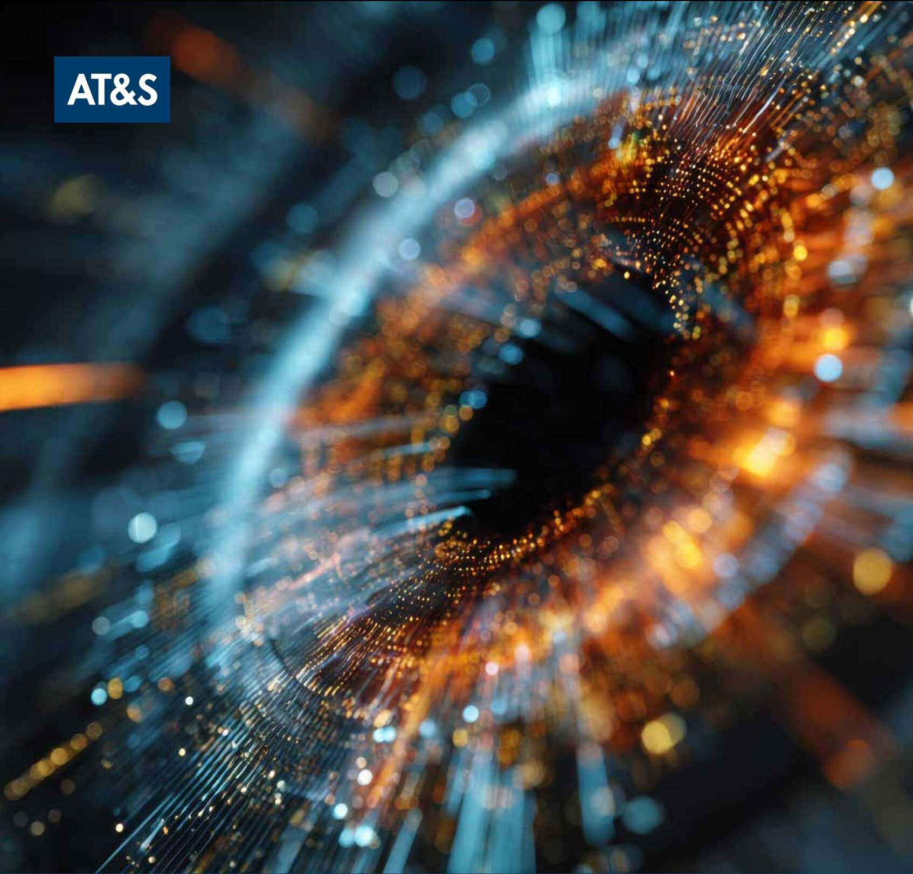 
Customer-focused. Excellence-driven. 
Innovation-powered. 
Annual Report 2025/26

---

<!-- 原文第 2 页 -->

Content 
 
3AT&Sat a Glance
7 Company
31 Group Management Report
181 Consolidated Financial Statements
266 Information

---

<!-- 原文第 3 页 -->

## AT&S at 
## a Glance 
 
 
300% 
e1.79 billion Revenue 
23.3% 
Increase in share price in the financial year 2025/26 
EBITDA margin 
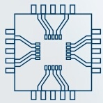 
 
c880 million 
e911 milion 
30-35% 
Revenue in Electronics Solutions 
Revenue in Microelectronics 
expected currency-adjusted revenue growth 
 
 
80.2% Renewable energies 
 
39% Vitality Index 
~14,000 
Employees

---

<!-- 原文第 4 页 -->

AT&S Annual Report 2025/26 
AT&S at a glance 
Advanced Technologies & Solutions 
## Key Figures 

| | Unit | 2025/26 | 2024/25 | Change year-on-year | 2023/24 | 2022/23 |
| --- | --- | --- | --- | --- | --- | --- |
| Revenue | E in milions | 1,791 | 1,590 | 13% | 1,550 | 1,791 |
| EBITDA | E in millions | 418 | 606 | (31%) | 307 | 417 |
| EBITDA margin | % | 23.3 | 38.1 | | 19.8 | 23.3 |
| EBIT | E in millions | 66 | 277 | (76%) | 31 | 146 |
| EBIT margin | % | 3.7 | 17.5 | | 2.0 | 8.2 |
| Profit for the period | E in millions | (26) | 90 | | (37) | 137 |
| ROCE | % | 3.0 | 7.0 | | 0.6 | 6.6 |
| Net CAPEX | E in millions | 178 | 415 | (57%) | 855 | 996 |
| Operating free cash flow | E in millions | 235 | (489) | | (202) | (520) |
| Net debt | E in milions | 1,332 | 1.491 | 11% | 1,403 | 851 |
| Earnings per share | E | (1.11) | 1.86 | | (1.39) | 3.03 |
| Dividend per share | E | 0.001 | 0.00 | n.a. | 0.00 | 0.40 |
| Employees2 | | 13.250 | 13.261 | 0% | 13,828 | 15,280 |
 
12025/26: Proposal to the Annual General Meeting 2 Incl. contract staff, average 
## Markets and Applications 
Semiconductors & modules 
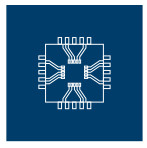 
Al applications 
High-performance computing 
Sensors 
Power Management 
 
Data storage systems 
Communication &5G 
 
Internet of Things 
Cloud Computing 
 
Routers 
Data centres 
Consumer Electronics 
 
Smartphones 
Wearables 
Laptops and tablets 
 
Drones and action cameras 
Automotive & Industrial 
Advanced driver assistance systems 
Autonomous driving 
Power supply for drive systems 
Smart solutions for buildings, power grids, lighting. production and transport 
Robots,sensors and M2M communications 
## Aviation and Aerospace 
Aircraft controls 
Engine controls 
Cockpit and passenger applications 
## Medical 
Therapy applications 
(cardiac pacemakers,neurostimulation,prostheses) 
Digital patient examination 
(pulse and glucose measurement) 
Diagnostics and imaging systems (X-ray,MRI and ultrasound)

---

<!-- 原文第 5 页 -->

AT&S Annual Report 2025/26 AT&S at a glance Advanced Technologies & Solutions 
## Who we are 
AT&S is a globally leading provider of high-end IC substrates and printed circuit boards. The company develops and manufactures innovative interconnection technologies for key digital industries, including mobile devices, automotive and aerospace, industrial, medical, and high-performance computing for Al applications. 
We are strengthening our leading position in substrates and printed circuit boards and are investing alongside our customers in the next generation of technologies. In doing so,we are collaborating more closely than ever with our key customers as well as with external partners such as research institutions. 
In the years ahead, AT&S will actively drive digital megatrends forward through its production footprint in Europe and Asia while pursuing sustainable and profitable growth. To this end, the company is deepening its value creation and further positioning itself as a solutions provider, even more closely aligned with customer needs. 
AT&S stands for the highest quality standards, the industrialization of forward-looking technologies, and a strong focus on people.At the same time, we take responsibility for the environment by consistently reducing our ecological footprint - AT&S creates value. 
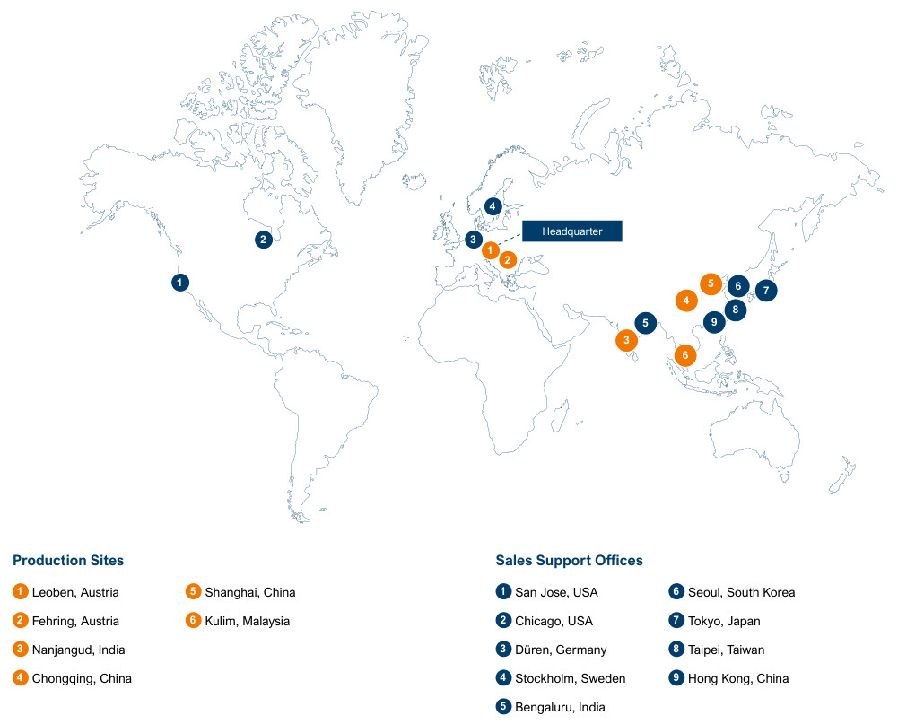 
5

---

<!-- 原文第 6 页 -->

---

<!-- 原文第 7 页 -->

AT&S Annual Report 2025/26 
Company Advanced Technologies & Solutions 
## Company 
7 
8 Letter from the CEO
13 Strategy
17 Report of the Supervisory Board
20 Consolidated Corporate Governance Report
28 AT&S Share 
7

---

<!-- 原文第 8 页 -->

AT&S Annual Report 2025/26 
Company 
Advanced Technologies & Solutions 
Letter from the CEO 
 
Michael Mertin 
President&CEO 
## Dear Shareholders 
2025/26 was a strong and pivotal financial year for AT&S.We continued our growth trajectory, increased revenue again and strengthened operating profitability, This development confirms that we are making the right decisions in a challenging market environment. 
## Boosted competitiveness 
We significantly increased our competitiveness through targeted cost-saving and efficiency programs despite a challenging currency environment.Iln Q3 and Q4,we achieved a positive net proft again.We aim to continue on this path throughout the financial year 2026/27,creating a stable financial basis on which we can grow sustainably and continue to advance our technological priorities. 
We continued our growth trajectory, increased revenue again and strengthened operating profitability. 
8

---

<!-- 原文第 9 页 -->

AT&S 
Annual Report 2025/26 
Company 
Advanced Technologies & Solutions 
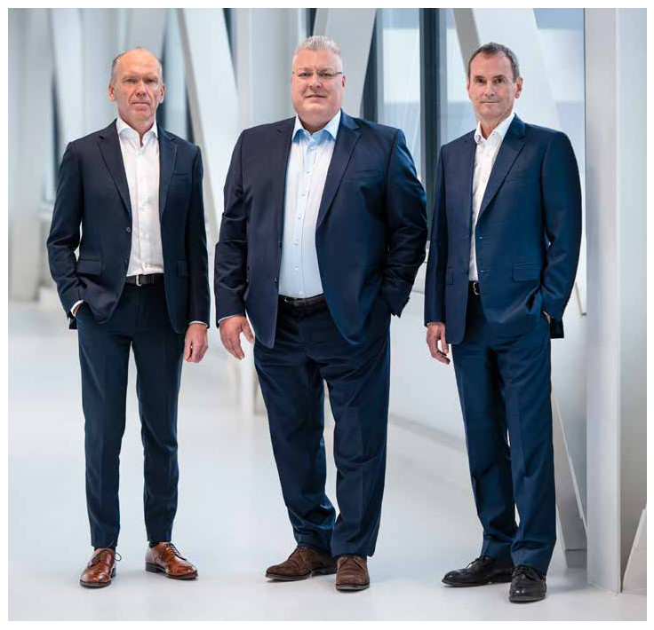 
AT&S Management Board (from left to right): 
MSc in Business Administration Gerrit Steen 
Chief Financial Officer (CFO) since February 1, 2026,appointed until 2029 
Dr.-Ing. Michael Mertin 
President& Chief Executive Officer (CEO) since May 1, 2025, appointed until April 30, 2028 
Dr.Peter Griehsnig 
Chief Technology Officer (CTO) since April 1, 2023, appointed until 2028 
New leadership team, leaner organization Even before I assumed overall responsibility as CEO in May 2025, it was evident where the key strengths of AT&S lie and what potential this company holds. The goal is to establish new ways of thinking and further enhance the company's agility and focus. 
We have implemented important internal changes. As part of this reorganization, we made future-oriented appointments to central positions and deliberately streamlined the management structure. With Gerrit Steen as CFO and CTO Peter Griehsnig, the AT&S Management Board now consists of three members, enabling fast and transparent decision-making.This clarity of structure increases implementation speed and makes AT&S more agile overall. To strengthen strategic management, 
9

---

<!-- 原文第 10 页 -->

AT&S 
Annual Report 2025/26 
Company 
Advanced Technologies & Solutions 
 
You can find an overview of the Management Board and Supervisory Board members here: 
ats.net/en/company/managementboard-supervisory-board/ 
we set up the Executive Management Committee(EMC), which serves to ensure consistent communication and uniform implementation of decisions. The EMC defines Group-wide priorities,coordinates collaboratin across business units and enables fast, well-founded decisions through regularly held strategic workshops. In doing so,the EMC sets a clear course and is the centra link between the operating business and long-term strategic development. 
Important decisions were also made regarding the Supervisory Board: with the election of Andy Mattes as Chairman of the Supervisory Board, we are gaining an additional global perspective for the coming years - based on his long-standing international experience as a Silicon Valley technology and management expert. 
## Effective efficiency measures 
Our efficiency program is yielding results, and the market environment is stabilizing. Over the past months, we have firmly and sustainably embedded our cost-saving measures within the Aurora program, which we will consistently pursue and establish as a rolling program in the future.After standardizing our processes and financial structures, we now have stable framework conditions again and are working on further improving the balance sheet quality. The investments of recent years form the basis for further growth. 
## Megatrends as a guide for the future 
We stand at the beginning of the era of Al and complex automation through advanced and autonomous robotics. There are structural developments that go beyond what is referred to as megatrends today. Robust social and economic trends will prevail in the long trm,even in times when global supply chains, trade relations and economic framework conditions are increasingly influenced by geopolitical tensions and uncertainty. They open up new opportunities for higher value creation and,consequently, for strengthening our economies. 
10

---

<!-- 原文第 11 页 -->

AT&S 
Annual Report 2025/26 
Company 
Advanced Technologies & Solutions 
## Customer-focused. Excellence-driven. Innovation-powered. 
This annual report is titled"Customer-focused. Excellencedriven. Innovation-powered"."Customer-focused" means consistently aligning our decisions with the perspectives of our customers. We actively listen, understand the challenges, and design our solutions to create real added value.This is how long-term, trustful partnerships are built. 
We are strengthening our position for substrates and printed circuit boards and are together with our customers in the next generatior of our technologies. 
"Excellence-driven" describes our commitment to delivering the highest quality in everything we do. We set ambitious goals, work with precision, and are not satisfied until we achieve convincing results. Excellence is therefore a continuous process. 
"Innovation-powered"stands for the ability to come up with new ideas and translate them into marketable solutions. We combine technological know-how with strong implementation skils,creating sustainable solutions that penetrate markets and give our customers a competitive edge. 
## Our employees are therefore at the center of our relationships with customers, markets and stakeholders. 
## Roadmaps that lead the way 
Today, we work more closely with our key customers and external partners, such as research institutions, in both technology development and in preparing upcoming product generations. On this basis, we develop short, medium- and long-term innovation roadmaps, some of them jointly. 
We focus on future technologies. We are strengthening our position for substrates and printed circuit boards and are investing in the next generation of our technologies, from Al substrates and high-performance power electronics modules to optoelectronic applications for high-speed data transmission in data centers. These areas will shape the technological development of the years to come. And we are positioning ourselves where the next innovative leaps will occur. 
11

---

<!-- 原文第 12 页 -->

AT&S 
Annual Report 2025/26 
Company 
Advanced Technologies & Solutions 
## Open communication 
We are committed to clear and open communication on a regular basis, both in the media and in direct dialogue with our stakeholders. This transparency strengthens trust and contributes to embracing corporate responsibility.We actively seek dialogue because this builds trust among our customers, our employees and on the capital market. Open communication is the foundation of every successful partnership. 
## Sustainability, for tomorrow's business 
When it comes to sustainabilit, we consistently pursue an economically oriented approach: We leverage ESG as a competitive and cost advantage. Investments in energy efficincy, modern facilities and resource-saving processes make an important contribution to environmental protection. They help us achieve our environmental goals and those of our customers as part of the global supply chain. 
 
Further information on sustainability at AT&S can be found at: ats.net/en/sustainability 
## AT&S is a team 
We are a company in motion, but one thing remains constant: our team spirit. What has impressed me most of all since my first day of work at AT&S is the commitment, the dedication and the high level of expertise of our employees. My special thanks go out to them. We continuously work to show appreciation of what they achieve, for example with initiatives like the first global Family Day, which further strengthens team spirit and commitment. 
I would like to thank all those who accompanied AT&S in the past year: our employees, our customers, our suppliers, and you,our shareholders. Your trust is the foundation our success is built on. We have a clear perspective for the future. Overall AT&S will continue to develop as an internationally recognized, customer-focused and technologically leading high-tech company. 
## Sincerely 
Michael Mertin 
12

---

<!-- 原文第 13 页 -->

AT&S Annual Report 2025/26 
Company Advanced Technologies & Solutions 
# Strategy 
## Focus, Resilience and TechnologyDriven Growth 
The global electronics industry is undergoing a phase of profound structural change. Key growth drivers - including high-performance computing (HPC), artificial intelligence (A), the global expansion of data centers and the ongoing electrification of industrial applications - are raising the demands placed on interconnect solutions.These dynamics lead to increased complexity and performance requirements for modern PCBs and IC substrates - areas in which AT&S has traditionally been a technology pioneer. 
With the change in management, AT&S initiated a clear strategic restart. The new management has placed a consistent and customer-oriented focus on technology, resilience and profitability, launching a change in direction, which is already showing a noticeable effect. AT&S is positioning itself less as a pure manufacturing service provider and more as a technology partner to its key customers. Today, the organization's orientation is more focused, more determined and more strategically stringent - which is reflected in a stabilized business development and increasing operating strength. 
Based on the interaction of these elements, AT&S pursues a clear path: value-based growth, consistently managed investments, streamlined prioritization and a solid operating basis. This approach allows AT&S to regain momentum despite a volatile market environment and to enter the next phase of its development sustainably stronger. 
## Technology Leadership, Global Footprint and Financial Discipline 
The long-term development of AT&S is based on three central strategic pillars: 
## 1. Technological expansion as an engine of growth 
AT&S makes targeted investments in complex IC substrates, high-end printed circuit boards, embedding technologies and packaging-related systems. These technology platforms address markets with structural growth: Al servers, HPC clusters, optical communication, power electronics and demanding industries. The new management focus especially enhances the ability to industrialize technologies faster in cooperation with our customers and to anticipate innovation-driven customer requirements 
## 2. Resilient global positioning 
The combination of European development and innovation centers together with the scalable manufacturing hub in Malaysia enables a resilient, regional value chain. In addition, AT&S is positioning the plants to strengthen local access to new markets, talent and supply chains. This supports the core orientation of the new management, which deliberately focuses on risk diversification and local value creation. 
## 3. Financial stability and discipline 
AT&S focuses on clear priorities, disciplined investments and a strong earnings and cash flow orientation. This financial architecture strengthens the positive development of the past months and provides a solid foundation for the company's further, strategically upward trajectory. 
Overall, this creates a strategic profile that is technologically differentiated, customer-centered, globally robust and financially forward-looking. 
Vision and Guardrails AT&S's vision is to be the First Choice for Advanced Solutions when it comes to technology, quality and collaboration with customers. 
The central guardrails are: 
Technological progress: advancement of substrate, packaging and embedding technologies Innovative strength: virtual prototyping and increased simulation expertise,platform development, co-design and strengthening the Vitality Index Financial management: free cash flow focus,positive net income, modular investments 
13

---

<!-- 原文第 14 页 -->

AT&S Annual Report 2025/26 
Company 
Advanced Technologies & Solutions 
## Resilience: globally balanced footprint and local value creation 
Sustainability: ecological criteria as an integral part of all processes 
These guardrails are not just defintions, but are consistently implemented. 
## Market Dynamics 
The global electronics industry is undergoing a longterm transformation process. Al and HPC investments accelerate demand cycles, while automotive,photonic and industrial applications are growing steadily. AT&S has adopted a strategic positioning addressing the fastest growing segments and deliberately not prioritizing commodified mass markets. 
## Financial Guidelines 
The financial management framework of AT&S is guided by clear, value-oriented principles: 
Profitable growth with a focus on sustainable value creation 
Consistent focus on earnings with the objective of generating positive net income 
Disciplined investment management to ensure a positive free cash flow 
These principles safeguard financial stability and the ability to invest in a challenging market environment. 
The new management team has sharpened the financial management approach and consistently implements it through clear priorities, measures, and decision-making frameworks. 
## Strategic Goals 2026-2030 
The agenda is clearly structured: 
## Strengthen positioning in high-end technologies 
Expansion of new substrate and packaging generations as well as embedding. Strengthen preliminary developments (e.g.optics) and foster development partnerships 
Improve balance of markets and regions 
Broader customer mix, local production 
Increase financial resilience Modular CAPEX structure, efficiency programs, focus on free cash flow, balance sheet strengthening 
Enhance sustainability Reduction in energy and resource use, ESG-based supply chains 
## Strategic Goals 2026-2030 
Advanced Technologies and Solutions 
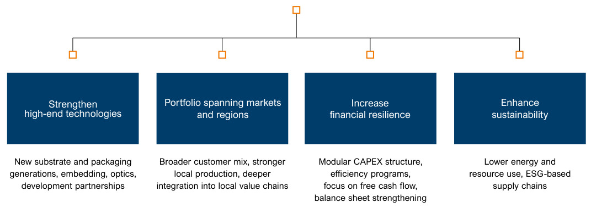 
14

---

<!-- 原文第 15 页 -->

AT&S Annual Report 2025/26 
Company 
Advanced Technologies & Solutions 
All goals follow a coherent guiding principle: AT&S must become more profitable, more customerfocused, more resilient and technologically stronger without any strategic dilution. 
## Design Services & System Solutions 
Design and simulation services support industrialization and increase the depth of value creation in the core business. From design for manufacturing and design for cost to turnkey solutions, AT&S offers services internationally, but with a focus on Europe. 
## Strategic Priorities by Business Segment 
## Emerging Businesses 
Microelectronics (IC substrates) Core technology and main growth driver - supported by growing demand for Al, HPC and data-intensive applications. 
Emerging Businesses are increasingly becoming a central lever for growth and differentiation. Photonics, sensor technology, power electronics and novel integrated systems are opening up new market segments with above-average future potential. These areas expand the technological breadth of AT&S, boost resilience by reducing cyclicity and offer strategic access to innovation-driven industries. 
## Electronics Solutions (printed circuit boards) 
Focus on sophisticated applications such as aviation and aerospace, defense applications, photonics, and industrial, automotive and power electronics. Leveraging PCB expertise for the development of integrated packaging/system solutions for HPC. 
## Strategic Priorities by Business Segment 
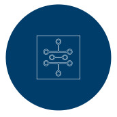 
Microelectronics (IC substrates) 
Core technology & growth drivers 
AI,HPC, data-intensive applications 
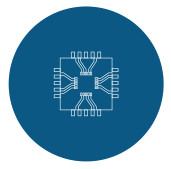 
Electronics Solutions (printed circuit boards) 
Focus on high-end applications 
Aerospace,defense,photonics, industrial,automotive,power electronics, holistic packaging & system solutions for HPC 
 
Design Services & 
System Solutions 
More value creation in the core business 
Design,simulation, DfM,DfC, turnkey solutions 
 
Emerging 
Businesses 
New growth& differentiation levers 
Photonics, sensors, power electronics, integrated systems, new market segments. higher resilience 
15

---

<!-- 原文第 16 页 -->

AT&S Annual Report 2025/26 
Company 
Advanced Technologies & Solutions 
## Geographic Resilience 
AT&S relies on a structured diversified global footprint: 
Malaysia: scalable globally oriented manufacturing hub 
Austria: technology and embedding center China: high-volume production, increasingly locally anchored 
India: volume production with a focus on local growth potential 
This reduces dependencies, strengthens supply chain resilience and creates new growth options. 
## Final Strategic Outlook 
The coming years will be critical for further advancing the company's strategic realignment. Today,AT&S is in a significantly better starting position than in recent years due to its clear focus and consistent prioritization. As the results show: AT&S has returned to a clear, stable and forward-looking course. 
The structural growth drivers - Al, HPC, photonics and industrial electronics - will continue to advance the company in the years to come. At the same time, the expansion of Emerging Businesses will strengthen the technological breadth and open up additional, less cyclical value creation paths. 
With a clear technological agenda, a resilient footprint and responsible, value-based management, AT&S aims to generate sustainable, profitable growth and successfully introduce the next development phase. The new management has provided the crucial impetus - and AT&S has clearly returned to an upward trajectory, following a stable and strategically consistent path. 
## Geographic Resilience 
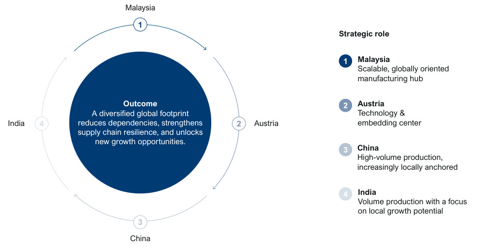 
16

---

<!-- 原文第 17 页 -->

AT&S Annual Report 2025/26 
Company Advanced Technologies & Solutions 
# Report of the Supervisory Board 
## Dear Shareholders, 
It is a great pleasure for me to introduce myself to you as the Chairman of the Supervisory Board elected in the financial year 2025/26-a position that I will fufllwith a strong sense of responsibility and commitment. I would like to express my sincere thanks to the Supervisory Board for the trust placed in me and my appointment for a five-year term. Being elected Chairman of the AT&S Supervisory Board is a particular honor for me. 
Over the past decades,AT&S has developed into a global leading provider of interconnection technologies and today counts numerous renowned brands in the electronics industry among its established customer base. Technology, digitalization, and microelectronics play a central role in societal development.They drive economic innovation and are essential for solutions in areas such as mobility, energy, and communication. 
In the coming years,together with my colleagues on the Supervisory Board, I intend to further promote the successful development of AT&S and to help set the course for a sustainable future. A constructive dialogue with the Management Board and the shareholders will be at the center of my efforts in order to address challenges proactively and seize opportunities in the best possible way. 
AT&S is excellently positioned to actively shape this transformation. The company has enormous future potential, and I look forward to contributing my international experience to the further development of AT&S. 
Despite existing challenges, the past financial year brought an overall encouraging development for AT&S. Revenue amounted to 1,790.8 million (previous year: (1,589.6 million),while EBITDA totaled E416.7 million (previous year:E605.7 million).On an operational basis - adjusted for the sale of the plant in Ansan, Korea, as well as for currency effects - both key figures showed a significant improvement compared with the previous year. 
In addition to a noticeable recovery in the market environment and the successful implementation of the efficiency program, the new plants in Kulim, Malaysia, and Leoben, Austria, in particular contributed to this positive development. The targets for the financial year were thus fully achieved. 
There were also important changes in both the Supervisory Board and the Management Board during the financial year. In addition to my own appointment to the Supervisory Board, Robert Lasshofer decided not to stand for a further term. The members of the Supervisory Board would like to express their sincere thanks for his many years of dedicated and highly valued service and wish him all the best for the future. 
Within the Management Board, a new streamlined three-member structure was successfully implemented, which has already led to significantly more efficient decision-making processes and sustainably strengthens the company's ability to act in a dynamic market environment. With Michael Mertin as CEO and Gerrit Steen as CFO, two new members joined AT&S in the past financial year. Both bring many years of international experience and extensive professional expertise and, together with Peter Griehsnig, will make a valuable contribution to the future development of AT&S. 
 
Andy Mato h Supervisory Board 
17

---

<!-- 原文第 18 页 -->

AT&S Annual Report 2025/26 
Company Advanced Technologies & Solutions 
Under the leadership of CEO Michael Mertin, the Management Board has successfully initiated the turnaround, with the aim of once again establishing AT&S as a flagship of the Austrian technology industry. The consistent and clear focus on transformation and customer orientation will lead to profitable growth. 
## Activities of the Supervisory Board 
The Supervisory Board met seven times during the financial year 2025/26. 
In the financial year 2025/26,the Supervisory Board performed the tasks assigned to it in accordance with the law, the Articles of Association, and the Rules of Procedure. During the financial year from April 1, 2025,to March 31, 2026,the Supervisory Board was regularly and comprehensively informed by the Management Board - both in plenary and committee meetings, as well as through written and oral reports - about the market situation, strategy, the operating and financial position of the Group and its investments, the staff situation, and planned capital expenditures, and contributed to the respective resolutions. 
At these meetings,there was a comprehensive exchange of information between the Management Board and the Supervisory Board regarding business development and the situation of the AT&S Group, including its financial performance. The Chairman of the Supervisory Board and his deputies, and subsequently also the full Supervisory Board, were regularly informed about relevant developments also outside Supervisory Board meetings. 
The focus of the Supervisory Board's activities included the budget for the financial year 2026/27 as well as business development and key customer relationships. Other central topics discussed at the meetings included the transition of expansion projects from the project phase to volume production, Management Board matters,current market developments,the ongoing cost optimization and efficiency program, and securing and optimizing Group financing. 
## Supervisory Board Committees 
Within the Supervisory Board, the Audit Committe, the Nomination and Remuneration Committee, and the Finance and Strategy Committee perform specific tasks assigned to them under the Rules of Procedure. Matters were examined in greater detail within the respective committees where necessary and reported to the Supervisory Board. 
The Audit Committee,chaired by Gertrude TumpelGugerell, focused primarily on the audit of the annual and consolidated financial statements as of March 31, 2025,and on the planning and preparation of the audit for the financial year 2025/26.It obtained a comprehensive view through discussions with the auditor, inspection of relevant documents, and meetings with the Management Board. 
It also monitored the effectiveness of the companywide internal control system, internal audit, and risk management systems, and addressed the asset and financial position of the company and the Group. the planned reporting based on the EU Taxonomy Regulation, the current ESG regulatory landscape including CSRD and CSDDD, as well as the compliance organization. The Audit Committee held three meetings and reported no deficiencies. 
The Nomination and Remuneration Committee,:chaired by Georg Riedl unti July 3, 2025,and by Andy Mattes thereafter, held ten meetings and focused in particular on Management Board matters and the succession planning for the CFO position. 
The Finance and Strategy Committee, chaired by Robert Lasshofer until the 31st Annual General Meeting and by Andy Mattes thereafter, held two meetings and dealt in detail with matters of Group financing and project financing. 
18

---

<!-- 原文第 19 页 -->

AT&S Annual Report 2025/26 
Company Advanced Technologies & Solutions 
Self-evaluation of the Supervisory Board The Supervisory Board conducts an annual selfevaluation and did so again for the financial year 2025/26.This evaluation confirmed that its practices comply with Good Governance requirements and that its organization, working methods, and target orientation are efficient and effective. 
## Annual Financial Statements and Dividend 
The Supervisory Board of AT&S proposed to the 31st Annual General Meeting that Deloitte Audit Wirtschaftsprufungs GmbH, Vienna, be appointed as Company and Group auditors for the financial year 2025/26.This proposal was adopted by the Annual General Meeting on July 3, 2025. 
The annual financial statements of AT &S Austria Technologie & Systemtechnik Aktiengesellschaft and the consolidated financial statements for the year ended March 31, 2026were audited by Deloitte Audit Wirtschaftsprufungs GmbH, Vienna, and received an unqualified audit report. The Management Report and the Group Management Report for the financial year 2025/26were consistent with the annual financial statements and the consolidated financial statements. Based on the prior discussion by the Audit Committee, and following its own detailed consideration and examination, the Supervisory Board approved the company's annual financial statements for the year ended March 31, 2026in accordance with Section 96 (4) of the Austrian Stock Corporation Act (AktG) at its meeting on June 3,2026.The consolidated Sustainability Statement for 2025/26 included in the Group Management Report was audited by Deloitte Audit Wirtschaftsprufungs GmbH, Vienna. The audit procedures did not bring to light any facts and circumstances that would cause us to assume that this AT &S Austria Technologie & Systemtechnik Aktiengesellschaft report does not comply with material aspects of applicable legal requirements and the standards for sustainability reporting. Moreover, based on the prior discussions by the Audit Committee, and after its own detailed consideration and examination, the Supervisory Board approved the consolidated financial statements drawn up in accordance with IFRS pursuant to Section 245a of the Austrian Commercial Code (UGB) as well as the Management Report, the Group Management Report, the Corporate Governance Report and the Sustainability Statement. The Supervisory Board's review, which included extensive discussions with the auditors,did not give rise to any objections. Pursuant to the recommendation of the Audit Committee, the Supervisory Board of AT&S will propose to the $32nd$ Annual General Meeting that Deloitte Audit Wirtschaftsprufungs GmbH, Vienna, be appointed as Company and Group auditors for the financial year 2026/27. 
In order to strengthen the balance sheet position,the Management Board will propose not to pay a dividend for the financial year 2025/26.The Supervisory Board supports this proposal. 
Our Thanks to the Management Board and All Employees The Supervisory Board would like to express its sincere thanks and appreciation to all employees,the Management Board, and our shareholders for their valuable support in the past financial year. 
The dynamic market environment placed high demands on the company and on each individual - demands that we have successfully met together. This strong sense of unity gives us great confidence that we will lead AT&S successfully into the future. 
Leoben-Hinterberg,June 3,2026 
On behalf of the Supervisory Board 
Dipl-Kfm. Andy Mattes m.p. Chairman of the Supervisory Board 
19

---

<!-- 原文第 20 页 -->

AT&S Annual Report 2025/26 
Company Advanced Technologies & Solutions 
# Consolidated Corporate Governance Report 
The Austrian Code of Corporate Governance (ACCG) is a regulatory framework for stock corporations regarding the management and supervision of the company. The objective of the Code is the responsible management and control of enterprises and groups for the purposes of sustainable, long-term value creation.This is intended to achieve a high level of transparency for all stakeholders of the company. The Code is based on the provisions of Austrian company,stock exchange and capital market law, the EU recommendations regarding the responsibilities of supervisory board members and the remuneration of directors, and the principles of the OECD Guidelines for Corporate Governance. 
## Commitment to the Austrian Code of Corporate Governance/Declaration of Commitment 
AT&S Austria Technologie & Systemtechnik Aktiengesellschaft ("AT&S") has expressly committed to compliance with the rules of the ACCG since its admission to listing on the Vienna Stock Exchange on May 20,2008. This Corporate Governance Report is based on the status of the Code as amended in January 2025. In key report items, matters of the entire Group are included, if necessary. 
The Code can be accessed at www.corporategovernance.at. 
AT&S meets all mandatory L-Rules ("Legal Requirements"). Unless an explanation is provided, C-Rules ("Comply or Explain") are also complied with by the respective corporate bodies and by the company. 
In accordance with L-Rule 60 of the ACCG, AT&S must prepare a Consolidated Corporate Governance Report. The Consolidated Corporate Governance Report of AT&S also corresponds to the Corporate Governance Report of the AT&S Group. This Consolidated Corporate Governance Report is publicly available on the AT&S website at ats.net/en/company/corporategovernance/ (C-Rule 61 ACCG). 
In accordance with C-Rule 62 of the Austrian Code of Corporate Governance, compliance with the requirements of the Code shall be evaluated periodically, but at least every three years, by an external institution.The most recent evaluation took place in the financial year 2023/24.In accordance with C-Rule 62 of the Austrian Code of Corporate Governance, the next external evaluation is scheduled for the financial year 2026/27. 
## Explanation of deviations (from C-Rules) 
Based on the following explanations,AT&S ensures behavior consistent with the Code in accordance with the ACCG: 
## C-Rule 16 
Peter Schneider was appointed Spokesman of the Management Board on an interim basis as of October 1, 2024,after former Chairman of the Management Board Andreas Gerstenmayer had stepped down. At an extraordinary Supervisory Board meeting held on February 25, 2025,Michael Mertin was appointed member of the Management Board and Chairman of the Management Board, both with effect from May 1, 2025.Hence, in deviation from C-Rule 16 of the ACCG, there was no Chairman of the Management Board during April 2025, the first month of the reporting year. 
## C-Rules 27 and 27a and all related provisions 
The long-term incentive program 2024-2026based on stock appreciation rights ("SAR") for the Management Board and key staff, which was implemented by resolution of the Supervisory Board on July 3, 2014 and is now expiring,does not include defined non-financial criteria for variable remuneration for the purpose of maintaining transparency and traceability with regard to target achievement and is now only applicable to former Management Board members based on their contractual entitlements. 
Furthermore, based on the version of the Remuneration Policy for the Management Board adopted at the Annual General Meeting in 2025,the SAR program was replaced by a Share Performance Plan effective from the financial year 2025/26 for all eligible persons active as of December 2025,which, in addition to a financial target, also includes a non-financial criterion. As a result,there is no longer any deviation in this respect. 
20

---

<!-- 原文第 21 页 -->

AT&S Annual Report 2025/26 
Company 
Advanced Technologies & Solutions 
## Management Board 
## Composition, working practices and organization within the reporting period 
Management Board of AT&S AG 

| | Assigned Group Functions | Date of first appointment | End of current appointment | Supervisory Board mandates of members of the Management Board in other domestic and foreign companies |
| --- | --- | --- | --- | --- |
| Michael Mertin, CEO born 1966,male | Business Unit Electronics Solutions, Business Unit Microelectronics, Communications, Human Resources, Legal & Compliance, Public Affairs, Strategy & Transformation, Market Intelligence, Executive Office (Chief of Staff) | 05/01/2025 | 04/30/2028 | |
| Gerrit Steen, CFO born 1970,male | Audit, Controlling, Finance,IT & Digital/Data, Investor Relations, Procurement,Risk & Continuity Management, Treasury | 02/01/2026 | 01/31/2029 | |
| Peter Griehsnig, CTO born 1965,male | Environmental, Social and Governance (ESG),Electronic Service Hub, Information Security, Corporate Quality, Research & Development incl.Future Technologies, Technology & Innovation Management, Emerging Business (BU in establishment) | 04/01/2023 | 03/31/2028 | |
| Ingolf Schroder, EVP BU Microelectronics, (unti 01/31/2026) born 1972,male | until 01/31/2026: BU Microelectronics, Group Business & Operational Excellence | 09/01/2020 | 01/31/2026 | |
| Petra Preining, CFO (until 08/31/2025) born 1973, female | until 08/31/2025: Finance, Controlling, Procurement, Investor Relations, Legal, Internal Audit, Compliance, Risk & Continuity Management | 10/01/2022 | 08/31/2025 | Member of the Supervisory Board of Frequentis AG, Vienna,Austria |
| Peter Schneider, EVP BU Electronics Solutions (unti 09/30/2025) born 1970,male | until 09/30/2025:BU Electronics Solutions, Customer Service & Success,Group Key Account Management (KAM) Excellence | 06/01/2021 | 09/30/2025 | |
 
21

---

<!-- 原文第 22 页 -->

AT&S Annual Report 2025/26 
Company 
Advanced Technologies & Solutions 
When the appointment of Michael Mertin as a member of the Management Board and Chairman of the Management Board became effective, Group functions were reallocated as of May 1, 2025. Further reallocations took place in the course of the financial year as a result of the premature departure of Petra Preining and Peter Schneider from the Management Board and, as of February 1, 2026, when the Management Board was reduced to three members following the appointment of Gerrit Steen to the Management Board. The current assignment of Group functions as of March 31, 2026, is shown in the table above. 
As a collective executive body, the Management Board is jointly responsible for the management of the company. In addition to the collective responsibility, each Management Board member is also responsible for defined areas of business.The assigned corporate functions are shown in the table. CVs of the Management Board members can be found on the AT&S website at ats.net/en/company/ management-board-supervisory-board/. 
## Remuneration of the Management Board (and Supervisory Board) 
With the Stock Corporation Amendment Act 2019 (Federal Law Gazette | 2019/63),the provisions regarding the disclosure of the remuneration of individual members of the Management Board and the principles of the remuneration policy were repealed. This information is now disclosed in detail in the Remuneration Report (Section 78d of the Austrian Stock Corporation Act (AktG), which must be presented annually for a vote at the Annual General Meeting. 
22

---

<!-- 原文第 23 页 -->

AT&S Annual Report 2025/26 
Company 
Advanced Technologies & Solutions 
## Supervisory Board 
Supervisory Board of AT&S AG 
Independent
Date of first appointment End of current appointment Supervisory board mandates in other listed companies1 according to ACCG Rule
Andreas Mattes, Chairman of the Supervisory Board, 07/03/2025 36th AGM2030 Member of the Supervisory Board of Cohu Inc., California, USA 53,54
born1961.male Deputy Chairman of the Supervisory Board
of ams-OSRAM AG, Premstatten, Austria
Georg Riedl, 05/28/1999 35h AGM 2029 Chairman of the Supervisory Board of 53
First deputy Chairman of the Supervisory Board, HWA AG, Affalterbach, Germany
born 1959.male
Gertrude Tumpel-Gugerell, 07/04/2019 35th AGM2029 Member of the Supervisory Board of Vienna 53,54
Second deputy Chairwoman of the Insurance Group AG, Vienna, Austria
Supervisory Board, Member of the Supervisory Board of
born1952.female Commerzbank AG,Frankfurt, Germany
(until 05/15/2025)
Robert Lasshofer, 07/09/2020 31th AGM 2025 Member of the Supervisory Board of Vienna 53,54
Member of the Supervisory Board, born 1957,male Insurance Group AG, Vienna, Austria
Georg Hansis, 07/09/2020 36th AGM 2030 53
born 1973,male Member of the Supervisory Board,
Karin Schaupp. 07/07/2011 32th AGM 2026 53,54
Member of the Supervisory Board,
born 1950,female
Wolfgang Fleck, 09/03/2008 03/31/2025
Member of the Supervisory Board,
born 1962.male
Ronald Arh. 04/01/2025
Member of the Supervisory Board, born 1978,male
Gunter Pint, Member of the Supervisory Board, 09/19/2017
born 1976,male
Christa Koberl, 12/01/2023
Member of the Supervisory Board,
born 1969.female 
1Supervisory Board postions held within the reporting period. 
23

---

<!-- 原文第 24 页 -->

AT&S Annual Report 2025/26 
Company Advanced Technologies & Solutions 
Management based on the principles of good corporate governance, which is developed continuously, is of vital importance to the Management Board and the Supervisory Board.Open discussions and discourse constantly take place both within these bodies and between the Management and Supervisory Boards. The strategic orientation of the company is defined in close coordination between the two bodies and is regularly discussed and evaluated at Supervisory Board meetings. A catalog of transactions and measures which - in addition to those defined by law - require the explicit approval of the Supervisory Board can be found in the Rules of Procedure of the Management Board, alongside the requirements for ongoing reporting by the Management Board to the Supervisory Board. The Supervisory Board supervises the Management Board in managing the company and provides advice on decisions of crucial or fundamental importance. 
Throughout the financial year from April 1, 2025,to March 31, 2026,the Supervisory Board received written and oral reports from the Management Board on the Group's policies and performance, and was closely involved in all business issues. 
The Supervisory Board met seven times during the financial year 2025/26.No Supervisory Board member attended less than 50% of the meetings during the financial year 2025/26.Central topics of the meetings included the discussion and approval of the budget for the financial year 2026/27,business development and key customer relationships, the transition of expansion projects from the project phase to series production, the current cost optimization and efficiency program, Management Board matters,current market developments, as well as the securing and optimization of Group financing. 
The Supervisory Board conducts an annual selfevaluation in accordance with Rule 36 of the Code of Corporate Governance and did so again for the financial year 2025/26.This evaluation, performed by the Supervisory Board based on a digital questionnaire, confirmed that its practices meet the Good Governance requirements and that its organization, work practices and target orientation are efficient and effective. 
## Independence of Supervisory Board members 
In accordance with C-Rule 53 of the ACCG, the Supervisory Board has established the following criteria to be used in determining the independence of its members: Supervisory Board members are to be regarded as independent if they have no business or personal relationships with the company or its Management Board which could be cause for material conflicts of interest and therefore likely to influence the behavior of the member in question. The detailed criteria for the assessment of a Supervisory Board member are defined in the Rules of Procedure of the Supervisory Board, Appendix 1: Criteria of independence of the AT&S Supervisory Board. The Rules of Procedure of the Supervisory Board can be viewed at ats.net/ en/company/corporate-governance/disclosableinformation/.In March 2026,the members of the Supervisory Board appointed by the Annual General Meeting each declared in writing whether they were independent. Five of the five members of the Supervisory Board representing shareholder interests declared that they were independent. 
C-Rule 54 specifies that, for companies with a free float in excess of 50%,at least two Supervisory Board members who are independent in accordance with C-Rule 53 should also not be shareholders with interests in excess of 10%, or representatives of such interests. Three of five Supervisory Board members representing shareholder interests also declared themselves independent within the meaning of this rule. 
## Related party transactions 
In the financial year 2025/26,no transactions took place with parties related to the company or the Group. 
24

---

<!-- 原文第 25 页 -->

AT&S 
Annual Report 2025/26 
Company 
Advanced Technologies & Solutions 
## Committees 
In order to provide effective support and to properly address complex matters, the Supervisory Board has established three standing committees, which analyze particular issues in detail and report regularly to the Supervisory Board. 
Composition of the Committees of the Supervisory Board 

| Committee | Members |
| --- | --- |
| Audit Committee | Gertrude Tumpel-Gugerell(Chairwoman and Finance Expert) Karin Schaupp Georg Riedl Robert Lasshofer (until the Annual General Meeting on 07/03/2025) Ronald Arh (since 04/01/2025) Christa Koberl Wolfgang Fleck (until 03/31/2025) |
| Nomination and | Andreas Mattes (Chairman since |
| Committee | Karin Schaupp Georg Riedl (Chairman and Member until 07/03/2025) Georg Hansis Ronald Arh (since 04/01/2025) Christa Koberl Wolfgang Fleck (until 03/31/2025) |
| Finance and Strategy Committee | Andreas Mattes (Chairman since 07/03/2025) |
| | Robert Lasshofer (Chaiman and member until the Annual General Meeting on 07/03/2025) Georg Hansis Georg Riedl Ronald Arh (since 04/01/2025) Christa Koberl Wolfgang Fleck (until 03/31/2025) |
 
## Audit Committee 
The Audit Committe carries out the responsibilities defined by Section 92 para. 4a of the Austrian Stock Corporation Act and Rule 40 of the Austrian Code of Corporate Governance. In particular, the Audit Committee reviews and prepares the approval of the annual financial statements and reviews the proposed distribution of profits, the Management Report and the Consolidated Corporate Governance Report, monitors the accounting process, approves non-audit services and is required to report the audit results to the Supervisory Board. The Audit Committee held three meetings and addressed in particular the preparation and resolution on the separate and consolidated financial statements for the financial year 2024/25, the asset and financial position of the company and in the Group,risk management,the internal control system, internal audit, the planned reporting based on the EU Taxonomy Regulation and the current landscape of ESG regulations including the Corporate Sustainability Reporting Directive (CSRD) and the Corporate Sustainability Due Diligence Directive (CSDDD), as well as the compliance organization and the preparation of the audit of the separate and consolidated financial statements for the financial year 2025/26. 
## Nomination and Remuneration Committee 
The Nomination and Remuneration Committee deals with matters regarding succession planning and the remuneration of Management Board members, as well as the further development of the remuneration policy. All committee members representing shareholders possess knowledge of and experience in the area of remuneration policies.The Nomination and Remuneration Committee is also authorized to make decisions in urgent cases. This committee held ten meetings in the financial year 2025/26.At these meetings, the committee discussed Management Board matters in general, as well as the issue of filing the position of the CFO. 
## Finance and Strategy Committee 
A Finance Committee has been established to address the complex and specific tasks of financing as efficiently as possible.The Finance Committee convened twice in the financial year 2025/26.At these meetings, the Finance Committee discussed in detail matters of Group financing in general, as well as project financing. 
25

---

<!-- 原文第 26 页 -->

AT&S Annual Report 2025/26 
Company Advanced Technologies & Solutions 
## Diversity of the Management and Supervisory Boards 
When proposals for Supervisory Board appointments are made to the Annual General Meeting and when Management Board members are nominated, the focus is on maintaining a professional and diversity-related balance, as such a balance significantly contributes to the professionalism and effectiveness of the work of the Supervisory and Management Boards. In addition to professional and personal qualifications, aspects such as age structure,origin, gender, education, and experience are also considered. As diversity-related criteria are adequately considered in the search for as well as the subsequent nomination and appointment of candidates for Management Board and Supervisory Board positions, it was decided not to develop a separate diversity concept for the reporting period. 
At present, three women serve on the AT&S Supervisory Board. At approximately 38%, the proportion of women exceeds the legal requirements by far; regarding the shareholder representatives, the proportion of women is 40%. The age of Supervisory Board members ranges from 49 to 76 years as of March 31, 2026.All members of the Supervisory Board representing shareholder interests have extensive experience in international business. 
## Managers' transactions 
Purchases and sales carried out by members of the Management Board,the Supervisory Board and related persons are reported to the Financial Market Authority in accordance with Art. 19 of Regulation (EU) No.596/2014and published via an EU-wide disclosure system as well as on the AT&S website, under ats. net/en/investors/ir-news/managers-transactions. 
## Directors and Officers (D&O) insurance 
D&O insurance is in place for the Supervisory Board, the Management Board and senior executives in the Group. The company pays the costs in connection with this insurance. 
## Risk management 
In accordance with C-Rule 83 of the ACCG, the effectiveness of the risk management system was audited with limited assurance by the auditor, Deloitte Audit Wirtschaftsprufungs GmbH, for the reporting period. The activities performed did not result in any findings and the Management and Supervisory Boards were informed of the result. In addition, the Head of Risk Management reports on current risks at the meetings of the Audit Committee. 
26

---

<!-- 原文第 27 页 -->

AT&S Annual Report 2025/26 
Company 
Advanced Technologies & Solutions 
Leoben-Hinterberg, May 20, 2026 
The Management Board 
Michael Mertin m.p. 
Gerrit Steen m.p. 
Peter Griehsnig m.p. 
27

---

<!-- 原文第 28 页 -->

AT&S Annual Report 2025/26 
Company Advanced Technologies & Solutions 
## AT&S Share 
AT&S share price performed very strongly during the 2025/26 fiscal year. At the end of the fiscal year on March 31,2026,the share closed at C51.70, representing a price increase of approximately 300% compared to the same date in the previous year. A clear upward trend began as early as the start of the fiscal year, interrupted only by short-term setbacks over the course of the year. 
The share price performance was supported in particular by the improvement in the market environment, the encouraging operational performance, and the successful ramp-up of the new production sites. 
The share price peaked at E56.00 at the end of February 2026.The annual low was 10.42 and was recorded in April 2025, at the start of the fiscal year. 
As a result of the positive share price performance, AT&S's market capitalization increased from E503 million as of March 31, 2025, to approximately E2 billion at the end of the 2025/26 fiscal year.This trend continued thereafter: in late May 2026, the market capitalization surpassed the E5 billion mark for the first time. 
## Share Price Development 
AS compared to ATX and TecDAX(rebased to 100) 
Key Share Figures 

| | Unit | 2025/26 | 2024/25 |
| --- | --- | --- | --- |
| Closing price on 31 March | E | 51.70 | 12.9 |
| High | E | 56.00 | 23.5 |
| Low | E | 10.42 | 9.6 |
| Market capitalisation (end of reporting period | Ein millions | 2,009 | 503 |
| Average share turnover per day | E in thousands | 3.700 | 1,649 |
| Average number of shares traded per day | | 129.412 | 103,639 |
| Dividend per share | E | 0.00' | 0.00 |
| Dividend yield (at the closing price) | % | | |
| Earnings per share | E | (1.11) | 1.86 |
| Book value per share | E | 18.1 | 18.7 |
| Price-earnings ratio per share | | n.a. | 7.0 |
 
12025/26:proposal to the Annual General Meeting 
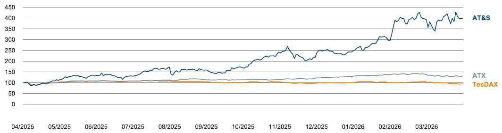 
28

---

<!-- 原文第 29 页 -->

AT&S Annual Report 2025/26 
Company Advanced Technologies& Solutions 
AT&S Share 
Analyses of the AT&S Share 

| Securities identification no./ISIN | 922230/AT0000969985 |
| --- | --- |
| Ticker symbols | Refinitiv Workspace: ATSVVI Bloomberg: ATS:AV |
| Stock listing | Vienna |
| Indices | ATX, ATX GP, WBI, VONIX |
| Number of ordinary shares | 38,850,000 |
 

| | Analyst Recommendations1 |
| --- | --- |
| Aletheia Capital | Buy |
| Bank Pekao | Buy |
| Berenberg Bank | Sell |
| Cantor Fitzgerald | Buy |
| Deutsche Bank | Buy |
| Erste Group | Hold |
| ODDO BHF | Sell |
 
1 As on date of publication 
Shareholder Structure in% 
Shareholder Structure by Region 
(Institutional Investors)1 in% 
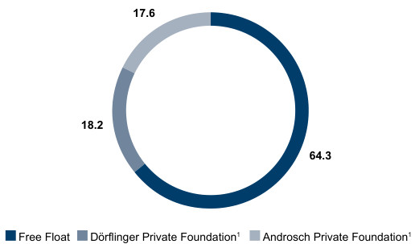 
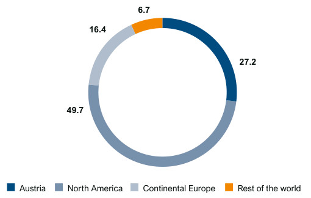 
1 Incl.diret and indirect holdings 
1Only includes identified investors 
AT&S Financial Calendar 

| 06/29/26 | Record Date Annual General Meeting |
| --- | --- |
| 07/09/26 | 32nd Annual General Meeting |
| 07/27/26 | Ex-Dividend Day |
| 07/28/26 | Record Date Dividend |
| 07/30/26 | Dividend Payment Day |
| 08/04/26 | Publication of the first quarter 2026/27 |
| 11/05/26 | Publication of the first half-year 2026/27 |
| 02/02/27 | Publication of the first three quarters 2026/27 |
| 05/20/27 | Publication Preliminary Annual Results 2026/27 |
| 06/10/27 | Publication Annual Results 2026/27 |
 
## Contact 
Philip Gebhardt Vice President Investor Relations Mail ir@ats.net 
Johannes Mattner Manager Investor Relations Mail: ir@ats.net 
29

---

<!-- 原文第 30 页 -->

---

<!-- 原文第 31 页 -->

AT&S Annual Report 2025/26 
Group Management Report Advanced Technologies & Solutions 
# Group Management Report 
## 2025/26 
31 
32 1.Market and Industry Environment
372. Economic Report
53 3. Other Statutory Information
58 4. Consolidated Sustainability Statement
1645. Research and Development
167 6. Opportunities and Risks
179 7. Outlook 
31

---

<!-- 原文第 32 页 -->

AT&S Annual Report 2025/26 
Group Management Report Advanced Technologies & Solutions 
# 1. Market and Industry Environment 
## 1.1. General economic environment 
Global economic activity in 2025 remained resilient despite elevated trade policy uncertainty and geopolitical tensions. Global gross domestic product (GDP) growth was steady at 3.3% in 2025,with technology investment and easing financial conditions helping offset trade policy headwinds. The International Monetary Fund (IMF) projects global GDP growth of 3.3% in 2026 as momentum from late-2025carries forward.1 
Performance diverged across major economies and regions, with modest growth in advanced economies versus firmer expansion in emerging markets. Within that pattern, the United States (2.1%) provided notable support to global momentum; the Euro Area (1.4%) remained comparatively subdued; China (5.0%)delivered solid but moderating growth as structural adjustments continued; India (7.3%) stayed among the faster-growing large economies; and ASEAN (4.2%) economies posted strong growth.1 
Throughout 2025,the operating environment was shaped by elevated trade policy uncertainty and persistent geopolitical tensions. Companies managed a shifting tariff landscape, periodic new restrictions, and tighter compliance regimes that increased the cost and complexity of cross-border activity. Supply chains continued to adapt through dual-sourcing, near-shoring, and inventory hedging.Business confdence was sensitive to policy headlines and regional security developments, prompting greater emphasis on resilience. 
The strategic and economic rivalry between the United States and China remained a central feature of the global operating environment. Both governments continued to prioritize national-security-driven industrial and technology policies, resulting in a more interventionist approach to trade, investment screening,and supply-chain governance. Companies across advanced manufacturing, electronics,and critical materials faced heightened uncertainty as export controls, tariff actions,and localization requirements evolved on both sides. Competitive dynamics also intensified in emerging markets, where the U.S. and China expanded diplomatic and commercial engagement to secure market access, resource supply, and technology standards influence. 
## 1.2. Industry environment Semiconductor 
In 2025the semiconductor industry grew 25.6% to US$ 791.7 bilion. Growth was mostly concentrated in Al infrastructure, where both logic and memory contributed significantly to the trend; other segments experienced softer expansion. Growth was strongest in Asia Pacific/All Others (45.0%) and the Americas (30.5%),the regions where most of Al infrastructure and semicon-related CAPEX is being deployed.2 
The build-up of datacenters required to support Artificial Intelligence (Al)-related services continued to dominate spending, fueling growth in both logic and memory. Especially in the second half of the year, a shortage of capacity of DRAM products for Al servers and accelerators caused a sharp rise in the price of those components, thereby contributing to a significant portion of growth in value terms. 
Towards the end of the year, the Al infrastructure build-out also triggered a refresh cycle for traditional servers and created tailwinds for power electronics and networking appliance makers. Investment in Alrelated hardware is expected to continue in 2026and beyond, with hyperscalers to play a prominent role not just as infrastructure owners and operators, but as designers of custom, high-performance silicon. 
In 2025,the Advanced Substrate market (including flip-chip, system-in-package and embedded die) grew an 18% from the previous year. The Flip-Chip Ball Grid Array (FC-BGA) was characterized by materials shortages and favorable price dynamics due to the high demand generated by Al products.The 
International Monetary Fund, Wword Economic utook update,January 2026 
Semiconor nusty caio, Pe RleGoa al icnurSales crease 25.6%to USS 791.7 Bilin in 2025,February 2026 
32

---

<!-- 原文第 33 页 -->

AT&S Annual Report 2025/26 
Group Management Report Advanced Technologies & Solutions 
total value of the FC-BGA substrate market has been assessed at US$ 7.5 billion for 2025, 18% up from the previous year.3 
(11.3% YoY decline) as the industry faces a severe global memory shortage and dramatic price increases driven by surging Al datacenter demand.5 The consumer electronics landscape in 2026isexpected to be driven primarily by the rise of on-device Al and the emergence of smart glasses/headsets as a mainstream hardware category. Industry players are doubling down on "Agentic Al" that moves beyond simple chatbots to autonomous assistants embedded directly into devices.The smart glasses/headsets market is expected to enjoy a CAGR of 23% from 2024-2029. 
The year 2026 shows a mixed picture.The FC-BGA market is expected to continue expanding towards US$ 11.4 billion in 2029,propelled by investments in data centers. The previously mentioned memory shortages, however, are likely to impact demand in a variety of segments, most notably client computing, possibly creating headwinds for end-demand. 
Consumer, computing, communication Consumer, computing and communication segments enjoyed various levels of growth in 2025.PCs shipment volume grew 8.1% YoY, leading all major applications in terms of percentage growth, followed by smartphones (1.9% YoY) and tablets (1.5% YoY). Server/Data Storage saw historic growth (39.9%) driven by Al investments by cloud service providers . Global smartphone shipments increased 1.9% YoY to 1.26 bilion units in 2025,with Apple (6.3% in volume YoY) regaining global number one spot and capturing the highest market share. 2025 growth was driven largely by stronger demand for premium devices and accelerated5G adoption.The 2026 smartphone market outlook looks distinctly more challenging (low double-digit or 12.9% YoY decline) due to severe supply chain constraints and an unprecedented surge in memory component costs.4 Vendors focused on the low end of the market are likely to face the greatest pressure. Rising component costs will hit their margins, and they will have no choice but to pass the costs on to consumers. By contrast, Apple and Samsung are better positioned to navigate this crisis. 
In2025,PC vendors shipped 285 million PCs,up 8.1% from 20247.The strong growth was propelled largely by the Windows 11 upgrade cycle, robust consumer and commercial demand, and accelerated purchasing ahead of anticipated U.S. import tariffs. However, the outlook for 2026 is generally negative ' Prismark Partners."Applicalion Forecast, January 2026 
a? 
Looking into 2026,the printed circuit board (PCB) market for the 3C segment is on a growth trajectory with an anticipated growth of 10.5% to US$ 57.7 billion and the long-term growth is projected with a CAGR of 4.9% until 2029 reaching US$ 67.6 billion.3 Al servers will remain a key growth driver, projected to exceed 30% growth, benefitting related applications such as storage and networking, despite a very challenging market for other consumer applications, including smartphones and PCs in the immediate short-term. 
## Automotive 
The global automotive industry in 2025 underwent significant transformation, driven by rapid electrification, intelligent vehicle technologies, and evolving global supply chains. While growth remained modest overall, the sector continued shifting toward software-defined, connected, and battery-powered mobility solutions. The transition toward intelligent and electrified vehicles intensified throughout the year. Industry conferences spotlighted breakthroughs in automotive chip technology, including high-performance integrated display chips and improved domestic semiconductor supply chains in Asia. Vehicles increasingly evolved into software-defined platforms, integrating Al-driven features, advanced driver assis tance systems, and connected services. 
Battery-powered vehicle production surged, with output rising approximately 28% year-over-year.8 Global 
"Prismark Partners AT&S Workshop,January 2026 
Rai? 
33

---

<!-- 原文第 34 页 -->

AT&S Annual Report 2025/26 
Group Management Report Advanced Technologies & Solutions 
electric vehicle sales reached roughly15 million units'. Similar though less advanced adoption trends were observed in other major markets. Competition intensified between traditional automakers and emerging electric vehicle players. Rapid product iteration cycles, frequent model launches, and featurerich smart vehicles reshaped market dynamics. 
Market concentration increased as leading brands strengthened their positions, while technology-sector entrants continued to reshape the competitive environment. The automotive sector is expected to continue growing in 2026,supported by policy incentives, infrastructure expansion,and increasing EV adoption.However,global economic uncertainty, regulatory changes, trade tensions, and intensified compettion - particularly from lower-cost importsremain significant risks. 
The Automotive Electronics Systems market is estimated to reach a value of US$ 336 billion in 2029 growing with a CAGR of 4.6% from 2024 onwards and a 3.3% YoY growth from 2025to 2026.The estimated total PCB demand in 2029 is at USS 10.9billion,growing with a 4.3% CAGR from 2024with US$ 8.9 bilion.3 
## Medical 
The global medical device sector demonstrated notable resilience in 2025, with growth accelerating on the back of structural demographic tailwinds and a continued normalization in healthcare utilization. 
Global medical electronics system value reached US$ 152 billion in 2025, representing a 5.7%YoY increase and marking the fifth consecutive year of expansion. Within this,the medical PCB market grew 6.9% YoY to US$ 1.56 billion in 2025(vs.US$1.45 billion in 2024),and was up 11.5% compared with 2023, reflecting sustained demand momentum across higher-value applications. 
Large-cap international device manufacturers indicate that pricing pressure in China and incremental U.S. tariff impacts have largely been absorbed, "Giobal Dala" Clobal u y o though management teams remain measured in their outlook. Heading into 2026,mid-single-digit growth is expected, with system-level expansion ofapproximately 5% and medical PCB growth of 4.6%.3 
## Industrial 
The global industrial electronics market expanded moderately in 2025,driven by acelerating adoption of automation, digitalization, and Industry 4.0 initiatives. The integration of loT, Al, and advanced analytics is enabling real-time monitoring, predictive maintenance, and improved operational efficiency across sectors such as energy, transportation, man ufacturing, and semiconductors. 
For 2026,growth of 5.2% is expected in industrial electronic systems. Total demand for PCBs boards is estimated at $3.7 bilion in 2029 and is projected to grow at an average annual rate of 5.5% starting in 2024.3 
Rising electrification is boosting demand for advanced power semiconductor technologies, including Silicon Carbide and Gallium Nitride, which deliver higher efficiency,compact design, and improved thermal performance. Intelligent Electronic Devices, along with increasingly miniaturized and precise sensors and actuators, are further enhancing automation and smart grid capabilities. 
Sustainability and regulatory compliance are shaping innovation, with strong emphasis on energy efficiency, safety standards, and environmental performance. While high initial investment costs and cybersecurity risks remain challenges, ongoing technological advancements and strategic consolidation are strengthening market competitiveness. Asia Pacific leads growth, followed by North America and Europe, as industries continue transitioning toward connected, intelligent, and energy-efficient operations. 
34

---

<!-- 原文第 35 页 -->

AT&S Annual Report 2025/26 
Group Management Report Advanced Technologies & Solutions 
## Aviation and Aerospace 
The aviation industry and its passenger traffic saw increases across all regions pushing the load factor to the highest on record for any year. The air cargo industry delivered a strong performance in 2025as global e-commerce strength drove volumes, even as trading relationships with the US faced rising tariffs. 
Air Cargo adapted quickly to support global businesses and supply chains. The Military and Aerospace Electronics Systems market is estimated to reach a combined value of US$ 251billion in 2029 growing with a CAGR of 6.4% from 202410.The estimated total PCB demand in 2029 is at US$ 5.0 billion growing with a 6.5% CAGR from 2024.Besides defense application, commercial drone applications, engine control units, fight control units,and in-flight-entertainment solutions are drivers in the market. 
The global Space Economy has surpassed US$ 650 billion, fueled by the integration of orbital data and manufacturing into terrestrial sectors like agriculture, insurance, and pharmaceuticals.Defense applications, space telemetry applications, engine control units and in-flight entertainment solutions also remain important drivers in the market. Connectivity has expanded rapidly with Starlink reaching 9 million subscribers across 155 countries.10 
The aviation industry has also undergone a connectivity transformation. The number of commercial aircraft equipped with Starlink terminals quadrupled in 2025,reaching 1,400 airframes across major carriers.10 Furthermore, direct connection to devices via satellites, developments in Earth observation, and the Internet for everyone in rural areas offer growth opportunities, as mega low Earth orbit satelite constellations develop. 
Substrates and PCB market USS in bilions 
"IATA,Press Releae Global Ii Cad Deamand Achieved Reord Volume in 2025,January 
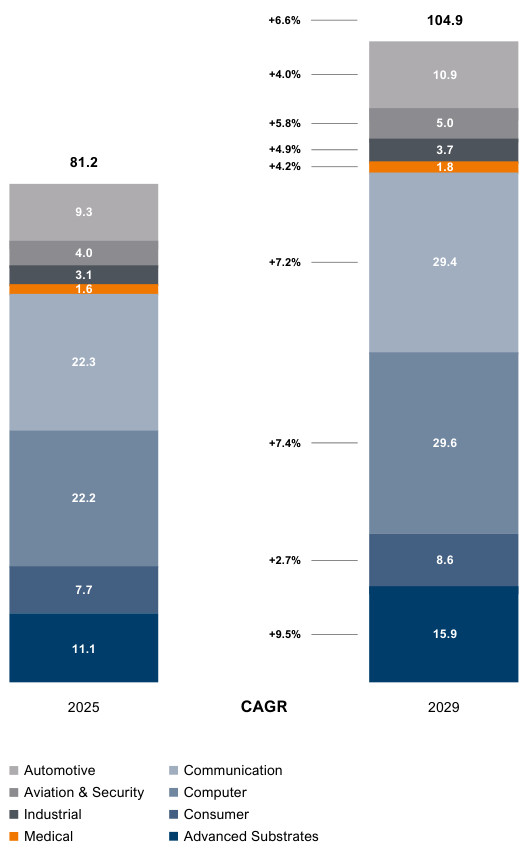 
Source: Prismark.January 2026 
1 New Space Economy, The Space Econonmy i 2 A Deep Dive io Vetceal dsiss and Applications",January 2026 
35

---

<!-- 原文第 36 页 -->

AT&S Annual Report 2025/26 
Group Management Report Advanced Technologies & Solutions 
## 1.3. Industry and technology trends 
## Memory and materials shortages 
Data centers are expected to continue expanding in both number and scale, sustaining strong demand for large, high-density packages and thereby driving the need for increasingly complex substrates. The surge in Al accelerator demand has created supply tightness across advanced-node foundry capacity, memory production, and key materials such as glass-fiber laminates for FC-BGA substrates. 
Memory shortages, in particular, are likely to affect a broad range of markets. As Al infrastructure build-out continues,sectors from client computing to industrial electronics may face longer lead times and higher memory prices, with potential implications for end demand through 2026.At the same time,the strong need for large,complex IC substrates for Al accelerators has tightened high-end substrate capacity and increased pressure on specialized materials. 
These dynamics have supported firmer pricing for substrate manufacturers toward the end of 2025.In addition, the structural strength of Al-related demand has triggered a new wave of investments in high-end substrate manufacturing capacity, setting the stage for improved supply conditions and additional growth opportunities over the next several years. 
36

---

<!-- 原文第 37 页 -->

AT&S Annual Report 2025/26 
Group Management Report Advanced Technologies & Solutions 
## 2.Economic Report 
## 2.1. Overall development of the Group 
## AT&S increases revenue further 
2025/26 was a successful financial year for AT&S. Revenue increased again in a challenging market environment and operational profitability improved.In an equally challenging currency environment, AT&S significantly boosted its compettiveness based on targeted cost adjustments and efficiency programs and achieved a positive profit for the period again in Q3 and Q4.AT&S aims to continue on this trajectory throughout the financial year 2026/27,thereby establishing a stable financial base for fostering sustainable growth and technological priorities. 
In comparison to the previous year, consolidated revenue rose by 12.7% to 1,790.8 million in the financial year 2025/26(previous year:( 1,589.6 million). 
During the reporting period, AT&S recorded positive volume development, which successfully offset negative currency effects. 
The EBITDA margin decreased by -14.8 percentage points compared to the previous year from 38.1% to 23.3%,as the sale of the plant in Ansan (C324.8 million) was included in the prior-year figure.When adjusting the prior-year margin for the proceeds from the sale of the plant in Ansan, the EBITDA margin improved from 17.7% in the previous year to 23.9% in the financial year 2025/26. 
Earnings per share amounted to E-1.11. 
## Development of revenue and EBITDA margin 
E in millions/in % of revenue 
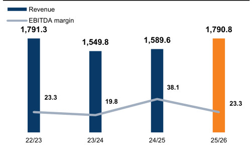 
The economic and industrial landscape of the financial year was marked by ongoing geopolitical uncertainty, diverging regional economic trends and ongoing technological transformation.In several industries, structural trends such as the expansion of data centers, increased use of artificial inteligence, highperformance computing and data-intensive applications shaped market developments. At the same time, there were differing demand dynamics between high-growth segments, such as servers, storage, and semiconductor infrastructure, and weaker sectors such as automotive and industrial. Across all industries, adjustments to global supply chains, material availability and noticeable price pressure throughout the year influenced the market environment. In the second half of the financial year,price pressure eased noticeably, particularly in the substrate market, and this trend is continuing into the new financial year. 
## 2.2. Earnings development in the Group 
## Revenue up by 12.7% 
Revenue in the financial year 2025/26 increased by 12.7% compared to the previous year and amounted to1,790.8million (previous year:(1,589.6 million). 
37

---

<!-- 原文第 38 页 -->

AT&S Annual Report 2025/26 
Group Management Report Advanced Technologies & Solutions 
The development of revenue differed in the two segments. While revenue rose by 38.6% in the Microelectronics segment (ME),the Electronics Solutions segment (ES) recorded a decline by 5.8%. 
Foreign exchange effects had a negative impact of C123.9 million, or 7.8%,on the development of revenue.90.3% of revenue (previous year: 88.5%) was invoiced in foreign currencies (primarily US dollars) Adjusted for currency effects,revenue growth amounted to 20.5%. 
The quarterly development throughout the financial year shows that the new plants in Kulim and Leoben made a noticeable contribution to growth and AT&S increased consolidated revenue with each quarter. As in the past, the Electronics Solutions segment saw seasonal effects (with higher revenue in the second and third guarters, and lower revenue in the first and fourth quarters),whereas revenue in the Microelectronics segment increased every quarter compared to the preceding quarter.Likewise, all prior-year quarters were exceeded in this segment. 
The regional revenue structure based on customers' headquarters shows a share of 81.2% for America, compared to 77.1% in the previous year. The share of products manufactured in Asia rose slightly from 87.8% to 88.7%. 
Revenue broken down by region, based on customers' headquarters C in millions 
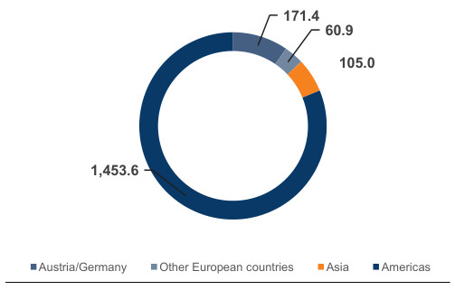 
The effects of recognizing revenue over time, which is required for a number of customers in accordance with IFRS 15,led to an increase in revenue by C37.3 milion or 2.1% (effect in the previous year: increase by 2.9 million or 0.2%). For further information, please refer to the notes to the consolidated financial statements. 
Revenue split by segment shows the following picture: 
## Revenue from external customers by segment in % 
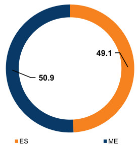 
The share of the Electronics Solutions (ES) segment in third-party revenue declined to 49.1% (previous year: 59.8%); the share of the Microelectronics (ME) segment increased to 50.9% (previous year: 40.2%). Further information on the development of the segments is provided in Section 2.3"Earnings development in the segments". 
EBITDA 418.0 million, EBITDA margin 23.3% 
EBITDA, at E 418.0 millin, was lower than in the previous year (( 605.7 million),whereby the prior-year figure was significantly influenced by the sale of the plant in Ansan. The sale resulted in gains on the disposal of affiliated companies of E 324.8 milion in the previous year. Adjusting the prior-year EBITDA for the proceeds from the sale of the plant in Ansan leads to an improvement in earnings of C 137.2 million, 
38

---

<!-- 原文第 39 页 -->

AT&S Annual Report 2025/26 
Group Management Report Advanced Technologies & Solutions 
which corresponds to an increase by 48.8%.This is due in particular to higher revenue resulting from larger quantities.Consequently,gross revenue rose despite higher research and development expenses. Lower distribution costs also had a positive effect, while higher administrative costs weighed on the operating result.The other operating result was substantially lower than in the previous year due to the company sale recognized in the previous year and was additionally negatively affected by foreign currency effects.Following the commissioning of the plants in Leoben, Austria, and Kulim, Malaysia, startup costs declined bye 112.3 million. 
The EBITDA margin fell by 14.8 percentage points from 38.1% in the previous year to 23.3% 
## Development of EBITDA E in millions 
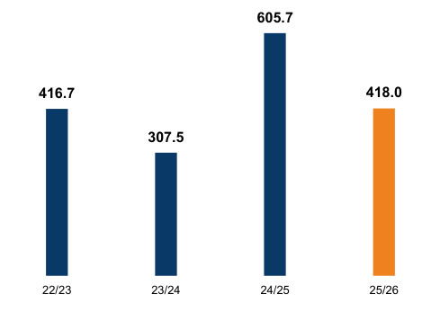 
Adjusted for gains on the disposal of affliated companies in the previous year,the EBITDA margin amounted to 17.7%,which would result in an improvement by 5.7 percentage points. 
## Increase in expense items 
The increase in cost of sales by 175.6 million to 1,587.3 milion results from higher revenue but primarily also from an increase in personnel and material costs. In addition, research and development expenses rose, with AT&S investinge 174.7 million in research and development in the financial year 2025/26(previous year:( 137.1 million) in preparation for future technology generations and to pursue 
Result key data 

| Ein millions (unless othervise stated) | 2025/26 | 2024/25 | Change |
| --- | --- | --- | --- |
| Revenue | 1,790.8 | 1,589.6 | 12.7% |
| Operating result before interest,tax, depreciation and amortization (EBITDA) | 418.0 | 605.7 | (31.0%) |
| EBITDA margin (%) | 23.3% | 38.1% | |
| Operating resul(EBIT) | 65.6 | 277.4 | (76.3%) |
| EBIT margin(%) | 3.7% | 17.5% | |
| Proft for the year | (25.6) | 89.7 | (>100%) |
| Earnings per share (E) | (1.11) | 1.86 | (>100%) |
| Additions to fixed assets | 149.8 | 359.9 | (58.4%) |
| Average number of staff Cincl. leased personnel) | 13,250 | 13,261 | (0.1%) |
 
39

---

<!-- 原文第 40 页 -->

AT&S Annual Report 2025/26 
Group Management Report Advanced Technologies & Solutions 
the modularization strategy. These expenditures make the Company future-proof and significantly expand the earnings potential in the medium term. 
Positive currency effects increased the rise in cost of sales by E 72.9 million. 
Administrative and distribution costs were 11.3 million,or 7.7%,higher than in the previous year, whereby the main increase was recorded for stock appreciation rights and the Performance Share Plan (increase:( 10.2 million). IT costs also rose (increase: ( 4.0 million).Legal and consulting expenses declined by E 5.9 million to E 22.0 million. 
The other operating 
result fell from 245.6 million to19.5 milion, This change was mainly due to the sale of the plant in Ansan recognized in the previous year, which led to gains on the disposal of affliated companies of 324.8 million. Lower start-up costs of 17.1 milion (previous year: ( 129.4 million) had a positive impact, which declined after the plants in Hinterberg, Austria, and Kulim, Malaysia, were commissioned. In addition, the foreign exchange loss from the measurement of receivables and liabilities ofC-9.9 million (previous year: ( 4.8 million) had a negative effect on the other operating result.Grants declined from e 56.0 million in the previous year to E 53.4 milion in the financial year 2025/26.AT&S consistently continued its comprehensive cost optimization and efficiency program to counter the effects resulting from the currently diffcult market environment. This resulted in restructuring costs of 1.9 million (previous year:11.6 million). 
Scheduled depreciation of property,plant and equipment and amortization of intangible assets of E352.4 million or -11.1% of fixed assets (previous year: (-317.9 million or -9.5% of non-current assets) reflect the high technical standard and the intensity of investment of AT&S. The increase by -34.5 million compared to the previous year resulted from an increase in depreciation and amortization by C43.7 million in the Microelectronics segment an in crease in depreciation and amortization by E 2.3 million in the Others segment and a decline in depreciation and amortization by 11.5 million in the Electronics Solutions segment. While the higher depreciation and amortization in the Microelectronics segment is primarily attributable to the plants in Hinterberg and Kulim,the decline in depreciation and amortization in the Electronics Solutions segment is related to the plants in China on the one hand and to the sale of the plant in Ansan on the other. 
The operating result (EBIT) dropped by E211.8million or 76.3%to65.6 million (previous year: C277.4 milion) due to the above-mentioned effects. When adjusting the prior-year EBIT for the gains on the disposal of the plant in Ansan, it shows an improvement in earnings ofe 113.0 milion. 
The EBIT margin decreased by 13.8 percentage points to 3.7%(previous year: 17.5%).Adjusted for the gains on the disposal of affiliated companies in the previous year, the EBIT margin amounted to -3.0%, which would correspond to an improvement by 6.7 percentage points. 
Development of EBIT E in millions 
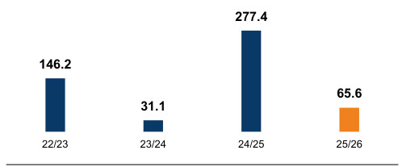 
40

---

<!-- 原文第 41 页 -->

AT&S Annual Report 2025/26 
Group Management Report Advanced Technologies & Solutions 
## Finance costs - net 
Finance costs - net changed from E-83.5 million to C-100.0 million.Interest expense on bank borrowings and bonds amounted to E 92.3 million (previous year:(113.2 million). Due to the commissioning of assets previously under construction, no interest on borrowings related to the acquisition of qualifying assets was capitalized to reduce expenses (previous year:C6.1 million).AT 1.2 million,interest on social capital was lower than in the previous year E 1.3 million). 
The hedging of the interest rate risk with hedging instruments (measurement and realized result) resulted in a loss of E 2.3 milion (previous year: gain of (6.8 million). The hedging instruments swap variable for fixed interest payments as well as US dollars for euros. 
The disposition of available liquidity in the money market resulted in an investment result of E 25.3 million (previous year:( 26.8 million). 
Finance costs - net are influenced by currency effects because investments are in part denominated in foreign currency. In the financial year 2025/26,a decrease in positive exchange rate differences negatively impacted finance costs - net.Exchange rate differences of C 12.3 million were recognized as an expense (previous year: income of 11.3 million). The exchange rate differences resulted predominantly from the measurement of liquid foreign currency funds and realized exchange rate gains from Group financing. 
The main intragroup loans are long-term in nature, and their repayment is neither scheduled nor probable in the foreseeable future. These loans are therefore recorded directly in equity through the statement of comprehensive income. 
## Profit for the year 
Profit for the year decreased from E 89.7 million in the previous year, which included E 247.3 million from the sale of the plant in Ansan, dropped by C115.3 million to -25.6million. 
The Group's total income taxes showed a positive amount of EE 8.7 milion (previous year: tax expense of EC 104.2 million). Current income taxes declined to12.5 milion (previous year:(75.1 million).In contrast to the previous year, deferred taxes resulted in an expense of C21.3 million (previous year:income of E-29.1 million). Both current income taxes and deferred taxes were burdened by the sale of the plant in the previous year. 
AT&S China already obtained the favorable tax status as a "high-tech company" over the past years.The tax status is valid for three years and is dependent on achieving certain criteria each year. The application for the calendar years 2026to 2028 is in progress. AT&S Chongqing has been granted this status again for the calendar years 2025to 2027. 
Earnings per share increased from E1.86 to E-1.11, with the number of shares outstanding remaining unchanged. In the calculation of earnings per share,interest on hybrid capital of 17.5 million (previous year: ( 17.5 milion) was deducted from the profit for the year. 
## Earnings per share inE 
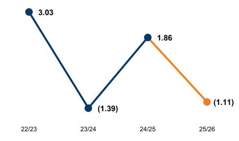 
41

---

<!-- 原文第 42 页 -->

AT&S Annual Report 2025/26 
Group Management Report Advanced Technologies & Solutions 
## 2.3. Earnings development in the segments 
## Electronics Solutions segment 
Faced with a persistent difficult market environment in the financial year2025/26,the Electronics Solutions segment nearly maintained the revenue level, recording only a slight decline in revenue.Price pressure could not be fully compensated by larger volumes. 
## Electronics Solutions - Development of revenue,EBITDA margin 
E in millions/in % of revenue 
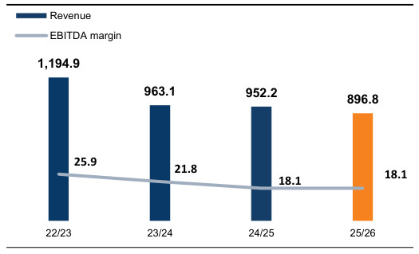 
Revenue, atE 896.8 million, was down E 55.4 million or 5.8% from E 952.2 million in the previous year. Although volume developed positively with individual key customers, low demand in Europe and the globally persisting high pricing pressure could not be fully offset. The foreign exchange development had a negative effect on revenue.The effect on revenue development amounted to -53.9 million (previous year: positive effect of E 7.1 million). 
The segment's EBITDA amounted to 162.7 million, down C9.2 milion,or 5.4%,from 171.9 million in the previous year. Currency translation resulted in a negative effect of E 19.2 million (previous year: negative effect of ( 13.9 million). 
At 18.1%,the EBITDA margin of the Electronics Solutions segment corresponds to the prior-year margin. 
The segment's depreciation and amortization declined by 11.5 million,or 10.9%,from105.4 million in the previous year to E 93.9 million.The decline was attributable to lower depreciation and amortization at the plants in China and due to the sale of the plant in Ansan. 
The operating result(EBIT)Improved by E2.3 million to C 68.8 million (previous year:C 66.5 million). The EBIT margin increased by 0.7 percentage points to 7.7% (previous year: 7.0%). 
Additions to assets declined by 2.7 million, or 4.9%,to51.2 million (previous year:( 53.8 million). 
The additions related to ongoing replacement investments and technology upgrades mainly at the site in Shanghai, but also at all other sites. 
Segment ES (Electronics Solutions)- overview 

| E in millions (unless otherwise stated) | | 2025/26 | 2024/25 | Change |
| --- | --- | --- | --- | --- |
| Segment revenue | | 896.8 | 952.2 | (5.8%) |
| Revenue from external customers | | 880.0 | 949.9 | (7.4%) |
| Operating result before depreciation and amortization (EBITDA) | | 162.7 | 171.9 | (5.4%) |
| EBITDA margin (%) | | 18.1% | 18.1% | |
| Operating result(EBIT) | | 68.8 | 66.5 | 3.4% |
| EBIT margin(%) | | 7.7% | 7.0% | |
| Additions to property,plant and equipment and intangible assets | | 51.2 | 53.8 | (4.9%) |
| Employees (incl.leased personnel), average | | 6,320 | 6,889 | (8.3%) |
 
42

---

<!-- 原文第 43 页 -->

AT&S Annual Report 2025/26 
Group Management Report Advanced Technologies & Solutions 
## Microelectronics segment 
In the Microelectronics segment, the commissioning of the two plants in Kulim, Malaysia, and in Leoben, Austria, led to an increase in revenue. 
The segment's revenue amounted to E 1,011.7 million,up281.7 million from the previous year's C730.0 million. 
With a share in revenue of 50.9% (previous year: 40.2%),the Microelectronics segment is now also the largest segment of the AT&S Group. 
Negative currency effects reduced revenue by E70.1 milion in the financial year 2025/26 (previous year: positive effect of e 7.6 million). 
## Microelectronics 
Development of revenue, EBITDA margin E in millions/in % of revenue 
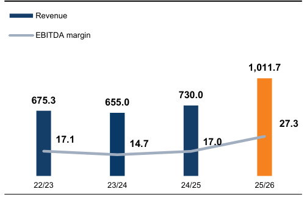 
EBITDA rose by151.8 million or 122.2%to C276.1 million (previous year:( 124.3 million).In particular, higher revenue led to higher gross profit and overcompensated for the E 12.1 million increase in research and development costs.While start-up costs from the construction of production lines in Kulim and Hinterberg declined from 123.2 million in the previous year toe 17.0 milion, currency effects of C-9.2 milion (previous year: positive effect of 4.9 million) and lower grants of E 40.7 million (previous year:( 43.8 milion) had a negative effect on EBITDA. 
The EBITDA margin rose by 10.3 percentage points to 27.3% (previous year: 17.0%). 
The operating result(EBIT)increased by 118.5 million to 29.5 million (previous year:(-89.0 million) despite higher depreciation and amortization.. 
The EBIT margin of the Microelectronics segment at 2.9%, exceeded the -12.2% of the previous year by 15.1 percentage points. 
Additions to assets declined by 190.5 million to E90.9 million (previous year:( 281.4 million).The additions were primarily related to the construction of production lines at the plants in Kulim and Hinterberg. 
Segment ME (Microelectronics)- overview 

| Ein millions (unless othervise stated) | 2025/26 | 2024/25 | Change |
| --- | --- | --- | --- |
| Segment revenue | 1,011.7 | 730.0 | 38.6% |
| Revenue from external customers | 910.7 | 639.8 | 42.4% |
| Operating result before depreciation and amortization(EBITDA) | 276.1 | 124.3 | >100% |
| EBITDA margin (%) | 27.3% | 17.0% | |
| Operating resul(EBIT) | 29.5 | (89.0) | >100% |
| EBIT margin (%) | 2.9% | (12.2%) | |
| Additions to property, plant and equipment and intangible assets | 90.9 | 281.4 | (67.7%) |
| Employees (incl. leased personnel), average | 6,545 | 5,953 | 9.9% |
 
43

---

<!-- 原文第 44 页 -->

Group Management Report Advanced Technologies & Solutions 
AT&S Annual Report 2025/26 
## Others segment 
EBITDA of the general holding activities and part of the research and development activities as well as product design services included in the Others segment amounted toE-20.7 million (previous year: (309.5 milion). In the previous year, the sale of the plant in Ansan with gains on the disposal of affliated companies of 324.8 million was also presented under this segment. 
## Others segment - overview 

| Ein millions (unless othervise stated) | 2025/26 | 2024/25 | Change |
| --- | --- | --- | --- |
| Segment revenue | | | n.a. |
| Operating result before depreciation and amortization (EBITDA) | (20.7) | 309.5 | (>100%) |
| EBITDA margin (%) | | | |
| Operating result(EBIT) | (32.6) | 299.9 | (>100%) |
| EBIT margin (%) | | | |
| Aditions to property, plant and equipment and intangible assets | 7.8 | 24.7 | (68.5%) |
| Employees (incl. leased personnel), average | 385 | 419 | (8.1%) |
 
44

---

<!-- 原文第 45 页 -->

AT&S Annual Report 2025/26 
Group Management Report Advanced Technologies & Solutions 
## 2.4. Assets and financial position 
## 2.4.1. Assets 
## Decrease in non-current assets 
Total assets increased by 0.6% to 4,651.3millon the financial year 2025/26. 
Non-current assets decreased by E 175.1 milion to E3,224.4 million. Property,plant and equipment declined by 182.8 million to E3,152.8 million and intangible assets by6.0 million to12.1 millionln property, plant and equipment, additions to assets and technology upgrades of E 148.7 million were offset by depreciation of 345.2 million and other changes, for example from the sale of the plant in Ansan (for details,please refer to Note 7"Property, plant and equipment" in the notes to the consolidated financial statements). Property, plant and equipment as reported in the statement of financial position also includes right-of-use assets of E 427.0 million resulting from the application of IFRS 16. 
The net change in property,plant and equipment, and intangible assets amounted to E -188.8 million, or -5.6%, fromE3,353.6 million in the previous year to E3,164.8 million in the financial year 2025/26. 
## Financial assets increased by 4.7 million and deferred tax assets by 12.0 milion. 
Current assets increased by204.3 milion to C1,426.9 million. Cash and cash equivalents rose to C738.5 milion (previous year:( 485.1 million).Financial assets declined by 44.1 million to 61.8 million. Overall, AT&S thus has cash and current financial assets totalingE 800.3 million (previous year:( 591.0 million),. The increase in inventories by C89.4 million to 234.9 million primarily results from the rise in production output. Trade receivables, other receivables and contract assets declined by C93.5 million to 388.8 million.The decrease is mainly attributable to higher factoring activities (change:C194.4 million), but is partially offset by increases in trade receivables by 22.4 million, in contract assets byE37.6 milion and in other receivables by 40.9 million. 
Trade payables rose by 10.9 million, or 3.6%, from C304.5 million to315.3 million,including a reduction in liabilities from investments by 40.6 milion to 73.0 million (previous year:( 113.6 million). 
## Net gearing declined 
Equity decreased by 2.2% from E1,075.0 million to 1,051.2 million. Most notably, the loss for the year ofE -25.6 million had a negative effect on equity. Cur 
Net working capital 

| Ein millions (unless otherwise stated) | Mar 31,2026 | Mar 31,2025 | Change |
| --- | --- | --- | --- |
| Inventories | 234.9 | 145.5 | 61.5% |
| Trade receivables and contract assets | 272.9 | 407.9 | (33.1%) |
| Trade payables | (315.3) | (304.5) | (3.6%) |
| Liabilities from investments | 73.0 | 113.6 | (35.7%) |
| Working capital trade | 265.5 | 362.5 | (26.8%) |
| Other current assets, payables,provisions | (25.9) | (47.6) | 45.6% |
| Net working capital | 239.6 | 314.9 | (23.9%) |
| Net working capital in of total revenue | 13.4% | 19.8% | |
| Days outstanding (in days): | | | |
| Inventories | 82 | 77 | 6.3% |
| Receivables | 66 | 69 | (5.7%) |
| Payables | 84 | 87 | (2.8%) |
 
45

---

<!-- 原文第 46 页 -->

AT&S Annual Report 2025/26 
Group Management Report Advanced Technologies & Solutions 
rency differences from the translation of net asset positions of subsidiaries and from the translation of long-term loans to subsidiaries had a positive effect of C 10.2 million (previous year: ( 43.5 million). 
## Net gearing in % 
Likewise, actuarial gains of C 1.9 million (previous year: loss of e 1.9 million) resulting from the parameters used for the calculation of personnel expenses reduced equity.The measurement of hedging instruments to hedge cash flows increased equity by C7.3 million (previous year: loss of 4.3 million). 
No dividend was paid for the financial year 2025/26. The coupon payment of E 17.5 million for the hybrid bonds reduced equity. 
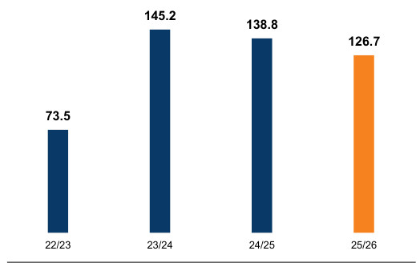 
Non-currentfinancial liabilities increased by 8.8 milion,or 0.5%,to 1,630.0 million.Currentfinancial liabilities rose from 469.9 milion to C515.8 million. 
Net gearing fell to 126.7% and is therefore below the level of the previous year of 138.8%. 
Net debt declined by159.3 million, or 10.7%,to C1,332.1 million (previous year:(1,491.4 million). The decline was primarily due to an increase in cash and cash equivalents. 
Net debt 

| Ein millions (unless otherwise stated) | Mar 31,2026 | Mar 31,2025 | Change |
| --- | --- | --- | --- |
| Financial liabilitie, current | 515.8 | 469.9 | 9.8% |
| Financial liabilities, non-current | 1,630.0 | 1,621.2 | 0.5% |
| Gross debt | 2,145.8 | 2,091.1 | 2.6% |
| Cash and cash equivalents | (738.5) | (485.1) | (52.2%) |
| Financial assets | (75.2) | (114.6) | 34.4% |
| Net debt | 1,332.1 | 1,491.4 | (10.7%) |
| Operating result before interest,tax,depreciation and amortization (EBITDA) | 418.1 | 605.7 | (31.0%) |
| Net debt/EBITDA ratio | 3.2 | 2.5 | |
| Equity | 1,051.2 | 1,075.0 | (2.2%) |
| Total consolidated statement of financial position | 4,651.3 | 4,622.1 | 0.6% |
| Equity ratio (%) | 22.6% | 23.3% | |
| Net gearing (net debt/equity) (%) | 126.7% | 138.8% | |
 
46

---

<!-- 原文第 47 页 -->

AT&S Annual Report 2025/26 
Group Management Report Advanced Technologies & Solutions 
## 2.4.2. Financing 
The focus of the financial year 2025/26 was on ensuring continued financial flexibility and on using the available liquidity and high level of credit lines at optimum cost as part of operating activities as well as planned investments. In addition, a term loan in the amount of 150 million US dollars was concluded with a local bank in Malaysia as part of the financing agreement with the IFC. Moreover, a promissory note loan of E 70 million, a government loan of 0.3 million and an uncommitted overdraft facility ofe 50 million were concluded in Austria. Working capital loans in the amount of C 139.1 million were concluded in Shanghai and Chongqing. 
## Focus on the diversification of financial instruments 
The financing of AT&S is based on a broad spread of both financing instruments and maturities. Based on the prevailing financial market conditions, a stronger focus may be placed on individual instruments or, as the case may be, they may not be used at times. 
Loans which include guarantees by governmental and supranational organizations are a major component of the refinancing portfolio: their advantages lie in the fact that these organizations share part of the credit risk, as well as in favorable terms and conditions intended to provide incentives for investments in specific regions, for innovation and to promote the export sector. AT&S is currently also using financing with guarantees from the Austrian Kontrollbank (OeKB) and direct commitments with the European Investment Bank and KW IPEX-Bank. 
The importance of promissory note loans as a key financing pillar did not change in the financial year 2025/26.The advantages of promissory note loans are a high level of predictability and comparatively low issue costs. Due to these advantages, AT&S intends to also use this form of financing in the future. 
At March 31, 2026,promissory note loans totaling C408.1 million (previous year: ( 552.0 million) were placed with national and international investors. The remaining terms range between one month and roughly five years. 
Furthermore, financing in the form of bank loans, lease agreements, and third-party financing is used (category"bank loans").As at March 31,2026, E1,722.7 million were taken out with national and international banks (previous year:(1,524.2 million). They have remaining terms ranging from a few months up to seven years. 
Credit lines serve to cover liquidity fluctuations, as a financing reserve and as financing provisions. At the balance sheet date, AT&S had unused credit lines of E173.6 milion (previous year: ( 256.3 milion) in the form of contracted loan commitments from banks. These include an uncommitted overdraft facility of C 50 million. As of March 31, 2026,AT&S had used 92.5% (previous year: 89.1%) of its contracted financing potential and still possesses sufficient financial reserves in addition to cash and cash equivalents. 
The theoretical repayment period for debts, defined as net debt/EBITDA, of 3.2 years was higher than in the previous year (2.5years) due to the lower EBITDA. 
Instruments 

| Ein millions | Mar 31,2026 | in% | Mar 31,2025 | in% |
| --- | --- | --- | --- | --- |
| Registered bond | 15.0 | 0.6 | 15.0 | 0.6 |
| Promissory note loans | 408.1 | 17.6 | 552.0 | 23.5 |
| Bank borrowings and other financial liabities | 1,722.7 | 74.3 | 1,524.2 | 64.9 |
| Gross debt | 2,145.8 | 92.5 | 2,091.1 | 89.1 |
| Credit lines | 173.6 | 7.5 | 256.3 | 10.9 |
| Committed credit lines | 2.319.4 | 100.0 | 2.347.4 | 100.0 |
 
47

---

<!-- 原文第 48 页 -->

AT&S Annual Report 2025/26 
Group Management Report Advanced Technologies & Solutions 
## Net debt/EBITDA 
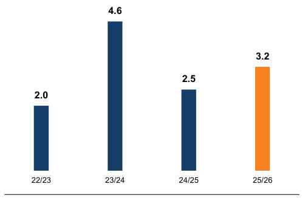 
The equity ratio declined from 23.3% in the previous year to 22.6% in the reporting year and thus remained below the medium-term target of 30.0%.For further information regarding capital risk management, please refer to Note 20 "Additional disclosures on financial instruments"-subsection Capital Risk Management - in the notes to the consolidated financial statements. 
AT&S pursues a balanced structure in terms of maturity. The repayment structure shows E 515.8 million in the financial year 2026/27 due to the repayment of parts of the promissory note loans, bank loans and lease liabilities. AT&S strives to finance capital requirements early and has liquidity reserves of C959.2 million (previous year:( 846.9 million), which consist of financial resources and unused credit facilities. 
## Maturity 
E in millions 
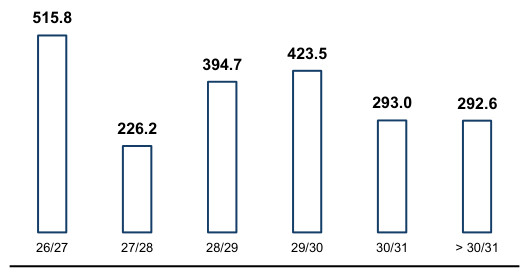 
## Effective interest and currency management 
Minimizing interest rate risk is an important treasury objective, with an adequate ratio of variable to fixed interest rates. 35.7% (previous year: 29.2%) of financing is conducted at, or was swapped to,fixed interest rates and 64.3% (previous year: 70.8%) is based on variable interest rates. 
Strategies for hedging interest rates are regularly evaluated and adapted as necessary. Overall, AT&S is in a position to turn the interest exposure in the desired direction at any time by using appropriate hedging instruments. 
AT&S also intends to invest available liquid funds profitably but risk-sensitively. As at 
Carrying amount of financial liabilities by maturity 

| Ein milions | Mar 31, 2026 | in % | Mar31,2025 | in% |
| --- | --- | --- | --- | --- |
| Remaining maturity | | | | |
| Less than 1 year | 515.8 | 24.0 | 469.9 | 22.5 |
| Between 1 and 5 years | 1,337.4 | 62.4 | 1,280.7 | 61.2 |
| More than 5 years | 292.6 | 13.6 | 340.5 | 16.3 |
| Total financial liabilities | 2,145.8 | 100.0 | 2,091.1 | 100.0 |
 
48

---

<!-- 原文第 49 页 -->

AT&S Annual Report 2025/26 
Group Management Report Advanced Technologies & Solutions 
March 31, 2026,AT&S had financial resources totaling800.3 million (previous year:C 591.0 million). The aim is to achieve the highest possible yields with the liquid funds available in the short term by optimizing the investment period, taking advantage of attractive interest rate levels. 
Early conversion of foreign currencies also serves as a natural currency hedge and a reduction of exposure to foreign currencies. The objective of AT&S is to keep the US dollar net risk position to a minimum. As at March 31, 2026,assets denominated in US dollars amounting to E4,347.6 million were offset by liabilities denominated in US dollars amounting to E4,352.3 million based on the individual unconsolidated Group companies. This resulted in an unconsolidated net liability risk position of 4.7 million. 
In addition to this natural hedging and the abovementioned instruments for interest rate hedging, AT&S occasionally hedges foreign currency transaction risks in the short term (up to one year). 
## Further development of the financing network 
Another treasury objective consists of optimized relationship management with financing partners. For AT&S, this means the selection of banks for cooperation at the national and international level as well as setting up and maintaining communication for both sides. The aim is to create a high level of transparency regarding the opportunities and risks of AT&S in order to strengthen a long-term partnership with the financing institutions which is successful for both sides. The annual and quarterly reports serve as the basis for this. In addition to the development of the financing network, AT&S continuously monitors the money and capital markets regarding possible transactions and transaction partners. This is not limited to debt financing but generally extends to all forms of equity and M&A financing. 
## 2.4.3. Cash flow 
## Earnings situation boosts liquidity 
Cash flow from operating activities before changes in working capital rose by E 199.5 million fromE 142.2 million to341.7 million.AtE 418.0 million, EBITDA was e 187.6 million lower year-on-year (previous year:( 605.7 million),but included the gain on the sale of the plant in Ansan ofE 324.8 milion in the previous year. Cash inflows from the sale of afli ated companies must be reported under cash flow from investing activities, and not in cash flow from operating activities before changes in working capital. Therefore, the contribution to earnings from the sale included in EBITDA was corrected in cash flow from operating activities before changes in working capital and reduced cash flow in the previous year. 
Cash flow statement (short version) 

| Ein millions | 2025/26 | 2024/25 | Change |
| --- | --- | --- | --- |
| Cash flow from operating activities | | | |
| before changes in working capital | 341.7 | 142.2 | >100% |
| Cash flow from operating activities | 413.7 | (74.5) | >100% |
| Cash flow from investing activities | (135.4) | (140.7) | 3.7% |
| Operating free cash flow | 235.5 | (489.3) | >100% |
| Free cash fiow | 278.3 | (215.2) | >100% |
| Cash flow from financing actities | (3.9) | 19.9 | (>100%) |
| Change in cash and cash equivalents | 274.4 | (195.3) | >100% |
| Currency effects on cash and cash equivalents | (21.0) | 3.8 | (>100%) |
| Cash and cash equivalents at the end of the year | 738.5 | 485.1 | 52.2% |
 
49

---

<!-- 原文第 50 页 -->

AT&S Annual Report 2025/26 
Group Management Report Advanced Technologies & Solutions 
Cash inflows from payments received as part of bilateral agreements rose by 27.8 million to 49.1 million (previous year:(21.3 million). 
Interest payments declined by C21.8 million to E66.3 milion (previous year:( 88.1 million). Income taxes paid also decreased byE 54.4 milion to C10.5 milion (previous year:( 64.9 million). 
Interest received fell by 1.5 million to E 25.4 million (previous year:( 26.9 million). 
Cash flow from operating activities amounts to C413.7 milion (previous year:(-74.5 million).In addition to the positive deviation in cash flow from operating activities before changes in working capital, working capital also improved significantly after a negative effect in the previous year. Cash flow from operating activities decreased by E 88.0 million due to an increase in inventories (previous year: increase bye 13.5 million),but improved byE 87.7 million due to a reduction in trade receivables, other receivables and contract receivables (previous year: increase by C-204.7 million).This is mainly due to higher factoring volume. In addition,the positive change in trade payables and other liabilties improved cash flow by C76.6 million (previous year: cash flow decreasing effect of 30.6 million). 
In cash flow from investing activities capital expenditures for property, plant and equipment, and intangible assets ofE -179.4 million were significantly lower than in the previous year (C-416.1 million). Capital expenditures were significantly lower in Hinterberg and Kulim.While capital expenditures for property, plant and equipment thus decreased by C236.6 milion in the financial year 2025/26, inflows from the sale of property, plant and equipment of E1.2 million changed by 3.2 milion compared to the previous year (previous year:( 1.3 million). 
In addition, proceeds from the sale of affiliated companies less acquired cash and cash equivalents of C 353.4 million were recorded due to the sale of the plant in Ansan in the previous year. In the financial year 2025/26, there were no proceeds from the sale of affliated companies. 
Capital expenditure for financial assets ofE -45.0 million led to a reduction in cash flow (previous year: (-125.1 million). 
Overall, cash outflows in cash flow from investing activities at C-135.4 million were only5.3 million lower than in the previous year (-140.7 milion) taking into account lower capital expenditures for property, plant and equipment and the proceeds from the sale of the plant in Ansan received in the previous year. 
Free cash flow from operating activities, i.e., cash flow from operating activities less net investments in property, plant and equipment and intangible assets, amounted to 235.5 million in the financial year 2025/26(previous year:(-489.3 million). 
Free cash flow, i.e, cash flow from operating activities less cash flow from investing activities, amounted to 278.3 million (previous year:-215.2 million). 
Cash flow from financing activities of E-3.9 million was E23.8 milion lower than in the previous year (C19.9 million). As in the previous year, there were no repayments of hybrid capital in the financial year 2025/26. 
Cash inflows were related to borrowings of C436.2 milion (previous year:(413.0 milion)and investment grants of E6.8 million (previous year: (7.6 million). Cash outlows resulted from the repayment of financial liabilities of C -429.4 million (previous year:C-383.1 million), and the hybrid coupon payment ofE -17.5 million (previous year:C-17.5 million. There was no dividend payment in the financial year 2025/26(previous year:( 0.0 million). 
Cash and cash equivalents increased from C485.1 million to 738.5 million. In addition, AT&S has current financial assets of 61.8 million (previous year: C 105.9 million) at its disposal. 
50

---

<!-- 原文第 51 页 -->

AT&S Annual Report 2025/26 
Group Management Report Advanced Technologies & Solutions 
Overall, AT&S thus has cash and current financial assets totaling 800.3 million (previous year: ( 591.0 million).Combined with unused credit lines of173.6 milion (previous year:(256.3 million), these significant resources serve to obtain financing for potential investments as well as for short-term repayments of financial liabilities. 
## 2.4.4.Performance indicators 
## Indicators: ROCE and Vitality Index 
In addition to revenue and EBITDA, AT&S uses the ROCE and Vitality Index for strategic corporate management. These indicators reflect the operating performance vis-a-vis investors and customers. 
AT&S uses the return on capital employed (ROCE) to measure its operating performance from the point of view of investors, using the ratio of the result adjusted for finance costs - net to average capital employed. This ratio serves to derive the extent to which AT&S fulfils its investors' interest requirements.Average capital costs are derived from the minimum return investors expect for providing equity or borrowings. The weighted average cost of capital (WACC) for the printed circuit board industry is around 10.1%.With ROCE amounting to 3.0%,AT&S fell significantly short of this level during the reporting period. 
ROCE in% 
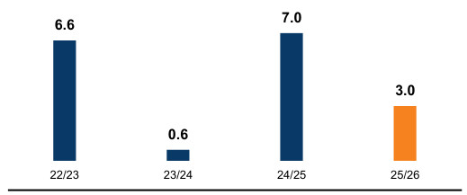 
Net operating profit after tax (NOPAT) declined from C173.2 million in the previous year to C74.4 million primariy due to the sale of the plant in Ansan, which was included in this figure in the previous year. 
The average capital employed rose by E6.3 million despite lower average net debt as a result of higher 
Return on capital employed (ROCE) 

| E in millions | 2025/26 | 2024/25 | Change |
| --- | --- | --- | --- |
| Operating result (EBIT) | 65.6 | 277.4 | (76.3%) |
| Income taxes | 8.7 | (104.2) | >100% |
| Operating result after tax (NOPAT) | 74.4 | 173.2 | (57.0%) |
| Equity -average | 1,063.1 | 1,020.8 | 4.1% |
| Net debt- average | 1,411.8 | 1.447.2 | (2.4%) |
| Capital employed-average | 2,474.9 | 2,468.0 | 0.3% |
| ROCE | 3.0% | 7.0% | |
 
## Vitality Index 

| Ein millions | 2025/26 | 2024/25 | Change |
| --- | --- | --- | --- |
| Main revenue | 1,790.8 | 1,589.6 | 12.7% |
| Main revenue generated by innovative products | 690.1 | 409.6 | 68.5% |
| Vitality Index | 38.5% | 25.8% | |
 
51

---

<!-- 原文第 52 页 -->

AT&S Annual Report 2025/26 
Group Management Report Advanced Technologies & Solutions 
average equity. Both the increase in capital employed and the decline in NOPAT led to a decrease in ROCE from 7.0% in the previous year to 3.0% in the financial year 2025/26. 
The second performance indicator, the Vitality Index, shows the ability to implement innovations on time and in response to the market. AT&S measures this ability using the Vitality Index, which expresses the revenue share of products that feature new and innovative technologies and have been launched in the market in the last three years. In the financial year 2025/26, the Vitality Index is 38.5% compared with 25.8% in the previous year.AT&S strives for a medium-term average Vitality Index of at least 20%. This target was significantly exceeded in the financial year 2025/26. 
## 2.5. Significant events after the reporting period 
With regard to significant events after the reporting date, please refer to the explanations in the notes to the consolidated financial statements, Note 27"Significant events after the reporting date.' 
52

---

<!-- 原文第 53 页 -->

AT&S Annual Report 2025/26 
Group Management Report Advanced Technologies & Solutions 
## 3. Other Statutory Information 
## 3.1. Plants and branch offices 
The AT&S Group currently operates five production plants, which specialize in different technologies. 
Leoben and Fehring The Austrian plants primarily supply the European market.In Europe,special applications and customer proximity are particularly important. Based on production and technological diversity, flexibility in manufacturing, and the broad customer spectrum, the plant in Leoben continues to pursue the path of niche and prototype production it embarked on in recent years. Among other things, production using embedding technology takes place in Leoben. Now the company is investing in a new R&D center for substrate and packaging solutions for the global semiconductor industry at its location in Leoben. As part of the current diversification strategy, new customers were won for the IC substrates business segment. As a result of this development, the R&D center has been expanded to include series production. Series production commenced in the financial year 2025/26.The Fehring plant serves the Electronics Solutions segment, in particular the 3S areas (smart infrastructure, smart mobility, and smart manufacturing). In the calendar year 2026,the plant will continue to expand its expertise in multilayer manufacturing. 
Shanghai The Shanghai plant manufactures HDI (High-Density Interconnection) and mSAP (modified semi-additive process) printed circuit boards, in particular for customers in the areas of 3C (computer, communication and consumer electronics) and 3S (smart infrastructure,smart mobility and smart manufacturing). The plant has established itself as a leading supplier of the latest technology generation and its broad technology spectrum is very well received by customers. 
Chongqing The location in Chongqing currently comprises three operating plants. The plants Chongqing I and Chongqing ll are designed for the production of IC substrates (integrated circuit substrates).High end mSAP printed circuit boards and printed circuit boards for modules are produced for mobile applica tions at the Chongqing ll plant. The production ca pacity for modules was further expanded to serve the growing customer demand in the high-end segment. 
Kulim Construction of the plant for IC substrates, which commenced in October 2021,was completed in 2024.Qualification measures were implemented in the same year, and the first production line was ramped up at the end of the financial year. The expansion of the second plant was paused in 2023due to a decline in the semiconductor market. The building has generally been completed; the completion of the interior and the installation of production machinery will be continued as soon as the semiconductor market recovers in the coming years. 
Nanjangud The site continued to focus on exports and strengthened its position,particularly in the automotive market. The qualification for HDI products continued, and the strategy towards higher-quality technologies in the product mix was thus further pursued. 
Hong Kong AT&S Asia Pacific,based in Hong Kong, is the holding company and the headquarters of Group-wide procurement. The proximity to the customers' CEMs and to suppliers is a locational advantage that is highly valued by business partners. 
Sales support companies The sales support companies in America, Germany, Japan, Taiwan, Sweden and South Korea continued to ensure good and close contact with customers in the financial year 2025/26. 
53

---

<!-- 原文第 54 页 -->

AT&S Annual Report 2025/26 
Group Management Report Advanced Technologies & Solutions 
3.2. Shareholder structure and disclosures on capital(disclosures pursuant to $ 243a UGB) 
Capital share structure and disclosure of shareholder rights 
As of the reporting date of March 31, 2026, the Company's ordinary shares amount to 42,735,000and are made up of 38,850,000 no-par value shares with a notional value of E 1.10 per share.The voting right at the Annual General Meeting is exercised according to no-par value shares, with each no-par value share equaling one voting right. All shares are bearer shares. 
Significant direct and indirect shareholdings in the Group parent company AT&S Austria Technologie & Systemtechnik Aktiengesellschaft, which amount to at least 10% at the reporting date, are presented below: see the table below. 
At the reporting date of March 31, 2026,roughly 64.3% of the shares were in free float. With the exception of the shareholdings stated below, no other shareholder held more than 10% of the voting rights in AT&S. No shares with special control rights exist. The exercise of the voting right by employees who hold shares in the Company is not subject to any limitations. 
No special provisions exist on the appointment and dismissal of members of the Management Board and the Supervisory Board. 
The contracts of all Management Board members include a"Change of Control" clause. Such a change of control exists if a shareholder of the Company has obtained control of the Company in accordance with Section 22 of the Austrian Takeover Act (UbG) by holding at least 30% of the voting rights (including the voting rights of third parties attributable to the shareholder pursuant to the Austrian Takeover Act), or the Company has been merged with a non-Group legal entity, unless the value ofthe other legal entity amounts to less than 50% of the value of the Company according to the agreed exchange ratio. In this case, the Management Board member is entitled to resign for good cause and terminate the Management Board contract at the end of each calendar month within a period of six months after the change of control takes legal effect, subject to a notice period of three months ("special termination right"). If the special termination right is exercised or the Management Board contract is terminated by mutual agreement within six months of the change of control,the Management Board member is entitled to the payment of their remuneration entitlements for the remaining term of their contract. This is, however, for a maximum of two annual gross salaries. Other remuneration components shall not be included in the calculation of the amount of the severance payment and shall be excluded from it. 
Therefore, the Management Board was authorized by the 30th Ordinary General Meeting on July 4, 2024, to increase the Company's share capital, subject to the approval of the Supervisory Board, by up to 21,367,500 by way of issuing up to 19,425,000new, no-par value bearer shares, for contributions in cash or in kind, in one or several tranches, also by way of indirect subscription rights, after having been taken over by one or more credit institutions in accordance 
Significant direct and indirect shareholdings 

| Shares/in % | Shares | % capital | % voting rights |
| --- | --- | --- | --- |
| Dorlinger-Privatstfung! | | | |
| Vienna,Austria | 7,043,133 | 18.13% | 18.13% |
| Androsch Privatstifung: Vienna, Austria | 6,819,337 | 17.55% | 17.55% |
 
54

---

<!-- 原文第 55 页 -->

AT&S Annual Report 2025/26 
Group Management Report Advanced Technologies & Solutions 
with Section 153 (6) of the Austrian Stock Corporation Act (AktG).The Management Board was authorized to determine,subject to the approval of the Supervisory Board, the detailed terms and conditions of issue (in particular the issue amount,subject of the contribution in kind, the content of the share rights, the exclusion of subscription rights, etc.) (Authorized Capital 2024). The statutory subscription right of the shareholders to the new shares issued from the Authorized Capital 2024 shall be excluded (direct exclusion of the statutory subscription right) if and to the extent that this authorization is utilized by issuing shares against cash payments in a total amount of up to 10% of the share capital in the context of the placement of new shares of the Company to (i) exclude from the shareholders' subscription right fractional amounts which may arise in the case of an unfavorable exchange ratio and/or (i) to satisfy over-allotment options (greenshoe options) granted to the issuing banks. Further, the Management Board was authorized to fully or partially exclude the statutory subscription right with the consent of the Supervisory Board.The Supervisory Board was authorized to adopt amendments to the Articles of Association resulting from the issuance of shares out of authorized capital. 
Furthermore, the Management Board was authorized at the 30th Ordinary General Meeting on July 4, 2024, to issue, subject to the approval of the Supervisory Board, one or several convertible bearer bonds at a total amountof up to400,000,000until July 3, 2029,and to grant to bearers of convertible bonds conversion rights and/or subscription rights for up to 19,425,000 new no-par value bearer shares in the Company in accordance with the convertible bond terms and conditions to be defined by the Management Board. The convertible bonds can be issued against cash contributions and also against contributions in kind. In this regard, the Management Board was also authorized to fully or partially exclude shareholders' subscription rights, to the extent that the authorization to exclude subscription rights only applies to convertible bonds that grant the right to "convert and/or subscribe to shares in the Company of, in to tal, no more than 10%, of the Company's share capital at the time the authorization is granted. In this context, the Company's share capital was conditionally increased by up to E 21,367,500 by way of issuance of up to 19,425,000 new no-par value bearer shares in accordance with Section 159 (2) No.1 of the Austrian Stock Corporation carried out if the bearers of convertible bonds issued based on the authorization resolution passed at the Annual General Meeting on July 4, 2024,claim the right to conversion and/or subscription granted to them with regard to the Company's shares. The Management Board was also authorized to determine, subject to approval of the Supervisory Board, the further details of carrying out the conditional capital increase (particularly the issue amount and the content of the share rights). The Supervisory Board was authorized to adopt amendments to the Articles of Association resulting from the issuance of shares from the conditional capital.The same applies in case the authorization to issue convertible bonds is not exercised or the conditional capital is not used. 
With regard to the approved capital and the conditional capital, the following definition of the amount in accordance with the resolutions passed at the 30th Ordinary General Meeting on July 4, 2024, is to be observed: the sum of (i) the number of shares currently issued or potentially to be issued from conditional capital in accordance with the convertible bond conditions and (i) the number of shares issued from approved capital shall not exceed the total amount of 19,425,000 (limitation of authorized amount). 
The Annual General Meeting also resolved to amend the Articles of Association in S4 (Share capital) to reflect these changes. 
## Treasury shares 
At the 31sOrdinary General Meeting of July 3, 2025, the Management Board was again authorized to purchase, within a period of 30 months from the adoption of the resolution, treasury shares to an extent of up to 10% of the nominal share capital for a minimum consideration per share being at the most 30% lower 
55

---

<!-- 原文第 56 页 -->

AT&S Annual Report 2025/26 
Group Management Report Advanced Technologies & Solutions 
than the average, unweighted stock exchange closing price over the preceding ten trading days and a maximum consideration per share at the most 30% higher than the average,unweighted stock exchange closing price over the ten preceding trading days; such purchases may take place via the stock exchange, by means of a public ffering or any other legally permitted way, and for any legally permitted purpose.The authorization also includes the purchase of shares by subsidiaries of the Company (Section 66 of the Austrian Stock Corporation Act). 
The Management Board was also authorized to withdraw shares after repurchase, as well as treasury shares already held by the Company, without further resolution by the Annual General Meeting. The Supervisory Board was authorized to adopt amendments to the Articles of Association arising from the withdrawal of shares. 
## Other disclosures 
There are no off-balance sheet transactions between AT&S and its subsidiaries. 
AT&S has neither granted any loans nor assumed any liabilities in favor of board members. 
For further information, please refer to the notes to the consolidated financial statements, Note 22"Share capital" as well as Note 15"Financial liabilities". 
The Company's Corporate Governance Report pursuant to Section 243b of the Austrian Commercial Code is available at 
https://ats.net/en/company/corporate-governance/. 
56

---

<!-- 原文第 57 页 -->

---

<!-- 原文第 58 页 -->

Group Management Report Advanced Technologies & Solutions 
AT&S Annual Report 2025/26 
## 4. Consolidated Sustainability Statement Highlights of the Financial Year 2025/26 
 
 
## 80.2% 100% 
Long-term goal "Share of renewable energy"achieved 
of key suppliers have signed the AT8S Supplier Code of Conduct 
 
 
 
Winner 
LCA Tool 
Achieved CDP Scores in 2025: 
of the "ESG Transparency Award 2025" 
successfully verified according to ISO 14067 
Change Water 
Climate 
A 
B 
B 
Supplier Engagement Assessment 
A 
in the subcategories "Business Strategy", "Environmental Policies" and "Governance in the subcategory 
A- 
"Water Accounting" 
58

---

<!-- 原文第 59 页 -->

AT&S Annual Report 2025/26 
Group Management Report Advanced Technologies & Solutions 
61 ESRS 2-General Disclosures
61 1.Basis for preparation 61 BP-1-General basis for preparation of sustainability 61 BP-2- Disclosures in relation to specific circumstances statements
622.Governance
62GOV-1- The role of the administrative, management
64 and supervisory bodies GOV-2- Information provided to and sustainability
matters addressed by the undertaking's administrative.
65 management and supervisory bodies GOV-3- Integration of sustainability-related perfor-
66 GOV-4 - Statement on due diligence mance in incentive schemes
66 GOV-5 - Risk management and internal controls over
sustainability reporting
67 67 3. Strategy 70 SBM-1- Strategy,business model and alue chain SBM-2- Interests and views of stakeholders
72 SBM-3 - Material impacts, risks and opportunities and
their interaction with strategy and business model
734. Impact, risk and opportunity management
73 IRO-1-Description of the process to identify and
assess material impacts, risks and opportunities
76IRO-2-Disclosure requirements in ESRS covered by the undertaking's sustainability statement
83 Information pursuant to Article 8 of Regulation
(EU)2020/852(Taxonomy Regulation)
83 Taxonomy-eligible and taxonomy-aligned revenu
84 Capital and operating expenditures (CapEx and OpEx) 84Categorization and allocated economic actitie
84 Taxonomy eligibility and alignment
87 KPI Reporting Templates 
89 ESRS E1 - Climate Change
89 SBM-3- Material impacts, ris and opportunities and
91E1-1-Transition plan for climate change mitigation their interaction with strategy and business model
92E1-2-Policies related to climate change mitigation and
93 adaptation E1-3-Actions and resources in relation to climate
change policies
95 E1-4- Targets related to climate change mitigation and
adaptation
98 99E1-6-Gross Scopes 1, 2,3 and Total GHG emissions E1-5-Energy consumption and mix
103 ESRS E2-Pollution
103 SBM-3 - Material impacts, risks and opportunities and
their interaction with strategy and business model
103Pollution in the value chain
103E2-1- Policies related to pollution
104E2-2- Actions and resources related to pollution 104E2-3-Targets related to pollution
105 Pollution of water in own operations 105E2-1- Policies related to pollution of water
105E2-2-Actions and resources related to pollution of
105E2-3- Targets related to pollution of water water
106E2-4- Metrics related to pollution of water
106 Substances of concern and substances of very
high concern
106E2-1-Policies related to substances of (very
107E2-2- Actions and resources related to substances of high) concern
108E2-3- Targets related to substances of (very high) (very high) concern
109E2-5- Substances of concern and substances of very high concern concern
112ESRS E3 - Water and Marine Resources
112 SBM-3 - Material impacts, risks and opportunities and their interaction with strategy and business model
112E3-1- Policies related to water and marine resources
114E3-2- Actions and resources related to water and
marine resources
114E3-3- Targets related to water and marine resources 115E3-4- Water consumption 
59

---

<!-- 原文第 60 页 -->

AT&S Annual Report 2025/26 
Group Management Report Advanced Technologies & Solutions 
116ESRS E4- Biodiversity and Ecosystems 
116 SBM-3- Materia impct, iks and opportnties and their interaction with strategy and business model 
116E4-1-Transition plan and consideration of biodiversity and ecosystems in strategy and business model 
118E4-2-Policies related to biodiversity and ecosystems 
118E4-3-Actions and resources related to biodiversity and ecosystems 
118 E4-4- Targets related to biodiversity and ecosystems 
118E4-5 - Impact metrics related to biodiversity and ecosystems 
120ESRS E5 - Resource Use and Circular Economy 
120 SBM-3 - Material impacts, ris and opportunities and their interaction with strategy and business model 
120E5-1-Policies related to resource use and circular economy 
121E5-2-Actions and resources related to resource use and circular economy 
124 E5-3- Targets related to resource use and circular economy 
124E5-4 - Resource inflows 
126E5-5 - Resource outflows 
129ESRS S1 - Own Workforce 
## 129General 
129 SBM-3 - Material impacts, risks and opportunities and their interaction with strategy and business model 
132S1-1-Policies related to own workforce 
134 S1-2-Processes for engaging with own workforce and workers' representatives about impacts 
135S1-3-Processes to remediate negative impacts and channels for own workforce to raise concerns 
136S1-4-Taking action on material impacts on own workforce, and approaches to managing material risks and pursuing material opportunities related to own workforce, and effectiveness of those actions 
139 S1-5- Targets related to managing material negative impacts, advancing positive impacts, and managing material risks and opportunities 
140 S1-6- Characteristics of the undertaking's employees 
140 S1-7 -Characteristics of non-employees in the undertaking's own workforce 
142S1-9- Diversity metrics 
142S1-10- Adequate wages 
142S1-12- Persons with disabilities 
143S1-13-Training and skills development metrics 
143 S1-16- Remuneration metris(pay gap and tota remuneration) 
144 S1-17- Incidents, complaints and severe human rights impacts 
146 Health and safety 
146 SBM-3- Material impacts, risks and opportunities and their interaction with strategy and business model 
146 S1-1- Policies related to health and sa-fety of own workforce 
147 S1-4- Taking action on material impacts on own workforce, and approaches to managing material risk and pursuing material opportunities related to health and safety, and effectiveness of those actions 
147S1-14-Health and safety metrics 
149ESRS S2-Workers in the value chain 
149 SBM-3 - Material impacts, risks and opportunities and their interaction with strategy and business model 
151S2-1-Policies related to value chain workers 
152S2-2-Processes for engaging with value chain workers about impacts 
152 S2-3-Processes to remediate negative impacts and channels for value chain workers to raise concerns 
153S2-4-Taking action on material impacts on value chain workers,and approaches to managing material risks and pursuing material opportunities related to value chain workers, and effectiveness of those action 
155S2-5- Targets related to managing material negative impacts, advancing positive impacts, and managing material risks and opportunities 
157ESRS G1- Business Conduct 
157 SBM-3 - Material impacts, ris and opportunities and their interaction with strategy and business model 
158G1-1-Business conduct policies and corporate culture 
160 G1-2-Management of relationships with suppliers 
161 G1-3-Prevention and detection of corruption and bribery 
161 G1-4-Incidents of corruption or bribery 
161G1-5-Political influene and lobbying activities 
162G1-6-Payment practices 
60

---

<!-- 原文第 61 页 -->

AT&S Annual Report 2025/26 
Group Management Report Advanced Technologies & Solutions 
## ESRS 2- General Disclosures 
## 1. Basis for preparation BP-1-General basis for preparation of sustainability statements 
AT&S has prepared the consolidated non-financial statement in accordance with the requirements of Section 267a of the Austrian Commercial Code (Unternehmensgesetzbuch-UGB) as specified in the Austrian Sustainabilty and Diversity Improvement Act(NaDiVeG),including 
compliance with the voluntary European Sustainability Reporting Standards (hereinafter ESRS), 
· implementation of the process for identiying information to be reported under the ESRS (hereinafter referred to as the "materiality analysis process") and its presentation in the disclosure "Management of impacts, risks and opportunities", and 
compliance with the reporting requirements pursu ant to Article 8 of the Taxonomy Regulation (EU) 2020/852(hereinafter referred to as the EU Taxonomy Regulation), 
and taking into account the company-specific requirements and extended obligations introduced by NaBeG. 
The reporting period of the consolidated sustainability statement is the same as that of the financial statement of the reporting company, namely from April 2025to March 2026. 
Data consolidation follows the principles of the parent company's financial report and is performed for the entire AT&S Group. The scope of consolidation is the same as in the consolidated financial statement. 
AT&S has not made use of the option to omit specific information relating to intellectual property,expertise or the results of innovation. Furthermore,no exception was made with regard to the indication of upcom ing developments or matters under negotiation. 
The report covers the entire value chain with regard to material impacts, risks and opportunities (IROs) and takes into account both upstream and downstream actors. The central actors are shown in the corresponding graphic on the value chain, while the IROs are explained in section "SBM-3- Material impacts, risks and opportunities and their interaction with strategy and business model". For policies, actions and targets, the focus is primarily on the company's own business activities; exceptions, for example the AT&S Supplier Code of Conduct, are explicitly described. Metrics refer primarily to own locations, but in some cases also include parts of the value chain, for example Scope 3 emissions or specific supplier requirements. 
## BP-2- Disclosures in relation to specific circumstances 
The following quantitative key figures are subject to a high degree of uncertainty: Scope 3 emissions, the quantities of substances of very high concern (SVHC) and substances of concern (SoC), and the recycling rate of our products. 
AT&S uses company-specific time horizons for the climate-related risk analysis -2030 (short-term), 2040(medium-term) and 2050(long-term)- which are based on the service life of the plants and the expected manifestation of climate-related risks and thus deviate from ESRS 1 Section 6.4.These definitions ensure a realistic assessment of physical and transition risks and support long-term strategic planning. In contrast, operational periods are applied for the materiality analysis: short-term<1 year, medium-term 1-5 years and long-term>5 years. 
Scope 3 emissions are based on value chain estimates. Regarding the basis for the calculation,please refer to chapter E1"Climate change". The level of accuracy is highest for Scope 3 categories 3, 5-7 and 9, while spend-based emission factors are also used in the other categories, which show a low level of accuracy. In addition, only an approximate calculation is possible for the quantities of SVHC/SoC contained 
61

---

<!-- 原文第 62 页 -->

AT&S Annual Report 2025/26 
Group Management Report Advanced Technologies & Solutions 
in the products we sell. Only a small number of reference products can be used to calculate the recycling rate of our products. 
Further information and assumptions regarding the key figures are described in the respective topic-specific chapters. 
The following information is listed here by reference to other parts of the Annual Report: 
·ESRS 2GOV-5 ·ESRS 2 SBM-1 AR14 ·ESRS2SBM-1 Section 40a ·ESRS 2SBM-3 
## 2. Governance 
## GOV-1- The role of the administrative, management and supervisory bodies 
At the end of the financial year 2025/26, the Supervisory Board of AT&S AG consisted of five non-executive members and three employee representatives delegated by the Works Council. With the new appointments to the corporate bodies in 2025/26,Andy Mattes became the new Chairman of the Supervisory Board and thus succeeded the interim Chairman, Georg Riedl. 
At the Management Board level, a structural reorganization took place: Since May 1, 2025, Michael Mertin has been Chief Executive Officer (CEO) of AT&S AG; Gerrit Steen joined the Management Board as the new Chief Financial Officer (CFO) as of February 1, 2026.The Management Board thus consists of three executive members: CEO Michael Mertin, CFO Gerrit Steen and CTO Peter Griehsnig. 
When filling new Supervisory Board positions, AT&S continues to pursue to goal of a balanced gender distribution in accordance with Section 86 (7) of the 
Austrian Stock Corporation Act (AktG), based on which at least 30% of its members are women and 30% are men.The age range of the Supervisory Board members was 27 years at the end of the financial year. Overall, the share of women on the Supervisory Board amounted to 38%, that of shareholder representatives was 40%.As a result of the new appointments to the Management Board and the reduction in the number of board members,the proportion of women declined to 0%. 
The areas of expertise of the members of the Supervisory Board cover central areas such as technology and research, the electronics and semiconductor industry,law, corporate management, human resources as well as sustainable business management. Andy Mattes, Chairman of the Supervisory Board, has extensive international experience in the global high-tech industry (among other things, CEO roles in Silicon Valley). The Management Board as a whole has industry-relevant ESG (Environmental,Social, Governance) experience. In particular,CTO Peter Griehsnig possesses long-standing ESG expertise,especially in decarbonization,resource effciency and occupational safety, which is based on his previous COo function at the Chinese production sites of AT&S, among other things. 
At the end of the financial year 2025/26,the proportion of independent Supervisory Board members (shareholder representatives) according to C-Rule 53 of the Austrian Code of Corporate Governance (Osterreichischer Corporate Governance KodexOCGK) was 100% and the proportion of independent Supervisory Board members (shareholder representatives) according to C-Rule 54 of the OCGK was 60%. In addition to the five shareholder representatives. there are three employee representatives who are not independent within the sense of the ESRS. This means that 62.5% of the Supervisory Board members (shareholder representatives and employee representatives) are independent. 
62

---

<!-- 原文第 63 页 -->

AT&S Annual Report 2025/26 
Group Management Report Advanced Technologies & Solutions 
## Standards and certificates 

| Certification | Description | Leoben | Fehring | Nanjan- gud | Shanghai | Chong- qing | Kulim |
| --- | --- | --- | --- | --- | --- | --- | --- |
| ISO 14001:2015 | Global standard for environmental management systems to optimise processes,reduce costs and minimise risks | | | | | | |
| ISO 45001:2018 | Standard for the management of occupational health and safety to minimise risks and increase produc- tivity | | | | | | |
| ISO 9001:2015 | Certifcation of quality management systems to prove high quality standards of products | | | | | | |
| IATF 16949:2016 | Globally recognised standard in automotive industry | | | | | | |
| ISO/IEC 27001:2022 | International standard for information security | | | | | | |
| DIN EN ISO 50001:2018 | International standard for energy management to increase energy efficiency | | | | | | |
| DS/EN ISO 13485:2016 | International quality standard for the design and production of medical devices | | | | | | |
| EN 9100:2018 | European qualit standard for the aerospace industry | | | | | | |
| UL Listing | Standard to ensure electrical and mechanical safety of electronic components | | | | | | |
| Sony Green Partner Certificate | "Green Partner Environmental Quality Approval System for cross-company cooperation for the manufacturing of sustainable products | | | | | | |
| AEO Certificate | Authorised Economic Operator of the European Union | | | | | | |
| IECQQC080000:2017 | International Technical Specification for Process Management of Hazardous Substances | | | | | | |
| NADCA Accreditation | Accreditation for a uniform quality standard in the aerospace industry to harmonise production and audit processes of aircraft components | | | | | | |
| ANSI/ESD S20.20-2014 | Electrostatic discharge standard | | | | | | |
| IPC-QL-653 Standard | Certification of Facilities that Inspect/ Test Printed Boards, Components and Materials | | | | | | |
 
63

---

<!-- 原文第 64 页 -->

AT&S Annual Report 2025/26 
Group Management Report Advanced Technologies & Solutions 
In the past financial year 2025/26,a selection of ESG topics such as the planned reporting under the EU Taxonomy Regulation and the current landscape of ESG regulations, including the Corporate Sustainability Reporting Directive (CSRD) was presented and discussed in the Audit Committe of the Supervisory Board. At one of the meetings of the previous year, the Audit Committee also discussed the updated risk management report,which includes the consideration of ESG risks. On behalf of the entire Management Board, the Senior Director Corporate Risk and Continuity Management reports on impacts, risks and opportunities to the Audit Committee, which is chaired by Gertrude Tumpel-Gugerell, twice a year. 
The objectives described in the topic-specific chapters are decided and monitored by the ESG Steering Committee and the Management Board.The ESG Steering Committee also includes members of the Management Board; the committee usually convenes four times a year and addresses the most important ESG goals as well as important projects, which are discussed, prioritized and prepared for a resolution and adopted. In addition,the new "ESG Strategy 2030"was presented to the Management Board in the financial year 2025/26 and was adopted by all members. The Management and Supervisory Boards attach great importance to ESG; the two corporate bodies engage in regular exchange and closely coordinate the company's strategic orientation. 
## GOV-2- Information provided to and sustainability matters addressed by the undertaking's administrative, management and supervisory bodies 
As in the past, sustainabilit management is assigned to the CTO function; operational responsibility lies with the Corporate ESG & Quality team. This team is responsible for the continued development of the AT&S Sustainability Strategy 2025,the coordination of all ESG agendas in the Group, as well as internal and external communication of sustainability topics. 
The content is coordinated by the ESG Steering Committee,which meets four times a year and in which members of the Management Board participate. At these quarterly meetings, central ESG goals and priority projects are discussed, evaluated and presented to the full Management Board for further assessment and decision-making. 
ESG topics are implemented in close cooperation with the relevant specialist departments and ESG networks - including the environmental network,the health and safety network and the product stewardship network. In this way, internal stakeholders are connected across the Group, and the expertise of all global locations is considered. The ESG networks ensure that all those involved are informed about current developments. At the same time, they promote an exchange across locations, best practice sharing and a dialogue regarding new regulations, compliance requirements and ongoing projects in the re spective topic areas 
The topics focused on in the financial year 2025/26 included, among others, energy efficiency and decarbonization, water management, waste reduction and circular economy, supply chain management including the handling of conflict minerals, health and safety, product stewardship and the progressing digitalization and automation of ESG data processing. 
Material impacts,risks and opportunities are regularly presented to the administrative, management and supervisory bodies in the ESG Steering Committee and the Audit Committee and form a central basis for strategic decisions. They are incorporated in both the further development of the sustainability strategy and in material investment and transformation decisions by systematically taking into account ESG risks in the company-wide risk management and aligning priority projects accordingly. 
64

---

<!-- 原文第 65 页 -->

AT&S Annual Report 2025/26 
Group Management Report Advanced Technologies & Solutions 
## Management structure 
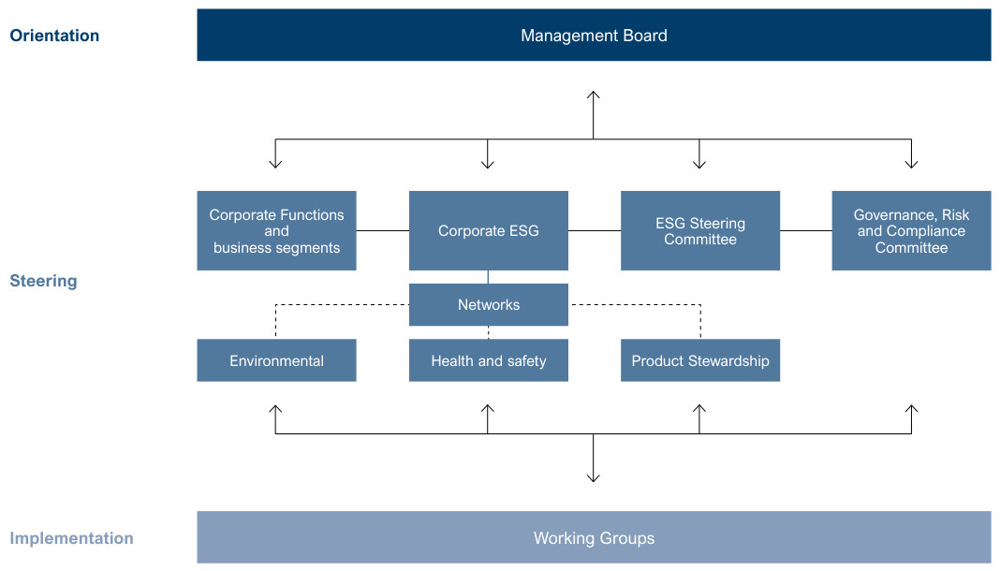 
In the course of the financial year 2025/26,the Management Board dealt intensively with current and foreseeable regulatory developments in the area of ESG and with the issue of PFAS (per-and polyfluoroalkyl substances).Moreover,the new "ESG Strategy 2030" was finalized, presented to the Management Board and adopted by all members of the Management Board.The regular quarterly meetings of the ESG Steering Committee support this strategic work by systematically documenting operating progress, decision points and challenges and preparing them for the management. 
GOV-3 - Integration of sustainability-related performance in incentive schemes AT&S integrates climate-related considerations into the remuneration of its administrative, management and supervisory bodies. 
The short-term variable remuneration (Short-Term Incentive, STI) of AT&S is based on five performance-based economic and sustainabilty performance indicators in the financial year 2025/26,which are composed as follows according to the current regulation: 
The relevant KPls are the EBIT margin (40%),revenue (20%), free operating cash flow (20%),the Vitality Index(10%) and the renewable energy share (RES) at 10% within the AT&S Group.The RES measures 
65

---

<!-- 原文第 66 页 -->

AT&S Annual Report 2025/26 
Group Management Report Advanced Technologies & Solutions 
the share of renewable energy in the company's total energy consumption and is an indicator of the implementation of the AT&S Energy Strategy 2.0.The Vitality Index reflects the share of sales of new, technologically innovative products over the past three years and supports the focus on sustainable innovations. 
The final amount of variable remuneration results from the level of the target attainment of these KPls by the end of the financial year 2025/26.The company-wide bonus rate derived can range between 0% and 200% of the contractually agreed annual bonus. The payout of variable remuneration therefore depends on the actually achieved overall result of the above-mentioned key performance indicators. 
All rules described above are applicable exclusively in the financial year 2025/26and form the basis for determining the relevant payout after the ordinary general meeting in 2026. 
The Performance Share Plan (PSP) 2025 includes two performance indicators - one of them is an ESGrelevant performance indicator for the first timewhich are additively linked and are relevant for the target achievement of the Performance Share Units (PSU):EBIT is weighted at 75%,while the ESG performance indicator LTIR is weighted at 25%.The target values are based on the average values achieved during the vesting period (April 1,2025-March31, 2028) of the three financial years. The bonus rate can range between 0% and 200%.The amount of the relevant payment will be determined after the annual general meeting 2028. 
## GOV-4 - Statement on due diligence 
The core elements of due diligence and their location in the consolidated sustainability statement are listed in the table "Due diligence". 
## GOV-5 - Risk management and internal controls over sustainability reporting 
The collection, processing and approval of the relevant ESG indicators take place based on clearly defined and structured processes within the internal control system. Potentially incorrect or incomplete reporting of indicators has been identified as a material risk. To mitigate the risk, the entire reporting process is subject to strict internal controls,including standardized plausibility checks and the consistently applied four-eyes principle.These measures ensure correct, reliable and ethical sustainability reporting as well as high data quality. 
Qualitative information that is included in the consolidated sustainabilty statement is additionally reviewed by experts and departmental heads from all relevant departments. Moreover, as part of the reporting process, the feedback of the Management Board is considered prior to publication.In the financial year 2025/26,the relevant contents of the report were presented to internal and external stakeholders for review; their feedback was integrated into the report. 
As many different areas are involved in the prepara tion of the consolidated sustainability statement, central organization and responsibility in the ESG team is crucial to ensure consistent data collection and consolidation of all information. 
Due diligence 

| Core elements of due diligence | Paragraphs in the sustainability statement |
| --- | --- |
| a) Embeding due diligence in governance,strategy and business model | ESRS 2SBM-3,GOV-1,GOV-2 |
| b) Engaging with affected stakeholders in all key steps of the due diligence | ESRS2 SBM-2, IRO-1,GOV-2,E2-1,S1-1,S1- 2, S2-1, S2-2 |
| C ldentifying and assessing adverse impacts | ESRS 2 SBM-3,IRO-1 |
| d) Taking actions to address those adverse impacts | ESRS 2 SBM-3,E1-3,E2-2,E3-2,E5-2,S1-4, S2-4,G1-3 |
| e) Tracking the effectiveness of these efforts and communicating | ESRS 2 GOV-2 |
 
66

---

<!-- 原文第 67 页 -->

AT&S Annual Report 2025/26 
Group Management Report Advanced Technologies & Solutions 
To ensure timely reporting, a project schedule has been created, and responsibilities were assigned. Any changes in the reporting requirements are evaluated early, discussed with external partners if necessary and taken into account accordingly in the project schedule. 
For the upcoming financial year 2026/27,AT&S intends to map the reporting processes in the internal digital process management tool processes in accordance with the updated ESRS requirements and NaBeG. 
## 3. Strategy 
## SBM-1- Strategy, business model and value chain 
## 1. Business model and value chain 
AT&S is a globally leading manufacturer of high-end IC substrates and printed circuit boards (PCBs). The business model is based on technological innovation and the provision of high-end interconnect solutions for global partners in the semiconductor & modules, communication&5G, consumer electronics,medical, industrial, aerospace & aviation,and automotive sectors. 
## Upstream activities in the value chain 
Global Purchasing is centrally organized within the AT&S Group and comprises the procurement and transport of materials used in production and is therefore part of the upstream processes. Global Purchasing comprises high-quality raw materials that meet our quality and sustainability standards, including, for example,gold, copper, laminates and process chemicals as well as other services required for operations. In the financial year 2025/26,the company maintained active business relationships with over 3,100 suppliers, the majority of which are based in Asia. AT&S attaches great importance to long-term partnerships and high quality standards in order to safeguard its competitiveness and innovative strength. 
## Own operations 
At six locations in Europe and Asia and six sales support companies worldwide, AT&S manufactures and sells high-tech solutions for its global partners, in the form of high-quality IC substrates, printed circuit boards and pioneering interconnect technologies. The company invests heavily in research and development and holds almost 1,000 patents. AT&S pursues sustainable concepts within the framework of the circular economy and develops the latest technologies to reduce its ecological footprint, for example through decarbonization of all its production sites, resource efficiency, the use of renewable energy, the recycling of acids, chemicals and minerals such as copper - some of which is resold externally - and the application of modeling in product development. Around 13,000 employees work for AT&S worldwide. 
The table "'Employees by geographical areas" shows the figures as of March 31 of the respective financial year. An additional breakdown of employees by country can be found in section S1-6. 
## Downstream activities in the value chain 
The products and solutions that AT&S offers its customers are designed for a long service life, which is why the focus is on high quality and reliability of PCBs and IC substrates. The high-quality products and interconnect solutions are installed and integrated into customers' products and are used in the areas of communications, computer electronics,entertainment electronics, mobility, industry and medical technology and, increasingly, in data management and Al 
Employees by geographical areas 

| in heads | 2025/26 | 2024/25 | Change |
| --- | --- | --- | --- |
| Europe&USA | 2.003 | 1,939 | 3.3% |
| Asia | 10.941 | 10,585 | 3.4% |
| Total Employees | 12,944 | 12,524 | 3.4% |
 
67

---

<!-- 原文第 68 页 -->

AT&S Annual Report 2025/26 
Group Management Report Advanced Technologies & Solutions 
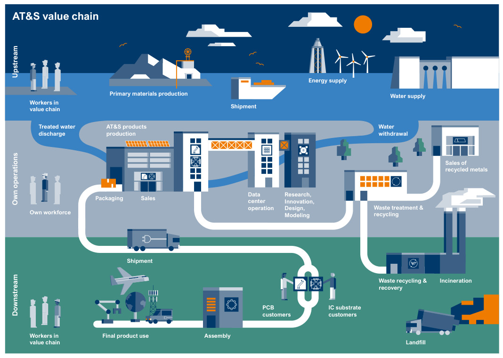 
applications. In the financial year 2025/26,a focus was also placed on the defense & space sector. 
## 2. Relationship between business model. strategy and material IROs 
The material impacts, risks and opportunities (IROs) of AT&S result directly from the capital- and resource-intensive nature of its business model and its global presence in dynamic technology markets. Material IROs occur at the interfaces of the value chain. for example due to high energy intensity in production (risk: $CO_{2}$ pricing: opportunity: energy efficiency) or dependence on critical raw materials (risk: human rights violations; opportunity: circularity). 
The Sustainability Strategy 2025 was closely linked to the business strategy of AT&S and therefore also with the vision "First Choice for Advanced Solutions" and the mission statements "We reduce our ecological footprint" and "We care about people". The company's strategic orientation is shaped by the double materiality assessment and climate risk assessments pursuant to ESRS, the ESG risk and opportunity management, relevant regulations (including REACH and RoHS), the expectations of relevant stakeholders as well as global trends such as circular economy, zero waste, green technologies, innovation,new working cultures, occupational safety, diversity and artificial intelligence.In addition, the UN Sustainable Development Goals provide a central guidance framework. 
68

---

<!-- 原文第 69 页 -->

AT&S Annual Report 2025/26 
Group Management Report Advanced Technologies& Solutions 
In the financial year 2025/26, the development of a new strategy was advanced. To this end, targets, KPls and measures were defined which are scheduled to be published in the financial year 2026/27. 
While the previous Sustainabilit Strategy 2025focused on four fields of action ("Decarbonization,Energy Security and Efficiency","Circular Economy", "Decent Work" and "Sustainable Value Chain & Business Ethicst"),the ESG Strategy 2030 will extend this framework to eight fields of action to increase the business model's resilience.The ESG Strategy 2030 comprises eight fields of action, which reflect the interaction of the corporate strategy and value chain. They are structured in four core and four supplementary areas. Climate Change, Responsible Sourcing, Water Stewardship, Less Waste; and Health and Safety, Digitalization, Social Sustainability, Product Stewardship. 
With its new five-year sustainability strategy, the ESG Strategy 2030 "Accelerating Circularity",AT&S consistently aligns its sustainability ambitions with circular, resilient and future-oriented value creation.The strategy is closely integrated with the business model and is based on the results of the double materiality analysis as well as material influences such as global megatrends, increasing regulatory requirements (CSRD/ESRS,EU Taxonomy, CSDDD - Corporate Sustainability Due Diligence Directive) and the growing importance of responsible supply chains. 
In addition to the Governance Policy, which is also part of the ESG Policies, five sustainability-specific policies are applicable at AT&S: the Environmental Policy, the Product Stewardship Policy, the Occupational Health & Safety Policy, the Supply Chain Policy, and the People & Human Rights Policy. The ESG Policies were first adopted in the financial year 2023/24 and have since been updated annually, reaffirming commitment to due diligence and continuous improvement. The binding policies set out by senior management are communicated to all employees and are publicly accessible. 
 
AT&S regularly evaluates all 17 SDGs (Sustainable Development Goals) and 169 sub-goals. In the financial year 2025/26,the annual assessment of the impact on all 17 SDGs was carried out to ensure that business practices are in accordance with the global sustainability priorities. Based on this analysis, eight SDGs have been classified as relevant for AT&S, as they are significantly influenced by the strategic orientation of the company. 
## 3. Alignment of products, markets and customers 
The sustainability targets we set apply equally to all products, customers and geographical areas. Likewise, all products, services, markets and customer groups are evaluated with regard to our sustainability targets. 
Information on the business model, markets and applications can be found in subchapter "A.General" in 
69

---

<!-- 原文第 70 页 -->

AT&S Annual Report 2025/26 
Group Management Report Advanced Technologies & Solutions 
chapter "1. General explanations" in the notes to the consolidated sustainability statement. 
Information on the economic environment and industry environment (semiconductors) can be found in subchapters "1.1 Economic environment"and"1.2 Industry environment" in the chapter"Market and industry environment"in the Group Management Report. 
AT&S aims to replace all fossi fuels rom its own production sites worldwide (Scope 1 emissions from fossil fuels) by 2030.AT&S supports the goal of the Paris Climate Agreement and defined its emission targets together with the Science Based Targets initiative (SBTi). The complete substitution of fossil fuels by 2030(Scope 1 emissions from fossil fuels) and ensuring due diligence in a complex, Asian-influenced supply chain pose significant challenges. In particular, the growing regulatory requirements (REACH/RoHS) and expectations regarding supply chain transparency require continuous adjustments to the governance structures. 
## SBM-2 - Interests and views of stakeholders 
The interests and expectations of stakeholders are central to the AT&S business model and are taken into account through comprehensive stakeholder analyses and regular discussions. Customer expectations are incorporated into the corporate strategy both indirectly through regular customer satisfaction surveys and directly through the comparison of technology roadmaps and business forecasts. The expectations of shareholders and investors are also taken into account when defining strategic goals and ambitions. The integration of interests of the own workforce and of suppliers is described in detail below, as these are the two most important stakeholder groups. 
As part of the AT&S Sustainability Strategy 2025,the interests of all relevant stakeholder groups - including customers, suppliers, employees, shareholders, value chain workers, local communities, NGOs,authorities and other stakeholders in society - are systematically taken into account.The assessment is based on an ESRS-compliant double materiality analysis, which was updated in the financial year 2025/26. Potential impacts on human rights along the value chain are also included here. Strategic sustainability topics are identified by the respective specialist departments, which continuously collect the feedback and expectations of stakeholders. These contents are submitted to the Corporate ESG team, which prioritizes them as part of planning the new five-year sustainability strategy, the ESG Strategy 2030, and allocates them to the targets. The Management Board is regularly informed about the views and interests of the affected stakeholders regarding sustainability-related impacts of the company. In the financial year 2025/26,this was done on the basis of the results of the double materiality analysis and topic-specific presentations in the course of the preparation, further development and alignment of the ESG Strategy 2030. 
## S1 Own workforce 
Employees' interests are assessed in a structured manner based on employee engagement surveys (most recently in the financial year 2023/24with a response rate of 90%) and provide central input for AT&S's HR Strategy.In addition,engagement is supported by a structured mix of Group-wide and local formats: regular team meetings, workshops, focus groups and exchanges across locations enable a continuous dialogue; the employee engagement surveys are carried out every two to four years. Corporate HR und Corporate ESG & Quality are responsible for the coordination of these processes, while local HR teams ensure their implementation at the locations. On this basis, central topics are developed in project groups, agreed upon with the Management Board and subsequently implemented. AT&S integrates the interests, views and rights of all its employees, including the need to uphold their human rights, into its strategy and business model by positioning itselfas an attractive and reliable employer. As an internationally oriented company, AT&S actively encourages equal opportunities. Signing the Diversity Charter in the financial year 2020/21 underlines the clear commitment to the appreciation of all employees regardless of their age, 
70

---

<!-- 原文第 71 页 -->

AT&S Annual Report 2025/26 
Group Management Report Advanced Technologies & Solutions 
cultural or ethnic background, or physical or mental disability. AT&S fosters a safe working environment and addresses health challenges efficiently and in a targeted manner. Employees are firmly integrated in the corporate strategy. By promoting continuous professional development, intercultural training and language courses,AT&S helps its employees develop their full potential and thus contributes to their long-term motivation. Fair pay and professional development opportunities are also important aspects that ensure respectful cooperation. Employee motivation and cohesion under the AT&S brand are crucial to the company's global success. Through these measures, AT&S ensures that the rights and interests of all its employees are part of the corporate strategy,which contributes to a sustainable and successful business model. Stakeholder remarks were collected as part of the materiality analysis and taken into account accordingly. 
## S2 Workers in the value chain 
The stakeholder group "Workers in the value chain" is covered in the fourth strategic field of action of the Sustainability Strategy 2025,"SustainableValue Chain& Business Ethics".We attach great importance to supplier risk management and due diligence in our supply chains, including upholding human rights and strengthening the partnerships in our value chain. 
AT&S expects all suppliers to adhere to the same environmental and social standards and principles in their long-term business relationships that AT&S follows.These expectations are laid down in contracts and audits and form a central part of the due diligence processes, in particular of the AT&S Supplier Code of Conduct. All due diligence requirements are set out in the AT&S Supplier Code of Conduct, which is based on the guidelines of the RBA (Responsible Business Alliance) and covers the areas of business ethics and management practices, occupational health and safety, labor rights, human rights and environmental protection 
The AT&S Supplier Code of Conduct is openly communicated and contractually stipulated along the value chain.Where appropriate, internationally recognized certification and management systems, such as RBA certification, are applied. 
In the financial year 2025/26,AT&S carried out a customer survey,in which the expectations of the stakeholder group (with 70 companies participating) regarding the performance and collaboration along the value chain were collected. The feedback confirms a positive assessment of our operational capabilities (order processing, technical expertise,product quality) and our communication standards. 
At the same time, the results identify material expectations with potential impacts on working processes and employees in the value chain.These include reliable delivery performance,responsiveness when preparing offers and effectiveness in complaint management. These aspects affect both internal and external workers, especially in customer-focused and operational functions where responsiveness and process stability are crucial for stakeholders. 
Based on these results,AT&S is taking follow-up actions to reduce potential negative impacts on employees and to strengthen positive impacts.These include: 
·optimizing processes, lead times and information flows, 
strengthening relibilify and speed in interactions with customers, 
increasing visibility of technological expertise along the value chain and 
·further developing ESG initiatives and measures. 
These steps support the continuous improvement of work-related practices while at the same time strengthening our stakeholders' trust. 
## Our awards 
AT&S improved its external ESG ratings further in the financial year 2025/26.Important stakeholders consider rating platforms such as CDP and EcoVadis 
71

---

<!-- 原文第 72 页 -->

AT&S Annual Report 2025/26 
Group Management Report Advanced Technologies & Solutions 
central for assessing the ecological and social performance of a company. 
As part of the CDP rating, AT&S received a score of B for both Climate Change and Water. In crucial categories such as Business Strategy, Environmental Policies and Governance the company achieved the highest score of A; likewise in the area of Water Accounting. These results show that our stakeholders view our environmental management and the integration of sustainability into strategic decision-making processes positively. 
AT&S also improved its EcoVadis Rating and was awarded Silver status in the financial year 2025/26. which places us in the top 15 percent of all companies assessed. The progress made in all categories confirms that our stakeholders recognize our engagement in the areas of sustainability, responsible supply chains and social standards 
## SBM-3 - Materia impacts, risks and opportunities and their interaction with strategy and business model 
As part of the double materiality analysis, AT&S identified material positive and negative impacts on the environment and society as well as relevant risks and opportunities along the value chain. Material negative impacts result most notably from the high energy, water, chemicals and material use in the production of printed circuit boards and IC substrates as well as from potential risks in global supply chains. Relevant risks for the business model comprise regulatory requirements, physical and transition climate risks, geopolitical uncertainties and risks in the area of human rights, both in the company and in the supply chain. These were evaluated in the Enterprise Risk Management (ERM). 
Opportunities arise from resource-friendly product solutions, efficiency increases, circular economy innovations and increased resilience in the value chain. A qualitative analysis of the resilience of the business model toward financial effects of climate risks and opportunities was carried out as part of a climate resilience analysis. 
AT&S will continue to develop with the help of its new ESG Strategy 2030 in order to more effectively address the identified materials impacts, risks and opportunities (IROs). A particular focus is placed on the integration of sustainable practices into the entire value chain, in particular upstream,and on a corresponding realignment of resource allocation.The ESG Strategy 2030 supports this approach by embedding circular business practices in the core business, thereby strengthening resource efficiency, innovation capability,supplier responsibility and regulatory sustainability. It forms the basis for a resilient, sustainable company development and ensures that all material IROs are systematically integrated into the new strategic management. 
The specific, topic-relevant IROs are presented in tables at the beginning of each chapter. The IROs have a global impact on our business model.The affected stakeholders are referenced in the respective chapters. Material impacts, risks and opportunities have been identified for all locations. We have made several methodical adjustments compared to the previous year. Current and expected results are systematically assessed and incorporated into decisionmaking processes. The financial impacts of the material risks are explained in "Chances und Risks" chapter of the Annual Report. We do not use double counting of mitigation measures as positive impacts, specified the geographical allocation of individual risks and opportunities more precisely and updated the probability of occurrence as well as the severity of certain IROs based on improved internal controls and current regulatory developments. 
AT&S identifies several groups of workers in the value chain who could potentially be materially impacted: employees who operate directly at AT&S locations (for example, staff of suppliers during installation or maintenance work) as well as workers in the upstream value chain, in particular in raw material-intensive areas such as mining, smelting or chemical processing.Workers in low-wage countries and groups subject to increased risk of discrimination, a lack of social security or limited occupational safety are particularly vulnerable. 
72

---

<!-- 原文第 73 页 -->

AT&S Annual Report 2025/26 
Group Management Report Advanced Technologies & Solutions 
Increased risks of child labor or forced labor exist in some countries where raw materials originate and thus in selected upstream product groups; these risks are regionally concentrated and are of systemic nature in parts of the electronics upstream supply chain; moreover, single incidents are also possible with specific suppliers. 
Positive impacts result, in particular, from the requirements of the ESG Policies, the AT&S Supplier Code of Conduct, the health and safety standards and the commitment to non-discrimination.These make a significant contribution to improving working conditions at direct suppliers. 
## 4. Impact, risk and opportunity management 
## IRO-1- Description of the process to identify and assess material impacts, risks and opportunities 
The concept of double materiality enables AT&S to take into account the impacts of its business activities on the environment (inside-out perspective) and the opportunites and risks for its business activities (outside-in perspective) 
In the financial year 2025/26,AT&S revised the materiality analysis (Double Materiality Assessment) in accordance with ESRS. The materiality of impacts was assessed using a five-point Likert scale, which covers the threshold - consisting of scope, range and irreversibility - and the probability of occurrence of an impact. Financial materiality was determined based on potential financial effects and their probability of occurrence, applying AT&S's internal risk management thresholds (EBIT ranges) in accordance with ESRS 1 Section 3.5. For all topics, both the company's own activities and relevant areas in the value chain were taken into account. 
Technical expertise was ensured by involving experts and responsible managers from relevant areas as part of multiple workshops (including Corporate ESG &Quality,R&D Resource Efficiency, Strategy, Risk & Continuity Management, Corporate Human Resources,Audit& Compliance, Procurement, Sales, Technology& Innovation, Corporate Affairs).The double materiality process comprised a value chain analysis, an impact assessment focusing on the impact of AT&S business activities on the environment (inside-out perspective),and a financial materiality assessment focusing on the opportunities and risks for AT&S. Subject matter experts and the heads of all relevant departments were involved in all steps. In addition, potential high-risk regions and activities were included, as were the findings of cross-functional workshops and the ongoing exchange with suppliers and customers. 
All procedures for identifying and assessing material impacts, risks and opportunities were applied to all topics covered in the materiality analysis. The results of the materiality analysis are consolidated by Corporate ESG & Quality before they are presented to the ESG Steering Committee and the Management Board for approval. The results of the materiality anal 
Material impacts, risks and opportunities 

| Topic | Negative Impact | Positive Impact | Risk | Opportunity |
| --- | --- | --- | --- | --- |
| E1 Climate Change | X | X | X | X |
| E2 Pollution | X | X | | |
| E3 Water and marine resources | X | | | X |
| E4 Biodiversity and ecosystems | X | | X | |
| E5 Resource use and circular economy | X | X | X | |
| S1 Own workforce | X | X | X | X |
| S2 Workers in the value chain | X | X | X | |
| G1 Business conduct | X | X | X | |
 
73

---

<!-- 原文第 74 页 -->

AT&S Annual Report 2025/26 
Group Management Report Advanced Technologies & Solutions 
ysis were transferred to Enterprise Risk Management. The materiality analysis procedure featured special aspects for some topics, which are described in more detail below. The affected stakeholders - in particular local communities, authorities and relevant internal specialist departments - were not consulted separately as part of the screening process; however, their perspectives were indirectly included in the assessment through regulatory requirements, location dialogues and existing environmental and safety processes. 
## E1 Climate change 
As part of ESRS E1 - Climate change, emissions of Scopes 1 to 3, including own emissions, those from purchased goods and fixed assets as well as from logistics processes were assessed. In addition,the energy mix, efficiency potential and options to finance transformation were also reviewed. 
We already conducted a climate risk analysis in the financial year 2024/25 for all sites in cooperation with an external consultant and in accordance with the requirements of the CSRD and the EU Taxonomy Regulation. After collecting and analyzing data, we examined adaptation and mitigation measures and prepared the transformation plan. 
Ultimately,the climate risk analysis did not result in any significant net risks for AT&S. The assessment of both physical and transition risks shows that the company is well positioned to address potential climaterelated challenges. Nevertheless, AT&S remains vigilant and is committed to proactively monitoring and addressing emerging risks to ensure its long-term stability and sustainability. 
Regarding risks and opportunities, both transition risks arising from potentially insuficient investments or non-compliant suppliers and the potential of energy-efficient product positioning in the context of data centers remained material. In addition, opportunities from sustainable financing were newly classified as material. 
## Physical risks: 
We assessed physical risks using the Intergovernmental Panel on Climate Change (IPCC)SSP5-8.5 high-emission scenario, which focuses on continued fossil fuel development leading to global warming of over 4℃C by 2100.Material physical risks were identified by assessing the exposure of our assets and business activities to 28 physical hazards based on the geospatial coordinates of our production sites and their sensitivity to each risk. The 28 climate hazards (broken down into chronic and acute hazards) were considered for three time horizons (short,medium and long term). For each location an analysis using coordinates and hazard-specific criteria (e.g. flood height, and duration of heat events) was carried out. In the case of physical risks, the value chain was not included in the analysis because no critical suppliers were identified and substitution options are available if needed. 
## Transition risks: 
The transition risk analysis used the International Energy Agency's (IEA) Net Zero Emissions 2050 scenario, which is consistent with the Paris Agreement's goal of limiting temperature increase to 1.5°C.Transition risks were analyzed by assessing the likelihood and magnitude of potential impacts of 20 transition events in the categories of politics and law, technology, markets and reputation. Transitory risks in the value chain were taken into account (including emissions from suppliers). 
## E2 Pollution 
For the topic of pollution,emissions into air, water and soil, the use of SVHC and SoC, and environmental impacts in the value chain were analyzed. Accident risks and compliance requirements were also taken into account. In addition, all locations and operating activities were systematically screened in order to identify and assess potential environmental impacts, risks and opportunities. In this context,previous positive IROs were removed, as these represent damage control measures. Financial risks due to water pollution were classified as low, and soil pollution 
74

---

<!-- 原文第 75 页 -->

AT&S Annual Report 2025/26 
Group Management Report Advanced Technologies & Solutions 
caused by landfills proved not to be material due to low quantities and stable controls. 
## E3 Water and marine resources 
Water withdrawals and consumption at production sites and in regions exposed to water stress,adherence to wastewater quality, water stress in upstream mining regions as well as potential marine-resourcerelated impacts were assessed. In this process,the materiality of water withdrawal in operating activities and in mining as well as impacts from wastewater from production processes was identified.In contrast, ocean-related emission paths are not relevant for the AT&S locations, and certain wastewater aspects, which had originally been classified as positive,were correctly reclassified as mitigation measures. 
## E4 Biodiversity and ecosystems 
Locations near biodiversity areas and conservation areas were identified using the WWF Biodiversity Risk Filter.Climate-related impacts on biodiversity, the ecological functionality of ecosystems and effects of upstream raw material production were examined. Changes in land use and local disruptions were reviewed, but had no material significance, as no specific local dependencies exist and our influence is limited.In addition, the analysis showed that currently there are no regulatory developments that lead to price-relevant biodiversity risks for our materials used. A detailed description of the identified potential impacts, risks and opportunities -including screening results for our own locations as well as upstream and downstream activities, dependencies on ecosystem services, the assessment of physical and transition biodiversity risks and the criteria applied as well as taking into account systemic nature and biodiversity risks - can be found in the corresponding topicspecific chapter and is explained in detail 
## E5 Resource use and circular economy 
Resource inflows such as critical metals and energyintensive material finishing processes as well as resource-related product outflows and waste streams were analyzed. One material methodical adaptation was to classify a resource efficiency topic that had previously been classified as positive as a negative impact, as this is actually an upstream raw material depletion and mitigation measures should not be considered positive impacts. 
## S1 Own workforce 
In this area,we looked at working conditions, secure employment, working time, fair wages,social dialogue, health and safety, equal treatment and opportunities, diversity and inclusion,data privacy and accommodation aspects. Positive aspects were streamlined to avoid double counting. Working-time-related burdens remained material despite a lack of new site developments, and special geographic features of individual employee groups were defined more precisely. 
## S2 Workers in the value chain 
The focus was on data privacy (for data processed by AT&S), child and forced labor, health and safety, adequate wages, working time as well as diversity and discrimination aspects among tier-1 suppliers. Negative human rights impacts were prioritized by severity and attributability. Financial risks, for example related to potential CSDDD obligations, were analyzed with regard to probability and extent. Positive measures such as training or accommodation initiatives at suppliers were classified as not material, as our influence is limited. 
## G1 Business conduct 
Corporate culture,anti-corruption and anti-bribery measures, supplier relationships, payment practices, whistleblower protection and political influence were analyzed as part of the materiality analysis. Content that merely reflects existing compliance was removed.The working whistleblowing system was highlighted as a central component of the control environment, also emphasizing the importance of effective protection of whistleblowers' identity. 
75

---

<!-- 原文第 76 页 -->

AT&S Annual Report 2025/26 
Group Management Report Advanced Technologies & Solutions 
## IRO-2-Disclosure requirements in 
## ESRS covered by the undertaking's sustainability statement 
AT&S has determined the information to be disclosed based on an analysis of the ESRS data points; their materiality was assessed based on the impacts, risks and opportunities evaluated in the materiality analysis. Voluntary information was reported in individual cases.General phase-ins were taken into account. For the materiality analysis process, including the use of thresholds, and implementation of the criteria contained in ESRS 1 Section 3, please refer to IRO-1. 
## List of datapoints in cross-cutting and topical standards that derive from other EU legislation 

| Disclosure Requirement and related datapoint | | SFDR reference Pillar 3 reference | Benchmark Re- gulation refe- rence | EU Climate Law Material/not ma- reference | terial | Section |
| --- | --- | --- | --- | --- | --- | --- |
| ESRS2GOV-1 Board's gender diversity, para- 13 of Table #1 of graph 21 (d) | Indicator number Annex1 | | Commission Del- egated Regula- tion(EU) 2020/1816,An- nexll | | Material | ESRS 2 GOV-1 |
| ESRS 2GOV-1 Percentage of board members who are independent,para- graph 21(e) | | | Delegated Regu- lation (EU) 2020/1816,An- nexll | | Material | ESRS2 GOV-1 |
| ESRS2 GOV-4 Statement on due diligence, paragraph 30 | Indicator number 10 Table #3 of Annex1 | | | | Material | ESRS2 GOV-4 |
| ESRS 2SBM-1 Involvement in activities re- lated to fossil fuel activities, paragraph 40(d)i | Indicators num- ber 4 Table #1 of Annex1 | Article 449a Regulation (EU) No 575/2013:Commission lm- plementing Regulation (EU) 2022/2453 Table 1:Qualitative information on Environmental risk and Table 2: Qualitative in- formation on Social risk | Delegated Regu- lation(EU) 2020/1816,An- nexll | | Not material | |
| ESRS 2SBM-1 Involvement in activities re- lated to chemical production, paragraph 40(d)i | Indicator number 9 Table #2 of An- nex1 | | Delegated Regu- lation (EU) 2020/1816,An- nexll | | Not material | |
| ESRS 2SBM-1 Involvement in activities re- lated to controversial weap- ons,paragraph 40(d) iii | Indicator number 14 Table #1 of Annex1 | | Delegated Regu- lation (EU) 2020/1818,Arti- cle 12(1)Dele- gated Regulation (EU)2020/1816, Annex ll | | Not material | |
| ESRS 2SBM-1 Involvement in activities re- lated to cultivation and pro- duction of tobacco,paragraph 40(d) iv | | | Delegated Regu- lation (EU) 2020/1818, Arti- cle12(1)Dele- gated Regulation (EU)2020/1816, Annex ll | | Not material | |
| ESRS E1-1 Transition plan to reach cli- mate neutrality by 2050,para- graph 14 | | | | Regulation (EU) 2021/1119,Ar- ticle 2(1) | Material | E1-1 |
 
76

---

<!-- 原文第 77 页 -->

AT&S Annual Report 2025/26 
Group Management Report 
Advanced Technologies & Solutions 

| ESRS E1-1 Undertakings excluded from Paris-aligned Benchmarks, paragraph 16(g) | | Regulation (EU) No 575/2013; Commission Implementing Regulation(EU)2022/2453 Template 1: Banking book-Cli- mate Change transition risk: Credit quality of exposures by sector, emissions and residual maturity | Delegated Regu- lation(EU) 2020/1818,Arti- cle12.1(d) to (g), and Article 12.2 | | Material | E1-1 |
| --- | --- | --- | --- | --- | --- | --- |
| ESRS E1-4 GHG emission reduction tar gets, paragraph 34 | 4 Table#2 of An- nex1 | Article 449a Regulation (EU) No 575/2013: Commission lm- Indicator number plementing Regulation (EU) 2022/2453 Template 3:Bank- ing book - Climate change transition risk: alignment met- rics | Delegated Regu- lation (EU) 2020/1818,Ar- ticle 6 | | Material | E1-4 |
| ESRSE1-5 Energy consumption from fos- sil sources disaggregated by sources (only high climate im- pact sectors), paragraph 38 | Indicator number 5 Table #1 and Indicator n.5Ta- ble #2 of Annex1 | | | | Material | E1-5 |
| ESRS E1-5 Energy consumption and mix, para- graph 37 | Indicator number 5 Table #1 of An- nex1 | | | | Material | E1-5 |
| ESRSE1-5 Energy intensity associated with activities in high climate impact sectors,paragraphs 40 nex 1 to43 | Indicator number 6Table #1 of An- | | | | Material | E1-5 |
| ESRS E1-6 Gross Scope 1, 2,3 and Total ber 1and 2 Ta GHG emissions, paragraph 44 ble #1 of Annex1 | Indicators num- | Article 449a; Regulation (EU) No 575/2013; Commission lm plementing Regulation (EU) 2022/2453 Template 1: Bank- ing book -Climate change transition risk: Credit quality of exposures by sector,emis- sions and residual maturity | Delegated Regu- lation (EU) 2020/1818,Arti- cle 5(1),6 and 8(1) | | Material | E1-6 |
| ESRS E1-6 Gross GHG emissions inten- sity, paragraphs 53 to 55 | Indicators num- Annex1 | Article 449a Regulation (EU) No 575/2013: Commission lm plementing Regulation (EU) ber 3 Table #1 of 2022/2453 Template 3:Bank- ing book- Climate change transition risk: alignment met- rics | Delegated Regu- lation(EU) 2020/1818,Ar- ticle 8(1) | | Material | E1-6 |
| ESRS E1-7 GHG removals and carbon credits, paragraph 56 | | | | Regulation (EU) 2021/1119,Ar- ticle 2(1) | Not material | |
| ESRS E1-9 Exposure of the benchmark portfolio to climate-related physical risks, paragraph 66 | | | Delegated Regu- lation (EU) 2020/1818,An- nex ll Delegated Regulation (EU) 2020/1816,An- nex Il | | Material | omitted in this reporting year |
| ESRS E1-9 Disaggregation of monetary amounts by acute and chronic physical risk, paragraph 66 (a) | | Article 449a Regulation (EU) No 575/2013: Commission lm- plementing Regulation (EU) 2022/2453 paragraphs 46 and 47; Template 5: Banking book -Climate change physical risk: | | | Material | omitted in this reporting year |
 
77

---

<!-- 原文第 78 页 -->

AT&S Annual Report 2025/26 
Group Management Report 
Advanced Technologies & Solutions 

| | | Exposures subject to physical risk | | | |
| --- | --- | --- | --- | --- | --- |
| ESRS E1-9 Breakdown of the carrying value of its real estate assets by energy-efficiency classes, paragraph 67(C) | | Article 449a Regulation (EU) No 575/2013: Commission lm- plementing Regulation (EU) 2022/2453 paragraph34; Template 2: Banking book- Climate change transition risk: Loans collateralised by im movable property - Energy ef- ficiency of the collateral | | Material | omitted in this reporting year |
| ESRS E1-9 Degree of exposure of the portfolio to climate-related op- portunities, paragraph 69 | | | Delegated Regu- lation(EU) 2020/1818,An- nexll | Material | omitted in this reporting year |
| ESRS E2-4 Amount of each pollutant listed in Annex ll of the E- PRTR Regulation (European Pollutant Release and Transfer Register) emitted to air, water and soil, paragraph 28 | Indicator number 8Table #1 of An- nex1 Indicator number 2 Table #2of Annex1ln- dicator number 1 Table #2 of An- nex1 Indicator number 3 Table #2 of Annex1 | | | Material | E2-4 |
| ESRS E3-1 Water and marine resources, paragraph 9 | Indicator number 7Table #2 of An- nex1 | | | Material | E3-1 |
| ESRS E3-1 Dedicated policy, paragraph 13 | Indicator number 8Table 2 of An- nex1 | | | Material | E3-1 |
| ESRS E3-1 Sustainable oceans and seas, paragraph 14 | Indicator number 12 Table #2 of Annex 1 | | | Not material | |
| ESRS E3-4 Total water recycled and re- used,paragraph 28(c) | Indicator number 6.2 Table #2 of Annex 1 | | | Material | E3-4 |
| ESRS E3-4 Total water consumption in m3 Indicator number per net revenue on own oper-6.1 Table #2 of ations,paragraph 29 | Annex1 | | | Material | E3-4 |
| ESRS 2-IRO1-E4, paragraph 16 (a)i | Indicator number 7Table #1 of An- nex1 | | | Material | E4-SBM-3 |
| ESRS 2-IRO 1-E4, paragraph 16 (b) | Indicator number 10 Table #2 of Annex1 | | | Material | E4-SBM-3 |
| ESRS 2-IRO1-E4, paragraph 16(C) | Indicator number 14 Table #2 of Annex1 | | | Not material | |
| ESRS E4-2 Sustainable land / agriculture practices or policies,para- graph 24(b) | Indicator number 11Table #2 of Annex 1 | | | Not material | |
| ESRS E4-2 Sustainable oceans / seas practices or policies,para- graph 24(C) | Indicator number 12 Table #2 of Annex 1 | | | Not material | |
 
78

---

<!-- 原文第 79 页 -->

AT&S Annual Report 2025/26 
Group Management Report 
Advanced Technologies & Solutions 

| ESRS E4-2 Policies to address deforesta- tion,paragraph 24(d) | Indicator number 15 Table #2 of Annex1 | | Not material | |
| --- | --- | --- | --- | --- |
| ESRS E5-5 Non-recycled waste,para- graph 37(d) | Indicator number 13 Table #2 of Annex 1 | | Material | E5-5 |
| ESRS E5-5 Hazardous waste and radioac- tive waste,paragraph 39 | Indicator number 9 Table #1 of An- nex1 | | Material | E5-5 |
| ESRS 2-SBM3-S1 Risk of incidents of forced la- bour,paragraph 14(f) | Indicator number 13 Table #3 of Annexl | | Material | S1-4 in sub chapter "General" |
| ESRS 2- SBM3-S1 Risk of incidents of child la bour,paragraph 14(g) | Indicator number 12 Table #3 of AnnexI | | Material | S1-4 in sub chapter "General" |
| ESRS S1-1 Human rights policy commit- ments,paragraph 20 | Indicator number 9Table #3 and Indicator number 11 Table #1 of AnnexI | | Material | S1-1 in sub chapter "General" |
| ESRS S1-1 Due diligence policies on is- sues addressed by the funda- mental International Labor Or- ganisation Conventions 1 to 8, paragraph 21 | | Delegated Regu- lation(EU) 2020/1816,An- nexll | Material | S1-1 in sub chapter "General" |
| ESRS S1-1 processes and measures for preventing trafficking in hu- man beings, paragraph 22 | Indicator number 11 Table #3 of AnnexI | | Material | S1-1 in sub chapter "General" |
| ESRS S1-1 workplace accident prevention policy or management system, paragraph 23 | Indicator number 1Table #3 of An- nexl | | Material | S1-1 in sub chapter "Health & Safety" |
| ESRS S1-3 grievance/complaints handling 5 Table #3 of An- mechanisms, paragraph 32() nex l | Indicator number | | Material | S1-3 in sub chapter "General" |
| ESRS S1-14 Number of fatalities and num- ber and rate of work-related accidents, paragraph 88(b) and (C) | Indicator number 2Table #3 of An- nexl | Delegated Regu- lation(EU) 2020/1816,An- nex ll | Material | S1-14 |
| ESRS S1-14 Number of days lost to inju- ries, accidents, fataities or il ness,paragraph 88(e) | Indicator number 3Table #3 of An- nexl | | Material | S1-14 |
| ESRS S1-16 Unadjusted gender pay gap, paragraph 97(a) | Indicator number 12 Table #1 of AnnexI | Delegated Regu- lation(EU) 2020/1816,An- nexll | Material | S1-16 |
| ESRS S1-16 Excessive CEO pay ratio,par- agraph 97(b) | Indicator number 8Table #3 of An- nexI | | Material | S1-16 |
| ESRS S1-17 Incidents of discrimination, paragraph 103 (a) | Indicator number 7Table #3 of An- nexl | | Material | S1-17 |
| ESRS S1-17 Non-respect of UNGPs on | Indicator number 10 Table#1 and Indicator n.14 | Delegated Regu- lation(EU) | Material | S1-17 |
 
79

---

<!-- 原文第 80 页 -->

AT&S Annual Report 2025/26 
Group Management Report 
Advanced Technologies & Solutions 
Business and Human Rights Table #3 of An- 2020/1816,An-
and OECD,paragraph 104(a) nexI nex ll Delegated
Regulation (EU)
2020/1818Art 12
(1)
ESRS 2-SBM3-S2 Indicators num-
Significant risk of child labour or forced labour in the value ber 12 and n.13 Table #3 of An- Material S2-SBM-3
chain,paragraph 11(b) nexl
ESRS S2-1 Indicator number 9 Table #3 and
Human rights policy commit Indicator n.11 Material S2-1
ments, paragraph 17 Table #1 of An-
nex1
ESRS S2-1 Indicator number
Policies related to value chain 11 and n.4 Table Material S2-1
workers,paragraph 18 #3of Annex1
ESRS S2-1 Delegated Regu- lation (EU)
Non-respect of UNGPs on Indicator number 2020/1816,An-
Business and Human Rights 10 Table #1 of nex ll Delegated Material S2-1
principles and OECD guide- Annex1 Regulation (EU)
lines,paragraph 19 2020/1818,Art 12(1)
Due diigence policies on is- mental International Labor Or. ESRS S2-1 sues addressed by the funda- ganisation Conventions 1 to 8, Delegated Regu- lation (EU) 2020/1816,An- nexll Material S2-1
paragraph 19
ESRS S2-4
Human rights issues and inci- Indicator number
dents connected to its up- 14 Table #3 of Material S2-4
stream and downstream value Annex 1
chainparagraph 36
Human rights policy commit ESRS S3-1 ments,paragraph 16 Indicator number 9 Table #3 of An- nex 1and Indica- tor number 11 Table #1 of An- Not material
nex1
ESRS S3-1 non-respect of UNGPs on Indicator number Delegated Regu- 2020/1816.An- lation (EU)
Business and Human Rights, 10Table#1 An- nex ll Delegated Not material
ILO principles or and OECD nex1 Regulation (EU)
guidelines, paragraph 17 ESRS S3-4 Human rights issues and inci Indicator number 14 Table #3 of 2020/1818,Art 12(1) Not material
dents,paragraph 36 Annex1
Indicator number
ESRS S4-1 9Table #3 and
Policies related to consumers Indicator number Not material
and end-users,paragraph 16 11 Table #1 of
Annex1
ESRS S4-1 Non-respect of UNGPs on Business and Human Rights Indicator number Annex1 10 Table #1 of 2020/1816.An- Delegated Regu- lation (EU) nex l Delegated Not material 
80

---

<!-- 原文第 81 页 -->

AT&S Annual Report 2025/26 
Group Management Report 
Advanced Technologies & Solutions 
graph 17 and OECD guidelines, para Regulation (EU) 2020/1818,Art 12(1)
ESRS S4-4 Human rights issues and inci Indicator number 14 Table #3 of Not material
dents,paragraph 35 Annex1
against Corruption, paragraph ESRS G1-1 United Nations Convention 10(b) Indicator number 15 Table #3 of Annex1 Material G1-1
ESRS G1-1 Protection of whistie-blowers,6 Table #3 of An- Indicator number Material G1-1
paragraph 10(d) nex1
ESRS G1-4 paragraph 24 (a) ruption and anti-bribery laws, Fines for violation of anticor- 17Table #3 of Indicator number Annex1 Delegated Regu- nexll lation (EU) 2020/1816,An Material G1-4
and anti-bribery, paragraph 24 16 Table #3 of ESRS G1-4 Standards of anti-corruption Indicator number Material G1-4
(b) Annex1 
81

---

<!-- 原文第 82 页 -->

AT&S 
Group Management Report Advanced Technologies & Solutions 
Annual Report 2025/26 
Environmental 

---

<!-- 原文第 83 页 -->

AT&S Annual Report 2025/26 
Group Management Report Advanced Technologies & Solutions 
## Information pursuant to Article 8 of Regulation (EU) 2020/852(Taxonomy Regulation) 
In the EU Taxonomy Regulation, which entered into force in 2020,the EU published guidelines for sustainable economic activities. Following the transition phase in recent years, we disclose both the taxonomy-eligible and taxonomy-aligned shares of our turnover as well as investment and operating expenditure for all six environmental targets in the financial year 2025/26.The updated EU Taxonomy Regulation pursuant to Delegated Regulation 2026/73 is taken into account in the reporting year. The newly introduced materiality threshold is applied; therefore, activities below this threshold are classified as non-material and reported in aggregated form.In addition, the new reporting templates published by the European Commission were used to ensure transparent and standardized disclosures 
AT&S already conducted robust climate risk and vulnerability assessments for all production sites in the financial year 2024/25 to analyze physical climate risks in order to meet the requirements of Annex A. The results of the climate risk and vulnerability assessments are explained in more detail in section "E1 Climate change". 
The requirements for minimum social safeguards were examined in detail in the reporting year.The supplier risk process introduced in 2024/25 was expanded to ensure that human rights risks are minimized.The process now covers a significant number of suppliers - 153 suppliers, accounting for 60% of our purchasing volume. 
Our efforts to meet the minimum social safeguards go far beyond supplier management. In particular, the protection of human rights in our own workforce is an integral part of our holistic approach, which covers, among other things, binding Group-wide policies and codes, regular training,established governance, risk and compliance structures as well as effective internal and external grievance mechanisms and whistleblowing systems. In addition, we address other core topics such as anti-corruption and anti-bribery, tax compliance and fair competition practices through appropriate policies, control mechanisms and reporting processes. In their entirety,these measures ensure that the requirements for minimum social safeguards are met and continuously developed further. 
## Taxonomy-eligible and taxonomyaligned revenue 
AT&S has thoroughly examined the requirements of Delegated Regulations (EU) 2021/2139 and (EU)2023/2486 in a comprehensive process. It was found that activity 1.2."Manufacture of electrical and electronic equipment" of the environmental objective "Transition to a circular economy" covers the production of printed circuit boards and IC substrates and, therefore, the core business of AT&S. The description of the activity refers to NACE codes 26 and 27,which also include the manufacture of printed circuit boards and IC substrates under 26.12"Manufacture of loaded electronic boards".AT&S has therefore identified taxonomy eligibility for this activity, meaning that all revenues are now included in the EU Taxonomy. Across all other environmental targets, there are currently no economic activities applicable to AT&S revenue. Accordingly, for the financial year 2025/26,as in the previous year, a taxonomy-eligible revenue share of 100% measured against total consolidated revenue will be reported. The denominator of the key figure corresponds to the revenue according to the consolidated statement of profit or loss (see consolidated financial statement). 
As in the previous year, a review of the technical screening criteria for alignment was carried out in the reporting year. This review again showed that the criteria have not yet been met, especially in the areas of recycling-friendly design and the proactive substitution of hazardous substances. Therefore, alignment of revenue is currently at 0%.Details on the key performance indicators can be found in the KPI templates at the end of this section. 
83

---

<!-- 原文第 84 页 -->

AT&S Annual Report 2025/26 
Group Management Report Advanced Technologies & Solutions 
## Capital and operating expenditures (CapEx and OpEx) Categorization and allocated economic activities 
The numerator of the two key performance indicators "capital expenditure"(CapEx) and"operating expenditure" (OpEx) can be divided into categories A, B and C in accordance with Points 1.1.2.2 and 1.1.3.2 of Delegated Regulation (EU) 2021/2178 on Article 8. 
Category A capital and operating expenditure is reported for activity CE 1.2. When allocating capital expenditure to economic activities, AT&S follows the approach of reviewing the acquired assets to determine whether they meet the technical screening criteria.The fixed assets must be covered intrinsically by the criteria. The focus is not on whether the asset fundamentally contributes to the revenue-generating activities, but rather on whether the acquired assets themselves meet the activity description. Therefore, only assets directly used in the production process are considered as Category A capital expenditure for activity CE 1.2. These are primarily machinery and equipment for the production of printed circuit boards and IC substrates. The same approach is applied to operating expenditures of Category A. 
A CapEx plan fulfling the Category B definition was not established under any of the six environmental objectives in the financial year 2025/26. 
Regarding Category C, the reporting of capital and operating expenditure under Delegated Regulation (EU)2021/2178 includes the purchase of products from taxonomy-eligible and taxonomy-aligned economic activities as well as individual measures that render target activities low-carbon or reduce greenhouse gas emissions. 
The published taxonomy-eligible values of the activity CE 1.2."Manufacture of electrical and electronic equipment" include both Category A and Category C CapEx and OpEx. 
With regard to CapEx and OpEx, the individual business activities of AT&S shown in the table "Relevant economic activities for CapEx/OpEx" can be allocated to the individual economic activities. The table also includes information on whether an activity was classified as material or non-material in accordance with the new materiality threshold. 
## Taxonomy eligibility and alignment 
The taxonomy-eligible capital and operating expend itures were recorded on the basis of the postings to the relevant asset and expense accounts using CapEx and OpEx lists in the local companies and allocated to the economic activities listed in the table based on the descriptions. To avoid double counting across economic activities, we checked and validated allocations at the Group level. This ensured that each entry was assigned to only one activity. 
Capital expenditure (CapEx) is disclosed as the share of taxonomy-eligible or taxonomy-aligned capital expenditure (numerator) in total capital expenditure (denominator)The denominator includes all capital expenditure in accordance with the requirements of Chapter 1.1.2.1of Delegated Regulation (EU) 2021/2178 and corresponds to the additions to AT&S property, plant and equipment, right-of-use assets and intangible assets for the financial year 2025/26 disclosed in the notes to the consolidated financial statements,which can be found in notes 7 and 8 in the notes to the consolidated statement of financial position. The taxonomy-eligible numerator in the respective economic activities corresponds to the total amounts consolidated at Group level in the CapEx lists mentioned above. In the financial year 2025/26, 67.2% of CapEx was classified as taxonomy-eligible, compared to 77.5% in the previous year.The reduction in the absolute taxonomy-eligible CapEx amounts results mainly from lower capital expenditures at the location in Malaysia. 
84

---

<!-- 原文第 85 页 -->

AT&S Annual Report 2025/26 
Group Management Report Advanced Technologies & Solutions 
The denominator of operating expenses includes, as defined in Chapter 1.1.3.1 of Delegated Act (EU) 2021/2178, all direct costs for research and development, building renovation measures, short-term leasing, and maintenance and repair costs that are not subject to capitalization (see notes2"Types ofexpenses"and3"Research and development costs" in the notes to the consolidated statement of profit or loss). The numerator of taxonomy-eligible operating expenses in the respective economic activities was recorded on the basis of the expense accounts and allocated to the economic activities.In the financial year 2025/26, 27.9% of OpEx was classified as taxonomy-eligible,compared to 25.2% in the previous year. 
As in the previous years, Category A expenditures are not taxonomy-aligned, as the corresponding revenue is also not taxonomy-aligned. 
In order to determine the level of alignment of other substantial activities, we contacted a large number of suppliers regarding Category C expenditures for which the necessary information for alignment assessment was not available. However, none of the 
Relevant economic activities for CapEx/OpEx 

| C | Economic activity for CapEx/OpEx Category OpEx: Materiality and examples of the activi- ties of AT&S | CapEx: Materiality and examples of the activi- ties of AT&S |
| --- | --- | --- |
| CE 1.2.Manufacture of electrical and elec- tronic equipment | Material; Maintenance/repair of electronic de- vices | Materia;, ficequpment such as notebooks, monitors and printers |
| CCM5.1.Construction,extension and opera tion of water collection, treatment and supply systems | Not material Maintenance/repair of process wa- ter systems and the necessary infrastructure | Not material; Construction of process water plants and the necessary infrastructure |
| CCM 5.2. Renewal of water collection,treat- ment and supply systems | Not material; Renewal of process water treatment Not material; Renewal of process water treatment plants | plants |
| CCM5.3.Construction,extension and opera- tion of waste water collection and treatment | Not material; Maintenance/repair of wastewater treatment plants and the necessary infrastructure | Not material; Construction of wastewater treat ment plants and the necessary infrastructure |
| CCM 5.4. Renewal of waste water collection and treatment | Not material; Modernization of wastewater treat- ment systems, tanks and pipelines | Not material; Modernization of wastewater treat- ment systems, replacement of old pipelines |
| CCM 5.5.Collection and transport of non-haz- ardous waste in source segregated fractions | | Not material; Establishment of the necessary in- frastructure for the collection of non-hazardous waste |
| PPC 2.1. Collection and transport of hazardous waste | Not material; Maintenance of the necessary infra- structure for the collection of hazardous waste | … |
| CCM 6.5. Transport by motorbikes, passenger cars and light commercial vehicles | Not material:, Forklift maintenance | Not material; Leasing of company cars |
| CCM 7.2. Renovation of existing buildings | Not material; Maintenance/repair of production buildings | Not material; Renovation of production buildings |
| CCM 7.3. Installation, maintenance and repair of energy efficient equipment | Not material Maintenancelrepair of chillers, cool ing towers, ventilation equipment | Not material; Installation of chillers, coling tow- ers,roof insulation, ventilation equipment |
| CCM 7.4. Installation, maintenance and repair of charging stations for electric vehicles in buildings (and parking spaces attached to buildings) | | Not material; Expansion f the electric charging infrastructure |
| CCM 7.5. ntallation, maintenance and repair of instruments and devices for measuring, reg ulation and controlling energy performance of buildings | Not material; Maintenance/repair of building en- ergy management systems | Not material; Installation of building energy man- agement systems |
| CCM 7.6. Installation, maintenance and repair of renewable energy technologies | Not material; Repair of heat exchangers | Not material; Installation of wastewater heat pump |
| CCM 7.7. Acquistion and ownership of build- ings | Not material; Leasing of accommodation for em- ployees | Not material; Construction of new buildings, leas- ing of offices and accommodation for employees |
 
85

---

<!-- 原文第 86 页 -->

AT&S Annual Report 2025/26 
Group Management Report Advanced Technologies & Solutions 
suppliers could confirm that they had met the technical screening criteria. For this reason, taxonomy alignment remains at 0%, as in the previous year. 
All other cross-cutting activities were classified as non-material in accordance with the new 10% materiality threshold and were therefore not reviewed for taxonomy alignment in detail. The above table shows which CapEx and OpEx activities are affected by this. 
The following tables show the KPl reporting templates with details on the CapEx and OpEx KPls. 
86

---

<!-- 原文第 87 页 -->

AT&S Annual Report 2025/26 
Group Management Report Advanced Technologies & Solutions 
## KPI Reporting Templates 
Proportion of turnover,CapEx and OpEx from products or services associated with taxonomy-eligible or taxonomy-aligned economic ativties -disclosure covering financial year 2025/26(summary KPI), Template 1 
Fiscal year 2025/26 
Breakdown by environmental objectives of Taxonomy aligned activities 

| KPI | Total | Proportion of Taxonomy eligible activities | Taxonomy aligned activities TE | Proportion of Taxonomy aligned activities | Mitigation S | Adaptation Change Climate | Water | Economy Circular | Pollution | Biodiversity | Proportion of enabling activities % | Proportion of transitional activities | Not assessed activities considered non-material | Taxonomy aligned activities in previous financial year (2024/25) TE | Proportion of Taxonomy aligned activities in previ- ous financial year (2024/25) |
| --- | --- | --- | --- | --- | --- | --- | --- | --- | --- | --- | --- | --- | --- | --- | --- |
| | TE | % | % | % | % | % | % | % | % | % | % | % |
| Turnover | 1,790,776.2 | 100.0% | 0.0 | 0.0% | 0.0% | 0.0% | 0.0% | 0.0% | 0.0% | 0.0% | 0.0% | 0.0% | 0.0% | 0.0 | 0.0% |
| CapEx | 147,465.0 | 67.2% | 0.0 | 0.0% | 0.0% | 0.0% | 0.0% | 0.0% | 0.0% | 0.0% | 0.0% | 0.0% | 6.5% | 0.0 | 0.0% |
| OpEx | 225,412.4 | 27.9% | 0.0 | 0.0% | 0.0% | 0.0% | 0.0% | 0.0% | 0.0% | 0.0% | 0.0% | 0.0% | 4.4% | 0.0 | 0.0% |
 
roportion of turnover from products orservices associated with taxonomy-eligible or taxonomy-aligned economic activities-disclosure overing financial year 2025/26 (activity breakdown) Template 2 
Turnover, fiscal year 2025/26 

| Economic Activities | | Environmental objective of Taxonomy aligned activities | | | | | | | | | | | | |
| --- | --- | --- | --- | --- | --- | --- | --- | --- | --- | --- | --- | --- | --- | --- |
| Code | Taxonomy eligible KPI (Proportion of Taxon- omy eligi- ble Turno- ver) | Taxonomy aligned KPI (monetary value of Turnover) | Taxonomy aligned KPI (Proportion of Taxonomy aligned Turnover) | Climate Change Mitigation | Climate Change Adaptation | | Water | Economy Circular | Pollution | Biodiversity | Enabling activity | Transitional activity | Proportion of Tax- onomy aligned in Taxonomy eligible |
| | | % | TE | % | % | % | | % | % | % | % | (E where applicable) | (T where applicable) | % |
| Manufacture of electrical and electronic equip- ment | CE1.2. | 100.0% | 0 | 0.0% | 0.0% | 0.0% | 0.0% | | 0.0% | 0.0% | 0.0% | | | 0.0% |
| Sum of alignent per objective | | | | | 0.0% | 0.0% | 0.0% | | 0.0% | 0.0% | 0.0% | | | |
| Total KPI (Turnover) | | 100.0% | 0 | 0.0% | 0.0% | 0.0% | 0.0% | | 0.0% | 0.0% | 0.0% | | | 0.0% |
 
87

---

<!-- 原文第 88 页 -->

AT&S Annual Report 2025/26 
Group Management Report Advanced Technologies & Solutions 
Proportin of CapEx frm prducts or services assoiated with taxonomy-eligible or taxonomy-aligned economi activities -disclosure covering financial year 2025/26 (activity breakdown), Template 2 
CapEx,fiscal year 2025/26 

 C 

| Economic Activities | Code | Environmental objective of Taxonomy aligned activities | | | | | | | | | | | | |
| --- | --- | --- | --- | --- | --- | --- | --- | --- | --- | --- | --- | --- | --- | --- |
| Taxonomy eligible KPI (Proportion of Taxon- omy eligi- ble CapEx) | Taxonomy aligned KPI (monetary value of CapEx) | Taxonomy aligned KPI (Proportion of Taxonomy aligned CapEx) | Change Miti- Climate gation | | Change Adap- Climate tation | Water | Economy Circular | Pollution | Biodiversity | Enabling activity | Transitional activity | Proportion of Tax- onomy aligned in Taxonomy eligible |
| | | % | TE | % | % | | % | % | % | % | % | (E where applicable) | (T where) applicable) | % |
| Manufacture of electrical and electronic equip- ment | CE1.2. | 67.2% | 0 | 0.0% | 0.0% | | 0.0% | 0.0% | 0.0% | 0.0% | 0.0% | | | 0.0% |
| Sum of alignment per objective | | | | | 0.0% | | 0.0% | 0.0% | 0.0% | 0.0% | 0.0% | | | |
| Total KPI (CapEx) | | 67.2% | 0 | 0.0% | 0.0% | | 0.0% | 0.0% | 0.0% | 0.0% | 0.0% | 0.0% | 0.0% | 0.0% |

 
 
Proportin of OpEx from products or services associated with taxonomy-eligible or taxonomy-alijgned econmic activities -disclosure covering financial year 2025/26 (activity breakdown), Template 2 
OpEx, fiscal year 2025/26 

| Economic Activities | | Environmental objective of Taxonomy aligned activities | | | | | | | | | | | |
| --- | --- | --- | --- | --- | --- | --- | --- | --- | --- | --- | --- | --- | --- |
| Code | elig (Proportion of Taxon- omy eligi- ble OpEx) | Taxonomy aligned KPI (monetary value of OpEx) | Taxonomy aligned KPI (Proportion of Taxonomy aligned OpEx) | Change Miti- Climate gation | Change Adap Climate tation | Water | Economy Circular | Pollution | Biodiversity | Enabling activity | Transitional activity | Proportion of Tax- onomy aligned in Taxonomy eligible |
| | | % | Te | % | % | % | % | % | % | % | (E where applicable) | (T where applicable) | % |
| Manufacture of electrical and electronic equip- ment | CE 1.2. | 27.9% | 0 | 0.0% | 0.0% | 0.0% | 0.0% | 0.0% | 0.0% | 0.0% | | | 0.0% |
| Sum of alignment per objective | | | | | 0.0% | 0.0% | 0.0% | 0.0% | 0.0% | 0.0% | | | |
| Total KPI (OpEx) | | 27.9% | 0 | 0.0% | 0.0% | 0.0% | 0.0% | 0.0% | 0.0% | 0.0% | 0.0% | 0.0% | 0.0% |
 
88

---

<!-- 原文第 89 页 -->

AT&S Annual Report 2025/26 
Group Management Report Advanced Technologies & Solutions 
## ESRS E1 - Climate Change 
SBM-3 - Material impacts, risks and opportunities and their interaction with strategy and business model 
Based on the materiality assessment described in the IRO-1 section of chapter ESRS 2, AT&S has identified the following material impacts, risks and opportunities: 

| IROS | Category | Value chain | Time horizon |
| --- | --- | --- | --- |
| Climate change mitigation | | | |
| Greenhouse gas emissions from energy consumption of non-renewable energy sources in company-owned buildings (district heating, gas), as well as natural gas consumption in production processes | negative impact | A凶 A | |
| Greenhouse gas emissions from the transport of products using vehicles,ships, and airplanes powered by fossil fuels. The decar- bonization of these greenhouse gas emissions is embedded in the sustainability strategy | negative impact | | |
| Greenhouse gas emissions in the supply chain,primariy related to purchased goods, services, and capital goods (Scope3, Categories 1 and 2) | negative Iimpact | | |
| There is a transition risk that, due to a delayed response on our part of by our suppliers to new environmental regulations, political frameworks, and regulatory requirements regarding decarbonization and climate change adaptation, we may face market share losses and increased costs,for example through penalties. Therefore,e regularly participate in webinars to stay up to date, and if necessary, the ESG Steering Committeand the Executive Board are informed by the Corporate ESG Team | risk | X | … |
| Insuficient and untimely investment in technologies supporting transition to decarbonization and adaptation to climate change may lead to competitive disadvantages (consumers, investors, and regulators increasingly favor businesses that demonstrate a commitment to sustainabity and climate action), loss of market shares and opportu- nities or transitional risks (stranded assets,impaired asset valuations, financial losses) | risk | AX | |
| If suppliers are unable to meet increasing COzemission requirements, resulting compensation costs may be passed on from the customers to AT&S | risk | A | |
 
Value chain localization 
Time horizon upstream oO <1 year cwn operations O 1-5 years >5years 
downstream 
89

---

<!-- 原文第 90 页 -->

AT&S Annual Report 2025/26 
Group Management Report Advanced Technologies & Solutions 
IROs Category Value chain Time horizon
Climate regulations create incentives for the development of energy-efficient data centers and IT infrastructures (transition opportunity). Printed circuit boards (PCBs) and substrates -key opportunity AX一
hardware components of such data centers - present market opportunities for AT&S in this context. As a manufacturer of PCBs
and substrates, AT&S can offer energy-efficient products, thereby contributing to the decarbonization of digital infrastructures
Investors increaingly consider environmental, social, and governance (ESG) factors when making investment decisions. Non-compliance risk
with those targets can erode investor confidence and lead to reduced
investment and stock price declines. it may also result in increased
scrutiny from ESG-focused investors and funds. Stakeholders,including
customers,investors,and the public,may perceive the organization as
insincere or not committed to environmental sustainability. A tarnished
reputation can rosult in reduced consumer trust,boycotts, and declining sales, ultimately affecting the bottom line
Climate change adaptation
Climate change mitigation and adaptation initiatives may qualify for green financing options, such as green bonds or loans. Accessing these financial instruments can allow for capital at favorable terms to support sustainable projects opportunity A测又
Energy
High energy losses due to inefficient production processes, outdated equipment,and reliance on fossi-fuel-based energy systems negative impact A医又 
Value chain localization 
Time horizon OO <1 year C o 1-5 years OO >5 years 
upstream X own operations downatream 
The described IROs affect all stakeholders and have a global impact on our business model. 
The climate risk analysis carried out for all locations in the financial year 2024/25was performed in collaboration with an external consultant. As part of the climate risk analysis, a qualitative analysis of the resilience towards the financial impacts of climate risks was carried out. The analysis shows that the AT&S business model is robust against climaterelated risks (physical risks and transition risks).The assessment of both physical and transition risks shows that the company is well positioned to address potential climate-related challenges. Following data collection and risk analysis,no significant net risks to AT&S were identified, meaning that no immediate direct measures are required. Four transition risks were identfied during the assessment.Responding too slowly to new environmental regulations, failing to invest sufficiently in decarbonization and the necessary climate change adaptation, bottlenecks in the supply chain, and transitioning too slowly from processes using fossil fuels could adversely affect the AT&S business model. 
## Physical risks 
The climate risk analysis shows that heat stress and storms represent the most frequently occurring risks for AT&S business activities. At the same time, significant regional differences become visible. The site in 
90

---

<!-- 原文第 91 页 -->

AT&S Annual Report 2025/26 
Group Management Report Advanced Technologies & Solutions 
Shanghai, China, is most heavily affected and exposed to a total of six risks, while the European sites are each threatened by three hazards. In addition, there is a higher exposure to risks that cause damage, such as tropical cyclones, tornadoes and floods in Shanghai, China, and in other Southeast Asian locations. A number of adaptation measures have been implemented to strengthen the resilience of the locations to physical climate risks. In Chongqing, China, we use air conditioning and natural shading to com bat heat stress. The site has emergency power for heat waves and wind-resistant buildings and insurance for storm-related damage. In Fehring and Leoben-Hinterberg, Austria, flood risks are mitigated through structural measures and insurance solutions, while storm damage is addressed through robust building designs, additional insurance protection and emergency plans. Our site in Kulim, Malaysia, has emergency power systems to manage heat stress and storms. In Nanjangud, India,we mitigate heat stress with air conditioning while preparing for cyclones with wind-resistant construction and emergency plans. The site in Shanghai, China, follows similar approaches, with a focus on comprehensive insurance cover and structural adjustments to address environmental challenges. 
## Transition risks 
The transition analysis considered transition risks, including those already identified during the materiality analysis. We are particularly exposed to the risks posed by rising prices for $CO_{2}$ emissions and raw materials. A slow response to new environmental regulations, policy frameworks and regulatory requirements related to decarbonization and climate change adaptation can lead to loss of market share and higher costs, for example through fines. In this scenario, market-related risks are expected to increase as global warming is limited to 1.5℃C and resulting price increases for raw materials such as copper and chemicals are likely to be offset by $CO_{2}$ pricing: alternatively,penalties may arise if emission limits are exceeded. If suppliers are unable to meet increasingly stringent requirements regarding $CO_{2}$ emissions, this can lead to supply bottlenecks and disrupt production processes. In addition, there is the risk that non compliance with ESG targets has a negative influence on investors and causes a loss of trust among other stakeholders. At the same time,there are transition opportunities, as climate-related regulations and incentives encourage market shifts towards electrification, especially in the automotive sector, which is a central driver of demand. In addition, the transition to renewable energy sources offers AT&S the opportunity to reduce long-term operating costs and thus improve strategic resilience. 
## E1-1- Transition plan for climate change mitigation 
Our company has set ambitious goals as we seek to Our company has set ambitious goals as we seek to make a significant contribution to climate change mitigations. The medium-term goals, which were confirmed by the Science-based Targets initiative (SBTi), will be achieved by the financial year 2030/31.Longterm climate goals up to 2050 have not been set to date. AT&S plans to systematically evaluate potential reduction paths and include them in future goals, considering company growth and new technological developments and solutions to support climate neutrality. As part of developing the ESG Strategy 2030, the company plans to define a long-term goal in the financial year2030/31.For the financial year 2025/26,however,this goal is not applicable. 
The key points of our transition plan are as follows: 
## Targets, mitigation plans and progress in implementing the transition plan: 
1.Reduce Scope 1&2 emissions by 38% by 2030/31 (SBT): Our goals are aimed at limiting global warming to 1.5°, as set out in the Paris Agreement. AT&S is subject to the EU targets agreed in Paris. The Scope 1 target is to be achieved by eliminating fossil fuels at all AT&S locations worldwide.In Scope 2,the expected decarbonization levers to achieve the target relate to the procurement of electricity from renewable sources and the purchase of renewable energy certificates. 
91

---

<!-- 原文第 92 页 -->

AT&S Annual Report 2025/26 
Group Management Report Advanced Technologies & Solutions 
The following sub-targets support the achievement of this science-based target: 
80% renewable energy supply by 2025:Since the end of the financial year 2025/26,we have covered 80% of our energy needs from renewable sources. We achieved this by implementing numerous technical measures that both reduced the consumption of fossil fuels and increased efficiency. We are also intensifying our efforts to source renewable electricity for all AT&S locations. In cases where no green energy supply contract is possible, demand is covered by certificates or guarantees of origin. 
Reduction of Scope 1 emissions by 2030:We aim to completely eliminate fossil emissions from Scope 1 by 2030.This includes reducing and replacing all fossil fuels.(Scope 1 emissions from process and volatile gases are excluded from this target). An example of this is the steam used to humidify clean rooms: this is usually produced by heating water with natural gas-fired steam boilers centrally in the boiler house and transporting it via pipelines to the air conditioning systems. To avoid the use of natural gas,we are equipping all air conditioning systems with high-pressure humidifiers to deliver the required water for humidification in fine atomized form directly into the air conditioning systems. By utiling additional unused waste heat sources, the efficiency of the production sites will be further increased. Moreover, AT&S also relies on biogas to achieve the decarbonization goals.The implementation of the necessary technical measures has been ongoing for several years. 
2.Reduce Scope 3 emissions by 48% per euro of gross value added by 2030/31(SBT):We are working to reduce Scope 3 emissions by 48% per euro of gross value added (GVA) by the financial year2030/31.We have identified categories 1 (purchased goods and services) and2 (capital goods) as the main levers for decarbonization in the supply chain. We started a pilot phase for the reduction of our Sope 3 emissions, for which our locations in Shanghai and Chongqing, China, were selected.As part of this initiative,the material suppliers with the largest share of emissions were identified,focusing on 13 suppliers. Presentation material and videos explaining our requirements for suppliers and providing useful information regarding emission reduction were created. In addition,we organized meetings to promote dialogue and clarify open questions. Subsequently, agreements with suppliers will be signed which ensure that specific emission reduction measures are implemented.The success of these measures will be evaluated after their implementation in the financial year 2027/28.Subsequently, a roll-out to further suppliers will be evaluated based on the results of the pilot phase. Once category1 activities are completed, the focus will be placed on categories 4 and 9, for which reduction targets will be defined by the financial year 2030/31. 
This transition plan, based on the two science-based targets we have set, underlines our commitment to climate change mitigation and our determination to make a positive contribution to limiting global warming. The mitigation plan for this was developed in line with our new ESG Strategy 2030 in the financial year 2025/26.The transition plan was approved by the administrative, management and supervisory bodies. For further information, please refer to section E1-4. 
The investments and operating expenditures currently deemed necessary for the measures described will be taken into account in the company-wide medium-term plan. The economic activities of AT&S do not fall under environmental targets 1 and 2,but rather under environmental target4"Circular Economy". The respective amounts are listed in section E1-3. 
The embodied greenhouse gas emissions (GHG emissions) are not material. 
## E1-2- Policies related to climate change mitigation and adaptation 
AT&S considers and responds to climate-related regulatory, reputational and market-specific risks by investing in clean technologies, resource management and promoting the circular economy. The company 
92

---

<!-- 原文第 93 页 -->

AT&S Annual Report 2025/26 
Group Management Report Advanced Technologies & Solutions 
sees opportunities in the innovation of sustainable technologies and in increasing the energy and resource efficiency of its processes,but also in additional and/or more attractive financing options such as ESG-linked loans. The AT&S Environmental Policy governs different environmental topics, including climate change, especially climate change adaptation. In addition, optimization measures are continuously carried out in close collaboration with our insurance company, and the risks are reviewed every year. Pursuant to this policy, the company commits to reducing its environmental footprint and to complying with international environmental standards. 
When updating the Environmental Policy for the financial year 2025/26, the item "Protection of our own production sites through compliance with applicable building regulations in collaboration with local authorities as well as continuous improvement in coordination with our insurance partners and annual reassessment of the related risks" was added.This addition strengthens AT&S's preventive approach in environmental management and establishes systematic protection of the locations as an integral part of Groupwide governance and risk management processes. 
## Elimination of fossil fuels at all AT&S sites 
The Environmental Policy applies to all A&S produc tion sites and all operational activities, including the entire value chain. Special measures are planned in water-stressed regions and in the reduction of greenhouse gas emissions along the supply chain. 
The AT&S Management Board is responsible for the implementation of the Environmental Policy. It regularly reviews the effectiveness of the measures and ensures that environmental aspects are integrated into the Sustainability Strategy and subsequently into the corporate strategy.Compliance with, and continuous development of, the Environmental Policy is additionally monitored through quarterly reporting, which serves the Management Board as a central control instrument to assess environmental performance, risk management and effectiveness of the measures implemented. 
AT&S is committed to complying with internationally recognized standards, including: 
·WRIWBCSD GHG Protocol for $CO_{2}$ emission accounting (Scope 1,2 and 3) Science-based Targets initiative (SBTi) to estab lish scientifically sound $CO_{2}$ reduction targets CDP on the disclosure of environmental data 
AT&S actively engages in dialogue with stakeholders. The aim is to create transparency, share and develop best practices and jointly minimize potentially negative environmental impacts. 
We communicate the Environmental Policy internally and externally through various channels. It is available in several languages and is disseminated via the company website,during training sessions and in supplier requirements. 
## E1-3- Actions and resources in relation to climate change policies 
Fossil fuels are currently primarily used for heating and humidifying buildings. As a result, it will be necessary to replace existing heating and humidifying systems over the next few years. 
The project has already started at the site in LeobenHinterberg, Austria. One of the three production buildings was retrofitted in the financial year 2024/25. Implementation planning for the second plant is complete, and the systems will be adapted by the end of the financial year 2026/27.The third and recently completed plant at the site, which produces IC substrates, was designed and built to include the required humidifier types. The remaining fossil energy required will therefore only be approximately 5-6% of the total energy requirements; an evaluation of the substitution of this remaining energy will be carried out once the plant has reached its maximum production capacity. Actions will then be implemented by the end of 2030. 
93

---

<!-- 原文第 94 页 -->

AT&S Annual Report 2025/26 
Group Management Report Advanced Technologies & Solutions 
Similar evaluations are already underway for the other locations. At these locations, natural gas serves as an energy source for heating and humidifying the clean rooms but is also used to operate our presses. It is a declared goal of AT&S to phase out the use of natural gas by 2030, either through the use of alternative technologies (high-pressure water humidifiers as a replacement for steam humidifiers, heat pumps/heat recovery for building heating,electrical heating of presses), or through substitution with biogas. 
The evaluations for the AT&S locations in China (Shanghai and Chongqing) were completed in the financial year 2025/26,with a subsequent implementation phase running until 2030. The AT&S Energy Strategy 2.0 envisages completion of retrofiting the site in Fehring,Austria,by the end of the financial year 2026/27 and at the site in Nanjangud, India, by the end of the financial year 2028/29.The plant Kulim, Malaysia, was designed and built in such a way that the necessary measures have already been taken into account. 
This action contributes to reducing Scope 1 emissions. Total savings for the reporting year amounted to 2,156t $CO_{2} e$ ( $CO_{2}$ equivalents). The total expected reductions in GHG emissions resulting from this action are shown in the waterfall diagram in section E14. This measure contributes to achieving the science based target for Scope 1 and Scope 2. 
## Smart production 
By working with our machine suppliers, AT&S will identify and implement energy efficiency measures to significantly reduce electricity consumption in production processes. To this end, selected pilot plants were equipped with the required sensors to identify, simulate and evaluate efficiency measures. The machines were then upgraded and the machine control system expanded to include smart, demand-based control of energy and water supplies. 
The relevant tests were completed on two pilot lines at the sites in Shanghai, China, and Leoben-Hinterberg, Austria. Based on the initial results, which were reviewed in the financial year 2025/26,savings of approximately 10% per production line (compared to) standard operations) were realized. The scheduling and selection of the production lines involved for a possible rollout to other locations was started in the financial year 2025/26and will be completed by the end of the financial year 2026/27.This measure contributes to meeting Scope 1 and Scope 2 sciencebased targets. 
## Purchase of renewable electricity 
To support our ambitious GHG target, sufficient quantities of renewable energy must be available for all AT&S sites. In the financial year 2025/26, the availability of the required amounts was ensured in the respective local markets. 
The purchase of renewable electricity is ensured through renewable energy supply contracts and by procuring guarantees of origin and renewable energy certificates. This is an ongoing action. 
This action contributes to reducing Scope 2 emissions. In the reporting year, market-based Scope 2 emissions decreased by 13,583t $CO_{2} e$ compared to the previous year.The reason for this is an increase in the use of renewable electricity by 72 GWh.Overall, the share of renewable energy as a proportion of total energy consumption increased from 75.8% in the previous year to 80.2% in the reporting year.The total expected reductions in GHG emissions from this measure are shown in the waterfall diagram in point E1-4. This action contributes to achieving the science-based target for Scope 1 and Scope 2. 
## Decarbonization of the supply chain 
In the area of Scope 3 emissions, our priority is to reduce emissions of categories 1 and 2. These two categories caused nearly 80% of the emissions in our supply chain and thus ffer the greatest lever. At a later point, the focus will be extended to categories 4 and 9. 
In the financial year 2025/26,a strategy including an implementation program was developed,as shown 
94

---

<!-- 原文第 95 页 -->

AT&S Annual Report 2025/26 
Group Management Report Advanced Technologies & Solutions 
under E1 1. In this context,we have started to implement measures with selected direct suppliers and further developed the data basis for our Scope 3 emissions. The number of suppliers to be addressed will increase in the coming years. This action contributes to the reduction of relative Scope 3 emissions. Information on achieved and planned reductions in GHG emissions is presented in section E1-4. 
## Expenditure on implementation of actions 
In total, 4.5 million in operating expenditure (OpEx) and e 2.9 million in capital expenditure (CapEx) were incurred for the implementation of all measures in the financial year 2025/26.Operating expenses can be found in note 2"Types of expenses"in the notes to the consolidated statement of profit or loss, while capital expenditure can be found in note 7"Property, plant and equipment" in the notes to the consolidated statement of financial position in the notes to the consolidated financial statements. These figures include the OpEx and CapEx amounts for activities CCM 7.3, 7.5 and 7.6 reported under the EU Taxonomy Regulation. 
The company's medium-term plan includes 8.9 million in OpEx and E 20.4 milion in CapEx for actions related to climate concepts in future financial years. 
The allocation of financial resources is heavily dependent on public funding from national and EU funds. 
## E1-4 - Targets related to climate change mitigation and adaptation 
AT&S locations worldwide (the elimination of Scope 1 emissions from process and volatile gases is not part of the target achievement measures). In terms of Scope 2 emissions, the decarbonization levers we expect to pull to achieve our target include procuring electricity from renewable sources and purchasing renewable energy certificates 
As part of the AT&S Sustainability Strategy 2025,the company set ambitious initial energy and emission reduction targets to combat climate change.These included covering at least 80% of the Group's total energy demand with renewable energy sources (including large-scale hydropower) by the end of 2025. This target was met as planned. Furthermore,we aim to replace all fossil fuels in our production facilities worldwide (Scope 1 emissions) by 2030. 
We developed GHG emission reduction targets in line with the guidelines issued by the Science Based Targets initiative (SBTi) to ensure that they align with the objectives of the Paris Agreement. The SBTi is an international climate protection association that promotes ambitious actions to protect the climate in the private sector, empowering organizations to define emission reduction targets on the basis of scientific insights.AT&S has set two targets, which were formulated in the spring of 2022 on the basis of the midterm plan at the time and confirmed by the SBTi in March 2023.The two previous targets from the Sustainability Strategy 2025 feed into the newly defined reduction target for Scope 1 and 2 emissions. 
## Target: Reduce Scope 1 and Scope 2 emissions by 38% by 2030/31" 
In its first target, AT&S commits to reducing absolute Scope 1 and Scope 2 emissions by 38% by the financial year 2030/31 in comparison with the base year 2021/22.This is a combined target for Scope 1 and 2 emissions and is measured in $t CO_{2} e$ . In the base year, Scope 1 emissions from fossil fuels accounted for 12%; the aim is to reduce them to 0% in the target year.The market-based approach is used to calculate the targeted Scope 2 GHG emissions. In absolute terms,the Group envisages a reduction of 98,686 t $CO_{2} e$ ,of which 30,482t are Scope 1 emissions and 68,204 t are Scope 2 emissions. The planned emission reductions were determined in line with a crosssector reduction pathway, which is aligned with the 1.5°C target and contributes to this climate scenario. 
The Scope 1 emission reduction target is to be achieved by eliminating the use of fossil fuels at all 
For a more detailed description of the measures identified to achieve this target, please refer to section E1 
95

---

<!-- 原文第 96 页 -->

AT&S Annual Report 2025/26 
Group Management Report Advanced Technologies & Solutions 
## 3. The quantitative contribution of each lever is illue trated in the graphic below. 
In Scope 1 and Scope 2, emissions are calculated on a monthly basis for internal control purposes, allowing to monitor and review the development of absolute emissions during the year.The Scope1 and Scope 2 for the financial year2025/26reported in section E1-6 were once again lower than the target set for the financial year 2030/31.However,the longterm target remains very ambitious in light of AT&S's growth strategy. The greenhouse gas emissions of the financial year 2025/26 include small quantities from the new plants in Kulim, Malaysia, and LeobenHinterberg, Austria, as these plants are still in the ramp-up phase.Energy consumption will increase significantly with the transition to production and series manufacturing, as Kulim, Malaysia is already the largest location of AT&S. In order to support our ambitious goal, we must ensure the sourcing of sufficient renewable energy not only for the two new plants but for all AT&S locations. 
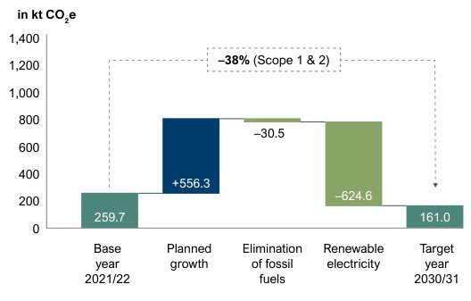 
Moreover, our plant in Kulim, Malaysia, meets the demanding requirements of the IFC Performance Standards.This proves how valuable our efforts based on the AT&S Sustainability Strategy and the continuous improvement of our performance have been in the past. These activities played a significant role in enabling us to sign the first ESG-linked loan with the International Finance Corporation (IFC),a member of the World Bank Group. 
In the context of climate change mitigation, IFC Performance Standard 3- Resource Efficiency and Pollution Prevention must be pointed out. This standard addresses,among other things,energy efficiency and the sustainable use of resources, including energy,and the reduction of project-related greenhouse gas emissions. Already at the beginning of the project,we were able to ensure that the emissions of our plant in Kulim, Malaysia, were reduced to a minimum based on our targets and the know-how acquired. The plant was designed to operate without fossil fuels even during the qualification phase and has been operating with nearly 100% green electricity since the financial year 2025/26. 
The recently built location is currently in the ramp-up phase.We plan to maintain this level also during full capacity utilization and to further increase resource efficiency. In this way, we are sending a strong signal for sustainable industrial development and show how ESG principles can be successfully translated into practice - with a positive impact on green financing options. 
## Target: Reduce relative Scope 3 emissions by 48% by 2030/31 
In addition,we aim to reduce Group-wide Scope 3 emissions from purchased goods and services and from capital goods by 48 % per euro value added by the financial year 2030/31 in comparison with the base year 2021/22.This target is compatible with efforts to limit global warming to 2°C. This is a relative target measured in kg $CO_{2} e$ per euro gross value added. Categories 1"Purchased goods and services" and 2 "Capital goods"were selected because they accounted for the overwhelming majority of Scope 3 emissions in the base year.In terms of our level of ambition,we selected an economic intensity target that should reduce emissions in these two categories by at least 7% per euro value added per year. Planned changes in sales volumes due to the AT&S growth strategy were considered when formulating targets, so defining an intensity target appeared the most sensible option.This means that, despite the ambitious target, we have not planned for an absolute 
96

---

<!-- 原文第 97 页 -->

AT&S Annual Report 2025/26 
Group Management Report Advanced Technologies & Solutions 
reduction in GHG emissions. GHG emissions in categories 1 and 2 should not exceed 1,830 kt $CO_{2} e$ in the target year, which corresponds to a maximum increase of 409 kt $CO_{2} e$ compared to the base year. 
Given that measures are only now being defined in detail, it is not currently possible to further allocate quantities to specific decarbonization levers. 
Comprehensive monitoring of Scope 3 emissions is ensured through annual calculation and estimation across all categories. The most important Scope 3 categories for AT&S are "Purchased goods and services"and"Capital goods". These two categories also form the basis for our Scope 3 target, with progress towards this target assessed using the indicator "kg $CO_{2} e$ per euro GVA". 
The table "Relative Scope 3 emissions in categories 1&2"shows progress towards the sciencebased target for Scope 3 emissions. The figure for the financial year2025/26is 0.655and has decreased on the previous year due to lower emissions in category 2"Capital goods". This is primarily due to lower investments in the new location in Kulim, Malaysia. 
This indicator is expected to change frequently in the future. Each year, more primary data from the supply chain will be available, thus increasing the accuracy of reported emissions. This improved data quality will ultimately have an impact on the reported actual figures, but not on the underlying science-based target. The target remains unchanged; only the annual assessment of target achievement will be based on more precise data in the future. 
## Further information about science-based targets 
The financial year 2021/22was selected as the base year for both science-based targets. Given the expansion strategy pursued by AT&S, we decided to establish the most current year at the time of targetsetting as the base year. Following continuous growth in the past, the expectation in the base year was that subsequent years would see massive growth through the construction of new plants. Furthermore,the financial year 2021/22was the first in which we were able to report market-based GHG emissions, which appeared more sensible than the location-based approach as the basis for target-setting. 
Internal stakeholders - including Global Purchasing and the Management Board - were integrated in the target definition process and provided input on the feasibility of the envisaged targets. The targets cover all seven declared greenhouse gases listed in the Kyoto Protocol and the Paris Agreement. 
In the event of any changes to the scope or calculation methodology for the annual GHG inventory, we examine whether the targets stil align with the cur rent GHG inventory and ensure coherence. 
At present, AT&S does not intend to introduce new technologies in order to achieve its GHG targets in relation to Scope 1, Scope 2 or Scope 3 emissions. The planned technical measures exclusively involve well-proven, state-of-the-art technology. 
Location-specific climate risk analyses had not been conducted when the targets were set.Therefore, IPCC data on the 1.5°C scenario, which the SBTi has specified as its preferred target, was used then. 
Relative Scope 3 emissions in categories 1&2 

| | Retrospective | | | | Milestones and target years | |
| --- | --- | --- | --- | --- | --- | --- |
| | 2021/22 (base year) | 2024/25 | 2025/26 | %N/N-1 | 2030/31 | Annual % target/ Base year |
| Scope 3 GHG emissions in categories 1&2 per euro GVA (kgCOze/E) | 1.895 | 0.996 | 0.655 | (34.2%) | 0.985 | 5.3% |
 
97

---

<!-- 原文第 98 页 -->

AT&S Annual Report 2025/26 
Group Management Report Advanced Technologies & Solutions 
## E1-5-Energy consumption and mix 
The efforts made by AT&S to promote a low-carbon economy are evident in the proportion of renewable energy.In the financial year 2025/26this proportion amounted to 80.2%, thus meeting the target of 80.0%. 
Through its production of printed circuit boards and IC substrates, AT&S conducts its business activities in a climate-intensive sector (NACE Code 26.12 "Manufacture of loaded electronic boards).We therefore used total energy consumption and total net revenue to determine energy intensity. This net revenue is the revenue recorded in the consolidated statement of proft or loss in the consolidated financial statements. 
## Share of renewable energies in% 
Actual energy consumption data is sourced from meters and bills.Extrapolations are only required for the fuel consumption of a small number of company vehicles. These figures are calculated by multiplying the number of kilometers driven by the vehicle's average fuel consumption rate.However,this accounts for less than 0.1% of the Group's total energy consumption. 
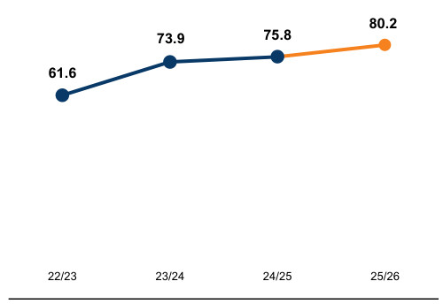 
Sales support offices are not included in energy consumption reporting or the associated GHG emissions because these figures are negligible in comparison with the production facilities. 
## Energy consumption and mix 

| | 2025/26 | 2024/25 | Change |
| --- | --- | --- | --- |
| (1)Fuel consumptin from coal and coal products(MWh | | | n.a. |
| (2) Fuel consumption from crude oiland peroleum products (MWh) | 683.2 | 779.5 | (12.4%) |
| (3) Fuel consumption from natural gas (MWh) | 127,142.5 | 136,754.4 | (7.0%) |
| (4)Fuel consumption from other fosil sours( MWh) | | | n.a. |
| (5) Consumption of purchased or acquired electricity, heat, steam,and cooling from fossil sources (MWh) | 74,460.5 | 97,039.2 | (23.3%) |
| (6) Total fossil energy consumption (MWh) (calculated as the sum of lines 1 to 5) | 202.286.2 | 234,573.1 | (13.8%) |
| Share of fossil sources in total energy consumption (%) | 19.8% | 23.8% | (16.8%) |
| (7)Consumption from nuclear sources(MWh) | | 4,099.4 | n.a. |
| Share of consumption from nuclear sources in total energy consumption (%) | 0.0% | 0.4% | n.a. |
| ()Fulconsumpio fo renewle soures,including biomass als comprsing inustria and municipal waste of biologic origin, biogas, renewable hydrogen,etc.,)(MWh) | | | n.a. |
| (9) Consumption of purchased or acquired electricity, heat,steam,and cooling from renew able sources (MWh) | 820.318.3 | 748,605.7 | 9.6% |
| (10)The consumption of sel-generated non-fuel renewable energy (MWh) | 1.013.9 | 280.3 | 261.8% |
| (11) Total renewable energy consumption (MWh) (calculated as the sum of lines 8 to 10) | 821,332.2 | 748,885.9 | 9.7% |
| Share of renewable sources in total energy consumption (%) | 80.2% | 75.8% | 5.8% |
| Total energy consumption (MWh) (calculated as the sum of lines 6,7 and 11) | 1,023,618.4 | 987,558.4 | 3.7% |
| Energy intensity (total energy consumption per net revenue,MWh/E) | 0.00057 | 0.00062 | (8.0%) |
 
98

---

<!-- 原文第 99 页 -->

AT&S Annual Report 2025/26 
Group Management Report Advanced Technologies & Solutions 
## E1-6-Gross Scopes 1, 2,3 and Total GHG emissions 
The table "Calculation method of GHG emissions" details the calculation methods, assumptions and emissions factors for each scope and category of greenhouse gas emissions. Justification is provided for cases where Scope 3 categories are not relevant and therefore excluded from the inventory. 
The GHG emissions reported relate to the Group as consolidated for accounting purposes (i.e, the parent company and subsidiaries). As noted in the previous section, emissions from energy consumption at sales support offices are negligible and therefore excluded. This also applies to emissions from waste generated at the sales support offices. 
In the financial year 2025/26,the Group produced 6,120t of Scope 2 biogenic $CO_{2}$ emissions and no Scope 1biogenic $CO_{2}$ emissions. In the previous year,the Group produced 6,299 t of Scope 2 biogenic $CO_{2}$ emissions and also no Scope 1 biogenic $CO_{2}$ emissions. 
## Calculation method of GHG emissions 

| GHG category | Calculation method, scope of reporting, justifications | Emission factor sources 2025/26 |
| --- | --- | --- |
| Scope1 | In this scope, natural gas, heating oil,diesel and gasoline are relevant for AT&S. Actual consump tion data (taken from meters and/or bills) is converted from different units (such as I or m) into kWh.The emissions are then calculated in t COze.In adition, we record the quantities of process gases used, calculate the process exhaust gases and determine the COz equivalents. We calcu- late these volatie emissions based on the quantity of process gas used and the corresponding emission factor. | Environment Agency Austria (UBA), GHG Protocol |
| Scope 2, location-ba- sed | Purchased electricity is particularly relevant for AT&S in this scope. Actual consumption data (taken from meters and/or bills) is converted from kWh into t COze. In the location-based method, emissions are calculated based on the average emission factors for the electricity grid for defined geographic locations according to the Ecolnvent database. | Ecolnvent v3.11 |
| Scope 2, market-based | Purchased electricity is particularly relevant for AT&S in this scope. Actual consumption data (taken from meters and/or bill) is converted from kWh into t COze.In the market-based method, we use either the emission factors from energy providers or, if they are not available,calculate the factors using energy mix data from the energy provider and the conversion factors from Ecoln- vent. Purchased green electricity and renewable energy certificates are further influencing fac- tors. | Ecolnvent v3.11,data from and contracts with service providers,pur- chased renewable en- ergy certificates |
| Scope 3, category 1: Purchased goods and services | Method: Average data method, spend-based method and supplier-specific method The basis for calculations are all goods received in the reporting year.Emissions for key materials held in stock are calculated using the average data method. This involves calculating the weight of purchased materials and multiplying this by the conversion factors in the Ecolnvent database. This approach covers 54% of calculated emissions in this category. Primary data is available from a few suppliers and was collected using a questionnaire. Together with the activity data of the re- porting year, this data was used to calculate emissions. 5% of the emisions of tis aegory were obase v3.8.2 calculated this way. The emissions from all other purchased goods and services were calculated using the spend-based method (expenditure per material group/service \*conversion factor in the Exiobase database), which accounts for 41% of calculated emissions in this category. In order to avoid double counting,the costs for energy, leasing, freight, travel, contract workers,waste dis- posal and investments were excluded. These are included in other Scope 3 categories. | Ecolnvent v3.12,Exi- |
| Scope 3, category 2: Capital goods | Method: Spend-based method Procurement costs for fixed assets in the reporting year serve as the basis for calculating emis- sions for capital goods. Asset types are allocated to topic clusters, such as buildings and machin ery. Suitable conversion factors from the Exiobase database are allocated to each cluster and AT&S location in order to calculate emissions. | Exiobase v3.8.2 |
| Scope 3,category 3: Fuel and energy-related activities (not included in Scope 1 or Scope 2 | Method: Average data method This category comprises Scope 3 emissions from direct and indirect energy consumption. It is based on activity data from Scope 1 and Scope 2.The quantities of energy consumed are multi- plied by the corresponding conversion factors.Emissions from direct energy sources are calcu- lated using the relevant conversion factors for fuels specified by Environment Agency Austria | Environment Agency Austria (UBA),Ecoln- vent v3.11 |
 
99

---

<!-- 原文第 100 页 -->

AT&S Annual Report 2025/26 
Group Management Report Advanced Technologies & Solutions 

| | (UBA).Emissions from indirect energy sources are calculated using location-based conversion factors from the Ecolnvent database,which include transmission and distribution losses. | |
| --- | --- | --- |
| Scope 3, category 4: Upstream transporta- tion and distribution | Method: Distance-based method and spend-based method Emissions are calculated using the third-party transport services engaged by AT&S in the report- ing year and include the transport of purchased products and transports between AT&.S locations. The distance-based method is used to calculate emissions and takes account of mass, distance and transport type. Furthermore,the emissions from inbound logistics between our direct suppliers and AT&S loca- tions are calculated by multipling the incurred expenditure with the corresponding factors in the Exiobase database. | Ecolnvent v3.11,Exi obase v3.8.2 |
| Scope 3, category 5: Waste generated in op- erations | Method: Waste type-specific method Emissions are calculated by mutiplying the weight of different waste types with corresponding emission factors in the Ecolnvent database. | Ecolnvent v3.12 |
| Scope 3, category 6: Business travel | Method: Distance-based method This category comprises the greenhouse gas emissions from fights taken by all AT&S employ- ees. Activity data is provided by travel service providers and internal records. The calculation in- volves multiplying the flight distance by the corresponding conversion factor. Other modes of transport are excluded from emission calculations because they account for a small prportion of AT&S emissions and are therefore not relevant. | Ecolnvent v3.12 |
| Scope 3, category 7: Employee commuting | Method: Distance-based method Data on employee commuting was collected by conducting an employee survey at all AS loca- tions. The data collected in this way on modes of transport used, distances traveled and commut- Ecolnvent v3.12 ing frequency serve as the basis for emission calculations in this category. Suitable conversion factors for each mode of transport were sourced from the Ecolnvent database. | |
| Scope 3, category 8: Upstream leased assets | Not relevant (not included in the GHG inventory) Emissions in this category are not relevant for AT&S because they account for less than 0.1%of total Scope 3 emissions. Emissions from the actual use of other leased assets are included in Scope 1 or Scope 2. | |
| Scope 3, category 9: Downstream transpor- tation and distribution | Method: Distance-based method Emissions in this category comprise all transports of goods sold to customers for which AT&S did not cover the costs.The distance-based method is used to calculate emissions and takes account of mass, distance and transport type. | Ecolnvent v3.11 |
| Scope 3, category 10: Processing of sold products | Not relevant(not included in GHG inventory) AT&.S produces intermediate products with many potential downstream applications. The specific details of some products' actual end use are not known.Consequently,AT&S cannot reasonably estimate the emissions associated with the processing of sold products and therefore reports zero emissions in this category. | |
| Scope 3, category 11: Use of sold products | Not relevant (not included in GHG inventory) As noted above,AT&S does not produce end products; instead, it produces intermediate prod- ucts with many potential downstream applications. The specific details of some products" actual end use are not known. In general,however,we can state that printed circuit boards and IC sub- strates are passive components that do not consume energy. While they may be responsible for minimal heat losses during use, this accounts for a negligible proportion of the end product's en- ergy consumption.For this reason,the emissions for which our products are responsible in an electronic device can be ignored. | |
| Scope 3, category 12: End-of-life treatment of sold products | Not relevant (not included in GHG inventory) As a B2B company, AT&S has no control over the disposal of end products by end users. Screen- ing showed that the emissions in this category are not relevant for AT&S because they account for less than 0.1% of total Scope 3 emissions. | |
| Scope 3, category 13: Downstream leased as- sets | Not relevant (not included in GHG emissions) AT&S does not lease assets to third parties. | . |
| Scope 3, category 14: Franchises | Not relevant(not included in GHG emissions) AT&S does not have any franchise activities. | |
| Scope 3, category 15: Investments | Not relevant (not included in GHG emissions) AT&S is not active as an investor or a financial services provider. | |
 
100

---

<!-- 原文第 101 页 -->

AT&S Annual Report 2025/26 
Group Management Report Advanced Technologies & Solutions 
These GHG emissions have not been validated by an external body.However, an internal verification process including the foureyes principle is in place. 
We purchase renewable electricity through a variety of contractual instruments. These include purchase agreements for renewable energy (40.6%; previous year: 43%),guarantees of origin (10.8%; previous year: 11.5%) and renewable energy certificates (48.6%; previous year: 45.5%). 
In the financial year 2025/26,24% of Scope 3 emissions were calculated using primary data (previous year: 21 %).This comprises all emissions in categories 3, 5, 6,7and 9 as well as 5% of emissions in category 1 and 27 % in category 4. Data on biogenic $CO_{2}$ emissions from the value chain is not currently available. 
## Greenhouse gas intensity based on net revenue 
The net revenue used to calculate GHG intensity is the revenue recorded in the consolidated statement of profit or loss (in the consolidated financial statements). In the financial year 2025/26,this amounted to 1,791Mio.e(previous year:E 1,590 million). 
GHG intensity 

| int COzeq/E | 2025/26 | 2024/25 | Change |
| --- | --- | --- | --- |
| Total GHG emissions (location-based) per net revenue | 0.00067 | 0.00085 | (21.0%) |
| Total GHG emissions (market-based) per net revenue | 0.00048 | 0.00067 | (27.6%) |
 
101

---

<!-- 原文第 102 页 -->

AT&S Annual Report 2025/26 
Group Management Report Advanced Technologies & Solutions 
Total GHG emissions 

| | Retrospective | | | | | Milestones and target years | |
| --- | --- | --- | --- | --- | --- | --- | --- |
| | 2021/22 (base year) | 2023/24 | 2024/25 | 2025/26 | %N/N-1 | 2030/31 | Annual% target/ Base year |
| Scope 1GHG emissions | | | | | | | |
| Gross Scope 1 GHG emissions (t COze) | 30,481.6 | 32,782.5 | 34,471.1 | 36,613.6 | 6.2% | Scope1+ 2(market- based): 161.014 | Scope1+ 2(market- based): 4.2% |
| Percentage of Scope 1 GHG emissions from regulated emission trading schemes (%) | 81.5% | 79.4% | 79.5% | 84.6% | 6.5% | | |
| Scope 2GHG emissions | | | | | | | |
| Gross location-based Scope 2 GHG emis- sions (t COze) | 552,194.5 | 348,381.6 | 393,985.4 | 426,432.0 | 8.2% | | |
| Gross market-based Scope 2 GHG emis- sions (t COze) | 229,218.8 | 80,604.2 | 94,188.1 | 80,604.7 | (14.4%) | Scope1+ 2(market- based): 161.014 | Scope1+ 2(market- based): 4.2% |
| Significant scope 3 GHG emissions | | | | | | | |
| Total Gross indirect (Scope 3)GHG emis sions (t COze) | 1,603.645.4 | 1,339,639.8 | 928,978.1 | 745,166.5 | (19.8%) | | |
| 1 Purchased goods and services | 627,680.5 | 562.282.7 | 503,366.8 | 495.576.0 | (1.5%) | | |
| 2 Capital goods | 793,744.9 | 620,810.3 | 232,222.0 | 80,987.7 | (65.1%) | | |
| 3 Fuel and energy-related Activities (not in- cluded in Scope1 or Scope 2) | 155,795.0 | 117,384.6 | 124,777.7 | 97,017.5 | (22.2%) | | |
| 4 Upstream ransportation and distibution | 5.261.5 | 8,107.1 | 19,987.7 | 21.964.2 | 9.9% | | |
| 5 Waste generated in operations | n.a. | n.a. | 16,076.7 | 15,648.3 | (2.7%) | | |
| 6 Business traveling 7 Employee commuting | 495.1 | 2,009.9 | 2,328.7 | 2,581.3 | 10.9% | | |
| 8Upstream leased assets | n.a. | n.a. | n.a. | n.a. | n.a. | | |
| 9 Downstream transportation | 4.179.9 | 7.292.5 | 8,195.1 | 7,684.1 | (6.2%) | | |
| 10 Processing of sold products | n.a. | n.a. | n.a. | n.a. | n.a. | | |
| 11 Use of sold products | n.a. | n.a. | n.a. | n.a. | n.a. | | |
| 12 End-of-life treatment of sold products | n.a. | n.a. | n.a. | n.a. | n.a. | | |
| 13 Downstream leased assets | n.a. | n.a. | n.a. | n.a. | n.a. | | |
| 14 Franchises | n.a. | n.a. | n.a. | n.a. | n.a. | | |
| 15 Investments | n.a. | n.a. | n.a. | n.a. | n.a. | | |
| Total GHG emissions | | | | | | | |
| Total GHG emissions (location-based) (t CO2e) | 2,186,321.5 | 1,720,803.9 | 1,357,434.6 | 1,208,212.1 | (11.0%) | | |
| Total GHG emissions (market-based)(t CO2e) | 1,863,345.8 | 1,453,026.4 | 1,057,637.3 | 862.384.8 | (18.5%) | | |
 
102

---

<!-- 原文第 103 页 -->

AT&S Annual Report 2025/26 
Group Management Report Advanced Technologies & Solutions 
## ESRS E2- Pollution 
SBM-3 - Material impacts, risks and opportunities and their interaction with strategy and business model 
Based on the materiality assessment described in the IRO-1 section of chapter ESRS 2, AT&S has identified the following material impacts, risks and opportunities: 

| IROS | Category | Value chain | Time horizon |
| --- | --- | --- | --- |
| Pollution of air, water and soil | | | |
| Contribution to pollution of air, water and soi through activties by our suppliers and upstream value chain (production, Iogistics,tier 2/3 supply chain,etc.) | negative impact | | |
| Pollution of water | | | |
| Pollution of water resources by water using production processes in a way that treatment cannot achieve the same quality status as before | negative impact | AX | |
| Substances of (very high) concern | | | |
| Contribute to harming human health (employees) and the environment through activities and processes that produce,use or place on the market substances of (very high) concern (i.e.REACH) | negative impact | A | |
 
Value chain localization upstream own operations downstrcam 
Time horizon oo <1 year O 1-5years oo >5 years 
The described IROs affect all stakeholders and have a global impact on our business model. 
## Pollution in the value chain E2-1- Policies related to pollution 
AT&S manages negative impacts from pollution of the upstream (and, if relevant,downstream) value chain primarily through the AT&S Supplier Code of Conduct, which is aligned to the Code of Conduct of the Responsible Business Alliance (RBA). Within this framework, suppliers must comply with defined emission requirements regarding air and water as well as waste management to ensure that pollution is monitored in accordance with the applicable requirements. 
The AT&S Supplier Code of Conduct aims to avoid, control and reduce emissions into air, water and soil in the upstream supply chain. Its applicability covers all direct and indirect suppliers as well as logistics service providers whose activities can contribute significantly to pollution. The Management Board of AT&S is responsible for the governance of these requirements, while Global Purchasing, ESG & Quality 
103

---

<!-- 原文第 104 页 -->

AT&S Annual Report 2025/26 
Group Management Report Advanced Technologies & Solutions 
coordinate the operational implementation, risk assessment, audits and grievance mechanisms. Environmental and emission-related requirements are an integral part of supplier selection and due diligence processes, new suppliers are only admitted after a risk assessment. Suppliers are required to minimize and document emissions, substitute toxic chemicals, ensure legally compliant waste and wastewater treatment and comply with regulatory requirements such as REACH, RoHS and SVHC. Monitoring is based on regular audits, RBA-based assessments, ESG risk assessments and external programs such as CDP. AT&S continuously develops its supply chain requirements further, provides for more transparency of environmental impacts along the upstream value chain, strengthens external review mechanisms and specifically engages suppliers in order to systematically reduce pollution along the value chain. 
## Pollution of air 
Suppliers must characterize emission of volatile organic compounds, aerosols, corrosive substances, particulates, substances that deplete the ozone layer and combustion by-products prior to discharge, treat them and regularly monitor them. Substances that deplete the ozone layer must be handled carefully according to the Montreal Protocol. Suppliers are expected to ensure continuous monitoring of their facilities in order to properly manage emissions into air and to ensure operations in compliance with regulations. 
## Pollution of water 
Suppliers must characterize, treat and monitor all wastewater prior to discharge or disposal. Routine monitoring of wastewater treatment is required to ensure compliance with legal and performance-based standards. 
## Pollution of soil 
Suppliers are required to document hazardous waste and to implement a systematic approach for the management, reduction,disposal or recycling of non-hazardous waste. Waste data must be maintained and documented in accordance with legal requirements. 
## E2-2 - Actions and resources related to pollution 
In the financial year 2025/26,AT&S focused on the identification, assessment and preparation of potential actions to reduce the pollution of air, water and soil in the value chain. AT&S takes measures only when they are targeted,evidence-based and designed to achieve quantifiable and material improvements; the development of specific and final mitigation measures for the upstream value chain was still subject to evaluation in the reporting year. 
AT&S uses different processes to identify and implement adequate measures to prevent actual and potential negative impacts - in particular the contribution of our suppliers and the upstream value chain to air, water and soil pollution. These include regular supplier assessments, in which existing measures to avoid pollution are systematically assessed and improved based on a structured point system.In addition, AT&S conducts supplier audits,both during qualification and driven by events, in order to ensure compliance with ESG standards. Moreover, AT&S uses continuous supplier assessments and a digital monitoring system which integrates internal data sources, increases transparency and identifies ESG risks, including those regarding pollution, at an early stage. The effectiveness of measures to reduce environmental stress is assessed through regular audits and half-yearly compliance audits. 
AT&S is currently assessing concrete options for action and plans to report on further developed measures in the three areas of air, water and soil in future reporting cycles. 
## E2-3- Targets related to pollution 
So far, AT&S has not defined guantifiable targets related to impacts on air, water or soil in the upstream (and, if applicable, downstream) supply chain in accordance with the requirements of ESRS E2.The AT&S Supplier Code of Conduct, whose effectiveness is monitored through regularly conducted supplier audits,currently remains the primary control instrument for managing risks and impacts of pollution. 
104

---

<!-- 原文第 105 页 -->

AT&S Annual Report 2025/26 
Group Management Report Advanced Technologies & Solutions 
AT&S intends to develop evidence-based and legally compliant targets related to pollution in the future which are ambitious and future-oriented and enable an effective and measurable reduction. At the time of reporting, AT&S has not defined a schedule for defining the corresponding targets related to pollution in the value chain. 
## Polution of water in own operations E2-1- Policies related to pollution of water 
In our environmental concept,we commit to assessing physical, regulatory and reputational water risks for all locations and to developing and implementing plans to mitigate identified risks and improve water management. This comprises the optimization of production processes to reduce total water consumption and the use of advanced technologies for effective wastewater treatment before discharge whether in bodies of water (Leoben-Hinterberg, Fehring, Austria), in wastewater systems (Shanghai, Chongqing,China; Leoben-Hinterberg, Fehring, Austria; Kulim, Malaysia) or through evaporation (Nanjangud, India). 
Each plant separates wastewater streams so that they can be treated using the appropriate procedure in each case and meet the required quality parameters. To implement this concept, regular analyses of the treated and discharged wastewater are conducted at each location in accordance with the legal requirements. These measures ensure compliance with the requirements of environmental law, protect water resources and support sustainable water management. Our goal is to reduce the impact on aquatic ecosystems and to contribute to global sustainabilty goals. 
The Management Board of AT&S is responsible for implementing the environmental policy and regularly assesses the effectiveness of the measures and ensures that environmental aspects are integrated into the sustainability strategy and subsequently into the corporate strategy. 
## E2-2 - Actions and resources related to pollution of water 
AT&S takes action to implement our concept for the prevention,control,elimination or reduction of water pollution and to support risk mitigation. We have implemented a number of ongoing measures in order to prevent negative impacts of the pollution of water. 
The development of evidence-based targets is planned, whereby these targets comply with legal requirements including ESRS and aim to achieve effective and measurable reduction of pollution. 
We operate biological and chemical-physical water treatment plants designed to meet the quality thresholds for the discharge of water.These plants are maintained, in accordance with regulatory requirements, through appropriate maintenance measures in order to ensure compliance with the applicable legal requirements. 
Moreover, AT&S is introducing data collection systems to monitor water consumption as well as the quality and quantity of the discharged wastewater across the Group. This is a continuous measure,enabling precise tracing and, if necessary, immediate corrective action. 
The future water strategy provides for the continuous improvement of the water recycling rate. The implementation of new projects to increase the water recycling rate is planned for the financial year 2026/27. This future strategy is an integral part of our longterm ESG Strategy 2030 and emphasizes our commitment to reducing the withdrawal of freshwater, enabling the reuse of treated wastewater and preventing pollution. 
## E2-3- Targets related to pollution of water 
We recognize the necessity to strengthen our approach by introducing measurable progress indicators. While our immediate target is to comply with local thresholds,we are planning to define additional, timebound targets in order to further reduce the load 
105

---

<!-- 原文第 106 页 -->

AT&S Annual Report 2025/26 
Group Management Report Advanced Technologies & Solutions 
of pollutants and to improve our performance related to water quality. 
## E2-4- Metrics related to pollution of water 
We have identified the wastewater pollutants relevant for our activities in accordance with Annex ll of Regulation (EG) No 166/2006(E-PRTR).The monitoring is carried out annually. The concentration of pollutants in wastewater is determined based on samples, which are analyzed either in our internal chemistry laboratories or by certified external laboratories. Emissions of pollutants are calculated by multiplying the measured concentrations with the continuously recorded wastewater volume; this results in monthly totals which are aggregated for the annual result. 
The table "Discharge of pollutants into water bodies" sets out the volume of pollutants emitted in water in the reporting year.The consolidated quantities only include emissions from plants at which the thresholds defined in Annex ll of Regulation (EC) No 166/2006 of the European Parliament and of the Council (EPRTR Regulation) are exceeded. This does not mean that we fail to comply with local regulations on pollutant concentration and pollution applicable to each plant.The thresholds set out in Annex ll of the EPRTR Regulation do not take account of the operational throughput of production facilities. 
The increased nitrogen level compared to previous year primarily results from a higher volume of discharged wastewater at the location in Kulim, Malaysia, which also caused an increase in the amount of nitrogen released. 
## Substances of concern and substances of very high concern E2-1- Policies related to substances of (very high) concern 
AT&S applies a comprehensive Product Stewardship Policy as part of the integrated health, occupational safety, environmental and quality management system. This concept governs the responsible handling of chemical substances along the entire product life cycle - from development and procurement through production and delivery to end of use.The main objective is to prevent pollution, to protect human health and the environment and to minimize the use of substances of (very high) concern. The policy is aligned with the AT&S Sustainability Strategy and forms a core element of our compliance and transparency obligations as part of the ESRS. It defines clear responsibilities for the management of chemicals and covers both substances of very high concern (SVHC) in accordance with REACH and other substances of concern (SoC) that can cause environmental and health risks. 
The policy applies in all countries in which AT&S operates and reflects the expectations and of customers, suppliers and international stakeholders. The Corporate ESG& Quality department is responsible for the effective operational implementation of this policy, while the ultimate responsibility lies with the Chief Technology Officer (CTO). 
AT&S commits to full compliance with the requirements of Directive 2011/65/EU on the restriction of the use of certain hazardous substances in electrical and electronic equipment (RoHS) and Regulation 
Pollutants released into water 

| in t/year | 2025/26 | 2024/25 | Change |
| --- | --- | --- | --- |
| Copper | 1.38 | 1.66 | (16.7%) |
| Total nitrogen | 249.17 | 147.67 | 68.7% |
| Nickel | 0.13 | 0.11 | 13.4% |
| Total organic carbon (TOC) (as total C or COD/3) | 192.13 | 195.53 | (1.7%) |
| Fluorides | 2.06 | 2.49 | (17.4%) |
| Chlorides | 9.521.61 | 9.090.33 | 4.7% |
 
106

---

<!-- 原文第 107 页 -->

AT&S Annual Report 2025/26 
Group Management Report Advanced Technologies & Solutions 
(EC) No1907/2006concerning the Registration, Evaluation, Authorisation and Restriction of Chemicals (REACH), Regulation (EU) 2019/1021 on persistent organic pollutants (EU-POPs) as well as all other national, regional and local laws regarding chemical safety. 
In accordance with the RoHS Regulation (2011/65/EU),AT&S ensures that electrical and electronic components, including printed circuit boards (PCBs),do not include restricted substances in homogeneous materials exceeding the permitted concentration thresholds. 
In accordance with the REACH Regulation (EC) No 1907/2006,AT&S monitors the occurrence of SVHC, listed on the ECHA candidate list. If a substance listed as an SVHC is contained in a product with a concentration of more than 0.1% (ww), AT&S complies with the disclosure obligations in accordance with Article 33 of the REACH Regulation. 
In addition, AT&S addresses the EU POPs Regulation (2019/1021)by monitoring and controlling substances which are persistent, bioaccumulative and toxic.AT&S ensures that persistent organic pollutants (POPs) are not deliberately added to products and that concentrations remain below the statutory thresholds. This includes proactive communication with suppliers to verify material composition and to secure relevant documentation.Where possible, AT&S assesses and implements the substitution of hazardous substance by safe alternatives - based on material risk assessments and in collaboration with suppliers. 
To ensure transparency and to support well-founded decision-making, AT&S provides customers with statements of compliance which confirm compliance with RoHS, REACH, EU-POPs and other applicable chemical regulations. These statements are updated on a regular basis in accordance with regulatory changes and customer-specific requirements. 
In addition to formal documentation, AT&S actively participates in compliance surveys and programs for material data collection that are initiated by customers.Customers receive detailed information on material composition, SVHC content and regulatory status based on structured questionnaires and online platforms,ensuring full transparency across the value chain. 
This proactive approach enables AT&S to maintain open communication with customers, to anticipate regulatory developments early and to continuously improve the products' ecological compliance and compliance with chemical law.The occupational health and safety principle in ESRS S1 comprises measures to prevent chemical incidents and defines emergency actions for the unintentional release or non-conformities in order to ensure rapid containment, as well as protection of the workforce and the environment. 
## E2-2- Actions and resources related to substances of (very high) concern 
AT&S is implementing a comprehensive set of measures and provides personnel resources to ensure compliance with the RoHS Regulation (2011/65/EU),the REACH Regulation (EC No 1907/2006),the EU-POPs Regulation(EU 2019/1021) and other globally applicable chemicals regulations. These actions are directly linked to the goals of our Product Stewardship Policy which minimizes the use of hazardous substances, prevents pollution and improves product sustainability. 
Beyond regulatory compliance, AT&S prioritizes the health and safety of its workforce when handling substances of concern. All production sites follow strict occupational safety standards, including controlled handling procedures, personal protective equipment (PPE), ventilation systems and continuous workplace monitoring to minimize exposure risks. Workers receive continued training on chemical safety and emergency measures on a regular basis to ensure awareness and readiness in all areas. All measures for emergency prevention,preparedness and response are extensively regulated in the AT&S Occupational Health and Safety Policy and in the safety 
107

---

<!-- 原文第 108 页 -->

AT&S Annual Report 2025/26 
Group Management Report Advanced Technologies & Solutions 
management systems, which define clear responsibilities, protocols and routines to prevent incidents and for the protection of workers. 
All key measures are implemented as ongoing measures without a defined timeframe; for the sake of clarity and compliance,we confirm that these measures are applicable at all AT&S locations (Austria, China, Malaysia, India): 
·Systematic engagement of suppliers and data col lection: AT&S works with a specialized external service provider to conduct regular supplier surveys and to collect detailed information on material composition, including SVHC, SoC and POP content,on the regulatory status and on documentation quality, thus enabling continuous verification of compliance and early identification of potential non-compliance. 
Material risk assessment and substitution: AT&S assesses all delivered materials and components based on supplier declarations, IMDS data and analyses by our external partner for compliance with chemical laws taking into account the relevant thresholds according to RoHS, REACH and EUPOPs (e.g.0.1%w/w for SVHC pursuant to REACH Article 33, 0.01%-0.1%thresholds for RoHS-restricted substances and regulatory thresholds for POPs). Where possible, AT&S supports the substitution of hazardous substances by lower-risk alternatives in collaboration with suppliers and customers. 
Monitoring compliance and reporting: data from supplier declarations, IMDS entries and laboratory analyses are integrated into the AT&S compliance management system. This supports the creation of statements of compliance, SCIP reports and ESRScompliant sustainability disclosures. 
The resources supporting these measures include the team for Corporate ESG and Quality Management, local HSE specialists and external partners for compliance with chemical regulations.Together, these resources ensure consistent implementation at all locations, transparent reporting to customers and the continuous improvement of processes to manage chemical risks. 
AT&S continuously monitors the effectiveness of these measures,considering regulatory developments (including updates of RoHS, EU-POPs and the REACH candidate list) as well as technological and material-related innovations. Required adaptations are made to ensure continuous compliance and to support the strategic goal to prioritize the gradual substitution of substances of high concern in accordance with European and international sustainability goals. 
## E2-3- Targets related to substances of (very high) concern 
AT&S does not currently define any quantitative key performance indicators (KPls) regarding pollution.Instead, our strategic focus is on regulatory compliance and the continuous improvement of handling hazardous substances, in particular substances of very high concern(SVHC) and other substances of concern (SoC). Full compliance with the applicable national, regional and international regulations on chemical safety is a core objective of our approach. In addition, we pursue long-term strategic goals to reduce the occurrence of these substances in our products and processes. Our approach not only complies with regulatory requirements but also with internal compliance programs, which are based on relevant legislation. 
AT&S has defined qualitative targets for the reduction of environmental pollution for substances of very high concern (SVHC) in accordance with ESRS E2-3. These targets address the material impact identified in the double materiality assessment, ie, the use and management of SVHC within our business activities. 
At the same time, the overarching goal of AT&S in this area is to ensure complete and continuous compliance with all applicable regulations regarding hazardous substances (including. REACH, RoHS, EU-POPs, PFAS-related regulations) for all products placed on the market, and to maintain a compliance level of 100% for these products every financial year. 
Due to the character of regulatory compliance, target achievement is assessed in a qualitative and binary 
108

---

<!-- 原文第 109 页 -->

AT&S Annual Report 2025/26 
Group Management Report Advanced Technologies & Solutions 
way (compliant/non-compliant) and rather than the basis of quantitative indicators or fixed time targets. 
## Target 1 - Reduction of presence of SVHC (voluntary) 
AT&S strives to continuously reduce the presence of SVHC and other substances of concern in products and processes and is implementing a substitution program for this purpose.This targets support the prevention and control of SVHC (E2-3 point 23(d). 
## Target 2- Promote material substitution (voluntary) 
AT&S commits to continuously assess all substitution options for hazardous substances. Alternative materials must meet defined criteria related to technical performance, safety and regulatory compliance. 
## Target 3- Sustainable material changes (voluntary) 
AT&S is gradually changing to cleaner materials with lower impacts - in collaboration with suppliers. This target strengthens alignment with EU chemicals legislation and supports reduction of pollution in the long term. 
These targets apply to all AT&S production sites and for purchased materials that may contain SVHC. AT&S considers these targets long-term in nature and therefore part of a continuous, multi-year improvement process. At present, AT&S has neither defined quantitative key figures nor a formal base value/reference value; this is in accordance with the ESRS E2 guideline, which permits qualitative targets. All targets stated above are voluntary and exceed the minimum requirements of regulatory compliance. They operationalize our product stewardship concept and support the compliance programs for REACH, RoHS and POPs. 
## E2-5- Substances of concern and substances of very high concern 
Most of the purchased substances of (very high) concern are used up or converted during the production process of printed circuit boards and do not remain in the end product.Only a small quantity of substances of very high concern may remain in the finished products, while those substances that do not remain in the product or are classified as waste are effectively neutralized through production processes, in wastewater treatment or by exhaust air treatment systems. 
In the financial year 2025/26,the quantities of SoC increased significantly compared to the previous year.This is primarily due to higher consumption of certain SoC-containing materials used in the rampup process of new plants and in process stabilization in new product lines.Here,these materials are used more intensively and less efficiently than in established plants. 
All figures related to substances of (very high) concern in our products are currently based on estimates, which are based on supplier statements and internal material data. Comprehensive quantitative data are not yet available for all materials or products; the existing figures have not been independently validated. 
AT&S plans to carry out targeted laboratory analyses in the financial year 2026/27 to improve the accuracy and reliability of these figures.These analyses concentrate on selected end products to quantify the presence of SVHC. The results complement supplier data and provide a more representative basis for future reports. This approach ensures that the current estimates provide an adequate indication of the presence of substances, but AT&S is enhancing transparency and compliance and will be able to make more precise disclosures in the next reporting period in accordance with regulatory and sustainability requirements. 
## Substances of concern (SoC) 
The purchased quantities of substances of concern were calculated in accordance with the criteria in Article 57 and the definition in Article 59(1) of Regulation (EC) No 1907/2006 of the European Parliament and of the Council for our European locations subject 
109

---

<!-- 原文第 110 页 -->

AT&S Annual Report 2025/26 
Group Management Report Advanced Technologies & Solutions 
to the REACH Regulation. Safety data sheets for relevant chemicals were manually reviewed and classified according to the hazard classes set out in Annex VI Part3 of Regulation (EC) No 1272/2008.The reviewed data was compiled in a table.The purchase volumes for our European locations were recorded and extrapolated based on the production volume to determine the purchase volume for the Group.The same method was used as described in section E5-4; current data on production volumes was used to conduct this extrapolation. 
According to our current understanding,no substances of concern remain in our end products. These substances either serve only as auxiliary materials during production, are removed from the product through rinsing between production steps or react to form harmless substances during production steps. In order to calculate the quantity of substances of concern in waste,we determined which of the purchased substances cannot be treatedin our wastewater treatment facilties and require external disposal.The quantities were calculated for our European locations and, based on production volumes, extrapolated to determine the total quantity for the Group. This disclosure comprises all AT&S production sites; the current quantitative data stems from EU locations. 
Substances of very high concern (SVHC) AT&S identifies substances of very high concern (SVHC) in materials based on supplier information and by reviewing technical data sheets and safety data sheets. Where no precise concentration data is available, the concentration is estimated based on comparable materials or supplier analyses; however, if no relevant supplier information is available for noncomparable materials,a value of O is used for these materials. 
## For purposes of clarity and reporting, SVHC are categorized by type of material and chemical properties: 
Resins und polymers: 
·Melamine (CAS 108-78-1) 4,-isopropyidendiphenol/bisphenolA (CAS 80-05-7) 2-methyl-1-(4-methylthiopheny)-2-morpholinopropan-1-one (CAS 71868-10-5) 
Solvents and process chemicals: 
·N.N-dimethylacetamide (CAS 127-19-5) ·Methyl-2-pyrrolidone (CAS 872-50-4) 
## Photoinitiators and additives: 
·2-benzy-2-dimethylamino-4-morpholinobutyrophenone (CAS 119313-12-1) 
Metals: ·Lead(CAS 7439-92-1) 
We determined the quantity of SVHC purchased based on the purchase volumes of relevant materials 
Summary of quantities of substances of (very high) concern 

| int | 2025/26 | 2024/25 | Change |
| --- | --- | --- | --- |
| Substances of concern | | | |
| Total quantity purchased | 4,666.23 | 3,442.42 | 35.6% |
| Total quantity that left the company in the form of emissions or as part of products | 435.50 | 325.35 | 33.9% |
| of which as part of products | 0.49 | 0.49 | (0.4%) |
| of which as emissions (waste quantity identified as hazardous waste) | 435.02 | 324.86 | 33.9% |
| Substances of very high concern | | | |
| Total quantity purchased | 5.64 | 5.64 | (0.0%) |
| Total quantity that left the company in the form of emissions or as part of products | 0.56 | 0.57 | (0.7%) |
| of which as part of products | 0.49 | 0.49 | (0.4%) |
| of which as emissions (waste quantity identified as hazardous waste) | 0.08 | 0.08 | (2.5%) |
 
110

---

<!-- 原文第 111 页 -->

AT&S Annual Report 2025/26 
Group Management Report Advanced Technologies & Solutions 
combined with the known or estimated concentrations of the substances in question - in accordance with the method described in section E5-4. Current data indicate that SVHC present in raw materials remain in the end product. For lacquers,concentrations were estimated based on analyses conducted by our largest suppliers; for other lacquers, concentrations were estimated based on similar materials. 
AT&S maintains separate waste records on waste streams by material group to determine SVHC quantities in waste and applies the same calculation methods as for purchased materials. 
AT&S plans to conduct targeted analyses of selected materials and finished products in collaboration with external laboratories in the coming year. These analyses provide more reliable and more representative data, support more precise ESRS reporting and ensure continual compliance with applicable regulations as well as alignment with proven industry practices. 
## AT&S does not produce any substances of concern or SVHC as part of its production processes. 
The table "Hazard class allocation of substances of (very high) concern" provides a breakdown of substances of (very high) concern by hazard class. 
Hazard class allocation of substances of (very high) concern 

| int | Substances of concern\* | | | | Substances of very high concern\* | | | |
| --- | --- | --- | --- | --- | --- | --- | --- | --- |
| Total quan- tity purcha- sed | Total quan tity that left the com pany | of which as part of prod- ucts | of which as emissions (waste) | Total quan- tity purcha- sed | Total quan- tity that left the com- pany | of which as part of prod- ucts | of which as emissions (waste) |
| Carcinogenicity categories 1 and2 | 3,623.09 | 431.94 | 0.02 | 431.92 | 2.06 | 0.04 | 0.02 | 0.02 |
| Germ cell mutagenicity cate- gories 1 and 2 | 889.94 | 272.51 | | 272.51 | - | - | | |
| Reproductive toxicity catego- ries 1 and 2 | 2,320.16 | 326.44 | 0.47 | 325.98 | 3.57 | 0.52 | 0.47 | 0.06 |
| Respiratory sensitization ca tegory 1 | 0.06 | 0.00 | | 0.00 | | | | |
| Skin sensitization category 1 | 4.212.05 | 2.52 | 0.04 | 2.48 | 0.04 | 0.04 | 0.04 | 0.00 |
| Chronic aquatic hazard cate- gories 1 to 4 | 3,456.72 | 435.02 | 0.07 | 434.95 | 3.18 | 0.10 | 0.07 | 0.03 |
| Specific target organ toxicity (repeated exposure) catego- ries1 and2 | 2,654.36 | 272.54 | 0.02 | 272.52 | 2.06 | 0.04 | 0.02 | 0.02 |
| Specific target organ toxicity (single exposure) categories 1 and2 | 609.19 | 0.00 | | 0.00 | | | | |
| Total | 4,666.23 | 435.50 | 0.49 | 435.02 | 5.64 | 0.56 | 0.49 | 0.08 |
 
"A mixture of sustances may fal ne i dashics yhh es es sts a e " 
111

---

<!-- 原文第 112 页 -->

AT&S Annual Report 2025/26 
Group Management Report Advanced Technologies & Solutions 
## ESRS E3 - Water and Marine Resources 
SBM-3 - Material impacts, risks and opportunities and their interaction with strategy and business model 
Based on the materiality assessment described in the IRO-1 section of chapter ESRS 2, AT&S has identie the following material impacts, risks and opportunities: 

| IROs | Category | Value chain | Time horizon |
| --- | --- | --- | --- |
| Water withdrawals | | | |
| Contribution to water stress through withdrawal of large water amounts for production processes | negative impact | 4X A | |
| Contribution to water stress (in regions with water scarcity) through withdrawal of large water amounts for mining in the upstream value chain | negative impact | | |
| Water consumption | | | |
| Pressure on water resources due to inefficient use of water in company-owned buildings/facilities and production processes | negative impact | A 又 | |
| Water discharges | | | |
| Implementing water recycling and reuse practices as well as optimi- zation of water usage in processes can provide financia opportunities. By treating, reusing or saving water within the manufacturing processes, the company can reduce freshwater consumption and associated costs. It also minimizes the volume of wastewater that needs to be discharged potentially reducing treatment expenses | opportunity | A | |
 
Value chain localization upstream own operations downstream 
Time horizon oo <1year C 1-5 years oO >5 years 
The described IROs affect all stakeholders and have a global impact on our business model. 
## E3-1- Policies related to water and marine resources 
The AT&S ESG policies regulate different environmental topics, including water resources. They take account of national, regional and local laws and relevant international treaties and promote collaboration with stakeholders such as suppliers and customers, in particular in regions with high water risk. In these policies we commit to assess physical, regulatory and reputation-related water risks for all locations and to develop and implement plans to mitigate identified risks and improve water management. 
In the financial year 2025/26,AT&S used Water Risk Fiter (WRF) Version 2.0 of the World Wildlife Fund (WWF) to identify physical water-related risks across all locations. In doing so, the physical risks of the respective catchment areas and different risk categories such as water scarcity, groundwater stress and 
112

---

<!-- 原文第 113 页 -->

AT&S Annual Report 2025/26 
Group Management Report Advanced Technologies & Solutions 
water quality were assessed. In addition, the same tool was used for an assessment of the operational risks in accordance with the guidelines of the WWF. 
Based on the combined assessment of the risks in the catchment areas and of the operational risks, a better understanding of the potential water risks to which AT&S is exposed can be gained. This enables the company to develop targeted measures and activities to address these risks and to focus on specific areas. 
According to the WRF risk classification, locations with a risk assessment score higher than 3.4 are considered to be at high risk. In a more conservative approach, the WWF recommends viewing locations with a risk assessment score of 3.0 or higher to have a high overall water risk. 
Based on the analysis conducted using the WRF tool. the locations in Shanghai and Chongqing,China,and Nanjangud, India, are exposed to high water risk. This refers to both the catchment area (basin risk) and the operational risk and requires targeted measures to mitigate potential impacts. 
The policies apply to all companies affiliated with AT&S and contractors at AT&S locations. We communicate our policies publicly and in different languages to make them accessible to employees, contractors and suppliers. 
The Management Board defines the governance approach, approves the strategy and reviews performance.The Corporate ESG & Quality team coordinates operational implementation. 
The underlying AT&S oncept supports holistic water management and provides for responsible use of water in all operating activities. The most important water sources for our operations are municipal water supply, river water and groundwater. It is ensured that water withdrawal meets local regulations and legal requirements, that environmental impacts are minimized and excessive withdrawal is avoided. Furthermore, the concept includes measures to reduce freshwater withdrawal, the use of technologies for wastewater treatment and recovery and the implementation of water-saving equipment in our production processes, in particular at locations where there is a high water risk. 
We do not depend on marine resources for our activities. Our water withdrawal is limited to freshwater from domestic sources (surface water,groundwater, municipal water supply), and marine resources are neither extracted nor used in our operations. Our approach therefore focuses on the protection of freshwater ecosystems and compliance with the applicable environmental standards. Although our products currently do not directly contribute to water-related challenges, we review options to integrate aspects of water efficiency into future designs. In addition,we commit to reducing water consumption at locations that have been identified as water-scarce regions. No quantitative targets have been set yet for the current financial year. In the course of further developing our water strategy, however, it is planned to define measurable and time-bound targets in the next reporting cycle. These targets will be based on risk assessments of the catchment areas and on engagement with stakeholders. 
AT&S takes its lead from the Sustainable Development Goals (SDG 6, 12 and 14) and the UN Global Compact. 
AT&S is committed to retaining ISO 14001 certification for all its production sites. This certification underlines our commitment to effective environmental management and consistent risk mitigation. Systematically managing our environmental responsibilities enables us to reduce the negative impacts of our activities,ensure compliance with statutory requirements and improve operational efficiency at the same time. Using the WWF Water Risk Filter, potential water quality risks in the water catchment areas for our locations were identified. 
The AT&S Supplier Code of Conduct regulates the management of the negative impact of "contributing 
113

---

<!-- 原文第 114 页 -->

AT&S Annual Report 2025/26 
Group Management Report Advanced Technologies & Solutions 
to water stress" in the upstream supply chain by requiring suppliers to practice responsible water withdrawal. For further information on the AT&S Supplier Code of Conduct, please refer to section S2-1. 
## E3-2- Actions and resources related to water and marine resources 
The operation of our wastewater treatment and recovery plants at the locations in Shanghai and Chongqing,China, as well as Nanjangud, India,ensures conservation of water resources and a reduction of our overall water footprint.Progress is monitored monthly based on the ratio of recovered water to water withdrawal. Looking forward, we evaluated additional projects to further develop existing systems and sustainably increase recycling rates. In doing so,we prioritize sustainable, responsible and economically viable measures that strengthen the longterm resilience of water resources and support our commitment to preserving freshwater supplies.The future water strategy, which is part of the ESG Strategy 2030, will set measurable targets for the next five years up to the financial year 2030/31. 
In addition, we initiated a project in Shanghai, China, to improve the supply of rinse water in our production activities with automatic valves. The goal is to manage process water supply based on conductivity feedback. If this process parameter is exceeded, water will be replenished. Previously, process water had been provided continuously by means of manual valves. The implementation is currently in the evaluation phase and is set to be introduced in the coming years. 
We use appropriate control plans and process instructions for processing water and wastewater treatment as an ongoing,permanent operational measure to minimize the risk of exceeding limits and to be able to take corrective action immediately in the event of non-compliance. 
We invest in technologies such as wastewater recycling systems which enable the reuse or internal circulation of wastewater. This enables us to reduce our dependence on freshwater resources, especially at location at high water risk. 
Our medium-term plan includes financial resources to implement these actions consisting of capital expenditures (CapEx) of 13.0 million and operational expenditures (OpEx) of 14.8 million. Operational expenditures of E 1.2 million and capital expenditure of C 0.3 million were recorded in the reporting year. Operational expenditure is shown in note 2"Types of expenses" in the notes to the consolidated statement of profit or loss, while capital expenditure can be found in note 7 "Property,plant and equipment" in the notes to the consolidated statement of financial position. 
Actions related to the negative impacts of water withdrawal in the upstream value chain are set out in the AT&S Supplier Code of Conduct. These actions are described in section 2-4. 
## E3-3 - Targets related to water and marine resources 
AT&S has not yet formulated a target that corresponds to the ESRS requirements. As part of the future water strategy, measurable targets will be defined for the next five years until the financial year 2030/31. These targets are intended to reduce the withdrawal of freshwater and increase our water recycling rate at the same time. The financial year 2024/25 will be used as the base year.Current progress will be reported to the strategic ESG Steering Committee and published annually in the consolidated sustainability statement. Development of this strategy is based on recognized water standards and will support the achievement of the relevant UN Sustainable Development Goals (SDGs). 
The future water strategy will define reduction targets for water consumption, with a special focus on our locations in Shanghai and Chongqing, China,and Nanjangud, India.The financial year 2024/25will serve as the base year for the assessment of target achievement. 
114

---

<!-- 原文第 115 页 -->

AT&S Annual Report 2025/26 
Group Management Report Advanced Technologies & Solutions 
AT&S does not yet have a quantifiable target related to the negative impact of water withdrawal in the upstream value chain. The efficacy of the actions implemented by the upstream value chain is monitored through the digital procurement system and regular supplier audits. 
## E3-4- Water consumption 
AT&S applies a uniform and sound approach to measure water consumption at all locations. All volumes of water withdrawal and discharge of water are measured directly and documented in accordance with the applicable environmental regulations at the individual plants. 
Meters are not available at all locations to measure recycled and reused water volumes. Where no meters are available, the amounts are calculated or estimated.The figures for the location in Shanghai, China, for example, include direct measurements as well as estimates based on the average hourly amount of reused water at certain production lines and on monthly production time. The resulting figures are subject to measurement uncertainties, especially due to possible fluctuations in actual water consumption and deviations from the recorded production times. Separate water meters will be installed in the future in order to increase accuracy. 
The key figures for water consumption are not validated by an external body, but an internal verification process, including the four-eyes principle, is in place. The total water risk in the table "Water source per location onsists of the catchment area risk and the operational risk. 
Based on the results of the analysis of water-related risks, Shanghai and Chongqing, China, as well as Nanjangud, India, are included in areas at water risk in our disclosures on water consumption.The yearon-year increase in the figures is due to the fact that Chongqing was not yet classified as a location at high water risk in the financial year 2024/25. 
Water consumption 

| | 2025/26 | 2024/25 | Change |
| --- | --- | --- | --- |
| Total water consumption (in m2) | 2.546,338 | 2,287,330 | 11.3% |
| Total water consumption in areas at water risk, including areas of high-water stress (in ㎡2) | 2,044,189 | 868.219 | 135.4% |
| Total water recycled and reused (in m) | 1,514,623 | 1,700,150.05 | (10.9%) |
| Water intensity (total water consumpion in m per millio EUR net revenue) | 1,422 | 1,439 | (1.2%) |
 
## Water source per location 

| Location | Country | Water catchment area | Water source | Water quality | Water stress | Overall water risk |
| --- | --- | --- | --- | --- | --- | --- |
| Chongqing | China | Yalong Jiang | Municipal plant | High risk | Medium risk | High risk |
| Fehring | Austria | Danube | Municipal plant | High risk | Low risk | Low risk |
| Leoben-Hinterberg | Austria | Drave | Groundwater,municipal plant | Low risk | Low risk | Low risk |
| Nanjangud | India | Bay of Bengal | Surface water (river) | Medium risk | High risk | High risk |
| Shanghai | China | Yellow Sea and East China Sea | Municipal plant | High risk | High risk | High risk |
| Kulim | Malaysia | Malay Peninsula | Municipal plant | Medium risk | Low risk | Low risk |
 
115

---

<!-- 原文第 116 页 -->

AT&S Annual Report 2025/26 
Group Management Report Advanced Technologies & Solutions 
## ESRS E4 - Biodiversity and Ecosystems 
SBM-3 - Material impacts, risks and opportunities and their interaction with strategy and business model 
Based on the materiality assessment described in the IRO-1 section of chapter ESRS 2, AT&S has identified the following material impacts, risks and opportunities: 
IROS Category Value chain Time horizon
Direct impact drivers of biodiversity loss/Climate change
Contribution to biodversity oss throug Hemissions (consequences of climate change) negative impact AXV
Direct impact drivers of biodiversity loss/Direct exploitation
Contribution to the use and exploitation of natural resources (minerals,metals) (in the upstream value chain)and connected negative impact
destruction of habitats
Impacts on the extent and condition of ecosystems (e.g.land
degradation, desertification, soil sealing)
Contribution to desertfication through withdrawal of large amounts of water in the value chain and own operations negative impact 照 
Value chain localization 
>5 years oO 
1-5 years 
O 
O 
<1 year 
Time horizon oo 
upstream own operations downstream 
The described IROs affect all stakeholders and have a global impact on our business model. 
E4-1-Transition plan and consideration of biodiversity and ecosystems in strategy and business model 
Based on the ESRS definition of biodiversity-sensitive areas(BSAs) and the requirement to disclose whether facilities are located in or near BSAs, we reviewed the geolocations of our locations and identified those in or adjacent to such areas. Pursuant to the methodology of the WWF Biodiversity Risk Filters (BRF) and using authoritative data sets of the Integrated Biodiversity Assessment Tool (IBAT),the locations which are listed in the table "Locations in or near biodiversity-sensitive areas" were identified. 
AT&S has identified the following activities in its operations that have a negative impact on biodiversitysensitive areas and the impacts on endangered species: 
·Greenhouse gas emissions 
·Procurement of natural resources (minerals,metals) 
-Water withdrawal for production activities 
116

---

<!-- 原文第 117 页 -->

AT&S Annual Report 2025/26 
Group Management Report Advanced Technologies & Solutions 
In the financial year 2025/26,we conducted an evaluation to identify biodiversity-related risks and opportunities in our business activities and along the value chain. Using the WWF Biodiversity Risk Filter as a primary tool and relevant information from IBAT,we evaluate potential impacts and dependencies related to ecosystems in order to prioritize measures in areas where the risks are the greatest. In the course of this evaluation, we found that four of our facilities (Kulim, Malaysia; Nanjangud, India; Leoben-Hinterberg and Fehring, Austria) are located in biodiversity areas or near biodiversity-sensitive areas. Compared to the previous year, the location in Fehring, Austria, was included in this evaluation because it is located near a biodiversity-sensitive area, specifically a Natura 2000 nature protection area. The locations in Chongqing and Shanghai, China, are outside biodiversitysensitive areas and are not located in direct proximity to such areas. 
In addition,biodiversity considerations are embedded in our Enterprise Risk Management (ERM) system, which integrates ESG-related topics into the overarching risk framework. At the local level,we carry out detailed assessments of environmental aspects and impacts to determine location-specific risks and necessary mitigation measures. Moreover, we conducted a double materiality analysis to view biodiversity from the perspective of both financial materiality and impact materiality and to ensure that our strategy reflects the importance of these topics. 
Indirect impacts due to greenhouse gas emissions (contribution to climate change) and indirect impacts due to water withdrawal were identified as material in our own operations. Management of these impacts is described in detail in our report in accordance with ESRS E1 and ESRS E3; this approach ensures that biodiversity is systematically addressed and integrated in our transition plan and our strategy. 
Impacts from the use and extraction of natural resources as well as the associated degradation of habitats occur in the upstream value chain, in particular caused by the mining and processing of metals and minerals. As these impacts do not result from AT&S's own activities, they are managed through the AT&S Supplier Code of Conduct and the implemented due diligence processes in the value chain (see section ESRS S2). 
Based on the results of our biodiversity and climatebased assessments, central topics relevant to our transformation plan and our strategic orientation have been identified. They include pollution of air and water,tropical cyclones, extreme heat and water availability - risks that affect both ecosystems and operational resilience.Our primary focus is on these areas to ensure that our business model adapts to ecological challenges, and biodiversity is protected at the same time. 
AT&S is currently further developing its approach to assessing the resilience of its strategy and business model with regard to biodiversity and ecosystems. Central assumptions - in particular related to ecological developments, regulatory changes and climaterelated drivers of loss of biodiversity - have not been definitively defined to date and will be determined in 
Sites in or near biodiversity-sensitive areas 

| Country | Location | Province | Land/marine area | Latitude | Longitude | BSA | BSAID | Impacts |
| --- | --- | --- | --- | --- | --- | --- | --- | --- |
| Austria | Fehring | Styria | Danube | 46.942670 | 16.007383 | Natura2000 | Raabtalbache | GHG emissions, water withdrawal |
| Austria | Hinterberg | Styria | Drave | 47.359410 | 15.066271 | Natura2000 | Ober-und Mittellu der Mur | GHG emissions, water withdrawal |
| Malaysia | Kulim | Kedah | Malay Penin- sula | 5.425044 | 100.584860 | Key biodiver- sity area | Bintang Range | GHG emissions, water withdrawal |
| India | Nanjangud | Karnataka | Bay of Bengal | 12.136150 | 76.666288 | Key biodiver- sity area | Narasambudhi Lake | GHG emissions, water withdrawal |
 
117

---

<!-- 原文第 118 页 -->

AT&S Annual Report 2025/26 
Group Management Report Advanced Technologies & Solutions 
the course of the planned resilience analysis. In addition, no specific time horizons (short,medium- or long-term) were applied for the purpose of a biodiversity-specific resilience analysis at the reporting date. They will subsequently be adapted to the existing planning cycles of the sustainability and climate strategy of AT&S. Therefore, no formal results of a biodiversity-related resilience analysis are available to date. 
In accordance with our ESG Strategy 2030 and the corporate mission statement to reduce our ecological footprint,we are continuously integrating biodiversity-related aspects into our strategic orientation and the corresponding policies. 
## E4-2 - Policies related to biodiversity and ecosystems 
AT&S has not adopted an independent policy for bi odiversity and ecosystems to date.Biodiversity-related impacts, risks and dependencies are currently addressed based on the existing environmental management and topic-specific policies - in particular, our climate and energy concept (see ESRS E1) and our Water Stewardship Policy (see ESRS 3).These policies include measures that are relevant to the protection of ecosystems (e.g.. energy and emissions management, reduction of water withdrawal and treatment of wastewater for compliance with or exceeding regulatory requirements). 
AT&S intends to formalize a designated policy for biodiversity and ecosystems which is aligned with the mitigation hierarchy (avoidance→minimization) rehabilitation/restoration →offset) and the Kunming Montreal Global Biodiversity Framework in the coming years and determines the scope of application (own operations and prioritized upstream suppliers), governance responsibilities and effectiveness monitoring. 
We adhere to global frameworks such as the UN Sustainable Development Goals (SDGs), which implicitly support biodiversity (e.g., SDG 15: Life on land). 
## E4-3 - Actions and resources related to biodiversity and ecosystems 
AT&S is in the process of formalizing a topic-specific action plan for biodiversity and ecosystems. At the reporting date, a consolidated package of biodiversity-specific actions, expected results and resource allocations was not yet finalized. 
During the reporting period,we prioritized the introduction and implementation of E1 and E3 actions. We are currently implementing measures above all as part of our climate and water programs, which are relevant for ecosystems.They include our SBTialigned plan for the reduction of greenhouse gas emissions (E1) and the future water strategy, which supports AT&S's long-term goal to reduce dependence on freshwater and to mitigate the impacts on local water resources (E3).These actions are designed to avoid and minimize impacts on biodiversity; biodiversity offsets are currently not applied. 
The allocation of material biodiversity impacts, risks and dependencies to implementable biodiversity actions and the required resources is ongoing. 
## E4-4 - Targets related to biodiversity and ecosystems 
No measurable, result-oriented targets have been defined to date. Given that no concepts or actions have been implemented in relation to material sustainabilit-related biodiversity impacts and risks, there is no necessity for efficacy monitoring. 
The future water strategy will define measurable targets for the reduction of freshwater withdrawal,see section E3-4. 
## E4-5- Impact metrics related to biodiversity and ecosystems 
Four of our locations are located near biodiversity regions: our plants in Leoben-Hinterberg, Austria (area: 12.5 ha), in Fehring, Austria (3.96 ha), our plant in Nanjangud, India(17.0 ha),and our plant in Kulim, Malaysia (23.5 ha).The area specifications were 
118

---

<!-- 原文第 119 页 -->

AT&S Annual Report 2025/26 
Group Management Report Advanced Technologies & Solutions 
taken from land register extracts and GIS systems. No further validation took place. 
The material impact on biodiversity identified in the materiality analysis is related to the potential risk of desertification as a result of the withdrawal of large quantities of water.However, AT&S takes care not to exceed the statutory limits for water withdrawals. No negative impacts on water resources were identified. 
119

---

<!-- 原文第 120 页 -->

AT&S Annual Report 2025/26 
Group Management Report Advanced Technologies & Solutions 
## ESRS E5 - Resource Use and Circular Economy 
SBM-3 - Material impacts, risks and opportunities and their interaction with strategy and business model 
Based on the materiality assessment described in the IRO-1 section of chapter ESRS 2, AT&S has identified the following material impacts, risks and opportunities: 

| IROS | Category | Value chain | Time horizon |
| --- | --- | --- | --- |
| Resources inflows, including resource use | | | |
| Upstream extraction and processing of critical raw materials for AT8S production processes lead to depletion of non-renewable resources and high resource inflows,due to material-intensive and energy-heavy refining steps | negative impact | X> | |
| The availability and cost of raw materials may be lmpacted by resource scarcity,which can affect production capacity and fluctuating costs | risk | A 又 | |
| Non-compliance with ethical sourcing practices,such as responsible mining or deforestation-free supply chains, can lead to reputational damage and supply chain disruption | risk | > | |
| Resource outflows related to products and services | | | |
| Contibution to metal resource rusability through circular economy principles | positive impact | A测 | |
| Waste | | | |
| Contibution to waste generation due to waste materials arising in the manufacturing processes | negative impact | | |
 
Value chain localization 
Time horizon 
upstream 
oO <1year C O 1-5 years oO >5years 
own operations downstream 
The described IROs affect all stakeholders and have a global impact on our business model. 
## E5-1- Policies related to resource use and circular economy 
All material impacts and risks listed above are regulated by our Environmental Policy. 
The AT&S Environmental Policy expressly supports the transition to resource-efficient and circular material use. In line with this policy, AT&S strives to reduce the use of primary resources where technically and economically feasible - among other things, based on the increased use of secondary raw materials (recycled materials),secondary use of by-products and improved recycling rates in its own operations. The use of renewable material resources is currently limited due to the properties of AT&S's core products and manufacturing processes, which are predominantly based on special mineral and non-renewable raw materials required to meet performance, safety and reliability standards. 
120

---

<!-- 原文第 121 页 -->

AT&S Annual Report 2025/26 
Group Management Report Advanced Technologies & Solutions 
Therefore, the Environmental Policy does not include a general target for the replacement of non-renewable materials by renewable resources. The relevance of the procurement of renewable materials is reviewed on a regular basis, as technologies and the availability of materials continue to evolve 
The policy applies to all afliated ompanies and contractors at AT&S locations. The Management Board defines the governance approach, approves the policy and reviews performance.The Corporate ESG team, which reports to the management of the Corporate ESG & Quality department, coordinates operational implementation. Implementation of the Environmental Policy is monitored in projects presented at quarterly meetings of the ESG Steering Committee. 
AT&S complies with the ISO standard ISO 14001and has obtained corresponding certifications for all its production facilities. AT&S conducts annual internal audits to confirm compliance with ISO 14001. 
AT&S takes account of local legislation and promotes collaboration with stakeholders such as suppliers and customers. We communicate our policies publicly and in different languages to make them accessible to employees, contractors and suppliers. 
Upstream extraction and processing of critical raw materials is controlled through the regulation of relationships with our suppliers based on the AT&S Supplier Code of Conduct; for detailed information on this concept, please refer to section S2-1. 
## E5-2- Actions and resources related to resource use and circular economy 
This section describes the actions of AT&S related to the circular economy. All actions support the targets in our Environmental Policy, especially in relation to resource use. 
We are aware of the importance of efficient resource use,especially in relation to circular economy,and apply practices to optimize consumption to reduce the mining of natural resources and to use materials for longer in our own and other production processes. 
## Secondary raw materials 
AT&S recognizes the contribution of secondary raw materials to the circular economy and actively assesses their potential, in particular with regard to metals. AT&S aligns its procurement strategy with the principles of sustainable procurement. The company maintains partnerships with suppliers to increase the external recycling rate.AT&S applies responsible material selection practices to ensure compliance with the cascading use principle for renewable raw materials. 
Gold and copper are essentially the only minerals for which the recycled material content is reliably known. 
The share of secondary raw materials in the composition of the gold and copper purchased is presented in section E5-4. With respect to packaging,the average recycled material content of the packaging used by AT&S for its products in the financial year 2025/26 was calculated based on data on primary, secondary and tertiary packaging. The preference in favor of packaging with a higher recycled content may be restricted due to technical limitations, especially for articles which provide for adequate direct protection of the products. 
## Life cycle assessment (LCA) tool 
In the past financial year, AT&S continued the development of the LCA tool and uses it as an established instrument to monitor progress in achieving the goals of the circular economy and to ensure compliance with legal frameworks and customer requirements. The findings obtained in different studies were used for optimization measures aimed at minimizing the ecological footprint and promoting resource efficiency along the entire production chain of printed circuit boards. 
The most important improvements in the past financial year concentrated on optimizing the methodology and calculation method to meet the requirements 
121

---

<!-- 原文第 122 页 -->

AT&S Annual Report 2025/26 
Group Management Report Advanced Technologies & Solutions 
of ISO 14067 and ISO 14040/44 in the category climate change.Therefore,all data sets used were updated to the latest versions, and the PCF methodology was also switched from CML v4.8 2016 to the more frequently used IPCC 2021.In addition,an external critical review was carried out with a third-party company to validate the methodology and the toolset itself. 
Furthermore, the toolset for an eco-design approach for printed circuit boards was used, which was also developed as part of the EECONE project. Here,the detailed bottom-up structure of the toolset was utilized to demonstrate improvements of the product carbon footprint due to improvements in the production process chain. 
## The development of the LCA tool was continued as part of the EU Chips JU project EECONE 
## Computer simulations 
Computer simulations have become an integral part of the technological development process. Launched last year, our "Virtual First" initiative helped us advance digitalization of the development process and reduce the need for prototype constructions and tests and thus enabled us to save considerable resources.In line with our virtual development roadmap, our portfolio of digital tools and product and process simulation capabilities is growing continuously and we constantly look for further digitalization possibilities which contribute to reducing resource consumption. 
Through our "Simulation Booster" pilot initiative,and in collaboration with our plants in Shanghai and Chongqing,China, we were able to halve the expenses and resources required to address warping and temperature-related issues. In the future,we will build on this success in a second phase by integrating additional simulation capabilities and expanding digital development practices at all our locations, especially at our newest campus in Kulim, Malaysia; there, determining the optimal design will contribute not only to reducing resource consumption in production but also to improving the energy efficiency of our customers' products. 
Nevertheless, additional fundamental research and development activities will be required to establish virtual tools along all our development and production processes. After all, our team is continuously working on quantifying the positive impacts of virtual development to set specific targets in the future. 
## Metal recycling 
Due to the properties of our waste,considerable resource quantities are recovered through both internal and external recycling. The recycling and waste reduction systems used at the AT&S plants enable us to extract valuable materials from waste and wastewater and to contribute to utilizing these resources for longer.A tailored system,developed in collaboration with a supplier and AT&S engineers in Leoben-Hinterberg, must be highlighted in particular: since mid-2025, it has enabled the recycling of the recovered copper as a raw material, thus replacing part of the copper that would otherwise have to be purchased externally. 
The copper recycling facility in Leoben-Hinterberg has been designed for a maximum capacity of 1,000 kg per day; the daily rate in the financial year 2025/26 amounted to some 250 kg.This closed-loop system also ensures that recovered etching agents can be reintegrated into production and water treatment. 
Recycling practices are widely used at all AT&S locations. In Shanghai, China, for example,reusing the alkaline solution from the process makes a reduction in fresh sodium hydroxide consumption possible. Moreover, the acidic waste solution is used for wastewater treatment. These activities contribute to preventing and reducing waste, as the quantity of materials leaving the AT&S locations is minimized and procurement of primary chemicals can also be reduced due to in-house reuse. Aiming to increase efficiency, this approach is in accordance with the long-term sus 
122

---

<!-- 原文第 123 页 -->

AT&S Annual Report 2025/26 
Group Management Report Advanced Technologies & Solutions 
tainability goals of AT&S, which focus on waste reduction, resource conservation and process optimization. 
In addition to copper, other relevant metals such as gold, palladium and silver are also recovered from waste, whereby internal activities and processes are combined with external partners if required. AT&S continuously evaluates further recycling options as part of its waste strategy. 
The table "Recycling of metals" shows the recycled amounts per metal and financial year. Where possible, the data is taken from direct measurements at our plants or from documents from our qualified recycling partners, which list the quantities of processed materials. Where no direct measurement is possible, data calculation is based on the determined average concentration of the target metals in certain waste streams.The figures are not externally validated, but there is a verification process, which includes the four-eyes principle. 
The significant increase in volume of recycled copper is primarily attributable to the fact that copper amounts contained in waste which is externally recycled are now also included. The metal concentration of this waste has been quantified more accurately since the financial year 2025/26. 
In the reporting year, operating expenditures of 2.9 million and capital expenditures of E 0.1 million were incurred for internal metal recycling measures. Operating expenditure is presented under note 2"Types of expenses" in the notes to the consolidated statement of profit or loss, while capital expenditure is included in note 7 "Property,plant and equipment" in the notes to the consolidated statement of financial position. The medium-term plan for the coming financial years provides for capital expenditure of E8.7 million and operating expenditure of E 22.5 million. 
Waste Hierarchy 
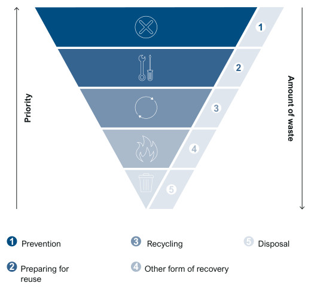 
## Waste prevention 
AT&S implements a clearly defined waste hierarchy to minimize the waste generated through manufacturing processes and mitigate the negative impacts associated with waste. The waste-related targets defined by AT&S are based on the different levels of the waste hierarchy: 
·Prevention: Reduce material waste through design optimizations and efficiency measures 
Metal recycling 

| in kg | 2025/26 | 2024/25 | Change |
| --- | --- | --- | --- |
| Copper | 2.431,020 | 367,703 | 561.1% |
| Gold | 238 | 211 | 12.7% |
| Silver | 87 | 42 | 106.0% |
| Palladium | 58 | 54 | 7.8% |
 
123

---

<!-- 原文第 124 页 -->

AT&S Annual Report 2025/26 
Group Management Report Advanced Technologies & Solutions 
·Reuse: lmplement initiatives to promote internal recycling and the use of secondary materials 
Recycling: Expand partnerships with suppliers to increase the proportion of recycled materials in the supply chain 
Recovery: Improve metal recovery and refinement processes to minimize resource losses 
Disposal: Ensure that non-recyclable waste is processed in line with environmental regulations 
Regular training on the handling and disposing of hazardous substances is vital. Collaboration with recycling companies is decisive to demonstrate proper and appropriate disposal of waste. We also engage with our colleagues in the industry as we search for alternative substances. 
## Responsible sourcing of minerals 
AT&S implements a comprehensive, internationally oriented due diligence process, which is binding along the entire supply chain, to mitigate the negative impacts of the upstream mining and processing of critical raw materials - in particular the consumption of non-renewable resources and resource-intensive treatment steps. This includes the obligation to exclusively source raw materials which neither directly nor indirectly have any connection with pollution,human rights violations or unethical practices, as well as compliance with the regulatory requirements of the Dodd-Frank Act (Section 1502) and EU Regulation 2017/821,as set out in the general terms and conditions.As part ofthe Responsible Minerals Initiative (RMI),AT&S uses standardized tools such as the Conflict Minerals Reporting Template (CMRT) to transparently trace and regularly evaluate the origin of relevant minerals as well as the smelteries and refineries employed. Suppliers whose material may contain tin, tantalum, tungsten or gold are contacted periodically, or as needed, and required to make disclosures based on established RMI standards. AT&S strives to source raw materials only from compliant smelteries and mines which are audited by the RMI, thus strengthening control of resource-intensive upstream processes and the transparency ofpotential ecological risks in the upstream value chain. 
## E5-3 - Targets related to resource use and circular economy 
The defined targets are directly related to the objectives of our Environmental Policy, especially in relation to resource use. 
The waste target set for the financial year 2025/26 was to produce up to 500 kg of recycled copper per day at our location in Leoben-Hinterberg, Austria. However,due to capacity utlization,the results amounted to 250 kg per day. We expect to produce approximately 400 kg of copper per day in the financial year2026/27.The recycling system is designed to process up to 1,000 kg per day to accommodate any future increase in production levels. 
We set our target voluntarily, with no stakeholders directly involved in setting this target. We plan to establish new, far-reaching targets as part of the ESG Strategy 2030, scheduled to enter into force in the financial year 2026/27.These targets will address increased use of secondary raw materials (for gold and copper), and we will strive for "Zero Waste to Landfll"certification for the locations. Data analyses were carried out in the financial year 2025/26to review the status and prepare a roadmap for certification. 
## E5-4 - Resource inflows 
Resource inflows are essential for the manufacture of AT&S products.These resources include raw materials, equipment, machinery, tools and infrastructure.The ultra-modern printed circuit boards and substrates produced by AT&S require a number of raw materials. They range from basic materials (primarily cores, laminates and prepregs) and metals such as copper, gold and palladium to a variety of chemicals that enable us to create conductive pathways on our printed circuit boards. The chemicals we use include sodium hydroxide, sulfuric acid, hydrogen peroxide, lacquer and several other chemicals. 
124

---

<!-- 原文第 125 页 -->

AT&S Annual Report 2025/26 
Group Management Report Advanced Technologies & Solutions 
The table "Resource inflows" shows the total weight of product-related resource inflows. To improve the data quality, goods received are used as data basis as of the financial year 2025/26 instead of orders. Gold is purchased in the form of salts and palladium in the form of solutions, whose metal content is known and can be used to calculate the weight of metal. Pure copper is purchased in kilograms, meaning that this weight is directly available.Copper foil is also purchased in pieces, where the weight can be calculated based on the length, width and thickness. Basic materials are also purchased in pieces. In such cases, however, the product weight is not directly available because each purchased product is composed of different materials of varying weights.For this reason, purchased products are clustered and their weight calculated based on an average weight factor per cluster.By contrast, chemicals are purchased in all unit sizes. In most cases,suppliers provide a conversion factor for each material, which can be used to convert the purchased quantity of each chemical from the purchased unit to the mass unit. If this is not possible,we make appropriate assumptions. 
We are increasingly mindful of purchasing recycled materials, especially copper and gold. In the reporting year, we purchased 1,761t of recycled copper, which corresponds to 50.2% of our total purchased copper. We purchased 0.11 t of recycled gold, which corresponds to 21.4 % of our total purchased gold. This represents a combined 1.0% of our total resource inflows by weight. The distinction between recycled and non-recycled materials is based on certificates provided directly by suppliers. If a certificate of conformity is provided, the respective weight is added to the total quantity of recycled copper or gold. 
## Regarding packaging, the recycled content differs for the three packaging levels. 
Primary packaging - Primary packaging is the packaging type in direct contact with the product. Its main purpose is to protect the products and to maintain their ideal properties. The primary packaging of a product is the first material or the first layer in which it is enclosed, and which defines its smallest sales unit.In the reporting year, 154.7 tof primary packaging were purchased, of which the recycled content amounts to less than 1% according to supplier information. 
Secondary packaging - The purpose of secondary packaging is to create shipping units that combine different types of primary packaging to facilitate storage,transport and handling. In general,these are cardboard or other materials of different sizes and thickness, but also plastic film. In the reporting year, 672.0 t of secondary packaging were purchased, of which the recycled content amounts to 85 % according to supplier information. 
Tertiary packaging - Tertiary packaging is usually the outer packaging layer, the final and largest packaging element, which is also stored and handled in the warehouse.Pallets made of different materials are the most common type of tertiary packaging.In the reporting year, 430.7 tof tertiary packaging were purchased, of which the recycled content amounts to 5% acording to supplier information. 
Resource inflows 

| int | 2025/26 | 2024/25 | Change |
| --- | --- | --- | --- |
| Gold | 0.49 | 0.48 | 3.2% |
| Palladium | 0.28 | 0.30 | (7.5%) |
| Copper | 3,511.07 | 3,171.31 | 10.7% |
| Base materials | 4,007.12 | 3,631.25 | 10.4% |
| Chemicals | 169.061.01 | 168,417.78 | 0.4% |
| Total weight | 176.579.97 | 175.221.13 | 0.8% |
 
125

---

<!-- 原文第 126 页 -->

AT&S Annual Report 2025/26 
Group Management Report Advanced Technologies & Solutions 
The recyclability of packaging articles can be influenced by different local conditions, ranging from the availability of appropriate technologies for the processing of materials and separation at the place of disposal to the possibilty of reusing items (e.g.pallets). 
We do not use any biological materials to manufacture our products. Based on the current materiality and risk assessment, rare earths are not material for AT&S in the financial year 2025/26.Accordingly,no specific processes or measures were prioritized in connection with rare earths; the topic will continue to be observed as part of regular reviews. 
The figures on resource inflows are not externally validated, but there is an internal verification process, which involves the four-eyes principle. 
## E5-5- Resource outflows 
AT&S manufactures products designed for a long service life, in line with our customers' specifications and in combination with our own expertise in relation to reliability and durability. Printed circuit boards and IC substrates are usually designed in such a way that they are not the first components that fail in a system. 
Reusability:Our printed circuit boards are designed for a very specific purpose and so, in most cases, cannot be reused for other purposes. 
Repairabilt: A printed circuit board is not designed to be repaired, as individual layers are not accessible after production. 
Dismantling: A printed circuit board cannot be dismantled without destroying it. 
Reprocessing: Given that printed circuit boards cannot be dismantled without destroying them, they cannot be reprocessed. 
Recycling: The first materials for printed circuit boards that, in theory, open the door to recycling dielectric material have been developed - but are not yet widespread. The copper in printed circuit boards can be recycled, along with small quantities of other materials, but only by destroying the printed circuit board 
## ·Recovery: It is not yet possible to recover used printed circuit boards and IC substrates. 
The figures on resource inflows are not externally validated, but there is an internal verification process, which involves the four-eyes principle. 
## Products and materials 
AT&S products are not designed for a specific service life.Instead, they are designed to meet customers'specifications, which determine the corresponding test cycles for electromechanical and thermomechanical tests in accordance with IPC standards (e.g. IPC TM-650).Printed circuit boards for the automotive industry, for example, are subject to specific requirements - such as the ability to withstand at least 1,000 temperature cycle test(TCT) loops, which is designed to simulate a service life of roughly ten years. The cycle parameters are defined specifically by customers, either for a product category or for each individual product. Various factors influence the expected service life of printed circuit boards and IC substrates, including usage behavior and the conditions in which the end product is used. AT&S has no influence on these factors and therefore cannot quantify the expected service life of its products. However, printed circuit boards and IC substrates are not limiting factors for the end product. The planned service life can vary significantly depending on the type of end product. No (average) figures are available for our industry at present. 
We calculated our products' recycling rate using our internal LCA tool, based on a sample product from our plant in Leoben-Hinterberg, Austria, with a representative structure. Given that the quantity of dielectric material increases with each additional layer on the circuit board, the proportion of copper in a printed circuit board remains relatively consistent. The largest variable factor in this calculation is the etched copper surface. We assumed an estimated surface area of 50%.Copper is the only recyclable material used at present (along with,potentially, the metals in the surface coating, which are not considered here). At present, there is no known method of recycling the dielectric material (epoxy resin and fiber glass) or the 
126

---

<!-- 原文第 127 页 -->

AT&S Annual Report 2025/26 
Group Management Report Advanced Technologies & Solutions 
solder resist. Taking these assumptions into account, we estimate the recycling rate for our printed circuit boards to be around 50%.The secondary packaging we use is fully recyclable. 
## Waste 
AT&S commissions licensed partners with the dis posal of waste, which is classified as hazardous and non-hazardous waste in accordance with national law. The waste generated at AT&S is primarily composed of copper-containing electroplating sludge, etching agents and electronic waste. The materials in this waste are mostly metals, critical raw materials and plastics. 
All data results from direct measurements and information provided by disposal companies. No radioactive waste is produced at AT&S sites. 
Waste amount 

| int | 2025/26 | 2024/25 | Change |
| --- | --- | --- | --- |
| Total amount of waste generated | 47,055 | 41,838 | 12.5% |
| Hazardous waste diverted from disposal | 33,338 | 27,307 | 22.1% |
| Hazardous waste diverted from disposal due to preparation for reuse | | 498 | n.a. |
| Hazardous waste diverted from disposal due to recycling | 32.417 | 26.330 | 23.1% |
| Hazardous waste diverted from disposal due to other recovery operations | 922 | 479 | 92.4% |
| Non-hazardous waste diverted from disposal | 6.893 | 6,782 | 1.6% |
| Non-hazardous waste diverted from disposal due to preparation for reuse | 271 | 360 | (24.6%) |
| Non-hazardous waste diverted from disposal due to recycling | 6,577 | 6,310 | 4.2% |
| Non-hazardous waste diverted from disposal due to other recovery operations | 45 | 112 | (59.5%) |
| Hazardous waste directed to disposal | 3.849 | 4.909 | (21.6%) |
| Hazardous waste directed to disposal by incineration | 2.474 | 3.040 | (18.6%) |
| Hazardous waste directed to disposal by landfiling | 591 | 1,019 | (42.0%) |
| Hazardous waste directed to disposal by other disposal operations | 785 | 850 | (7.6%) |
| Non-hazardous waste directed to disposal | 2.974 | 2.840 | 4.7% |
| Non-hazardous waste directed to disposal by incineration | 2.511 | 2,536 | (1.0%) |
| Non-hazardous waste directed to disposal by landfiling | 462 | 303 | 52.4% |
| Non-hazardous waste directed to disposal by other disposal operations | 0.4 | 0.2 | 100.0% |
| Non-recycled waste | 6.823 | 7,749 | (11.9%) |
| Percentage of non-recycled waste | 14.5 | 18.5 | (21.7%) |
| Total amount of hazardous waste | 37,188 | 32,216 | 15.4% |
 
127

---

<!-- 原文第 128 页 -->

Group Management Annual Report 2025/26 Report Advanced Technologies & Solutions 
AT&S 
Social

---

<!-- 原文第 129 页 -->

AT&S Annual Report 2025/26 
Group Management Report Advanced Technologies & Solutions 
## ESRS S1-Own Workforce 
## General 
## SBM-3 - Material impacts, risks and opportunities and their interaction with strategy and business model 
Based on the materiality assessment described in the IRO-1 section of chapter ESRS 2, AT&S has identified the following material impacts, risks and opportunities: 

| IROS | Category | Value chain | Time horizon |
| --- | --- | --- | --- |
| Secure employment | | | |
| Stable income and livelihod securily for employees through stable jobs/employment | positive impact | AKV | |
| Working time | | | |
| Negative infuence on health and well-being of employees through working hours (shift work, suficent recovery time, etc,) especially when building new sites | negative impact | A医V | |
| Unattractive working conditions (l.e. excessive working hours,shift work) can lead to fluctuations or potentially make it more difficut to recruit new (highl qualfie) employees, leading to shortage of sklled employees and subsequently to reduced capacity | risk | A测V | " |
| Adequate wages | | | |
| Improving working conditions (incl.adequate wages) by increasing transparency through open dialogues and displaying the minimum salary when advertising jobs | positive impact | A | |
| Unexpected increase in living costs and standards or unproportional wage increases by other companies competing for skilled labor can lead to unsatisfaction of workers with AT&S wages and consequently result in fluctuations or potentially make it more diicut to recruit new highly qualfied) employees, leading to shortage of skilled employees and subsequently to reduced capacity | risk | A | |
| Social dialogue,freedom of association,works counclls and the information,consultation and participation rights of workers | | | |
| Creation of opportunities to increase involvement of employees in employee relevant matters (e.g. offering the opportunity to create works councils or similar associations,employee representations) | positive Impact | A | |
| Work-life balance | | | |
| Decreasing the well-being of employees through frequent overtimes | negative impact | AKV | |
 
Value chain localization 
>5 years oo 
1-5 years 
0 
<1year 
Time horizon 0o 
upstream 
own operalions downstream 
129

---

<!-- 原文第 130 页 -->

AT&S Annual Report 2025/26 
Group Management Report Advanced Technologies & Solutions 
Based on the materiality assessment described in the IRO-1 section of chapter ESRS 2,AT&.S has identified the following material impacts, risks and opportunities: 

| IROS | Category | Value chain | Time horizon |
| --- | --- | --- | --- |
| Gender equality and equal pay for work of equal value | | | |
| Reinforcing society's perception of gender roles (and the male leadership role) by having a low proportion of women among the managers througout the company | negative impact | A 又 | |
| Contribution to the (incia) inequallty nd dicriminationof omen through gender pay gap | negative impact | A V | |
| Training and skills development | | | |
| Promoting employees' knowledge and strengthening their employabity with regard to complex labour market requirements (eg.digitalisation, technical expertise) | positive impact | A V | |
| Investments in staff training/new technologies and capacity building to ensure compliance with new regulations, stay updated on sustainable manufacturing practices, and foster a culture of continuous improvement and thereby maintain/obtain skilled labor | opportunity | A V | …. |
| Employment and inclusion of persons with disabilities | | | |
| Contribution to the non-inclusion of people with disabity in the workplace and society through maintainance of physical barriers to accessibility in plants | negative impact | AX> | … |
| Promoting knowledge and innovation through diversiy among employees and inclusion of people with disabilities | positive impact | A V | |
| Measures against violence and harassment in the workplace | | | |
| Influence on the mental health of employees and on social cohesion through discriminatory behaviour and abuse of power in the company | negative impact | AXV | |
| Diversity | | | |
| Increase in employee satisfaction and motivation through diversity in the company | positive impact | A V | |
 
Value chain localization 
>5 years O 
O 
1-5 years 
O 
C 
<1 year 
Time horizon oo 
upstream 
own operations 
downstream 
The described IROs relate to our holistic business model. 
130

---

<!-- 原文第 131 页 -->

AT&S Annual Report 2025/26 
Group Management Report Advanced Technologies & Solutions 

| IROS | Category | Value chain | Time horizon |
| --- | --- | --- | --- |
| Child labour | | | |
| Potential of child labour which lead to related educational deficits, damage to healt, lack of age-appropriate social contacts and devel- opment opportunities | negative impact | A测V | |
| Forced labour | | | |
| Impact on employees' human rights and wellbeing (mentally,socially, financially) through incidents of forced labour (not prevented forced labour) | negative impact | AXV | |
| Adequate housing | | | |
| Improved housing situation of own employees through social measures e.g.promtingaffordable ousing,offering subidies for housing costs, partnering with non-proft organizations to facitate access to adequate housing) | positive impact | A V | |
| Privacy | | | |
| Harm of employees's right to privacy through non GDPR compliant behavlour (e.g.of HR/leadership personnel) | negative impact | AX又 | |
| Harm of employees's right to privacy through lack of prevention of cyber attacks and data theft | negative impact | AXV | |
 
Value chain localization upstream own operations downstream 
Time horizon oo <1year O O 1-5 years 0 >5 years 
The described IROs relate to our holistic business model. 
The material negative impacts result from systemic conditions in the company's operating context. The impacts on health and well-being related to working time (e.g., shift work and recovery phases) and the risk that unreasonable working conditions can lead to employee turnover and limitations in personnel recruitment are related to our manufacturing busi-ness model and the strategic priorities of capacity increase, high yield,on-time delivery and competitive costs. 
The identified impacts support the adaptation of our strategy and our business model, including strengthening of grievance and remediation mecha-nisms as well as improved personnel planning to reduce excessive overtime. A detailed description of these elements is embedded in our measures. 
The ILO ("International Labour Organization"),the IOM("International Organization for Migration") of the UN ("United Nations") and the Walk Free Foundation,which publishes "Modern Slavery Index", write in their report "Global Estimates of Modern Slavery: Forced Labour and Forced Marriage",Sep 
131

---

<!-- 原文第 132 页 -->

AT&S Annual Report 2025/26 
Group Management Report Advanced Technologies & Solutions 
tember 2022,that the Asia-Pacific region has the highest numbers of forced labor and child labor. Our production facilities in Chongqing and Shang-hai, China, as well as Kulim, Malaysia,and Nanjan-gud, India, are located in this region. 
Own workers such as shift workers, maintenance technicians and engineers are predominantly affected by material negative impacts. Non-employee workers within the own workforce of AT&S are per sons whose work is managed by AT&S (e.g.,temporary workers, contractors operating on site and workers provided by third parties who work under the leadership of AT&S).These workers are part of our own operations and are distinguished from workers in the value chain, who are disclosed in accordance with ESRS S2. 
Persons with disabilities represent a material group of individuals among the company's workforce who are, or could be, affected by negative impacts. 
S1-1- Policies related to own workforce AT&S has established comprehensive policies to manage material impacts, risks and opportunities related to its own workforce. The central documents guiding this approach are the People & Human Rights Policy and the AT&S Code of Ethics and Conduct, which are binding for all AT&S locations and all employees. 
These policies cover the entire workforce of AT&S, including specific groups such as migrant workers, young workers and people with disabilities. Likewise, they apply to contractors and external staff operating on the premises of AT&S or under the supervision of AT&S. Their scope of application reflects the material topics identified as part of our due diligence processes, including fair working conditions, equal treatment, safe workplaces and freedom of association. 
The People & Human Rights Policy defines AT&S's commitment to the protection of internationally recognized human rights and compliance with relevant labor, social and occupational safety regulations. 
These include, among others, the UN Guiding Principles of Business and Human Rights, the ILO Declaration of Fundamental Principles and Rights at Work and the OECD Guidelines for Multinational Enterprises. It aims to prevent or mitigate adverse human rights impacts that can arise from our activities,products or business relationships. The policy is publicly available on the AT&S website.The company's own workforce is involved in the development and revisions of corporate policies through the Works Council and other employee representations. In addition, feedback from employee surveys and regular dia logue formats are included in the policy development process so that the perspectives of the workforce are systematically taken into account. 
The obligations of AT&S are established in international human rights and labor standards. The People & Human Rights Policy and the AT&S Code of Ethics and Conduct,which was created based on the Responsible Business Alliance (RBA) Code of Conduct, serve as a binding guideline on central topics such as the prohibition of forced labor, human trafficking and child labor. All employment relationships are voluntary, and workers can terminate their employment without any sanctions; at the same time, they wil kep access to their personal documents. All workers receive written employment contracts;, migrant workers receive such contracts prior to departure from their country of origin. Young workers under the age of 18 may not perform any dangerous work nor work at night or overtime. 
In accordance with the AT&S Code of Ethics and Conduct, working hours must not exceed 60 hours per week, andwage deductions as disciplinary measures are not permitted. AT&S respects the right of employees to form or join trade unions, participate in collective bargaining and to peaceful assembly, as well as the right to refrain from such activities. 
An adequate governance structure ensures that these obligations are effectively implemented.The Management Board bears overall responsibility for sustainability management, approves the corresponding policies and monitors compliance with 
132

---

<!-- 原文第 133 页 -->

AT&S Annual Report 2025/26 
Group Management Report Advanced Technologies & Solutions 
these policies in accordance with global best practices. The Corporate Human Resources department is responsible for the implementation of the People & Human Rights Policy throughout the company and is supported by local HR and sustainability teams. 
AT&S monitors compliance with its policies through internal control mechanisms, audits and employee engagement. All concerns or incidents relating to human rights or working practices fall under the responsibilities of the Audit& Compliance department, which coordinates investigations together with specialist departments and reports relevant cases to the Management Board and Supervisory Board. 
If adverse human rights impacts are identified,regardless of whether they were caused or contributed to by the company,AT&S commits to taking or supporting appropriate remedial action in accordance with internationally recognized standards 
In addition,the People&Human Rights Policy also addresses combating discrimination. The implementation of the policy is based on clearly defined processes which drive prevention of discrimination, its effective mitigation and consistent follow-up on identified cases, while at the same time promoting diversity and inclusion. AT&S is committed to a zero-tolerance policy regarding any form of discrimination, including discrimination based on gender,ethnicity, disability, age or sexual orientation, which is reflected in both the ESG Policies and the AT&S Code of Ethics and Conduct. 
AT&S actively strives to prevent any complicity in human rights violations, to comply with all applicable labor and social laws and to follow internationally recognized principles. Harassment or any form of unlawful discrimination against our employees in the workplace will not be tolerated. 
Any form of discrimination or harassment of workers based on color, age,gender, sexual orientation, gender identity and expression, ethnicity or national origin, disability,pregnancy, religion, political affilia tion,union membership, veteran status,genetic information or marital status is neither tolerated in the hiring process nor during employment. 
In addition,workers are provided with reasonable accommodation for religious practices and disability at some production sites, which is also governed by the AT&S Code of Ethics and Conduct. The People& Human Rights Policy and the AT&S Code of Ethics and Conduct are applicable at all levels and at all locations. The department head of Corporate Human Resources is responsible for the operational implementation of the People & Human Rights Policy. 
All companies of the AT&S Group and activities of contractors at AT&S locations or under our leadership must meet the requirements of our policies.Discrimination or harassment at the workplace is not tolerated. 
AT&S ensures that the policies are properly communicated and easily accessible.This is based on: 
·Multilingual training material and announcements which consider the diversity of the company's workforce. 
Digital platforms such as intranet portals and mobile apps offering easy access to updates and grievance mechanisms. 
On-site communication methods, including notice boards and meetings with team leaders to provide access for workers who do not have digital access. 
AT&S leadership principles as guidance AT&S assigns responsibility for equal treatment and opportunities at the management level, issues clear company-wide policies and procedures to advance fair employment practices and links professional development to the desired performance in the respective area of responsibility. 
Clear orientation for employees and managers forms the basis for responsible practices. Openness,a sense of responsibility and effective communication at all levels are of central importance. AT&S introduced binding leadership principles two years ago to 
133

---

<!-- 原文第 134 页 -->

AT&S Annual Report 2025/26 
Group Management Report Advanced Technologies & Solutions 
ensure the sustainable development of this area. These leadership principles were developed by engaging central stakeholders and identifying specific behaviors that align with the company's purpose, vision, mission and values of AT&S. Defined leadership principles, known as "C.A.R.E"(Communication,Accountability, Relationship & Excellence), aim to support managers in achieving the corporate goals together with their teams. 
## S1-2- Processes for engaging with own workforce and workers' representatives about impacts 
AT&S is aware that effective and continuous engagement with our own workforce is a key factor in adequately managing actual and potential impacts on employees at all global sites. The company engages in an active and mutual dialogue with its workforce to obtain feedback on operational practices, working conditions, professional development and general well-being.The findings are directly incorporated in decision-making processes and contribute to the continuous improvement of personal impacts. 
In addition, AT&S takes measures to obtain insights into the perspectives of workers who may be particularly vulnerable to impacts and/or are marginalized. The company developed an e-learning course on "Unconscious Bias" in the financial year 2023/24 to promote an inclusive work environment and raise awareness for unconscious thought patterns.The course helps to prevent systematic wrong decisions and to make better entrepreneurial decisions. 
Employee engagement extends along all phases of the employment relationship - from recruiting and onboarding to ongoing employment and formal feedback and complaint processes. The engagement occurs on a regular basis and uses different formats, including direct communication, structured feedback systems, training programs as well as recurring surveys on employee satisfaction. It takes place continuously and comprises planned assessments and reviews to ensure that the needs and concerns of employees are adequately considered. 
## The company ensures an active exchange with employees based on: 
Employee surveys: regularly conducted surveys of employees to systematically collect feedback on working conditions, professional development and individual well-being, at intervals of two to four years. 
Worker representation: working with works councils or equivalent bodies to process workers' concerns, in particular in regions with formal representation structures. 
Workshops and town halls: meetings for a specific occasion offer platforms for a direct exchange between management and employees,promote open and transparent communication and enable the systematic collection of proposals that can be implemented; they take place 2 to 4 times a year. Breakfast Club: informal meetings between the Management Board and employees, which offer an informal opportunity for feedback and exchange and take place four to five times a year. The idea was initiated by the employees and supported by management. 
At the Austrian sites,a collective agreement is in place which governs collaboration with the Works Council and ensures that the human rights of the workforce are upheld. Outside the EU, similar structures of employee representation such as trade unions or works councils are not widely established. 
Managers and company representatives who are responsible for safeguarding the engagement and integrating the results into the corporate approach include the Head of Audit & Compliance and the department head of Corporate ESG & Quality. Senior management regularly reviews the status of the management systems. 
The engagement practices are ongoing and are adapted to the needs of the workforce, in particular during important transition phases or major operational changes. The Corporate Human Resources department monitors the engagement processes in col 
134

---

<!-- 原文第 135 页 -->

AT&S Annual Report 2025/26 
Group Management Report Advanced Technologies & Solutions 
laboration with the ESG team; the overall responsibility lies with the department head of Corporate Human Resources. 
## S1-3- Processes to remediate negative impacts and channels for own workforce to raise concerns 
AT&S has established a clearly defined remediation process in compliance with the law, which ensures effective remediation for actual or potential impacts on its own workforce,workers in the value chain or affected communities. The company's approach is based on internationally recognized principles such as reparation, compensation, rehabilitation and guarantees of non-recurrence and is consistent with the AT&S Code of Ethics and Conduct and the Global Whistleblowing Policy. In cases of confirmed misconduct, adequate corrective action is taken; if necessary, disciplinary or legal action follows to eliminate the underlying causes and to prevent other incidents. If workers suffer financial damage, AT&S will provide reparation or compensation, for example by reimbursement of recruiting-related fees, in acordance with its labor and human rights obligations. In the event of health and safety impacts, AT&S supports rehabilitation and reintegration of employees through established systems for incident management and occupational safety. 
AT&S offers easy-access grievance mechanisms in all countries in which the company operates, which enable internal and external stakeholders to file complaints or raise concerns. All complaints receivedwhether through HR complaint processes or the AT&S SpeakUp Platform - are actively recorded, reviewed and investigated in order to ensure proper and effective processing and derive adequate measures if necessary. Employees as well as external stakeholders are expressly protected from suffering disadvantages and retaliation if they file a report in good faith; the corresponding protective measures are stipulated in the corporate policies and the Whistleblowing Policy.AT&S has established confidential complaint processes, including the globally available AT&S SpeakUp Platform, and informs employees about these options during onboarding and regular training. Complaints filed on the AT&S SpeakUp Platform are monitored by the Audit & Compliance department and addressed with the local management to ensure timely and proper clarification as well as efficient and proper processing. Corrective actions are systematically integrated into operational processes to prevent recurrence. Employees can view the status of their report and directly enter into contact with the Compliance department via the platform's secure two-way communication. The effectiveness of the grievance mechanisms is regularly reviewed through monitoring and defined performance indicators. 
All concerns received are impartially assessed and investigated by Audit & Compliance or other quali fied, neutral functions, in compliance with set deadlines and procedural safeguards. The receipt of whis tleblowing reports is confirmed within seven days, and the persons filing a report are informed about the results and follow-up measures within three months. Cases of non-compliance and workplace-related complaints are channeled appropriately; workplacerelated complaints are processed by Corporate Human Resources according to a structured escalation process with clearly defined deadlines. Investigations ensure objectivity, the right to a hearing and compliance with all relevant requirements regarding data privacy and labor law. 
Upon completion of an investigation, adequate remedies are developed jointly by the Audit & Compliance, Corporate Human Resources and Legal, line management and - if required - ESG and human rights functions. 
AT&S ensures that affected individuals are actively involved - where appropriate and maintaining safety in line with the company's commitment to effectively engaging with employees and stakeholders as well as access to remediation mechanisms. Remedies include, among other things, rehiring, back payment or reimbursement, reasonable precautions,adaptations of shift plans, disciplinary measures, targeted training or operational changes to eliminate 
135

---

<!-- 原文第 136 页 -->

AT&S Annual Report 2025/26 
Group Management Report Advanced Technologies & Solutions 
causes. The affected operational areas are responsible for implementation, which takes place promptly and effectively. 
AT&S reviews the effectiveness of remedial action taken by systematically analyzing recurring cases, assessing the sustainability ofmeasuresimplemented and conducting confidential follow-up talks with affected persons. The findings gained are incorporated into continuous improvement processes, risk assessments as well as internal and external audits. This approach supports the comprehensive efforts of AT&S to ensure responsible business conduct, ongoing due diligence obligations and avoidance of negative impacts along the entire value chain. 
S1-4- Taking action on material impacts on own workforce, and approaches to managing material risks and pursuing material opportunities related to own workforce, and effectiveness of those actions 
AT&S develops preventive measures based on the results of the material IROs, which were identified with cross-departmental teams, employee surveys, inspections regarding health and safety at work,minimum social safeguards and legal requirements. Based on integrated risk and impact assessments, occupational health and safety measures, fair procurement and time targets, and responsible use of data, AT&S ensures that material negative impacts are mitigated. When business requirements, for example in connection with delivery dates, conflict with the principles of occupational health and safety, AT&S follows the clear principle of prevention over efficiency. In such cases,decisions are made together with the Corporate Human Resources department,the Audit & Compliance department and the Management Board. Priority is given to the protection and well-being of employees, in particular regarding health, safety and decent working conditions. 
Individual actions are taken for the large number of material impacts of AT&S. They range from surveys on employee satisfaction to mandatory training courses. 
## Secure employment and adequate wages 
AT&S promotes secure and stable employment by regularly assessing all functions in the global business segments and ensuring remuneration with fair and competitive market wages. To ensure attractive, fair and adequate wages, the Corporate Human Resources department carries out annual job evaluations as well as external and internal remuneration benchmarks,supported by local HR teams. This globally valid process covers all employee groups at all locations (except non-employees in the own workforce) and is firmly embedded in the annual remuneration cycle.Based on a uniform job grading framework, Corporate Human Resources identifies functions whose remuneration is below the defined wage bands and makes adjustments in order to ensure internal wage justice and external competitiveness. In this process, increasing cost of living and changing market conditions as well as statutory wage adjustments and annual salary reviews are taken into account. Using this structured global approach, AT&S strengthens secure employment, contributes to avoiding employee turnover and hiring problems, and supports securing its employees' livelihood. 
## Working time and work-life balance 
Unattractive working conditions such as long working hours and shift work cause high employee turnover and make recruiting more difficult.This leads to increased recruiting and training costs and burdens AT&S's finances. The key measures in this area are clearly defined shift models, which are applicable at all locations and in all regions and provide for uniform weekly working hours,covering 100% of the employees. The implementation of this measure is ongoing, and its effectiveness is quantified based on employee satisfaction as part of half-yearly surveys. More than 100 working hour models support work-life balance. 
## Involvement in issues relevant to employees 
In accordance with the AT&S Code of Ethics and Conduct, AT&S respects the right of all workers,in 
136

---

<!-- 原文第 137 页 -->

AT&S Annual Report 2025/26 
Group Management Report Advanced Technologies & Solutions 
conformance with local law, to form and join trade unions of their own choosing, to bargain collectively and to engage in peaceful assembly, as well as the right of workers to refrain from such activities. Workers and their representatives can openly communicate and share ideas and concerns with management regarding working conditions and management practices without having to fear discrimination, retaliation, intimidation or harassment. Where freedom of association and the right of collective bargaining is legally restricted, workers are allowed to elect and join alternate lawful forms of worker representation. This is an ongoing measure. 
## Child labor 
AT&S has introduced a Group-wide procedure to prevent child labor and to protect young workers under the age of 18 in order to effectively prevent a human rights risk particularly relevant in certain regions and recruiting channels. This program is applicable to all AT&S locations and companies and covers both the company's own workforce and non-employees within the own workforce whose activity is managed by AT&S (for example, temporary workers employed on site). Responsibility lies with Corporate Human Resources (Global Talent & Employee Relations) and Audit & Compliance,while the local HR teams are responsible for the operational implementation at the locations. The program is fully implemented and follows an annual cycle with regular control and effectiveness tests. 
Prior to hiring and on the first day of work, systematic identity checks are performed to ensure age verification; these checks are complemented by additional document controls depending on risk, especially for migrant workers. Protection of workers under the age of 18 comprises clear limitations of activities, which prohibit performing dangerous work, as well automated shift plan rules which automatically block night shifts and overtime.In addition, the respective managers are required to check and approve the corresponding work assignments; monthly exception reports ensure additional transparency and control. Based on this holistic approach, AT&S ensures that young workers are protected and that no form of child labor takes place in its own employment context. 
## Forced labor 
This IRO reflects a systemic and industry-specific risk resulting from sector-specific conditions and global production sites. It does not mean that AT&S has identified cases of forced labor in its own operations. 
AT&S does not unreasonably restrict the employees' freedom of movement; likewise, there are no unrea sonable restrictions for entering or leaving facilities, including living quarters or accommodation provided by AT&S. All employees receive a written employment contract as part of the hiring process, in which the contractual terms and conditions are specified in their native language or a language they understand well. 
All work is voluntary, and workers are free to leave work at any time or terminate their employment without penalty if reasonable notice is given as per the worker's contract. AT&S, agents or sub-agents will not hold or destroy identity or immigration documents, such as passports, identfication cards or work permits. AT&S maintains documentation on all leaving workers and only holds documents if legally required. Nevertheless, workers always have access to their documents at all times. Workers may not pay any recruitment fees to employers, agents or subagents. If any such fees are found to have been paid by workers, such fees will be repaid to the worker. This is an ongoing measure. 
## Adequate accommodation 
AT&S supports new employees from abroad with inexpensive accommodation options when they start working for the company. This is an ongoing measure. 
## Data privacy 
AT&S operates a Group-wide program to protect personal data of employees and other affected individuals. In its role as an employer, AT&S processes personal data exclusively on the basis of the applicable data protection laws, in particular the EU General 
137

---

<!-- 原文第 138 页 -->

AT&S Annual Report 2025/26 
Group Management Report Advanced Technologies & Solutions 
Data Protection Regulation (GDPR). Data processing takes place lawfully, with purpose limitation, transparently and in compliance with the principles of data minimization, storage limitation, integrity and confidentiality. 
AT&S has implemented binding processes, technical and organizational measures as well as standardized documentation and test procedures to ensure data protection conformity,including structural assessments of the categories of data, legal basis, groups of data subjects, data sources and storage periods. These are established in the Group-wide policies and in the GDPR questionnaire. 
All employees and service providers who process personal data on behalf of AT&S are required to comply with these rules. Training and regular controls ensure that data is only processed to the extent legally permitted. This is an ongoing measure, which is continuously monitored, including mandatory reporting of potential data breaches to the data protection coordinator. 
## Equal opportunities 
AT&S actively promotes equal opportunities and di versity to ensure that no group is disadvantaged. The company offers all employees equal development and career opportunities. Since signing the Diversity Charter in the financial year 2020/21,AT&S has been pursuing a policy of zero tolerance of any form of discrimination. The Diversity Charter is valid for the entire company at Group level. By signing the Diversity Charter, the organization committed to defining and implementing adequate measures to be taken in the event of violations of the principles of diversity, respect and appreciation. 
In the financial year 2025/26,the digital business coaching platform was used again.Employees are offered access to coaches in different languages via "CoachHub". Participants can independently book sessions and create a strengths profile.The digital business coaching platform is available at all locations. The performance management process is a key measure that applies to all white-collar employees worldwide. This measure is ongoing and leads to individually agreed performance and development goals, which are individually documented. The effectiveness of this measure is reflected in the high participation rates shown in the table "Performance and career development reviews". 
The company ffers intercultural training and language courses to promote diversity and constructively address cultural differences. The offer to participate in training and language courses is valid globally for persons moving to a new location. This measure is implemented continuously, and its effectiveness is reflected in improving the language skills of the employees concerned. 
## Education and training 
Training on policies and practices of non-discrimination are planned or have already been implemented. The company has programs to promote access to skills development or plans to introduce such programs. 
Everyone contributes to the development of the organization and shapes the company's future. AT&S is undergoing a growth phase and keeps evolving. Personal development and training are crucial to being successful in the high-tech industry. Only through employees who fully utlie their potential can AT&S grow sustainably and drive improvement. 
The departments for Learning & Development promote personal development and training based on numerous programs. Under the motto"We care about people",employees' expectations arereviewed on a regular basis, and measures are adapted accordingly. The company offers modern-design training and development, which includes both elearning courses and in-person training with internal and external experts. 
With a comprehensive onboarding program, AT&S promotes the integration of new employees and ensures that many different perspectives, in particular those of particularly affected or marginalized groups, 
138

---

<!-- 原文第 139 页 -->

AT&S Annual Report 2025/26 
Group Management Report Advanced Technologies & Solutions 
are taken into account. The program comprises local onboarding events on-site and a global online onboarding event enabling new employees to make virtual contact and learn more about the different AT&S locations,cultures and values. As a key component of the program is the buddy system, which provides support for new colleagues during the first six months. The onboarding process is accompanied by carefully prepared e-learning modules, material, checklists and support materials for managers and new employees. The program is continuously implemented at all sites. 
Investments in training, new technologies and capacity building are necessary to comply with legal requirements and to attract qualified workers. AT&S is already heavily investing in these areas to secure business success in the long term. Training is conducted worldwide and has no fixed timeframe, as courses take place continually. The number of employees who have participated in mandatory training is documented. 
## Intercultural workshops 
Established three years ago, the intercultural workshops on respect, tolerance and integration were continued in the financial year 2025/26.These workshops give new employees an opportunity to obtain information about Austrian customs and practices, tax law and discrimination in everyday life,and to engage with others. CINT,the Club International in Graz, also offers consultation hours free of charge at the site in Leoben-Hinterberg, Austria. An appropriate diversity and inclusion program will be developed in the coming years 
## Young Wilds 
The next round of the one-year "Young Wilds" program gave our younger employees the opportunity to make contact with managers, while at the same time advancing their own development and expanding their networks. Of more than 24 applicants from all locations, 15 were chosen:in the financial year 2025/26,they worked on projects, together with sponsors, managers and experts, and helped shape the future of AT&S. The program is global and based on the AT&S values open-mindedness, responsibility and innovative strength. 
A particularly remarkable component of this program is reverse mentoring, whereby the young employees accompany senior management, thus promoting communication and exchange between hierarchy levels as well as generations. 
## Persons with disabilities 
Currently, no measures with respect to persons with disabilities are defined. However,a diversity & inclusion program will be developed in the coming financial years. 
## Violence and harassment at the workplace 
In accordance with the AT&S Code of Ethics and Conduct,harassment or unlawful discrimination at the workplace is not tolerated. Workers are not discriminated against or harassed in the hiring process or during employment - for example regarding wages,promotions, rewards and access to training - based on the following characteristics: ethnic origin, color, age,gender, sexual orientation, gender identity and expression, ethnicity or national origin, disability, pregnancy, religion, political affiliation, union membership, veteran status,protected genetic information or marital status. 
AT&S has processes to effectively address complaints regarding violence and harassment at the workplace.Workers have access to confidential grievance mechanisms such as the AT&S SpeakUp Platform. This is an ongoing measure. 
## S1-5- Targets related to managing material negative impacts, advancing positive impacts, and managing material risks and opportunities 
AT&S did not define any measurable and outcomeoriented targets in the financial year 2025/26 related to its own workforce.The focus was on full and consistent compliance with the applicable and regulatory 
139

---

<!-- 原文第 140 页 -->

AT&S Annual Report 2025/26 
Group Management Report Advanced Technologies & Solutions 
minimum requirements at the local and international level. Against this backdrop, no separate targets to promote positive impacts are currently reported, as such targets would require a quantifiable ambition going beyond the legal minimum level. 
Nonetheless, the consistent implementation of exist ing policies, transparent processes and an open dialogue with employees contribute to fostering stable and secure employment, adequate working conditions, qualification, diversity, inclusion and social participation and thus achieving positive impacts on income,employability,motivation and well-being of the workforce. 
Instead, AT&S focuses on transparent management and effective implementation of the existing policies and processes to prevent or mitigate material negative impacts and to manage material risks and opportunities related to the own workforce. Against this backdrop, the company currently does not intend to define further measurable outcome-oriented targets. 
The effectiveness of the policies and measures related to material sustainability-related impacts, risks and opportunities is tracked based on employee turnover and employee feedback. 
## S1-6 - Characteristics of the undertaking's employees 
AT&S employed 12,944 persons (excl. non-employees) at the end of the financial year 2025/26.This corresponds to an increase by 3.4% compared to the previous year. 
The disclosures on the total number of employees in the tables "Headcount (at year-end)" and "Employees by contract type and gender" refer to closing date of the reporting period (March 31,2026). All personnel figures are actual data which are not based on any further assumptions 
For information on the total number of employees, reference is made to the table "Number of staff" under other disclosures in the notes to the consolidated financial statements, in which the average number of employees is presented in full-time equivalents. 
The comparable figures for contract types in section S1-6 were adjusted compared to the presentation published in the previous year. This was due to the incorrect allocation of certain groups of employees to temporary rather than permanent contracts in the previous year. The total number of employees remains unchanged after the reclassification.The difference between the numbers reported in the preceding period (7,406 temporary and 5,118 permanent contracts were reported) and the corrected comparable figures of permanent contracts and temporary contracts amounted to 3,008 employees respectively. 
The data on employee turnover refers to all employees who left the company during the reporting period (except interns). The average number of employees during the reporting years was defined as the denominator in the calculation of the rate. 
The financial years2023/24and2024/25were marked by comprehensive efficiency measures, which also involved significant adjustments in the number of staff. Due to the stabilization of the number of employees and the positive outlook, employee turnover returned to an adequate level. 
## S1-7 - Characteristics of non-employees in the undertaking's own workforce 
The total number of non-employees in our own workforce amounts to 1,358 persons at the end of the reporting period. These persons are not self-employed, but exclusively people provided by undertakings engaged in employment activities.They have an employment relationship with recruitment agencies and work for AT&S. They are subject to the same employee protection laws as AT&S employees. In the previous year, non-employees totaled 271 persons. The increase compared to the previous year is due to the fact that more non-employees were hired at the location in Kulim, Malaysia, and that recruitment agencies were initially used for staffing to a greater 
140

---

<!-- 原文第 141 页 -->

AT&S Annual Report 2025/26 
Group Management Report Advanced Technologies & Solutions 
## Headcount (at year-end) 

| Headcount | 2025/26 | | 2024/25 | Change |
| --- | --- | --- | --- | --- |
| Number of employees by category | | | | |
| White collar | 4,095 | | 4.198 | (2.5%) |
| Blue collar | 8,849 | | 8.326 | 6.3% |
| Total Employees | 12,944 | | 12,524 | 3.4% |
| Number of employees by gender | | | | |
| Male | 8.215 | | 7.984 | 2.9% |
| Female | 4.729 | | 4,540 | 4.2% |
| Other | 0 | | 0 | n.a. |
| Not reported | | 0 | 0 | n.a. |
| Total Employees | | 12,944 | 12,524 | 3.4% |
| Number of employees by country (at least 10% of total employees) | | | | |
| Austria | | 1,959 | 1,895 | 3.4% |
| China | | 8,122 | 8,050 | 0.9% |
| Malaysia | | 1.708 | 1.453 | 17.5% |
 
## Employees by contract type and gender 

| Headcount, fiscal year 2025/26 | Female | Male | Other | Not disclosed | Total |
| --- | --- | --- | --- | --- | --- |
| Number of employees | 4.729 | 8,215 | 0 | 0 | 12.944 |
| Number of permanent employees | 3,030 | 5,669 | 0 | 0 | 8.699 |
| Number of temporary employees | 1,699 | 2,546 | 0 | 0 | 4,245 |
| Number of non-guaranteed hours employees | 0 | 0 | 0 | 0 | 0 |
| Headcount,fiscal year 2024/25 | Female | Male | Other | Not disclosed | Total |
| Number of employees | 4,540 | 7,984 | 0 | 0 | 12,524 |
| Number of permanent employees | 2,786 | 5,340 | 0 | 0 | 8,126 |
| Number of temporary employees | 1,754 | 2,644 | 0 | 0 | 4.398 |
| Number of non-guaranteed hours employees | 0 | 0 | 0 | 0 | |
 
## Employee turnover 

| | 2025/26 | 2024/25 | Change |
| --- | --- | --- | --- |
| Employees who have left the undertaking (headcount) | 1,726 | 2,748 | (37.2%) |
| Rate of employee turnover (in %) | 14.0 | 20.8 | (32.9%) |
 
141

---

<!-- 原文第 142 页 -->

AT&S Annual Report 2025/26 
Group Management Report Advanced Technologies & Solutions 
extent. If performance and qualifications are satisfactory, fixed employment relationships for non-employees are intended 
## S1-9- Diversity metrics 
In addition to the age structure,the table "Diversity metrics" also shows the gender distribution at top management level. Due to the streamlining of the leadership organization,the number of persons both men and women - at top management level de clined significantly. 
Along with gender and age, the number of different nationalities of the workforce is also an important diversity indicator for AT&S. Overall, the company employed people from 70 nations in the financial year 2025/26, compared with 68 nations at the end of the financial year 2024/25. 
## S1-10 - Adequate wages 
All employees of AT&S are paid adequate wages in accordance with industry standards. 
To ensure this,AT&S uses comprehensive and renowned compensation market data of Aon Radford. These benchmarks are reviewed annually and form the basis for assessing and - if necessary - for adjusting compensation bands at all production sites as well as for the review and development of the individual compensation positioning of all employees. 
Aon Radford is chosen based on regular reviews of the benchmark participant base to ensure permanent relevance and significance of data. This is relevant insofar as many important partners and competitors of AT&S are represented in the data sets, enabling significant and market-based comparisons. 
## S1-12 - Persons with disabilities 
AT&S applies the following method with regard to persons with disabilties in order to understand workers with disabilities and the method of data collection: 
Austria: a person must have an officially determined degree of disability of at least 50% to be classified as a worker with a disability. The degree of disability is determined by the competent federal authority / public health service. 
China: the recognition of a disability is governed by a formal procedure, which is managed by the China Disabled Persons'Federation (CDPF). 
Malaysia: In Malaysia, there is currently no legal obligation to employ persons with disabilities. No workers with disabilities are currently employed at the location in Kulim. The identification of workers with disabilties would - in case of future employment - be based on the applicable local definitions and criteria. 
India: At present, no workers with disabilities are employed at the location in Nanjangud. A corresponding legal framework is still beng discussed at the government level and has not been officially adopted or published. Once a statutory regulation enters into force, the identification of workers with disabilities would be based on the applicable local legal criteria. 
Diversity metrics 
2025/26 2024/25 Change
Women at top management level(1st and 2nd levels under the Management Board)
Number(headcount) 34 69 (50.7%)
Share(in %) 26.0 30.0 (13.5%)
Age group(in %)
30-50 years <30 years 25.2 68.1 25.9 67.7 (2.7%) 0.6%
>50 years 6.7 6.4 5.1% 
142

---

<!-- 原文第 143 页 -->

AT&S Annual Report 2025/26 
Group Management Report Advanced Technologies & Solutions 
The percentage of persons with disabilities among the AT&S workforce is 0.42% as of March 31, 2026. In the previous year, the percentage amounted to 0.39%. 
## S1-13-Training and skils development metrics 
The table "Performance and career development reviews" contains information on the regular appraisal and development interviews, including a breakdown by gender. These interviews are conducted with those employees for whom the management performance process based on the financial year is designed.These include white-collar workers worldwide and -depending on the location - selected parttime workers and trainees. Blue-collar workers,nonemployees,interns, and persons who are absent for a longer period of time are not included. Employees who join the company on or after September 1 of the current financial year only complete the goal-setting interview and are therefore not included in the figures for the development reviews. 
In addition,the table"Average number of training hoursshows the training hours per employee,broken down by gender and employee category. The increase compared to the previous year is due to the increase in staff as part of the ramp-up in Kulim, Malaysia, and the related intensive training measures. 
## S1-16 - Remuneration metrics (pay gap and total remuneration) 
The table "Remuneration metrics" shows the genderspecific pay gap, which corresponds to the difference between the average gross hourly wage of men and women divided by the average gross wage of male employees. 
Our gender pay results are primarily influenced by structural and organizational factors, rather than by 
## Performance and career development reviews 

| | 2025/26 | 2024/25 | Change |
| --- | --- | --- | --- |
| Goal setting dialogues (in %) | | | |
| Female | 90.5 | 97.4 | (6.89) |
| Male | 90.0 | 97.3 | (7.26) |
| Total | 90.2 | 97.3 | (7.15) |
| Development dialogues (in %) | | | |
| Female | 85.2 | 90.4 | (5.22) |
| Male | 82.2 | 85.9 | (3.72) |
| Total | 83.1 | 87.2 | (4.10) |
| Number of goal setting and development dialogues per employee | | | |
| Female | 0.43 | 0.46 | (5.5%) |
| Male | 0.59 | 0.61 | (3.3%) |
| Total | 0.53 | 0.56 | (4.7%) |
 
## Average number of training hours 

| in hours per person | 2025/26 | 2024/25 | Change |
| --- | --- | --- | --- |
| Female | 16.8 | 8.0 | 109.2% |
| Male | 13.5 | 8.3 | 62.7% |
| Total | 14.7 | 8.2 | 79.3% |
| White collar | 17.8 | 12.3 | 45.3% |
| Blue collar | 13.2 | 6.1 | 117.1% |
| Total | 14.7 | 8.2 | 79.3% |
 
143

---

<!-- 原文第 144 页 -->

AT&S Annual Report 2025/26 
Group Management Report Advanced Technologies & Solutions 
unequal remuneration practices.As a globally operating production company with activities in markets with varying conditions, aggregated remuneration metrics reflect the regional differences in labor markets and remuneration levels only to a limited extent. 
Our industry and the associated job structure is historically characterized by a high share of male workers,especially in technical,production-related and management functions. The proportion of women at higher pay and functional levels is still significantly lower; however, these positions involve greater responsibility and higher remuneration. 
The composition of the workforce also influences the results. A considerable proportion of blue-collar positions is located in Asia, while higher paid expert and management positions are primarily located in Europe.Different types of contracts also have an impact: expatriate positions, which are predominantly held by men,and part-time models, which are more frequently used by women, cause significant differences in total pay. 
Bonus eligibity is subject to a position's influence on business and the respective functional and salary level.As men are more strongly represented in higher positions, women receive variable remuneration components less frequently, which contributes to the overall gender pay gap. 
To ensure transparency and fairness,we analyze remuneration based on comparable roles using our job evaluation system, taking into account the job's importance, level of responsibility, location and employee group. This analysis confirms that the pay gap is attributable to the distribution of roles, rather than deliberate or systematic gender-specific unequal treatment. 
The table "Remuneration metrics"also shows the annual total remuneration ratio,which is the result of the annual total remuneration of the highest-paid individual in the company divided by the median annual total remuneration for employees (excluding the highestpaid individual). The median refers to the value where half of the remunerations are below and the other half above this value. 
The "Annual total remuneration ratio" metric of the previous year has been adjusted to meet the current ESRS requirements. All remuneration components required in accordance with ESRS were considered, and payments granted in connection with the termination of a Management Board mandate in the previous year were included in the calculation. The corrected prior-year figure is shown in the table "Remuneration metrics". In the previous period,an annual total remuneration ratio of 164.3 was reported. 
## S1-17- Incidents, complaints and severe human rights impacts 
The table "Human Rights"shows the number of all human rights complaints reported in the financial year 2025/26. Six complaints were filed on the AT&S whistleblowing platform, while one complaint was communicated by e-mail to the Compliance Office. 
AT&S was not involved in proceedings processed by a National Contact Point for OECD during the reporting period. No cases of severe human rights incidents (e.g., forced labor, human trafficking or child labor) were identified. 
Remuneration metrics 

| | 2025/26 | 2024/25 | Change |
| --- | --- | --- | --- |
| Gender pay gap(in %) | 21.1 | 19.3 | 9.4% |
| Annual total remuneration ratio | 327.5 | 459.3 | (28.7%) |
 
144

---

<!-- 原文第 145 页 -->

AT&S Annual Report 2025/26 
Group Management Report Advanced Technologies & Solutions 
Human rights 
2025/26 2024/25 Change
Total number of incidents of discrimination reported (incl. harassment) 5 25.0%
Number of additional complaints filed 2 1 100.0%
Total amount of fines,penalties, and compensation for damages as a result of the inci- dents and complaints disclosed above (in E thousand) n.a. 
145

---

<!-- 原文第 146 页 -->

AT&S Annual Report 2025/26 
Group Management Report Advanced Technologies & Solutions 
## Health and safety 
## SBM-3 - Material impacts, risks and opportunities and their interction with strategy and business model 
Based on the materiality assessment described in the IRO-1 section of chapter ESRS 2, AT8S ha identie the following material impacts, risks and opportunities: 

| IROS | Category | Value chain | Time horizon |
| --- | --- | --- | --- |
| Health and safety | | | |
| Injuries or temporary damage to health due to occupational accidents and occupational diseases | negative impact | AKV | |
| Injuries or permanent damage to health or even death due to occupational accidents and occupational diseases | negative impact | AXV | |
| Provision of social wellfare through employment in countries without compulsory welfare and insurance | negative impact | AXV | |
| Fire and explosion hazards and subsequent impact on employee health due to human or technical errors in the production plants | negative impact | AKV | |
| Health hazards for shop-flo, laboratory, wharehouse and maintainance employees through pollution/intoxification with hazadous substances due to human or technical errors in the production plants | negative impact | AXV | |
| Increased occupational health and safety risks for employees due to insuicient preventive measures (e.g. inadequate occupational health services, limited safety training) | negative impact | AXV | 三信民目电日 |
| Contribution to negative long-term health ffects on employees due to increased screen time (e.g.through digitalisation) | negative impact | AV | |
 
>5 years OO 
1-5 years 
0 
own operations 
<1year 
oO 
upstream 
Time horizon 
Value chain localization 
downstream 
The described IROs relate to our holistic business model. 
## S1-1- Policies related to health and safety of own workforce 
In addition,the policy puts particular emphasis on compliance, preventive measures and the expansion of a strong safety culture, complemented by initiatives to promote employee's mental health and general well-being. 
AT&S has a comprehensive Occupational Health & Safety Policy, which is based on the requirements of ISO45001 and the UN Guiding Principles on Business and Human Rights. The content of the policy remained largely unchanged during the reporting year; only editorial changes were made. 
146

---

<!-- 原文第 147 页 -->

AT&S Annual Report 2025/26 
Group Management Report Advanced Technologies & Solutions 
S1-4 - Taking action on material impacts on own workforce, and approaches to managing material risks and pursuing material opportunities related to health and safety, and effectiveness of those actions 
## Global initiatives 
Health Month 
As part of the AT&S Health Month, a five-week global campaign dedicated to topics such as mental health, physical activity,nutrition, health check-ups and safety at work was conducted. The activities included webinars, local events and awareness sessions at all locations.The feedback from employees showed a high level of participation and a significant increase in awareness of health and well-being. 
## Global HSE training 
In the financial year 2025/26,group-wide online training to raise awareness of unsafe actions, near-accidents and the classification of incidents was introduced for all employees. A supplementary module designed specifically for team leaders focuses on accident management, the analysis of relevant KPls, and actively promoting safety culture.In the financial year 2025/26,4,916 participants worldwide took part in online training, which was supplemented by inclass training at selected locations. 
## Safety network meetings 
Regular meetings across locations were continued in the financial year 2025/26 to enable an exchange of best practices, benchmarking and joint problem solving to promote global safety standards. 
## Regional measures - India 
Measures to improve occupational safety were introduced at the location in Nanjangud.These include modernizing ventilation and gas detection systems, installing protective barriers, improving chemical storage with additional safeguards,and upgrading signposting and ergonomics. Other infrastructure improvements, such as safe walkways and optimized access paths, were also implemented in order to prevent physical risks.These measures reflect the engagement of AT&S to ensure a safe working environment at all locations. 
## Performance trends 
Preventive reporting is still very prevalent, with thousands of reports on unsafe conditions and actions which support active risk management. The absence of severe incidents, including fatalities or long-term injuries, underlines the effectiveness of preventive measures. The continued focus on near-accident reports and hazard identification continues to further strengthen the safety culture. 
## Strategic outlook 
AT&S plans to implement a comprehensive occupational safety strategy in line with the long-term goals up to the financial year 2030/31, subject to budget approval.The focus will be on leadership engagement,digitalization of safety processes and global harmonization of standards. The medium-term plan provides financial resources consisting of capital expenditures of C9.3 million and operating expenditures of 2.4 million for the implementation of the measures. 
Overall, operating expenditures (OpEx) of 0.1 million and capital expenditures (CapEx) of e 1.1 million were incurred for the implementation of all measures in the financial year 2025/26.Operating expenditures can be found under note 2"Types of expenses"in the notes to the consolidated statement of profit or loss, while capital expenditures are included in note 7 "Property,plant and equipment' in the notes to the consolidated statement of financial position. 
## S1-14 - Health and safety metrics 
Health and safety metrics cover both employees and non-employees of the company. The number of hours worked, which serves as a basis of the rate of recordable work-related accidents, primarily includes reportable actual data based on time recordings. Where this was not possible (for example employees 
147

---

<!-- 原文第 148 页 -->

AT&S Annual Report 2025/26 
Group Management Report Advanced Technologies & Solutions 
without time recording),the number of hours was estimated based on standard working hours. 
All AT&S production sites are certified according to the occupational health and safety management system ISO 45001, and 100% of the employees at the locations are covered. Sales support companies are excluded from certification, resulting in a global percentage of 99.4%. 
The number of days lost is based on calendar days rather than working days as of this report - and retroactively also for the financial year 2024/25- to adapt to global best practices and to enhance comparability. The difference between the figures reported in the preceding period (1,066 days lost were reported) and the corrected comparable figures of the days lost is 650. 
Health & safety 

| | 2025/26 | 2024/25 | Change |
| --- | --- | --- | --- |
| Percentage of people in its own workforce who are covered by the undertaking's health and safety management system based on legal requirements and/or recognized standards or guidelines (in %) | 99.4 | 99.4 | 0.0% |
| Number of fatalities as a result of work-related injuries and work-related ill heat own workforce) | 0 | 0 | n.a. |
| Number of fatalities as a result of work-related injuries and work-related ill heat tother workers working on the undertaking's sites) | 0 | 0 | n.a. |
| Number of recordable work-related accidents | 103 | 72 | 43.1% |
| Rate of recordable work-related acidents (per 1 milinworking hours) | 3.36 | 2.49 | 34.8% |
| Number of cases of recordable work-related ill heath | 0 | 0 | n.a. |
| Number of days lost to work-related injuries and fatalities from work-related accidents, work-related ill health and fatalities from ill health | 2,137 | 1,716 | 24.5% |
 
148

---

<!-- 原文第 149 页 -->

AT&S Annual Report 2025/26 
Group Management Report Advanced Technologies & Solutions 
## ESRS S2 - Workers in the value chain 
SBM-3 - Material impacts, risks and opportunities and their interaction with strategy and business model 
Based on the materiality assessment described in the IRO-1 section of chapter ESRS 2, AT&S ha identfie the following material impacts, risks and opportunities: 

| IROS | Category | Value chain | Time horizon |
| --- | --- | --- | --- |
| Working conditions | | | |
| Secure Employment | | | |
| Contribution to inhumane working conditions due to lack of safeguards by suppliers from abroad (e.g.lack of social securit, inadequate occupational health and safety along the value chain) | negative impact | | |
| Working time | | | |
| Contribution to inadequate working conditions and influence on health and well-being of workers in the value chain due to working hours (e.g. shift work, sufficientrecovery time,workers in the value chain do not have enough time to rest) | negative impact | | |
| Potential liabities for collaboration with suppliers which violate the right to enjoy just and favorable conditions of work including a reasonable limitation of working hours under the new EU supply chain law (CSDDD) | risk | | |
| Adequate wages | | | |
| Unfair pay of workers in the value chain due to exploitation by supplier companies | negative impact | | . |
| Health and safety | | | |
| Contribution to the long-term health impacts among workers in the value chain due to air pollution, working conditions that are harmful to health (e.g. through inhalation of gases,dust) (mining,melting) | negative impact | | … |
| Contribution to healt of workers in the value chain through respective provisions in the Supplier Code of Conduct | positive impact | | |
| Equal treatment and opportunities for all | | | |
| Gender equality and equal pay for work of equal value | | | |
| Reduced mental health of affected persons or reduced cohesion in society due to discriminatory unequal treatment (e.g.gender pay gap) along the value chain | negative impact | | |
 
Value chain localization 
>5 years O 
O 
1-5yars 
O 
0 
<1 year 
Time horizon 00 
upstream 
own operaticns downstream 
149

---

<!-- 原文第 150 页 -->

AT&S Annual Report 2025/26 
Group Management Report Advanced Technologies & Solutions 

| IROS | Category | Value chain | Time horizon |
| --- | --- | --- | --- |
| Training and skills development | | | |
| Lack of skilled labor (due to lack of training for workers in the supply chain) may lead to reduced quality in purchased products and services, as well as reduced availability of adequate products, which in turn lead to increased costs or supply shortages | risk | | |
| The employment and inclusion of persons with disabilities | | | |
| Reduced mental health of affected persons or reduced cohesion in society due to discriminatory unequal treatment of persons with disabil- ities (e.g.employment disadvantage) along the value chain | negative impact | | |
| Diversity | | | |
| Violation of human rights due to discrimination e.g.based on ethnic origin and culture along the value chain | negative impact | | |
| Other work-related rights | | | |
| Child labour | | | |
| Violation of human rights in through incidents of child labour along the value chain | negative impact | | |
| Forced labour | | | |
| Violation of human rights in through incidents of forced labour along the value chain | negative impact | | 三生泪日 |
| Privacy | | | |
| Harm of the right to privacy of workers in the value chain through non GDPR compliant behaviour of supplier data, which AT8S has access to | negative impact | | |
| Harm of the right to privacy of workers in the value chain through lack of prevention of cyber attacks and data theft | negative impact | | |
| Contribution to injuries or temporary and permanent damage to health or even death of workers in the value chain due to occupational accidents and occupational diseases | negative impact | | |
 
Value chain localization 
Time horizon oO <1 year own operaticns C 1-5 years 0 O >5years 
upstream 
downstream 
The described IROs relate to our holistic business model. 
150

---

<!-- 原文第 151 页 -->

AT&S Annual Report 2025/26 
Group Management Report Advanced Technologies & Solutions 
In the financial year 2025/26,AT&S reviewed the assessment of impacts on workers in the value chain and developed it methodically.This was due to changes in regulatory requirements resulting from the CSDDD and the Omnibus Regulation, which specify the scope, depth and documentation requirements of human rights due diligence of European companies. 
The reassessment ensures that potential and actual impacts continue to be identified completely and consistently and are assessed in accordance with the current regulatory expectations. 
## S2-1- Policies related to value chain workers 
AT&S has developed proactive policies to ensure the highest standards for ethical business conduct and integrity. The company considers the supply chain an integral part of the value chain and focuses on active collaboration with different stakeholders. 
The AT&S Supplier Code of Conduct was developed to enable fair and sustainable collaboration. It was created based on the guidelines of the Responsible Business Alliance (RBA) and aims for a balance between making a profit and ethical responsibility. The AT&S Code of Conduct is regularly updated in order to meet current industry requirements. The most recent update was made in April 2024.The Code provides a framework for a fair and sustainable collaboration and ensures that suppliers understand, and at the same time mitigate, potential risks.The AT&S Supplier Code of Conduct is available in three languages on the official website for AT&S suppliers. AT&S is committed to the principles of the RBA and its Code of Conduct as well as to internationally rece ognized standards such as the Universal Declaration of Human Rights (UDHR), standards of organizations such as the UN Global Compact, den OECD Guidelines for Multinational Enterprises,the International Labour Organization (LO),Social Accountability International (SA),the Ethical Trading Initiative (ETI) and der IFC's Performance Standards on Environmental and Social Sustainability. 
AT&S is guided by the following human rights principles: freedom of association and collective bargaining, non-discrimination/non-harassment/humane treatment, wages and social benefits, working hours, protection of young workers and prohibition of forced labor and human trafficking. These principles are relevant for all workers in the value chain. The Corporate ESG Supply Chain function, which reports to the head of Corporate ESG & Quality, coordinates the operational implementation of the AT&S Supplier Code of Conduct together with Global Purchasing. Responsibility at the highest management level for the implementation of material S2 IROs lies with the Head of Global Purchasing. By complying with the due diligence obligations, AT&S has committed to exclusively using raw materials in its products that have no direct or indirect connection with any negative impact on human rights or the environment within the supply chain. This also includes the ethically unobjectionable procurement of so-called conflict minerals such as tin, tantalum, tungsten and gold (in short: 3TG). As a part of the supply chain, the company undertakes to disclose and comply with the legal framework conditions regarding conflict minerals and meets the requirements of the Dodd-Frank Act, Section 1502 of the US Congress and EU Regulation 2017/821, which are set forth in the general terms and conditions. In order to make a substantial contribution to preventing the funding of conficts from profits of raw material sourcing and trading and the associated severe human rights violations, AT&S adheres to the due diligence process of the RMI (Responsible Minerals Initiative). Using the Conflict Minerals Reporting Templates (CMRT) of the RMI, the company provides information on the country of origin of the minerals and on the smelteries and refineries employed. 
## AT&S expects suppliers to comply with the ethical, social and environmental standards defined in the AT&S Supplier Code of Conduct. 
AT&S respects human rights by conducting recurring focused supplier audits and monitoring. Should a supplier fail to meet our minimum requirements,we 
151

---

<!-- 原文第 152 页 -->

AT&S Annual Report 2025/26 
Group Management Report Advanced Technologies & Solutions 
will develop corrective actions together with the supplier and the resulting development measures. If the required improvements are not achieved, procurement can temporarily be suspended until business relations with the supplier can be restarted once the necessary measures have been fulfilled. 
To support and ensure these principles, AT&S has established a management system whose scope is based on the content of the AT&S Supplier Code of Conduct. In the financial year 2025/26,no breaches of the main provisions of the UN Guiding Principles on Business and Human Rights, the ILO Declaration on Fundamental Principles and Rights at Work or the OECD Guidelines for Multinational Enterprises re lated to workers in the value chain were identified. Measures to provide remedy for human rights impacts are described in section S2-4. 
## S2-2- Processes for engaging with value chain workers about impacts 
AT&S requires its suppliers to comply with the company's standards regarding respect for human rights, environmental protection and ethical responsibility.A shared value system, which comprises compliance with applicable laws as well as ethical and ecological principles, forms the basis for long-term and trustful partnerships. 
No standardized mechanisms are currently established at AT&S for involving value chain workers and their representatives in the assessment of actual and potential impacts in a structured manner. Relevant stakeholders are engaged at the management levelboth within AT&S and at important partner companies in the value chain within the existing governance structures. 
The whistleblowing SpeakUp Platform is a key component of the AT&S Sustainable Procurement Management System.It enables all internal and external stakeholders to anonymously and safely report potential violations of legal requirements,internal policies or ESG standards as well as risks along the supply chain. 
## S2-3 - Processes to remediate negative impacts and channels for value chain workers to raise concerns 
AT&S acts in accordance with its responsibilities as a reliable partner within society and along with the entire value chain.The company analyses potential negative impacts early and initiates preventive measures to avoid risks and reduce the need for remedial action. 
A special focus is placed on the responsible sourcing of raw materials. AT&S aims to exclusively use materials that are not linked to negative impacts on human rights or the environment. The company adheres to the due diligence process of the Responsible Minerals Initiative (RMI) to prevent funding of conflicts and any associated severe human rights violations. 
AT&S contacts those suppliers whose products contain minerals such as gold, tantalum, tungsten or tin at regular Intervals or if there is a concrete suspicion. The company requires transparent disclosure of all relevant information using the standardized RMl templates. To ensure transparent reporting,AT&S uses the Conflict Mineral Reporting Template (CMRT), which discloses information on the origin of the minerals. Based on this data, AT&S aims to source minerals exclusively from compliant smelteries and mines that are regularly audited by RMI. In the financial year 2025/26, 100% of suppliers committed to an RMI-compliant supply chain, which demonstrates the company's proactive approach to remediate potential negative impacts of workers in the value chain. 
As part of the implemented smelter removal process, the suppliers concerned and downstream players in the value chain are immediately informed in case of suspicion or non-compliance. At the same time, immediate corrective action is initiated to limit processing of non-compliant minerals quickly. 
Based on audits at the suppliers' locations and a mandatory preliminary assessment prior to the conclusion of the supplier contract, AT&S ensures that 
152

---

<!-- 原文第 153 页 -->

AT&S Annual Report 2025/26 
Group Management Report Advanced Technologies & Solutions 
value chain workers have access to grievance mechanisms; these also include local channels provided by the suppliers. 
The main suppliers are audited for compliance with the guidelines required by the RBA to ensure that individuals who use grievance mechanisms are protected from retaliatory measures. In the financial year 2025/26,AT&S had not implemented a formalized remediation process for negative impacts on workers in the value chain.While cases are addressed preventatively, no employee-focused remedial action is currently available. This fact is disclosed in accordance with ESRS S2 3; the introduction of a remedial process is planned by 2030 as part of the new ESG Strategy 2030. 
We offer easy-access grievance mechanisms to all internal and external stakeholders via our global AT&S SpeakUp Platform.AT&S records and investigates all complaints and concerns carefully in order to develop adequate solutions for the individuals concerned. The effectiveness of our mechanisms is regularly reviewed in spot checks by the above-mentioned supplier audits at the locations. 
S2-4 - Taking action on material impacts on value chain workers, and approaches to managing material risks and pursuing material opportunities related to value chain workers, and effectiveness of those action 
AT&S has established a structured approach to reduce negative impacts, strengthen positive impacts and minimize work-related risks along the value chain. Indications of actual or potential negative impacts on value chain workers are recorded via established grievance mechanisms, supplier audits, stakeholder dialogues as well as relevant external sources of information and documented in a central case management system.Each case is assessed based on clearly defined criteria, in particular severity and probability of occurrence, and classified according to our degree of responsibility - whether impacts were caused, contributed to or arose as part of a business relationship. On this basis, an interdisciplinary team derives the required measures.Depending on the level of responsibility, the measures cover adjustments to own practices and remedies regarding own causes or joint responsibility as well as preventive and mitigating measures along the value chain if impacts are caused by business partners. Affected stakeholders are involved in developing appropriate remediation steps where appropriate. For all cases, time-bound corrective and preventive actions with clear objectives are defined; their effectiveness is systematically monitored based on defined performance indicators such as closure rates and status of damages or recurrence rates. Business relationships are terminated only after documented balancing of interests and if improvements cannot be achieved despite measures having been initiated. 
These measures cover suppliers, contractors,representatives, service providers and sub-contractors in the context of the supply chain. 
AT&S has firmly integrated ESG criteria in its procurement systems and processes in order to ensure that its own practices do not cause or intensify material negative impacts on value chain workers. Suppliers are therefore already examined regarding ESG standards during the selection process and appropriate evidence is required. The purchasing strategy is based on a structured, digital procurement system which systematically maps and enforces ESG requirements. As part of its sustainable procurement approach, AT&S not only takes into account economic factors but also systematically assesses ecological and social criteria. In terms of supply chain monitoring, AT&S uses proactive risk mitigation approach to reduce ESG-related risks in the assessment of the supply chain. Suppliers are audited regarding ESG criteria at their production sites using software-assisted analyses. These criteria are based, on the one hand, on potential risks resulting from industry- and country-specific factors and, on the other hand, on ad-hoc indications in international reporting, which are evaluated using Al-assisted analyses. 
153

---

<!-- 原文第 154 页 -->

AT&S Annual Report 2025/26 
Group Management Report Advanced Technologies & Solutions 
Findings on potential risks are addressed through targeted assessments and systematic reviews to mitigate the impact of the risk.In the case of ad-hoc reports, AT&S takes action promptly to prevent farreaching damage. 
Purchasing practices are linked to clear ESG standards through the AT&S Supplier Code of Conduct, which is based on the guidelines of the Responsible Business Alliance (RBA).In the financial year 2025/26, roughly 200 suppliers,who account for approximately 80% of the purchasing volume,were considered to be essential; 100% of these suppliers signed the Code.Likewise, 100% of the suppliers who account for another approximately 15% of the purchasing volume signed the code. This policy is an integral component of the digital procurement system. 
AT&S advocates safe working conditions and comprehensive health protection for value chain workers based on clear requirements specified in the AT&S Supplier Code of Conduct. Regular screenings and due diligence inspections ensure compliance with these standards. The ESG supplier rating is another central component of the sustainable procurement strategy of AT&S. It serves as a basis for a continuous improvement process and supports the long-term development of our supplier relationships 
Suppliers are regularly audited for fair wage structures as part of ESG audits based on the RBA Code of Conduct to ensure that remuneration is consistent with the applicable standards as far as this can be examined. 
In addition, AT&S ensures compliance with binding contractual requirements based on these supplier audits, in particular with appropriate working hours. Regular checks by independent third parties, for example RBA auditors, serve to identify violations early and to initiate the necessary corrective actions. 
The measures were coordinated and implemented across resources between Corporate ESG & Quality and Global Purchasing in the financial year 2025/26 to further develop the sustainability targets and continuously optimize social standards. 
AT&S applies different effective tools and measures to carry out necessary and appropriate actions to prevent actual or potential negative impacts on value chain workers. 
The AT&S SpeakUp Platform promotes transparency and integrity and supports the implementation of the EU Corporate Sustainability Due Diligence Directive (CSDDD) and the AT&S Supplier Code of Conduct. Incoming reports are treated confidentially and assessed using a structured procedure to promptly initiate corrective action. 
Compliance with the AT&S Supplier Code of Conduct is ensured by regular audits and compliance checks.In the financial year, 2025/26,117supplier audits were carried out. In 53 audits, business ethics and observance of human rights were checked in addition to general social and environmental topics. 
During these 53 audits, a total of 59 deviations were registered in the areas of business ethics, working conditions and occupational safety.To remediate these deficiencies, AT&S works on the implementation of appropriate actions with the respective suppliers. In the previous year, 32 deviations were registered in 56 audits. 
In the financial year 2025/26,no severe issues or incidents were identified in the upstream and downstream value chain. 
The Head of Corporate Quality and Supply Chain monitors all engagement processes and ensures that their results and the approach used have a significant influence on the strategic orientation of the AT&S supplier management. This covers the risk and opportunity management along the value chain to ensure compliance with ESG standards and regulatory requirements. 
AT&S processes personal and company data from suppliers and strictly complies with the requirements 
154

---

<!-- 原文第 155 页 -->

AT&S Annual Report 2025/26 
Group Management Report Advanced Technologies & Solutions 
of the General Data Protection Regulation (GDPR) and ensures that all data is treated confidentially and in accordance with the applicable statutory requirements. 
This measure is an integral part of the AT&S compliance system and is continuously monitored to ensure highest data protection standards. 
Regarding the identified risk of a shortage of skiled labor, AT&S works closely with local communities, where necessary, in order to develop appropriate strategies for sustainable risk mitigation. The objective is to create sustainable solutions which ensure both the availability of qualified professionals and long-term stabilty of the supply chain 
S2-5- Targets related to managing material negative impacts, advancing positive impacts, and managing material risks and opportunities 
AT&S pursues a clear approach for sustainable procurement and sets binding standards based on internationally recognized frameworks including the RBA Code of Conduct, the ILO core labor standards, the principles of the UN Global Compact and the IFC Performance Standards on Environmental and Social Sustainability. 
Measurable and scheduled targets on material impacts, risks and opportunities as required by ESRS will be developed as part of the ESG Strategy 2030 and will be implemented and disclosed in the non-financial statement from the financial year 2026/27. 
AT&S defines the consistent implementation of above-mentioned internationally recognized standards as a target, as they serve as the guiding principles for our activities. AT&S strives to implement these standards along the entire value chain. They form the basis for our supplier requirements and are an integral part of our risk management. 
Based on a structured "procurement gate",we ensure at the beginning of every business relationship that new suppliers meet our ESG criteria. In addition, 
AT&S follows a structured due digence process in the area of sustainability, which is based on regular assessments and audits. The sum of interconnected processes enables us to systematically measure the progress of our strategy and makes a significant contribution to minimizing potential negative impacts on the value chain.At the same time,we promote positive impacts by continuously adapting our requirements to international best practices and regulatory developments. 
155

---

<!-- 原文第 156 页 -->

AT&S 
Group Management Report Advanced Technologies & Solutions 
Annual Report 2025/26 
## Governance 

---

<!-- 原文第 157 页 -->

AT&S Annual Report 2025/26 
Group Management Report Advanced Technologies & Solutions 
## ESRS G1- Business Conduct 
## SBM-3 - Material impacts, risks and opportunities and their interaction with strategy and business model 
Based on the materiality assessment described in the IRO-1 section of chapter ESRS 2, AT&S has identified the following material impacts, risks and opportunities: 

| IROS | Category | Value chain | Time horizon |
| --- | --- | --- | --- |
| Corporate culture | | | |
| Creating transparency and grievance mechanisms for stakeholders regarding corporate responsibility | positive impact | A V | |
| Strengthening fair and transparent business conduct by promoting integrity, legal compliance,and responsible corporate overnance | positive impact | A V | |
| Lack of governance and falure to comply with global standards can be a threat to confidentiality, integrity or availability of systems and data which can lead to business continuity risks and potential data loss, which can again lead to fines, impacts on reputation and customer confidence | risk | AXV | |
| Protection of whistle-blowers | | | |
| Adverse effects for whistleblowers in case of incidents of disclosure of their identity due to non-compliance of employees with the Whistleblower Directive | negative impact | A V | |
| Falling to protect whistle-blowers or address reported issues can lead to reputational damage and operational disruptions. Negative publicity loss of customer trust, and potential boycotts can impact the company's brand value and revenue streams. Additionally, unresolved concerns or misconduct can hinder employee morale,productivity,and overall organizational performance | risk | AX | |
| Political engagement and lobbying activities | | | |
| Supporting the development of innovationenabling framework condi- tions through responsible industry advocacy and public stakeholder engagement | positive impact | AX | |
 
Value chain localization 
Time horizon upstream 
<1 yeat own operations O 1-5 years oo >5years 
downstream 
157

---

<!-- 原文第 158 页 -->

AT&S Annual Report 2025/26 
Group Management Report Advanced Technologies & Solutions 

| IROS | Category | Value chain | Time horizon |
| --- | --- | --- | --- |
| Management of relationships with suppliers, including payment practices | | | |
| Influence on economic performance/development of suppliers/business partners through contractual conditions that promote social and environ mental sustainability | positive impact | AX | |
| Risks associated with suppliers (sustainabilityloverall) performance. such as non-compliance or poor quality, can disrupt project timelines and increase costs | risk | X> | |
| Increasing costs for purchases due to limited choice of suppliers that meet the sustainability criteria | risk | AX | |
| Geopoltical risks from conflicts which may result in sanctions impacting the supply from key suppliers and key resources (e.g.China-Taiwan confict, Russia-Ukraine) | risk | ▲测一 | … |
| Corruption and briberylincidents | | | |
| Intransparency, inefficiency and loss of societies'trust in the economy due to incidents of corruption and bribery in relation to Government and Public authorities | negative impact | A测 A | |
| Intransparency, ineffieny and loss of societies' trust in the economy due to incidents of corruption and bribery in relation to suppliers | negative impact | 4 | ! |
| Bribes, facllitation payments, invitations of government officials, undue gifts to and from business partners, etc.can lead to statutory monetary penalties or imprisonment under applicable penal law.(AT&S bribes) | risk | 4X | . |
 
Value chain localization 
Time horizon OO <1year O O 1-5 years Oo >5years 
upstream 
own operations downstream 
The described IROs affect all stakeholders and have a global impact on our business model. 
## G1-1-Business conduct policies and corporate culture 
The main AT&S policies for governance comprise the AT&S Code of Ethics and Conduct, the Group-wide risk management process (Enterprise Risk Management) as well as a number of specific regulations and guidelines. To ensure compliance with the Anti-corruption Policy and other regulations, AT&S adheres to internal rules and general regulations.The policy of AT&S is based on the United Nations Convention against Corruption and supports its goal to fight corruption and bribery. AT&S pursues a zero-tolerance policy in this context. 
## AT&S Code of Ethics and Conduct 
AT&S has established a comprehensive Code of Ethics and Conduct, which forms the central basis for responsible and compliant conduct within the company. The Code applies to all employees and managers worldwide as well as business partners in key supplier and service provider relationships.The Code includes binding standards of conduct with re spect to: 
· Legal conformity and integrity Anticorruption and anti-bribery Competition and antitrust law ·Avoiding conficts of interest 
158

---

<!-- 原文第 159 页 -->

AT&S Annual Report 2025/26 
Group Management Report Advanced Technologies & Solutions 
## · Respect for human rights and labor standards ·Sustainability and environmental responsibility Protection of confidential information and privacy 
In summary, the Code describes the measures and expectations based on which AT&S ensures ethical conduct within the company and along the value chain.The Code also includes a requirement to comply with relevant data privacy laws. 
Violations of the Code can be reported via the anonymous SpeakUp whistleblower platform, which is also available to external stakeholders. The Head of Audit & Compliance is responsible for the implementation and monitoring; regular training and audits are conducted. The Code is reviewed at least once a year and amended if necessary. The results are shared with the Management Board on an annual basis. 
## Anti-corruption Policy 
At AT&S, all white-collar functions are in principle considered to be corruption-and bribery-relevant. To mitigate corruption and bribery risks, AT&S has issued a specific Anti-corruption Policy, which is based on the fundamental commitment to ethically and legally correct conduct declared in the AT&S Code of Ethics and Conduct and includes a clear prohibition of bribery and other corrupt practices. It governs critical topic areas such as exchanging gifts and invitations, granting donations or sponsoring activities as well as dealing with conflicts of interest, lobbyists and other intermediaries, and mitigates the corresponding risks through strict requirements and disclosure obligations. In addition, approval workflows have been established to carefully review and transparently document the permissibility of invitations, gifts and other contributions offered or received on a case-by-case basis.This ensures that the legal requirements are communicated in an understandable manner and the corresponding instructions related to the specific requirements are given and complied with. If they are not complied with, a warning is issued; in extreme cases, it may lead to dismissal.The Head of Audit & Compliance is responsible for the implementation of the policy. 
## Corporate culture 
AT&S creates a corporate culture based on integrity, responsibility and sustainability. Since 2023/24,a mandatory e-learning course has strengthened the awareness of these values and is part of the global onboarding process. In order to mitigate the risk regarding corruption and bribery,annual training is conducted for all white-collar functions. The Head of Corporate Human Resources is responsible for the implementation of the policy. 
## AT&S SpeakUp Platform 
AT&S established the AT&S SpeakUp Platform to ensure that severe misconduct is prevented or identified early. This platform enables employees and external stakeholders to report actual or suspected compliance violations confidentially and anonymously.In addition to the platform, there are other reporting options such as e-mail, telephone or personal conversations with the Audit & Compliance department. AT&S provides its employees with additional information on the correct use and sensitizes them regularly for the purpose and use of the AT&S SpeakUp Platform as part of internal communication formats. The Audit & Compliance employees who receive and review the reports receive special training in processing information professionally, confidentially and impartially. Audit & Compliance ensures an objective investigation of all incoming reports and informs the whistleblowers on the outcome of the procedure where possible. 
The AT&S SpeakUp Platform can be contacted by phone, web browser or a mobile app. Every report is treated with absolute confidentiality and no form of discrimination or retaliation against persons who raise concerns in good faith is tolerated. Retaliatory measures are a severe violation of our ethical standards and are sanctioned accordingly. In order to safeguard an independent and unbiased assessment, all reports are processed by the Head of Audit & Compliance, who is responsible for the implementation of the AT&S SpeakUp Platform. Received complaints are investigated and appropriate measures are derived. 
159

---

<!-- 原文第 160 页 -->

AT&S Annual Report 2025/26 
Group Management Report Advanced Technologies & Solutions 
# Further information on corruption and bribery can be found in section G1-3. 
## Enterprise Risk Management 
Potential compliance and governance risks are identified and assessed in the Group-wide risk management process (Enterprise Risk Management) and subsequently mitigated by taking appropriate measures. The interaction of different functions,such as Risk& Continuity Management,ESG & Quality, Audit & Compliance, Legal and Information Security, ensures that all relevant risks are identified and addressed. Additional process steps have been established to enable better assessment of the identified risks. These process steps are described in greater detail under section GOV-5 of Chapter ESRS 2. 
## G1-2- Management of relationships with suppliers 
AT&S is committed to socially and environmentally responsible business conduct and expects the same of its suppliers. Violence, abuse,child labor and environmental damage are neither tolerated in the Group nor in the supply chain. Suppliers must comply with quality and sustainability standards such as human rights, anti-corruption, environmental protection, fair wages and occupational safety. Working conditions that violate international or national laws are unacceptable. The Management Board is responsible for ensuring compliance with these requirements.The Corporate ESG Supply Chain office, which reports to the Head of Corporate ESG & Quality and coordinates the operational implementation of the AT&S Supplier Code of Conduct together with the Global Purchasing, is responsible for the implementation. 
These requirements are communicated through contracts, audits and the AT&S Supplier Code of Conduct. In addition to price, quality and delivery times, we also consider environmental and social criteria when making purchasing decisions. 
The assessment criteria for purchasing decisions include environmental protection, fair remuneration, safety at work, prohibition of child labor and observance of human rights.In the financial year 2025/26, 53 supplier audits which included business ethics and observance of human rights in addition to general social and environmental topics were carried out. 
Every new supplier is audited prior to the business relationship. For existing suppliers, a two-year audit plan is drawn up to ensure that every supplier is audited once every two years. We ensure,based on these audits, that suppliers achieve the AETF quality certification. This process includes proof of the suppliers' quality systems and simultaneously monitors their compliance from the moment the agreement is signed. 
To mitigate risks related to supplier relationships, including payment risks, AT&S aims to systematically address every aspect of procurement and ensure an alternative procurement option to safeguard supplies in the event of disruptions with a primary supplier. However, this is not always possible if a supplier is specified by the customer. Therefore,we are initiating a plan for increasing alternative procurement sources to further mitigate risks. 
AT&S relies on regular consultations,audits conducted by third parties and transparent reporting. Workers and their representatives are actively involved in solving labor law problems to manage risks and opportunities in the supply chain. 
Creating comprehensive transparency along the sup ply chain is a central part of supplier management. More than 90% of the strategic suppliers are systematically assessed for ESG risks. In addition, continuous monitoring mechanisms are used to identify potential risks early and promptly introduce adequate measures. 
The ESG risk assessment of suppliers is based on the integration of internal digital systems, the further structured development of the supplier base and the continuous improvement of data quality and transparency. 
160

---

<!-- 原文第 161 页 -->

AT&S Annual Report 2025/26 
Group Management Report Advanced Technologies & Solutions 
If there are any indications of potential risks, they are proactively addressed through targeted assessments and in-depth screenings to prevent escalation.Fur thermore,purchasing practices are clearly regulated through the AT&S Supplier Code of Conduct, which is based on the requirements of the Responsible Business Alliance (RBA) and defines binding environmental, social and governance standards for all suppliers. 
The policy to prevent late payment, specifically to small and medium-sized enterprises, is described in section G1-6. 
## G1-3- Prevention and detection of corruption and bribery 
AT&S clearly distances itself from any form of bribery or corruption.Since 2021,a Compliance department has been in place, which ensures as a "second line of defense" that the entire organization is based on a solid foundation of ethics and accountability.Together with the operational management ("first line of defense") and involving all employees, the Compliance department helps protect the company and its assets as well as all employees and other stakeholders from misconduct. To this end, legal requirements are integrated into understandable policies and processes, training courses are conducted and employees from different areas of the company are given advice. The topics addressed range from business and professional ethics to information security,data protection and privacy, fair competition, compliance with trade regulations and export controls, capital market regulations and measures to fight fraud and corruption. 
To prevent severe misconduct in connection with corruption and bribery, the AT&S SpeakUp Platform has been established. Further information on this platform can be found in the section AT&S SpeakUp Platform under G1-1. 
Internal audits "tird line of defense") are regularly conducted to provide for and safeguard the effectiveness of established control mechanisms as well as the efficiency and effectiveness of different business processes at all AT&S locations, and appropriate improvement measures are implemented if weak spots are identified. 
The above-mentioned content of the Anti-corruption Policy is conveyed to the employees in anti-corruption training courses. As all white-collar workers are exposed to a certain risk of corruption and bribery, these employees as well as the members of the Management Board are assigned this course as a mandatory e-learning course.It includes a final test,in which the participants'understanding of the content is examined. In the financial year 2025/26,the training rate of these exposed persons amounted to 33.0%, which corresponds to a share of 10.0% of all employees. In the previous year the training rate of exposed persons was 84.1% (28.3% of all employees). A comparison with the previous year shows a significant reduction in the number of persons trained, which was due to technical problems in rolling out the e-learning course; as a result, the starting date of the course was delayed. Therefore, most participants were not able to take part in the training until the beginning of the financial year 2026/27. 
The reported figures are actual figures and were taken from the global learning management system. The key figures were not validated by an external body. 
## G1-4- Incidents of corruption or bribery 
The fact that no official investigations,proceedings or convictions regarding corruption and bribery regulations were initiated against AT&S and its representatives in the financial year 2025/26and therefore no fines were imposed for any such violations shows that the anti-corruption training is effective. 
## G1-5- Political influence and lobbying activities 
AT&S does not make any direct or indirect payments to political parties or decision-makers and does not carry out any lobbying activities. The company adheres to the strict internal Anti-corruption Policy and 
161

---

<!-- 原文第 162 页 -->

AT&S Annual Report 2025/26 
Group Management Report Advanced Technologies & Solutions 
the strict AT&S Code of Ethics and Conduct, which applies to all employees worldwide. 
The company represents its interests primarily through industrial association work, also known as advocacy, or through the respective industry representatives. It also maintains sustainable government relations at its production sites. The department head of Corporate Affairs coordinates the corresponding topics. These activities are primarily aimed at a constructive dialogue to establish the best possible general industrial policy framework on equal terms with the relevant local government. 
No political financial donations or in-kind contributions were made in the financial year 2025/26.Furthermore, no appointments of members of the administrative, management and supervisory bodies who held a comparable position in public administration (including regulators) in the two years preceding such appointments were made during the same period. 
AT &S AUSTRIA TECHNOLOGIE & SYSTEMTECHNIK AKTIENGESELLSCHAFT is registered in the EU Transparency Register under registration number 475891045627-85 and in the Austrian Lobbying and Advocacy Group Register under registration number LIVR-01079. 
## G1-6- Payment practices 
In the financial year 2025/26,AT&S took an average of 51 days to pay an invoice. In the previous year it was 47 days. This period is measured as the difference between the date of the actual payment and the date stated on the invoice.The average was calculated as the arithmetic mean. No distinction is made between SMEs and large companies regarding payment practices. 
The terms of payment for suppliers are defined in the AT&S terms and conditions: 60 days, payable once a month (alternatively 30 days with a 3% discount). However, terms of payment can be negotiated individually with suppliers and vary between zero and 120 days depending on the contractual conditions agreed. In addition, the terms of payment may also depend on regulations in certain regions or on whether we buy materials on consignment. 
AT&S closely monitors the terms of payment of suppliers - for each location and product group, for both direct and indirect purchases. Direct purchases refer to all materials purchased which are included in the bill of materials of a product manufactured by AT&Sas opposed to indirect purchases, which refer to the procurement of other materials and services. 
The weighted average payment terms for direct purchases amount to 65 days for direct purchases (previous year: 69 days) and to 52 days for indirect purchases (previous year: 50 days). For the purchase of direct materials, most of the contractually agreed payment terms amount to 90 or 60 days. In the financial year 2025/26,67% of the annual payments referred to direct purchases (previous year:62%).For indirect purchases, the most frequently contractually agreed payment terms are 30 or 60 days.33% of the annual payments were related to indirect purchases (previous year:38%). 
There are currently no legal proceedings outstanding for late payment. 
The reported figures are actual figures from the company-wide ERP system. The key figures have not been validated by an external body. 
162

---

<!-- 原文第 163 页 -->

AT&S Annual Report 2025/26 
Group Management Report Advanced Technologies & Solutions 
Leoben-Hinterberg, May 20, 2026 
# The Management Board 
Michael Mertin 
m.p. 
Gerrit Steen m.p. 
Peter Griehsnig m.p. 
163

---

<!-- 原文第 164 页 -->

AT&S Annual Report 2025/26 
Group Management Report Advanced Technologies & Solutions 
## 5. Research and Development 
## Technology partner for an energyefficient digital future 
AT&S continues to focus its R&D activities on the global megatrend digitalization. Driven by applications such as artificial intelligence (A),cloud services, autonomous driving or connected industrial processes, data volume, data transmission and computing requirements are rapidly growing worldwide. This development requires ever more powerful and reliably connected electronics. At the same time,the energy requirements of digital infrastructures are growing, especially in data centers and communication networks. 
AT&S develops technologies that support high power density, reduce energy loss and thus enable efficient and sustainable digitalization, and focuses on four strategic areas: 
High-performance computing: Digital applications generate steadily growing data volumes that require ever increasing computing capacity.To provide this power,high-performance computing systems are built not only faster but also significantly larger. Additional processors, storage chips and other components are combined into comprehensive computing modules to achieve the necessary total computing power. Larger modules generate more heat and use more energy while at the same time requiring high mechanical stability. 
AT&S develops solutions that target precisely these points. Based on advanced assembly and interconnect technologies, energy loss is reduced, heat is efficiently dissipated and mechanical stress in the system is effectively balanced. AT&S thus enables ever larger and more powerful high-performance computing systems to be operated stably, reliably and energy-efficiently and to meet the growing requirements of digitalization despite increasing complexity. 
Power and power efficiency: Worldwide electrfication requires systems that provide and transmit energy with as little loss as possible. New forms of energy generation, storage systems and electric propul sion place greater demands on efficiency and reliability.The necessary power supply solutions must be able to safely switch, control and transmit high power without any unnecessary losses. AT&S develops technologies that enable efficient utilization of electrical energy along the entire chain - from generation to application - and thus makes an important contribution to sustainable electrification. 
High-frequency electronics: As digitalization is accelerating, the volume of data to be transmitted is also increasing significantly. Modern communication systems such as 5G, and in the future 6G, and radarbased applications in the automotive sector require electronics that route signals at high frequencies precisely and with minimal loss. AT&S develops interconnect solutions that enable such fast, reliable data transmission. 
Virtual development and resource efficiency: Production processes will increasingly be supported by Al in the future and must simultaneously become more sustainable. AT&S is working on solutions that reduce material, energy and water consumption while at the same time enabling flexible and highly reliable manufacturing. Digital models of printed circuit boards, substrates and modules move parts of the development to virtual space.As a result,resource consumption and development times are reduced, while process and product quality increase based on data-driven optimization. 
## Innovation rate exceeds 20% 
The Vitality Index measures the impact of the innovative strength of a company. It describes the revenue share AT&S has generated with innovative products launched on the market in the past three years. Generally speaking,the Vitality Index is higher in the years following the successful implementation of new technologies and lower in the development phase of new technologies (i.e.during the phase before their market launch). AT&S strives for a mean annual Vitality Index of at least 20%. In the past financial year, a Vitality Index of 38.5% was recorded. It is therefore significantly higher than in the previous year (25.8%), which is due to the successful introduction of new 
164

---

<!-- 原文第 165 页 -->

AT&S Annual Report 2025/26 
Group Management Report Advanced Technologies & Solutions 
technologies to the market in the past financial year. This was preceded by intensive developments in recent years, which were consistently pursued despite the macroeconomic and geopolitical environment. 
## Vitality Index in% 
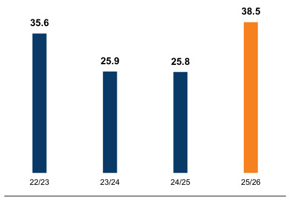 
The innovative strength and long-term compettiveness of a company are also reflected in the number and quality of its intellectual property rights: AT&S submitted a total of 52 new patent applications in the financial year 2025/26.At present, AT&S has 631 patent families, which resulted in 1,008 granted patents. The IP portfolio is further strengthened by externally acquired licenses, in particular in the area of embedding technology. 
## Number of patents granted 
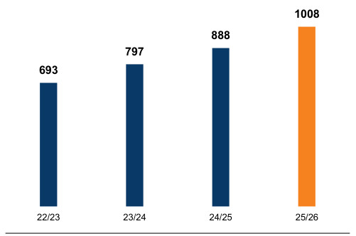 
## R&D expenses: 9.8% of revenue 
The costs of research and development projects totaled C174.7 million in the financial year 2025/26. This corresponds to a research rate (i.e.ratio to revenue) of 9.8% compared with 8.6% in the previous year.Based on the continuously high research rate, AT&S is securing its position as a technology leader for the years to come. 
## Research rate in %/ratio to revenue 
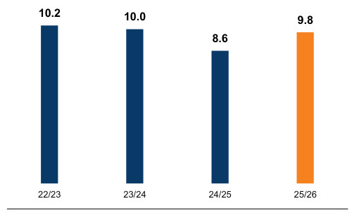 
165

---

<!-- 原文第 166 页 -->

AT&S Annual Report 2025/26 
Group Management Report Advanced Technologies & Solutions 
## Two-stage development process 
AT&.S pursues a two-stage innovation process: The first stage is based on technology platforms. In these technology platforms, technical approaches are developed to solve the technical problems in the strategic applications of AT&S for the coming years. This stage corresponds to applied research and technology evaluation. 
Subsequently, it is the task of the local technology development and implementation departments at the AT&S sites to continue the experimental development of processes and products and to integrate them into the existing production process. 
These development actities are accompanied by developments in the virtual world and strong collaboration with our customers, suppliers and research institutions. 
## Key development projects 
Large form factor substrates, which are needed for new, significantly larger computing modules, were a central development highlight of the past financial year. Increasing requirements for modern chip und chiplet architectures necessitate substrates that provide high dimensional stability, precise signal routing and a reliable mechanical structure. AT&S made significant progress in new material and assembly concepts for these large form factor substrates. 
The research focus was on glass-based substrate cores, which hold high potential for the future due to their excellent dimensional stability. At the same, it became evident that the international supply chain for glass cores has not yet been established in the required quality, making additional development steps necessary. AT&S is working on closing this gap early and advancing industrial maturity of this technology. 
The area of power and power efficiency was another research focus. The supply of modern high-performance computers with ever higher currents confronts both substrates and system architectures with new challenges. During the reporting year, AT&S refined several innovative power delivery concepts which enable targeted and low-loss power distribution within a substrate core. In this process, individual functional blocks of a processor can be supplied with energy according to their respective requirements, thus reducing total consumption and lowering thermal stress. In addition, solutions for external electricity supply systems which provide large data centers with energy more efficiently and thus contribute to reducing growing energy requirements were improved. 
Serving increasingly as a key innovation driver for substrate and packaging technologies, the new R&D Center and R&D line in Leoben is also gaining momentum. Based on a combination of development, prototyping and pilot production in one location, complex development cycles have been shortened, and new solutions can be industrialized faster in the future. The center is establishing itself as a key technology base in Europe and reinforces AT&S's ambition to pioneer key future technologies while at the same time securing manufacturing expertise locally. 
166

---

<!-- 原文第 167 页 -->

AT&S Annual Report 2025/26 
Group Management Report Advanced Technologies & Solutions 
## 6. Opportunities and Risks 
## 6.1. Opportunities and risk management 
## Structure and instruments 
Opportunities and risk management is a central part of conducting business responsibly within AT&S. Aiming to increase enterprise value on a sustained basis, AT&S actively seeks opportunities and accepts the related risks. The task of Risk Management is to provide a uniform Group-wide system that enables the identification, assessment and proactive management of positive or negative deviations from the cor porate goals. 
Therefore, AT&S operates a Group-wide risk management (RM) system in accordance with the Austrian Code of Corporate Governance (ACCG) and an Internal Control System (ICS) based on the principles of the CoSO framework. Internal Audit follows the standards of the Institute of Internal Auditors (IlA). 
From an organizational perspective,the Risk Management, Internal Control System and Internal Audit functions fall within the responsibility of the CFO. Risk Management reports regularly to the full Management Board at Management Board meetings. The Supervisory Board is involved through the Audit Committee, which addresses the company's risk situation at least twice a year. The proper functioning of the risk management system is assessed annually by the auditor in the course of the audit of the financial statements pursuant to Rule 83 ACCG. 
The risk management process shown in Figure 1 is conducted at least twice per financial year. Risk management takes place at the hierarchy level to which the relevant risk is assigned in line with the Groupwide risk strategy and the defined risk exposure (see Figure 2). These principles are defined in a binding Group-wide risk management policy. 
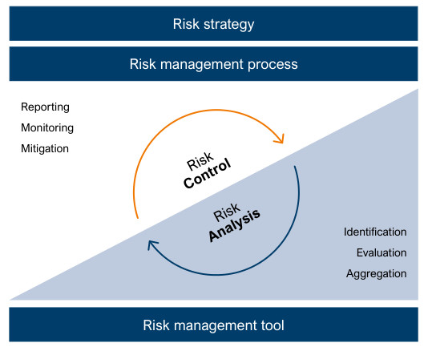 
Figure.1: AT8.S Risk management process 
## Risk strategy: 
defined by the Management Board and process owners. 
Risk identification: 
group-wide identication and evaluation.Ilmmediate reporting of significant new risks. 
Risk evaluation: 
consistent group-wide evaluation of all ris with respect to their impact, probability of occurence and resulting risk rating. 
Aggregation & reporting: 
aggregation and regular reports of all iniant istth 
Management Board and Audit Committee by the Risk Manager. 
Risk mitigation & monitoring 
in accordance with defined reporting and descision levels actions to mitigate the identified risks are taken (based on risk level,see Figure 2) 
Risk management tool: 
group-wide for risks 
167

---

<!-- 原文第 168 页 -->

AT&S Annual Report 2025/26 
Group Management Report Advanced Technologies & Solutions 
## Considerable risks 2025/26Overview 
The risk position of AT&S in the financial year 2025/26 was mainly characterized by: 
·continued volatile demand in key end markets, geopolitical tensions and increasing trade re strictions, 
critical availability of materials,rising purchase prices in the supply chain, 
capital-intensive capacity build-up in the ICsubstrate segment,especially at the site in Kulim, 
·high customer and market concentration, ·and financing, liquidity and currency risks. 
## Risk management 2025/26 
In the past financial year, targeted measures were taken to enhance and strengthen the risk management system. AT&S is investing in a new software solution which enables a comprehensive overview of the entire risk management process.The main objective is to: 
·improve monitoring of the implementation of measures and 
·increase transparency and plausibility of risk information. 
This software is currently being implemented; this process will be completed in the financial year 2026/27. 
In addition, the exchange between production sites and group functions on risk-related issues was intensified by introducing a structured risk dialogue.The increased involvement of project risk management, in particular when it comes to major projects, makes a significant contribution to identifying risks in project implementation early and promptly initiating mitigating measures. 

| Risk level | Risk controlling | Process |
| --- | --- | --- |
| High | Supervisory Board | <<<<M<<<<一 |
| | |
| Management Board | |
| Medium | BU Management | |
| | |
| Plant Management | |
| | ICS/ |
| Low | Process Management | FMEA |
 
## PME Mnn es Figure.2: AT8.S Risk levels and Risk controling 
## Risk exposure & risk level: 
the AT8S risk levelsare drvedby ipat ad probabity f crence as an indicator of the risk capacity of the Group. 
## ICS &RM: 
management of process ris supported by the internal controls ystem. At group level, relevant ris are managed and reported trough the risk management process. 
## Riskcontrolling: 
clear assignment of responsible decision levels based on risk level (see left) and defintion of responsibies fo th implementation of migation measures. 
## 6.2. Explanation of individual risks 
The risks,uncertainties and opportunities facing AT&S are generally based on worldwide developments in the printed circuit board and substrate market and AT&S's own operating performance.Considerable risks are described by risk category (Figure 3) in the following section. 
168

---

<!-- 原文第 169 页 -->

AT&S Annual Report 2025/26 
Group Management Report Advanced Technologies & Solutions 
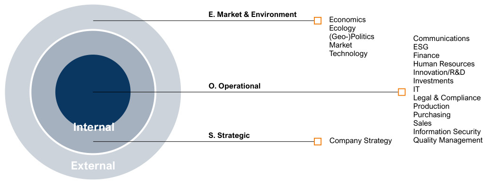 
Figure 3: AT8S Risk categories 
## E.Market and environment Economics 
## International relations 
In today's world, global trade plays a significant role for all major economies.Due to complex global supply chains, economic weakness can rapidly spread from one region to another. 
Tightening protectionist trade policies and increasing uncertainty about trade policy could disrupt trade flows. The resulting ripple effects can impact both regional and global growth. In addition, tariffs can trigger inflationary effects which curb consumer demand and private investment. 
## In addition, 
·an eruption of conflicts, ·an escalation of existing wars, ·epidemics and pandemics and ·extreme weather events, 
among other things, can lead to disruptions of supply chains and economic activity. As a result, the availa bility of important raw materials may also be limited. 
## Procurement prices and availability 
The uncertain global economic and geopolitical situation and steadily growing demand for Al applications and electrification have led to significant increases in the price of raw materials and precious metals. At the end of 2025,prices rose to record levels (opper, gold, palladium). 
Volatile market prices have been observed since the beginning of the war in Ukraine.Most recently, the tensions in the Middle East have intensified this trend. The increase in oil prices has an impact in particular on the costs of chemicals, plastics and resins. 
In the transport and logistics sector, the Middle East confict between Iran and Israel is leading to many uncertainties, which are primarily reflected in longer transit times. At the same time,freight costs are increasing as a result of additional surcharges. 
AT&S is monitoring the situation very closely with partners and freight forwarders. The company seeks to minimize the effects through increased responsiveness and targeted measures. They include: 
·extension of lead times ·change in ordering patterns 
169

---

<!-- 原文第 170 页 -->

AT&S Annual Report 2025/26 
Group Management Report Advanced Technologies & Solutions 
·adjustment of inventory levels ·use of alternative air freight routes 
To ensure reliability and availability of the supply chain, AT&S has acted proactively and 
·anticipated longer lead times for materials, ·concluded supply agreements with key suppliers for both business units, ·expanded order coverage, ·and increased safety stock levels. 
The global shortage of glass cloth is a critical factor for AT&S.Its solution is crucial to meet customer expectations. Several supplier qualifications were carried out in the past eighteen months in order to se cure procurement and reduce risks. 
## Foreign exchange risk 
Due to the global business activities of AT&S, most transactions are carried out in currencies other than the euro.AT&S is therefore exposed to both transaction and translation risks, which result from fluctuations in the exchange rate of the currencies used. Both elements of foreign exchange risk can have considerable unfavorable impacts on operating activities, the operating result, the financial position and forecasts. 
In addition to the euro,the most important currencies are: 
·the US dollar(USD) on the income side ·the Chinese yuan (CNY) and the Malaysian ringgit (MYR) on the cost side. 
A transaction risk occurs when revenue is generated in a different currency than the related costs. A translation risk arises when income, assets or liabilities of companies in which AT&S holds an investment are translated to euros. 
The translation of currencies from the annual financial statements of local subsidiaries as part of the preparation of the consolidated financial statements can also have an impact on financial reporting despite the use of natural hedging. These impacts may affect, among other things, the measurement of assets, liabilities and the amount of equity. These impacts are recognized either through profit or loss, or directly through other comprehensive income (OCI). 
The scope of these risks is regularly analyzed.The results are included in strategies to impement effi cient currency management. 
## Ecology 
The production of printed circuit boards and IC substrates requires a large number of wet-chemical,energy-and water-intensive processes.In addition, room conditions within the production area (e.g.. cleanroom) and storage area (e.g., cold storage) have to meet specified limits. 
Climate-related changes can lead to rising ambient temperatures. At the same time,the frequency of extreme weather events such as heat waves or droughts is increasing. These developments can lead to a limitation of resources, especially water and energy.This may result in the following impacts: 
·rising costs (e.g,for heating or cooling), ·restricted energy or water supplies, ·in extreme cases,disruptions of the production process. 
Moreover,additional regulatory requirements can lead to challenges. These may include, in particular, stricter thresholds for emissions into air and water as well as stricter standards for the treatment, storage and disposal of solid and hazardous waste.Therefore,AT&S is working on recycling projects (e.g., copper and water recycling) to increase closed-loop processes and on energy, water and waste reduction strategies. 
Some production workers work with chemicals or are exposed to noise or emissions.Inadequate safety standards and inadequate safety management could lead to an increase in accidents and health cases and entail interruptions of operations. 
170

---

<!-- 原文第 171 页 -->

AT&S Annual Report 2025/26 
Group Management Report Advanced Technologies & Solutions 
To minimize the effects of such risks, AT&S has instituted business continuity management. In addition,a number of standards and procedures for the protection of employee health and safety have been developed and implemented. These are continually reviewed, intensified and further expanded. 
AT&S also conducts active insurance management by carefully weighing the risks and associated costs. Insurance contracts to the extent customary for a company of this size have been concluded wherever such contracts were available at costs which are reasonable in relation to the impending risks 
## (Geo-)Politics Political risks 
Due to its international activities, AT&S is naturally exposed to changes in global relationships; however, this also offers a certain flexibility in countering disruptive developments. 
In 2025,the main geopolitical developments for the electronics market again resulted from the ongoing, and in part growing, tensions between the USA and China as well as between Europe and China. New additions to the Entity List maintained by the US government have further restricted the addressable markets for certain semiconductor producers and fabless IC(integrated circuit) suppliers. Against the backdrop of ongoing international tensions, business activities in China remain particularly vulnerable to negative impacts, which may arise from a further deterioration of political and economic relations. 
Additional export controls could lead to a fragmentation of global markets. This can cause addressable markets for AT&S and its customers to contract further. The availability and delivery times of raw materials, machinery and other goods that are crucial to operations can be adversely affected by export controls. 
## Location-specific risks 
The majority of AT&S's operating activities are based at sites outside of Austria, for example in China. This means that AT&S might be subject to potential legal uncertainties, state intervention, trade restrictions or political unrest. 
Irrespective of the above, any production site of AT&S may be exposed to disruptive events, for example: 
·fire, ·natural disasters, ·acts of war, ·shortages of supply or other elementary events. 
The termination of land use rights, permits or lease contracts for specific plants might also have a considerable negative impact on the production output of the company. 
## Market Market development 
The semiconductor industry has always been cyclical and volatile. This causes cyclical pressure on manufacturers' capacity utilization and a direct impact on profit margins. Due to the position of PCB and IC substrates in the supply chain, a massive increase in inventories can occur in the supply chain between PCB/IC substrate manufacturers and the end market. During volatile phases and phases of material or component shortages, inventory increases can be further intensified. 
A proactive dialogue with key customers and consistent analyses of end markets can mitigate theses effects. Apart from some high-growth niches such as data centers and selected artificial intelligence applications, demand for electronics and semiconductors remained subdued overall in 2025.Continuing weak demand in several market segments, especially in the automotive and industrial sectors, led to further in 
171

---

<!-- 原文第 172 页 -->

AT&S Annual Report 2025/26 
Group Management Report Advanced Technologies & Solutions 
creases in inventory levels. This has a dampening effect on the short-term development of revenue and medium-term market forecasts. At the same time, ongoing geopolitical tensions and the introduction of additional trade restrictions or tariffs could further delay a recovery of demand. The difficult market conditions could therefore persist and additionally limit growth potential. 
Excessive dependence on certain end markets or a small number of major customers increases the vulnerability to fluctuations in these markets. Changes in market share of these customers can also have significant effects. This vulnerability impacts technological developments that are closely coordinated with key customers. At the same time, comprehensive partnerships with market leaders open up unique growth opportunities with regard to both business and technological developments. Currenty,the end market for Al infrastructure, the main growth driver, represents the potentially biggest risk. 
## Competition risk 
Most market segments for printed circuit boards and IC substrates are affected by excess capacity and varying levels of price pressure. 
In PCB manufacturing, it was mainly established companies that invested in new capacity and further expanded their presence; in the IC substrate segment, in contrast,new market participants made significant investments. These developments increase overcapacities and competitive pressure, which results in a potential loss of market share and a reduction in profit margins. 
Several competitors, most notably in the area of IC substrates, are part of larger conglomerates with a diversified business portfolio. In comparison to specialized IC substrate producers, these companies are more resilient and more flexible in the procurement and use of capital. 
## Technology 
The capacity expansion for IC substrates in Kulim is associated with considerable investments. This results in specific technological and economic risks. The market for IC substrates is influenced by technological changes. The establishment of an R&D center including prototype production in Austria also serves the development of new technologies and is intended to mitigate the market and technology risk of IC substrates. 
This technological progress includes the general risk of new technology developments. Complications in advancing new technologies and in project implementation could have a negative impact on business development.In addition, they could place a signifcant burden on existing financial and administrative resources. 
## S. Strategy 
## Corporate strategy 
The current corporate strategy focuses on expanding the company's presence in the markets for high-end printed circuit boards and IC substrates. The strategy is therefore capital-intensive and niche-oriented. The following factors can have a negative impact on revenue growth and represent a significant risk for strategic planning: 
·economic downturns. ·changes in market share of key customers, ·inadequate implementation of strategic measures. 
The high debt resulting from a rapid expansion of capital-intensive business also entails strategic risks. High gearing reduces the ability to respond quickly to changes in market or technology trends. High debt also exercises additional pressure on short-term profitability, thus limiting the possibility to invest in projects which take longer to amortize. 
In addition, the necessity to invest in different types of PCB products and IC substrates poses additional challenges. These are mainly related to the integra tion into operations and the allocation of resources 
172

---

<!-- 原文第 173 页 -->

AT&S Annual Report 2025/26 
Group Management Report Advanced Technologies & Solutions 
and can negatively affect growth of the entire portfolio. 
## 0.Operational Communications 
Risks can arise in the areas of communications and information flow.They are caused,among other things, by a shortage of resources or information paths that are not optimally coordinated. These risks may have the following impacts: 
·incomplete information of stakeholders, ·delayed processes 
·misunderstandings, 
·wrong or confidential information is disclosed ·rumors are started. 
This can lead to irritation or potential reputationa damage. 
The Communications department systematically addresses and manages these risks. Clear processes, coordinated approval structures, clearly defined communication channels and ongoing monitoring ensure that information is provided reliably, consistently and tailored to the target group. 
In addition, AT&S minimizes other communication risks based on established standards and fast mechanisms.These risks include in particular the loss of sensitive data or delays due to time zones or language barriers. 
## ESG 
ESG risks, i.e.,.rs regarding environmental, social and governance matters, have also been considered as part of corporate risk management. For further information regarding material ESG impacts, risks and opportunities, please refer to the Consolidated Sustainability Statement. 
## Finance Financing and liquidity 
AT&S uses short- and long-term financial and liquidity planning to secure the financial needs in accordance with the business strategy. The company is dependent on the access to credit financing and a functioning and liquid money market to secure/bridge short-term liquidity needs. However, the availability of loans or alternative types of bank and capital market financing could be limited. Reasons could be related to company-specific factors or external conditions. 
In the longer term,AT&S must refinance its existing financial obligations when they become due.The prerequisite for this is meeting financial requirements and other conditions, which may not be possible. Even if all conditions and requirements are met, it is not guaranteed that the required financing is possible on acceptable conditions or at all. 
## The possibility of refinancing depends on: 
·the creditworthiness of AT&S at the time of refinancing, 
·the relationships with credit institutions, ·the conditions on credit and capital markets in general. 
If it is not possible to receive such financing at the time required,financial obligations cannot be refinanced when due. 
Depending on the type of interest rate agreedwhether fixed or variable - there is an additional risk of changes in interest rates when taking out a loan. This risk is centrally analyzed by AT&S Group Treasury on a regular basis.The results are included in strategies to implement efficient interest rate management. 
For additional information on financial, liquidity, credit and foreign exchange risks, please refer to Note 20 "Additional disclosures on financial instruments" in the notes to the consolidated financial statements. 
173

---

<!-- 原文第 174 页 -->

AT&S Annual Report 2025/26 
Group Management Report Advanced Technologies & Solutions 
## Cost optimization programs 
AT&S has initiated comprehensive cost optimization programs to mitigate the effects resulting from weak demand and inflation. 
## These programs focus on: 
·increasing the scope of continuous improvement measures, 
·accelerating their implementation and eliminating the inefficient use of materials and resources to the greatest extent possible. 
Continuous cost reduction and efficiency increase in all business segments are crucial to the profitability of AT&S. If cost reduction measures and performance increases cannot be implemented as planned, this may have a negative impact on the company's competitive standing.The same applies when rising costs cannot or only to a limited extent be passed on to customers. 
## Tax risk 
AT&S operates globally and is therefore subject to different tax systems. Unless the requirements for forming a provision or liability are met, national and international tax risks are allocated to financial risks and monitored accordingly. 
To minimize future tax risks, AT&S continuously monitors compliance with national tax laws and international guidelines. Despite these efforts, there is a risk of different interpretations of international transactions in different countries. Any deviations may lead to double taxation and additional tax burdens.In addition, there is a risk of higher tax burdens resulting from future changes in tax legislation. 
## Human resources 
The collective industry experience and management expertise of the employees of AT&S are a fundamental basis for using future opportunities. The two major projects (Leoben and Kulim) require a high number of qualifed personnel. Should it not be possible to hire sufficient numbers of qualified staff, this can have a negative impact on the progress of these major projects. 
## AT&S continuously works on appropriate strategies aiming to 
·retain key employees, 
·recruit additional valuable personnel, 
·further expanding the skills of staff. 
## Innovation/R&D 
AT&S aims to exploit opportunities through the development of its own projects, cooperation schemes with partners, and investments.In doing so,an important focus is on obtaining and protecting intellectual property as well as on access to promising patents. Risks arise especially when the company fails to protect its intellectual property. In such cases, competitors could be in a position to use these technologies. Moreover, legal disputes about intellectual property can take place and prevent AT&S from using or selling disputed technologies. Furthermore,legal disputes with regard to the unauthorized use of external intellectual property can cause considerable negative financial consequences. 
## Investments 
In order to use long-term growth potential, AT&S has undertaken substantial investments in new technologies (IC substrates). In the course of this investment, a production site has been established at the Kulim Hi-Tech Park, Kedah, Malaysia. 
In addition, the company invested in a new R&D center and series production for substrate and packaging solutions for the global semiconductor industry at its site in Leoben-Hinterberg,which was successfully commissioned in the summer of 2025.In the next step,capacity at the existing PCB facilities will be comprehensively expanded and upgraded. 
AT&S also initiated smaller development projects and expanded the capacity of existing technologies such as SLP,mSap and HDI. 
174

---

<!-- 原文第 175 页 -->

AT&S Annual Report 2025/26 
Group Management Report Advanced Technologies & Solutions 
The intrinsic value of such investments can be severely impacted by: 
·unexpected technological developments, ·changes in demand, 
·restrictions through third-party patents, ·negative price developments, 
·shorter technology cycles or 
·problems in technical implementation. 
These effects can generally impact all current AT&S business activities. If there are any indications of such adverse effects, impairment tests are performed as required. Based on the high investment volume,this may lead to high impairment losses. 
## IT 
AT&S is exposed to different internal and external IT security risks that can impact operations. Inadequate security measures and a lack of employee awareness increase the risk of unauthorized access and loss of data. The use of non-standardized IT assets and outdated IT systems leads to additional security gaps and disruptions. 
Infrastructure risks, such as disruptions of the electricity supply and inadequate emergency measures, lead to significant operational disruptions.AT&S counters these risks through targeted measures. The company focuses on continuously optimizing and fur ther developing the infrastructure as well as efficient IT infrastructure management. In addition, IT security measures and extensive resource planning ensure potential impacts on operations are mitigated as far as possible. 
## Legal and Compliance 
The increasing density and frequency of amendments to regulatory requirements pose a challenge for AT&S. For example,the prohibition of certain processes or materials (REACH and RoHS) can cause production costs to rise. Stricter import/export regulations resulting from geopolitical upheavals can also entail restrictions in certain market segments. If contractual agreements or statutory provisions are breached, the company could be subject to payment of substantial damages or penalties. 
AT&S has implemented comprehensive organizational and technical measures to minimize legal and compliance risks, which are continuously reviewed, expanded and improved. The company follows a zero-tolerance policy regarding compliance violations. AT&S expects 100% compliance with all applicable laws and regulations from its employees and the supply chain. The functions responsible for governance, risk and compliance support Enterprise Risk Management in monitoring the risk landscape. They also help promote compliance with legal and regulatory requirements. 
In addition, AT&S provides a whistleblowing platform, which enables employees and external third parties to report potential compliance violations. Independent investigation processes ensure appropriate processing. 
## Production 
The asset-intensive production of printed circuit boards and substrates entails a number of operational risks. These include in particular technological risks and risks related to assets. 
Among other things, these risks result from: 
·outdated equipment, 
·bottleneck machines, 
·a lack of process automation and 
· inadequate infrastructure. 
These factors can lead to loss of earnings, reduced competitiveness and lower capacity utilization. 
These factors are closely related to risks regarding the availability of important spare parts and maintenance services. Restrictions in these areas can lead to lower production volume and capacity losses. Capacity and demand risks and the associated fluctuations in capacity utilization make efficient resource planning more difficult. These may result in excessive 
175

---

<!-- 原文第 176 页 -->

AT&S Annual Report 2025/26 
Group Management Report Advanced Technologies & Solutions 
or scarce inventory levels as well as a lack of capacity to cover demand. 
Unstable production processes caused by insufficient utilization of machines can lead to quality defects. This entails the risk of higher scrap costs and customer complaints. 
Other risks arise due to inadequate training of employees, problems in facility control and deficiencies in monitoring systems (e.g., system availability). Disruptions in internal reporting can also have negative impacts on earnings, efficiency and productivity. 
## Purchasing 
The sourcing strategy of AT&S is based on a wide and clearly diversified base of suppliers. The aim is to reduce dependencies on individual suppliers.Longstanding and stable customer-supplier relations are in place with key suppliers that possess special expertise and a strong competitive standing. To avoid supply shortages, AT&S conducts rigorous supplier risk management, taking account of regional cluster risks, various supply routes and alternative procurement options. 
However, for certain chemical products and composite materials, there is a dependence on individual suppliers specified by the customer. If these suppliers are unable to deliver the required quality or quantity due to global bottlenecks or disruptions, this may result in production delays and cost increases. 
Supply chains are subject to continual change. The past years have shown the importance of responsiveness,scalability and agility. Iit is crucial for AT&S's success to respond promptly to customer inquiries and thereby excel in customer service and value proposition. AT&S continuously optimizes its supplier base in order to 
·create value, 
·reduce delivery time, 
·minimize procurement risks and 
·exceed customer expectations. 
Disruptions in the past and present (Covid-19,war in Ukraine, war in the Middle East) have ultimately led to an improvement in responsiveness. This was achieved through alternative transportation options and the qualification ofnew suppliers regionally closer to the AT&S manufacturing locations. In anticipating production needs in Malaysia, AT&S is developing an extended supplier base in Southeast Asia. 
## Sales 
With the help of advanced production technologies and high quality standards, AT&S has established itself as a reliable provider to some of the world's most renowned players in the electronics industry.Due to the focus on high-end technology, the number of customers is limited to technology leaders. The revenue generated by the five largest customers accounts for 76% of total revenue, with the respective shares ranging from 3% to 31%.Our long-term relationships with these customers also offer excellent opportunities for the future. However, a concentration of this kind also poses risks, especially in the event of a significant reduction in business volume or profitability of these customers. 
As part of ts diversification strategy, AT&S acquired additional IC substrate customers, who mainly operate in the area of server ICs. These measures support rapid compensation for potential negative developments among individual key customers. Nevertheless, adverse changes in the markets can have a negative impact on AT&S, as the customers operate in similar market segments. 
## Information security 
AT&S further intensified internal controls in the past financial years to continue to successfully prevent attempted fraud. At the same time, awareness was raised among employees with regard to such fraud schemes. 
Based on an analysis of internal processes in connection with the use of personal data, the required measures were assessed and implemented. The aim is to ensure the protection of sensitive data. 
176

---

<!-- 原文第 177 页 -->

AT&S Annual Report 2025/26 
Group Management Report Advanced Technologies & Solutions 
Following the successful certification of all locations in accordance with ISO 27001, the Information Security Management System (ISMS) was rolled out at all production locations and the IT Shared Service Center. Ongoing efforts to comply with international IT standards support safe handling of information. In addition, they ensure an appropriate access to information and the availability of reliable systems. 
Despite best efforts, it must be acknowledged that no system is completely immune to potential hacker attacks. Such incidents can negatively impact the security of data and the availability of AT&S's IT systems. AT&S continuously strives to mitigate these risks and to ensure the security and integrity of its systems. 
## Quality management 
High product quality, adherence to delivery deadlines and service quality will continue to offer the company an opportunity to differentiate itself from competitors and exploit growth opportunities in the future.At the same time, AT&S has made far-reaching contractual commitments to important customers. These commitments include, among other things: 
·capacity reserves, ·volume guarantees, ·adherence to delivery deadlines and ·quality performance. 
Technical defects, quality deficiencies or difficuties in delivering products can lead to failure to meet the guaranteed volumes or quality standards. In such cases, warranty claims, claims for damages and contractual penalties may arise. 
Quality deficiencies or the loss of quality-relevant external standards can also result in delivery stops, which can affect certain part numbers or even plants. Such delivery stops can lead to significant revenue declines even if such quality deficiencies were not caused in the production process or quality management process of AT&S but rather within the supply chain. Substantial quality deficiencies can also result in product recalls and the loss of customers. 
AT&S operates a quality management and planning system.The goal is to prevent or minimize quality deficiencies, planning errors and the resulting negative consequences as far as possible.To ensure high product quality, AT&S not only meets general international quality standards (ISO 9001) but also additional industry standards. These include, among others: 
·automotive (e.g.,) ATF 16949), ·aviation (e.g.EN9100 and NADCAP accreditation), ·medical technology (e.g.,DS/EN ISO 13485). 
In addition, AT&S is insured against relevant risks by virtue of an (extended) product liability insurance policy taking into account customary exclusions of coverage and coverage limits. 
## 6.3. Internal control and risk management system with regard to accounting 
The accounting-related Internal Control and Risk Management system is an integral part of the Groupwide risk management system. According to the framework concept of CoSO (the Committee of Sponsoring Organizations of the Treadway Commission), the actual risk management as well as the Internal Control System (ICS) are subsumed under the concept of company-wide risk management.The main criteria of Risk Management, Internal Control System and Internal Audit of AT&S are specified in a Group-wide risk management and audit manual. 
The documentation of the internal controls (business processes, risks, control measures and those responsible) is mainly in the form of control matrices, which are archived in a central management database. The accounting-related Internal Control System includes principles, procedures and measures to ensure the compliance of accounting in terms of control targets described for financial reporting. 
177

---

<!-- 原文第 178 页 -->

AT&S Annual Report 2025/26 
Group Management Report Advanced Technologies & Solutions 
## The Internal Control System aims to ensure: 
·the effectiveness and efficiency of business activities, 
·the reliability of financial reporting and ·compliance with the applicable legal requirements and internal regulations. 
## Further principles of the ICS are: 
·Identification of operating risks and definition and implementation of adequate control measures Ensuring an adequate separation of functions Ensuring the correctness and completeness of accounting Ensuring transparency and traceability Disclosure of damage already done Protection of property,plant and equipment and intangible assets 
The accounting procedures are documented in separate process instructions. These processes are standardized across the Group and are presented in a standardized documentation format. Additional requirements for accounting procedures result from specific local regulations. The basic principles of accounting and reporting are documented in the process descriptions and in detailed process instructions and filed in the central document management system. In addition,guidelines on measurement procedures and organizational requirements in connection with the processes of accounting and preparing the financial statements are compiled and updated on a regular basis.The necessary control measures in connection with accounting processes, for example, access authorizations and separation of functions, are documented in the Internal Control System. Their implementation and effectiveness is regularly reviewed by Internal Audit and any improvement measures are identified. 
The internal financial reporting is done on a monthly basis as part of Group reporting, with the financial information being reviewed and analyzed by the Corporate Finance and Corporate Controlling depart ments. The monthly budget/actual variance with corresponding comments on the results of the segments, the plants and the Company, is reported internally to the executives and to the members of the Supervisory Board. 
The annual preparation of the budget is carried out by the Corporate Controlling department. Quarterly forecasts are drawn up during the year for the remaining financial year based on the quarterly results and current planning information. The forecasts, with comments on the budget comparison and presentations on the impact of opportunities and risks up to the end of the financial year, are reported to the Management Board and Supervisory Board. In addition to regular reporting, multiple-year planning,project-related financial information and calculations on investment projects are prepared and submitted to the Management Board and the Supervisory Board. 
178

---

<!-- 原文第 179 页 -->

AT&S Annual Report 2025/26 
Group Management Report Advanced Technologies & Solutions 
## 7.Outlook 
## Outlook 2026/27 
AT&S generates more than 80% of its revenue with US companies, and the majority of its revenues in US dollars. Production costs are largely incurred in Asian currencies, while the reporting currency is the euro. Therefore, a forecast of absolute amounts does not provide a comprehensive outlook on the company's operational development. In the future,AT&S will therefore no longer forecast absolute figures,but rather a currency-adjusted percentage change in revenue. 
As increasingly more computing power is required in the field of artificial intelligence, demand by a key customer for high-end IC substrates of AT&S is growing. To be able to manufacture these substrates on a larger scale, AT&S has decided to expand capacity at its location in Chongqing, China. The required investments in the high double-digit million range will be fully financed based on long-term customer agreements. The company expects a positive effect on EBiT, also in the high double-digit million range, from these measures in the financial year 2026/27. 
In the financial year 2026/27,AT&S expects currency-adjusted revenue growth of 30 to 35% compared to the previous year (2025/26:(1.8 billion). At constant currency, this means that revenue will be at the upper end of the previous forecast of 2.1 to 2.4 billion for 2026/27.The expected EBITDA margin of 25to 29% means another significant increase in profitability (2025/26:23%;previous expectation for 2026/27:24 to 28%),As some investments in Kulim originally planned for the previous year have been postponed and demand for IC substrates has increased significantly, the management plans CAPEX of roughly400million for 2026/27(2025/26: ( 178 million). AT&S expects a clearly positive profit for the year, at least in the low triple-digit milions of euros, and positive operating free cash flow. 
AT&S anticipates a further improvement in net debt/EBITDA of significantly below 3 based on profitable growth. 
AT&S intends to issue a hybrid convertible bond and/or a hybrid bond with a total volume of up to E500million in the second or third quarter of 2026 for refinancing and strengthening the capital base. 
The forecast does not include a significant deterioration of the geopolitical situation and of the currently tight supply situation for different materials such as fiberglass mats. Also not included are potential effects of ongoing negotiations with customers. These negotiations would lead to a capacity expansion in part financed by customers and would, consequently, have an effect on the earnings development and investment planning.The management monitors the developments very carefully in order to be able to respond to changes at any time and to make strategic adaptations. 
Leoben-Hinterberg, May 20, 2026 
The Management Board 
Michael Mertin m.p. Peter Griehsnig m.p. Gerrit Steen m.p. 
179

---

<!-- 原文第 180 页 -->

---

<!-- 原文第 181 页 -->

AT&S Annual Report 2025/26 
Consolidated Fianrialts Advanced Technologies & Solutions 
# Consolidated Financial Statements as of March 31, 2026 
## 181 
182 Consolidated Statement of Profit or Loss
182 Consolidated Statement of Comprehensive Income
183 Consolidated Statement of Financial Position
184 Consolidated Statement of Cash Flows
185 Consolidated Statement of Changes in Equity
186 Notes to the Consolidated Financial Statements
255 Statement of all Legal Representatives
256 Auditor's Report on the Consolidated Financial Statements 2025/26
261 Assurance Report on the Consolidated Financial Statements 2025/26 
181

---

<!-- 原文第 182 页 -->

AT&S Annual Report 2025/26 
Consolidated Financial Statements Advanced Technologies & Solutions 
## Consolidated Statement of Profit or Loss 
E in thousands Note 2025/26 2024/25
Revenue 1 1.790.776 1,589,626
Gross profit Cost of sales 2 (1,587,298) 203,478 (1.,411,731) 177,895
Distribution costs 2 (52,814) (55,239)
General and administrative costs 2 (104,561) (90,879)
Other operating income 4 58,088 397,683
Other operating costs 4 (38,550) (152,056)
Other operating result 19,538 245,627
Operating result 65,641 277,404
Finance income 5 25,348 44,860
Finance costs 5 (125,316) (128,337)
Finance costs -net (Loss/Profit before tax (99,968) (34,327) (83,477) 193,927
Income taxes 6 8,737 (104,232)
(Loss)/Proit for the year (25,590) 89.695
Attributable to owners of hybrid capital Atribtable to owners of the parent company (43,090) 17.500 17,500 72,195
Earnings per share attibutable to equity holders
of the parent company (in E per share): 26
-basic - diluted (1.11) (1.11) 1.86 1.86 
1see Notes . General Information,F.Changes in consolidation gr 
## Consolidated Statement of Comprehensive Income 
Ein thousands 2025/26 2024/25
(Loss/Profit for the year (25,590) 89,695
Items to be reclassified! Currency translation differences, nt of tax 10,239 43,475
Losses from the fair value measurement of
available-for-sale financial assets, net of tax (12)
Gains/(losses) from the fair value measurement of hedging instruments for cash flow hedges,
net of tax 7.291 (4,267)
Items not to be reclassified:
Remeasurement of post employment oligatios, nt f tax 1.863 (1,860)
Other comprehensive (loss/profit for the year Total comprehensive (loss)/profit for the year 19,381 (6.209) 127.043 37,348
Attributable to owners of hybrid capital Attributable to owners of the parent company (23,709) 17,500 109,543 17,500 
182

---

<!-- 原文第 183 页 -->

AT&S Annual Report 2025/26 
Consolidated Financial Statements Advanced Technologies & Solutions 
## Consolidated Statement of Financial Position 

| E in thousands | Note | Mar 31,2026 | Mar 31,2025 |
| --- | --- | --- | --- |
| ASSETS | | | |
| Property, plant and equipment | 7 | 3,152,767 | 3,335,615 |
| Intangible assets | 8 | 12,074 | 18,027 |
| Financial assets | 12 | 13,426 | 8,702 |
| Deferred tax assets | 6 | 16.562 | 4,533 |
| Other non-current assets | 9 | 29,574 | 32,580 |
| Non-current assets | | 3,224,403 | 3,399,457 |
| Inventories | 10 | 234.878 | 145,453 |
| Trade and other receivables and contract assets | 11 | 388,754 | 482,209 |
| Financial assets | 12 | 61,766 | 105,912 |
| Current income tax receivables | | 3,051 | 4.010 |
| Cash and cash equivalents | 13 | 738.492 | 485,079 |
| Current assets | | 1,426,941 | 1,222,663 |
| Total assets | | 4,651,344 | 4,622,120 |
| EQUITY | | | |
| Share capital | 22 | 141,846 | 141,846 |
| Other reserves | 23 | (12,162) | (31,543) |
| Hybrid capital | 24 | 347.956 | 347,956 |
| Retained earnings | | 573,601 | 616,691 |
| Equity attributable to owners of the parent company | | 1.051.241 | 1,074,950 |
| Total equity | | 1,051.241 | 1,074,950 |
| LIABILITIES | | | |
| Financial liabilities | 15 | 1,630,012 | 1,621,239 |
| Contract liabilties | 16 | 759.076 | 827,890 |
| Provisions for employee benefits | 17 | 35,536 | 41,712 |
| Deferred tax liabilities | 6 | 3,443 | 9,290 |
| Other liabilities | 14 | 70.881 | 67,382 |
| Non-current liabilities | | 2,498,948 | 2,567,513 |
| Trade and other payables | 14 | 441.288 | 405,643 |
| Financial liabilities | 15 | 515.818 | 469,892 |
| Contract liabilties | 16 | 126.816 | 83,206 |
| Current income tax payables | | 1.460 | 192 |
| Other provisions | 18 | 15,773 | 20,724 |
| Current liabilities | | 1,101,155 | 979,657 |
| Total liabilities | | 3,600,103 | 3,547,170 |
| Total equity and liabilities | | 4,651,344 | 4,622,120 |
 
183

---

<!-- 原文第 184 页 -->

AT&S Annual Report 2025/26 
Consolidated Financial Statements Advanced Technologies & Solutions 
## Consolidated Statement of Cash Flows 

| E in thousands | 2025/26 | 2024/25 |
| --- | --- | --- |
| Operating result | 65,641 | 277,404 |
| Depreciation, appreciation, amortisation and impairment of property, plant and equipment and intangible assets | 352,406 | 328,277 |
| Gains/losses from the sale of property, plant and equipment and intangible assets | 2.381 | (8,794) |
| Gains/losses from the sale of aflited companies | | (324,834) |
| Changes in non-current provisions | (5.997) | (3,788) |
| Changes in contract liabilities | 49.098 | 21,346 |
| Non-cash expense/(income),net | (70,372) | (21,224) |
| Interest paid | (66.289) | (88,117) |
| Interest received | 25.399 | 26,869 |
| Income taxes paid | (10,536) | (64,916) |
| Cash flow from operating activities before changes in working capital | 341,731 | 142,223 |
| Inventories | (88,046) | 13,511 |
| Trade and other receivables and contract assets | 87,675 | (204,661) |
| Trade and other payables | 76.608 | (30,641) |
| Other provisions | (4.250) | 5,045 |
| Cash flow from operating activities | 413,718 | (74,523) |
| Capital expenditure for property,plant and equipment and intangible assets | (179,419) | (416,057) |
| Proceeds from the sale of property,plant and equipment and intangible assets | 1,163 | 1,287 |
| Proceeds from the sale of afflited companies less transferred cash | | 353,435 |
| Capital expenditure for financial assets | (45,092) | (125,096) |
| Proceeds from the sale of financial assets | 87.953 | 45,765 |
| Cash flow from investing activities | (135,395) | (140,666) |
| Proceeds from borrowings | 436,207 | 412,978 |
| Repayments of borrowings | (429,376) | (383,145) |
| Proceeds from government grants | 6.775 | 7,611 |
| Hybrid coupon paid | (17,500) | (17,500) |
| Cash flow from financing activities | (3,894) | 19,944 |
| Change in cash and cash equivalents | 274,429 | (195,245) |
| Cash and cash equivalents at beginning of the year | 485,079 | 676,490 |
| Exchange gains/(losses) on cash and cash equivalents | (21,016) | 3.834 |
| Cash and cash equivalents at the end of the year | 738,492 | 485,079 |
 
184

---

<!-- 原文第 185 页 -->

AT&S Annual Report 2025/26 
Consolidated Financial Statements Advanced Technologies & Solutions 
## Consolidated Statement of Changes in Equity 

| Ein thousands | Share capital | Other reserves | Hybrid capital | Retained earnings | Equity attributable to owners of the parent company | Non- controlling interests | Total equity |
| --- | --- | --- | --- | --- | --- | --- | --- |
| Mar 31, 2024 | 141,846 | (68,891) | 347,956 | 545,668 | 966.579 | | 966,579 |
| Profit for the year | | | | 89,695 | 89,695 | | 89,695 |
| Other comprehensive income for the year | | 37,348 | | | 37,348 | | 37,348 |
| thereof currency translation diferences, net of taxes | | 43.475 | | | 43,475 | | 43.475 |
| thereof remeasurement of post-employ- ment obligations, net of tax | | (1,860) | | | (1,860) | | (1,860) |
| thereof change in hedging instruments for cash flow hedges,net of tax | | (4,267) | | | (4,267) | | (4,267) |
| Total comprehensive income for the year 2024/25 | | 37,348 | | 89.695 | 127,043 | | 127,043 |
| Hybrid coupon paid | | | | (17,500) | (17,500) | | (17,500) |
| Other changes | | | | (1,172) | (1,172) | | (1,172) |
| Mar 31, 2025 | 141,846 | (31,543) | 347,956 | 616,691 | 1,074,950 | | 1,074,950 |
| Loss for the year | | | | (25,590) | (25,590) | | (25,590) |
| Other comprehensive income for the year | | 19.381 | | | 19.381 | | 19.381 |
| thereof currency translation differences, net of tax | | 10.239 | | | 10.239 | | 10.239 |
| thereof remeasurement of post-employment obiigations, net of tax | | 1,863 | | | 1,863 | | 1,863 |
| thereof change in available-for-sale finan- cial assets, net of tax | | (12) | | | (12) | | (12) |
| thereof change in hedging instruments for cash flow hedges,net of tax | | 7.291 | | | 7.291 | | 7.291 |
| Total comprehensive income for the year 2025/26 | | 19,381 | | (25,590) | (6,209) | | (6,209) |
| Hybrid coupon paid | | | | (17,500) | (17,500) | | (17,500) |
| Mar 31,2026 | 141,846 | (12,162) | 347,956 | 573,601 | 1,051,241 | | 1,051,241 |
 
185

---

<!-- 原文第 186 页 -->

AT&S Annual Report 2025/26 
Consolidated Financial Statements Advanced Technologies & Solutions 
# Notes to the Consolidated Financial Statements I. General Information 
A.General 
AT &S Austria Technologie & Systemtechnik Aktiengesellschaft (hereinater referred to as "the Company", and with its subsidiaries referred to as "the Group") was incorporated in Austria. The Company is headquartered in Austria, Fabriksgasse 13, 8700 Leoben-Hinterberg. 
The Group manufactures and distributes printed circuit boards and provides related services in the segments of Electronics Solutions, Microelectronics and Others. The products are manufactured in the European and Asian markets and are directly distributed to original equipment manufacturers (OEM) as well as to contracted electronic manufacturers (CEM). 
Since May 20, 2008, the Company has been listed in the Prime Market segment of the Vienna Stock Exchange, Austria, and, after a period of double listing on the previous exchange in Frankfurt am Main,Germany, has been traded exclusively on the Vienna Stock Exchange since September 15, 2008. Prior to changing stock exchange, the Company had been listed on the Frankfurt Stock Exchange since July 16, 1999. Since March 19, 2018, the Company's shares have been included in the Austrian ATX index. According to Section 245a of the Austrian Commercial Code (UGB), the consolidated financial statements were prepared in accordance with the International Financial Reporting Standards (IFRS) and interpretations (IFRIC and SIC) of the International Accounting Standards Board (IASB) as adopted by the European Union (EU). 
## B. Accounting and measurement policies 
The consolidated financial statements have been prepared under the historical cost convention, except for securities and derivative financial instruments and the portion of trade receivables that is assigned to banks in the following month as part of factoring agreements, these are measured at their fair values. 
## a. Consolidation principles 
The balance sheet date for all consolidated companies is March 31, 2026,with the following exceptions: due to the legal regulations in China, the financial year of AT&S (China) Company Limited and AT&S (Chongqing) Company Limited corresponds to the calendar year (balance sheet date: December 31, 2025), meaning that they were consolidated based on the interim financial statements as of March 31, 2026. 
The consolidated financial statements were approved by the Management Board on May 20, 2026.The separate financial statements of the Company, which are included in the consolidation after reconciliation to the applicable accounting standards, will be presented for approval to the Supervisory Board on June 3, 2026. The separate financial statements of the Company can be modified by the Supervisory Board and, in case of presentation to the Annual General Meeting, by the Company's shareholders in a way that might also affect the presentation of the consolidated financial statements. 
Group of consolidated entities The Company controls an entity when the Group is exposed to risks or has rights to variable returns from its involvement with the entity and can affect those returns through its power over the entity. In addition to the Company itself, the consolidated financial statements comprise the following fully consolidated subsidiaries: 
·AT&S Asia Pacific Limited, Hong Kong, China (hereinafter referred to as AT&S Asia Pacific),share 100% 
186

---

<!-- 原文第 187 页 -->

AT&S Annual Report 2025/26 
Consolidated Financial Statements Advanced Technologies & Solutions 
·A (China) Company Limited,China (hereinafe referred to as AT&S China),100%subidiary of AT&S Asia Pacific 
·A&(hoqing) Company LiitedChi (hereinafe referred toas A&S Chongqing),100subsidiary of AT&S Asia Pacific 
·AT&S Japan K.K.,Japan,(hereinafter referred to as AT&S Japan), 100% subsidiary of AT&S Asia Pacific 
·AT&S (Taiwan) Co., Ltd.,Taiwan (hereinafter referred to as AT&S Taiwan), 100% subsidiary of AT&S Asia Pacific 
·AT&S India Private Limited, India (hereinafter referred to as AT&S India),share 100% 
·AT&S Korea Sales Support Co., Ltd, South Korea (hereinafter referred to as AT&S Korea Sales),share 100% 
·AT&S Americas LLC, USA (hereinafter referred to as AT&S Americas),share 100% 
·AT&S Deutschland GmbH,Germany (hereinater referred to AT&S Deutschland),share 100% 
·AT&S Skandinavia AB, Sweden (hereinafter referred to as AT&S Sweden),share 100% 
·AT&S Austria Technologie & Systemtechni(Malaysia) SDN.BHD.(hereinafter referred to AT&S Malaysia), share 100% 
The Group applies the acquisition method to account for business combinations. The consideration transferred for the acquisition of a subsidiary is the fair value of the assets transferred, the equity interests issued and the liabilities incurred and/or assumed at the acquisition date. The consideration transferred also includes the fair value of any asset or liability resulting from a contingent consideration arrangement. Acquisition-related costs are expensed as incurred.Identifiable assets acquired and liabities and contingent liabilities assumed in a business combination are measured initially at their fair values at the acquisition date. 
For each business combination, the Group measures any non-controlling interest in the acquiree either at fair value or at the non-controlling interest's proportionate share of the acquiree's identifiable net assets and, accordingly, recognizes the full or proportional goodwill.Ift the consideration transferred is less than the fair value of the net assets of the subsidiary acquired, the difference is recognized directly in profit or loss. 
When the Group ceases to have control or significant influence over a company, any retained interest in the entity is remeasured to its fair value,with the change in carrying amount recognised in profit or loss. The fair value is the fair value determined at the initial recognition of an associate, joint venture or financial asset. In addition, any amounts recognised in other comprehensive income in respect of that entity are accounted for as if the parent company had directly disposed of the related assets or liabilities. 
Non-current assets or disposal groups are classified as held for sale if the corresponding carrying amount is mainly realized by a sale transaction rather than by continued use.This condition is only considered to be met if the non-current asset or the disposal group is available for immediate sale in its current condition and the sale is highly probable. The management must have committed to the sale. It must be assumed that the sale transaction will be concluded within a year of such a classification. 
Non-current assets or disposal groups that are classified as held for sale are measured at the lower of thei original carrying amount and fair value less costs to sell. 
In the event that the Group has committed to a sale involving loss of control of a subsidiary, all assets and liabilities of that subsidiary will be classified as held for sale, provided that the above-mentioned conditions 
187

---

<!-- 原文第 188 页 -->

AT&S Annual Report 2025/26 
Consolidated Financial Statements Advanced Technologies & Solutions 
are met. This applies regardless of whether or not the Group retains a non-controlling interest in its former subsidiary after the sale. 
In the event that the Group has committed to a sale that leads to the disposal of an investment or part of an investment in an associate or joint venture, the investment or part of the investment will be classified as held for sale, provided that the above-mentioned conditions are met. 
Methods of consolidation All significant intercompany balances and transactions have been eliminated so that the consolidated financial statements present the accounting information of the Group as if it were one single company. 
Capital consolidation is made in accordance with IFRS 3"Business Combinationsn IF 10"Consolidated Financial Statements". Intercompany accounts receivable and payable as well as expenses and income are eliminated. Unless immaterial, intercompany results in non-current assets and inventories are eliminated. Furthermore, uniform accounting and measurement methods are applied to all consolidated subsidiaries. 
## b.Segment reporting 
The definition of operating segments and the presentation of segment results are based on the management approach and follow internal reports to the Management Board as the chief operating decision-maker, i.e.the body that decides on the allocation of resources to the individual segments. An operating segment is a component of an entity that engages in business activities and whose operating results are reviewed regularly by the entity's chief operating decision-maker.Business activities involve earning revenues and incurring expenses, and these may also relate to business transactions with other operating segments of the entiy. Sep arate financial information is available for the individual operating segments. 
The AT&S Group structures its operating activities into the following segments: ·Electronics Solutions ·Microelectronics · Others 
The two operating segments are now structured based on technology. The Electronics Solutions segment comprises the areas of printed circuit boards and will also increasingly cover the modules and embedding business through the development of high-tech solutions. The Microelectronics segment comprises the production of IC substrates for PCs and servers. 
The Others segment includes product design services, research and development services and corporate and holding activities. 
## C. Foreign currencies 
The Group's presentation currency s the euro ().The functional currency of the foreign subsidiaries is the respective local currency. 
188

---

<!-- 原文第 189 页 -->

AT&S Annual Report 2025/26 
Consolidated Financial Statements Advanced Technologies & Solutions 
Foreign subsidiaries With the exception of equity positions (historical exchange rate), the balance sheets of AT&S India, AT&S China, AT&S Asia Pacific, AT&S Japan, AT&S Americas, AT&S Chongging, AT&S Malaysia, AT&S Taiwan, AT&S Sweden and AT&S Korea Sales are translated at the exchange rates on the balance sheet date. The profit or loss statements are translated at the average exchange rates of the financial year. The effect of changes in the exchange rate with regard to the foreign subsidiaries' net assets is recognized directly in equity. 
Foreign currency transactions In the financial statements of each of the Group's entities, foreign currency items are translated at the exchange rates prevailing on the day of the transaction. Monetary items are translated at the respective exchange rate ruling at the balance sheet date; non-monetary items which were recognized according to the historical cost principle are carried at the rate of their initial recognition. Translation adjustments from monetary items, with the exception of financial assets classified as "at fair value through other comprehensive income, are recognized in profit or loss. 

| | Closing rate | | | Average rate | | |
| --- | --- | --- | --- | --- | --- | --- |
| | Mar 31,2026 | Mar 31,2025 | Change in % | Apr 1,2025- Mar 31,2026 | Apr 1,2024- Mar 31,2025 | Change in % |
| Chinese yuan renminbi | 7.9106 | 7.8419 | 0.9% | 8.1921 | 7.7406 | 5.8% |
| Hong Kong dollar | 8.9894 | 8.4209 | 6.8% | 9.0178 | 8.3705 | 7.7% |
| Malaysian ringgit | 4.6367 | 4.7973 | (3.3%) | 4.8080 | 4.8371 | (0.6%) |
| Indian rupee | 107.7200 | 92.4800 | 16.5% | 102.2477 | 90.6846 | 12.8% |
| Japanese yen | 182.9200 | 161.4400 | 13.3% | 174.3885 | 163.4038 | 6.7% |
| South Korean won | 1,752.7200 | 1,593.7500 | 10.0% | 1,648.7077 | 1,496.2700 | 10.2% |
| Swedish Krone | 10.9795 | 10.8564 | 1.1% | 10.9227 | 11.4183 | (4.3%) |
| Taiwan dollar | 36.7439 | 35.9409 | 2.2% | 35.8351 | 34.8415 | 2.9% |
| US dollar | 1.1468 | 1.0811 | 6.1% | 1.1555 | 1.0740 | 7.6% |
 
## d. Revenue recognition 
Revenue comprises the fair value of considerations received in the course of the Group's ordinary activities. Revenue is recognized net of VAT, discounts and price reductions, and after the elimination of intercompany sales. Revenue is realized as follows: 
Revenue from product sales In accordance with IFRS 15, revenue must be recognized when control over agreed goods and services passes to the customer and the customer obtains a benefit from them.Revenue can be recognized at a specific point in time or over time. When products are manufactured specifically tailored to the customer's needs and there is consequently no alternative use for such products and the entity has an enforceable right to payment for performance completed to date including a margin, control of these products passes to the customer according to IFRS 15.35 c. Some of the AT&S Group's customers meet these criteria; therefore revenue is recognized over time in such cases. Progress is measured based on the cost incurred to date in relation to total cost. 
In cases where customers do not meet these criteria, revenue is recognized at a point in time when control over delivery has passed to the buyer (depending on the agreed incoterms). 
189

---

<!-- 原文第 190 页 -->

AT&S Annual Report 2025/26 
Consolidated Financial Statements Advanced Technologies & Solutions 
## e. Income taxes 
The income tax burden is based on the profit for the year and includes deferred income taxes. 
The Group provides for deferred income taxes using the balance-sheet-oriented method. Under this method, the expected tax effect of differences arising between the carrying amounts in the consolidated financial statements and the taxable carrying amounts are taken into account by recognizing deferred tax assets and tax liabilities. These differences will be reversed in the future. Deferred income tax is determined using tax rates (and laws) that have been enacted or substantively enacted on the balance sheet date and are expected to apply when the related deferred income tax asset is realized or the deferred income tax liability is settled. A future change in tax rates would also have an impact on the deferred tax assets capitalized at the current balance sheet date. 
Deferred income taxes arise from the measurement of specific assets and liabilitie, as well as from tax loss carryforwards. 
Deferred taxes on not yet realized profits/losses of equity instruments,post-employment obligations and on not yet realized profitslosses from hedging instruments for cash flow hedges that are recognized in equity are also directly recognized in equity. 
In accordance with IFRS, deferred income tax assets on loss carryforwards have to be recognized to the extent that it is probable that they will be utilized against future taxable profits. 
Deferred taxes are not recognized for temporary differences in connection with holdings in subsidiaries provided that the Group is able to control the timing of the reversal of the temporary differences and it is likely that the temporary differences will not be reversed in the foreseeable future. 
## f. Property,plant and equipment 
ltems of property,plant and equipment are measured at cost. Expenditures directly attributable to an acquisition and the subsequent expenditure are capitalized, repairs and maintenance costs, however, are expensed as incurred. 
Borrowing costs directly attributable to the acquisition, construction or production of a qualifying asset are capitalized as part of the acquisition or production costs of this asset in accordance with IAS 23. 
From the time of their availability for use,the assets are depreciated on a straight-line basis over their expected useful lives. Depreciation is charged on a pro rata temporis basis. Land is not subject to depreciation. 
Scheduled depreciation is based on the following useful lives applicable throughout the Group: 

| Plants and buildings | 10- 50 years |
| --- | --- |
| Machinery and technical equipment | 4-15 years |
| Tools, fixtures, furmiture and office equipment | 3-15years |
 
Depreciation periods and methods are reviewed annually at the end of the financial year. 
190

---

<!-- 原文第 191 页 -->

AT&S Annual Report 2025/26 
Consolidated Financial Statements Advanced Technologies & Solutions 
Profits or losses resulting from the closure or retirement of non-current assets, which arise from the difference between the net realizable value and the carrying amounts, are recognized in profit or loss. 
## g. Leases 
A lease is a contract that transfers the right to use an asset (leasing asset) for an agreed period of time against a consideration. Since April 1, 2019, the Group as a lessee, recognizes, for all leases, right-of-use assets in the statement of financial position and liabilities for the payment obligations entered into at present value. Lease payments are discounted at the rate implicit in the lease if that can be readily determined. Otherwise, the incremental borrowing rate is used. Lease liabilities include fixed payments, variable index-inked payments, and the exercise price of a purchase option, if the exercise is considered to be sufficiently certain. 
The subsequent measurement is made at amortized cost.Right-of-use assets are depreciated on a straight line basis over the period of the contract. 
For leases in which the underlying asset is of low value (up to 5 thousand) and for short-term leases (up to 12 months or less) the practical expedients are used and payments are recognized on a straight-line basis as an expense in the statement of profit or loss. In addition, the provisions are not applied to leases of intangible assets. 
In particular, leases of real estate include extension and termination options. When determining the term of the contract, all facts and circumstances ffering an economic incentive to exercise extension options or not to exercise termination options are taken into account. Changes in the term resulting from the exercise or non-exercise of such options are only considered if they are sufficiently certain. 
The Group only acts as a lessee. Transactions in which the Group is the lessor do not take place. 
## h. Intangible assets 
Patents, trademarks, and licenses Expenditure on acquired patents, trademarks, and licenses is capitalized at cost, including incidental acquisition expenses,and amortized on a straight-line basis over the asset's useful life, generally between two and ten years. Amortization terms and methods are reviewed annually at the end of the financial year. 
Research and development costs Research costs are expensed as incurred and charged to cost of sales. Development costs are also expensed as incurred. An intangible asset arising from development is recognized if, and only if, an entity can demonstrate all of the following: 
·The technical feasibility of completing the intangible asset so that it will be avalale fr use or sale. 
·Its intention to complete the intangible asset and use or sell it.. 
-Its ability to use or sell the intangible asset. 
·How the intangible asset will generate probable future economic benefits is verifiable. 
·The availability of adequate technical, financial and other resources to complete the development and to use or sell the intangible asset. 
·Its ability to reliably measure the expenditure attributable to the intangible asset during its development. 
191

---

<!-- 原文第 192 页 -->

AT&S Annual Report 2025/26 
Consolidated Financial Statements Advanced Technologies & Solutions 
Capitalized development projects include all the directly attributable costs incurred as a result of development processes. Borrowing costs are capitalized if the development project is a qualifying asset in accordance with IAS 23. Development costs are amortized on a straight-line basis over a useful life from six to seven years, which is derived from the expected sales periods. 
## i.Impairment losses and appreciation of property,plant and equipment, and intangi ble assets 
The Group regularly reviews property, plant and equipment and intangible assets for possible impairment. If evidence for impairment exists, an impairment test is carried out without delay. Intangible assets in the development phase are tested annually for impairment, If the recoverable amount of the respective asset is below its carrying amount, an impairment loss amounting to the difference is recognized. The recoverable amount is the higher of an asset's fair value less costs to sell and its value in use. The value in use corresponds to the estimated future cash flows expected from the continued use of the asset and its disposal at the end of its useful life. The discount rates applied correspond to the weighted cost of capital based on externally available capital market data that are typical in the industry and have been adapted to the specific risks. 
If the reason for the impairment recognized in the past no longer exists, with the exception of goodwill, an appreciation up to amortized cost is made. 
## j. Inventories 
Inventories are stated at the lower of cost or net realizable value. Net realizable value is the estimated selling price in the ordinary course of business, less variable costs necessary to make the sale. Cost is determined by the first-in, first-out (FIFO) method. The cost of finished goods and work in progress comprises raw materials, direct labor, other direct costs, and related production overheads. Interest on borrowed capital is not recognized. 
## k. Trade and other receivables and contract assets 
Receivables not including a material financing component are initially measured at the transaction price in accordance with IFRS 15 and subsequently recognized at amortized cost, if necessary less impairment for expected and actual credit losses.The receivables are measured in accordance with the simplified model (lifetime expected credit losses). For this purpose, the required impairment is determined within the scope of a provision matrix by analyzing historical data and estimating future developments. All receivables are due within less than one year and therefore do not include a financing component in the form of interest. 
## I. Financial assets 
Financial assets are recognized and derecognized using settlement date accounting. The fair values recognized in the statement of financial position generally correspond to market prices of financial assets. Except for financial assets at fair value through profit or loss, they are initially recognized including transaction costs. 
Financial assets are divided into two categories in accordance with IFRS 9, those which are measured at amortized cost and those measured at fair value.When financial assets are valued at fair value, expenses and income are recognized through profit or loss or other comprehensive income. 
192

---

<!-- 原文第 193 页 -->

AT&S Annual Report 2025/26 
Consolidated Financial Statements Advanced Technologies & Solutions 
At amortized cost This category includes all financial assets held as part of a business model whose objective is the collection of contractual cash flows and the contractual terms of the financial asset give rise on specified dates to cash flows that are solely payments of principal and interest on the principal amount outstanding 
At the time of acquisition, the financial asset is measured at fair value in accordance with IFRS 15 (contract assets and trade receivables), The financial asset is subsequently measured at amortized cost less any impairment. Impairments are recognized through profit or loss. 
AT&S applies the simplified impairment model for trade receivables and contract assets from contracts with customers, which takes into account expected credit losses during the full lifetime. Credit loss is determined based on a provision matrix created based on a rating of the customers and past due receivables. 
Financial assets at fair value through other comprehensive income This category includes those financial assets held as part of a business model whose objective is the collection of contractual cash flows and the sale of financial assets, and the contractual terms of the financial asset give rise on specified dates to cash flows that are solely payments of principal and interest on the principal amount outstanding. 
In the AT&S Group, trade receivables are in part sold to banks as part of factoring agreements. The part of receivables as of March 31 which is sold to banks at nominal value after this date is measured at fair value through other comprehensive income.The measurement at fair value has no significant impact on the consolidated financial statements. Therefore it is assumed that the fair value corresponds to the previous measurement standard of amortized cost. 
All equity instruments for which IFRS 9 has to be applied are recognized at fair value; value changes are recognized through profit or loss. If an equity instrument is not held for trading, an entity can make the irrevocable decision at initial recognition to recognize value changes through OCI. Then,only income from dividends is recognized through profit or loss, insofar as they do not represent a capital repayment. 
In accordance with IFRS 9, the irrevocable option of measurement through other comprehensive income was used. Value changes will consequently continue to be recognized in other comprehensive income. 
Financial assets at fair value through profit or loss This category includes financial assets which were classified neither at amortized cost nor at fair value through other comprehensive income.At the time of their acquisition, they are stated at fair value,excluding transaction costs,and, in subsequent periods,at their respective fair values. Realized and unrealized gains and losses are recognized in profit or loss in "Finance costs - net". This relates primarily to securities held for trading. Derivative financial instruments also fall into this category, unless hedge accounting is applied (refer to "Derivative financial instruments") 
Derivative financial instruments Where possible, the Group uses derivative financial instruments to hedge against interest fluctuations. These instruments relate to interest rate swaps and forward exchange transactions. They are concluded to protect the Group against rising interest rates or adverse foreign currency ef fects. They are entered into in order to protect the Group against interest rate fluctuations. The Group does not hold any financial instruments for speculative purposes. 
The first-time recognition at the conclusion of the contract and the subsequent measurement of derivative financial instruments are made at their fair value. AT&S continues to apply the provisions of IAS 39 with 
193

---

<!-- 原文第 194 页 -->

AT&S Annual Report 2025/26 
Consolidated Financial Statements Advanced Technologies & Solutions 
respect to hedge accounting."Hedge accounting" in accordance with IAS 39 "Financial Instruments: Recognition and Measurement", according to which changes in fair values of hedging instruments are recognized in equity, is applied when there is an effective hedging relationship pursuant to IAS 39 for hedging instruments for cash flow hedges. The assessment of whether the derivative financial instruments used in the hedging relationship are highly effective in offsetting the changes in cash flows of the hedged item is documented at the inception of the hedging relationship and on an ongoing basis. 
The Group only discontinues recognition as a designated hedging relationship if the hedging relationship (or part of it) no longer meets the qualification criteria (subject to recalibration). In principle,this also includes cases in which the hedging instrument expires, is sold, terminated, or exercised. Termination is carried out prospectively.All gains or losses recognized in other comprehensive income and accumulated in the cash flow hedge reserve at this time remain in equity and are reclassified to the income statement when the expected transaction occurs. 
If a derivative does not qualify for hedge accounting, unrealized gains and losses from derivative financial instruments are recognized in the income statement in the financial result. 
Interest and dividend income Interest income is recognized on a pro rata temporis basis, taking into account the effective interest rate of the asset. Dividend income from financial assets is recognized in profit or loss when the Group's right to receive payments is established. 
Impairment of financial assets The new impairment expected credit loss (ECL) model according to IFRS 9 has to be applied for financial assets which are measured at amortized cost, for contract assets and debt instru ments measured at fair value through OCI. 
In accordance with IFRS 9, impairment must be determined using either the twelve-month model, which takes into account expected credit losses within the next twelve months, or the lifetime expected credit loss model which takes into account expected credit losses that result from possible default events within the whole lifetime. 
AT&S applies the simplified impairment model for trade receivables and contract assets from contracts with customers, which takes into account expected credit losses during the full lifetime of the asset. The credit loss is determined based on a provision matrix created based on a rating of the customers and overdue of the receivables. 
## m. Cash and cash equivalents 
Cash and cash equivalents comprise cash, time deposits,deposits held at call with banks, and short-term, highly liquid investments with an original maturity of up to three months (commercial papers and money market funds). 
## n. Non-controlling interests 
The Company does not have any non-controlling interests. The profit for the year and other comprehensive income are attributed to the owners of the parent company and the holders of the hybrid capital. 
194

---

<!-- 原文第 195 页 -->

AT&S Annual Report 2025/26 
Consolidated Financial Statements Advanced Technologies & Solutions 
## o.Provisions 
Provisions are recognized if the Group has a legal or de facto obligation to third parties, which is based on past events, where it is probable that this will result in an outflow of resources and the amount can be estimated reliably. The provisions are remeasured at each balance sheet date and their amounts are adjusted accordingly. 
Non-current provisions are reported at the discounted amount to be paid at each balance sheet date if the interest effect resulting from the discounting is material. 
## p. Provisions for employee benefts 
## Pension obligations The Group operates various defined contribution and defined benefit pension schemes. 
A defined contribution plan is a pension plan under which the Group pays fixed contributions into a special purpose entity (fund). These contributions are charged to staff costs. No provision has to be set up, as there are no additional obligations beyond the fixed amounts. 
For individual members of the Management Board and certain executive employees, the Group has defined benefit plans that are valued by qualified and independent actuaries at each balance sheet date. The Group's obligation is to meet the benefits committed to former members of the Management Board and former executive employees as well as their dependents. The pension obligation calculated according to the projected unit credit method is reduced by the plan assets of the fund in the case of a funded pension scheme.The present value of the future pension benefit is determined based on years of service, expected remuneration, and pension adjustments. 
To the extent that the plan assets of the fund do not cover the obligation, the net liability is accrued under pension provisions. If the net assets exceed the pension obligation, the exceeding amount is capitalised under "Overfunded pension benefits". 
Staff costs recognized in the respective financial year are based on expected values and include the service costs. Net interest on net liabilities is recognized in "Finance costs -net". Remeasurements of the net liability are recognized in other comprehensive income and comprise gains and losses arising from the remeasurement of post-employment obligations. 
Provisions for severance payments Pursuant to labor regulations, severance payments have to be paid pri mariy on termination of employment by the employer or on the retirement of an employee. The liabilities are measured by qualified and independent actuaries at each balance sheet date. 
For employees who joined the Austrian company up to and including 2002, the Company has direct obligations that account for the major part of the Group's severance payment obligations. In accordance with IAS 19, these liabilities are calculated using the projected unit credit method as described above and represent severance payment obligations not covered by plan assets. For employees who joined the Company as of or after January 1, 2003, the severance payment obligation is met by regular contributions to a staff provision fund ("Mitarbeitervorsorgekasse"), These contributions are included in staff costs. The Company has no fur ther payment obligations once the contributions have been paid. 
195

---

<!-- 原文第 196 页 -->

AT&S Annual Report 2025/26 
Consolidated Financial Statements Advanced Technologies & Solutions 
For employees of the Company in India, obligations for severance payments are covered by life insurance policies. 
Other employee benefits Other employee benefits include provisions for anniversary bonuses and relate to employees in Austria and China. Furthermore, any other employee entitlements are also recognized here, provided they have a long-term nature. 
Anniversary bonuses are special one-off payments stipulated in the Collective Agreement which are dependent on remuneration and duration of service. Eligibility is determined by a certain minimum length of employment. The respective liability is calculated in accordance with the projected unit credit method based on the same parameters used for severance payments. 
Staff costs recognized in the respective financial year include entitlements acquired and the actuarial results. The interest component is recognized in "Finance costs - net"., The liabilities are measured by qualified and independent actuaries at each balance sheet date. 
## q. Stock appreciation rights, Performance share plan 
The Group introduced a long-term incentive program based on stock appreciation rights (SARs). Stock appreciation rights relate to value increases in share prices based on the performance of the share price and are settled in cash. 
In the 2025/26 financial year,the Group introduced a new long-term remuneration model based on a performance share plan (PSP) The individuals concerned are allocated virtual shares (share units) based on various parameters. The amount paid out depends on the final number of share units allocated and the share price of AT&S Austria Technologie & Systemtechnik Aktiengesellschaft on the Vienna Stock Exchange. They are measured at fair value using an option pricing model. 
## SAR and PSP are accounted for in accordance with IFRS 2"Share-based Payment". 
The fair value of the employee services rendered as consideration for the granting of SARs and PSP is recognized as an expense.Upon initial recognition and at every balance sheet date until the liabilities are settled, SAR liabilities are measured at fair value through profit or loss, applying the option price model. Reference is made to Note 14"Trade and other payables". 
## r. Liabilities 
Financial liabities are initially measured at fair value less transaction cost and, in subsequent periods,at amortized cost using the effective interest rate method. Foreign currency liabilities are translated at the average exchange rate prevailing at the balance sheet date. 
## s. Contract liabilities 
Contract liabilities are initially recognized at fair value less transaction costs and measured at amortized cost in subsequent periods. Contract liabilities in foreign currencies are measured at the average exchange rate at the time of initial recognition as they are not monetary items. Iif a significant financing component exists, interest is accrued on the liability. 
196

---

<!-- 原文第 197 页 -->

AT&S Annual Report 2025/26 
Consolidated Financial Statements Advanced Technologies & Solutions 
## t. Government grants 
Government grants are recognized at their fair value where there is a reasonable assurance that the grants will be received and the Group will comply with all attached conditions. 
Government grants relating to costs are deferred and recognized in profit or loss over the period necessary to match them with the costs that they are intended to compensate. Government grants relating to invest ments in property, plant and equipment are included in liabilities as deferred government grants; they are recognized in profit or loss on a straight-line basis over the expected useful life of the related assets.Government grants relating to costs and property, plant and equipment are recognized in proft or loss under other operating result. 
## u. Contingent liabilitie, contingent assets, and other financial obligations 
Contingent liabities are not recognized in the statement of financial position, but are disclosed in Note 21 "Contingent liabilities and other financial commitments". They are not disclosed if an outfiow of resources with economic benefit is unlikely. 
A contingent asset is not recognized in the consolidated financial statements but disclosed if the inflow of ar economic benefit is likely. 
## v. First-time adoption of acounting standards 
The following new and/or amended standards and interpretations were applied for the first time in the financial year 2025/26 and pertain to the International Financial Reporting Standards (IFRS) as adopted by the EU. 
## ·IAS 21:Effects of changes in exchange rates with limited convertibilit 
No material effects resulted from the amended standards. 
197

---

<!-- 原文第 198 页 -->

AT&S Annual Report 2025/26 
Consolidated Financial Statements Advanced Technologies & Solutions 
w.Future amendments to accounting standards and impact of first-time adoption 
The IASB and IFRIC issued additional standards and interpretations not yet ffective in the financial year 2025/26. 
These have not yet been adopted by the European Union. The following standards and interpretations had already been published by the time these consolidated financial statements were prepared and are not yet effective; they have not been adopted early in the preparation of these consolidated financial statements: 

| | Standard/lnterpretation (Content of the regulation) | Effective date | EU2 | Expected impacts on the consolidated financial statements |
| --- | --- | --- | --- | --- |
| | IFRS 14 Regulatory Deferral Accounts | Waiting for fi- nal standard | No | No major changes are expected |
| | IFRS 18 Presentation and Disclosure in Financial Statements | 01.01.2027 | Yes | The changes are currently being analyzed |
| | IFRS 19 Subsidiaries without Public Accountability, Disclosures | 01.01.2027 | Yes | No major changes are expected |
| IAS21 | Effects of Changes in Foreign Exchange Rates: Translation to a Hyperinflation Presentation Currency | 01.01.2027 | Yes | No major changes are expected |
| IFRS 7 | IFRS 9/ Contracts Referencing Nature-dependent Electricity | 01.01.2026 | Yes | No major changes are expected |
| IFRS 7 | IFRS 9/ Amendments to the Classification and Measurement of Fi- nancial Instruments | 01.01.2026 | Yes | No major changes are expected |
| Annual Improvements | 01.01.2026 | Yes | No major changes are expected |
 
The Group intends to ap he ev eguain on e tin tmee t e f i ae fei ese inne eeeed 2 Status of adopltion by the EU. 
IFRS 18"Presentation and Disclosure in Financial Statements" will replace IAS 1"Presentation of Financial Statements" and lead to amendments to IAS 7 "Statement of Cash Flows" and IAS 8"Accounting Policies". The new design of the primary financial statements as well as new notes is intended to provide consistent information and enhanced comparability of company results. 
The standard requires a largely uniform structure for the statement of profit or loss and specifies which income and expenses need to be classified in the operating category, the investing category and the financing category in the future. 
In the statement of cash flows,the presentation alternatives for dividends and interest received and paid are removed. The operating profit is used as the starting point for the application of the indirect method. 
For the presentation of Management-defined Performance Measures,specific disclosures in the notes are required. Furthermore, detailed rules and guidelines on the how to aggregate or disaggregate information in the financial statements are established. 
Application is mandatory retroactively for financial years starting on or after January 1, 2027. 
IFRS 18 can have potential effects on the presentation and structure of the consolidated statement of profit or loss and on the consolidated statement of cash flows of the AT&S Group. In particular, there will be shifts between the previous finance area and the newly added investment area. Interest income from securities and bank balances will be presented in the investment area in future. Furthermore, amended and additional disclosures in the notes will be required. 
198

---

<!-- 原文第 199 页 -->

AT&S Annual Report 2025/26 
Consolidated Financial Statements Advanced Technologies & Solutions 
## C.Uncertainties in accounting estimates and judgements 
The preparation of the consolidated financial statements in accordance with IFRS requires the management to make accounting judgements and assumptions regarding future developments that may have a significant influence on the recognition and the value of assets and liabilitie, the recognition of other obligations as of the balance sheet date and the recognition of income and expenses during the financial year. 
The following assumptions bear a considerable risk of causing a material adjustment to assets and liabilities in future periods: 
Recoverability of assets The assessment of the recoverability of intangible assets and property,plant and equipment is based on forward-looking assumptions. As part of strategic business planning, the current overall economic conditions, the economic environment and the most recent estimates regarding market developments are considered in planning future cash flows. Actual results may differ from these estimates in the future. Management believes that the estimates are reasonable. Reference is made to Note 7 "Property,plant and equipment"and Note 8"Intangible assets". 
Investment projects In Kulim, Malaysia, major investments have been undertaken to expand capacity. At the site in Leoben-Hinterberg, investments have been made in a new research and development center for substrate and packaging solutions for the global semiconductor industry. Unexpected technological developments, changes in demand, restrictions through third-party patents, shorter technology cycles or problems in technical implementation may have severe adverse effects on the intrinsic value of such investments. These effects can generally impact all current AT&S business activities. If there are any indications of such adverse effects, impairment tests for these assets are performed as required, which may lead to high impairment requirements due to the high investments made. 
Calculation of the present values of projected employee beneft obligations The present value of non-current employee benefit obligations depends on various factors such as interest rate, retirement age, life expectancy, and future increases in remuneration (refer to I.B.o."Provisions for employee benefits"). 
These actuarial assumptions used to calculate the pension expenses and the expected defined beneft obli gations were subjected to stress tests using the following parameters: an increase in the interest rate, in the expected remuneration and/or in future pensions for the Austrian entities by the percentage points stated in the table below would affect the present values of the projected pension and severance payment obligations as follows as at March 31, 2026: 

| Ein thousands | Interest rate +0,50 pp | Increase in remuneration +0,25 pp | Increase in pensions +0,25pp |
| --- | --- | --- | --- |
| Pension obligation | (889) | 31 | 449 |
| Severance payments | (743) | 374 | |
 
199

---

<!-- 原文第 200 页 -->

AT&S Annual Report 2025/26 
Consolidated Financial Statements Advanced Technologies & Solutions 
A decrease in the same parameters for the Austrian companies would have the following effects on the present value of pension and severance payment obligations as at March 31, 2026: 

| E in thousands | Interest rate -0,50 pp | Increase in remuneration -0,25 pp | Increase in pensions -0.25 pp |
| --- | --- | --- | --- |
| Pension obligation | 975 | (31) | (432) |
| Severance payments | 794 | (363) | |
 
## Reference is made to Note 17"Provisions for employee benefts". 
Measurement of deferred income tax and current tax liabilities Deferred income tax assets and liabilities are determined using the tax rates (and laws) that have been enacted or substantively enacted by the balance sheet date and are expected to apply when the related deferred income tax asset is realized or the deferred income tax liability is settled. A future change in tax rates would also have an impact on the deferred tax capitalized at the balance sheet date. 
Deferred taxes on temporary differences and tax loss carryforwards are capitalized where it is probable that future taxable profit will be sufficient to realize deferred tax assets. This assessment requires assumptions and is therefore subject to uncertainties. It is carried out on the basis of corporate planning for a period of five years. Changes in future taxable income can lead to a decrease or increase in deferred tax assets. 
Deferred income tax assets in the amount of E 105,369 thousand were not recognized for income tax loss carryforwards of C 702,462 thousand. If the tax losses were subsequently expected to be realized, these deferred income tax assets would have to be recognized and related tax income would have to be reported. Reference is made to Note 6"Income taxes". 
Moreover, a different interpretation of tax laws by fiscal authorities could also lead to a change in income tax liabilities. 
Other provisions If present obligations resulting from past events exist that lead to an outlow of resources with an economic beneft, these provisions are measured at the amount that is most likely on the basis of reliable estimates. Reference is made to Note 18 "Other provisions". 
Contract liabilities The repayment of contract iabities requires certain assumptions, in particular regarding the timing f their recognition.Assumptions must be made for accruing interest (significant financing component regarding the underlying interest rate. Reference is made to Note 16"Contract liabilities". 
Start-up costs From the start of trial operations to the ramp-up of mass production of newly built plants, the start-up costs directly attributable to this plant are capitalized. Start-up costs that are not directly attributable are recognized as material or personnel expenses. 
Other In addition, assumptions are made, if necessary, relating to the measurement of derivative financia instruments, allowances for doubtful accounts receivable, and measurements of inventories. 
200

---

<!-- 原文第 201 页 -->

AT&S Annual Report 2025/26 
Consolidated Financial Statements Advanced Technologies & Solutions 
## D.Effect of geopolitical tensions 
Due to its international activities, AT&S is naturally posed to changes in global relationships;owever,thi also offers a certain flexibility in countering disruptive developments. 
The most significant geopolitical developments for the electronics market in 2025 will continue to result from the ongoing and in some cases increasing tensions between the US and China and between Europe and China. The renewed extensions of the US government's "Entity List" have further restricted the addressable market for certain semiconductor manufacturers and fabless IC suppliers (integrated circuits). Against the backdrop of the ongoing tense international climate,business activities in China remain particularly susceptible to negative effects. These may result in particular from a further deterioration in political and economic relations. 
Additional export controls could lead to a fragmentation of global markets. As a result, the addressable market for AT&S and its customers may shrink further. The availability and delivery times of raw materials, equipment or other goods essential for business operations may also be adversely affected by export controls. 
The uncertain global economic and geopolitical situation and the ever-increasing demand for Al applications and electrification have led to significant price increases for raw materials and precious metals. By the end of 2025, prices had risen to record highs (copper,gold,palladium).The volatility of market prices has been observed since the war in Ukraine. Most recently, tensions in the Middle East have intensified this trend. The rise in the price of oil is having a particular impact on the cost of chemicals, plastics and resins. 
In the transport and logistics sector, the Middle East conflict between Iran and Israel is leading to numerous uncertainties. This is reflected above all in longer transit times. At the same time, freight costs are rising as a result of additional fuel surcharges. AT&S is monitoring the situation very closely together with its partners and freight forwarders. The company is trying to minimize the impact by reacting quickly and taking targeted measures. 
## E. Effects of climate change 
In November 2024,we conducted an extensive climate risk analysis. This analysis used scenario analyses that focus on three different time horizons, which correspond to the expected lifetimes of company assets and the period in which climate risks materialize and intensify: short-term (2030),medium-term (2040) and long-term (2050). 
Physical risks To assess physical risks, the Intergovernmental Panel on Climate Change (IPCC) SSP5-8.5 high-emission scenario with global warming of 4° C was used. The analysis identified heat stress and storms as the most common risks to our operations and highlighted spatial differences, with the Shanghai site being exposed to the most risks, six in total, and the European sites being exposed to a maximum of three.In addition, the Shanghai site and other Southeast Asian sites have a higher concentration of more destructive risks such as tropical cyclones, tornadoes and floods. After conducting the risk analysis, which was carried out in the financial year 2024/25 for all locations except Ansan, data was collected and analyzed,and no significant net risks for AT&S were identified as a result. The assessment of both physical and transitory risks shows that the company is robustly positioned to overcome potential climate-related challenges. 
201

---

<!-- 原文第 202 页 -->

AT&S Annual Report 2025/26 
Consolidated Financial Statements Advanced Technologies & Solutions 
We have implemented a number of adaptation measures to address physical climate risks at our sites. In Chongging,China,we use air conditioning and natural shading to combat heat stress. The site is prepared for heat waves with emergency power and for storm-related damage with wind-resistant buildings and insurance. In Fehring, Austria, we manage flood risks with structural adaptations and insurance, while ensuring storm preparedness with robust building designs. Our site in Kulim, Malaysia, has green buffer zones and emergency power systems to cope with heat stress and storms. In Leoben, Austria, we have implemented storm insurance and have emergency plans in place. In Nanjangud, India, we mitigate heat stress with air conditioning, while we prepare for cyclones with wind-resistant construction and emergency plans. Our site in Shanghai, China, follows similar strategies. 
Transition risks The transition risk analysis used the net zero emissions 2050 scenario of the International Energy Agency (IEA) with a temperature increase of 1.5° C.We are particularly exposed to risks from rising prices for $CO_{2}$ emissions and raw materials. Market-related risks are expected to increase as raw material costs rise, potentially leading to price peaks for copper due to supply bottlenecks and increased costs for chemicals due to $CO_{2}$ pricing along the upstream value chain. Nevertheless, transition opportunities exist, especially as climate-related regulations and incentives are driving market shifts towards electrification,par ticularly in the automotive sector, which is driving demand. In addition, the transition to renewable energy sources offers AT&S the opportunity to reduce long-term operating costs and thus improve strategic resili ence. 
In conclusion, the climate risk analysis performed did not identify any significant net risks for AT&S.The assessment of both physical and transition risks shows that the company is well positioned to manage potential climate-related challenges. Nevertheless, AT&S remains vigilant and is committed to proactively monitoring and addressing emerging risks to ensure its long-term stability and sustainability 
Climate-related risks in enterprise risk management In addition, climate-related ESG risks were identified as part of enterprise risk management.Climate-related changes can lead to an increase in ambient temperature and a greater frequency of extreme weather events (such as heat waves and droughts), which could result in a limitation of resources (such as water and energy supplies). As a result,either costs could rise (e.g. for heating or cooling) or, in the worst case, production processes could be interrupted if the supply is disrupted. For this reason, both acute and chronic climate change as well as transitory risks were taken into account in enterprise risk management for a medium-term observation period (five years). To counter these risks, AT&S chooses a climate-resilient business model, obtains the energy required for its production processes from renewable sources wherever possible and relies on efficient energy management. AT&S counters climaterelated risks with the AT&S energy strategy and the associated decarbonization targets. One of the targets of the energy strategy, namely to cover 80% of the Group's energy requirements from renewable energy sources, was achieved by the end of the financial year 2025/26. 
A similar Group-wide strategy has been developed for the extremely important resource of water,the imple mentation of which is planned for the coming years. 
All these measures minimize the impact of climate change on the AT&S Group. If measures arise from risk management that have an impact on the balance sheet (change in useful lives, additional provisions required), these are recognized in the financial statements. This may be the case in particular if plants can no longer be used due to legal measures because the emissions are too high and therefore have to be replaced by more modern ones. 
202

---

<!-- 原文第 203 页 -->

AT&S Annual Report 2025/26 
Consolidated Financial Statements Advanced Technologies & Solutions 
In April 2020, the European Commission published detailed definitions of the economic activities that should contribute to climate change mitigation and adaptation.However, the regulations and standards related to the EU taxonomy not only create uncertainty and increase the costs of compliance in general, but also cause high costs for the actual implementation of necessary measures to comply with minimum standards. It is impossible to predict how the regulations will develop in the future. Strict rules will tend to lead to higher costs and thus have a greater negative impact on profitability. 
## F.Changes in the group of consolidated entities 
In the financial year 2025/26there was no change in the group of consolidated entities. In the previous year, AT&S AG sold 100%of its shares in AT&S Korea Co.Ltd., Ansan, South Korea, to SO.MA.CI.S.S.p.A., Milan, ltaly, for a purchase price of 405,218 thousand plus interest of e 16,678 thousand less a distribution of dividends to AT&S AG of e 54,440 thousand. 
The transferred assets and liabilies as well as net assets at the date of the sale are shown in the followin table: 
## E in thousands 
2024/25 

 e In thousanas 2024/25 

| Property, plant and equipment | 35,841 |
| --- | --- |
| Intangible assets | 10 |
| Inventories | 1,550 |
| Trade and other receivables | 17,343 |
| Cash and cash equivalents | 6,406 |
| Assets | 61,150 |
| Trade and other payables | 8.360 |
| Income tax payables | 3,789 |
| Provisions vor employee benefits | 6,049 |
| Liabilities | 18,198 |
| Net assets of disposal group | 42,952 |

 
 
The gain on the disposal group was calculated as follows: 

| E in thousands | 2024/25 |
| --- | --- |
| Fixed purchase price | 405,218 |
| Interest from April 1,2024 until January 31, 2025 | 16,678 |
| Received dividends | (54,440) |
| Transaction price for the disposal group | 367,456 |
| Transferred equity | (42,952) |
| Recycling OCI | 7,945 |
| Transaction costs | (7,615) |
| Profit of the disposal before income taxes | 324,834 |
 
This sale as of January 31, 2025 resulted in a gain ofC 324.834 thousand and in cash flows of C 367,456 thousand. Less transaction costs of E7,615 thousand and cash outflows (due to the deconsolidation of AT&S Korea) of 6,406 thousand, the net cash flow amounted to E 353,435 thousand. 
203

---

<!-- 原文第 204 页 -->

AT&S Annual Report 2025/26 
Consolidated Financial Statements Advanced Technologies & Solutions 
## ll. Segment Reporting 
The segment information presented below is prepared in accordance with the management approach concept as depicted in the Group's internal reporting (refer to Section I.B.b."Segment Reporting"). 
The reportable segments consist of the business units Electronics Solutions and Microelectronics. In addition to product design services, the Others segment primarily includes the Group's general holding activities. The central operating result performance indicator is the operating result before depreciation and amortization. The respective reconciliation to Group figures also includes the corresponding consolidation. 
Transfers and transactions between the segments are executed at arm's length, as with independent third parties. Segment reporting is prepared in accordance with the principles set out in I.B."Accounting and measurement policies". 

| E in thousands | Electronics Solutions | | Microelectronics | | Others | | Elimination/ Consolidation | | Group | |
| --- | --- | --- | --- | --- | --- | --- | --- | --- | --- | --- |
| 2025/26 | 2024/25 | 2025/26 | 2024/25 | 2025/26 | 2024/25 | 2025/26 | 2024/25 | 2025/26 | 2024/25 |
| Segment revenue | 896.813 | 952,228 | 1,011,693 | 730,027 | | | (117,730) | (92,629) | 1,790,776 | 1,589,626 |
| thereof internal revenue | 16,779 | 2,367 | 100.951 | 90.262 | | | (117,730) | (92,629) | | |
| thereof external revenue | 880.034 | 949,861 | 910,742 | 639,765 | | | | | 1.790.776 | 1,589,626 |
| Operating result before deprecia- tion/amortisation (EBITDA) | 162,701 | 171,936 | 276,058 | 124,250 | (20,712) | 309,495 | | | 418,047 | 605,681 |
| Depreciation/amor- tization incl. appreciation | (93,943) | (105,444) | (246,546) | (213,211) | (11,917) | (9,622) | | | (352,406) | (328,277) |
| Operating result (EBIT) | 68,758 | 66,493 | 29,512 | (88,962) | (32,629) | 299,872 | | | 65,641 | 277,404 |
| Finance costs - net | | | | | | | | | (99,968) | (83,477) |
| Profit/(Loss) before tax | | | | | | | | | (34,327) | 193,927 |
| Income taxes | | | | | | | | | 8.737 | (104,232) |
| Profit/(Loss) for the period | | | | | | | | | (25,590) | 89,695 |
| Property,plant and equipment and intangible assets | 437,992 | 490,851 | 2,645,049 | 2.774,290 | 81,800 | 88,501 | | | 3.164.841 | 3,353,642 |
| Additions to prop- erty,plant and equipment and intangible assets | 51,189 | 53,840 | 90,882 | 281.395 | 7,763 | 24,670 | | | 149.834 | 359,905 |
 
204

---

<!-- 原文第 205 页 -->

Consolidated Financial Statements Advanced Technologies & Solutions 
AT&S Annual Report 2025/26 
## Information by geographic region 
Revenue broken down by region, based on customers' headquarters: 

| Ein thousands | 2025/26 | 2024/25 |
| --- | --- | --- |
| Austria | 12.505 | 12,747 |
| Germany | 158,886 | 141,577 |
| Other European countries | 60.874 | 100,687 |
| China | 10,612 | 21,870 |
| Other Asian countries | 94.349 | 87,205 |
| Americas | 1,453,550 | 1,225,540 |
| Revenue | 1,790,776 | 1,589,626 |
 
76.5% of total revenue (previous year: 71.3%) is attributable to the five largest customers in terms of revenue, where the range is between 3% and 31% (previous year: 2% and 29%). 
Property,plant and equipmen, and intangible assets broken down by domicile: 

| E in thousands | March 31, 2026 | March 31, 2025 |
| --- | --- | --- |
| Austria | 703,006 | 725,667 |
| Malaysia | 1.267.214 | 1,188,107 |
| China | 1,175,857 | 1,414,633 |
| Others | 18.764 | 25,235 |
| Total | 3,164,841 | 3,353,642 |
 
205

---

<!-- 原文第 206 页 -->

AT&S Annual Report 2025/26 
Consolidated Financial Statements Advanced Technologies & Solutions 
# lll N otes to the Consolidated Statement of Profit or Loss 
## 1.Revenue 
Revenue of the AT&S Group is generated by selling printed circuit boards and substrates, which are produced by AT&S. 
The following table shows the distribution of revenue recognised at a point in time and over time by segment: 

| E in thousands | Electronics Solutions | | Microelectronics | | Group | |
| --- | --- | --- | --- | --- | --- | --- |
| 2025/26 | 2024/25 | 2025/26 | 2024/25 | 2025/26 | 2024/25 |
| External revenue | 880,034 | 949,861 | 910,742 | 639,765 | 1,790,776 | 1,589,626 |
| Type of revenue recognition | | | | | | |
| Point in time | 530,538 | 547,284 | 395,660 | 251,293 | 926.198 | 798,577 |
| Over time | 349.496 | 402,577 | 515,082 | 388,472 | 864.578 | 791,049 |
 
## 2. Types of expenses 
The expense types of cost of sales, distribution costs, general and administrative costs and other operating expenses are as follows: 

| Ein thousands | 2025/26 | 2024/25 |
| --- | --- | --- |
| Cost of materials | 746.352 | 675,052 |
| Staff costs | 461.684 | 457,330 |
| Depreciation/amortisation | 352,408 | 317,899 |
| Purchased services | 43.169 | 39,246 |
| Energy and water | 88.839 | 87,140 |
| Maintenance (incl.spare parts) | 80,662 | 81,704 |
| Transportatin costs | 23,452 | 19,068 |
| Rental and leasing expenses | 27,908 | 24,319 |
| Change in inventories | (92,814) | (49,337) |
| Legal and consulting fees | 28,009 | 30,452 |
| IT service,third parties | 19,380 | 15,927 |
| Other | 4,174 | 11,105 |
| Total | 1,783,223 | 1,709,905 |
 
In the financial years 2025/26 and 2024/25,the item "Other" 'mainly relates to insurance expenses,cleaning costs, travel costs and waste disposal with corresponding recycling revenues. 
## 3. Research and development costs 
In the financial year 2025/26,the Group incurred research and development costs in the amount of C174,744 thousand (previous year:( 137,114 thousand).The stated amounts represent only costs that can be directly allocated and which are recognized in profit or loss. As in the previous year, no development costs were capitalized in these consolidated financial statements. Reference is made to Note 8"Intangible assets". 
206

---

<!-- 原文第 207 页 -->

AT&S Annual Report 2025/26 
Consolidated Financial Statements Advanced Technologies & Solutions 
## 4.Other operating result 

| Ein thousands | 2025/26 | 2024/25 |
| --- | --- | --- |
| Gain from disposal of afliate companies | | 324,834 |
| Amortisation of deferred income - government grant | 11.272 | 11,034 |
| Government grants for expenses | 42,105 | 44,994 |
| Income from exchange differences | | 4.824 |
| Gains from the disposal of non-current assets | | 8,848 |
| Miscellaneous other income | 4.711 | 3,149 |
| Other operating income | 58,088 | 397,683 |
| Impairments of property,plant and equipment | | (10,378) |
| Expenses from exchange differences | (9,934) | |
| Start-up costs | (17,062) | (129,405) |
| Restructuring costs | (1,877) | (11,640) |
| Losses from the disposal of non-current assets | (2,382) | |
| Other costs | (7,295) | (633) |
| Other operating costs | (38,550) | (152,056) |
| Other operating result | 19.538 | 245,627 |
 
Gains on the disposal of affliated companies in the financial year 2024/25 are entirely related to the sale of 100% of the shares in AT&S Korea Co. Ltd, Ansan, South Korea. For further explanations, reference is made to Section I."General Information",F."Changes in the group of consolidated entities". 
In the financial years 2025/26 and 2024/25,government grants for expenses mainly relate to export refunds, research and development grants as well as funding for industry and employment development. As in the previous year, the item"Miscellaneous other income"primarily includes services,grants for employees and services in kind for miscellaneous projects. 
As in the financial year 2024/25,start-up costs resulted from the expansion of the plants in Leoben,Austria, and in Kulim, Malaysia,in 2025/26. 
In the prior year, AT&S implemented a comprehensive cost optimization and efficiency program resulting in restructuring costs of 1,877thousand for the financial year 2025/26.These include above all expenses for a social plan, which was agreed and communicated in June 2024. Restructuring costs of e 11,640 thousand were incurred in the preceding financial year. 
Other expenses in the current financial year primarily include payments in connection with a settlement for an investment project. 
207

---

<!-- 原文第 208 页 -->

AT&S Annual Report 2025/26 
Consolidated Financial Statements Advanced Technologies & Solutions 
## 5.Finance costs-net 

| E in thousands | 2025/26 | 2024/25 |
| --- | --- | --- |
| Other interest income | 25,348 | 26,817 |
| Realised gains from derivative financial instruments,net | | 6,778 |
| Foreign exchange gains, net | | 11,265 |
| Finance income | 25,348 | 44,860 |
| Interest expense on bank borrowings and bonds | (92,318) | (113,184) |
| Net interest expense on personnel-related liabities | (1,181) | (1,291) |
| Realised losses from derivative financial instruments, net | (690) | |
| Losses from the measurement of derivative financial instruments at fair value, net | (1,623) | (2,821) |
| Foreign exchange losses,net | (12,283) | |
| Other financial expenses | (17,221) | (11,041) |
| Finance costs | (125,316) | (128,337) |
| Finance costs -net | (99,968) | (83,477) |
 
In accordance with IAS 23, the item"Interest expense on bank borrowings and bonds" includes capitalized borrowing costs in the amount of E 0 thousand (previous year: (6,086 thousand), net. 
## 6. Income taxes 
Income tax expenses are broken down as follows: 

| E in thousands | 2025/26 | 2024/25 |
| --- | --- | --- |
| Current income taxes | 12,527 | 75,106 |
| Deferred taxes | (21,264) | 29,126 |
| Total tax expense (gain) | (8,737) | 104,232 |
 
The difference between the Group's actual tax expense and the theoretical amount that would arise using the Austrian corporate income tax rate is as follows: 

| Ein thousands | 2025/26 | 2024/25 |
| --- | --- | --- |
| (Loss)/Profit before tax | (34,327) | 193,927 |
| Expected tax expense(gain) at Austrian tax rate 23% | (7,896) | 44,602 |
| Effect of different tax rates in foreign countries | (3,631) | 1,682 |
| Non-creditable foreign withholding taxes | 7,376 | 17,984 |
| Non-capitalized deferred taxes on temporary differences and tax loss carryforwards | 4.536 | 14,281 |
| Effect of the change in tax rate | (246) | 664 |
| Effect of permanent differences | (9,070) | 25,570 |
| Effect of top-up tax from global minimum taxation | 259 | |
| Effect of taes from prior periods | (65) | (551) |
| Total tax expense (gain) | (8,737) | 104,232 |
 
208

---

<!-- 原文第 209 页 -->

AT&S Annual Report 2025/26 
Consolidated Financial Statements Advanced Technologies & Solutions 
Deferred income tax assets and liabilities are offset when there is a legally enforceable right to offset current tax assets against current tax liabilities and when the deferred taxes and liabilities relate to taxes levied by the same taxation authority. The amounts after offsetting deferred income tax assets against deferred liabilities are as follows: 

| E in thousands | Mar 31,2026 | | Mar31,2025 | |
| --- | --- | --- | --- | --- |
| Assets | Liabilities | Assets | Liabilities |
| Non-current assets | 2,323 | (31,740) | 3.325 | (33,729) |
| Provisions for employee benefits | 3.254 | | 4.387 | |
| Financial liabilities | 16,294 | | 16.263 | |
| Income tax loss carryforwards | 127,051 | | 113,993 | |
| Deferred income tax from long-term assets/liabilities | 148,922 | (31,740) | 137,968 | (33,729) |
| Inventories | 21,071 | | 20,375 | |
| Trade and other receivables and contract assets | 17 | (24,310) | 18 | (18,867) |
| Trade and other payables | 14,460 | | 11,280 | |
| Others | 2,734 | (5,030) | 3.368 | (1,342) |
| Contract liabilities | | (16) | | (5,701) |
| Temporary differences arizing from shares in subsidiaries | | (1,194) | | (680) |
| Deferred income tax from short-term assets/liabilities | 38.282 | (30,550) | 35,041 | (26,590) |
| Deferred income tax assets/liabilities | 187,204 | (62,290) | 173,009 | (60,319) |
| Unrecognized deferred taxes | (111,795) | | (117,447) | |
| Deferred income tax asets/liabities, ofstig against | | | | |
| the same taxation authority | (58,847) | 58.847 | (51,029) | 51,029 |
| Deferred income tax assets/liabilities, net | 16,562 | (3,443) | 4,533 | (9,290) |
 
As of March 31, 2026,the Group has income tax loss carryforwards amounting to a total of C798,651 thousand (previous year:( 749,915 thousand). For loss carryforwards amounting toE 702,462 thousand (previous year:C 715,727 thousand) included in this figure,deferred income tax assets in the amount of E 105,369 thousand (previous year:C 107,359 thousand) were not recognized since it is unlikely that they will be realized in the foreseeable future.Deferred tax assets from loss carryforwards were recognized in the amount of C21,682 thousand (previous year: C 6,634 thousand).The tax loss carryforwards not recognized relate to China. In addition, for temporary differences amounting to E 35,824 thousand (previous year:C67,253thousand) included in this figure, deferred income tax assets in the amount of E 6,426 thousand (previous year: ( 10,088 thousand) were not recognized since it is likewise unlikely that they will be realized in the foreseeable future. Deferred taxes on deductible temporary differences were therefore recognized in the amount of C-8.563 thousand (previous year:( 48,928 thousand). 
Deferred taxes on temporary differences and tax loss carryforwards amounting to 15,551 thousand (previous year:( 4,316 thousand) are capitalized although the companies concerned reported tax losses in the current financial year or in the previous year. Based on present tax planning,AT&S assumes the future taxable income of the companies will be sufficient to realize these deferred tax assets. 
209

---

<!-- 原文第 210 页 -->

AT&S Annual Report 2025/26 
Consolidated Financial Statements Advanced Technologies & Solutions 
The tax loss carryforwards, which were not recognised, can be carried forward as follows: 
Ein thousands 2025/26 2024/25
Caried forward between 6 and 10 years Carried forward up to 5 years 301,860 400.602 323,832 365,470
Carried forward more than 10 years Total unrecognised tax loss carryforwards 702.462 715.727 26,425 
Deferred income taxes (net) changed as follows: 
E in thousands 2025/26 2024/25
Carying amount at the beginning of the financial year (4,757) 24,664
Change in scope of consolidation (1,382)
Currency translation differences (460) (119)
Income/Expense recognized in proft or loss 21,264 (29,126)
Income taxes recognized in equity (2,928) 1,206
Carrying amount at the end of the financial year 13,119 (4,757) 
Income taxes in connection with the components of other comprehensive income are as follows 
2025/26 2024/25
Income/ Tax Income/ Income/ Tax Income/
E in thousands before taxes (expense) (expense) income/ (expense) after taxes before taxes (expense) (expense) incomel after taxes (expense)
Currency translation differences 10.239 10.239 43.475 43.475
Gains/(losses)from the fair value measurement of available-for-sale financial assets (15) 3 (12)
instruments for cash flow hedges Gains/(losses) on the measurement of hedging Remeasurements of post-employment obligations 9.468 2,617 (2,177) (754) 1,863 7.291 (2,359) (5,541) 1,274 499 (4,267) (1,860)
Other comprehensive income 22,309 (2,928) 19,381 35,575 1,773 37.348 
With the Minimum Taxation Act of December 30, 2023, Council Directive (EU)2022/2523 on ensuring a global minimum level of taxation for multinational enterprise groups and large-scale domestic groups in the Union was implemented in national law in Austria. Some other countries in which AT&S operates have also introduced corresponding minimum taxation regulations. The objective of the global minimum tax is to ensure that corporate groups generating global revenues of at least E 750 million are subject to an effective minimum tax rate of 15% in the countries in which they operate.As AT&S falls within the scope of the global minimum tax rules due to the level of its revenues, an assessment of the impact of the global minimum tax has been performed. In this context, an income tax expense ofe 259 thousand was recognized within current income taxes 
210

---

<!-- 原文第 211 页 -->

AT&S Annual Report 2025/26 
Consolidated Financial Statements Advanced Technologies & Solutions 
in the financial year 2025/26.This top-up tax arises from an effective tax rate in China below 15%. As China has currently not introduced a domestic minimum top-up tax, the resulting top-up tax is levied in Austria. 
AT&S applies the mandatory temporary exception to the accounting for and disclosure of deferred taxes in connection with the global minimum tax, which was the subject of the amendments to IAS 12 published in May 2023.Accordingly, information on deferred tax assets and liabities in connection with the global minimum tax is neither reported nor disclosed. 
211

---

<!-- 原文第 212 页 -->

AT&S Annual Report 2025/26 
Consolidated Financial Statements Advanced Technologies & Solutions 
## IV. Notes to the Consolidated Statement of Financial Position 
7. Property, plant and equipment 

| Ein thousands | Land,plants and buildings | Machinery and technical equipment | Tools,fixtures, furniture and office equipment | Prepayments and construction in progress | Total |
| --- | --- | --- | --- | --- | --- |
| Carrying amount Mar 31, 2024 | 620,977 | 1,378,876 | 26,873 | 1,368,195 | 3,394,921 |
| Exchange diferences | 2,418 | (2,340) | 271 | 49.733 | 50,082 |
| Change in scope of consolidation | (12,879) | (22,310) | (575) | (77) | (35,841) |
| Additions | 51,049 | 42,719 | 9,181 | 251,736 | 354,685 |
| Disposals | (1,792) | (8,904) | (497) | (96,005) | (107,198) |
| Transfers | 250,355 | 610,312 | 7,287 | (868,432) | (478) |
| Impairment | | (10,352) | (17) | | (10,369) |
| Depreciation, current | (39,867) | (258,827) | (11,493) | | (310,187) |
| Carrying amount Mar 31, 2025 | 870,261 | 1,729,174 | 31,030 | 705,150 | 3,335,615 |
| Thereof | | | | | |
| Acquisition cost | 1,048,844 | 3,545,585 | 77.149 | 705.150 | 5,376,728 |
| Accumulated depreciation | (178,583) | (1,816,411) | (46,119) | | (2,041,113) |
| Carrying amount Apr 1,2025 | 870,261 | 1,729,174 | 31,030 | 705,150 | 3,335,615 |
| Exchange diferences | 8,217 | 3,826 | 123 | 7.183 | 19,349 |
| Additions | 5,478 | 61,409 | 6,395 | 75,368 | 148,650 |
| Disposals | (1,661) | (2,791) | (346) | (448) | (5,246) |
| Transfers | 15,731 | 300,894 | 9,731 | (326,794) | (438) |
| Depreciation,current | (40,467) | (292,618) | (12,078) | | (345,163) |
| Carrying amount Mar 31, 2026 | 857,559 | 1,799,894 | 34,855 | 460,459 | 3,152.767 |
| Thereof | | | | | |
| Acquisition cost | 1.073,417 | 3.875.032 | 87.621 | 460.459 | 5,496,529 |
| Accumulated depreciation | (215,858) | (2,075,138) | (52,766) | | (2,343,762) |
 
The value of the land included in "Land,plants and buildings"amounts to 140 thousand (previous year: (163 thousand). 
The item "Prepayments and construction in progres mainly includes additions related to the investment project in Kulim, Malaysia, equipment for the plants in Chongqing, China, as well as the R&D center and series production facility in Leoben-Hinterberg, which is currently under construction. 
212

---

<!-- 原文第 213 页 -->

AT&S Annual Report 2025/26 
Consolidated Financial Statements Advanced Technologies & Solutions 
The following table shows the right-of-use assets reported separately in accordance with IFRS 16, which are included in property, plant and equipment as of March 31, 2026: 

| Ein thousands | Land, plants and buildings | Machinery and technical equipment | Tools,fixtures, furniture and office equipment | Prepayments and construction in progress | Total |
| --- | --- | --- | --- | --- | --- |
| Acquisition cost | 476.278 | 5,890 | 8,669 | | 490.837 |
| Thereof additions | 4.943 | 5.519 | 1.194 | | 11,656 |
| Accumulated depreciation | (57,253) | (246) | (6,386) | | (63,885) |
| Carrying amount Mar 31,2026 | 419,025 | 5,644 | 2.283 | | 426,952 |
 
In the financial year 2025/26,the following lease expenses were shown in the income statement of profit or loss: 

| Ein thousands | 2025/26 | 2024/25 |
| --- | --- | --- |
| Lease expenses from short-term lease agreements | 3,196 | 2.718 |
| Lease expenses from low-value lease agreements | 561 | 532 |
| Depreciation of rights of use | 18,811 | 18,933 |
| Interest expenses from lease liabities | 13,778 | 19,025 |
 
Depreciation in the current financial year is recognized mainly in cost of sales, as well as in distribution costs and general and administrative costs. In contrast to the prior year, no depreciation was allocated to start-up costs, which are recognized under other operating result,in the 2025/26 financial year. 
In the financial year 2025/26, borrowing costs on qualifying assets of E 0 thousand were capitalized (previous year: ( 6,086 thousand). Interest rates between 1.00% and 5.10% were applied for the previous year. 
Machinery and technical equipment and buildings in the amount of 363,013 thousand (previous year: (139,159 thousand) are pledged. 
Impairment/Reversal of impairment Property, plant and equipment is regularly reviewed for indications of impairment, Impairment tests are conducted for cash-generating units. A key criterion for the qualification as a cash-generating unit is their technical and economic independence to generate income.Triggering event analyses are conducted for all cash-generating units, which consider both internal and external factors to determine the existence of a triggering event in accordance with IAS 36. If there are any indications of impairment, an impairment test is conducted immediately. 
The impairment tests are based on calculations of the value in use. The value in use is determined using a DCF method. In doing so, the value in use is determined as the present value of future estimated cash flows before tax in the next five to eight years based on the data of medium-term business planning. 
The medium-term business plan is drawn up annually. The plausibility of the underlying assumptions is therefore checked annually and these assumptions are updated; based on the result, the estimated cash flows are 
213

---

<!-- 原文第 214 页 -->

AT&S Annual Report 2025/26 
Consolidated Financial Statements Advanced Technologies & Solutions 
adapted. The measures defined in strategic business planning are incorporated in the annual, updated medium-term planning. After the detailed planning period, a perpetual annuity is used for calculation based on the assumptions of the past year. 
The discount rate is derived from a standard weighted cost of capital after tax adapted to the specific risks using recognized financial mathematics methods from external sources. The value in use is translated at the closing rate of the date when the impairment test is performed. All weighted cost of capital rates were reconciled to a pre-tax WACC for disclosure in accordance with the requirements of IAS 36. 
The triggering event analysis showed the need to conduct an impairment test for four cash generating units in the financial year 2025/26, mainly due to market uncertainties and the related variances from planning. Impairment tests were conducted for the following cash-generating units: Hinterberg, Fehring, Nanjangud and Substrate-Hinterberg. 
In the financial year 2025/26,no impairment was required at any of the tested cash-generating units. 
A sensitivity analysis was carried out with regard to key parameters for calculating the impairment tests (-10.0% EBIT margin; +1.0 percentage point discount rate). Based on these analyses, following effects on the valuation of fixed assets resulted: 

| E in thousands | Pre-tax discount rate +1,0pp | EBIT margin -10.0% |
| --- | --- | --- |
| Fehring | (4,002) | no impairment required |
| Substrate-Hinterberg | (28,959) | (31,322) |
 
No impairment loss would have to be recognized on the other cash-generating units on the basis of the sensitivity analyses. 
In addition to impairment tests for cash-generating units, individual assets are also examined for indications of impairment. Due to the situation in the substrate market in the last year, assets in the amount of E 10.4 million were impaired pursuant to IAS 36.In the financial year 2025/26 there were no impairments of individual assets. 
Sale-and-leaseback transaction As part of a sale-and-leaseback transaction in the financial year 2006/07, properties in Leoben were sold to a leasing company and leased back. The term of this lease (waiver of termination period) was extended by another 10 years during the financial year 2021/22,and a waiver of termination is thus in place until 2032.The intention is to subsequenty acquire the properties at the residual value. 
214

---

<!-- 原文第 215 页 -->

Consolidated Financial AT&S Annual Report 2025/26 Statements Advanced Technologies & Solutions 
## 8. Intangible assets 
Industrial prop-
erty and similar
censes in such rights and as- sets, and li- Capitalised Other
Ein thousands rights and as- sets development costs Goodwill Prepayments intangible assets Total
Carrying amount Mar 31, 2024 7,865 12,230 - 20,095
Changes in scope of consolidation (10) - (10)
Exchange differences (5) (28) (33)
Additions 4.390 1 678 152 5,220
Disposals (1) (1)
Transfers 1.155 (678) 477
Impairment (9) - (9)
Amortization, crrent (3,956) (3,604) (152) (7,712)
Carrying amount Mar 31, 2025 9.429 8.598 一 18.027
Thereof
Acquisition cost 55,925 115,461 - - 171,386
Accumulated amortization (46,496) (106,863) (153,359)
Carrying amount Apr 1,2025 9.429 8,598 18.027
Exchange differences (196) (192)
Additions 1,180 4 1,184
Disposals (137) - (137)
Transfers 437 437
Amortization,current (3,835) (3,406) (4) (7,245)
Carrying amount Mar 31,2026 7.078 4,996 12.074
Thereof
Acquisition cost 53.767 114.507 168.274
Accumulated amortization (46,689) (109,511) (156,200) 
Amortization for the current financial year is charged to cost of sales, distribution costs,general and administrative costs. 
As in the previous year, no development costs were capitalized in the financial year 2025/26. 
## 9. Other non-current assets 
Cin thousands Mar 31, 2026 Mar 31, 2025
Prepayments 8,990 9.334
Deposits made 8,749 7,062
Other prepaid expenses 222 57
Other non-current receivables 11,613 16,127
Carrying amount 29.574 32,580 
215

---

<!-- 原文第 216 页 -->

AT&S Annual Report 2025/26 
Consolidated Financial Statements Advanced Technologies & Solutions 
Prepayments relate to factory premises in China.Deposits given are related to leased buildings.Other prepaid expenses are mainly related to accrued insurance premiums. Other non-current receivables primarily include research grants for the Austrian locations. 
## 10.Inventories 

| E in thousands | Mar 31,2026 | Mar 31,2025 |
| --- | --- | --- |
| Raw materials and supplies | 117.010 | 85,063 |
| Work in progress | 82,736 | 40,398 |
| Finished goods | 35,132 | 19,992 |
| Carrying amount | 234,878 | 145,453 |
 
The balance of inventory write-downs recognized as an expense amounts to 38,918 thousand as of March 31, 2026(previous year: ( 39,534 thousand).The write-downs amounting to 2,403 thousand (previous year: ( 2,219 thousand) resulted from the measurement of inventories at net realizable value in the financial year 2025/26.The write-downs are recognized in cost of sales in the statement of profit or loss. 
## 11. Trade and other receivables and contract assets 
The carrying amounts of trade and other receivables and contract assets are as follows: 

| E in thousands | Mar 31,2026 | Mar 31,2025 |
| --- | --- | --- |
| Trade receivables | 121,476 | 293,506 |
| Impairments of trade receivables | (1,209) | (1,217) |
| Contract assets | 153,489 | 115,939 |
| Impairments of contract assets | (818) | (322) |
| VAT receivables | 25,216 | 11,082 |
| Other receivables from authorities | 29.851 | 29,785 |
| Prepayments | 18,350 | 14,500 |
| Energy tax refunds | 1,681 | 734 |
| Deposits | 1.420 | 5,053 |
| Insurance reimbursements | 6,127 | 22 |
| Other receivables | 33,171 | 13,127 |
| Total | 388.754 | 482,209 |
 
Other receivables as of March 31, 2026 mainly include receivables from grants not yet paid. 
Trade receivables amounting to 13,200 thousand (previous year: ( 20,000 thousand)serve as collateral in connection with various financing agreements. Reference is made to Note 15"Financial liabilities". 
Taking impairment into account, the carrying amounts of trade and other receivables and contract assets approximate their fair values. 
216

---

<!-- 原文第 217 页 -->

AT&S Annual Report 2025/26 
Consolidated Financial Statements Advanced Technologies & Solutions 
Remaining maturities of receivables All receivables as at March 31, 2026 and March 31, 2025 have remaining maturities of less than one year. 
Factoring As of March 31, 2026,trade receivables totaling 206,461 thousand (previous year:C 12,027 thousand) were assigned to banks to the amount of 100% of the nominal value and are fuly derecognized in accordance with the regulations of IFRS 9 as significant risks and opportunities and control have been transferred to the acquiring party.The default risk was assigned to the purchasers. AT&S assumes a liability for default to the amount of the retention level from the credit insurance. The maximum risk associated with liability for default was 16,064 thousand as of March 31, 2026(previous year:C 841 thousand) less coverage of the credit insurance applied. Claims of existing credit insurance were transferred to the purchaser. The part of the purchasing price not yet paid by the acquiring party is shown under the item "Financia assets". Payments from customers of assigned trade receivables are presented in the current financial liabilities. 
Contract assets Contract assets have developed as follows: 

| E in thousands | 2025/26 | 2024/25 |
| --- | --- | --- |
| Contract assets at the beginning of the financial year | 115.617 | 118,756 |
| Utilisation | (115,617) | (118,756) |
| Addition | 153,489 | 115,939 |
| Impairment according to IFRS 9 | (818) | (322) |
| Contract assets at the end of the financial year | 152.671 | 115,617 |
 
Development of past due receivables and impairments of trade receivables The age structure of trade receivables and impairment is shown in the table below: 
Mar 31,2026 

| E in thousands | Gross receivables | Impairments | Carrying amount |
| --- | --- | --- | --- |
| not due | 117,578 | (787) | 116,791 |
| 1-15 days overdue | 2.411 | (141) | 2.270 |
| 16 -30 days overdue | 508 | (17) | 492 |
| 31-60 days overdue | 138 | (10) | 128 |
| 61-90 days overdue | 37 | (4) | 33 |
| more than 90 days overdue | 804 | (250) | 554 |
| Trade receivables | 121,476 | (1,209) | 120,268 |
 
217

---

<!-- 原文第 218 页 -->

AT&S Annual Report 2025/26 
Consolidated Financial Statements Advanced Technologies & Solutions 
Mar 31, 2025 

| Ein thousands | Gross receivables | Impairments | Carrying amount |
| --- | --- | --- | --- |
| not due | 286.425 | (949) | 285,476 |
| 1-15 days overdue | 4.999 | (117) | 4,882 |
| 16- 30 days overdue | 1,044 | (54) | 990 |
| 31-60 days overdue | 200 | (25) | 175 |
| 61- 90 days overdue | 109 | (26) | 83 |
| more than 90 days overdue | 729 | (46) | 683 |
| Trade receivables | 293,506 | (1,217) | 292.289 |
 
There were no indications at the balance sheet date that overdue trade receivables not impaired would not be paid. 
Impairments of trade receivables are recognized if there are indications (past due, insolvency) that it is unlikely that the total amount can be collected. Receivables are derecognized if, on a legal basis, it can be assumed that no payment is to be expected anymore. In the financial year 2025/26, trade receivables amounting to E24 thousand (previous year:E 0 thousand) were derecognized. 
Impairments of trade receivables have developed as follows: 

| Ein thousands | 2025/26 | 2024/25 |
| --- | --- | --- |
| Impairments at the beginning of the financial year | 1,217 | 775 |
| Utilisation | (24) | |
| Reversal | (148) | (21) |
| Addition | 196 | 465 |
| Currency translation differences | (32) | (2) |
| Impairments at the end of the financial year | 1,209 | 1,217 |
 
218

---

<!-- 原文第 219 页 -->

AT&S Annual Report 2025/26 
Consolidated Financial Statements Advanced Technologies & Solutions 
## 12. Financial assets 
The carrying amounts of the financial assets are as follows: 

| Ein thousands | Mar 31, 2026 | thereof non-current | thereof current |
| --- | --- | --- | --- |
| Financial assets at fair value through profit or loss | 998 | | 998 |
| Financial assets at fair value through OCI | 118 | 118 | |
| Financial assets at amortised cost | 67,264 | 6.496 | 60,768 |
| Derivatives | 6.812 | 6.812 | |
| Total | 75,192 | 13,426 | 61,766 |
 

| Ein thousands | Mar 31,2025 | thereof non-current | thereof current |
| --- | --- | --- | --- |
| Financial assets at fair value through profit or loss | 1,000 | | 1,000 |
| Financial assets at fair value through OCI | 118 | 118 | |
| Financial assets at amortised cost | 111,497 | 8,584 | 102,913 |
| Derivatives | 1,999 | | 1,999 |
| Total | 114,614 | 8,702 | 105,912 |
 
Financial assets at fair value through profit or loss 

| E in thousands | Mar 31,2026 | Mar 31,2025 |
| --- | --- | --- |
| Bonds | 998 | 1,000 |
| Total | 998 | 1,000 |
 
All bonds are denominated in euros (nominal currency). 
## Financial assets at fair value through OCI 

| E in thousands | 2025/26 | 2024/25 |
| --- | --- | --- |
| Carrying amount at the beginning of the year | 118 | 118 |
| Additions/(Disposals) | | |
| Unrealized gains/(losses) from the current period,recognized in equity | | |
| Realized gains/(losses) from the current period, removed from equity | | |
| Exchange differences | | |
| Carrying amount at the end of the year | 118 | 118 |
 
All financial assets at fair value through OCI are denominated in euros (nominal currency). 
Financial assets at amortized cost Financial assets at amortized cost are denominated in euros, US dollars, Chinese yuan renminbi, and Japanese yen (nominal currencies). They mainly consist of notice deposits with a maturity of more than three months and factored receivables against banks from assignment agreements, tied and pledged bank balances as part of a pledge agreement to secure bank guarantees, as well as a loan 
219

---

<!-- 原文第 220 页 -->

AT&S Annual Report 2025/26 
Consolidated Financial Statements Advanced Technologies & Solutions 
granted to a third party. This loan results in an expected credit loss of E 75 thousand (previous year: C100 thousand). 
Derivative financial instruments 

| Ein thousands | Mar31,2026 | Mar 31.2025 |
| --- | --- | --- |
| Derivative financial instruments | 6,812 | 1,999 |
| Total | 6,812 | 1,999 |
 
Reference is made to Note 19"Derivative financial instruments". 
## 13. Cash and cash equivalents 

| Ein thousands | Mar 31,2026 | Mar 31, 2025 |
| --- | --- | --- |
| Bank balances and cash on hand | 738,492 | 485,079 |
| Carrying amount | 738,492 | 485,079 |
 
The reported carrying amounts correspond to the respective fair values 
## 14. Trade and other payables 

| Ein thousands | Mar 31,2026 | Remaining maturity | | |
| --- | --- | --- | --- | --- |
| Less than 1 year | Between 1 and 5 years | More than 5 vears |
| Trade payables | 315,332 | 315,332 | | |
| Government grants | 71,028 | 11,044 | 38,921 | 21,063 |
| Liabilities to fiscal authorities and other state authorities | 6,731 | 6,731 | | |
| Liabitis to social security authorities | 7,357 | 7,357 | | |
| Liabilities from unconsumed leave | 11,513 | 11.513 | | |
| Liabities from stock appreciation rights | 5,484 | | 5.484 | |
| Liabilties from Performance Share Plan | 5.413 | | 5.413 | |
| Liabilities to employees | 56,916 | 56.916 | | |
| Other liabilities | 32,395 | 32.395 | | |
| Carrying amount | 512,169 | 441,288 | 49,818 | 21,063 |
 
220

---

<!-- 原文第 221 页 -->

AT&S Annual Report 2025/26 
Consolidated Financial Statements Advanced Technologies & Solutions 

 Remaning maturity 

| E in thousands | Mar 31, 2025 | Less than 1 year | Between 1 and 5 years | More than 5 years |
| --- | --- | --- | --- | --- |
| Trade payables | 304,468 | 304,468 | | |
| Government grants | 77,532 | 11,165 | 40.370 | 25,997 |
| Liabities to fiscal authorities and other state authorities | 10,813 | 10,813 | | |
| Liabilities to social security authorities | 6,192 | 6.192 | | |
| Liabilities from unconsumed leave | 10,585 | 10,585 | | |
| Liabilities from stock appreciation rights | 1,080 | 65 | 1,015 | |
| Liabilities to employees | 35,198 | 35.198 | | |
| Other liabilities | 27,157 | 27.157 | | |
| Carrying amount | 473,025 | 405,643 | 41,385 | 25,997 |

 
 
The carrying amounts of the reported liabilities approximate the respective fair values. 
Government grants Government grants mainly relate to grants for land-use rights and property, plant and equipment and are released to profit or loss according to the useful life of the related property, plant and equipment. 
Furthermore,the Group received grants for project costs for several research projects which are recognized in income on a pro rata basis according to the costs incurred and the grant ratio. Associated deferred amounts are included in government grants. 
Liabilities from stock appreciation rights and the performance share plan The Supervisory Board of AT&S decided to introduce a long-term incentive program based on stock appreciation rights (SARs). SARs relate to the value increase in share prices based on the development of the share price. Due to the expiry of the stock appreciation rights plan (2017 to 2019), the $112th$ Supervisory Board meeting on March 12, 2020extended the resolution to introduce a long-term incentive program based on stock appreciation rights (SAR plan 2020). The stock appreciation rights were granted on April 1, 2020.Due to the expiry of the stock appreciation rights plan (2020),the 118th Supervisory Board meeting on March 18, 2021 extended the resolution to introduce a long-term incentive program based on stock appreciation rights (SAR 2021 to 2023).The stock appreciation rights were granted between April 1, 2021 and April 1, 2023.Due to the expiry of the stock appreciation rights plan (2021 to 2023),the 136th Supervisory Board meeting on March 20, 2024 again adopted a long-term incentive program based on stock appreciation rights. The stock appreciation rights can be granted in the period from April 1, 2024 and April 1, 2026. 
Each SAR entitles the holder to the right to a cash settlement at the remaining amount between the exercise price and the closing price of the AT&S share on the main stock exchange on which it is listed (currently the Vienna Stock Exchange) at the date the subscription right is exercised. The difference amount is limited to 200% of the exercise price. 
The exercise price of SARs is determined at the respective date of grant, corresponding to the average closing price of the AT&S share on the Vienna Stock Exchange or at the main stock exchange on which the AT&S share is listed over a period of six calendar months immediately preceding the date of grant. 
221

---

<!-- 原文第 222 页 -->

AT&S Annual Report 2025/26 
Consolidated Financial Statements Advanced Technologies & Solutions 
SARs may be exercised in full or in part after the respective completion of a three-year period following the date of grant, but not during a restricted period. Granted stock appreciation rights not exercised within five years after the grant date become invalid and forfeited without compensation. The stock appreciation rights of the SAR Plan 2021to 2023 and the SAR plan 2024 to 2026 can be exercised by a former Management Board member after the waiting period without any time limit. 
Unless agreed otherwise, SARs may only be exercised by the beneficiaries if the following requirements are met at the date of exercise: 
·The beneficiary's employment contract with a company in the AT&S Group remains valid. Subject to certain conditions, rights may also be exercised within a year after termination of the employment contract. .The required personal investment in the amount of 20% of the first amount granted (in SARs) in AT&S shares is held.From the SAR plan 2021to 2023,the necessary personal investment in AT&S shares to be held amounts to 20% of the first allocation of SAR multiplied byE 10.00. If the personal investment is not fully established by the end of the three-year waiting period, all previously granted SARs of the respective program become forfeited in full. The established personal investment must be held over the complete period of participation in the program and also apply to the grant in subsequent years. The personal investment may only be wound down when exercise is no longer possible. The earnings per share (EPS) performance target was met. The level of attainment of the earnings per share performance indicator determines how many of the granted SARs may be exercised. The target value is the EPS value determined in the mid-term plan for the balance sheet date of the third year after the grant date. If the EPS target is attained at 100% or surpassed, the granted SARs may be exercised in full If attainment is between 50% and 100%, the granted SARs may be exercised on a pro rata basis. If the EPS value attained is below 50%, the granted SARs become forfeited in full. Of the allocations of April 1, 2021, eligible employees can exercise 50% of the allocated SAR (except allocations to board members) in any case if the Group's operating result is positive.For these,the payout amount per SAR is limited to 100% of the respective exercise price. 
A new long-term remuneration model (long-term incentive program,LT) based on a performance share plan (PSP) was introduced in the 2025/26 financial year. This LTI is allocated annually as a tranche and comprises a three-year performance period. At the beginning of a tranche,a target amount in euros is set for each beneficiary. This target amount is divided by the average closing price of AT&S shares on the Vienna Stock Exchange over the last six months before the start of the performance period to determine a number of virtual shares (share units). The conditionally granted share units are divided into two components: restricted share units (RSUs) and performance share units (PSUs). 35% of the conditionally allocated share units are RSUs, which depend solely on the performance of the share price. The remaining 65% of the conditionally allocated share units are attributable to PSUs and are also linked to the achievement of financial and (to be determined annually) non-financial performance indicators. For these two additively linked performance indicators, EBIT is taken into account with a weighting of 75%, while ESG performance indicators are taken into account with 25%.While the number of RSUs remains constant over the term, the number of PSUs can increase or decrease depending on the target achievement of the performance indicators.The number of PSUs can also be completely eliminated. The calculation of target achievement is based on the average of the performance indicators for the three financial years within the performance period. A Target, Threshold and Cap are defined for each performance indicator. If the target value is achieved, the target achievement corresponds to 100%. If performance falls below the threshold, the target achievement is 0%. If the target is exceeded, target 
222

---

<!-- 原文第 223 页 -->

AT&S Annual Report 2025/26 
Consolidated Financial Statements Advanced Technologies & Solutions 
achievement is limited to 200%. if the actual performance lies between the threshold and the target value or between the target value and the upper limit, the target achievement is interpolated linearly. 
The final number of share units is determined after the end of the performance period by multiplying the originally conditionally allocated number of PSUs by the overall target achievement of the performance indicators and adding the number of RSUs. To determine the payout amount of the LTl, the final number of share units is multiplied by the average closing price of AT&S shares on the Vienna Stock Exchange over the last six months before the end of the performance period. The amount paid out under the LTI is limited to 250% of the target amount for members of the Management Board and 200% of the target amount for senior executives. Payment is made in cash in the year following the performance period. In the case of members of the Management Board, their obligation to hold shares in AT&S is taken into account. 
In the financial year 2025/26, 119,715 virtual shares were allocated to senior executives under the "PSP 2024" by conversion from the "SAR 2024-2026"(SAR allocation on April 1,2024) and 362,510 virtual shares were allocated to members of the Management Board and senior executives under the "PSP 2025".The performance share units of the "PSP 2024" are linked to the achievement of the financial performance indicator (earnings per share) and no non-financial performance indicator has been defined. The performance share units of the "PSP 2025" are linked to the achievement of the financial performance indicator EBIT and the non-financial performance indicator Lost Time Incident Rate (LTIR). 
223

---

<!-- 原文第 224 页 -->

AT&S Annual Report 2025/26 
Consolidated Financial Statements Advanced Technologies & Solutions 
Number and allocation of granted SARs: 

 Date of grant 

| | April 1, 2026 | April 1, 2025 | April 1, 2024 | April 1, 2023 | April 1, 2022 | April 1, 2021 | April 1, 2020 |
| --- | --- | --- | --- | --- | --- | --- | --- |
| Exercise price (ine) | 37.72 | 14.46 | 23.18 | 32.30 | 42.81 | 22.92 | 17.56 |
| Mar 31, 2024 | | | | 379,167 | 323,000 | 284,000 | 30,575 |
| Number of stock appreciation rights granted | 8,333 | 50,000 | 366,666 | | | | |
| Number of stock appreciation rights forfeited | | | | | | | |
| Number of stock appreciation rights exercised | | | | | | | |
| Number of stock appreciation rights expired | | | | 22,500 | 27,500 | 230,750 | 30,575 |
| Mar 31,2025 | 8,333 | 50,000 | 366,666 | 356,667 | 295,500 | 53.250 | |
| Number of stock appreciation rights granted | 30,000 | 60.000 | | | | | |
| Number of stock appreciation rights forfeited | | | | | | | |
| Number of stock appreciation rights exercised | | | | | | 42.000 | |
| Number of stock appreciation rights expired | | | 11.666 | 20,000 | 295,500 | 11.250 | |
| Number of stock appreciation rights coverted to PSP | | | 185,000 | | | | |
| Mar 31,2026 | 38,333 | 110,000 | 170,000 | 336,667 | | | |
| Remaining contract period of stock appreciation rights granted | 5 years1 | 4 years2 | 3 years2 | 2 years2 | | | |
| Fair value of granted stock appreciation rights as at the balance sheet date (in E thousands) | | | | | | | |
| Mar 31,2025 | 60 | 357 | 931 | | 37 | 24 | |
| Mar 31,2026 | 1,052 | 1,751 | 2.532 | | | | |

 
 
 
The SARs are measured at fair value as at the respective balance sheet date,which is recognized in the balance sheet over the term of the respective tranche. In addition, the valuation is carried out using the Monte Carlo method on the basis of model assumptions and the valuation parameters listed below. The values determined for the measurement of the liabilities may differ from values subsequently realized on the market. 

 Risk-free interes 

| Volatility | 47.00 to 58.00% |
| --- | --- |
| Dividend per share | 0.00 |

 
 
"A dividend yied of.1.6was same for SAR Wihout a time eiico e0r 
Volatility is calculated based on the daily share prices from April 1,2021 until the balance sheet date. 
224

---

<!-- 原文第 225 页 -->

AT&S Annual Report 2025/26 
Consolidated Financial Statements Advanced Technologies & Solutions 
The performance share plan is measured at fair value on the respective balance sheet date, which is recognized in the balance sheet over the term of the respective tranche. The performance share plan is measured using the Monte Carlo method. 

| E in thousands | Date of grant | |
| --- | --- | --- |
| April 1,2025 | April 1, 2024 |
| Fair Value Mar 31,2026 | 11,346 | 2,153 |
 
The expenses for the stock appreciation rights and the performance share plan are included in the administrative expenses. 
Other liabities other liabities mainly include debtors with credit balances, accrued legal, audit and consult ing fees, as well as other accruals. 
## 15. Financial liabilities 
Remaining maturity 

 Remaining maturity 

| E in thousands | Mar 31,2026 | Less than 1 year | Between 1 and 5 years | More than 5 years | Nominal inte- rest rate in % |
| --- | --- | --- | --- | --- | --- |
| Registered bonds | 15,008 | 16 | 14,992 | | 1.80 |
| Export loans | 20,000 | 20,000 | | | 2.90 |
| Loans from state authorities | 130 | | 130 | | 1.75 |
| Other bank borrowings | 1,688.940 | 446,341 | 1.084,815 | 157.784 | 5.67 1.54- |
| Other financial liabilities due to financing partners | 99.232 | 11.435 | 87,797 | | |
| Liabilities from finance leases IFRS 16 | 319,632 | 35,784 | 149,034 | 134.814 | |
| Derivative financial instruments' | 2,888 | 2.242 | 646 | | |
| Carrying amount | 2.145,830 | 515.818 | 1,337,414 | 292.598 | |

 
 
Remaining maturity 

| Ein thousands | Mar 31, 2025 | Less than 1 year | Between 1 and 5 years | More than 5 years | Nominal inte- rest rate in % |
| --- | --- | --- | --- | --- | --- |
| Registered bonds | 15,006 | 19 | 14,987 | | 1.80 |
| Export loans | 20,000 | 20,000 | | | 3.73 |
| Loans from state authorities | | | | | |
| Other bank borrowings | 1,602,425 | 404,328 | 1,030,170 | 167,927 | 1.24-6.12 |
| Other financial liabilities due to financing partners | 105,262 | 12,130 | 93,132 | | |
| Liabilities from finance leases IFRS 16 | 343,121 | 33,415 | 137,094 | 172,612 | |
| Derivative financial instruments | 5,317 | | 5,317 | | |
| Carrying amount | 2,091,131 | 469,892 | 1,280,700 | 340,539 | |
 
Relerence is made to Note 19 "Derivative financia instruments 
225

---

<!-- 原文第 226 页 -->

AT&S Annual Report 2025/26 
Consolidated Financial Statements Advanced Technologies & Solutions 
Other bank borrowings mainly include long-term investment financing in addition to the current liquidit needs. 
Other bank borrowings mainly include the following contracts: 
·OeKB equity financing program in FY 2018/19 
·Promissory note loan in FY 2018/19 
·OeKB equity financing program in FY 2019/20 
. 
Promissory note loan and registered bond in FY 2020/21 
·Promissory note loan in FY 2021/22 
·Term loans in FY 2021/22 
·OeKB financing in FY 2022/23 
EIB(European Investment Bank) in FY 2022/23 
·Term loan in FY 2023/24 
·Working Capital loan in Chongqing, China, in FY 2024/25 
In the financial year 2025/26,the following financial contracts were concluded or drawn: 
·Drawing of the E 220.3 miliontrm loan with IFC from financial year 2024/25 in Kulim, Malaysia 
·Drawing of a term loan of E 130.8 million (USS 150 million)in Kulim, Malaysia 
·Conclusion and drawing of a promissory note loan of E 70 million in Leoben, Austria 
·Conclusion of an unsecured credit line (overdraft facilit) of50 million in Leoben,Austria Working Capital Loans of E 139.1 million in Chongqing and Shanghai, China,C 37.9 million already drawn 
Other liabilities to financing partners are related to financing from investment projects in Chongqing, China. 
226

---

<!-- 原文第 227 页 -->

AT&S Annual Report 2025/26 
Consolidated Financial Statements Advanced Technologies & Solutions 
The contractually agreed (undiscounted) interest and redemption payments of the financial liabities as of March 31, 2026, including interest rate hedging, are as follows in the coming financial years: 

| Ein thousands | Registered bonds | Export loans | Loans from state authorities | Other bank borrowings | Other financial liabilities due to financial partners | Liabilities from finance lease IFRS 16 | Derivative financial instruments |
| --- | --- | --- | --- | --- | --- | --- | --- |
| 2026/27 | | | | | | | |
| Redemption | 16 | 20,000 | | 446,598 | 11.435 | 35,784 | 2.242 |
| Fixed interest | 270 | | 2 | 2.216 | | | |
| Variable interest | | 580 | | 59.116 | | 12.264 | |
| 2027/28 | | | | | | | |
| Redemption | 15.000 | | | 153.721 | 21.949 | 35.622 | |
| Fixed interest | 270 | | | 1,922 | | | |
| Variable interest | | | | 49,819 | | 10,794 | |
| 2028/29 | | | | | | | |
| Redemption | | | | 335.520 | 21,949 | 36.743 | 646 |
| Fixed interest | | | | 1.922 | | | |
| Variable interest | | | | 41,792 | | 9.289 | |
| 2029/30 | | | | | | | |
| Redemption | | | | 363,777 | 21,949 | 37,869 | |
| Fixed interest | | | | 752 | | | |
| Variable interest | | | | 22.403 | | 7.737 | |
| 2030/31 | | | | | | | |
| Redemption | | | 130 | 232,378 | 21,949 | 38,800 | |
| Fixed interest | | | | 752 | | | |
| Variable interest | | | | 13.664 | | 6,150 | |
| after 2030/31 | | | | | | | |
| Redemption | | | | 161,179 | | 134.814 | |
| Fixed interest | | | | | | | |
| Variable interest | | | | 5.026 | | 6.626 | |
 
No significant deviations from the agred interest and redemption payments are expected regarding terms or amounts. 
227

---

<!-- 原文第 228 页 -->

AT&S Annual Report 2025/26 
Consolidated Financial Statements Advanced Technologies & Solutions 
At the previous year's balance sheet date of March 31, 2025, the contractually agreed (undiscounted) interest and redemption payments of the financial liabilitie, including interest rate hedging,were as follows for the coming financial years: 

| Ein thousands | Registered bonds | Export loans | Loans from state authorities | Other bank borrowings | Other financial liabilities due to financial partners | Liabilities from finance leases IFRS 16 | Derivative financial instruments |
| --- | --- | --- | --- | --- | --- | --- | --- |
| 2025/26 | | | | | | | |
| Redemption | 19 | 20,000 | | 393,003 | 12,130 | 33,416 | |
| Fixed interest | 270 | | | 1,380 | | | |
| Variable interest | | 745 | | 52.070 | | 15,335 | |
| 2026/27 | | | | | | | |
| Redemption | | | | 421,116 | 23.283 | 32.623 | 3,384 |
| Fixed interest | 270 | | | 2,460 | | | |
| Variable interest | | | | 39,036 | | 13.796 | |
| 2027/28 | | | | | | | |
| Redemption | 15,000 | | | 84.605 | 23,283 | 33,529 | |
| Fixed interest | 270 | | | 2.121 | | | |
| Variable interest | | | | 28,332 | | 12,227 | |
| 2028/29 | | | | | | | |
| Redemption | | | | 239.500 | 23.283 | 34.926 | 1,933 |
| Fixed interest | | | | 2.121 | | | |
| Variable interest | | | | 24.236 | | 10,600 | |
| 2029/30 | | | | | | | |
| Redemption | | | | 298.000 | 23.283 | 36.016 | |
| Fixed interest | | | | 857 | | | |
| Variable interest | | | | 9.323 | | 8.910 | |
| after 2029/30 | | | | | | | |
| Redemption | | | | 156,500 | | 172,612 | |
| Fixed interest | | | | 857 | | | |
| Variable interest | | | | 5.892 | | 14,931 | |
 
Some of the financial liabilities have interest rates that deviate from the market interest rates. For this reason, differences may arise between their fair values and carrying amounts. 

| E in thousands | Carrying amounts | | Fair values | |
| --- | --- | --- | --- | --- |
| Mar 31,2026 | Mar 31,2025 | Mar 31,2026 | Mar 31,2025 |
| Registered bonds | 15,008 | 15,006 | 15,000 | 15,000 |
| Export loans | 20,000 | 20,000 | 20,000 | 20,000 |
| Loans from state authorities | 130 | | 130 | |
| Other bank borrowings | 1.688,940 | 1,602,425 | 1,701,325 | 1,606,481 |
| Other financial liabities due to financial partners | 99,232 | 105.262 | 99.232 | 105,262 |
| Liabilities from finance leases IFRS 16 | 319.632 | 343,121 | 319.632 | 343,121 |
| Derivative financial instruments | 2,888 | 5.317 | 2.888 | 5,317 |
| Total | 2,145,830 | 2,091,131 | 2,158,207 | 2,095,181 |
 
228

---

<!-- 原文第 229 页 -->

AT&S Annual Report 2025/26 
Consolidated Financial Statements Advanced Technologies & Solutions 
The calculation of the fair values is based on the discounted value of future payments using current market interest rates, or the fair values are determined based on guoted prices. 
The carrying amounts of financial liabilities by currency are as follows: 
E in thousands Mar 31, 2026 Mar 31,2025
Euros 1,836,161 1,947,584
US dollars 237,561 105,262
Others 72,108 38.285
Total 2,145,830 2,091,131 
The Group's unused credit lines are as follows: 
Ein thousands Mar 31, 2026 Mar 31,2025
Export credit 12.000 12,000
Credit lines- unsecured Other credit 111,626 50,000 244.253
Total 173.626 256.253 
## 16. Contract liabilities 
Current and non-current contract liabilities totaling 885,892 thousand (previous year: 911,096 thousand) include payments from bilateral agreements for the financing of new production facilities. Due to a significant financing component, interest totaling E36,853 thousand is recognized as a liability in the financial year 2025/26(previous year:(27,463 thousand). 
## 17. Provisions for employee benefits 
Provisions for employee benefits relate to pension commitments, severance payments, and other employee benefits. 
Defined contribution plans The majority of the Group's employees in Austria and some of its employees in India are covered by defined contribution pension plans that have been outsourced to a pension fund. For employees in Austria, the pension plans are supplemented by death and endowment insurance policies. Employer contributions are determined based on a certain percentage of current remuneration.Employer contributions under these plans amounted to e 1,061 thousand in the financial year 2025/26andE 1,003 thousand in the financial year 2024/25. 
Defined benefit plans The Group operates defined benefit plans for several former members of the Management Board and former executive employees with no employee contribution required. The board members and other executive employees' plans are partially funded through assets in pension funds and partially unfunded. Pension benefits of members of the Management Board and executive employees are based on their salaries and years of service. Essentially, these obligations expose the Group to life expectancy and inflation 
229

---

<!-- 原文第 230 页 -->

AT&S Annual Report 2025/26 
Consolidated Financial Statements Advanced Technologies & Solutions 
risks due to future increases in pay and pensions, and,in the case of funded pension plans, to deviations in income. 
Funded severance payments The employees in India are entitled to severance payments upon retirement or, under certain circumstances, upon leaving the Company prematurely, the amount of which depends on years of service and the remuneration received by the respective member of staff. Severance payments range between half the monthly remuneration per year of service and a fixed maximum. Severance payment obligations are covered by a life insurance policy. The main risk to which the Group is exposed from these obligations is the risk of inflation due to future pay increases. 
Unfunded severance payments Employees in Austria are entitled to receive severance payments,which are based upon years of service and remuneration received by the respective member of staff and are generally payable upon retirement and, under certain circumstances, upon leaving the Company.For staff members who joined the Company before January 1, 2003, the severance payments in Austria range from two to twelve twelfths of the annual salary. The main risk to which the Group is exposed from these obligations is the risk of inflation due to future pay increases. 
For employees in Austria who joined on or after January 1, 2003, regular contributions are paid to a staff provision fund "Mitarbeitervorsorgekasse") without any further obligations on the part of the Group.The contributions amounted to 1,504 thousand in the financial year 2025/26andE1,454 thousand in the financial year 2024/25. 
Other employee benefits The employees of the companies in Austria and China are entitld to anniversary bonuses for long-term service, the eligibity to and amount of which in Austria are stipulated in the Collective Agreement. 
Expensesfor (defined benefit)pion obligations,everance payments,and other employee benefts consis of the following: 

| E in thousands | Retirement benefits | | Severance payments | | Other employee benefits | |
| --- | --- | --- | --- | --- | --- | --- |
| 2025/26 | 2024/25 | 2025/26 | 2024/25 | 2025/26 | 2024/25 |
| Current service cost | | | 809 | 946 | 2,063 | 3.173 |
| Interest expense | 398 | 368 | 669 | 918 | 237 | 318 |
| Past service cost | | | 750 | | | |
| Remeasurement of obligations from other employee benefits | | | | | (772) | (998) |
| Expenses recognised in profit for the period | 398 | 368 | 2,228 | 1,864 | 1,528 | 2,493 |
| Remeasurement of obligations from post-employment bene- fits | (2,371) | 420 | (246) | 466 | | |
| Expenses/(lncome) recog- nized in other comprehen- sive income | (2,371) | 420 | (246) | 466 | | |
| Total | (1,973) | 788 | 1,982 | 2,330 | 1,528 | 2,493 |
 
230

---

<!-- 原文第 231 页 -->

AT&S Annual Report 2025/26 
Consolidated Financial Statements Advanced Technologies & Solutions 
Expenses for pensions, severance payments, and other employee benefits are recognized in profit or loss under cost of sales, distribution costs, general and administrative costs, and in other comprehensive income. Net interest expense on personnel-related liabilities is presented in "Finance costs- net". 
Amounts accrued in the statement of financial position are: 

| E in thousands | Mar 31,2026 | Mar 31,2025 |
| --- | --- | --- |
| Funded pension benefits | 5.869 | 8.636 |
| Unfunded pension benefits | 1.171 | 1,306 |
| Total pension benefits | 7,040 | 9,942 |
| Unfunded severance payments | 16,719 | 18,464 |
| Funded severance payments | 868 | |
| Total severance payments | 17,587 | 18.464 |
| Other employee beneft | 10.909 | 13,306 |
| Provisions for employee benefits | 35,536 | 41,712 |
 
In addition to anniversary bonuses, other employee benefits also include other obligations to employees. 
Retirement benefits and severance payments are as follows: 

| Ein thousands | Retirement benefits | | Severance payments | |
| --- | --- | --- | --- | --- |
| Mar 31,2026 | Mar 31, 2025 | Mar 31,2026 | Mar 31, 2025 |
| Present value of funded obligations | 15,465 | 17,833 | 3,404 | 2,645 |
| Fair value of plan assets | (9,596) | (9,197) | (2,536) | (2,769) |
| Funded status of funded obligations | 5,869 | 8,636 | 868 | (124) |
| Present value of unfunded obligations | 1,171 | 1,306 | 16,719 | 18,464 |
| Provisions recognised in the statement of financial position | 7,040 | 9,942 | 17,587 | 18,464 |
 
In the previous year, the fair value of the plan assets for the funded severance payments exceeded the obligations. This surplus of C 124 thousand was reported under other assets in the previous year. 
231

---

<!-- 原文第 232 页 -->

AT&S Annual Report 2025/26 
Consolidated Financial Statements Advanced Technologies & Solutions 
The present value of projected retirement benefits, the movement in plan assets (held to cover the pension benefits), and the funded status are as follows: 

| E in thousands | Funded retirement benefits | | Unfunded retirement benefts | |
| --- | --- | --- | --- | --- |
| 2025/26 | 2024/25 | 2025/26 | 2024/25 |
| Present value of pension obligation | | | | |
| Present value at the beginning of the financial year | 17,833 | 17,461 | 1,306 | 1,330 |
| Current service cost | | | | |
| Interest expense | 713 | 646 | 52 | 49 |
| Remeasurement from the change in demographic assumptions | | | | |
| Remeasurement from the change in financial assumptions | (2,166) | 3 | (117) | |
| Remeasurement from adjustments based on past experience | (50) | 567 | 15 | 10 |
| Benefits paid | (865) | (844) | (85) | (83) |
| Present value at the end of the financial year | 15,465 | 17,833 | 1,171 | 1,306 |
| Fair value of plan assets | | | | |
| Fair value at the beginning of the financial year | 9,197 | 8.836 | | |
| Contributions | 842 | 719 | | |
| Investment result | 53 | 160 | | |
| Interest income | 369 | 326 | | |
| Benefits paid | (865) | (844) | | |
| Fair value at the end of the financial year | 9,596 | 9.197 | | |
| Funded status of funded pension benefits | 5,869 | 8.636 | | |
 
As at March 31, 2026, the average maturity of funded retirement benefts is 12 years and unfunded pensior benefits nine years. 
Plan assets held to cover the pension obligation have been transferred to pension funds.The dversification of the portfolio is as follows: 

| in% | Mar 31,2026 | Mar 31,2025 |
| --- | --- | --- |
| Debt securities | 31% | 29% |
| Equity securities | 59% | 58% |
| Real estate | 9% | 9% |
| Cash and cash equivalents | 1% | 4% |
| Total | 100% | 100% |
 
A significant portion of plan assets is traded in an active market. 
232

---

<!-- 原文第 233 页 -->

Consolidated Financial Statements Advanced Technologies & Solutions 
AT&S Annual Report 2025/26 
The aggregate movement in funded and unfunded severance payments is as follows: 

| E in thousands | Funded severance payments | | Unfunded severance payments | |
| --- | --- | --- | --- | --- |
| 2025/26 | 2024/25 | 2025/26 | 2024/25 |
| Present value of severance payment obligation | | | | |
| Present value at the beginning of the financial year | 2,645 | 2.491 | 18,464 | 26,736 |
| Changes in consolidated group | | | | (5,562) |
| Exchange differences | (435) | (74) | | |
| Service cost | 173 | 172 | 636 | 774 |
| Interest cost | 155 | 175 | 680 | 743 |
| Remeasurement from the change in demographic assumptions | (7) | 20 | 233 | (131) |
| Remeasurement from the change in financial assumptions | 65 | (205) | (1,084) | (359) |
| Remeasurement from adjustments based on past experience | 158 | 140 | 404 | 1,006 |
| Past service cost | 750 | | | |
| Reclassification to other liabilities | | | (144) | (1,248) |
| Benefits paid | (100) | (74) | (2,470) | (3,495) |
| Present value at the end of the financial year | 3,404 | 2,645 | 16,719 | 18,464 |
 
Fair value of plan assets 

| Fair value at the beginning of the financial year | 2,769 | 2,395 |
| --- | --- | --- |
| Exchange differences | (400) | (76) |
| Contributions | 86 | 339 |
| Investment result | 15 | 5 |
| Interest income | 166 | 180 |
| Benefits paid | (100) | (74) |
| Fair value at the end of the financial year | 2,536 | 2,769 |
| Funded status of funded severance payments | 868 | (124) |
 
As at March 31, 2026,the average maturity of unfunded severance payments is ten years. 
The aggregate movement in other employee benefits (anniversary bonuses) is as follows: 

| Ein thousands | 2025/26 | 2024/25 |
| --- | --- | --- |
| Present value at the beginning of the financial year | 12,314 | 14,220 |
| Exchange differences | (132) | (44) |
| Service cost | 2.063 | 3,173 |
| Interest expense | 237 | 318 |
| Remeasurement from the change in demographic assumptions | (511) | (383) |
| Remeasurement from the change in financial assumptions | (124) | (355) |
| Remeasurement from adjustments based on past experience | (137) | (260) |
| Benefits paid | (3,431) | (4,355) |
| Present value at the end of the financial year | 10,279 | 12,314 |
 
As at March 31, 2026, the average maturity of other employee benefits is ten years. 
233

---

<!-- 原文第 234 页 -->

Consolidated Financial Statements Advanced Technologies & Solutions 
AT&S Annual Report 2025/26 
The following weighted actuarial parameters were used for the measurement at the balance sheet date: 

| | Retirement benefits | | Severance payments | | Other employee benefits (anniversary bonuses | |
| --- | --- | --- | --- | --- | --- | --- |
| | Mar 31, 2026 | Mar 31, 2025 | Mar 31,2026 | Mar 31,2025 | Mar 31,2026 | Mar 31,2025 |
| Discount rate | 4.20% | 4.00% | 4.13% | 3.80% | 2.33% | 2.23% |
| Expected rate of remuneration increase | | | 3.39% | 3.70% | 4.36% | 4.59% |
| Expected rate of pension in- crease | 2.70% | 3.60% | | | | |
| Retirement age | 65 | 65 | | | | |
 
Individual according to respective local legslation 
Attrition rates and biometric data are included in the calculation of the provisions. 
## 18. Other provisions 

| E in thousands | Total | Warranty | Restructuring | Pending loss | Others |
| --- | --- | --- | --- | --- | --- |
| Carrying amount Mar 31, 2025 | 20,724 | 11,859 | 5.628 | 1,718 | 1,519 |
| Utilization | (7,386) | (2,511) | (3,384) | (1,491) | |
| Reversal | (9,574) | (7,935) | (1,458) | | (181) |
| Addition | 12,710 | 227 | | 10,625 | 1,858 |
| Exchange differences | (701) | (522) | (7) | (172) | |
| Carrying amount Mar 31,2026 | 15.773 | 1,118 | 779 | 10.680 | 3,196 |
 

| E in thousands | Total | Warranty | Restructuring | Pending loss | Others |
| --- | --- | --- | --- | --- | --- |
| Carrying amount Mar 31, 2024 | 15,960 | 13,566 | | 732 | 1,662 |
| Change in consolidation group | (86) | (52) | | (34) | |
| Utilization | (10,038) | (9,251) | | (647) | (140) |
| Reversal | (522) | (468) | | (51) | (3) |
| Addition | 15,605 | 8,195 | 5,629 | 1,781 | |
| Exchange differences | (195) | (131) | (1) | (63) | |
| Carrying amount Mar 31,2025 | 20,724 | 11,859 | 5.628 | 1,718 | 1.519 |
 

| E in thousands | Mar 31, 2026 | Mar 31,2025 |
| --- | --- | --- |
| thereof non-current | | |
| thereof current | 15.773 | 20,724 |
| Carrying amount | 15,773 | 20,724 |
 
Warranty provision This item relates to the costs of existing and expected complaints about products still under warranty.The accrued amount is the best estimate of these costs based on experience and actual facts 
234

---

<!-- 原文第 235 页 -->

AT&S Annual Report 2025/26 
Consolidated Financial Statements Advanced Technologies & Solutions 
and is not yet recognized as a liability due to the uncertainty as to the amount and timing. The amount of expected costs includes amounts assumed from product liability insurance. The products affected are applications in the industrial segment. 
Provision for restructuring This item refers to provisions for a social plan which was agreed and communicated in June 2024 and is related to the cost optimization and efficiency program at the locations in Austria, Germany and China 
Others As in the previous year, other provisions are related to the unclear legal situation regarding pension insurance contributions in Asia and risks from pending transactions. 
## 19. Derivative financial instruments 
Derivative financial instruments of the reporting year relate to interest rate swaps and foreign exchange forward contracts. Payments related to loans are hedged. The forward exchange transactions serve to hedge foreign currency risks. 
The carrying amounts of the Group's derivative financial instruments correspond to their fair values. The fair value corresponds to the amount that would be incurred or earned if the transaction had been settled at the balance sheet date. 
The fair values of the derivative financial instruments are as follows at the balance sheet date: 

| E in thousands | Mar 31, 2026 | | Mar31,2025 | |
| --- | --- | --- | --- | --- |
| Assets | Liabilities | Assets | Liabilities |
| Interest rate swaps at fair value | 6,812 | 1.862 | 1.999 | 5,317 |
| Foreign exchange forward contract | | 1.026 | | |
| Total market values | 6,812 | 2,888 | 1,999 | 5,317 |
| Current portion | | 2,242 | 1,999 | |
| Non-current portion | 6.812 | 646 | | 5,317 |
 
As of March 31, 2026, the fixed interest rates for interest rate swaps range between 2.01% and 3.46 %.The variable interest rate is based on the six-month EURIBOR. 
Based on the various scenarios, the Group hedges its cash flow interest rate risk using interest rate swaps. Such interest rate swaps have the economic effect of converting loans from floating rates to fixed rates. If the Group takes out loans at floating rates, it uses swaps to convert such loans into fixed-rate loans. Under these interest rate swaps, the Group agrees with other parties to exchange, at specified intervals,the difference between the fixed and variable interest rates calculated by reference to the agreed nominal amounts. 
All significant contractual terms and conditions (term,volume, market interest rate,etc.) of a large part of the interest rate swaps matched those of the underlying transaction, and a hedging relationship can thus be assumed, especially since the change in the value of the hedging instrument fully balances out the changes in future cash flows. 
235

---

<!-- 原文第 236 页 -->

AT&S Annual Report 2025/26 
Consolidated Financial Statements Advanced Technologies & Solutions 
The terms of the interest rate swaps employed as hedging instruments are as follows: 

| Ein thousands, in months,in% | Nominal volume | Maturity | Average hedged interest rate during the period |
| --- | --- | --- | --- |
| Interest rate swaps | 595,000 | 55 months | 2.01%-3.46% |
 
The value of the interest rate swaps employed as hedging instruments developed as follows: 

| Ein thousands | Assets | Liabilities | Change in fair value of the hedging instrument on which the calculation of in- effectiveness is based | Change in fair value of the hedging instrument recog- nized in the cash filow hedge reserve |
| --- | --- | --- | --- | --- |
| as per Mar 31, 2026 | 6.812 | 1,862 | (938) | 8.856 |
| as per Mar 31, 2025 | 1,999 | 5,317 | (3,068) | (5,541) |
 
The foreign exchange forward contracts outstanding at the balance sheet date, with a total notional value of USS 100 million (previous year: US$ 0 million), are used to hedge existing cash balances denominated in US dollars. These cash balances, invested beyond the balance sheet date, are thereby hedged against foreign exchange risk. 
The value of the foreign exchange forward contracts employed as hedging instruments developed as follows: 

| E in thousands | Carrying amount of the hedging instrument Assets | Liabilities | Change in fair value of the hedging instrument on which the calculation of in- effectiveness is based | Change in fair value of the hedging instrument recog- nized in the cash flow hedge reserve |
| --- | --- | --- | --- | --- |
| as per Mar 31,2026 | | 1,026 | (1,026) | |
| as per Mar 31, 2025 | | | | |
 
## 20. Additional disclosures on financial instruments 
Carrying amounts and fair values by measurement category The carrying amounts and fair values of financial instruments included in several items in the statement of financial position by measurement category are as follows at the balance sheet date. Unless otherwise stated, carrying amounts correspond approximately to the fair values: 
236

---

<!-- 原文第 237 页 -->

AT&S Annual Report 2025/26 
Consolidated Financial Statements Advanced Technologies & Solutions 
Mar 31,2026 

| E in thousands | Measurement categories in accordance with IFRS 9 or measurement in ac- cord.with other IFRSs1 | Level | Carrying amount | Fair value |
| --- | --- | --- | --- | --- |
| Assets | | | | |
| Non-current assets | | | | |
| Derivative financial instruments | DHI | 2 | 6.812 | 6.812 |
| Other financial assets | FAAFVOCI | 2 | 118 | 118 |
| Other financial assets | FAAC | | 6.496 | |
| Financial assets | | | 13,426 | |
| Current assets | | | | |
| Trade receivables less impairments | FAAC | | 105.867 | |
| Trade receivables | FAAFVOCI | 3 | 14,.400 | 14.400 |
| Contract assets less impairments | | | 152.671 | |
| Other receivables | FAAC | | 39.298 | |
| Other receivables | | | 76.518 | |
| Trade and other receivables | | | 388,754 | |
| Derivative financial instruments | DHI | 2 | | |
| Financial assets | FAAFVPL | 1 | 998 | 998 |
| Financial assets | FAAC | | 60,768 | |
| Financial assets | | | 61,766 | |
| Cash and cash equivalents | | | | |
| Cash and cash equivalents | FAAC | | 738.492 | |
| Cash and cash equivalents | | | 738,492 | |
| Liabilities | | | | |
| Bonds | | | | |
| Other financial liabilities | FLAAC | 2 | 2,142,942 | |
| Derivative financial instruments | DHI | 2 | 2,888 | 2,888 |
| Non-current and current financial liabilities | | | 2,145,830 | |
| Trade payables | FLAAC | | 315,332 | |
| Other payables | FLAAC | | 56.916 | |
| Other payables | | | 139,921 | |
| Trade and other non-current and current payables | | | 512,169 | |
| Aggregated by measurement categories | | | | |
| Assets | | | | |
| At amortised cost | FAAC | | 950.921 | |
| Financial assets at fair value through OCI | FAAFVOCI | | 14,518 | 14.518 |
| Financial assets at fair value through profit or loss | FAAFVPL | | 998 | 998 |
| Derivatives as hedging instruments | DHI | | 6.812 | 6,812 |
| Liabilities | | | | |
| Financial liabilities at amortised cost | FLAAC | | 2.515.190 | |
| Derivatives as hedging instruments | DHI | | 2.888 | 2.888 |
 
237

---

<!-- 原文第 238 页 -->

AT&S Annual Report 2025/26 
Consolidated Financial Statements Advanced Technologies & Solutions 
Mar 31,2025 

| E in thousands | Measurement categories in accordance with IFRS 9 or measurement in ac- cord. with other IFRSs1 | Level | Carrying amount | Fair value |
| --- | --- | --- | --- | --- |
| Assets | | | | |
| Non-current assets | | | | |
| Derivative financial instruments | DHI | 2 | | |
| Other financial assets | FAAFVOCI | 2 | 118 | 169 |
| Other financial assets | FAAC | | 8.584 | |
| Financial assets | | | 8,702 | |
| Current assets | | | | |
| Trade receivables less impairments | FAAC | | 214,977 | |
| Trade receivables | FAAFVOCI | 3 | 77,312 | 77,312 |
| Contract assets less impairments | | | 115,617 | |
| Other receivables | FAAC | | 13,149 | |
| Other receivables | | | 61,154 | |
| Trade and other receivables | | | 482,209 | |
| Derivative financial instruments | DHI | 2 | 1,999 | 1,999 |
| Financial assets | FAAFVPL | 1 | 1,000 | 1,000 |
| Financial assets | FAAC | | 102,913 | |
| Financial assets | | | 105,912 | |
| Cash and cash equivalents | | | | |
| Cash and cash equivalents | FAAC | | 485,079 | |
| Cash and cash equivalents | | | 485,079 | |
| Liabilities | | | | |
| Bonds | | | | |
| Other financial liabilties | FLAAC | 2 | 2,085,814 | |
| Derivative financial instruments | DHI | 2 | 5.317 | 5,317 |
| Non-current and current financial liabilities | | | 2,091,131 | |
| Trade payables | FLAAC | | 304,468 | |
| Other payables | FLAAC | | 35.198 | |
| Other payables | | | 133,359 | |
| Trade and other non-current and current payables | | | 473,025 | |
| Aggregated by measurement categories | | | | |
| Assets | | | | |
| At amorised cost | FAAC | | 824,702 | |
| Financial assets at fair value through OCI | FAAFVOCI | | 77,430 | 77,430 |
| Financial assets at fair value through profit or loss | FAAFVPL | | 1,000 | 1,000 |
| Derivatives as hedging instruments | DHI | | 1.999 | 1,999 |
| Liabilities | | | | |
| Financial liabilities at amortised cost | FLAAC | | 2,425,480 | |
| Derivatives as hedging instruments | DHI | | 5.317 | 5,317 |
 
238

---

<!-- 原文第 239 页 -->

AT&S Annual Report 2025/26 
Consolidated Financial Statements Advanced Technologies & Solutions 
When measuring fair value, a distinction needs to be made between three valuation hierarchies: 
·Level 1:The fair values are determined based on quoted market prices in an active market for identical financial instruments. 
·Level 2: if quoted market prices in active markets are not available, the fair values are determined based on the results of a measurement method that is based to the greatest possible extent on market prices. 
·Level 3: In this case, the fair values are determined using measurement models which are not based on observable market data. 
Net results relating to financial instruments by measurement category Net gains or net losses relating to fi nancial assets and liabilities by measurement category are as follows: 

| E in thousands | 2025/26 | 2024/25 |
| --- | --- | --- |
| Amortized cost | (23,459) | 28,520 |
| Fair value through other comprehensive income | 9 | 9 |
| Fair value through profit or loss | (2,273) | 4,053 |
| Financial liabilities at amortized cost | (65,214) | (93,400) |
| Total | (90,937) | (60,818) |
 
The net results relating to financial instruments include dividend income, interest income, and expenses, for eign exchange gains and losses, realised gains and losses on the disposal and sale, as well as income and expenses recognized in profit or loss from the measurement of financial instruments. 
C-10,005 thousand in net expenses (previous year: 4,373 thousand in net profit) of the total net result from financial instruments is included in the operating result and contains mainly foreign exchange effects. Furthermore,E-80,932 thousand in net expenses (previous year:(-65,190 thousand) is included in "Finance costs-net". 
## Financial risks 
In the following,the financial risks, which comprise the financing risk,the liquidity risk,the credit risk, and the foreign exchange risk, are addressed. In the Group Management Report, further risk categories and the re lated processes and measures are outlined. 
Risk management of financial risks is carried out by the central treasury department (Group Treasury) under policies approved by the Management Board. Responsibilities, authorizations, and limits are governed by these internal guidelines.Group Treasury identifies, evaluates and hedges inancial risks in close ooperation with the Group's operating units. 
Financing and interest rate risk The financing risk relates to securing the long-term funding of the Group and to fluctuations in the value of financial instruments. 
On the assets side, the Group is exposed to low-interest rate risks with regard to its securities portfolio. Other liquid funds are mainly invested short-term. Reference is made to Note 12"Financial assets" and Note 13 "Cash and cash equivalents". 
239

---

<!-- 原文第 240 页 -->

AT&S Annual Report 2025/26 
Consolidated Financial Statements Advanced Technologies & Solutions 
On the liabilities side, 35.7%(previous year: 29.2%) of the total bonds and bank borrowings are subject to fixed interest rates, taking into account interest rate hedging instruments. Reference is made to Note 15"Fi nancial liabilties". 
The financial liabilities of the Group are linked to loan commitments that are customary in the market. These commitments are reviewed on a quarterly or an annual basis. If defined KPI thresholds are exceeded, lenders have a right to a step-up on the existing interest rate agreement. Rights of notice have not been agreed in this context. 
Liquidity risk In the Group,liquidityrisk refers to the circumstance of insolvency.Therefore,sufien ipui shall be available at all times to be able to meet the current payment obligations on time. 
As of March 31, 2026, the Group has liquidity reserves of E 959.2 million (previous year:( 846.9 million). This comprises 738.5 million (previous year: ( 485.1 million) in cash and cash equivalents,61.8 milion (previous year:( 105.5 million) in financial assets (including a time deposit of E 20.1 million, which was invested for longer than 90 days and is due in May 2026), and e 173.6 million (previous year: C 256.3 million) in available unused credit facilities. Thus, the liquidity reserves increased by e 112.3 million compared to the balance sheet date of the previous year. The available, unused credit facilities include 111.5 million in current reserves (previous year: 244.3 milion), which relate to AT&S in China and are subject to specific liquidity requirements. 
## Credit risk In the Group, credit risk refers to the potential for payment default by customers. 
The credit risk is kept to a minimum through a comprehensive process. Customers are subject to regular credit assessments and their receivables are covered by insurance to a large extent. Non-insured receivables are continuously monitored and, if any risks are identified, the deliveries are made only against advance payments or bank guarantees.In the financial year 2025/26, 1.2 million (previous year: 1.2 million) or 1.0% (previous year: 0.4%) of receivables were impaired. 
Reference is made to the detailed disclosures in Note 11 "Trade and other receivables and contract assets". 
Foreign exchange risk As a globally operating entity,the AT&S Group is exposed to foreign exchange risk. "Natural hedges"exist in part through local added value created at the various sites. Within the Group,transaction risks are initially managed by a maximum reduction of the FX exposure (netting). Open positions are continuously analyzed and hedged using different hedging instruments such as forward contracts, currency options, and currency swaps. At the balance sheet date, four foreign exchange forward contracts were reported. 
Sensitivity analyses are performed to assess the foreign exchange risk,with all lse being equal- the effect of percentage changes in foreign exchange rates being simulated against each other. 
Financial market risks Detailed information on financial market risks and derivative financial instruments is contained in Section I.B.I."Accounting and measurement policies: Financial assets: Derivative financial instruments" and in Note 19 "Derivative financial instruments". The Group uses derivative financial instruments, such as forward contracts, options, and swaps, exclusively for hedging purposes. 
240

---

<!-- 原文第 241 页 -->

AT&S Annual Report 2025/26 
Consolidated Financial Statements Advanced Technologies & Solutions 
Evaluation of financial market risks using sensitivity analyses The Group applies sensitivity analyses to quantify the interest rate and currency risks. In gap analyses, the potential change in profit/loss resulting from a 1% change in price (exchange rate or interest rate) of the foreign currency or net interest position is determined. Correlations between different risk elements are not included in these analyses. The impact on profit/loss is determined taking into account income tax effects on the profit for the year after tax 
Risks concerning changes in interest rates emerge from positions with variable interest rates, mainly deriving from refinancing activities. Basis and option risks play a subordinated role. The risk of the interest ledger is managed by conducting business with fixed interest rates as well as using derivative financial instruments. The table below shows the effect on financial liabilities: 
Mar 31,2026 

| E in thousands | EUR | USD | Others | Total | In% |
| --- | --- | --- | --- | --- | --- |
| Before Hedging | | | | | |
| Fixed interest rate | 71,060 | 99,232 | | 170,292 | 7.9% |
| Variable interest rate | 1,762,213 | 138,329 | 72,108 | 1,972,650 | 92.1% |
| Total | 1,833,273 | 237,561 | 72,108 | 2,142,942 | 100.0% |
| In% | 85.5% | 11.1% | 3.4% | 100.0% | |
| After Hedging | | | | | |
| Fixed interest rate | 666.060 | 99,232 | | 765.292 | 35.7% |
| Variable interest rate | 1.167,213 | 138,329 | 72.108 | 1,377,650 | 64.3% |
| Total | 1,833,273 | 237,561 | 72,108 | 2,142,942 | 100.0% |
| In% | 85.5% | 11.1% | 3.4% | 100.0% | |
 
Mar 31, 2025 

| E in thousands | EUR | USD | Others | Total | In% |
| --- | --- | --- | --- | --- | --- |
| Before Hedging | | | | | |
| Fixed interest rate | 110,486 | 105,262 | | 215,748 | 10.3% |
| Variable interest rate | 1,831,781 | | 38.285 | 1,870,066 | 89.7% |
| Total | 1,942,267 | 105,262 | 38,285 | 2,085,814 | 100.0% |
| In% | 93.1% | 5.1% | 1.8% | 100.0% | |
| After Hedging | | | | | |
| Fixed interest rate | 503,486 | 105,262 | | 608,748 | 29.2% |
| Variable interest rate | 1,438,781 | | 38,285 | 1,477,066 | 70.8% |
| Total | 1,942,267 | 105,262 | 38,285 | 2,085,814 | 100.0% |
| In% | 93.1% | 5.1% | 1.8% | 100.0% | |
 
If the EUR interest rates at the balance sheet date had been 100 basis points higher resp. lower, based on the financing structure at the balance sheet date,the profit for the year would have been C 8.8 million lower (previous year:( 10.8 million) resp.8.8 million higher (previous year:( 10.8 million), provided all other variables remained constant. If the USD interest rates at the balance sheet date had been 100 basis points higher (or lower),based on the financing structure at the balance sheet date,the profit for the year would have been C1.1 milion lower (previous year:C 0.0 million) or 1.1 million higher (previous year:C 0.0 million),provided all other variables remained constant. If the RMB interest rates at the balance sheet date had been 100 basis 
241

---

<!-- 原文第 242 页 -->

AT&S Annual Report 2025/26 
Consolidated Financial Statements Advanced Technologies & Solutions 
points higher or lower, based on the financing structure at the balance sheet date, the profit for the year would have been E0.6 milion lower (previous year: (0.04 million) or 0.6milio higher (previous year:0.04million), provided all other variables remained constant. 
The effect of this interest rate sensitivity analysis is based on the assumption that the interest rates would deviate by 100 basis points during an entire financial year and the new interest rates would have to be applied to the amount of equity and liabilities at the balance sheet date 
According to IFRS 7, the impact of hypothetical changes in exchange rates on the profit for the year results from monetary financial instruments that are not denominated in the functional currency of the reporting company.Hence,the effect on profit/loss is calculated based on receivables, payables and financial balances or, if applicable, foreign currency derivatives. At AT&S, the risk primarily contains US dollar balances.Therefore, a sensitivity analysis is only carried out for this currency. The average changes in euro/US dollar closing rates in the reporting period amounted to 8.7%.An increase in the US dollar exchange rate of 8.7% would reduce profit for the year by E 0.4 million. Devaluation of the US dollar exchange rate against the euro would have increased the profit for the year by E 0.4 million. On a closing date basis, the US dollar depreciated by 5.7% against the euro. 
Capital risk management The objectives of the Group in respect of capital management include,firstly,securing the Company as a going concern in order to be able to continue providing the shareholders with dividends and the other stakeholders with their due services and, secondly, maintaining an appropriate capital structure in order to optimize capital costs. Therefore, the amount of the dividend payments is adjusted to the respective requirements, capital is repaid to shareholders (withdrawal of treasury shares), new shares are issued or the portfolio of other assets is changed. 
Based on the covenants defined in the credit agreements, the Group monitors its capital based on the ratio of net debt to EBITDA (theoretical payback period for debts). The Group's financial liabilities are linked to standard market loan commitments, which are reviewed on a quarterly or annual basis. If the defined KPI thresholds are exceeded, lenders are entitled to a step-up on the existing interest rate agreement, termination rights have not been agreed upon in this context. 
The Group's strategy is to sustain an equity ratio above 30% and not to exceed a theoretical payback period for debts of 3.0 years. Deviations are possible depending on the market environment and due to investment projects and may occur in a volatile environment 
At the balance sheet date, the equity ratio was 22.6% and thus lower than the previous year's figure of 23.3% and below the target of more than 30.0%. At 3.2 years, the theoretical payback period for debts was above the previous year's figure of 2.5 years. 
## 21. Contingent liabilities and other financial commitments 
As of March 31, 2026,the Group has other financial commitments amounting to C 234,420 thousand (previous year:C 206,982 thousand) in connection with contractually binding investment projects. As of March 31, 2026, the maximum risk associated with liability for default was e 16,064 thousand (previous year: ( 841 thousand) less coverage of the credit insurance applied. The liability for default corresponds to the theoretical maximum loss if a default of all transferred receivables is incurred. The probability of needing to fall back on this liability is extremely low. The fair value of this risk is not material. At the balance sheet date, 
242

---

<!-- 原文第 243 页 -->

AT&S Annual Report 2025/26 
Consolidated Financial Statements Advanced Technologies & Solutions 
the Group has contingent liabilities from bank guarantees in an amount of e 241 thousand (previous year: ( 357 thousand) and contingent liabilities from guarantees amounted toe 0 thousand (previous year: (217 thousand). 
## 22.Share capital 

| | Outstanding shares in thousand shares | Ordinary shares E in thousands | Share premium E in thousands | Share capital E in thousands |
| --- | --- | --- | --- | --- |
| Mar 31, 2024 | 38,850 | 42,735 | 99,111 | 141,846 |
| Mar 31,2025 | 38,850 | 42,735 | 99,111 | 141,846 |
| Mar 31, 2026 | 38.850 | 42,735 | 99.111 | 141,846 |
 
Ordinary shares The ordinary shares of the Company as of March 31, 2026amounting to E 42,735 thousand are fully paid in (previous year:( 42,735 thousand)and are made up of 38,850,000(previous year: 38,850,000) no-par value bearer shares with a notional value of 1.10 each. 
Approved capital and conditional capital increase The Management Board was authorized by the $30th$ Ordinary General Meeting on July 4, 2024, to increase the Company's share capital, subject to the approval of the Supervisory Board, by up to 21,367,500 by way of issuing up to 19,425,000 new, no-par value bearer shares, for contributions in cash or in kind, in one or several tranches,also by way of indirect subscription rights, after having been taken over by one or more credit institutions in accordance with Section 153 (6) of the Austrian Stock Corporation Act (AktG). The Management Board was authorized to determine, subject to the approval of the Supervisory Board, the detailed terms and conditions of issue (in particular the issue amount, subject of the contribution in kind, the content of the share rights,the exclusion of subscription rights, etc.) (Authorized Capital 2024). The statutory subscription right of the shareholders to the new shares issued from the Authorized Capital 2024 shall be excluded (direct exclusion of the statutory subscription right) if and to the extent that this authorization is utilized by issuing shares against cash payments in a total amount of up to 10% of the share capital in the context of the placement of new shares of the Company to (i) exclude from the shareholders' subscription right fractional amounts which may arise in the case of an unfavorable exchange ratio and/or (i) to satisfy over-allotment options (greenshoe options) granted to the issuing banks. Further, the Management Board was authorized to fully or partially exclude the statutory subscription right with the consent of the Supervisory Board. The Supervisory Board was authorized to adopt amendments to the Articles of Association resulting from the issuance of shares out of Authorized Capital 2024. 
Furthermore,the Management Board was authorized at the 30t Ordinary General Meeting on July 4,2024 to issue, subject to the approval of the Supervisory Board, one or several convertible bearer bonds at a total amount of up to 400,000,000 until July 3, 2029,and to grant to bearers of convertible bonds conversion rights and/or subscription rights for up to 19,425,000new no-par value bearer shares in the Company in accordance with the convertible bond terms and conditions to be defined by the Management Board. The convertible bonds can be issued against cash contributions and also against contributions in kind. In this regard, the Management Board was also authorized to fully or partially exclude shareholders' subscription rights, to the extent that the authorization to exclude subscription rights only applies to convertible bonds that grant the right to convert and/or subscribe to shares in the Company of, in total, no more than 10%, of the Company's share capital at the time the authorization is granted. In this context, the Company's share capital was condi 
243

---

<!-- 原文第 244 页 -->

AT&S Annual Report 2025/26 
Consolidated Financial Statements Advanced Technologies & Solutions 
tionally increased by up to e 21,367, 500 by way of issuance of up to 19,425,000 new no-par value bearer shares in accordance with Section 159 (2) No.1 of the Austrian Stock Corporation carried out if the bearers of convertible bonds issued based on the authorization resolution passed at the Annual General Meeting on July 4, 2024 claim the right to conversion and/or subscription granted to them with regard to the Company's shares. The Management Board was also authorized to determine, subject to approval of the Supervisory Board, the further details of carrying out the conditional capital increase (particularly the issue amount and the content of the share rights).The Supervisory Board was authorized to adopt amendments to the Articles of Association resulting from the issuance of shares from the conditional capital. The same applies in case the authorization to issue convertible bonds is not exercised or the conditional capital is not used. 
With regard to the approved capital and the conditional capital, the following definition of the amount in accordance with the resolutions passed at the 30th Ordinary General Meeting on July 4, 2024 is to be observed: the sum of (1) the number of shares currently issued or potentially to be issued from conditional capital in accordance with the convertible bond conditions and (i) the number of shares issued from approved capital shall not exceed the total amount of 19,425,000 (limitation of authorized amount). 
The Annual General Meeting aso resolved to amend the Articles of Association in S4(Share capital) to re flect these changes. 
Outstanding shares The number of shares issued amounts to 38,850,000 as at March 31, 2026(previous year:38,850,000). 
Treasury shares At the 31t Annual General Meeting on July 3, 2025,the Management Board was again authorized to purchase, within a period of 30 months from the adoption of the resolution by the General Meeting, treasury shares of up to 10% of the nominal share capital of the Company for a minimum consideration per share at the most 30% lower than the average,unweighted stock exchange closing price over the preceding ten trading days and a maximum consideration per share at the most 30% higher than the average,unweighted stock exchange closing price over the preceding ten trading days. The treasury shares may be purchased via the stock exchange, by means of a public offering or any other legally permitted way and for any legally permitted purpose. The authorization also includes the purchase of shares by subsidiaries of the company (Section 66 of the Austrian Stock Corporation Act).The Management Board was also authorized to withdraw repurchased treasury shares and treasury shares already held by the Company without any further resolution by the Annual General Meeting. The Supervisory Board was authorized to adopt amendments to the Articles of Association resulting from the withdrawal of the shares. This authorization may be exercised in whole or in part and also in several parts. 
## As at March 31, 2026, the Group held no treasury shares. 
Dividend per share In the financial year 2025/26,no dividend was paid out from the total profit of the financial year 2024/25. 
244

---

<!-- 原文第 245 页 -->

AT&S Annual Report 2025/26 
Consolidated Financial Statements Advanced Technologies & Solutions 
## 23.Other reserves 
The reclassification adjustments of the other comprehensive income realized in the profit for the year and the movement in other reserves are as follows: 

| E in thousands | Currency translation differences | Financial assets at fair value through OCI | Hedging instruments for cash flow hed- ges | Remeasurement of obligations from post- employment benefits | Other reserves |
| --- | --- | --- | --- | --- | --- |
| Carrying amount Mar 31, 2024 | (62,091) | (39) | 1,259 | (8,020) | (68,891) |
| Balance of unrealized changes before reclassification,net of tax | 43,475 | | (4,267) | | 39,208 |
| Remeasurement of obligations from post-employment benefits | | | | (1,860) | (1,860) |
| Carrying amount Mar 31, 2025 | (18,616) | (39) | (3,008) | (9,880) | (31,543) |
| Balance of unrealized changes before reclassification,net of tax | 10,239 | | 7,291 | | 17,530 |
| Remeasurement of obligations from post-employment benefits,net of tax | | | | 1.863 | 1.863 |
| Unrealised gains/losses on available-for-sale fi- nancial assets,net of tax | | (12) | | | (12) |
| Carrying amount Mar 31,2026 | (8,377) | (51) | 4,283 | (8,017) | (12,162) |
 
With regard to the presentation of income taxes attributable to the individual components of the other comprehensive income, including reclassification adjustments, reference is made to Note 6"Income taxes". 
## 24. Hybrid capital 
In January 2022,a hybrid bond with an issue volume of E 350,000 thousand and a coupon of 5.0% was placed. This hybrid bond has a perpetual maturity and can be called and redeemed after five years by AT &S Austria Technologie & Systemtechnik Aktiengesellschaft, but not by the creditors.The proceeds of this hybrid bond will be reported as part of equity as this instrument satisfies the IAS 32 criteria for equity. Accordingly, coupon payments are also presented as part of the appropriation of profit.The issue costs of the hybrid bond amounted to E 2,676 thousand. If the bond is not terminated after five years, the interest rate changes to the applicable five-year swap rate plus a mark-up of 9.942 percentage points. 
## 25. Cash flow 
In accordance with IAS 7, cash and cash equivalents comprise cash on hand and demand, deposits, and current, liquid investments that can be converted into known cash amounts at any time and which are only subject to an insignificant risk of changes in value. The indirect method was used to prepare the consolidated statement of cash flows. 
Cash flow from operating activities before changes in working capital increased by 199,508 thousand fromE142,223 thousand to 341,731 thousand in the 2025/26financial year. Although EBITDA of C418,047 thousand was C 187,634 thousand lower than in the previous year (previous year:C605,681 thousand), in the previous year it included the gain on the sale of the plant in Ansan in the amount of C324,834 thousand. Cash inflows from the sale of affliated companies must be reported under cash flow 
245

---

<!-- 原文第 246 页 -->

AT&S Annual Report 2025/26 
Consolidated Financial Statements Advanced Technologies & Solutions 
from investing activities, and not in cash flow from operating activities before changes in working capital. Therefore,the contribution to earnings from the sale included in EBITDA is corrected in cash flow from operating activities before changes in working capital and reduces cash flow. 
Income taxes paid decreased by 54,380 thousand to 10,536 thousand (previous year:C 64,916 thousand) as did interest payments, which fell byE 21,828 thousand to E 66,289 thousand (previous year:C 88,117 thousand). The cash inflow from payments received as part of bilateral agreements increased by C 27,752 thousand to 49,098 thousand (previous year:( 21,346 thousand). Interest received decreased by-1,470 thousand to 25,399 thousand (previous year:26,869thousand) 
Cash flow from operating activities amounts to E 413,718 thousand (previous year:(-74,523 thousand), In addition to the positive deviation in cash flow from operating activities before changes in working capital, there was also a significant improvement in working capital in the current year after a strong negative effect in the previous year.Although the cash flow from operating activities was reduced by an increase in inventories of E88,046 thousand (previous year: increase ofE 13,511 thousand), the reduction in trade receivables, other receivables and contract assets of E 87,675 thousand (previous year: increase of 204,661 thousand) provided relief. This is mainly due to higher factoring volumes. In addition,the positive change in trade payables and other liabilitis improved cash flow by E76,608 thousand (previous year: decrease of E-30,641thousand). 
In cash flow from investing activities, capital expenditures for property,plant and equipment and for intangible assets ofE-179,419 thousand were significantly lower than in the previous year (previous year: C-416,057 thousand). Capital expenditures were significantly lower in Kulim and in Hinterberg in particular. While capital expenditures for property,plant and equipment therefore decreased by 236,638 thousand in the financial year2025/26, inflows from the sale of property, plant and equipment of E 1, 163 thousand changed byC-124 thousand compared to the previous year (previous year:( 1,287 thousand). 
In addition, in the previous year proceeds from the sale of affiliated companies less acquired cash and cash equivalents ofE 353,435 thousand were recorded due to the sale of the plant in Ansan (current year:E0 thousand). Capital expenditure for financial assets of E -45,092 thousand (previous year:E-125,096 thousand) led to a reduction in cash flow. In total, cash outlows in cash flow from investing activities, atE -135,395 thousand were only E 5,271 thousand lower than in the previous year (previous year:(-140,666 thousand) taking into account the lower capital expenditures for property, plant and equipment and the proceeds from the sale of the plant in Ansan included in the previous year. 
Operating free cash flow, i.e.cash flow from operating activities less net expenditures for property, plant and equipment and intangible assets, amounted to E 235,462thousand in the 2025/26 financial year (previous year:C-489,293 thousand). 
Cash flow from financing activities amounted to -3,894 thousand in the financial year 2025/26,down C23,838 thousand on the prior year figure ofE 19,944 thousand. As in the previous year, there were no repayments of hybrid capital in the financial year 2025/26.Cash inflows resulted from the raising of funds in the amount of C 436,207 thousand (previous year:( 412,978 thousand) and from investment grants in the amount of E 6,775 thousand (previous year:(7,611 thousand). Cash outflows resulted from the repayment of financial liabilties of -429,376 thousand (previous year: -383,145 thousand) and the hybrid coupon payment of 
246

---

<!-- 原文第 247 页 -->

AT&S Annual Report 2025/26 
Consolidated Financial Statements Advanced Technologies & Solutions 
-17,500 thousand (previous year: (-17,500 thousand).There was no dividend payment in the 2025/26 fi nancial year (previous year:( 0 thousand). 

| Ein thousands | 2025/26 | 2024/25 |
| --- | --- | --- |
| Cash fiow from operating activities before changes in working capital | 341,731 | 142,223 |
| Cash fiow from operating activites | 413.718 | (74,523) |
| Cash fiow from investing activities | (135,395) | (140,666) |
| Operating free cash fiow | 235.462 | (489,293) |
| Cash flow from financing activities | (3,894) | 19,944 |
| Change in cash and cash equivalents | 274.429 | (195,245) |
| Currency effects on cash and cash equivalents | (21,016) | 3.834 |
| Cash and cash equivalents at the end of the year | 738.492 | 485,079 |
 
The balance of cash and cash equivalents increased from 485,079 thousand to 738,492 thousand. In addition, AT&S has cash and cash equivalents available at short notice of E 61,766 thousand (previous year:( 105,912 thousand). 
In total, AT&S therefore has cash and cash equivalents ofE 800.258 thousand (previous year: E591,001thousand).This very high figure, together with the unused credit lines ofe 173,626 thousand (previous year: ( 256,253 thousand), serves to secure the financing of the future investment program and repayments due in the short term and are mainly used to ensure the financing of the future investment program. 
The non-cash expense/income is as follows: 

| Ein thousands | 2025/26 | 2024/25 |
| --- | --- | --- |
| Release of government grants | (12,435) | (12,510) |
| Release of contract liabilities | (86,957) | (7,111) |
| Effects of exchange rate changes | 16,266 | (1,462) |
| Other non-cash expense/(income),net | 12,754 | (141) |
| Non-cash expense/(income),net | (70,372) | (21,224) |
 
Net debt reconciliation: 

| E in thousands | 2025/26 | 2024/25 |
| --- | --- | --- |
| Cash and cash equivalents | 738,492 | 485,079 |
| Financial assets | 75,192 | 114,614 |
| Financial liabilities,current | (515,818) | (469,892) |
| Financial liabilities, non-current | (1,630,012) | (1,621,239) |
| Net debt | (1,332,146) | (1,491,438) |
 
247

---

<!-- 原文第 248 页 -->

AT&S Annual Report 2025/26 
Consolidated Financial Statements Advanced Technologies & Solutions 

| E in thousands | Other assets | | Financial liabilities | Total |
| --- | --- | --- | --- | --- |
| Cash | Financial assets |
| Amount as of Mar 31, 2024 | 676,490 | 43,727 | (2,123,226) | |
| Cash filows | (195,245) | 78.499 | 33,984 | (82,762) |
| Foreign exchange adjustments | 3,834 | 146 | 636 | 4,616 |
| Other non-cash movements | | (7,758) | (2,525) | (10,283) |
| Amounts as of Mar 31, 2025 | 485,079 | 114,614 | (2,091,131) | |
| Net debt Mar 31, 2025 | | | | (1,491,438) |
| Cash flows | 274,429 | (41.968) | (44.058) | 188,403 |
| Foreign exchange adjustments | (21,016) | (35) | (13,069) | (34,120) |
| Other non-cash movements | | 2.581 | 2.428 | 5,009 |
| Amounts as of Mar 31, 2026 | 738,492 | 75.192 | (2,145,830) | |
| Net debt Mar 31,2026 | | | | (1,332,146) |
 
248

---

<!-- 原文第 249 页 -->

AT&S Annual Report 2025/26 
Consolidated Financial Statements Advanced Technologies & Solutions 
## V. Other Disclosures 
## 26. Earnings per share 
Earnings per share are calculated in accordance with IAS 33"Earnings per Share". 
Weighted average of outstanding shares The number of shares issued is 38,850,000. As of March 31, 2026, no treasury shares are held, which would have had to be deducted in the calculation of earnings per share. 
The weighted average number of outstanding shares for the basic earnings per share calculation amounts to 38,850 thousand in the financial year 2025/26 and to 38,850 thousand in the financial year 2024/25. 
The weighted average number of outstanding shares for the diluted earnings per share calculatin amounts to 38,850 thousand in the financial year 2025/26 and to 38,850 thousand in the financial year 2024/25. 
The following table shows the composition of the diuted weighted average number of outstanding shares in the respective periods: 

| in thousands | 2025/26 | 2024/25 |
| --- | --- | --- |
| Weighted average number ofshares outstanding -basic | 38,850 | 38,850 |
| Diluting effect | | |
| Weighted average number of shares outstanding -diluted | 38,850 | 38,850 |
 
Basic earnings per share Basic earnings per share are calculated by dividing the profit for the period attributed to the shareholders of the Company by the weighted average number of outstanding ordinary shares in the same period. 

| | 2025/26 | 2024/25 |
| --- | --- | --- |
| (Loss)/Profit for the yar atrbutale to owners of the parent company (in thousands) | (43,090) | 72,195 |
| Weighted average number of shares outstanding -basic(in thousands) | 38,850 | 38,850 |
| Basic earnings per share (in e) | (1.11) | 1.86 |
 
Diluted earnings per share Diluted earnings per share are calculated by dividing the proft for the period attributed to the shareholders of the Company by the weighted average number of outstanding shares including the number of potentially outstanding ordinary shares in the same period. The potentially outstanding ordinary shares comprise the additional shares to be issued for exercisable options or subscription rights and are included in diluted earnings per share. 

| | 2025/26 | 2024/25 |
| --- | --- | --- |
| (LossyProft for the yar atrbuable to owners of the parent company ( in thousands | (43,090) | 72,195 |
| Weighted average number of shares outstanding - diluted (in thousands) | 38,850 | 38,850 |
| Diluted earnings per share (in e) | (1.11) | 1.86 |
 
249

---

<!-- 原文第 250 页 -->

AT&S Annual Report 2025/26 
Consolidated Financial Statements Advanced Technologies & Solutions 
## 27. Material events after the balance sheet date 
As increasingly more computing power is required in the field of artificial intelliene,demand by a key customer for high-end IC substrates of AT&S is growing. To be able to manufacture these substrates on a larger scale, AT&S has decided after the balance sheet date to expand capacity at its location in Chongqing,China. The required investments in the high double-digit million range will be fuly financed based on long-term customer agreements. The company expects a positive effect on EBIT, also in the high double-digit million range,from these measures in the financial year 2026/27. 
AT&S intends to issue a hybrid convertible bond or a hybrid bond with total volume of up to E 500 million in the second or third quarter of 2026 for refinancing and strengthening the capital base. 
## 28. Related party transactions 
In connection with various projects,the Group received consulting services in the financial year 2024/25 from companies in which former Supervisory Board Chairman Mr.Androsch (AIC Androsch International Management Consulting GmbH) was active. In the financial year 2025/26 the Group received no such services: 

| E in thousands | 2025/26 | 2024/25 |
| --- | --- | --- |
| AIC Androsch International Management Consulting GmbH | | 272 |
| Total | | 272 |
 
## Members of the Management Board and the Supervisory Board 
In the financial year 2025/26 and until the issue date of these consolidated financial statements, the following persons served on the Management Board: 
·Michael Mertin (Chairman since May 1, 2025) ·Peter Griehsnig 
·Gerrit Steen (since February 1,2026) 
·Ingolf Schroder (until January 31, 2026) ·Peter Schneider (Deputy Chairman until September 30, 2025) ·Petra Preining (unti August 31, 2025) 
In the financial year 2025/26,the following persons were appointed members of the Supervisory Board: 
·Andy Mattes (Chairman since July 3,2025) ·Georg Riedl (Chairman unti July3, 2025; First Deputy Chairman since July 3, 2025) ·Gertrude Tumpel-Gugerell(First Deputy Chairwoman until July 3, 2025;Second Deputy Chairwoman since July 3,2025) ·Georg Hansis ·Karin Schaupp ·Robert Lasshofer (until July 3, 2025) 
250

---

<!-- 原文第 251 页 -->

AT&S Annual Report 2025/26 
Consolidated Financial Statements Advanced Technologies & Solutions 
Delegated by the Works Council: 
·Ronald Arh ·Christa Koberl ·Gunter Pint 
The number of outstanding stock appreciation rights (SARs) and staff costs from stock appreciation rights granted are as follows: 

| | Number of outstanding stock appreciation rights | | Staff costs (Ein thousands) | |
| --- | --- | --- | --- | --- |
| | Mar 31,2026 | Mar 31,2025 | 2025/26 | 2024/25 |
| Peter Griehsnig' | 60,000 | 75,000 | 283 | (23) |
| Ingolf Schroder2 | | 90,000 | | (53) |
| Total Management Board members | 60,000 | 165,000 | 283 | (76) |
| Ingolf Schroder2 | 60,000 | | 283 | |
| Peter Schneider3 | 120,000 | 90,000 | 1.798 | (53) |
| Petra Preining | 90,000 | 90,000 | 956 | (20) |
| Andreas Gerstenmayer | 158,333 | 208.333 | 1.276 | 656 |
| Heinz Moitzi | | | | (5) |
| Total | 488,333 | 553,333 | 4,596 | 502 |
 
The share price performance in part led to a reduction in staff costs in the financial year 2025/26,which is indicated by parenthesis in the table. 
The number of virtual shares allocated under the performance share plan ("PSP 2025") and the personnel expenses from allocated virtual shares are as follows: 

| | Number of virtual shares allocated Performance Share Plan | | Stalf costs (Ein thousands) | |
| --- | --- | --- | --- | --- |
| | Mar 31,2026 | Mar 31,2025 | 2025/26 | 2024/25 |
| Michael Mertin | 74,152 | | 832 | |
| Gerrit Steen2 | 3,061 | | 16 | |
| Peter Griehsnig | 34,993 | | 458 | |
| Ingolf Schroder | 29,161 | | 381 | |
| Total | 141,367 | | 1,687 | |
 
251

---

<!-- 原文第 252 页 -->

AT&S Annual Report 2025/26 
Consolidated Financial Statements Advanced Technologies & Solutions 
For further details on stock appreciation rights (SARs) and the performance share plan,please refer to Note 14 "Trade and other payables". 
Total compensation to the members of the Management Board in accordance with IAS 24: 

| Ein thousands | 2025/26 | | | 2024/25 | | |
| --- | --- | --- | --- | --- | --- | --- |
| Fixed | Variable | Total | Fixed | Variable | Total |
| Fixed and expected variable payments | | | | | | |
| Michael Mertin' | 1,191 | 1,342 | 2,533 | | | |
| Gerrit Steen | 333 | 104 | 437 | | | |
| Peter Griehsnig | 515 | 644 | 1.159 | 449 | 271 | 720 |
| Ingolf Schrider | 430 | 540 | 970 | 449 | 271 | 720 |
| Peter Schneider | 259 | 202 | 461 | 449 | 271 | 720 |
| Petra Preining6 | 215 | 169 | 384 | 449 | 271 | 720 |
| Andreas Gerstenmayer | | | | 348 | 159 | 507 |
| Total Management Board members | 2.943 | 3,001 | 5.944 | 2.144 | 1,243 | 3,387 |
| Ingolf Schroder | 70 | | 70 | | | |
| Peter Schneider5 | 2,005 | | 2,005 | | | |
| Petra Preining6 | 691 | | 691 | | | |
| Andreas Gerstenmayer | | | | 3,085 | | 3,085 |
| Total former Management Board members | 2.766 | | 2,766 | 3,085 | | 3,085 |
| Total fixed and expected variable payments | 5.709 | 3.001 | 8.710 | 5.229 | 1,243 | 6,472 |
 
1 First appointment to the Executive Board on May 1.2025. 
In the fixed salary components of Gerrit Steen is a one-off bonus of E 220 thousand is included.In the previous year the variable compensation of Petra Preining, Peter Griehsnig, Peter Schneider and Ingolf Schroder includes a one-off bonus ofe 95 thousand each. This bonus was granted due to the exceptional challenges and the related massive additional burden. 
The item "Total former Management Board members"includes other benefits in connection with the termination of the Management Board contracts of Ingolf Schroder, Peter Schneider, Petra Preining and Andreas Gerstenmayer. 
Besides the above mentioned compensation,C51 thousand (previous year:44 thousand)for Peter Griehsnig and 7 thousand (previous year:E 0 thousand) for Gerrit Steen was paid into a pension fund. For the former Management Board members, the following was paid into a pension fund: 43 thousand (previous year:( 44 thousand) for lngolf Schroder,C 235 thousand (previous year:( 44 thousand) for Peter Schneider, C 23 thousand (previous year:( 44 thousand) for Petra Preining ande 0 thousand (previous year: 140 thousand) for Andreas Gerstenmayer. 
252

---

<!-- 原文第 253 页 -->

AT&S Annual Report 2025/26 
Consolidated Financial Statements Advanced Technologies & Solutions 
Expenses for severance payments and retirement benefts for members of the Management Board are a follows: 

| Ein thousands | Severance payments | | Retirement benefits | |
| --- | --- | --- | --- | --- |
| 2025/26 | 2024/25 | 2025/26 | 2024/25 |
| Expenses recognized in profit for the period | 57 | 116 | 359 | 317 |
| Remeasurement recognized in other comprehensive income | | (262) | | |
 
Total remuneration forservices rendered personally by members of the Supervisory Board attributable to the financial year and proposed to the Annual General Meeting: 

| Ein thousands | 2025/26 | 2024/25 |
| --- | --- | --- |
| Andreas Mattes | 236 | |
| Georg Riedl | 236 | 178 |
| Gertrude Tumpel-Gugerell | 186 | 98 |
| Georg Hansis | 151 | 81 |
| Karin Schaupp | 156 | 101 |
| Robert Lasshofer | 39 | 104 |
| Hannes Androsch | | 121 |
| Lars Reger | | 64 |
| Hermann Eul | | 38 |
| Regina Prehofer | | 36 |
| Total | 1,005 | 821 |
 
## 29.Expenses for the Group auditor 
The expenses for the financial year for the Group auditor are as follows! 

| E in thousands | 2025/26 | 2024/25 |
| --- | --- | --- |
| Audit of consolidated and separate financial statements | 792 | 756 |
| Other assurance services | 197 | 324 |
| Other services | 371 | 334 |
| Total | 1,360 | 1,414 |
 
This item also includes expenses for other network members of the Group auditor,e.g.for the audit of financial statements of subsidiaries. Other assurance services include expenses for various projects. Other services primarily include expenses in connection with strategic projects. 
253

---

<!-- 原文第 254 页 -->

Consolidated Financial Statements Advanced Technologies & Solutions 
AT&S Annual Report 2025/26 
## 30. Number of staff 
The average numbers of staff in the financial year are as follows: 

| | 2025/26 | 2024/25 |
| --- | --- | --- |
| Waged workers | 9,288 | 8,836 |
| Salaried employees | 3,962 | 4,425 |
| Total | 13.250 | 13,261 |
 
The calculation of the number of staff includes an average of 954 leased personnel for the financial yea 2025/26 and an average of 255 for the financial year 2024/25. 
Leoben-Hinterberg, May 20, 2026 
The Management Board 
Michael Mertin m.p. 
Peter Griehsnig m.p Gerrit Steen m.p. 
254

---

<!-- 原文第 255 页 -->

AT&S Annual Report 2025/26 
Consolidated Financial Statements Advanced Technologies & Solutions 
## Statement of all Legal Representatives 
We confirm to the best of our knowledge that the consolidated financial statements give a true and fair view of the assets, liabilities, financial position and profit or loss of the Group as required by the applicable accounting standards and that the Group Management report gives a true and fair view of the development and performance of the business and the position of the Group, together with a description of the principal risks and uncertainties the Group faces, and that it is prepared in accordance with sustainability reporting standards referred to in Article 29b of Directive 2013/34/EU and with the specifications adopted pursuant to Article 8(4) of Regulation (EU) 2020/852 of the European Parliament and of the council. 
Leoben-Hinterberg, May 20,2026 
# The Management Board 
Michael Mertin m.p. 
Chief Executive Officer 
Peter Griehsnig m.p Chief Technology Officer 
Gerrit Steen m.p. Chief Financial Officer 
255

---

<!-- 原文第 256 页 -->

AT&S Annual Report 2025/26 
Consolidated Financial Statements Advanced Technologies & Solutions 
# Auditor's Report on the Consolidated Financial Statements 2025/26 
This report is a traslation of the German original, which is solely valid. 
## Report on the Audit of the Consolidated Financial Statements Opinion 
We have audited the consolidated financial statements of AT &S Austria Technologie & Systemtechnik Aktiengesellschaft, Leoben (the Group), which comprise the consolidated statement of financial position as at March 31, 2026, and the consolidated statement of profit or loss, the consolidated statement of comprehensive income, the consolidated statement of changes in equity and the consolidated statement of cash flows for the financial year then ended, and notes to the consolidated financial statements 
In our opinion, the accompanying consolidated financial statements comply with legal requirements and give a true and fair view of the consolidated financial position of the Group as at March 31, 2026,and its consolidated financial performance and its consolidated cash flows for the year then ended in accordance with IFRS Accounting Standards issued by the international Accounting Standards Board (IASB) as adopted by the EU and the additional requirements under section 245a UGB. 
## Basis for Opinion 
We conducted our audit in accordance with Regulation (EU) No.537/2014 and with the Austrian Generally Accepted Auditing Standards. Those standards require the application of the International Standards on Auditing (ISAs). Our responsibilities under those standards are further described in the Auditor's Responsibilities for the Audit of the Consolidated Financial Statements section of our report.We are independent of the Group in accordance with laws and regulations applicable in Austria, and we have fulfilled our other professional responsibilities in accordance with these requirements. We believe that the audit evidence we have obtained up to the date of our report is sufficient and appropriate to provide a basis for our opinion as of that date. 
## Key Audit Matters 
Key audit matters are those matters that, in our professional judgement,were of most significance in our audit of the consolidated financial statements of the current period. These matters were addressed in the context of our audit of the consolidated financial statements as a whole and in forming our opinion thereon, and we do not provide a separate opinion on these matters. 
## Recoverability of property, plant, and equipment 
## Description and Issue 
The carrying value of property, plant and equipment amounts to MEUR 3,153 representing 68% of the total assets shown on the consolidated balance sheet of AT&S AG. Impairment losses were not recognized during the financial year. Management assesses whenever triggering events are identified, whether the carrying value of property, plant and equipment is impaired. For the purpose of the impairment test, plants within a segment and region are aggregated into groups of cash-generating units. The carrying amount of the assets is compared to the recoverable amount, which represents the higher of fair value less costs of disposal and the value in use. An impairment loss is recognized when the recoverable amount is lower than the carrying amount. 
General principles for assessing recoverability of property,plant and equipment, details regarding the valuation method and material valuation assumptions as well as valuation results are stated in the notes to the 
256

---

<!-- 原文第 257 页 -->

AT&S Annual Report 2025/26 
Consolidated Financial Statements Advanced Technologies & Solutions 
consolidated financial statements in chapter"1. General Information" in section "B. Accounting and measurement policies -f.Property,plant and equipment" and in chapter "IV. Notes to the Consolidated Statement of Financial Position" in section "7. Property,plant and equipment". 
The calculations are complex and the underlying assumptions depend to a high extent on uncertain estima tions of future cashflows and the discount rates used. Small adjustments to these assumptions can have significant impact on the results of the impairment tests. Therefor, this matter was of particular importance for our audit. 
## Our Response 
We assessed the appropriateness of the impairment tests conducted by management and performed the following audit procedures in particular: 
·Assessment of the appropriateness of the valuation models used; 
Comparison of the parameters used in the impairment tests with company-specific information as well as sector-specific market data respectively market expectations of external or internal data sources; 
Gaining an overview of the planning process and critically examining the comparison of the budget and the business plan; 
Matching the planning data used to determine future cash flows with the budgets approved by the supervisory board; 
Involvement of internal experts to validate the capital costs through comparative analysis. 
## Other Information 
Management is responsible for the other information. The other information comprises the information included in the annual report, but does not include the consolidated financial statements, the consolidated management report and our auditor's report thereon.The consolidated corporate governance report was made available to us before the date of the auditor's report, and the other parts of the annual report are expected to be made available to us after that date. 
Our opinion on the consolidated financial statements does not cover the other information and we will not express any form of assurance conclusion thereon. 
In connection with our audit of the consolidated financial statements, our responsibility is to read the other information identified above when it becomes available and, in doing so, consider whether the other information is materially inconsistent with the consolidated financial statements or our knowledge obtained in the audit, or otherwise appears to be materially misstated. 
lf, based on the work we have performed on the other information obtained prior to the date of this auditor's report,we conclude that there is a material misstatement of this other information, we are required to report that fact. We have nothing to report in this regard. 
## Responsibilities of Management Audit Committee for the Consolidated Financial Statements 
Management is responsible for the preparation of the consolidated financial statements that give a true and fair view in accordance with IFRS Accounting Standards as adopted by the EU and the additional requirements under section 245a UGB, and for such internal control as management determines is necessary to 
257

---

<!-- 原文第 258 页 -->

AT&S Annual Report 2025/26 
Consolidated Financial Statements Advanced Technologies & Solutions 
enable the preparation of consolidated financial statements that are free from material misstatement, whether due to fraud or error. 
In preparing the consolidated financial statements, management is responsible for assessing the Group's ability to continue as a going concern, disclosing, as applicable, matters related to going concern and using the going concern basis of accounting unless management either intends to liquidate the Group or to cease operations, or has no realistic alternative but to do so. 
The audit committee is responsible for overseeing the Group's financial reporting process. 
## Auditor's Responsibilities for the Audit of the Consolidated Financial Statements 
Our objectives are to obtain reasonable assurance about whether the consolidated financial statements as a whole are free from material misstatement, whether due to fraud or error, and to issue an auditor's report that includes our opinion. Reasonable assurance is a high level of assurance but is not a guarantee that an audit conducted in accordance with the Regulation (EU) No 537/2014 and with Austrian Generally Accepted Auditing Standards, which require the application of the ISAs, will always detect a material misstatement when it exists. Misstatements can arise from fraud or error and are considered material if, individually or in the aggregate, they could reasonably be expected to influence the economic decisions of users taken on the basis of these consolidated financial statements. 
As part of an audit in accordance with Regulation (EU) No 537/2014 and with Austrian Generally Accepted Auditing Standards, which require the application of the ISAs, we exercise professional judgement and maintain professional skepticism throughout the audit. 
## We also: 
· ldentify and assess the risks of material misstatement of the consolidated financial statements, whether due to fraud or error, design and perform audit procedures responsive to those risks, and obtain audit evidence that is sufficient and appropriate to provide a basis for our opinion. The risk of not detecting a material misstatement resulting from fraud is higher than for one resulting from error, as fraud may involve collusion, forgery, intentional omissions, misrepresentations, or the override of internal control. 
· Obtain an understanding of internal control relevant to the audit in order to design audit procedures that are appropriate in the circumstances, but not for the purpose of expressing an opinion on the effectiveness of the Group's internal control. 
Evaluate the appropriateness of accounting policies used and the reasonableness of accounting estimates and related disclosures made by management. 
Conclude on the appropriateness of the directors' use of the going concern basis of accounting and based on the audit evidence obtained, whether a material uncertainty exists related to events or conditions that may cast significant doubt on the Group's ability to continue as a going concern. If we conclude that a material uncertainty exists, we are required to draw attention in our auditor's report to the related disclosures in the consolidated financial statements or, if such disclosures are inadequate, to modify our opinion. Our conclusions are based on the audit evidence obtained up to the date of our auditors' report. However, future events or conditions may cause the Group to cease to continue as a going concern. 
Evaluate the overall presentation, structure and content of the consolidated financial statements, including the disclosures, and whether the consolidated financial statements represent the underlying transactions and events in a manner that gives a true and fair view. 
258

---

<!-- 原文第 259 页 -->

AT&S Annual Report 2025/26 
Consolidated Financial Statements Advanced Technologies & Solutions 
·We plan and perform the audit of the consolidated financial statementsto obtain suficient appropriate audi evidence regarding the financial information of the entities or business units within the Group to express an opinion on the consolidated financial statements. We are responsible for the direction, supervision and review of the audit activities performed for the purpose of the audit of the consolidated financial statements. We bear sole responsibility for our audit opinion. 
We communicate with the audit committee regarding, among other matters, the planned scope and timing of the audit and significant audit findings, including any significant deficiencies in internal control that we identify during our audit. 
We also provide the audit committee with a statement that we have complied with relevant ethical requirements regarding independence, and to communicate with them all relationships and other matters that may reasonably be thought to bear on our independence, and where applicable, related safeguards. 
From the matters communicated with the audit committee, we determine those matters that were of most significance in the audit of the consolidated financial statements of the current period and are therefore the key audit matters. We describe these matters in our auditor's report unless law or regulation precludes public disclosure about the matter or when, in extremely rare circumstances,we determine that a matter should not be communicated in our report because the adverse consequences of doing so would reasonably be expected to outweigh the public interest benefits of such communication. 
## Other statutory and legal requirements Report on the Audit of the Consolidated Management Report 
Pursuant to statutory provisions, the consolidated management report is to be audited as to whether it is consistent with the consolidated financial statements and whether it has been prepared in accordance with the applicable legal requirements, excluding the requirements relating to the consolidated sustainability statement. 
Management is responsible for the preparation of the consolidated management report in accordance with the Austrian Commercial Code. 
We conducted our audit in accordance with laws and regulations applicable with respect to the consolidated management report 
## Opinion 
In our opinion,the consolidated management report is prepared in accordance with the applicable legal requirements,excluding the requirements relating to the consolidated sustainability statement and is consistent with the consolidated financial statements. 
## Statement 
In the light of the knowledge and understanding of the Group and its environment obtained in the course of our audit of the consolidated financial statements, we have not identified material misstatements in the consolidated management report. 
259

---

<!-- 原文第 260 页 -->

AT&S Annual Report 2025/26 
Consolidated Financial Statements Advanced Technologies & Solutions 
## Other Matters which we are required to address according to Article 10 of Regulation (EU) 
We were appointed as auditors by the annual general meeting on July 3, 2025and commissioned by the supervisory board on November 6, 2025 to audit the consolidated financial statements for the financial year ending on March 31, 2026.We have been auditing the Group uninterrupted since the financial year ending March 31, 2021. 
We confirm that our opinion expressed in the section "Report on the Audit of the Consolidated Financial Statements" is consistent with the additional report to the audit committe referred to in Article 11 of Regula tion (EU). 
We declare that we did not provide any prohibited non-audit services referred to in Article 5(1) of Regulation (EU) and that we remained independent of the Group in conducting the audit. 
## Engagement Partner 
The engagement partner responsible for the audit is Gerhard Marterbauer. 
Vienna, May 20, 2026 
# Deloitte Audit Wirtschaftsprufungs GmbH 
Gerhard Marterbauer m.p. 
Certified Public Accountant 
.0 
260

---

<!-- 原文第 261 页 -->

AT&S Annual Report 2025/26 
Consolidated Financial Statements Advanced Technologies & Solutions 
# Assurance Report on the Consolidated Financial Statements 2025/26 
This report is a translation of the German original, which is solely valid. 
We have performed an engagement with limited assurance on the consolidated sustainability statement of AT&SAustria Technologie & Systemtechik Aktiengesellschaft, included in section 4.Consolidated Sustainability Statement of the Group management report, for the financial year ending March 31, 2026. 
## Conclusion based on an engagement with limited assurance 
Based on the procedures performed and the evidence obtained, nothing has come to our attention that causes us to believe that the consolidated sustainability statement, included in section 4. Consolidated Sustainability Statement of the Group management report, is not in compliance, in all material respects, with the legal requirements, including 
·Compliance with the European Sustainabity Reporting Standards (hereinafter "ESRS"), 
·the performance of the process to identify information to be reported in accordance with the ESRS (hereinafter the "'materiality assessment process") and its presentation in Disclosure Requirement "IRO-1-Description of the processes to identify and assess material impacts, risks and opportunities", and 
compliance with the reporting requirements pursuant to Article 8 of Regulation (EU) 2020/852 (hereinafter the "EU Taxonomy Regulation"). 
## Basis for conclusion 
We conducted our engagement with limited assurance in accordance with the statutory requirements and Austrian generally accepted professional standards for other assurance engagements, taking into account the essential provisions of ISAE 3000 (Revised), and the supplementary statement on the audit of the consolidated sustainability statement. In an engagement with limited assurance, the procedures performed are less extensive than in a reasonable assurance engagement and, accordingly, a lower level of assurance is obtained. 
Our responsibilities under those provisions and standards are further described in the section "Auditor's Responsibities for the Audit of the Consolidated Sustainability Statement" of our assurance report. 
We are independent of the Group in accordance with Austrian company law and professional requirements, and we have fulfilled our other professional responsibilities in accordance with these requirements. 
Our audit firm is subject to professional requirements that substantially correspond to the requirements of International Standard on Quality Management (ISQM) 1 and applies a comprehensive system of quality management, including documented policies and procedures regarding compliance with ethical requirements, professional standards and applicable legal and regulatory requirements. 
We believe that the evidence we have obtained up to the date of this assurance report is sufficient and appropriate to provide a basis for our conclusion as of that date. 
## Other information 
The legal representatives are responsible for the other information. The other information comprises all information included in the consolidated financial statements, the Group management report and the Annual Report 2025/26,excluding the consolidated sustainability statement and our assurance report thereon. 
261

---

<!-- 原文第 262 页 -->

AT&S Annual Report 2025/26 
Consolidated Financial Statements Advanced Technologies & Solutions 
Our conclusion on the consolidated sustainability statement included in section 4. Consolidated Sustainability Statement of the Group management report does not cover this other information, and we do not express any form of assurance thereon. 
In connection with our engagement with limited assurance on the consolidated sustainability statement included in section 4. Consolidated Sustainability Statement of the Group management report, our responsibility is to read this other information and, in doing so, consider whether the other information is materially inconsistent with the consolidated sustainability statement included in section 4. Consolidated Sustainability Statement or with the knowledge obtained by us in the engagement with limited assurance or otherwise appears to be materially misstated. 
lf, based on the work we have performed on the other information obtained prior to the date of this assurance report, we conclude that there is a material misstatement of this other information, we are required to report that fact. We have nothing to report in this regard. 
## Responsibilities of the Legal Representatives and of the Audit Committee 
The legal representatives are responsible for the preparation of the sustainability statement, including the design and performance of the materiality assessment process in accordance with the applicable requirements and standards. This responsibility comprises 
· identifying actual and potential impacts as well as risks and opportunities related to sustainability matters and assessing the materiality of those impacts, risks and opportunities, 
"preparing the consolidated sustainability statement included in section 4. Consolidated Sustainability Statement of the Group management report in compliance with the legal requirements, including compliance with the ESRS. 
including disclosures in accordance with the EU Taxonomy Regulation in the consolidated sustainabilify statement, and 
designing, implementing and maintaining internal controls that the legal representatives consider relevant to enable the preparation of consolidated sustainability statement included in section 4. Consolidated Sustainability Statement of the Group management report that is free from material misstatement, whether due to fraud or error, and to enable the materiality assessment process to be performed in accordance with the requirements of the ESRS. 
This responsibility also comprises selecting and applying appropriate sustainability reporting methods, as well as making assumptions and estimates for individual sustainability disclosures that are reasonable in the circumstances. 
The Audit Committee is responsible for overseeing the process of consolidated sustainability statement, in cluding the materiality assessment process, as well as reviewing section 4. Consolidated Sustainability Statement included in the Group management report". 
Inherent Limitations in the Preparation of the Consolidated Sustainability Statement 
When reporting forward-looking information,the Company is required to prepare such forward-looking information on the basis of disclosed assumptions regarding events that may occur in the future and possible future actions by the Group. Deviations are likely to occur, as anticipated events frequently do not occur as assumed. 
262

---

<!-- 原文第 263 页 -->

AT&S Annual Report 2025/26 
Consolidated Financial Statements Advanced Technologies & Solutions 
In determining the disclosures in accordance with the EU Taxonomy Regulation,the legal representatives are required to interpret undefined legal terms. Undefined legal terms may be interpreted differently, including with regard to the legal compliance of such interpretation, and are therefore subject to uncertainties. 
## Responsibilities for the Auditor of the Consolidated Sustainability Statement 
Our objectives are to obtain limited assurance as to whether the consolidated sustainability statement included in section 4. Consolidated Sustainability Statement of the Group management report, including the materiality assessment process described therein and the reporting in accordance with the EU Taxonomy Regulation,is free from material misstatement, whether due to fraud or error, and to issue an assurance report that includes our conclusion. Misstatements may arise from fraud or error and are considered material if, individually or in the aggregate, they could reasonably be expected to infuence decisions of users taken on the basis of the consolidated sustainability statement. 
Throughout the engagement with limited assurance,we exercise professional judgment and maintain professional skepticism. 
## Our responsibilities include 
·performing risk-based procedures,including obtaining an understanding of those components of the internal control system that are relevant to sustainability matters and to the preparation of the consolidated sustainability statement, in order to identify disclosures for which material misstatements are likely to arise, whether due to fraud or error, but not for the purpose of expressing a conclusion on the effectiveness of the Group's internal controls, and 
designing and performing procedures relating to disclosures in the consolidated sustainability statement for which material misstatements are likely. The risk of not detecting a material misstatement resulting from fraud is higher than for one resulting from error, as fraud may involve collusion, forgery, intentional omissions, misrepresentations or the override of internal controls. 
## Summary of the Work Performed 
An engagement with limited assurance requires the performance of procedures to obtain evidence about the consolidated sustainability statement included in section 4. Consolidated Sustainability Statement of the Group management report.The nature, timing, and extent of the procedures selected depend on professional judgment, including the identification of disclosures in the consolidated sustainability statement where material misstatements may arise, whether due to fraud or error. 
In performing our engagement with limited assurance in relation to the consolidated sustainability statement included in section 4. Consolidated Sustainability Statement of the Group management report,we: 
·obtain an understanding of the Company's processes relevant to the preparation of the consolidated sus tainability statement 
·obtain an understanding of the materiality assessment process and assess whether all relevant information identified through the materiality assessment process has been included in the consolidated sustainability statement; 
assess whether the evidence obtained through our procedures regarding the processes implemented by the Group is consistent with the description in disclosure IRO-1 in accordance with ESRS 2; 
263

---

<!-- 原文第 264 页 -->

AT&S Annual Report 2025/26 
Consolidated Financial Statements Advanced Technologies & Solutions 
assess whether the structure and presentation of the consolidated sustainability statement are in accordance with the legal requirements and the ESRS; 
perform inguiries of relevant personnel and analytical procedures on selected disclosures in the consoli dated sustainability statement; 
·perform site visits at selected locations where deemed necessary in our professional judgment; 
·perform substantive procedures on a sample basis for selected disclosures in the consolidated sustainability statement; 
obtain evidence regarding the methods presented for developing estimates and forward-looking information; and 
obtain an understanding of theprocess for identfying taxonomyligible and taxonomy-aligned economi activities and for preparing the related disclosures in the consolidated sustainability statement. 
## Engagement Partner 
The engagement partner responsible for the audit of the consolidated sustainability statement is Alfred Ripka. Vienna, May 20, 2026 
## Deloitte Audit Wirtschaftspruifungs GmbH 
Alfred Ripka 
Gerhard Materbauer 
Certified Public Accountant 
Certified Public Accountant 
The publication o lirtuioote on stitittp eerrsh i e enidt bs to the Germananguage and coplete osolidated sustainabity statement. For difering versions, the provisions of section 281 para.2UGB shall be observed 
264

---

<!-- 原文第 265 页 -->

---

<!-- 原文第 266 页 -->

AT&S Annual Report 2025/26 
Information Advanced Technologies & Solutions 
Information 
266 
267 10-Years Timeline
268 Glossary
270 Imprint 
266

---

<!-- 原文第 267 页 -->

AT&.S Annual Report2025/26 Information Advanced Technolagies & Solutipns 
Key Data 10-Years Timeline 

| IFRS | Unit | 2016/17 | 2017/18 | 2018/19 | 2019/20 | 2020/21 | 2021/22 | 2022/23 | 2023/24 | 2024/25 | 2025/26 | pxior year | Rate 1 yarss |
| --- | --- | --- | --- | --- | --- | --- | --- | --- | --- | --- | --- | --- | --- |
| Earnings Data and General Information | | | | | | | | | | | | | |
| Reverue | E in millions | 814.9 | 991.8 | 1.028.0 | 1.000.6 | 1.188.2 | 1,589.9 | 1.791.3 | 1,549.8 | 1,589.6 | 1.790.8 | 12.7 | 8.2 |
| thereof produced in Asia | % | 82 | 84 | 85 | 87 | 88 | 88 | 90 | 88 | 88 | 89 | | |
| he | % | 18 | 16 | 15 | 13 | 12 | 12 | 10 | 12 | 12 | 11 | | |
| | E in millions | 760.2 | 829.5 | 860.8 | 897.7 | 1,021.2 | 1,337.0 | 1,516.6 | 1,366.9 | 1,411.7 | 1.587.3 | 12.4 | |
| Gross profit | E in millions | 54.7 | 162.3 | 167.2 | 102.9 | 187.0 | 252.9 | 274.7 | 182.9 | 177.9 | 203.5 | 14.4 | 14.0 |
| Gross profit margin | | 6.7 | 16.4 | 16.3 | 10.3 | 14.1 | 15.9 | 15.3 | 11.8 | 11.2 | 11.4 | | |
| EBITDA | E in millions | 130.9 | 226.0 | 250.1 | 194.5 | 245.7 | 349.5 | 416.7 | 307.5 | 605.7 | 418.0 | (31.0) | 12.3 |
| EBITDA margin | % | 16.1 | 22.8 | 24.3 | 19.4 | 20.7 | 22.0 | 23.3 | 19.8 | 38.1 | 23.3 | | |
| EBIT | E in millins | 6.6 | 90.3 | 117.2 | 47.4 | 79.8 | 126.5 | 146.2 | 31.1 | 277.4 | 65.6 | (76.3) | 25.8 |
| EBIT margin | | 0.B | 9.1 | 11.4 | 4.7 | 6.7 | 8.0 | 8.2 | 2.0 | 17.5 | 3.7 | | |
| Profit for the period | Ein millions | (22.9) | 56.5 | 89.0 | 19.8 | 47.4 | 103.3 | 136.6 | (36.7) | 89.7 | (25.6) | | n.a. |
| Prolt for the perid attutae e E in millions 53.6 11.5 47.4 136.6 89.7 (22.9) 80.7 103.3 (38.7) (25.6) n.a. | | | | | | | | | | | | | |
| parent company' Cash earnings5 | E in millions | 101.8 | 189.3 | 213.6 | 158.6 | 205.0 | 318.3 | 387.7 | 222.2 | 400.5 | 309.3 | (22.8) | 11.8 |
| ROE (Retum on equity2 | | (4.1) | 9.0 | | 2.7 | 6.1 | | | | 8.8 | (2.4) | | |
| ROCE (Retum on capial empleyed).2 | | (0.6) | 7.7 | 11.5 9.7 | 2.8 | 5.8 | 10.1 7.8 | 11.3 6.6 | (3.5) 0.6 | 7.0 | 3.0 | | |
| ROS (Return on sles) | % | (2.8) | 5.7 | 8.5 | 2.1 | 4.0 | 6.5 | 7.6 | (2.4) | 5.6 | (1.4) | | |
| Vitality Index | % | 21.8 | 40.4 | 35.3 | 30.9 | 20.7 | 44.4 | 35.6 | 25.9 | 25.8 | 38.5 | | |
| Cash liow frm operating activies (OF) | E in millions | 136.4 | 143.2 | 170.5 | 185.1 | 184.7 | 713.2 | 476.4 | 653.4 | (74.5) | 413.7 | | 11.7 |
| Net CAPEX | E in millins | 240.7 | 141.7 | 100.8 | 218.5 | 435.8 | 601.9 | 996.2 | 855.4 | 414.8 | 178.3 | (57.0) | (3.0) |
| Operating free cash low | E in millions | (104.3) | 1.5 | 69.7 | (33.4) | (251.1) | 111.3 | (519.8) | (202.0) | (489.3) | 235.5 | | n.a. |
| Free cash flow | E in millions | (24.7) 9,778 | (50.2) 9,734 | (106.0) 9,624 | 68.5 10,319 | (155.2) 11,868 | 133.5 14,082 | (568.5) 14,504 | (172.6) 13,507 | (215.2) 12,620 | 278.3 14,121 | 11.9 | na. |
| Emplyes (int. leae perecneed f reportin perd Employees(incl. leased personnel),average | | 9,526 | 9,981 | 9,811 | 10,239 | 11,349 | 13,046 | 15,280 | 13,828 | 13,261 | 13,250 | (0.1) | 3.4 |
| Balance Sheet Data | | | | | | | | | | | | | |
| Tctal assets | E in millions | 1,438.7 | 1,530.4 | 1.784.1 | 1,853.5 | 2,390.0 | 3.746.3 | 4.161.9 | 4,674.9 | 4,622.1 | 4,651.3 | 0.6 | 12.5 |
| Total equity | E in millions E in millions | 540.1 540.1 | 711.4 538.5 | 803.5 630.8 | 760.3 587.4 | 802.0 629.1 | 1.252.3 863.4 | 1,157.5 | 966.6 | 1,074.9 727.0 | 1,051.2 703.3 | (2.2) | 6.7 |
| Equly atrbuate e vureis t aant cp | | | | | | | | 809.6 27.8 | 618.6 20.7 | 23.3 | | (3.3) | |
| Equity raio | | 37.6 | 46.5 | 45.0 | 41.0 | 33.6 | 33.4 | | | | 22.6 | | 13.3 |
| Net debt | E in millions | 380.5 | 209.2 | 150.3 | 246.7 | 508.5 | 211.6 | 851.2 | 1.,403.0 | 1,491.4 | 1.332.1 | (10.7) | |
| | %6 | 70.5 | 29.4 | 18.7 | 32.5 | 63.4 | 16.9 | 73.5 | 145.2 | 138.8 | 126.7 | | |
| Ne | Ein millions | 24.4 | 72.4 | 160.5 | 144.4 | 200.9 | 271.5 | 278.7 | 143.6 | 314.9 | 239.6 | (23.9) | 25.7 |
| Net working capital per revenue | % | 3.0 | 7.3 | 15.6 | 14.4 | 16.9 | 17.1 | 15.6 | 9.3 | 19.8 | 13.4 | | |
| Stock Exchange Data | | | | | | | | | | | | | |
| Shares outstanding end of reporting period | | 38,850,000 | 38,850,000 | 38,850,000 | 38,850,000 | 38,850,000 | 3B,850,000 | 38,850,000 | 38,850,000 | 38,850,000 | 38,850,000 | | |
| Weighled average rumber of shares outstanding | | 38,850,000 | 38,850,000 | 38,850,000 | 38,850,000 | 38,850,000 | 38,850,000 | 38,850,000 | 38,850,000 | 38,850,000 | 38,850,000 | | |
| Earrings per shares cutstanding end of reporting period5 | E | (0.59) | 1.38 | 2.08 | 0.30 | 1.01 | 2.39 | 3.03 | (1.39) | 1.86 | (1.11) | | n.a. |
| Earrings per average rumber of shares outstanding | 6 | (0.59) | 1.38 | 2.08 | 0.30 | 1.01 | 2.39 | 3.03 | (1.39) | 1.86 | (1.11) | | |
| Cash earnings per average number of shares | | 2.62 | 4.87 | 5.50 | 4.08 | 5.28 | 8.19 | 9.98 | 5.72 | 10.31 | 7.96 | (22.8) | 11.8 |
| Dividend per share | | 0.10 | 0.36 | 0.60 | 0.25 | 0.39 | 0.90 | 0.40 | | | | n.a | |
| Closing price | | 10.29 | 22.00 | 15.30 | 13.41 | 30.60 | 50.40 | 28.35 | 19.35 | 12.94 | 51.70 | >100 | 1 |
| Dividend yield (at the dosing price) | | 1.0 | 1.6 | 3.9 | 1.9 | 1.3 | 1.8 | 1.4 | | | | | |
| Market capitaisionnd f fprfinpfed | E in millions | 399.8 | 854.7 | 594.4 | 521.0 | 1.188.8 | 1.958.0 | 1.101.4 | 751.7 | 502.7 | 2,008.5 | >100 | 17.5 |
| Market capitalisation per equity | | 74.0 | 158.7 | 94.3 | 88.7 | 189.0 | 226.8 | 136.1 | 121.5 | 69.2 | 285.6 | | |
 
12018/19:Aqustad taing n oun A 1 ed 
 
267

---

<!-- 原文第 268 页 -->

AT&S Annual Report 2025/26 
Information Advanced Technologies & Solutions 
## Glossary 
## CMRT 
Confict Minerals Reporting Templat-questionnaire to collect information on conflict minerals. 
## coSO Standard 
Internationally recognized standard for internal control systems (ICS) and risk management published by the Committee of Sponsoring Organizations of the Treadway Commission (COSO). 
## CSDDD 
Corporate Sustainabity Due Diligence Directive -EU directive requiring companies to assess and address human rights and environmental impacts across their value chains. 
## ECHA 
European Chemicals Agency - EU authority responsible for regulating chemicals and assessing their safety. 
## EECONE 
European Ecosystem for Green Electronics -initiative promoting sustainable and environmentally friendly electronics in Europe. 
## Embedding 
Integration of active and/or passive electronic components into printed circuit boards. 
## ESRS 
European Sustainability Reporting Standards - standards for sustainability reporting under the CSRD. 
## Intellectual Property 
Rights to intangible assets such as technical inventions. 
## GHG Protocol 
Greenhouse Gas Protocol- international standard for measuring and reporting greenhouse gas emissions. 
## IIA Standard 
Standards for the performance and quality assessment of internal auditing defined by the Institute of Internal Auditors (IIA). 
## ILO 
International Labour Organization. 
## IPCC 
Intergovernmental Panel on Climate Change -UN body providing scientific assessments on climate change. 
## LCA 
Life Cycle Assessment 
## mSAP 
Modified semi-additive process. 
## NaBeG 
Sustainability Reporting Act - Austrian law governing sustainability reporting. 
## Net CAPEX 
Capital expenditure neto procees from disposals of fixed and intangible assets. 
## NOPAT 
Net operating profit after ta (profit adjusted for financing effects). 
## OPEX 
Operating expenditures - recurring expenses recog nized in the period incurred. 
## PCF 
Product Carbon Footprint- $CO_{2}$ footprint of a product over its life cycle. 
## POP 
Persistent Organic Pollutants - long-lasting environmental pollutants accumulating in organisms. 
## RBA 
Responsible Business Alliance - code of conduct for supply chain working conditions. 
## REACH 
Registration, Evaluation, Authorisation and Restiction of Chemicals - EU chemicals regulation. 
268

---

<!-- 原文第 269 页 -->

AT&S 
Annual Report 2025/26 
Information 
Advanced Technologies & Solutions 
RMI 
Vitality Index 
Responsible inerals Initiative-principlesfor respon sible sourcing. 
Share of revenue from innovative products introduced within the last three years. 
RoHS 
WACC 
Restriction of Hazardous Substances in electrical and electronic equipment. 
Weighted Average Cost of Capital - average cost of equity and debt financing. 
SDGs 
WRF 
Sustainable Development Goals of the United Nations. 
Water Risk Filter - tool for assessing water-related risks. 
THG 
WRI 
Greenhouse gases contributig to the greenhouse effect (e.g. $CO_{2}$ ,methane). 
World Resources Institute -research organization for sustainability and climate. 
269

---

<!-- 原文第 270 页 -->

AT&S Annual Report 2025/26 
Information Advanced Technologies & Solutions 
## Imprint 
# Published by and responsible for content 
AT&S 
Austria Technologie & Systemtechnik Aktiengesellschaft Fabriksgasse 13 8700 Leoben,Austria www.ats.net 
Kontakt 
Philip Gebhardt ir@ats.net 
## Concept and design 
Kirchhoff Consult GmbH, Hamburg, Germany KIRCHHOFF| 
## Disclaimer 
This report contains forward-looking statements which were made on the basis of the information available at the time of publication. These can be identified by the use of such expressions as "expects","plans", "anticipates","intends","could","will,"aim"and "estimation or other similar words. These statements are based on current expectations and assumptions. Such statements are by their very nature subject to known and unknown risks and uncertainties. As a result, actual developments may vary significantly from the forward-looking statements made in this report. Recipients of this report are expressly cautioned not to place undue reliance on such statements. Neither AT&S nor any other entity accept any responsibility for the correctness and completeness of the forward-looking statements contained in this report. AT&S undertakes no obligation to update or revise any forward-looking statements, whether as a result of changed assumptions or expectations, new information or future events. 
Photos 
Cover: AT&S Executive Board:C AT&S, Julia Trampusch Management Team Photo: AT&S Supervisory Board: AT&S, Julia Trampusch Separating pages: AT&S, Werner Krug, AT&S, Florian Mitteregger,C AT&S 
Percentages and individual items presented in this report are rounded, which may result in rounding differences. 
This report in no way represents an invitation or recommendation to buy or sell shares in AT&S. 
The report is published in German and English. In case of doubt, the German version is binding. 
No responsibity accepted for errors or omissions. 
Published on June 11, 2026 
270

---

<!-- 原文第 271 页 -->

ats.net
