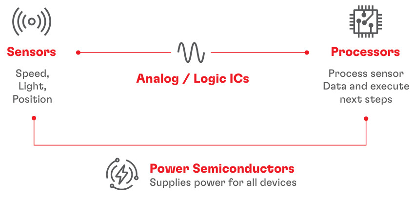
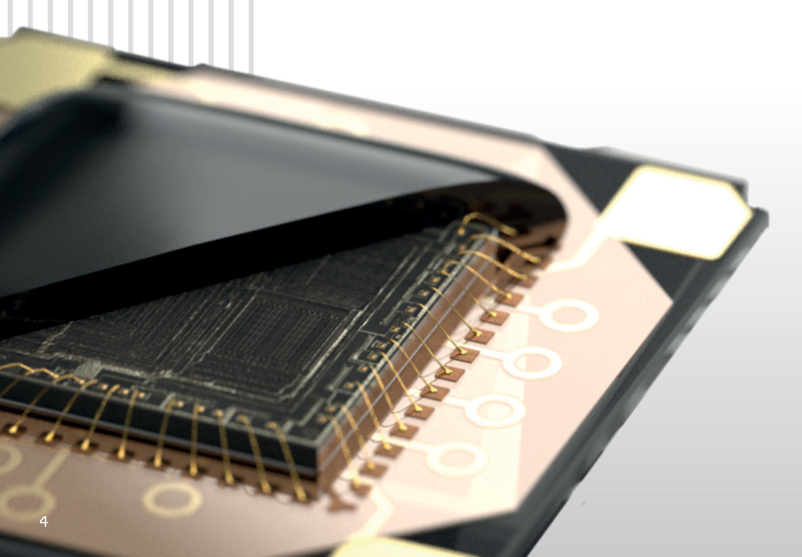
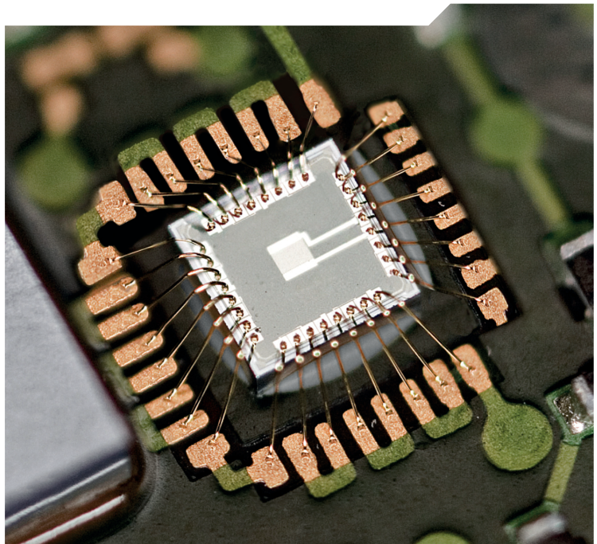
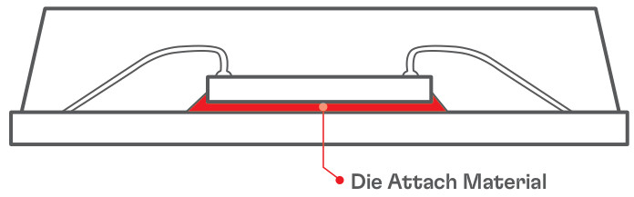
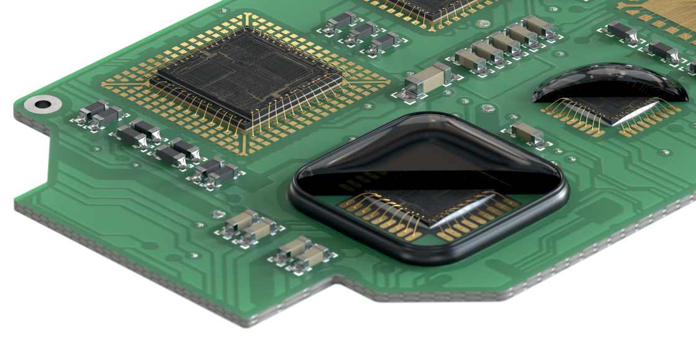
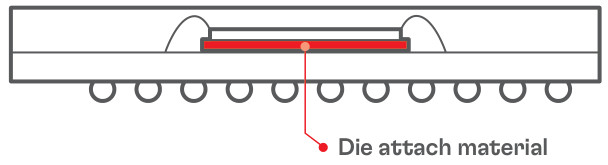
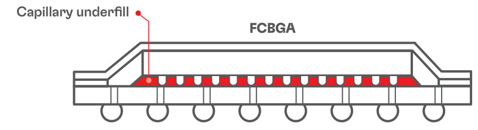
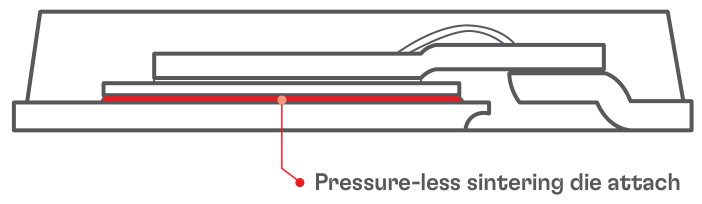

> 原文件：[46_dm.henkel-dam.com_Innovation-in-Motion_High-Perf.pdf](https://github.com/jadennevercode/CJCC-Knowledge-Base/blob/564ab11aa9785e569e3853c8a4d7ce86f88e7535/materials/%E4%B8%8A%E6%B8%B8%EF%BC%9ACMP%E5%8F%8A%E5%B0%81%E8%A3%85%E6%A8%A1%E7%BB%84%E6%9D%90%E6%96%99/46_dm.henkel-dam.com_Innovation-in-Motion_High-Perf.pdf)
> 转换方式：Volcengine OCRPdf v3, parse_mode=ocr

<!-- 原文第 1 页 -->

# LOCTITE INNOVATION IN MOTION 
High-Performance Automotive-Grade Semiconductor Packaging Materials 
 
Henkel Adhesive Technologies

---

<!-- 原文第 2 页 -->

---

<!-- 原文第 3 页 -->

# DRIVING TOMORROW'S TECHNOLOGIES 
The automotive semiconductor market is set for substantial growth, with projections indicating a rise from USD 33.69 billion in 2023 to USD 42.14 billion by 2029,reflecting an annual growth rate of 3.8%.This growth is driven by increasing consumer demand, technological advancements, and shifting preferences.Henkel, recognizing these trends, positions itself as an enabler, providing critical materials that support this expansion. 
By adapting to the industry's evolving needs with innovative IC designs, packaging techniques, and materials, Henkel facilitates the semiconductor industry's adaptation to automotive megatrends, enhancing vehicle safety, reliability, comfort,and connectivity 
Henkel's high reliability material for wirebond and advanced packaging technology are engineered to conform to the most rigorous industry standards for the next-generation automotive electronics devices. 
To address the vital requirement for robust thermal control, Henkel has developed high thermal semiconductor packaging materials, ensuring efficient heat dissipation and resistance to high temperature environments, key for maintaining the performance and durability of automotive electronics under various operating conditions. 
 
Scan this QR code to watch how Henkel's solutions are making a difference in the market.

---

<!-- 原文第 4 页 -->

## ELEVATING THE ELECTRONICS ECOSYSTEM 
Driven by automaker demands for safety, reliability, and comfort, and propelled by key trends like electrification, autonomy, and connectivity, the automotive sector is undergoing a significant shift. This evolution is increasing semiconductor usage in vehicles and pushing the semi conductor industry toward new IC designs, packaging methods, and advanced materials. Henkel leads this change by supplying critical materials that support the industry's adaptation to these emerging requirements. 
2

---

<!-- 原文第 5 页 -->

Henkel's semiconductor packaging formulations are used throughout the modern vehicle -from sensors to signal processors to energy management and control systems. Elevating the operational robustness and reliability of these devices enhances their contnibution to a collaborative auto electronics ecosystem that delivers performance on the road and comfort in the cabin. 
## HIGH RELIABILITY 
Henkel's advanced semiconductor materials, designed for wirebond and sophisticated packaging solutions, are tailored to address the evolving demands of next-generation automotive electronics, achieving unparalleled standards of reliability. 
## HIGH THERMAL 
As thermal control becomes increasingly vital with the industry moving toward higher power analog process nodes and the resulting smaller die,Henkel's solutions provide high thermal conductivity for robust heat dissipation. 
Integrated High-Level Performance 
 
3

---

<!-- 原文第 6 页 -->

 
## RAISING IMAGE SENSOR RELIABILITY 
Henkel semiconductor packaging material has been instrumental in enabling advanced driven assistance system (ADAS) applications that keeps the operations of the vehicle safe. 
Image sensors are crucial for the functionality of advanced driver assistance systems (ADAS), as well as electronic and autonomous vehicles. Henkel is dedicated to enhancing the dependability of these systems by developing new materials for encapsulation and die attach, which are vital components of automotive packaging and crucial for stress mitigation in imaging ball grid arays (BGAs). 
Henkel's material portfolio continues to be a key enabler of established sensor platforms like cameras and radars, even as they evolve. Building on our proven solutions for this space,Henkel aims to advance material innovation for LiDAR packaging to expand automotive capability. 

---

<!-- 原文第 7 页 -->

Image Sensors 
PRODUCT OVERVIEW 
## IBGA 
Encapsulant 
Die Attach 
Material 
## PRODUCTS 
## PORTFOLIO HIGHLIGHTS 
Non-Conductive Die 
Robust adhesion to various surfaces and proven low-bleed formulas provide the reliability and performance today's leadframe and high-density laminate packages demand. 
## FEATURES & BENEFITS 
·Extremely low warpage for large single die 
Attach Paste 
·Higher adhesion to the printed circuit board (PCB) 
·Low bleed on various surfaces 
·Good Moisture Sensitivity Level (MSL) performance 
·Good Pressure Cooker Test (PCT) performance 
## Encapsulation 
Optimised for fast dispensing with flexible cure profles, JEDEC-compliant, high-purity epoxy encapsulants help protect chips from mechanical damage and corrosion. 
·Lower stress 
·Better reliability performance 
·Low coefficient of Thermal Expansin (CTE) and high Tg

---

<!-- 原文第 8 页 -->

## BRIDGING SENSORS, PROCESSORS, AND POWER FETS Analog IC and Power IC Packaging 
The automotive transformation toward electrification, connectivity, and advanced safety management features has underscored the vital role of reliable, efficient powen devices.Packaging trends in the power IC sector include integrated FET drivers to improve switching performance, SiC- and GaN-based isolated drivers that bridge high- and low-voltage components, fan-in and fan-out wafer levelpackaging, and embedded packaging designs that enable smaller form factors. 
Lower power analog process nodes and the continual reduction in die size have contributed to higher power densities and increased heat generation versus prevous-geneation designs.To enble devic innoation alongsid these realities, Henkel is focusing on die attach paste and film materials that provide efficient and thorough heat dissipation, as well as advanced packaging materials to boost reliability and performance for new device architectures. 

---

<!-- 原文第 9 页 -->

Analog IC 
PRODUCT OVERVIEW 
## QFN/SOT 
 
## PRODUCTS 
## PORTFOLIO HIGHLIGHTS 
Die Attach Paste 
Excellent dispensing and workability performance, ideal for high-density leadframe design due to its long open and stage time. 
Die Attach Film 
Well-suited for high-density designs and challenging dimensions. 
## FEATURES& BENEFITS 
·Excellen Resin Bleed Out(RBO) performance ·Meets MSL1 and automotive grade 0 reliability standards 
·Controlled thickness and flow ·No Resin Bleed Out (RBO) ·Uniform and minimal flle fornation · Bond line stability 
7

---

<!-- 原文第 10 页 -->

 
ENSURING 
HIGH RELIABILITY IN MCU THERMAL MANAGEMENT 
Microcontroller Unit (MCU) Packaging 
MCUs are responsible for many critical functions within today's automobiles, including navigation and vehicle operation and safety. 
Because of their essential role, MCUs must be built to endure the heat, vibration, and other environmental stresses inherent in the automotive environment. Henkel's semiconductor materials portfolio offers a broad range of formulations for high I/O MCUs that prioritize reliability and align with new designs aimed at reducing cost.

---

<!-- 原文第 11 页 -->

## PRODUCT OVERVIEW 
## QFP Chip 
Die attach material 
Wirebond BGA 
 
PRODUCTS Die Attach Paste 
## PORTFOLIO HIGHLIGHTS 
Designed with stress control in mind for large body standard QFPs/TSSOPs. 
## FEATURES & BENEFITS 
·Uniform stress distribution during processing and in application ·High thermal conductivity of 10W/m-K 
Die Attach Film 
Created to control stress in lange body standard QFPs/TSSOPs; incorporates siver (g) designed for optimal Z-axis performance. 
·High toughness that increases adhesion and Moisture Sensitivity Level (MSL) performance 
9

---

<!-- 原文第 12 页 -->

## ENABLING THE SHIFT TOWARD DCUs 
## System-on-Chip Packaging 
Henkel's advanced System-On-Chip (SoC) packaging solutions are crafted to satisfy the demands for scale and exceptional reliability while delivering outstanding operational performance. 
In 2019,domain controller units (DCUs) made up less than 1% of the combined ECU/DCU market,but that number is expected to increase to 43% by 2030. The shift towards centralised electric/electronic (E/E) architecture is anticipated to fuel the need for highperformance DCUs, diminishing the prevalence of ECUs. 
SoC Packaging 
PRODUCT OVERVIEW 
 
PRODUCT一 
PORTFOLIO HIGHLIGHTS 
Capillary Underfll 
Balance high filler loading and fast flow capabilties. 
Lid Attach 
Designed for dispense applications, based on Henkel's proprietary silicone technology. 
FEATURES & BENEFITS 
·High fillr loading ·Fast flow capability ·Supports a large die size 
·High adhesion to different metal lid surfaces ·Low viscosity for easy dispensing and ultra-low moisture absorption 
10

---

<!-- 原文第 13 页 -->

# HIGH-RELIABILITY SINTERING SOLUTIONS WITH HIGH THERMAL EFFICIENCY 
## Power FET Solutions 
Henkel's pressure-less and pressure-assisted sintering formulations for power FETs deliver excellent thermal performance, good electrical conductivity, and high reliability. 
The portfolio is compatible with traditional Si,as well as wide band gap SiC and GaN semiconductors, which are now favored for certain MOSFETs and power modules. Henkels pressure-less and pressure-assisted materials deliver very high thermal conductivity for excellent heat dissipation, good thermal and power cycling performance, low die stress, and high UPH across all diesusrates and deice types for mid-/high-voltage applications. 
Power FETs 
PRODUCT OVERVIEW 
 
PRODUCT 
## PORTFOLIO HIGHLIGHTS 
Pressure-less sintering 
Superior thermal conductance and compatibility with traditional and newer semiconductors. 
 
Scan this QR code to watch a demonstiration of our Power FETs solutions. 
FEATURES & BENEFITS 
·Delivers thermal performance at up to 200W/m-Kbulk thermal conductivity 
·Demonstrates excellent adhesion on Cu, PPF, Ag, and Au leadframes and robust electrical conductivity Stable RDS (on) after 2,000 hours of thermal cycling 
11

---

<!-- 原文第 14 页 -->

## THINK INNOVATION, THINK HENKEL. 
Henkel is committed to driving the future of automotive progress through formulation ingenuity, customer collaboration, and deep scientific discovery. Our significant investment in global technical resources ensures access to a broad knowledge base, while delivering regional and local support to offer a personalised experience. 
 
Scan this QR code to download product specification list for our automotive-grade material 
12

---

<!-- 原文第 15 页 -->

Henkels semiconductor portfolio and our experienced team are meeting the demands of the dynamic automotive electronics industry head-on with innovation, agilty, fast time-to-market, and unmatched service and commitment. 
Connect with us to learn more about Henkel's semiconductor packaging solutions. 
 
一年 2 
1 
、

---

<!-- 原文第 16 页 -->

LOCTITE 
## AMERICAS UNITED STATES 
Henkel Corporation 14000 Jamboree Road Irvine,CA 92606 United States Tel: +1.888.943.6535 Fax:+1.714.368.2265 
## Henkel Corporation 
20021 Susana Road Rancho Dominguez, CA 90221 United States Tel: +1.310.764.4600 Fax:+1.310.605.2274 
## Henkel Corporation 
18930 W.78th Street Chanhassen, MN 55317 United States Tel: +1.952.835.2322 Tel:+1.800.347.4572 Fax:+1.952.835.0430 
 
## BRAZIL 
Henkel Brazil Av. Prof. Vernon Krieble,91 06690-070 ltapevi, Sao Paulo Brazil Tel:+55.11.3205.7001 Fax:+55.11.3205.7100 
ASIA-PACIFIC CHINA Henkel Management Center Building 7, No.99 Jiang Wan Cheng Road Shanghai 200438, China Tel: +86.21.2891.8000 Fax:+86.21.2891.8952 
## ABLESTIK (Shanghai) LIMITED 
No.332 Meigui South Road WaiGaoQiao Free Trade Zone, Pu Dong Shanghai 200131, China Tel: +86.21.2702.5888 Fax: +86.21.5048.4169 
## JAPAN 
Henkel Japan Ltd. 27-7,Shin Isogo-cho Isogo-ku Yokohama,235-0017 Japan Tel:+81.45.286.0161 Email: jp.ae-csdesk@henkel.com 
## KOREA 
Henkel Korea Co Ltd. 18th Floor of tower B, BYC High City Bldg Gasan Digital 1-ro,Geumcheon-gu, Seoul,08506 South Korea Tel:+82.2.6150.3000 Fax: +82.2.6947.5203 
## SINGAPORE 
Henkel Singapore Pte Ltd. 401,Commonwealth Drive #03-01/02 Haw Par Technocentre, Singapore 149598 Tel: +65.6266.0100 Fax: +65.6472.8738/+65.6266.1161 
## TAIWAN 
Henkel Taiwan Ltd. 10F,No.866, Zhongzheng Road Zhonghe District, New Taipei City,23586 Taiwan Tel: +866.2.2227.1988 Fax:+866.2.2226.8699 
## EUROPE BELGIUM 
Henkel Belgium N.V. Nijverheidsstraat 7 B-2260 Westerlo Belgium 
Tel: +32.1457.5611 Fax:+32.1458.5530 
## UNITED KINGDOM 
Henkel Ltd. Adhesives Limited Technologies House Wood Lane End Hemel Hempstead Hertfordshire HP24RQ United Kingdom Tel:+44.1442.278000 Fax:+44.1442.278071 
## ACROSS THE BOARD. AROUND THE GLOBE. henkel-adhesives.com/electronics 
@2024 Henkel Carparatin. All rights reserved.(06/23)
