> 原文件：[46_ibiden.co.jp_IntegratedReport2026.pdf](https://github.com/jadennevercode/CJCC-Knowledge-Base/blob/564ab11aa9785e569e3853c8a4d7ce86f88e7535/materials/%E4%B8%8A%E6%B8%B8%EF%BC%9ACMP%E5%8F%8A%E5%B0%81%E8%A3%85%E6%A8%A1%E7%BB%84%E6%9D%90%E6%96%99/46_ibiden.co.jp_IntegratedReport2026.pdf)
> 转换方式：Volcengine OCRPdf v3, parse_mode=ocr

<!-- 原文第 1 页 -->

## 七仁步、 先 革新 IBIDEN 
 
INTEGRATED REPORT 2026 化宁株式会社統合報告書2026

---

<!-- 原文第 2 页 -->

也夕1 仆口外 会長 七一 
也夕 2 七夕日3 俩值創造入卜一一 成長戰略七经营基盤 
也夕4 宁一夕 
01 
## IBIDEN 
平素化宁株式会社化儿一各社(格别 配慮左賜、厚<御礼 电上f寸。 
化宁少一、株主·投資家皆37于一夕木儿一皆(二向 、当社夕儿- 值中長期的值創造(二向(取粗(元 左目的(、统合報告害左行Cl寸。 
本報告書、持的企業值向上 取 组左中心仁、財務·非財務情報左一体的二 編集L、值創造卜-一中长期戰略左现具体的取組 。中期释计画 進抄也、2030年(向|成长略具体的(仁說明七、 社外取缔役鼎谈通乙、環境变化中 经 在方長期視点 企業值向上 (二向|施策、社外取缔役 多样視点意見紹介寸。 
本報告書行( 、各部門連携仁作成、会议 内容審議 決裁、上 取缔役会 報告寸。 
今后一夕木儿夕一皆 適时適切情報開示左進上同時、一層对 話 機会设|当社理解深尤努寸。、对话得 6大意見、真挚(仁议 反映企业值向上寸。 
代表取役会长 取籍役会议长 
化子 株式会社合報告書2026

---

<!-- 原文第 3 页 -->

也夕31 
仆口外 
02 
目次 也夕1 仆> 
也夕 3 
成長戰略七经营基盤 25事業 成长戰略 
01会长七02目次、編集方针 03企業理念 04 05技術事業 变遷 
28|特集2|大野事業場 
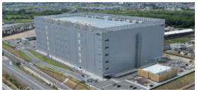 
06 At a glance 07口一八儿卜一夕 08|特集1|AI-八一向|IC/-基板 
報告对象期间2025年4月1日~2026年3月31日 
36人的资本经营 40人推 尊重 
※一部对象期間外 情报揭載LC寸。 
 
41社会 開 42地球环境 共存 
報告对象範化宁株式会社儿-会社 
※原则、化宁株式会社上 速结子会社在对象、一部個对象 範在记載LC寸。 
46DX戰略 47 任工 
## 参照力仆个 
48品質×>卜 
·济産業省/俩值創 合的開示·对話力夕> 
49 一术 一卜·八> 
·IFRS财团/国际统合報告L-一夕 
57役員招介 
·TCFD(候连财情報開示夕才一) 
也夕 32 
59社外取缔役鼎談 
值創造入卜一一 11值创造卜-12社長×七一 
 
 
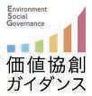 
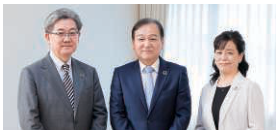 
## 情報開示体系 
 
 
63社外取役七一 
株主·投资家情报 https://www.ibiden.co.jp/ir/ 
64又夕衤>卜 65 
 
有俩证券报告書 
 
17識寸3重要課题 20ESG经营 考方七推進体制 18中长期的经营戰略 21财務戰略 23投資家 对话 
也夕月>4 
于一夕 
https://www.ibiden.co.jp/ir/library/securities/ ESG情報 https://www.ibiden.co.jp/esg/ 
 
 
合告2026 
企业情報 https://www.ibiden.co.jp/company/ 一术L一卜·八久报告書 https://www.ibiden.co.jp/ir/library/governance/ 
67財務一夕 
 
69非财務一夕 
71外部评伍 
行一夕 成長戰略七经营基盤 
也夕 2 俩值創造卜一一 
72会社情报/株式情報 
也夕日4 
也夕月3 
## 編集方針 
見通L关寸 注意事项 
本术一卜、化宁 株式会社现时点飞入手可能情報 基将来 見通计画力記述寸。记述(潜在的 夕不確性含、将来際業、事業展開 可能性寸。、将来見通计面(開寸 記述、正确保证世人。 
 
化子 株式会社合报告書2026

---

<!-- 原文第 4 页 -->

也夕31 仆口外 化 工 
32 值創造一人 
企業理念 
誠实 私大方、 現地現物行动 基本、 客也社会60信赖仁之寸。 
MISSION 企業理念 私大5、 人之地球環境大切(二、 革新的技术飞、 豊力社会 展仁貢献 寸。 
和 
私大右、全員参加 毛匕、 多样 英知在結集L、 大吉力生办出寸。 
積極性 私大方、 时代 变化左予見L、 新 值 創造 果敢仁挑战 寸。 化行 進化 私大古、 創意 工夫左重权、 高目标在也 成長寸。 
SPIRIT 共有寸八行动精神 
诚 和 
積極性 
化行人 進化 
化宁長歷史(、幾多困難在全员乘越、化宁)左存世老力 「化子 「近年 飛躍的成長实現世英知七活力」。二、世代中国籍超之了受继 仁体系化毛化宁工有寸。 
独自 了技术融合·合L、新技术创造寸 当社[ 受继力普遍精神寸。 
化子株式会社统合報告書2026

---

<!-- 原文第 5 页 -->

成長戰略七经营基盤 当社夕儿一 歷史也俩值观在端的仁之 乃一作成。 俩值创造卜一一 
仆口外 
也夕月3 
也夕 2 
也夕31 
也夕4 04 宁一夕 
方外 1912 1951 1974 1995 2000 
电力会社 L 創業 揖斐川电力株式会社设立 立川勇次郎力 初代社长仁二就任 「<D会社」 身 戰後 復與 、炭素制品 礎上电气炉事業左掂大 石油 夕新七事業打開 电子回路分野 進出 初 卜配線板 工場左设立 電子事業大<成长 最大手半導体一力一 取引开始 
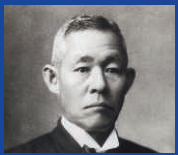 
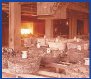 
方外七一氵 
## 方外- 
私大右|、地域经济 振與在L 水力電会社 了創業以来、地域 社会七毛仁步、100年在超元 历史在築L吉。电会社办 电力在活用/< 会社 身、 長\歷史 中培 老 技术基盤(、時代 二一人捉、 社会 课题解決仁贡献寸革新的 品生出 
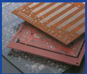 
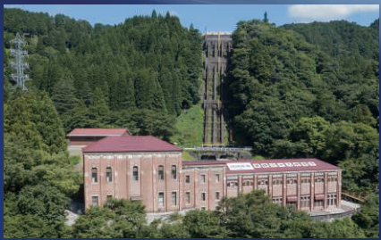 
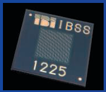 
地域社会 上七仁、 顾客 七七仁、 從業员 毛、 取引先 毛二、 确力八一卜一 左築、时代 变化仁合世技術飞、未来左创造寸 化子少儿一(、二 先、独自) 技术革新追求 、持可能社会 現(二貢献 寸。 
 
环境配慮型制品(SiC-DPF) 七三 夕事業力躍進 大手自動車 一力一力 SiC(炭化素)製DPF左採用 
 
化子 株式会社合報告書2026

---

<!-- 原文第 6 页 -->

创業一地域经消 復具 地域经济 復與、水力电 电力会社LC創業、後、电力有活用 「 <)会社耘身。 積層技术左多样技术取D入。 05 先上高 4,000 
宁一夕 
技术七事業 变遷 化宁技术 源流水力电(二苏。电力 有活用電化学事业進出、後、高温成技術合成化学技术、 1971年~1990年 事業 再横期 企业革在精神 出 也夕31 仆口外 俩值創造卜一一 成長戰略七经营基盤 
也夕4 
也夕月3 
也夕 2 
## 6 技术 变遷、現在 电子事業七三夕事業 中受继力寸。 
1912年~1970年 素材中心型 事業展開期 1912 (大正元年) 熔成 肥 発電技術 
1991年~2000年 新規事業 創出期 化子 追求 
2023年~ Moving on to our New Stage 115 Plan 
半導体阅連用七三少夕 4 SiC-DPF 
70 
技 变 
电力 力一八个 
電氨炉技街 石灰窒素 
IC接統技 COB IC八一基板 X毛U-E一儿 化脏板加工品 
七三少夕関速 也三少271八一 3,000 
 
2,000 建材阅速 ×三 化脏板 化板加工品 
CSP 
电子阅速 IC八一基板 
少卜配板 
77个(特殊炭素裂品) 
技術 制品 
第20創業一橘造改革 宁沙夕儿時代 二一在早< 取)、 配線板IC八-基板 生產 成功。 
Moving on to our New Stage 115 Plan 5本活动柱(强化LL<力)造基活动 事業環境变化仁对、持可能成長 实现向全社儿一丸上 取粗人C。 建设· 他 雷子 21.7% 58.5% 
铁道 20% 51% 
307万内 
电力 
1923年度 
27/个 
1% 
1% 
力一术> 
合金铁 
2 
1991年度 
2025年度 4,162世丹 七三少 19.8% 
1,000 
 
 
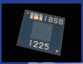 
 
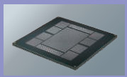 
1西横山水力电所 (1916-1963) 1912 
積層技 2×三 化板 
合成化学技 
. 
力一术> 
少卜配線板 
× 牛技行 
仆 
国 
2代 也三少 
高温烧成技 
七三少夕 77个一 
×三 化桩板 3C/-基板 (1960-現在) (1988-現在) 1925 1950 1960 1970 
49% 25% 
9% 
16% 
电子 
建材 
力一 
12% 力一八仆 
690億 
8% 
建0 
136億巴 
合金跌 
2 他 2% 
1971年度 
力一术> 10% 
3% 
7% 
力一八仆 
化学肥料 
品左開L志U龙。 
店用L建材事業成長L。 
七三少夕事業C排气系分野环境黄献石 
着目、x三>事業培 技 
世界中 境题对意 高 受、 
高度经济成长期仁住宅建築需要仁) 
見之進化一海外 進出 
再横一新事業 期待 
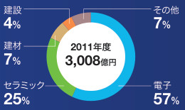 
SiC-DPF (1999-現在) 
2001年~2022年 触媒担体保持·一儿材 中核事業 育成期 化子 深耕 
2025(年度) 化子 株式会社合報告書2026 2010 
2000 
1990 
1980 
0 
AI一八一向| 1C八- 基板

---

<!-- 原文第 7 页 -->

也夕31 仆口外 
也夕 2 也夕月3 俩值創造卜一一 成長戰略七经营基盤 
也夕4 宁一夕 
06 
At a glance 化儿-電子事業」、七三事」、0他事業03事業通社会二一品開·提供寸。 世界卜工了最先端半導体向IC/-基板、独自 技术展二成長寸。 
2025年度事業 壳上構成比 
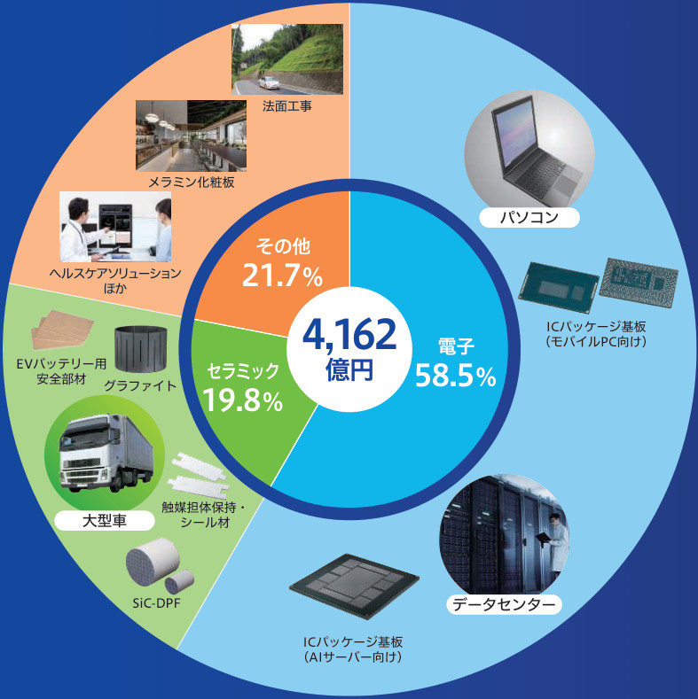 

| 世界 卜J工了 | 累計出荷数 | 水力発电 | 温室效果力久 排出量 |
| --- | --- | --- | --- |
| 最先端半導体向| IC八 一基板 | SiC-DPF 8,000万個以上 | 100年以上 活用 | CO2 293千t-COze |
| 壳上高 | 营業利益(率) | ROE | 海外壳上比率 |
| | 1~ | | |
| 4,162億巴 | 620亿 (14.9%) | 12.25% | 70.7% |
| 设备投资额 | 研究開免费 | 從業員数 | 海外從業员比率 |
| 642億 | 299亿 | 11,105人 | 41% |
 
化子 株式会社合報告書2026

---

<!-- 原文第 8 页 -->

也夕1 也夕2 也夕日3 七夕日4 仆口外 俩值創造卜一成長戰略七经营基盤 行一夕 
07 
少口一八儿之卜一夕 化儿一、1987年米国出皮切)、夕口一八儿事業展開了。世界各地展開点活、-对、客 細二一|二少口一八儿术一卜体制构築 。 
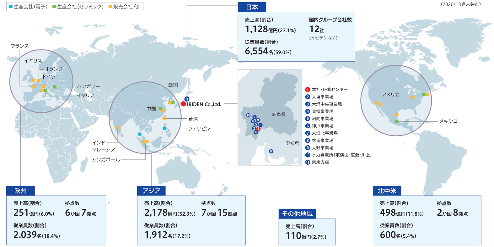 
從業员数 11,105名 
海外壳上高比率 约70.7% 
海外從業員比率 约41% 
海外点数 
15分国30热点 
化子株式会社合报告書2026

---

<!-- 原文第 9 页 -->

成長戰略七经营基盤 俩值創造入卜一 
仆口外 
也夕4 
七夕3>3 
2 
也夕31 
宁一夕 
08 
|特集1|AI一八一向|C八-基板 
AI(人工知能)(二高度情報社会 现、高性能半導体|膨大于一夕处理不可欠、半導体 性能AI性能左右过言 世h。 半導体支部品C八-基板、当社、AI一八一向IC八(-基板([世界一了。 
AI 社会装一夕七夕一投資 大 
2022年(对话型AI登場 以来、AI 社会装急速進展L、業務率化 新规-匕7 创出、AI人 生活结左强寸。 
15年 16 1,61 
A人生活 现(二欠世)存在、2040年((世界) 夕儿一夕处理量(2025年对比16倍見办寸。需要大(伴)、 一夕夕一投资力世界的(加速L)、高性能IC(半導体) 10年8倍 一体機能IC一基板需要成长見寸。 767 5年73倍 2025年(=100)左 301 基準匕L变化 世界 夕儿子一夕 100 处理量 推移 2025 ※民間调查会社一夕参考L当社予想 
AI一八一[IC八一基板 重要性 
IC八-基板|C 一体 機能寸重要 部品飞寸。 
左担寸。 近年飞、IC 微細化 進展技术的·卜的女 制豹(直面L、半導体 性能向上仁大吉课题 C寸。二 课题解消、IC/-基板上 数IC組合世搭載 、要求能在 现于 卜工法 採用進寸。IC八一 基板、複数 IC高速 高精度接統機能 
2035 
2030 
特、AI一八一向品、大规模一夕 高速飞处理必要、D多<C在搭 必要七匕、IC 接合数(1/0数) 飛躍的[增加、IC八一基板 高機能化求 5。背景5、IC八一基板技術 革 新AI一八一 化支重要要寸。 
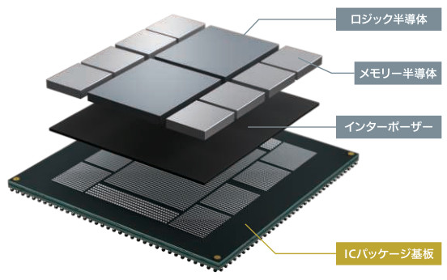 
2040 IC八-装X一(卜) 
## IC八一基板 役割 
IC 小配综板电气的接寸3 |C手在配線板装形状 数 IC手在合L形成 凳熱IC手熱逃寸 外部環境(衡、水分、二))C左保 
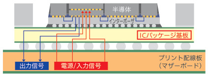 
化宁株式会社合告書2026

---

<!-- 原文第 10 页 -->

也夕31 仆口夕夕 
2 也夕33 俩值創造入卜一成長戰略七经营基盤 
也夕4 宁一夕 
09 
|特集1|AI-八一向|IC八- 基板 
## 最先端製品 製造·開(当社 強 高 技术力 
以下(、当社有寸最先端IC-基板 技术在二绍介寸。 大型化·高多層化 
AI一一向|品等、IC-基板 要求高度化 仁二伴 、基板大型化·高多層化進寸。 
IC八-基板 素材[樹脂熱反寸<、特仁大型 化·高多層化 倾向著(。基板反生 、C手 装段 不具合生、基板 反抑技 術力重要视机 
 
当社、长年生技术八 、反少 高品質基板現寸。 
高多 化方進有 IC/一基板 
## 世代重每大型化進IC八-基板 
基板0脂数 20周以上 
80x80mm 
90x90mm 
恶 
半体 性能 
面積(面精×屠数) 5年4倍仁大型化^ 
130x130mm以上 28厘以上 
110x110mm 24层以上 一部 基板了材料 樹脂 力 
(9-X-9) 2025年 2026年 
2028年 2030年 
IC八-基板大(面積七屠数) 
## 微細化 
战多< 信号入出力必要中飞、IC八一 基板1唇D 配密度向上世U必要 寸。AI一八一向|等 高能|C-基板( 
 
、)微密L/S(Line&Space) 现必要仁 、最先端 设活用、数三口 技术開在進寸。 
配線 幅·同隔毛、微化進飞 
## 顾客 新制品開仁伴走 
当社(、客世界半体一力一開初期段階密連 携 、技术口一在共有製品·口也開在進寸。、试作 加量座在同一个一贯对体制有、机開発段 量座段階最小化、高\再现性安定品質现。 以下、现在客取组次世代品事例貂介寸。 
## IC八一基板 造 化 
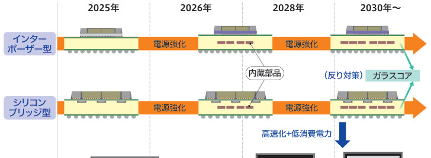 
(术一卜間接) 
部品内藏型基板 
·C八一基板内部品埋、C电力供给左强化 
·技术的易度非常(高<、世界飞製造 当社左含限企業 
力又口了基板 
·從来、樹脂作IC八-基板層、力寸技術 
基板大型化|伴反 对策、期待 
光电融合 
·现在、电气信号(行通信、光信号用行技术 
·高速化、省电力化、温度抑制、信号 低损失化期待 
化子株式会社合報告書2026

---

<!-- 原文第 11 页 -->

成長戰略七经营基盤 俩值創造卜一一 
仆口夕的 
也夕日3 
也夕 2 
也夕月1 
七夕日4 行一夕 
10 
七夕2 
# 偭值創造 一U 
11俩值创造入卜一 
12社长七一氵 
17认識寸 重要课題 
18中長期的经常戰略 
20ESG堂 考之方匕推進体制 
21財務戰略 
23投資家 对话 
化宁 株式会社合报告書2026

---

<!-- 原文第 12 页 -->

ESG经营 一一卜·力八十久 行一夕 
成長戰略七经营基盤 
俩值創造卜一一 
仆口夕 
七夕日4 
也夕日3 
也夕 2 
也夕月1 
11 
值創造入卜-地域 振目的水力電会社立当社、人地球环境大切技開型企業、最先端技社会展贡献。 二加、独自 技术化·融合世、新開「化間<化二飞、新值 創造挑戰。 
7外力 化子提供寸 社会 值 
俩值創造 投资/了技术 化 用 企業理念 
企業格付 A+ (誠寒·和·積極性·子夕進化) 
强固财務基盤 
共有 行動精神 
(2026年3月末時点) 自然资本 創業6事業支、 豐富水資源活用L 水力免电 水力電量158,201Mwh (2025年度) 社会開保资本 事業环境节二一、 力-U又夕仁对寸 夕口一八女梦术一卜体制 提点数15力国30揽点 (2026年3月末時点) 知的资本 既存 技店用 品·素材(0 研究開免费299億 (2025年度) 特许保有件数2,336件 (2025年度) 製造资本 先端股 導入上 高品力高率 股投资额642德 (2025年度) 财務资本 的 
豊社会 展仁贡献寸。 
自立型人财 從業員数11,105人 
革新的技術飞、 
争力在創出飞告 
私龙、人地球環境大切仁、 
主要在个卜 人的资本 戰略密推进LZL\< 
成長戰略 中期经营计面 IC/-基板 Moving on to our LP25-27 New Stage 115 Plan (2023年度62027年度表) 
主要在77少卜/7力 
 
7外7y 37事業 梨品 IC八一基板 
于夕儿 八一免展 高楼能77个IC 八少一基板飞 夕儿技術 進化仁贡献 L寸。 0P25-27 
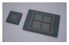 
也三少夕裂品 LP29-31 
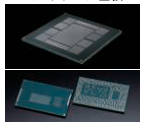 
 
 
環境阅速也于三少夕裂品 
新· 他事業分野 L P34-35 
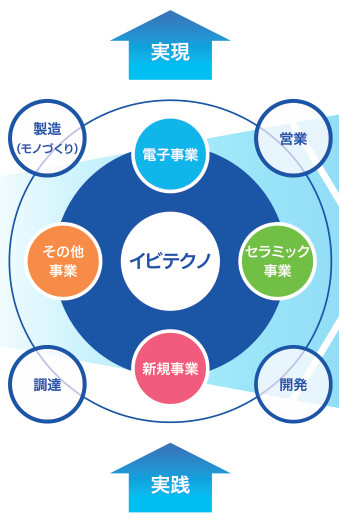 
 
 
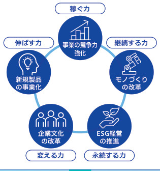 
 
2027年度经营目標 壳上高 6,500 营業利益率 23.1% QQP29-31 
72卜力 
大 改善 (環境污染) SiC-DPF之触媒担体保 持一村 
新规· 他事案分野 
 
機会 技術移行仁上 制品二一拉大 
事業口七久 中飞SDGsl贡献 
夕八一34、工行 &个儿QP36-40 QP64-65 
 
 
環境負荷 低L 生产体制 MP34-35 
自然資本 持統的活用 
一活用·操化仁黄 
高生产性 两立 
亮、再生可能工之儿 
働老力 
献寸 裂品 研究開 
人的资本 强化 
炭素回收也固定仁贡 
事業基 强化 
脱炭素社会 移行 
8 省工儿半一 省资源 mP42-45 
低炭素技術 市场大 大污染对策制品 需要拉大 
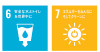 
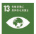 
 
2026年5月時点 開示情報|基< 情(R 
化子株式会社合报告書2026

---

<!-- 原文第 13 页 -->

成長戰略七经营基盤 一人 变化成長、 先 革新 俩值創造卜一一 
仆口少3 
也日3 
也夕 2 
七夕31 
也夕日4 12 行一夕 
社長 乜一 
## 社长就任3年目迎元了 
私 目 前、AI 化寸、<大吉成长 機会全分野 力寸。一方飞二 变化上好機確掴仁(、二飞上同仕事 方|到底足、强危機感。大吉于 仁寸 二、现状(满足世、私右自身机世h。社长就任力 年迎元今、私力强<、二 变革 党悟飞。 
二 2年間、国内外多< 现場(足左、社员直接对話重中乙、一人 持 可能性、现場持 底力感。同時、力龙十分活 课题痛感。世界左支、必要 会社」、社員 皆「七心会社」(仁)大() 思 寸。在现、变(私右营層含乙、自身0 仕事 向合方、革人 视点始)考寸 化宁儿一才、变革 DNA创業以来受继力机寸。地域经 振水力电会社创業、 电力礎(、電化学工業身 也三夕品、电子部品、時代 要请合世自事业大胆(二組 元了。時代 变化予見L、新值 创造果敢挑戰積極 、企业理念体系「化」受私支行动精神 2寸。二 行动精神一部 人、社一人日行动少 
化子株式会社合报告書2026

---

<!-- 原文第 14 页 -->

社長 也一 
当社取卷<環境目向、2025年度 世界经济、米国 通 商·金融政策 乾换為替·株式市场 变助、中国经济 停滞、中東情勢 地政学 在化、不安定状况。 
半導体·電子部品業界 市場、八市場全体力强欠<水 、一八一市場、生成AI関连成长领域好调持 、用一八一向 需要、缓力成长基調飞推移。 
13 也夕日4 行一夕 
成長戰略七经营基盤 
俩值創造卜一一 
也夕日3 
也夕 2 
也夕月1 仆口夕的 自助車業界 排气系部品市场(、米国 関税政策变更(端左寸世界的景先行 不透明感背景、夕口一八儿飞自動車生产台数减少仁伴 )纯化。 
## 挥机、全体大力寸。 
二机5 市场環境变化受、AI向中心成长领域 受注对寸、 大野事業場 量产在2025年10月计画通開始 。、今后古需要 大見高機能IC八一基板 生产能力增強左目的、2026年度 2028年度 3年、河間事業場 大野事業場主要对象寸额5,000亿 规模 投资计画、2026年2月1决定 。、也三夕事业(乙、 将来一多化向布石、2025年度、NEV(EV八用安全部材)事業部在技术開本部七三夕事業本部入移管L寸。 
文化变第一步、役職<名前「/」付1飞呼合取 組孙 使共同飞。小一步見世、立场肩書左越 誰率直意見交世風土(、明確意思表示飞寸。二飞仁 新行了对、決最初否定)。誰方出新行了 寸受止、互仁協力挑戰在促寸。七元失败、责任飞付女<原 因(二目向、全员飞次 一手左考了即座才口一体制整之。二3 信赖 上司·部下 关係自由達意見交换 企业文化二、 值在生[ 土台飞寸。社員 行动变容(向環境在整、人 事制度 改革口工外取组、社員 行动 成果仁報基 <進寸。上私自身、役員先頭立右、姿示 飞、企業文化 元想、全社(共有LC寸。 
结果、2025年度 業績、壳上高4,162億(前期比12.7%增)、营業利益620 億(同30.3%增)、经常利益608億(同27.0%增)、親会社株主(属寸当期纯利 益637億(同89.0%增) 、前年度左大<上回水準之。 
乙中、 他事業壳上高903億(前期比2.5%增)、業利益89億(同 3.0%增)堅調(二推移。他事業、当社 技术過去 製品受) 尤事業成寸。建设绿化5儿仁至多彩事業营国内 儿一各社力各强挥、事業争力活眼活取組寸。 私、連结合力二、市况 变化摇当社 底力龙匕考寸。 
## 中期经营計画 進抄 AI需要 着取 他事業 贡献 前年度大<上回水 t 
2026年度(、八半導体市場 成长<見立飞、壳上高5,500 德(同32.1%增)、業利益1,270(同104.8%增)、高成长角度通 期業予想左策定L寸。 
2030年度 向成长戰略 從業員最大限力在揮環境整元、 成长投資確行寸乙飞、 「壳上高1兆」 体制整寸 
2025年度 確手左踏、中期经計画 業目標上方修正C 。計面 最终年度2027年度 目標引上七(、先 2030年度 
化子株式会社合报告書2026

---

<!-- 原文第 15 页 -->

也夕月1 仆口夕的 社長 也一 
也夕 2 也夕日3 俩值創造卜一一 成長戰略七经营基盤 
也夕日4 行一夕 14 
## 二、電子事業左轴(二「壳上高1兆·業利益3,000(業利益率30%)在 寸大吉目標左揭[。 
目標、今飞方左龙達成(考元 寸。2030年度(壳上高2倍目標寸一方、人員数(現的(1.2~1.3倍程度增 加[留龙匕見达人。二状况 中乙、事业成长世 二、全员「本当值 仕事(何」左問值L、值業務重左置) CU<必要。6、各階層对、大胆限委行、 责任人责任判断環境左整寸。人力最大限仁引出 、生产性向上世己、壳上高1兆支强固土台(仁七考元() 封寸。 
目德達成仁二向|最先课题、成长投资確行飞寸。2026年度52028年 度 3年、电子事業総额约5,000亿当社、史上最大规模设 投资在 切D寸。 中核、二1一儿河間事業場 量产立右上、 2025年10月(二量产左开始L大野事業場 追加投资 寸。河間事业場、2023年二 竣工U 、量產稼[踏切二状况。2025 年度(入)、八个八一一一独自開寸ASIC需要急速伸尤 、ASIC向品仁对生产工場C立右上左進寸。大野事業場 顺次稼工了左大L、现在(建屋内一半分程度 活用二留 、AI一八一向品 旺盛需要、本投資(残半分7 八一八设导入進寸。、部品内了、光电融合 次世代·次世代技术 開(注力、客 一步先行<值提供寸、 八市場飞確固地位持L寸。 
也三夕事業、新国 業用車向DPF需要着[二取 、 NEV事業 黑字化仁向、海外客 開拓加速L寸。加FGM事業 L、北米一夕七夕一需要背景二成长見原子力电分野、自社 争力最大限挥市场向二計面的投資行寸。仁技術開 部門(二)、新事業领域 開拓、于一半匕夕儿 戰略的出 产学官连携[才一)一活、GX·八才 分野次 收益 柱育寸。 
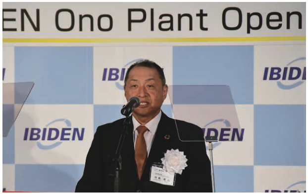 
大野事業場開所式 
## 人的资本经营 具体化 
仕事 方变 「人」 
育成·登用·技能承 仕組刷新 
「自立型人财」育寸 
二 成长戰略现原动力、「人」(二 寸。私右寸自 立型人财、急激变化环境中、当事者意識持自考、 機敏人財飞。育成活支環境整一環、人 事制度改革(取)组A寸。人事制度、個人一番力挥飞役割 
化子株式会社合报告書2026

---

<!-- 原文第 16 页 -->

也夕月1 仆口夕的 
成長戰略七经营基盤 部長夕儿一一一層 限在委讓L、责任人、場匕一下感 持 判断下体制(变元。管理職 役割判断」「变化左 起二」「人财育成」三定、二在評制度|毛反映寸。 龙、争力 起点(外世界知(考5、一定 役職者外部 交流<取組施七、社内乙5(知65 情報信掂充L 寸。 俩值創造卜一一 
也夕日3 
也夕 2 
也夕日4 行一夕 15 
社長 也一 
明確(二L、纳得感 酬处遇现二、会社成长事業大向乙、 年龄、性别等[关、多知識持人力制度( 2点术卜大胆(二改革寸。2025年度管理職·二了職左对象、 役職定年 撤門一 创设、二層处遇見直 行尤。 2026年度(階層左大U、等级·報酬制度 拔本的見直L仁踏达、社员 一人持飞環境在整。 
<视点、夕儿全盛時代、设匕品質左知D拔、改 善·維持人财 值左一段高<見。生产部門(全社 <D教育在担体制匕織左再编、青柳事業場「/<D道場」飞、意識·知 識·知惠·技能 践的承、AI 夕儿技术左使 加速C。 造業当社(、安全土台寸。AI力(不安全行動) 監视 仕組取入、安全第一、社員安心職場< 微底L \寸。 
变化 時代二成长 事业大现、意思決定 匕一下欠世世人。 
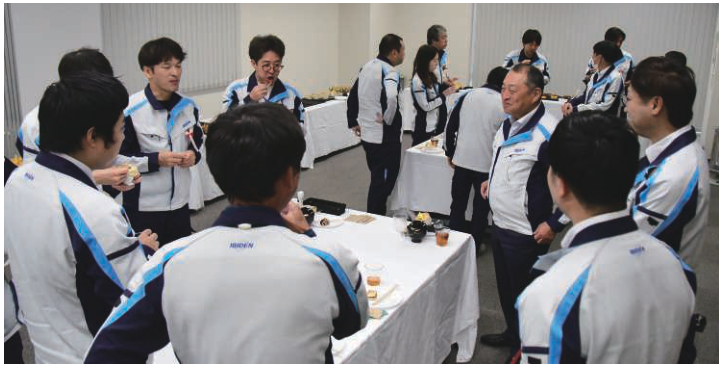 
社員上 意見交换会 樣子 
2026年度上記(加元了、社員 行动变革目的理念体系再整理、社员工 -向上 声左|文化形成施策左進寸。 取 组通、社一人失败恐寸、自分 想意見自由交 世職場現 寸。、自行动成长会社 成长(、 七思会社在。 
## 财務戰略七力八 久体制 强化 
強勒 七 追求。 
## 成长投資七财務规律 立確 寸 
当社史上最大 投资確企業值 、私(规律 微底、 強勒财務体質 築左重视L寸。成长投资前受金左含業 1·7口一 範内基本U、連结EBITDA"率30%以上、电子事業单体 40%台上高()創出力維持 寸。二机加乙、今后事業争 力正<查定飞5、资本卜意識管理指標 導入討 寸。 女书、自己资本比率(前期045.3%657.2%大<改善LCD、引60%以 上 復元在寸。 
资本市場 对话果断(行(C移具体的成果一、政策保有株式 缩减 飞寸。当初2027年度末|2023年度末時-50%以上在缩减」 龙目標在大幅(二前倒L、2025年度末时点81%减成。 ※营業利益+减却費 
化子株式会社合报告書2026

---

<!-- 原文第 17 页 -->

也夕月1 仆口夕的 
也夕 2 也夕日3 俩值創造卜一一 成長戰略匕经营基盤 
社長 也一 
事業规模 大(、八7 高度化欠世世人。监查機能左社长 直 独立强化(、7 微能在经营企画部門 展的(仁统合LCERM(合型久卜)体制 横築 [二取 組人寸。、子会社 内部統制监督专任部署新设等)、 儿一全体八>强化左進寸。 
株主還元(、2030年度成长投資財務规律考虑、 配当性向20%目安、年間配当金1株 20左八一仁累進配当寸方針 C寸。、2026年1月(二(1株2株株式分割施" 。2025 年度 年間配当大野事业場 量产開始记念配当含30、2026年度6 增配L35(中間15·期末20)在見达A飞寸。積的投資仁成长安 定的還元 最適八7、株主俩值 向上仁努寸。 
2026年10月1日付普通株式1栋(2栋 合株式分割行。、文中仁配载L配当金 金额 L|、当分割左反映。 
又一夕木儿夕一 ×七一 
「工了」 精神礎、 
一夕木儿夕一七 
健全八一卜一次 100年創 寸 
私右 步、創業 地飞岐阜·大垣在 寸地域社会支机今 日飞L。地域惠川上流域「化森」 保全 活动七、炎害時(事业場 敷地专用水道 使用協力協定自 治体结、地域 共存大切寸。、持统可能社会 现向 乙、環境>2050」(揭温室果力排出量 削減、事業 成长地 球環境保 立取組寸。 
16 行一夕 
也一「步、先革新」揭「之(仁步」相手、 私化宁少儿一大切[、從業员、客、取引先 
也夕日4 
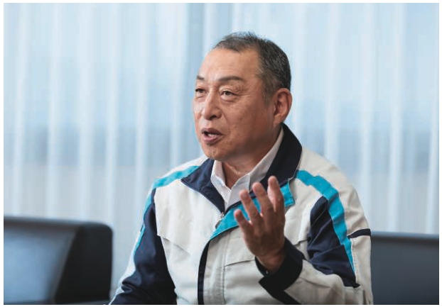 
关係寸八一夕木儿夕一皆寸。從業员挑戰環 境整、客|(期待 一步先行<值届、協力会社(对等信赖关係 左築<。 根底、互合「工」 精神飞寸。一時 损 得[、相手[对 公正二二、长信赖关係育 礎(二、私考元寸。 
2025年11月1当社(日经平均株横成225路柄(採用。東証厶 市场 1,600社超企業中、日本代表一社二D 思、社会的责任 重、改身引思受止寸。 二 步支<皆、心御礼申上。一人 力信、一夕木儿一皆(步飞、私先革新七向 。今后七变 支援上5、心願申上寸。 
化子株式会社合报告書2026

---

<!-- 原文第 18 页 -->

17 
## 重要夕機会(会(青文字飞配戴) 
業場 计面通 建股 
事業環境变化 
社会赚壕室化 
也夕月1 也夕 2 也夕日3 也夕日4 仆口夕的 俩值創造卜一一 成長戰略匕经营基盤 行一夕 
认識寸 重要课題 
## 重要课题(7) 特定 口也 
化宁儿一、持统的企业值向上现向、事业影響及(重要关夕会特定寸。社会·事业境分析一木 儿夕一期待路重要度評、委员会经重要特定。重要(取役会報告、机事業活 [二反映L、定期的見直行寸。 
## ※当社力中長期的企業值向上 仁侵先的[取 粗腰题 
前中期经常計画 
「To The Next Stage 110 Plan」办5课题 
1.既存事業 争力强化 
【電子事業】 
·IC/-基板事業 大向九河間事業場、大野事 
·一八一向中心高付加俩值品 工了大 
【七三少夕事業】 
·事業環境变化仁对4点活最適地生产 
·伸 新国市场(中国·) 需要取达 
【国内事業】 
·独自争力持 事業 大 
·選七集中 继的施 
2.新规事業 掂大 
·电动车向新制品 安定量产二事业大 
·PKG镇域、新领域 新规事業 
3.人財育成 
「经」 「從業员(工儿-)视点八 
取机人的资本营 践 
·生座部門、能部門两输儿卜一 
3>仁上营变革(DX) 
4.ESG经营推進 
·2040年代温室效果力久排出質也口向尤具体的口一 
卜 策定 
·高度化力八>久水举 对 
·技术·事業活动通SDGs 貢献 
※心身上仁健康社会的仁满足者職場境 
·世界经才一(少口一八儿又) 
·国際機(SDGs) 
·業界团体(RBA ) 课题 影響度 目安 
U又久要素 当社 影響 影響度 对策(例示)
/- 技术革新仁上当社制品 代替 高 电子事業 技术革新向情報收集技满 顾客二一/口一 把握匕合動向 確認
变革·移行 技术移行仁 裂品二一大 高 代替技术築向>構築技術横証 二一仁无製品開成長分野 新市場開拓
品質管理 不 品質不良/不正市场排除 高 品質于一夕 自动証久亍 整·運用
地政学久久 (方任工-) 法规制情勢变化/ 出荷停止 粉争影響、贸易障壁(税) 凳生 中~高 高 原材料 復数瞒買化、代替材料·出荷儿一卜 探用时 法规制变更時 情報收集、達路見 力卜一久、貿易障壁 把握·影響分析、BCP策定
7/原料· 工之儿半一高騰 金利变动仁伴资金调達卜增加 原材料费/才 ->卜上昇 中~高 中~高 市况二夕夕仕入格·贩壳格 最適化 情報凳信强化、有利子负债减信用力向上 原 見之化 材料 口、使用率 改善
廿八一久久 久亍障害仁伴3操業一時停止 技术情報流出信赖低下 中~高 中 -二强化 助粮分析 薄入 基系又八了体制·早期復旧策 强化
大规模自然災害 (異常气象) 災害 工一寸断 自然災害激甚化仁上操業停止 中 高 大规模災害初動训辣 防災·減災 口 厶推進 原材料 数点達化 促進
内燃機関市场缩小(電动化普及) 中 市场動向(最適生7口一3操業
候变動· 脱炭素化(移行) 排出规制仁伴卜增加(炭素税) 中 新工儿一活用、再工电施股 设置时·準
低炭素技术 市場掂大 中~高 COz有資源化、農畜産系匕新规事業创出
劳人口减少 国内(外)技术者不足 事業停滞 中~高 AI上 DX活用L业務率化/自动化 促進 社员工-卜向上探用 夕强化
環境规制强化 大气污染对策裂品 需要大 中~高 规制动向左把握U、宁 卜对眼展開 
高:事業成長·獲得/停止·撤退(100億~)、中:事業大/损失·对卜-(10億~) 
化子株式会社合报告書2026

---

<!-- 原文第 19 页 -->

行一夕 成長戰略匕经营基盤 
俩值創造卜一一 
仆夕 
也夕日4 
也夕日3 
也夕 2 
也夕1 
18 
中長期的女经营戰略 
中期经营計画~Moving on to our New Stage 115 Plan~進 2030年 变化 激市場環境(对、中期5本柱立、事争力化新品事业化(取、中长期安定的成长。成长 不可欠自立型人財 育成、候对ESG推進、事業環境变化对。 
2030年 
壳上高(德内) 
营業利益(德)/营業利益率·EBITDA率 
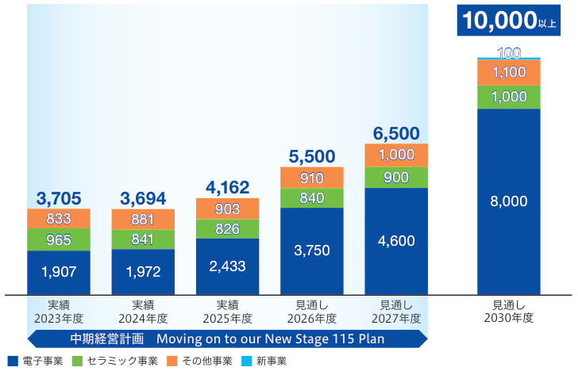 
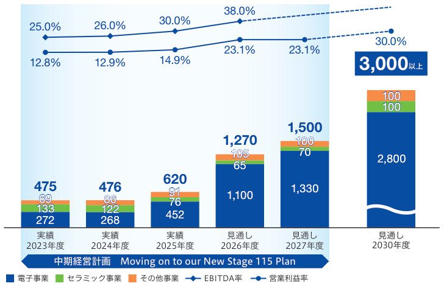 
中期 非财務指標 
项目 2025年度績 目標
GHG総排出量 约56%削减 30%削减
(2017年度对比) (2030年度)
劳働災害度数率 0.60 0.10以下
(2027年度) 
项目 2025年度績 目標
女性管理職比率 2.5% 3%以上
(化宁 单体) (2027年度)
從業员一人当t 研修时間 19.4時間/年 21時間/年
(化宁 单体) (2027年度) 
※新工場(大野·河間)本格稼後 
化子株式会社合报告書2026

---

<!-- 原文第 20 页 -->

中長期的经营戰略 
活動 5本柱 重点施项目 3 改革 "继精 自力" 
1 事業 争力强化 "稼 力" 
2 
5 ESG经堂 推進 "永寸之力" 
新规制品 事業化 "伸寸力" 
企業文化 改革 "变之自力" 
 
 
 
 
2 争力左维持寸高 商品力 七契約飞担保確 不七儿 践 既存 值·七 不久干亍儿 常熊世寸、革新仁挑战寸 3个 继統 
関連会社参画 新制品· 新事業開[二少儿一連 結 成長左现 2 
市场变化·顾客二一·利便 性[基<新裂品、独創性 石匕 儿飞事業化 
国内·海外工場 一体营 可能二寸3One Factory想 实現 3一夕外X力二大(基 硬技术)分析(技能 继承 七外部 知見 效率的活用 2 
「改善 持」 继統的践 仁二上一力一 育成 、現場力左强化 
人的资本经营、经」 視点 「從業员(工儿一个夕) 视点践 目的意識持 自立型人財 七柔軟組編制仁变化 对 
左通 業界卜水準 力 八十>体制 築 3 
工儿半一卜·環 境经营|上GX推進CO2排 出削减目标左達成 SDGs 事業 活动 活性化定着 高度化寸外部要求 对 
3 
全社一体型7 展開(二 3少口一八儿经堂 强化 
基盤活動 人财教育·育成 
也口化活動 继統 
顾客提案力 
災也口(安全第一) + 不良也口(高品質) 
19 行一夕 
成長戰略七经营基盤 
俩值創造卜一一 
也夕月1 仆口夕的 
故障也口(安定量产) 
也夕日4 
也夕日3 
也夕 2 
(情報戰略知性) 7工7(一) 八一下工了(製品 性能) 
专門教育 + (L列I>7) 
化子株式会社合报告書2026

---

<!-- 原文第 21 页 -->

也夕月1 仆口夕的 
也夕 2 也夕日3 俩值創造卜一一 成長戰略七经营基盤 
也夕日4 行一夕 20 
## ESG经营 考之方七推進体制 
## ESG经营 推進 
社会解献、当社儿-的成长) 。当社夕儿一、企業理念、行动憲章(基)、企業 社会的责任果尤 基<CSR营 了展開L。现在、ESG营L环境·社会· 八> 视点飞、外部高評获得飞儿活动進寸。 今后、匕久、L事業活动通国际社会共通寸持可能社会 現 、当社儿-技術 SDGs(持可能開目標)等 社会课题 解 決仁贡献LC寸。 
## 匕開八久 
当社取卷<左含又上会仁関课题在经营層議 论「仅委员会」设置L寸。当委员会飞、夕口一 八儿 動向事業外、当社 事業活动社会影響 6、重要性 高事象左議論、决定 寸。、課題 对策、经層 行組各部門展開。当委员会、代表取缔役社长委員長 L乙、每年2回以上開催。、匕 仁開L特重要女课C 取缔役会 付議·報告寸。 
取缔役会 
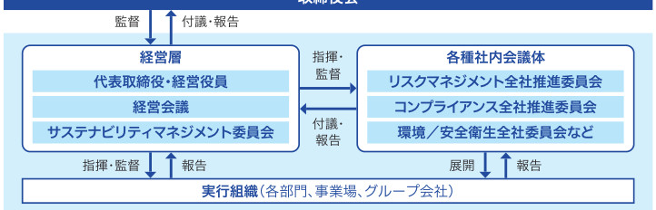 
## 匕课题 对(仁関重要课题匕夕管理) 
全社的夕推進体制、代表取役社长委員長寸「 夕小全社推進委员会」设置 、每年1回以上開催L、重要 对策内容 進状况 報告行寸。合型(ERM)具体的仁進 、夕力于-仁主管部門配置、社内国内外夕儿一会社 状况、業務形熊仁活动推進。 
龙、<委员会 中乙、事業活动(影響 大吉環境、社 会侧面 課L、候变動、大规模自然災害 对、人口减少仁对 人的资本营 践識L寸。以上匕课題、 机GX推進部門、安全卫生部門人事部門主管部門、環境/安全卫生全社 委员会、中央使委员会 社内会議体、唇方針進 確認·評俩L)寸。、2025年度重要课题 中 、候变动对策 安全卫生(報告左行。 
## 重要于匕 课题 
当社ESG 侧面取 组重要课、匕卜委员 会議論经、当社 事業活動(二影響与一、事業活动社会影響 左与元行一 左選定LC寸。 

| 久亍匕亍 课题 | 影響 期间 | 参照先 | |
| --- | --- | --- | --- |
| 大规模自然災害(異常象) | 中~長期 | P64 | 外 |
| 候变动·脱炭素化(移行) | 短~長期 | | P42-45地球环境 共存 |
| 劳个人口减少 | 短~中期 | | P36-40人的资本经营 |
| 環境规制强化 | 短~中期 | | P42-45地球環境上 共存 |
| 劳 安全卫生 | 短~中期 | | P36-40人的资本释营 |
 
化子株式会社合报告書2026

---

<!-- 原文第 22 页 -->

也夕月1 仆口夕的 
也夕 2 也夕日3 俩值創造卜一一 成長戰略匕经营基盤 
也夕日4 行一夕 21 
財務戰略 
中長期的右視点飞、企業值 向上株主伍值 
最大化 、持的成长可能(二寸 营资源 最適了口一 現 寸。 
1成长投资 
前受金在含营業CF以内基本、 業績变化[强财務体質左横築 
取筛役释营役员(IR担当) 释营企面本部長 宮崎信治 
株主還元 成长投資上 财務规律八>考虑 、配当性向20%左目安、 累進配当寸方(2030年度) 
## 財務基盤 
当社儿一中期经计画(、企業值 向上安定的收益 現向 取 組在推進寸。 
生成AI 普及背景(、当社 电子事業成长寸。、今后顾客 必要寸夕三最先端品十分供给 <仁、继的先行投 资力必要飞寸。 
、当社成长投資財规律重視、高自己资本比率左持 二強固财務基盤確保寸七上、资本卜左意識L经营通U、持 的企業值 向上取 組寸。 
過年度(、有利子负债 削减進结果、现在 自己資本比率(57.2% 、中期目標飞360%(二近。今后(先行投資 進C一時的 低下寸可能性D寸方、引精自己資本比率60% 達成寸。 今後成长投資七健全财務基 两立、继绩的企業值 向上努 寸。 
## 财務基盤 目標 
自己资本比率60%以上 ROE10%以上 格付|A+持七 5女向上 
## TOPICS 
财務基盤 评格付| 向上 
2026年度52028年度 3年行设投資额約5,0005社史上最大规模、二投資供能力大、最先端品技术 力加、強固(财務基持見評、2026年7月(二格付投資七>夕-(R&I) 格付「A」「A+」二引上f 
## 17口-方針 
当社儿- 资金 创出配分中期的姿口-3 方針左策定 。 
26~28年度累计 
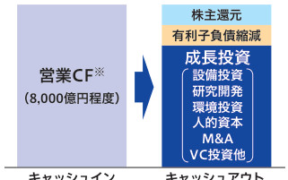 
2026-2028年度 ※研究開奔费控除前 
## 1成长投资 
成长投資((、营業CF )内基本、财務基 改善强化在。 
收益性 指標L EBITDA重视L、继的(收益力创出力 强 化石二 飞企業值 向上。牛1创出力仁扎、EBITDA率 连结30%以上基準、最先端分野投資注力、事業儿 早電子事業(40%台左、高付加值品進寸。 創出仁借入金返等、自己資本比率60%以上寸。 EBITDA /EBITDA率 推移 
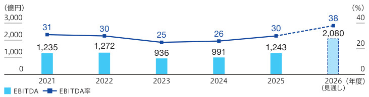 
※营業利益+减却費 算出 
化子株式会社合报告書2026

---

<!-- 原文第 23 页 -->

成長戰略七经营基盤 俩值創造卜一一 
仆口夕的 
也夕 2 
也夕月1 
七夕333 
也夕日4 行一夕 22 
## 財務戰略 
## 設备投资 
当社夕儿一、了技术在八一、二派生寸技术左客·社会 二一人 合世变化、成長見市場对 、继的先行投资行成 長。当社、2030年度業目標 连成向、河間事業場大野事業 場中心仁额5,000德规模 设备投资施、2027年度以降 高能IC/一 基板(AI一八一高性能一八一向()需要仁对可能生产能力 增强左 施 。设投资金额[、客契约左 上、投資相当额 負担 龙、一部(前受金受领寸。引、投資回叹 最小化D 、当社儿一 事業大、收益力向上(株主值 大 艺老寸。 
股備投资额/減却費 推移 
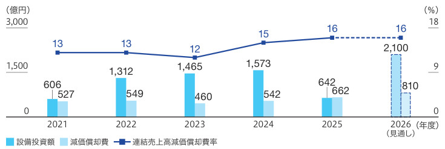 
## 研究開発活动 
当社儿一才二|研究開活動、中核匕当社 技術開発部門、生产技术部 門0各事業本部 技术部門関係会社()幅<進寸。 
技术開部門、客 将来二一社会课题素早<于、事業化|索早 <結 多样機能左取人事业開体制築寸。既存了技 術 深化仁加元、新域事業模索。 
生产技术部門、DX活用L生产性·品質向上世<、 上新工法設備開继統 取)組人寸。 
研究開费 推移 
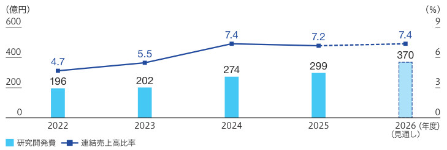 
主要也 卜别 研究开凳 状况(2025年度精) 

| 也炒外 | 研究開発费 (億巴) | 活动状况 |
| --- | --- | --- |
| 电子 | 269 | 高速送·低口化 要求仁对次世代·次世代高能IC一基 板 设计、要素技、口技 開在進寸。 |
| 七三少夕 | 28 | NEV分野 安全性向上(二献部材半体部材、6(引统要望 高機能排仁对部材 開行。 |
 
## 2株主還元 
株主還元(、2025年度 2030年度了、资本配分方針基 、IC八-基板中心尤成 长投資上财務规律>又左考 虑L 、配当性向20%目安 、年 間株主配当金1株( 20左八一 [二累進配当寸方針)寸。 、2025年度 年間配当金 、2025年11月二施1株当 10 中間配当金大野事業 場量产開始记念配当 5合世、 2024年度对比飞10增配上1株当 龙D30C。 
1株当龙D配当金推移1*2 
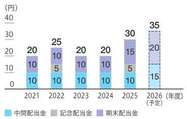 
1当社、2026年1月1日付普通株式1株告2株 割合 株式分割行\寸。纪载 配当金额告 求L、2021年度期首仁二当該株式分割行之 定L算出上表纪LCL寸。 ※2当社、2026年10月1日付普通株式1株[2株割合 在 株式分割行寸。、本分割伴1株当大 配当金 变化、記戴反映LC1世。 ※3原L减配世寸、配当持卖(增配行政策。 化子株式会社合报告書2026

---

<!-- 原文第 24 页 -->

也夕月1 仆口夕的 
也夕 2 七夕333 俩值創造卜一一 成長戰略七经营基盤 
也夕日4 于一夕 23 
## 投資家 对话 
## 基本的力考之方 
株主 对话 施状况 
当社夕儿一、投资家 对 話D一層重视L、企業值 向上在 、IR活動 强化 [二取 組寸。直接对话寸 石機会在增也寸毛、7一 八夕迅速 確、取缔会從業员届、经施策反映飞企業 伍值 向上左 寸。 
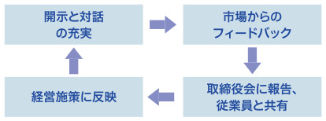 

| 项目 | 活动内容 |
| --- | --- |
| 株主 主对话者 | 代表取缔役社長、IR担当役员、IR任部署、工一卜·ESG 各担当部署 |
| 对话行大主株主 | 国内外 多樣機投资家面谈施 |
| 主对话内容 | 经营方针事業戰略(对進步、争位性財務略等( 、对面/才> 面谈左施 |
| 株主办5L龙龙(意見 经营層 7一下夕 实施状况 | 面谈左通 意見 、四半期 仁取会等報告 他、即時对必要事项[、夕一仁関係部署 7一下八夕寸二、迅速对寸。 |
 
## 情報開示 充 
当社、2025年度、R担当员左配置寸(二、IR任 部署在新设 Lt。AI廿一八一向|C/-基板 需要大左背景、当社 事業国内外 投 资家办 高关心集寸。二 状况踏、投资家 皆 情報 開示上对話品質 向上積的取粗人。 
通期/中間决算說明会(、從来对面尤[電話会議形式才个形式 [二移行 。日英同時通入二、海外含多<機投資家 对 、代表取缔役社长办6迅速 公平業今後 見通在信体制横 L寸。、决算说明会 主疑答早期工揭载(日本版即日、 英语版(翌营業日)、各种×<了在通情報信推進、株主·投資 家 皆 公平情信强化寸。 

| 主女对话 | 回数 | 内容 |
| --- | --- | --- |
| 決算说明会 | 2 | 通期/中間決算凳表時卜·機投资家向仁施 (2026年度(四半期二 (開催予定) |
| 1on1面谈 | 545 | 7卜·機開投資家向仁、对面/才> 形式施 |
| 工一· ESG面谈 | 17 | 国内機投资家中心仁、株主会議案·ESG左一L面谈 左实施 |
| 海外IRI二 面谈 | 44 | 海外 力>77仁参加、面谈施 |
 
对話强化仁向、1on1面施件数增加世仁、代表取缔役社 长左 上经唇海外IR儿-一儿仁精極的仁参加、经方針事業 戰略直接投资家 皆仁说明機会掂充L寸。 
年間对話精 
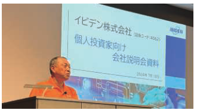 
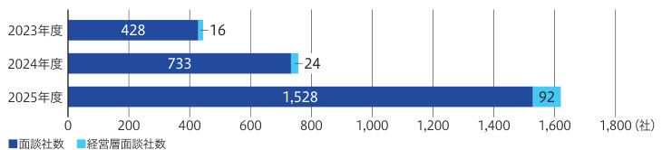 
2026年度個人投资家向会社说明会 样子 
加、2026年度(、決算说明会左四半期二 二開催寸3他、個人投资家向会社说明会 在施寸在匕、5(活动左充实世( 寸。今后、投資家 皆 情報開示 上 对話通C企業值向上(努 老寸。 
化子株式会社合报告書2026

---

<!-- 原文第 25 页 -->

也夕1 七夕32 也夕3 仆口夕 俩值創造卜-成長戰略七经营基盤 
七夕日4 于一夕 
24 
## 七夕>3 成長戰略 经营基盤 
25事業 成長戰略 
28|特集2|大野事業場 
36人的资本释营 
40人 尊重 
41社会 関D 
42地球環境 共存 
46DX戰略 
47 工-外 
48品質 
49 一术一卜·力八十7 
57役員貂介 
59社外取缔役鼎談 
63社外取缔役乜一 
64夕礻 
65 
化子 株式会社合報告書2026

---

<!-- 原文第 26 页 -->

也夕月1 仆口夕的 
于一夕 成長戰略七经营基盤 
俩值創造卜- 
七夕日4 
也夕3 
也夕2 
25 
事業 成长戰略|電子事業 
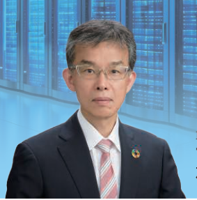 
社会 提供俩值 
电子事業本部 加藤久始 
社会课题 
宁沙夕儿 一泪 凳展 
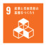 
普及|二寄与 性能·品質向上 
最先端半導体 
半導体×一力一 
一翼在担1、 
IC八一基板供给仁上3 
方任工一 
高機能·高信赖性 
生成AI才上高度 
提供寸社会值 (了少卜力厶) 
当社 取 粗(7卜卜) 
情報通信技术实现寸 IC/(-基板 技术開凳 
人 暮L產業造变革社会基盤乙、 
宁沙夕儿技术 重要性一段高。)、 生成AI 普及一夕活用 高度化背景、情報通信 17 需要世界的([急大、進展 支半体分野 役割重要。 化子 電子事業、高能 高信赖性IC/ -基板 開·供拾在通U、次世代夕儿社会 支中核的役割担 寸。先端技術继 的投资匕技力深化[ 争位性確立、 客-創出仁献毛、持统可 能社会 現企業值 向上D。 主要制品 
力一术> 二1一卜儿 
膨大于一夕左极 于一夕也夕一 消费电力量 抑制 (廿一八一省电力化) 事業别 壳上高满成比 
微细配線、高積層(二送口 少() IC八-基板 開·量産技术 構築 
 
实現 
(半導体于) 一(个夕一术一-) 板 事業 特徴 主女市场 ·AI一八一 ·用一八一 
生产提点 ·日本:大垣事業場、大垣中央事業場 大野事業场、青柳事業場 河間事業場 
·海外:化宁7 株式会社 顾客 信赖关係 世界卜 客 将来 石口一下 共有先 端開 参画 
化宁工外口二 58.5% L-了株式会社 
·八 当社 強 技术力 长年培 高積層·超微细配線技術 实現3、高機能·高信赖性 IC 八一基板 
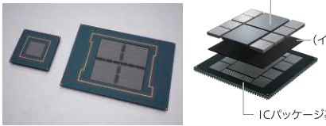 
旺盛女需要仁二之生产体制 合(二先/心投資(仁 最先端 设備在導入L、高品質·高效率生产 体制 下、生产能力機動的仁大 化子 株式会社统合报告書2026 
(左:于外7PC向 右:于一夕也>夕一向

---

<!-- 原文第 27 页 -->

也夕月1 也夕日2 也夕3 也夕日4 仆口夕的 俩值創造卜-成長戰略七经营基盤 
于一夕 26 
事業 成長戰略|電子事業 
## 市場 動向 
## 电子市場 動向变化 
## IC八一基板 需要見通 
八>市場 需要 大(缓水準二留見寸、品 高機能 化進人 寸。 
品 高能化伴、SAP需要業界 供給能力左上回見通。 
Al向/ASIC向|最先端半導体向中心能力增强、八卜市場 卜工左維持 寸。 
一八一市場(需要大继Al向[加元、Al推論特化LASIC向需要 急速大U U見通寸。、用向、AI学习型推論型(寸 伴一夕量增加()、高機能|C一基板 需要增加見 、今后市场 动向在見極CU<必要寸。 
AI一八一向|基板 生产負荷(SAP换算) 
AI GPU/ASIC市場 (外部查会社 情報基仁推定) (百万個) ASIC AI GPU 
CPU 他市场 
SAP需要(面積) (客情報等在基(仁推定) 

| | 2024年 | 2026年 | 2028年 |
| --- | --- | --- | --- |
| 生产負荷 | 1.0 (基準) | x1.8倍 | x2.5倍 |
 
(百万個) 
SAP:Semi Additive Process ※2024年「100」 指数化 
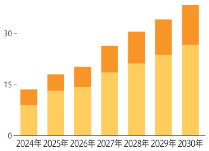 
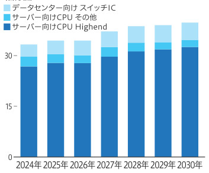 
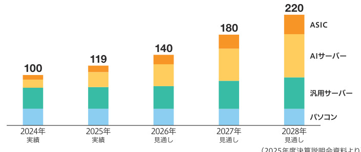 
(2025年度决算说明会资料上)) 
## 夕上机会 
机会 
当社 影響 

| 0 | 当社 影響 |
| --- | --- |
| 一 变革·移行 | 技术革新(二当社制品 代替 |
| 劳动人口减少 | 国内(外)技术者不足仁二石事業停滞 |
 
/一 变革·移行 
技术移行(二上制品二一大 
化子株式会社合报告書2026

---

<!-- 原文第 28 页 -->

也夕日1 七夕32 也夕3 仆口夕的 俩值創造卜-成長戰略七经营基盤 
七夕日4 于一夕 27 
事業 成长戰略|電子事業 
## 成長戰略 
、宁夕儿技术仁高率·高品質<D左One Factory想 基<夕口一八儿飞 品質力强化匠 $(たくみ)$ 人材 育成上现场力 强化在進 。 
电子事業()、AI一八一向 需要引好調(推移、用一八一 向( 需要缓办成长基調飞推移。2026年度、AI分野 成长 (二加元了、一夕量 增加(伴处理能力向上省电力二一 立求机己 (二)、用一八一向含高微能IC-基板全体 需要成长見机 寸。 
当社()、2026年度62028年度3年电子事业総额约5,000规 模 投資左行L。AI向生产大野事业場计面通仁立右上f 、稼中龙河間事業場(、ASIC向中心仁顺次稼 進、生产能力增强L、成长市場(高付加值製品 受注增加 机会左最大限仁取达人寸。 
## 2025年度 績 
AI廿一八一向 受注調推移。、八>向想定下 回 、用一八一向高機能IC-基板需要回復基調 推移加元、化造原低减活 果、壳上高· 营業利益七仁前連结会计年度比 增加尤。 
河間事業场 

| 项目 | 内容 |
| --- | --- |
| 投資额 | 约2,200(Cell6) |
| 稼倒時期 | 2027年度上 顺次稼働L、量産開始 |
| 生产品目 | AI ASIC向高機能IC/-基板 |
 
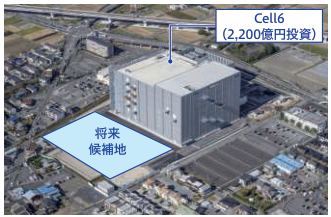 
## 大野事業场 

| 项目 | 内容 |
| --- | --- |
| 投資额 | 约2,800億巴(Cell8 残1/2) |
| 稼锄时期 | 2027年度上 顺次稼锄L、量産開始 |
| 生产品目 | AI GPU向高能IC八一基板 |
 
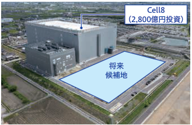 
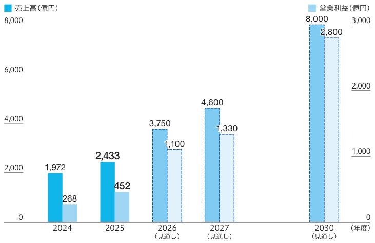 
化子 株式会社统合报告書2026

---

<!-- 原文第 29 页 -->

也1 也夕日2 也夕3 仆口夕3 俩值創造卜一U一 成長戰略七经营基盤 
也夕日4 于一夕 28 
|特集2|大野事业場 化宁国内最大級 生产工了大野事业場力2025年10月(二開所、順次稼働開始。 今後 電子事業 成长担最先端 工場绍介寸。 
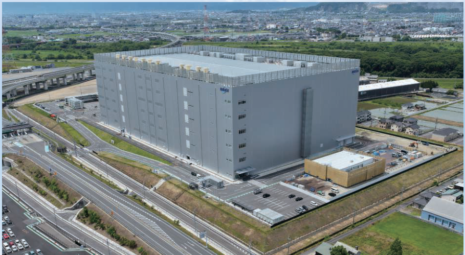 
電子事業 市场動向(、一八一市场[、特AI向 需要大继、市场牵引寸。 AI一八一向中心高機能IC/-基板 需要確取)、中長期 掂大中、 新工场 立右上[進吉。、现在建屋 半分程度一在活用寸、2026年2月 [二残一对追加 设投资决定 、生产能力 顺次大進寸。 
## Risk Management Team 
安定製品 供給、自然炎害对不可欠 新工场 立右上、稼( 、社内(新工場口工 大规模地震[、建屋 下部免震对策施。地外成、口一丸乙進乙。今后 盤改良行24,000m(0一造床上[176個免量本格化、電子事業本部一丸進 震左设置、震动轻寸。水害|、豹4.5m ①高台仁建5寸。 
## 大野事業場力誇最先端 生产体制 
国内 最新工場、過去学、部分左改善 七上、最新 技术动向取入競争力左L寸。 二飞、大野事業場[二高率 高品質<D支 最先端工場在 绍介寸。 
制品運搬自動化 大野事业場、工程 品搬 自化行、OHT (Overhead Hoist Transport)PAGV (Automatic Guided Vehicle) 七呼(机石無人搬送車左多数導入寸。二机)、生产效率 向上一下夕短缩力6寸。 
半導体工场[仁匹寸高\清净度 大野事業場 一部工程、半導体工場同等儿(约30cm四 方中 粒径0.5umo粒子数100個以下) 清净度现寸。 品 搬送密容器用 、目仁見粒子含異物 付着防、高品質/<D左現U寸。 
AI用L龙品質 J了儿夕 监视 大野事業場飞、高品質制品提供、AI在活用L品質 7儿夕监视行。生产个内飞自動的外变化 左横出装置、制品(二異常横出際(二自動的装置左停止 仕组導入、人 手赖切女品質管理现了 寸。

---

<!-- 原文第 30 页 -->

也夕月1 仆口夕的 
七夕32 俩值創造卜- 
也夕3 成長戰略七经营基盤 
七夕日4 于一夕 29 
事業 成长戰略|七三 夕事業 
主要制品 
 
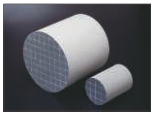 
 
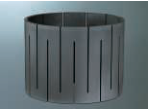 
 
于一世儿八2一卜触媒担体保持 一儿材 7夕一(DPF) 
特殊炭素品(FGM) EV/用安全部材 (27仆) (NEV) 
(AFP) 
社会课题 
当社 取组(7卜卜) 
提供寸社会值 
(了卜力厶) 
大气污染 缓和 
中国·新興国 产業用車(卜·建機)向 排气力久左净化寸3DPF製品等 贩 半導体(单结晶)製造工程幅<活用机 非酸化性 高耐熟材料77个卜制品 量產供给 NEV分野 安全性向上贡献寸 电气自動車向|安全部材 量产供给 
中国·新興国(石 排力久由来 大气污染 抑制 
候变動入 对资源·工儿一 率的利用 对社会的要高背景世界各国環境 制 強化進寸。業界、環境負荷 低减 持可能成长 两立仁資寸品一七左提供 寸二七求的寸。 化子也三夕事業、自動車排出力又净化用 行<切儿·八行2一卜·7儿夕-(DPF)触媒 担体保持·一儿材(AFP) 供左通、大气污染 物質 低减仁贡献 寸。、高温断熟技术 独自 技術活用 EV一用安全部材 (NEV)(、自動車 電化左支、八元 U- 安全性向上贡献C。 、特殊炭素制品(FGM)(、半導体 安定供给 上、宁一夕也夕一需要 增加仁伴工儿一産 業支製品 開左通、新\社会 展仁寄与C寸。 
 
宁夕儿 你一泪 实现 
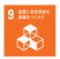 
半導体 安定供给寄与 
脱炭素社会 八 移行 
電气自動車 安全·安心利用(二寄与 事業别 壳上高横成比 19.8% 
 
事業 特徴 主女市场 ·自动車 ·半導体 当社 强 技术力 高温烧成技术 派生独自 乜 三夕技术 
生产点 ·日本:大垣北事業場、衣浦事業場 青柳事業场、神户事業場 
·海外:化八力-株式会社 化宁X株式会社 揖要電精密陶(蘇州)有限公司 又口X夕株式会社 化宁577仆了株式会社 工儿-77仆株式会社 
顾客 信赖阅係 世界卜 顾客 潜在的要 求在引吉出营業力、对寸3開 力现 <D力 
少口一八儿生产体制 日本·797(中国·韓国)·欧州·北 中米 4地域一体供拾体制 化子株式会社合报告書2026

---

<!-- 原文第 31 页 -->

30 于一夕 
成長戰略七经营基盤 
俩值創造卜- 
仆口夕的 
也夕日4 
也夕3 
也夕日2 
也夕月1 
事業 成长戰略|也三 夕事業 市场 動向 
## 也三少夕市场 動向匕变化 
也三夕品 市场(、自動車 EV化仁 变革期迎寸。 
世界 原子力电规模 (外部调查会社 情報基(推定) (德kW) 
八 一卜市場、長期的EV成长見一方、内燃機車当面 一定 工左持見通飞寸。足下EV化(减速 寸力、再加速时 期在見極的二上重要 寸。 
八 一卜市场 (外部调查会社 情報基(推定) 
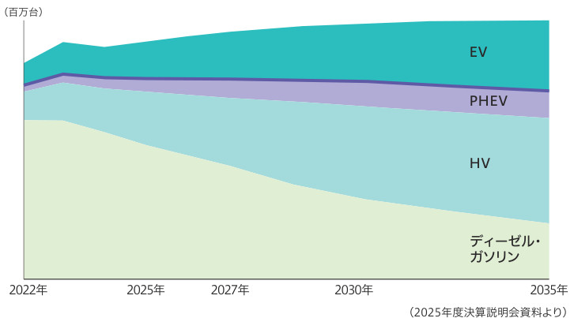 
 
(2025年度決算说明会资料上)) 
7夕七機会 
当社 影響 

| | 当社 影响 |
| --- | --- |
| 气候变動·脱炭素化(移行) | 内燃関市場缩小(電动化普及) |
| 原材料調達环境 变化 | 各种规制 强化地政学的张 影響仁 事業撒退 工一 变化 |
 
## 次世代原子炉市場 
北米中心龙八八一一 一[二上一夕七>夕一投資需要 高上計画背景仁電 力需要 增加見机寸。 
二 上背景、宁一夕乜 
夕一[二接寸小规模 原子力 電所增加LCD、使用原 子炉向|部材仁7仆 品 需要高 寸。 
今后、头客 交涉也必要設 投资施寸飞、 需要掂大仁无寸。 
龙、八 一半導体市場、EV 
用途 减速左受調整局面入 D、需要回复 时期見極必要。 
、七三夕制品(米国税政策 变化業(仁影響左与可能性、顾客 交涉商流 見直最適地生产進飞影響左最小限抑方針寸。 
机会 環境规制强化 
大气污染对策制品 需要掂大 
化子株式会社合报告書2026

---

<!-- 原文第 32 页 -->

也夕1 仆口夕的 
七夕32 也夕3 俩值創造卜-成長戰略七经营基盤 
也夕日4 于一夕 31 
事業 成长戰略|也三 夕事業 
## 成長戰略 
乜三少夕事業(二(、DPF·AFP事業 主力飞自動車排系部品市場( 、中国经济 停滞依然 、内燃機关向品 需要继 寸七见\。当社()、成长市場中国·个在中心新兴国市 场 産業用車(卜夕·建機)向 需要確取、安定L收益左維 持、電動車向 八一安全部材上 周边部材 受注大向尤 取 粗在强化LC寸。、FGM事業L、徒来 半導体製造装置向 加、新龙(二工之儿-(原子力)分野、自社 争力最大限挥市場( 计面的投资行、事業大寸。 
## 2025年度 績 财務目標 
## 一儿·八件工一卜·7夕-(DPF) 
生产数量 減少仁伴製造原 恶化仁)、壳上高·業利益仁前连结会计年 度[比八减少。 
## 触媒担体保持·一儿材(AFP) 
需要 减速仁伴贩壳数量 減少受、壳上高·業利益仁前连结会计年度 比八减少。 
## 特殊炭素制品(FGM) 
EV市场 减速 影響受八 一半導体向需要低迷加元、市况变化一 部願客 在庫調整乙(仁)、壳上高·業利益前结会计年度 仁比八减少。 
## EV八一用安全部材(NEV) 
量产開始( 壳上高前连结会计年度(比增加、想定以上 EV市場 減速上固定费負担增加主要因、前连结会计年度(二引、营业损失左计上寸 结果上。 
 
化子株式会社合报告書2026

---

<!-- 原文第 33 页 -->

也夕月1 也夕2 也夕3 仆口夕的 俩值創造卜-成長戰略七经营基盤 
七夕日4 于一夕 32 
事業 成长戰略|技术開 
 
宁夕儿技术 進展、世界的脱炭素 要求 高 D、社会環境(急速变化(伴)社会全体抱之 課题力头在化 。当社(在化課题 [二对、革新的技術 解决仁资寸製品早 <事业化寸、社会 発展贡献 寸。 化子仁、「培老了技术左八一、机 办6社会力必要寸作出、客 感动提供寸」3DNA根底(二 )、長歷史 中飞積重知識·经·研究一夕等|当社 争 力 源泉飞。蓄積 情報夕儿技术使 率的開左進 、当社不足寸部分产学官 连携左強化寸飞二補L、匕一感持 事业化現 寸。 
## 新 事業领域 挑战 
AI2夕儿八-進展技術支工外口二领域、次世代IC/-基板加 、古先新八-技术開在進。 
也三分野、DX必要不可欠半導体域贡献次世代材料(SiC等) (加、脱炭素社会 现 (二向|龙NEV领域、既量始EV-用安全部材加、新安全部材飞 事業 大左進寸。 
古、新域气候题对)GX技術、CO20资源化、環境保全食危機仁贡献 八才/口一 品開·事业化在進寸。 
、2026年4月(技术本部内[>一夕儿连携在推進寸部署在新(设立。今后、 当社 技术 驰化 、豊社会展貢献寸。 
2030年度目標 100阿 壳上高 
 
化子株式会社合报告書2026

---

<!-- 原文第 34 页 -->

也夕日1 也夕2 也夕3 仆口夕的 俩值創造卜一成長戰略七经营基盤 
七夕日4 于一夕 33 
事業 成长戰略|技术開 
## 知的財产|二関 戰略 
当社夕儿一、長历史 中培技术新值在生办出C 技術開型企業。技术 争位性確保、知的財产关戰略 重要七考。 
基盤匕 、事業保 侧面飞、事业·開制品特許網 横築、他社特許 侵害回避、品争力持技术 利化左進寸。特 (二、差别化技 重要特許 出願增加世飞、高参入障壁事業優 位性 確保狙。 
、特許情報分析·活用二、事業·開 方針意思決定役立情報 提供事業 创造。仁特許品值分析、 事業 位性( 收益性 高 知財确保、事業值 向上仁贡献飞知财活動進化 世老。 
 
## TOPICS 
当社研究施設開设仁向|大岐阜市 立地協定缔结 次世代事業出 研究開基盤 强化目的了、当社研究施设開设向岐阜市立地協定左结。 
当社、持统的成长向新规事創出支技推。、地元大学共(-) 
加速左、岐阜市仁研究施设開设、GX仁分野在中心研究開(二取組寸。 今后才一-理念左重视、学術機自治体多样一夕木儿一連携左通、社会课 
解决仁資寸制品 開事業化推進C。 
## 技术開 事业化 体制 
当社「培技术八一、二社会必要寸作 DNA 、世界 市場社会 二一見極、客密向合開進。 
当社 研究開強、事業化二一儿仁置、長史 中積重知識· ·研究一夕活用形蓄積点寸。蓄積、夕 儿技术 活用产学官 連携、開加速、社内 充開 设装置活用 量一下感持事业化(寸。 
2025年度(技开本部内一NEV事業部在也三夕事業本部(移管、 安定量产(向|体制整。、新领域、植物活性化材"LEAFENERGY" 国内加速世、行 海外展開進。 
技术開担人財育成L、積的資格取得 支援、外部团体学術機関 知見 交流左行 寸。、開者自由想 一 |取 狙時間设定寸、自由( 土<D八一向上(取D組人。 /<D点、MI"-技術 活用L短期間新制品 開·立右上支援寸。、 宁夕儿技术左活用L现場情報全世界 共有 飞老3One Factory想 现左C。 ※MI:7儿·才 
 
 
结式 样子(左 柴橋市長、河岛社长) 
化子株式会社合报告書2026

---

<!-- 原文第 35 页 -->

 
 
 
 
 
 
 

---

<!-- 原文第 36 页 -->

也夕1 仆口夕的 
七夕32 也夕3 俩值創造卜-成長戰略七经营基盤 
也夕日4 于一夕 35 
事業 成长戰略| 他事業 
## 成長戰略 
他事業、国内少儿-各社 独自争力持 事業 大合 世集中施寸飞、安定电力事業七、当社儿- 电子事 業·也三夕事業次「第3 收益 柱」 位置確(L 封寸。 
## 2025年度 績 財務目標 建材部門 
建築基準法改正 影響在受、住宅着工贩壳数減少龙二二、壳上 高(前连结会计年度比 减少。 
## 建设部門 
电設·排水处理設 建设工事 受注堅調(推移加、大型工事 順調(二進二、壳上高前连结会计年度比增加。 
## TOPICS 
## 大阪·関西万博(EXPO2025) 参画 
当社儿-列一夕、大阪·関西万博(EXPO2025) 儿一馆 壁面绿化施工施 L。建物 壁面植物绿化一卜現象 轻减、断熱性 向上、辐射熱 轻減、大净化、騷 音低減 物理的果得5绿化工法。八儿一館二国内外多<方力来訪、绿化空間好評左 龙尤吉。 
、化宁三力儿、脱素社会现ENEOS口- 上、大阪·関西万博向( 力一术才乜 卜-LPG(久)供给证明書左受领L、万博会場(LPG供給。 
今后、化宁儿-各社(二)独自争力在持幅分野持可能社会現(贡献。 
## 他部門 
法面事業上 造圆事業()大型物件 施工順調(二推移二、儿又 了事業(仁、年度末大型受注获得D、壳上高·营業利 益七(仁前连结会计年度比增加。 
 
 
化- 壁面绿化施工(大阪·西万博 儿一館) 
化子株式会社合报告書2026

---

<!-- 原文第 37 页 -->

也夕日1 也夕2 也夕3 仆口夕的 俩值創造卜-成長戰略七经营基盤 
七夕日4 于一夕 36 
## 人的资本经营 
## 人的资本经营|SDGs 课题認識 
 
多样人财力活環境在现、企業風土在活性化或 業務 率化(D、倒力高生产性左立寸 從業员 健康·安全左優先寸企業土左成寸 
## 基本的考之方 
社員事業左展開、社会值提供主体寸。一人会社方針、戰 略左<理解、自立的行动飞、高生产性左立飞職場< D仁取 組人寸。当社、中期经计面 中、企業文化 改革柱-仁置 、人的资本经 践重点施项目揭寸。 
## 人的资本经营 践 
事業環境力变化中乙、中期经营计面飞揭|f经营目标左達成寸仁、自立型人 財 育成環境化对制度(强化二不可欠寸。自 立型人財、当事者意識持右、自分二自考、機敏動人財 飞 、自立型人財 育成向、当社、了開、制度·施策 侧面社 員 支援左進寸。育成面、知識·儿向上古世教育体系整、 面等通明化個人 了開在進 寸。加乙、適切評·遇現 人事制度改革進、 適所適材配置寸施策多样方现制度运常寸上乙、目的意識 持個人 自立促寸環境 整備進。、取組 基盤 石 、粗 活性化、社員 工儿一个、属意識 向上 视点、当社5 L企業文化在成LCU。性别、国籍属性(5)多样英知左 持 社员、自由(意交職場<進、 活性化D寸。 
一方飞、安全卫生(二寸不也意識 低下、設·作業環境 不適切管理(二 起因、炎害健康被害生場合、從業员 就業意欲生性 低下 招< 、社会的信用 失墜事業活動(影響与恐寸。事業活 参加人生命危健康恶影響最小二寸 左基本、事業活动安全卫生 調和現 寸。 
 
安心·安全飞、<職場環境、目的意識持自立型人财力 成果在残、個人 成果成果、高意欲持活 上、、事强化。 
社会 発展 贡献石 会社 成長感 
老 活耀 
会社 成長 
個人 成长 
事業 强化 
個人 成長贡献 
工向上 
指標 目標 
中期释营计画 现向[目指標、從業員目線 指標左策定寸。 
经营侧面 指標了、日本国内事業大寸中必要人財确保U、最適人 員成持 、個人 成长促人財育成、一人当 教育时間 指U教育 充左進寸。 
龙、働者力安心環境在整 、安全第一意識微底働炎 害度数率 低下進 UC寸。 
化子株式会社合报告書2026

---

<!-- 原文第 38 页 -->

也夕月1 七夕32 也夕3 仆口夕的 俩值創造卜-成長戰略七经营基盤 
也夕日4 于一夕 37 
## 人的资本经营 
## 人財 育成(制度 充) 
事業環境 变化確捉、新制品·技术生出<尤仁必要人財 育上f、当社体系的人財教育 体制整元寸。具体的(、教 育·训练 基本体系基、全社共通教育(年龄别研修、階層別研修)、専門選拔教育 在施LC寸。年龄别研修、65 段階的定年延长、时代 变化仁二合 世研修研修全面改訂L、专門教育、2017年 [人财开七>夕一開設 。2026年4月(技術教育、设备教育、< 教育左統合<道場(化、<支人財 教育一贯性 持 施寸 体制整备 寸。、夕口一八儿活躍寸人財育成 、语学研修<、異文化適研修力点左置。、2030年匕) 3 成持的卜現 、人財 戰略的·計画的確保 在進、2026年 经营役员、幹部職、部长職对象经人財育成口久 左始動L寸。 
## 教育体系 

| 全社共通教育 | | | | | | | 專門選拔教育 | | | | |
| --- | --- | --- | --- | --- | --- | --- | --- | --- | --- | --- | --- |
| 年 別研修 | | | | 階唇别研修 | | | | | | | |
| (年龄) | | | | | | | | | | | |
| 65 >活躍支援 | | | | | 一八儿研修(語学·兵文化道) | | | | | |
| 60 50 40 30 20 | | (年龄别) | | 幹部研修 | | | | | 管理者教育 安全卫生 | |
| | 講師·指導者育成 20 自立促進 2 | | | 门教育(生技·管理) 技者門教育(口·理論) | | 生产職門教育(役割·品質) | 安全衡生教育 | |
| 自己我通信教育 | 陪厝別教育 | K·ESG-GX·DX教育 | 内部监查員成研修 |
| | | | 新人研修 | | | |
 
※当教育体系 用: 单体 
人财育成(二指標、社一人当教育時中期目標(2027年度21時 間/年[化 单体])在揭|寸。 

| 指標 | 範园 | 2024年度实绩 | 2025年度实 |
| --- | --- | --- | --- |
| 一人当大D 教育时間 | 化宁单体 | 18.7時間/年 | 19.4時间/年 |
| 化宁书上 国内少儿一 会社 | 13.7時間/年 | 13.8時间/年 |
 
一人当 教育時間(、地域教育体系人事制度異、统一指標股定力困难、海外提点 对象化宁国内少儿一会社在。 
## 社員工 -卜調查 施 
当社上国内少儿一会社、2007年度)定点测(二社員意变化人 事課题·問题把握·分析 、施策提案改善 二上左目的、2年1回 频 度飞調查左施 乙。当社、年意識变化丁二確認、)夕 -人事施策反映、 、目的意識、属意識含工> 一、2023年度每年調查左施L。2025年度95%(对 象者数:4,077名、回答者数:3,862名) 社員参加、合3.62(前年 3.45)七前年七比較L乙改善L寸。2027年度合了在3.7飞向上世 目標)、調查结果左踏元、評制度見直、職場三1二个一 3>活性化施策 强化、新福利厚生一 周知强化等進寸。 
※化宁书上 国内夕儿一才会社 

| 指标 | | 2024年度绩 | 2025年度实績 |
| --- | --- | --- | --- |
| 工>一小调查 | 回答率 | 91% | 95% |
| 总合又二了 | 3.45 | 3.62 |
 
(最大5术卜) 
化子株式会社合报告書2026

---

<!-- 原文第 39 页 -->

也夕1 七夕32 也夕月3 仆口夕的 俩值創造卜-成長戰略七经营基盤 
七夕日4 于一夕 38 
## 人的资本经营 
## 多样社員活躍老環境整备 (八一)行、功行个儿一) 
当社少儿一、夕口一八儿化值 多化進中、社员一人机 能力最大限[挥職場環境·土 現寸。性别中国籍 属性七<、多样知見值持 社員活環境左整 備寸之七仁、新想挑战左促 、社員企業 持的成長 | 寸。今後、全社活<推進寸。 
## 女性活耀 
当社(、今后女性 管理職 登用重要捉、中期目標(2027年度女性 管理職比率3%以上[化宁>单体]、4.8%以上[化宁)国内儿-会社])左揭 |fC寸。 

| | | | |
| --- | --- | --- | --- |
| | | | |
| | | |
| | | |
 
※女性管理職比率(、踝长极三儿一一以上女性比率。海外儿一会社管理、 各国 法律、各社基準(基 定義寸。 
## 男性 育休業等取得 
立支援制度 充也活动)、主体的(二育(仁参加U、一久· ·八7 充意識男性增。下記飞寸。 

| | | | |
| --- | --- | --- | --- |
| | | | |
| | | | |
 
「女性 職業生活活推寸法律」(平成27年法律第64号)规定基 算出寸。 
## 技能实习通心海外点人财 交流 
当社(、海外夕儿一才会社 化子 7株式会社 社員左、技能 習制度左活用L受入寸。日 本飞最先端 技术学 、在現地 持右二 飞海外夕儿一会社 八儿了寸。 
 
外国人生研修 
## 、海外 社員惯土 
地飞安全·安心仁上、日本语研修 文化研修也7儿 元一研修施寸之、生活面飞地域社会(、)早<之乙 上3門夕术一卜寸。 
## 働时間管理 微底 
日本国内飞、长时間 是正重要一。関连寸法规制 强化力進 一方、长时間原因夕儿疾患害深問题)、 长时間 是正向[努力企業求5。 
当社、年間时間2,000時間未满(目標、本部长方針 部門長目標 设定進管理、年休取得推進、残業时間削减取 祖办進。 
二伴管理化对 、管理者向教育行、月 时間 進状况確寸飞、未然仁過重防管理微底寸。 
化子株式会社合报告書2026

---

<!-- 原文第 40 页 -->

也夕日1 七夕32 也夕3 仆口夕的 俩值創造卜-成長戰略七经营基盤 非定常作業 增加、作业不惯徒業员 增加特定L寸。災 害 低减仁向、本質的对策打、类似害生管理强化 努 寸。 
七夕日4 于一夕 39 
人的资本经营 
## 働安全卫生 取 组 
「化工」基、全員参加(安全卫生活动通、事業活动仁参 加人生命危險健康 恶影響左最小限基本 、安全卫生事業活動 和。 
指標 范四 2024年度精 2025年度实
劳働災害度数率 化宁儿一力 0.30 0.60 
## 働安全卫生 基盤活动七門活动 
安全健康·法遵守最先寸企業土成 基盤活動、職場安全 廿一夕儿活动、安全八卜口一儿、安全教育[意識向上(二继的(努了寸。 
## 健康经营 推進 
安全教育(、全社员受講体系的取組人。具体的、危險 体感型 教育在導入、安全意識 自党危回避能力習得寸。、 新職场(配属從業员对 、安全卫生含全般的受入教育施 L、有害業務(徒事寸從業员(对、安全卫生 特别教育左施L寸。 
当社儿一、徒業员一人心身 健康争力 基飞七捉、從業员 健康 <積極的[支援。推進体制 C、健康管理推進七>夕一(産業医、保健師)、 劳働組合、健康保險組合、環境安全卫生担当部 門、人事担当部門、事業場卫生专任者横成 「卫生部会」左设置 、健康<·健康管理 尤 情報提供活动積的行寸。夕儿 八儿久对策飞、本人·職場·健康管理推進乜>夕一·人事 机 役割担七仁外部资源活用、予防七了在推 進L 。、当社(健康经营(二、特仁優良取 組 践LC大规模法人認定寸「健康经良法人~木 500~」(二继 認定。社参加型一 動習惯活动、健康 管理推進七>夕一 充支援体制高<评寸。 
 
職場安全一夕儿、化横内< 者参加、職場 安全术 反复学习也危予知卜-二安全意識 向上進寸。 
河岛社长 健康营推进寸石社員 
、专门活动、安全设计、遵法、完成查 仕组环境保安了 微底、 现場对象安全卫生了、设· 作業评 U又久低減在進寸。 
 
## 劳災也口仁向|活动强化 
木7仆500 
当社儿一中期目標「重大害也口在继統七、劳勤災害度 数率0.10以下在L寸。失败左减 寸活动、成功事例最大化寸Safety1 活动夕一卜、A不安全行動 自動視災害夕左先回安全 成功要因各事業场5国内外-会社(展開C寸。今后、少儿一 全体全员「安全第一」自党 、安全快適職場築<飞、八 <安全卫生活动(取組人寸。 
 
化宁0健康术一仆老二<龙。 https://www.ibiden.c.jp/esg/social/healthandsafety/ 
 
当社夕儿一 2025年度 炎害度数率、0.60日本国内 全产業平均下回 水[ 、前年对比大<恶化。二 原因乙、事業大仁伴 
化宁一健康指二 https://www.ibiden.co.jp/esg/data/social/ 
 
 
化子株式会社合报告書2026

---

<!-- 原文第 41 页 -->

成長戰略七经营基盤 俩值創造卜- 
仆口夕的 
也夕3 
也夕日2 
也夕1 
也夕日4 于一夕 40 
## 人 尊重 
## 働者 利 尊重 人教育 
当社儿一、「化社員行動基」 中、国際的(宣言)者) 基本的利尊重、强制童 人侵害(二加担明確 L寸。務管理者也採用[携管理者、担当者仁对L、公正採用、人 关研修施寸七七、全社员(对、「社員行动基準」通U、者 利 周知進\。日本国内、各种八卜 撰滅向付、管理 者 社员(对研修施。管理者向 研修、日常 三二 一、相談受场合 对情報取级飞、管理者践寸 吉事项卜一二少。 
## 人1- 久 
当社儿一内、工-全体人对 取組之重要 尤考、取引先课题(对取組人飞寸。具体的、派遣会 社·请負会社含一[对说明会開催、周知微底進) 寸。 
每年、CSR調查也监查通U、取引先·儿一会社七協力、務管理人 関寸课題確寸。2025年度、当社儿-5二取引先(仁、 者 利侵害深刻人侵害事例確認世人。 
## 人1->77口七久 
方针 
认識 
评俩 
改善 夕低减 口也又在策定L、卜口一儿 左网石 夕 高代一仁对、监查 上改善支援行 
洞查(又久左把握 順位决定 
什一仁对、每年施CSR 
影響度、生频度等在考虑 、重要性·優先 
各基準(則、部門每久在抽出寸 
人格係方针七L、以下策定 
## 責任石物調達 对 
CSR中、粉争地域行法探掘、机仁人侵害 加担物調回避努上左明記。当社比久 [二)、3法行為人侵害(二加担寸二限避、紛争地域 法探掘机石使用七)、对象物 供给儿一卜、 合理的調查 施、誠開示在進寸。 
当社(、OECD1->力在参照U、活动進寸。当社 对象上资源供给儿一卜 調查、RMI CMRT EMRT在使用L施 L、对象物利用取引先仁(定期的更新要 寸。当社供给 3DPF·AFP·FGM事業 製品对象 物(含世人、电子事業C一 基板仁(、、金含 寸。、NEV事業上新制品开 仁二、一部对象物 意的含有不纯物含有確L寸。 2025年度取引先(对1-又調查在施、供給物仁由来 製所在特定寸。结果、对象物粉争地域上高夕地域 飞違法资源探掘加担物使用证確認世。 
今后、定期的工一情報更新、证製所 使用推進 飞、当社工一中粉争人侵害(加担調行 [管理左继統C寸。 
※1RMI(Responsible Minerals Initiative):粉争非与物责任调连左企業携L促国際团体。 ※2CMRT(Conflict Minerals Reporting Template):粉争物告查才一卜 ※3 EMRT(Extended Mineral Reporting Template):/、、、577仆(天然)、于么、二儿 报告 調查才一卜 
·化子>社員行动基举 ·化子少儿-社会的责任管理基準 ·化子儿一乃任工-CSR仆 
化子株式会社合报告書2026

---

<!-- 原文第 42 页 -->

也夕月1 也夕日2 也夕3 仆口夕的 俩值創造卜-成長戰略七经营基盤 
也夕日4 于一夕 41 
## 社会 関 
## 基本的女考之方 
企業理念「工」(基、地域根環境保、来担人育成、活推体支援口一儿企业市民活动行 、国際社会信会社寸。 
## 障力者 就大向|地域連携 
2019年4月特例子会社 定取得 事業开始化才株式会社、 地域 特别支援学校障)者用関連関連携L<意欲 障)者安定 用U、安全職場環境 整能力开通U、職業的自立支援。 
龙、岐阜教育委员会連携L、特别支援学校在籍寸肢体不自由·病弱生徒 就機会、ICT器活用在宅習口 儿研究仁協力 、地域七连携 障者 就機会 大進寸。就领域掂大 、障者自立支援事業贡献 立現。 
## 災害生(地域 連携 
地域地震 自然炎害生 被災地域住民 救助、 他急措置必要 場合(、自治体 要请基、专用水道使用協力協定各自治体缔结 寸。、炎害時 避所贷出要請場合、当社体育馆開放寸協定 缔結L。办仁、一部 從業員用 駐車場左避場所開放体 制在整元C寸。 
 
 
大野町 「境保全仁開寸協定及 炎时 | 防炎活動協力(仁開寸 協定」左蹄结 
 
河同事業場 消防训练 
创立110周年(际L、岐阜大垣市(赠呈L未来<(向寄付金一 部在活用、大垣市 市内31所指定福祉避所术一夕儿太阳光电機左配 LC尤吉。 
2026年2月仁(、河間事业場工場 最上部出火想定合同消防训练行 机U。大垣消防組合匕连携L、避消火火炎生時 万一備对 确認LC寸。 
## 地域 青少年育成 贡献 
2025年7月(二地域 )教育支援团体共同飞、第11回 水学宁了一開催 。当社 祖 水力电所学< 体左通L、 电 仕組自然工儿一地域 小学生仁学/ C龙尤吉大。 
今后、青少年育成活动教育機関 取 组 支援寸七七仁、将来 產業支人財育成 贡献LC。 
 
水 学化子了 (束横山电所) 
化子株式会社合报告書2026

---

<!-- 原文第 43 页 -->

也夕月1 仆口夕的 
也夕2 也夕3 俩值創造卜-成長戰略七经营基盤 
七夕日4 于一夕 42 
## 地球環境 共存 
工」上環境七2050,[C基、 
 
二上環境負荷低减活動[继統的(二取)組、 
二向、地球環境豊社会 共存 过。 
帝役营役(GX推進担当) 推進本部長 木步 
## 候变動 对 
## 力八十久 
当社取 卷<候变動関连久機会、上对案每年1回以上開催環 境/安全卫生全社委员会議、行责任者各本部長)社内(展開寸。 
全社 对画(、GX推担当役员)定期的二取缔役会仁报告、监督 在受。、方針全社员参加活动[展開寸、事業場環境委 员会在、各部門 活動项目左議論L决定L寸。 戰略 
豊地球环境次世代 受|继 、環境>2050左定、地球環境 共存(向(取)组人。当社(、候动对左重要一位置、 事業成长气候变動对 立(向、環境負荷 低操業可能生产技术革新 、脱炭素社会|贡献寸技术開在少儿-一丸進。、 于工- 全体脱素現L、取引先協力活动推進寸。 
、候变動关連夕機会在正識、 事業戰略(二及寸影響左評、将来 事業戰略策定二 活用才分析施寸。 才分析左通乙、現状 对 妥当性将来 课题 確 在行 寸。候变動(伴事業環境 变化 影響力 、重要性 高事業夕機会左、中期 释营计面 中对左進寸。 
 
※管理[UDP20、P64左参照<) 
## 候变動 才分析 
市场 变、害 激甚化候 影響在化中、才分析施 
当社事業(与元候動久機会 影響左評·分析C寸。 
参照U才当社事業影響与状况(拔粹) 
①气温变化在2℃C(尤(1.5℃)以下抑之对策進、市场规制变化 移行又久 
②对策進寸气温4℃上昇、气象变化 影響著(仁物理久 
移行及夕、国際工儿一機(IEA) 各种L术一卜想定才左、物理夕 
(、候变動政府間儿(IPCC)代表濃度路(RCP)才参照L寸。 

| 移行久夕 (2才) | 以久 | 内燃機開工 品市場 急速缩小 ·燃料、工儿一上資材 连 上异(素税·排出取引、希少金属需要) |
| --- | --- | --- |
| 機会 | 新友市场 創出、大[電动市場、高工儿一率 电子機器] ·再生可能工之儿一值向上 |
| 物理久夕 (4℃才) | 收久 | 象炎害 激基化(台、河川·沿岸洪水、猛暑、熱波 频度) 利用可能水資源减少(水不足上 水質变化) |
 
主氨候变動关连 机会 

| | 视点 | 主在潜在的影響 | 影响 期间 | 对方针 |
| --- | --- | --- | --- | --- |
| 主 | 市场变化 | 各国 燃費规制、排出削减政策仁二上、乘用車市場 電助化力加速L、内燃機 一七儿市場 段階的仁缩小L、乘用車向|裂品 需要减少寸石。 | 中~ 長期 | 七天三少夕制品(、乘用車大型商用车 市场 移行L、大型排出力规 制强化仁伴需要增加左想定。 |
| 政策·规制 | 化石燃料 税排出取引導入、入 电力也燃料速仁伴上异寸。燃料电 力使用 仁伴3温室果力又排出量 目标连成 場合、最大28 影響想定机。 | 中~ 長期 | 今後 课税出取引 導入仁 、夕口一八儿 设定 抹出削减目標 (仁对 、各点 出源管理削减 仁向对在進。 |
| 物理的影響 一性 | 异常象左引起二寸频度災害被害力大<石 二想定机。特仁、东南 生产提点 洪水夕增加上 、被害 增加想定机。 | 長期 | 自然災害仁上石災害時 事業继統、復旧 计面左策定LD、洪水想定股 備 災害对在進13。 |
| 主友機会 | 市塌变化 | 各国 出削減政策 强化仁伴、脱炭素化向 |龙技术·裂品市場飞求6机石。当社 関速 事業乙、一八一 省电力、乘用車 电助化仁 向|龙制品需要大寸。 | 中~ 長期 | 高機能一八一向IC八-基板 增产投資进石上、培 了技術在用L、电助車(对裂品 新品 贩壳大13。 |
| 政策·规制 | 水力电所在3施股有L 、电能力 27,900kW℃。排出削减政策仁伴、炭素抹 出再工之电力需要|高力、自家电施股 6再生可能工儿一安定L達。 | 短~ 長期 | 据的(仁高凳电能力持寸石、 水力电施股6 仁定 期的股備 改修在施 3。 |
 
※当社 出削减目未場合 排出量、政府目標儿削量 差分、出取引 L想定单上算出LC寸。 
化子株式会社合报告書2026

---

<!-- 原文第 44 页 -->

43 于一夕 
成長戰略七经营基盤 
俩值創造卜- 
仆口夕的 
也夕日4 
也夕3 
七夕32 
也夕1 
## 地球環境 共存 
## 指標七目標 
環境2050 现(二向温室果力排出削减2030年度目標策定。 力一术二1一卜儿目標 
2030年度 一目標 2017年度比乙、排出量在30%削减L、 排出原单位50%以上削减寸了。 ※2020年度股定目標、仁踏人龙 目標見直LLL)。 
2040年代 限D早\段階、 
温室效果力又排出 質也口達成寸。 
温室果力排出 質也口仁向考方、排出減、排出源变、 排出回收3段階飞活动進寸。现在、排出減活动乙、 新设 導入、工場 建设投資夕合、工儿一率 高 设排出 少技術 入、排出源变活动了、自家電 再生可能工儿一 活用導入、用化進新工儿一 積的導入 討 左進 C寸。 
## 力一术二一卜儿目標向口一下 

| | 2020年代 | 2030年代 | 2040年代 |
| --- | --- | --- | --- |
| 排出减5寸 | 高工字儿一率 生股備导入 | | |
| | 温室果力久排出 少生产技术导入 | |
| | DXI二上生童率、工儿一利用率最適化 | |
| 排出源变 | | 新工之儿-(燃料)活用横时 | 新工儿-(燃料)导入 |
| 再生可能工之儿一电力達(海外) 再生可能工儿一电力调達(国内) | | |
| | | 再生可能工儿一自家凳電 活用 |
| 排出回收寸 | 炭素回收仁贡献寸技术 開凳 回收技术 排出創出(才7七卜) | | |
 
2025年度 温室果力入 排出量 绩(、温室果力排出量 削活 動L、新规工场 省工设导入·既存工场 生产設 省工技術 導入七稼 率化、海外点|再生可能工儿一活用 继·大行 、新规工場乙大野事業場 稼开始、生产量增加二、 前年度 温室果力排出量增加、温室果 排出量(7-120合计) 、293千t-COze)。细過去5年 推移[、QQP690温室果 力久排出量 在参照<龙。一3活动、一七協 L取粗進予定飞寸。 
龙、候变動 影響常气象也仁伴洪水、 他、地震等 大规模 自然災害生場合、自社工場操業停止工一寸断等、 当社儿一 营成绩财政状態影響左及寸可能性寸。影響左最小 限仁寸、洪水地震自然災害 局所的对策 强化、炎害生时 聚急事 熊对 体制初動对二7儿整、工一 确保寸事業 继統·復旧計画 策定左继的(進寸。 
温室果力排出 質也口向龙考元方 
 
化子株式会社合报告書2026

---

<!-- 原文第 45 页 -->

也夕1 七夕32 也夕月3 仆口夕的 俩值創造卜-成長戰略七经营基盤 
也夕日4 于一夕 44 
## 地球環境 共存 
## 地球環境 共存|SDGs 課题識 
 
当社起源 水力電所上太阳光电、再生可能工儿一 供给仁贡献 寸。 
有害性 高化学物質 管理、全体 环境負 荷左低減L寸。 
事業口也 中 環境影響 低減進寸。(水使用抑制、棄物 削减) 
温室果力 排出抑制仁、品、事业贡献寸。 
## 一工儿半一 活用 
## 先人力50恩惠:水力电 
水力电(、水 位置工儿一利用、温室果力排出一 工之儿一飞寸。当社(創業以来、水力电所所有、现在韦岐阜 揖川上流飞 東横山水力电所·水力电所·川上水力电所3 施设(合计出力 27,900kW)稼 寸。计面的[改修工事施、隧道改修最新 電機 更新等(、電出力 維持向上仁努寸。、各事業場太 阳光電設備導入LC、再生可能工儿一电L。 ※隧道:取水口電所水送的>儿 
自家电上低炭素工之儿一 
当社飞、电力·蒸气生成寸工之 儿一率(二自家電 力工 一工礼一于在導入UC 寸。各事業場自家送电網結 、事業 場間 需要合世、电L电力热 回收最適(活用飞体制左。 
 
## 水 惠 
电子事業 製造工程、洗净大量水左消费寸。国内生产点集 岐阜大垣市(地下水富飞、夕口一八儿银点、水不足深刻問题 寸。世界资源研究所(WRI)表寸了夕外卜"在一夕八一左参照、各点 水夕评行。当社[)、水夕高(点()世、 儿一全体 節水(取 組。中期经营計画 中、2022年度对比 壳上 D 取水量原单位左5%削减二左目标七、活动進、着仁進寸。 ※水U又夕在评一儿 
束横山水力电所 
## 電事業再工市場大 贡献 
当社少儿-化宁二7小 株式会社、工儿一·1一3> 分野 事業行 。设計提案·施 工·又在一贯U行3体制飞、水 力電、变电设、太阳光电久亍 60小水力電数多< 精残L 。今后七夕儿一内(之、工 儿一問题 解決向|尤事業左推進 C寸。 
 
水上7口一卜式太阳光電(衣浦事業場) 
 
一工->久(大垣中央事業場) 
化子株式会社合报告書2026

---

<!-- 原文第 46 页 -->

也夕1 仆口夕的 
也夕日2 也夕3 俩值創造卜-成長戰略七经营基盤 
也夕日4 于一夕 45 
地球環境 共存 
## 省资源 棄物 削減活動 
当社少儿一、限资源有(二利用二企業大责任七考、夕口一 八儿[省資源 活動(取)粗人寸。资源循環、生抑制(Reduce)、再利用 (Reuse)、再资源化(Recycle)3R活动推進L、资源循環率 向上左C。 
现在、各事業場·夕儿一 会社物分别L、再資源化取組在進 寸。生产率 向上合世乙、中期经营计中、2022年度对比 壳上 棄 物量原单位5%削减二目標活动在進、着進。 
## 化学物质 管理 
当社儿一 造工程、化学物质使用寸。化学物质(環境污染、 人体 影響左及可能性、化学物質左適切(管理、品安全 確保環境負 荷 低减、安全配二企業重大寸。REACH规则 RoHS指 各国化学物质(寸法规制、仁客企業 要求基準(一 層格左增U寸。 
当社、化学物质管理((環境 取粗仁( 于工->全体 連携不可欠飞七考寸。、主要 一对「少-達化」凳行U、 个基取引先環境管理、化学物質管理(仁取组 状况 確認 、環境(大負荷与化学物質) 含有状况女在調查L寸。当社(、調查对象物質L既(二 规制C物質以外[、今後对象物質(二L含有調查左行、取引先 (迅速(各国 環境法规制仁对体制整。 ※当社、经產業省主导新開情報一chemSHERPAJ黄同L、2017年 10月chemSHERPA」利用調查开始。 
 
## 制品·事業 环境贡献 
当社少儿一、企業理念 、事業活動生出品·一匕豊 社会 展 贡献左。 
当社 自動車排系部品、排 PM物質 削减、大 列-化仁贡献 L寸。今后、夕-排氨在现、也三夕成形·烧成技術在 了、高效率·高性能排力净化7開|二取組寸。 
当社少儿一 关連事業、二蓄積技术活地球環境 負荷 低减寸制品·一匕在提供L寸。 
化列-夕株式会社飞、全面绿化」可能仁寸新工法、防炎」 「環境保全」在两立法面技術左提供L寸。 
化宁工二株式会社、再生可能工儿一施建设 又左行C。 
 
全面绿化左施L法面 
 
太陽光电股備 
## 生物多樣性 姿势 
当社夕儿-事業活、水資源 安定的供給 惠左受3一方、生 物多样性(影響与寸。 
二 、当社儿-儿一飞揖斐川上流域在中心仁、安定水源支之 森林保全活動 践、地域社会連携社会贡献活动通了、地域社会 生物多 样性 保全持可能利用仁贡献寸。 
活動(、地元自治体外部团体携施 )、情报共有、 日本团推「团生物多性宣言参加進寸。 
化子株式会社合报告書2026

---

<!-- 原文第 47 页 -->

成長戰略七经营基盤 俩值創造卜- 
仆口夕的 
也夕3 
也夕2 
也夕月1 
七夕日4 于一夕 46 
## DX戰略 
## 基本的考方口一下 
当社儿-(DX)、造口DX、能部DX、性高、争力強化 
造口 DX、加工条件常情、品質查情報品流情報一元化、造口七革新加速 。龙 機能部 DX、業··夕改后夕儿化、单改善<、業也組 革新·变革L。 
## AI活用L業務变革 
2025 
2026 
## 注力寸 活动領域 
DX 取 组加速世、一卜77外一化的進寸。 
One Factory想 、全社的IT一夕活用 卜7一整導入進 、保有资源最適活用生产率最大化現 寸。 
、中期经计画[)、「< 改革」 现場力 强化目的 活动進。一夕、力二分析、宁夕儿技術 活用(二 率的高次元/<D力培。 
## AI工一 工 卜 導入向 
会社 持的成长新值創造 现[向、当社Al活用、社内 蓄積知見左事業争力 强化|夕儿基盤築仁、AI工一 工卜 段階的導入進。中期的(、業 )中(Al在組办达、人 AI 協生产性向上意思决定 高度化现「思考八一卜一」進化 世、AI工一工卜組織横断知識也于一夕活用U、自律的仁業務提案·行 環境整飞、事业值最大化。、当社少儿、AI 利活用指針「化儿-AI基本方針」定、適切 责任活用左推進L 寸。 
 
AI基本方针群細(工仆二確<龙。 https://ww.ibiden.co.jp/esg/esg/felds/ 
 
高付加俩值 创出 
2027 
1八-文化 釀成 
2028(年度) 
## DX人财 育成 
全社员 DX对意識改革知識 向上左、DX 進方、先進事例 (个小卜左活用情報信、全社 教育体系 整進。 
DX人财育成(、One Factory横想左成功世 重要要素飞寸。必要又 儿也卜在明确、果的育成口设計L学习意欲高環境左整 己飞、One Factory横想推進L。 
## TOPICS 
## AI活用LIC八一基板 品质·生产力革新 
主力制品C-基板 製造、激市况 变化顾客要求 高 度化在背景、二机飞以上高技术力求6寸。 
当社 、高品質生产性现、客信古高、长 年<培知見八組 资产蓄積·活用一夕 基盤在整 、品質管理 設计·開·製造展開飞在一贯 AI支援 寸马環境左横築L 寸。 
具体的[、工程)「外查」(Al画像解析左導入、業率化不 良 早期凳見在現。5、不良倾向在分析、结果設计製造 工程 改善活用、继的品質向上步留 改善\寸。 当社、引A|含夕儿技术 活用業務口也 改革在通 乙、品質·生产性 向上争力 强化二、持统的成長七新尤值 创造 現仁努寸。 
化子株式会社合报告書2026

---

<!-- 原文第 48 页 -->

也夕月1 也夕日2 也夕3 也夕日4 仆口夕的 于一夕 俩值創造卜-成長戰略七经营基盤 貢献寸 SDGs 12 16 17 采 
47 
## 工一 
## 基本的女考之方 
事业夕口一儿開中、取引先国际社会6信得、当社儿-工全体社会要請元、责任取 粗办力必要寸。 
胜買 基本方针 1 
法爷·社会规范遵守 、取引先 
2 
取引先对U、 公正取引 機会提供 寸。 
3 購買活动通、人、環境 社会的责任果L。 
相互協力信赖開係 構築|努。 
## 化宁儿-任工-CSR 
当社(、工一仁CSR重要性、2008年「取引先 -行。2011年(仁、劳· 安全卫生·環境保全·偷理·公正取引左網羅「化少儿一取引先 CSR在行U、RBA行動规 要求事项力八一寸。2023年(二、 持统可能開在国际社会要请元、化儿一 工一全体取組方針、化儿-工一 CSR们名称左变更。当社、遵守国内外 取 引先(求、買部門担当者教育施、工-全体 CSR 管理在强化L寸。 
例 L、徒業员理解老言语与明細確認七二、外国 籍 方一部 情報提供取引先。对象 取引先、給与 明细 支给项目 言语别 对比表作成 上、教育、配布行3改善要请行 。龙、避经路上(、避時 障害七物品置事例)、取引 先(、日障害物等置持管理行改善要請 大。书、環境(関问题事例(確認)世/u。 
## 取引先 協三1二一 
CSR調查以外[、当社儿-工-管理、资材瞒買先限 定世寸展開L。日本国内請負事業者、派遣事業者(、外国人働者增加 管理化中、管理重要寸。各社 工一 健全性確保、個别 面谈 情報共有現状 確左定期 的進。、取引先向[ESG取D组说明会左開催、当社夕儿一 考方事業境变化含取组背景等說明寸。 
## 取引先 取组状况 確认 
当社取引资材供给、工程請負、设業者内工事業者、者派遣会 社 右、取引内容、金额取引 重要性夕考虑上飞重要取引先特 定。特定重要取引先对 、CSR調查每年施 、取組状况 確認L\。、重要取引先(取引金额3570%以上力八一L寸。 调查 结果、不足项目(改善计画 提出要请、儿向上依寸。 
2025年度(儿童倒强制重大人侵害七想 定机取引先七口目標、665社对象LCCSR調查在施。 结果、 当取引先[0社、深刻人侵害(事象(確認)世。他、 調查结果確認課题((取引先改善要請寸。 
 
工一群细工仆<龙。 https://www.ibiden.co.jplesg/social/suppliers/ 
 
化子株式会社合报告書2026

---

<!-- 原文第 49 页 -->

成長戰略七经营基盤 俩值創造卜- 
仆口夕的 
也夕3 
也夕日2 
也夕月1 
也夕日4 于一夕 48 
品質 卜 
## 基本的考之方 
当社驰最先端技术 開、高付加值品提案、供通、快適IT社会環境自共存社会現[貢献。客先考方、客 要求仁独自技术七地球環境仁配慮尤设计、常仁安心·安全品安定提供重要三考寸。 
品質第一考(、客 要求在明確(把握、 化行信性 品生出、提供、 七三少夕 客 满足得。 
品質 基本方针 电子 
客 真二一潜在二一化具现化、值化仁、 
艳元品質真/中置<客(感动提供。 
## 化宁又衫「IMS」 
知識·知惠·技能 承目的、製造現場使用寸设也部品使、組立、加工 践的教育左展開 寸。、卷达感电危險在識寸 安全体感装置设置、安全·危予知幅<学場C活用 。人财育成通现场力向上世、事業争力强化寸。 
事業争力之客满足度左继的(向上寸二目的「IMS」夕口一八儿二展 開LC寸。品質(ISO9001、IATF16949)基本、環境(ISO14001、IS050001)、 安全卫生(ISO45001)企业上 仕組统合二、業 口也 質在向上世寸。今后、夕口一八儿仁高品质品提供仕組 孙在横築·通用LC、社会客 期待左超品·一匕左提供寸。 
## 品質向上仁向|大取 组 
当社、品品質左通社会客(贡献努寸。最先端技术 開、品企画、设计、量飞口 各段、1-品质保 证会議左開催L、设计·仕樣討。品質向上 (、国内外) 事業場·夕儿一才会社(仁)、社长[卜诊断上寸指導、监查左行 寸。、取引先对品質向上目的改善活动行寸。 
## /<D道場 開設 
<人財 育成 一環、青柳事業場内 「 < 道場」在開設 。 
※TPM(Total Productive Maintenance):生产上品于完全 整状,粗值付加、機、股、工程上徒業具在通、 維持L改善寸于 
无/<0人財、設備品质二精通、 改善、持人财飞。<D道場、意識· 
 
 
于群细二 https:/w.biden.co.pleg/data/iso/ 
<道場内 危体感 機器 
## 改善事例 共有 
每年6月(二、国内外点、儿-会社 優秀改善事例报告寸TPM一儿 大会開催L。现場改善成果表场提供高一 维持上上、海外工場積極的参加飞、情報共有、人财交 流 場寸。 他、現場 定期的告会、成果、困事 卜直接对話会设、改善活动活性化。 龙、活动 横展開在术一卜寸、/< 関寸教育资料改善活動 事例 確認、質問 改善提案/<D术一夕儿个左用LC 封寸。 
 
TPM事例表大会 样子 
 
化子株式会社合报告書2026

---

<!-- 原文第 50 页 -->

也夕1 也夕日2 也夕3 仆口夕的 俩值創造卜-成長戰略七经营基盤 
也夕日4 于一夕 49 
## 二一术L一卜·八十久 
## 基本的女考之方 
当社少儿一、一术一卜·八又左透明·公正 迅速·果断意思決定 行3重要仕組識、儿-全社積極的取組 。当社少儿-一术一·八又、 又夕 卜推進活動」積的展開寸二上飞内部統制機能在强化L、取缔役 会(监视能监查等委员会监查機能左充·强化世寸。 二D、株主一木儿夕一5 信透明企業統治体制 横築U、企業社会的责任果仁、持统的成長上企业值向上 在实現 \寸。 
## 当社少儿- 内部統制 模式 
## 一术L一卜·八7体制 概要 
当社、监查等委员会设置会社機设计採用寸。取缔役会 運 (、公正透明度高现(、6名社外取缔役参画、 助言受|\。指名·報酬决定等(二 、公正透明度 高手左担保 寸尤、独立社外取缔役委员长七指名·報酬委员会左设置L。女书、取 缔役会議长、非業執行 代表取缔役会长務、業務执行全般統括代表取 缔役社长務。、-<经 意思决定(業執行一層 迅速化左、役付取缔役上经员 役割在明確化(、部人材) 適材適所 柔動的配置施 幹部職制度導入L寸。、 取缔役会 意思决定代表取缔役等 業執行对 、监查等委员会 强力牵 制作用 乙、二监视L寸。 
 
各事業部門·機能部門·少儿一各社 
化子株式会社合报告書2026

---

<!-- 原文第 51 页 -->

也夕1 也夕日2 也夕3 仆口夕的 俩值創造卜-成長戰略七经营基盤 
也夕日4 于一夕 50 
## 二一术L一卜·力八十>久 
## 独立社外取缔役確保 状况 
当社 適正企業統治 寄与企業行動规 助言機能確保、取 缔役会仁独立社外取役 比率3分1以上寸左原則寸。现在、 取缔役数13名 3右、6名 独立社外取役(右监查等委员3名)左任U寸。 
監查等委员飞社外取缔役小池利和·浅井纪子·丸山晴也 
监查等委员飞社外取缔役堀江正樹·子·後藤石 
## 独立社外取缔役 独立性判断基準資質 
当社 监查等委员飞()社外取缔役任、会社法当社上場 金融商品取引所定基準 当社 定社外取役独立性判断基準加 、会社<業界关豊富经高識見重视寸。 
、监查等委员社外取役選任(二 、财務·会计·法力八> 等(関寸富经高)知見重视L。当社(仁)、以上 条件左 充、一般株主利益相反生無者独立员登绿L 寸。 
## 一术L一·八八行仆(2026年6月19日現在) 参考情L、()内昨年度数值。 
 
 
当社 独立社外取役独立性断基細二確<。 https://ww.ibiden.co.jp/esg/items/dokuritsuseihandan.pdf 
 
## 二一术L一卜·力八十>久强化向付 
当社 主力事業电子事业·七三夕事業、(移 激事業 境(置。当社二机、2017年度关设計更(上寸经 化、意思決定 迅速化监查监督機能强化目的(继統的(八7体 制 强化左 。2022年4月二东京证券取引所市場移行、高 水八体制 築求6。今後、体制改善向 取 粗進寸。 

| 年度 | 强化 变遷 |
| --- | --- |
| 2017 | ·監查役会设置会社 监查等委具会设置会社移行 ·新株式報酬制度 導入 ·社外取缔役 增员、女性取缔役 增员 |
| 2020 | ·執行役員制度 止 女性取缔役 增具 取缔役 劲性评自己评第三者评俩变更 |
| 2021 | 取缔役会付議基準 改订含限规程 大幅改訂 (執行部門 大幅限委) |
| 2024 | 政策保有株式 缩减方針公開 |
| 2025 | ·女性取缔役 增员 |
| 2026 | 社内取缔役 增员 |
 
 
12026年2月 指名·報酬委员会仁、同委員会 成員見面行 寸。 
化子株式会社合报告書2026

---

<!-- 原文第 52 页 -->

也夕月1 也夕日2 也夕3 也夕日4 仆口夕的 俩值創造卜-成長戰略七经营基盤 
于一夕 
51 
## 二一术L一卜·力八十>久 
## 取缔役会 概要(2026年6月19日現在) 
取缔役会[的確力 迅速意思決定可能人员数、取缔会全体知識、、能力一国際性、職、年龄 面含多樣性考虑、性别 年龄、人種、国籍等問適材所点、合的上、指名·酬委员会 答申参照、取役候者指名。、当社取役会儿 也卜左開示LC寸。 
当社取缔役会又儿七卜 

| 必要上寸久儿 | 理由 |
| --- | --- |
| 企業经营/经营戰略 | 激L事业境变化不確性 中、重要营判断行必要国内外 企業·责任者L富知識··能力求寸。 |
| 一术L一卜(经营企画) | 当社 持統的成長基强化 必要、源 最配分粗设计、当社儿-八向上事業提携 戰略的選肢 评·行 7、机在監視·监督富知識··能力求6机。 |
| 财務/会计/税務 | IC八-基板事业主力造当社、继的设投資支機的卜面飞位資金调必要不可欠飞寸。供世 、仁健全强固财務体質 必要寸。最現、、财務·税> 担保机状態監視·监督 财務/会计/税務|寸門的高度知識求6寸。 |
| 人事 | 夕口一八儿事业展開技革新当社、多人能力最大限[ 企业文化 成·变革 推進、公平·公正评 報酬制度 築·用[加、後者育成画 策定法规遵守管理·督 知識··能力求寸。 |
| 自社事業 知見 (电子事业·七三夕事業 | 事業方針((高度事业断二夕型 取役会(求事业部門業執行切管理·监督现的仁、自社事 業|開寸深L知見求机寸。 |
| 国际匕之久 | 主力客力海外 少口一/儿生产·贩壳点展開当社(仁、市场·客向(加、地政学含力-踏元经营判断 可能儿国际经求寸。 |
| 一 | 技术開型企业当社企业理念「革新的技术、社会展[贡献寸。」现(、社会课题客二一正<、 解決仁向、自社固有技、外部中八-出必要。活动切[监·督八-3阅寸 深L知見求5寸。 |
| 製造/技術 | 最先端IC/-基板高度三部材中心<企業当社口一儿争環境勝右拔<、自社 生产设·造口也 卓越争力 築必要。活动適切视·督造/技深)知求。 |
| 欠衤外 | 中長期 持統的企業值 向上现、外部環境 变化左敏感察知、切把握对处求6寸。二5可能(寸夕对 寸感度 高迅速·果断判断可能[二寸 儿求机寸。 |
| 内部統制/八>7/法務 | 株主( 一木儿一信(企业统治体制公正·透明意思决定口築·視·监督、内部統制/八7/法務二 開寸高度知見高遵法意識求机寸。 |
| 元 | 造业当社、-全体候境荷和、人·問题对、資源率利用多岐 课题(对取 組、长期[企业值向上不可寸。二取组戰略 根仁合L、性視·监督 高L)知見 倫理求机寸。 |
 
 
社外取任理由体制群细、一术一·八告書二確<。 
https://www.ibiden.co.jp/ir/library/governance/ 
 
化子株式会社合报告書2026

---

<!-- 原文第 53 页 -->

也夕1 七夕32 也夕3 仆口夕的 俩值創造卜-成長戰略七经营基盤 
也夕日4 于一夕 
52 
## 二一术L一卜·力八十>久 
社内取缔役 社外取缔役 長/委員長 

| 氏名 | 期待寸3分野1 | | | | | | | | | | | | 各委员会上 会体 成出席状况(2025年度) | | | | | | |
| --- | --- | --- | --- | --- | --- | --- | --- | --- | --- | --- | --- | --- | --- | --- | --- | --- | --- | --- | --- |
| 独立性 (社外办3) | 企業经营 经营戰略 | 了一机一卜 (轻常企面) | 财務 会计 税務 | 人事 | 自社事業 知見 | 国際 七久 | 八 泪 | 製造 技术 | 对 外 | 内部制 八 法務 | 久于力 七厅亻 | 取缔役会 | 监查等 委员会 | 指名·報酬 委员会 | 经营会议 | 又于七 小委会全社推進委具会 | 双小方 | 全社推进委员会 |
| 高龙L 青木武志 | | | | | | | | | | | | | )10/10回 | | 8/8回 | 13/14回 | 3/3回 | 1/1回 | 1/1回 |
| 河島浩二 河岛 | | | | | | | | | | | | | 10/10回 | | 8/8回 | 14/14回 | 3/3回 | 1/1回 | 1/1回 |
| 寸寸者 种 铃木 步 | | | | | | | | | | | | | 10/10回 | | | 14/14回 | 3/3回 | 1/1回 | 1/1回 |
| 了 D吉L 加藤 久始 | | | | | | | | | | | | | 10/10回 | | | 14/14回 | 3/3回 | 1/1回 | 1/1回 |
| 宮崎信治 | | | | | | | | | | | | | | | | | | | |
| 二 七寸 小池利和 | | | | | | | | | | | | | 10/10回 | | 8/8回 | | | | |
| 浅纪子 | | | | | | | | | | | | | 10/10回 | | 8/8回 | | | | |
| 我山睛也 | | | | | | | | | | | | | 8/8回 | | 6/6回\*2 | | | | |
| 野田幸宏 | | | | | | | | | | | | | 8/8回 | 10/10回2 | | 12/12回2 | 2/2回 2 | 0/0回 2 | 0/0回2 |
| P二3 松林浩司 | | | | | | | | | | | | | 10/10回 | 13/13回 | | 14/14回 | 3/3回 | 1/1回 | 1/1回 |
| 堀江正 | | | | | | | | | | | | | 10/10回 | 13/13回 | | | | | |
| 中吉 數中丢子 | | | | | | | | | | | | | 10/10回 | 13/13回 | | | | | |
| 也中 後藤快 | | | | | | | | | | | | | 8/8回 | 10/10回2 | | | | | |
 
※1上纪7、取役监查等委员 有知表<、取会仁必要儿卜中特期待分野配载L 22025年6月20日就任以降 出席状况記L寸。 3指名·報酬委員会 情成見真L、2026年4月1日 成員)世。 
## 次世代经营幹部育成 方針 
次世代部 育成、2020年度)部職制度新(制定。部職社次世代部候位置、员-参加部 社員左对象教育口整、计画的育成仁努寸。 
化子株式会社统合报告書2026

---

<!-- 原文第 54 页 -->

53 
二一术L一卜·力八十>久 
取缔役会各委员会 役割七活動状况 
## 【取缔役会】 
役割·贵務 
法 定款仁準L、取缔役会规則制定、 取缔役会自体L何判断·决定寸 力、付議基準 在定了明确化 C寸。、 他 意思決定· 業務執行( L、織·職制·業分掌管理规程 上 椎限规程制定、经营陣執行乙範左明確 [CUCU寸。 
## 取缔役会 活动内容 

 
2025年度 主決·報告件数 

| 区分 | 決议·報告件数 |
| --- | --- |
| 決算·財務·IR | 26 |
| 力八>·内部统制 | 21 |
| 释营戰略 | 16 |
| 指名·報酬 | 13 |
| 廿于 | 4 |
| 方针·计面 | 2 |
 
也夕月1 七夕32 仆口夕的 俩值創造卜- 
## 【监查等委員会】 
## 役割·青務 
监查等委员5名 3右、3名监查等委员飞社外取 缔役C選任LC、、2名常勤监查等委员 LC選任LC寸。各监查等委员取缔会主要 会議仁出席、取缔役 職務執行 监查、古引仁常勤监 查等委員内部監查部門外部会计监查人連携U、 法令上 规定基<监查·調查当社夕儿一 会社(对 施 寸。、监查等委员会委 員長(、财務、会计<法、力八>又仁相当程度 知見有寸社外监查等委员 就任、上記機能上 客视性·独立性適切(担保寸。 监查等委员会 活動内容 

| 主时事项 | 监查 方针 监查計面、内部統制于 ·運 用、会计监查人监查 方法上结果 相当性、取缔役 人事報酬等寸意見形成 |
| --- | --- |
| 监查活動 | 监查等委员会监查等 基準從、取缔役会重要 会議出席、取役職務執行监查施。 、常勤监查等委员 活動L、监查面(基、 当社书上 儿一 会社仁对寸地监查、主要部門 6情報收集意見交换、重要決裁書類等 開览等 实施 |
| 内部监查部門、 会計监查人 連携 | 会社 務上 财產 状况 调查、 他監查等 職 務实的 率的仁执行点 、内部监查部門 定期的友情報交换也意見交换左施。 、会计监查人监查 方针监查计面、期中监 查实施状况上监查结果、监查上 主要討事项 (KAM:Key Audit Matters) 内容上决定理由等 報 告在受定期的情報共有意見交换施 |
| 实效性 评仙 | 监查等委员会L 性 持·向上二 目 的 、各种評项目年同 监查活动振返 D、监查等委具会力>、监查等委員 会 实效性评实施 |
 
也夕3 也夕日4 成長戰略七经营基盤 于一夕 
## 【指名·報酬委員会】 
## 役割·青務 
取缔役 经营役員等 指名·報酬 决定仁関寸 手 透明性上 客性確保)、取缔 役会 监视能 强化寸。一术一卜· 八 古充世二上目的、监查等 委员社外取缔役左委員長指名·報酬委员会左 取缔役会 問機了设置寸。 
## 指名·報酬委員会 開催績 

| 開催月 | 主友曦题 |
| --- | --- |
| 2025年5月 (2回開催) | ·2025年6月支给取缔役賞与引当额IC阕LC ·第173期取缔役会体制案(最終) ·2025年度取缔役 月额報酬(二阕L ·2025年6月支给取缔役賞与 個別支给额L ·相谈役上 問人事L |
| 2025年6月 | ·经役員上幹部 賞与L ·相役問 人事·遇L(最) ·役員对寸業務委嘱L |
| 2025年8月 | ·经营役員 業務委嘱開L |
| 2025年9月 | ·役員 業務委嘱(最終) |
| 2025年12月 | ·经役員 賞与仁阅U ·取缔役 個別支給额 算定L ·指名·報酬委员会内规 改正 |
| 2026年2月 | ·役員上部 人事·業務委嘱L ·取缔役 個别支给额 算定(最) ·指名·報酬委员会内规 改正(最終) |
| 2026年3月 | ·2026年度营役员月额報酬仁二闋L ·第174期取缔役会体制案L ·役员 社用车L |
 
化子株式会社合报告書2026

---

<!-- 原文第 55 页 -->

也夕1 也夕日2 也夕3 也夕日4 仆口夕的 俩值創造卜-成長戰略七经营基盤 于一夕 54 
## 二一术L一卜·力八十>久 
## 取缔役会 性 评 
当社(、取役会全体性持機能左分析·評、结果 基 、問题点 改善強活機能强化適切措置講继的 口也久通 、取缔役会全体 能 充左寸。每年施寸評 结果 [、取缔役会()議論、概要左開示寸。 識L课题匕对 
课题解决 
2024年度 
2025年度 

| 课题 | 对结果 | 今後 方針 |
| --- | --- | --- |
| ①政策保有株式 保有 便益上资 本卜对比 具体 的横证 | 每年1回、政策保有株式 现状七保 有方針」L、取缔役会報告 L保有判断左施 2025年2月政策保有株式 缩减 方針C2027年度2023 年度对比飞50%箱減在对外開示 | 政策保有株式 壳却通 創出 資金 用途(、持统的成長向 |戰略投資 书仁经营事業基 盤强化 投资、株主還元等 適切仁配分寸 细((P21-22略二参照<。 |
| 子会社含少儿一 全体 内部統制久 亍厶 築·運用状况 十分监督·监视 | 国内外 子会社仁对、监查等委员 会(二往查七内部监查部门仁 监查左计面的仁二施 监查结果(指摘事项)改善向 课题[ 、代表取役社长、事 業·機能本部長、国内関连会社社 長匕共有寸场左股上、内部 制 厶 築 運用状况 监 督左施 国内外 主要子会社(機能部門 幹部職(職社員左 非常勤役员LC配置L、强固力八 久構向经营指導施 | 親会社少儿一·少口一八儿 飞 管理、经企画部所管 D、2024年度人员補强施。 引统吉、專任組化毛含、体制 强化左继統 子会社 個別相会全体会議通 、二事業 中長期 收益力·事 業争力在含 经营课题寸意 見交换在定期的仁实施。今後(取缔 役会 報告 場在股定、多角 的视点飞 左進 |
 
口七又 
社外在含 第三者機関 取缔役会飞O 全取缔役仁对寸 関与Lt 了一卜施 議論 继統的取 组 分析·评俩 

| 课题 | 对志结果 | 今後 方針 |
| --- | --- | --- |
| ①资本卜株左意 L经营 实現(二向 | 討 | 2025年度、主個人投资家夕一 卜「当社株式 壳出 施 個人株主 持·增加6L、 2025年度(新股IR儿一 上個人向(IR活動 施 | 事業部門 CROIC(投下资本利益 率)仁上石管理在开始L、资本卜 (二对意左 |
| ②ESG·SDGs等 U 课题(仁関 施策 戰略 適切反映 | 久夕 卜推進概能在营 企画部門仁移設L、经阵参画 寸仅衫 委员会 一体的運营在進 、ERM(合型夕 卜)体制在强化 | 当社 主力事業电子事業市 況动向(仁大吉影響在受久力 高<、地政学又夕( 之寸不 確性要素力高力、2025年度 释营企画本部内常化 危 機管理室(上 卜体制在强化寸 ERM体制飞 一体的推進左通、災 害也事業环境变化 对 力 充左b、持統可能事業 運营左古寸 |
 
社外取缔役 声 取役会自由達良思。一方八>全体阅寸 北等7夕股定蜜必要考无 取稀役会時間延(L、外部役员考项目在7-協時間 15七女书良考元 
 
日本代表株指数探用、優秀人财確保向人财投資 戰略寸深\ IR儿一在中心投資家 对活十分之思3、今后注目在浴 上考无龙、今后積的对话在願 
化子株式会社合报告書2026

---

<!-- 原文第 56 页 -->

成長戰略七经营基盤 俩值創造卜- 
仆口夕的 
也夕3 
也夕日2 
也夕1 
也夕日4 于一夕 55 
## 二一术L一卜·力八十>久 
## 役員報酬 
当社夕儿一 企業理念 、当社 役員報酬制度、责任明確()、 、持统的成長[中长期的企業值向上上设计 C寸。 
## |監查等委员()社内取役役員報配 
监查等委员飞社内取役上经员報酬()、(1)固定報酬月 额報酬(2)業连動報酬与(3)株式報酬(构成)、机引概、 50%:35%:15%割合 横成寸。 
## 報酬构成 基本方針(监查等委员(()社内取缔役) 

| 固定報酬 | 業精速動報酬 | | |
| --- | --- | --- | --- |
| | 短期 | | 中長期 |
| 月额報酬 | | | |
| (50%) | 賞与 | (35%) | 株式報酬 (15%) |
 
## 【监查等委員(社内取缔役】 月额報酬 
株主会(決議限度内、役位基)设定内上 報酬 一儿一職责仁外部報酬調查一夕等在合的(仁勘案算定、個 别支給额[寸指名·報酬委员会 答申踏、個 支給对象者業 務能力左含合的评施3 最適任者飞代表取缔役社長再一任寸旨 左取缔役会决議UC寸。 
## 賞与 
株主会(决議所定計算式[基额 范团内、年1回、事業年度 終了後仁金钱支给L。 
## 【经营役员】 月额報酬 
役位(基设定内上報酬一儿八一、监查等委员() 社内取缔役7、個 業務能力 評仁外部報酬調查一夕等左合 的(勘案L算定U、指名·報酬委员会 審議答申踏、代表取缔役社長 一任旨在取缔役会飞决議L寸。 
## 赏与 
各经营役员 業(对寸贡献度等(基算定、指名·報酬委员会蜜議 答申左踏、代表取役社长(一任旨在取缔役会决。 
## 监查等委员 (社外取缔役監查等委员 報酬 
業務執行 独立立场、株主会(決議限度额 範 一定 金额 固定報酬 支给寸。 
## 取缔役 報酬等 额(2025年度) 
(单位:百万) 

| 役员区分 | | 支给 人数 | 報酬等 粉额 | 内歌 | | |
| --- | --- | --- | --- | --- | --- | --- |
| 月额報酬 | 赏与 | 株式報酬 |
| 监查等委员 取缔役 | 社内取缔役 | 4 | 439 | 194 | 172 | 73 |
| 社外取缔役 | 4 | 34 | 34 | | |
| 小計 | 8 | 473 | 228 | 172 | 73 |
| 监查等委员 取缔役 | 社内取缔役 | 3 | 49 | 49 | | |
| 社外取缔役 | 4 | 37 | 37 | | |
| 小計 | 7 | 87 | 87 | | |
| 合计 | | 15 | 560 | 315 | 172 | 73 |
 
## ※記载金额(、百万未满切)表示)。 
※当社 株式報酬制度、当社株式交付[基、取役等每年一定术付L退任术 累计额(、当社株式交付 当社株式 换分金相当额金线支。 
化子株式会社合报告書2026

---

<!-- 原文第 57 页 -->

也夕1 也夕日2 也夕月3 仆口夕的 俩值創造卜-成長戰略七经营基盤 
也夕日4 于一夕 56 
## 二一术L一卜·力八十>久 
## 政策保有株式|関寸3方針 
## 株主·投資家三1二 
当社 純投资目的以外 投資行 基本方針、企業值在向上中長 期的视点(仁立、個别銘柄 (事業戰略上 重要性、取引先关係强化加乙、 资本率向上 视点保有要否証、保有不要判断銘柄適宜壳 却在進二上飞、政策保有株式 缩减努寸。、资金 流动性5仁 率性 向上 点6、2023年度52027年度、当社保有政策保有株式 左2023年度末(2024年3月末)時八一、50%以上缩减目標C活动左進 结果、2025年度末(2026年3月末)時点81%缩减、前倒L目標達成 。 引個别銘柄 (精查施L、政策保有株式 缩减努寸。 
当社(、株主·投資家仁对 適切夕情報開示行仁、公平·正 确·分方法情報開示行。株主会、2026年6月19日二本社多 目的木一儿飞開催。当日参加株主樣 、議决电子行使 卜7才一在採用U、、夕一卜、一卜才在仁上議决行使可能 LCD、開机環境 整(二努寸。事業報告書 内容、迅速情報 提供 点、招集通知送1前木一一才一揭 載LC寸。 
龙、2025年度上D、IR活动统括寸役員左配置寸上七、IR専任 部署左新设 。卜·機投資家向 定期說明会在本决算、中間決算表后二開催U、 说明会资料匕主質疑答工仆上公開信强化寸。书、 对話(把握 龙株主 意見七、必要取缔役会、代表取缔役社长、関係 寸取缔役上U部門7一下八、情報 共有·活用寸。 
政策保有状况(单体) 推移 

| 年度 | | 2018 年度 | 2019 年度 | 2020 年度 | 2021 年度 | 2022 年度 | 2023 年度 | 2024 年度 | 2025 年度 |
| --- | --- | --- | --- | --- | --- | --- | --- | --- | --- |
| 铭柄数 | | 54 | 50 | 49 | 48 | 45 | 44 | 37 | 34 |
| 貸借对照表 计上额 | (百万内) | 37,509 | 33,026 | 66,431 | 62,725 | 59,431 | 107,021 | 55,941 | 28,233 |
| 速结纯资産仁二 占 割合 | (%) | 13 | 12 | 20 | 16 | 14 | 21 | 11 | 5 |
 
※上记 期同、当社有券報告書保有株式株式保有人。 
 
当社 政策保有株式方针细工二確認<龙古)。 
株主·投資家情報群細(二確<。 https://www.ibiden.co.jp/ir/ 
https://www.ibiden.co.jp/ir/2025/02/post-55.html 
 
 
 
化子株式会社合报告書2026

---

<!-- 原文第 58 页 -->

成長戰略七经营基盤 俩值創造卜- 
仆口夕的 
也夕3 
也夕2 
也夕日1 
也夕日4 行一夕 
57 
役員绍介202年6月) 
 
化子株式会社合报告書2026

---

<!-- 原文第 59 页 -->

也夕2 也夕3 也夕日4 仆口外 俩值創造卜-成長戰略七经营基盤 行一夕 58 役員绍介 
 
化子株式会社合报告書2026

---

<!-- 原文第 60 页 -->

也夕3 七夕日4 成長戰略七经营基盤 
于一夕 
59 
社外取缔役鼎谈 持统的成长七中長期的企业俩值向上(二向 
## 当社取缔役会L 
当社力持统的成長七中长期的企業值 向上现仁、变化 迅速对、社会5信赖 强固力八体制不可欠飞寸。 
青木丸山/後藤/u就任1年過 。振返、当社 取缔役会() 乙、 上印象在持5飞。 
本鼎談、取缔会議長青木会长一夕-(、2025年度就任51年過L尤丸山取缔役、 後藤監查等委员 、取缔役会 性、企业值向上向課题、市場 对话L机经 専門知識(仁基、率直(意見交。 
丸山取缔役会、大型投資(客 交 涉状况生产現场课題在、重要于一仁) 非常(才一的確報告)寸。机 (对L乙、社外取役自由意見述飞 D、質的達論行感 。一术L一卜·八>体制L 整 了、社外取缔役 意见前向真挚(仁受止 、迅速(二行移思寸。 
 
青木社外取缔役 皆仁、了也飞社内情 報[一定 制約中乙、積的仁意见在尤尤 寸。特、事業核仁部分 指摘[、大变 思寸。 
丸山私|前職飞、夕口一八儿又一夕海外 点統括(長<携 。 经驗在活、化 少口一八儿化仁贡献之考元 寸。、化宁 強飞独自 開·生产技术 古展世(、才一一0 推進[、自身 经驗也卜一夕活役 割果龙LC思寸。 
青木当社、)|国内中心事業展開 l) 大会社飞、现在海外展開大<進寸。 
丸山晴也 社外取缔役 
也夕1 七夕32 仆口夕的 俩值創造卜- 
青木武志 後藤炒石 社外取籍役、社外监查等委員 
代表取缔役会长、取籍役会议長 
化子株式会社合报告書2026

---

<!-- 原文第 61 页 -->

60 
社外取缔役鼎谈 
少口一八儿视点見化、丸山 经活、引忌惮意見龙尤 机|七思。後藤人、他社乙社外取缔役左 務寸、当社 取缔役会( 引感U寸力。 
后藤事前说明会也意見交换会 場乙、事業 状况课 题、職場環境(非常(丁寧(二说明L尤 [点|、大变)感寸。取缔役会 意見活[交、时(锐)指摘二匕 寸。一方飞、 雾決龙( 飞<、互 信赖開保左前提(、化宁在良< L龙思共有感。 青木他社 取缔役会七比較L意見、社外取缔役 ①議論機会设二要望机、 世 开力世<尤。取缔役会 改善 f考了。 
 
一自七浮上<飞。社 
外取缔役 皆(、当社至()点左皆知見 
二经办指摘龙本当有 丸山私、世界 技术動向把握寸仁毛、事業 
后藤取缔役会以外 場、监查等委员取缔役 方意見交换寸機会5少良感 C寸。社内 方 (意見交换会话寸機会 寸力、社外取缔役同士对話寸機会|限6 寸。機会增七飞、上D多面的議 (。 
俩值創造卜- 仆口夕的 
也夕2 
也夕月1 
青木私同 識寸。監查等委员 皆、八 在中心見尤<立場( D寸力、執行侧 取缔役他 社外取缔役三 二一在深二 、良\经营、戰略 立案[ 七考。、当社飞法律 
分野専門寸取缔役数年不在飞。后藤 
人|(、法律 专門家 力添左大仁期待 C寸。 
后藤私(弁護士L乙、法律 門性活、八 
强化仁努(考寸。先仁 
目的[、株主、從業员、取引先(、7一 
夕木儿夕一信赖会社飞 飞寸。 
①下支上役割果LC思。 
## 变化 中飞、 
企業俩值向上古世 仁必要 
青木2025年度(、大野事业場 開所5,000 
追加投資 决定、当社(大吉变化 1年 
。孔变化<中乙、企業值左高U 
尤(|何必要龙七考飞:3。 
丸山2030年度(向、电子事业(( 成长力 
期待\寸。受注確元、客 
[二关 寸、現地最先端 情報收集一手乜 
信赖盤石重要飞寸。 
>夕一機能左夕口一八儿满築L、日起变化 左肌飞感取、得5情报取缔会共有 体制在整尤七考。化宁 将来打 手在正夕 三少取缔役会議論 上5、企業 方向性組必要 <七思寸。 
一方、经 视点足元尤|(集中世) 
<、2030年以降持统的[成长尤 中长期 
的匕归、二導机具体的了力 
必要匕感U寸。 
青木势時龙、中長期 >持右、 
八夕卜 思考各年度儿一仁对 
青木 点、今後議論深 七思\寸。社内芒寸、外仁出多样人七会 、对話重二七大切上、社长七 
正判断力飞3左確L必要寸。 
、列了寸代课题节、組老姿 
也夕3 七夕日4 成長戰略七经营基盤 于一夕 
化子株式会社合报告書2026

---

<!-- 原文第 62 页 -->

61 
社外取缔役鼎谈 
代 二一寸、開·生产· 販壳人财、会社( 变)财产飞寸。粗 事業 壁取 、化在支 尤人财 经知見共有、会社全体 力 古高二七思寸。 
于一夕 成長戰略七经营基盤 
也夕日4 
也夕3 
青木3口一- 推進会社全体取組 八老七考。人財 又儿八儿上 、新挑战经(、社員本人 大吉女財产仁寸。人财育成 仕組上组合世 力、事業 统合整理通 生余力、次 成长[向|取D组仁活時期二来 西七感U。后藤之h、飞。 后藤2025年(二飞以上化世間 注目 1年 七思\寸。市場 期待(十分 業出世D、誇)感。私 、企業伍值、一夕木儿夕一 企業 九龙信赖表龙匕考元了寸。 信赖裹切龙仁、势 、注目度 高今、化强飞 左改强化L、企業引必要飞 寸。龙龙 、规则在守二上過度二龙匕、組織 [萎缩果生)寸。格七柔软 八感党持重要飞寸。 毛、 现在取 组人、社内 誰臆世意见在 言环境 二大切匕思寸。3 環境二子力、社内 透明性偷理性支基盤仁 上考元了寸。 
青木透明性理性、社内(限寸、投資家 一皆含寸八一夕木儿夕一对 求 飞寸。工-全体在含 公平(匕進二上、企業 永性 点 非常仁重要飞寸。法的点 、现在 当 社 状况(氮二点机教元尤 寸力。 
 
後藤電子事業(客契約重要要 索[ 思。日 并護士業務飞、契 約書 原文確認L、乙自社(不利乙、) 二(利求)、意見左述 寸。一方、取缔役契約 大左確 (二七多<、3少现場 横讨状况左見 乙孙龙感場面寸。右3人、執行側 裁量(踏 世、和感 点、取缔会事前說明活用 直接意见述思寸。 青木二飞 当社、契約開、相手提 示内容-当社 意見在反映U 多 七思寸。、现在 当社 立場左踏 之七、二5契约案提示) <二七重要飞寸。主导在一方的(握飞付 女<、互对等立場協議U、公平関係築 二七必要龙匕考了寸。 后藤契約書在5先作成寸、契约交涉 進方仁大影響与場合寸。一度相手 方 契約書提示、交涉一、 
話L。外部 接点得尤 D、不卜 一夕左(寸二七、次 成長( 石上考元了寸。 
俩值創造卜- 仆口夕的 
也夕日2 
也夕1 
丸山人3点飞、社外 接点龙<、社 内 横交流 活、化 企業強<寸寸。現在(电子事業 会社 七3印象强<、化宁机 时代飞突出L事業現L、次 機会捉了成長 乙大会社飞寸。、国内外 自動車一力一 化宁 SiC-DPF在求大垣左訪時代 。自動車产業業界飞戰 尤人财力持 技能也知見左电子事業承寸、横 左强化、今后企業值 向上古世仁必要<七考元寸。制品时 
化子株式会社合报告書2026

---

<!-- 原文第 63 页 -->

也夕月1 七夕32 仆口夕的 俩值創造卜- 
62 
社外取缔役鼎谈 
根本的修正難 <場合飞寸。自社飞 契約案在作成寸二七主张飞場面飞、0上 [二意見LCU必要七思寸。 青木丸山古人|、长年匕 第一線经重 5。契約八7 点 、当社 05見力。 
意見(、次 企业值向上(向重要匕飞寸。 声在受止、取缔役会 中深<議論 機会設二机、企業值市場个值 向上七考无寸。 
丸山今後 宁、機能本部 役割一層强化 寸必要七感。化子[事業本部 力强<、机飞匕一下感事業营仁 一方、事業本部 判断龙仁依存寸、八 |<<又夕生寸。体上、力 時間要 力、機能本部横串刺八 7左办世二上毛重要飞寸。事業本部上機能本部 八>7L、議論深必要 七思、今后二 点了(積極的意見左 述入\龙七思寸。 
青木八>|<领域 、取缔役 会機能龙匕考了寸。 点、-也期待机夕-在勘案、七二 飞久許容老左適切判断必要 D寸。取缔役会 L、適切在后押 飞3飞 
## 市场5意見L 
青木株 上昇日225铭柄 採用(二)、 
 
市场 注目高 寸。市場60意 見仁、取缔役会議論龙匕 考天飞3。 
丸山取缔役会、市場 声状况(逐次报告 、机(对 現場感对話。 二 点(非常<能)感寸。同时 、外部对寸信、今后古的(行) <飞寸。化宁良会社感<方力 增二、会社(大切乙 、徒業员④于 八一向上七思寸。 
于一夕 也夕3 成長戰略七经营基盤 
青木信点、 了在活用 活动行寸、今后凳信左增、知名度 認知度在高U<必要。同時、投资家 在(心上寸于一夕木儿夕-皆寄世机 
七夕日4 
后藤市场 意見对、取缔会敏感 二七重要飞寸。龙、化取卷<市场環境 非常变化激<、今后大变化起二 得 寸。尤、二机飞化子孔3、 主力事業以外 分野研究開未来支重 要活动大切(L八飞寸。现在(市場) 注目度必寸高<分野、(取) 相徒業员 意見尊重、 分野 重要性議論 己七必要)力。取缔役会飞、主力 事業机以外分野八論 、改 考元方方針信寸二七、市 场值向上向了重要龙七思寸。 青木 点、二人同3、主力事 業以外 领域飞努力人(光当 思寸。電子事業|、七三夕事業关 連会社(侵制品也技術)寸。皆少飞 会社良<努力、 努力(仁報 、光在当活动、取缔役会後押Cl) 龙(思寸。、对外的、尤值左 0分寸<信寸飞、一夕木儿夕-皆 (仁電子事业以外化知龙 努了寸。 
化子株式会社合报告書2026

---

<!-- 原文第 64 页 -->

也夕日1 仆口夕 
也夕2 也夕3 俩值創造卜-成長戰略七经营基盤 
也夕日4 行一夕 
63 
社外取缔役乜一氵 
 
堀江正樹 
社外取箱役、社外监查等委員 
 
敏老子 社外取缔役、社外监查等委員 
化子株式会社合报告書2026

---

<!-- 原文第 65 页 -->

64 于一夕 
成長戰略七经营基盤 
俩值創造卜- 
仆口夕的 
也夕日4 
也夕3 
也夕日2 
也夕1 
## 夕衫卜 
## 基本方針 
当社少儿一、取卷<各种夕在分析、事業 滑营重大影 響在及(寸经营資源 损失(的確(对处、株主、客、役员上社员 安全 資源 损失低减再 防止上、事業继可能寸。 
## 推進体制 
夕推進組織代表取缔役社长左委员長寸「久 全社推進委员会」左每年1回以上開催U、重要 对策内容進状况 報告左 行寸。统合型又久×(ERM)具体的(進、夕力于七主管部門配置、社内国内·海外儿一会社状况、業務形態尤 活动推進L寸。 
## 夕卜全社推進委员会委員長:社长 
事務局又夕又卜担当部門 
监查担当部門 
夕力- 主管部門 

| 事 又夕 | 開免 久夕 | 人事·劳務 0久久 | 購買 久久 | 财務·会计 U久久 | 情报管理 0久久 | 知的财产 1久久 |
| --- | --- | --- | --- | --- | --- | --- |
| 事棠部门 | 设计開凳、 設 关亮 担当部門 | 人事 担当部门 | 晴買 担当部門 | 财務 担当部門 | IT管理 统括部门 | 知的财产 担当部門 |
 
合指挥:轻营企画担当部門 事业继(BCP)U久久 
担当部門 
括部門 
环境担当部門 
劳侧安全衡生 
炎害担当部門 
工之儿半一 
1久久 
新久久 
… 
环境!久久 
劳慟安全 生 
災害 久久 
工儿一供給 
法会:全警偷理 
法移 契约、满買担当部門 
事莱部門·能部門·国内夕儿-会社·海外少儿-会社 
 
群细工个< https://ww.ibiden.co.jp/esg/gpovernance/risk-management/ 
 
## 推進活动 
①事業继統计面·大规模自然災害 
当社夕儿一大、地震、洪水 自然災害|、設备事故·感染症·廿八一攻 擎·重大犯罪事業继精仁影響左及寸大规模災害久特定L、危機生时 備了初動对方針定、对策取組人寸。 
大规模自然災害生 对(、人命第一、次仁客 製品 供早期(二復 旧考、從業员 安否確認、设障害具体的对 仕組左 横築LC寸。 
书、防炎活动在全社 恒久的活动、2025年度(C新设L防炎推進口 工外常设粗|改编L、危管理室活动强化寸。 
## ②情報乜1 对策 
当社 業·技术·营|寸情報(、贵重資产)、客取引先 秘密情報 含心情報 適切管理漏防止重要课寸。 
当社「情報管理规程」、情報也 推体制 横行、外部不 正了久也久在防 (当社保有情報资产適切保活用 、業秘 密情報、個人情報、T 環境(遵守基本事项规定C寸。 
回復(努寸。 阅係部門 
2026年4月13日(生当社仆障害、客关係 者 皆多大二不便二迷惑。今后、继的又亍厶 1元强化、工仆 安全性、安定、皆0信赖) 
年(二1回、外部-"施、深刻被害( 又恶用 可能脆弱性力評俩LC寸。 
※ 一夕接对、外部恶意攻击者<用方法技侵入试 苏、于上脆弱性在確露寸于又卜手法 
化子株式会社合报告書2026

---

<!-- 原文第 66 页 -->

也夕1 也夕日2 也夕3 仆口夕的 俩值創造卜-成長戰略七经营基盤 
也夕日4 于一夕 65 
们 
## 基本方針 
国内外 法令、定款、社内规程企業倫理遵守(以下>)在微底 、才一7工企業活动在通国际社会信赖会社。 
## 推進体制 
>推進体制 
当社少儿- 全体 意識 漫透左、 全社 推進委员会」左设置、7全 社推進、统括、活動 报告1一行 寸。本委员会决 方針·計面、 各事業场国内·海外夕儿-会社報 告机、 活动入展開机寸。 内部通報制度 
 
们相谈口7口一 
役员上社员又仁抵 触寸恐机力 行為左見L場合 报告体 制L、職制通正规 报告个加 、们相談口设置LC 寸。相談寇口|、担当者头名乙通報乙 、外部門家匿名通報 、相談者匿名性确保一保 護、不利益遇禁止 保障、通報者利保(十分二配慮L寸。 
 
万一、仁关事生場合、又推進担 当部門长委員长委员会招集、当事熊 对分、 再 防止審議、特仁重要問题取缔役会仁報告寸。 
 
群细仆<。 https://www.ibiden.co.jp/esg/governance/compliance/ 
 
## 推進活动 
## 又教育 
活動 推進(、继的(社員 意識高持二 不可欠寸。役員·社員践 基準定社員行动基準、 入社時、化横内< 者(八(一卜夕、请負業者含)仁体 系的[教育·研修左受環境在整 寸。 

| 指标 | 2024年度实绩 | 2025年度实绩 |
| --- | --- | --- |
| 对象者数 | 8.296人 | 8,932人 |
| 受满率 | 98.4% | 98.5% |
| 主在内容 | 内部通報·公益通報制度LC 米動画教材在视 | (法令遵守)(OLC 三少夕教材在活用L 统 |
 
## ※化宁书上 国内夕儿一才会社 
## 赠收贿含 不正腐敗防止 取 组 
当社儿一、行动章 中乙、5形熊腐防止(取)組左揭 、社員行动基准 中、場面飞 不正腐行為利益相反行为左 想定、化子横内飞<者(八一卜夕、請負業者含)二对 定 期的教育左施L、偷理的行动在求乙寸。 
当社少儿-官公厅 直接的接点少<、各点 年1回以上 施UC久评结果不正腐行為摘又久高心状態)世 、当社办逸脱接待贈物 授受、当社5取引先 (二不利益生、信赖失念寸。贈物·接待受場合 对 上、个申請手顺 周知微底進七仁、正行动取机3、 交際支出時 限格化赠物授受制定定期的周知、内部通 報制度 整、各点 情(合污職防止 仕組左適切横寸。 
化子株式会社合报告書2026

---

<!-- 原文第 67 页 -->

也夕月1 仆口夕的 值創造入卜一U成長戰略七经营基盤 
七夕32 七夕333 
也夕日4 于一夕 
66 
七夕>4 于一夕 
67財務一夕 69非财務一夕 71外部评俩 
72会社情報/株式情報 
化 株式会社合報告書2026

---

<!-- 原文第 68 页 -->

七夕333 也夕日4 成長戰略七经营基盤 于一夕 
67 
財務于一夕 壳上高 4,162億 
 
1株当D当期纯利益 228.16 
 
自己资本比率 57.2% 
自己资本利益率[ROE] 12.2% 
 
2027年度目標10%以上 
研究開务费 299億巴 壳上高比率 7.2% 目安5% 
 
俩值創造卜-营業利益 620億 营業利益率 14.9% 2027年度目標23.1% 2030年度目標30.0% 仆口夕的 
也夕日2 
也夕1 
 
2027年度目標6.500億巴 2030年度目標1兆以上 親会社株主仁属寸 当期純利益 637億 
 
 
2027年度目標60%以上 
设備投資额 642億巴 
 
※当社、0年11付普通式株株式分行。益当分株式合株式分 行寸、本分割反映L0隶世人。 
化子株式会社合报告書2026

---

<!-- 原文第 69 页 -->

成長戰略七经营基盤 俩值創造卜- 
仆口夕的 
七夕333 
七夕32 
也夕1 
也夕日4 宁一夕 
68 財務于一夕 

| | | 第163期 2015年度 | 第164期 2016年度 | 第165期\* 2017年度 | 第166期 2018年度 | 第167期 2019年度 | 第168期 2020年度 | 第169期 2021年度 | 第170期 2022年度 | 第171期 2023年度 | 第172期 2024年度 | 第173期 2025年度 |
| --- | --- | --- | --- | --- | --- | --- | --- | --- | --- | --- | --- | --- |
| 財務于一夕 | | | | | | | | | | | | |
| 壳上高 | (百万内) | 314,119 | 266,459 | 300,403 | 291,125 | 295.999 | 323.461 | 401,138 | 417,549 | 370.511 | 369.436 | 416.201 |
| 营業利益 | (百万) | 22,570 | 7,141 | 16,702 | 10,137 | 19,685 | 38,634 | 70,821 | 72,362 | 47,568 | 47,621 | 62,027 |
| 营業利益率 | (%) | 7.19 | 2.68 | 5.56 | 3.48 | 6.65 | 11.94 | 17.66 | 17.33 | 12.84 | 12.89 | 14.90 |
| 经常利益 | (百万) | 20.798 | 2.301 | 17.603 | 12.600 | 21.364 | 40.716 | 74,394 | 76,176 | 51,140 | 47.890 | 60,822 |
| 親会社株主(属 当期纯利益(损失) | (百万) | 7,530 | △62,848 | 11,583 | 3,306 | 11,329 | 25,698 | 41,232 | 52,187 | 31,490 | 33,704 | 63,713 |
| 粉資産额 | (百万) | 476,110 | 405,783 | 436,425\* | 423,056 | 518,619 | 578,518 | 664,332 | 857,508 | 1,129,991 | 1,081,684 | 960,425 |
| 资产利益率[ROA] | (%) | 1.51 | △14.25 | 2.76\*2 | 0.77 | 2.41 | 4.68 | 6.64 | 6.86 | 3.17 | 3.05 | 6.23 |
| 纯資産额 | (百万) | 331,520 | 260,940 | 286,367 | 276,305 | 273,934 | 321,863 | 370,728 | 425,606 | 501.796 | 497,298 | 557,412 |
| 自己資本比率 | (%) | 68.75 | 63.21 | 64.43\* | 64.03 | 51.74 | 54.61 | 54.88 | 48.89 | 43.80 | 45.35 | 57.27 |
| 自己資本利益率[ROE] | (%) | 2.20 | △21.53 | 4.31 | 1.20 | 4.20 | 8.80 | 12.12 | 13.32 | 6.89 | 6.84 | 12.25 |
| 有利子負债残高 | (百万) | 70,128 | 70,062 | 70,005 | 70,030 | 150,030 | 150,175 | 170,030 | 270,030 | 343,476 | 342,976 | 192,476 |
| 2一120一 | (百万) | 20.060 | 2.532 | 5,736 | 519 | △11.987 | △43.390 | 40.650 | 21.728 | 67.957 | △45.286 | 53.991 |
| 設备投资额 | (百万) | 40.955 | 20,997 | 22,409 | 22,892 | 57,076 | 78.189 | 60,615 | 131,275 | 146,583 | 157,304 | 64,277 |
| 減仙償却費 | (百万) | 44.056 | 33.147 | 24.566 | 25.136 | 24,222 | 35.413 | 52,715 | 54.914 | 46.032 | 54.205 | 66.236 |
| 研究開免费 | (百万) | 15,203 | 14,111 | 15,368 | 14,753 | 16,200 | 16,841 | 15,733 | 19,682 | 20,229 | 27,451 | 29,916 |
| 1株当 纯資産额\*1 | () | 1.229.82 | 963.77 | 1,006.30 | 939.30 | 961.00 | 1,131.50 | 1.305.72 | 1.501.04 | 1.771.53 | 1.756.66 | 1.969.85 |
| 1株当 当期纯利益(损失)\*23 | () | 27.65 | △236.13 | 41.61 | 11.83 | 40.54 | 91.97 | 147.68 | 186.87 | 112.72 | 120.66 | 228.16 |
| 1株当 配当金 | (巴) | 17.5 | 17.5 | 17.5 | 17.5 | 17.5 | 17.5 | 20.0 | 25.0 | 20.0 | 20.0 | 30.0 |
| 配当性向 | (%) | 63.30 | | 42.06 | 147.90 | 43.17 | 19.03 | 13.54 | 13.38 | 17.74 | 16.58 | 13.15 |
 
11株当 資额[、年度末行株式数算出L寸。 
21株当 当期纯利益(损失)、期中平均行株式数算出。、期中平均行株式数自己株式数控除株式数用L1 
3当、026年普式株株式分当資、株当当益(失),当配当金、05年度首当株式分定算出。、6年 日付普通株式1株2株 合株式分割行寸、本分割[反映)求世。 
4会会基部(会基第2号平年1616期用、第主要等"会基等用等 
※5收益阅会计基(企会基第29号2020年3月31)等第169期期首用、第169期主要轻指等、当会基等在適用接指等 
化子株式会社合报告書2026

---

<!-- 原文第 70 页 -->

也夕月1 也夕日2 仆口夕的 俩值創造卜- 
七夕333 也夕日4 成長戰略七经营基盤 宁一夕 
69 
# 非财務于一夕 事業别连结從業員数 11,105人 
男女别单体從業员数 4,036人 女性管理職比率 2.5% 2027年度目標3%以上 再生可能工儿半一電量 174,709MWh 取水量 11,351Fm2 
 
 
災害度数率 0.60 
 
 
2027年度目標0.10以下 温室果力又排出量7*8 293千t-CO2e 2030年度目標 2017年度比乙排出量30%削藏 上 排出原单位50%以上削減 2040年代 
 
 
乙老石龙早L段階質七口 
1就人员、時案员含求机隶世人。 
2管理部門 從業員寸。 
※3单体值寸。就人员、時從員含世人。、单体業員数出向者含世人。 
42022年度、女性 生活活题描法律」(平成27年法律第64号)规定基告算出。 
※5100万延实時間害生数(休案害以上)寸。 
※6化子儿一70值飞寸。 
温果出目日本国哭(地球对策推法省法)基定、、测对、国内外生 仁阅提点力八一L大数值寸。 
8算出時出数、本经省"定告公制度算定方法挑出数一会社、会供数年出、近供 力社出数確合、工公换算数(EEisions atrl算出行。、情2年点公各数基算出 
 
社会性于一夕 群細工確<)。 https://ww.ibiden.co.jp/esg/data/social/ 
 
 
境一夕詳细[仆二<。 
https://www.ibiden.co.jp/esg/data/environment/ 
 
化子株式会社合报告書2026

---

<!-- 原文第 71 页 -->

非财務于一夕 70 
宁一夕 
成長戰略七经营基盤 
俩值創造卜- 
仆口夕的 
也夕日4 
七夕333 
七夕32 
也夕月1 
第163期 第164期 第165期 第166期 第167期 第168期 第169期 第170期 第171期 第172期 第173期
2015年度 2016年度 2017年度 2018年度 2019年度 2020年度 2021年度 2022年度 2023年度 2024年度 2025年度
非财務于一夕
從業員数 (人) 14,290 13,961 15,574 14,718 13,019 13,161 12,958 12,744 11,375 11,168 11,105
5、单体從業具数 (人) 3.614 3.544 3.515 3.525 3.537 3.504 3.549 3,669 3,829 3.920 4.036
温室果力久排出量*1*2 (千t-coe) 762 602 666 649 606 574 582 423 277 280 293
55、7一11*2 (千t-COze) 127 136 134 144 142 155 183 177 155 158 149
55、-72*1×2 (千t-coe) 635 466 532 505 464 419 400 246 122 121 144
取水量 (千m) 11,251 10,573 11,961 11,986 11,798 12,519 13,756 13,943 10,955 11,072 11,351
再生可能工之儿一电量 (MWh) 118,015 163,004 176,276 176.203 183,110 174.267 169,274 176,992 179,869 164,234 174,709
5方、水力电 (MWh) 111,682 151,452 161,079 159,218 166,334 157,778 150,730 159,702 162,654 147,340 158,201
5右、太陽光电他 (MWh) 6.333 11,552 15,197 16.985 16,776 16,489 18,544 17,290 17.215 16.894 16.508
働災害度数率*3 0.54 0.33 0.52 1.42 0.95 0.54 0.44 0.22 0.35 0.30 0.60 
1果出量目日本(球化对策推法省)基定惯定象儿国内外生 阅点力八一L数值寸。、一2[一勺少卜基準数值纪载L寸。 
2第出数、本省经省"算定告公度算定方法数一、供会、会社提供使度出出、近提供 力社出保数確合、公换算数(EEisionFarl 算出行。、(2026年4点公各基算出 
※3100万延实時間生数(休案炎害以上)寸。2017年度宁国内儿一会社、2018年度宁儿一实寸。 化子株式会社合报告書2026

---

<!-- 原文第 72 页 -->

也夕1 仆口夕的 
宁一夕 成長戰略七经营基盤 
俩值創造卜- 
也夕日4 
也夕日3 
七夕32 
71 
外部评俩(2026年9月末现在) 当社、外部 ESG评機评受、ESG投資[夕 构成铭柄 選定定等受寸。 ESG関連 夕选定·定·評俩 
 
 
 
MSCI 
Selectin Indexes Constituents 2026 
FTSE4Good 
FTSE JPX Blossom Japan Index 
FTSE JPX Blossom Japan Sector Relative Index 
S&P/JPX 力一术> 工作工外 指数 
2026CONSTITUENT MSCI八 ESG七 外·一一指数 
2026CONSTITUENT MSCI日本株 ESG七 夕卜· 一一又指数 
 
赞同 
Corporate ESG Performance RATED BY ISS STOXX > 
Prime 
 
 
TCFD 
成会)行定 儿投資7他金融商品 作成-仁<利用。 各个夕群细,以下工二参照<龙。 
FTSE4Good: https://www.sp.com/en/ftse-russell/indices/ftse4good FTSE Blossom Japan IndexFTSE Blossom Japan Sector Relative Index: https://www.lseg.com/en/ftse-russell/indices/blossom-iapan 
2株式社I会、促 MSCIMS名称口、MSC会社商梦一一。 
化子株式会社合报告書2026

---

<!-- 原文第 73 页 -->

成長戰略七经营基盤 值創造入卜-U 
仆口夕的 
七夕333 
七夕32 
也夕月1 
也夕日4 宁一夕 72 
# 会社情報/株式情報(2026年3月31日现在) 
会社概要 
株式 状况 
社名 化宁株式会社 1912年11月25日 64,152百万丹 连结11,105名 单体4,036名 【本店] 岐阜大垣市神田町二丁目1番地 [束京支店】東京都千代田区丸 内二丁目4番1号 丸 内儿 29階 【事業场】 大垣事業场、大垣中央事業场 青柳事業场、河間事業場 (以上、岐阜果大垣市) 大野事業場(岐阜果斐那大野町) 大垣北事業場(歧阜果斐郡斐川町) 神户事業場(歧阜安八郡神户町) 衣浦事業场(愛知高市) 
創立 资本金 從業員数 主要在营業所 上 事業場 

| | | | |
| --- | --- | --- | --- |
| | | | |
| | | | |
| | | | |
| | | | |
| | | | |
 
大株主状况(上位10名) 
所有者别株式分布状况 
子会社数 
連结子会社:29社 (国内12社、海外17社) 

| | | |
| --- | --- | --- |
| | |
| | | |
| | | |
| | | |
| | | |
| | | |
| | | |
| | | |
| | | |
| | | |
| | | |
 
株数别株式分布状况 
 
 
企業工仆 https://ww.biden.o.jp/ 
 
 
※最新 速结财務表二6二览<龙古)。 
株上飞出来高 推移 
 
株值(左性) 
-日经平均株值(右触上段) 
出来高(右触下段) 
当社2026年1月1日力生日、普通株式1株[2株合株式分割行。力生日前一夕当核株式分割行之定及1 化子株式会社合报告書2026

---

<!-- 原文第 74 页 -->

## 七仁步、 先 革新 
 
会社HP 
## 化宁株式会社 
https://www.ibiden.co.jp/ 
 
T503-8604 
公式X 
岐阜鼎大垣市神田町2-1 TeL.0584-81-3111(代) 行:经营企画本部轻营战略括部 
見寸1工二八一梦儿 们小探用 LZU寸。 
 
 
经营企画部報·匕 推儿一
