> 原文件：[46_shinko.co.jp_2023_05.pdf](https://github.com/jadennevercode/CJCC-Knowledge-Base/blob/564ab11aa9785e569e3853c8a4d7ce86f88e7535/materials/%E4%B8%8A%E6%B8%B8%EF%BC%9ACMP%E5%8F%8A%E5%B0%81%E8%A3%85%E6%A8%A1%E7%BB%84%E6%9D%90%E6%96%99/46_shinko.co.jp_2023_05.pdf)
> 转换方式：Volcengine OCRPdf v3, parse_mode=ocr

<!-- 原文第 1 页 -->

nohaubortnl nam9n 
## Shinko Group Outline 
(as of March 31,2023) 

| Corporate name | SHINKO ELECTRIC INDUSTRIES CO., LTD. |
| --- | --- |
| Established | September 12, 1946 |
| Head office | 80,Oshimada-machi, Nagano-shi, Nagano 381-2287,Japan |
| Capital | 24,223 million yen |
| Number ofemployees | 4,848(Consoridated 5,596) |
| Major business lines | Manufacturing and sales of plastic laminated packages(PLPs), leadframes, glass-to-metal seals, heat spreaders, and ceramic electrostatic chucks IC assembly |
 
Iemnoiy 
Financial Highlights for FY2022 (Consolidated) 
(Millions of yen) 
1slcos 

| Item | FY2022 |
| --- | --- |
| Net sales | 286,358 |
| Ordinary proft | 78,755 |
| Profit attributable to owners of parent | 54,488 |
| Total assets | 251,014 |
| Net assets | 386,934 |
| Capital expenditure | 25,758 |
| Depreciation | 34,511 |
 
<Net Sales>(Billions of yen) 
enrevo 
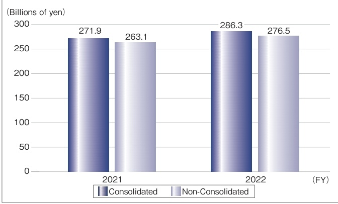 
<rdinayproft oft) 
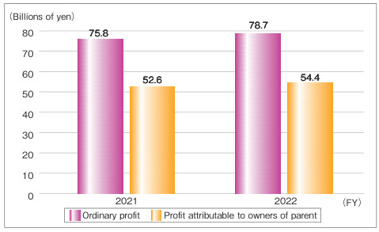 
0t9 .etb 
5

---

<!-- 原文第 2 页 -->

## Business Overview by Segment Plastic Packages | 
The Plastic Packages segment consists of fipcip type packages,plastic BGA substrates,and IC assemblies. 
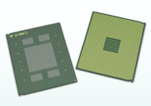 
Flip-Chip Type Packages 
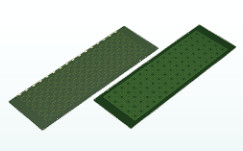 
Plastic BGA Substrates 
Applications: 
PCs,servers, smartphones, automobiles,consumer products,etc. 
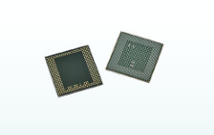 
ICAssemblies 
## Metal Packages| 
The Metal Packages segment includes such products as leadframes, heat spreaders, ceramic electrostatic chucks and glass-to-metal seals. 
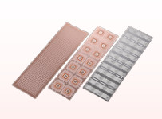 
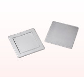 
Leadframes 
Heat Spreaders 
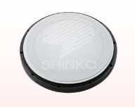 
Ceramic Electrostatic Chuck 
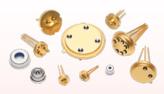 
Glass-to-Metal Seals 
## Applications: 
Automobiles, smartphones, PCs, consumer products, semiconductor manufacturing equipment,communication equipment,etc. 
<Net Sales by Business Segment (Consolidated)>(Billions of yen) 
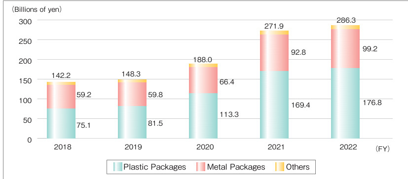 
6 
notanpontnl 
emaPem 
iemnoriyn 
1aiaos env0 ta .hte

---

<!-- 原文第 3 页 -->

Global Network 
noltauponnl inamaen Iemnoiy 
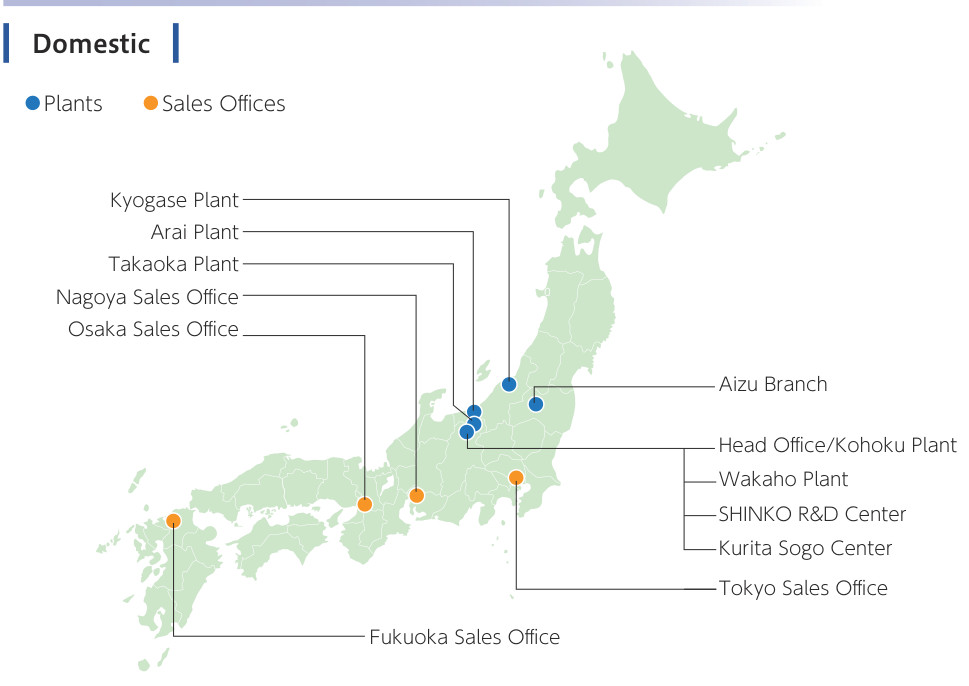 
1slcos enrevo 0t9 .etb 
Major Sites 
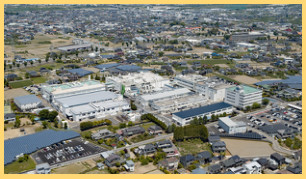 
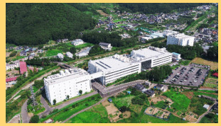 
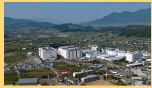 
Head Offce/KChoku Plan(Nagano Cit) 
Wakaho Plant (Nagano City) 
Takaoka Plant(Nakano Cit, Nagano Plef.) 
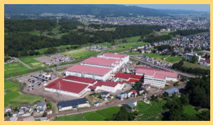 
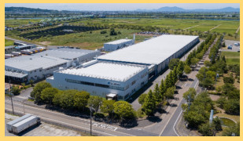 
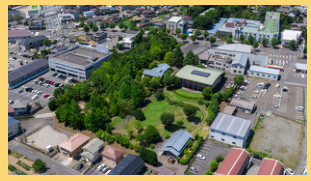 
Arai Plant(Myoko City, Nigata Pef) 
Kyogase Plant (Agano City,Nigata Pref.) 
Kurita Sogo Center (Nagano City) 
## Sales Offices 
Group Company SHINKO TECHNOSERVE CO, LTD.(Nagano City) 
Tokyo/0saka/Nagoya/Fukuoka 
7

---

<!-- 原文第 4 页 -->

Overseas 
Plants Sales Offices 
Representative Office 
notanpontnl 
<Number of Employees by Region (as of March 31,2023)> 
The Anericas A7i4 
Number of Employees (Consolidated) 5.596 
inamaben 
Japan 
<Net Sales by Region (FY2022)> 
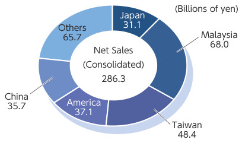 
iemnoriyn 
Asia 
1aiaos env0 0t9 .te 
Group Companies (Manufacturing) KOREA SHINKO MICROELECTRONICS CO.LTD.(Korea) 
SHINKO ELECTRONICS (MALAYSIA) SDN.BHD.(Malaysia) 
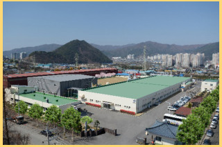 
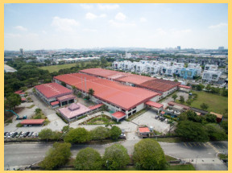 
Group Companies (Sales) 
SHINKO ELECTRONICS (SINGAPORE) PTE.LTD.(Singapore) KOREA SHINKO TRADING CO., LTD.(Korea) TAIWAN SHINKO ELECTRONICS CO,LTD.(Taiwan SHANGHAI SHINKO TRADING LTD. (China) SHINKO MICROELECTRONICS (THAILAND) CO., LTD. (Thailand) 
Representative Office Manila (Philippines) 
North America 
Group Company (Sales) SHINKO ELECTRIC AMERICA INC.(U.S.A.) 
8
