> 原文件：[45_shinetsu.co.jp_Annual-Report-2025.pdf](https://github.com/jadennevercode/CJCC-Knowledge-Base/blob/564ab11aa9785e569e3853c8a4d7ce86f88e7535/materials/%E4%B8%8A%E6%B8%B8%EF%BC%9A%E5%85%89%E5%88%BB%E6%9D%90%E6%96%99/45_shinetsu.co.jp_Annual-Report-2025.pdf)
> 转换方式：Volcengine OCRPdf v3, parse_mode=ocr

<!-- 原文第 1 页 -->

ShinEtsu 
Annual Report 
2025 
Shin-Etsu Chemical Co., Ltd. 
2

---

<!-- 原文第 2 页 -->

Editorial Policy 
Shin-Etsu Chemical Co., Ltd. Annual Report 2025 Introduction Business Strategy Sources of Our Competitiveness Business Activity Management rundation Sustainability Data Section 1 
## Business Principle 
The Group actively conducts in sustainable business practices and creates the value sought by society and industry through the provision of unrivaled key materials technologies. 
Sustainability 60
Identiying Key ssues atriaity Governance Related to Sustainability 61 62
Strategy, Metrics, and Targets 63
Main Sustainability Initiatives 65
Data Section 68
Ten-Year Summary 68
Investor Information 70
Corporate Information 71 
## Contents 
Introduction 02
Continuing to Be a World-Leading
Materials Company
Business Strategy 08
President's Message Value Creation Process 08 11
Financial Highlights 12
Non-Financial Highlights 13
Sources of Our Competitiveness 14
Financial Capital 15
Manufacturing Capital 16
Sopeial feaie he Porsuit of Eficiency Never Ends
Message from the Director in Charge of Technologies 18
Employee Roundtable "Engineers Disuss the Future of Manufacturing" 20
Human Capital 23
Intellectual Capital 29
Interview with the General Manager of the Patent Departiment 31
Social and Relationship Capital 32
Natural Capital 34 
Business Activity 40
Robust Business Structure Born from Close
Cooperation and Diversification 41
Infrastructure Materials 42
Electronics Materials 43
Functional Materials 45
Processing & Specialized Services 46
Management Foundation 47
Corporate Governance Approach and Initiatives 48
Assessment of Board of Directors Effectiveness 49
Policy on Cross-shareholdings 50
Management 51
Activity Status of utside Directors and Outside Audit &
Supervisory Board Members 53
Risk Management 54
Interview with Outside Directors
Posioning Shin-Etsu Chemical to chieve rr
growth by delivering value to the world" 55 
Interview with Outside Directors 55 Employee Roundtable 20 
 
This spot s apil al s alepy p esessaseespsl solaesosispsh sinsoipos s psa s p tlppp i spy-y hs 05 etioiss t s ss tyad pad ovlyvioyopolv shiiyvt op t ' .ososvp nsyyveb the rss et st os vsse et e il a rountabe isos oustss s ssss eeei t e e eseet Chemical to achieve further growth by dalvering yalue to the word

---

<!-- 原文第 3 页 -->

Shin-Etsu Chemical Co.,Ltd. Introduction Annual Report 2025 
Sustainability Data Section 2 
## Introduction 
Operating income ¥742.1 billion Operating income ratio 29.0% ¥1,000bn 
FY2024 
# Continuing to 
## Be a World-Leading 
¥800 bn 
Materials Company The Shin-Etsu Group has achieved high profitabilit by developing,producing, and selling a wide range of materials that serve as the foundation for industry and daily life allovor he word.This is the resuit of pursuing world's highest level of technology and quality, constantly striving to improve productivity, and making timely and appropriate capital investments with an eye on the future.We aim to contribute to solving the challenges faced by customers and industry. 
¥600 bn 
 
¥400 bn 
。 
lhn FY2010 
¥200bn 
FY2015 
FY2020

---

<!-- 原文第 4 页 -->

Introduction 
## Introduction High market shares in many materials that serve as the foundation for industry and daily life 
As an essenta suppersuporig ndusty a ali fonh o d docs o os ss s provides many products in which it holds top market shares globally including PVC and semiconductor silicon. 
Infrastructure Materials 
## Electronics Materials 
## Functional Materials 
# Processing& Specialized Services 
Polyiny chloride(PCI einis saniat ou dai from water supply and sewerage systems and othe structure (social infrastructure) to housing,agriculu and everyday products. With a combined annual pro tion capacity of 4.84 millian tons at three bases in t Europe,and Japan,we boast the world's largest pre tion capacity and provide a stable supply of PVC gl In adirion, we also supply caustic soda,plyviny/ a (POVAL), and other products. 
We produce silicon wafers, a key semiconductor material, as well as shotoresists,potomask blanks, and encapsulant materials used in the semicanductor manufacturing pracess. We also supply rare earth magnets,which are essential for power-saving motors used in eco-friendly vehicles and electrical appliances, and high-purity synthetic quartz, which is used as araw materia for opftar tfr ad r other applications 
In 1953, we were the first Japanese company to commercialize sicone, which is used in a wide range of industries and since then we have continued to develop our product lineup,which now includes more than 5,000 varieties. We also supply a wide variety of materials that deliver superior functionalit, including celuos dervatves, which are widely used in pharmaceuticals, food products and industial applications, as well as synthetic pheromones, silion metal, iguid fluoroelastomers,plices, and sicn anode material for lithium ion batteries. 
As a processing manufacturer of varius resins such as PVC and silicone,Shin-Etsu Polymer Co, td.meets the diverse needs of customers in a wide range of fields including the automotive, information equipment, semiconductor,packag ing material, and construction material inusties, Shin-Etsu Engineering Co, Ltd. is invuolved mainly in the design and construction of the Group's manufacturing plants, and also provides vacuum assembin quipment, micro LED chip transfer equipment,and other products. 
Polyvinyl chloride (PVC) resins 
No.1 globally 
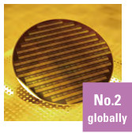 
No.1 in Japan 
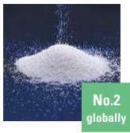 
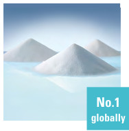 
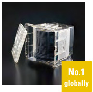 
No.2 globally 
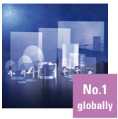 
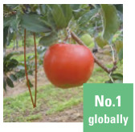

---

<!-- 原文第 5 页 -->

Shin-Etsu Chemical Co.,Ltd. Annual Report 2025 Introduction 
Business Activity Management Foundation Sustainability Data Section 
Introduction Growth trajectory 
Sustained growth through proactive capital investment and overseas business expansion Since its transforn ment with 
nt in 1926 as Shin-Etsu Nitrgen Feriizer Co, td,,the Shin-Etsu Group has ontinall hess with an eye to the future. We have achieved growth through proactive capital invest future market expansion and by expanding our sales channels to overseas markets. 
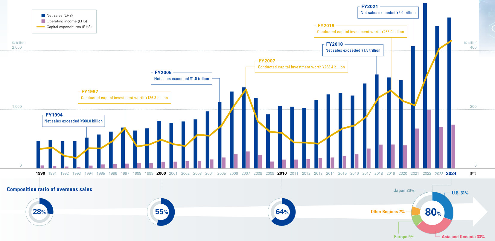

---

<!-- 原文第 6 页 -->

Shin-Etsu Chemical Co., Ltd. Annual Report 2025 Introduction Business Strategy Sources of Our Competitiveness Business Activity Management Foundation Sustainability Data Section 
 
## Introduction History of enhancing profitability 
## -lmproving profitabity by constantly striving to improve productivity and achieve full production and sales of all products made 
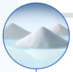 
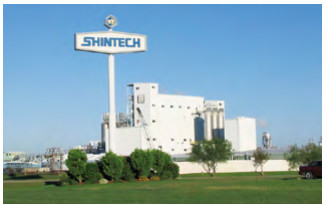 
PVC resins 
Shintech Frepot Plan fcrs SJA 
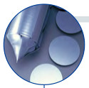 
Silicon wafers 
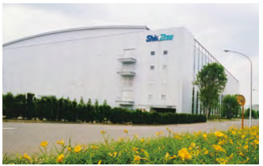 
300mm wafer building (Shin-Etsu Handotais Shirakawa Plant) 
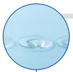 
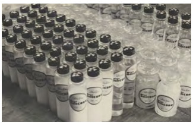 
Silicones 
Silicone products when praduction first stated 
## Trajectory of business opansion and profita liliprpeoment 
1957 Start of PVC production We introdue letatsis s menttit a as s 
1970 Expansion into Kashima Industrial Complex We are the firs t t e r t e enlargement of our polymerization reactors 
1974 Shintech begins operations in the LS n antcipaionio t t n d o n onnndc i tt s s on exports,based on the goal of full production and sales of all products made 
1990 No.1 in th u.S. Shinets aapipt s l te 
2001 No.1 in the word Shinechis anual prucin pat ee c l e gl dedicated to process rationalization and a workforce that is small in nmber but highly skilled team.The result is a highly proftale business sructure with no waste. 
2008 Start o ineraepucia ro armelali Sitethstishs nientpcyts tintent pc so o eet Vinyl chloride monmers,enabling it to provide a more stable and flexible suply of products to customers. 
2020 Start ot etye oucion ngatep pucioia s an hn t go p e a hh t chlorine) and natural gas (the raw material for ethylene) 
2021Start of expansion of Shintech's integrated plant Shintech's PVCproduction capacity reaches. 4 inonningit eei a a agag tr nr high-profit structure. 
## Trajectory of business expansion and profita bilty improvement 
1967 Founding of Shin-Etsu Handotai After Dow Coning prposes to dissove ou itvntre, shinEtsu Hanota becomes a wholl wned subsidiay in 179 and decides to prsue th interational market on its own 
1979 Founding of Shin-t Handatai enca.. 
1984 Completion of Shirakawa Plant To met the rapialy inraing dnd f icndctor diiny he dnd for eridcesiig p,.eams, nd Cs in th early 1980s, the Shirakawa Plant,which carries out integrated prduction of semicnductor silicon wafers fram crystallization to pracessing.begins peration 
2001 Start of mass production of 300m waters In the 2000s, ur Shirakawa Plant became the first in the word to begi mass oduction of 1-in (300m/ wafers, Bucking the re of trying to expand market share by lowering pnies,we continu to inest in aclitis around the world to crate a systor stale supp f highgait ctbaad ade tehnological capabilities, Enterin no ongteagreeents with customr based on trust elationsnips nales us to condutsbl busines perations that are lessusp economic fluctuations 
## Trajectory of business expansion and profita ity improvement 
1953 Start of production of silicones Commerciaied siicne poducts with the Silicon Resin Department as the parent organization 
180 Start of acelerated overseas expansion (US,Kore,Taan, Netherlands)In the early 1980s,having established a leading position in Japan by develping prduts meticu ously taliored to customer needs,we continued to expand the business and acelerate oerseas xpansion. 
2001 Establishment of manulacturing company in Thalnd Since then, we hev apanded or buis s an n n t operations up to the final product. 
2022 Inreased prouctio apcity fr ih r rei s 
5

---

<!-- 原文第 7 页 -->

Introduction 
## Introduction Source of earning power 
The Shin-Etsu roup has achieved high productivity through human resource develpment centered on personnel with T-shaped skils, a tripart teawork manufacturing of sales, development, and production that promptly addresses customer needs, and the pursuit of thorough automation and labor savings. 
1 
 
Highly Productive Organization 
## Developing Personnel with T-shaped Skills and Pursuing a Lean Work Style 
## Tripartite Teamwork Manufacturing that Promptly Captures the Demands of the Times 
We do not carry ut one sief s easasn rers ss develop Tshaped humar rsoures o hav ep while also being able to perform a wide range of other duties. These personel pursue a lean work styve and maimize thir apaplies.eingg to higher productivity per employee. 
Our main R&D facilities are lcated o tesame premises as our p allowing for constant and prompt coordination between developm production in reponse to ustomer nees otained from ales. d rapidly developing products that met customer needs, we coordinate production departments to carry out prototyping and practical deve toward quality stablinetio nd mas dionant tu puo op 
fition to with 
Operating income per employee (average of the last three fiscal years) 31 million yen / person per year 
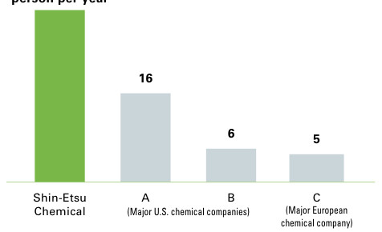 
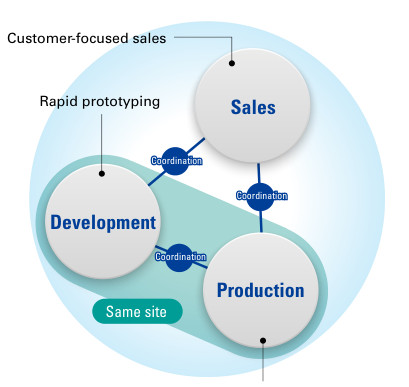 
Faster time-to-market 
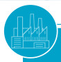 
## Productivity of Facilities 
## Achieved High Productivity through Automation 
We aim to achieve stable operation with minimal personel t tupruc. tion sites,promoting automation and labor savings to the extreme,and thoroughly pusuig ore fitcehos he pain ir existing facilities and building new facilities. ln adition, experienced engineers in ach prcess percom meticous mintne to minimize equipment stoppages and problems,which results in high productivity. 

---

<!-- 原文第 8 页 -->

Introduction 
 
Preparing for market expansion New base for semiconductor materials To expand the semicanductor lithography materials business, we have decided to build a plant in lsesaki City, Gunma Prefecture. which will serve as the fourth site for this busiess. Te first phase of the ivestment tapximal V8, liis ed to be completed in 2026. 
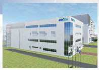 
2020 Approx. 
$450pn

---

<!-- 原文第 9 页 -->

Shin-Etsu Chemical Co..Ltd. Annual Report 2025 
Introduction 
Business Strategy 
Business Activity Management Foundation 
Sustainability Data Section 
8 
## President's Message 
We are committed to sustained growth through best-in-class quality, technology and practice 
President Yasuhiko Sath 
 
1 
2 
In the fiscal year ending March 31, 2025(FY2024), our company extended its growth path as shown below.The results once again reflect the underlying strength of our line of products, technology, ingenuity, operational system,and our people's professionalism. 
We take pride in contributing to the well-being of our communities and the development of industries,while attaining high marks from the top line to the bottom line and in key financial ratios. 
FY 2024 marked a new phase in our shareholders remuneration and capital management.We declared an increased amount of dividends (¥106 per share),which 
## Ordinary income 
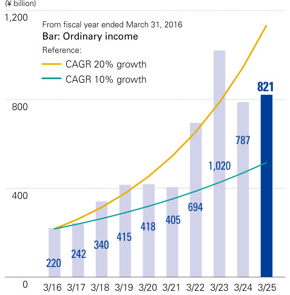

---

<!-- 原文第 10 页 -->

Shin-Etsu Chemical Co., Ltd. Annual Report 2025 
Introduction Business Strategy Sources of Our Competitiveness Business Activity Management Foundation 
Sustainability Data Section 
9 
## President's Message 
yields an average annual growth rate of 19.1% over the recent ten year period. In adition, we raised our long-term aim of the dividend payout ratio from around 35% to around 40%.At the same time, we implemented a 194 billion yen's worth of share buyback. 
In January, in response to a frequently asked question about the level of cash that the company holds,we stated that we would not let the amount of cash holding increase any more. The cash in hand is intended for largescale growth initiatives, including merger and acquisition, reserves for economic shocks, and shareholders remuner ation.I believe that we have been a good custodian of the cash, paying attention to our equity spread.We will make good use of the cash for the stated purposes. 
All these actions represent our sincere appreciation to our shareholders for their understanding and support. As a matter of reference,the total payout ratio for FY 2024 was 75.4 %. 
Going forward, to extend the growth trajectory that we have achieved over years,we will further differentiate ourselves in every aspect of our business and operation. To overcome headwinds, differentiation is essential.In doing so,we certainly keep our focus on providing our customers with products which make it attainable for them to do what they pursue. We tirelessly help solve what our customers need to solve.As changes take place fast and what our customers' needs constantly evolve,opportunities present themselves for us. 
With a strong market-in mindset and aspiration,we work with our customers more closely than ever.We are determined to be a most reliable supplier to all our custom ers with bestin-class quality, technology and practice,so that our products will be used more and everywhere. 
## Situation of Each Segment 
If I may elaborate on it by laying out our prospects and on-going endeavors in each of our business segments, 
## Infrastructure Materials Business 
We started up a brand new production facility for PVC and caustic soda in the US last fall.With the youngest and most advanced PVC fleet, we have been running at capacity while navigating rather rough waters in the global market.Though international waters in the PVC market are expected to be rough for a while, the US market appears to be resilient.We will demonstrate our strength via our customer service system, economy of scale,and cost structure. 
## Electronics Materials Business 
The market for semi-conductors expands at a remarkable rate quantitatively and qualitatively.The semi technologies keep evolving in an intriguing manner. We will stay tuned to capacity increases and product developments. To this end, we consummated the acquisition of the full ownership of Mimasu Semiconductor Industry,and the construction of the new facit for cuttingege itgraphical products is progressing as planned.We are ading to our R&D capabilites,as well.There is an evolving array of new ways of device making, to which we apply our expertise and ingenuity. As an expert and all round player of semiconductor materials,we will be more instrumental to the semiconductor industries. The industries and markets which we are in and we serve have been more subject to geo-political issues. We are vigilant and mindful of them.We must wisely navigate our business for our customers and take opportunities to our advantage as they rise. 
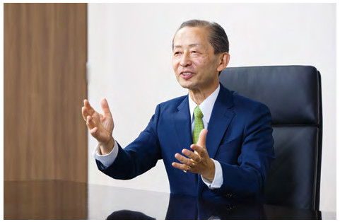 
## Functional Materials Business 
We are bringing more of new products to various markets and are broadening our capabilities for our customers. To this end,we will push the envelope in silicon chemistry,cel

---

<!-- 原文第 11 页 -->

Shin-Etsu Chemical Co., Ltd. Annual Report 2025 
Introduction 
Sustainability Data Section 
10 
## President's Message 
lulosics and other synthesis. We add touch points in industries and markets so that our total addressable markets will be greater. At the same time,we deemphasize commoditzed product line. We develop ou product offeings with this focus and make contributions in such manner that the more of our products are used, the better the industries and human society become. 
will play a key role there. The other one, by the name of U- Material Machine, offers manufacturing processes, including equipment and materials for various light emitting devices,semiconductor package substrates and so on.We have introduced Shin-Etsu processes for advanced semiconductor packaging (Shin-Etsu Dual Damascene Method). We will pursue integration of materials and equipment. 
## The Processing and Specialized Services 
With this group of businesses and operations,we enhance the synergy within our group companies. 
## Initiatives Aimed at Carbon Neutrality 
Let me bring you update on our efforts toward carbon neutrality. our stated goal is to become carbon neutral by reducing greenhouse gas emissions(SCOPE1 and 2) to net zero by 2050.In FY 2024,we made progress in reducing GHG emissions in terms of production intensity compared to FY 2023. FY2024 results were 56.9%(down 0.1 points year on year) compared to FY1990 for the Group and 48.6%(down 4.8 points year on year) compared to FY1990 for the Company. 
By absolute measurement, the Scope 1 and 2 GHG emissions increased 3.4%,as we expanded production capacities to meet customers' requirements. For those expansions, we certainly apply and install our advanced and state-of-the-art technologies to ensure that our facilities are the most energy-eficient operations in their respective industries. We have been improving energy efficiency at existing facilities, as well.I must admit that we have a lot to do to reach the goal.To this end,we will do our best. 
I would like to point out that we offer a number of products that contribute to reducing greenhouse gas emissions. For instance, roughly 70% of the sales of our products currently go to those areas which Japanese government nominates that are integral to achieving carbon neutrality. We will continue to expand our range of products that contribute to carbon neutrality. 
To extend and expand what we have been able to do for our customers, our shareholders and our communities, I reiterate that we must continue to grow.We will remain focused on our customers and their needs to be relevant to them, will remain committed to good governance to be relevant to our shareholders,and will remain responsible to be relevant to our communities. 
I may add that the two new business units werecently launched are developing well. The one deploys novel technologies for GaN devices. With the advent of Al revolution, the power management is essential and GaN devices 
I sincerely thank our shareholders for their confidence, our customers for their partnership and our entire Shin-Etsu team for their dedication to our operations. 
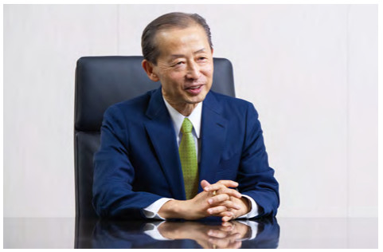 
Business Strategy Sources of Our Competitiveness Business Activity Management Foundation

---

<!-- 原文第 12 页 -->

Shin-Etsu Chemical Co., Ltd. Annual Report 2025 
Introduction 
Business Strategy Sources of Our Competitiveness Business Activity Management Foundation 
Sustainability Data Section 
 
11 
## ation Process 
By harnessing its strengths development, and productie creating unrivaled value wit 
in the tripartite teamwork manufacturing of sales, the Shin-Etsu Group helps solve societal issues by materials indispensable to industry and people's lives. 
Value Created 
Vision 
Sources of Our 
Competitiveness 
## Business Activity 
Sustainability 
## Digitalization 
The foundation of all activities: Legal compliance, fair corporate activities 
AI, Io, 5, Metaverse 
 
P40 
Semicnductor sicn sicons ptiatfeprfr ow-dielectric resins,tc. 
Financial Capital 
## Production 
Heath and s afety of employees and contractors 
Smart infrastructure 
Infrastructure developments PVC。cellulose dervatives. silicones 
 
Manufacturing 
## Enor sng 
Capital 
Intrastructure Electronics Materials 
and reductian of the environmental impacts 
Materials 
## Eliciency improvement 
Core Technologies 
Product quality improvements and product saety control 
Robots, Industrial motors 
 
Mission To provide products 
Semiconductor sicon, rare arth magnets, silicanes, etc. 
Human Capital 
that contribute to solving social issues 
Promoting CSR procurement and the diversfication of supply sources 
Health enhancement 
Processing & Specialized Services 
 
Fustiona 
Development Tnpata awon ng Film processing 
Pharmaceutical materials, Materials for medical apparatus and equipment 
Respect for human nights, the development of human re oures, ant the pramotion of diversity 
Intellectual Capital 
Cellulose derivatives, POVAL, sicns, rare earth magnets 
Sales 
Food, Sanitation Synthetic pheromns celoss tevadtves, photocatalysts 
 
Respect for and protection of intallectual property 
Social and 

| | As of March 31, 2025 |
| --- | --- |
| Operating income | ¥742.1 billion |
| Net income attributable to owners of parent | ¥534.0 billion |
| ROIC | 18.2% |
| ROE | 12.0% |
| Cash dividend per share | ¥106 |
| Total shareholder return over the past five years | 218% (TOPIX213%) |
| Market capitalization | March 31, 2015 ¥3,392.0 billion March 31,2025 ¥8,408.4 billion |
| Moody's Long-term Rating | Aa3 |
| Sales composition ratio of environmental products\*1 | approx. 70% |
| Greenhouse gas emission intensity (compared with FY1990) | 43.1% reduction |
| Composition ratio of overseas sales | 79.6% |
| Intangible asset value ratio\*2 | 42.2% |
 
Relationship Capital 
Contribution to industy and social initiatives 
Environmental contribution 
Electric vehicles Rare earth magnets, anode materals or thiinn batteries, slicones, atc. 
 
Accurate and timely information disclosure and communication with stakeholders 
Management Foundation 
Natural Capital 
Energy-efficient home appliances, Renewable energy 
Corporate Governance 
P.14 
P.47 
P.60 
Rare earh maget emiconctr ici LED packaging materials,etc. 
"1 Products that ontribute to the 4 aress identified by the Japane se gvernment in 202s being essantia to ahiering the gol of carbon neutrality *2 Anincator for measuring the value of intangile asets in capital markets Intangile st ave iiitni sep e

---

<!-- 原文第 13 页 -->

Shin-Etsu Chemical Co., Ltd. Annual Report 2025 
Introduction Business Strategy Sources of Our Competitiveness Business Activity Management Foundation Sustainability Data Section 
 
12 
## Financial Highlights 
Net sales 
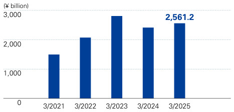 
In the fiscal year ended March 31,2025(FY2024),consolidated nat sales increasd by 6.1% from the previus fiscal year as a result of our focus on PVC price updates and sales of electroric materials and highly functional silicones. 
Net income per share/Cash dividend per share ite 
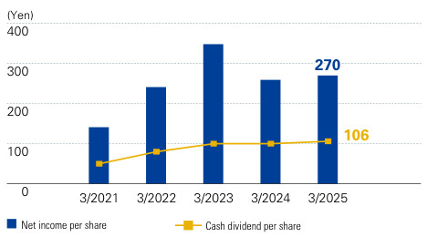 
In acorane with our basis piy r ini ti e e iad is t ratio of around 40% as a medium- to long-term guide,the annual dinvidend for 
FY2024 was V106 per share (friend ayput t f,1 1 rmarn stsrmm the previaus fiscal year. 
Operating income 
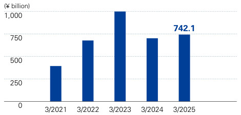 
Cansalidated operating income for FY2024 increased by 5.9% from the previous fiscal year.This was mainly due to increases in perating income of 19.3% and 17.7% in the Electronic Materials and Functional Materials businesses respectively. 
ROIC 
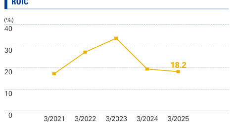 
ROIC for FY2024 fl1.p ito fe ou e lsao a c air net assets,despite an increase in aperating income after taxes. 
Net income attibutable to owners of parent 
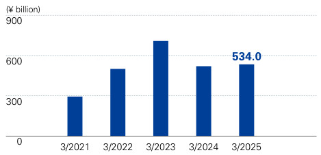 
Net incm attiutale to nrs f parant 2 c r7r previous fiscal year due to the increasa in cperating incme,despite a temporary increase in tax expenses due to dividend payments from overseas subsidianies. 
## ROE 
(%) 20 
3/20243/2025 3/2023 
3/2022 
0 
3/2021 
10 
12.0 
ROE for FY202 fll po to te f u asa s auai a ai ants assets, despite an increase in net income attributable to owners of parent. 
[Note) On April 1,23, the Company executed a 5-for-1 stock split of its common stock."Net income per share" and "Cash dividend per share" are calcuated based on the number of shares aterthestok pito the fia ae ene ac122

---

<!-- 原文第 14 页 -->

Shin-Etsu Chemical Co., Ltd. Annual Report 2025 
Introduction Business Strategy Sources of Our Competitiveness Business Activity Management Foundation Sustainability Data Section 
 
13 
## Non-Financial Highlights 
## Grenhous gas missionsmisinnsn n e 
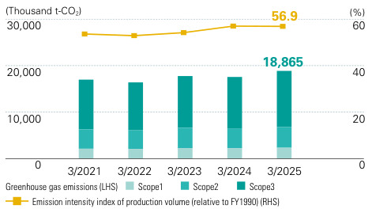 
We are working to reduce the greenhous gas emission intensity index to 45% of aur FY1990 level by 2025 and achieve nat-zera greenhouse gas emissions (Sscape 1 and 2by 2050 
Emission itenst ine of prouction aume reflets Sape 1and Scope 2 
Ratio of female employeesumber and rati of women in managerial postion 
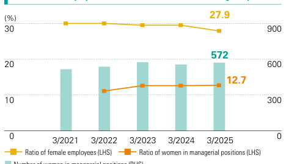 
umbe o women i manageria psitions iS 
To promate the advancement of women,we have set gals to increase the hiring ratio of women in administrative positions to 40% and in enginaering pasitions to 10%"and "quaduple the number of women in managerial positions, including oin 
Figures for ratio of women in managarial positions calculated staring from F2021 
Water usage/Recycled ratio 
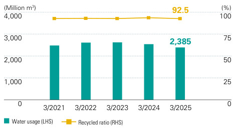 
Since manufacturing products reguires a large amount of water, we have set a target of reucing water wihrawa nienityu n an aed" are tharoughly promting the recycling of water and making efectve use af rainwater, etc "Total quantity of water withdrawal and egycled water 
Lost-time accident rate* 
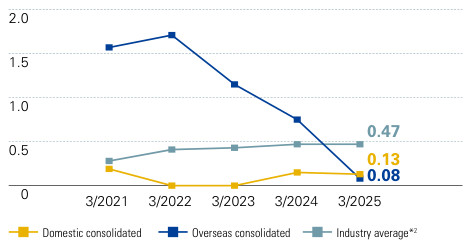 
" The lost time acident rate is akuated per calendr ya "2 Averages for h teical dastut aa ph ry Association (JCIA) 
Number of employees/Ratio o employees outside Japan 
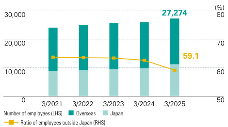 
In accordance with internatinal labar standards, each year we survey our onsolidated subsidianes to nsure compliane with laws nr regutionsaigg sure that we re sect human rights and properly manage labor and employment in accordance with the laws and regulations of each country and regian. 
Number of directors and audit & supervisory board members/ ratio of outside directors and outside audit & supervisory board members 
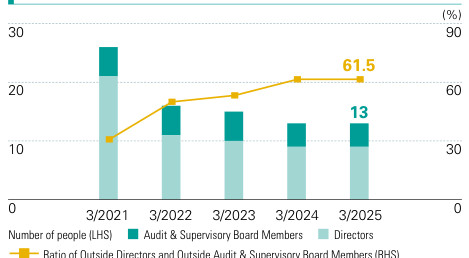 
The Company continues to strengthen its corporate governance system with an emphasis on external perspectives, for example by irviting leading figures from various fields to serve as Outside Directors.We appointed one woman as Dutside Director and two women as Outside Audit & Supervisory Board Members.

---

<!-- 原文第 15 页 -->

Sources of Our Competitiveness 
Sources of Our Competitiveness Sources of competitiveness that support the sustainable 
We aim to achieve sustainable growth by monitoring global demand rends and making timely and appropriate capital investments 
development 
82.6% 4,837.5 billion yen 434.5 billion yen 
Soures of our 
Financial Capital 
Mangfasturing 
Human Capital 
Intelletul 
Sotial and Ralaionship Captal 
Natural Capital 
 
Financial Capital 
Enhancing shareholder returns while continuing capital investments on a solid financial footing 
●Equity ratic ●Net asse 
 
Human Capital 
Developing T-shaped human resources with optimal staingi p ui t oe efficient and energetic way of working 
Operating income per employee 27.21 million yen 
 
Social and Relationship Capital 
Our commitment to respecting human rights and building strong relationships of trust with customers 
 
Manufacturing Capital 
18 companies, 41 bases 17 countries, 66 bases 
 
Intellectual Capital 
Promoting rapid, fed-inked R&D and strategic IP management to protect our business 
Researc plants 
·Selecte Innovato 14 consecutive years 
 
Natural Capital 
In addition to our commitment to carbon neutrality by 2050,we are focusing on conservation of water resources, biodiversity, and waste reduction 
(Shin-Etsu 56.9% 
Greenhe lemission relative to

---

<!-- 原文第 16 页 -->

Shin-Etsu Chemical Co..Ltd. Annual Report 2025 
Introduction Business Strategy Sources of Our Competitiveness Business Activity Management Foundation Sustainability Data Section 
 
15 
Financial Capital 
## Electronic materials and highly functional silicones drive earnings 
In the fiscal year ended March 31, 2025(FY2024), the polyvinyl chloride (PVC) business worked to revise prices in key regions. Outside of North America, however, the sluggish supply and demand situation continued against the backdrop of exports from China, where domestic demand remains stagnant. Meanwhile,we focused on expanding sales in growing markets such as semiconductor materials (including silicon wafers, photoresists,and photomask blanks),rare earth magnets,and our highly functional silicone product lines. 
As a result, our operating income was ¥742.1 billion (up 5.9%year on year),and net income attributable to owners of parent was 534.0 billion (up 2.7% year on year).In addition,total net assets were ¥4,837.5 billion (up 9.3% from the end of the previous fiscal year), the stockholders equity ratio was 82.6%,ROIC was 18.2%,and ROE was 12.0%. 
## Steadily advancing capital investment for sustainable growth 
To enhance compettiveness and sustain growth, Shin-Etsu Chemical seeks to enhance corporate value through the active and timely use of its internal funds. The Shin-Etsu Group's capital expenditures in FY2024 totaled 434.5 billion tup 6.8% year on year,reflecting progress in planned investments such as PVC resin facility expansion at Shintech, construction of a new production base for semiconductor lithography materials,and capacity expansion for our lineup of highly functional silicone products. Capital investment for FY2025 is expected to be 370.0 billion. 
The new Shintech plant in Plaquemine, Louisiana,with an annual production capacity of 400,000 tons of PVC,commenced operations in2024. 
Dividend increase and a share buyback worth Y500.0 billion The Company is implementing its capital policy, by balancing growing business earnings with maintaining solid financial foundations,while paying close attention to ROE and the cost of capital. Shareholder returns are at the core of this policy, The Company is stiving to achieve stable dividends and is raising the medium- to long-term target dividend payout ratio to around 40%.The annual dividend for FY2024 was 106 per share (corresponding to a dividend payout ratio of 39.3%),an increase of 6 from the previous fiscal year. 
In addition, the Company repurchases its own shares in a flexible manner based on stock price levels and other factors.A new share buyback,not to exceed 500.0 billion,was initiated in May 2025.The purchase amount is equivalent to 6.4% of our market capitalization, and is expected to have the effect of raising ROE by 1.5 points. 
## Equity ratio/Net assets 
Equity ratio (as of March 31. 2025) 82.6% 
Net assets (as of March 31 2025) 4,837.5 billon yen 
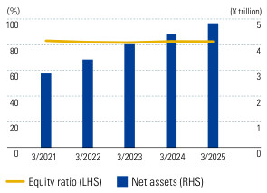 
Capital expenditures/Depreciation and amorization 
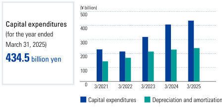 
Cash dividends per share/Payout ratio Mat) 
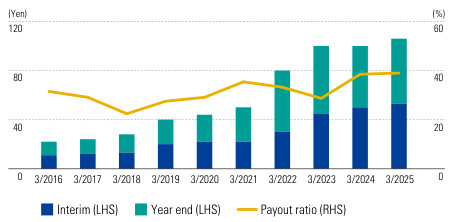 
[Notel On Apri1,02 the Company ecuteu for s oct pis common stock."Cash dividends per share is calculated based on the number of shares after the stock split.

---

<!-- 原文第 17 页 -->

Shin-Etsu Chemical Co..Ltd. Annual Report 2025 
Introduction Business Strategy Sources of Our Competitiveness Business Activity Management Foundation Sustainability Data Section 
 
16 
Manufacturing Capital 
## Basic policy on capital investment 
To fulfill is supply responsibilities as a material manufacturer, the Shin-Etsu Group makes timely and appropriate capital investments to strengthen stable supply and improve quality based on information and requests obtained from industry-leading companies around the world. Our solid financial base and ability to generate cash flow enable us to make flexible decisions and aggressively invest even in an ever-changing business environment. 
## Current status of capital investment 
We are steadlily making capital investments that support the growth of the Group,including a PVC resin facility expansion project at Shintech Inc.in the U.S.,as well as production capacity enhancement, productivity improvements and streamlining,quality improvement, maintenance,upgrades, and environmental measures. The status of major capital investments is as follows. 
List of capital investments (that have been announced) 

| Business Segment | Products | Projects | Investment Amount | Status |
| --- | --- | --- | --- | --- |
| Infrastructure Materials | PVC | New facility expansion [Fhase 2] (U.S.) | S1.25 billion | Completed |
| Electronics Materials | Semiconductor lithography materials | Build a new manufacturing and research-and-develapment base IJapan) | ¥83.0 billion | In progress |
| Functional Materials | Silicone resin | Reinfarcement of the production capacity for adanced furctianal products line (Japan) | ¥80.0 billion | In progress |
| 11 | Expand the applicatins of or sicnes products and wark to enhance the advanced functionality of our praducts lineup and expand our environmentally friendly silicones [Japan, Thailand, etc.) | ¥100.0 billion | In progress |
| 11 | Build a manufacturing plant (Chinal | ¥2.1 billion | In progress |
| Cellulose derivatives | Expand manufacturing facilities for pharmaceutical excipient (Japan) | ¥10.0 billion | In progress |
| H | Expand manufacturing and storage facilities for pharmaceutical excipient Japan,Germany) | ¥10.0 billion | In progress |
 
## Capital investment 
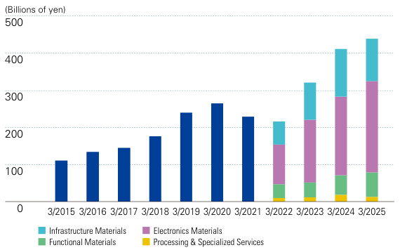 
Sales by Manufacturing Location for Each Segment(FY2024) (Billions of yenl 

| | Goods Manufactured in Japan | Goods Manufactured overseas | Total |
| --- | --- | --- | --- |
| Infrastructure Materials | 123.3 | 918.2 | 1,041.5 |
| Electronics Materials | 764.0 | 170.2 | 934.3 |
| Functional Materials | 287.3 | 161.2 | 448.6 |
| Processing & Specialized Services | 103.5 | 33.1 | 136.7 |
| Consolidated | 1,278.2 | 1,282.9 | 2,561.2 |

---

<!-- 原文第 18 页 -->

Shin-Etsu Chemical Co., Ltd. Annual Report 2025 
Introduction 
Business Strategy Sources of Our Competitiveness Business Activity Management Foundation 
Sustainability Data Section 
17 
## Manufacturing Capital 
## Risk-aware supply network 
Production bases for major products 
In adition to building a local production system directly linked to local demand, the Shin-Etsu Group has 66 overseas production bases in 17 countries, mainly in regions with low country risk, to ensure that our production costs are the most competitive in the world. In adition, as geopolitical risks rise,we are diversifying our raw material procurement across different regions and suppliers, while establishing multiple production bases to strengthen our ability to ensure a stable supply to our overseas customers, who account for approximately 80% of our sales. 
. 
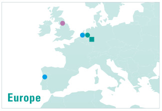 
Americas 
Praductian bases PVC for major products Silicones 
Cellulose derivatives Semiconductor silicon 
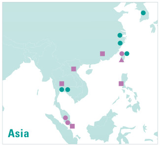 
I Rare earth magnets Photoresists 
## Employee message 
## Establishment of a magnet production system in Vietnam that integrates everything from recycling to raw materials and finished products 
 
Shin-Etsu Magnetic Materials Vietnam Co,Ltd. Mr.T.S 
When we descrbe resures a"rare metals"'or "rare earths,"the word "rae" means either that the resoure is found in small amounts on arth, or that its distribution is limited for technical, economic, o geplitical reasanrsTher are earth elements used in neadymium magnets falli th latter category,and in fact, they are not as scarce as the name suggests,being mined not only in China but also in te Uhited States and Australia, among other countries.At our Vetrap plant a h processes for manufacturing neodymium magnets, including the refining and recycing processes, are integrated into one facity,ya sut his t has the great avuantage of being bl to proure neodymium magnets that are 100"'Made in Shin-Etsu. 
My responsbilis at the lat in Mienram are in the area of technica de elopenf forerrng and magnetic materialsas wels u il cr. Curently, we are avancing the development of technology to secure rare-erth resources,and we are now able to refine the aw materials for neodymium magnets right here at our plant in Vietnam.To further augment production capacity and stabilize suply oum in the r, we are proceeding with a prjiet buid ew piant tht inorporates th new technologis we have developed into the recycling and refining processes.The supl o r art le emns hass historicaly bee rlale oweve, y vrqingg the advantage of our Vietnam plants intgrated production system,we will continue to develop new technlgies and control quality so tat we can provide our customers with a stable supply of high-quality magnets. 
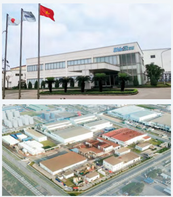 
Shin-Etsu Magnetic Materials Vietnam Co.. Ltd.

---

<!-- 原文第 19 页 -->

Sources of Our Competitiveness 
## Manufacturing Capital 
## The Pursuit of Efficiency Never Ends 
Message from the Director in Charge of Technologies Advancing technology and taking on the challenge of innovation 
Repesentaie Drtfrcrc mnt ed g 
In charge of Semiconductor Materials and Technalogie Represenatie Dretor Precotttt ncd Fumio Akiya 
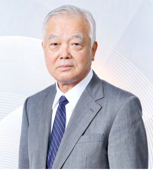 
Technological innovation 
Manufacturing capabilities In the manufacturing industries,continuall improving technological capabilities is an important management issue A committe started working on this theme in 1992 and continues its activities to this day. Its guiding principles 
are based on flexib 
conventional wisde 
evolution,and inno 
ence and engineer 
has addressed ove 
Number of rationalization themes 
Company's earning 
Even now, each pr 
themes and take or The results of th 
tion.They have cre 
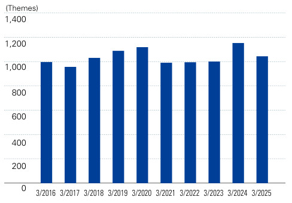 
quality, improved pr 
reduced greenhou: 
continue our relen 
nalizing processe 
Unrivaled quality 
To succeed in an 
essential to continu 
I believe the core o 
call"unrivaled quali 
*Data collected from Shin-Etsu Chemical ony non-consolidated). 
What leads to u

---

<!-- 原文第 20 页 -->

Shin-Etsu Chemical Co., Ltd. Annual Report 2025 
Introduction 
Business Strategy Sources of Our Competitiveness Business Activity Management Foundation 
Sustainability Data Section 
19 
## Manufacturing Capital 
Special Feature The Pursuit of Eficiency Never Ends | Message from the Director in Charge of Technologies more accurate upgrades by using Al to predict when breakdowns are likely to occur. 
## Recycling 
Recycling,the efficient use of resources and materials without waste, is an important issue for society as a whole.ShinEtsu Chemical has been involved in recycling for many years. 
A representative example is the recovery and reuse of thermal energy generated from the manufacturing process. Each of our production sites has implemented a variety of such measures. Thoroughly using up thermal energy without waste leads to energy savings and reduction of greenhouse gas emissions. Furthermore,thanks to the shift to continuous processes,which I mentioned earlier, unreacted raw materials and by-products,which were previously waste,can now be reused as raw materials instead of expelling them, leading to a reduction in waste and an improvement in the variable cost per unit of production. The rare earth magnets business and the PVC business have taken the lead in recycling raw materials and products, and we are pursuing this possibity in other businesses as well.We are currently working to reduce the amount of wastewater discharged by changing our manufacturing methods, as well as working to recover raw materials and valuable materials from waste liquid that was previously outsourced for treatment, thereby improving production intensity and reducing our environmental impact 
Regarding water recycling, we are focused on reusing the water used for coling and cleaning. Cooling water is thoroughly reused in the manufacturing process after heat energy has been recovered. We are also encouraging the reuse of cleaning water discharged during the product washing process, further promoting the effective use of precious water resources. 
## Taking on the carbon neutral challenge 
In May 2023,Shin-Etsu Chemical formulated and announced its plan to become carbon neutal by 2050.Led by the committe l mentioned earlier, we have worked to maximize resource and energy use efficiency. As a result, our greenhouse gas emissions per unit of production have been reduced by half compared to 1990,and we continue to challenge ourselves to further reduce emissions. 
At this point, we have identified 22 tasks aimed at carbon neutrality and are working dligenty to investigate, research,and implement them.Achieving carbon neutrality is a big challenge for companies like us in the materials industry,since we require resources and energy to produce goods. Carbon neutrality cannot be achieved using only the technologies currenty availale.io other words, echnolog ical innation wilb esenta blve teis sa tang worth taking on, precisely because it is a difficut tas. Shin-Etsu Chemical has many talented people who have boldly taken on dificut challenges and made technological innovations. Relying on the technological strength we have honed over the years and our strong will to set and achieve ambitious targets, we will continue to work to achieve carbon neutrality and the sustainable growth of the Company. 
Changes in Energy Consumption by Chemical Companies in Terms of Production Intensity Relative to the FY1990 Level* 
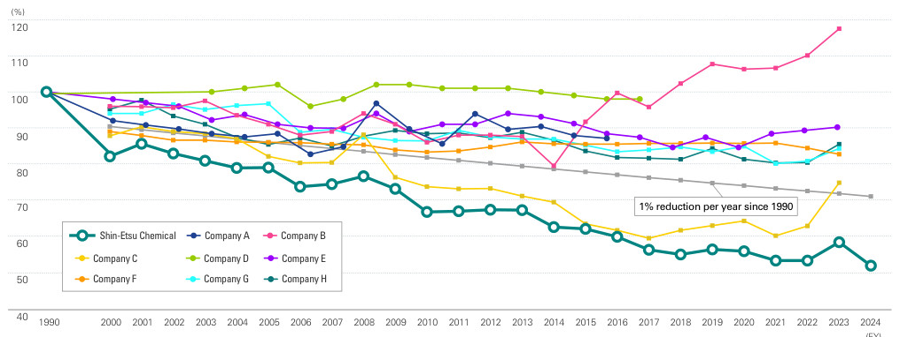 
*1 Batch production batch processes): A method in which raw materials are 
and cleaning it during downtime. 
Cote) 
奶 maintenance. 
*3 Neural network: A machine learning model that uses Al to process data in a ' esss from the output 
*Source: Pubished materials from each company oneio otd n? Energy consumption is converted to crude oil equivalent 
(FY)

---

<!-- 原文第 21 页 -->

Shin-Etsu Chemical Co., Ltd. Annual Report 2025 
Sources of Our Competitiveness Management Foundation Sustainability Data Section 
20 
## Manufacturing Capital 
## Special Fature The Pursuit of Efficiency Never Ends | Employee Roundtable 
Employee Roundtable Engineers Discuss the Future of Manufacturing 
Our future manufacturing is built on more than 30 years of rationalization efforts 
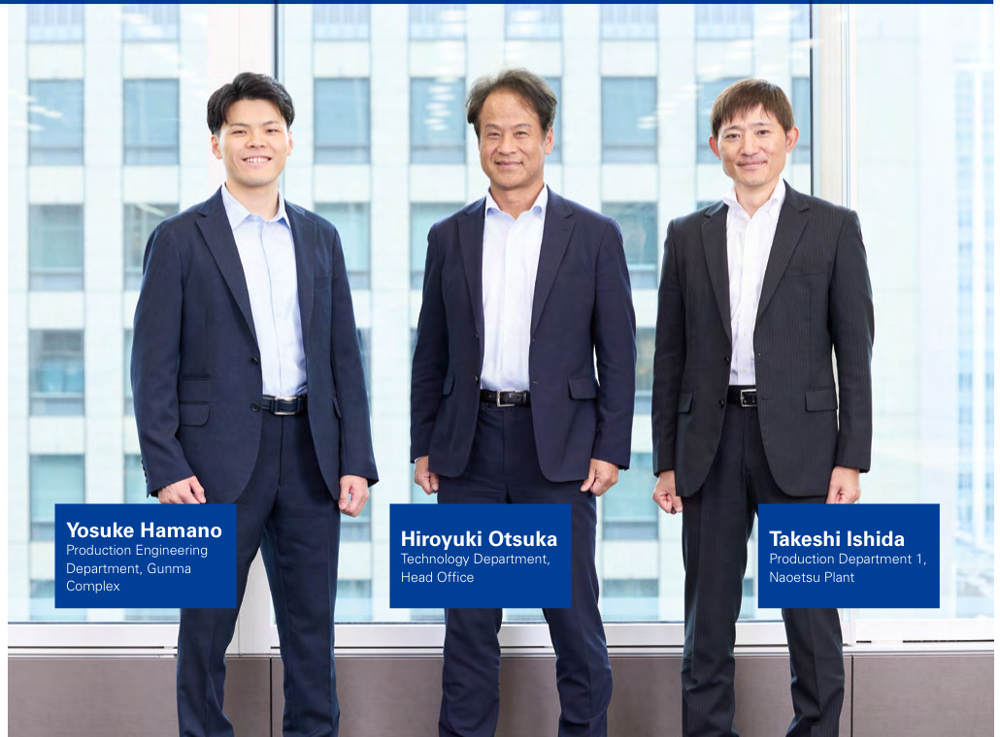 
## Past Initiatives of the Rationalization Committee 
Ishida The Naoetsu Plant's Production Department 1,where I work, has been in operation for over 60 years, and over that period, it has focused on a variety of themes and worked to rationalize is perations and improve its productivit, For older plants,the issue is not simply replacing aging equipment with new equipment, but how to implement these upgrades in a way that enables continuous improvement.Fo example, we have been able to achieve both energy savings and reductions in greenhouse gas emissions by coming up with creative engineering designs such as redcing letict consumption through effective use of waste heat (which can be recovered and used to generate steam) and waste cold from the manufacturing process. 
Such efforts require more than just desktop calculations; verification at an actual plant is indispensable. 
To verify the validity of or designs, we gather analysis data from sampling along with daily monitoring data. Even for proposed improvements that at first glance do not seem costeffective, we try to increase their chances of implementation in various ways,for example by revising the specifications or increasing the number of bidders on the project. When it comes to achieving results in rationalization and productivity improvement, I believe the key requirements are familiarity with the worksite, flexible thinking,and tenacious research. 
## Otsuka I work at our head office in the Technology 
Deparment,which is eponsible for promotng ationaliza tion,quality control, facities management,energy saving. and automation at each plant. While the actual implementation is done at the factory level,we at the Technology Department coordinate and share information from the head office across various plants to support their activities. My main theme is the promotion of automation, and I am working on integrating Al and DX into our worksites. 
In my work on utiling At to ationieprceses,one of the challenges I faced was that Al by itself could not identify defect causes and predict breakdowns.The Al mere indicates correlation, while determining causation requires technical knowledge of engineers. For example,when we

---

<!-- 原文第 22 页 -->

Shin-Etsu Chemical Co., Ltd. Annual Report 2025 
Introduction Business Strategy Sources of Our Competitiveness Business Activity Management Foundation 
Sustainability Data Section 
21 
## Manufacturing Capital 
## Special Fature The Pursuit of Efficiency Never Ends | Employee Roundtable 
tried using Al to predict the failure of rotating machinery, it didn't work well,bt twe fnal ound d luin tuh hypothesis and verification based on domain knowledge (expert knowledge in a specialized field).In the future,Al may well acquire all the knowledge we have, but the final decision wil remain in the hands of people. Rather than bindly looking to Al for solutions, the key to rationalization is to understand the nature of the technology and to make decisions based on fundamental principles. 
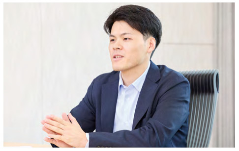 
Hamano I have been involved in the implementation of Al and DX at the Gunma Complex.In connection with this,as pa of our efforts at rationalization and productivity improvement, we constructed an Al model that predicts physical property values based on experimental data and operating conditions, and utilized it for optimization.This allowed us to shorten the investigation period, which traditionlly toe r, u two months.This is the power of AI. The challenge in this case was how to prepare the high-quality dataset required to create a highly accurate model.We reviewed the existing data and conducted additional experiments to filin n gas.We also incorporated simulation data and data published in the literature to improve the quality of the data, and as a result, we succeeded in constructing a practical AI model 
and DX.In addition to utiizing MI (material informatics)and 
PI (process informatics) in both research and manufacturing, I would like to incorporate Al models into areas such as monitoring and controling production lines, as well as predictive maintenance",to achieve automation and efficiency. 
However, since it will take time for all employees to become adept at using Al, it vilit essnco mulate successful case studies of Al utilizatio to incease interest. In the future,I would like to serve as a bridge between chemical industry and AI by taking on the role of an "AI consultant"who visits departments facing challenges and helps resolve them. 
## Background to Shin-Etsu Chemical's longstanding rationalization activities 
*Predictive maintenance: A method for predictig the mintnereqpred to prevent equipment falure. 
Otsuka The Rationalization Committe's effots began in 1992 and have continued for more than 30 years. I believe the reason why the Rationalization Committee has been active for so many years is because its rationalization activies are caried out from both bottom-up and top-down perspectives. In other words, one of our major strengths is the combination of our abilit to propose solutions at the worksite and our management team's understanding of technology. 
In particular, our system for evaluating the benefits of rationalization quantitatively from the perspectives of both actual and expected values,and then setting and tracking goals at the deparment level, supports a sense of satisfaction and a desire for continuous improvement at each worksite Furthermore, the quality of our rationalization activities has increased because top management makes decisions based on scientific and technological principles and gives precise instructions to the engineers, which makes them more likely to follow through. 
Ishida From a top-down perspective,I fee that tis so important that the ingquisitive spirit and attiude of the top management has been deeply ingrained in the engineers. Rather than just sending out messages, top management offers direct advice and fedback on proposals from the field at hearing sessions and meetings, which boosts the morale of the engineers.This direct,face-to-face communication inspires a sense of responsibility to " get it done" in the recipients,which is what sustains the activities. Another important element supporting these rationalzation activities is that a corporate culture has taken root that follow up on issues raised and sees them through to completion. 
Hamano I also believe that one of the reasons the Rationalization Commitee activities have continued for so many years is the Company's deeply rooted corporate culture of "learning by doing" We have many people with the mental flexibility to apply insights gained from past themes to new challenges, for whom rationalization and new challenges are inseparable like the wheels on a car. In addition,when employees tackle multiple challenges, their energy becomes contagious, stimulating those around them and inspiring a positive chain reaction of commitment to excellence.I feel that such an environment enables continuous improvement. 
Ishida I am also focused on the utiliation of AI.I beieve that going forward the Ratinalization Committeeshould work on the utilizatin of Al at our manufacturing sites, specifically in the areas of fully automated operation and predictive maintenance. If full A-based automation could be implemented in a continuous chemical production line, it could be expected to reduce manufacturing inconsistencies caused by human involvement and bring about rationalization in many areas, including stabilizing quality,saving energy. 
## Future themes to be addressed by the Rationalization Committee 
Hamano In terms of themes that the Rationalization Committeshould address going forward, I belleve that it is important to further promote operational reforms using AI

---

<!-- 原文第 23 页 -->

Shin-Etsu Chemical Co., Ltd. Annual Report 2025 
Introduction Business Strategy Sources of Our Competitiveness Business Activity Management Foundation 
Sustainability Data Section 
22 
## Manufacturing Capital 
## Special Fature The Pursuit of Efficiency Never Ends | Employee Roundtable 
and reducing greenhouse gas emissions. Similarly, in the area of equipment maintenance,introducing Al-based anomaly detection and condition monitoring would allow us to prevent sudden equipment failures before they occur, ensuring stable operations while reducing costs.I believe that by accumulating technology in-house and sharing success stories,we will be able to accelerate rationalization across the entire Company. 
Otsuka From my perspective in the Technology Department at the head office,given that the manpower available at each plant is limited, one of our responsibilities at the head office is to eliminate any unnecessary tasks. Therefore, in terms of themes that the Rationalization Committee should address going forward, I hink it is important to support the opera tional effiency initiatives led by the head office. 
At our worksites,there is a trend towards increasing paperwork for safety and management reasons, which is creating a heavy burden. By utilizing generative Al to automate document creation, hope to reduce the workload on-site and create an environment where people can focus on their core tasks. 
Furthermore, as securing human resources becomes more challenging.promoting automation is essential however, the adoption of Al and DX requires a certain level of literacy in those domains. Therefore,it is important to train our employees and raise their baseline level of knowledge at the same time. On the other hand, adopting Al or DX should not be an end in itsel.Intead of treating these technologies as a black box, it is important to understand the fundamental principles underlying them.The goal is to achieve continuous, sustainable improvement without losing sight of the core purpose of rationalization. 
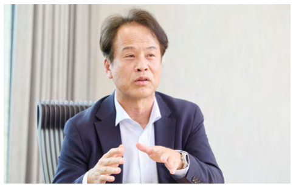 
I Passing on skills to the next generation Otsuka Passing on skills o te next generation has become a major issue in the Japanese manufacturing industry. It's fair to say that our Company faces the same challenge.When it comes to skils used in manufacturing, simple equipment oper ations can be passed on using standard operating procedures and manuals,but passing on know-how that is difficuto put into words remains a challenge. 
In the future,it wi b ecessay o create manuals in video format and incorporate the know-how itself into the automation system.To achieve this,I believe it is ssental to raise the level of Al and DX literacy across the entire workplace and create an environment in which everyone can understand and utilize these skills used in manufacturing 
Hamano When it comes to transferring skills sing AI, simply presenting examples is not enough. What's imprtant is that everyone feels that they can do it, and that they work in an environment where they can put it into practice immediately when they become interested. Therefore,we have developed an in-house system that makes it easy to build Al models as long as there is data.Even if we are unable to create a highly accurate moel, we may find a clue to solving the problem in the process of reviewing the data.In fact, our "consulting-based" support,which demonstrates Al-based solutions to on-site problems right in front of employees, has inspired some of them to develop a greater interest and motivation to learn about Al. I believe that creating such an environment will lead to the robust transfer of skills. 
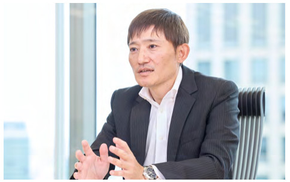 
Ishida The traditional culture of "learning by watching" that has often been used to pass on skill is becoming less and less applcale in moder times. In the future,passing on skills will erquire preparing not only design documentation and operating manuals but also instructional materials that are visually easy to understand, such as videos As Mr. Otsuka and Mr.Hamano mentioned, the Company is also moving forward with the adoption of Al. I believe that actively integrating Al into our manufacturing sites will be essential for further rationalization.On the other hand, as the reliance on Al increases, there are concerns that the skills, knowledge, and intuition of human workers may decline, potentially leding to problems in responding to emergencies. To dispel these concerns, I believe it is important to maintain basic skills by repeatedly ducating employees on the fundamentals and principles of science and engineering.I believe that having workers continue to think for themselves on-site based on these principles will led to effien skilsl asfer and further advance our rationalization activities.

---

<!-- 原文第 24 页 -->

Shin-Etsu Chemical Co..Ltd. Annual Report 2025 
Introduction Business Strategy Sources of Our Competitiveness Business Activity Management Foundation Sustainability Data Section 
 
23 
For mare inomatin please se te Peple en sesetiono hn htii s 
https://www.shinetsu.co.jp/en/sustainabilit/esg_social/ 
 
## Basic policy on human resources strategy 
We aim to further improve labor productivity.To this end, we have set operating income per employee as a key indicator and are focusing on developing "-shaped human resources" who can achieve high productivity. A "T-shaped human resourc"is someone who is an expert in a certain task or field, but also has a wide range of work skills that allow them to excel in other fields. To develop these T-shaped human resources, our human resources development efforts are based on a foundation of on-thejob training (OJT).We place employees into jobs with a sense of respect for their aptitude and professional aspirations, and we support each employee to become a true expert in their assigned job. For this reason, the Company does not implement onesize-fits-all personnel transfers or so-called routine reas signments. By having employees thoroughly study the work they are responsible for, we focus on developing employees with high levels of work ability. 
Human Capital 
Human capital investment*1*2 
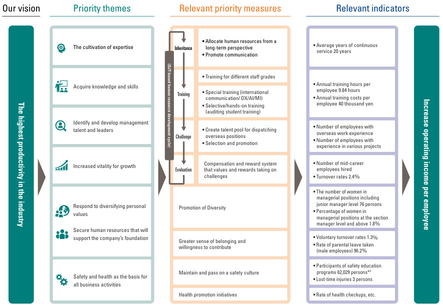 
*1Scope: Employees and seconded employees of Shin-Etsu Chemical Souesi e a "

---

<!-- 原文第 25 页 -->

Shin-Etsu Chemical Co., Ltd. Annual Report 2025 
Introduction 
Business Strategy Sources of Our Competitiveness Business Activity Management Foundation Sustainability Data Section 
24 
## Human Capital 
0JT-based human resource development program Empowering employees to grow 
In addition to OJT, the Shin-Etsu Group offers a variety of training programs to employees for different stages of their growth. Specificall, te Group supports employees' growth through various training systems, which include training for different staff grades, global communication training,an auditig student system,environmental education, safety education, mental health educatin, and Al training. Our training for different staff grades defines the skils that are required at each level of the organization including management, leadership,communication,and problem-solving skills. Furthermore, because the Groups 
Training system list 

| | Training for | | | Specialized education | | | Environment and safety education | | | Quality | Special education | General education |
| --- | --- | --- | --- | --- | --- | --- | --- | --- | --- | --- | --- | --- |
| different staiflgrades | | | Patent trining Training for adaptation to intemationalizaion English language trairing ·Meting skills course VIl ·Presentation sils course VIl | Al management training | MI training | control education | Mental heaih 8eminars ·Self-care \*Line-care ·Human rights awareness taining |
| General manager level | Advanced S staff group/ management M staff group traning | | Job group change training | DX management training | MI\* training ·Advanced \*Inemediene ·Beginner | Specisleed educatin in errermental control end saleey ·Superisor education ·1S0 education | | Enironenta heath and safety | | |
| Section manager level | Midde management training | | | educaton Hacardous materials safety education Industriall Salety and Health Act Radiation High pressure gas Mano pressure. bailers,ete. | | Course for management dervelogment traning lecerral trainingl |
| Junior manager level | Line management training | Staf managment training | training ·Basic training ·PBL+2 | QC intemeate cours | |
| Regular employees | Mid-career emgloees | | ·Chinese Donersation Classes \*Interculural communication training | Onboarding training for new emeloyees | | |
| Women cmployees | | QC besic CDuse | Auditing |
| Junior leader tr aining | | New recruit ducation | | | student system lone year |
| Third-year trairing | | | | | | | |
| New employee inuction 8ecnd-phase raining | | | | | |
 
business partners are spread around the world, with overseas sales now accounting for approximately 80% of consolidated sales,we also provide comprehensive training in meetings and presentations using English as the common language to ensure smooth business operations. 
## Focus on Al and MIl training 
The Group is also focusing on its training programs to discover and develop human resources capable of utilizing AI. In FY2024, 194 employees participated, and in the four years since FY2021,a total of 994 employees have participated.We also offer training in materials informat ics (MI) with the goals of developing personnel capable of utilig machine learning for material exploration and shortening R&D time.In FY2024,49employees participated, and in the four years since FY2021,a total of 185 employees have participated. 
## "Domestic study abroad program" to strengthen on-site capabilities 
The Company has estabished a system for sending employes to nivratis saing tdtnts or oe year with the goal of improving on-site capabilities at each workplace. The program is similar to a study abroad program, except that the students stay in Japan. Each year, up to about ten employees are chosen, mainly operators from plant manufacturing sites, and sent to universities, where they not only acquire specialized knowledge, but also network with people from other businesses and plants that they otherwise may not have much contact with in their daily work.Many of the graduates go on to play key roles in their workplaces. 
Training hours per employee (Shin-Etsu Chemical) 
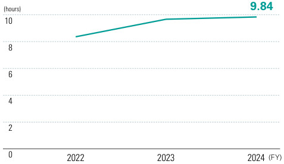 
Scope: Employees and seconded emplovees of Shin-Etsu Chemical Note: The audingstudent system was resumed in FY2023 and the hours spent on the program has since been included in the training hours. 
*1Material Informatics *2 Problem-based Learning

---

<!-- 原文第 26 页 -->

Shin-Etsu Chemical Co..Ltd. Annual Report 2025 
Introduction Business Strategy Sources of Our Competitiveness Business Activity Management Foundation Sustainability Data Section 
25 
## Human Capital 
0JT-based human resource development cycle 
## Performance-based personnel evaluation system 
The Group has introduced an employee evaluation system that emphasizes their ability and work performance.This system aims to increase employees' motivation by reflecting their performance and attitude in the benefits that they will receive,and evaluates how they meet their challenges to achieve higher goals. Employees set ambitious work goals and improvement targets at the beginning of each fiscal year,an are then enouraged to row by chalenqing themselves to achieve these goals. Supervisors provide advice and guidance to help employees achieve their goals At the end of the fiscal year, employees are evaluated on the cegree to which they have achieved their goals. At the same time, employees'abities, potental for growth,and attitude toward their work are taken into consideration to boost their motivation. 
## Fair and transparent evaluations 
To manage the personnel system in a fair and appropriate manner, evaluation training is provided for all managers who conduct performance review,so that they can carry out personnel evaluations fairly. Transparency is increased by informing evaluation standards to employees. In addition, there is a system of interviews between an evaluator and a direct report to ensure that they can communicate successfully. During interviews, each staff member and their immediate supervisor use Communication Sheets to ensure mutual awareness of expectations and set half-year goals. Furthermore, feedback on progress is given for further development of skill 
T-shaped human resources to support high productivity 
One of the major factors supporting the Group's high productivity is the development of human resources with "T-shaped" skills who can perform a wide range of tasks while possessing deep expertise in thei repctive departments and fields. As each individual continues to pursue more efficient and leaner ways of working, they acquire highly practical and specialized knowledge an buil wide-ranging cooperative relationships in carrying out their work. Utilizing the T-shaped human resources developed in this way allows the Company to maximize economies of scale during periods of strong demand while comfortably handling a wide range of tasks during periods of low demand. As a resul, the average growth rate of the Group operating income in recent years has exceeded the average growth rate of the number of employees, which means the productivity per employee has also increased. 
Operating income per employee(Shin-Etsu Group) 
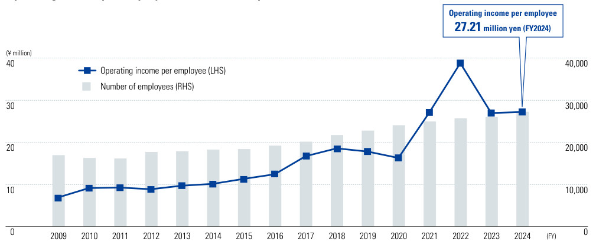

---

<!-- 原文第 27 页 -->

Shin-Etsu Chemical Co., Ltd. Annual Report 2025 
Introduction Business Strategy Sources of Our Competitiveness Business Activity Management Foundation Sustainability Data Section 
26 
## Human Capital 
## Promotion of diversity 
Japan has a declining birthrate and an aging popula tion,and the workingage population is decreasing year by year.In order to sustain corporate activities, it has become essential to utilize a diverse workforce, regardless of age or gender. The Group also employs people of a wide range of nationalities and backgrounds,which is essential from the perspective of expansion of global business domains, diversification of business operations, and innovation in digital technology. 
The Group is committed to the participation and advancement of women and aims to create a workplace where diverse human resources can contribute to the best of their abilites.We are also focused on local recruitment overseas as well as the hiring of foreign nationals living in Japan so that we can expand our business glob ally. Meanwhile,we have created employment environment that can accommodate employees aged 60 or older ensuring that skilled workers at manufacturing sites can make use of their skills and experience and pass them on to the next generation. 
## Initiatives for work-life balance 
The Group places the highest priority on ensuring the stable employment of its employees. Because we believ we can grow when employees feel secure in their jobs, do good work, and achieve good results. Based on this idea, in addition to properly managing working hours 
## Employee engagement 
Employee awareness survey 
In 2022, we conducted an employee awareness survey on a range of items including: compliance, customer orientation, penetration of management philosophy, Company's future prospects, personnel system,career 
## Hiring ratio of men to women 
Goal Gender-blind hiring 
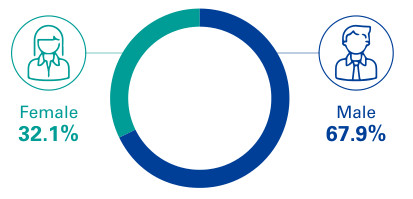 
2024 
Scope: Shin-Etsu Chemical and its consolidated companies 
and creating an environment where it is easy to take paid vacation,we have put in place systems that allow employees to deal flexibly with various matters that occu in their lives, such as marriage,childbirth, childcare,treat ment of illness, and nursing care. These initiatives have inspired a greater sense of belonging among employees and a greater willigness for employees to voluntarily contribute to the growth of the Company. outlook, workload, work environment,and relationships with superiors. The response rate was 86.5%.One survey finding in particular was that the Company's policy of emphasizing compliance had spread widely among employees. Based on these results,we will continue 
Percentage of women in managerial positions at the section manager level and above 
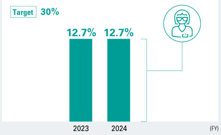 
(FY) 
## Proper management of working hours 
The Group aims to raise awareness about managing working hours, and create highly productive workplaces. To this end,we are proactively introducing a system to accurately track working hours through systems such as smart cards for the security gate at the plant entrance and employee PC logs. In addition,we are promoting the development of systems and working environments that enable flexible and highly productive work styles,such a the flextime system and telecommuting 
our efforts to make more employees feel fulfilled in their jobs, while further developing the areas where we excel and improving areas that need improvement.

---

<!-- 原文第 28 页 -->

Shin-Etsu Chemical Co., Ltd. Annual Report 2025 
Introduction Business Strategy Sources of Our Competitiveness Business Activity Management Foundation Sustainability Data Section 
27 
## Human Capital 
Maintain and pass on a safety culture 
Creating safe and comfortable workplaces Aiming to prevent all srious and lost time accidents,th Group conducts risk assessments to comprehensively identify risks that could lead to injury or illness and is working to create safe and comfortable workplaces by eliminating or minimizing risks. 
Changes in lost-time injury frequency rate 
 
"Rate of recordable injunes per milin huns wred 
## Accident prevention initiatives 
As a bottom-up initiative implemented at each worksite. the Group accepts suggestions from and listens to the concerns of workers who have experienced close-call incidents themselves and employs measures to address even the slightest of concerns. At the same time,by sharing the information within and outside of the Group, we strive to roll out safety measures as well as preventive measures for similar incidents. 
Participants of safety education programs (Total number of persons) 

| | FY2020 | FY2021 | FY2022 | FY2023 | FY2024 |
| --- | --- | --- | --- | --- | --- |
| Shin-Etsu Chemical | 32,527 | 39,348 | 59,343 | 70,952 | 62,029 |
| Consolidated companies | 46,998 | 56,236 | 75,406 | 87,349 | 78,887 |
 
Plese vist the lingwbit a o e p n s eo s https://www.shinetsu.co.jp/en/sustainability/ esg_social/safety/ 
## Physical and mental health of employees 
In addition to encouraging regular health checkups,we actively provide health guidance on lifestyle-related diseases, take mental health measures, and hold events to improve physical fitness so that our employees can work at peak health and energy.We 've also prepared countermeasure manuals agains important infectious diseases including COVID-19 so we can prevent their spread. We've set up heath committees at the head office and branch ofices, as well as safety and heath committees at each plant site. These committees get infor mation and guidance from industrial physicians and are working to improve the work environment and promote health. Furthermore,we offer an outside Family Health Consultation Service with our health insurance union and an affiliated insurance company. It is available 24 hours a day and can also be used by the family members of employees.

---

<!-- 原文第 29 页 -->

Shin-Etsu Chemical Co., Ltd. Annual Report 2025 
Introduction 
Business Strategy Sources of Our Competitiveness Business Activity Management Foundation 
Sustainability Data Section 
 
28 
# Human Capital Our Sustainable ACT 
The "ur Sustainable ACT" sectian of the Shin-Esu Chemical Sustainabiy wbsite eplains the various niaivsand goals that suport the Groups sustainabilit, Here are somesnippets fram the employe intervievs posted an the site 
Shin-Etsu Chemical Sustainability website "Our Sustainable ACT https://www.shinetsu.co.jp/en/sstalnabilityintrview 
 
Ms. B.C. Enviranmental and Regulatory Specialist Shin-Etsu Silicones of America,Inc. 
Interview 01 
Interview 02 
 
## Building a system where all employees contribute to reducing environmental impact 
Shin-Etsu Silicones of America, Inc.(SESA) is engaged in many projects to reduce waste and air and water pollution. For example, in accordance with the Resource Conservation and Restoration Act (RCRA),we have installed a triple rinse station for empty pails and drums. Rinsing the containers allows us to rinse and recycle our metal containers that previously contained hazardous materials, rather than disposing of them. We have also initiated a collaboration with an external partner to recycle a portion of silicone materials that otherwise would have been wasted. ln adirio, yproperly managing our solvent-soaked wipes, we have exempted them from hazardous waste regulations set by the Environmental Protection Agency (EPA), which has reduced disposal costs and achieved significant cost savings. 
SESA acquired SO14001 certfication at allnmao turing sites in April 2025. We have been implementing environmental impact reduction activities beyond the legal requirements,and in 2023,we received an award from the Ohio Environmental Protection Agency, as well as high praise from the EPA. 
SESA is constantly growing and expanding our production output,which requires the input of more resources.On the other hand, SESA has ingrained sustainability into our company culture, and every employee, from the top down, contributes something, bringing us step by step closer to becoming carbon neutral. 
Ms.Y.O. 
Digital Engineering Department, Engineering Headquarters Mimasu Semiconductor Industry Co., Ltd. 
 
## Automating tedious, repetitive tasks to create a more comfortable and productive workplace 
I worked in the Quality Assurance Department of the Semiconductor Division for about 10 years,primarily handling tasks such as verifying and compiling shipment data. During that time, I too chicare leave for about a yea, and after returning to work, I became involved in automating tasks using RPA (Robotic Process Automation) tools.This led me to the Engineering Department, where I learned programming languages.Currently,I study ways to automate routine tasks and tedious,repetitive tasks that are done manually,an develop applications sing RPA tools and programming languages in response to requests from various departments. 
For example, in wafer processing,where the processing recipes involve intricate combinations of conditions depend ing on the specifications and grades,we created an applica tion that automatically matches over 40,000 device-specific recipes against a master database. This eliminates human error while improving yields and reducing time on task, which reduces overtime and makes work more comfortable. 
I am currently taking advantage of the shorter working hours system in order to balance my work with raising my chid. With efficiency as my motto,I am strving to liminate waste and focus on substantive work while maintaining close communication with my colleagues in order to effec. tively fulfill my managerial duties as a section chief within the limited time available. 
Mr.R.U. Interview 03 
 
Department Shin-Etsu Magnetics 
 
Philippines, Inc. 
## Preventing incidents and accidents through awareness of on-site hazards and risks 
I develop and lead the planning to ensure a safe work environment in the EHS Department at Shin-Etsu Magnetics Philippines (SMP). Specifically, we conduct risk assess ments on new processes, machinery, and work areas, and take appropriate measures to address those risks. For example, we take measures to protect employees from the moving and rotating parts of machinery and equipment, and conduct 5S workplace organization audits (the five Ss are sort, systematize,shine,standardize,and sustain).We also pay attention to the health of our employees. In addition to providing SDSs (safety data sheets) for the chemicals used in the manufacturing process, we conduct regular audits to ensure that environmental health and safety measures are being implemented in accordance with Philippine law, and we review and updte our procedure manuals. 
SMP began new risk assessment activties in 2023 with the EHS Satety Officer,the person in charge of the process, and the actual operator coordinating on a monthly basis on specific processes to identfy and assess potential risks, including thei likelihood of occurrence.I believe that ensuring all employees are fully aware of the hazards and risks lurking in their work areas is the first step in preventing future incidents and accidents. Each year, we disseminate to employees what incidents and accidents are encountered in SMP along with their root causes and corrective actions, and provide them with opportunities to discuss such root cases and corrective actions.

---

<!-- 原文第 30 页 -->

Shin-Etsu Chemical Co..Ltd. Annual Report 2025 
Introduction Business Strategy Sources of Our Competitiveness Business Activity Management Foundation 
Sustainability Data Section 
29 
Viewing R&D as a "challenge" to pioneer the future,the Shin-Etsu Group is pursuing R&D to meet the needs of the times.We also regard the results of our R&D as 
important assets and strategically manage the valuable intellectual property obtained through R&D to make effective use of it. 
Intellectual Capital 
Triparite development system and technological advantage Shin-Etsu Chemical's product development is closely aligned with customer needs, enabling us to develop and supply high-quality products in a short period of time. This is made possible by our unique R&D system based on "triparite teawork among the sales,development, and production teams. R&D centers are set up at production sites, share the market needs the sales department identifies, and work closely with the manufacturing department in order to develop products with a view to mass production. 
Meanwhile,development projects that create new value-generating opportunities are being carried out across Our researchers communicate with customers on a regular basis and work to develop products that satisfy their needs, while also collecting new technical information through joint research and development with universities and startup companies. In addition, under the strategy of maintaining a research group that is small in nmber but highly skilled team, we encourage our researchers to conduct their research with patent rights and other IP rights in mind, and in cooperation with the Intellectual Property Department, we educate them so that they can prepare documents for rights acquisition. departments under the direct supervision of the presi dent. In particular,we are focusing our R&D efforts on energy, semiconductor-related materials, optical and highspeed communications, healthcare, and materials that contribute to achieving SDGs and carbon neutrality, We are also focusing on developing innovative manufacturing processes that combine material and equipment technologies.We are constantly evolving our core production and processing technologies, including PVC polymerization technology and silicon wafer crystal growth technology. to solidify our competitive advantage. 
## Human resource development and accelerating R&D through AI,MIl,and computational science 
We also have a system in place to reward and recognize personnel who have made significant contributions to the Company in the form of patents and other inventions and ideas. 
Furthermore, to further shorten development times and create new added value,we are also focusing on the development of human resources who will be responsi ble for Al and materials inforatics (M) technologies.We are deepening our data-driven R&D efforts based on Al and MI and working to improve the efficiency and speed of material development.

---

<!-- 原文第 31 页 -->

Shin-Etsu Chemical Co., Ltd. Annual Report 2025 
Introduction Business Strategy Sources of Our Competitiveness Business Activity Management Foundation 
Sustainability Data Section 
 
30 
## Intellectual Capital 
## Topic 1 
Develop equipment to manufacture semiconductor package substrates for the back end process and pursue a new manufacturing method 
We hae developed equipment to manufacture semiconductor package substrates with a new manufacturng method subsequently to manfacturing micro-LED manufacturing system. A chiplet, in which circuits are singulated and then assembled in a package.has caught atention as a eholagy toeue the anratuig cotf ipeprane emicnctors.Tis technology requires a process to mount several chiplets on an intermediate substrate (interposer) and connect them. 
To meet this repuirement,we developed the Shin-Etsu dual damascene method, which applies the same process used in the front end of smiconductor manufatring to he ack nd package substate manufacturing, and we also develaped an cimer laser processing equipment that processes and forms wiring patterns with the same functions as an interposer directly onto a package substrate.This development liminates the need for an interposer, shortening the process and drastiall educing costs, and makes it possible to perform microfabrication that was not possible with conventional methods. 
## Topic2 
In collaboration with SCIVAX, achieved mass prduction of Amtelus, the world's smallest light emitting device for 3D sensors Shin Es Chemical has epe d atrart a as psse s e soure for 3D sensors developed by SCINAX Corpration 
SCIVAX has so far sold Platanus,an optical lens that difuses and radiates light uniformly,fo the 3D sensor ight iting uret are se in to n te taospng to improving sensor performance. Meanwhil,in recent years, the areas in which 3D sensing technlogy is utilzed have grown wider,drving demand fo igt tin eite or re i in ente na higher performance. With conventional structures,however, it was difficult to reduce the mounting area, which was a major issue. 
To solve this issue,Shin-Etsu Chemical has developed a high-hardness material that can be processed by dicing, and that has both the necessary picalpris n a sealingcapabiy to protet decs usin his ata, c(C has successfully developed Amtelus, the world's smallest light source device that incorporates the functions of Platanus_This device has achieved a significantly smaller sizecompared with conventional devices,having a mounting area of $1 ~mm^{2}$ or less, which is 10 times smaller than conventional devices, and with half or less of the thickness. 
 
Shin Etsu Chemical and SCIAX are considering xpanding the applicatins of this technology in the future to various fields, including to vital sign sensors. 
Amtelus, the world's smallest ight emitting device 
## Advanced package proposed by Shin-Etsu Chemical 
Advanced package concept 2.5D (Example of connectin utiliing inerposer) 
 
Advanced "interposerfree" package concept proposed by Shin-Etsu Chemical 
 
## Topic 3 
Only Japanese chemical company to be selected as a Clarivate Top 100 Global InnovatorTM for 14 consecutive years 
The Shin-Etsu Group protects is pain thurg ho inntyt ir is t ng intellectal prpety gt bth pann d res h a me tmee earce pat pictins related to existing and new business to avoid infingement of rights. We also staegially manage ou intlecual sst tr r lme a a t aa knowledge. At present, there are no cases where business operations are hindered by IP 
As a result of these efforts, Clarivate, a leading global provider transformative intelligence,has recognized Shin-Etsu Chemical as a Clarivate Top 100 Global lnnovator M for 14 consecutive years. The award is granted to the most influential companies and institutions shaping the global innovation landscape based on an evaluation made using Clarivate's proprietary database.Shin-Etsu Chemical is one of only nine companies in Japan to have been sletedfo co ceie years, and is the only chemical company among them 
 
Top100 Global Innovator 2025 
CClarivate

---

<!-- 原文第 32 页 -->

Sources of Our Competitiveness 
## Interview with the The goal is to build stronger barriers to entry General Manager of the Patent Department 
Q1 
Shin-Etsu Chemical's intelletual How would you characterize property strategy and the role of the Patent Department? 02 
quickly respond to rapid market changes, the R&D department has also formulated an intellectual property strategy to promote new research that will led to new business ventures across divisions. 
scored particularly high in the areas of "Influence"(lassessed through the frequency of citations by downstream patent applications) and "Rarity" lan index for measuring the distinctiveness of an invention in terms of how diverse a combination of technologies it contains compared to existing similar inventions). Our high "Rarity"score in particular is evidence to me that we are carrying out highly original, cutting-edge R&D. 
The Patent Department is responsible for advancing these intellectual property strategies and helping to secure a competitive advantage of our businesses in the marketplace through the acquisition, management,and utilization of intellectual property. Specifically, we aim to secure a competitive advantage that contributes to the Company's profitability by working closely with the R&D department to quickly and reliably acquire the rights to the results of R&D activities that create unrivaled value. 
03 
Shin-Etsu Chemical has received the Clarivate Top 100 Global Innovators TM award for 14 consecutive years. What accounts for the success of or intelctal property strategy? How has Shin-Etsu Chemical's intellectual property strategy evolved over the past 10 to 20 years? Traditionall,the Company has engaged in mainly "defensive"intellectual property activities from the perspective of ensuring business continuity and flexibility. Over the past 10 to 20 years, we have begun to actively acquire design rights to provide another layer of protection.One example is our insect pest control delivery device that diffuses insect pheromone components into agricultural fields. Another example is our stamp component for transfering microstructures, which is used to transfer microstructures such as semiconductor elements for micro LED displays. 
04 How would you develop the intellectual property strategy going forward? I would like to utilie new tools such as generative Al to improve the efficiency of various intellectual property-related tasks. In particular, I would like to work closely with the R&D department to strengthen our efforts to search for and acquire the rights to solutions that 

---

<!-- 原文第 33 页 -->

Introduction Business Strategy Sources of Our Competitiveness Business Activity Management Foundation Sustainability Data Section 
Shin-Etsu Chemical Co., Ltd. Annual Report 2025 
32 
strong relationships of trust with the local communities in which our plants are located, we place great importance on dialogue with local residents as well as governmental and municipal authorities. 
Social and Relationship 
We are strongly committed to respecting human rights, not only within the Shin-Etsu Group,but across the entire supply chain,to guarantee the stable supply of high-quality products to our customers. Furthermore,in order to build 
## Respect for human rights 
In adition to complying with the laws and regulations applicable in the countries and regions where it does business,the Group respects international codes of conduct*1 and promotes efforts to ensure perpetual respect for human rights. 
and Human Rights, and the revised policy was approved at the Managing Directors' Meeting attended by all directors,audit & supervisory board members and corporate officers.The revised Human Rights Policy has been communicated throughout the Group and is also available on our website. 
In May 2019 we formulated the Shin-Etsu Group Human Rights Policy, ln order to confim the status of compliance with our Human Rights Policy,we conduct an annual survey of our consolidated companies regarding items related to respecting human rights*, abor management, and whether employment is properly implemented in accordance with the laws and regulations of each country and region.Furthermore,we consider human rights impacts on local communities when building new plants. In May 2024, in light of changes in the social environment surrounding human rights,we reappraised our Human Rights Policy based on the UN Guiding Principles on Business 
## Assessing human rights risks and identifying priority issues 
In December 2019, we began conducting human rights risk surveys with all Group companies in Japan and abroad to identify human rights risks in the Group's value chain. Then, in 2021, we evaluated the priority of human rights issues based on the risks assumed for the Group from the two viewpoints of "the potential severity of the impact on human rights" and "our relationship with human rights-related risks." As a result, the Group identified potential risks related to health and safety and working hours as high. In addition,in an analysis of the responses to the human rights risk survey. approximately 40% of Group companies responded that human rights management in the supply chain is important, indicating the need to promote efforts to respect human rights throughout the supply chain. 
Relatinship with the Shin-Etsu Group 
Distriminstion ppressie raotent 
The three priority issues we identified are listed on the next page,along with a description of our efforts in FY2024 to address them. 
*1Examples of interational codes of conduct include the Universal Declaration 
and freedom of association and the right to collective bargaining 
 
The Shin-Etsu Group Human Rights Policy https://www.shinetsu.co.jp/en/sustainability/esg_social/ human-rights/ 
Identification of priority issues for human rights risks 
Degree ot prcrtyLow Medim High 
Working hours Health and safety 
Protection of privacy Enian 
Free choice of employnion Wages and benefits 
Negative impact on human rights

---

<!-- 原文第 34 页 -->

Shin-Etsu Chemical Co., Ltd. Annual Report 2025 
Introduction Business Strategy Sources of Our Competitiveness Business Activity Management Foundation 
Sustainability Data Section 
33 
## Social and Relationship Capital 
## ■Working hours 
■Supply chain management 
We introduced a system to accurately track working hours through PC logs and promoted the development of working environments that enable flexible and highly productive work styles. Furthermore, in line with regulatory caps on overtime work in the construction industry that took efecti F2024. we supported the efforts of applicable Group companies in Japan to reduce overtime work. 
Starting in 2022,we began sending the "Shin-Etsu Grou Human Rights Policy,"Basic Procurement Policy,"and CSR Procurement Guidelines' to our major business partners, and asked approximately 70% of our first-tier suppliers for cooperation in responding to a questionnaire to confirm that there were no high-risk business partners that were in conflict with the human rights issues that we consider serious and that fell significantly below our evaluation criteria 
## Implementation of human rights awareness education 
In addition to enforcing our human rights policy, we conduct training that addresses familiar human rights themes. The training aims to deepen the participants' understanding of respect for human rights. In addition to familiar human rights themes such as harassment, LGBTQ, and people with disabilities, the training also covers the Shin-Etsu Group Human Rights Policy and other initiatives based on the 
## Building strong relationships of trust with local communities 
We are also making an effort to build healthy relationships with nearby local communities to ensure smooth business operations in each region worldwide. 
■ Health and safety We created the"inEtsu Group Environmental Safety Management Plan, and are actively pursuing it by setting spe cific numerical targets to improve working environments. 
United Nations' Guiding Principles on Business and Human Rights. In FY2024,we conducted an e-learning program on the topic of gaining a deeper understanding of harassment (attendance rate: 95.7%). Furthermore,we are inviting sub missions for human rights awareness slogans in preparation for Human Rights Week in December, aiming to enhance our employees' awareness of human rights. 
 
Employees attending human rights awareness education 
## Topic 
The president visits the governor of Louisiana in July 202,President Satch visie covemor f rny wa a a e o te t s to confirm that the cooperative relatinship between Shintech and the State of Lousiana will continue and be further strengthened 
Shintech's Adis Plant began operations in Louisiana in 2000, and the Plaquemine Plant started integrated production from raw materials in 200.Since then,we have built good relationships with successive Louisiana govermors while continuing to make large investrents in the state At their meetin,President Sait reguset conine peratin ro the t goement fofrhr busiessninn the future, and the Governor xprese postv wrsof upon pctin in and employment. 
 
The president far let visig overnor Landry(second from left)

---

<!-- 原文第 35 页 -->

Shin-Etsu Chemical Co..Ltd. Annual Report 2025 
Introduction Business Strategy Sources of Our Competitiveness Business Activity Management Foundation Sustainability Data Section 
 
34 
## Climate change 
Natural Capital 
## Initiatives aimed at carbon neutrality 
The Shin-Etsu Group has developed and is moving forward with a plan to reduce greenhouse gas emis sions (Scope 1 and Scope 2) to net zero, with the aim of achieving carbon neutrality by 2050. 
The Group is investing in the construction of new plants and expansion projects to drive growth in each business, while simultaneously focusing on maximizing productivity and energy efficiency. A prime example of this is the new facility at Shintech Inc., which was completed and started operatin in 2024. It is difficult to reduce the CO2 emissions associated with new facilit expansion to zero with cur rently available technology. Therefore, while striving to continuously improve the productivity and energy efficiency of existing plants,we are actively adopting the latest energy-saving equipment and cogeneration systems at new facilities. In addition, as outlined under"Initiatives Aimed at Carbon Neutrality" below, we are aiming to achieve carbon neutrality by 2050 by taking measures such as installing solar power gener ation facilities, utilizing hydrogen and biomass fuels, and building recycling systems. 
## Topic 
Reducing greenhouse gas emissions by deploying renewable energy in Thailand 
Thre Sin tsu group companies in Thaind- Sin tsu sicne Taiad,tdid iiis io Ltd.,and Shin-Etsu New Materials (Thailand) Ltd.--will tat receiving renewable energy in 2027 from a biomass cgeneration ystem frm M-G Energy Solutions Thaind Ld, i nturn euee Nippon Steel Engjnering Co, t. and osaka Gas Co, Ltd. NSET will isal,.perate nd manage the facity on the premises of Shin-Etsu Sicns Thaln ,t ing i cue c lrl /ds fuel, the facity wi ggerte ewale energy in the form of electricity and steam, which will be suppled to all three companies. This initiative is expected to reduce emissions by approximately 48,000 t-COper year. 
For more inomation,please se the ewient sationon the thn teia stii http://www.shinetsu.co.jp/en/sustainability/esg_environment/ 
 
Climate Change an ur susta naility website https://www.shinetsu.co.jp/en/sustainability/ esg_environment/global warming/ 
 
Initiatives aimed at carbon neutrality 
Yeur 2025~2030 2030~2040 2040~2050
Reducing onissions inciwor

l Ta d 
Smisching fenls

I Ulation al havsel
 Usleation af as

一
(15)hcrad s charcoal nedaing agrta
[1s)Trin o w naltri pacee
CC (Carbea saptwre and wsladionl
(17daaiaa
Promotin ot e ying

(2Cheradac
Other
 
Rseart.sg doepert 
Cora t ogss 
Conceptual framework of the project scheme 

---

<!-- 原文第 36 页 -->

Shin-Etsu Chemical Co., Ltd. Annual Report 2025 
Introduction Business Strategy Sources of Our Competitiveness Business Activity Management Foundation Sustainability Data Section 
 
35 
## Natural Capital 
## Initiatives Aimed at Carbon Neutrality 
## Amount of reduction of greenhouse gas emissions 
The Group has set a target of reducing greenhouse gas emissions in terms of production intensity to 45% (.e..,don 5%) of the FY1990 level by FY2025. FY2024 results were 56.9% (down 0.1 points year on year) compared to FY1990 for the Group and 48.6%(down 4.8 points year on year compared to FY1990 for the Company. 
Scope 1 emissions were 2,326 thousand t-COz (up 84 thousand t-CO2 (3.7%) year on yearl and Scope 2 emissions were 4,443 thousand $t- CO_{2}$ (up140thousand $t-CO_{2}$ (3.3%) year on year). 
## Greenhouse gas emissions by scope 
The Group's Scope 3 greenhouse gas emissions*1 for FY2024 were 12,096 thousand $t-CO_{2}$ amounting to 64% of the supply chain*2's total emissions. 
*1 Scope 3:Emissions from the suply chain 
*2 Supply chain: All stages of a product life from raw material production until the product is discardled. 
## Greenhouse gas emissions by scope 
 
[Nate) Because th shinrtsu rupr wuingng cues s s precisely,Sope 2emisins to 02 ave beed to t a et Annual Repart 2024 (4.266 thousand t-Col 
Changes in Greenhouse Gas Emissions in Terms of Production Intensity Relative to the FY1990 Level* 
 
"Grenhouse gas smisiinnny 
[Note) Eisin intny ef po e n e i r 200o 200 so that fot eit rt categoris associated with the amendments to Japan's rder for Enforcament of the Act on Promotion of Global Warming Countermeasures that tok fiet on Apni 1 2024. 
 
For infomaticn on Scope 3 emissions by categary and how we cakulate them, visit the Sustainability website 
 
https://www.shinetsu.co.jp/en/sustainability/esg_environment/global_warming/

---

<!-- 原文第 37 页 -->

Shin-Etsu Chemical Co., Ltd. Annual Report 2025 
Introduction Business Strategy Sources of Our Competitiveness Business Activity Management Foundation Sustainability Data Section 
36 
# Natural Capital 
## Disclosure under the TCFD Govemance 
The Sustainability Committee is working with each of the Group's business units to address climate change. The Sustainability Committee is one of the committees for each material management task in the Group's corporate governance system.The Committee is chaired by the President and consists of approximately 60 members, including our directors, corporate officers, department managers, and sustainability officers from Group companies, and promotes activities that integrate business activities and sustainability initiatives. 
In FY2021,we established a Carbon Neutral Task Force within the Committee toexamine each issue related to climate change. The Task Force regularly reports the latest information to the President, who uses this report to determine policies for achieving carbon neutrality.In FY2023, the Task Force formulated a specific plan for achieving carbon neutality by 2050,which was discussed and unanimously approved at the Managing Directors Meeting,which is attended by all directors, audit & supervisory board members, and corporate officers. Subsequently, the Task Force has been reporting on the Group's climate change-related initiatives at the Managing Directors' Meeting on an annual basis. 
## Strategy 
The Group considers the promotion of plans to achieve carbon neutrality by 2050 as an important management issue, and is therefore promoting information disclosure based on the TCFD recommendations, including scenario analysis. At the same time, through this analysis,we identify important risks and opportunities that affect our business through these analyses, and reflect them in our management. 
## Risk management 
The Risk Management Committee works to prepare for and eliminate the various risks surrounding our business, including risks posed by climate change. The Committee is chaired by a managing corporate officer and consists of approximately 20 members, including our directors, corpo rate officers, and department managers. 
Our Group has established Risk Management Regulations to identify potential ris associated with our business activities and address these risks appropriately. The Risk Management Regulations clearly state specific risks, risk management systems, and responses to risks that materialize.The Risk Management Committee reports to the Board of Directors, Managing Directors' Meeting, Audit & Supervisory Board, and relevant parties in a timely manner on important risk management issues,and works to address them appropriately. With regard to the risks related to climate change, which have become increasingly important in recent years, the Sustainability Committee works with the Risk Management Committee to ascertain risks through scenario analysis. 
Climate-related risks include transition risks such as increased spending due to CO2 emissions trading and carbon taxes and rising manufacturing costs due to rising energy prices, as wellas physical risks such as damage to equipment due to the wind disaster,damage to electrical equipment due to flooding, and plant shutdown resulting from such cases. 
## Metrics and targets 
The Shin-Etsu Group has formulated a long-term plan to reduce greenhouse gas emissions (Scope 1 and Scope 2) to net zero,with the aim of achieving carbon neutrality by 2050. In FY2024, Scope 1 emissions were 2,326 thousand t-CO2 (up 84 thousand tons or 3.7% from the previous fiscal year) and Scope 2 emissions were 4,443 thousand t-COz (up 140 thousand tons or 3.3% from the previous fiscal year). 
Meanwhile,the Group has also set a target of reducing greenhouse gas emissions in terms of production intensity to 45%(.e.down 55%) of the FY1990 level by FY2025. FY2024 results were 56.9%(down 0.1 points year on year) compared to FY1990for the Group and 48.6% (down 4.8 points year on year) compared to FY1990 for the Company. In FY2024,we continued to promote energy-saving activities at each of our business sites.

---

<!-- 原文第 38 页 -->

Shin-Etsu Chemical Co., Ltd. Annual Report 2025 Introduction Business Strategy Sources of Our Competitiveness Business Activity Management Foundation Sustainability Data Section 
37 
## Natural Capital 
Disclosure under the TCFD 
Scenario analysis of our business in 2050 
Business opportunities stemming from climate change: A scenario for a 1.5°Crise 

| Application | Details | Revenue Impact |
| --- | --- | --- |
| PVC-framed windows | Polyinyl chloride resin is sed for windov profiles resin windows because of its excellent heat insulatian properties. Demand for PVC-framed windows is expected to increase along with the spred of energy-saving homes. | Large |
| Electric,hybrid, and fuel-cell vehicles | Semiconductor silicon is used in power semiconductor devices such as inverters to control the number of rotations of motors,logic semiconductor devices for automatic driving ystem and AI Migh pefomane and compact rare earth magnets can reduce the overall weight of a ehice and iprove its uel efienr, which will e pand their se i thedive motors of lectic, hyord, and fuel cell vices as well a e a t no t ro r ies. Silicone heat-dissipating materials are used in itium in batis an yarious electronic control devices. Demand is expected to grow as it heips prevent malfunctions and failures caused by heat. | Large |
| Wind power generators | Demand for rare arh magnets is expected to grow as they contibute to higher efficiency in offshore wind turbines and lower maintenance costs for genera- tors. Demand for polyvinyl chlonide used for wire sheathig is also pected to increase due to the development and expansion of the power grid. | Large |
| Air conditioners | Demand for semiconductor silicon is xpanding as it is used in imverter control devices for compressor motors and contributes to power saving by adjustin the rotatian sped of the motor to an appropriate level Demand for rare arth mag nets is eapected t grow s hey imprve the enerey icicyo af n tonn compressor motors and reduce energy consumpticn. | Medium |
| Aircraft | Rare earth magnets are indispensable for the electrificatin and hybridization of small airat and for the lecticaionof yraie die uisi g aircraft Demand for rare earth magnets is xpected to increase as their small size and high power will hep educe th weight of the airat and iprove fuel efficiency. | Medium |
| Industrial motors | Demand for rare earth magnets is expected to grow as they increas the effciency of industrial motors and redue the amount of electicity consumed. | Medium |
| Service robots | Semiconductor silicon is increasingly being used in semicanductors for energy-saing rcbot control motors for manufacturing.logistics,agrtutur,and other applications,as well as in medical and disaster response robots. | Medium |
| Binding agent for plant-based meat substitutes | A diet centered on plant-based foods may reduce COz emissions by 1.6 gigatons per year.Cellulose derivatives are used as a binding agent for plant-based meat substitutes. The globa market for plant-based meat is expected to grow at a double dgit at aland r thr a te epen sion is expected. | Medium |
 
Source:"DRADOWN-Th Mot Compreive Plan Ever Proposed Reerse lol Waingwriten and edited by Pl k 
Business risks due to climate change and counte rmeasures: A scenario for a 1.5°C rise (transition risk) 

| Events | Risks to the Company | Revenue Impact | Countermeasures |
| --- | --- | --- | --- |
| Introduction of carbon taxes and establishment of carbon emission quotas around the world | Payment of carbon tax Incurring costs of purchasing emission credits to meet carbon emission quotas ·Increase in cost of measures to reduce greenhouse gas emissians | Large | Reduce scape 1 emissins eg,frhte prmroiono more eficient proutin proces an introduc tion of highly eficient equipment,use of energy sources that o not emit COz, such as hydrgen and ammania, use of CCUS) Achievement of reduction targets in the absolute amount of greenhouse gas emissions Collection of infomation on ervironmental regu- lations such as carbon taxes in each county and implementation of countermeasures |
| Widespread use of electricity derived rom renewable energy sources and rising electric ity prices resulting from ightening regulations on greenhouse gas emissions | Increase in electricity costs | Large | Reduce Scape 2 emisins furherprmotin of production processes that use less electricity. intraduction of higheficiency equipment, etc. |
 
Business risks due to climate change and countermeasures: A scenario for a 4C rise (physical risk) 

| Events | Risks to the Company | Revenue Impact | Countermeasures |
| --- | --- | --- | --- |
| Increase in the frequency of e xtreme weather events | ·Flooding of production sites ·Disruption of the supply chain | | Raising the ground level of production sits,instal latin of watertight walls around critical facilities Installation of lectrical rooms in areas with low risk of liooding |
| Increased frequency of looding caused by changes in precipitation patterns, etc. | Large | Installaiono eswl at pcioisisistos ep poss Multiple productin sites Diversification of raw material procurement sources Securing product inventory Enrollment in insurance |
| Introduction of carbon taxes and establishment of carbon emission quotas in some countries | | Small | Reduce scope emissions leg trher ramoionod more eficient prouction processes and introduction of highy efficient equipment use of energy souroes that do not emit Co2, such as hyargen and amonia use f CS) Achievement of reduction targets in the absalute amount of greenhouse gas emissions Collection of information on environmental regu- lations such as carbon taxes in each county and implementation of countermeasures |
| Electricity prices | Acconding to a scenario analysis by IEA\*(a scenaria with current mea- sures), elericity pis iiils. Therefore,there is no risk to us. | | |
 
*Intemational Energy Agency

---

<!-- 原文第 39 页 -->

Shin-Etsu Chemical Co., Ltd. Annual Report 2025 
Introduction 
Business Strategy Sources of Our Competitiveness Business Activity Management Foundation 
Sustainability Data Section 
38 
## Natural Capital Resource Saving 
Recognizing the effective use of limited resources and the circular economy as important issues,the Shin-Etsu Group is actively working to address them,with the aim of not only contributing to the global environment but also increasing our competiveness and ensuring sustainable development. 
waste of 1% or less of the final amount of all wstegener ated) at our consolidated companies in Japan.For example, the Naoetsu Plant makes effective use of unneeded paper materials discarded in the manufacturing process to make recycled paper and other products. The plant is also proactively considering ways to recycle the solvents used in chemical reaction processes and create formulations that allow them to be reused 
## Waste reduction 
The Shin-Etsu Group is promoting waste reductin initiatives at each location with a target of zero waste emissions (landfill 
Metrics and Targets FY2024 
## Resource circulation 
In terms of resource circulation,since 2007 we have been recycling magnetic powder generated from the processing of rare earth magnets. Furthermore, since March 2013,we have been improving the above recycling techniques to recycle rare earth magnets.PVC products in particular are increasingly being recycled because the impact of foreign matter contami nation is small. 

| Targets | Achieve zero waste emissions. Promote the reduction of waste generation in terms of intensity. |
| --- | --- |
| Results | The final waste landfill dispsal rate was 0.86% in Japan |
| | Evaluation The target was achieved in Japan |
 
FY2025 

| Targets | Achieve zero waste emissions. |
| --- | --- |
| Promote the reduction of waste generation in terms of intensity. |
 
In FY2024, compared to FY2023, the amount of domestic waste generated decreased by 7 thousand tons (down 6.7% year on year), and the domestic recycling rate increased two percentage points year on year to 72% 
"The sope of target for the waste reduction is Shin-Etsu Chemical Co.,Ltdt. and its consclidated companies in Japan 
Amount of waste recycled/Waste recycled ratio 
Amount of waste generated 
 
Resource Saving on our sustainability website https://www.shinetsu.co.jp/en/sustainability/ esg_environment/ 
 
 
Reducing the weight of waste for disposal 
The plant's wastewater treatment facities separate and dehydrate the inorganic solids contained in the wastewater to make a solid sludge.This sludge is treated as industrial waste by an external contractor and is put to effective use as roadbed material and the like. The Naoetsu Plant introduced a new dehydrator with superior dehydration performance, which reduced the amount of water in the waste sludge, thereby reducing the weight of waste for disposal. This has also reduced the energy required to transport the waste 
 
Dehydrator installed at Naoetsu Plant

---

<!-- 原文第 40 页 -->

Shin-Etsu Chemical Co., Ltd. Annual Report 2025 
Introduction Business Strategy Sources of Our Competitiveness Business Activity Management Foundation Sustainability Data Section 39 
## Natural Capital Water Resource Conservation 
 
The Group, which has production bases in areas with abundant water and enjoys the benefits of water resources, is actively working to improve technologies for water resource conser vatin, such as reducing the amount of water withdrawal, ensuring that water is recycled, and implementing thorough wastewater purification and water quality management. 
Metrics and Targets FY2024 

 r12024 

| Targets | Reduce water withdrawal in terms of intensit at a a wrg anal at f 1 Reuce water palradichagn te m st i a raa e. |
| --- | --- |
| Results | Intensity at the average annual atetrom 202t P202 was dereased by 7.9% in terms of water withdrawal and decreased by 8% in terms of BOD emission |
| Evaluation | The targets were achieved. |
| FY2025 | |
| Targets | Reduce water withdrawal in terms of intensity at an average annual rate of 1% |
| Reduce water pollutat discharge in terms of intnsty at an avrage annual rate of 1 |

 
 
## Biodiversity and Pollutant Counterme asures 
 
The Group conducts its business activities in a way that takes into account global ecosystems. It also strives to prevent health hazards and minimize envirnmental impacts related to chemicals throughout the processes of development, manufacturing, distribution,usage,consumption, and disposal of chemical substances. 
Metis and targets IPrevention of ar pluo FY2024 

| Targets | Reduce emissions of air polintsis tm mf asty n n rgy eo1 |
| --- | --- |
| Results | The annual average rate from FY2021 to F2024 is an increase of 1.1p in Soot in terms of intensity, and an increase of 1.3% in S0x in terms of intensity. |
| Evaluation | The targets were not achieved. |
| FY2025 | |
| Targets | Reduce emissions of air polutants n tm o enrty tn n rarg aalrte aot. |
 
Water Resource Conservation on our sustainability website https://www.shinetsu.co.jp/en/sustainability/ esg_environment/water/ 
## Water resource conservation 
Water withdrawal and the average annual rate of water pollut ant discharge expressed in terms of intensity were reduced from FY2021 to FY2024,achieving the targets that were set. 
Water usage*/Recycled ratio (Consolidated) 
 
Biodiversity and Polin Cunrm srs or sait t https://www.shinetsu.co.jp/en/sustainabilty/ esg_environment/chemical/ 
## Biodiversity 
The Shin-Etsu Group aims to design eco-friendly products starting from the product development stage. As a chemical company, we are also working actively to ensure the strict control of chemical substances, mitigate global warming, reduce energy consumption, reduce the amount of waste generated,prevent air and water polution, and make other environmental contributions. We are also actively engaged in activities such as tree planting at our plant sites in compliance with the Factory Location Act and river clean-up activities in areas around our plants. 
## Pollutant countermeasures 
Now that the revised PRTR Law has come into force, silicon carbide and other substances have been identfied as Class l designated chemical substances. In FY2023,the total amount of substances transferred under the PRTR system'* increased,but in FY2024, the total amount was 2,727 tons,a decrease of 746 tons (down 21.5% year on year).Total emissions of substances subject to the PRTR system were 183 tons, an increase of 4 tons (up 2.2% year on yean. Meanwhile, in FY2024, the Company performed groundwater and soil monitoring 260 times at its plant sites. 
## Effective use of water withdrawal and thorough water quality management 
The Shin-Etsu Chemical Gunma Complex draws almost all of the water required for manufacturing from nearby rivers.The complex recycles and circulates such water inside the complex to reuse the water in its manufacturing and watercooling processes. In addition,as a production base that is located upstream, the Gunma complex purifies the water before discharging it into the river. The Complex continually monitors the operating status of water treatment facities and conducts regular water quality analysis of discharged water to verify that it is in strict compliance with high water quality standards. 
 
Shin-Etsu Chemical Gunma Complex 
*Chemical substance release and transfer notificatin based on the Act on Confimation, etc.of elese Amounts of SpeciCemical bstanes in he Ervironment and Promotion of Improvements to the Management Thereof" 
Gross discharge of chemical substances designated under the pollutant release and transfer register (PRTR) system (domestic consolidated) 

---

<!-- 原文第 41 页 -->

Shin-Etsu Chemical Co..Ltd. Annual Report 2025 Introduction 
Business Strategy Business Activity 
Business Activity 
Leveraging our core technologies in four business fields to manufacture materials and products that underpin industries and livelihoods 
Electronics Materials 
Business Activity 
 
In addition to our world-leading share in silicon wafers, we provide various materials that are essential for semiconductor manufacturing.We contribute to the digital transformation and green transformation of industry. 
As the largest manufacturer of polyvinyl chloride (PVC) resins,a material with low environmental impact, we support infrastructure, housing, and daily life. 
Infrastructure Materials 
Specialized Services processing 
Processing & 
Core Technologies Single-crystal growing Organic synthesis, Powdering/Sintering. Electrlysis, CVD 8 PVD Polymerizatian, Plastic & Film 
Functional Materials 
Along with more than 5,000dfere ent types of silicones that support people's lives and industries,we provide a stable supply of high value-added products. These products even contribute to reducing environmental impact and alleviating food shortages. 
We meet the diverse needs of customers by leveraging processed products and engineering, while utilizing the characteristics of raw materials.

---

<!-- 原文第 42 页 -->

Shin-Etsu Chemical Co., Ltd. Annual Report 2025 Introduction Business Strategy Sources of Our Competiveness Business Activity Management Foundation Sustainability Data Section 
 
41 
## Robust Business Structure Born from Close Cooperation and Diversification 
The Shin-Etsu Group makes a wide array of products for use in a broad range of industrial fields by drawing on the production technologies accumulated in the process of continuously diversifying and improving its product offerings. By reciprocally maintaining close relationships, our business mix extends across many different fields and we have built a robust business structure impervious to economic conditions. 
 
## Business Segment 
Infrastructure Materials I Electronics Materials 
I Functional Materials Processing & Specialized Services 
*1Chemical vapor deposition (CVD) A method for deposting hin flim by chemical rectin n the substrate of precursors produced by applving energy such as heat,plasma. or igh t eor matra gess *2 Physical vapor depsition PVD) Aethod for adhering and deposing on the subsrate suace by evaporating and scatteing soid re maerais sastaieciei

---

<!-- 原文第 43 页 -->

Shin-Etsu Chemical Co..Ltd. Annual Report 2025 
Introduction Business Strategy Sources of Our Competiveness Business Activity Management Foundation 
Sustainability Data Section 
 
42 
## Infrastructure Materials 
Shintech's Vertical Integrated Manulacturing System 
Major Products 
Polyvinyl chloride IPVC) resin, Causti soda, Methano, Chloromethane, Polyvinyl Alcohol(POVAL) 
 
For product informatin, please see the campany brachure 
https/www.shinetsu.co.ip/sints/en/booine.html 
 
 
## Fiscal year ended March 31, 2025 
In the PVC business, we were able to aise picis is maioregigns in Q1(April-Junel,and we sought to maintain or improve price levels in 02 (July-September. However,03 (0ctober-December) was generally weak, athough the situation difered rom region to region, and in Q4 (January-March), we were able to raise prices in someregions but o thrs f cst ta se cs in 01, followed by a series of ups and downs, folloved by an improved market in 04. 
Performance over the past 5 years (¥bilin) 
Risks 
·Oversupply in a certain period 
 
·Slowing housing demand 
·Rise in raw material prices 

| Assets+l+2 | ¥2,327.5bn |
| --- | --- |
| Capital Expenditures | ¥114.0bn |
| Depreciation and Amortization | ¥81.8 bn |
| Number of Employees+1 | 1,975 |
 
*1 As of March 31,2025 *2These amounts were prepared on an informal basis 
## Using Our Products to Solve Societal lssues (PVC) 
Helping address the environmental challenges through reducing greenhouse gas emissions and QOL issues by improving social in frastructure for a growing population ·60% of th rawr mteiale ro ct ta a r red sean rdaocss pendent on fosilft ls a s srth e hnpf tcp pri is hstts of other commodiy plastics. 
 
·Pipes and building materials ar major aplictionio UC Phe pts hvua gn service lif tha those from other plasit puct r rmpe eeiefe pipes is around 50 years." 
 
·PVC window profles PVC framed windows have xcellet insuatinprpries hich contibuts t eg cosevation nd reduing COz emisions. 
·Pastic oilin ateaisc a aee e an te i e n t in dn ·in Japan the material reycting e ferrcrp purs p p " ii sia at n ep s 
Source: Ministry of Land nrste,.Tanspt and Tourim,and Viny Erionental oundl VEC) 
## Competitive Advantages (PVC) 
·World's argestprouctin aciy and high productivity 
·Stable qaity a gd ply 
·Favorable raw material econmics in the U.S. 
·Integrated productinp lant fom ethylene and hlorine 
·World wide production plant Three plants in the U.S..,twu in Europe,and one in Japan.) 
·Superior sales network oparated in the U.S.Eurape and Japan 
## Growth Potential (Growth Factors) and Risks of Each Business 
Growth potential (growth factors) 
·Increase in housing demand 
·Population growth 
·Infrastructure demand in emerging countries and infrastucture maintenance and renewal demand in developed countries 
·Increasin and intensiication ot natraldistss 
## Topic 
Shintech commenced new PVC production capacity Shintech Inc,a susidiany of Sin tsu in the U.S. and the world's largest PC manufacturer, has been continuously expanding its production capacity to meet increasing global dmand.The con structio of new prduction ciyt Shintech began in 2021 has been completed and started operations since the fourh quarter of 202.Shintecs annual PVC production capacity was increased by 10%and eached to.3.64 milin on n r demand in North America is expected to remain strong, supported by robust hous ing demand. We will continue to meet that demand and provide a stale supply of PVC to customers around the world.

---

<!-- 原文第 44 页 -->

Shin-Etsu Chemical Co..Ltd. Annual Report 2025 
Introduction Business Strategy Sources of Our Competiveness Business Activity Management Foundation Sustainability Data Section 
 
43 
## Electronics Materials 
Overall business 
Major Products 
Semiconductor silicon,Rare earth magnets, Semiconductor encapsulatig materials, LED packaging materials, Photoresists, Photomask blanks, Synthetic quartz products 
 
For product informatian, please se the campany brachure https/wsintsucopsintsue/boindea.html 
 
Rare earth magnets 
## Fiscal year ended March 31, 2025 
In the semiconductor market, recovery from the adjustment phase varied depending on the application and feld. In this environment, we focused on the shipment of semiconductor materials such as silicon wafers, photoresists, and photomask blanks to markets where strong growth in demand was anticipated. In rare earth magnets,we worked to expand sales in the automotive market while meeting steady demand for hard disk drives. 
Performance over the past 5 years [bilin)】 
## Risks 
·Excess supply over a considerable period 
·Macroeconamic downturn 
 
·Decoupling of the international ecanomy 

| Assets+l+2 | ¥1,770.2bn |
| --- | --- |
| Capital Expenditures | ¥245.5 bn |
| Depreciation and Amortization | ¥110.8 bn |
| Number of Employees+1 | 13,366 |
 
*1 As of March 31, 2025 *2These amounts were prepared on an informal basis 
## Using Our Products to Solve Societal lssues 
## Development of AI, 5G, automated driving, IoT 
There is strong demand for high-performance,enrgy-efficient semiconductors in fields that require 5G-compatile communications devces an infratutur,schas fuly automated driving and telemedicine. Silicn wafers,the substrate material for semiconductors,and various other semiconductor materials provided by the Shin-Etsu Group not only help to enhance performance and reduce the size and weight of electronic devices, but also contribute to improving electric powercoservation and eficine, therety supportig the xpansion and continuous growth of semiconductors on multiple fronts. Providing technologies and materials essential for carbon neutrality 
 
 
Rare earth magnets,which have about 10 times more magnetic force than corventional ferite magnets,help enhance motor finy and ower pover cosuptio, contibut ing to improved energy efficiency and reduced greenhouse gas emissions. 
## Compettive Advantages 
·Stable qualiy and stable supply to ustomers 
·Responding to increasingly sophisticated technological requirements 
## Semiconductor-related products 
·Synergies gained from an extensive lineup of semiconductor-related products (competive edge in development and proposal capabilities) 
·Stable supply suppored by perating motiple production bases and an estabished inte grated production system starting from raw materials 
·Development of products that substantially reduce the use of heavy rare earth materials and promotion of recycling 
## Growth Potential (Growth Factors) and Risks of Each Business 
Growth potential (growth factors) 
·Increase in data center investments and Al-equipped devices 
·Rapid growth in the semiconuctor market due to the increase in EVs 
·Advancement of new frontiers in semiconductors 
·Increased demand for power semiconductors in a decarbon ized society inreased use of ffent busrt maaiss such as OSTIM substrate) 
## Topic 
## Mimasu Semiconductor Industry Co.,Ltd. becomes a wholly owned subsidiary 
We completed th tnder ortrefr f m r eni ndoi t 2 t fomalfies.it brame a wol yvun bsan e h e e c rn hicis in the medum tem,we aim to expand our semiconductor businss,idig rrt.o molrs w aaly outsourced tasks suh as polisig sicon wafers to Mimasu Semiconductor Industry, and as longtem partners,we worked together to expand our respective businesses. In 200, ve aquired 27.1 of its shares through a third-party allotment, and then in 2006, we increased our stake to 40.5% in order to strengthen our aliance and epand ur wafer business. Now, through the integratio o each compa ny's respective proprietary product information, knowledge,technologies,and know-how,we will further enhance our competveness and presence in the semiconductor market 
Mimasu Semiconductor Industry Co., Ltd.Head Office

---

<!-- 原文第 45 页 -->

Shin-Etsu Chemical Co., Ltd. Annual Report 2025 Introduction 
Business Strategy Sources of Our Competiveness 
Business Activity Management Foundation Sustainability 
Data Section 
 
44 
## Electronics Materials 
Shin-Etsu Group Products Associated with the Overall Semiconductor Manufacturing Process The roup supplesa wide range of materais esa o s minctoc mnratuingocss iding in rsprsstp nnns supporting the development of semiconductor devices. 
 
 
 
 
 
 
 
 
Products supplied by the Shin-Etsu Group 
 
Scon wafers 
Siicn metal Quarz cnucibles 
STcon carbide 
 
Synthetic quartz Phatomask bianks phatomask substrates 
Encapsulant materials 
Themal interface materials 
fine-ground powder 
 
 
 
 
 
Wafer cases 
Rare earths (yttium oxide) 
Photoresist 
Pelices ust proetincoer for photomask substrates] 
Miai anep 
Raw materials Single crysal Cuttin and 
Silican wafers 
CVD,0xidation 
Pattern formatior Dicing 
Assembly 
Resin sealing Semiconductor devices Final product 
Semiconductor manufacturing process 
 
 
 
 
 
 
 
palyslion. fanaiat 
format by melting 
ISiL whihi mde by 
produced in a ylindrical 
from silicon metal 
Single crystal sicon is 
Palyslicn s roducead 
Single crystal silicon is cut into thin slices 
The proes ses shown above are used to create silicon wafers 
Wafers are put into Special phatosensitive a high-temperature matenials iphotoresists) fumace to produce a are appled,crcuit paters are ranfermed 
Individual wafers are The chip is coated in The completed semicut away and made into chips are onected resi to protetiftomm cnductor devte is ow integrated circuit chips electrically to circuit heat and shocks embedded in the fina product 
Using wire,the 
 
and polished to a miron manufacturers. 
finish 
Wafers are shipped to device thin aridation film an their surface 
board. 
ias 
## Processes where our products are used 
Expansion of product lineup supporting semiconductor advancement To achieve both high performance and energy efficieny in devices used in EVs, AI daa centers, and other applications, we developed the OSTM substrate to achieve largediameter 300mm) galium nitie GiaN) wafers,and are crenty working on mass production. We produce a large number of materials that are indispensable for the semiconductor manufacturing process, and develop new products that make use of the specialized knowledge and technology we have cultivated in the process. As an example,we are developing semiconductor pacage substrate manufacturing equipment and new manufacturing methods that enable customers to drastically euce costs by shortening their processes and to perform microfabrication that is dfficut with oentnal methods. 
 
Semiconductor package substrate manufacturing equipment

---

<!-- 原文第 46 页 -->

Shin-Etsu Chemical Co., Ltd. Annual Report 2025 
Introduction Business Strategy Sources of Our Competiveness Business Activity Management Foundation Sustainability Data Section 
 
45 
## Functional Materials 
 
Overall business 
Major Products 
Sicnes Celuse Pevatves Sioc ntad ytcms Vinyl chloride vinyl actate copolymer resin, iquid fluorelstcomers Plicles,sicn anode material fr ihim ion tateiess 
## Silicones 
https/wshintsu.co.ip/sinetsue/bokindea.html For product informatian, please se the campany brachure 
 
## Fiscal year ended March 31, 2025 
In silicne business. general purpse products experienced inven tory adjustments and softening market conditions stemming from the sluggish Chinese economy. Under these circumstances,we continued to fous on seliga angf igh rini ocs to secure revenue. 
Performance over the past 5 vears [¥billioni 
## Risks 
·Excess supl n t nrapupos sicic mre ·Rising energy and raw material pices 

| Assets+l+2 | ¥697.0 bn |
| --- | --- |
| Capital Expenditures | ¥65.8 bn |
| Depreciation and Amortization | ¥40.1 bn |
| Number of Employees+1 | 4,446 |
 
 
*1 As of March 31, 2025 *2These amounts were prepared on an informal basis 
## Using Our Products to Solve Societal lssues 
Low environmental impact (silicones) Silicone is male rimanly fom siconhihi h ecencd mo hnan e mt after cxygen,making it less dependent on patroleum and thus less ervironmentally harmful. Silicon's ustning popertes are used in wi rang of evromemal fecs such as electric vehicles, fuelefficient tis, solar power generation,and LED ighing Addressing food shortages and environmental issues (cellulose derivatives) Celluos derivatvs are an ewrimalr tirt aete mr rlr celluos. They el dfess t oa t ta an d e er en ho a p tion growth, with ane of their uses being a binding agent for plant-based meat substitutes. 
Newly developed water soluble sicone wax 
 
## Improving food safety (synthetic pheromones) 
Syntheti pheromones are an environmentally friendliy agicultural pest contral agent that has no impact on beneficial insects or other organisms,and helps improve food safety by reducing the amount of insacticides and pesticides sprayed on fields. 
## Competitive Advantages 
·Ability to develop a variety of high value-added products by leveraging our advanced technological capabilities 
·High qualiy products and stable supply system 
·Thorough response to customer needs through triparite teamwork that integrates the sales, research, and production divisions 
·Use of advanced technological capabis an knowhow cutivated over 70 years ability to develop new products and technologies,expansion of highly functional product lineup) 
·Global production bases and a sales network in 13 countries 
·World top-class production capacity Cellulose derivatives ctive capial ivesment forharmaceutical aplcations 
Global stal sul suctre secred y tre mractuig stes 
## Growth Potential (Growth Factors) and Risks of Each Business 
Growth potential (growth factors) 
·Increase in the ratio of highalue-added products that contibute to salving customer and scietal isus thal agement, weight reduction, labor saving,a substiute for PFAS, etc. 
·Increase in demand due to population growth and economic growth 
·Expansion of the pharmaceutical market 
## Topic 
Promoting sicon chemistry base problem-soving As part of the company's initatve in sicinc hcemity bas prpolem soving, which is nown as Shin-Etsu Siicones Solution-Engineering,we are expanding our lineup of sicone products that are indispensable for enhancing added value in a vaniety of apicaiosuch as addesing nwinimna issisadtinte eindnisvinnedss For example,we have developed hydrophilic silicone that improves the usability of cosmetics and other products.In adition to its high fi in rtit e ce characteristics of silicone, such as high fluidity and a smooth, non-sticky feel, to cosmetics and other products. Furthermore. our sicone elastomer gels with excellen igt dfisit i cosmetics a soft focus and powdery feel,and as an aternative ingredient to microplastic beads,contribute to the creation of eco-friendly products. As these examples illustrate,we are dedicated to solving a wide range of problems for our custom ers and society bydevelping nd supplving nighvalue ade silicone products based n the unique properties of sicne and the silicon chemistry know-how we have cultivated. 
 
Spreads and blends smoothly on the skin

---

<!-- 原文第 47 页 -->

Shin-Etsu Chemical Co..Ltd. Annual Report 2025 
Introduction Business Strategy Sources of Our Competiveness Business Activity Management Foundation Sustainability Data Section 
 
46 
# Processing & Specialized Services 
 
Shin-Etsu Polymer Co.,Ltd. 
Maior Products and Senvices Pocese plstssptop import of products,Engineeing For product infocmaton, las ste capan rcr https/www.shnetsu.co jp/shinets/en/ booindex.hm 
 
Shin-Esu Engineering Co., Ltd. 
Fiscal year ended March 31, 2025 
Demand or semiconductorelated containers remained fim mainly for in prces piaion in tmove lae rp rus. we started production of fire prevention cushions for EV batteries. 
Performance over the past 5 years [¥billioni 

| Assets+l+2 | ¥272.7 bn |
| --- | --- |
| Capital Expenditures | ¥12.6 bn |
| Depreciation and Amortization | ¥6.8 bn |
| Number of Employees+1 | 7,487 |
 
 
*1 As of March 31,2025 *2These amounts were prepared on an informal basis 
## Using Our Products to Solve Societal lssues (Shin-Etsu Polymer Co.Ld. 
·Adancing o in oct y develapig conications infrastt ndiprong th pf mance of facilities and equipment 
·Contributing to the ethnogica inain h a tmomili dusiy tuyht lhpn varius products that tli ur ererateal compuning echiqes and pressing no how, including input componnts, components for the interior & exterior trim,and materials 
 
·Contributing to avaced prceses to siinc ar ad a erec mpnstog rpn materals hat tieei mdinge tiegyn apslaettgi ts e precise customer requirements 
·Contibting to improved coreniene and fod aret and setutytrurghyhe prsu f r and highly stretchable films based on our thin film forming technology and the development of praducts with aded functions suh as cloig nd anithatraiarprris 
·Contibuig h e tercmmnot meil ae anap on hoh a r ainage tube s ea a rs l sl sa e em nnnns 
·Contributing to th eaiaio o tiaile cettuy i e ang eee i s ana c t promote the longevity of aging public infrastructure such as bridges,roads,and ailways 
## Competitive Advantages 
·Comprehensive capabilies of handing everything from material development to processing as a member of the Shin-Etsu Group 
·Technological capabilis to crate igh leddpdcs wit co echolo gies in processing various resins 
·A global production system that can flexibly respond to customer needs 
Ability tprpos mateia cobinaions and optimal procesing thds to ei the functions required by customers 
·Technological capabilies to handle design, construction, and maintenance of domestic and overseas plants in-house 
## Growth Potential (Growth Factors) and Risks of Each Business 
## Growth potential (growth factors) 
·Shift o Vas an urpaig f etietcton carbon neurality eIncreased demand for smicondctors and leti cpo nents due to the spread of Al 
·Expansin of restaurantmanhet in an c d inbound tourism 
## Topic 
"Polymer ACE"and P-VAC method for a more sustainable future Japans infrstuctre was ntnvety epdungteptsu pnrigfagegc rengon .n t gy becoming cbsolete. t is pretitetd tatby 030uaprpriaty5 apa's road dndge i le br thn yar a Meanwhile, the number of onstruction workers continues to decrease due to the rapid agin puation and declningg birthrate.In these circumstances,efforts to repair infrastructure and extend its service life are attrating attentin. 
n FY2019,Sin-Etsu Polymer ega sling iin si isrs maintenance materas forepair pupes and the mata ha been adopted in a vanet fcits.itdingind dgn.antintns. and evers' olyr e i s i adeaesth t t y) affixed to bolts,nuts, and other steel parts for waterproofing and corrosion protectin t is resant lrlil ay and pap f ftstdingte peratures trom 50 to 20. We have also developed the P-VAC method, which apples"Ppaymer Ane' to motipl bot smneusty s one o an ay canstructin methods talored to the ewinnnte octnsti aging infrastructure,a declining working population,and nising raw material costs due to high teource prices, Shin tsu Plpypets fistvrt inteance matrial san appictio methdsare coribuig t th liainn s e able society by simplifying construction and reducing the labor required. 
*Source: "Curent State and Future Projections of Socia Capita Minity Land,Infrastructure,Transport and Tourism) 
## Risks 
·Slowing global car sales ·Sudden decline in demand for semiconductors ·Rising enargv and raw material pices 
 
Patented P-VAC method applies "Polymer Ace" to multiple bolts and nuts simultaneously in a short time.

---

<!-- 原文第 48 页 -->

Shin-Etsu Chemical Co., Ltd. Annual Report 2025 Introduction Business Strategy 
Management Foundation 
## Management Foundation 
Build a robust corporate governance structure to sustainably enhance corporate value 
 
Three Features of Corporate Governance Ratio of Outside Directors on the Board of Directors 
 
Diversity of Directors 
 
Attendance ratio of Outside Directors at the Board of Directors Meetings 
 
100% (fiscal year ended March 31, 2025* *After 2024 General Meetingf Shreholders

---

<!-- 原文第 49 页 -->

Shin-Etsu Chemical Co., Ltd. Annual Report 2025 
Introduction Business Strategy Sources of Our Competitiveness Business Activity Management Foundation Sustainability Data Section 
48 
## | Corporate Governance Approach and Initiatives 
## Basic Approach 
Our basic management policy is to continuously enhance our corporate value and meet shareholder expectations.To cearry ut thi plteive hvestaqbistd n ticintgngn zational structure and various systems designed to respond to changes in the business environment.In addition,to improve transparency in management and stengthen over sight funcions, ou basic approach to corporate governance is to accurately disclose information to shareholders and investors,and we consider this to be one of our highest management priorities. 
 
For more detalled infomtion, please see the Covernance section on the Group's website. 
https://www.shinetsu.co.jp/en/sustainability/eg_foundation/governance/ 
## Corporate Governance Structure 
The Board of Directors consists of nine directors,five of whom are Outside Directors with extensive corporate and organizational management experience and outstanding insight. 
In addition to the Board of Directors, we have estab lished the Managing Directors' Meeting to function as another deliberation and decision-making body for business execution. In prinipl,both organizations meet one per month.The Board of Directors deliberates and makes decisions on important matters related to management, including the Company's basic policies and matters required to be resolved by laws, regulations, and the Articles of Incorporatin of the Company. The Managing Directors Meeting deliberates and makes decisions on all apects of the Company's operations (excluding matters submitted to the Board of Diretors f ramor, he Company a formed the Officers' Remuneration Commitee, which is chaired by an outside director and serves as an advisory body to the Board of Directors, in efoto eosure rans parency and appropriateness in reviewing and evaluating remuneration for officers and the nomination of candidates for directors and Audit & Supervisory Board members. Shin-Etsu Chemical has adopted the Company with Audit & Supervisory Board Members system as its organi zational structure.The Audit & Supervisory Board consists of five Audit & Supervisory Board Members, including three Outside Audit & Supervisory Board Members. In addition to attending important internal meetings such as meeting of the Board of Directors and the Managing Directors' Meeting. Audit & Supervisory Board Members receive reports from Directors, Corporate Officers, employees,and 
others on the status of execution of their duties and audit the executin of duties by Directors through onsite inspe tions of business sites and subsidiaries, ineluding overseas and other investigations.Audit &Supervisory Board Members also receive quarterly reports and explanations regarding accounting audits from an accounting auditor, and ensure proper collaboration by exchanging information and opinions as necessary. They also regularly receive reports and explanations regarding the status of internal auditing from the Internal Audting Department and work coopera tively with it, exchanging views and ideas. 
## General Meeting of Shareholders 

---

<!-- 原文第 50 页 -->

Shin-Etsu Chemical Co., Ltd. Annual Report 2025 
Introduction Business Strategy Sources of Our Competitiveness Business Activity Management Foundation Sustainability Data Section 
49 
## Corporate Governance Approach and Initiatives 
## Officers Remuneration Committee 
Supervisory Board Members shall be determined through their mutual consultation.The remuneration shall consist of "ied remuneration" determined as appropriate for each individual's job responsibities as an Audit & Supervisory Board Member.Outside Directors and Audit &Supervisory Board Members are not entitled to any fo- reratinptina they are expected to perform supervisory and checking functions over management. 
To ensure ransparency and appropriateness in the processes involve in reviewing and evaluating remuner ation for officers, as well as nominating candidates for senior management, Directors, and Audit & Supervisory Board Members,we have established the Officers Remuneration Committee. This commite is chaired by Independent Outside Director Hiroshi Komiyama and includes two other Independent Outside Directors, Kuniharu Nakamura and Michael McGarry, as well as Representative Director, President Yasuhiko Saitoh, making a total of four Directors. They comprehensively review and evaluate each Director's contributins to the Company's performance and overall management every fiscal year, and report their findings to the Board of Directors. 
Remuneration Amount by Director Type and Its Detai, Number of Applicable Directors (For the year ended March 31,2025) 
Basic Fundamental Policy Regarding Remuneration and Its Calculation Method The remuneration system of Directors shall be designed to contribute to the mid- to long-term enhancement of th corporate value of the Company, and the remuneration of Directors shall be determined by the Board of Directors based on the results of the review and evaluation by the Officers' Remuneration Committee as well as its opinion thereon.The remuneration shall consist o"fied remuneration" determined as appropriate for each 
Designation Amount of remuneratio, t.by type (¥million) Number of recipients remuneration, etc. by type (Y million) Amount of Number of P
Fixed Performance based Total (People) remuneration,etc Non-monetary
(excluding Outside Directors) Directors 468 299 767 4 196 4
Audit & Supenvisory Board Members (excluding Outside Audit Supervisary Board Members) 19 一 19 1
Outside Directors and Outside Audit 8 Supervisonry Board Members 181 181 9 
Notes: 
4.The total amount of remueration issued to Directors (ecluding Outside Directors),which consists of fixedperformance-aedandno-monetry remeration etc. was ¥964 million. 
## Assessment of Board of Directors Effectiveness 
At every meeting of our Board of Directors, Outside Directors ask questions and make suggestions regarding agenda items, and there is a lively exchange of opinions and discussion. In adition, the Board of Directors receives individual opinions each yea from Outsid individual's position,jiob responsibilities, etc.,and "perfor mance-based remuneration that takes into consideration the annual financial performance of the Company as an incentve for the enhancement of corporate valve,s welll as "stock options" as an incentive for higher motivation and morale to execute one's duties and to improve performance,and ultimately for the enhancement of shareholder value (stock price-linked remuneration) On the other hand, the remuneration of Audit & 
Directors regarding the effectiveness of the Board of Directors as a whale. In FY2024, the Board of Directors of the Company was evaluated as being effective.During the evaluation, the Outside Directors also gave the Board of Directors valuable feedback on issues such as "Earlier 
Explanations (and More Data) to Facitate Discussions at Board of Directors Meetings"and "lmplementation of Site Visits for Outside Directors and Outside Audit Supervisory Board Members."

---

<!-- 原文第 51 页 -->

Shin-Etsu Chemical Co., Ltd. Annual Report 2025 
Introduction Business Strategy Sources of Our Competitiveness Business Activity Management Foundation Sustainability Data Section 
 
50 
## Policy on Cross-shareholdings 
When we determine that maintaining and strengthening a stable business relationship with another company will contribute to the enhancement of our corporate value through sustainable growth, we may hold shares in that company where appropriate depending on the importance of that company to our business strategy. At least once per year, the Board of Directors reconsiders the medium- to long-term economic rationality o niviual cross-shareholdings, taking into account whether the benefits and risks of maintaining and strengthening these business relationships and holding the relevant shares are commensurate with the cost of capital. 
In cases where the Board of Directors judges that the economic rationality of holding the relevant shares has diminished, we gradually sellthe shaes, thereby reducing our cross-shareholdings. As of March 31,2018,ou cross-shareholdings consisted of 86 individual stocks, and by March 31, 2025, the number had decreased to 41. With regard to our remaining cross-shareholdings, when exercising the shareholder voting rights they confer, we vote on each proposal in the shareholder meetings individually based on a comprehensive judgment that considers factors such as whether the proposal might damage shareholder value,based on the perspective of our purpose in holding the shares (which is to enhance our corporate value through sustainable growth) as wel as what will contribute to enhancement of the corporate value of the investee. 
Number of Individual Stocks Held as Cross-shareholdings (as of March 31 of each year) 
 
Note: The indicated number of individual stocks held as cross-shareholdings consists of the total number of colfienethnd e n

---

<!-- 原文第 52 页 -->

Management Foundation 

---

<!-- 原文第 53 页 -->

Shin-Etsu Chemical Co..Ltd. Annual Report 2025 
Introduction Business Strategy Sources of Our Competitiveness Business Activity Management Foundation Sustainability Data Section 52 
## Management 
## I Areas of Expertise and Involvement of Directors 
The Company's basic policy is to structure the Board of Directors in a way that facitates accurate and swift decision-making and adequate supervision of business activities. To that end, the Company elects internal directors with specialized expertise in areas such as sales, manufacturing,and R&D,along with multiple outside directors who can actively express their opinions on growth strategies and the enhancement of governance from a broad perspective.An appropriate number of direc tors,regardless of nationality or gender, are appointed to the Board based on the scale of the Company's business. 
The Company has elected five outside directors, including one foreign national and one female, all f who have a wealth of experience and proven track records in a wide range of industries. The expertise and areas of involvement of the directors are as follows. 

| | Growth strategy | Production technloy/ Productivity | Product develapment | Risk management | Capital policy | Human capital | Sustainability |
| --- | --- | --- | --- | --- | --- | --- | --- |
| Fumio Akiya | | | | | | | |
| Yasuhiko Saitoh | | | | | | | |
| Susumu Ueno | | | | | | | |
| Masahiko Todoroki | | | | | | | |
| Hiroshi Komiyama | | | | | | | |
| Kuniharu Nakamura | | | | | | | |
| Michael H.McGarry | | | | | | | |
| Mariko Hasegawa | | | | | | | |
| Takashi Hibino | | | | | | | |
 
Note: The above list represents the most specialized eapertise o ach Director and is not meant to e an ehaustive is f thir wedg and eprince Risk management and Sustainability are areas in which the Company expects all Directors to be involved 
An overview of each area of expertise shown in the table above is as follows. 

| Expertise | Overview |
| --- | --- |
| Growth strategy | Skils and apfre if omlalig pisto agne pept e fp o inpe ue ern i s s ges |
| Production technology/ Productivity | Sils an ape i eci e e us sussa hi s eo |
| Product development | Skils and experience in ecuting or overseeing product development activifes aimed a further stengthening copetiiveness and hieving eaycommercialiation. |
| Risk management | Skill and experience in nipatingal i in d istaha h a rs as sns n s ieise n snn nneinn n n no s s ea e e e n t |
| Capital policy | Skils ad aepre n aminae ectcinapai pis tc in etpapy s ai soe s ie e g on ir t r hn ser r |
| Human capital | Skils at apere in euin o orsag h mn p r agam in in d ta iipo t |
| Sustainability | Sils an aperete i e einone prsin opo opare edaaig it o es s s e sagan pin n ste se h gfii enhancement of corporate value |

---

<!-- 原文第 54 页 -->

Shin-Etsu Chemical Co., Ltd. Annual Report 2025 Introduction Business Strategy Sources of Our Competitiveness Business Activity Management Foundation Sustainability Data Section 
 
53 
## H Activity Status of Outside Directors and Outside Audit & Supervisory Board Members (Year ended March 31, 2025 
Attendance at Board Meetings and Audit & Supervisory Board Meetings (Year ended March 31,2025) 
Status of activities 
Outside Director Board of Directors Meeting
Hiroshi Komiyama Mr Komijyama, who has seve as Ppesiean ot vity foaeuw ese t d s e n n niic n cr knowledge and wealth of eperience in a wide range of disciplins, intluing chemical engineeng, te obal evioment, an natural reoures and energy, He also pro ing hov to poced wih pin evepopnt wit tvrecpanis nth ipre detfingeeeelee tt p ngi n 100%
vided thorough supervisian from an independent standpoint.
Kuniharu Nakamura Mr. Nakamura shared his beneficial ecomendatins conceming intiatves to increase the parcentage of women in management postions and the use of avisors when o and abundant experence in international busines ina wide variety of feds e asprod thrugs supervision from an independent standpaint conducting business overseas, etc.capiain on his mangement xperience at Sumitomo Corporation, a general trading company, and based on his prominent knowledge 92%
Michael H. McGarry Mr. McGamy shared his beneficial recomendations on methods for analyzing investment payback and efforts to ensure contining and future workforce capabilities,etc.. capitalizing on his management experence at PG nusties, in.nthe us,a global leader in paintsan coatings, He leveraged his outstaning knowledge and weath of experience in a boad range of chemical industy fels to upot nd guide the management team. He also provided thorough superision from an independent stanpint 100%
Mariko Hasegawa Ms. Hasegawa shared her beneficia ecommendatin n the importance of security measures and the challenges of reruitment due to the decining birthnate in ral areas. etc.capitaling n hr utstanding knowledge and wealth of xperience in a varet f fids,suh s having served a President of the Crauat niversty fr dcedd Studies, SOKENDAl and a member of the Mational Fublic Saety Commission, buitupon her many research achievements as a resarcher inatural artroplgy,She also 100%
provided thorough supervision from an independent standpoint.
Takashi Hibino izing on his management experience at Daiwa Securtes Group Ine,a pobal secunitis company, and based on expert knowledge and abundant experience in the financial Mr.Hibino shared his beneficial recommendations on indicators for shareholder retums and how to dal with shareholders after reducing cross shareholdings, etc.capia 100%
business. He also provided thorough supervision from an independent standpoint. 
Outside Audit & Supervisory Board Member Directors Meetings Board of Supervisory Board Meetings Audit &
Yoshihito Kosaka At the Audit Supervisory Board meetings, MaKosaka shared his comments from a finance and accounting specialist's pint ft vew.ih dtion, he ecever eprts from Directors,Corporate Oficers and employees, etc.on the xecution of uties and conducted inesigations of ficetcis nd sbsdtdais st e copar, hereby exercising his audit function thoroughly. 100% 100%
Mitsuko Kagami At the Audit & Supervisary Board metings, Ms. Kagamishared her comments from a legal specialits pattiw diceecd eport rtor. Corporate fis and plpestoeth e eon f a nn de e ing f c n ei ss Sn e pnn audit functin thoroughly. 100% 100%
Hiroko Kaneko Alt the Audit Supervisory Board meetings, Ms. Kaneko shared her comments from a finance and accounting specialist's pint f vew ih adion, she eied eports from Directors,Corprate ficea an amployees, tc.on the xeution of uties and conducted investigations of ofice factonis an susidiaries of th Company, thereby exercising her audif funrtion thoroughly. 100% 100%

---

<!-- 原文第 55 页 -->

Shin-Etsu Chemical Co., Ltd. Annual Report 2025 
Introduction 
Business Strategy Sources of Our Competitiveness Business Activity Management Foundation Sustainability Data Section 
 
54 
## Risk Management 
## The Committe for Risk Management Across the Board 
in FY2025 onward.With regard to the risks related to climate change, the Committee works with the Climate Change Subcommittewiti the Sustainabity Committeto asce tain risks through scenario analysis. With regard to human rights risks, the Human Rights Due Diligence Subcommittee within the Sustainability Committe cooperates with relevant departments to investigate human rights risks, identify priority issues,and establish and maintain mechanisms for 
responding to human rights consultations and reports. 
We have established a Pisk Management Committe consisting of approcimatel/20 members, including diectors corporate officers, and department managers, to establish a risk management system,develp rules and regulations, and identify and prevent risks that may arise in the course of business activities. In addition,we promote cross-functional activities among divisions and Group companies, including the formulation of business continuty plans, training, and infor mation sharing. Furthermore, important matters in risk management are reported to the Board of Directors, the Managing Directors' Meeting, and the Audit & Supervisory Board In FY2024, the Risk Management Committee met four times and monthly meetings were held by the secretariat. At the meetings, a varety f riks such as arthquake risks, information leakage risks and raw materials procurement risks, are discussed and shared within the Committee in order to enhance risk preparedness. In addition, proposals are discussed and reviewed within the Committee formulate priority risk management issues to be addressed 
## Risk Management Regulations 
The Company has estabished Risk Management Regulations that anticipate comprehensive risks that may arise in the course of the Shin-Etsu Group's business activites from a long term perspective and has established a risk management system and responses to any risks that materialize. 
## Activities of the Risk Management Commitee in FY2025 
The Pisk Managemnent Comite wors i matictd an cdpanye to e r mp r eien is a s et r nnnnss to minimize the impact of risks when they do occur and revent hir ecurenc.. in P2024. adtio otsagin ou p ie o s isppspet ts raw material poormemt is.n athrisi iin n ofpniinsann n as en nng measures to prevent talent outlow,and ensuring stable procurement of raw materials. 
in ligt of h lai ietetinit ai i tt i eo e r ran n s s ·Cyber risk 
·Business continity planning IECP) ·Procurement of hard-to-obtain raw materials 
·Expansion of risk management systems to subsidiaries and aflits, etc. 
in adtin we wil h cth tuso o et t oo ee i etf s t o iisn snssdc r. sures together with the elevant business nit The Risk Management Committe wilii t s po th ta deepo tfe toprnpy btigis before they occur and enhancing risk preparedness. 
## Risks anticipated in the Risk Management Regulations 
Risks caused by economic factors 
Risks caused by social factors ·Environment and safety risks *nformation management rsks ·Intellectual property risks ·Fraud risks ·Country nsks ·Legal risks ·0ther 
·Business risks ·Research and development isks ·Production and quality management risks 
## Risk Management Procedures 
Risk management is caried out following the procedures of the PDCA cycle shown in the diagram below in accordance with the characteristics of each risk. 
·Sales risks ·Purchasing risks ·Finance and accountng isks ·Personnel and labor risks 
al factors 
business and operations. tified and recognized. 
with each department's 
Other 
etc. of the assessed risk. 
scpe,etc.of risks iden 
the risks associated 
Evaluate the magnitude, 
ldentify and recognize 
Risk Control 
Risk Assessment 
Risk ldentification 
events occur. measures, etc. 
in the event that risk 
situation and check 
Establish responses 
Evaluate the current 
Creation of Manuals 
Control the size,scope, 
Audit and Inspection 
Emergency Response 
a 
Risk factors related t busines acviss 
Risk factors not rlt buestis

---

<!-- 原文第 56 页 -->

Shin-Etsu Chemical Co..Ltd. Annual Report 2025 Introduction Business Strategy Sources of Our Competitiveness Business Activity Management Foundation Sustainability Data Section 
 
55 
 
Interview Directors 
# Positioning Shin-Etsu Chemical to achieve further growth by delivering value to the world 
with Outside 
Prior to the adoption of the Japan's Corporate Governance Code (which came into effect in 2015),Shin-Etsu Chemical Co.,Ltd. hereinafter referred to as "the Company") invited Frank Popoff, former Chairman and CEO of The Dow Chemical Company (US),to serve as an outside director in 2001. Since then,the Company has continued to steadily strengthen its corporate governance system with an emphasis on external perspectives, for example by inviting leading figures from various fields to serve as outside directors. As it works to further strengthen governance,the Company currently has five outside directors who provide a wide range of opinions. Here, the five outside directors discuss a wide range of management-related themes centered on issues discussed at Board of Directors meetings, including share buybacks and other capital policies, human resources,and environmental initiatives. 
 
 
"This report is based on interviews with the five outside directors.

---

<!-- 原文第 57 页 -->

Shin-Etsu Chemical Co., Ltd. Annual Report 2025 
Introduction Business Strategy Sources of Our Competitiveness Business Activity Management Foundation 
Sustainability Data Section 
56 
## Interview with Outside Directors 
## I Evaluation of Business Performance for the Fiscal Year Ended March 31,2025 
Mr. McGarry In my judgment,the management team did a good, solid jb in the fiscal year ended March 31, 2025. This fiscal year's business performance did not rise to the level of recent years, when record highs were posted year after year. On the other hand, the strong business perfor mance that was achieved deserves high praise given the very challengin business environment, including inventory adjustments in the semiconductor market and the slump in the U.S. housing market. In addition, I am very pleased with the decision to continue to invest in the Company, not just focusing on single year performance, but also aiming for long-term success even in a very tough market environment. 
Mr. Nakamura Given that the chemical industry is still facing tough times, I believe these results demonstrate the Company's ability to execute well.Tis is proof that the Company has the earning power to generate a certain level of revenue under any circumstances. Also, from a medium- to long-term perspective,I fee that considerable progress has been made in the effort to create a third pillar of business following PVC and semiconductors. 
Mr.Hibino I to was very impressed with the Company's performance in FY2024, with both sales and profits increasing despite the difficult external environment.I was also impressed that the Company achieved higher sales and profit while pursuing strategies related to future fiscal years, not just single-year performance. 
Mr.Komiyama Mr. Nakamura used the term "earning 
power,"so I would like to comment on our arning power in terms of its technical aspects. To make PVC, which is the main source of our earnings,we pyrolyze ethane to produce ethylene,and we electrolyze salt to produce chlorine. PVC polymer is uitimately made from ethane and sal as raw materials, and Shintech does it using its negrate production system. Integrated production at the same location facitates logistics and shortens the pipeline, thus increasing investment efficiency. In addition, the effective use of waste heat and similar resources increases the eficiency of energy use.Our technical prowess in this field is the best in the world. This integrated production in large-scale plants supports the competitveness of our PVC as a commodity product. 
However,our true strength is that we are constanty improving the various processes within the plants, rather than simply resting on the laurels of our high-volume productin in lare cale plants.The resut is highly efficient production, not just in terms of scale but also in each individual process.I believe that is the source of the Company's competitive edge,which helps us maintain our earning power even under challenging circumstances. Mr. Nakamura I have always felt that the Company sets high standards and does not readily compromise on perfor mance.It is this passion for the craft of manufacturing that ultimately leads to strong business results. 
I Strengthening Corporate Governance Mr.Hibino Regarding the composition of the Board of 
 
Directors, companies listed on the Tokyo Stock Exchange Prime Market are required to have outside directors comprise at least one-third of ther board members. it has essentily become a rule. Under these circumstances, our situation is quite satisactory, as our outside directors already comprise a majprity of the Board. In addition, when looking at the backgrounds of our outside directors, I believe that consideration has been given to diversity, including race and gender. 
Mr.McGarry I think the current composition of the Board of Directors is very good. However, if we are to move closer to international standards in the future, it will be necessary to inte adtional eperienced people to join the Board of Directors. I believe that doing so ill hil levt the Company to the next level. 
Mr. Nakamura We have seen an increase in the number of new outside directors, including the appointment of Mr. Hibino last year.I fee that this is s yery positive change as it has opened up new perspectives in our discussions. Also, a proposal to hold a forum exclusively for discussions

---

<!-- 原文第 58 页 -->

Shin-Etsu Chemical Co., Ltd. Annual Report 2025 
57 
## Interview with Outside Directors 
among outside directors came to fruition, and we have met several times since last year. Various requests were raised during these meetings and we were able to convey them t our management team.I believe that these activities have increased the commitment of the outside directors to the Company. 
Mr. Komiyama I too noticed the changes brought about by the increase in new outside directors. For example,Mr. Nakamura has opinions on a wide range of subjects, Mr. Hibino is well versed in capital markets, and Mr. McGarry has extensive global management experience. Furthermore, Ms.Hasegawa has a unique perspective on matters we might otherwise overlok. The increse in the number of people with very distinctive skis has stimulated our discussions. With this breath of fresh ai,I believe the current Board of Directors is moving in an even better direction. 
Ms. Hasegawa As for myself,I would like to make various contributions to the discussion, more than I have done so far, including on the toc of diversity.To do this.its ipor ant to know the situation on the ground. I have suggested that it is important for outside directors to have the opportunity to vit production plants and other work sites. That is apparently going to happen early this year.I would like to contribute to further enhancing the effectiveness of the Board of Directors by combining the realities observed on the ground with the experiences and insights I have cultivated over time. 
## Responding to Rapid Changes in the International Situation 
Mr. Nakamura When the Trump administration took office,we were concerned about the rapid changes in tariffs and other issues, and we discussed them within the Company. In realit,.itis tit itc aiw happen. However,precisely because the impact is difficult to predict, it is important for corporate management to envision various scenarios and evaluate the impact of each. We conducted extensive research and discussion to quickly identify the policies that we should pursue as a company. 
Mr.McGarry I believe it is important to maintain a longterm perspective that considers various possibilities in the future whie addressing short-term challenges brought about by changes in the business environment.I believe that investing in the U.S. over the long term is in the best interest of the Company, its employees,and its shareholders. The Company's management team understands this very well. 
Mr.Hibino Although the policies put forward by governments overseas can be difficult to predict,it i still important to manage business with a medium- to long-term perspective. To strengthen our ability to rapidly deliver products that met the needs of customers around the world, I beleve tht our policy of steadiy avancing poduct development and investment in the U.S.,as we have done up until now, is the right one. 
 
## I Capital Policy for the Future 
Mr. Hibino We have announced the implementation of a 500 billin yen share buyback,which is unprecedented in scale for the Company.I thought this was an excellent business decision as well as a timely one 
Mr. MeGarry also commend this share buyback as a clear indication of management's desire to strengthen shareholder returns.The Company generates substantial cash flow each year.I think we need to think carefully about this cash from both a short-term and long-term per spective. Even if the cash on the balance sheet belongs t shareholders, it s imprtant to avoid an ecessive focus on share buybacks and dividend payments when considering the long-term interests of shareholders.I sti conider the 
 
Introduction Business Strategy Sources of Our Competitiveness Business Activity Management Foundation Sustainability Data Section

---

<!-- 原文第 59 页 -->

Shin-Etsu Chemical Co., Ltd. Annual Report 2025 
Introduction Business Strategy Sources of Our Competitiveness Business Activity Management Foundation Sustainability Data Section 
58 
## Interview with Outside Directors 
Company a growth stock.It is important to make long-term growth investments. 
Mr.Hibino In recent yars, dividends and share buybacks have increased rapidly in Japan's capital markets. On the other hand, capital investment, which leads to growth,has notincreased, which is viewed as a problem.Companies need to reward curent shareholders while also achieving growth for future shareholders. Dividends and share buybacks should be balanced with capital expenditures and other investments. In that sense,I believe that our current strategy, which includes a 500 bilion yen share buyback while continuing to make large-scale capital investments,is a very well balanced one 
## ■Achieving Carbon Neutrality 
Mr.Komiyama Our sustainabit initiaive cover a number of themes. Among these, I have been advocating for environmentrelated initiatives in particular within the Company. This is similar to what I explained in the discussion about the Company's earning power. To achieve carbon neutrality,the most important thing is to improve the efficiency of energy use, which is the key to reducig CO2 emissions. Furthermore, it is iprat not only to improve our own manufacturing processes,but also to develop products that can improve the efficiency of energy use in our customers' manufacturing processes. 
As an example of a product that can improve the efficiency of energy use in our customers' manufacturing processes, we have developed a silicone rubber product that eliminates the need for customers to perform a reheat ing process to remove impurities. In fact, it seems that this product has received high praise from customers.I think it would be fantastic if, by increasing the number of such products,we could increase the efficiency of energy use not only of the Company but of the entire chemica industry, and move closer to carbon neutrality. 
Compared to other companies in the same industry that make similar products,we are probably the best in the world in terms of energy savings.Carbon neutrality is not something that a company can achieve alone.Recognizing that this is a common issue for all of society, I would like the Company to act more than ever as a leader in the industry and take the lead in energy-saving activities around the world. 
## Human Resources 
Mr. Nakamura Like the environment,the participation and advancement of women is another challenge the Company must address as part of building its foundation. Unfortunately, the reality is that the percentage of female employees in the Company is not very high. There may not be a quick fix to this issue. I would like to start by under standing the Company's personnel system itself before l make further suggestions. 
Ms. Hasegawa As part of my efforts to promote the participation and advancement of women in the Company, I was given the opportunity to speak with them in March 2024.The comments from those who attended were valuable, and reminded me of the importance of the opinions of people who are actually doing the work.I fee that we need more such opportunities in the future. 
I think there is a lot of pressure on companies to achieve diversity. But why are there so few female managers? it's not because men and women developed their careers in equal numbers from a young age but then the women were not promoted. Rather, the reason is that women were not encouraged in that direction in the first place.We need to face this fact squarely and think about it. 
 
Furthermore, when it comes to promoting womens participation and advancement, there has been a lack of consideration of why diversity is necessary.I heard about a study that found that teams wih fmle members were able to invent patents with higher economic value than teams without female members. t is iportant to promote diversity with the understanding that it is not something that is forced upon us by others,but rather an effective means of strengthening ourselves. 
The first step in adresing hecurent sfution is to improve the percentage of women in the hiring process. A world where women make up a certain percentage or more of managerial positions will not be achieved unti we increase the number of women hired to a certain extent. We need to recognize that this is a ten-year mission.

---

<!-- 原文第 60 页 -->

Shin-Etsu Chemical Co., Ltd. Annual Report 2025 
59 
## Interview with Outside Directors 
Mr. Nakamura On the other hand, when it comes to developing young talent, when l read the Company's news letters se e ot f pstie coments from young people It looks very promisng. fors to ehance the capabies of such people are very important. However,employees may be hiding their true feeling.ins uh cases, tikha management team should actually go to the workplace, find out what people really think, and then consider what to do about the personnel system. 
Another example is our contribution to the evolution of technology. A clear example is our contribution to the evolution of AI. Chip manufacturing would not be possible without our silicon wafers,photoresists, photomasks, and other products in the electronic materials sector. As we continue to refine our technology in this area,the world will be better positioned for technological advancement. Mr.Komiyama We are a materials company. Ultimately, our customers will utlize materials with various functions to create products,but as a starting point, it is necessary for us to continue working on developing ever more efficient materials. 
Mr. Nakamura When I became president of Sumitomo Corporation,I was told that the only thing I must not change was the company's management philosophy and business spirit.I passed tht on to my successor as well.in a long-lasting company, there are always some things that should not be changed. That's why leve t tnyingng what must never change and adhering to it will led to sustainable enhancement of corporate value at Shin-Etsu Chemical too 
## Toward Further Enhancement of Corporate Value 
Mr. MeGarry l believe the Company still has rom to grow.As we grow, what kind of value will we provide to society to enance our coporate value First and foremost it is important to provide products that improve the lives of people around the world. Specifically,PVC.The PVC business makes it possible to deliver clean water to people around the world. This might be hard to appreciate in Japan, but nothing in the world is as important as clean water. Continuing to be a key player in this field is directly linked to creating significant value for society. 
Our secret weapon in this regard is an initiative called materials informatics (Ml) that utilizes Al. M uses information science to dramatically improve the efficiency of materials development. It is important to harness the power of Al to further develop logical manufacturing capabilities, rather than relying only on intuition and experience. I believe that doing this will ignificanty improve our competiveness, especial in th funtional prducts busines which is characterized by small lot production of a wide variety of products. 
Mr.Hibino The basis of our high profitability is what we call diffrentiation. For example, for a commodity-type product like PVC, our differentiation is that we continue to achieve excellent cost competitiveness at our plants in the U.S., while in our semiconductorrelated business, our differentiation is that we maintain a system that can reliably provide cutting edge products in a timely manner. To maintain these advantages, utimately the most important factor is people. We need to assemble the diverse human resources needed to maintain our differen tiation and ensure that they remain highly motivated to do so. I hope that this Shin-Etsu spirit,which we might call "hin-Esuisil conin to pereteevery coer of the Company. 
Ms.Hasegawa The Company has built plants in various locations, including Shin-Etsu Chemicals plants in Naetsu Takefu,Gunma, and Kashima. thik itwold be great if o presence could have a positive impact on the entire town and ontibute to the lcal cocmity byond just bildig a plant and creating local jobs.Tis kind of engagement would evitaliz the community and change the way people view our employees, utimately leading to an increase in our corporate value. 
 
Introduction Business Strategy Sources of Our Competitiveness Business Activity Management Foundation Sustainability Data Section

---

<!-- 原文第 61 页 -->

Sustainability 
We will create a sustainable society and achieve sustainable corporate growth 
## Shin-Etsu Group's Sustainability 
## Business Principle 
The Group actively conducts in sustainable business practices and creates the value sought by society and industry through the provision of unrivaled key materials technologies. 
Basic Sustainability Policy (nex page 
Key Issues 

| The found ation of all actvities: Legal compliance,fai corporate activities | Health and safety of employees and contractors | Energy-saving.resource-saving. and reduction of the emvironmental impact |
| --- | --- | --- |
| Product quality improvements and product safety control | Promoting CSR procurement and the diversificatio of supply sources | Respect for human ights,the development of human resources, and the promotion of diversity |
| Respect for and protection of intellectual property | Contribution to industry and social initiatives | Accurate and timely information disclosure and communic ation with stakeholders |

---

<!-- 原文第 62 页 -->

Shin-Etsu Chemical Co., Ltd. Annual Report 2025 
Introduction 
Business Strategy Sources of Our Competitiveness Business Activity Management Foundation 
Sustainability Data Section 
 
61 
## Governance Related to Sustainability 
The Shin-Etsu Group views the implementation of its Business Principle and the making of contibutions that benefit shareholders, investors, customers, business partners, local communities employees, and all other stakeholders as its social esponsibility. 
To fulfill tis reponsibilit, we have established the Basic Sustainabity Policy,the Shin-Etsu Group Human Rights Policy,and varius intermal regulations related to the enionment, safety,and similar areas, and are carrying out activities accordingly. 
Basic Sustainability Policy 
To promote sustainability activities in all aspects of our corporate actvte, e have formeda Sustainaity Commite consisting of approximately 60 members, including our directors, corporate officers, and department managers,as well as sustainability managers from Group companies,with the president of Shin-Etsu Chemical serving as the chairman. The Committee deliberates on the establishment and revision of important policies and regulations related to sustainability. The Commite als has subcommittee,.inluding the Climate Change Subcommittee and the Human Rights Due Diligence Subcommitte, hich perormspeciipratatasksT that the Committee's sustainability initiatives are appropriately monitored, they are reported to the Board of Directors and to the Managing Directors' Meeting,which is composed of all Directors,Audit & Superisory Board Members and corporate officers and deliberates on all aspects of business operations. 
In the fiscal year ended March 31, 2025,the Shin-Etsu Chemical Group, working primarily through the Sustainability Committee and the individual business divisions, continued to implement its plans to achieve carbon neutrality by 2050, and addressed a wide range of important sustainabity issues, includ ing thorough compliance with laws and regulations, improvement of product gualty and safety, and respect for human rights. 
 
The Shin-Esu Group wi: o our bes t croe t t opo eop ao a , 
2 Carry ot allol or company activities by always placing the utmost priority on safety. 
B Expand those businesses that cntibute to th reuction of grehuse gs smisionss 
4 Maximiz the eficny of rout develoment and manufacturing. and contibte to higher icict ot s our products thus produced. 
S Engage in businss atvis wi eingni divestyiti couo nd teingn ny the ponn 
6 Striv to respect human ights, sre uitiuyi hpnspo l . Appropriately licse iocmamioin ieil e. 
8 Carry out healthy, trustworthy, transparent corporate activities in compliance with laws and regulations based on the integrity of the Group's ethical values. 
List of Executives in Charge of Sustainability Initiatives 
Position Name Current Pasitions lrelated to Sustainabity Key Sustainability Issues
Represantative Director
Meiman Fumio Akiya In charge of Technalogies Proaduct quality improvemants and praduct saety cantral
Raponti Yasuhiko Saitoh Charman of Sustainability Cammitee

Vice Chairman of Sustainability Cammitte
In charge of Public Relations. Legal Affairs, Businss
houa
Managing Corprate Ofie orTrit kim Aoglin ang 
Chairman of Risk Mangement Committe Corporate Governance
Managing Corprate Dfficer Fumio Arai In charge of Purchasing Pramoting CSR procurement and the diversification of suppy sources
Managing Corprate Ofier Shgeyoshi Netsu In charge of Patents Respert for and protetion o ticirpry
Carporate Dficer Toshiyuki Kasahara In charge f General Affair General Manager of finance Acouning Dapt. Corprate Governance Fair tax payment,etc.)
Corporate Officer Kai Yasuoka In charge of Personnel & Labor Relations Peaget
Health and safety of emplayees and contractors
Corporate ficer Ichiro Onozawa In charge of Ervironmental Contral & Safety Relations Energy-savingresurce-aving,and redution of the ervrnmental
impact 
Note: For company-wide corporate governance systems that are not limited to sustainabilit, pease refer to "Corporate Governance. 
Revised May 2024 
As of June 27,2025

---

<!-- 原文第 63 页 -->

Shin-Etsu Chemical Co., Ltd. Annual Report 2025 
Introduction Business Strategy Sources of Our Competitiveness Business Activity Management Foundation Sustainability Data Section 
 
62 
## I Identifying Key lssues (Materiality) 
In FY2015. the Sustainability Committee dnie" key sustainability issues" that the Shin-Etsu Group needs to focus its efforts on in particular. Subsequenty,in December 2018, all of our departments and major domestic Group companies reviewed the key issues and their importance,which were then reviewed again by the Sustainability Committee. 
## Clarify key issues 
n ll of Shin-Etsu Chemical's divisions and major group companies in Japan, key issues were clanified by the following three steps: (1) review and organize key stakeholdrs and classify themn as customers,shareholders and investors,employees,business partners, local communities, etc./2 identify key sustainability issues with reference to the central themes of IS0 260 a intnatiastandand t ne cpre ci s prspi and (3) score the importarnce of each key issue to the Group and to its stakehalders, taking into acoount the Group's sustainable growth and its impact on society. 
## Prioritize importance of key issues and organize the issues 
Based on the key issues and their importance as submitted by the divisions and compa nies,the Sustainability Committee rerganized them based on two axes. imprtance to the Group and importance to stakehalders 
## Conduct a hearing with Outside Directors 
We conducted interviewes with all Uutside Directorsregarding the reorganized key issus and their positioning. As a resul,we received the following suggestions.(1) Campliance with laws and regulations is related to all isus I l/ /e te s usisiseas ully important to the Group and difficuit to ark and I Me shuld also state what our gals are. 
 
## Review by the Sustainability Committe and final decision by the Managing Directors' Meeting 
Based on the suggestions of the Outside Directors.the Sustainability Committe reviewed the issues once again, and the nine key issues were identified following deliberations by the Managing Directors' Meeting.a decision-making body for business execution In adtion it was decided that al he t mpansswu u ed equaly, in no particular order. 
As a result, we decided to carry on with the key issues we identified in 2015.We continue to view legal compliance and fair corporate activities as the foundation of allof or activities, and focus on these nine key issues. Going forward,the Sustainability Committee will continue to review the key issues and their importance as necessary based on the status of the Group's corporate activities, taking into account changes in the external environment in which the Group operates and trends in sustainability in Japan and overseas. 
## Materiality ldentification Process 
Step1 
Step2 
Step3 
Step 4

---

<!-- 原文第 64 页 -->

Shin-Etsu Chemical Co., Ltd. Annual Report 2025 Introduction Business Strategy Sources of Our Competitiveness Business Activity Management Foundation Sustainability Data Section 
 
63 
## Strategy, Metrics, and Targets 
While key issues facing the global environment and society pose risks that threaten the sustainable growth of the Shin-Etsu Group, our initiatives to address them will create new business opportunities. The Group therefore strives to identify the risks and opportunities associated with these 
key issues and seeks to mitigate the risks. Meanwhile, by providing products that contribute to solving social issues, including lobal envionmental issues, we aimto simulane ously create a sustainable society and achieve sustainable growth for the Group. 
## The Group has also estabished metics and targets to appropiately address the risks and opportunities it has identied. 
For more detalls egarding ou ntitivepseiss usaailte 
 
https://www.shinetsu.co.jp/en/sustainability/ 
Key issue Risks Opportunities Corresponding initiatives KPls FY2024 Results Targets Scope

四 The foundation of all acbvrie Legal s inain t pis Fomstin nf f fnn s 12 Eiminaticn of iss Nunhes o iuee ny 0 0 Carsdlidated

compiance,fair corporate activities amgeto n 13) Bulding of usomer tut nd panonf uinss
Hring and etaning et s
(Sccpel+Sccpe2] GH Emissians 6,770 thousand ton of CO 0 ton of CDL FY2050 Corsdlidsted
Pentage f prodct sls fta contribule to CN Approx0% Hger Corscidsted

Ens 56.9% (Shin-Etsu Groupi 48.6%|Sin-Etsu Cherrical| 45%(FY2025|
Reduce energs
Aed 
Decressed by0.9% Carsolidated
·The cnstam calengn erncginns ·homing the eturinf ewcncd iptt
U
the erhancemen of "manuiacturing ability"

·Aind cost f stre iat 

Energrsaving. greenouse gas emissiors Decressed by 7.9% Coredlidsted
E resourcesaving. and reduction of the 

emvironmental impact eass n ·Resourte rling Aurag arul rate of cmss in toms of nterity Dereased by 8% Corszidsted
Water resycle ratia 925% Corsisted
Find waste landill dispsal rst 0.86% Acire ro waste Reduse lfrsll Conaldecs

量
Waste recycling ratio 53%|Dverseasl 72%/Japan.
credlidated ompanies
一
Aurage amnul rste f missicdin pollu.ants in berms of intensity 1.3% increased in SOx Corsdlidsted 
MIf there is a date for the target,it is stated. Ctherwise, it is a permanent target.

---

<!-- 原文第 65 页 -->

Shin-Etsu Chemical Co., Ltd. Annual Report 2025 Introduction Business Strategy Sources of Our Competitiveness Business Activity Management Foundation Sustainability Data Section 
 
64 
Strategy, Metrics, and Targets 
Key issue Risks Opportunities Corresponding initiatives KPls FY2024Results Targets Scope
Nunted sie 78,887 Carelidsted
Numer f wot rdpl

0 0 Carsdlidated
Number of serious accidents 0 0 Corszidsted
一 
一

Lost-time injunies 0
contractors npruememt ot e ope irnm n pin Lost-time acodents ate 13 0
Enpayees heah

Lost-ime actidents sevarity ate 0.0(0neses 0.00(Japanl 0
 0.28 0.5 or below 
product safety control improvements and Product quality · Loss of trust due to produst quality issus ·Drect or indirect impacts cn product safety · The trak ncn cring ep Sirore erts m po ssr rms aty er ahirements will a t tue tesn ss t t tp s estts ·Product salety contrl ·Duait ontral ·Dualiy atitsad spr Number of paricipnsns preduct safety rining 75.916 Corsdlidsted
and standard ranges
一 一
Promoting CSR
 
procurement and the ·Problems aisng in the supy tann surveyed cn susainshity Prertntage ot spies 

sources
S a Ratio o womn at te imeof ingg 
·lmplemenin human ighs duedigene
I
Respect for human Numher of women in manerial 4times versus F2014 4times versus FV2014
一
postiens indn jinir angne

 of human resources, Employmnt rate f psas w 2.35 2.50
and h
asbilibie
Number of cid sacss

·usnes gowth and new busnes ereomn ty hing. develping.and seleing talented human esures ·Enhanc mnt of wort ife lare stss Numer of fored br cases 0 0 0 0 Corscisted Corscisted
一
·The sdherse efictn nrd ssn Pasents assuired 1,864 

Respect for and ·Intellectal prperty management
protection of
intelletul property eses ·Loss of tustit te pny nn ·lritiatives sor cyber scurity Paterts held 23,874 manufatuing companies Major consdidated

·Contrbuticn to SDGs gaals and targets

·Fundraising for the U.N. World Refuge Day

and social iniiatives
·Contr uing to a eter wndby ddin ss
throgh buginess coerations
Accurate and timely ·Appcpriste and tinety ics f cmp a 4 times Shin-Etu Cemical
infomstion islsure ·Commurication with stakeholders 1 time Shin-Etsu Cemical
and commuricaion with stakeholders Emig he u th ay ·Conference tals ih analysts an imestor se ·Holaing an gehibiticn announoement of francial rests Small meeing fr r fs ty Dne-n-ore meetings with analsts secres cmpan About 380 fimes 6 time Shin-Etu Chemical ShinEtsu Chemical 
WIf there is a date for the target,it is state. otherwise, it is a permanent target.

---

<!-- 原文第 66 页 -->

Shin-Etsu Chemical Co., Ltd. Annual Report 2025 
 
65 
## I Main Sustainability Initiatives 
For more infomation,pleas se the Shint hemica stiaity 
https://www.shinetsu.co.jp/en/sustainability/ 
 
The mission of the Shin-Etsu Group is to contribute to the sustainable development of the world through its business activities. In line with this mission, th Group engages in sustainability atvutis around the world in al is tsiestitsieiingtep pionopuort.rte rop's sustainability activities are also presented under the categories"Natural Capital,"Human Capital,"and "Social and Relationship Capital." For details of the sustainability intiaives, please consult the "Sustainability" site on our website. 
## Legal Compliance 
## Ensuring Full Compliance Awareness 
From Compliance Consultation and Reporting to Corrective Measures 
The Group is thoroghly comiteto compline wih awss and regulations as stated in its Basic Sustainability Policy. All officers and employees submit written oaths of compliance to the Company, and in the unlikely event of inappropriate behavior, disciplinay action is taken. ln aditio,.t istipuaed that ofiers and employees who discover a violation of laws or regulations must report it to the 'omplince Consultation Office" 
 
If a report is made to the Compliance Consutation Ofice,the department in charge of investigation wilivisigt te content of the report, and the company will take corrective measures as necessry after acurately grasping the facts. The confidentalit of people seeking consultation and whisteblowers ill be protected, and they will not be reated unfavorably for consulting or reporting. 
## Initiatives Aimed at Preventing Corruption 
In 2015,the Group estabished an Anti-Bribery Regulations to send a clear statement that it does not engage in any form of bribery. By having officers and employes submit witten oaths of compliance. we make every effort to prevent the imprper provision of favors and requests to public ofiatscustcmes,and business partners in Japan and overseas 
Whenever laws and egulations rlaetd t opreatvtiss are enacted or revised, the Legal Department shares the informa tion internally and ensures that all mplyves are fu/lywvr of the changes. In adition, to promote understanding of imprtant laws and regulations,we serialize articles explaining them in the company newsletter and host tetrst usoepers.n .ee 2024,1.383 employees of Shin-Etsu Chemical and 35 Group companies in Japan attended the training course (webseminar for promoting appropriate subcontracting transactions conducted by the Fair Trade Commission and the Small and Medium Enterprise Agency. In addition, from January to March 2025,we held online courses for Shin-Etsu Chemical employees on the Antimonapoly Act,the ant-bribery policy, the Subcontract Act, and the Freelance Protection Act,and 1.297 mployees passda tst conrim h understanding.We also provided information to Group companies in Japan via the Company intrnet mainly on the "Price Negotation Promotion Month"and the Guidelines on Pice Negotiation for Appropriate Pass-through of Labor Costs. 
Introduction Business Strategy Sources of Our Competitiveness Business Activity Management Foundation Sustainability Data Section 
Furthemore,by making the status of compliance with ethics in general one of the items in personnel evaluations,we are working to raise employees'awareness of legal compliance.We also conduct regular intemal audits for coruption, embezziement and bribery. To strengthen our efforts to prevent coruption,.incudig bib ery, the Shin-Etsu Group was the first among Japanese companies to agree to the Tokyo Principles for Strengthening Anti-Corruption Practics by the Global Compact Network Japan and signed the let ter of endorsement in February 2018. 
 
## Legal Compliance on our sustainability site 
https://www.shinetsu.co.jp/len/sustainability/eg_ lawV 
 
## I Intemal Control System and Operational Audit 
The Company has fomulated a"Basic Politynnta Cl as stipulated by the Companies Act and an Ordinance of the Ministry of Justice,and our internal control system is structured and implemented in accordance with this policy, We review it constanty and endeavor to make it more appropriate and efficient. 
The Auditing Department,hich is dedicated department conducts operational uis f at partntro espct of legality and rationality of business activities,and evaluates the status of development and operation of intera controls rlaec to financial reporting from an independent standpoin.The resuts are reported directly to Directors, including the Representative Director, and Outside Audit & Supervisory Board Members. 
## Tax Compliance 
We believe that itisa coporate socal responsibity and a form of contribution for each and every employee of the Group to engage in their day-to-day work in good faith and to properly pay taxes on the profits earned, in acordance with the laws and regulations of the countries and regions where we conduct our business activities. As part of our efforts to this end, we strive to instill and raise awareness ot ta compiance and provide education, especial for employes involved in tax affais,to iprove their ta knowledge and practical skils. For important tax issues,we consider the appropriateness of tax treatment while receiving appropriate advice from expers,and stive to ieprpt t ass on the laws and regulations of each country,We do not engage in any business activitis for thepurpose of tax avoidance 
The total corporate income tax paid in FY2024 was 1870 billion yen for consolidated companies.The breakdown by region is as follows: Japan 127.0 billion yen, the U.S.47.9 billion yen,Europe 4.5 billion yen, and Asia-Oceania 7.4 billion yen.

---

<!-- 原文第 67 页 -->

Shin-Etsu Chemical Co., Ltd. Annual Report 2025 
Introduction Business Strategy Sources of Our Competitiveness Business Activity Management Foundation Sustainability Data Section 
 
66 
## Main Sustainability Initiatives |Quality Control 
The ShinEtsu Group is focused on the stable supply of high-quality products that meet customer needs,while also strving for zero quality issues.Excellent qait isasnprie competve advan tage not only for high value-added products but also for genera purpose products. With this in mind, the Group has conducted quality audits every year since 2000 aimed at improving each plant's quality and customer service, believing that it is essential to have both "defensive quality management" to prevent the produc tion and shipment of substandard products and "offensive quality management" to minimize quality variability and create quality that cannot be matched by competitors. In the quality audit in FY2024, the following items were audited as priority items: 
(1)"Efforst reduce vaniations in manufacturing processes" In addition to improving the conventional manufacturing variations, we confimed the improvement status of quality through the 
## | Product Safety Control 
The Group has estabished stict chemical substance management regulations at each stage of procurement,development, manufac turing, and sales.We appropriately design and manage chemical substances in accordance with laws and regulations and evaluate their safety based on the latest infomato lecdinprtnn with administrative bodies and afitd organizations. For example,in response to the POPs Convention, PFOS and PFOA were designated as specified chemical substances of Class l tprohibited to manufacture and use) under the Chemical Substances Control Law*1. PFOA, which had been used as a product raw material, has already been replaced with an alternative raw material.In adition, athugh the use of foam extinguishing agents containing PFOS is permitte,we have completed the switch to foam extinguishing agents that do not use PFOS, with some exceptions. In addition,we are investigating the use of substances that are scheduled to be regulated in Japan and overseas,and are taking steps to change them.Furthermore, in accordance with the regulations set forth in the revised ndustrial Satety and Health Act to minimize the impact on workers when manufacturing and handling chemical substances,we are reducing usage of these substances through process improvements and other introduction of DX and Al. 
(2)"Examples of countermeasures and status of horzntal deplty ment" Since many past quality problems were caused by inadequate process management, this year we conducted a logical analysis of qualry prolems caused by inadlquate process managemen, and then checked whether permanent countermeasures against past quality problems were implemented and continued, and whether they were deployed hoizontally to other production processes. 
(3)"Divsion audis"The sales, roducton, and quality ssrare dpart ments select quality issues that they consider impotant for their busi ness or product, and the sales department reports on and confirms the status of quality improvement plans and their implementation. 
We are also implementing six sigma activtie* throughout the Company to improve quality standards. 
In addition,we offer customers information such as on product hazards and harms in the form of $SDS*3$ in order to ensure the proper transmission of information to customers and transporta tion firms.Furthermore,we request customers to handle products safely by complying wth laws and regulations, instalig atent equipment,wearing protective equipment and so on through SDS. 
"1Act on the Evaluation of Chemical Substances and Regulation of Their Manufacture,etc.(Chemical Substances Control Law): A law aimed at 
"3 SDS (Safety Data Shee:.A aety dat sheet that describes chemicel and pahasee e m) measures and are promoting safer aternatives. We conduct ervironmental and health risk assessments at the development stage to verify the safety of new chemical sub stances. Furthermore,when developing new chemical substances, we focus on products and manuraturing technologies that do not use hazardous substances as specified in the Industial Safety and Health Act, the Chemical Control Act*1,and the EU RoHS Directive*2 
Qaity otoor 
https://www.shinetsu.co.ip/e/ sustainabilityeg_ socia/quality/ 
 
 
Quality audit (September 2024,Shin-Etsu Chemical Gunma Complex) 
"Six Sigma actvies: Ouality improvement method developed by Motorola in the 1980s. Focusing on processes with quality variation,it is designed to minimize waniations within the processes, thereby reducing the incidence of quality defects. 
Produrt Salety Canrl in or saliyi https://ww.shintsu.co.jp/en/sustainabilityeg_social/responsible/ 
 
Chemical Substance/Product Management Flow 

---

<!-- 原文第 68 页 -->

Shin-Etsu Chemical Co., Ltd. Annual Report 2025 Introduction Business Strategy Sources of Our Competitiveness Business Activity Management Foundation Sustainability Data Section 
 
67 
## Main Sustainability Initiatives Communication with Stakeholders 
Communicatin with Sakholdars an or sustainality i https://www.shinetsu.co.jp/en/sustainability/esg_social/dialogue/ 
 
The Group communicates with stakeolders atveytuog arty et op t 

| Stakeholders | Communication Policy | FY2024 Results |
| --- | --- | --- |
| Shareholders and Investors | We disclose information on our business performance and managemen policies and strategies in a timely and appropriate manner and host a wide range of briefings to cutivate a deeer understanding of the Group. In this way, w strive to bulid a eaionship o tut wth ur shareholders and investors, stalish an pprpratc market valuation,and improve our corporate value. | General Shareholders"Metin Finantial rsuits bhieting an contrtene r sa nt t ii is to t i? Businass bnreing f rsd n s t ti i ? One-on-one meetings with analysts (about 380 times in 2024) Small meting o esirn a ce acsp i i i? Information provided on the company website, Anal Repr, etc. |
| Customers | The sales, evelopoment and prouctin epatments wor gethr to proe cosromr saistatin t t mi cating closely with customers, identifying customer issues and needs, and responding quickly to them. | Day-to-day communications by sales epresentatives Information provided on the company website, exhibitions, etc. |
| Suppliers | By publising our Basic Procurement Policy and CSR Procurement Guidelines, and through fai, impartial, and trans parent transactions, we will buid sound, mutuall benefcial relationships with our business partners and strive for mutual prosperity. | Day-to-day communicatins by the Purchasing Department Supplier hotline |
| Local communities | We value communicatin wit cal sdienst ovns nd miciaitan a a tet ve contribution activitis in the communit,stiving to buld a relationship of trust with the local community | Communication with organization suh as ocal overants Participation in local events |
| Employees | In addition to diseminatng information via the company newsletter and intanet and conduting employee satis faction sureys. we place importance on two way communication betven management and emplyes,such as byy having the president visit each location to provide opportunities for the exchange of opinions. | Communication and consutation with aor nions Information prided on the company newsle te n nn |
 
## Example of Communication with Shareholders and Investors 
Business briefings for securities analysts and investors 
In December 202, we held a new business brieing for securties analysts and investors to deepen their understanding of our nev businesses. The general managers of new business promotion units and Public Relations Department attended the briefing to inruce the GaN business and the package substrate manufactring equipment business, and this was followed by a Q&A session. More than 100 securties analysts and investors attended the event. 
 
New business briefing (December 2024, Shin-Etsu Chemical Head Office) 
## Examples of Communication with Employees 
## Employee opinion survey 
The Company aims at creating its personnel system and work environment based on communication with its employees.in 202 lhcac a orewrngwarlare ccdr pu employees working at Shin-Etsu Chemical. 
The survey asked about a range of topics including compliance,customer orientation, penetration of manage ment principles,Company's future prospects, personel systemcarer otok worad,work evironment, and relationships with superiors. The response rate was 86.5%. Analysis of the results revealed that the employees have a high level of compliance awareness. 
On the other hand, intergeneratinal diffrences were observed on questions such as personnel system,career outlook,and relationships with superiors,reafiming the change in values and the importance of intergenerational communication. In 2025,we launched a new initiative that utilizes organizational analysis of employee stress checks to further improve the workplace environment.

---

<!-- 原文第 69 页 -->

Shin-Etsu Chemical Co..Ltd. Annual Report 2025 
Introduction 
Business Strategy Sources of Our Competitiveness Business Activity Management Foundation 
Sustainability Data Section 
 
68 
## Ten-Year Summary SHIN-ETSU CHEMICAL CO.,LD.AND SUBSIDIARIES for the fiscal years ended March 31, 2016 through 2025 
For more deta led infomation, please e the ivestor ifomatin on our corporate webaite. WEB 
https://www.shinetsu.co.jp/en/ir/ir-data/ 

| For the year: | | | | | | | | | | Milions of yen | Thousands of U.S. dollars (Note 1) 3/2025 |
| --- | --- | --- | --- | --- | --- | --- | --- | --- | --- | --- | --- |
| 3/2016 | 3/2017 | 3/2018 | 3/2019 | 3/2020 | 3/2021 | 3/2022 | 3/2023 | 3/2024 | 3/2025 |
| | | | | | | | | | | | |
| Net sales | 1,279,807 | 1,237,405 ¥ | 1,441,432 ¥ | 1,594,036 ¥ | 1,543,525 ¥ | 1,496,906 ¥ | ¥2,074,428 | 2,808,824 | 2,414,937 | ¥2,561,249 | $17,074,995 |
| Operating income | 208.525 | 238.617 | 336.822 | 403,705 | 406.041 | 392,213 | 676.322 | 998.202 | 701,038 | 742,105 | 4,947,370 |
| Ordinary income | 220,005 | 242,133 | 340,308 | 415,311 | 418,242 | 405,101 | 694.434 | 1,020,211 | 787.228 | 820,543 | 5,470,293 |
| Net income attributable to owners of parent | 148.840 | 175,912 | 266,235 | 309,125 | 314,027 | 293,732 | 500,117 | 708.238 | 520,140 | 534,021 | 3,560,142 |
| Cash Flows from Operating Activities | 281.643 | 290,872 | 332,776 | 400,687 | 412,384 | 401,176 | 553,528 | 788,013 | 755,183 | 881,934 | 5,879,561 |
| Cash Flows from Investing Activities | (166,599) | 1,281 | (237,602) | (181,553) | (394,547) | (250,719) | (253,723) | (186,488) | (1,099,208) | (142,553) | (950,355) |
| Cash Flows from Financing Activities | (38.941) | (37,199) | (50,006) | (164,538) | (94,055) | (91,123) | (122,504) | (423,559) | (369,466) | (454,905) | (3,032,703) |
| Capital expenditures | 134,753 | 145,647 | 176,283 | 240,618 | 265,018 | 228,801 | 213,918 | 318,046 | 406,886 | 434,576 | 2,897,179 |
| Depreciation and amortization | 100.466 | 93,087 | 112,016 | 137,570 | 131,172 | 143.807 | 168.788 | 213,632 | 227,619 | 238,357 | 1,589,047 |
| R&D costs | 53,165 | 49,020 | 51,768 | 56.436 | 48,536 | 51,264 | 62,455 | 67.201 | 65,785 | 73,129 | 487,529 |
| At year-end: | | | | | | | | | | | |
| Total assets | 2,510,085 | ¥2,655,636 | 2,903,137 | ¥3,038,717 | 3.230,485 | ¥3.380,615 | ¥4,053,412 | 4,730,394 | ¥ 5.147,974 | 5,636,601 | $37,577,346 |
| Working capital (Current assets-Current liabilities) | 1,170.679 | 1,232,607 | 1,324,495 | 1,358.614 | 1,446.724 | 1,551,662 | 1,960,216 | 2,355,713 | 2,516,113 | 2,672,558 | 17,817,053 |
| Net assets | 2,080,465 | 2,190,082 | 2,413,025 | 2,532,556 | 2,723,141 | 2,886,625 | 3.429,208 | 4,026.209 | 4,424,073 | 4,837,585 | 32,250,570 |
| Interest-bearing debt | 13,470 | 14,642 | 15.814 | 14.920 | 30.383 | 34.456 | 38.957 | 47,097 | 41,194 | 33,904 | 226.030 |

---

<!-- 原文第 70 页 -->

Shin-Etsu Chemical Co..Ltd. Annual Report 2025 Introduction Business Strategy Sources of Our Competitiveness Business Activity Management Foundation Sustainability Data Section 
 
69 
## Ten-Year Summary SHIN-ETSU CHEMICAL CO.. LD. AND SUBSIDIARIES for the fiscal years ended March 31, 2016 through 2025 
Thousands of U.S Millions of yen dollars (Note 1) 
3/2016 3/2017 
3/2018 
3/2019 
3/2020 
3/2021 
3/2022 
3/2023 
3/2024 
3/2025 
3/2025 
## Per share 

| Net income per share- basic (Note 2) | 69.89 | 82.57 | ¥ | 124.86 | 145.20 | 151.03 | 141.35 | 240.76 | 347.84 | ¥ 259.41 | ¥ | 269.52 | $ 1.797 |
| --- | --- | --- | --- | --- | --- | --- | --- | --- | --- | --- | --- | --- | --- |
| Net income per share- fully diuted (Note 2) | 69.88 | 82.57 | | 124.82 | 145.18 | 151.00 | 141.25 | 240.55 | 347.61 | 259.13 | | 269.28 | 1.795 |
| Cash dividends (Note 2) | 22.00 | 24.00 | | 28.00 | 40.00 | 44.00 | 50.00 | 80.00 | 100.00 | 100.00 | | 106.00 | 0.707 |
| Payout ratio(%) | 31.5 | 29.1 | | 22.4 | 27.5 | 29.1 | 35.4 | 33.2 | 28.7 | 38.5 | | 39.3 | 39.3 |
| Net assets (Note 2) | 952.30 | 1,000.43 | | 1,102.40 | 1,183.09 | 1,275.59 | 1,353.94 | 1.601.45 | 1,918.37 | 2,133.17 | | 2,375.48 | 15.837 |
| DOE(%) | 2.3 | 2.5 | | 2.7 | 3.5 | 3.6 | 3.8 | 5.4 | 5.7 | 4.9 | | 4.7 | 4.7 |
 
## General: 

| Operating income to net sales ratio (%) | 16.3 | 19.3 | 23.4 | 25.3 | 26.3 | 26.2 | 32.6 | 35.5 | 29.0 | 29.0 | 29.0 |
| --- | --- | --- | --- | --- | --- | --- | --- | --- | --- | --- | --- |
| Net income attributable to owners of parent to net sales ratio (%) | 11.6 | 14.2 | 18.5 | 19.4 | 20.3 | 19.6 | 24.1 | 25.2 | 21.5 | 20.9 | 20.9 |
| ROIC (%) | 11.4 | 14.0 | 18.2 | 21.5 | 19.4 | 17.2 | 27.2 | 33.6 | 19.4 | 18.2 | 18.2 |
| ROE(%) | 7.5 | 8.5 | 11.9 | 12.8 | 12.3 | 10.7 | 16.3 | 19.7 | 12.8 | 12.0 | 12.0 |
| Equity ratio (%) | 80.8 | 80.3 | 81.0 | 81.1 | 82.1 | 83.2 | 82.1 | 81.8 | 82.7 | 82.6 | 82.6 |
| PBR (times) | 1.2 | 1.9 | 2.0 | 1.6 | 1.7 | 2.7 | 2.3 | 2.2 | 3.1 | 1.8 | 1.8 |
| PER (times) | 16.7 | 23.4 | 17.6 | 12.8 | 14.2 | 26.3 | 15.6 | 12.3 | 25.4 | 15.7 | 15.7 |
| Number of employees | 18.407 | 19,206 | 20,155 | 21,735 | 22,783 | 24,069 | 24.954 | 25.717 | 26,004 | 27,274 | 27,274 |
| Number of shares issued (Thousands) (Note 2) | 432,106 | 432,106 | 432,106 | 427,606 | 416,662 | 416.662 | 416.662 | 404,824 | 2,001,691 | 1,984,995 | 1,984,995 |
 
Noess) sharefily luede M st p e ee te o o es eta s s t ee . "Cash dividends per share" represents the amount after the stock split.

---

<!-- 原文第 71 页 -->

Shin-Etsu Chemical Co., Ltd. Annual Report 2025 Introduction Business Strategy Sources of Our Competitiveness Business Activity Management Foundation Sustainability Data Section 
 
70 
## Investor Information 
## Stock Price Movement over the Past Five Years 
Major Shareholders (As of March 31, 2025 
(*Rounded down to the nearest 1,000.) 
 
Note: On Aprl 1,2023, the Company executed a 5-for stocks pit of ift cocmomn scon, h tckpie nd rading lu me ter arch31,2020 have been con verted based on the number of shares after the stock split. 
Total Shareholder Return over the Past Five Years 

| Name of Shareholder | Number of Shares Held (Thousand shares\*) | Holding Ratio (%) |
| --- | --- | --- |
| The Master Trust Bank of Japan, Ltd. (Trust Account) | 355,028 | 18.1 |
| Custody Bank of Japan,Ltd. (Trust Account) | 139,805 | 71 |
| Nippon Life Insurance Company | 76,765 | 3.9 |
| JP MORGAN CHASE BANK 385632 | 70,600 | 3.6 |
| The Hachijuni Bank, Ltd. | 57,136 | 2.9 |
| Meiji Yasuda Life Insurance Company | 53,439 | 2.7 |
| STATE STREET BANK AND TRUST COMPANY 505001 | 48,068 | 2.5 |
| GOVERNMENT OF NORWAY | 36,306 | 1.9 |
| STATE STREET BANKWEST CLIENT -TREATY 505234 | 35,828 | 1.8 |
| JP MORGAN CHASE BANK 385781 | 27851 | 1.4 |
 
 
Note: The holding ratios are computed net of the treasury shares (24,869,464 shares). 
Notes:.Stock index of Shin-Etsu Chemical and TOPIX (March 31 $2020 = 100$ 2.The chart above shows the rate of return taking into consideration the dividend and the stock price as of the end of March 31, 2025 lon the assumption that an investment was made on March 31, 2020. Investment performance, as measured by the Shin-Etsu Chemical stock price plus dividends, is shown with the initial value on March 31, 2020 set to 100.For comparison,the chart also shows the TSE Stock Price Index (TOPIX) measured with dividends added in the same way

---

<!-- 原文第 72 页 -->

Data Section 
Website 
IR Information 
https://www.shinetsu.co.jp/en/ir/ 
Financial information 
Announcement of financial statements 
Annual report 
General meeting of shareholders 
This report integrates financial and non-financial information of the Shin Etsu Group and presents our approach and initia tives to create medium-to long-term value. 
 
Briefings for individual investors 
 
For securities analysts and investors 
Financial results briefings -Individual meetings - Business briefings - Plant tours 
Sustainabilit report(PDF version and web version) This report presnts Sin-Etsu GrouP's apprach and intiativs regarding sustainabity. 
Non-financial information 
Dialogue 
PDF version 
Web version https://www.shinetsu.co.jp/en/sustain 
 
Report 
Annual securties reports/ Semiannual Reports Financial Results 
Business report (Annual secunties reprts ae pubished in Japanese only) 
 
Third-Party Evaluations (As of July 2025) 
Inclusion in socially responsible investment indexes 
 
Recognition of research and innovation 

---

<!-- 原文第 73 页 -->

ShinEtsu 
Orchestrating expertise and innovative mind on materials for better life 
https://www.shinetsu.co.jp/en/ 
 
Eayiortuseoon
