> 原文件：[45_tok.co.jp_account_2512_4_en.pdf](https://github.com/jadennevercode/CJCC-Knowledge-Base/blob/564ab11aa9785e569e3853c8a4d7ce86f88e7535/materials/%E4%B8%8A%E6%B8%B8%EF%BC%9A%E5%85%89%E5%88%BB%E6%9D%90%E6%96%99/45_tok.co.jp_account_2512_4_en.pdf)
> 转换方式：Volcengine OCRPdf v3, parse_mode=ocr

<!-- 原文第 1 页 -->

## TOKYO OHKA KOGYO CO, LTD. Business Results 
-The Fiscal Year ended Dec. 2025 
Feb.9,2026 TOKYO OHKA KOGYO CO., LTD. 
 
@ TOKYO OHKA KOGYO CO.,LTD.

---

<!-- 原文第 2 页 -->

Table of Contents 
1 
1.Summary for FY2025(2025.1-2025.12) p.2
2.Consolidated Business Results for FY2025 (2025.1-2025.12) p.3
3. Consolidated Performance Forecasts for FY2026 (2026.1-2026.12) p.8
4.Revision of Quantitative Objectives of tok Medium-Term Plan 2027 p.16
5.Appendix p.26 
 
C TOKYO OHKA KOGYO CO.,LTD.

---

<!-- 原文第 3 页 -->

Summary for FY2025 
2 

| | Revised upward the full-year financial results forecast on January 30 |
| --- | --- |
| Results | Both net sales and operating income increased significantly by capitalizing on the expansion of the electronics market including an increase in demand for generative Al-related products. |
| FY2026 Consolidated Forecasts | Assumptions Expect growth in advanced semiconductor materials and the launch of operations of customers' new plants, with the continued strong demand for generative Al-related products. Assumed exchange rate ¥148.6/$(FY2025 actual)→¥150.0/$(FY2026) |
| Expect YoY growth in both net sales and operating income significantly exceeding FY2025 based on the market situation and the adoption status of our products. Expect to reach a record high for three consecutive years. |
| Shareholder Returns | Under the dividend policy targeting 4.0% of a consolidated dividend on equity ratio (DOE),the year-end dividend is forecasted to be 37 yen, bringing the annual dividend to 72 yen for FY2025.(Dividend growth for consecutive 8 years) For FY2026,the annual dividend is forecasted to be 80 yen. Maintain the consecutive dividend growth under the dividend policy targeting 4.0% of DOE. |
 
 
C TOKYO OHKA KOGYO CO.,LTD.

---

<!-- 原文第 4 页 -->

3 
## Summary(FY2025) 
(Millions of yen) 

| | FY2024 | FY2025 | | |
| --- | --- | --- | --- | --- |
| | | | Change | % |
| Net sales | 200,966 | 237,029 | +36,062 | +17.9 |
| Electronic functional materials | 107,515 | 124,700 | +17,184 | +16.0 |
| High purity chemicals | 91,476 | 109,400 | +17,923 | +19.6 |
| Other | 1,974 | 2,928 | +954 | +48.3 |
| Operating income | 33,090 | 47,386 | +14,295 | +43.2 |
| Ordinary income | 34,554 | 49,274 | +14,720 | +42.6 |
| Profit attributable to owners of parent | 22,683 | 33,345 | +10,661 | +47.0 |
| EBITDA | 41,424 | 56,194 | +14,769 | +35.7 |
| ROE(%) | 11.8 | 15.6 | +3.8 | |
 
Average exchange rate(US$):¥150.8/$(FY2024)→¥148.6/$(FY2025) 
Net sales: Up 17.9%YoY.Both electronic functional materials and high-purity chemicals acheived significant sales growth due to higher demand for generative AI-related products and steady growth for replacement of PCs. 
Operating income: Up 43.2% YoY.Significant YoY increase due to higher sales of high value-added products, mainly advanced materials.(Including a one-off profit recorded in connection with the recognition of inventories such as development-related materials in 4Q) 
 
Profit attributable to owners of parent: Up 47.0% YoY due to increased operating income. 
(Including extraordinary income associated with the transfer of Equipment Business in 1Q) 
 
C TOKYO OHKA KOGYO CO.,LTD.

---

<!-- 原文第 5 页 -->

## Electronic Functional Materials Sales by Product Type 
Sales (Millions of yen) YoY +16.0% 
Growth(YoY) 
Photoresist for semiconductor front-end processes 
+15% 
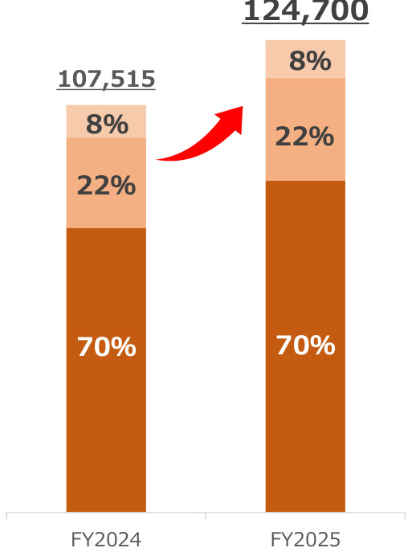 
Advanced material KrF Legacy material 
+20% +15% +15% +15% +15% 
Materials for Semiconductor back-end processes Display/ Other 
*1 Advanced material : ArF/EUV resist, etc., *2 Legacy material:g/i-line resist,etc. *3 Materials for Semiconductor back-end process : Resist for Package·MEMS material ·WHS related material 
 
C TOKYO OHKA KOGYO CO.,LTD.

---

<!-- 原文第 6 页 -->

## Breakdown of the Change in Operating Income 
5 
FY2024 Result vs.FY2025Result 
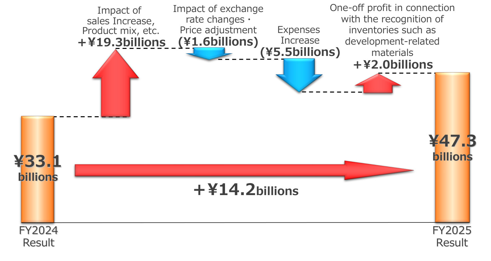 
 
C TOKYO OHKA KOGYO CO.,LTD.

---

<!-- 原文第 7 页 -->

6 
Sales Breakdown/ Operating income 
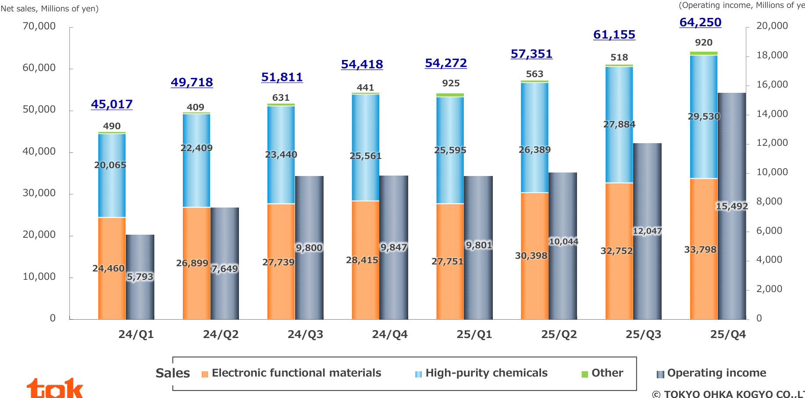 

---

<!-- 原文第 8 页 -->

7 
Capital Investments/ Depreciation/R&D (Milions of yen) 

| | FY2024 | FY2025 | Change | % | Against annual plan (\*) |
| --- | --- | --- | --- | --- | --- |
| Capital Investments | 24,764 | 28,723 | +3,959 | +16.0 | (5,676) |
| Depreciation | 8,333 | 8,807 | +473 | +5.7 | (92) |
| R&D | 14,519 | 15,673 | +1,154 | +8.0 | (426) |
 
(*)Figures released on August 6,2025 Capital Investments : some planned investments will be postponed to next year. 
 
C TOKYO OHKA KOGYO CO.,LTD.

---

<!-- 原文第 9 页 -->

Consolidated Performance Forecasts for FY2026(2026.1-2026.12) 
TOKY HKA KOGYO Co,LTD

---

<!-- 原文第 10 页 -->

9 
## Earnings Forecasts(Full-year) 
(Millions of yen) 
FY2025 FY2026 Change %
Net Sales 237,029 261,000 +23,970 +10.1
Electronic functional materials 124,700 140,000 +15,299 +12.3
High-purity chemicals 109,400 116,000 +6,599 +6.0
Others 2,928 5,000 +2,071 +70.7
Operating income 47,386 52,200 +4,813 +10.2
Ordinary income 49,274 53,800 +4,525 +9.2
Profit attributable to owners of parent 33,345 35,000 +1,654 +5.0
EBITDA 56,194 63,500 +7,305 +13.0
ROE(%) 15.6 14.5 (1.1) 
Average exchange rate(US$):¥148.6/$(FY2025)→¥150.0/$(FY2026) 
Net sales: Forecast to increase 10.1% YoY due to higher demand for advanced semiconductor materials and back-end processrelated materials and steady growth of high-purity chemicals driven by an increase in generative AI-related demand and the launch of operations of customers' new plants. 
Operating income: Forecast to increase 10.2% YoY due to an increase in net sales. 
Profit attributable to owners of parent: Forecast to increase 5.0% YoY due to an increase in operating income. 
 
C TOKYO OHKA KOGYO CO.,LTD.

---

<!-- 原文第 11 页 -->

## Electronic Functional Materials Sales Forecast by Product Type 
10 
Sales (Millions of yen) YoY+12.3% 
140,000 7% 
124,700 
Photoresist for semiconductor front-end processes 
8% 
25% 
22% 
Advanced material KrF Legacy material 
70% 68% 
Materials for Semiconductor back-end processes 
Display/ Other 
FY2025 
FY2026 Forecast 
*1 Advanced material :ArF/EUV resist, etc., 
 
*2 Legacy material :g/i-line resist, etc. 
*3 Materials for Semiconductor back-end process: Resist for Package ·MEMS material ·WHS related material 
Growth(YoY) 
+10% 
+10% 
+10% 
+10% 
+30% (5%) 
C TOKYO OHKA KOGYO CO.,LTD.

---

<!-- 原文第 12 页 -->

Breakdown of the Change in Operating Income 
11 
FY2025 Result vs. FY2026 Forecast 
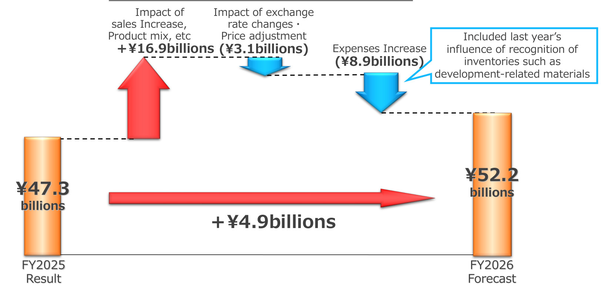 
 
C TOKYO OHKA KOGYO CO.,LTD.

---

<!-- 原文第 13 页 -->

## Breakdown of the Change in Operating Income (in case of excluded one-off profit) 
12 
FY2025 Result vs. FY2026 Forecast 
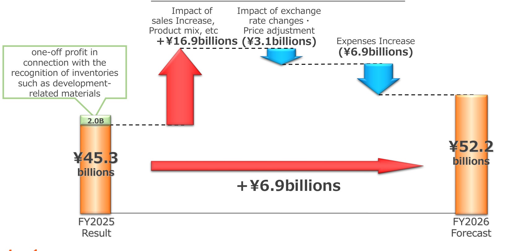 
 
C TOKYO OHKA KOGYO CO.,LTD.

---

<!-- 原文第 14 页 -->

Sales Breakdown(Forecast) 
13 
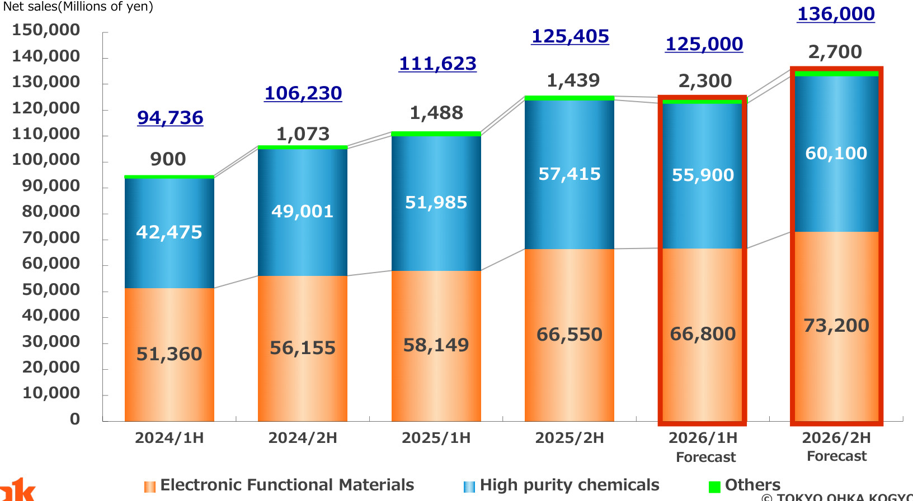 
 
C TOKYO OHKA KOGYO CO.,LTD.

---

<!-- 原文第 15 页 -->

14 
Capital Investments/Depreciation/R&D (Millions of yen) 

| | FY2025 | FY2026 Forecast | Change | % |
| --- | --- | --- | --- | --- |
| Capital Investments | 28,723 | 35,800 | +7,076 | +24.6 |
| Depreciation | 8,807 | 11,300 | +2,492 | +28.3 |
| R&D | 15,673 | 18,200 | +2,526 | +16.1 |
 
 
C TOKYO OHKA KOGYO CO.,LTD.

---

<!-- 原文第 16 页 -->

Shareholder Returns 15 
<Build sound and efficient management foundation to realize tok Vision 2030> 
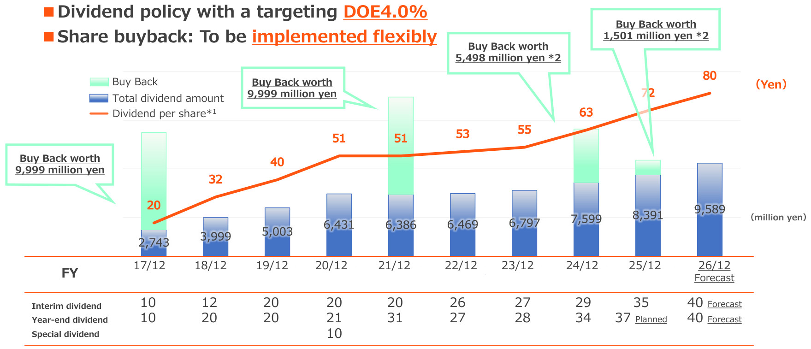 
DOE of 4.0% DOE of 3.5% 
-Based on consolidated 
-Based on consolidated 
Conso il ated avout 
dividend policy 
tok Med-Term Plan 2021 
tok Med-Term Plan 2018 
Guidelines on 
tok Med-Term Plan 2024 tok Med-Term Plan 2027 -Based on consolidated DOE of 4.0% 
 
Tdsl or" Buyback perlod: From November 13,2024 to January 30,2025 
C TOKYO OHKA KOGYO CO.,LTD.

---

<!-- 原文第 17 页 -->

## Revision of Quantitative Objectives of tok Medium-Term Plan 2027 

---

<!-- 原文第 18 页 -->

## Revision of Quantitative Objectives of tok Medium-Term Plan 2027 Background of revision 
17 
## (1)Changes in semiconductor market trends 
Demand for tok products is growing at a pace exceeding initial forecast, driven by increasing demand for generative AI secmiconductors 
## (2)Changes in exchange rate 
The yen has been weaker than initially forecasted, which is expected to contribute to higher net sales and operating income 
(Average exchange rate for FY2025 to FY2027(US)·ntia forcst:¥135.0/$→After revision:¥150.0/$ 
Upwardly revised net sales,operating income, EBITDA,and ROE target Qualitative Objectives and Key Strategies are not revised 

| | FY2025 Results | FY2027 Initial targets (announced in Jan.2025) | FY2027 Revised targets (announced in Feb.2026) |
| --- | --- | --- | --- |
| Net sales (bilion yen | 237.0 | 270.0 | 295.0 |
| Operating income (billion yen) | 47.3 | 48.0 | 58.0 |
| EBITDA (bilion yen) | 56.1 | 60.0 | 72.0 |
| ROE | 15.6% | 13.0% | 14.0% |
 
 
C TOKYO OHKA KOGYO CO.,LTD.

---

<!-- 原文第 19 页 -->

18 
## Net sales and EBITDA margin Net Sales 
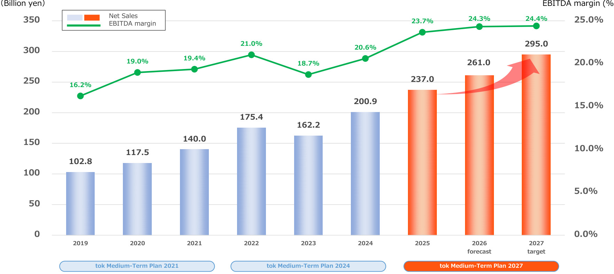 
 
C TOKYO OHKA KOGYO CO.,LTD.

---

<!-- 原文第 20 页 -->

tok Medium-Term Plan 2027:Target/Strategy/Progress by Segment 
19 

| Segment | Targets in Medium-Term Plan | | Strategy Expand technology portfolio Enhance quality control toward further miniaturization Differentiate through advanced production technologies and stable supply of high-quality products | Progress Demand is growing and our market share is expanding in the innovative field (logic/memory) includng generative AI semiconductors |
| --- | --- | --- | --- | --- |
| Semiconductor photoresist -Advanced materials -KrF resist -Legacy materials -Packaging materials | Sales increase by exceeding market growth with share expand | Net sales growth (FY2024→FY2027) Initial target Revised target (announced in (announced in Feb.2025) Feb.2026) +42% +37% |
| Various elecronic materials -MEMS materials -WHS materials -Display materials -Other | Sales expand by increasing share in existing and new markets | +143% +20% | Uncover potential needs by anticipating technology trends | Growth of the advanced packaging market and expand customers' base |
| High-purity chemicals -Thinners -Developer -Surface modification materials | Sales expand by demand increase and build supply system | +44% +34% | Establish a global supply system Gain adoption of our products for cutting-edge device manufacturing process | Demand is growing due to construction of customers' new plants Sales are expanding in the US, Taiwan, China and Japan Commenced the build-out of a suppy system of high-purity chemicals in South Korea |
 
 
C TOKYO OHKA KOGYO CO.,LTD.

---

<!-- 原文第 21 页 -->

20 
## Develop next-generation EUV photoresist for further miniaturization Offer a full lineup of various EUV photoresists to adress diverse needs 
Practical application schedule (Company estimate) 
2025 2030 
Examples of patterns formed with each resist (top-view) 
14nm line/28nm Pitch Line &Space 
CAR (Chemical Amplified Resist) o Flexibility and stability of material design 
 
SMR(Small Molecular Resist) Pattern uniformity and etching resistance 
 
18nm Contact/36nm Pitch Hexagonal Hole 
MOR (Metal Oxide Resist)oSensitivity and etching resistance 
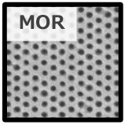 
 
C TOKYO OHKA KOGYO CO.,LTD.

---

<!-- 原文第 22 页 -->

## R&D investment envisioning a "100-year-old company" 
Industryacademia collaboration Joint study with Univ. of Hyogo 
R&D efficiency (5-year moving average)* 
Concluded an agreement on promoting cooperation and collaboration with the University (2025) Working to enhance patterning resolution under the theme of "Beyond EUV" by further shortening the wavelength of light sources used in existing EUV lithography 
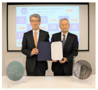 
collaboration Participated in "JOINT3,"a consortium to develop next generation semiconductor packaging (2025) Accelerating the development of panel-level packaging materials through co-creation with material, equipment and design companies Participation in JOINT3 
Inter-industry 
 
In-house development Create new core technology 
Established "ight-control technology"as a new ore technology Developing materials controlling the refractive index for AR/VR and materials for CPO (Co-Packaged Optics) technology 
 
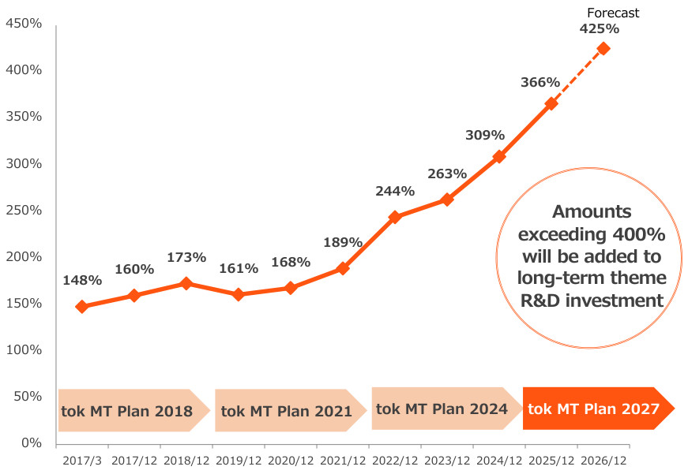 
M&A micro resist technology GmbH (Germany) 
Made micro resist technology in Germany as our wholly-owned subsidiary(2025) Strengthening the customer support system in Europe and expanding our product portfolio through technological integration with MRT 
 
R&D efficiency = Operating income over the past 5 years/ R&D costs over the preceding 5 years 
 
21 
C TOKYO OHKA KOGYO CO.,LTD.

---

<!-- 原文第 23 页 -->

Sales growth prospect of TOK products based on growing generative-AI related demand 
22 
Sales of back-end (packaging) process materials in addition to front-end process materials are growing 
In high-purity chemicals, the share of high value-added products for cutting-edge device manufacturing processes is increasing 
Examples of TOK products use in GPU for Generative AI 
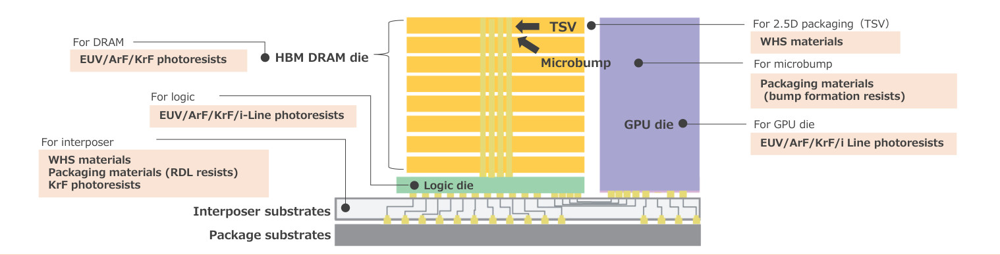 
Sales growth by product (forecast) 
Semiconductor photoresists 
Various electronic materials WHS materials 
EUV photoresists +150% 
Packaging materials 
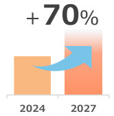 
2024 
2027 
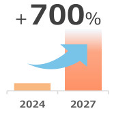 
High-purity chemicals Surface modification materials 
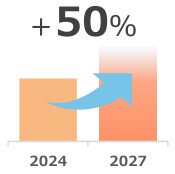 
 
C TOKYO OHKA KOGYO CO.,LTD.

---

<!-- 原文第 24 页 -->

23 
## Expanding Cash Generating Ability by Strengthening Manufacturing Capital Estimated EBITDA trends through 2030 
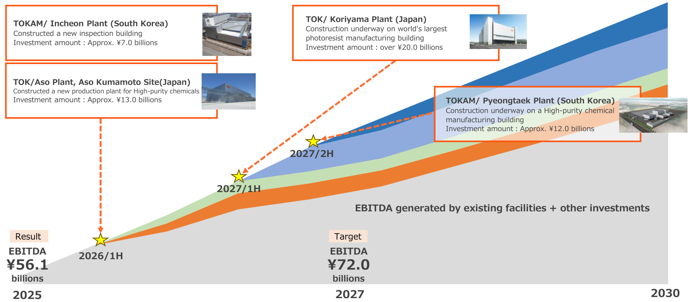 
 
C TOKYO OHKA KOGYO CO.,LTD.

---

<!-- 原文第 25 页 -->

24 
## Human capital investment 
Create a virtuous cycle of employee engagement improvement and corporate value enhancement through human capital initiatives (human capital investment) focused on happiness 
Achieve tok Vision 2030 engagement 
to achieving goals 
Improvement of employee 
Management commitment 
4 human capital initiatives 
(1) Form a diverse talent pool 
+5.4 points +1.9 points 
FY2027 
FY2025 
(2) Human capital development 
(3)Promote DE&I* 
Use employee engagement indicators as a KPI for the officers' remuneration system (from tok Medium-Term Plan 2024) (compared to FY2024) 
employee engagement 
Enhance 
(4) Improve 
corporate value 
*Diversity,Equity & Inclusion 
Reinvest the value created = Return to employees 
## Examples of our measures 
·Extend the Employee Stockholding System to overseas local employees 
·Grant restricted stock incentives to employees 
·Globalize the award system (TOK SHINKA AWARD) 
·Extend retirement age from 60 to 65 (with salaries maintained at pre-retirement levels) 
·Provide base salary increases of over 5% for four consecutive years (2022 to 2025) 
 
C TOKYO OHKA KOGYO CO.,LTD.

---

<!-- 原文第 26 页 -->

25 
## Cash allocation 
Generated EBITDA will be used for steady and continuous dividend payments with a target DOE ratio of 4.0%,making capital investment to prepare for demand growth in the semiconductor market and growth investment,and then,used for flexible share buyback tok Medium-Term Plan 2027 Three-year cash flow plan (image) 
approximately ¥20 billion or more ¥190 billion 
Growth investment 
Cumulative EBITDA: Approx. 
Working capital increase and corporate income tax payment Shareholder returns approximately ¥28 billion or more 
Dividend on equity (DOE) ratio: About 4.0% Share buyback: To be Implemented flexibly Long-run R&D-driven company (Launch of new business,investments in human and intellectual capital, response to climate change and M&A) 
Enhance production and R&D bases to expand the semiconductor market and stably supply in highquality products 
Diversifying fundraising methods Corporate bond issuance (2025) 
Capital Investment of ¥76 billion BS adjustment 
 
C TOKYO OHKA KOGYO CO.,LTD.

---

<!-- 原文第 27 页 -->

Appendix 

---

<!-- 原文第 28 页 -->

27 
Non-operating Expenses or Income/ Extraordinary Losses or Income 

| | FY2024 | FY2025 | Change | (Millions of yen) |
| --- | --- | --- | --- | --- |
| Non operating Expenses or Income | +1,463 | +1,888 | +424 | |
| Interest and divided income | +977 | +1,059 | +82 | |
| Share of profit of investments accounted for using equity method | (116) | +471 | +588 | |
| (Foreign exchange related losses/gains) | (134) | (70) | +63 | |
| Foreign exchange (Loss) gain | (98) | +289 | +388 | |
| (Loss) gain on valuation of derivatives | (35) | (360) | (324) | |
| Subsidy income | +328 | +403 | +75 | |
| Extraordinary Losses or Income | +603 | +1,017 | +414 | |
| Gain on change in equity | +198 | (12) | (211) | |
| Gain on sale of investment securities | +508 | +245 | (263) | |
| Gain on receipt of contingent consideration | | +1,422 | +1,422 | |
| Impairment loss | | (283) | (283) | |
| Loss on retirement of non-current assets | (122) | (364) | (242) | |
 
 
C TOKYO OHKA KOGYO CO.,LTD.

---

<!-- 原文第 29 页 -->

28 
## Balance Sheets 
As of December 31,2025 VS. December 31,2024
Current Assets 172,773 +21,003
Cash and deposits 70,962 +11,915
Notes and accounts receivable- trade 48,645 +5,799
Inventories 44,006 +7,120
Property, plant and equipment 110,193 +20,251
Intangible assets 1,834 +23
Investments and other assets 50,490 +12,083
Current Liabilities 59,373 +5,269
Notes and accounts payable - trade 29,544 +2,674
Non-current Liabilities 33,619 +19,266
Total net assets 242,299 +28,826
Total liabilities and net assets 335,292 +53,362 
(Millions of yen) 
Construction in progress +9,255
Machinery, equipment and vehicles Accumulated depreciation of +3,133
Accumulated depreciation of Buildings and structures +3,116
Land +3,098 
Investment securities Retirement benefit asset Deferred tax assets +9,765 +679 +302 
Short-term borrowings Accounts payable - other (4,058) +3,085
Notes and accounts payable - trade Income taxes payable Provision for bonuses +2,674 +1,843 +1,096 
Bonds payable +10,000
Long-term borrowings +10,000 
Retained earnings Treasury shares Valuation difference on AFS securities +25,071 +1,982 (789) 
 
C TOKYO OHKA KOGYO CO.,LTD.

---

<!-- 原文第 30 页 -->

29 
## Cash Flows 
(Millions of yen) 
FY2024 FY2025
Cash flows from operating activities +30,146 +35,194
Profit before income taxes +35,158 +50,292
Depreciation +8,333 +8,807
Increase in trade receivables (7,842) (5,207)
Increase in inventories (3,115) (6,809)
Increase in trade payables +5,874 +2,208
Income taxes paid (4,418) (10,465)
Cash flows from investing activities (2,733) (25,291)
Cash flows from financing activities (15,424) +3,172
Effect of exchange rate change on cash and cash equivalents +1,585 (208)
Net increase in cash and cash equivalents +13,572 +12,867
Cash and cash equivalents at end of period +56,361 +69,228 
Acquisition of tangible fixed assets (24,762) 
Corporate bond and long term borrowing each +10,000 
 
C TOKYO OHKA KOGYO CO.,LTD.

---

<!-- 原文第 31 页 -->

## "The e-Material Global CompanyTM" Contributing to a sustainable future through Chemistry. 
TOKY HKA KOGYO Co,LTD

---

<!-- 原文第 32 页 -->

## www.tok.co.jp/eng (Note) 
This presentation material contains forward-looking statements that describe future prospects of TOKYO OHKA KOGYO CO., LTD. (the Company) in terms of business planning, earnings and management strategies. Such statements are based on management's judgement, derived from information available to it at the time such information was prepared. Readers are cautioned not to rely solely on these forward-looking statements as actual results and strategies may differ substantially according to changes in the Company's business environment. 
TOKYO OHKA KOGYO CO,LTD.
