> 原文件：[47_tel.com_fy26q4presentations-e.pdf](https://github.com/jadennevercode/CJCC-Knowledge-Base/blob/564ab11aa9785e569e3853c8a4d7ce86f88e7535/materials/%E4%B8%8A%E6%B8%B8%EF%BC%9A%E5%88%B6%E9%80%A0%E8%AE%BE%E5%A4%87%E4%B8%8E%E5%A4%87%E4%BB%B6/47_tel.com_fy26q4presentations-e.pdf)
> 转换方式：Volcengine OCRPdf v3, parse_mode=ocr

<!-- 原文第 1 页 -->

FY2026 (April 2025-March 2026) Financial Announcement April 30, 2026 Agenda: Consolidated Financial Summary Hiroshi Kawamoto,SVP&GM, Division Officer of Finance Divisior Business Environment and Financial Estimates Toshiki Kawai, Representative Director, President & CEO

---

<!-- 原文第 2 页 -->

## Forward Looking Statements 
## ·Disclaimer regarding forward-ooking statements 
Forward-ooking statements with respect to Tokyo Electron's business plan, prospects and other such information are based on information available at the time of publication. Actual performance and results may differ significantly from the business plan described here due to changes in various external and internal factors, including political and economic situations, semiconductor market conditions, intensification of sales competition, safety and product quality management, intellectual property-related matters and impacts from infectious diseases. 
## ·Processing of numbers 
For the amount listed,because fractions are rounded down, there may be the cases where the total for certain account titles does not correspond to the sum of the respective figures for account titles. Percentages are calculated using full amounts, before rounding. 
## ·Foreign exchange risk 
In principle, export sales of Tokyo Electron's products is denominated in yen. Although some sales and expenses are denominated in foreign currencies, the impact of foreign exchange rate fluctuations on profts is negligible,unless extreme fluctuations occur. 
Investor Relations / April 30, 2026 
 
2

---

<!-- 原文第 3 页 -->

 
FY2026 Consolidated Financial Summary April 30,2026 Hiroshi Kawamoto SVP&GM, Division Officer of Finance Division

---

<!-- 原文第 4 页 -->

## Financial Summary (Quarterly) 
(Bilion yen) 
FY2025 FY2026 VS. VS.
Q4 Q1 Q2 Q3 Q4 FY2026Q3 FY2025Q4
Net sales 655.4 549.5 630.0 552.0 711.8 +28.9% +8.6%
Gross profit Gross profit margin 310.5 47.4% 253.9 46.2% 284.8 45.2% 235.8 42.7% 333.1 46.8% +41.3% +4.1pts +7.3% -0.6pts
SG&A expenses 126.7 109.2 126.4 119.6 127.5 +6.6% +0.6%
Operating income 183.7 144.6 158.4 116.1 205.6 +77.1% +11.9%
Operating margin 28.0% 26.3% 25.1% 21.0% 28.9% +7.9pts +0.9pts
Income before income taxes 185.1 151.9 161.0 153.3 281.8 +83.8% +52.2%
Net income attributable to owners of parent 142.9 117.8 123.8 118.5 214.2 +80.8% +49.9%
R&D expenses 72.7 62.1 72.6 66.2 76.7 +15.9% +5.6%
Capital expenditures 34.6 52.8 91.2 30.3 41.6 +37.3% +20.4%
Depreciation and amortization 18.3 17.1 19.1 21.1 23.5 +11.3% +28.2% 
1. hprnepie, port sals o aty fetoi oss srot e yt uou -o ls an epasee c h ei tr.ei o ag usI Poamaotu g 
FY20xx refers to the financial year ending in March 20xx. 
Investor Relations / April 30, 2026 
 
4

---

<!-- 原文第 5 页 -->

## Composition of Net Sales by Region (Quarterly) 
## (Billion yen) 
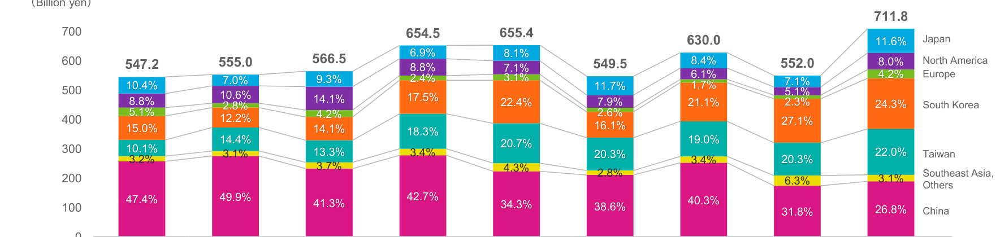 

 FY2024 FY2025 FY2026 

| | Q4 | Q1 | Q2 | Q3 | Q4 | Q1 | Q2 | Q3 | Q4 |
| --- | --- | --- | --- | --- | --- | --- | --- | --- | --- |
| Japan | 56.7 | 38.5 | 52.6 | 45.3 | 53.4 | 64.3 | 52.9 | 39.3 | 82.8 |
| North America | 48.3 | 59.0 | 79.9 | 57.7 | 46.2 | 43.4 | 38.4 | 27.8 | 56.7 |
| Europe | 28.1 | 15.5 | 23.8 | 15.7 | 20.3 | 14.0 | 10.8 | 12.7 | 29.7 |
| South Korea | 82.0 | 67.8 | 79.5 | 114.5 | 147.0 | 88.3 | 132.5 | 149.7 | 173.1 |
| Taiwan | 55.2 | 80.0 | 75.3 | 119.3 | 135.8 | 111.5 | 119.7 | 111.9 | 156.5 |
| Southeast Asia, Others | 17.5 | 17.0 | 21.2 | 22.3 | 27.8 | 15.6 | 21.3 | 34.8 | 22.1 |
| China | 259.1 | 277.0 | 233.9 | 279.4 | 224.6 | 212.1 | 254.1 | 175.5 | 190.7 |

 
 
Investor Relations / April 30, 2026 
 
5

---

<!-- 原文第 6 页 -->

## Financial Summary 
(Billion yen) 
FY2025 FY2026 FY2026 FY2025 VS FY2026 estimates February 6, 2026 announced on Reference:
Net sales 2,431.5 2,443.5 +0.5% 2,410.0
Gross profit Gross profit margin 1,146.2 47.1% 1,107.8 45.3% -3.4% -1.8pts 1,092.0 45.3%
SG&A expenses 448.9 482.9 +7.6% 499.0
Operating income 697.3 624.9 -10.4% 593.0
Operating margin 28.7% 25.6% -3.1pts 24.6%
Income before income taxes 706.1 748.1 +6.0% 714.0
Net income attributable to owners of parent 544.1 574.4 +5.6% 550.0
EPS (Yen) 1,182.40 1.254.57 +6.1% 1,200.05
R&D expenses 250.0 277.8 +11.1% 290.0
Capital expenditures 162.1 216.0 +33.2% 240.0
Depreciation and amortization 62.1 80.9 +30.3% 86.0 
1. n prneple eupot sals aty etosp puocese s c e eyte e uo- o n epe e c rr ee" unless extreme fluctuations occur 
2.Proft ratios are calculated using ful uns.frerfunding 
Investor Relations / April 30, 2026 
 
6

---

<!-- 原文第 7 页 -->

## Financial Trend (FY2022-FY2026) 
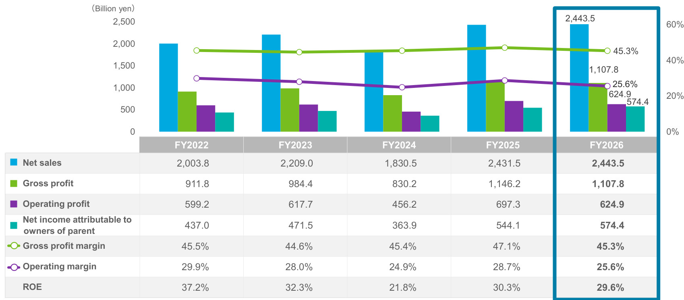 
Net sales reached record high 
Investor Relations / April 30, 2026 
 
7

---

<!-- 原文第 8 页 -->

SPE New Equipment Sales by Application 
· DRAM: - Investment in HBM and leading-edge technologies remained strong 
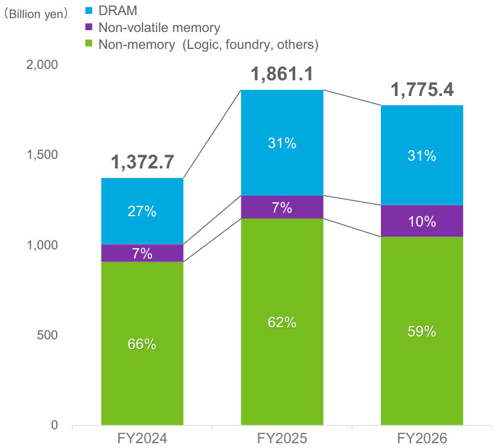 
- Non-volatile memory: 
- Customers'fab utilization improved, and investments showed a gradual recovery. Both revenue and proportion increased 
Non-memory: 
- Robust investment in leading-edge equipment 
2psd 
Investor Relations / April 30, 2026 
 
8

---

<!-- 原文第 9 页 -->

Field Solutions Sales 
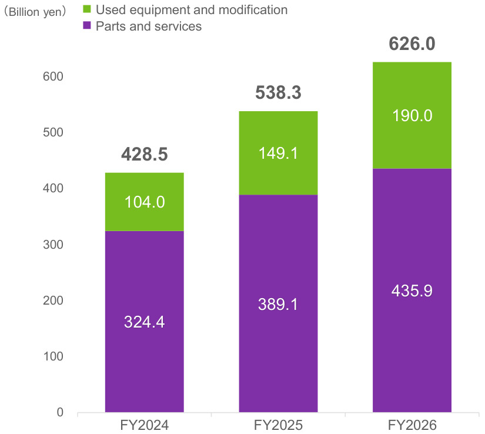 
·Field Solutions sales for FY2026 were 626.0 bilion yen,up 16.3% YoY 
-Customers' fab utilization climbed further; parts & services and modifications delivered solid growth 
Investor Relations / April 30, 2026 
 
9

---

<!-- 原文第 10 页 -->

## Balance Sheet (Quarterly) 
Assets 
Liabilities and Net Assets 
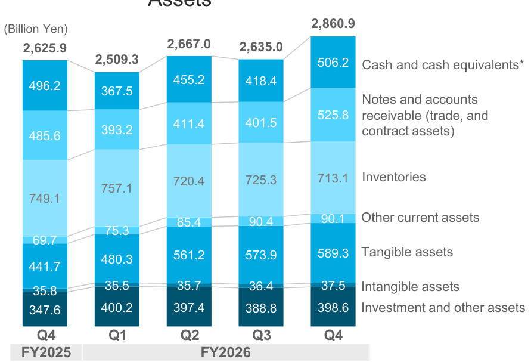 
*Cash and cash equivalents:"Cash and deposits"+"Short-term investments",etc.("Securities"in Balance Sheet). 
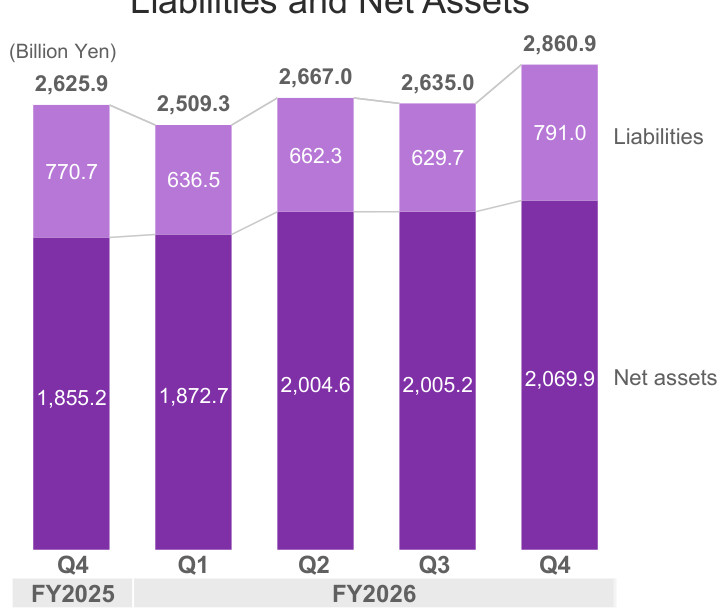 
Investor Relations / April 30, 2026 
 
10

---

<!-- 原文第 11 页 -->

Cash Flow (Quarterly) 
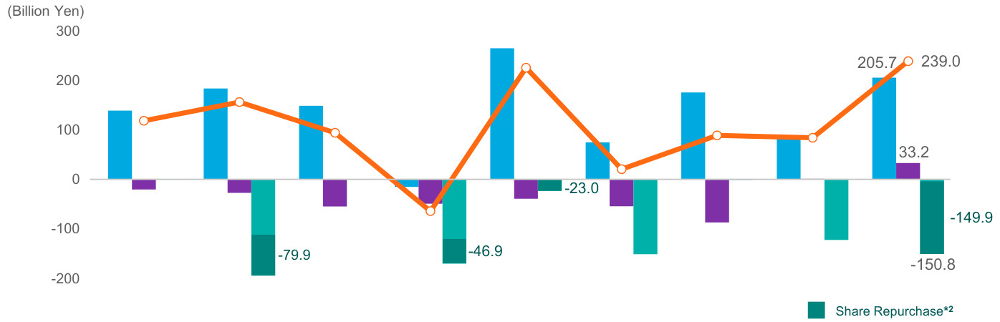 
-300 

| | FY2024 Q4 | FY2025 | | | | FY2026 | | | |
| --- | --- | --- | --- | --- | --- | --- | --- | --- | --- |
| | Q1 | Q2 | Q3 | Q4 | Q1 | Q2 | Q3 | Q4 |
| Cash flow from operating activities | 139.0 | 183.7 | 148.6 | -15.0 | 264.8 | 74.9 | 175.8 | 83.1 | 205.7 |
| Cash flow from investing activities\*1 | -20.3 | -27.3 | -54.4 | -49.0 | -38.9 | -54.1 | -86.7 | 1.2 | 33.2 |
| Cash flow from financing activities | -0.6 | -194.4 | -0.6 | -170.1 | -23.5 | -151.1 | -1.0 | -122.3 | -150.8 |
| Free cash flow\*3 | 118.7 | 156.4 | 94.1 | -64.1 | 225.8 | 20.7 | 89.1 | 84.3 | 239.0 |
| Cash on hand\*4 | 472.5 | 438.5 | 525.5 | 295.5 | 496.2 | 367.5 | 455.2 | 418.4 | 506.2 |
 
Cash flow from investing activities cludes changes in time dposits and short lerm inestments 
The amount for share repurchase excludes the cost incurred to purchase odd-lot shares. 
"3Free cash fow ="Cash low from operating activtes" ash fiow from investing atvieecludin thanges in Time deposits and Shor-tem investments") 
4Cash on hand include Cash and cash equivalens""Tme deposis and short-m inestmentsith original maturtis of ore than threemoths. 
Investor Relations / April 30, 2026 
 
11

---

<!-- 原文第 12 页 -->

## Total Return Amount 
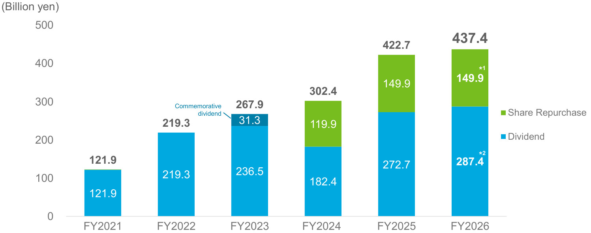 
https://www.tef.com/news/ir2026/kn0Q8fQ000000at/20260327_002_epdf 
The year-end dividend for FY2026 is provisional and pending approval by the Board of Directors. 
Combined with share buyback, total return amount is expected to be record high 
Investor Relations / April 30, 2026 
 
12

---

<!-- 原文第 13 页 -->

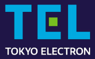 
## Business Environment and Financial Estimates 
April 30,2026 
Toshiki Kawai Representative Director, President &CEO 
 
 
福

---

<!-- 原文第 14 页 -->

## Business Highlights for FY2026 
Record-high Net Sales & Net Income 
Net Sales 
Q4:711.8 billion yen 
FY2026:2.443.5 billion yen 
·Net Income 
- Q4:214.2 billion yen 
- FY2026:574.4 billion yen 
Infrastructure Secured for Future Growth 
·Construction Completed 
R&D center: Miyagi and 
Kumamoto 
- Production & logistics center at lwate 
·Under Construction New production building at 
Miyagi: implementing TEL's Smart Production concept 
PORs in Growth Sectors 
Memory 
- Leading position in major processes such as DRAM capacitors, HBM interconnects 
·Advanced Packaging 
- PORs in multiple products 
Investor Relations / April 30, 2026 
 
14

---

<!-- 原文第 15 页 -->

Business Environment (WFE Market Outok as of April 026) WFE Market Trend ·WFE Market Outlook: (CY2026-27) - Projected range: $150B-170B/year (20%+growth vs CY2025) - Leading edge applications: 30%+growth 
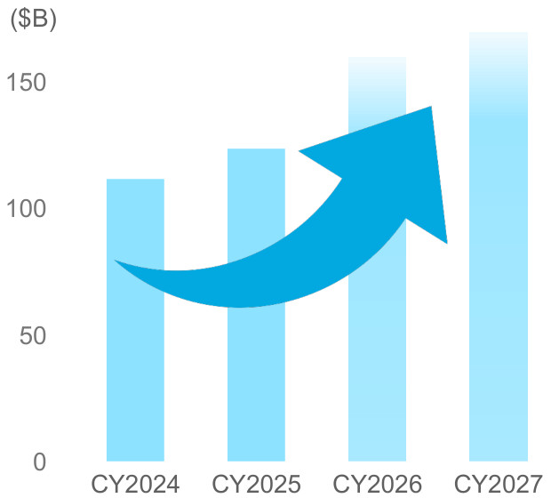 
-Geopolitical risks require close monitoring 
Investor Relations / April 30, 2026 
 
15

---

<!-- 原文第 16 页 -->

## FY2027 Revenue Drivers 
Coater Market share:>90%
Idevelopers -Capture large investment opportunties in DRAM and advanced logic
FY2027 revenue>+50% YoY
Etch Market share: >50% (dielectric etch)
Systems ·HARC, interconnect, and GAA processes
·FY2027 revenue:>+25% YoY
Advanced Packaging Leading position in probers for leading-edge logic High share in bonders for HBM
Increase the number of PORs coaterldeveloper, etch,deposition, etc.
FY2026 revenue: Approx. 200 billion yen; FY2027 revenue:>+60% YoY 
Investor Relations / April 30, 2026 
 
16

---

<!-- 原文第 17 页 -->

## Financial Estimates for FY2027 
(Billion Yen) 

| | FY2026 (Actual) | | | FY2027 (Estimate) H1 |
| --- | --- | --- | --- | --- |
| | H1 | H2 | Full Year |
| Net sales | 1,179.6 | 1,263.8 | 2,443.5 | 1,570.0 |
| Gross profit | 538.8 | 569.0 | 1,107.8 | 715.0 |
| Gross profit margin | 45.7% | 45.0% | 45.3% | 45.5% |
| SG&A expenses | 235.7 | 247.2 | 482.9 | 284.0 |
| R&D | 134.8 | 143.0 | 277.8 | 160.0 |
| Other than R&D | 100.9 | 104.1 | 205.0 | 124.0 |
| Operating income | 303.1 | 321.7 | 624.9 | 431.0 |
| Operating margin | 25.7% | 25.5% | 25.6% | 27.5% |
| Income before income taxes | 312.9 | 435.1 | 748.1 | 437.0 |
| Net income attributable to owners of parent | 241.6 | 332.8 | 574.4 | 328.0 |
| Net income per share (Yen) | 527.31 | | 1,254.57 | 721.12 |
 
·FY2027H1: 
Forecast record high of net sales, gross proft and operating profit driven by Al server demand 
· Incremental shipping for DRAM and leading-edge logic in latter CY2026 
. Monitoring the impact of blockade in the Strait of Hormuz 
Investor Relations / April 30, 2026 
 
17

---

<!-- 原文第 18 页 -->

## FY2027 SPE New Equipment Sales Forecast Sales by Application 
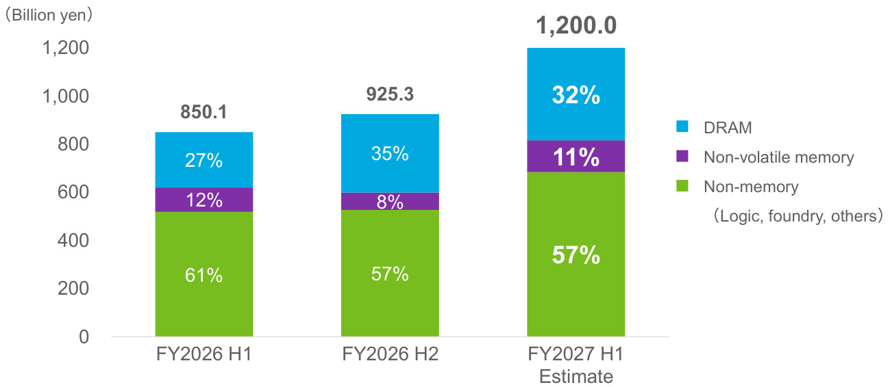 
·Percentages on the graph show the composition ratio of new equipment sales.Field solutions sales are not included. SPE new equipment sales to grow by 41% YoY 
Investor Relations / April 30, 2026 
 
18

---

<!-- 原文第 19 页 -->

## FY2027 R&D Expenses and Capex Plan 
## Miyagi Development Building No.3Kumamoto Process Development Building 
Etch system Coater/developer, cleaning system 
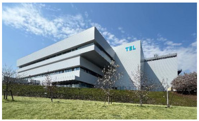 
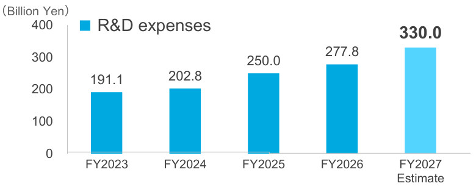 
Kurokawa-gun, Miyagi Prefecture Completed in April 2025 
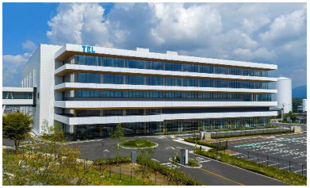 
Koshi-city, Kumamoto Prefecture Completed in October 2025 
Tohoku Production and Logistics Center Deposition system 
Miyagi lnovative Production Center Etch system 
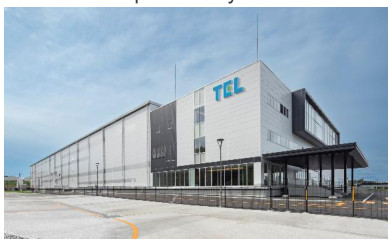 
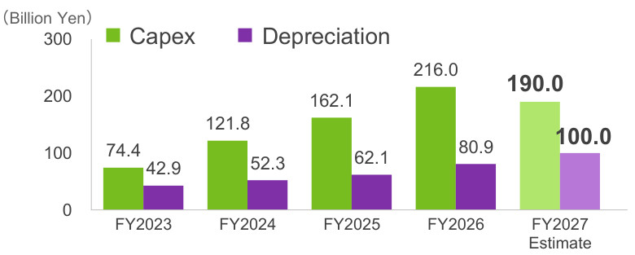 
Oshu-city, Iwate Prefecture Completed in November 2025 
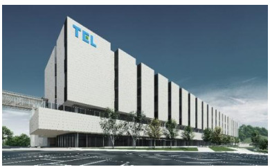 
Kurokawa-gun, Miyagi Prefecture Completion scheduled for summer 2027 
Continue strengthening competitiveness with a focus on R&D investment Leveraging this solid infrastructure to steadily capture future gains Investor Relations / April 30,2026 
 
19

---

<!-- 原文第 20 页 -->

## Dividend Forecast 
Dividend per Share 
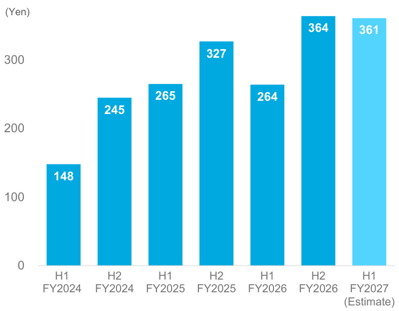 
TEL shareholder return policy Dividend payout ratio: 50% Annual DPS of not less than 50 yen We will review our dividend policy if th cmpany does not generate net income for two consecutive fiscal years 
We wil fleibly consider share buybacks 
Dividend per share for H1 FY2027 (interim dividend) is expected to be 361 yen 
Investor Relations / April 30, 2026 
 
20

---

<!-- 原文第 21 页 -->

TEL TOKYO ELECTRON

---

<!-- 原文第 22 页 -->

Appendix

---

<!-- 原文第 23 页 -->

Yearly Quarterly 
Financial Performance (Quarterly) 
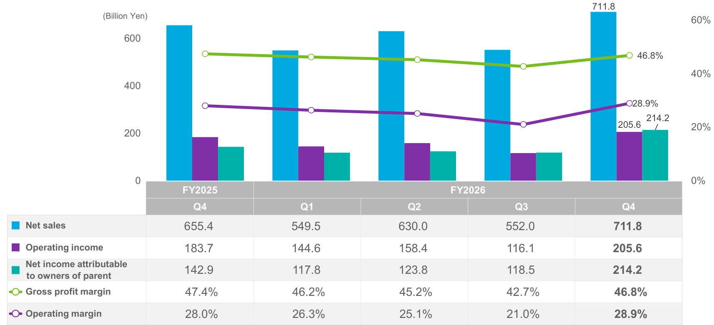 
Investor Relations / April 30, 2026 
 
23

---

<!-- 原文第 24 页 -->

Yearly Quarterly 
## SPE New Equipment Sales by Application (Quarterly) 
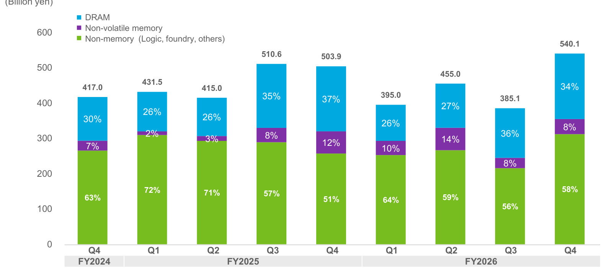 
1. SPE:Semiconductor Production Eguipment 
2. Percentages on the graph show the composition ratio of new equipment sales. Field Solutions sales are not included. 
Investor Relations / April 30, 2026 
 
24

---

<!-- 原文第 25 页 -->

Yearly Quarterly 
## Field Solutions Sales (Quarterly) 
(Billion yen) 
200 
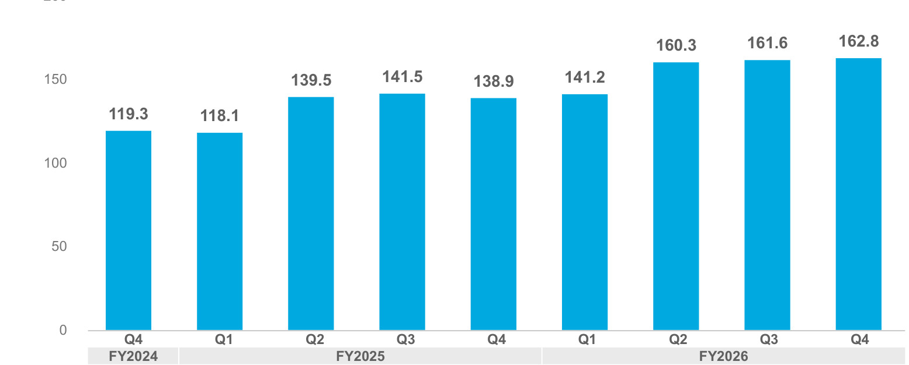 
Investor Relations / April 30, 2026 
 
25

---

<!-- 原文第 26 页 -->

Quarterly Yearly 
## SPE New Equipment Sales by Product 
(Billion yen) 
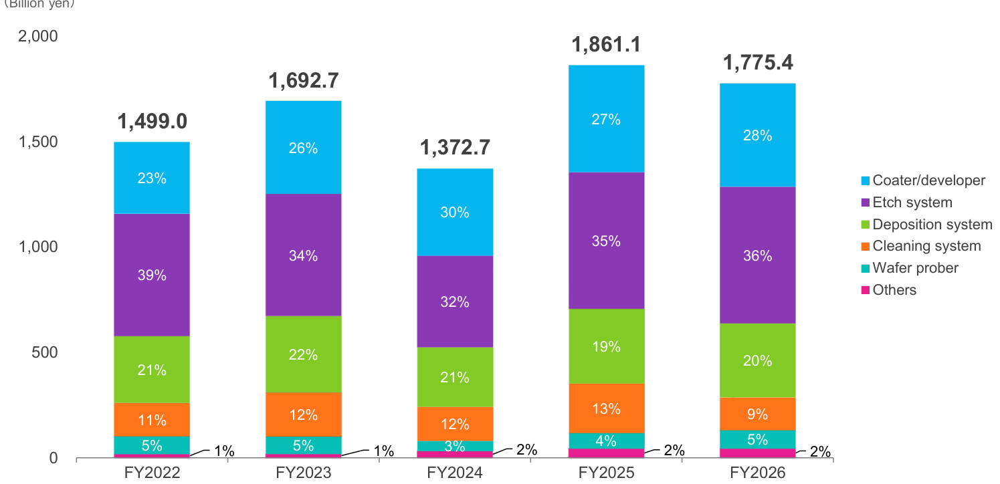 
1.SPE:Semiconductor Production Equipment Percentages on the graph show the composition ratio of new equipment sales. Field Solutions sales are not included. 
Investor Relations / April 30, 2026 
 
26

---

<!-- 原文第 27 页 -->

Quarterly Yearly 
## Sales by Region 
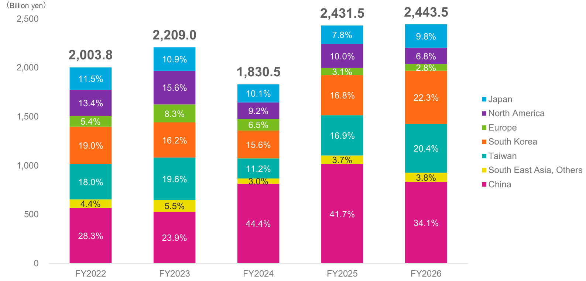 
1.SPE:Semiconductr Production Equpment 
2.Percentages on the graph show the composition ratio of new equipment sales. Field Solutions sales are not included. 
Investor Relations / April 30, 2026 
 
27

---

<!-- 原文第 28 页 -->

## World Market Share of Major Products (CY2025) 
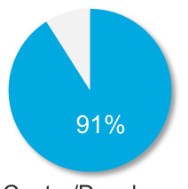 
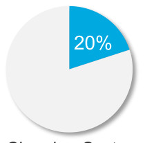 
Coater/Developer 
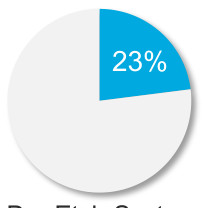 
Dry Etch System 
Cleaning System 
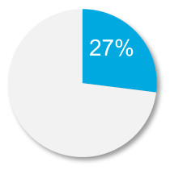 
Wafer Bonder 
38% 31% 
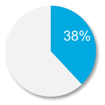 
ALD 
CVD 
Oxidation/Diffusion 
Wafer Prober 
Source 
Source 
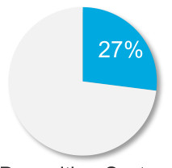 
Deposition System 
15% 
Investor Relations / April 30, 2026 
 
28

---

<!-- 原文第 29 页 -->

## Notice 
You may not copy or disclose to any third party without prior written consent with TEL. 
Tokyo Electron 
 
and "TEL"are trademarks of Tokyo Electron Limited. 
Investor Relations / April 30, 2026 
 
29
