> 原文件：[21_Wacker_Annual-Report-2024.pdf](https://github.com/jadennevercode/CJCC-Knowledge-Base/blob/564ab11aa9785e569e3853c8a4d7ce86f88e7535/materials/%E4%B8%8A%E6%B8%B8%EF%BC%9A%E5%8D%8A%E5%AF%BC%E4%BD%93%E7%BA%A7%E5%8E%9F%E6%9D%90%E6%96%99/21_Wacker_Annual-Report-2024.pdf)
> 转换方式：Volcengine OCRPdf v3, parse_mode=ocr

<!-- 原文第 1 页 -->

## For our shareholders 
7 11 12 19 23 26 
Letter from the CEO Our Executive Board Report of the Supervisory Board WACKER on the capital market Highlights from 2024 We are WACKER 
WACKER Annual Report 2024 For our shareholders

---

<!-- 原文第 2 页 -->

## Dear Shareholders What makes a company successful? 
Its employees! They make the difference, with their expertise, commitment and experience. More than 16,000 dedicated colleagues work for WACKER worldwide. They come from different cultures and operate in numerous markets and varied industries. They all share a desire to improve everyone's quality of life around the globe. By supplying innovative products and solutions. That is the purpose that drives us all at WACKER. It is how we add value for our customers and shareholders. 
Our actions are based on our corporate values. We reaffimmed them in 2024: integrity "and example -performance and passion - vision and openness - collaboration and appreciation. These values are firmly rooted in WACKER's DNA. They describe what WACKER stands for.This is not something recent, but has always been the case. They are our compass.They help us make the right decisions.n n increasingly complex, volatile and interconnected world, this guiding framework is more important than ever. 
As we all now, a team's true strength shows itself in headwinds., Last year, these headwinds were still strong. Demand was weak in many customer sectors and competition was intense.There were no economic tailwinds. In this challenging market environment, the WACKER team performed well-athough,as expected, we did not beat the previous yea's sales and earmings figure.in 202,we posted sales of E5.7 billion and EBITDA of E763 million. 
Many companies curbed their production, especially in the construction and "automotive sectors - key customer groups for our chemical products. So, it was "particularly remarkable that our chemical divisions - Silicones and Polymers - .maintained their overall sales level in 2024, with their total earnings even exceeding the previous year's figure. 
WACKER Annual Report 2024 Letter from the CEO 
7

---

<!-- 原文第 3 页 -->

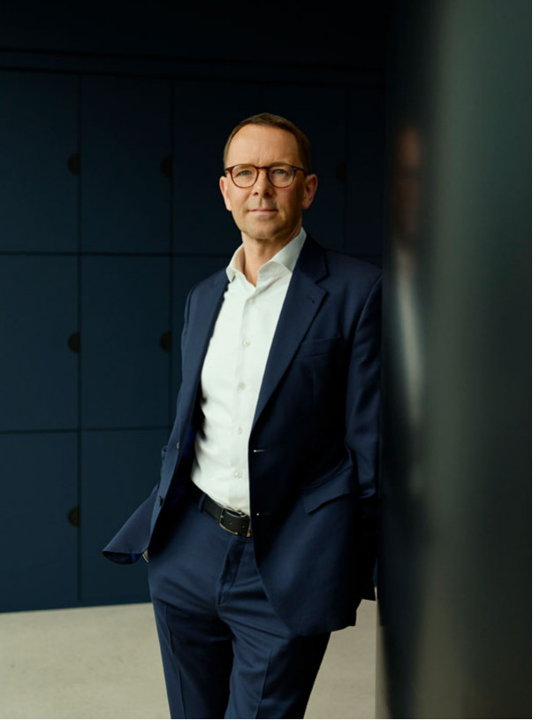 
Dr.Christian Hartel President &CEO of Wacker Chemie AG 
More than 
Our biotechnology division performed well last year, too. We increased not only its sales, but also its earnings year over year. In 2024,an important milestone for this division was the opening of our new mRNA competence center, which set the foundation for further growth. 
16,000 dedicated colleagues work for WACKER worldwide. They all share a desire to improve everyone's quality of life around the globe. 
At the Polysilicon division, business was a mixture of sunshine and rain last year. On the one hand, our hyperpure semiconductor-grade polysilicon, which is so important fr us strategically, developed positively. On the other, our solar-grade polysilicon declined markedly. This was mainly caused by massive overcapacity in China and by lower prices. Germany's persistently high energy costs had a negative impact,too, as did a general market uncertainty, triggered by discussions about US anti-dumping tariffs on solar imports from some Southeast Asian countries. 
To meet the challenges of continued market weakness,we intensified our focus on efficiency and cost discipline last year. Our measures are proving ffective. As a result, we improved our earnings trend in 2024 through savings from ongoing efficiency programs. That was another strong team achievement. 
WACKER Annual Report 2024 
Letter from the CEO 
8

---

<!-- 原文第 4 页 -->

Our strategy is intact. In the medium and long term, we will continue to benefit from global megatrends. 
In 2024, our net income was E261 million. tis iportant for us that our shareholders participate in this result. The Executive and Supervisory Boards will therefore pro pose a dividend of E2.50 per share for 2024.This means we would be distributing around 50 percent of our net income for the year,which is further proof of WACKER's reliability! 
We are also progressing reliably on the sustainability front. And will not deviate from our path. Our targets are clear. They include a clear commitment to decar bonization: by 2030,we intend to halve our absolute $CO_{2}$ emissions relative to 2020.We have already saved about 30 percent of our $CO_{2}$ emissions. And we want to achieve net zero by 2045 at the latest. To this end,we have defined a clear reduction path, which is in line with the 1.5°C target set by the Paris Agreement. In 2024, this path was validated by the independent Science Based Targets initiative (SBT). This makes us one of the first chemical companies worldwide with a validated net zero target.We see this as an honor and an extra incentive. 
Our aim, though, is not only to improve our own carbon footprint. For us, sustainability is also a business case. By offering our customers innovative, sustainable solutions,we aim to support them with their own sustainability targets. Take the following example: we will soon provide customers with a detailed carbon foot print for all ur products. Completely automated! This shows that WACKER is part of the solution.We accept responsibility and will not accept the status quo. 
Our investment spending reflects this. In 2024, we invested E666 million in total. By doing so,we are creating the basis for our future growth. For example, in 2024, we laid the cornerstone for a new site in Karlovy Vary in the Czech Republic. As early as this year, we will tatprducing sicone specialties there to meet key megatrends - from electromobility and healthcare to the energy transition. And at our largest site, Burghausen, we are expanding our capacities for hyperpure semi conductor-grade polysilicon. This material is chiefly needed for powerful chips that are used, for example, in the artificial intelligence sector. 
Those were just a few examples. We invest in promising markets all over the world.Because our solutions are in demand everywhere. In 2024,we generated 84 percent of our sales outside of Germany. Clearly, we are well positioned to seize global growth opportunities. 
WACKER is well positioned for the future - financially, strategically and on the personnel front. 
WACKER Annual Report 2024 
Letter from the CEO 
9

---

<!-- 原文第 5 页 -->

We want to create added value - for our customers and our shareholders. 
In the short term, though, general market conditions will remain challenging. At least, that is our assumption for now. So, we will intensify our focus on measures for profitable sales growth, cost discipline and cash flow. For 2025, we expect Group sales of between E6.1 billion and E6.4 bilin. BITDA s likely to come in between E700 million and E900 million. 
Although curent conditions are challenging,the good news is that our strategy is intact. For the medium and long term,we will continue to benefit from global megatrends.Sustainability, digitalization, health and smart construction are among the key drivers of our business. So,we will maintain ur long-term growth targets. We still aim, by 2030, to achieve sales of E10 biion and an EBITDA margin above 20 percent. We reaffirmed this at our Capital Markets Day in 2024. We also clearly stated then that we will concentrate more on improving margins than on volume growth. 
Strategically, we aim to intensify our chemical divisions' focus on specialty business even more.For example, high-tech siicones for the energy and mobility transition, or polymers for smart, sustainable construction. At Biosolutions, the division's priorities are customized biotech products and next-generation medicines. At the Polysilicon division, we are increasingly focusing on the production of hyperpure semiconductor-grade polysilicon. 
At the same time, we are steadiy boosting our productivity and efficiency and cutting our costs. Key levers for this include an even more active approach to portfolio management and additional digitalization and automation measures. Financial soundness, after al,is essentia for our success and, thus, for achieving our longterm targets. 
You can be sure that we will use our potential. WACKER is well positioned for the future - financially, strategically and on the personnel front. Together,we will continue working on tomorrow's solutions. With expertise, customer proximity and innovative strength. It is what the WACKER team stands for around the world. 
Our aim is for WACKER's share price to reflect our potential. This did not happen in 2024.Which was not satisfactory. Our mission is clear: we want to create added value -for our customers and for you, ur shareholders. We adhere strongly to this principle.Because we are WACKER - reliable,resolute and ambitious. 
Thank you very much for your trust.· 
## Chakm fell 
Dr.Christian Hartel President &CEO of Wacker Chemie AG 
WACKER Annual Report 2024 
Letter from the CEO 
10

---

<!-- 原文第 6 页 -->

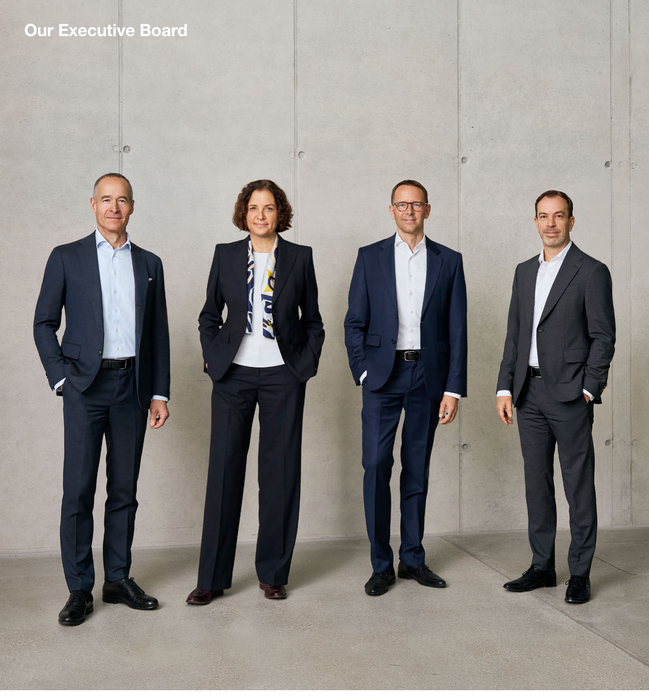 
Dr. Tobias Ohler Chief Financial Officer 
Angela Worl Personnel Director 
Dr. Christian Hartel Dr.Christian Kirsten President &CEO 
WACKER Annual Report 2024 
Our Executive Board 
For details about Executive Board responsibilities, please refer to p.223 
11

---

<!-- 原文第 7 页 -->

Dr. Peter-Alexander Wacker Chair of the Supervisory Board of Wacker Chemie AG 
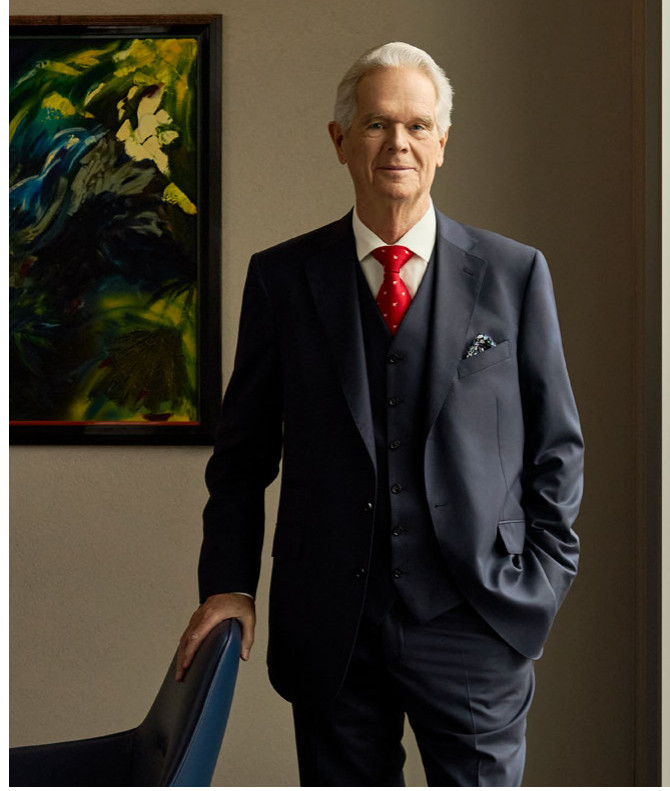 
## Dear Shareholders, 
2024, too,brought many challenges for the whole chemical sector. Markets were generally weak and the economy was impacted by numerous external factors. Despite these challenging conditions, Wacker Chemie AG remained on course, thanks to the commitment and dedication of more than 16,000 omployees around the world. 
In 2024,the Group again showed its capabilities as a world-leading specialty chemical company and a highly competent player in the biotechnology sector. Once more,the strengths of the Group's diversified business model were effective. The Group's broad focus on attractive growth fields and its global presence enabled business performance to remain within the projected coridor despite the challenging times. 
WACKER Annual Report 2024 
Report of the Supervisory Board 
12

---

<!-- 原文第 8 页 -->

Business benefited, too, from the Group's strategy of continuously improving its processes and structures. For example,a continuous productivity program - the WACKER Operating System - was set up more than 20 years ago to cut operating costs each year. As in recent years, some 1,000 improvement measures were again implemented in the reporting year,resulting in savings of about E60 mil lion. Continuous cost optimization is a key lever for enhancing the Group's competitiveness. 
Last year saw key investments in the company's ability to innvate and in productioncapacity expansions. The Group's innovative strength is reflected, for example in some 3,100 active patents worldwide and in 1,100 patent applications currently pending globally. The strategic focus on specialty silicones gained momentum, with plant expansions at Zhangjiagang in China and construction work starting on a new production site at Karlovy Vary in the Czech Republic. Biotech business was strengthened as well,with a new competence center for mRNA actives opening in Halle (ale), Germany. The Group's goal of increasing the percentage of semi conductor-grade polysilicon in its business portfolio came a big step closer with the expansion of capacity for hyperpure polysilicon at the Burghausen site. The new plant will start up in 2025. 
Thanks to this strategic approach and the consistent focus on profitable growth and sustainability, Wacker Chemie AG remains well positioned for the future. 
## Continuous dialogue with the Executive Board 
At WACKER, sound corporate governance and control are built on a relationship of trust between the Executive Board and Supervisory Board as they work closely together in the company's interest. In 2024,the Supervisory Board performedwith great diligence - the duties incumbent upon it under law,the Articles of Association and its own Rules of Procedure.The Supervisory Board was involved at an early stage in every decision of fundamental significance for the company. 
In both written and oral reports,the Executive Board regularly provided the Super visory Board with timely and comprehensive information on corporate planning, strategic development, business operations, and the current state of Wacker Chemie AG and the Group, including the risk situation, risk management,and compliance and sustainability issues. Beyond scheduled Supervisory Board meetings, the chair of the Supervisory Board remained in close contact with the Executive Board, especialy with the CEO, conferring on issues of strategy, business development, risk exposure and of risk management,as well as on compliance, and was kept informed of current trends, the business situation,and key business transactions. Any deviations from business plans and targets were explained to the Supervisory Board in detail 
Wherever required by statutory provisions or the Articles of Association, the Supervisory Board voted on the reports and proposals of the Executive Board after detailed examination and discussion. There was no need for additional monitoring measures, such as the inspection of corporate documents or the appointment of experts. The Supervisory Board met on a regular basis, sometimes without the Executive Board being in attendance. 
WACKER Annual Report 2024 
Report of the Supervisory Board 
13

---

<!-- 原文第 9 页 -->

In the reporting year, particularly close attention was paid to the current earnings situation, inludin the risk position and risk management,as wellasto the company's liquidity and financial position. 
The Supervisory Board held four meetings in 2024, two in the first half of the year and two in the second half. AIl Superisory Board meetings were in person. Between meetings, the Executive Board informed the Supervisory Board in detail by means of written reports aboutall projects and plans of particular importance to the Group. At its full meetings and in its committees, the Supervisory Board discussed in detail business transactions of importance to the company and referred to the reports submitted by the Executive Board. The full meetings were prepared by shareholder and employee representatives in their own separate sessions. 
## The Supervisory Board's main areas of deliberation 
The development of sales, earnings and employment at Wacker Chemie AG and the Group, together with strategic development opportunities, were the subject of regular consultations in the full meetings of the Supervisory Board. 
In the reporting year, the major areas of deliberation for the Supervisory Board were: 
## ·Global market challenges,particularly persistently high raw-material and energy costs 
Geopolitical developments and the resulting opportunities and risks for our business 
·M&A and CapEx projects ·Financing activities 
The Supervisory Board discussed the WACKER Group's plans for 2025 at its meeting of December 5, 2024.On that occasion, the Supervisory Board also dealt with medium-term corporate plans for 2025-2029.In addition, it discussed and approved the capital-expenditure budget for 2025. 
## Work in the committees 
The Supervisory Board is assisted in its work by the committees it has constituted. WACKER's Supervisory Board has created three committees - an Audit Committee, an Executive Committee, and a Mediation Committee the latter in accordance with Section 27 (3) of the German Co-Determination Act (MitbestG). The tasks and the members of these committes are detailed in the declaration on corporate management on page 331 et seq. 
The Audit Committee met four times in person last year. In the presence of the auditors, it discussed the audit of the annual financial statements of Wacker Chemie AG and the Group for 2023 and the consolidated interim financial statements for the first half-year. It also examined the Group's quarterly financial figures as well as issues relating to risk management, the accounting process, the internal control systems, compliance, auditing, and the preparatory review of sustainability reporting. t monitored the audit, especial rgarding quality,as well asthe inde pendence of the auditors and the additional services they performed. The Audit Commite also submitted a recommendation to the Supervisory Board for the 
WACKER Annual Report 2024 
Report of the Supervisory Board 
14

---

<!-- 原文第 10 页 -->

latter's proposal to the 2024 Annual Shareholders"' Meeting about appointing an auditor for any reviews of interim financial reports for 2025 in the period preceding the ordinary Annual Shareholders' Meeting for the 2025 financial year. The Audit Committee then awarded the auditing contract for 2024 as per the resolution of the ordinary Annual Shareholders' Meeting for the 2023 financial year and determined the focus of auditing. 
The Executive Committee met once in person in 2024. The committee members discussed recommendations to the Supervisory Board for determining the Executive Board's total compensation in 2023 and its performance goals for variable compensation in 2024. 
## The Mediation Committee did not need to be convened in the reporting year. 
The Supervisory Board was regularly informed about the committees" work. 
## Initial and advanced training 
The members of the Supervisory Board are called upon to take part in training courses at regular intervals and are responsible for meeting this obligation themselves. The company supports the members in their educational endeavors, in particular by granting them generous expense allowances, which can and should be used for further training,among other things. When they take ffice,new Supervisory Board members receive an information package about their rights and obligations; it also includes information sheets on insider-trading bans and on personal transactions by managers. Where necessary, they are also informed about significant changes in legislation and court rulings affecting their work, or are able to take part in internal information events. 
Personalized disclosure of attendance at meetings Last year, four members were excused from one Supervisory Board meeting each and one member was excused from two meetings. Otherwise, all members of the Supervisory Board attended all of its meetings. As regards the committee' meet ings,one member was excused from one meeting in 2024.Otherwise, all committee members attended their respective committe meetings. Members'attendance at meetings of the Supervisory Board and at their respective committee meetings is disclosed in personalized form in the following table: 
WACKER Annual Report 2024 
Report of the Supervisory Board 
15

---

<!-- 原文第 11 页 -->

| Full Supervisory Board | Attendance at meetings during period of office |
| --- | --- |
| Dr. Peter-Alexander Wacker | 3/4 |
| Manfred Koppl | 4/4 |
| Prof. Andreas H. Biagosch | 4/4 |
| Dr.Gregor Biebl | 3/4 |
| Matthias Biebl | 4/4 |
| Prof. Patrick Cramer | 3/4 |
| Stefan Entholzner | 3/4 |
| Markus Hautmann (until August 31, 2024) | 0/2 |
| Ingrid Heindl | 4/4 |
| Barbara Kraller | 4/4 |
| Dr. Benedikt Postberg | 4/4 |
| Harald Sikorski | 4/4 |
| Reinhard Spateneder | 4/4 |
| Ann-Sophie Wacker | 4/4 |
| Prof. Anna Weber | 4/4 |
| Dr.Susanne Weiss | 4/4 |
| Gunter Zellner (since October 7,2024) | 1/1 |
| Executive Committee | |
| Dr. Peter-Alexander Wacker | 1/1 |
| Manfred Koppl | 1/1 |
| Matthias Biebl | 1/1 |
| Audit Committee | |
| Dr.Peter-Alexander Wacker | 3/4 |
| Manfred Koppl | 4/4 |
| Prof. Anna Weber | 4/4 |
| Mediation Committee | |
| Dr.Peter-Alexander Wacker | 0/0 |
| Manfred Koppl | 0/0 |
| Prof. Andreas Biagosch | 0/0 |
| Barbara Kraller | 0/0 |
 
## Corporate governance 
Last year, the Supervisory Board looked closely at corporate governance standards. At its meeting of December 5, 2024, the Supervisory Board, as scheduled, dealt with application of the German Corporate Governance Code and adopted the annual declaration of conformity that must be submitted jointly by the Executive and Supervisory Boards in accordance with Section 161 of the German Stock Corporation Act (AktG).This declaration is available on the company's website and is also included in the declaration on corporate management on page 331 et seq. 
Further information on corporate governance at WACKER can likewise be found in the declaration on corporate management on page 331 et seq.> 
WACKER Annual Report 2024 
Report of the Supervisory Board 
16

---

<!-- 原文第 12 页 -->

At its December meeting, the Supervisory Board also conducted a sel-assessment and found that it works efficiently - for example,due to the regular preliminary discussions regarding the Supervisory Board meetings, the comprehensive reports provided by the Executive Board and the detailed documents received well in advance of the meetings. Further information on the Supervisory Board's regular slf- assessments can be found in the declaration on corporate manage ment on page 331 et seq. 
## Audit of the annual financial statements of Wacker Chemie AG and the WACKER Group 
PricwatouseCoopers GmbH Wirtschaftsprifungsgesellschaft, Munich audited the annual financial statements of Wacker Chemie AG, the consolidated financial statements and the combined management report- including the Group Sustainability Report- for 2024. PricewaterhouseCoopers GmbH Wirtschaftprufungsgesellschaft has audited Wacker Chemie AG and the WACKER Group since 2024.The persons responsible for signing the audit are Dietmar Eglauer and Anita Botzenhardt. 
The Supervisory Board's Audit Committe had awarded the auditing contract in accordance with the resolution of the Annual Shareholders' Meeting of May 17, 2023.The auditors conducted their audit in accordance with Section 317 of the German Commercial Code (HGB) and the EU Audit Regulation, and in compliance with German Generally Accepted Standards for Financial Statement Audits promulgated by the Institut der Wirtschaftsprufer (IDW).They issued unqualified audit opinions. 
The auditors also carried out a review with limited assurance of the Group Sustainability Report. Accordingly,no issues were identified that would indicate that the statement did not satisfy the statutory requirements in all material respects. 
The financial-statement documents (including the auditors'reports, the combined management report - with the Group Sustainability Report - and the Executive Board's proposal for the distribution of profts) were submitted to all the Supervisory Board members in good time. 
At is meeting of February 18, 2025, the Audit Commite examined and discussed in detail the combined management report for Wacker Chemie AG and the Group, including the Group Sustainability Report, as well as the auditors' reports. The full Supervisory Board, at its meeting of February 27, 2025,closely examined and discussed the relevant annual accounting documents - including the Group Sustainability Report- with knowledge and in consideration of both the report of the Audit Committee and the auditors' reports. The auditors, Dietmar Eglauer and Anita Botzenhardt,took part in the deliberations at both meetings. In addition, Hendrik Fink attended these meetings as the auditor responsible for the Group sustainability report. The auditors reported on the main results of the audits - in particular, the key audit matters described in the auditors" reports and the outcome of the review of the Group Sustainability Report - and were available to answer questions and provide supplementary information. 
WACKER Annual Report 2024 Report of the Supervisory Board 
17

---

<!-- 原文第 13 页 -->

After concluding its own examination, the Supervisory Board has no objections to raise to the annual financial statements of Wacker Chemie AG, the consolidated financial statements, the combined management report for Wacker Chemie AG and the Group -including the Group Sustainabilit Report- or the auditors' reports. 
The Supervisory Board therefore approves the annual financial statements of Wacker Chemie AG and the consolidated financial statements as of December 31, 2024 as prepared by the Executive Board. The annual financial statements of Wacker Chemie AG are hereby adopted. The Supervisory Board concurs with the Executive Board's proposal for the distribution of retained proft.In accordance with Section 162 (3) sentence 2 of the German Stock Corporation Act, the com pensation report for 2024 was examined by the auditors to determine whether the disclosures required by law pursuant to Section 162(1)and (2) of the German Stock Corporation Act were made. 
Changes in the composition of the Supervisory and Executive Boards On the Superisory Board, Markus Hautman stepped down at the end of August 31, 2024.Gunter Zellner succeeded him as employee representative on the Supervisory Board. He was appointed at the Executive Board's rquest by order of the District Court of Munich - Registry Court -efective October 7, 2024. 
There were no changes to the composition of Wacker Chemie AG's Executive Board in2024. 
The Supervisory Board would like to sincerely thank every employee in WACKER's global network,the Executive Board's members and the employee councils for their commitment and dedication, and their contributions to the Group's success. On this basis, WACKER will, moreover, master the challenges ahead and successfully maintain its market position with its inovative solutions. 
Munich, February 27,2025 The Supervisory Board 
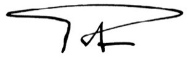 
Dr.Peter-Alexander Wacker Chair of the Supervisory Board of Wacker Chemie AG 
WACKER Annual Report 2024 
Report of the Supervisory Board 
18

---

<!-- 原文第 14 页 -->

WACKER on the capital market in 2024 
Stock market developments in 2024 were impacted by sustained geopolitical tensions between the USA and China, and by the wars in Ukraine and the Middle East. Despite many negative factors, global equity markets generall performed well. All o the major stock market indices reported gains. 
Germany's leading inde, the DAX,gained ground in 2024, climbing some 19 percent compared with year-end 2023.German small caps largely missed out on the positive trend on the global stock markets. The MDAX, for example, lost almost 6 percent in the reporting period from January through December. 
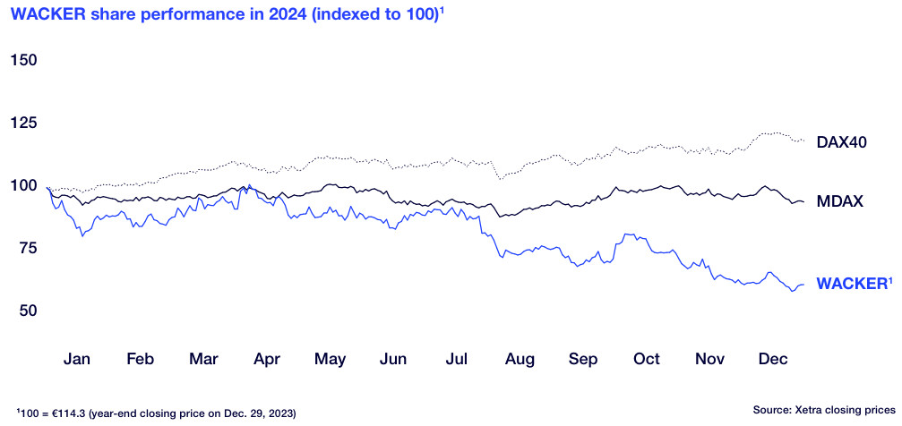 
At the start of 2024, WACKER stock stood at E114.30 (year-end closing price on December 29, 2023),After reaching a yearhigh of 116.70on April 8,2024, WACKER stock then declined during the rest of the year. WACKER stock ended trading on December 30, 2024 at E70.04,down 39 percent on the start of the reporting period and corresponding to a market capitalization of around E3.48 billion. 
WACKER's share price reflected the persistently difficult market conditions. The German economy stalled. Many companies with direct sales to end consumers curbed their production in 2024, with the automotive and construction industries, in particular, putting in a weak performance.At our Polysilicon division, lower demand for solar-grade polysiicon impacted business. Ongoing US antidumping investigations into solar-product imports from some Southeast Asian countries continued to unsettle markets.→ 
WACKER Annual Report 2024 
WACKER on the capital market 
19

---

<!-- 原文第 15 页 -->

2.50 
Proposed dividend per share for 2024 inE 
## Dividend proposal of E2.50 per share 
WACKER's dividend policy is to distribute about 50 percent of net income for the year to shareholders. The Executive and Supervisory Boards will therefore propose a dividend of e2.50 per share at the Annual Shareholders' Meeting. Based on the number of shares entitled to dividends as per December 31, 2024, the cash dividend corresponds to a payout of E124.2 milion. 
Dividend trends 

| E | 20241 | 2023 | 2022 |
| --- | --- | --- | --- |
| Dividend | 2.50 | 3.00 | 12.00 |
| Dividend yield (%) | 2.6 | 2.3 | 8.6 |
| Volume-weighted average share price | 94.83 | 131.56 | 138.76 |
| Net result for the year (allocable to WACKER's shareholders) (million) | 241.0 | 313.6 | 1,251.0 |
| Dividend payout (million) | 124.2 | 149.0 | 596.1 |
| Distribution ratio (9) | 51.5 | 47.5 | 47.6 |
 
## ISueleotDbnepybdyteteibheseeefpi uz 
In relation to net income from continuing operations (allocable to WACKER's shareholders) 
## Market capitalization (as of December 31, 2024) 
WACKER's year-end market capitalization based on shares outstanding was E3.48 billion (December 31, 2023:(5.68 billion). 
## Trading volume 
In the reporting year, the average daily trading volume for WACKER stock on Xetra, Germany's regional exchanges, Tradegate and Quotrix was approximately 131,262 shares, which was slightly below the prior-year figure of 138,859 shares. Average daily turnover for the shares was E12.41 million, down year over year (2023:(18.3 million). 
## Facts & figures on WACKER stock 
E 

| Year-high (on Apr.8,2024) | 116.70 |
| --- | --- |
| Year-low (on Dec.20,2024) | 65.92 |
| Year-end closing price (on Dec.29,2023) | 114.30 |
| Year-end closing price (on Dec.31, 2024) | 70.04 |
| Performance for the year (without dividend)(%) | -39 |
| Year-end market capitalization (shares outstanding: prior year 5.68) (billion) | 3.48 |
| Average daily trading volume' (prior year: 18.3)(million) | 12.4 |
| Earnings per share from continuing operations (prior year: 6.31) | 4.85 |
| Dividend per share (proposal) | 2.50 |
| Dividend yield(%) | 2.6 |
 
1 Trading platforms (Xetra,Germany's regional exchanges, Tradegate and Quotrix) 2Dividend yield based on the average share price (weighted by volume) of C94.83 in 2024 
WACKER Annual Report 2024 
WACKER on the capital market 
20

---

<!-- 原文第 16 页 -->

## Shareholder structure 
Wacker Chemie AG's largest shareholder remains Dr. Alexander Wacker Familiengesellschaft mbH, Munich. it holds over 50 percent of the voting shares in Wacker Chemie AG (2023:over 50percent) Blue Elephant Holding GmbH(Bad Wiessee Germany) also had no voting-share changes to report in 2024, with its holding in Wacker Chemie AG remaining at over 10 percent. 
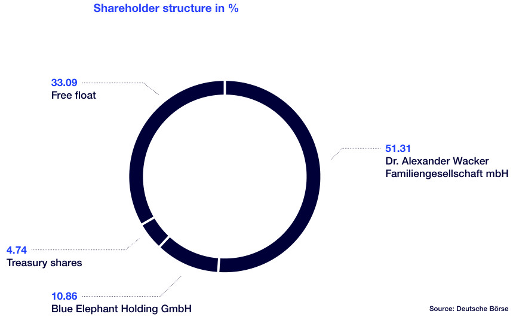 
Useful information on WACKER stock 

| ISIN | DE000WCH8881 |
| --- | --- |
| WKN | WCH888 |
| Frankfurt Stock Exchange | WCH |
| Bloomberg | CHM/WCH.GR |
| Reuters | CHE/WCHG.DE |
| Initial public offering | April 10, 2006 |
| Capital stock | E260,763,000 |
| Trading segment | Regulated market (Prime Standard), Frankfurt/Main Stock Exchange |
| Category of shares | Bearer shares |
| Number of shares (Dec.31, 2024) | 52,152,600 |
| Number of shares outstanding | 49,677,983 |
| Paying agent | Deutsche Bank, Frankfurt/Main |
 
WACKER Annual Report 2024 
WACKER on the capital market 
21

---

<!-- 原文第 17 页 -->

WACKER communicates closely with capital markets 
Key elements of corporate strategy are sustainability and a focus on specialty chemicals. These priorities are reinforced through continuous and open communication with institutional investors, private investors and analysts. 
At our Capital Markets Day on September 19, 2024, we confirmed our strategic growth and sustainability targets communicated in 2022. WACKER is aiming.by 2030, to generate sales of e10 billion and an EBITDA margin in excess of 20 percent. Also by 2030,absolute $CO_{2}$ emissions will be reduced by more than 50 percent as against the 2020 baseline.We will be focused more on improving our margins than on volume growth. This means intensifying investments in efficiency measures and in expanding our portfolio of specialty products. 
In 2024, the number of analysts covering WACKER remained unchanged at 18. The consensus price target of analysts for WACKER stock declined during the year. At the beginning of the year, the average price target for WACKER stock was E145.56 (18 estimates, December 2023). At year-end, the average price was E113.72 (18 estimates), about 22 percent lower than at the beginning of the year. 
## Banks and investment firms covering and rating WACKER 
Baader Helvea Bank of America Berenberg Citigroup Deutsche Bank DZ Bank AG Exane BNP Baribas HSBC J.P.Morgan 
Jefferies Landesbank Baden-Wurttemberg Morgan Stanley Oddo BHF On Field Investment Research mwb research Stiefel UBS Warburg Research 
On our website,we regularly report consensus analyst expectations for the current year. Moreover, our website offers extensive information on WACKER stock. In addition to the Annual Report, other financial reports, a Fact Book,presentations and publications (viewable online or downloadable), our website lists all or key financial-calendar dates and contact persons. 
 
Discover our financial calendar online. 
WACKER Annual Report 2024 
WACKER on the capital market 
22

---

<!-- 原文第 18 页 -->

Highlights from 2024 
01 Net Zero by 2045 target validated 
02 Celebrating 40 years in Southeast Asia 
03Acquisition in the United States 
04 WACKER House opens its doors 
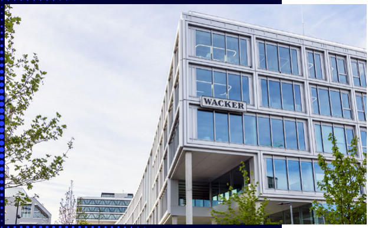 
January The independent Science Based Targets initative (SBT) has validated that WACKER's greenhouse gas reduction path is in line with the 1.5°C target set out in the Paris Agreement. This makes WACKER one of the first chemical companies worldwide with a validated net zero target. 
May Diverse cultures, attractive markets, fast-growing economies - that's what Southeast Asia stands for. No wonder, therefore, that WACKER has been present in the region for four decades. Today, the company is represented in Singapore, Iindonesia, Thailand, the Philippines, Malaysia and Vietnam. The WACKER ACADEMY Singapore supports our customers,partners and employees by creating a culture of sharing knowledge and experience relating to silicone and polymer chemistry. 
May By acquiring Bio Med Sciences'equipment and know-how in the United States, WACKER is expanding its expertise in the fully integrated development and production of silicone-coated pressure-sensitive adhesive products. Thanks to their unique skin compatibit and easily customizable adhesive properties, silicones offer outstanding product solutions for medical and cosmetic applications. 
June WACKER opened its new company headquarters, WACKER House, in Munich's Werksviertel district. Being more than just a new building,this also marks a new working environment more moder, more flexible and more agile. It is therefore a key catalyst for creative ideas, inspiration and innovation, and, ultimately, entrepreneurial success. The stateof-the-art building is designed to meet the latest standards in sustainable building technology. With its innovative approach to office life, WACKER House offers an atractve woring environment for around 600 employees on five floors. 
WACKER Annual Report 2024 Highlights from 2024 
23

---

<!-- 原文第 19 页 -->

## 05 Groundbreaking ceremony in the Czech Republic 
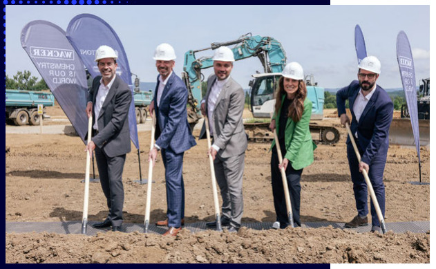 
June With the construction of a new plant in Karlovy Vary, Czech Republic, WACKER is strengthening its strategic focus on the production of silicone specialties for key megatrends such as the energy transition, electromobility and healthcar.The investment volume in thi prject is in the triple-digit million euro range.Operations are scheduled to commence in late 2025 and around 200 new jobs are expected to be created there by 2028. 
06 WACKER opens mRNA Competence Center in Halle, Germany 
07 Success Made by Diversity 
08 Strengthening our specialties portfolio for our semiconductor customers 
June WACKER has set another milestone by opening an mRNA competence center at its biotech site in Halle (Saale). The new facility enables the large-scale production of active ingredients based on messenger ribonucleic acid (mRNA), such as anti-Covid mRNA vaccines. Part of the new capacity is being made available to the German government as part of its pandemic-preparedness plan in order to swifty respond and supply Germany with vaccines as and when required. 
August There is a good reason why we say "Made in Germany" and not"Made by Germans." Because employees from all over the world - regardless of where they come from - give their best at WACKER. This is why we support the "Made in GermanyMade by Vielfalt (Diversity)"intiative, under this motto,more than 40 German family-owned businesses are speaking out in favor of more tolerance and openness in society. 
September WACKER has developed a new siane for the manufacture of highly integrated memory chips and microprocessors, vital components that, among other things, are crucial in artificial intelligence and cloud computing. The starting product reacts with the wafer surface to form an ultrathin insulation ayer that ensures the reliable and trouble-free function of highly integrated microchips. 
WACKER Annual Report 2024 Highlights from 2024 
24

---

<!-- 原文第 20 页 -->

## 09 Capital Markets Day: WACKER strategy confirmed 
## 10 Silicon production: Successful carbon capture 
## 11 Robotic dog on its inspection rounds 
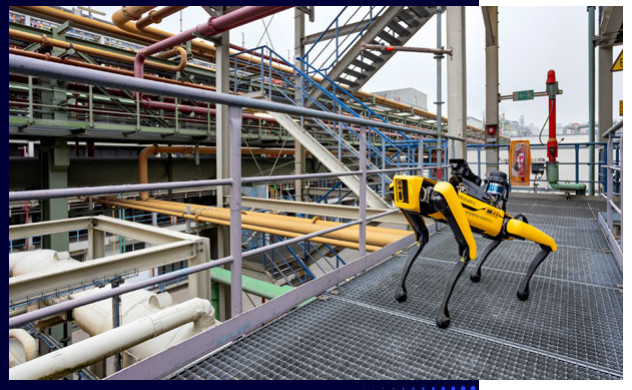 
September WACKER reaffimed its strategic growth and sustain ability targets presented in 2022: by 2030, WACKER aims to achieve sales in the region of E10 billion and an EBITDA margin of over 20 percent. AIso by 2030,absolute $CO_{2}$ emissions will be reduced by more than 50 percent as against the 2020 baseline. 
September Silicon is WACKER's most important raw material. Over 60 percent of our products are based on silicon. Silicon is produced from quartz and carbon.WACKER has its own production site in Holla, Norway, where carbon dioxide generated from silicon production was successfully captured in a pilot project. The capture process allows us to utiize or store the carbon dioxide generated during silicon production. 
November WACKER employs not only teams of experts, but high-tech colleagues too - robots that carry out a wide range of tasks. One of our latest Al-aided ventures is a robotic dog that supports production teams in inspecting plants. The German Chemical Industy Association (VC) presented the robotic dog with ts Responsible Care Award in the "Best Digitalization Project" category. 
## 12 Celebrating 25 years of WACKER Middle East 
December WACKER Middle East was founded 25 years ago in Dubai with the aim of delivering tailored solutions to meet the challenges in the Middle East and Africa. Ever since, the site has been constantly expanding and it doesn't stop there: in 2024, WACKER Middle East was given the go-ahead for constructing a 1,000-square-meter extension, which will add to the current floor space and serve as an application technology center. 
WACKER Annual Report 2024 Highlights from 2024 
25

---

<!-- 原文第 21 页 -->

## We make a difference. 
## Collaboration and appreciation 
Together we are stronger. This principle extends beyond our internal operations at WACKER. We also collaborate closely with external partners. Take, for example, CordenPharma. 
WACKER Annual Report 2024 
We are WACKER 
26

---

<!-- 原文第 22 页 -->

Production takes place behind glass in cleanroom conditions at the mRNA Competence Center in Halle. 
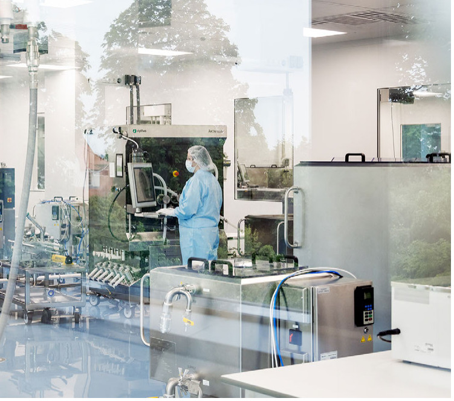 
"Together, we have achieved pandemic readiness in Germany in record time." 
Germany is ready. In the event of another pandemic, vaccine production is guaranteed - thanks to the collaboration between CordenPharma and WACKER. The German government signed preparedness agreements with the two companies in 2022,showing that lessons had been learned from the COVID-19 pandemic. 
Once the contracts had been awarded, the two companies embarked on a mammoth project with an ambitious deadline: they had just two years to achieve "pandemic readiness"and an annual production capacity of 80 million mRNA (messenger ribonucleic acid vacine doses. Should the need arise,the Center for Pandemic Vaccines and Therapeutics (ZEPAI) acting for the Federal Ministry of Health will contact the developer of the specific vaccine required. WACKER and CordenPharma will then jointly produce it. That is the plan. 
WACKER Annual Report 2024 
We are WACKER 
27

---

<!-- 原文第 23 页 -->

"We want to continue to grow at WACKER. Our biotechnology business plays a crucial role here." 
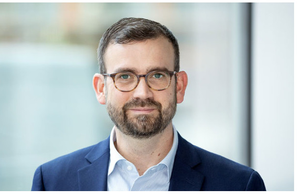 
Mathias Wiedemann, president of WACKER's Biosolutions division. 
## Working in tandem to cover the entire process chain 
"It was a challenge that none of us had ever faced before," recalls Andreas Anton, who heads the Pandemic Preparedness project at WACKER."But we have a great team and we collaborated very well with each other.Everything aligned perfectly - in terms of our companies' capabilities and also on a personal level." Between them, WACKER and CordenPharma cover the entire process chain for mRNA vaccine production - from the manufacture of plasmid DNA starter material to the flig f the fished mRNA active.Alexander Radspieler, Anton's counterpart at CordenPharma, explains the "rles of the gameof pandemic readiness: 
"First, secure a supply of vaccines by ensuring allessenia steps take place in Germany. Second, secure independence from external supply chains by ensuring the entire process occurs within the European Union." 
Against this background, WACKER chose to carry out production at its biotech site in Halle, Germany. There, it erected a new mRNA Competence Center,comprising four biopharmaceutical production lines.Groundbreaking took place on July 5, 2022. Less than two years later, the building was complete.This set a new world record for the fastest construction of a production facility for pharmaceutical actives. Meanwhile, CordenPharma decided that its production sites in Frankfurt am Main (Germany), Chenove (France) and Caponago (taly) would be brought into a state of pandemic readiness. It substantially expanded its lipid production capacity and simultaneously invested in supercritical liquid chromatography, an eco-friendly method of lipid purification. It also expanded its aseptic fill finish capacity. 
## Successfullystocking up on staff 
To ensure the project's success,the WACKER team in Hale drew up comprehensive plans and schedules. After alit was necessary to design and erect a new building. obtain the requisite equipment and hire and train considerably more staff.Anton recalls: "We went to great lengths to recruit talented individuals. For example, we ran a digital campaign using influencer videos to attract young people. That worked well." n just one year, WACKER recruited more than 100 staff in Halle. They were trained straight away, even though the high-tech building was not yet finished. Special rooms were fitted out so that they could practise operating the machines. Where these were not yet available on site,they practised on virtual reality modules. 
## Protection for the active ingredient 
Halle plays a key role in pandemic preparedness, because it is where all the central process steps take place. Says Anton, "The first thing we do there is produce the plasmid DNA,the starter material for manufacturing the mRNA vaccine." Radspieler continues,"After that,we add our lipids to create the vaccine formulation. This crucial process step combines the mRNA with lipids to form liquid nanoparticles (LNPs) These are then packed inside a molecular envelope that protects the sensitive vaccine 
WACKER Annual Report 2024 
We are WACKER 
28

---

<!-- 原文第 24 页 -->

Lipids for formulating mRNA active ingredients are stored in large steel tanks. 
when it is being delivered to the muscle cells at the injection site. Before vaccination can happen, though, the vaccine is deep-frozen and sent to our aseptic fil ftnis aityi aponago in northern ltaly, where it is packaged in pre-filled syringes and vials." 
The experience gained by WACKER and CordenPharma from working on their own projects during the early days of mRNA vaccine development is standing them in good stead. During the COVID-19 pandemic, CordenPharma produced the lipids for the Moderna vaccine. WACKER successfully produced a candidate compound. The process technology needed for industrial-scale mRNA vaccine production was scaled up at WACKER's Amsterdam site and laid the groundwork for setting up the mRNA competence center in Halle, where it ultimately invested over E100 million. 
## Flexible production lines 
"As we don't know which customer will be approaching us with a vaccine on Day X, we need to be prepared for everything." explains Anton."We designed the new facility around a modern process model that offers maximum flexibilit." As a result of this "ballroom concept",there are no fixed pipe systems in the production rooms in Halle,.Everything is designed to be as versatie and modular as possible, and the equipment is easy to move around. A"warm base" principle has also been adopted, whereby production equipment and staff are always on standby. The necessary raw materials and auxiliaries have also been stockpiled and are managed ia a special storage and monitoring system. A logistics system connects all participating sites. 
"For the next five years,we are in a state of pandemic readiness. If the German government gives the order to manufacture mRNA vaccines, we can start the production process shortly after." explains the WACKER expert. 
This readiness also benefits our customers. In pandemic-free times, WACKER uses the facities for pharmaceutical customers to produce active ingredients for clinical development."But we can, and we do,make much more than mRNA vaccines -such as protein therapeutics, vaccines and plasmids," Anton points out."We operate globally across our four biotech sites in San Diego, Amsterdam, Jena and Halle to ensure we always offer the best production conditions for a given product." Rapid switching between customer projects is a routine matter for WACKER and CordenPharma. As both are contract development manufacturing organizations or CDMOs, they are used to rapidly switching to other production processes. WACKER uses a least 50 percent of its capacity in Halle for customer projects, while the other half is reserved for vaccines production. 
## A top team with a sound plan 
Overal,th pandemic readiness project involved several hundred staff members from WACKER and CordenPharma who spent many thousands of hours working on it Without strong teamwork and mutual appreciation between WACKER and CordenPharma, this Herculean task would never have succeeded. Radspieler returns to this topic. "As we worked on the project, our trust in each other grew and that is what led to our joint success. We are now the only CDMO that can provide this service from start > 
WACKER Annual Report 2024 We are WACKER 
29

---

<!-- 原文第 25 页 -->

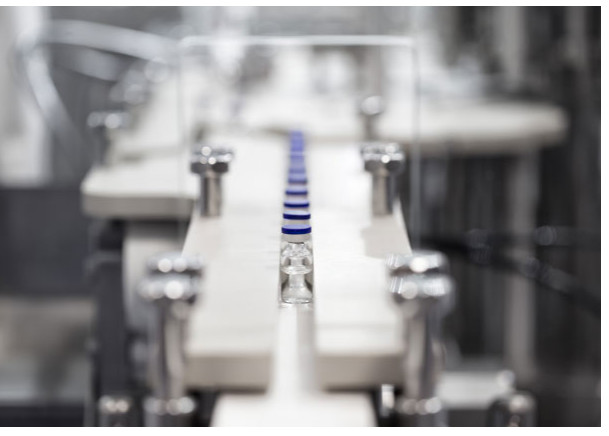 
to finish. We have seen that we are a good match for each other and we can also win new projects in the future." As the experts from WACKER and CordenPharma never tre of saying: Pandemic readiness depends on sound plans - and on staying in close contact with all partners. After all, you want to play safe in the event of a new pandemic. 
In Halle, Anton and his team have everything under control: time management, coordination of and collaboration with partners, service providers and ZEPAI. On March 27, 2024,he notified the authorities of pandemic readiness. Following intensive audits, the official confirmation came on June 1 that WACKER and CordenPharma are pandemic-ready."That was the cherry on the top of the cake,"says Anton,"because our mRNA Competence Center officially opened just two days later. It's amazing what you can achieve as a team." 
Aseptic filing line at CordenPharma in Caponago (taly) 
Andreas Anton (left), Senior Project Leader for Pandemic Preparedness at WACKER Biotech and Alexander Radspieler, Global Project Manager at CordenPharma 
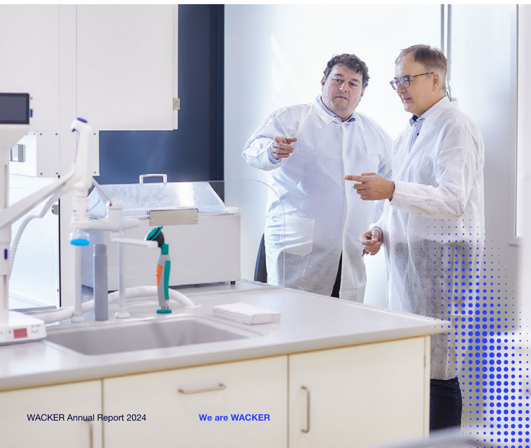

---

<!-- 原文第 26 页 -->

## We empower creative minds. 
## Vision and openness 
Questioning the way things are, being open to new ideas and always looking beyond the horizon - these are the hallmarks of WACKER employees all over the world. And Martina Schulze-Adams is no exception 
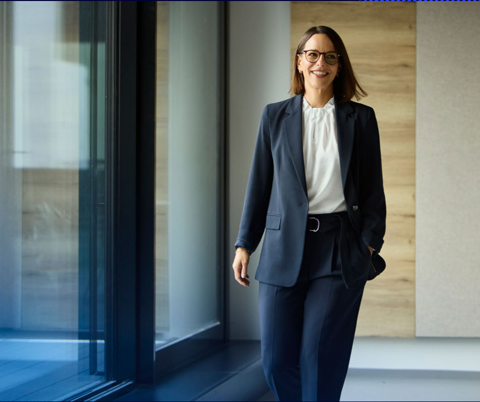 
WACKER Annual Report 2024 We are WACKER 
31

---

<!-- 原文第 27 页 -->

180 
million euros is the amount that WACKER invests in research and development every year. 
Manager and researcher: Martina SchulzeAdams became the senior vice president of WACKER's Corporate R&D in May 2024. She and her team are working hard to secure the future of WACKER's business. 
Martina Schulze-Adams is the senior vice president of WACKER's Corporate R&D and head of the Consortium,the company's central research facility in Munich.Guided by her vision and pioneering spirit, she works with her team to drive innovation, securing WACKER's position at the forefront of technological progress. 
Ms. Schulze-Adams, WACKER is one of the most researchoriented chemical companies in the world. What issues are you currently pursuing in Corporate R&D? 
Sustainabilit is a major driving force right now.Most of our research projects revolve around sustainabilit., We're also investing quite a lot in biotechnology, with over half of our lab space at the Consortium dedicated to biotech. And it doesn't stop there: we're also opening a new biotech center here on site in 2025.Those investments- which run in the double-digit-million-euro range -will help us continue strengthening Group research here at WACKER. 
But there's one thing I'd especially lie to emphasize: research should never be an end in itsef it should always move WACKER forward as a company. That was one of the founding principles of the Consortium, and it remains our standard to this day. Innovation is how we hope to make the world a little bit better. It's our purpose. That means consistently gearing our efforts to the needs of the market and of our customers,while also making sure we maintain a clear focus on the business and our finances. 
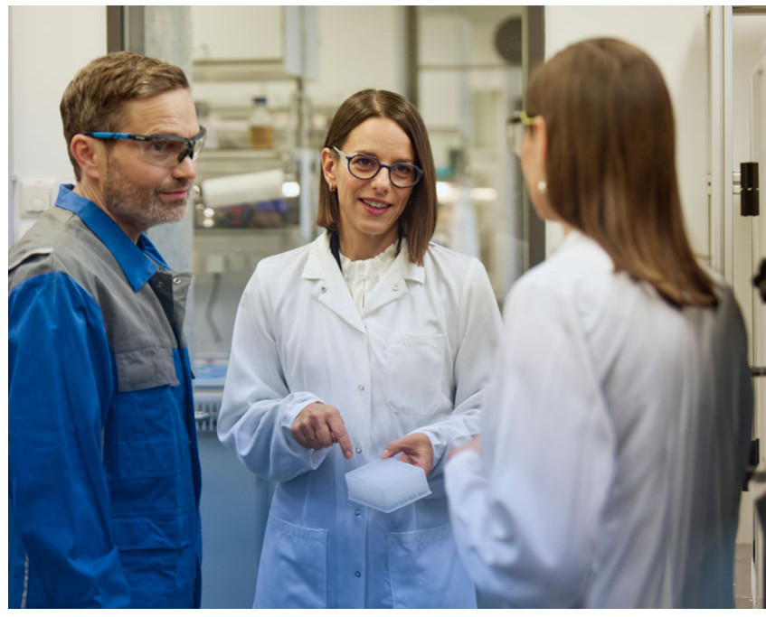 
WACKER Annual Report 2024 
We are WACKER 
32

---

<!-- 原文第 28 页 -->

## How much in total does WACKER invest in research and development? 
Over 180 million euros per year. WACKER currently has about 350 ongoing research projects throughout the world,which ensures our business remains on a solid long-term footing.We support all f our business dlvisions.in ur Payrmers division, for example,we're primarily concerned with maintaining steady progress in product development and expanding into new applications. If we didn't,we would be just another chemical company. The main focus in Polysilicon is on process improvements and on the question of how to continue increasing the purity of our products. We have to make sure that we're always taking the lead in that respect, especially when it comes to our semiconductor materials. But that's basically true for everything we do:we conduct research in order to maintain a technological edge on the market. 
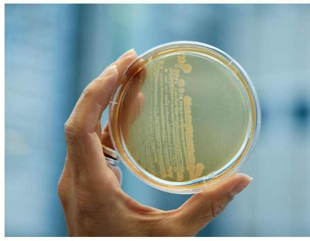 
## Easier said than done.How do you generate new ideas? 
There's no patented formula for that, It ultimately comes down to interactions between a number of factors. We take a systematic look at major trends like sustainability or artificial intelligence, of course,which also includes having a regular presence at research conferences and congresses. Another traditional - and equally important - strategy is staying abreast of scientific publications: I often hear people say things like, "You know, I was just reading something that I think could really move us forward. And some ideas just arise by accident, at lunch or in a meeting. Somebody might learn that there's a chemical that biologists use for oxidation, and suggests that they do it electrochemically instead; not only would that make the process cleaner, but, if they used green electicit, it would be more sustainable too. That example highlights the huge benefit of the Consortium it brings people together from completely different disciplines,from molecular biology to organic chemistry to electrochemistry.And that enriches everyone 
## To what extent do you cooperate with external research partners? 
Even though WACKER has an enormous wealth of knowledge and experience, there are limits,of course.And we have to overcome those. That's why it's so important for us to be open and collaborate with universities, research institutes, startups and other companies and industries. And that's exactly what we do. We maintain collaborative relationships with 45 scientiic institutions. Two years ago, we founded the TUM WACKER Institute for Industrial Biotechnology at the Technical University of Munich. Twenty PhD thesis projects are currently underway there. Plus, we also support a number of other PhD candidates from other universities and research institutes right here at the Consortium. 
## What priorities do you set when it comes to collaborating with external partners? 
Cross-sector collaboration - cooperating across various industries, in other words - is becoming increasingly important for us. That might mean joining forces with experts from the steel or cement industries, for example, in order to work on better recycling processes. One great example of this is the "Reallabor"-the "realworld laboratory"- in Burghausen. Companies from various industres have come together there to study sustainable hydrogen use under realistic conditions. 
## Overview of the WACKER Consortium 
Central research facility at WACKER Established in Nuremberg in 1903 Moved to Munich in 1918 Some 200 employees Areas of focus: biotechnology, basic research on electrolysis, siane chemistry, process and product improvements 
In research you have to work with an eye to the future - looking ahead five to ten years or more. It takes a long time, in other words, before an idea results in a concrete product. What are the keys to success during that long process? 
Vision and staying power are important. Fortunately, WACKER is a company with a long-term mindset and doesn't just focus on its next-quarter earnings. That allows us to approach research 
WACKER Annual Report 2024 We are WACKER 
33

---

<!-- 原文第 29 页 -->

"Research should never be an end in itself - it should always move WACKER forward as a company." 
projects with a view to the long run. A lot of our projects are set to last for three to five years. That's a huge advantage for a researcher like me. But I'm also a manager. That means being both courageous and consistent enough to stop projects when we see that we're not going to achieve our goals. It may be that customer and market preferences have shifted somewhere along the way, that we've reached the limits of a given technology,or that we can't reach our business and financial goals. Being a researcher and manager at the same time isn't always easy: it's a tightrope walk but, ultimately, it's also exactly what l love so much about this job.· 
After studying chemistry, followed by a post doc in biotechnology, Martina Schulze-Adams knows what she's talking about. Before she assumed the leadership of Corporate R&D, she was the head of Corporate Development and Sustainability at WACKER. 
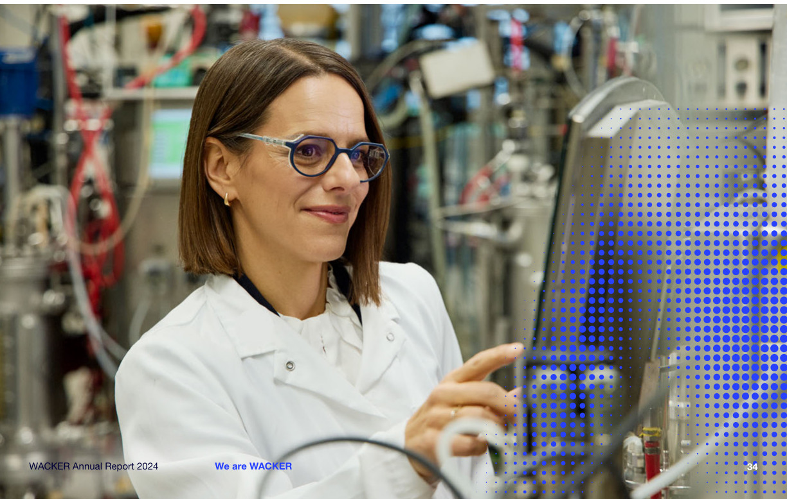

---

<!-- 原文第 30 页 -->

## We challenge the status quo. 
## Performance and passion 
WACKER silicone cartridges recently became available for online purchase by end users in China. This marketing channel was established by a passionate and committed six-strong team. 
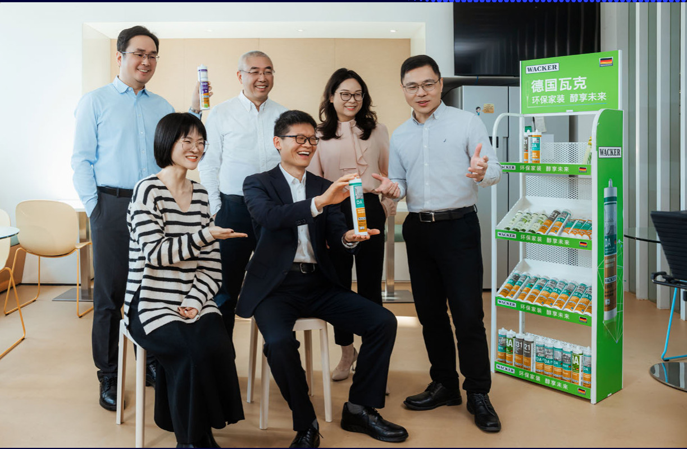 
WACKER Annual Report 2024 We are WACKER 
35

---

<!-- 原文第 31 页 -->

#1 
WACKER tops the Chinese online trading charts for customers looking for silicone cartridges. 
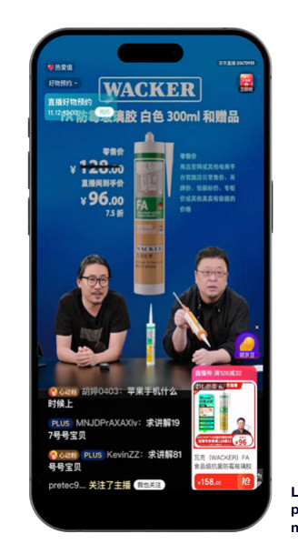 
Livestreams and chats on online portals are key components of the new marketing concept. 
These products are offered on livestream shows and praised by skilled professionals and ambitious DIYers in internet chat rooms: silicone sealants from WACKER have become available in China on all key business-to-customer sales platforms. Consumers wanting to stock up on the green and gold cartridges with the WACKER logo no longer have to turn to specialty retailers or to their local home-improvement store - now they can order the products on the internet and have them sent straight to their door. And business is humming right along. One in every five WACKER cartridges already makes its way into customers' hands through online channels.And that number is growing. 
The key driver for this success story is a cross-functional six person team in China. "We were pretty sure that the marketing model would work," says George Lu, who heads the sealants business for WACKER China."But even I was surprised by what a hit it turned out to be." The years of work that went into the marketing concept paid ff.In 2024,the team received the company's most important research honor - the Alexander Wacker Innovation Award. 
Lu, who lives and works in Shanghai, has been involved with silicone sealants ever since he joined the company ten years ago. There was one issue though that bothered him. "WACKER offers high value products,but conventional distributors often aren't interested in actively promoting this. They care more about cost," he says."So I asked myself: how can we promote the value of our high performance sealants more directly and efficiently to end consumers." 
Silicone sealants are the only ready-to-use product in the portfolio of the chemical group. Once dispensed into cartridges, they can be used immediately as adhesives, for sealing joints in kitchens and bathrooms or for installation projects. As a result, no other product lends itself to B2C marketing quite as well. However, WACKER follows iferent regional marketing models: the company name does not appear in Europe or the Americas, for example.Customers there market the cartridges under their own brand names. Cartridges bearing the WACKER logo are available only in certain countries in the Middle East, Africa and Southeast Asia. And in China. 
When Lu assumed leadership of the sealants team in 2020,the company had already had some intia B2C experience.In 2007, WACKER China offered silicone sealants under its own brand name via distributors. However, the initiative was only modestly successful. Lu responded with a new approach that focused on alkoxy sicones, an indisputable premium product. Unlike other sealant technologies, such silicones offer multiple advantages at once: as non-acidic grades, they can be used in various indoor decoration scenarios. They are also highly suitable in bathrooms and wet rooms, where reliable anti-fungi performance is requested. And in terms of consumer protection, alkoxy sealants are especially safe for the user and the environment, as they only emit alcohol during the curing process. 
WACKER Annual Report 2024 
We are WACKER 
36

---

<!-- 原文第 32 页 -->

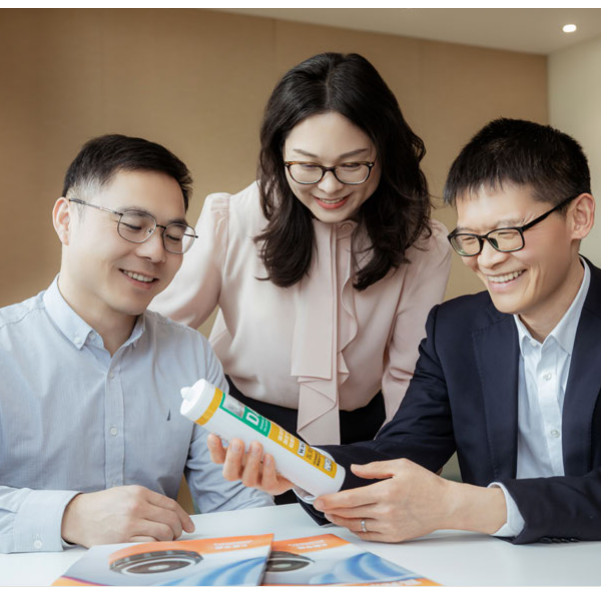 
Delighted with their stroke of marketing genius (from left to right: technical service manager William Wang, distribution manager Maria Mei and business team head George Lu. 
"f you want to be successful in China, you have to offer the customer something that the others don't," says Lu. 
In 2020, his team started marketing WACKER DA, an alkoxy sealant that is both durable and antiungal,hence the acronym "DA". The antifungial property was also analyzed and certified by an independent testing instiute - an utter novelty in China. "WACKER was the first company to put a product like that on the market. So, after a comprehensive marketing campaign, DA became a bestselle, and the WACKER brand was suddenly famous," recalls William Wang,a technical service manager who joined the business team at the time. The consequences of the COVID pandemic also accelerated the business. Many people in China used the pandemic lockdowns as an opportunity to modernize their bathrooms. Low-odor products were in particularly high demand. 
## Sealants in China:fierce competition 
At his office in Beijing, proiect team member Rula Wang provides marketing support for silicone cartridges in the northern part of the country. He has been in the business as a marketing manager for many years and knows the market like the back of his hand. With over 1,000 manufacturers,China is one of the most challen ging sealants markets in the world. Intense competition and a weak construction industry had been generating downward price pressure for a long time, Wang explains."Construction companies and craftsmen generally opt for cheap products in order to keep costs low, but that leads to defects and complaints. Unfortunately, not enough customers know that you can prevent all that by using high-quality products like our alkoxy silicones." 
But that's changing now.The internet and its marketplaces are turning the B2C business on its head - and taking the buying habits of many customers in China with them. China is already one of the world's most important online markets. Over one billion Chinese regularly shop online for clothing, food,cosmetics and consumer electronics- just about anything you need for private consumption. And that includes silicone cartridges. 
When examining several e-commerce models, Rula Wang. supported by his colleagues from Distribution Management, Maria Mei and Qiang Cao, quickly realized that WACKER had neither th resources nor the logistics to manage the complexity of online retail by itself. So the managers decided to head in another direction instead,pursuing a variant in which distributors are responsible for the online business. AII WACKER has to do is provide the cartridges and the sales and marketing expertise. "The distributors manage all of the online ordering and payment processes, they do the packaging and shipping, and they even process and handle complaints," Cao explains."Our role is to train the sales personnel and to provide advertising materials for online platforms." 
Both managers have spent years studying the development of the sealants business on key online retail platforms. Their findings are hardly surprising: B2C platforms like Tmall, Taobao and Jingdong hold enormous possibity forth WACKER abel. "Double-digit growth rates aren't out of the question," Mei says. Online retail does have its own rules, however."WACKER has a lot of experience in the B2B world and is well established there. But in the B2C business, it's all about the brand. That makes these kinds of marketplaces fundamentally different from the platforms we're used to dealing with," points out Cao, who has been supporting distributors and retailers throughout China for nearly ten years. 
## E-commerce lite 
WACKER began gathering e-commerce experience on Taobao in 2015. The platform,a Chinese eBay of sorts,has 500 million registered visitors, making it one of the most-visited websites in China. In 2018, WACKER followed up with online stores on Jingdong and Tmall, which are the two largest B2C marketplaces in China. Starting in 2022,WACKER products also became available on Suning - more or less a Chinese version of Amazon - as well as on Pinduoduo and TikTok. The latter also features its→ 
WACKER Annual Report 2024 
We are WACKER 
37

---

<!-- 原文第 33 页 -->

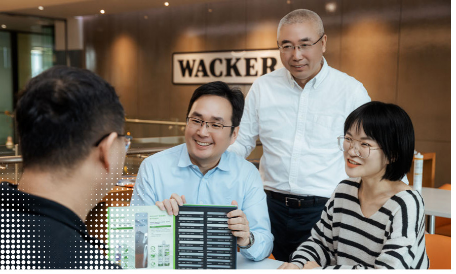 
An interdisciplinary team: PR expert Sijie Xiao (right provides support to vloggers in online social networks with the help of marketing manager Rula Wang (left) and distribution expert Qiang Cao. 
own shopping app in China. Users here can purchase products online immediately without having to switch over to an e-commerce marketplace. 
The new marketing model was a bit of a hard sell alfist"'*our material was good,but people didn't know our brand well enough," Cao recalls. Sales figures did not start to go up until distributors began incorporating more advertising and the business team decided to focus on alkoxy sealants for indoor decoration. Livestream shows,which every major e-commerce platform in China offers nowadays, proved to be particularly effective.These ongoing adverising prgrams exclusively pitch brand-name products, uch as WACKER silicone cartridges. During the broadcast, viewers can ask questions using the live-chat feature and immediately receive answers in real time. 
The investments are paying off.In internet searches, cartridges bearing the WACKER logo with an overlay of the German flag are routinely among the top hits."For a lot of Chinese,the 'Made in Germany label stil seavs a sea f puaity ur prducts benefit from that too," says Rula Wang.Distribution expert Qiang Cao agrees. Among online retailers, WACKER cartridges have actuall gained cut status he note."A ot f people even compare the WACKER brand to Apple." 
## Do it yourself 
Staring in 2023, the marketing team also began exploring social media opportunities. Do-it- yourself videos on platforms like Xiaohongshu were particularly interesting. In these, homeowners -even those with little in the way of handyman skills - can learn how to seal a joint perfectly and discover which silicone they need to guarantee a successful job. These kinds of product recommendations are a gold mine,which is why collaboration with do-it-yourself experts has recently begun playing a bigger and bigger role for the project team. Starting in 2023, the marketing team also began exploring social media opportunities. 
That's especially true for SijiX Miao. The PR exper, whose role includes corporate and marketing communications and support for the WACKER Academy in Shanghai, is the first point of contact for social media inquiries. Her work currently revolves around three platforms:WeChat - for posting company and product news - TikTok and Xiahongshu, which are also used for influencer marketing."You can't measure the success of our work in sales numbers,"Xiao points out."lt's more about estabishing WACKER as a powerful brand and earmning positive reviews that grow our brand value significantly." 
The success of the new business model in China could also be a blueprint for other regions. Qiang Cao, who is already investigating several new online options, agrees."With our example,we would like to encourage other teams in the global WACKER network to take a close look at the possibilities the internet offers for the direct marketing of their products locally" 
WACKER Annual Report 2024 
We are WACKER 
38

---

<!-- 原文第 34 页 -->

## We go beyond. 
Integrity and example So many WACKER employees go above and beyond in their work. They are united by the drive to do their bif for a beter world. Here are eight examples. 
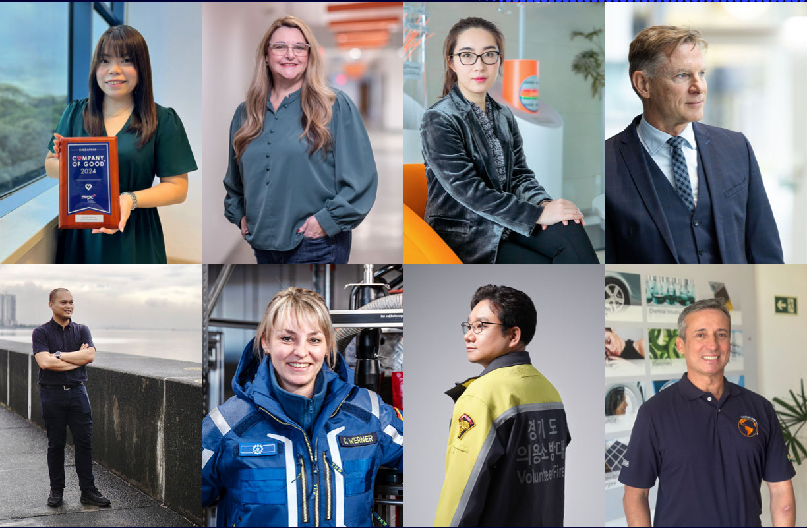 
WACKER Annual Report 2024 We are WACKER 
39

---

<!-- 原文第 35 页 -->

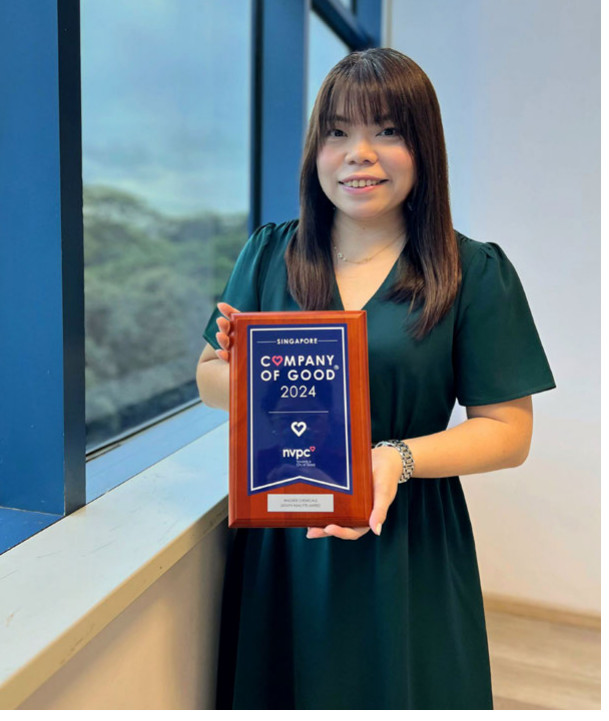 
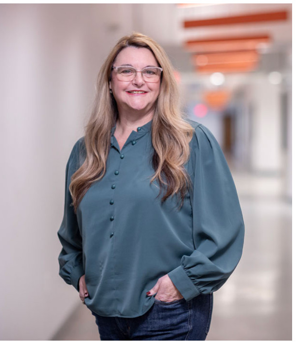 
## Carolyn Ng 
Cancer is one of the most common causes of death worldwide. Together with colleagues, Carolyn therefore supports the Singapore Cancer Society.For example, the team packs bags of basic foodstuffs for the holidays and delivers them to the homes of cancer patients from low-income families."This also allows us to talk directly to the patients, get to know their living conditions and find out if they need further help." says Carolyn."We then inform the Cancer Society in order to further improve support services." For Carolyn, a passionate commitment to the community is a natural part of her job as communications manager. Against this backdrop,she also heads WACKER's Social Responsibility Committee in Singapore. 
Role: Communications Manager, Singapore Initiative: Cancer aid 
## Lisa Mantooth 
Lisa is involved in many ways in her local community in Cleveland. About 20 years ago, she joined a project coordinated by Habitat for Humanity for the first time. She actively helped to build a home for a couple who were both confined to a wheelchair. This project not only brought to her attention the need for affor dable housing, but also housing that was equiped for people with disabilities."l had the feeling that I could make a difference for the people in my community tgether with others," says Lisa. "Regardless of whether it is a Habitat for Humanity initiative or other projects such as working with students in schools. t brings me joy to see how we as a WACKER team are committed to issues that are close to our hearts, even outside of work. This also strengthens WACKER's connection to the local community." 
Role: Community Relations and Communications Manager, Charleston, USA 
Initiative: Local commitment 
WACKER Annual Report 2024 We are WACKER 
40

---

<!-- 原文第 36 页 -->

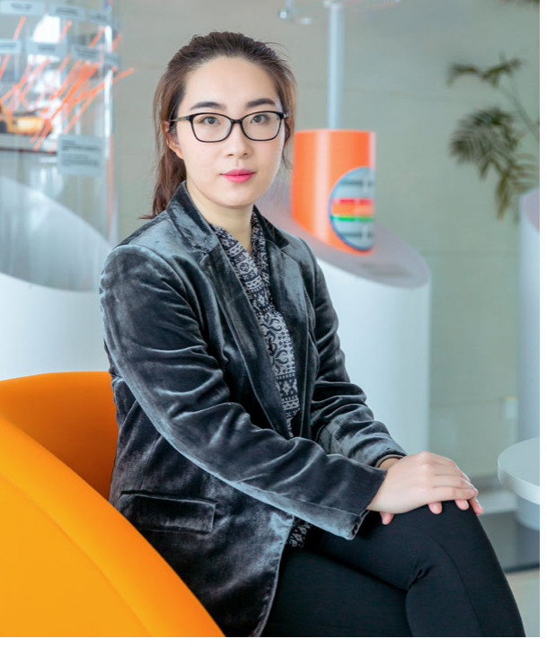 
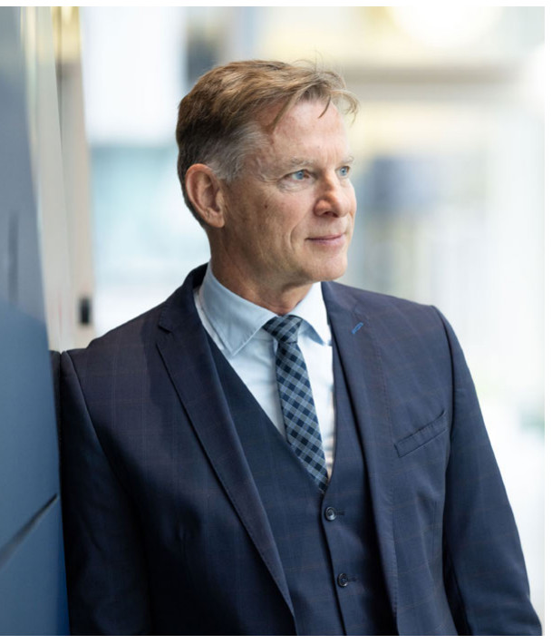 
Ying Wu 
"A child, a teacher,a pen and a book can change the world," is a quote from Malala Yousafzai, the youngest winner in the history of the Nobel Peace Prize.Ying, too, is also convinced of this. She is involved in WACKER Help,the Chinese subsidiary's charity organization. She has launched an educational program in which employees at WACKER's Zhangjiagang site teach students at a local elementary school. Since the beginning of 2023, Ying and her collagus have held a number of lessons at the school."We want to get students excited about scientfic topics and ignite their passion for them," explains Ying."One of the ways we achieve this is through interactive laboratory experiments and the practical presentation of complex topics such as the greenhouse effect." 
Role: Supply Chain Manager, Zhangjiagang,China Initiative: Science education 
## Mirko Kappelhoff 
In addition to his work at WACKER, Mirko is chair of the WACKER Relief Fund that supports victims of natural disasters in Germany and other parts of the world. "We focus primarily on educational projects and helping people to help themselves," Mirko explains. For example, the WACKER Relief Fund has contributed to the reconstruction of schools following earthquakes in China, Haiti, Nepal and Pakistan, and has been active during wars and after floods. For Mirko,itisiprtan to also go to the sites in person to get an overall idea of the situation. He recently inaugurated a solar-powered water kiosk in Togo - with a lasting impact on health and climate protection.He also visited a cooperation project in Kosgoda, Sri Lanka, where the WACKER Relief Fund has been supporting a school for two decades."These on-site visits are extremely valuable because they also ensure that our donations are well received," Mirko says. 
Role: Lawyer, Munich, Germany Initiative: WACKER Relief Fund (WACKER Hilfsfonds) 
WACKER Annual Report 2024 We are WACKER 
41

---

<!-- 原文第 37 页 -->

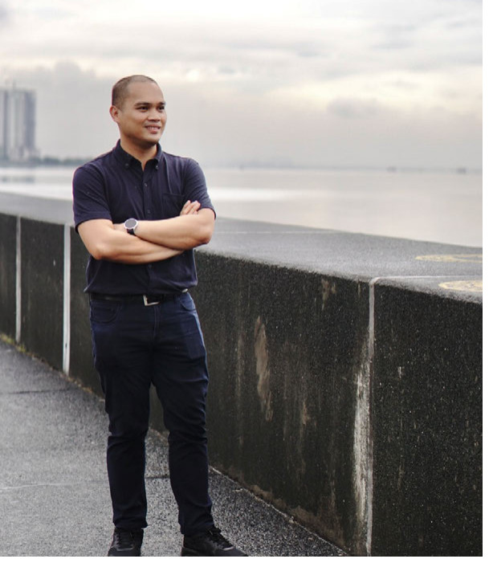 
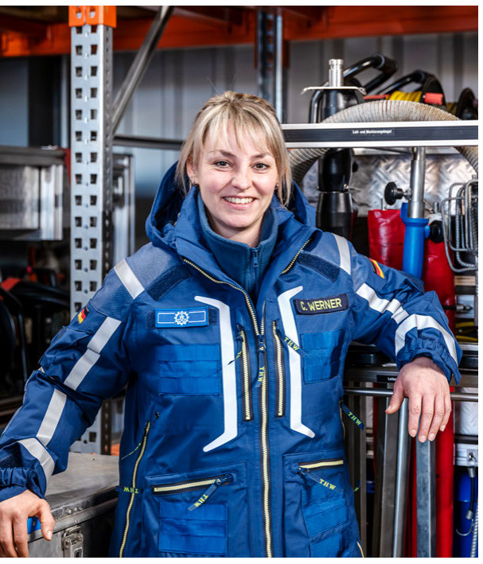 
## Jeffrey Maylas 
Jeffrey is experiencing the effects of climate change first hand in the Philippines: typhoons are occurring more frequently and flooding is increasing. Another problem is the increasing amount of plastic waste that clogs waterways and is washed ashore after a typhoon. In 2019, Jeffrey and his teammates therefore decided to join the international Coastal Cleanup initiative. Together, they remove waste along the coast and meticulously record the type and quantity for further analysis. "We want to lend a hand in our local community and help reduce pollution,"says Jeffrey, explaining his motivation."At the same time,we hope that the data we collect will also contribute to research into marine pollution and waste management worldwide." 
Role: Market Development Manager, Mania, Philipines Initiative: Coastal cleanup 
## Carolin Werner 
Since the devastating widfires in easterm Germany in the summer of 2022, Carolin has been volunteering for the Technical Relief Service (THW), Germany's civil potection and disaster response organization."I couldn't just stand by and watch, I wanted to help too," says Carolin. After six months of basic training, she is now working in emergency repairs and emergency supply. In this role, she helps wherever needed in the event of a disaster: setting up tents for the emergency services,ensuring the fuel supply and operating pumps. At the same time, she supports the youth work of the organization's local chapter."lt's worth leaving your comfort zone, taking responsibity and being there for others," Carolin remarks."Above al, pesonally appreciate the feeling of togetherness and the close contact with other volunteers." 
Role: Chemical technician at the polymer plant, Nunchritz, Germany Initiative: Disaster aid 
WACKER Annual Report 2024 We are WACKER 
42

---

<!-- 原文第 38 页 -->

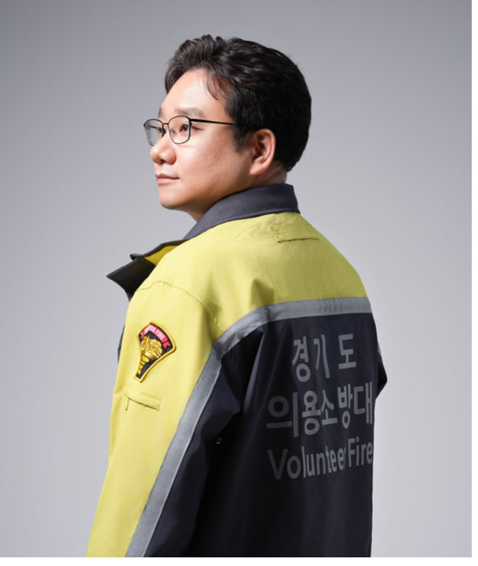 
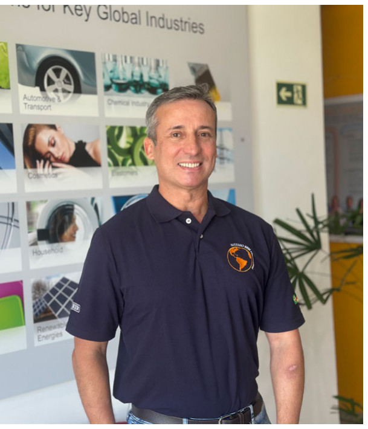 
## Joon-Beom Ahn 
A key experience spurrd Joon-Beom into action: a mass panic during the Halloween celebrations in Seoul in 2022.Many people lost their lives in the crush and many were injured. Together with friends, Joon-Beom then joined the volunteer fire department in his community. Late in the evening,he checks critical locations where fires could break out or heavy rainfall could cause flooding. Joon-Beom is also involved in accident prevention, trains children in first aid and is active as a lifeguard. "There are so many ways in which each individual can contribute to greater safety,"he says."I don't see my various volunteering efforts as a burden at all,but rather as a personal enrichment by making a contribution to the community." 
Position: Sales and Marketing Manager, Seoul, South Korea Initiative: Volunteer fire department 
## Magno Andrade 
Magno has always had a soft spot for the English language. Even as a schoolboy he helped his classmates in Brazil with their English. He later found out about volunteering as an English teacher through a chance contact on Linkedln.After the selecion process, e started work two years ago. Magno mainly teaches young people from low-income backgrounds who come from state schools and cannot afford the cost of an English course. "It's ascinating to see how the students develop over time and the progress they make," says Magno."It is also particularly motivating for me to feel the positive impact of this project on the pupis lives and ultimately their gratitude. This also spurs me on to continuously develop my skills as a teacher." 
Position: Maintenance Manager, Sao Paulo, Brazil Initiative: Working with students in schools 
WACKER Annual Report 2024 
We are WACKER 
43
