> 原文件：[23_www.bain.cn_202208220536478028.pdf](https://github.com/jadennevercode/CJCC-Knowledge-Base/blob/564ab11aa9785e569e3853c8a4d7ce86f88e7535/materials/%E4%B8%8A%E6%B8%B8%EF%BC%9A%E5%8D%8A%E5%AF%BC%E4%BD%93%E7%BA%A7%E5%8E%9F%E6%9D%90%E6%96%99/23_www.bain.cn_202208220536478028.pdf)
> 转换方式：Volcengine OCRPdf v3, parse_mode=ocr

<!-- 原文第 1 页 -->

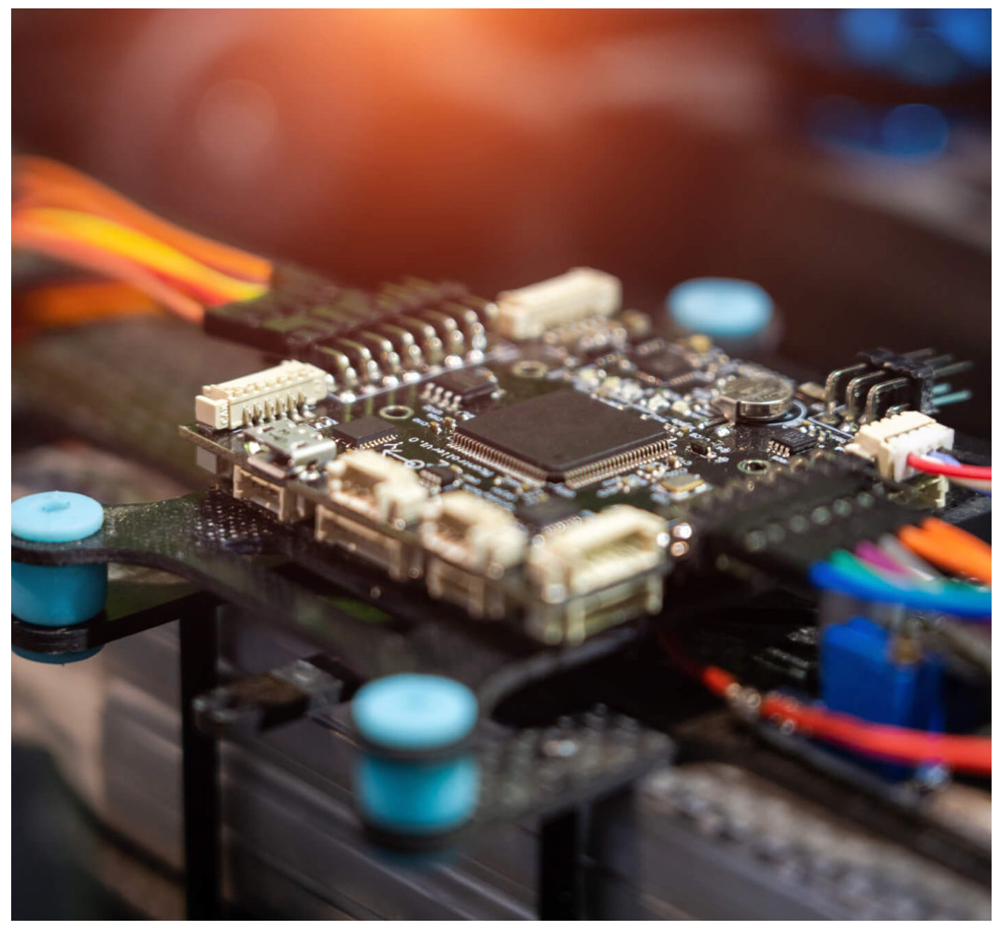 
中国半导体白皮书 
BAIN & COMPANY

---

<!-- 原文第 2 页 -->

本册著作权归贝恩公司所有。

---

<!-- 原文第 3 页 -->

## BAIN &COMPANY 
中国半导体白皮书 
目录 
寄语.…….pg.3
摘要.4
1.全球半导体产业链概况g.5
1.1全球半导体市场的规模、供给与下游需求分布…..p.5
1.2半导体价值链的主要环.p.6
1.3半导体价值链:各大环节的分布情况及主要玩家..g.8
1.31前端设备.…g.8
1.3.2原材料.g.9
1.33EDP.9
1.3.4设计环…….g.10
1.3.5代工环节.1
1.3.6封测环节. .p.1
2.中国半导体在价值链主要环节的参与..p.12
2.1前端设备p.13
2.2.原材料p.14
2.3EDA/IP.p.14
2.设计环节.14
2.5代工环节.pg.14
2.6封测环节.p.14
3.芯片设计环节中,中国半导体的市场地位..g.15 
1

---

<!-- 原文第 4 页 -->

## BAIN & COMPANY 
中国半导体白皮书 
4.中国半导体近期投资观察.pg.17
4.1目前投融资情况.pg.17
4.2投资总结、趋势..g.17
4.3中国协处理器玩家融资情况...20
4.31-A推理.20
4.3.2 Ai训练g.20
4.3.3图像处理..20
4.4启示pg.20
4.41面向投资者的启示.p.20
4.4.2面向经营者的启示.…g.21 
2

---

<!-- 原文第 5 页 -->

BAIN &COMPANY 中国半导体白皮书 
## 寄语 
 
邹娟 贝恩公司全球合伙人 大中华区能源转型业务主席 中国区可持续发展业务主席、高科技和云服务业务领导团队成员 
 
申文燮Moonsup Shin 贝恩公司全球合伙人 大中华区TMT业务联席主席 
 
彭弱溟 贝恩公司董事经理 
半导体芯片是数字经济的核心,是现代化产业发展的基石。近年来,全球各个国家和地区纷 纷加大对于半导体产业的投入力度,中国也相继推出了一系列相关的产业发展政策,整个行 业正面临前所未有的发展机遇。 
值此关键时刻,本次白皮书将基于贝恩多年以来的高科技行业咨询经验,结合对于中国半导 体公司的最新洞察,呈现全球半导体行业产业链概况,以及中国半导体在价值链主要环节的 参与。此外,我们还聚焦芯片设计等环节中国半导体企业的市场地位,并分享中国半导体近 期投资观察,为市场主体、产业新势力和广大投资者建言献策,希望助力各方致胜所关注的 半导体领域。 
3

---

<!-- 原文第 6 页 -->

BAIN &COMPANY 
中国半导体白皮书 
## 摘要 
近年来,伴随网络化、信息化、智能化飞速发展,半导体的应用领域不断拓展,在全球经济及社会发展中的 重要性与日俱增。2020年,全球半导体市场规模已达到3万亿人民币,至2025年,整体市场预计将保持7% 的年复合增长率。 
中国在半导体的设计和制造链条中起步较晚,积累相对薄弱。但随着半导体相关的产业支持政策频频出台, 配合下游的广大市场需求,将赋能中国半导体企业迎来新一轮发展。 
整体上,目前,中国厂商在通讯芯片、模拟芯片与OSD设计、成熟制程制造与封测环节产生较多的营收, 而在前端设备和原材料市场处于起步阶段,正逐步获取市场份额。值得一提的是,在芯片设计环节,中国企 业正加速步入快车道,尤其在存储芯片、模拟芯片已建立起了一定的竞争力,CPU/GPU/ASIC同样处于快 速起步阶段。这其中,云计算厂商(阿里,腾讯,Baidu等)对于计算和存储芯片有着巨量的需求,从定制 化性能、成本控制等目的出发,云计算厂商也积极参与到芯片的设计,是不可忽视的力量。在颠覆性的计算 芯片架构出现之前,ARM将凭借比RISC-V和MIPS,Alpha更完善的生态系统,和相较于X86更开放的授权 体系,以及国内大量的人才储备,成为中国CPU玩家的首选架构。而在存储芯片中,除了主流的NAND的 DRAM,利基市场的NOR Flash由于设计和制造门槛较低(专利已放开,主流制程65nm)也吸引了众多 国内公司进行探索。为了更好地展现中国半导体在芯片设计环节的市场地位,本次白皮书选取并展现了不同 半导体领域的公司洞察,涵盖CPU/GPU/ASIC、SoC芯片、存储芯片、模拟芯片。 
在时代的大背景下,贝恩建议,对于半导体市场主体,应积极开展上下游适配与协作,共同推动国产化生 态圈,并打造更有韧性的本土供应体系,锻造与国际厂商差异化的服务能力,从而及时响应下游客户的需求。 另外,关注潜在的收购机会,垂直整合强化现有业务。对于产业新势力,建议聚焦、主动参与和自身主营业 务有着强协同效应的半导体细分领域。 
而对于投资者,芯片设计仍是标的相对较多的热门赛道,中短期内,国内的AI/ML推理芯片需求全球领先, 而产业壁垒相对较低,将迎来快速发展,但行业的优胜劣汰带来的企业沉浮也不容忽视;而GPU/CPU领域 则有机会在中长期带来高回报。国内计算芯片设计玩家的快速发展,也给晶圆制造(Foundry)厂带来 巨大的代工业务机会,并有可能催生相对大而稳定的投资机会。同时,在摩尔定律发展放缓的行业环境下, 通过先进封装技术提高系统性能的优势越发显著,导致下游封装与上游设计及晶圆代工的联动愈加紧密,而 提前布局2.5D/3D先进封装赛道的中国封装厂商与其上游联动方也因此值得关注。 
展望未来,贝恩将致力于激发半导体行业各相关方的发展潜力,从而获得竞争优势,领跑新一轮增长。

---

<!-- 原文第 7 页 -->

## BAIN &COMPANY 中国半导体白皮书 
## 1.全球半导体产业链概况 
## 1.1全球半导体市场的规模、供给与下游需求分布 
Gartner和IDC全球半导体市场预测数据显示,2020年,全球半导体产品营收达到约3万亿人民 币,受到数据中心、IoT和NAND存储市场的需求驱动,至2025年,整体市场预计将保持约7%的 年复合增长率(图1)。 
展望未来,2020-2025年,IoT芯片的年复合增长率有望达到13%,数据中心和NAND存储市场 紧随其后。 
按照企业所在地划分,在上述总量约3万亿元的半导体市场中,美国的芯片销售占据了近一半的市 场份额,尤其以逻辑芯片为主,而韩国是存储芯片的主要供给地区(图2)。 
2020年全年,美国的芯片销售额达到了1.48万亿元,逻辑芯片占比超过60%,此后是韩国(5,600 亿元),日本(2,900亿元),欧洲(2,500亿元),中国台湾地区(1,900亿元)和中国大陆(1,500 亿元)。 
图1:2020年全球半导体产品营收达到约3万亿人民币;受数据中心、loT和NAND存储市场的需求驱动,预 计将保持-7%的复合年增长率至2025年 
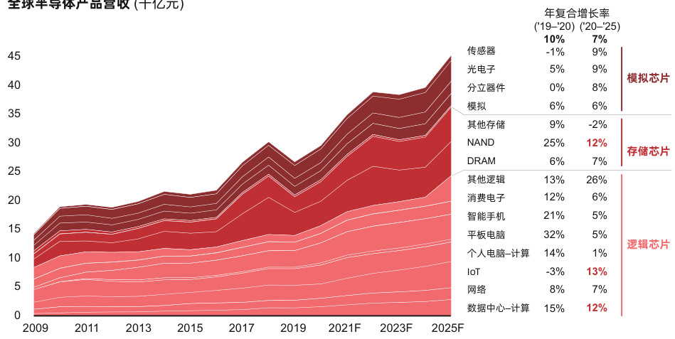 
注:历史数据来自Garner;除数据中心计算芯片预测来自IDC外,其余预测均来自Gartner;数据中心计算芯片2025F数据采用2020-2024F复合年增长率计算而得 资料来源:Gartner Semiconductor Forecast Database,Worldwide,更新至2021年一季度;IDC全球半导体应用预测器,更新至2020年7月 
5

---

<!-- 原文第 8 页 -->

## BAIN & COMPANY 中国半导体白皮书 
图2:在总约3万亿人民币的半导体市场中,美国芯片销售占据近一半的市场份额,其中以逻辑芯片为主;韩 国是存储芯片主要供给地区 
2020年全球半导体产品营收,按总部地区划分(千亿元) 
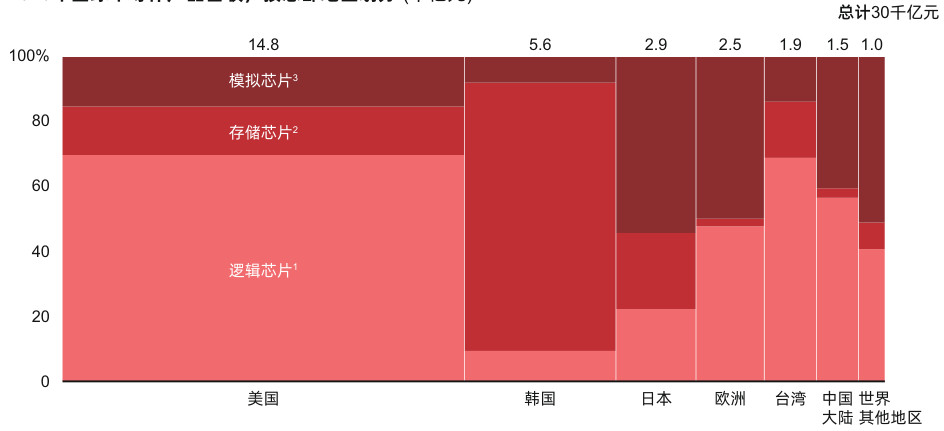 
注:1.包括Gartner定义的显示驱动器、GPU、FPGA和其他逻辑芯片,有线连接、无线连接、集成基带/应用处理器、分立蜂窝基带、分立应用/多媒体处理器 以及其专用电路)包括MN新兴和其他存储芯片产品;.包括Gae定的包括模拟芯片、电子器件、非光学 资料来源:Gartner Market Share Semiconductors by End Market 2020 
细分市场方面。按照主要应用划分,数据处理(约1.1万亿元)、通讯(约1万亿元)是半导体产品 的中坚营收力量。而不同应用领域中手机的营收表现突出,占比高达约25%,剩余市场较均匀地分 布在工业电子设备、消费电子、汽车等多个下游应用领域(图3)。而对手机、汽车及各类消费电 子产品,中国都是世界最大的制造基地和终端需求市场之一,这就为半导体芯片在中国的发展奠定 了坚实的需求基础。 
## 1.2半导体价值链的主要环节 
近年来,伴随网络化、信息化、智能化飞速发展,半导体的应用领域不断拓展,在全球经济及社会 发展中的重要性与日俱增。与此同时,越来越多的国家纷纷加码半导体,各个国家在半导体价值链 中拥有不同的竞争优势。 
半导体产品涉及的技术十分精细复杂。价值链主要包括设计、制造、封装环节;上游设备、材料、 设计软件等也不可或缺(图4)。 
作为科技含量最为密集的行业之一,首先,研发是半导体价值链上的一大重要环节。参与研发的玩 家大多为学术机构、政府机构和头部企业,比如法国的CEA-Leti公司、中国台湾工业技术研究院 (ITRI)等。实践中,研发水平对于行业技术的发展起到了至关重要的作用。目前,各国的研发 人员致力于提高半导体产品的算力、存储密度、速度并降低成本和功耗。考虑到研发水平难以量 化,因此在下文中不详细展开。 
6

---

<!-- 原文第 9 页 -->

## BAIN & COMPANY 
## 中国半导体白皮书 
图3:在总约3万亿人民币的半导体市场中,手机占比最大,高达-25%;剩余市场较均匀的分布在多个下游应用 
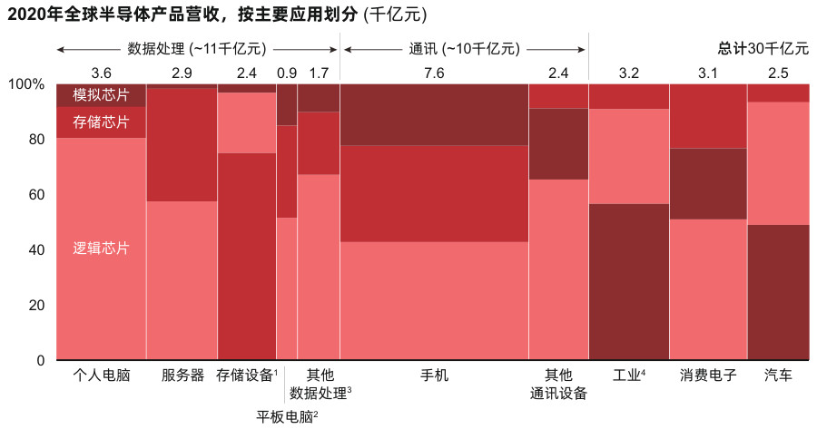 
注:设设包携实型使携包入的所其他据理电产品 资料来源:IDC全球半导体应用预测器,4Q2021 
图4:半导体价值链主要包括设计、制造、封装环节;上游设备、材料、生产工具也不可或缺 

| 核心研发1 | 半导体制造上游 | | | 半导体设计和制造 | | |
| --- | --- | --- | --- | --- | --- | --- |
| 设备 | 原材料 | EDA/IP | IC设计和IDM | 逻辑芯片制造 | 封装和测试 |
| 半导体行业是研发 最为密集的行业之 研发推动行业 技术的发展 研发人员始终致力 于提高半导体产品 的算力和速度且降 低成本 玩家大多为学术机 构或政府机构 | 大多为单一供 应源,备货周 期长 需投入大量时 间和金钱,打 造洁净厂房, 放置设备 | 前端包括硅片、 金属以及各类化 学品和气体 后端包括封装材 料或基材 大多为单一供 应源 | EDA是实现IC设 计流程自动化的 必备软件工具, 该流程极为模块 化,包含数十亿 个组件 IP是指可以授权 给第三方的半导 体IP块/核 | 通过架构和设 计,以实现芯 片产品需求 芯片设计主要 包括逻辑、存 储和模拟芯片 IDM兼顾设计与 制造步骤 | 摩尔定律驱动 按硅片尺寸(如 12英寸、8英寸) 和制程(如28纳 米vs.7纳米)划分 研发/资本极其 密集 | 通过引线键合、倒 装等技术使芯片与 外部电路连接 劳动密集型,通常 外包给OSAT行业 创新活动日益活跃 |
 
玩家示例 
ITRI 
KLA 
Siltronic 
新思科技 
英特尔 
台积电 
日月光集团 
SEMATECH 
GlobalWafers 
Cadence 
恩智浦 
三星 
安靠科技 
CEA-Leti 
ASML 
Applied Materials 
SUMCO 
Mentor Graphics 
瑞萨电子 
联华电子 
长电科技 
Semiconductor Research 
Shin-Etsu 
英伟达 
GlobalFoundies 
三星 
Corporation IMEC 
注:1.研发是价值链上的一大重要环节,但由于无法实现量化,在下文中不作详细展开 资料来源:案头研究 
7

---

<!-- 原文第 10 页 -->

## BAIN &COMPANY 
## 中国半导体白皮书 
半导体制造的上游支撑产业 
最上游的企业负责生产半导体设计制造所需的设备、原材料和EDA软件。这些设备、原材料、EDA软件被 广泛应用于制造集成电路(1C)、光电子器件、分立器件、传感器等领域,是半导体产品设计制造的前 道工序,也是整个价值链中不可或缺的组成部分。 
具体看,半导体的生产设备备货周期长,大多为单一供应源,并且在全球范围内涌现出了一批代表性企 业,比如,专注于光刻机领域的荷兰公司阿斯麦尔(ASML)、提供晶圆缺陷监测系统的美国KLATencor公司。为了打造洁净的厂房并放置生产设备,这些公司通常需要投入大量的时间和金钱,属于重 资产公司。 
除设备以外,在制造半导体的过程中,还离不开前端及后端原材料,前端材料包括硅片、金属以及各类化 学品和气体,后端则包括封装材料或基材。类似生产设备,半导体原材料大多为单一供应源。以硅晶圆为 例,由于半导体级硅晶圆对于纯度的要求极高(99.999999999,因此,行业壁垒高,当前,领先企 业包括德国硅晶圆制造商世创(Siltronic)和日本信越半导体(Shin-Etsu)等。 
此外,在半导体制造的上游产业中,由数十亿个组件构成的EDA(电子设计自动化)是实现半导体元器 件和集成电路设计流程自动化的必备软件工具,是半导体市场的先驱和风向标。在该领域,国内企业与三 大国际巨头新思科技(Synopsys),明导国际(Mentor Graphics),楷登电子(Cadence)仍存在一 定差距,需要长时间与晶圆代工联动的设计数据库积累,和相关人才投入,逐步提升产品竞争力。 
值得一提的是,随着集成电路技术升级,半导体行业的分工趋于细化,半导体IP核,即可以授权给第三 方的知识产权核迎来新一轮增长 
半导体设计和代工 
经过多年的发展,半导体生态逐步完善,主要包括设计、代工、封装和测试环节。 
设计环节。主要有IC设计(集成电路设计)和IDM(垂直整合制造)两类企业,前者只参与芯片和集成电 路的架构和设计,后者则兼顾了设计与制造步骤。代表企业有英伟达、恩智浦半导体、英特尔、三星等。 代工环节。一直以来,逻辑芯片的制造受到摩尔定律的驱动,遵循集成电路上可以容纳的晶体管数目大约 每两年会增加一倍的规律演进,而在摩尔定律的推动下,半导体制造走向"更大硅片"和"更小制程"以 降低制造成本和功耗。按照尺寸和制程划分,当前主流为8英寸/12英寸硅片;以及65纳米/28纳米/7纳米 等不同制程。代表企业有台积电、联华电子等。 
封装和测试环节。封测指的是通过引线键合、倒装等技术,使芯片与外部电路连接,是半导体价值链中必 不可少的下游环节,具有劳动密集型的特征,通常由外包半导体封装测试行业(OSAT)完成。值得注意 的是,贝恩观察到,封测厂商常常需要提供定制化服务,与设计厂商进行联合开发,以此保证紧跟芯片产 品的需求,所以,该环节的创新活动日益活跃。代表企业有日月光集团、安靠科技等。 
## 1.3半导体价值链:各大环节的分布情况及主要玩家 
## 1.3.1前端设备 
晶圆制造通常包含沉积、光刻、刻蚀、离子注入4大核心步骤组成。首先,使用沉积设备(如 CVD、PVD、ALD)在基材表面沉积多层薄膜;其次,在晶圆表面均匀涂上光刻胶,使射强激光通过含有 
8

---

<!-- 原文第 11 页 -->

BAIN & COMPANY 
中国半导体白皮书 
电路设计的光掩膜,将其设计图形刻制到晶圆表面;第三,刻蚀形成3D图形;最后,将离子材料、掺杂剂 注入晶圆,通过带电的离子控制电流,并实现晶体管的功能。 
Gartner全球市场份额数据、半导体晶圆厂设备公司招股说明书、分析师报告综合显示,2020年,全球 半导体前端设备的市场规模已达到4,200亿元,基于上述制造步骤,刻蚀、光刻、沉积设备占据了约75% 的营收份额,并且保持平稳增长。中国厂商在主要前端设备市场处于起步阶段,从沉积、刻蚀设备开始获 取份额(图5)。 
## 1.3.2原材料 
在半导体的上游产业中,不同的材料被应用于不同的生产步骤,缺一不可:硅片是半导体器件的主要载 体,气体被广泛运用于掺杂、外延、离子、刻蚀、化学气相沉积等生产步骤,光掩膜可以把集成电路的图 形转印到硅晶圆上,光刻胶可以将光掩膜版图案转移到光刻胶再转移到晶圆片 
贝恩结合案头研究、公司报告和券商研报发现:纵观半导体材料市场,市场较为稳定,2020年,全球前 端材料市场规模约2,100亿元,2018-2020年复合增长率为5%。硅片、气体、光刻胶、光掩膜版是主要 的上游材料,占据了约80%的营收份额。 
## 1.3.3 EDA/IP 
EDA和IP贯穿芯片制造的全流程,是芯片设计的重要工具,可以缩短芯片的开发时间,并提高芯片性 能。ESD Alliance研究报告以及各个公司年报和券商研报表明,2020年,全球EDA和IP的市场规模达到 了745亿元,且增长稳健。 
图5:中国厂商在前端设备市场处于起步阶段,从沉积、刻蚀设备开始获取份额 
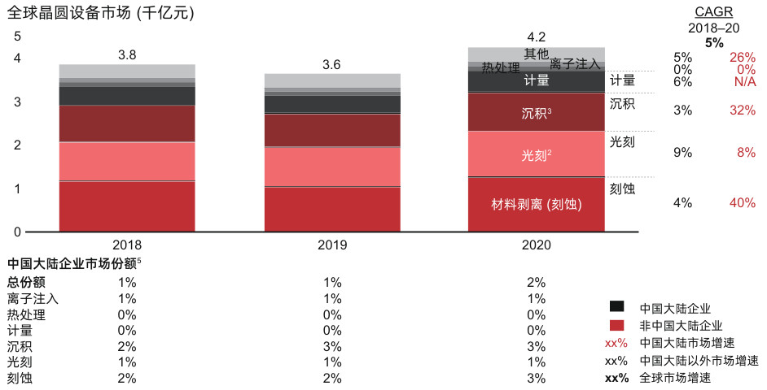 
资料来源:Gartner Wafer Fab Equipment2020;案头研究;公司招股说明书;分析师报告 
9

---

<!-- 原文第 12 页 -->

## BAIN & COMPANY 
## 中国半导体白皮书 
EDA(电子设计自动化):是一套协助半导体器件的定义、规划、设计、实施、验证和后续制造的工 具,包括仿真、设计、验证。 
IP:是可重复使用的具有独立功能模块的预设计电路,包括IP软核、IP固核、IP硬核,可减少设计工 作量,缩短周期并提高成功率。 
## 1.3.4设计环节 
立足集成电路的不同功能,可以分为模拟芯片、存储芯片、逻辑芯片(图6)。 
2020年,逻辑芯片贡献了约一半的销售额,大约1.6万亿元,但是不同细分领域有各自的领先玩家。比 如,在GPU领域,头部企业英伟达占据了约八成的销售额;在MPU领域,英特尔拥有较强的优势;在应 用/媒体处理器领域,苹果和联发科表现亮眼。 
有别于逻辑芯片,存储芯片市场高度集中,2020年的营收额约8,000亿元。无论在内存(DRAM)还是 闪存(NAND)领域,三星都是主力军,SK海力士、美光紧随其后,铠侠和西部数据则更加专注于 NAND领域。 
模拟芯片的厂商众多,在三大芯片中,格局最分散:德州仪器、亚德诺占据了模拟领域的半壁江山;分立 器件、光电子领域中,各大厂商不分伯仲;传感器领域同样如此,除博世以外,其他厂商竞争激烈。 
图6:逻辑芯片占据半导体市场约一半的销售额,市场相对分散;存储芯片高度集中;而模拟芯片市场分散, 厂商众多 
2020年全球半导体产品营收额(千亿元) 
总计30千亿元 
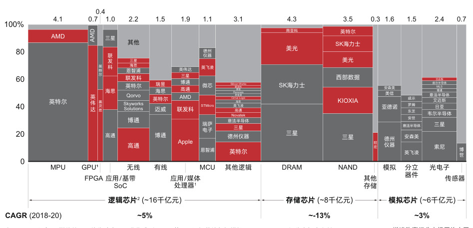 
注:1.GPU和应用/媒体处理器均为独立,而非集成到SoC里的;2.逻辑芯片包括模拟ASIC、ASSP;细分市场定义基于Gartner; 速分平水平 其他括分场内收9亿美的公司 
10

---

<!-- 原文第 13 页 -->

## BAIN &COMPANY 中国半导体白皮书 
## 1.3.5代工环节 
总体上,全球晶圆制造代工市场由成熟制程 $(>=14 ~nm)$ 和先进制程(<14nm)组成。其中,成熟制程占 据约70%的市场份额,先进制程芯片制造占据约30%,并且高度集中于台积电和三星(图7)。 
2020年,全球晶圆制造代工的总营收共计约5,000亿元。值得一提的是,作为老牌制造商,台积电积极 布局各个制程,并且都取得了较高的市场份额,尤其是在14/16-20nm和5nm,台积电约占据了约9成的 份额。 
## 1.3.6封测环节 
贝恩参考各大公司年报、Yole、券商研报并进行案头研究后得到,2018-2020年,全球半导体封测营收 的年复合增长率为3%,封装和测试的增速也均为约3%,是一个稳定的市场。 
封装:指的是实现芯片电路与外部器件电气连接,并为芯片提供机械物理保护,包括传统封装和先进 封装。 
测试:将封装完毕的芯片进行性能、持久性等方面的测试,包括初始测试(Initial Test,在不同环 境下进行电气特性测试)和最后测试(Final test)。 
图7:在芯片制造中,成熟制程占据约70%芯片制造总市场;先进制程芯片制造高度集中在少数厂商 
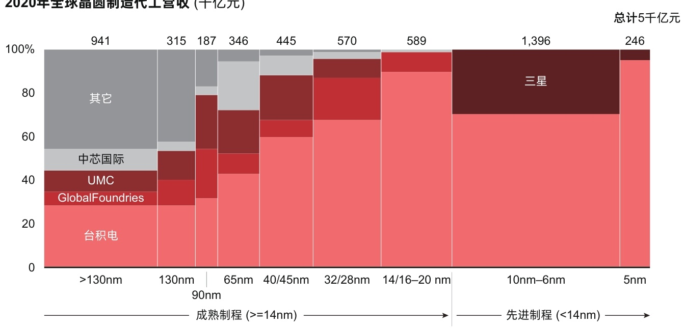 
 
资料来源:IC Insights2020;Gartner;台积电财报;中芯国际财报;TrendForce;案头研究 
11

---

<!-- 原文第 14 页 -->

## BAIN & COMPANY 中国半导体白皮书 
## 2.中国半导体在价值链主要环节的参与 
在洞察全球半导体的概况后,我们将聚焦中国在半导体的价值链各个环节的参与情况,包括当前面 临的挑战和机会、不同环节的市场地位以及主要玩家。 
整体上,中国在半导体的设计和制造链条中起步较晚,积累相对薄弱。值得一提的是,在部分芯片 的设计,以及封测环节,中国代表性企业正在加码追赶,并且取得了一定的成效。 
值此承上启下的关键阶段,随着半导体相关的产业支持政策频频出台,和下游的广大市场需求,将 促进中国半导体企业迎来新一轮发展(图8)。 
进一步分析后,我们发现,中国厂商在通讯芯片、模拟芯片与OSD设计、成熟制程制造与封测环节获得 了较多的营收(图9)。 
2020年,全球范围内,主要的中国大陆半导体企业2在封装和测试环节的市场占比约17%,头部企业如长 电科技、通富微。此外,成熟制程制造同样创造了较多的营收,中国厂商在全球市场中的占比约为11%, 代表企业有中芯国际。最后,在通讯芯片和模拟芯片设计方面,中国厂商的全球市场份额都在10%左右, 代表企业有海思、韦尔等。 
图8:中国在半导体价值链各环节面临不同机会与挑战 

| 半导体制造上游 | | | | 半导体设计和制造 | |
| --- | --- | --- | --- | --- | --- |
| 设备 | 原材料 | EDA/IP | IC设计和IDM | 逻辑芯片制造 | 封装和测试 |
| 中国大陆企业概况 | | | | | |
| 目前在前端设备市场 的渗透率较低 | 市场份额较低,尤 其是300毫米晶圆、 | 起步较晚,远远落 后于全球企业;在 | 地缘政治割裂局面正 对国内领先的IC设计 | 尽管属于卡脖子技 术,中芯国际仍致力 | 中国代表性企业正 加码追赶全球封装 |
| 上海微电子 | 江丰电子 | 华大九天 | 海思 | 中芯国际 | 长电科技 |
| 北方华创 | 中环股份 | 国微思尔芯 | 寒武纪 | 华虹半导体 | 通富微电 |
| 中微半导体 | 金宏气体 沪硅产业 | 概伦电子 芯原微电子 | 紫光展锐 合肥长鑫 瑞芯微 | 武汉新芯 | 华天科技 |
 
资料来源:案头研究 
12

---

<!-- 原文第 15 页 -->

## BAIN &COMPANY 中国半导体白皮书 
图9:中国厂商在通讯芯片、模拟芯片与OSD设计、成熟制程制造与封测环节产生较多营收 
2020年主要的中国大陆半导体企业"营收,按细分市场划分(亿元) 
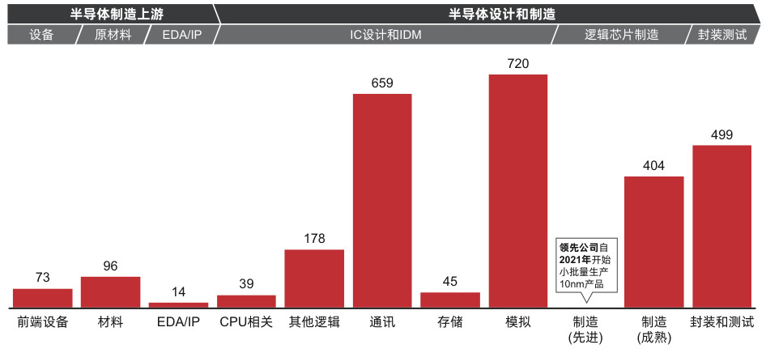 
注:1.中国大陆1企业是指是在各细分市场有公开信息的主要企业;2.仅指与半导体有关的收入;3.只展示主要玩家营收 资料来源:2021年、2020年McClean报告;Gartner 2020年全球半导体市场分布,按终端市场划分;ESD联盟研究报告;Yole;公司招股说明书;公司年报; 分析师报告;案头研究;CIQ;EMIS 
## 2.1前端设备 
中国厂商在前端设备市场处于起步阶段,市场份额普遍较低。Gartner和相关公司招股说明书显 示,2020年,全球晶圆设备市场总规模达到了4,200亿元。 
其中,中国大陆企业?在沉积、刻蚀设备上与全球领先企业差距较小,开始获取份额,有望在5-10 年内赶超世界领先水平;而光刻、离子注入、测量等仪器则还有较大差距,在较长时间内应用场景 限制在非关键生产步骤,或非先进制程。 
薄膜沉积是集成电路制造过程中必不可少的环节,指的是任何在硅片衬底上沉积一层膜的工艺,包 括原子层沉积(ALD)、化学气相沉积(CVD)、物理气相沉积(PVD)。2018-2020年,中国 大陆市场的沉积设备的市场规模从17亿元左右上升至30亿元左右,年均复合增长率达到了32%, 增速远超全球市场。 
刻蚀工艺是半导体制造工艺中的关键步骤,对于器件的电学性能非常重要,包括湿法刻蚀、干法刻 蚀和化学机械平坦化(CMP)。2018-2020年,中国大陆市场的刻蚀设备国产化成就斐然,从18 亿元左右升至约35亿元,年均复合增长率高达40%,涌现出中微半导体、北方华创等代表企业。 
## 1.仅指与半导体有关的收入 
2.中国大陆企业是指在各细分市场有公开信息的主要企业 3.中国大陆企业包括上海微电子装备集团、芯源微、北方华创等 
13

---

<!-- 原文第 16 页 -->

BAIN &COMPANY 
中国半导体白皮书 
## 2.2原材料 
2018年以来,中国半导体材料企业持续扩充自身产能,相关产品也在加速推进:中国大陆企业"在 硅片、气体材料中逐步获取市场份额。 
硅片是半导体制造的核心原材料,2018-2020年,中国大陆的硅片市场规模从约30亿元稳步上升 至42亿元左右,年均复合增长率为16%,硅片赛道的领先企业有中环领先、江丰电子等。 
从芯片生产到器件封装,几乎每一个步骤都离不开气体材料,因此,在所有原材料中,气体材料的 市场需求仅次于硅片。在国内半导体市场蓬勃发展的背景下,2018-2020年,中国大陆气体材料 的年均复合增长率达到了20%,增速约是全球市场的3倍,后者为7%。 
## 2.3 EDA/IP 
由于中国起步较晚,所以,EDA/IP方面的技术能力和人才短缺,市场占有有限。贝恩结合ESD联 盟研究报告、公司招股说明书和分析师报告,通过案头研究后发现2020年,中国大陆EDA/IP在 全球市场中的占比仅为2%。类似的情况也出现在逻辑芯片和射频EDA工具等子行业,预计需要 10-20年实现追赶。这背后需要长时间与晶圆制造(Foundry)厂联动的设计数据库积累,和相 关人才投入,才能逐步提升产品竞争力。 
## 2.4设计环节 
IC设计和IDM方面,Gartner半导体市场份额分布情况指出,中国在通讯芯片和模拟芯片设计中 已获取一定的市场份额,然而,其他细分领域,诸如存储芯片、其他逻辑等市场占有非常有限。 
其中,云计算厂商(阿里,腾讯,Baidu等)对于计算和存储芯片有着巨量的需求,从定制化性能、 成本控制等目的出发,云计算厂商积极参与到芯片设计是大势所趋,已成为一股不可忽视的力量。 
## 2.5代工环节 
McClean报告表明,当前,中国厂商在成熟制程代工市场已经建立了一定的市场份额。 
2019年,中芯国际实现14纳米FinFET量产。中国厂商除了扩大成熟制程产能,如中芯国际在内的 部分厂商仍致力于在先进制程领域实现突破。展望未来,中国厂商依然需要巩固成熟制程的市场份 额并稳定主要收入来源。 
## 2.6封测环节 
2018年以来,中国厂商在封测环节增长迅速,在全球范围内呈现出一定的竞争优势。基于Gartner 报告中的全球规模数据,2020年,中国大陆企业在全球封测市场中的总份额达到了17%,其中,封 装环节占比为19%,测试环节为9%。未来,国内封测企业的持续发展的同时,需要紧跟全球行业发 展的趋势,例如与上游晶圆代工厂在先进封装上的紧密合作。 
## 4.仅指与半导体有关的收入 
5.中国大陆企业是指在各细分市场有公开信息的主要企业 
14

---

<!-- 原文第 17 页 -->

## BAIN &COMPANY 
## 中国半导体白皮书 
## 3.芯片设计环节中,中国半导体的市场地位 
在芯片设计环节,中国企业正加速步入快车道。纵观主要的芯片类别,中国厂商在存储芯片、模拟 芯片已建立起了一定的竞争力;CPU/GPU/ASIC处于快速起步阶段,面临一些供应链及生态风险 (图10)。 
存储芯片:从内部结构看,包括NAND(闪存芯片)和DRAM(内存),前者用于SSD固态硬盘 和手机,后者用于PC,这两种芯片的主要厂商均已实现量产。技术能力方面,NAND在追赶全球 领先水平,DRAM与全球领先水平尚有差距,正在迅速追赶中。性能方面,NAND性能与全球接 近,DRAM仍有一定的差距。由于存储芯片对于制程的要求较低,因此,供应链风险相对较小,对 国际生态体系的依赖较少,如长江存储迭代优化自研技术体系X-tacking。今后,随着中国主要厂 商的产能逐步放量,预计存储芯片的市场地位还会上升,满足国内存储需求。 
图10:中国厂商在存储芯片、模拟芯片已建立起了一定的竞争力;CPU/GPU/ASIC处于快速起步阶段,面临 一些供应链及生态风险 
市场地位现状
市场份额(2020) 技术能力 供应链安全及生态 未来预测
CPU
主要应用于服务器、 多家厂商已推出成熟产品实现商用; 先进制程的供应链面临风险;面临供应链挑战
PC 最领先产品达到5nm;大部分厂 商仍在追赶产品性能 依赖X86、Arm架构
GPU
包括图显GPU和计 少数厂商推出量产产品;仅一款 先进制程的供应链面临风险; 数家新创立GPU公司拥有较
算GPU 产品达到最先进7nm;初步商用 阶段,性能细节暂不明确 高度依赖英伟达CUDA软件生强技术团队,支撑国内GPU 态,自建生态未大规模建立 发展;目前暂未有量产产品
AIML
主要应用于服务器 多家厂商推出量产产品,实现商 用;最先进产品达到7nm;大 部分厂商仍在追赶性能 先进制程的供应链面临风险; 生态体系多为自建,依赖较少 CSP积极参与ASIC产品研发 与应用,发挥资金技术能力, 明确自身定制化要求,也带来
巨大自用需求
存储 7
NAND主要应用于 主要厂商已实现量产;NAND在不对制程要求较低;自研技术 随着主要厂商产能逐步放量
SSD,手机DRAM 断提升;DRAM与全球领先水平 体系(如X-tacking) 预计市场地位将持续上升,满
主要用于PC 仍有差距,在迅速追赶 足国内存储需求
模拟
主要应用于消费电子、 汽车及工业电子 厂商众多已实现商用;聚焦细分 品类,产品种类较全球领先厂商 主要使用228nm制程,供应 链风险较小 国产模拟芯片具备价格低、服 务灵活的优势,同时不断进行
在不断提升 较少;在已进入的细分产品性能 功能性创新,预计将持续提升 满足国内庞大需求 
资料来源:Gatner;案头研究;艾瑞咨询;IDC;券商研报 
15

---

<!-- 原文第 18 页 -->

## BAIN &COMPANY 
## 中国半导体白皮书 
除了主流的NAND的DRAM,利基市场的NOR Flash由于设计和制程门槛较低(专利已放开,主 流制程65nm)也吸引了众多国内公司进行探索。 
模拟芯片:广泛应用于消费电子、汽车及工业电子。技术能力方面,众多厂商已实现商用,大多数 厂商聚焦于生产细分品类产品,所以中国市场提供的产品种类较少,但是,已经进入量产的细分产 品的性能接近全球水平。模拟芯片主要使用28nm以上的制程。今后,在价格低、服务灵活的优势 下,国产模拟芯片若持续开展功能性创新,预计将满足国内庞大的市场需求。 
CPU(中央处理器)。CPU是电子计算机的主要配件之一,常用于服务器和PC。Gartner 2020 全球半导体终端市场份额显示,2020年,全球CPU市场规模约5千亿元,中国芯片设计公司营收总 占比为7%。 
技术能力方面,多家中国厂商已经推出了服务器、桌面CPU等产品,并应用于政务、高性能计算、 工控等商用场景。但整体国内厂商在稳定性,兼容性方面仍在追赶中。CPU生态依赖X86和ARM 架构,且对于先进制成的追求较高,因此,中国厂商面临很大的供应链挑战(包括上游EDA/IP设 计工具,下游代工厂的先进制成服务,以及终端软件的适配)。今后,随着国产CPU厂商的产品生 态趋于完善,中国厂商有望逐步小幅度提升市场占有率。 
在颠覆性的计算芯片架构出现之前,ARM将凭借比RISC-V和MIPS, Alpha更完善的生态系统, 和相较于X86更开放的授权体系,以及国内大量的人才储备,成为中国CPU玩家的首选架构。 
GPU(显示芯片)。包括图显GPU和计算GPU。技术能力方面,少数厂商实现量产,仅有一款产 品达到最先进的7nm制程,并且仍处于初步商用阶段。GPU先进制程供应链面临一定的挑战,自 建生态尚未大规模建立,依赖英伟达CUDA软件生态。贝恩观察到,新成立的数家GPU公司拥有强 大的技术团队,有助于加速国内GPU发展。 
AI/ML ASIC。主要运用于服务器,分为AI训练和AI推理。2020年,中国AI训练芯片市场规模约 46亿元,AI推理约25亿元。技术能力方面,多家中国厂商完成量产,实现商用,其中,最先进的产 品达到了7nm,少数玩家在AI训练、推理芯片领域的性能接近了全球领先水平。和GPU的情况类 似,AI/ML ASIC依赖先进制程,但是,生态体系以自建为主,对于外部的依赖较少。在强大的资 金、技术能力的支持下,大型云计算服务商(CSP)正积极参与ASIC产品研发和应用,贝恩建议, 云计算服务商需要明确自身定制化要求,从而提升在自研芯片领域的投资效率。 
从下游应用领域来看,在中国,消费电子与汽车电子是大部分芯片厂商的发力方向,展望未来,贝恩预 测,2020-2025年,两大市场将保持约15-20%的高速增长态势(图11)。 
16

---

<!-- 原文第 19 页 -->

## BAIN &COMPANY 
## 中国半导体白皮书 
图11:消费电子与汽车电子是大部分芯片厂商发力方向,且将保持-15-20%高速增长 

| 下游应用 | | 数据处理 | | | | 通讯电子 | | 消费电子 3142 智能家居设备 出货量 ~12% | 汽车电子 | 工业电子4 3230 产业物联网 连接数增长 ~15% ~13% | 信创市场 信创生态市场 营收增长 NA |
| --- | --- | --- | --- | --- | --- | --- | --- | --- | --- | --- | --- |
| | PC 3614 台式机与笔记本 出货量增长 -3% -7% | 平板 861 出货量增长 ~-1% ~7% | 服务器 2875 出货量增长 -7% -9% | 储存设备 | 手机 | 其他通讯2 | 2517 汽车半导体 营收增长 ~7% ~14% |
| 市场规模(全球,2020年,亿元 | 2372 | 7527 | 2358 以4G+5G基站为 例,数量增长 ~16% ~16% |
| 增长预测(20-25CAGR | 全球 | DRAM-NAND 营收增长 ~7% | 出货量增长 ~1% |
| 公司类别" | 中国 | ~15% | -0% | ~21% | ~37% |
| CPU | 海思 | | | | | | | | | |
| 飞腾 | | | | | | | | | | |
| GPU | 景嘉微 | | | | | | | | | | |
| 天数智芯 | | | | | | | | | | x |
| AI/ML | 寒武纪 | | | | | | | | | | |
| ASIC | 百度 | | | | | | | | | | |
| 存储 | 长江存储 | | | | | | | | | | |
| 长鑫存储 | | | | | | | | | | |
| 模拟 | 闻泰 | | | | | | | | | | |
| 士兰微 | | | | | | | | | | |
| SoC | 全志科技 | | | | | | | | | | >>>>XXXx>>x |
| 瑞芯微 | | | | | | | | | | |
| 展锐 | | | | | | | | | | |
| 地平线 | | | | | | | | | | |
| 晶晨 | | | | | | | | | | |
 
核心下游 次要下游 供应信创市场x暂无供应信创市场 1.数据处理下还包括其他数据处理,如外接显示屏;2.打印机如基站、有线通讯如宽带、光纤网络;3.仅包括数据处理中的存储电子设备(storag electronics)规 ,如SSD4.包括工业和军事/民用航空电子5.包括教育、政府、资源能源、零售、交通、通信、公共设施等物联网连接数6.包括底层硬件,基础设施,基础软件 平台,企业应用,解决方案和安全7.IHS2019-2026汽车芯片CAGR预测8.包括该公司归属主要类别的产品的营收下游分布,部分非上市公司暂无数据披露 
资料来源:Gartner;公司年报;IDC;McClean报告2021;方正证券;案头研究 
## 4.中国半导体近期投资观察 
## 4.1目前投融资情况 
2018-2021年,中国AI/ML ASIC公司公开融资总金额约340亿元,集中于发展推理芯片。大多数公司仍处于 融资较早期,比如,推理芯片领域的地平线和训练芯片领域的燧原科技都获得了C轮融资(图12)。 
2018-2021年,中国SoC公司总计获得了约500亿元融资,根据Gartner 2021年第四季度半导体预测和 Yole Development数据,由于前沿逻辑芯片是利润最高的细分市场(图13),所以,物联网和汽车SoC吸 引了主要投资(图14):物联网领域公司融资金额达到了190亿元左右,且较多公司仍处于早期融资,汽 车SoC领域以160亿元位列第二。此外,手机/平板领域和安防领域分别位居其后。 
## 4.2投资总结、趋势 
当前,中国半导体投资市场逐步转向中后期项目,设计仍是主要投资环节,包括计算芯片、汽车半导体等 (图15)。 
17

---

<!-- 原文第 20 页 -->

## BAIN &COMPANY 
中国半导体白皮书 
图12:中国AI/ML ASIC公司集中于发展推理芯片;除少数头部玩家外,大部分公司仍处于融资较早期 
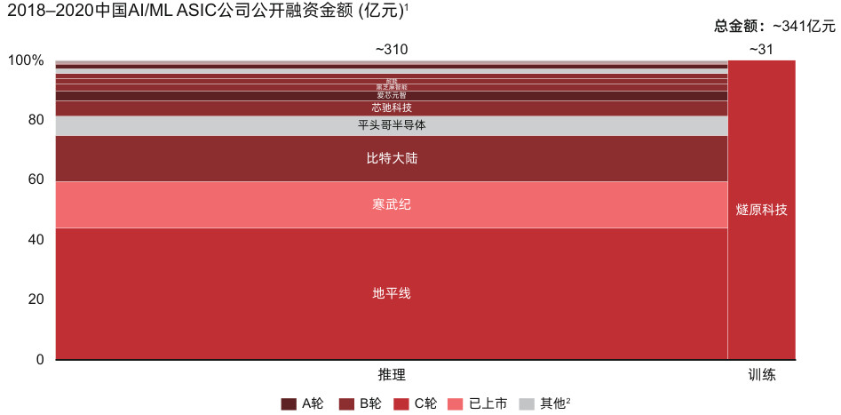 
注:1.基于1CV Source数据库,截止至2022年1月10日,与AIML ASIC业务相关的共有33公司,仅包括披露具体融资信息的16家公司,金额仅包括已披露的轮次 的信息;分类基于各公司发家业务,部分公司逐步发展产品覆盖两个类型;2.其他包括战略融资和(非)控制权收购 
资料来源:CVSource 
图13:前沿逻辑芯片是利润最高的细分市场,但其制造难度也最大 
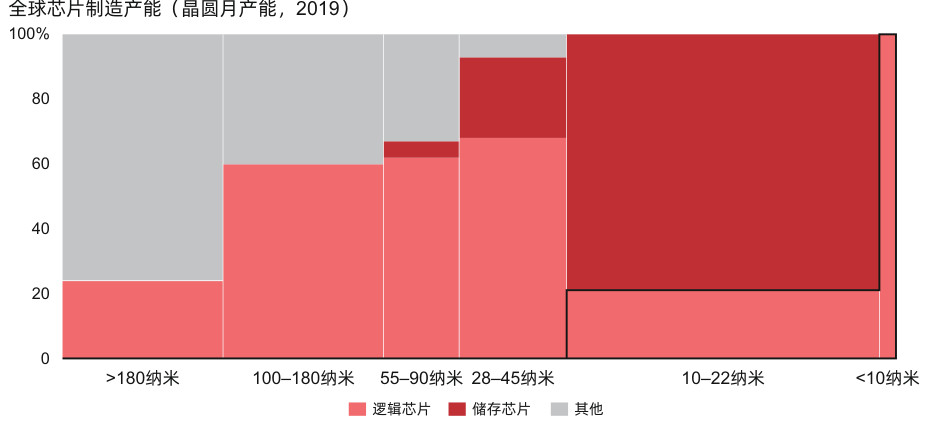 
注:1.基于2019年等效8英寸晶圆月产能数据,主要发现仍然是IFS的产能集中在构建前沿的逻辑芯片;2.包括一些用于汽车(如MCU)的<32纳米制程节点和用于其 他领域的<=22纳米制程节点;计算芯片领域包括全部微型配件,3个特定应用细分市场(独立GPU,独立应用处理器和集成应用处理器);网络芯片领域包括通信包 
18

---

<!-- 原文第 21 页 -->

## BAIN & COMPANY 
## 中国半导体白皮书 
图14:在中国SoC领域,物联网与汽车SoC吸引了主要投资;其中物联网SoC投资分散且有较多公司仍处于 融资早期 
2018-2021中国SoC公司公开融资金额(亿元) 
总金额:~500亿元 
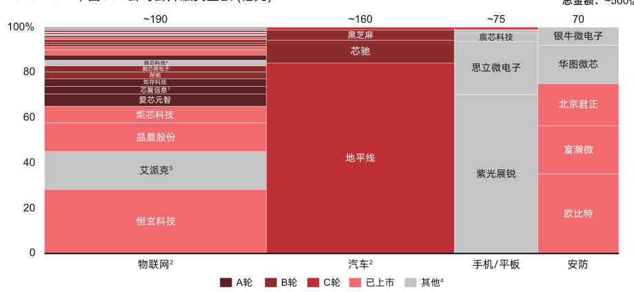 
注:1.截止至2022年1月10日,数据库中SOC业务相关的共有53家公司,仅包括披露具体融资信息的45家公司,金额仅包括已披露的轮次的信息;由于很多公司有 和》l 
图15:中国半导体投资市场逐步走向中后期项目;设计仍是主要投资环节,包括计算芯片、汽车半导体等 
中国半导体投资中后期项目逐步提升 
中国半导体融资数量和轮次比例 (2018-2021) 
设计是主要投资环节; 材料与设备获得新关注与增长 半导体各细分市场投资数量占比 (2019-2020) 
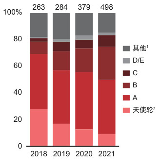 
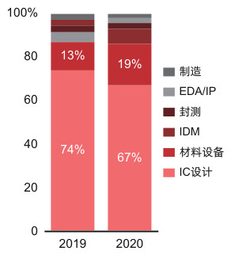 
注:1.其它包括其他包括Pre-IPO轮、战略融资和(非)控制权收购;2.天使轮包括种子轮 资料来源:CVsource;云咱资本;创道硬科技研究院;案头研究 
在设计环节中,计算芯片、 汽车半导体是主要投资热点 
 
计算芯片(主要包括GPU,ASIC) 受下游广阔应用增长和国产替代的 需要成了热门赛道 
 
汽车半导体受益于电动车的放量, 及智能化、网联化趋势而得到 投资市场关注 
19

---

<!-- 原文第 22 页 -->

## BAIN &COMPANY 
## 中国半导体白皮书 
新冠疫情发生以来,在国家政策加码和国产化提速的双重因素下,半导体融资数量大幅上涨,从2018年的 263起到2021年的498起。在这个过程中,B轮及以后的融资比重增加,投资市场随半导体企业的成长一同 成熟。 
在总投资规模中,投向设计的比例约70%,位列所有细分赛道首位。在建立本土半导体产业链的政策影响 下,上游材料与设备吸引了新的投资热点,从2019年的13%快速提升至2020年的19%。 
在设计环节中,得益于下游广阔的应用增长和国产替代,以及电动车的放量和智能化、网联化趋势,计算 芯片(主要包括GPU、ASIC)及汽车半导体成为投资热点。 
## 4.3中国协处理器玩家融资情况 
## 4.3.1 AI推理 
地平线于2015年成立,迄今已累计完成13轮融资,在政府资助以外,地平线还获得了超过35家投资机构的 资金,包括私募股权机构(中信产业投资基金、高领资本等)、投资基金(今日资本、中金资本等)、科 技公司(京东方)、车企(比亚迪、长城汽车等)。 
## 4.3.2AI训练 
燧原科技于2018年成立,先后获得腾讯、上海双创、海松资本等投资方的融资。2021年,公司宣布荣获18 亿元的C轮融资,由中信产业基金、中金资本旗下基金、春华资本领投。 
## 4.3.3图像处理(GPU) 
天数智芯于2015年成立。2021年,公司获得由私募基金(大征资本和柏资本)领投的C轮融资约12亿元 用于AI推理芯片研发。 
摩尔线程于2020年成立,去年11月公司完成20亿元A轮融资,由上海国盛资本、五源资本、中银国际旗下 渤海中盛基金联合领投,建银国际、前海母基金、招商证券和湖北高质量发展产业基金等九家知名机构联 合参投。 
## 4.4启示 
## 4.4.1面向投资者的启示 
在相关政策支持、广泛下游应用的培育下,中国半导体公司有望循序渐进、逐步突破整个价值链,因此, 中长期来看,投资机会广阔。 
设计环节仍是热门赛道,就中短期而言,尤其是AI/ML ASIC壁垒相对较低,或将涌现出大量玩家,可能实 现技术弯道超车。此外,尽管GPU/CPU的开发门槛高于ASIC,但是由于市场应用广阔,GPU/CPU同样有 机会在中长期带来高回报。 
国内计算芯片设计玩家的快速发展,也给晶圆制造(Foundry)厂带来了巨大的代工业务机会,并有可能 催生相对大而稳定的投资机会。 
20

---

<!-- 原文第 23 页 -->

## BAIN &COMPANY 
## 中国半导体白皮书 
同时,在摩尔定律发展放缓的大环境下,通过先进封装技术提高系统性能的优势越发显著,导致下游封装 环节与上游设计及晶圆代工的联动愈加紧密,而提前布局2.5D/3D先进封装赛道的中国封装厂商与其上游联 动方因此也值得关注。 
上游设备和材料方面,伴随研发投入加大,预计有机会从各个细分领域突围,比肩世界领先水平。 
## 4.4.2面向经营者的启示 
## 半导体市场主体 
首先,积极开展适配与协作,共同推动国产化生态圈,并打造更有韧性的本土供应体系。其次,基于第一 点,借助本土优势,及时响应下游客户的需求,锻造与国际厂商差异化的服务能力。最后,关注潜在的收 购机会,垂直整合强化现有业务,或通过横向收购,补足短板,扩大版图。 
## 产业新势力 
聚焦、主动参与和自身主营业务有着强协同效应的半导体细分领域,比如,IoT厂商可以进入物联网相关 AI芯片设计领域,既强化了主营业务的壁垒,又通过发展半导体作为第二曲线,成长为产业新势力。 
21

---

<!-- 原文第 24 页 -->

## Bold ideas. Bold teams. Extraordinary results. 
贝恩公司是一家全球性咨询公司,致力于帮助世界各地有雄心、以变革为导向的商业领袖共 同定义未来 
目前,贝恩公司在全球38个国家设有63个分公司,我们与客户并肩工作,拥有共同的目标:取得超 越对手的非凡业绩,重新定义客户所在的行业。凭借度身订制的整合性专业能力,配以精心打造的 数字创新生态系统,我们为客户提供更好、更快和更持久的业绩结果。自1973年成立以来,我们根 据客户的业绩来衡量自己的成功,在业内享有良好的客户拥护度。 
是什么使我们在竞争激烈的咨询行业中脱颖而出 
贝恩公司坚信管理咨询公司发挥的作用不应局限于提供建议方案的范畴。我们置身客户立场思考问 题,专注于建议方案的落地。我们基于执行效果的收费模式有助于确保客户与贝恩的利益捆绑,通 过与客户通力合作,以发掘客户潜力。我们的战略落地/变革管理(Resuls Delivery)流程协助客 户发展自身的能力,而我们的"真北"(True North)价值观指导我们始终致力于为我们的客户、 员工和社会实现目标。 
贝恩公司大中华区 
20世纪go年代初,贝恩公司进入中国,是较早进入中国市场的全球咨询公司之一。目前在北京、 上海和香港设有三个分公司,大中华区员工人数近400人。多年来,凭借对中国本地市场的了解和 在全球其他地区积累的丰富经验,我们持续为不同行业的跨国公司和中国本土企业提供咨询服务, 度身订制企业策略和解决方案。

---

<!-- 原文第 25 页 -->

 
欲了解更多信息,请查询www.bain.cn或关注微信号: 
 
 
 
阿姆斯特丹·亚特兰大·曼谷·北京·班加罗尔·波士顿·布鲁塞尔·布宜诺斯艾利斯·芝加哥·哥本哈根·达拉斯·迪拜·杜塞尔多夫·法兰克福 赫尔辛基·香港·休斯顿·伊斯坦布尔·雅加达·约翰内斯堡·吉隆坡·基辅·拉各斯·伦敦·洛杉矶·马德里·墨尔本·墨西哥城·米兰· 莫斯科·孟买·慕尼黑·新德里·纽约·奥斯陆·帕洛阿尔托·巴黎·帕斯·里约热内卢·罗马·圣弗朗西斯科·圣地亚哥·圣保罗·首尔 上海·新加坡·斯德哥尔摩·悉尼·东京·多伦多·华沙·华盛顿·苏黎世·利雅得·多哈
