> 原文件：[S8d9a8e162c88_airliquide.com_air-liquide-2025-universal-reg.pdf](../../materials/%E4%B8%8A%E6%B8%B8%EF%BC%9A%E5%8D%8A%E5%AF%BC%E4%BD%93%E7%BA%A7%E5%8E%9F%E6%9D%90%E6%96%99/S8d9a8e162c88_airliquide.com_air-liquide-2025-universal-reg.pdf)
> 转换方式：Volcengine OCRPdf v3, parse_mode=ocr

> 原仓库 PDF 被截断。本文件使用[官网完整版本](https://www.airliquide.com/sites/airliquide.com/files/2026-03/air-liquide-2025-universal-registration-document-interactive.pdf)完成识别；已验证原文件与完整版本的前部字节一致。

<!-- 原文第 1 页 -->

Air Liquide 
Air Liquide 
## UNIVERSAL DOCUMENT REGISTRATION 
INCLUDING THE ANNUAL FINANCIAL REPORT 
2025

---

<!-- 原文第 2 页 -->

## Content 
Message from Benoit Potier and Francois Jackow 2
Key figures 6
INTEGRATED REPORT 17
1 History of the Air Liquide Group 18
Business model 21
Strategy and objectives 38
Performance 49
Outlook 70
2 RISK FACTORS AND CONTROL ENVIRONMENT 71
Introduction 72
Risk factors and management measures 72
Control environment 84
Other coverage systems 89
Vigiance Plan 90
CORPORATE GOVERNANCE 97
3 Management and control 98
Govemance -Composition,functioning and work of the Board of Directors and Committes 101
Information concemning members of the Board of Directors and Executive Management 126
Remuneration of L'Air Liquide S.A.
corporate officers 140
Description of the stock option and performance share plans 181
Employee savings and share ownership 187
Transactions involving Company shares performed
by Company Officers in accordance with
article L.621-18-2 of the French Monetary and Financial Code 191
Factors that may have an impact in the event of a takeover bid 192 
FINANCIAL STATEMENTS 195
Consolidated Financial Statements 197
Statutory accounts on the parent company 265
5 EXTRA-FINANCIAL PERFORMANCE Sustainability Statement 283 284
Complementay information 369
6 ANNUAL GENERAL MEETING 2026 377
Board of Directors'Report on the resolutions presented to the Combined General Meeting - May 5,2026 378
Resolutions presented for the approval of
the Combined General Meeting- May 5, 2026 385
Statutory Auditors' reports 397
ADDITIONAL INFORMATION 401
7 Share capital 402
General information 405
Information relating to payment deadlines
for suppliers and customers 413
Person responsible for the
Universal Registration Document 414
Cross-reference table for the Universal
Registration Document 415
Report Cross-reference table for the annual Financial 418
Cross-reference table for the Management Report Glossary 419 422
Ten-year consolidated financial summary 426

---

<!-- 原文第 3 页 -->

CONTENT 
# Universal Registration Document 
INCLUDING THE ANNUAL FINANCIAL REPORT 
2025 
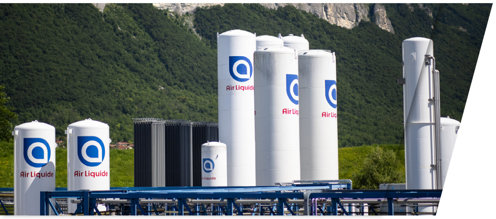 
## AHES CE AMF 
This Universal Registration Document has been filed on March 5, 2026 with the AMF,as competent authority under Regulation (EU) 2017/1129, without prior approval pursuant to article 9 of the said regulation. The Universal Registration Document may be used for the purposes of an offer to the public of securities or admission of securities to trading on a regulated market if completed by a securties note and, if applicale, a summary and any amendments to the Universal Registration Document. The whole is approved by the AMF in accordance with Regulation (EU) 2017/1129. This Universal Registration Document including the Annual Financial Report is a reproduction of the official version, which has been prepared in ESEF format and is available on the issuer's website www.airiquide.com. This document is a non-binding "fre"'translation from French into English and has no legal value other than an informative one.Should there be any difference between the French and the English version, only the text in French language shall be deemed authentic and considered as expressing the exact information published by Air Liquide. 
A financial and technical glossary is provided at the end of the document- pages 422 to 425. 
 
VISIT OUR WEBSITE 
www.airliquide.com 
2025 UNIVERSAL REGISTRATION DOCUMENT 
AIR LIQUIDE 1

---

<!-- 原文第 4 页 -->

MESSAGE FROM BENOIT POTER AND FRANCOIS JACKOW CONTENT< 
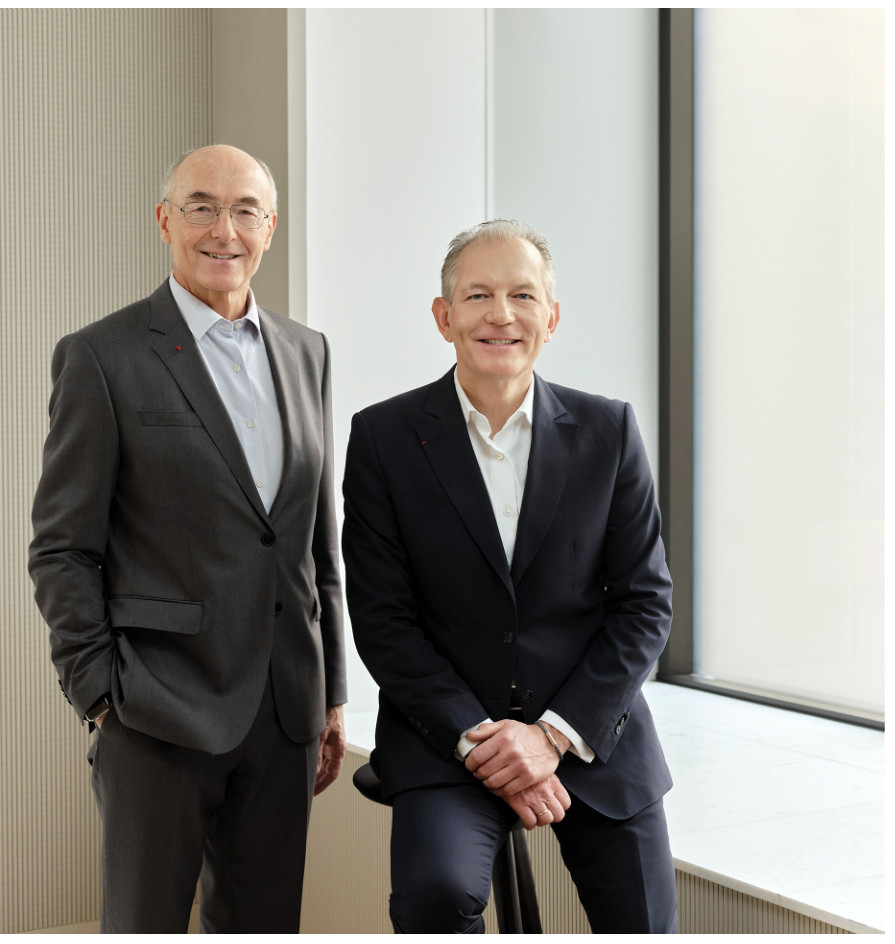 
BENOIT POTIER 
Chairman of the Board of Directors 
FRANCOIS JACKOW 
Chief Executive Officer 
2 
2025UNIVERSAL REGISTRATION DOCUMENT 
AIR LIQUIDE

---

<!-- 原文第 5 页 -->

CONTENT 
MESSAGE FROM BENOIT POTIER AND FRANCOIS JACKOW 
"Beyond its success, ADVANCE will have proven above all that t is possible to reconcile performcnce with a positive contribution to the world." 
1 2 3 
## - Benoit Potier 
In a turbulent global context, how does Air Liquide stay the course over the long term? Benoit Potier.We are undeniably living in a world undergoing profound reconiguration, marked by the regionalization of trade flows, shifts in the energy landscape,and accelerating technological change. With this as our backdrop,we must evolve the way we operate and become even more agile. Thanks to our ability to adapt, we can capture new growth opportunities and leverage the fundamentals reshaping industry today. Foremost among these fundamentals are digitizing processes, automating operations, and electrifying end-uses. 
5 6 7 
At the same time, I firmly believe it is also important to stay the course.While our Group continues to evolve, it does so on the foundations of its historical strength. These are useful and continuously renewed innovation, guided by deep knowledge of our customers' processes; a strong local presence, close to key industral basins, and a diversified model that enables us to target the most promising markets. 
With solid fundamentals,a clear strategic vision, and a strong capacity for adaptation, the Group mobilizes its full potential to navigate a transforming environment that presents challenges,but just as many opportunities. 
How do you assess the performance achieved by the Group in 2025, from a financial and sustainability perspective? Francois Jackow. 2025 has been a success on every level. Most importantly, I would highlight our progress regarding safety. Not only is this a source of pride, but it is above all an absolute necessity if we are to sustain these results over time. 
More broadly, the Group delivered record performance.Financiall, we brought our indicators to new heights, in terms of sales growth (+2%(1), cash flow(+8%(2),and operating margin exceeding 20%(+100 bps).In addition,our investment backlog,which now stands at 4.9 billio euros (3), further strengthens our future outlook. In Electronics, for example,we are a leader thanks to several major contracts in Asia,Europe and the United States. In the decarbonization field, we are delivering large-scale projects, including the construction of a second 200 MW hydrogen electrolyzer in Europe.With the acquisition of DIG Airgas,we are now the reference player in South Korea,a rapidly growing market.As for our transformation dynamic, its fets are alreay visible, as we have significantly strengthened our operational efficiencies while better serving our customers and patients. On the environmental 
On a comparable basischange excluing the curany, energy natural gas and electicity and signficant cop impat Excluding currency impact. 
Includes .2bilin eurus of investment backlog in South Korea DIG Airgas negration 
2025 UNIVERSAL REGISTRATION DOCUMENT 
AIR LIQUIDE 
3

---

<!-- 原文第 6 页 -->

4 
MESSAGE FROM BENOIT POTER AND FRANCOIS JACKOW 
CONTENT< 
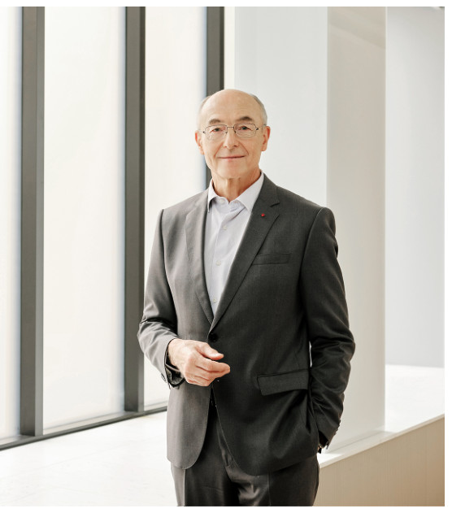 
front,we reduced our $CO_{2}$ emissions by 13% compared with 2020, and we are maintaining our carbon trajectory toward 2035. 
In short, our Group is strong. And it is becoming even stronger. This record performance is thanks. first and foremost, to or teams-who have shown determination and commitment. They have my sincere thanks. 
Benoit Potier.These remarkable results conirm the importance of the strategic framework we launched in 2022. With ADVANCE, we had a clear ambition: to combine financial performance with sustainability commitments. And this approach has delivered results. The objectives were met and operational discipline was strengthened to support profitable and sustainable growth. In the meantime the Group accelerated its contribution to industrial decarbonization, to the strategic semiconductor sector, and to the transformation of healthcare systems,through a sustained investment policy and a strong innovation approach. Beyond its success,ADVANCE has above all demonstrated that it is possible to reconcile performance with a positive contribution to the world. 
To what extent is the carbon trajectory an integral part of the Group's strategic direction? 
Benoit Potier. At the initiative of the Board of Directors, we have placed the carbon trajectory at the heart of Air Liquide's strategy. It is a central pillar of the Group's innovation approach. The Board has been able to assess its scope through exchanges with R&D teams on programs dedicated to low-carbon solutions. It is also fully embeded in our investment decisions, ensuring that new industrial projects are aligned with our decarbonization ambitions. This trajectory is thus managed in a structured manner, while remaining pragmatic in light of the realities of the environment and markets - whether in terms of renewable energy availability or regulatory frameworks such as the EU Emissions Trading System (ETS). Beyond our own industrial assets, we also act as a facitator of an economically viable transition for our customers, whose demand in this area remains real. This is reflected in our investment backlog dedicated to decarbonization. 
To what extent does innovation remain a primary driver in the current context? 
Francois Jackow. Innovation is the best antidote to uncertainty, because it reflects a resolutely optimistic mindset and a willingness to move forward. Our approach is built around three principles. Firsty, it ivolves mastering our fundamentals,by leveraging our technical expertise to contnuously improve our products and processes. Secondly, we anticipate and accelerate, in order to adapt to market transformations, offer innative solutions and bring them rapidly to market.And inally, it is about usefulness- creating tangible impact for our customers and patients while contributing positively to the world. 
Benoit Potier. Innovation is a fundamental component of the Group. Above al,tis ident through the development of cuttingedge technologies in forward-looking fields such as space,superconducivity and new molecules for the semiconductor market. Our ability to innovate extends to $CO_{2}$ capture,process electrification and healthcare, leveraging technology to respond to the major challenges of our time.And of course,drawing on our pioneering spirit and more than 60 years of expertise in hydrogen,we continue deploying very large-scale low-carbon hydrogen projects. 
2025UNIVERSAL REGISTRATION DOCUMENT 
AIR LIQUIDE

---

<!-- 原文第 7 页 -->

CONTENT 
MESSAGE FROM BENOIT POTER AND FRANCOIS JACKOW 
Beyond purely technical advances,we also innovate at every level of the company -for example by reinventing the way we operate,while integrating major developments such as artificial intelligence. This is what enables us to stay ahead. 
At the same time, we are continuing the Group's transformation dynamic, initiated two years ago, to make our organizatin more agile. This involves further optimizing our industrial and commercial operations while reinforcing our performance culture. 
In your view, what are the main challenges for 2026and the main ways you will address them? Francois Jackow.Our manufacturing sector is undergoing multiple ransformatins the rise of China in the global economy; the reshoring movement aimed at strengthening sovereigntiesparticularly in the United States; the wave of arificial inteligence:; and the indispensable energy transition. That is why, even if the immediate outlook appears marked by moderate growth,we remain convinced that new development avenues are emerging from the transformations our customers are experiencing. It is up to us to seize them wherever they arise and to build our own momentum. 
Benoit Potier. Our challenge is to continue growing in an economy that is both unstable and undergoing rapid technological acceleration. To achieve this, our growth trajectory relies on two key levers: inovation and a selective investment policy, Innovation has always been a source of value creation for the Group, and it is even more so at a time when technological sovereignty is becoming increasingly important. To translate it into industrial realiy, investment is equally ssetia to delivue lrgescelepajecs in future-oriented markets and technologies particularly in the energy transition. In this area, the context has evolved and tensions are greater, but the stakes remain -just as our decarbonization ambitions do, even if the pathways to achieve them continue to evolve. Thanks to the commitment of our teams and supported by the trust and loyalty of our shareholders - whom I warmly thankwe will continue, more than ever, to prepare the future by addressing its challenges with determination, pragmatism and consistency. 
2 3 4 5 6 
To do so,we are acting according to a strategy built n several pillars. The first is to better leverage our existing assets by mobiizin avalable production capacities. The second relies on our ability to support transitions - whether in manufacturing,energy, technology or digital. This translates into investments in promising markets such as semiconductors, batteries, smart energy systems and space technologies. The final pillar is strengthening our positions in key geographies through a targeted acquisition policysuch as DIG Airgas in South Korea. 
"Innovation is the best antidote to uncertainty." -Francois Jackow 
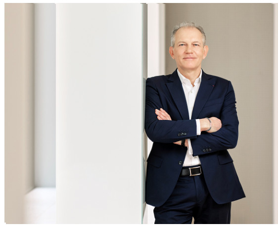 
2025 UNIVERSAL REGISTRATION DOCUMENT 
AIR LIQUIDE 
5

---

<!-- 原文第 8 页 -->

6 
KEY FIGURES 
CONTENT< 
## A GLOBAL PRESENCE 
## 2025 GROUP REVENUE BY ACTIVITY 
Present in 59 countries 
-65,000 employees 
A world leader in gas, technologies and services for Industry and Health 
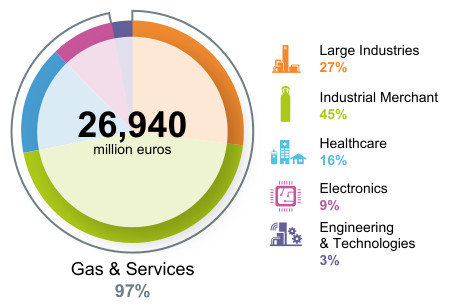 
2025 GROUP REVENUE BY REGION AND BY ACTIVITY, FOR GAS & SERVICES (G&S) 
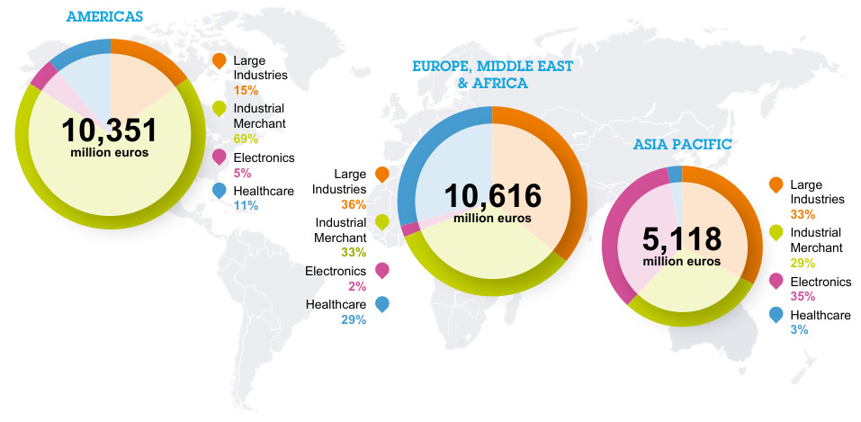 
Exclucding Russie, where the enties are no longer consolidated. 
2025UNIVERSAL REGISTRATION DOCUMENT 
AIR LIQUIDE

---

<!-- 原文第 9 页 -->

CONTENT 
KEY FIGURES 
# A WIDE RANGE OF MARKETS AND A STRONG BUSINESS MODEL 
KEY ELEMENTS BY BUSINESS LINE () 
## LARGE INDUSTRIES 
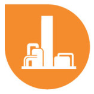 
27% ot Group revenues 7,110 million euros 
·High capital intensity 
-Customers in metals,chemicals, refining and energy Industrial basin and pipeline network strategy Long-tem contracts (15 years) with minimum volumes covered by take-or-pay clauses, and prices indexed on costs,including on energy cost 
·Synergies with other business lines 
## INDUSTRIAL MERCHANT 
 
45% of Group revenues 12,132 millio uros 
·Technological solutions adapted to customers" businesses -More than 2 million customers Importance of logistics ·High number of applications and end-markets 
## ELECTRONICS 
 
9% o Group revenues 2.465 million euros 
·Technological solutions with ultra high purity gases and advanced materials Long-term contracts for carrier gases,with clauses regarding minimum volumes ("take-or-pay") and indexation on energy costs (and other costs) ·Concentration of the activity in Asia 
## HEALTHCARE 
 
16% of Group revenues 4,378million euros 
·Gases,equipment, and services at home, in hospitals and medical practices 
·More than 2 million patients Geographical density Operations relying on remote patient monitoring and sophisticated IT systems 
ENGINEERING & TECHNOLOGIES 
 
3% of Group revenues 855 million uros in third-pcty sales 
·Design and construction of plants and equipment, for the Group and third-party customers 
(a) Published data 
2025 UNIVERSAL REGISTRATION DOCUMENT 
AIR LIQUIDE 
作

---

<!-- 原文第 10 页 -->

KEY FIGURES 
CONTENT< 
## REGULAR AND SUSTAINED PERFORMANCE 
TSR 
Annual Total Shareholder Return for a single registered share 
over 5 years (a) over 10 years (b) 
(a) At Decamber 31.2025,for an invested capital since December 31,2020. 
(b) At December31,2025,for an invested capital since December 31,2015. +9.9% +11.6% 
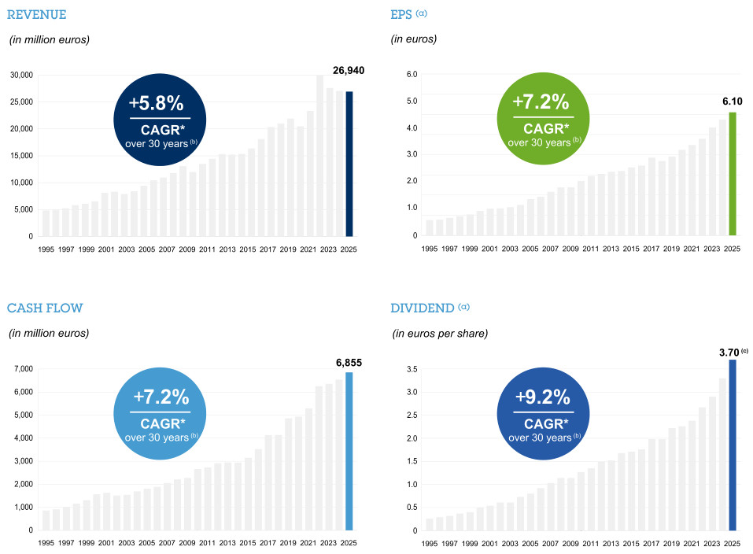 
Compound Annual Growth Rate. 
(日) Adjusted for the 2-for-1 share split in 2007,for attibutions of free shares and for a factor of 0.974 reflecing the value of the rights of the capital increas completed in October 2016. 
(b) Calculated according to prevaiing accounting rules over 30 years. 
(c)Suject to the approval of shareholders during the General Meeting on May 5, 2026. 
8 
2025UNIVERSAL REGISTRATION DOCUMENT 
AIR LIQUIDE

---

<!-- 原文第 11 页 -->

CONTENT 
KEY FIGURES 
STOCK MARKET PERFORMANCE 
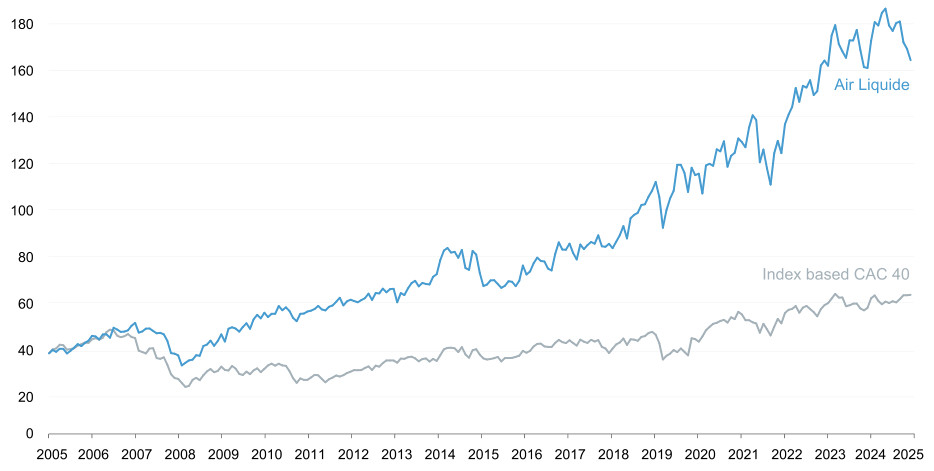 

| | | 2021 | 2022 | 2023 | 2024 | 2025 |
| --- | --- | --- | --- | --- | --- | --- |
| Market Capitalization at December 31 (in milion euros) | | 72872 | 69305 | 92378 | 90740 | 92852 |
| Adjusted closing share price i(in euros) | | | | | | |
| | high | 128.38 | 136.91 | 162.76 | 177.55 | 186.64 |
| | low | 103.06 | 105.18 | 122.42 | 152.25 | 154.64 |
| At December 31 | | 126.71 | 120.36 | 160.11 | 156.92 | 160.26 |
| Net earnings (b)-EPS (in euros) | | 4.48 | 4.79 | 5.35 | 5.74 | 6.10 |
| Net Dividend per share (b)\_DPS (in euros) | | 2.75 | 2.90 | 2.90 | 3.30 | (c) 3.70 |
| Pay-out ratio | | 55% | 58% | 56% | 59% | 63% |
| Dividend yield | | 1.9% | 2.2% | 1.8% | 2.1% | 2.3% |
| Ex-dividend date | | | | | May 16, 2022May 15,2023May 20,2024May 19,2025May 18,2026 | |
 
(8) Adjusted following curent Euronext regulation (b) Data adjusted for attribution of free shares and capital increase (C) 2024Dividend,subject to the approval of Shareholders during the General Meeting on May 5, 2026 
SHARE OWNERSHIP BREAKDOWN AT DECEMBER 31, 2025 
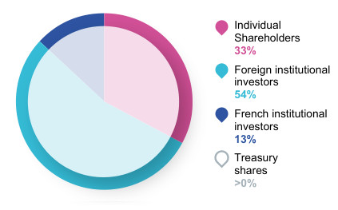 
2025 UNIVERSAL REGISTRATION DOCUMENT 
AIR LIQUIDE 
9 
2 
6

---

<!-- 原文第 12 页 -->

KEY FIGURES 
CONTENT< 
## ADVANCE STRATEGIC PLAN 
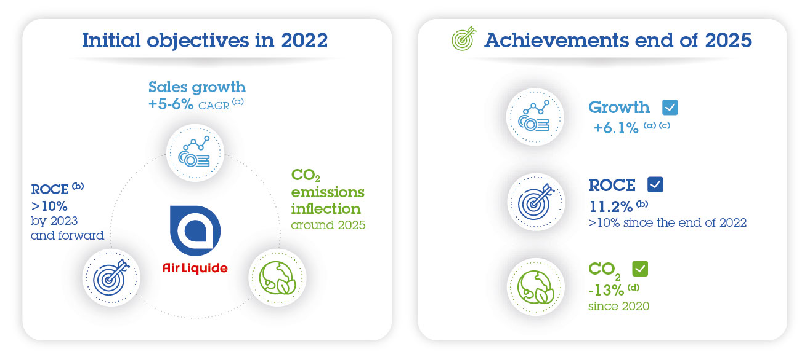 
 
Group comparable sale CAGR from yarend 2021 to year end 2025,at 2021 energy price and FX,exiuding signicat cpe. 
(d)Scope 1and 2 emissions,scope 2 on amarket basis",estated emisions,see chapter1-pages58 and 64and chapter5-page 318 and following 
On March 22, 2022,Air Liquide presented ADVANCE, its strategic plan through 2025combining financial and extra-financial performance. 
With this plan,the Group took on an ambitious challenge: to continue its profitable growth momentum while meeting its $CO_{2}$ emissions reduction commitments and investing in the markets of the future. 
The three objectives of the strategic plan have been achieved: 
The compound annual comparable growth rate (CAGR) of the revenue over the 2022-2025period reached +6.1% 1),in line with the ADVANCE plan's target of +5%to +6%. It is calculated based on 2021 sales, at the 2021 currency rate and energy price, excluding the impact of significant scope (acquisition of Sasols ASUs and deconsolidation of the Russian subsidiaries). 
The return on capital employed (ROCE 2) stood at 11.2% at the end of 2025.The ADVANCE target of a recurring ROCE above 10% from 2023 was achieved as early as the end of 2022,one year ahead of schedule. 
The ADVANCE objective of reaching an inflection point in absolute $CO_{2}$ emissions was achieved, following two consecutive years of significant decline in $CO_{2}$ emissions in absolute value in 2023and2024.In2025,the trajectory was confirmed, with a further reduction in emissions (Scopes 1 and 2) of-2.0% compared to 2024 and -13.0%compared to the 2020baseline. 
To achieve these objectives, the Group optimized its capital resources and improved its operating margin. This performance is based on a dynamic pricing policy,structural efficiencies, and active business portfolio management. 
The initial operating margin improvement ambition (excluding the energy impact) of the ADVANCE plan communicated in March 2022 was +160 basis points over 4 years from 2022 to 2025.In February 2024, it was revised upwards to +320 basis points, a doubling of the initial ambition.At the end of 2025,the operating margin improvement (excluding the energy impact) reached +360 basis points, over 4 years, from 2022to 2025. 
The total investment decisions from 2022 to 2025 amounted to 16.9 billion euros, exceeding the ADVANCE plan's projection of 16 billion euros over 4 years. 
Including +2.6% Argentina impact Recurring ROCE based on Recuming Net Profi. 
10 
2025UNIVERSAL REGISTRATION DOCUMENT 
AIR LIQUIDE

---

<!-- 原文第 13 页 -->

CONTENT 
KEY FIGURES 
2025 FINANCIAL PERFORMANCE 
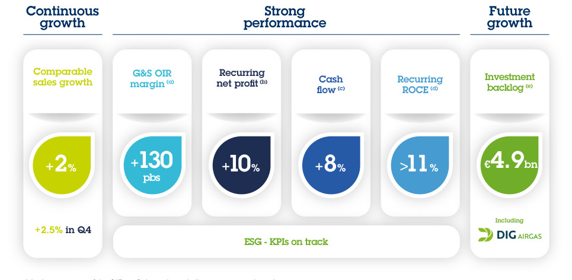 
(8) Improvement of the OlR on Sales ratio xcluding energy passthrough. 
(b) Excludling FX impact,exceptional &significant transactions. (c) (o Resreeo e . 
(e)Including C0.2bn from DIG Airgas. 
OIR margin: a new level reached Cumulated 5-yec OIR margin improvement at the energy prioe of the previous year 
Recurring ROCE () after tax 
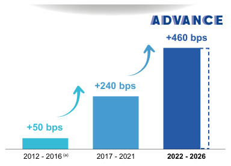 
11.2% 11 10 9 
2015 2016 20172018 2019202020212022 202320242025 ADVANCE objective ROCE>10% 
(a) (b) Exclucing the Airgas acquisition scope impact in 2016. Recurring ROCE based on Recurring Net Profit. 
2025 UNIVERSAL REGISTRATION DOCUMENT 
AIR LIQUIDE 
11

---

<!-- 原文第 14 页 -->

KEY FIGURES 
CONTENT< 
## DECARBONIZING THE PLANET 
TOWARDS CARBON NEUTRALITY BY 2050 
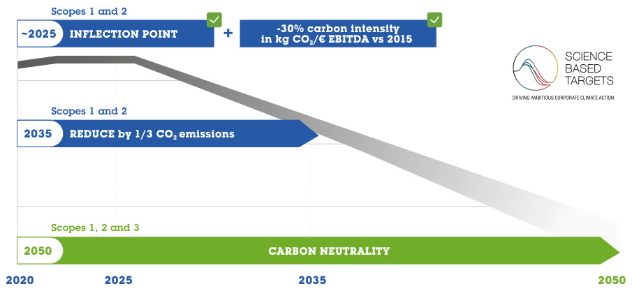 
In 2025, the Group's Scopes 1 and 2 $CO_{2}$ emissions cre down -13.0%() compcred with the 2020 baseline. 
The Group's carbon intensity () stood at 4.0,a-46% decrease compcred to 2015, exceeding the reduction target of -30% in 2025. 
(a) Scopes1&2COemissions.Scope2rkt-basedrestated emissions.see Chapter1-paes 58 and 64 and Chapter5-page 318 and following (b) In kg $CO_{2}$ equivalenteuro of operating income before deprecition and amortization and excluding IFRS 16 at 2015 exchange rates on Scopes 1 and2 of greenhouse gas emissions, Scope2onamarket-based methodology,see Chapter1-page 64 for the reconciiation. 
12 
2025UNIVERSAL REGISTRATION DOCUMENT 
AIR LIQUIDE

---

<!-- 原文第 15 页 -->

CONTENT 
KEY FIGURES 
# UNLOCKING PROGRESS VIA TECHNOLOGIES 
C301 M 
320 
300 
of innovation new innovation spending (2025) 
patents partnerships 
A GLOBAL INNOVATION ECOSYSTEM 
2 
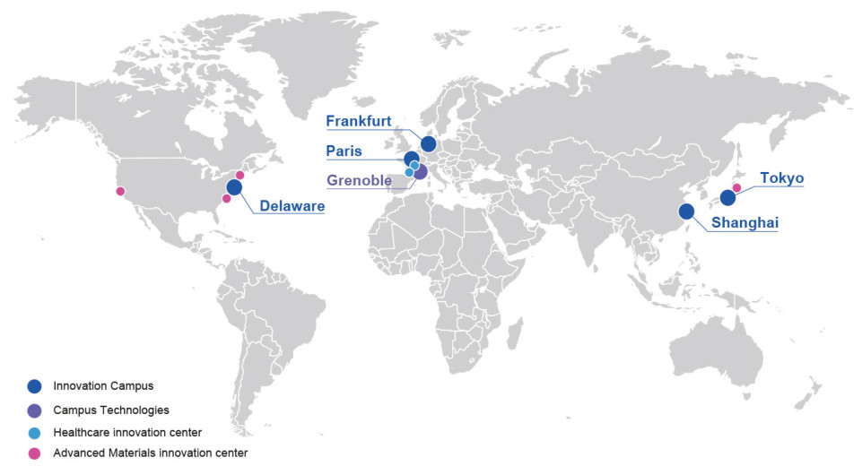 
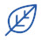 
Successful start-up of the world's first industrici-scale ammonia cracking pilot unit for hydrogen production 
Energy transition solutions 
 
Air Liguide part of the Supramarine consortium to develop a superconducting power transmission demonstrator connecting offshore wind farms to the mcinland with near-zero energy loss. 
Deep Tech solutions 
 
Start-up of a new Molybdenum manufacturing plant in Korea to support next-generation semiconductors with its breakthrough advanced materials offer Subleem"M 
Semiconductor solutions 
2025 UNIVERSAL REGISTRATION DOCUMENT 
AIR LIQUIDE 
13

---

<!-- 原文第 16 页 -->

KEY FIGURES 
CONTENT< 
## ACTING FOR ALL 
## Safety 
## Air Liquide Foundation 
The frequency rate stoodat record level in 2025 of 0.4 ost-time acidents per milin ous wored, a decrease of-60% compared with 1.0 in 2023. 
Supports proiects in three areas for 15 years: Medical research on respiratory disease; Jobs integration, especialy with technical postions: Local solidarity actions. 
## For the employees and the communities 
% OF WOMEN AMONG MANAGERS AND PROFESSIONALS 
AOE S PTVOUSN OPPORTUNITIES THROUGH THE CITIZEN AT WORK PROGRAM 
Continous increcse since 2020 Leading the industry 
% OF EMPLOYEES WITH ACCESS TO A COMMON BASTS OF CARE COVERAGE 
Fully deployed, one yecr in advance√ 
Fully deployed √ 
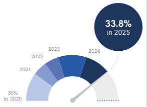 
100% since 2024 
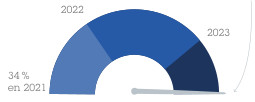 
100% in2025 
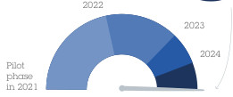 
ii Improving the quality of life of chronic patients at home. Solid progress, fully aligned with patients' expectations 
64% of patients wlth personatized cre plan 
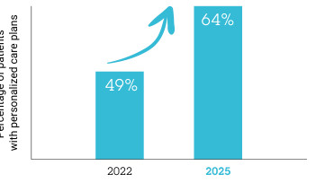 
14 
2025 UNIVERSAL REGISTRATION DOCUMENT 
AIR LIQUIDE

---

<!-- 原文第 17 页 -->

CONTENT 
KEY FIGURES 
## A COMPANY REWARDED FOR ITS EXTRA-FINANCIAL PERFORMANCE 
S&P Dow Jones Indices A Division of S8P Global 
 
For the fourth year running, Air Liguide has been included in the Dow Jones Best in-Class Europe Inde in recognition of its commitment to social and environmental responsibility. 
Air Liquide mainted A- in Water management and B in Climate change. 
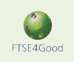 
## ecovadis 
Air Liquide remains a constituent of the FTSE4Good index series in 2025. 
Air Liquide received the Bronze medal in the 2025 rating underscoring the sustained quality of its commitments. 
 
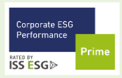 
Air Liquide has maintained its A rating. 
Air Liquide ranks in the top 20% of companies in the running, maintaining its ISs"Primestatus. 
6 7 
 
Recognized as"ESG Industry Top Rated" Air Liquide received a "low risk" rating. 
Ratings obtained in 2025. 
2025 UNIVERSAL REGISTRATION DOCUMENT 
AIR LIQUIDE 
15

---

<!-- 原文第 18 页 -->

CONTENT< 
16 
2025UNIVERSAL REGISTRATION DOCUMENT 
AIR LIQUIDE

---

<!-- 原文第 19 页 -->

CONTENT 
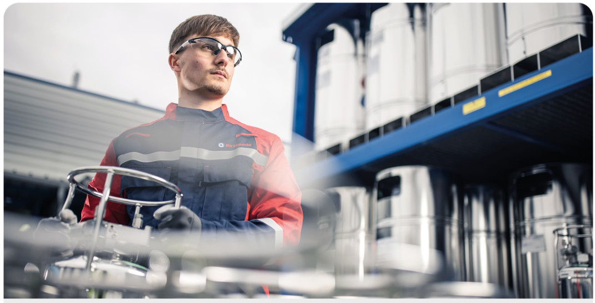 
1 2 3 4 
1 Integrated report 
HISTORY OF THE AIR LIQUIDE GROUP 18
BUSINESS MODEL 21
Prerequisites to action: safety, ethics
and the respect of Human Rights 21
Description of the business model 22
Description of ativities 24
Competition 37
STRATEGY AND OBJECTIVES 38
Ambition 38
Strategic plan and mid-term objectives 38
Strategy governance 43 
PERFORMANCE 49
44
Key figures
Income statement Cash Flow and Balance Sheet 56
Extra-inancial performance Investment cycle and financing 58 59
Performance indicators 62
Innovation 66
Appendix 69
OUTLOOK 70 
7 
2025 UNIVERSAL REGISTRATION DOCUMENT 
AIR LIQUIDE 
17

---

<!-- 原文第 20 页 -->

1 
18 
INTEGRATED REPORT History of the Air Liquide Group 
CONTENT< 
# --HISTORY OF THE AIR LIQUIDE GROUP 
Air Liquide,a world leader in gases, technologies and services for industry and health, has been building its leadership since 1902. 
1902-1960 
## ORIGIN 
Air Liquide was born in 1902from innovation and the encounter between two men: Georges Claude,inventor of an industrial process for the production of oxygen from liquid air,and Paul Delorme, a visionary entrepreneur. 
## FIRST INTERNATIONAL DEVELOPMENTS 
Gas,by its very nature,is difficult to transport and thus local production is required.This was one of the reasons why Air Liquide set its sites internationally early on, building numerous production units abroad. Development was rapid in Europe (1906),Japan(1907),Canada (1911)and the United States (1916). 
## LISTING ON THE STOCK EXCHANGE 
The critical role played by Shareholders became evident in the first years of the Company's development. Listed on the Paris Stock Exchange in 1913, the share celebrated its hundredth year of listing in 2013.During these 100 years,Air Liquide has endeavored to forge a strong and privileged relationship with its Shareholders based on exceptional stock market performance, with an average annual increase in its share price of +11.9% 
## REVOLUTIONARY DISTRIBUTION METHODS 
In the 1950s Air Liquide put in place new ways to distribute industrial gases. 
Storing gas in liquid form in cryogenic tanks allows vast quantities to be transported by road or rail within a radius of approximately 200-250 km from the production site. 
By delivering gas to several customers through pipelines, Air Liquide adopted a network strategy for the first time, linking its gas production units to one another. The Group increased its production capacity to meet soaring demand from large industries: firstly, for oxygen in the steel industry,and secondly, for nitrogen in chemicals.This marked the start-up of the Large Industries business. 
1960-2000 
## SPACE INDUSTRY 
Convinced of the industrial potential of cryogenics, Jean Delorme, Chairman&CEO of Air Liquide,decided to create a research center dedicated to these technologies. This center was founded in1962near Grenoble in France.The first applications were rapidly integrated in the space industry and ever since Air Liquide has been a key partner of the space adventure. 
## A TRADITION OF INVENTIONS 
The Claude Delorme Research Center, located on the Saclay plateau and now called the Innovation Campus Paris, was created in 1970.The research center's work is focused on enhancing gas production technologies and their applications. It is evidence of the Group's desire to better understand the industrial processes of its customers and develop new gas applications to better satisfy their requirements. Today,the Group also has Innovation Campuses in Europe (Germany,France), North America (USA) and Asia (China, Japan). 
## A NEW MARKET: ELECTRONICS 
In Japan,the Group began in 1985to supply ultra-high purity gases to the semiconductor industry: this involves carrier gases, mainly nitrogen,used to transport the specialty gases and keep the chip production tools inert, and specialty gases that are used directlyin the manufacturing of semiconductors.In 1987, Air Liquide inaugurated the Tsukuba Research Center in Japan, which is dedicated to the electronics industry. 
## MAJOR ACQUISITION 
The Group acquired Big Three in the United States in 1986,a Large Industries business with a significant pipeline network along the Gulf Coast. 
## EXTENDED OFFERING: HYDROGEN AND STEAM 
In addition to oxygen and nitrogen,Air Liquide extended its offering to hydrogen and steam in the 90s.To ensure the success of this new offering, the Group used its business model, which is behind the success of its air gas business, and deployed from the beginning a basin strategy. 
## HEALTHCARE 
Originally an oxygen supplier to hospitals, Air Liquide became a specialist in the healthcare sector. The Group launched its Home Healthcare business in the 1990s and set up a dedicated network of specialist teams. Medical gases were progressively classied as drugs and manufacturers were required to file market authorizations.The Group also launched research programs in therapeutic gases, used for resuscitation and pain relief. 
2025UNIVERSAL REGISTRATION DOCUMENT 
AIR LIQUIDE

---

<!-- 原文第 21 页 -->

CONTENT 
INTEGRATED REPORT History of the Air Liquide Group 
1 
## 2000-2020 INTERNATIONAL, EXPANSION 
The Group invested massively in China in the early 2000s: the country has been a major growth market for industrial gases and Air Liquide entered into numerous air gas contracts. 
The Group acquired part of Messer Griesheim's activities in Germany, the United Kingdom and the United States. 
1 
## ORGANIZATION BY BUSINESS LINE 
The Air Liquide growth drivers for the coming decades are based on changing lifestyles: industrial growth of developing economies, increasing energy needs and environmental challenges. healthcare and high technology. To capture this growth, the Group created a new organizational structure based on four World Business Lines.They combine the technical and operational expertise which are specific to each of the businesses of the Group - Large Industries, Industrial Merchant, Healthcare and Electronics -and centralize the specific market expertise. 
Consciousofthe strategic dimension of Engineering& Construction capabilitie, the Group acquired Lurgi in 2007.This company provides Air Liquide with major proprietary technologies, notably hydrogen and carbon monoxide production units,adding to the Group's historical competencies in cryogenics. 
## RESILIENCE IN AN UNPRECEDENTED CRISIS 
Affected by a global economic crisis of unprecedented magnitude in2008and2009,the Group focused its efforts on the management of its cash, costs,and investments (capital expenditures). Having tested the solidity of its long-term contracts, Air Liquide demonstrated the relevance and resilience of its business model. In a context of global recession,the Group showed itself to be an exception, posting a stable net profit while preserving the strength of its balance sheet. 
INNOVATION AND HYDROGEN lanvelion s nat /l o s eulso en (innovation Lab) and ALIAD,the Group's capital venture entity to take minority investments in innovative technology start-ups.In 2014,the Group decided on new investments such as the modernization of the Research Center near Versailles, on the Saclay plateau, and the launch of a technical Center of Excellence for cryogenic production technologies. 
In addition,on a worldwide scale, Air Liquide actively contributes to the development of the hydrogen energy activity by supporting automotive manufacturers launching Fuel Cell Electric Vehicles on the market. Air Liquide contributes to the construction of hydrogen refueling stations (United States, Japan, France, Germany, Belgium, Denmark, the Netherlands, Korea, China,etc.). 
## AIRGAS ACQUISITION BY AIR LIQUIDE AND NEOS PROGRAM 
On May 23,2016,Air Liguide completed the acquisition of the American company Airgas and took a new dimension.This acquisition was complementary to the Group's businesses in the United States and enabled Air Liquide to be present across all market segments both upstream of and downstream to the US market; this integration has created significant value. 
The Group realized more than 300 million US dollars of synergies through this acquisition. Moreover,Airgas" model,in terms of products,digitization of businesses, and business model,has been spread outside the United States. 
With this acquisition, Air Liquide strengthens its position in the United States,the largest industrial gas market worldwide.This market also enjoys the strongest growth among advanced economies. 
Following this acquisition Air Liguide published its new mid-term Company program, NEOS, on July 6,2016. Its strategy for profitable growth over the long term is that of a customer-centric transformation. It is based on operational excellence and the quality of its investments, on open innovation and the network organization already implemented by the Group worldwide. 
## CREATION OF THE GLOBAL MARKETS & TECHNOLOGIES BUSINESS 
To step up the development of offerings in new markets,the Group created in 2016the Global Markets&Technoloqies business, responsible for developing new activities in the field of energy transition and deep tech,by leveraging technologies. 
## REFOCUSING ON GAS & SERVICES BUSINESSES 
Following the divestiture of its Agua Lung (diving) and Air Liguide Welding (welding) subsidiaries in 2017. Air Liguide focused on its Gas & Services businesses. After these divestitures, the share of Gas &Services revenue in Group sales increased from 90% in 2015to96% in2018. 
## ENERGY TRANSITION AND CLIMATE OBJECTIVES 
For many years now,Air Liguide has been committed to sustainable growth aimed, in particular, to limit its $CO_{2}$ emissions and those of its customers. On November 30,2018,Air Liquide announced its climate objectives, in particular a -30% reduction in its carbon intensity between 2015 and 2025,with a global approach that includes its assets, its customers, and its ecosystems.These objectives are the most ambitious in the sector and are in line with the NEOS company program. In this respect,the Global Markets & Technologies activity is stepping up sales to energy transitionrelated markets,driven by the biomethane sector and the first developments in hydrogen mobility. 
## FINALIZATION OF THE INTEGRATION OF AIRGAS AND STRENGTHENING OF THE GROUP'S EFFICIENCY PROGRAM 
At the beginning of 2019,Air Liguide reached its target of 300 million US dollars in synergies,thanks to the integration of Airgas, more than a year before initially planned.With the integration complete, Airgas joined the Group's efficiency program and contributes to increasing the annual target for efficiencies. The Group efficiencies target was initially set at 300 million euros and was revised up,to more than 400 million euros,as of 2019. Moreover, a program aimed to promote the sharing of the Airgas model has allowed close to 100 Group managers to immerse themselves in Airgas operations, and to step up the sharing of its best practices with other Group regions. 
7 
2025 UNIVERSAL REGISTRATION DOCUMENT 
AIR LIQUIDE 19

---

<!-- 原文第 22 页 -->

1 
INTEGRATED REPORT History of the Air Liquide Group 
CONTENT< 
## INCREASING IMPORTANCE OF NEW HYDROGEN MARKETS 
In 2019. Air Liguide announced the construction in Canada of the largest Proton Exchange Membrane (PEM) electrolyzer in the world,aimed to produce hydrogen using hydro-power for industry and mobility usages.The Group invested in a hydrogen production and liquefaction unit for the west coast of the United States and worked with its Steel customers to decarbonize steel production using hydrogen. 
## 2020-2025 MOBILIZATION OF THE GROUP AGAINST COVID-19 
The Healthcare teams were highly mobilized to cope with the increasing demand for medical oxygen, supply equipment such as ventilators for hospitals,ensure stabilized patients can return home and guarantee chronic patients are continually monitored. 
In a context of global health and economic crisis,the Group has once again proven its resilience.This crisis has also highlighted the contribution of the Group's activities to society as well as the commitment of its employees. 
## ACT FOR A SUSTAINABLE FUTURE 
In March 2021,the Group strengthened all of its sustainable development goals by detailing them around three axes. 
First,to ACT for a low-carbon society, in line with the Paris Agreement, by setting a target of carbon neutrality by 2050,with two major intermediate steps: the start of the reduction in its $CO_{2}$ emissions in absolute value around 2025anda-33% decrease in its $CO_{2}$ emissions from Scopes 1 and 2 by 2035 compared to 2020. Air Liguide acted for climate,by initiating projects and partnerships for the decarbonization of industrial and mobility activities, and by announcing its participation in the largest fund dedicated to dean hydrogen infrastructure.The Group also acquired Sasol ain separation units in South Africa and a TotalEnergies steam methane reformer in France while committing to a very significant decrease of their $CO_{2}$ emissions. 
Second, CARE for patients by improving the quality of life of patients with chronic diseases in mature economies and facilitating access to medical oxygen in low- and midle-income countries. Already in place in Senegal,the initiative allows access to medical oxygen to rural communities and its deployment has started in South Africa. 
And third, TRUST as the base to engage with employees and to build the best-in-class governance. 
## STRATEGIC PLAN: ADVANCE 
In March 2022,Air Liquide announced ADVANCE (see page 38), its new strategic plan for 2025. t placed sustainable development at the heart of its strategy and combined financial and extrafinancial performance.With a strong business model which has proven its resilience,with its innovation capacity and its technological know-how, the Group is particularly well positioned to continue its growth and profitability trajectory while contributing to respond efficiently to major economic,environmental and societal challenges. 
## TRANSFORMATION PROGRAM 
Capitalizing on its ADVANCE strategic plan, Air Liguide launched a new multi-year transformation program for the Group in 2024to foster agility,accelerate decision-making and improve performance.This plan is structured around four main initiatives: the simplification of the organization,the extension of the Global Business Services centers, industrial and commercial initiatives. This transformation program aims to effectively meet the evolving needs and expectations of customers and employees. 
20 
2025UNIVERSAL REGISTRATION DOCUMENT 
AIR LIQUIDE

---

<!-- 原文第 23 页 -->

CONTENT 
INTEGRATED REPORT Business model 
1 
## BUSINESS MODEL 
## 1. Prerequisites to action: sofety, ethics and the respect for Human Rights 
5 1 
## PREREQUISITES TO ACTION 
Before any decisions are made and during the roll-out of its projects, Air Liquide ensures that three key principles are applied as an integral part of its operational excellence, with no exceptions across any of its business areas: 
## SAFETY 
## ETHICS 
## HUMAN RIGHTS 
A zero-accident ambition 
A program of actions focusing on employees Ensuring integrity and transparency in all our perations. 
Respect for Human Rights 
Safety is the fundamental value of the Air Liquide Group. 
Respecting and promoting Human Rights in our operations around the world. 
The commitment to safety is total, visible and supported by urnwavering vigilance. 
Indnidual Road safety safety 
Proce 
## OUR ACTIONS 
 
Life-Saving Rules that apply to everyone: compliance is mandatory and monitored. 
Code of Conduct -Ayailale in28 languages, -Mandatory training for 100%of employees. 
Respect for the fundamental standards 
 
International Bill of Human Rights. 
 
-Individual adherence to the Code requiredannually 
 
International Labour Organization Declaration on Fundamental Principles and Rights at Work 
Training in safety ladership" and risk prevention for employees and partners. 
 
Dedicated structure: 
Eticnand Copline 
 
United Nations Guding Principleson Business and Human Rights. 
-Ethics Officers. -Controland Complance Department. 
6 
The IMS industiad managemert 
## OECD Guidelines OECD 
 
for Mulinational Enterprises. 
management of the safety and reliability of Group operations. 
Mandatory training inlocal customs, regulations and Code of Conduct. 
 
Voluntary commitment United Nations Global Compact. 
## CETHICALL 
 
7 
Introduction of the lates on-board vehicle driver assistance technologies to prevent road risks. 
 
Whistleblowing systems enabling eachemployee or third peatyoot by 
Continuous improvemen and excellence regarding environment,healh and safety in the chemicals sector. 
 
Further information on the prerequisites for action is available in the Sustainability Statement (Chapter 5-page 283) 
2025 UNIVERSAL REGISTRATION DOCUMENT 
AIR LIQUIDE 21

---

<!-- 原文第 24 页 -->

1 
~300 technological and industrial partnerships 
22 
INTEGRATED REPORT 
Business model 
## 2.Description of the business model (1) 
## PROFILE 
Inventor of the future, Air Liuie has contributed to the world's delopment since 1902 thanks to the power of science.Oxygen,hydrogen, nitrogen,etc.,these molecules are everywhere today, at the heart of our lives. A world leader in gases, technologies and services for industry and health, the Group creates and develops innovative solutions based on technology and scientific expertise to support industry and health in its march towards progress, It acts on a daily basis for its customers. its patients and beyond to be useful to society. It invents a future where responsible growth can benefit all, for a sustainable future. 
## RESOURCES 
& ASSETS 
65,000 employees 
>4 milion customers and patients 
80,000 suppliers 970,000 shareholders 
$>600$ production units 
>20 milion nyinders 
~10,000trucks 
6 Innovation and 
Technologies Campuses ~14,000 patents 
## 65.7 TWh of energy 
$83.6 Mm^{3}$ of water consumed 
ESRS 2SBM-1542 
2025UNIVERSAL REGISTRATION DOCUMENT 
CONTENT< 
ADVANCE 
Strategic plan for 2025 
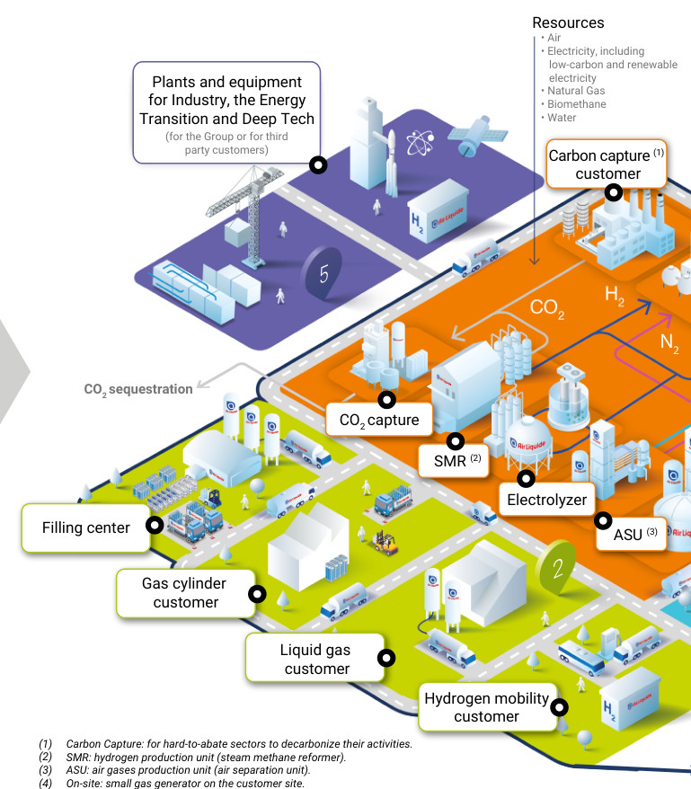 
 
SAFETY 
 
ETHICS 
 
HUMAN 
AIR LIQUIDE

---

<!-- 原文第 25 页 -->

CONTENT 
## INTEGRATED REPORT 
1 
Business model 
 
financial pertormance 
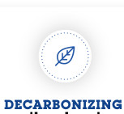 
the planet 
 
progress via technologies 
 
1 2 
## VALUE CREATION 
Financial performance (a) Revenue: 26.9 billion euros +5.8% on average over 30 years Cash flow (b): 6.9 billion euros +7.2% on average over 30 years 
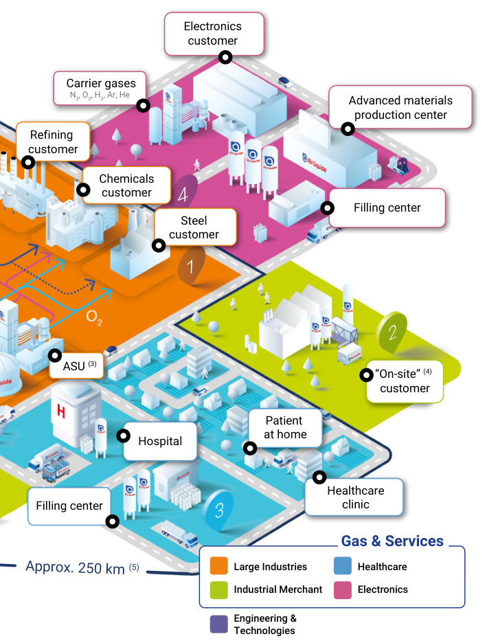 
Adjusted dividend per share: +9.2% on cverage over 30 yecrs 
## Environment 
Carbon neutrality by 2050 Carbon trajectory validated by SBTi 
Emission 34.2 Mt in 2025 -13.0% compared with 2020 baseline (scopes 1&2) 
## Society 
Record level of 0.4 accident frequency rate 100% of employees benefit from a common basis of care coverage 
Highest diversity in its sector More than 600 projects supported by the Air Liguide Foundation since its creation 
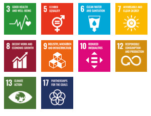 
(a) Data calculated according to prevaiing accounting ules over 30 years. Adjusted 
(b) 
2025UNIVERSAL REGISTRATION DOCUMENT 
AIR LIQUIDE 
23

---

<!-- 原文第 26 页 -->

1 
INTEGRATED REPORT Business model 
CONTENT< 
## 3.Description of activities (1) 
The Group's activities are distinguished into Gas & Services and the Engineering& Technologies. They serve one unique business, that of industrial gases. The four business lines comprising the Gas & Services activities are closely tied by a strong industrial mindset where proximity is key.The diagram on page 25 illustrates the sharing of production or distribution assets between the different business lines for a given geographic region. This efficient industrial network and its proximity with its customers allow Air Liquide to: 
improve reliabilit:, 
optimize energy consumption,costs and logistics flow, 
anticipate customers' needs; 
understand changes in the markets; 
and offer inovative solutions. 
The strong integration of the various World Business Lines thus allows the Group to create synergies, become stronger and grow while creating long-term value. 
## The Strength of Air Liquide's model 
In Large Industries, whose customers are primarily in the Steel, Chemical, and Refining industries, the offtake of gas is contracted for a duration of at least 15 years,and includes take-or-pay clauses which guarantee a minimum level of revenue. To be noted that the energy cost is contractually reinvoiced to customers. 
Industrial Merchant is characterized by the broad diversity of its markets, customers,and regions, which is the result of strategic targeting and which reinforces the resilience of the business line. Sales include a significant share of fixed revenue from providing equipment to customers' sites (notably cylinders and vessels for bulk gases). 
Healthcare benefits by marked societal trends (longer life expectancy,development of chronic diseases, etc.), which ensure growth in demand independently of economic cycles. 
The development of the semiconductor industry with its numerous digital applications supports growth in Electronics, an industry presenting a strong momentum. 
As part of the Group's transformation initiatives,the Engineering & Construction and Global Markets& Technologies activities merged on January1,2025to form a new business unit Engineering&Technologies(E&T) (2)Under a single management,with a common vision and objectives,this new organization aims to strengthen the operational performance of the Group and contribute to its growth by providing a more integrated innovation cycle. leveraging the size effect and complementary expertise.This business unit brings together Air Liquides expertise in technology,engineering, construction, project development, manufacturing,and project execution to design and deliver leading industrial solutions such as gas production units and advanced equipment. 
2025GROUP REVENUE BY ACTIVIY 
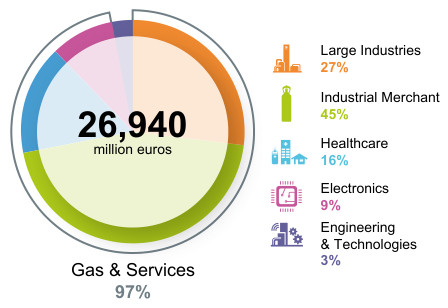 
The solutions offered by the business lines to sustainable development, of today or the future,especially in the energy transition domain, reinforce the Group's growth and resilience. 
The Groups capacity to innovate enables it to coninuously improve its current offerings by integrating new technologies and new ways of working to boost operational excellence and future growth.Air Liquide therefore draws on its internal and extemnal innovation ecosystems to develop differentiating solutions for its customers and patients and open up new markets. Innovation contributes to the Group's sustainable growth. 
Moreover, through its various World Business Lines,the Group serves more than 4 milion customers and patients in a variety of industries and across a wide range of regions, which provides high resistance to economic cycles. These characteristics, which are inherent to the industrial and healthcare gas business, reinforce the strength of the business model. 
The Group's products (3) and services are used in all industriall markets and in Healthcare. It should be noted that Air Liquide is not directly active in the exploration,extraction, refining, or distribution of liquid or gaseous fossil fuels with the exception of marginal sales (below the thresholds provided for in Regulation (EU) 2020/1818) of compressed natural gas for customers in mobility. In addition, Air Liquide does not sell products falling within division 20.2 of AnnexI to Regulation (EC)No1893/2006 conceming agrochemicals and pesticides. Finally, Air Liquide neither produces controversial weapons nor cultivates or produces tobacco. 
ESRS 2 SBM-15 40 (a),ESRS 2 SBM-1S42. Csri ses e i o e e os s 2025UNIVERSAL REGISTRATION DOCUMENT 
24 
AIR LIQUIDE

---

<!-- 原文第 27 页 -->

CONTENT 
INTEGRATED REPORT 1 Business model 
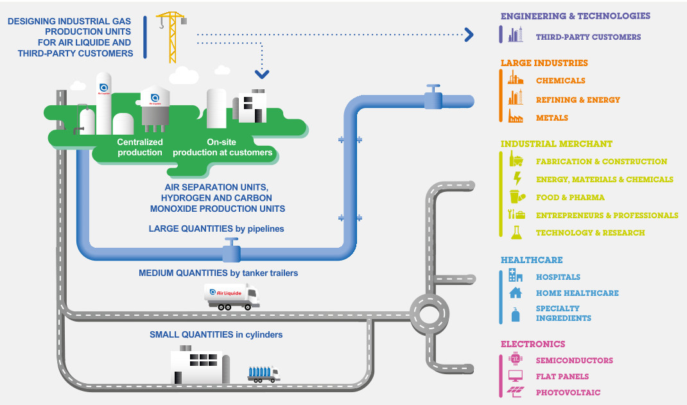 
1 2 
## 3.1.GAS & SERVICES 
The Gas & Services businesses include four World Business Lines to better support changes and meet the needs of the various arkets:LargeIndustries, Industial Merchant, Healthcare,and Electronics. 
To maintain economically viable distribution costs, industrial gas production must be local. Therefore,Air Liquide gas production units are located throughout the world and can supply many types of customers and industries with the relevant volumes and services required. Air Liquide's structure is made up of corporate functions, in Paris,and of groups of countries under the supervisions of an Executive Committee member depending on their geographical location (Americas,Europe Middle East& Africa and Asia Pacific) 
Large Industries supplies industrial gases by operating major production units. It serves customers in the metals,chemicals, refining and energy sectors where high gas volumes call for a dedicated plant or the development of a pipeline network. Large Industries also supplies the Group's other business lines with gases which are then packaged and delivered to their respective customers. 
Industrial Merchant supplies a wide range of different gases, application equipment and associated services. It serves industries and professionals that require smaller quanties than Large Industries' customers. Gas can be distributed in bulk,in liquid form,or in cylinders, in gaseous form,for smaller quantities.Finally,small production units can be installed locally for customers with larger gas needs, or in remote areas. 
Healthcare supplies medical gases,equipment and services to hospitals and also directly to patients in their homes. It also produces and distributes healthcare specialty ingredients for the cosmetics,pharmaceutical, vaccine and nutrition markets. 
Electronics supplies gases,materials (complex molecules) used in manufacturing processes,as well as equipment and services mainly used for the production of semiconductors,but also filat screens and photovoltaic panels. 
7 
2025 UNIVERSAL REGISTRATION DOCUMENT 
AIR LIQUIDE 
25

---

<!-- 原文第 28 页 -->

1 
INTEGRATED REPORT Business model 
CONTENT< 
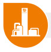 
## Large Industries 
## 1. BUSINESS OVERVIEW, BUSINESS MODEL AND INDUSTRIAL PROCESSES 
## a. Business overview 
The Large Industries business line supplies gas and energy solutions to customers in the metals, chemicals, refining and energy industries, which are essential for their own core businesses, to improve process efficiency and to make their plants more environmentally friendly.The Large Industries business line provides oxygen,nitrogen,argon,hydrogen and carbon monoxide through its plants and its pipeline network. The Group also operates cogeneration plants to supply customers with steam and electricity. 
A world leader in this sector, Air Liquide benefits from rigorous investment selection and project execution processes as well as the expertise of its project development teams. The Engineering & Technologies teams also support the Large Industries business line. The largest Large Industries customers are looked after by key account managers who have in-depth knowledge of customers' businesses,as well as of their projects,industrial processes and global structure.This allows Large Industries to maintain close contact with its customers, thus improving the Group's responsiveness and competitiveness in terms of meeting their needs. 
2025LARGE INDUSTRIES REVENUE BY PRODUCT 
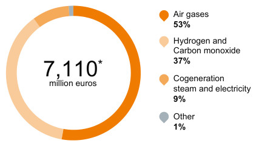 
*27% of Group's revenue. 
## b. Business model 
The supply of gas is generally contracted for 15 years. For certain projects, this can be extended to 20 years and beyond.The signing of new contracts for new industrial customers' sites is a strong predictor of future growth. Within these contracts, the Group quarantees long-term service continuity and a high level of reliability with respect to the gas supply via a high-performing industrial solution. In retum, long-term gas supply contracts include quaranteed minimum volumes through take-or-pay clauses, as well as the indexation to variable costs (mainly for electricity and natural gas) and to inflation 
The use of industial gases is critical for the various industrial processes of Large Industries" customers. As any discontinuity in supply translates into an interruption of the customer's production operations, supply reliability and safety are crucial. However, although vital, gas supply generally represents a very small part of total production cost for the customer. 
Large Industries is at the heart of the energy transition,which creates major growth opportunities with the supply of low-carbon gases as well as new modes of process and solutions for the customers' $CO_{2}$ emissions reduction 
## C.Large Industries industrial processes 
The resources necessary for the production of industrial gases vary according to the type of gas and the location of the production unit.The production of oxygen and nitrogen requires air and a large quantity of electricity.Cogeneration units consume natural gas and water.Reforming units which produce hydrogen and carbon monoxide mainly consume natural gas and little electricity. Air Liquide is also developing its production of lowcarbon hydrogen by electrolysis, which requires low-carbon electricity and water 
Air gases production (ASU: Air Separation Unit) An Air Separation Unit (AU) compresses, ligpefies and disils ai in order to separate it into its different components: 78% nitrogen, 21%oxygen,1% argon and noble gases (neon,krypton and xenon).Only certain large ASUs can produce these noble gases. The ASUs do not emit $CO_{2}$ directly but electricity consumption is significant. A simplified diagram of an ASU operation is presented on page 35. 
Hydrogen and carbon monoxide production through steam reforming (SMR: Steam Methane Reformer) By steam reforming natural gas,an SMR produces hydrogen and carbon monoxide.The most significant raw material is natural gas; electricity and water consumption is modest. A simplifed diagram of hydrogen production by reforming is presented on page 36. Air Liquide has developed a portfolio of $CO_{2}$ capture solutions adapted to SMR, allowing their greenhouse gas emissions to be very significanty reduced. 
## Hydrogen production through electrolysis 
Hydrogen production through electrolysis is based on the dissociation of water molecules $(H_{2} O)$ using electricity, to extract hydrogen and oxygen molecules.This process produces hydrogen without using or emitting carbon-based molecules. It can be used to produce low-carbon hydrogen for industry and mobility, as well as for energy storage. A simplified diagram of hydrogen production through electrolysis is presented on page 35. 
## Cogeneration 
Cogeneration consists of simultaneously and efficiently producing electricity and steam generally by consuming natural gas and water. The electricity is used by an Air Liquide plant or sold on the local network.The steam is required for certain industrial processes. This type of unit emits $CO_{2}$ directly. 
26 
2025UNIVERSAL REGISTRATION DOCUMENT 
AIR LIQUIDE

---

<!-- 原文第 29 页 -->

CONTENT 
INTEGRATED REPORT Business model 
1 
 
GAS SEPARATION TECHNOLOGIES FOR THE CAPTURE AND USE OF $CO_{2}$ 
Air Liquide's porfolio of technologies also includes separation and gas capture technologies.Based on cryogenic distillation, adsorption, absorption, or separation membranes,these technologies are used to capture the carbon dioxide generated by Air Liquide's industrial processes and those of its customers. Air Liquide proposes to its customers $CO_{2}$ capture as a service on a typical Large Industries contract basis.These solutions can be installed,for example,at hydrogen production units,petrochemical facilities,of cement plants. Captured carbon dioxide is then permanently sequestered in geological storage facilies or used in the customers processes,such as the treatment of alkaline water, or used by Industrial Merchant customers, to produce carbonated beverages,to package food in a protective atmosphere, or to prepare welding gas mixtures. 
1 
## 2. LARGE INDUSTRIES KEY FIGURES 
>300 large air separation units; 
>50 hydrogen andior carbon monoxide production units; 
>9,500 km of pipeline networks; 
>10 cogeneration plants 
## 3. CUSTOMERS AND MARKETS 
The chemicals industry uses mainly oxygen,hydrogen and carbon monoxide in its manufacturing processes,as well as nitrogen to inert its installations. 
The refining industry requires hydrogen for various processes, in particular to desulfurize fuels and crack hydrocarbons. Stricter regulations to reduce fuel pollutant emissions and the use of heavier hydrocarbons are contributing to the increase in demand for hydrogen.The production of sustainable fuels requires larger quantities of hydrogen than the production of traditional fuels.In addition,some regulations require the use of renewable feedstocks, such as renewable hydrogen, in fuel production. 
In the metals industry,Air Liquide supplies large volumes of oxygen to steel producers notably, the use of which improves their energyperformanceandsignificantly reduces their $CO_{2}$ emissions. The majority of new projects are currently located in emerging economies.To propose to its customers solutions enabling carbon emission reduction, Group is also partnering with steel industry customers to develop innovative solutions involving renewable or low-carbon hydrogen for Direct Reduced Iron (DRI) production plants and carbon capture technologies. 
Numerous industries linked to energy or chemicals use large quantities of oxygen to transform coal, natural gas, or liquid hydrocarbons into syngas for the production of chemical products, synfuel,or electricity. 
To meet customer requirements, the supply of large quantities of gas is critical. Air Liquide supplies its customers directly by pipelines from a dedicated plant or different plants linked by a network. Air Liquide has built its pipeline networks progressively over the last 40years. With a total length of more than 9.500 kilometers (6,200 miles),these networks stretch, for example,across Northem Europe,from Rotterdam through to Dunkirk,and along the Gulf Coast in the United States from Lake Charles (Louisiana) to Corpus Christi (Texas) as well as along the Mississippi River in Louisiana. Many other mid-size local networks have also been built in other significant industrial basins in particular in Germany, Italy, Singapore, Korea and China 
 
KEY POINTS 
The Large Industries business line depends on long-term contracts (minimum of 15 years), which include take-or-pay clauses and offer considerable visibilitv of future revenue and rotection in the event of a sianificant fall in customer volume consumption (below the minimum take-or-pay level).Sales prices in Large Industries contracts are indexed,in particular,to energy and infiation costs.The long investment cycle and high capital intensity require a solid balance sheet. The signing of new contracts is a strong predictor of future growth. 
Air Liquide develops a pipeline network strategy in the industrial basins in order to provide customers with greater supply reliability while optimizing operating costs. This strategy allows the pooling of production assets and generates scale and energy savings, on the overall Air Liquide network as well as for its customers. 
By developing its capacity to deliver low-carbon industral gases to its customers and other Group businesses,by allowing industrial processes decarbonization,and by offering carbon capture as a service,Large Industries is crucial for the energy transition and the Group's decarbonization strategy. 
7 
2025UNIVERSAL REGISTRATION DOCUMENT 
AIR LIQUIDE 27

---

<!-- 原文第 30 页 -->

1 
INTEGRATED REPORT Business model 
CONTENT< 
# Industrial Merchant 
## 1. BUSINESS OVERVIEW, BUSINESS MODEL AND SUPPLY MODES 
a. 
## Business overview 
The Industrial Merchant business line is,by its nature,a highly local business, which provides more than two million customers with industrial gases,equipment, hardgoods,and associated services. 
Industrial Merchant provides gas using the supply mode best adapted to customers' needs: either via a small on-site production unit for customers with major volume requirements, or in liquid form distributed by trucks for medium-scale quantities,or in cylinders for smaller volumes and use on construction sites. Around 95% of Industrial Merchant's customer base is small customers who favor simplicity, flexibity and quality of service: they mainly order cylinder gas and hardgoods. 
The Industrial Merchant activity serves a wide variety of markets, often essential to life. It constanty invents new applications for its molecules that address the challenges of energy transition but also the challenges of new uses and markets and that contribute to improving the operational efficiency of its customers. The Industrial Merchant business manages a significant amount of data from the large number of assets used in operations along with the diversity of markets and customers. Digital transformation and data analysis, therefore,play a predominant role in improving operational efficiency, price management, and the quality of the services provided to customers. 
2025 INDUSTRIAL MERCHANT REVENUE BY END MARKET 
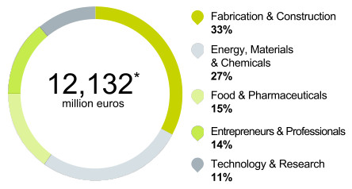 
·45% of Group's revenue. 
## b. Business model 
A large share of Industrial Merchant sales is covered by contracts with terms of up to five years for cylinders and liquid gas supply and up to 15 years for small on-site gas generators.These contracts generally include gas supply, the reliable and safe delivery of products and the provision by the Group of equipment at customers' sites,the provision of a service, as well as the indexation of the sales price to different variables such as inflation and energy prices.The provision of cylinders or tanks on customers'sites is covered by a fixed monthly fee. The wide range of markets, customers,and regions in which the Group is present reinforces the resilience of this business line. 
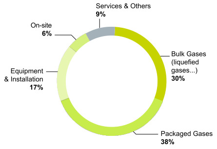 
The Industrial Merchant (IM) business line is integrated in the industrial basins and firmly grounded in local economic life. This local base is strengthened by economic constraints which limit the radius of gas distribution to some 250 kilometers around a production site. One of the strengths of Industrial Merchant is being able to identify high-potential areas and establish a site by developing synergies with Large Industries' network of plants or by investing in dedicated units.While permeating the local economy, the Industrial Merchant business line has expanded its operations internationally in about 50 countries, thus strengthening the business line's resilience. This regional diversity is based on a strategy of targeted investments and the regular optimization of portfolios. 
A permanent focus on geographic density within the industrial basins is a key success factor thanks to the synergies that this generates, in particular in terms of logistics. In addition to the business development ofa basin,the acquisition of local distributors and their portfolio of customers also helps improve this density, in particular in markets that are stil fairly fragmented such as the United States and China. 
## Supply methods 
On page 30, the diagram shows the different supply modes used in Industrial Merchant. Strong operational discipline is applied across the value chain (supply,packaging,distribution) and is an essential part of Air Liquide'sintegrated model.Coupled with new digital tools, this allows the Group to optimize the use of its resources in real time (plants, trucks,energy, etc.) to improve the competitiveness of its products and services for customers and reduce its $CO_{2}$ emissions. Air Liquide's quest for continuous improvement helps ensure the safety of its employees, customers, and service providers and optimize their costs while offering a seamless customer experience. 
28 
2025UNIVERSAL REGISTRATION DOCUMENT 
AIR LIQUIDE

---

<!-- 原文第 31 页 -->

CONTENT 
INTEGRATED REPORT Business model 
1 
## 2. INDUSTRIAL MERCHANT KEY FIGURES ~30,000 employees; 
Optionality in terms of both product and service offerings as well as the transactional channel is also a differentiating characteristic of the Industrial Merchant business line.Thanks in particular to the contributions of Airgas in terms of customer culture and excellence in operational service, Industrial Merchant continues to develop a multi-channel approach to sales which notably includes e-commerce and telesales to better support the uses of its customers. 
~20 million clinders; 
~10,000 trucks; 
~50,000 crygenic tanks installed on customers sites; 
>1,000 small on-site generation units; 
## A MULTI-CHANNEL SALES APPROACH 
~1,400 flling centers and retail stores 
1 2 3 
## 3. CUSTOMERS AND MARKETS a.A customer-centric culture 
Customers and markets served by Industrial Merchant are presented in the drawing on page 30.Industrial Merchant customers vary greatly in terms of size, business and needs, but their common ground is their desire for products and services which facilitate daily activities. 
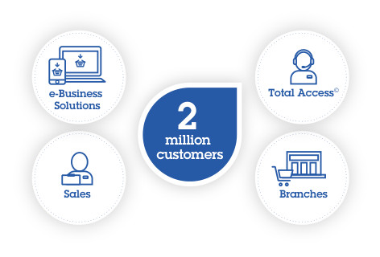 
The Group's ambition to provide a seamless customer experience requires listening to customers' needs, providing a diversified and customized offering and an excellent quality of service. To further customerengagement, Air Liquide is working on the rationalization and simplification of its processes to continuously improve the level of its service,focusing on the reliability of its equipment and deliveries and thus the overall efficiency of its supply chain. 
 
DIGITAL AND DATA FOR THE PERFORMANCE AND THE CUSTOMERS 
The Industrial Merchant business line manages a significant amount of data from the large number of assets and customers.Digital transformation and data analysis, therefore,play a predominant role in improving operational efficiency, the quality of the services provided to the customers,and new offerings. Thanks to this data analysis,the Industrial Merchant teams are able to drive the performance of operations in real time and optimize price management in a fair and dynamic way depending on markets and costs. The digitalization of assets on customer sites also enables the uploading of utiliation data,which is then analyzed to create new services, offerings, or business models. 
## b.A strategic positioning on markets with optimized product portfolios 
Thanks to their proximity to customers and the Group's presence in a large number of markets, the Industrial Merchant teams foster a large and in-depth knowledge of these markets and of their industrial processes. Moreover,Air Liquide collects a large amount of data from these markets and the economy in general. This allows the Group to identify major trends,assess growth prospects and anticipate future opportunities. By closely analyzing this market data and its value chains, the Group has developed a selective approach and dynamic market management to focus its resources on areas of higher potential growth. The diversity of the markets, customers and geographical regions resulting from strategic targeting strengthens the resilience of the business line. 
The level of proftiability of the Industrial Merchant business line varies according to product and supply mode. By optimizing this product mix, the business increases its profitability,captures new volumes and diversifies its customer base. In order to improve the proftability of the business, the Group is pursuing a commercial strategy aimed to strengthen the local density of its customers. 
6 7 
2025UNIVERSAL REGISTRATION DOCUMENT 
AIR LIQUIDE 
29

---

<!-- 原文第 32 页 -->

1 
INTEGRATED REPORT Business model 
CONTENT< 
SUPPLY MODES 

| Production | IM supply chain | IM Products & Services | IM Customers |
| --- | --- | --- | --- |
| Air Separation Unit | | Small On-site generator | Fabrication &Construction |
| 小 | | Bulk Liquid gas re | Energy, Materials &Chemicals |
| | | Packaged Gas Industrial & Specialty gases | Food & Pharma |
| | | Services | Entrepreneurs &Professionals |
| Filling center | | Equipment & Installations Incl. Hardgoods | Technology &Research |
 
CUSTOMER MARKETS 

| | Fabrication &Construction | Energy, Materials & Chemicals | Food & Pharmaceuticals | Entrepreneurs &Professionals | Technology &Research |
| --- | --- | --- | --- | --- | --- |
| Industry sectors | Metal Fabrication (and treatment) | Chemicals =Metallurgy | Food production & processing | Workshops Service and | Electronic Components |
| | Construction | =Oil,gas and mining | Beverage | maintenance | &Assembly |
| | ■Automotive Trains | Construction material (glass, Cement,etc.) | Agriculture (and aquaculture) | companies (auto repair, HVAC, | Optoelectronics & Fiber optics |
| | Shipyards | Utities (water, waste,power,etc.) | ■Bars & restaurants Pharmacauticals | plumbing...) | Public Research &Universities |
| | Aeronautics & Space | Hydrogen mobility | Cosmetics | | Industrial Research centers |
 
 
## KEY POINTS 
The Industrial Merchant business line is, by its nature,a highly local business, which provides more than two milion customers with industrial gases,equipment, hardgoods and associated services. 
The diversity of markets, customers and regions is the result f trategic targeting and reinforces the resilience of the business line. The balanced breakdown between markets related to industrial production and those more consumption-related, the fact that they are often related to sectors essential for life, coupled with an Industrial Merchant business model which includes a share of fixed income from sales, notably by providing cyinders and vessels on customer sites,strengthens the resilience of the business. Thus, about 50% of Industrial Merchant sales are not dependent on the local industrial production of the countres in which the Group is present 
Thanks to the proximity to their customers, in-depth knowledge of their industrial processes and innovation capabie, Industrial Merchant teams and their experts in gas applications develop new product or services offerings which are a major growth and performance driver. 
30 
2025UNIVERSAL REGISTRATION DOCUMENT 
AIR LIQUIDE

---

<!-- 原文第 33 页 -->

CONTENT 
INTEGRATED REPORT Business model 
1 
+ Healthcare 市 
## 1. BUSINESS OVERVIEW AND BUSINESS MODEL 
a. 
## Business overview 
1 2 
The Healthcare activity provides home healthcare services, medical gases, services, and specialty ingredients. These products and services support patients along the continuum of care, from the hospital to their homes. The Group is committed, alongside patients. healthcare professionals, hospitals.and new places of care, to contibuting to making the healthcare system more efficient.Air Liquide is one of the world leaders in this constantly changing business sector, subject to stringent regulatory requirements and characterizedby muliple stakeholders (patients,doctors,health authorities,and payers) 
Actors and decision-makers in the health sector are faced with the double challenge of the increase in the number of patients with chronic diseases and the economic sustainability of health systems. Air Liquide's Healthcare activity intends to be the partner in the transformation of this sector and is committed to bringing ever more value to all stakeholders in order to contribute to the collective resolution of this challenge.Air Liguide's vision is based on the principles of Value-Based Healthcare. The value-based approach seeks the optimal trade-off between the objective and subjective benefits for each patient and the cost to society,in order to guarantee quality medical care and service for all patients in the long term. In concrete terms, this means for the Healthcare activity the development of a personalized care plan that meets the needs of each patient profile with the objective of making it possible to achieve the outcomes that everyone expects to improve quality of life. It is also a virtuous approach that allows the Group to effectively adapt its interventions while working to ensure the sustainability of healthcare systems. For medical gases and related services, the aim is to ensure their availability, simplify their management, and contribute to a more efficient and sustainable system, in order to enable doctors to focus on their health mission. Today, Air Liquide is reinforcing contractualization of supply securt, service offer quality and environmental footprint. 
2025 HEALTHCARE REVENUE BY ACTIVITY 
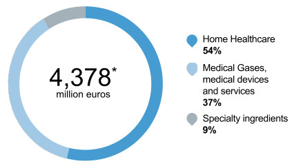 
16% of Group's revenue. 
## b.Business model 
The Healthcare activity relies on the Large Industries gas production capacities and on Industrial Merchant logistics to supply medical gases to hospitals and other places of care.while maintaining dedicated sales teams. Medical gases have a drug designation status which requires market authorization from the country's health authorities.They are subject to specific pharmaceutical traceability and are supplied in gas or liquid form by qualified personnel.The integration of the industrial and medical gases activities ensures synergies and efficiency. 
In the field of Home Healthcare,Air Liquide provides care for individuals living with certain chronic diseases,based on medical prescriptions.Dedicated teamsdeliver personalizedservice centered around a medical device associated with the treatment and supply the necessary equipment to enable patients to fully adhere to their treatment at home.This service activity includes training for patients, caregivers.and healthcare professionals on the use of the medical device,guidance to promote good treatment adherence, human support, and technical monitoring of the equipment provided. 
The growth of the healthcare business is steady and sustained, independent of industry trends. 
6 
2025UNIVERSAL REGISTRATION DOCUMENT 
AIR LIQUIDE 
31

---

<!-- 原文第 34 页 -->

1 
INTEGRATED REPORT Business model 
CONTENT< 
## 2. HEALTHCARE KEY FIGURES 
Air Liquide developed its Home Healthcare business in the 1980s,taking care of patients on oxygen therapy leaving the hospital. Home Healthcare activity was then expanded to other treatments to support people suffering from respiratory diseases (sleep apnea,COPD-chronic obstructive pulmonary disease, etc.) or diabetes by providing them with medical devices and associated services for long-term monitoring; 
~15,000 employees; 
>30 countries worldwide; 
Medical Gases, medical devices and services: Air Liquide supplies more than 20,000 hospitals and clinics around the world. Among the main medical gases and their areas of application, Air Liquide provides: medical oxygen $(O_{2})$ for respiratory diseases or intensive care, a mixture of oxygen and nitrous oxide $(N_{2} O)$ in analgesia;nitric oxide (NO) in intensive care. Air Liquide ensures compliance with the strictest safety and quality standards through the installation and maintenance ofmedical gas distribution networks in hospitals and permanent inventory control. 
~2.3 million patients cared for at home; 
~20,000 hospitals and clinics customers; 
~110.000 healthcare professional customers. 
## 3. CUSTOMERS AND MARKETS 
Over the last 20 years, Air Liquide has strengthened its leading healthcare role in Europe, Americas, Australia and Korea. It continues to grow in all regions, in particular depending on the expansion of healthcare systems. About two thirds of the Healthcare business line's sales are in Europe and about one quarter in the Americas. 
Air Liquide's medical gases and services are also used outside hospitals, particularly in proximity care medical centers (outside hospital centers,dentists,dermatologists,etc.),for emergencyrescueservices and patient transport. Furthermore, a limited share of the sales of this activity comes from the design and marketing of innovative medical devices, in particular ventilators for intensive care, transport and home use,as well as equipment for the administration of medical gases and aerosol therapy; 
The business line provides products and services in three areas: 
Home Healthcare: Air Liguide cares for 2.3 million patients in their homes suffering from chronic diseases, such as respiratory diseases or diabetes. Once the diagnosis and treatment are established by a doctor, the long-term treatment requires patient education, implementation of the therapy and its continuous support, and interventions by trained nurses or technicians in person or remotely thanks to the increased use of digital solutions. 
Specialty Ingredients:for over 80 years,through its subsidiary Seppic,Air Liquide has designed and developed specialty ingredients for the healthcare sector, in particular adjuvants for vaccines, film-coating systems for the pharmaceutical industry as well as a complete range of ecofriendly thickeners, stabilizers, emulsifiers and active ingredients for the cosmetics market. 
 
KEY POINTS 
The Healthcare business line operates in a constanty evolving world and within a strict regulatory framework. Societal trends such as the aging populatin,the increase in chronic diseases and the fragilit of healthcare systems financing which seek efficiencies make the Healthcare activity a major growth driver for the Group and a contributor to the sustainabity of health systems. 
Air Liquide Healthcare has a unique position in that it is present along the continuum of care and connected to all stakeholders in the healthcare ecosystem (patients, healthcare professionals,hospitals,health authorties,payers) for the treatment of acute diseases (with the supply of medical gases and services in hospitals and other places of care),the treatment of chronic diseases (with Home Healthcare) and in prevention and well-being (with Specialty Ingredients). 
32 
2025UNIVERSAL REGISTRATION DOCUMENT 
AIR LIQUIDE

---

<!-- 原文第 35 页 -->

CONTENT 
INTEGRATED REPORT Business model 
1 
 
## 1. BUSINESS OVERVIEW AND BUSINESS MODEL 
## a.Business overview 
1 2 
Air Liquide provides innovative solutions essentially to the semiconductor market and marginally to the flat panel display and photovoltaic markets.To do so,the Electronics business line leverages its expertise,its innovation capacity and its global infrastructure allowing a strategic proximity to key players in these sectors. Electronics customers' products respond to increasingly challenging consumer demands for mobility, connectivity, computing power, artificial intelligence and energy savings. These technological advances are possible thanks to the innovative materialsandgases usedin semiconductor production. Air Liguide is the world leader in industrial gases for Electronics and the only player to offer a complete range of products and solutions. 
## 2025ELECTRONICS REVENUE BY PRODUCT 
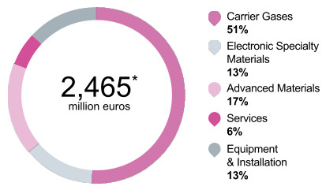 
*9% of Group revenue 
## b. Business model 
Air Liguide's Electronics business is based near its customers' production facilities. ts business model is mainly based on long-term contracts for the supply of carrier gases, and constant innovation for the supply of new advanced materials that are necessary to meet the technological challenges of the sector's major players. The business line also supplies equipment for the distribution of gas and chemical products and installs them at its customers' facilities. The Electronics business line works on reducing its greenhouse gas emissions associated with electricity consumption for the production of carrier gases, and on reducing the emissions of its customers by providing them with low-impact materials to replace some of the more polluting combinations currently in use. 
 
KEY POINTS 
## 2. ELECTRONICS KEY FIGURES 
>4,000 employees; 
■>200 carrier gas units: 
>200 different molecules (special and advanced materials); 
~50,000 cylinders of specialty materials delivered each year. 
## 3. CUSTOMERS AND MARKETS 
The Electronics business line provides a global service to the sector's main players.It is present in Asia (~73%),the USA (~19%) and Europe(-8%).Air Liquide is the market leader in the Electronics business line. 
Carrier Gases: Carrier gases (very high purity gases, mainly nitrogen,but also oxygen,argon,helium,hydrogen,etc.), supplied from on-site facilities, are intended to dilute and transport molecules for chip manufacturing,cooling and inerting of the production environment.The Carrier Gases business is resilient and shows steady growth. It benefits from long-term "take-or-pay" contracts with an average duration of 15 years and growing demand in line with the expansion of the semiconductor industry. 
Electronic Specialty Materials: These gases (silane,xenon, nitrous oxide, etc.) are used in the manufacturing processes of all semiconductors. The growth of the activity is closely linked to the volume of semiconductor production. 
Advanced Materials: These materials used in gas form are at the heart of the most advanced manufacturing processes and are essential for the miniaturization and energy efficiency of new generations of memory and logic chips.The most sophisticated advanced materials are developed in collaboration with customers and their ecosystem.There are few players with the innovation capabilities needed to operate in this market. The activity benefits from the development of advanced semiconductors. 
Equipment & Installation: The Electronics business also sells and installs equipment to ensure the distribution of gases. materials and chemicals to customer sites. The level of activity is linked to the commissioning or development ofnew customer manufacturing sites. 
Services& Analysis:customers rely on Air Liquide's expertise for the daily management of gases, materials and chemical products on their sites, as well as to provide cuttingedge analytical services to continuously improve their production processes. 
## Air Liquide is the word leader in industial gases for Electronics and the only player to offer a complete range of products and solutions. 
The Group's Electronics business line consists of five different segments: 
the Carier Gas business is resilien, driven by long-tem contracts with take-orpay clauses and by growing demand in line with the industry expansion; 
Electronic Specialy Materials, which are used or all semiconductor manufacturing: Advanced Materials, essential fo rducing new generations of more eficient chips; Equipment 8 lnsalinilsandnlnyts Services & Analysis (analysis and management of gases, materials and chemicals). 
2025 UNIVERSAL REGISTRATION DOCUMENT 
AIR LIQUIDE 
33

---

<!-- 原文第 36 页 -->

1 
34 
INTEGRATED REPORT Business model 
CONTENT< 
## 3.2 ENGINEERING & TECHNOLOGIES 
## 1. BUSINESS OVERVIEW AND BUSINESS MODEL 
## a.Business overview 
The Engineering& Technologies activity brings together Air Liquide's expertise in technology,engineering, construction, manufacturing and project development and execution,to design and deliver cutting-edge industrial solutions. Driving the Group's technological independence and leveraging the combined expertise of all entities involved in innovation and technology development together with project delivery, Engineering& Technologies enables the Group to capitalize on growth opportunities,particularly in energy transition,electronics and deep tech. With its unique portfolio of technologies and expertise,Engineering & Technologies offers a wide range of solutions to accompany the growth and meet the evolving needs of our customers. Its solutions range from technology development to engineering, procurement and construction management of industrial gas production units and the manufacture of cryogenic equipment. 
The Engineering & Technologies (E&T) activity is the result of the merger, on January 1,2025,of the Engineering & Construction (E&C) and Global Markets&Technologies(GM&T) activities (1) To cover all markets and manage its production costs,the Engineering& Technologies activity has worldwide geographical coverage with a technology campus and engineering centers and manufacturing workshops located in Europe, North America, Asia and the Middle East. 
## b. Business model 
For over a century,the Group has mastered proprietary technologies, gas production units design, equipment manufacturing and has been recognized for the performance of its solutions.Engineering&Technologies's business model is centered on leveraging its integrated capabilities to serve both Group investment projects (majority of its order intake)and external third-party customers, thereby maximizing the value of its technological expertise. The core activities of Engineering &Technologies are: 
technologies development; 
project and solution development; engineering,procurement and construction management; equipment manufacturing: operations support. 
Engineering & Technologies has a strategic value for the Group. It provides a high level of expertise,crucial to the design of efficient units which specifically respond to the needs of the Group's Gas & Services customers.It enables optimal operational management of production units including energy efficiency and reliability. It also allows skills and staff development and facilitates site takeovers for the Group, by ensuring the right assessment of the quality of assets purchased. 
While the Group favors the development of its gas sales business over equipment sales,the Engineering& Technologies activity also serves third-party customers, allowing the Group to constantly assess and improve the competitiveness of its own technologies and commercial offering. In particular,Air Liquide is hence able to forge close relations with customers who produce their own gas,better understand their needs and projects.In certain cases, negotiations initially steered toward the sale of equipment were finalized by the signing of a long-term industrial gas supply contract. 
As part of this third-party customer business, the strategy consists of prioritize licensing, studies and equipment supply contracts with no construction risk.Dueto the nature of its business. Engineering& Technologies'contribution to consolidated revenue (sales to third-party customers) can vary significantly from one year to another but represents only a small part (-3%) of the Group sales. 
The consolidated revenue of the Engineering& Technologies business, with third-party clients,amounted to 855 million euros in 2025.To be noted,that Engineering& Technologies activity for the Group (internal sales) does not generate revenue accounted for in published sales (only revenue from activities with third parties are included). 
## 2. CUSTOMERS AND MARKETS 
Engineering&Technologies's unique portiolio is specifically designed to address major global challenges, notably industry decarbonization,the energy transition,and the strong digital growth,in particular Al revolution. Through its patented technologies and its expertise in cryogenics,the Engineering& 
Technologies continues to push the frontiers of science and opens up new markets.Thus,in addition to supporting the Group's four Gas & Services business lines,Engineering & Technologies also designs and develops, often in partnership with its customers and ecosystems,equipment and disruptive technologies notably for the space industry, scientic research, fusion or quantum computing. 
 
KEY POINTS 
The global business unit Engineering & Technologies drives the Group's technological independence and leverages the combined expertise of all entities involved in innovation and technology development and project delivery to allow the Group to capitalize on growth opportunties,particularly in energy transition,electronics and deep tech.Consolidated Engineering& Technologies sales only reflect sales to third parties and do not include intemal sales.Due to the nature of its business,Engineering & Technologies' contribution to consolidated revenue (sales to third-party customers) can vary significantly from one year to another but represents only a small part (~3%) of the Group sales. 
Certain activities, mainly Biogas and Mantime,have been tranfered from the Global Markets & Technologies to the Industrial Merchant activity 2025UNIVERSAL REGISTRATION DOCUMENT 
AIR LIQUIDE

---

<!-- 原文第 37 页 -->

CONTENT 
INTEGRATED REPORT Business model 
1 
The Engineering & Technologies masters a large portfolio of processes. The most important are essentials for the operations of Gas &Services businesses and are explained hereafter: 
PRODUCTION OF AIR GASES BY CRYOGENIC DISTILLATION (AIR SEPARATION UNIT) 
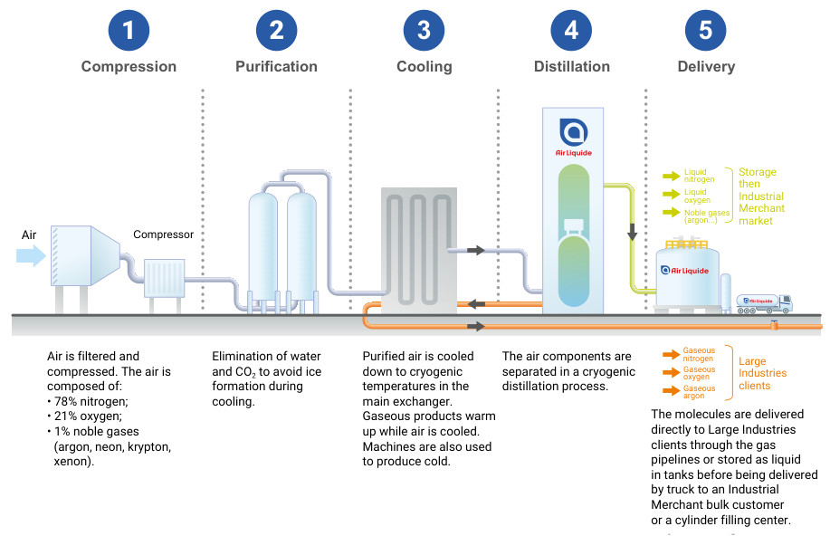 
The Engineering & Technologies designs and realizes air separation units (ASUs) for the Group and third-party customers.Large Industries, Electronics (for the production of carrier gases) and Industrial Merchant (mainly for on-site units) operate ASUs. These units also produce medical oxygen for the Healthcare activity. 
PRODUCTION OF HYDROGEN BY ELECTROLYSIS 
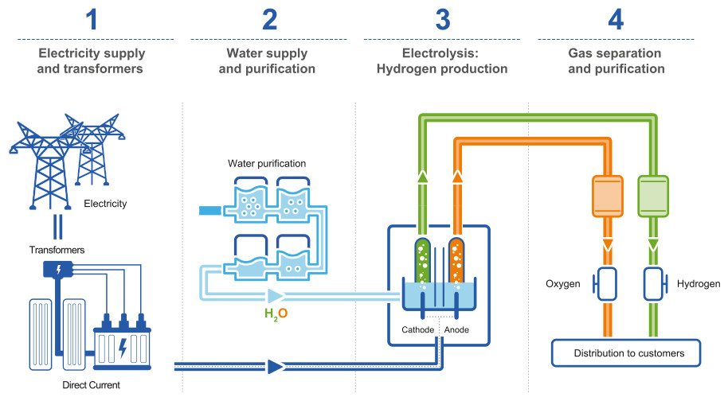 
Air Liquide masters the engineering of electrolvzers. The Electronics and Industrial Merchant businesses have operated more than 40 small electrolyzers for many years. In the case of large PEM (Proton Exchange Membranes) electrolyzers,main equipment is usuall provided by the joint venture with Siemens Energy.In Large Industries,two 20 MW PEM electrolyzers are in service (in Canada and Germany) and two 200 MW PEM electrolyzer are under construction in Europe. 
2025 UNIVERSAL REGISTRATION DOCUMENT 
AIR LIQUIDE 
35 
1

---

<!-- 原文第 38 页 -->

1 
36 
INTEGRATED REPORT Business model 
CONTENT< 
## PRODUCTION OF HYDROGEN BY METHANE REFORMING The two main processes are: 
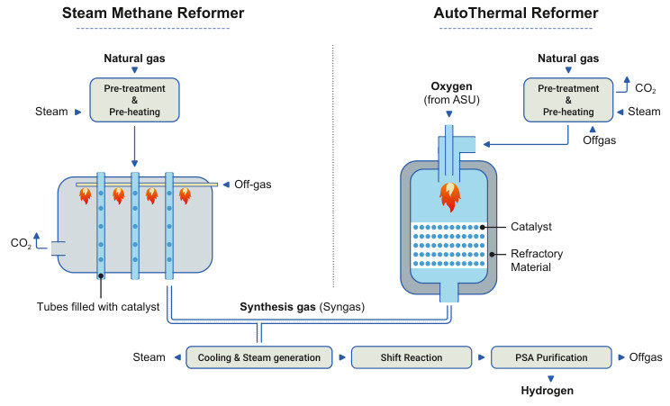 
After pre-treatment to remove certain impurities, the natural gas (or biogas) is pre-heated and mixed with steam. In the case of steam methane reforming (SMR),this mixture passes through catalyst-filled tubes inside a high-temperature reformer to be transformed into syngas (mainly hydrogen,carbon dioxide and monoxide).This syngas is then cooled (producing steam) and directed inside a "shift" reactor which increases the hydrogen content that can then be purified and supplied to the customer. The off-gas is used to heat the reformer.For the production of carbon monoxide (not shown),the cooled synthesis gas is collected and then purified successively by carbon capture and cryogenic distillation processes. 
In the case of autothermal reforming (ATR),the synthesis gas is produced in a single high pressure and high temperature reactor. This process requires oxygen. ATR is an efficient solution for the production of very large quantities of hydrogen. 
Finally, POX (Partial OXidation),a process similar to ATR but without catalyst, is an efficient solution when the main gas produced is carbon monoxide. 
Air Liquide engineering has designed and built numerous SMRs and more than 40 ATRs and POXs for third-party customers. Air Liquide Large Industries has been operating mosty SMRs but also several ATRs and POXs. 
## CARBON CAPTURE 
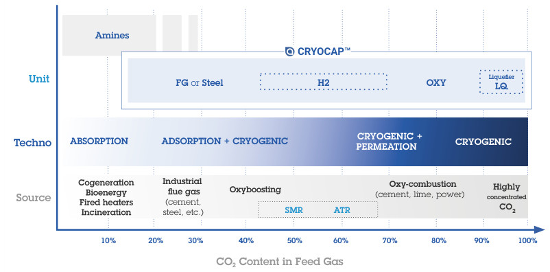 
Air Liguide masters a comprehensive portfolio of carbon capture solutions, based on the different technologies,and operates hydrogen production units equipped with these processes. Carbon capture can be used to decarbonize the Group's units and customers' plants. Air Liquide offers a carbon capture solution as a service,including investmentin capture units and related infrastructure, as well as their operation and maintenance. 
In particular,Air Liquide has developed the CryocapTM process, which combines cryogenics with other technologies and makes it possible to efficiently decarbonize the production of hydrogen, steel,chemicals or cement. The Group has been operating an industrial-scale CryocapTM unit since 2015 and has decided the construction of two new units. 
2025UNIVERSAL REGISTRATION DOCUMENT 
AIR LIQUIDE

---

<!-- 原文第 39 页 -->

CONTENT 
INTEGRATED REPORT Business model 
1 
## Competition 
At a global level, the industrial gases industry comprises three main players: Air Liquide and Linde Plc, co-market leaders with sales in excess of 25 billion euros each, and Air Products with revenue which is more than two times lower.There are also a number of global and regional players,such as Nippon Sanso Holdings (Japan),Air Water (Japan),Messer (Germany), Hangzhou Oxygen Plant Group "Hangyang"(China) and AirPower (China). Finally, numerous smaller-sized players are also present in local markets. 
1 
An industrial company in the chemical, steel or refining sectors which needs large volumes of industrial gases can choose between self-production and outsourcing. Self-production is currently estimated to account for 90% of hydrogen production and 60% of oxygen production globally, although with significant geographical disparities. In this respect, the potential to convert self-production into over-the-fence supply represents a major growth opportunity for the Large Industries business. The level of self-production varies strongly depending on the geographic region,type of industry or local culture. In advanced economies, the supply of oxygen is largely over-the-fence,while the supply of hydrogen for refining remains primarily in-house. In developing economies, over-the-fence supply opens development possibitie.Air Liquide and Linde Plc, the world leaders in Large Industries, are in competition with the other major global players and local players. 
Industrial Merchant is a local business: transport costs limit the operating area to within 200 to 250 km of a production unit, except for high value-added gases such as argon and helium. This market, which is highly diversified due to the size and activity of its customers,thus includes numerous small and medium-sized local competitors, either by producing and distributing gas or solely distributing gas. 
In Healthcare,most gas industry players also supply hospitals with medical oxygen,but few are present in the treatment of chronic diseases at home. In Home Healthcare,Air Liquide is number one in Europe (in number of patients),whereas Linde Plc has presence in the United States where Air Liquide is absent. This market remains fragmented in almost all regions with a multitude of small companies and associations. This fragmentation provides bolt-on acquisition opportunities for the Group. 
In Electronics,a business in which Air Liquide is the leader,six companies play a major role: Air Liquide,Linde Plc, Merck KGaA (Germany),Entegris (United States),Air Products and Nippon Sanso Holdings. In the advanced materials market, Air Liquide is a leader and is considered one of the "first movers"focusing on growing its incumbent position and developing innovative new molecules.The other "first moversin this specific Electronics market are Merck and Entegris. 
In Engineering & Technologies, Air Liquide mainly competes with industrial gas players. In "cryogenic" technologies used for air gas separation,the main competitors are Linde Plc, Hangzhou Oxygen Plant Group "Hangyang" and Air Products.Chinese competitors are gaining ground due to strong demand in their country.In"non-cryogenic" technologies used for producing hydrogen and the chemical conversion of syngas, the largest competitors are Technip Energies(France),Haldor Topsoe (Denmark),Johnson Matthey (United Kingdom) and Linde Plc. Finally, the Group also sells equipment and services for certain cutting-edge markets, where the competitive landscape differs greatly depending on the products, with companies of varying sizes, from multinationals to start-ups. 
Air Liquide is well positioned to capture new growth opportunities notably in the energy transition, thanks to its strategic positioning, operational experience and expertise in key technologies such as electrolysis, $CO_{2}$ capture and hydrogen liquefaction. 
5 6 
2025UNIVERSAL REGISTRATION DOCUMENT 
AIR LIQUIDE 
37

---

<!-- 原文第 40 页 -->

1 
INTEGRATED REPORT Strategy and objectives 
CONTENT< 
## STRATEGY AND OBJECTIVES 
## 1. Ambition 
Health,climate,energy,mobility: our world is facing major challenges, even vital ones. Now more than ever,there is an urgent need to invent a sustainable future. 
An ambition to invent a sustainable future has driven and guided the way Air Liquide innovates over the last 120 years. Today, its molecules can be found all around us,at the heart of life: in factories, in hospitals, behind smartphone screens,and even inside space shuttles. 
Inventing a sustainable future means creating and cultivating innovative solutions based on technology and scientific expertise to support industry and healthcare as they march towards progress and a decarbonized world. It means acting on a daily basis for customers and patients in addition to being useful to society as a whole. 
Inventing a sustainable future also means creating an original growth modelthat combines steady and solid financial perfommance with leading environmental and societal objectives. It means doing business while being responsible. 
Because now more than ever,inventing a sustainable future means being open to the needs of everyone and acting in the interest of all. Inventing a sustainable future is the ambition of the Air Liquide Group. 
## AIR LIQUIDE'S PERFORMANCE OVER 30 YEARS 
For more than 30years, Air Liquide has posted strong performance, which has driven its long-term growth outlook. This performance is due to the strength of Air iquide's business model and diversity of its geographical presence,businesses,endmarkets and customers. 
Revenue:+5.8% on average per year. 
Earning per share (: +7.2%on average per year. 
Cash flow from operating activities before changes in working capital: +7.2% on average per year. 
Dividend per share (a)():+9.2% on average per year. 
(a) Adusted for the two-for-one share split in 200,for re share atribuonss and for a factor of 0.974reflecting the value of the preferential subscnption 
(b) Ssubeo thten? 
## 2.Strategic plan cnd mid-term objectives 
On March22.2022.Air Liquide presented ADVANCE.its new strateic plan for 2025combining financial and extra-financia performance.Backedby a business model ofproven resilience,innovation and technological know-how,the Group has demonstrated,particularly well,is position to continue a growth trajectory while contributing to an efficiet response to major economic, environmental and societal challenges. 
## 2.1. ADVANCE STRATEGIC PLAN SUCCESS 
With ADVANCE, the Group took on an ambitious challenge: to coninue its proftable growth momentum while meeting its $CO_{2}$ emissions reduction commitments and investing in the markets of the future. 
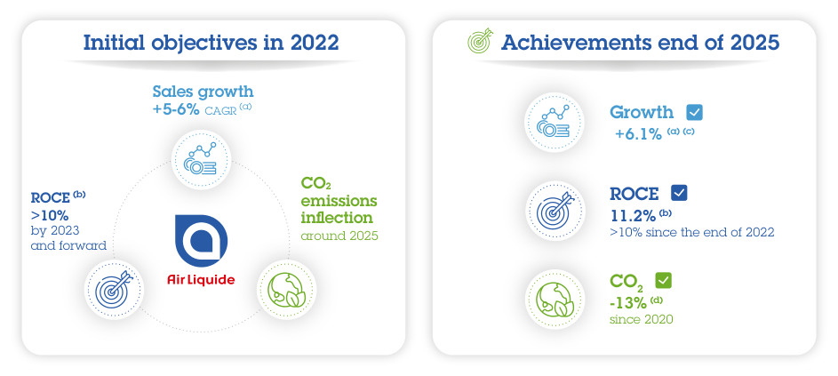 
(⑥ 
(d) Soope 1 and 2 emissons, scop 2 on a market basstated eamisons,s cater- pags 58 and 64 and chapter 5-page 318 and folowing 
38 
2025UNIVERSAL REGISTRATION DOCUMENT 
AIR LIQUIDE

---

<!-- 原文第 41 页 -->

CONTENT 
INTEGRATED REPORT Strategy and objectives 
1 
## The three objectives of the strategic plan have been achieved 
The compound annual comparable growth rate (CAGR) of the revenue over the 2022-2025period reached +6.1%(1),in line with the ADVANCE plan's target of +5%to+6%.It is calculated based on 2021 sales,at the 2021 currency rate and energyprice,excluding the impactof significant scope (acquisition ofSasol's ASUs and deconsolidation of the Russian subsidiaries) 
The return on capital employed (ROCE (2) stood at 11.2% at the end of 2025.The ADVANCE target of a recurring ROCE above 10% from 2023 was achieved as early as the end of 2022, one year ahead of schedule. 
The ADVANCE objective of reaching an inflection point in absolute $CO_{2}$ emissions was achieved, following two consecutive years of significant decline in absolute value of $CO_{2}$ emissions in 2023and 2024.In 2025,the trajectory was confirmed,with a further reduction in emissions (Scopes1 and 2) of -2.0% compared to 2024 and -13.0% compared to the 2020baseline. 
## 2.2. DECARBONIZE THE PLANET 
With ADVANCE,Air Liquide confimed its leadership in the decarbonization of the industry and in the emergence of a low-carbon society in which hydrogen and carbon capture play a decisive part. 
The reduction of $CO_{2}$ emissions is a major challenge for large industrial players and for heavy duty mobilit. This represents a pool of opportunities for Air Liquide. 
To achieve these objectives,the Group optimized its capital resources and improved its operating margin. This performance is based on a dynamic pricing policy, structural efficiencies, and active business portfolio management. 
The total investment decisions from 2022 to 2025amounted to 16.9 billion euros, exceeding the ADVANCE plan's projection of 16 billion euros over 4 years. 
The initial operating margin improvement ambition (excluding the energy impact) of the ADVANCE plan communicated in March 2022was +160 basis points over 4 years from 2022to2025.In February 2024, it was revised upwards to +320 basis points, a doubling of the initial ambition.In February2025,the margin improvement ambition excluding the energy impact was raised for the second time, over a period extended by one year. It now stands at +460 basis points (3) over 5 years,from 2022 to2026. At the end of 2025,the margin improvement excluding the energy impact reached +360 bps over 4 years, which is fully aligned with this new ambition. 
The Group has a large portfolio of technological solutions and services to accompany its Large Industries customers across the world in their path to decarbonization. Notably, this incudes the supply of low-carbon industrial gases, the transformation of its customers' industrial processes and $CO_{2}$ management 
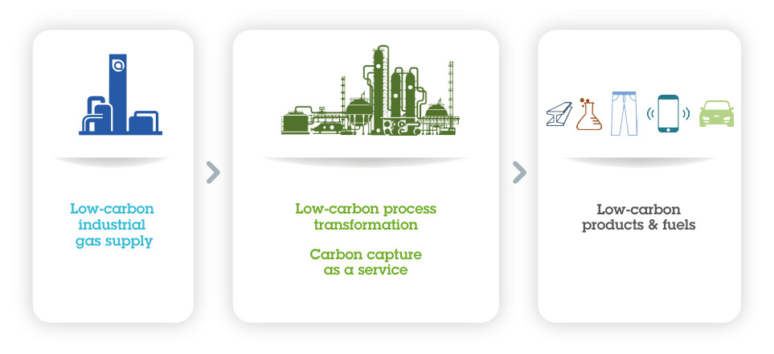 
Air Liquide recognizes the climate emergency and its ambition is to actively participate in the implementation of the Paris Agreement, which defines a global framework aimed to limit global warming to well below 2°C above pre-industrial levels and pursuing efforts to limit it to 1.5°C.As part of its Sustainable Development objectives presented in March 2021,the Group is committed to achieving carbon neutrality by 2050.Air Liquide intends to contribute to carbon neutrality by addressing the entire value chain,therefore covering direct emissions (Scope 1), indirect emissions linked to electricity and steam supply (Scope 2), as well as Scope 3 emissions,which include other reported indirect emissions. 
Air Liquide's trajectory towards carbon neutrality in 2050 includes two major intermediate steps in 2025and 2035: 
the inflection of $CO_{2}$ emissions in absolute value (Scope 18 2) around 2025which was already achieved during ADVANCE. 
Indeed, following two consecutive years of significant decline in $CO_{2}$ emissions in 2023and2024,andfurther reduction in 2025,the inflection and trajectory were confimed; 
to reach a -33% decrease of ts Scope1&2 $CO_{2}$ emissions by 2035compared to 2020.Emissions declined -13.0% in 2025compared to the 2020baseline. 
The Group also pursued its commitment made in 2018 to reduce by-30% its carbon intensity in kg $CO2/$ EBITDA in 2025. compared to 2015. in accordance with a commitment that was made in 2018.This target has been largely exceeded, with carbon intensity down by -46% in 2025compared to 2015. 
1 2 5 
Includes a contnibutin from Argentina of $+2.6\%$ 
Recurring ROCE based on recuring net profit. 
Excluding the Purchase Price Accounting impact from the DIG Airgas acquisition. 
2025 UNIVERSAL REGISTRATION DOCUMENT 
AIR LIQUIDE 
39

---

<!-- 原文第 42 页 -->

1 
INTEGRATED REPORT 
CONTENT< 
Strategy and objectives 
Aware of the importance of contributing to the achievement of carbon neutrality throughout its value chain,in 2022,Air Liquide worked on developing its "Scope 3"emissions reduction strategy. The value of its customer relationships has led the Group to pledge to have 75% of its 50 largest customers committed by 2025to carbon neutrality and 100%by 2035.At the end of 2025, 82% of the customers who were among the Group's top 50 customers in 2022 are committed to carbon neutrality by 2050. However, following the evolution of the list of 50 largest The timeline below summarizes the Group's decarbonization objectives: customers, 72% of the Group's top 50 customers in 2025are committed to carbon neutrality by 2050.The Group continues its efforts to reduce its emissions upstream and downstream of its value chain. 
Chapter 5 of this Universal Registration Document detail the climate transition plan, objectives,strategy, actions, results, risks and opportunities that decarbonization and the energy transition represent for the Group. 
## CLIMATE OBJECTIVES 
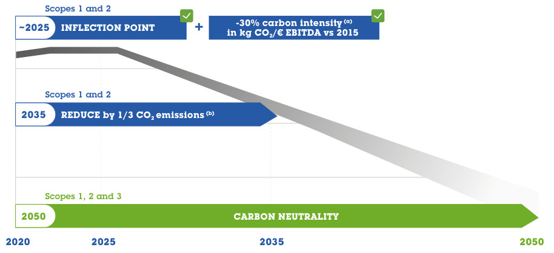 
(8) Carbon intensity in kg $CO_{2}$ equivalent/euro of operating income before depreciation and amortization and excluding IFRS 16 at2015 exchange rates for (b) Sosas nso" year from 2020and each subsequent year, the emissions of the assets which correspond to changes in scope and which have a significant impact (upward and downwards) on $CO_{2}$ emissions. 
SCIENCE BASED TARGETS 
Air Liquide's Scope 1&2 CO2emissions reduction target for 2035 has been validated by the Science Based Targets initiative (SBT) as being compliant and in line with limate science (). The Group was the first in its industry to obtain this validation from the SBTi. 
## DRIMING AMBIIOUS CORPORATE CLIMATE ACTION 
(a) Air Liquide announced its greenhouse gas emission reduction objectives for Scopes 1 and 2 in March 2021 on a 2020baseline. Fallowing the acquisition of the Sa asnn o n o 
40 
2025 UNIVERSAL REGISTRATION DOCUMENT 
AIR LIQUIDE

---

<!-- 原文第 43 页 -->

CONTENT 
INTEGRATED REPORT Strategy and objectives 
1 
 
## ASSETS AND CLIMATE RISKS () 
The main Group assets that impact the $CO_{2}$ footprint are: 
>400 large air gas production units,oxygen and nitrogen in particular, which do not generate direct emissions but require electricity. The $CO_{2}$ emissions linked to this electricity are accounted for in Scope 2 
>50 large hydrogen production units, which consume natural gas and emit $CO_{2}$ accounted for in Scope 1 
In the Large lndustries business, each air gas or hydrogen production unit is linked to a lon-term customer contract,asting 15 to 20 years and assets are amorized over the duration of the contract. Hence,the risk of impairment is limited. 
Industial gases are used in most industries today and will be even more so in the frame of the energy transition due to the fact they are at the heart of industry decarbonization solutions. Demand will increasingly tumn to low-carbon gases, in function of regulatory evolutions and market demand. 
The majority of Group's Scopes 1 and $2 CO_{2}$ emissions comes from a limited number of assets and countries. The emission reduction targets therefore require the activation of a limited number of well identified levers. Solutions have already beer implemented to decarbonize existing production units: 
for air gases (Scope 2 emissions) mainly by using low-carbon electricity in particular in key geographies: 80% of Scope2 emissions come from six countries. Since 2018,Air Liquide has already signed 33 renewable medium- and long-term power purchase agreements for more than 5 TWh per year of renewable and low-carbon electricity. More than 95% of air separation units are already electrified and do not require any specific investment for the transition; 
for hydrogen production units using methane reforming (Scope 1 emissions),by capturing $CO_{2}$ notably on large SMRs. Indeed, 60%of Scope 1direct emissions come from fewer than 15 production units. Air Liquide masters a complete portfolio of proprietary technologies for capturing $CO_{2}$ and a carbon capture unit is under construction on the Group's largest hydrogen production unit in Europe. 
The demand for low-carbon gases at a higher price is growing and allows the Group's investment in low-carbon assets to be remunerated, in particular for the production of hydrogen,as well as any potential overcosts linked to the supply of renewable electricity.In addition,financing programs in the form of subsidies or tax credits are also being implemented in Europe and in the United States in order to support,during a transition period, the decarbonization of existing industrial assets and new production units. Energy costs (electricity for air gases and natural gas for reforming units) and those related to $CO_{2}$ emissions (e.g.ETS scheme in Europe) are re-invoiced to the customer in the frame of a long-term contract (15 years or more).The Group also applies this business model to the supply of low-carbon gas, so Air Liquide does not bear significant risks associated with energy and $CO_{2}$ costs. 
A customer supplied in hydrogen by the Group is therefore facing an arbitrage between: 
bear the cost of $CO_{2}$ or 
buy low-carbon hydrogen from Air Liquide,the price of which includes the return on investment in a $CO_{2}$ capture unit as well as operating and storage costs. The higher the value of $CO_{2}$ ,the more the customer will be encouraged to choose the supply of low-carbon hydrogen, which will also contribute to the achievement of its own decarbonization objectives. A high carbon price is therefore favorable to accelerating the decarbonization of the Group assets.The sensitivity study shows that,depending on the geography and the context,a price starting from 100 to 250 euros per tonne of $CO_{2}$ encourages the customer to lean toward the supply of low-carbon hydrogen. This $CO_{2}$ value can be explicit or integrated into regulatory obligations on the carbon footprint of end products. 
Any new investment decision by Air Liquide now includes the constraint of reducing $CO_{2}$ emissions, in line with the Group's decarbonization objectives.The Group already operates electrolyzers,indluding two 20 MW units,while two large scale electrolyzers (200 MW) are under construction. 
Air Liguide is implementing a certain number of actions to take into account physical risks related to Climate change.They are reviewed during investment decisions, then taken into account during unit conception and covered by Group insurance. Air Liquide carried out a study in 2023 aimed to consolidate and improve the physical risk management process according to 2 scenarios leading to global warming of +2.7C and+4.4°C by2100.Work is continuing to refine the understanding of the issues at the level of the Group's different types of assets, with a refocusing on the main industrial basins. 
The risks related to the energy transition as well as the physical risks related to climate were analyzed as part of the closing of the Group's financial statements (see note 31 to the Consolidated Financial Statements-page 252) and no significant impact was identified, mainly for the reasons mentioned above. The energy transition is above all a growth opportunity for Air Liquide, as the Group has the technologies to decarbonize the assets of its industrial customers. 
(a)ESRS2SBM-3548( 
2025UNIVERSAL REGISTRATION DOCUMENT 
AIR LIQUIDE 
41 
1

---

<!-- 原文第 44 页 -->

1 
INTEGRATED REPORT 
CONTENT< 
Strategy and objectives 
## 2.3. TECHNOLOGICAL INNOVATION TO OPEN NEW MARKETS 
With ADVANCE, Air Liquide contributed to the development of key sectors for the future, to reinforce its positions, leveraging on innovation and technology, two major assets of the Group. 
The Group focuses on five key sectors of the future: 
Deep tech, including space,extreme cryogenics and quantum computing: 
 
Electronics,where the revolutions in regards to digital, data and artificial intelligence contributes to the development of the activity and where the Group reinforced its leader position; 
 
 
Healthcare,in which Air Liquide's value-based approach, which improves quality of life for the patient at the best cost for the health system, responds to major societal issues; 
 
Industrial Merchant, whose growth is diven by environmental challenges and by new usages, notably digital: 
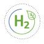 
Hydrogen mobility, and notably heavy duty mobility:a very high potential market,where Air Liquide has a leading position and in which lowcarbon hydrogen will play a key role. 
## HYDROGEN KEY ROLE FOR INDUSTRY AND MOBILITY 
The Group is deeply convinced that hydrogen will play a key role in the energy transition. Hydrogen offers tremendous growth potential as a competitive low-carbon solution for many applications in the industry and mobility sectors. The Group intends to be a key enabler of the hydrogen society thanks to its assets, technology, expertise and strategic positioning buit up over about 60 years. This is why in these new hydrogen markets,the Group masters the whole value chain for industry and mobility,which includes the sourcing of low-carbon energies and renewables,the production of hydrogen,packaging by compression and liquefaction,delivery by truck and pipelines along with storage and distribution to the end customers. To this end,the Group is investing in new technologies te produce and distribute low-carbon hydrogen at large scale competitively, reliably and safely, such as electrolysis,capture of $CO_{2}$ and hydrogen liquefaction. 
## 2.4. ACTING FOR ALL 
In the context of ADVANCE, Air Liquide included the perspective of its direct stakeholders, as well as those of society at large. 
In practice, this means: 
 
fostering employee engagement and the development of their skills through the implementation of new ways of working in a safe, inclusive and collaborative environment; 
 
always going further in the quality of the privileged relationship Air Liquide nurtures with its Shareholders, with a regular and attractive remuneration that rewards loyalty; 
 
continue to reinforce its customer-centric culture. to better acknowledge,anticipate and support their needs, and by continuing the profound transformation already underway to better serve patients; 
 
acting as a committed corporate citizen concerned with the general interest, where the Group's contribution can make a difference, in particular by taking action in communities, or for example by developing initiatives to promote access to medical oxygen. 
## SOCIAL AND SOCIETAL OBJECTIVES 
The Group's commitment to society was reflected in particular by a "zero accident' safety ambition and by the achievement of following objectives in 2025: 
100% of employees benefit from a common basis of care coverage: 
100% of employees have the opportunity to engage in local intiatives to support communities by 2025, thanks to a predefined frame, during working hours. 
In temms of diversity, the proportio of women among managers and professionals has steadiy increased since 2020, reaching 33.8 in 2025.This result remains significantly higher than the industry average and that of its competitors. The Group intends to continue its efforts to strengthen this representation across all professions. 
42 
2025UNIVERSAL REGISTRATION DOCUMENT 
AIR LIQUIDE

---

<!-- 原文第 45 页 -->

CONTENT 
INTEGRATED REPORT Strategy and objectives 
1 
## 3. Strategy govemnance 
## 3.1. ORGANIZATION 
The governance of the Group's strategy is organized around three time frames: short,medium and long term, to which various internal teams contribute.Their specific roles are described in Chapter 2 "Risk factors and control environment" (page 71 and followings). 
1 2 
Short term:the goal is to achieve the annual objectives set as part of the strategic plan. Progress is assessed using both quantitative and qualitative measures. This process is overseen by the Group Executive Committee,under the direction of Group Operations Control and with the support of the Strategy department and the World Business Lines. In addition,the Group continuously monitors its environment for potential risks, opportunities and emerging trends that may require adjustments to its strategic plan. 
Medium term: The focus is on maintaining the trajectory of the strategic plan and anticipating changes in our markets. In this regard, the Group's performance forecasts are updated each year to ensure that they are in line with the strategic plan's trajectory. In addition, the Group works to anticipate changes in its markets,the needs of its customers,and developments in its key geographical areas or key industrial basins. The World Business Lines are responsible for these analyses and projections.The main strategic challenges are identified, prioritized and managed at Executive Committee level. 
Longterm:The Groupfocuses on developing strategic projections for the next 10 years and beyond, to ensure that the various World Business Lines are properly aligned with the Group's strategic challenges. These projections help identify underlying trends that need to be captured either in the current strategic plan, or in future revisions.The Group Strategy department works closely with the World Business Lines, the Industrial Direction and Group Operations Control to conduct these analyses. 
The Executive Committee meets regularly to review the Group strategy and its implementation. Investments are approved by the Resources and Investment Committee(RIC), whose operation is described in the Investment process section of this chapter. 
Monthly performance meetings ensure that these decisions are properly implemented and executed. 
Finall, aking into account environmental and societal challenges is an integral part of the Group's strategy.The Sustainable Development Department, which reports to a Vice President who is a member of the Executive Committee, contributes to the development of Strategy and defines specific measures to be integrated into the company's strategic plan. In addition,the Vice President in charge of Sustainable Development participates in strategy meetings,with particularatention to sustainable development issues. She is consulted on the RIC (Resources and Investments Committee) notes for investment projects that have a material impact on the Group's carbon trajectory. 
## 3.2.INVESTMENT PROCESS 
The Group's steady long-term growth is largely due to its ability to invest in new projects each vear. Investment projects in the industrial gas business are spread throughout the world,highly capital intensive and supported by long-term contracts, in particular for Large Industries and Electronics. Air Liquide has thus tailored its financing to the nature of its projects, based on the diversification of inancing sources, the prudent management of the balance sheet and innovative financing methods. This financing policy is fundamental for the Group's continued development. 
The Group's investments reflect its growth strategy. They can be classified into two categories: 
industrial investments, which bolster organic growth and guarantee the efficiency, replacement, maintenance and safety of installations; 
financial investments, which strengthen existing positions of accelerate penetration into a new region or business segment through the bolt-on acquisition of companies or assets already in operation, as well as new technologies. 
The nature of industrial investments differs from one World Business Line to another: from gas production units for Large Industries and Electronics, to filling centers, logistics equipment, storage facilities, medical devices and management systems for Industrial Merchant, Electronics and Healthcare.Capital intensity varies greatly from one business to another. 
## CLIMATE AND INVESTMENT DECISIONS 
According to the Air Liquide business model, the growth of ativites requires investments in new production units. Thus, achieving decarbonization objectives necessarily involves the compatibility of investment plans with the decarbonization trajectory.This trajectory is broken down annually in the form of a $CO_{2}$ budget monitored by the Group's Operation Control Department. Each group of countries (cluster) is allocated a $CO_{2}$ budget defining the maximum emissions it can commit to within the framework of the projects decided upon during the year. Air Liquide has also implemented procedures to measure and monitor its $CO_{2}$ emissions every quarter. Furthermore, whenever the annual emissions of an investment or a customer exceed specific thresholds, the investments must first be reviewed by a Group Energy and Emissions Risk Management Committee (E-Enrisk). 
The Group applies an internal carbon price in the form of a shadow price taken from the International Energy Agency's low emissions scenarios. Starting in 2025,the Group's methodology to assess the viability and resilience of new major primary production projects is evolving.The new process,currently being deployed,entails analyses to reflect both anticipated market conditions and more ambitious policies in line with a 1.5℃C trajectory.These sensitivity analyses for new projects are based on two separate scenarios involving different carbon price trajectories. See chapter 5,page 311 for more details. 
7 
2025 UNIVERSAL REGISTRATION DOCUMENT 
AIR LIQUIDE 43

---

<!-- 原文第 46 页 -->

1 
INTEGRATED REPORT Strategy and objectives 
CONTENT< 
## 3.2.1. Capital intensity 
Capital intensity is the ratio of capital required to generate one euro of supplementary revenue when projects or businesses reach maturity.This capital is either invested in industrial assets (production units,storage facilities,logistics equipment,etc.),or used as working capital to finance the development of the activities. Capital intensity varies significantly from one business to another. Large Industries: 
air gas production has a capital intensity of around 3. It varies with the trend in electricity prices, 
hydrogen production by reforming has a capital intensity of between 1 and 2,due to the high proportion of natural gas in the cost of sales. This capital intensity, therefore, varies with the changes in natural gas price. The capital intensity of hydrogen production through electrolysis is usually significantlyhigherand depends on the electricity management and price 
In large energy transition projects, capital intensityis generally higher,particularly if the energy is not reinvoiced but supplied directly by the customer. Projects benefiting from subsidies also have a higher capital intensity (gross investment), without impacting proftability; 
Industial Merchant capital intensity to launch the business in a new market is between 1.5 and 2; 
Electronics has an average capital intensity between 2.5 and 3.5; in Healthcare,capital intensity,excluding acquisitions, is around 1 depending on the product mix. 
The Group's capital intensity,therefore, continues to vary depending on the business mix,project type and prices of raw materials. It is much higher for renewal and efficiency investments. Whatever the capital intensity, any project must enable the Group to be in line with its Return on Capital Employed (ROCE) objective over the long term.Therefore,for the same level of return on investment,the operating margin (OIR to revenue ratio) of a project will depend on the capital intensity of the activity in which the project is carried out. 
## 3.2.2. The theoreticai lifespan of gas production unit contracts 
Long-term development is one of the key characteristics of the Industrial Gas business. It is particularly evident in the investment cycle,where there is approximately a five-year span between the study of a new construction project for a Large Industries customer and the first corresponding industrial gas sales. Investment cycles in other business lines are generally shorter. Monitoring the lifespan of these projects is essential to anticipating the Group's future growth.The chart below provides details of each stage of this process based on the example of a Large Industries contract. 
INVESTMENT CYCLE OF A LARGE INDUSTRIES CONTRACT 
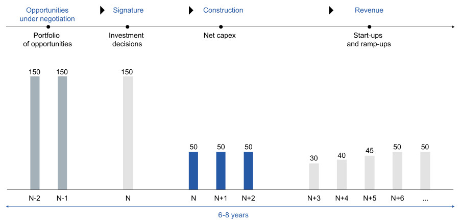 
Applying a theoretical capital intensity of 3,an investment of 150 milion euros in new project should genrate 50 miio uros of sles per annum,when full ramped up. 
Opportunities and Negotiation phase: the project is included in the portfolio of investment opportunities and enters into the development process.Projects exceeding 5 million euros of investment for Large Industries and exceeding 3 million euros for other business lines are monitored within the portfolio of potential opportunities and split between those for which a decision is expected within 12 months and those for which the investment decision will take more than one year.Projects are then discussed and negotiated with the customer. Projects can be removed from the portiolio for several reasons 
the contract is signed,it is removed from the portfolio and therefore becomes an investment decision; 
2.the project is abandoned by the customer; 
3.the customer decides against an over-the-fence gas supply or the project is awarded to a competitor, 
4. the project is delayed beyond 12 months: it is removed from the 12-month portfolio but remains in the long-term portfolio. 
Signature phase: the two parties reach an agreement. The signing of a long-temm contract represents an investment decision validated by the internal govemance bodies.The projectisremovedfrom the portfolio of investment opportunities and is registered in current investments. 
44 
2025UNIVERSAL REGISTRATION DOCUMENT 
AIR LIQUIDE

---

<!-- 原文第 47 页 -->

CONTENT 
INTEGRATED REPORT Strategy and objectives 
1 
Construction phase: the construction of the unit generally takes 24 to 36 months or more for the most complex projects. This is the capital expenditure period. The project remains in the investment backlog 
Revenue phase: 
commissioning: this corresponds to the start-up of the unit. Sales reflect the needs of the customer with a guaranteed minimum volume at the take-or-pay level,guaranteeing minimum profitability from the beginning of the contract; 
2.ramp-up:this is the unit's ramp-up phase.Over the course of the contract term,volumes increase above the take-or-pay level to the nominal amount deined in the contract. Nominal capital intensity is achieved only at the end of this phase. 
1 
## 3.2.3. Governance of major growth projects 
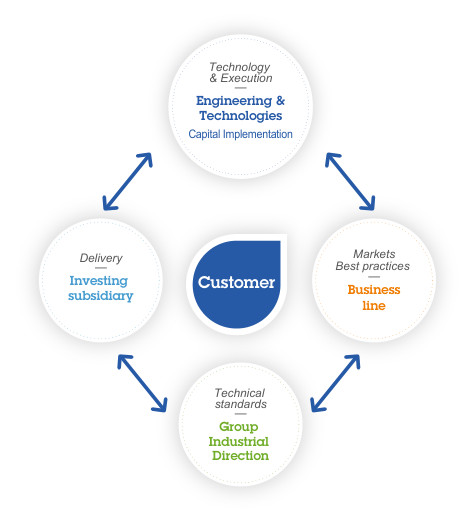 
The Group's Industrial Direction defines the technical standards applicable to all ativties and all subsidiaries. 
The business line involved in the project manages the overall customer relationship follow-up and ensures the overall consistency of the project, both in terms of contracts and technical standards. 
The local subsidiary proposes the project and, once the contract has been signed, carries the investment on its balance sheet. It is then responsible for operations,customer relations and the project's financial profitability. 
The Capital Implementation Direction acts as the representative of the local "owner" subsidiary and is responsible for project execution and overall governance.The Engineering&Technologies provides competitive proprietary technologies and is also responsible for the engineering,equipment procurement,and construction (EPC) of the project. 
Potential projects are identified well in advance,based on good market knowledge and a strong presence with customers.The first stage includes selecting the opportunities in which the Group would like to invest both commercial and technical resources, in line with its global strategy. This selection process is followed by a series of validation stages. 
During the development stage,the project is submitted for the approval of the Executive Committee member who oversees the geographical area on which the project depends. At the Group level, three major bodies validate the relevance of the project: the RIC (Resources& Investment Committee-see below),which is responsible for assessing and validating investment requests,the ERC (Engineering Risk Commitee),which is responsible for assessing technical and execution risk,as well as the E-Enrisk (Group Energy and Emissions Risk Management Committee) in charge of taking into account aspects related to energy and the environment. 
Once the project has been decided on by Air Liquide and signed with the customer, it is executed by an integrated team composed of representatives of the investing subsidiary and Engineering &Technologies, under the supervision of the geographical area. During the start-up of the unit, proiect management is progressively transferred to local operational teams,under strict standards to guarantee the safety and integrity of the site. Operational management of the unit is handled by the local subsidiary,and financial periormance is monitored by the geographic area and the Group's Operation Control Department. 
5 6 
2025UNIVERSAL REGISTRATION DOCUMENT 
AIR LIQUIDE 
45

---

<!-- 原文第 48 页 -->

1 
INTEGRATED REPORT 
CONTENT< 
Strategy and objectives 
## ROLE OF THE RESOURCES & INVESTMENTS COMMITEE (RIC) 
The purpose of these Resources and Investments Committees (RICs) is to assess, approve or refuse requests for investments that have been submitted, as well as medium- and long-term contractual commitments and Human Resources requirements that may arise therefrom. 
They are held regularly (usually once a month) for each geographical area (Americas,Europe Middle East & Africa and Asia Pacific) Each Committee meeting is chaired by the Executive Commite member in charge of the concermed Geography. The investment is presented by the Director of the group of countries (Clusters).The permanent members, who have a right of veto,are the representatives of the business line,the Group Finance Department as well as Engineering & Technologies and Capital Implementation.Additional participants may be invited, including representatives of the Group Industrial Direction. 
The Committee's decisions are reviewed by the CEO. 
The decision is based on a rigorous assessment of individual projects as well as each project's expected profitabilit,Te following criteria are systematically reviewed: 
the location of the project: the analysis will take into account whether the project is based in an industrial basin with high potential, whether it is connected to an existing pipeline network, or whether it is in an isolated location; 
the competitiveness of the customer's site: based on size,production processes and paricularly their environmental footprint,cost of raw materials and access to markets; 
customer risk; 
the greenhouse gases emissions as well as their economic impact and solutions for reducing emissions; 
the adequacy of the project with the Group's environmental objectives, including the compatibilty wih the decarbonization tajectory; the other sustainable development criteia,such as water consumption,biodiversity and relations with local communities; 
the physical risks related to climate change; 
exposure to the risk of corruption; 
contract clauses; 
end products and the stability of future demand for these products: 
qualit and risk related to the technicl slution; 
country isk: evaluated on a case-by-case basis and can lead to changes in the financing policy and its supplementary insurance cover. 
Following approval by the RIC and signing with the customer, the project is transferred to the investment backlog 
## INVESTMENT CYCLE DEFINITIONS 
Investment opportunities at the end of the period 
Cumulative value of investment opportunities taken into account by the Group for a decision within the next 12 months (gross amounts, excluding subsidies) Industrial growth projects with an investment value of more than 5 million euros for Large Industries and more than 3 million euros for other activitie, excluding asset renewals and safety, maintenance and effiency projects. 
Decisions during the period 
Cumulative value of industial and financial investment decisions (gross amounts,excluding subsidies).Growth and non-growth industrial projects, including asset renewal, eficieny,maintenance and safety projects, as well a fincial decisions (acquisitions). Investments backlog at the end of the period ) 
Cumulative value of investments for projects decided but not yet started (gross amounts, excluding subsidies).Industrial growth projects,amounting to 5 million euros or more for lndustrial Market activity and exceeding 10 million euros for other activities, excluding asset renewals and safety, maintenance, and efficiency projects. 
(a)Diferent from construcion in progress ( ote 12.1 to the Consolidtd Financial Statements-page 223) without threhold r busness criteria 
46 
2025 UNIVERSAL REGISTRATION DOCUMENT 
AIR LIQUIDE

---

<!-- 原文第 49 页 -->

CONTENT 
INTEGRATED REPORT Strategy and objectives 
1 
## 3.3. FINANCING 
The financing policy is regularly reviewed to provide the best possible support to the Group's development and take into account changes in financial market conditions while respecting a credit profile in line with Moody's and Scope Ratings long-term minimum "A" category rating. 
The Air Liquide Group applies the following principles of prudence: diversiying financing sources and spreading of debt maturities in order to minimize refinancing risk; 
1 
backing commercial paper issues with confirmed credit facilities, 
hedging interest rate risk to ensure visibility of financing costs, in line with long-term investment decisions; 
funding investments in the currency of the operating cash flows, to ensure a natural currency hedging: 
a permanent centralization of funding and excess cash through Air Liquide Finance,a wholly-owned entity of L'Air Liquide S.A. 
Furthermore, the Air Liquide Group, as part of its growth strategy combining financial and extra-financial performance,is turning to the opportunities offered by the finance market in terms of responsible and sustainable financial instruments. 
## 3.3.1. Diversifying and securing financing sources 
Air Liquide diversifies is financing sources by accessing various debt markets: commercial paper, bonds and banks. 
For its short-term financing, Air Liguide uses the short-term commercial paper market, in France, in the form of short-term negotiable securities (NeuCP) through two programs of up to an outstanding maximum of 3 billion euros each, and in the United States through a U.S. Commercial Paper program (USCP) of up to an outstanding maximum of 2 billion US dollars. 
For its long-term financing,Air Liquide has a Euro Medium-Term Note (EMTN) program to issue long-term bonds ofup to an outstanding maximum amount of 12 billion euros. This program allows, in particular,for bonds to be issued in the principal currencies (euro,US dollar,Japanese yen) as well as in other currencies (Chinese Renminbi, Swiss franc and Pound Sterling). Air Liquide can also issue private placements. 
In line with its environmental and social objectives, Air Liquide established in 2021 a Sustainable Financing Framework updated in 2024 to cover the following instruments to finance sustainable projects intended to have a clear benefit to the environment and society.This Frameworkis now aligned with the 2021 Sustainability Bond Guidelines (SBG),the 2021 Green Bond Principles (GBP),the2023 Social Bond Principles (SBP) overseen by the International Capital Markets Association (ICMA), as well as the Social Loan Principles 2023 and the Green Loan Principles 2021 overseen by the Loan Market Association (LMA). 
The Group also raises funds through bank debt (lans and credit facilities). 
To avoid liquidity risk relating to the renewal of funding at maturity, and in accordance with the Group's internal policy, the Group limits its short-term debt maturities to an amount that is covered from its core banks by committed credit facilities, syndicated or bilateral. 
## 3.3.2. Centralization of cash and funding, excess cash and hedging 
To benefit from economies of scale and facilitate capital markets financing (bonds and commercial paper),the Group uses a dedicated subsidiary,Air Liquide Finance.This subsidiary centralizes the vast majority of the Group's financing transactions. It hedges currency, interest rate and commodities risk for the Group's subsidiaries in those countries where it is permitted by law. In the countries where local regulations allow it, Air Liquide Finance also centralizes cash flow balances through direct or indirect daily cash pooling of these outstanding balances or through intra-group loans and borrowings. When daily international cash concentration is not possible,there exist,nonetheless, local cash poolings which allow periodic intercompany loans to Air Liquide Finance. 
Due to the currency matching within Air Liquide Finance, resulting from the currency hedging of intra-group loans and borrowings, these internal financing transactions do not generate a foreign exchange risk for the Group. 
Air Liquide Finance,which centralizes the Group's financial hedging transactions, complies with EMIR requirements (European Market Infrastructure Regulation) relating to its status as a non-financial counterparty (NFC-).Following the definitions brought by EMIR REFIT and according to its status "NFC-", Air Liquide Finance transferred from 2021the responsibility for reporting derivatives to its counterparties. 
Furthermore, in certain specific cases (e.g.regulatory constraints, high country risk, joint ventures, etc.), the Group may limit its risk through adapted management,by setting up specific financing in the local banking market, and by using credit risk insurance. 
## 3.3.3. Staggering debt maturity 
To minimize the refinancing isk related to debt maturity schedules, the Group spreads maturities over several years. 
Debt maturity schedules are regularly reviewed by Finance Department and Executive Management during Finance Committees. 
Refinancing risk is also reduced by the regularity of the cash fiow generated from Group activities. 
2025UNIVERSAL REGISTRATION DOCUMENT 
AIR LIQUIDE 47

---

<!-- 原文第 50 页 -->

1 
Air Liquide's innovation portfolio is defined on an annual basis. This process,led by the Innovation & Technologies Direction, brings together the World Business Lines, Industrial Direction and Clusters to ensure alignment between internal entities and reduce the time-to-market for innovations. 
The First-of-its- Kind Committee (FOIK),created specifically to assess the risks related to industrial demonstration projects, carried out for the first time by the Group, and to the implementation of innovative technologies on commercial units, reviews projects on a monthly basis.The digital projects in development phase, prior to deployment,are subject to technological validation by the relevant Digital & IT teams and are presented to the RIC. 
Air Liquide's innovation strategy also draws on its global innovation ecosystem and on its external innovation partnerships, in order to be as close as possible to its end customers and meet market expectations. 
The innovation strategy is also regularly reviewed by the Group's Executive Committee and the Board of Directors 
48 
INTEGRATED REPORT Strategy and objectives 
CONTENT< 
## 3.3.4. Use of bank guarantees 
From time to time.Group subsidiaries reguire bank guarantees, mostly in favor of Healthcare,Engineering & Technologies and Global Markets & Technologies clients, either during the tender period (bid bond), or after contract award,during contract execution until the end of the warranty period (advance payment bond, performance bond and warranty bond). 
The most common bank guarantees are advance payment bonds and performance bonds and are extended to customers to secure contractual performance. 
In the Group's ordinary course of business, certain subsidiaries are required to provide financial payment guarantees to secure rental or insurance obligations. 
The projects,for which these guarantees are granted,are regularly reviewed by management and are subject to approval by the Board of Directors for guarantees which exceed 100million euros. When guarantee payment calls become probable,the necessary provisions are recorded in the Consolidated Financial Statements. 
## 3.4.INNOVATION 
The Innovation& Technologies Direction drives the innovation strategy and its execution for the Group, with the strong support of the World Business Lines. It contributes to its industrial performance and future growth by creating new profitable and sustainable offers in both its traditional and new businesses. It is responsible for imagining, designing, developing and incubating new solutions until they are brought to market,particularly when it comes to offers with high technological content. 
The investment decisions and resources relating to innovation rely on the Group's govemance bodies (Resources and Investment Commitee- RIC, Risk Committee) their roles are described on page 87 of this Universal Registration Document. 
Air Liquide's innovation strategy relies on focused and dynamic management of its innovation portfolio, designed to have an impact in the short, medium and long term. Through short-term projects,Innovation& Technologies Direction contributes to the Group's industrial performance by focusing on safety, reliability and efficiency of operations.These innovation priorities are set through Operational Roadmaps (ORM),defined by the Group Industrial Direction in collaboration with innovation entities. Midterm innovation priorities are defined by World Business Lines with the Innovation & Technologies Direction, through Technology Roadmaps (TRM) and Product Roadmaps (PRM).In the long term,Innovation& Technologies Direction also monitors and explores potentially disruptive scientific and technological advances in order to prepare for the future.To support this longterm objective,the Group can rely in particular on ALIAD.The strategic venture capital fund of Air Liquide has completed over 40 investments since its creation, in tech startups that create positive impact for climate, healthcare and industry. 
2025UNIVERSAL REGISTRATION DOCUMENT 
AIR LIQUIDE

---

<!-- 原文第 51 页 -->

CONTENT 
INTEGRATED REPORT Performance 
1 
## PERFORMANCE 
Unless otherwise stated, all arain in evenve utind below are on a comparable basis,excluding currency, energy (natural gas and electricity) and significant scope impacts. 
## 1. Key figures 

| (in millions of euros) | FY2024 | FY2025 | 2025/2024 published change | 2025/2024 comparable change (a) |
| --- | --- | --- | --- | --- |
| Total Revenue | 27,058 | 26,940 | -0.4% | +2.0%() |
| Of which Gas & Services | 25,810 | 26,085 | +1.1% | +2.0% |
| Operating Income Recurring (OIR) | 5,391 | 5,582 | +3.5% | +7.6% |
| Group OIR Margin | 19.9% | 20.7% | +80 bps | |
| Variation excluding energy () | | | +100 bps | |
| Other Non-Recurring Operating Income and Expenses | (446) | (303) | | |
| Net Proft(Group Share) | 3,306 | 3,518 | +6.4% | |
| Net Profit Recurring (Group share) (c) | 3.466 | 3,679 | +6.2% | |
| Net earnings per share (in euros) | 5.74 | 6.10 | +6.3% | |
| Dividend per Share (in euros) | 3.30 | 3.70() | +12.1% | |
| Cash flow from operating activities before changes in working capital | 6,539 | 6,855 | +4.8% | |
| Industial capital expenditure | 3.525 | 3,843 | | |
| Net Debt | E9.2 bn | E8.4 bn | | |
| Net Debt to Equity ratic | 33.2% | 31.2% | | |
| Return on Capital Employed after tax - ROCE | 10.3% | 10.7% | +40 bps | |
| Recurring ROCE(0) | 10.7% | 11.2% | +50 bps | |
 
(a)Change excluding the cuency,energy (natural gas and electricity) and significant scope impacts,sereconciliation page 62. ( S (d) sng () Includes a limited contribution from Argentina (hyperinflation),See table page 69. 
## 2. Income statement 
REVENUE 

| Revenue (in millions of euros) | FY2024 | FY2025 | 2025/2024 published change | 2025/2024 comparable change |
| --- | --- | --- | --- | --- |
| Gas & Services | 25.810 | 26,085 | +1.1%(b) | +2.0%(e)() |
| Engineering & Technologies (e) | 1,248 | 855 | Not applicable | +2.0% (e) |
| TOTAL REVENUE | 27,058 | 26,940 | -0.4% | +2.0% (d) |
 
(b) 
(C) See page 62. 
(d)ncudes a limitd contribution from Argentina (hypeninflation),See table page 69. 

| Revenue by Quarter (in millions of euros) | Q12025 | Q22025 | Q32025 | Q42025 |
| --- | --- | --- | --- | --- |
| Gas & Services | 6,831 | 6.479 | 6.386 | 6,389 |
| Engineering & Technologies (e) | 198 | 215 | 212 | 230 |
| TOTAL REVENUE | 7,028 | 6,694 | 6,599 | 6,619 |
| 2025/2024 Group published change | +5.7% | -0.5% | -2.4% | -4.3% |
| 2025/2024 Group comparable change | +1.7% | +1.9% | +1.9% | +2.5%(b) |
| 2025/2024Gas&Services comparable change | +1.8% | +1.8% | +1.9% | +2.5%(b) |
 
(a) Merger an January , 2025 of GM&T and EC activiies iin ngjining echcgies.wiht the main cepion of Martime and Biogas activiies tanserd to the Industnial Merchant business.See page 62. 
(b) Inctudes a Mimied conribution fram Argntin (hypernflation.,Setable page 69 
2025 UNIVERSAL REGISTRATION DOCUMENT 
AIR LIQUIDE 
49 
1 2 3 
5

---

<!-- 原文第 52 页 -->

1 
INTEGRATED REPORT Performance 
CONTENT< 
## Group 
Group revenue stood at 26.940 million euros in 2025and posted comparable growth of +2.0% (1) compared to 2024.The Group's published revenue decreased slightly by -0.4%. It was impacted by a negative currency impact of -3.2% (of which the depreciation of the US dollar accounted for nearly half) mitigated by a favorable energy impact of +0.8%.There was no significant scope impact. 
As part of the Group organization transformation initiatives the Engineering&Construction and Global Markets & Technologies businesses merged on January 1, 2025,within a new Engineering& Technologies business. Under a single management,with a common vision and objectives,this new organization aims to strengthen the operational performance of the Group and contribute to its growth by providing a more integrated innovation cycle, leveraging the size effect and complementary expertise. Certain activities, mainly Biomethane and Maritime,were transferred from the Global Markets & Technologies business to the Industrial Merchant business. 
Consolidated revenue (external sales) for the Engineering &Technologies (2 business stood at 855 million euros in2025, up+2.0%,and internal projects for the Group's investment projects,particularly in Large Industries and Electronics, are growing strongly. 
## Gas & Services 
Gas &Services revenue reached 26,085 million euros in 2025, up +2.0%(1)(2) on a comparable basis. 
Published revenue in the Gas & Services businesses was up +1.1%,impacted by a negative currency impact of-3.3%, mitigated by a favorable energy impact of +0.9%.There was no significant scope impact. 
Sales increased across all geographies and all business lines. On a comparable basis, Industrial Merchant sales grew by +1.9% [2)(3: they benefited from a very solid price effect (+2.9%) and resilient gas volumes,but were impacted by declining Hardgoods volumes in the United States. Large Industries revenue was up +0.7% (3),as the contribution of new hydrogen and air gas volumes in the United States, South Korea and China offset weaker demand in the rest of Asia and Europe.In Electronics(+1.2%),the normalization of Equipment & Installation sales after a record level in 2024masked dynamic growth in the rest of the business (+5.8%).Finally, the Healthcare business, whose growth is disconnected from industrial trends, posted a sustained increase in revenue (+5.0%),driven by Home Healthcare in Europe and Latin America,and in Medical Gases in the Americas. 

| Revenue by geography and business line (in millions of euros) | FY 2024 | FY2025 | 2025/2024 published change (a) | 2025/2024 comparable change lb) |
| --- | --- | --- | --- | --- |
| Americas (a) | 10,321 | 10.351 | +0.3% | +3.9% () |
| Europe,Middle East & Africa (EMEA) (a) | 10,186 | 10.616 | +4.2% | +0.6% |
| Asia Pacific | 5,303 | 5,118 | -3.5% | +1.0% |
| GAS & SERVICES REVENUE | 25,810 | 26.085 | +1.1% | +2.0% (<) |
| Large Industries | 7,120 | 7,110 | -0.1% | -0.3%() |
| Industrial Merchant | 11,906 | 12,132 | +1.9% | +2.4%() |
| Healthcare | 4.274 | 4.378 | +2.4% | +5.0% |
| Electronics | 2.510 | 2.465 | -1.8% | +1.2% |
 
(a) Published yariation calculated on the 2024 published revenue.not restated for the transfer of certain GM8T activties as of January 1,2025.See page 62 (b) This comparable growth excludes the scope effect related to the intenal ransfer of certain GM8T activites to lndustrial Merchant as of the fit quarter of 2025 but includes the contnbution related to the growth of these activities in 2025.See peges 62 and 63. (c] Includes a limited contribution from Argentina (hyperinflation).See table page 69. (d) Excluding the effect of an intemal transfer of assets between Large Industries and Industrial Merchant in Americas. See page 63. 
Includes a limited contribution from Argentina (hypeninflation).See table page 69. (2) This comparable growth excludes the scope effect related to the internal transer of cartain GM&T activities to lndustrial Merchant in the quarer of 2025 Sec ao i i i e e o. 
50 
2025UNIVERSAL REGISTRATION DOCUMENT 
AIR LIQUIDE

---

<!-- 原文第 53 页 -->

CONTENT 
INTEGRATED REPORT 
1 Performance 
## Americas 
Americas Gas & Services revenue stood at 10.351 million euros in2025,up+3.9%(1)(2).Large Industries (+6.6%(3) benefited from the ramp-up of a large air separation unit and new hydrogen sales on the Gulf Coast pipeline networks.The increase in Industrial Merchant sales (+2.9%(2)(3) was supported by a high price effect (+4.1%) and resilient gas volumes,with Hardgoods volumes softening over the year.Growth remained very dynamic in Healthcare(+10.6%).In Electronics(-2.5%),the normalization of Equipment &Installation sales after a record level in 2024 masked dynamic growth in the rest of the business (+8.5%). 
1 3 
## AMERICAS GAS & SERVICES 2025 REVENUE 
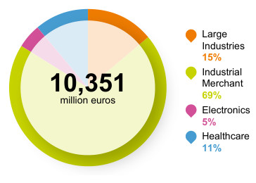 
Large Industries revenue was up +6.6%(3. This growth was supported by the ramp-up of a major air separation unit started up in February 2024 and by new hydrogen sales on the Gulf Coast pipeline network under long-term contracts.The increase in sales of electricity and steam produced by cogeneration units was also a growth driver in the United States and Canada 
Industrial Merchant sales posted an increase of +2.9% (2) (3) in 2025.This growth was supported by a high price effect of +4.1%,which strengthened progressively throughout the year to reach +5.2% in the $4^{th }$ quarter. Gas volumes remained resilient, but hardgoods volumes remained soft over the year. Volumes grew in the Construction, Electronic components and assembly, and Pharma markets. Finally,the consolidation of bolt-on acquisitions in the United States, Canada, and Brazil also contributed to growth. 
Healthcare sales posted very dynamic growth of +10.6%.In the United States, Medical Gases prices were up sharply in proximity care and hospitals, supported by the roll-out of the Intelli-X offer, an innovative cylinder with a digital gauge that provides caregivers with a direct reading of the remaining oxygen time. In Latin America,the number of patients treated at home continued to increase, supporting sales growth. 
Electronics revenue was down -2.5% in 2025,but posted strong growth (+8.5%) excluding Equipment & Installation sales. Indeed, the double-digit increase in carrier gases and Advanced Materials sales (with higher margins) did not offsetthe significant decline in Equipment & Instaliation sales, which are more cyclical and are normalizing after record revenue in 2024. 
 
AMERICAS 
Air Liquide has entered into new agreements to supply hydrogen to two of the largest refiners in the United States. The Group will leverage its existing infrastructure with nearly 50 million US dollars of investment for strategic upgrades to its Gulf Coast pipeline network and the integration of new compression and distribution equipment directly within its existing pipelines. 
Air Liquide will inest up to 200 million US dollars in Louisiana, United States, to modernize an air separation unit and connect it to its existing network. This investment also includes a pipeline network extension of approximately 50 kilometers on the Gulf Coast. These upgrades are part of a long-term contract renewal with Dow and will further allow Air Liquide to support industrial growth in Louisiana. 
Air Liguide announced an investment of more than 50 million US dollars to build an additional carrier gases production unit in the United States, on the site of one of the world's leading semiconductor manufacturers.This strategic investment underlines Ai Liquide's long-term commitment to supporting the rapid growth of the US semiconductor market and strengthens its position as a key supplier to this strategic industry. 
6 7 
( Includes a limited contribution from Argentina (hyperinflation),See table page 69. 
(2) This comparable growth excludes the scope effect related to the interal transfer of certain GM&T activities to Industial Merchant as of the quarter of 202 but inciudes the contnbution related to the growth of these activities in 2025.See pages 62 and 63. 
Excluding the effect of an intemal transfer of assets between Large Industries and Industrial Merchant in Americas.See page 63 
2025 UNIVERSAL REGISTRATION DOCUMENT 
AIR LIQUIDE 
51

---

<!-- 原文第 54 页 -->

1 
INTEGRATED REPORT Performance 
CONTENT< 
## Europe Middle East & Africa (EMEA) 
Europe,Middle East&Afica(EMEA) revenue reached 10,616 million euros in 2025,up+0.6% (1)Large Industries sales (-1.4%) were down,but slightly up by +0.4% excluding sales from cogeneration units.Industrial Merchant sales grew(+0.5%(1), supported by a solid price efect (+2.0%) and resilient gas volumes, with the exception of liquid $CO_{2}$ . Sales growth remained very solid (+3.6%) in Healthcare,pariculry in Home Healthcare and Specialty Ingredients. 
## EMEA GAS & SERVICES 2025REVENUE 
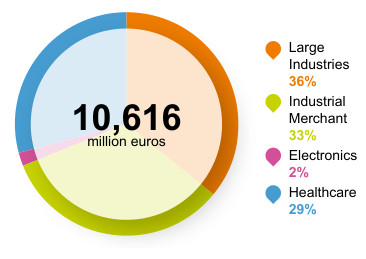 
Large Industries revenue was down -1.4%, but up slightly by +0.4% excluding sales from cogeneration units. Indeed,sales from these units were heavily penalized by low steam demand in Benelux since the beginning of the year.Hydrogen sales were down across the region, despite growth in Saudi Arabia particularly in the 4th quarter,as the end of 2024had been impacted by a customer turnaround for maintenance. Air gases sales grew over the year,paricularly in South Africa,and in the 4th quarter in ltaly. Customer demand in Steel and Chemicals remained low in Europe,but hydrogen volumes for Refineries grew over the year, mainly in the Midle East. 
Industrial Merchant sales grew by +0.5%(1) in 2025.The price effect $(+2.0\%)$ strengthened significantly compared to 2024,supported by higher cylinder gas prices and, in the 1 half of the year,by an increase in bulk gas prices indexed to changes in energy costs. Furthermore,cylinder and bulk gas volumes were resilient, with the exception of liquid $CO_{2}$ .In a context of low demand, volumes grew mainly in the Utlities (water, waste,electricity) and Aeronautics sectors. 
Healthcare revenue increased by +3.6% in 2025,with a progression of +4.3%in the $2nd$ half of the year. Home Healthcare continued its development, supported by the increasein the number of patients monitored,notably for diabetes, sleep apnea,and proximity care in Germany and Poland. Sales of specialty ingredients also showed solid growth. 
 
## EUROPE MIDDLE EAST &AFRICA (EMEA) 
Large-scale electrolyzer project in the Netherlands: 
Air Liguide has announced that it has started the construction of ELYgator, a 200 MW electrolyzer, in the port of Rotterdam,the Netherlands.The Group will invest more than 500 million euros to build,own,and operate the electrolyzer,which will notably suppl TotalEnergies' industrial platform under a long-term contract.This project strengthens the Groups leadership in clean hydroger production. 
Carrier gases project for a major semiconductor customer in Germany 
Air Liquide has won a long-term contract and will supply large volumes of high-purity gases directly to a major customer in the semiconductor industry, in the heart of "Silicon Saxony', in Dresden, Germany. The planned investment of more than 250 million euros will be Air Liquide's largest in the Electronics sector in Europe,thus reinforcing its leadership on the continent. 
Acquisitions in Germany: 
Air Liquide continues its development in Germany with the acquisition of 2 companies. The Group is thus expanding its presence in the proximity care market.The newly acquired entities operate in Saxony,one of the most densely populated regions in Eastern Germany, between Berlin and Bavaria where the Group already has a strong local market presence. 
This comparable growth excludes the scope effect related to the intemal transfer of certain M&T activities to Industial Merchant as of the quarter of 202 but includes the contnbution related to the growth of these activibies in 2025.See peges 62 and 63. 
52 
2025UNIVERSAL REGISTRATION DOCUMENT 
AIR LIQUIDE

---

<!-- 原文第 55 页 -->

CONTENT 
INTEGRATED REPORT 1 Performance 
## Asia Pacific 
Asia Pacific reqion revenue stood at 5.118 million euros in 2025,up+1.0%.In Large Industries $(+0.4\%)$ ,the contribution of new air gas volumes in China and hydrogen in South Korea was masked by overall weak demand in the region.2025Industrial Merchant revenue was stable (-0.1%):growth of +2.6% in sales in China was offset by contrasted activity in the rest of Asia and by a price effect down-1.0%.Electronics revenue grew by +3.1% in 2025,and+6.1%excluding Equipment& Installation sales, supported notably by the start-upofseven carrier gases production units in 2025 
ASIA PACIFIC GAS & SERVICES 2025 REVENUE 
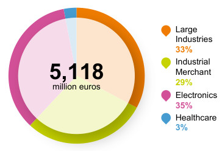 
Large Industries revenue showed a slight increase of +0.4% in 2025.Sales benefited from the ramp-up of new production units in China, notably the one acquired (takeover) from Wanhua at the end of 2024,and from the supply of additional hydrogen volumes to the customer KMCI in South Korea under a longterm contract. The contribution of these new volumes to sales growth was masked by overall weak demand in the region. 
In Industrial Merchant, 2025 revenue was stable (-0.1%).In a context of low inflation,the price effect (-1.0%)remained impacted by the sharp drop in helium sales prices in China and $CO_{2}$ in Australia.In China,revenue grew by +2.6%,despite lower helium sales and a lower contribution from bolt-on acquisitions in the 2nd half of the year. Growth was supported notably by start-ups of small on-site gas generators and dynamic cylinder gas sales,reflecting the Group's solid strategic positioning in China. In the rest of Asia, activity was contrasted,with high equipment & installation sales in Japan, solid growth notably in Taiwan in Electronic components and assembly,but a strongly negative price effect in Australia (end of $CO_{2}$ price surcharges) and weak activity in Singapore. Volumes wereup mainlyin the Electronic assembly, Fabrication metal, and Automotive markets. 
Electronics revenue was up+3.1%in2025,and+6.1% excluding Equipment & Installation sales. Carrier gases sales posted strong growth of more than +10%,supported by the start-up of seven new production units in the 1t half of 2025. This growth was partially offset by a decline in more cyclical Equipment& Installation sales, which are normalizing after reaching a very high level in 2024. 
 
ASIA PACIFIC 
Project for a major semiconductor manufacturer in Singapore: 
Under two new long-term contracts and for a total investment of 130 million euros, Air Liquide will buid,own, and operate two new carrier gases production facilities to support the expansion of a major semiconductor manufacturer in Singapore.Ultra-high purity gases are essential to support the next wave of digital technologies, notably AI. These new contracts, signed just a few months apart highlight the acceleration in demand for advanced electronic components in this strategic market. 
VSMC project in Singapore: 
Air Liquide will buld, own,and operate a new carrier gases production unit in Singapore. With a significant investment of approximately 70 million euros and under a long-term agreement, Air Liquide will supply large volumes of nitrogen,oxygen,argon and other ltrapure gases to VisionPower Semiconductor Manufacturing Company(VSMC),the joint venture formed by Vanguard International Semiconductor Corporation and NXP Semiconductors N.V. 
## Engineering & Technologies 
Consolidated revenue for Engineering & Technologies (1) stood at 855 million euros in 2025,up+2.0%(2) compared to2024.Within this activity, Engineering & Construction revenue (third-party sales) was down slightly, while sales to the Group (excluded from consolidated revenue) grew,as priority was given to the development of Large Industries and Electronics investment projects. Furthermore, sales of technological equipment,particularly Turbo-Brayton LNG reliquefaction units,continued to grow. 
Order intake for Group projects and third-party customers reached 2,220 million euros in 2025. This notably included air separation units,including the world's largest unit for a steel customer in India, a large electrolyzer in the Netherlands for clean hydrogen production,carrier gases units for the Electronics industry,proprietary equipment for helium liquefaction,as well as numerous Turbo-Brayton reliquefiers.Group projects represented a vast majority of order intake. 
1 
7 
Global Markets & Technologies and Engineering& Construction activiies merged into the Engineering & Technologies business in the quarter of 2025 Certain activities, mainly Biogas and Mantime,were transfered to the lndustrial Merchant business. See page 62. This comparable growth excludes the scope effect related to the interma transer of certain GM&T activities to industrial Merchant as of the quarter of 2025 
2025 UNIVERSAL REGISTRATION DOCUMENT 
AIR LIQUIDE 
53

---

<!-- 原文第 56 页 -->

1 
See definition page 65. 2025UNIVERSAL REGISTRATION DOCUMENT 
54 
INTEGRATED REPORT Performance 
CONTENT< 
## OPERATING INCOME RECURRING 
Operating income recurring before depreciation and amortization totaled 8.145 million euros,an increase of +3.1% as published compared with 2024and +6.9% excluding the currency impact. 
Purchases were down -3.6%and stable (0.0%)excluding the currency impactand excluding the reclassification of certain equipment purchases to other expenses.The increase in energy prices,particularly natural gas,was offset by a decrease in purchases of materials and equipment due to a decline in hardgoods sales. Personnel expenses were down -1.5%as published and showed a limited increase of +1.5% excluding the currency impact. Iin an inflationary environment, they benefited from the reduction in headcount accompanying the organization's rationalization plans across all geographies. Other operating income and expenses increased by+1.7%.Other operating expenses grew with the development of the business, by +4.3% as publishedand +6.3%excluding the currency impact and redassifications (of certain equipment purchases to other expenses),notably due to commitments related to the project with ExxonMobil in Baytown in the United States. The sharp increase in other operating income is explained by a compensation received from the customer ExxonMobil covering all commitments on this project, in accordance with the terms provided for in the contract 
Efficiencies (1) reached a record level of 631 million euros in 2025,up+27%compared to the 497million euros achieved in 2024.They significantly exceed the 400 million euro annual target of the ADVANCE plan. This performance illustrates the strong contribution of the Group's transformation program to efficiencies. Procurement and the transverse continuous improvement program, notably consisting of more than a thousand industrial efficiency projects,also support this sharp increase in eficiencies.The reduction in headcount since the begining of 2024 has generated savings on personnel expenses across all geographies. Efficiencies are one of the three levers for operating margin improvement, along with price management, notably in Industrial Merchant, and dynamic asset porfiolio management. 
Depreciation and amortization amounted to 2,564 million euros, up+2.3%and+5.3%excluding the currency impact,which essentially reflects the impact of start-ups of new units. 
Group Operating Income Recurring (OIR) reached 5,582 million euros in2025,up+3.5% as published. On a comparable basis, it rose by +7.6%,which is significantly higher than comparable sales growth, highlighting a strong leverage effect. The operating margin (OIR to revenue) stood at 20.7% as published,an increase of +80 basis points compared with 2024.The rise in energy costs in 2025,contractually passed through to Large Industries customers, increases published sales without any impact on operating income recurring in absolute value, thereby creating a dilutive effect on the published operating margin in 2025.For this reason,the margin improvement is measured excluding the energy impact,i.e.by considering the energy price of the previous year. 
Excluding the energy impact, the operating margin showed a significant improvement of +100 basis points in 2025.Thus,for the $2nd$ consecutive year,the increase in the Group's annual margin excluding the energy impact is at least 100 basis points, marking an acceleration compared with the past: between 2011 and 2019,the margin improvement ranged from +10 to +20 basis points per year (excluding synergies related to the Airgas acquisition),then reached +70 to+80 basis points between 2020and 2023.Since 2022,the cumulative operating margin improvements excluding the energy impact reached +360 basis points at the end of 2025. Structural transformation actions of the Group,initiated in 2024, will continue to support performance. These actions are structured around 4 key areas: the simplification of the organization,the acceleration of the development of shared service centers, industial and commercial initiatives, and incorporate a leverage effect related to data exploitation. 
AIR LIQUIDE

---

<!-- 原文第 57 页 -->

CONTENT 
INTEGRATED REPORT 
1 Performance 
## Gas & Services 
Operating income recurring for the Gas& Seryices business amounted to 5,897 million euros in 2025,up +6.1% as published compared to 2024.It grew by+8.1% on a comparable basis, which is significantly higher than the comparable sales growth of the Gas & Services business (+2.0%),highlighting a strong leverage effect. 
The operating margin reached 22.6% as published,a sharp improvement of +130 basis points (1) compared with 2024, excluding the energy impact. 
1 2 3 
The improvement in the Group's operating margin is mainly explained by efficiencies, up very sharply by +27% compared with 2024. 
Prices are another lever for margin improvement.In the Industrial Merchant business, they showed an increase of +2.9% in2025,demonstrating the Group's ability to pass on cost increases. Prices were also up in Healthcare and Large Industries. 
GAS & SERVICES 2025 OPERATING INCOME RECURRING 
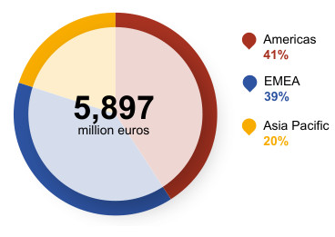 

| Gas & Services Operating margin(a) | FY 2024 | FY2025 | 2025/2024 excluding energy impact |
| --- | --- | --- | --- |
| Americas | 22.6% | 23.4% | +110 bps |
| Europe, Midle East & Africa (EMEA) | 20.0% | 21.6% | +190 bps |
| Asia Pacific | 22.3% | 23.1% | +50 bps |
| TOTAL | 21.5% | 22.6% | +130 bps |
 
(8) Heaiss sn e o 
Operating income recurring for the Americas region reached 2,427 million euros in 2025.Excluding the energy impact,the operating margin increased by +110 basis points compared to 2024.The Industrial Merchant activity was the primary contributor. Significant efficiencies and price increases, notably in the United States, supported margin improvement in the Industrial Merchant and Healthcare activities. 
Operating income recurring for the Europe,Middle East & Africa (EMEA)region amounted to 2.290million euros in 2025. Excluding the energy impact,the operating margin improved significantly,by+190 basis points compared to 2024.In IndustrialMerchant,high eficiencies andaccretive price management supportedthe strong margin progression. Efficiencies achieved in Healthcare,notably the restructuring of the Home Healthcare activity in France,also contributed to margin improvement. Finally, in Large Industries, excluding the 2024 payment of an indemnity by a customer,the margin increased, thanks to efficiencies generated by the business. 
In Asia Pacific, operating income recurring stood at 1, 180 million euros in 2025.Excluding the energy impact,the operating margin increased by+50 basis points compared to 2024, supported by efficiencies across all activities and the payment of an indemnity by a Large Industries customer in 2025. 
## Engineering & Technologies 
Operating income recurring for Engineering& Technologies stood at 124 million euros in 2025.The operating margin was 14.5%,down compared to 2024,mainly due to the transfer of certain GM&T activities to Industrial Merchant. 
Corporate Costs and Research & Development 
Corporate and Research & Development expenses amounted to 439 million euros,up +10.0% compared to 2024.This increase is notably explained by the creation of a Group Industriall Department as part of the transformation program which ontributes signficantlytoefficiency gains. Research & Development expenses increased slightly. 
## NET PROFIT 
Other operating income and expenses showed a balance of -303 million euros in 2025,a decrease compared to -446 million euros in 2024.Other operating expenses amounted to -354 million euros in 2025and notably included restructuring costs for slightly over 200 million euros,primarily in Europe.Other operating income stood at 51 million euros and mainly comprised capital gains from disposals. 
Financial income stood at -396 million euros in 2025,an improvement compared to-418 million euros in 2024. It included a cost of net debt of -243 million euros,down-7.4% excluding the currency impact. This performance was primarily due to the decrease in average net debt and a reduction in factoring charges, mainly resulting from lower rates but also from a decline in the receivables sold.The average cost of net debt, at 3.3%, was slighty down compared to 2024.Other financial income and expenses amountedto -154 million euros compared to -160 million euros in 2024. 
7 
Includes the scope impact related to the intermal transfer of certain activities from GM&T to Industrial Merchant since the f quarter of 2025.See pages 62 and 64 
2025 UNIVERSAL REGISTRATION DOCUMENT 
AIR LIQUIDE 
55

---

<!-- 原文第 58 页 -->

1 
INTEGRATED REPORT Performance 
CONTENT 
Income tax expense reached 1,231 million euros in 2025, representing an effective tax rate of 25.2% compared with 24.0%in 2024, impacted by an exceptional tax surcharge in France in 2025. Share of profit of associates stood at-8 million euros in 2025 and minority interests in net profit reached 127 million euros. 
Net proft (Group share) reached 3,518 million euros in 2025 up+6.4% as published and showing strong growth of +10.1% excluding the currency impact. Net profit recurring (1)(Group share) stood at 3,679 milion euros,up +6.2% as published and +9.7%(2) excluding the currency impact. Net profit recurring (Group share) is calculated (1) by excluding the exceptional tax surcharge in France, the impact of a significant restructuring plan in Europe, and the residual impacts in 2025of items qualifed as non-recurring in the past. 
Earnings per share stood at6.10 euros,up +6.3% as published compared with 2024, in line with the increase in net profit (Group share).The average number of shares outstanding used for the calculation of the 2025earnings per share is 576,790,647. 
CHANGE IN THE NUMBER OF SHARES 

| | FY2024 | FY2025 |
| --- | --- | --- |
| Average number of outstanding shares | 576,457,564 | 576,790,647 |
 
## DIVIDEND 
At the Annual General Meeting on May 5, 2026,the payment of a dividend of3.70 euros per share will be proposed to shareholders for the 2025fiscal year, representing a growth of +12.1% compared to the previous year and up +38% over the last 3 years. The amount distributed is estimated at 2,203 million euros, taking into account share buybacks,cancellations and the exercise of stock options, representing a payout ratio of 63% of the published net profit. The ex-dividend date is set for May 18, 2026,and the payment date will be as of May 20,2026.In addition, a free share attribution on the basis of one free share for every 10 shares held, as well as the application of a loyalty bonus,are scheduled for June 2026,subject to the decision of the Annual General Meeting. 
## 3. Cash Flow and Bolance Sheet 

| (in millions of euros) | 2024 | 2025 |
| --- | --- | --- |
| Cash flow from operating activities before changes in working capital | 6,539 | 6,855 |
| Changes in working capita | (155) | (226) |
| Other cash items | (62) | (111) |
| Net cash flows from operating activities | 6,322 | 6,518 |
| Dividends | (1,808) | (2,053) |
| Industrial capital expenditure | (3,525) | (3,843) |
| Financial investments (a) | (285) | (267) |
| Proceeds from sale of assets | 193 | 332 |
| Proceeds from issues of share capital | 34 | 140 |
| Purchase of treasury shares | (231) | (4) |
| Lease liabilies repayments and net interests paid on lease liabilities | (284) | (283) |
| Impact of exchange rate changes and net indebtedness of newly consolidated companies | | |
| &restatement of net finance costs | (355) | 204 |
| Change in net debt | 62 | 744 |
| Net debt as of December 31 | (9,159) | (8,416) |
| DEBT-TO-EQUITY RATIO AS OF DECEMBER 31 | 33.2% | 31.2% |
 
(a) Incuding transactions with minonty nterests an dlvidends received from equity afiliate-27 and 1 miioetros in202 repectively) 
NET CASH FLOW FROM OPERATING ACTIVITIES AND CHANGES IN WORKING CAPITAL REQUIREMENT 
Cash flow from operating activities before changes in working capital totaled 6,855 million euros in 2025,up+4.8% as published compared with 2024.Itincreased strongly excluding the currency impact,by +8.3%,and by +6.0% excluding the currency impact and exceptional items (mainly related to the US tax reform,the exceptional tax surcharge in France and by a compensation received from the customer ExxonMobil related to the suspension of the project in Baytown in the United States). 
Working capital requirements (WCR) increased by 226 million euros compared to December 31, 2024.This is mainly explained by the increase in helium stocks in the dedicated cavem in Germany,by the recent drop in energy prices leading to a decrease in trade payables,and by the increase in trade receivables driven by the reduction in factoring. However, excluding the impact related to the decrease in factoring, the trade receivables balance improved. 
Net cash flow from operating activities, after changes in working capital, reached 6,518million euros,an increase of+3.1% compared with 2024 and of +6.1% excluding the currency impact. 
See page 64. Net profit recuming (Group share) grew by +8.4% excluding the currency impact and excluding the contribution of Argentina.See page 69. 
56 
2025UNIVERSAL REGISTRATION DOCUMENT 
AIR LIQUIDE

---

<!-- 原文第 59 页 -->

CONTENT 
INTEGRATED REPORT 
1 Performance 
CAPITAL EXPENDITURE 

| (in millions of euros) | Industrial capital expenditure | Financial investments (a) | Total investments () |
| --- | --- | --- | --- |
| 2021 | 2,917 | 691 | 3,608 |
| 2022 | 3,273 | 126 | 3,399 |
| 2023 | 3,393 | 231 | 3.624 |
| 2024 | 3.525 | 285 | 3,809 |
| 2025 | 3,843 | 267 | 4,110 |
 
(8) Including transactions with minonty interests and dlvidends received from equity afflites (-27 and 14 million euros in 2025,respectively) 
1 2 
Capital expenditures stood at a very high level of 4,110 million euros in2025. 
Industrial capital expenditures amounted to 3,843 million euros,compared with 3,525 million euros in 2024,representing an increase of +9.0% and+12.2% excluding the currency impact, reflecting the increase in investment decisions in recent years. From 2025,capital expenditures are now net of received investment subsidies. For Gas & Services,capital expenditures stood at 3,767 million euros,up +7.0%,and their breakdown by geography is presented in the table below. 
Gas & Services capital expenditure 

| (in miions of euros) | EMEA | Americas | Asia Pacific | Total |
| --- | --- | --- | --- | --- |
| 2024(a) | 1,506 | 1,203 | 811 | 3.520 |
| 2025 | 1,457 | 1,463 | 847 | 3,767 |
 
(a) Restatement of 2024 Gs & Services investment payments folowin the intemal ransfer of artain atvtis tam MT to inustial Mrchant. 
Financial investments amounted to 267 million euros in 2025 (including transactions with minority interests and dividends received from associates for-27and 14million euros of transactions. respectively).They include 13 acquisitions, mainly in the Industrial Merchant business (in the United States, Canada,Brazil, Spain, Italy,China, and India) and Healthcare business in Germany. 
In the context of dynamic asset portfolio management, proceeds from the sale of assets reached 332 million euros in 2025. These notably include proceeds from the disposals of the Home Healthcare business in Japan and of stakes held by ALIAD, the Group's venture capital subsidiary. 
Net capital expenditures stood at 3,778 million euros,up +4.5% compared with 3,617 million euros in 2024. 
## NET DEBT 
Net debt at December 31, 2025,reached 8,416 million euros,a decrease of 743 million euros compared to December 31,2024. Cash flow from operating activities enabled the reduction of net debt after the payment of 2.1 billion euros in dividends and more than4.1billion euros in industrial and financial capital expenditures. The net debt-to-equity ratio stood at 31.2%, highlighting the strength of cash flows. 
In preparation for the acquisition of DIG Airgas finalized on January 13, 2026,the Group issued a bond of 2.15 billion euros in late October 2025.As a result,cash increased significanty on December 31, 2025,with no impact on net debt. 
## ROCE 
Retum on capital employed after tax (ROCE) was 10.7%in 2025, up+40 basis points compared with 2024.Recurring ROCE(1) stood at 11.2%,an improvement compared with 10.7% in 2024 despite the dilutive impact of the acceleration in investments.Over the period of the ADVANCE strategic plan,the objective of a recurring ROCE of more than 10% starting from 2023was achieved as early as the end of 2022,one year ahead of schedule. 
5 6 
See page65. 2025 UNIVERSAL REGISTRATION DOCUMENT 
AIR LIQUIDE 
57

---

<!-- 原文第 60 页 -->

1 
INTEGRATED REPORT Performance 
CONTENT< 
## 4.Extra-financial performance 
ADVANCE,the Group's strategic plan for 2025 announced in March 2022,places sustainable development at the heart of its strategy and combines financial and extra-financial performance. 
First and foremost, safety is a priority for the Group. Preventive actions are implemented over the long term with a 《zero accident ambition.Thus,the lost time accident frequency rate (1) stood at a record level of 0.4 in 2025,down sharply for the second consecutive year, representing a 60% reduction compared to 2023(1.0). 
The Groups Scopes 1 and2 $CO_{2}$ emissions stood at 34.2milion tonnes of $CO_{2}$ equivalent (2)in2025,down -0.7 million tonnes compared to2024.They are also down sharply by -13% compared to the 2020baseline (2)Several levers contributed to the decrease in emissions in 2025: 
the voluntary sourcing of low-carbon energy, with the startup in 2025of 3 TWh per year from muli-year Power Purchase Agreements (PPA); 
the use of offgases from a customer's refinery in Port Arthur in the United States to produce hydrogen; 
the electrification of air separation units. Thus,the Yongli ASU in China, which started up in September 2024, reduced the Group's emissions by more than 250,000 tonnes in 2025; 
efficiency gains achieved on air separation units for the customer Sasol in South Africa. 
(Group $CO_{2}$ Emissions Scopes 1 and 2) 
 
The year 2025 marks the third consecutive year of significant decline in absolute $CO_{2}$ emissions. The Group has achieved the ADVANCE strategic plan objective of reaching an inflection point in its $CO_{2}$ emissions. 
Carbon intensity stood at 4.0 kg of $CO_{2}$ equivalent per euro of EBITDA (3) in 2025,down-7% compared to 2024. It decreased by -46% compared to 2015, exceeding the target of at least a -30% reduction in 2025compared to 2015. 
In accordance with its climate transition plan,the Group is deploying actions to reduce its emissions, which are structured around3 levers: low-carbon energy sourcing, asset management, and $CO_{2}$ capture, although some do not have an immediate impact. In 2025,Air Liquide signed its first low-carbon Power Purchase Agreement (PPA) in India,thus covering a new geography with a carbon-intensive energy mix.The Group also decided in 2025on new electrifications of air separation units in China and Italy, which will reduce its yeary Scope 2 $CO_{2}$ emissions by approximately 225,000 tonnes and 50,000 tonnes,respectively, upon the commissioning of this new equipment. Furthermore,a CryocapTM carbon capture unit is under construction to decarbonize the Group's largest hydrogen production unit in Europe. The Group also has effective solutions to decarbonize its customers' production units. For example,the Engineering &Technologies activity will provide the world's largest $CO_{2}$ liquefaction unit, required for a bioenergy project with carbon capture and storage (BECCS) in Sweden. 
Beyond decarbonization, Air Liquide put in place in 2025detailed water management plans in 75 production sites located in high water stress areas. 
On the social front, the share of emplovees benefiting from a common base of social coverage reached the 100% target in 2024,one year ahead of schedule.Regarding diversity,the share of women "Managers and Professionals" has continuously increased since 2020to reach 33.8% in 2025.This result remains far above industry and peers level.The Group intends to pursue its efforts to strengthen this representativeness across all its activies. Finally, the objective of offering 100% of Group employees access to volunteering opportunities has now been achieved via Citizen at Work, the Group's program for acting in service of local communities. 
Frequency ate of acdents with lost tine for Air Liguide's emplayees and temporary workers. In number of acidents with at lest one day's absence per miWion hours worked. 
In tonnes of $CO_{2}$ equivalent for the Scopes 1 and 2,see page 64. 
Operating Income Recurring before depreciation, at 2015 currency rate,see page 64. 
58 
2025UNIVERSAL REGISTRATION DOCUMENT 
AIR LIQUIDE

---

<!-- 原文第 61 页 -->

CONTENT 
INTEGRATED REPORT 1 Performance 
 
SUSTAINABLE DEVELOPMENT 
Air Liquide confirms the effectiveness of its voluntary low-carbon electricity sourcing program,a core lever of its Climate Transition Plan, delivering concrete and impactful results.In2025,significant3TWh peryear multi-year Power Purchase Agreements (PPAs) were started,securing its long-term decarbonization trajectory. Since 2020,as part of its Climate objectives the Group has signed PPAs representing a total annual reduction in $CO_{2}$ emissions of 3.5 million tonnes, with a full ramp-up expected by 2027.At the end of 2025, low-carbon electricity represented 40% of the electricity purchased by the Group, marking its commitment to structurally transforming its global energy mix. 
1 2 
## 5. Investment cycle and financing INVESTMENTS 
Investment decisions and investment backlog 

| (in billions of euros) | Industrial Investment decisions | Financial investment decisions (acquisitions) | Total investment decisions |
| --- | --- | --- | --- |
| 2021 | 3.0 | 0.6 | 3.6 |
| 2022 | 3.9 | 0.1 | 4.0 |
| 2023 | 4.2 | 0.1 | 4.3 |
| 2024 | 4.1 | 0.3 | 4.4 |
| 2025 | 4.0 | 0.2 | 4.2 |
 
In 2025,industrial and financial investment decisions reached 4.2 billion euros. With a cumulative amount of 16.9 billion euros over the last 4 years, decisions exceeded the 16 billion euro target of the ADVANCE strategic plan. 
Industrial investment decisions amounted to 3,982 milion euros in2025. 
The Group reinforced its leadership position in Electronics in 2025bywinning numerous long-term contracts with major semiconductorindustry customers.These included investments in carrier gases production units,notably more than250million euros in Germany for a world-leading customer in the semiconductor sector,more than 50 million US dollars for a leading customer in the United States,more than 70 million euros at the sites of three customers in China, and approximately 70 million euros in Singapore to supply VSMC. 
## In Large Industries 
In the Americas, new investments will contribute to the development of the US Gulf Coast pipeline network. These involve new hydrogen contracts with customers in the energy sector and the renewal of a long-term air gases contract with Dow. 
In EMEA, the Group has also decided to invest more than 500 million euros in the ELYgator project,a 200 MW electrolyzer in the Netherlands which will supply renewable hydrogen to TotalEnergies under a long-term contract. In ltaly, Air Liquide will invest in two new production units to supply air gases to an electric arc fumace for a steel plant, and in the electrification of an air separation unit which currently consumes steam produced by the customer,the latter of which will reduce the Group's $CO_{2}$ emissions (scope 2) by 50,000 tonnes per year. 
In Asia-Pacific,decisions include an investment to increase the capacity of an air separation unit in China and its electrification under a long-term contract. This investment will reduce the Group's $CO_{2}$ :emissions (scope 2) by approximately 225,000 tonnes per year. 
To support local growth in Industrial Merchant,the Group decided in 2025 to invest in several small air separation units in various Asian countries. Decisions also concern a biogenic $CO_{2}$ production unit in Australia,a new cylinder fling center in China, and equipment for argon transport in the United States. 
Financial investment decisions amounted to 251 million euros in 2025,mainly in Industrial Merchant with ten bolt-on acquisitions spread across all geographies: in the Americas (United States, Canada, Brazil), in Asia (China) and in EMEA (India,Spain, tal). Decisions also include the acquisition of three companies in Home Healthcare in Germany. 
Furthermore,the Group announced in August 2025 the signing of an agreement to acquire DIG Airgas in South Korea (see next page).Finalized on January 13,2026,the acquisition will be recorded in investment decisions for the 1 quarter of 2026. 
The investment backlog reached 4.9 billion euros (1), a very high level,exceeding 4 billion euros for the 3d consecutive year. Investments in progress are characterized by strong diversification, with more than 70 projects spread across all geographies. Approximately 40% of the total corresponds to projects in the Electronics business, with the remainder being invested mainly in Large Industries 
7 
Inclues 0.2 bilion eurs of invetent beckog in Soth Krea (DIG Airgas integration). 2025 UNIVERSAL REGISTRATION DOCUMENT 
AIR LIQUIDE 
59

---

<!-- 原文第 62 页 -->

1 
INTEGRATED REPORT Performance 
CONTENT< 
 
ACQUISITIONS 
On January 13, 2026,Air Liquide inalized the acquisition of DIG Airgas, a leading player in the industrial gases sector in South Korea.This transaction marks a new maior milestone for the Group. 10 vears after the maior acauisition of Airgas in the United States Thanks to this strategic action,the Group will double its workforce in South Korea and achieve approximately 900 million euros in overall revenue in the country.Completed ahead of the preliminary schedule, this acquisition will now contribute to the Group's overall performance earlier than expected 
This major acquisition strengthens Air Liquide's position in high-growth markets of the world's 4h largest industrial gases market, South Korea. 
The footprints and activities of Air Liquide and DIG Airgas in South Korea are highly complementary, offering development opportunities in key sectors, notably the semiconductor industry. 
This acquisition will be accretive to Air Liquide's net profit one year after its integration into the Group 
Air Liquide announced in October 2025the acquisition of NovaAir, a leader in the production and distribution of industrial gases in India. Its presence in eastern and southern India complements the Group's existing activities in the north and west of the country significantly strengthening Air Liquide's footprint in the Industrial Merchant market in India 
## Start-ups 
in EMEA, mainly two new carrier gases production units in the Dresden basin in Germany in the Electronics business and an The total portfolio of opportunities, also including opportunities beyond 12 months, is stable,exceeding 10 billion euros ammonia cracking pilot unit in the Port of Antwerp-Bruges in Belgium in Large Industries. Start-ups also include a smal hydrogen production unit equipped with a $CO_{2}$ capture and recoverysystem in France anda Krypton and Xenon purification unit in South Africa to primarily serve the space and semiconductor industries; 
The main start-ups in 2025 include: 
in Asia Pacific. 
in the Electronics business, 7 carrier gases production units for several customers for a total investment amount of more than 280 million euros and a molybdenum production unit in South Korea, 
in the Americas, in Large Industries,the connection of a customer to the hydrogen pipeline network under a long-term contract, allowing for the optimization of existing assets,and in Industrial Merchant,three small on-site gas generators for a battery manufacturer. 
in Large Industries,an air separation unit (ASU) to supply ExxonMobil in Singapore and an ASU acquired from Wanhua Chemical Group in China in the 3d quarter of 2024; in Industrial Merchant,a new $CO_{2}$ production unit in Australia, two hydrogen filling centers for mobility in China and South Korea. 
The additional contribution to sales from unit start-ups and ramp-ups amounted to 322 million euros in 2025. 
 
START-UPS 
Air Liquide announced the start-up of its new molybdenum production plant located in Hwaseong, Gyeonggi Province, South Korea.This plant, the largest in the world, will supply Subleem TM,its innovative Advanced Materials offer, to major customers in the semiconductor sector. This offer includes a portfolio of ultra-high purity molybdenum molecules, as well as first of its kind proprietary distribution systems. Through this strategic investment, Air Liquide confirms its status as a technological leader by being the first industrial player capable of supplying molybdenum solutions in large quantities to its partners. 
Air Liquide announced the commissioning of the world's first industrial-scale ammonia cracking pilot unit with an ammonia-tohydrogen conversion capacity of 30 tonnes per day, in the Port of Antwerp-Bruges,Belgium.This cutting-edge innovation provides a key and previously missing technological link to convert ammonia into hydrogen and addresses the challenges related to hydrogen transport. This technology, now proven for the development of ammonia cracking units on a global scale, wilprvide access to lowcarbon hydrogen and renewable hydrogen for the decarbonization of industry and mobility. 
## Investment opportunities 
## FINANCING 
The 12-month portfolio of investment opportunities stood at a record level of 4.6 billion euros ('1) at the end of 2025.The removal of the ExxonMobil project in Baytown,Texas, which the customer put on hold,was offset by the entry of new projects in Electronics, notably in South Korea following the integration of DIG Airgas,and in Large Industries. Projects related to Electronics represent more than 40%(2) of the portfolio,and those in the energy transition account for approximately 25% of the opportunities. Projects are mainly located in Asia and the Americas, followed by EMEA. 
"A"category financial rating confirmed 
The Group is rated by three rating agencies: Standard & Poor's, Moody's and, since 2023,Scope Ratings. The long-term ratings are"A" for Standard & Poor's and Scope Ratings, and "A2" for Moody's,Furthermore,the short-term ratings are "A1" for Standard & Poor's,"S-1" for Scope Ratings and "P1"for Moody's. Following Air Liguide's announcement of the acguisition of DIG Airgas on August 22,2025,Standard & Poor's and Moody's confirmed their ratings on August 27, 2025,with a stable outlook. Scope Ratings confirmed its ratings on December 2, 2025,while revising the outlook from positive to stable. 
## Incudes 0.8 bilion euros of investment opportunitis in Souh Korea (DIG Airgas integration. 
Includes the investment opportunities in South Korea (DIG Airgas integration). 
60 
2025UNIVERSAL REGISTRATION DOCUMENT 
AIR LIQUIDE

---

<!-- 原文第 63 页 -->

CONTENT 
INTEGRATED REPORT 
1 Performance 
## Diversifying and securing financial sources 
December 31, 2025,850milion euros remain available on this bridge loan. It was cancelled upon the final completion of the transaction on January 13, 2026. 
At December 31, 2025,the Group financing through capital markets accounted for 84% of gross debt, with total outstanding bond issues of 9.8 billion euros,across all emission programs, and 0.5 bilion euros in commercial paper. 
## Issues and redemptions 
In March 2025,the Group completed a 500 million euro green bond issue with a 10-year maturity to finance projects in the energy transition. 
The total amount of credit lines remained stable at 4.0 billion euros with 20banks. The syndicated credit line amounts to 3.0billion euros and its maturity was extended to 2030 (previously May 2029) with a residual one-year extension option. This line includes a mechanism to index financial costs to three of the Group's CSR objectives in the areas of carbon intensity, gender diversity and safety.In addition to bilateral lines and syndicated credits, in August 2025,Air Liquide signed a 3-billion euro bridge loan as part of the DIG Airgas transaction.This loan was reduced by 2.15 billion euros on November 5, following the bond issue to finance the acquisition. Consequently, as of 
Three bond issues, with a total residual amount of 971 million euros equivalent, were redeemed at maturity in March, April, and June 2025. 
1 2 
Finally,in October 2025,a 2.15billion euro multi-tranche bond issue was launched to finance the strategic acquisition of DIG Airgas. 
 
FINANCING 
## Bond issue 
In October 2025,Air Liguide successfully completed a multi-tranche bond issue of 2.15 billion euros. This major financial operation is intended to finance the strategic acquisition of DIG Airgas, for which the final closing was recorded on January 13,2026.This transaction,significantly oversubscribed by investors, was carried out under the Group's Euro Medium Term Note (EMTN) program. It allws for the issuance of 2.15 bilin uros in bonds with maturities of 2,.,and 12 years, at a weighted average interest rate of less than 3.00% per annum. 
## Green bond issue 
Air Liquide successfully completed a new green bond issue of 500 million euros on March 21, 2025, with a 10-year maturity, at an aggregate cost to Air Liquide of 3.50% per annum.The Group will use the proceeds from this issue to finance or refinance flagship projects in the energy transition,particularly in the fields of hydrogen and clean air gases. This green bond issue follows previous ones carried out in 2021 and 2024,both of which were fully allocated. 
## Net Debt by currency as of December 31, 2025 
## Debt maturity and schedule 
The average maturity of the Group's debt was 5.6 years at December 31, 2025,a slight increase compared to December 31, 2024(5.1years).Indeed, the bond issues of the year (particularly those for the financing of the acquisition of DIG Airgas in South Korea) allowed for a slight extension of the debt maturity. 

| | 12/31/2024 | 12/31/2025 |
| --- | --- | --- |
| Euro | 51% | 64% |
| US Dollar | 30% | 19% |
| Taiwanese Dollar | 6% | 7% |
| Japanese Yen | 3% | 2% |
| Chinese Renminbi | 1% | 4% |
| Others | 9% | 4% |
 
Gross debt stood at 12.4 billion euros. The amount of gross debt maturing within the next 12 months is 2.3 bilion euros. Thereafter, the highest annual maturity over the next 10 years represents approximately 11% of the gross debt. 
Investment financing is generally carried out in the currency of the cash flows generated by these investments, thus creating a natural currency hedge.In 2025,the share of the euro in total net debt increased while that of the US dollar decreased, notably due to its depreciation against the euro. 
## DEBT MATURITY SCHEDULE 
Gross debt (in millions of euros) 
(excluding put options to minority shareholders for an amount of 40 millions) 
## Centralization of cash and funding 
In 2025,Air Liquide Finance continued to centralize the cash balances of the Group's entities. 
6 7 
At December 31, 2025,Air Liquide Finance granted the Group's subsidiaries, directly or indirectly,the equivalent of 11.5billion euros in loans and received 3.2 billion euros in cash surpluses as deposits from them.These operations were carried out in 21currencies (mainly the euro,uS dollar,Japanese yen, Canadian dollar, Chinese renminbi, Singapore dollar, and British pound)The direct and indirect scope (including subsidiaries whose cash is centralized locally before being centralized with Air Liquide Finance) comprises approximately 400 subsidiaries. 
 
2025 UNIVERSAL REGISTRATION DOCUMENT 
AIR LIQUIDE 
61

---

<!-- 原文第 64 页 -->

1 
INTEGRATED REPORT Performance 
CONTENT< 
## 6. Perfommance indicators 
Performance indicators used by the Group that are not directly defined in the financial statements have been prepared in accordance with the AMF position 2015-12about alternative performance measures. 
Operatingincomerecurring before depreciation and amortization excluding IFRS 16at 2015 exchange rate to calculate the carbon intensity; 
Recuring net proit Group share; 
The performance indicators are the following: 
Recurring net profit excluding currency effect, 
Currency,energy and significant scope impacts; 
Net Profit Excluding IFRS 16; 
Comparable sales change and comparable operatin income recurring change; 
Net Profit Recurring Excluding IFRS 16: 
Efficiencies: 
Operating margin and operating margin excluding energy; 
Returm on Capital Employed (ROCE); 
Reported and restated $CO_{2}$ emissions: 
Recuring ROCE. 
## 6.1. DEFINITION OF CURRENCY, ENERGY AND SIGNIFICANT SCOPE IMPACTS 
Since industrial and medical gases are rarely exported, the impact of currency fluctuations on activity levels and results is limited to euro translation impacts with respect to the financial statements of subsidiaries located outside the euro zone.The currency impact is calculated based on the aggregates for the period converted at the exchange rate for the previous period 
This indexation effect of electricity and natural gas does not impact the operating income recurring. 
The significant scope impact corresponds to the impact on sales of all acquisitions or disposals of a significant size for the Group. These changes in scope of consolidation are determined: for aquisitions during the period, by deducting from the aggregates for the period the contribution of the acquisition; 
In addition,the Group passes on variations in the cost of energy (electricity and natural gas) to its customers via indexed invoicing integrated into their medium and long-term contracts. This indexing can lead to significant variations in sales (mainly in the Large Industies Business Line) from one period to another depending on fluctuations in prices on the energy market 
for acquisitions during the previous period, by deducting from the aggregates for the period the contribution of the acquisition between January 1 of the current period and the anniversary date of the acquisition; 
for disposals during the period,by deducting from the aggregates for the previous period the contribution of the disposed entity as of the anniversary date of the disposal; 
An energy impact is calculated based on the sales of each of the main subsidiaries in Large Industries. Their consolidation allows the determination of the energy impact for the Group as a whole. The foreign exchange rate used is the average annual exchange rate for the year N-1. Thus, at the subsidiary level,the following formula provides the energy impact, calculated for natural gas and electricity respectively: 
for disposals during the previous period,by deducting from the aggregates for the previous period the contribution of the disposed entity. 
Energy impact = Share of sales indexed to energy year (N-1) x (Average energy price in year(N)-Average energy price in year(N-1) 
## 6.2. CALCULATION OF PERFORMANCE INDICATORS (2025) 
## 6.2.1. Comparable sales change and compcrable operating income recurring change 
Comparable changes for sales and operating income recuring exclude the currency, energy and significant scope impacts described above. 
FY
FY 2025/2024 Natural Significant Internal 2025/2024
(n millions of uros) 2025 Published Growth Currency impact impact gas Electricity impact scope impact transfer impact Comparable Growth
Gas & Services Revenue 26.085 +1.1% (872) 194 41 (4) 396 +2.0%
Impacts in % -3.3% +0.7% +0.2% 0.0% +1.5%
Engineering & Technologies 855 Not applicable (14) 0 0 0 (396)
Group Impacts in % 26,940 -0.4% -1.2% (887) 194 41 (4) -32.3% 0 +2.0%
Impacts in % -3.2% +0.7% +0.1% 0.0%
Operating Income Recurring Gas & Services 5.897 +6.1% (221) 0 0 3 102 +8.1%
Impacts in % -4.0% +0.1% +1.8%
Engineering & Technologies 124 Not applicable 0 0 0 0 (104)
Impacts in % -44.2%
Group 5,582 +3.5% (225) 0 0 3 0 +7.6%
Impacts in % -4.2% 一 +0.1% 
62 
2025UNIVERSAL REGISTRATION DOCUMENT 
AIR LIQUIDE

---

<!-- 原文第 65 页 -->

CONTENT 
INTEGRATED REPORT 1 Performance 
6.2.1.1. Impacts of internal transfer of assets in the Americas on comparable growth 
As part of the Group's transformation initiatives, an internal asset transfer took place at the beginning of the year between the Large Industries and Industrial Merchant business lines in the Americas.The significant scope impact related to this internal transfer on comparable growth is neutralized to allow for a direct reading of the underlying performance of these two businesses. 

| | | | internal transfer of assets | |
| --- | --- | --- | --- | --- |
| Revenue (in milions of euros) | | Variation Q42025/2024 comparable | Impact of | Variation Q4 2025/2024 comparable after neutralization |
| Americas | Large Industries | +3.2% | (17) | +8.0% |
| Impacts in % | | -4.8% | |
| Industrial Merchant | +5.4% | 17 | +4.4% |
| Impacts in % | | +1.0% | |
| | Large Industries | +0.2% | (17) | +1.2% |
| Gas & Services | Impacts in % | | -1.0% | |
| Industrial Merchant | +2.7% | 17 | +2.1% |
| Impacts in% | | +0.6% | |
 
1 2 3 

| | | | internal transfer of assets | comparable after neutralization |
| --- | --- | --- | --- | --- |
| Revenue (in millions of euros) | | Variation FY 2025/2024 comparable | Impact of | Variation FY 2025/2024 |
| Americas | Large Industries | +1.8% | (68) | +6.6% |
| Impacts in % | | -4.8% | |
| Industrial Merchant | +3.8% | 68 | +2.9% |
| Impacts in % | | +0.9% | |
| Gas & Services | Large Industries | -0.3% | (68) | +0.7% |
| Impacts in % | | -1.0% | |
| Industrial Merchant | +2.4% | 68 | +1.9% |
| Impacts in % | | +0.5% | |
 
6.2.1.2. Impacts of internal transfer of activities (from GM&T to Industrial Merchant) in Europe and in the Americas on comparable growth As part of the Group's transformation initiatives, the Engineering&Construction and GlobalMarkets& Technologies activities merged on January 1,2025,into a new Engineering&Technologies business.Under a single management team, with a shared vision and common objectives, this new organization aims to strengthen the Group's competitiveness and contribute to its growth by providing a more integrated innovation cycle, leveraging scale and complementary expertise.Certain activities,primarily Biogas and Maritime,were transferred from Global Markets & Technologies to the Industrial Merchant business. 
Comparable growth excludes the significant scope impact related to the internal transfer of activities from GM&T to Industrial Merchant as of the 1quarter of 2025,but includes the contribution related to the growth of these activities in 2025. 

| Revenue (in%) | | Contribution to the comparable growth Q4 2025 | Contribution to the comparable growth FY 2025 |
| --- | --- | --- | --- |
| Industrial Merchant | Americas | -0.1% | -0.2% |
| Europe | -1.4% | +0.5% |
| Total Industrial Merchant | | -0.5% | 0.0% |
| Gas & Services | | -0.2% | 0.0% |
 
7 
2025UNIVERSAL REGISTRATION DOCUMENT 
AIR LIQUIDE 
63

---

<!-- 原文第 66 页 -->

1 
INTEGRATED REPORT Performance 
CONTENT< 
## 6.2.2. Operating margin and operating margin excluding energy 
The operating margin is the ratio of the operating income recurring divided by revenue.The operating margin excluding the energy impact corresponds to operating income recurring (which isnot impactedin absolute value by the energy costs contractually re-invoiced to Large Industries customers) divided by revenue restated for the energy impact to which the corresponding currency impact is attached. The ratio of operating income recurring divided by revenue (whether restated or not for the energy impact) is calculated with a one decimal place rounded number.The variation between 2 periods is calculated as the difference between these rounded ratios, which can result in positive or negative differences compared to a more precise calculation,due to rounding. 

| (in millions of euros) | | FY2024 | FY2025 | Natural gas impact (a) | Electricity impact () | FY2025 excluding energy impact | Improvement (b) FY2024/2025 |
| --- | --- | --- | --- | --- | --- | --- | --- |
| Revenue | Group | 27.058 | 26,940 | 194 | 41 | 26,706 | |
| Gas &Services | 25.810 | 26,085 | 194 | 41 | 25,851 | |
| Operating Income Recurring | Group | 5.391 | 5,582 | | | 5.582 | |
| Gas &Services | 5.555 | 5,897 | | | 5.897 | |
| Operating Margin | Group | +19.9% | +20.7% | | | +20.9% | +100bps |
| Gas & Services | +21.5% | +22.6% | | | +22.8% | +130 bps |
 
(8) Including the curency impact inked to the considered energy impact. (b) Excludling energy impact 
## 6.2.3. Reported and restated $CO_{2}$ emissions 

| (in thousands of metric tonnes CO, eq.) | FY2020 | FY2024 | FY2025 | 2025/2020 change | 2025/2024 change |
| --- | --- | --- | --- | --- | --- |
| Scope 1:total direct greenhouse gas emissions (GHG) (e) | 15,345 | 14.868 | 14,590 | -5% | -2% |
| Scope 2: total indirect greenhouse gas emissions (GHG)() | 17,184 | 20,064 | 19,599 | 14% | -2% |
| Total emissions as reported (x) | 32,529 | 34,933 | 34,189 | 5% | -2% |
| Total restated emissions (b) | 39,289 | 34.933 | 34,189 | -13% | -2% |
 
(8) Actual Group emissions includling changes in scope having an impact (upward and downward) on $CO_{2}$ emissions during the year from the effective date. (b) Restated to take into account over a full year from 2020and each subsequent year,the emissions of the assets which corespond to changes in scope and which have a significant impact (upwards and downwards) on $CO_{2}$ emissions 
6.2.4. Operating income recurring before depreciation and amortization excluding IFRS 16 at 2015 exchange rate to calculate the carbon intensity 

| (in millions of euros and thousand of tonnes) | 2015 | 2025 | 2025/2015 change |
| --- | --- | --- | --- |
| (A)Operating income recuring before depreciation and amrizalion | 4,033 | 8,145 | |
| (B)Currency impact(2015)() | | (776) | |
| (C) IFRS 16 Impact b) | | 280 | |
| (A)-(B)-(C)=(D) EBITDA used for Carbon Intensity calculation | 4,033 | 8,641 | |
| (E) COz equivalent emissions (Scopes 1+2 ) in thousands of tonnes | 29,413 | 34,189 | |
| Carbon Intensity(E)/(D) | 7.3 | 4.0 | -45.8% |
 
(b) (00 s reintegrated into depreciation and amortization and other financial expenses booked in relation to IFRS 16. (C) Scope 2 emissions calclated fom the spectic supples tmanetae) th Group hence dopted the methodology recommended by the GHG Protocol. 
## 6.2.5. Recurring net profit group share and recurring net profit group share excluding currency impact 
The recuring net proft Group share corresponds to the net profit Group share excluding exceptional and significan ransactions that have no impact on the operating income recurring 

| | FY2024 | FY2025 | 2025/2024 variation |
| --- | --- | --- | --- |
| (A) Net Profit (Group Share)- As Published | 3,306.1 | 3,517.9 | +6.4% |
| (B) Exceptional and significant transactions after-tax with no impact on OIR | | | |
| Impaiments of assets held for sale and of other assets identified in particular following a strategic review, and their impacts (proceeds of divestiture, indemnities received from customers and end of depreciation of an asset) | (103.9) | | |
| Restructurin costs of Home Healthcare business in France,and of the business in Southern Europe (France, Iberia, taly) | (55.7) | | |
| Contribution linked to the exceptional tax surcharge in France in 2025 | | (49.9) | |
| Restructuring costs in Europe | | (100.7) | |
| Residual impacts in 2025 of items qualified as non-recuring in the past | | (10.4) | |
| (A)-(B)=Net Profit Recurring (Group Share) | 3,465.7 | 3,678.9 | +6.2% |
| (C) Currency impact | | (122.2) | |
| (A)-(B)-(C)=Net Profit Recurring (Group Share) excluding currency impact | | 3,801.1 | +9.7% |
 
64 
2025UNIVERSAL REGISTRATION DOCUMENT 
AIR LIQUIDE

---

<!-- 原文第 67 页 -->

CONTENT 
INTEGRATED REPORT 1 Performance 
## 6.2.6. Net profit cluding IFRS 16 and net proft recuring excluding IFRS 16 
## 6.2.6.1. Net profit excluding IFRS 16 

| | 2024 | 2025 |
| --- | --- | --- |
| (A) Net Profit as Published | 3,440.0 | 3.644.4 |
| (B)=IFRS 16 Impact fo | (20.7) | (18.7) |
| (A)-(B) = Net Profit excluding IFRS 16 | 3,460.7 | 3,663.1 |
 
(a) The IFRS 6 impact inelues the renegratinof ingenesessrerein atd taniaad ens ode 
1 2 
## 6.2.6.2. Net profit recurring excluding IFRS 16 

| | 2024 | 2025 |
| --- | --- | --- |
| (A) Net Profit as Published | 3,440.0 | 3,644.4 |
| (B) Exceptional and significant transactions after-tax with no impact on OIR | (159.6) | (161.0) |
| (A)-(B)=Net Proft recurring | 3,599.6 | 3,805.4 |
| (C) IFRS 16 Impact ) | (20.7) | (18.7) |
| (A)-(B)-(C) =Net Profit recurring excluding IFRS 16 | 3,620.3 | 3,824.1 |
 
(a) The IFRS 1 impact inlues the enegrain inepennseapesin th d an d l.. 
## 6.2.7. Efficiencies 
Efficiencies represent a sustainable cost reduction resulting from an action plan on a specific project. Efficiencis are identified and managed on a per project basis. Each project is followed by a team composed in alignment with the nature of the project (purchasing operations,human resources...J 
## 6.2.8. Return On Capital Employed - ROCE 
Return on capital employed after tax is calculated based on the Group's consolidated financial statements,by applying the following ratio for the period in question. 
For the numerator: net profit excluding IFRS 16- net finance costs after taxes for the considered period. 
For the denominator: the average of (total shareholders'equity excluding IFRS 16 +net debt) at the end of the past three half-years. 

| (in millions of euros) | | FY2024 (a) | H12025 (b) | FY2025 (c) | ROCE Calculation |
| --- | --- | --- | --- | --- | --- |
| Numerator (c) | Net Profit Excluding IFRS 16 | | | 3,663.1 | 3,663.1 |
| Net Finance costs | | | (242.5) | (242.5) |
| Effective Tax Rate (a) | | | 24.6% | |
| Net Finance costs after tax | | | (182.8) | (182.8) |
| Net Profit - Net financial costs after tax | | | 3,845.9 | 3,845.9 |
| Denominator ((a)+(b)+(c)V3 | Total Equity Excluding IFRS 16 | 27.716.4 | 25,326.6 | 27,061.0 | 26,701.4 |
| Net Debt | 9,159.2 | 9,793.7 | 8,415.5 | 9,122.8 |
| Average of (total equity + net debt) | 36.875.6 | 35,120.3 | 35,476.5 | 35.824.2 |
| ROCE | | | | | 10.7% |
 
(8) Excluding nan-recuming tax impact. 
## 6.2.9. Recurring ROCE 
The recuring ROCE is calculated in the same manner as the ROCE using the recurring net profit for the numerator. 

| | | FY2024 (a) | H12025 (b) | FY2025 (c) 3,824.1 | Recurring ROCE Calculation 3.824.1 |
| --- | --- | --- | --- | --- | --- |
| (in millions of euros) | |
| Numerator (c) | Net Profit Recurring Excluding IFRS 16 |
| Net Finance costs | | | (242.5) | (242.5) |
| Effective Tax Rate (a) | | | 24.6% | |
| Net Finance costs after tax | | | (182.8) | (182.8) |
| Recurring Net Profit Excluding IFRS 16 - Net financial costs after tax | | | 4,006.9 | 4,006.9 |
| Denominator (a)+(b)+(c)V3 | Total Equity Excluding IFRS 16 | 27,716.4 | 25,326.6 | 27,061.0 | 26,701.4 |
| Net Debt | 9,159.2 | 9,793.7 | 8,415.5 | 9,122.8 |
| Average of (total equity + net debt) | 36,875.6 | 35,120.3 | 35,476.5 | 35,824.2 |
| Recurring ROCE | | | | | 11.2% |
 
7 
(a)Excluding nan-recumring tax impact. 
2025 UNIVERSAL REGISTRATION DOCUMENT 
AIR LIQUIDE 
65

---

<!-- 原文第 68 页 -->

1 
INTEGRATED REPORT Performance 
CONTENT< 
## 7.Innovation 
## 7.1. INNOVATION AND TECHNOLOGY, DRIVING OUR IMPACT 
Innovation and technology are a driving force of Air Liquide's strategy, contributing to the Group's proftable and sustainable growth and the opening of new markets.They generate new opportunities for the future, thanks to the expertise of employees and their ability to develop and bring to market innovative solutions that meet the needs of customers and patients. 
The Group's innovation expenses amounted to 301 million euros in 2025.Innovation expenses correspond to the OECD definition, namely expenditures for Research & Development (R&D),market launch, and marketing of new offerings and products. This amount,which has remained stable over recent years, illustrates the Group's commitment to developing and maintaining a portiolio of innovations in growth markets. 
In 2025,5,600 employees work for innovation,engineering and technologies,contributing to the developmentand commercialization of new offerings and new products. 
 
 
 
patents spending(2025) 
new 
of innovation 
320 
301 million euros 
300 partnerships with academics, industrials and start-ups 2025 figures 
Patented inventions contribute to the Group's competitiveness Air Liquide has more than 750 international patent families on energy transition, 450 families on hydrogen,and 250 families on $CO_{2}$ capture using cryogenic processes. In electronics, Air Liquide has 300 international patent families. Air Liquide's global portfolio comprises approximately 14,000 patents and patent applications. 
and the differentiation of its offerings, and illustrate its capacity for technological innovation. With 320 new inventions filed as first patent applications in 2025 in various geographies, Air Liquide is the leading applicant for new patents in its industry. Iin 2025, 
## 7.2. FOCUSING ON WHAT MATTERS 
To accelerate the time-to-market of innovations and maximize their impact, Air Liquide's innovation efforts focus on a few key priorities: low-carbon production technologies, industrial performance boosted by digital and artificial inteligence (A), and customer applications. 
INNOVATION SPENDING IN 2025 
 
 
(a) Perimeter effect from 2020 related to the divestiture of Schulke. 
66 
2025UNIVERSAL REGISTRATION DOCUMENT 
AIR LIQUIDE

---

<!-- 原文第 69 页 -->

CONTENT 
INTEGRATED REPORT Performance 
1 
## 7.2.1. Low-carbon production technologies 
As part of its Sustainable Development objectives, Air Liguide is committed to achieving carbon neutrality by 2050 (page 40).To reduce its own emissions and help its customers reduce theirs, the Group innovates and develops sustainable technological solutions on an industrial scale 
In 2025,the Group made significant progress in the production of renewable hydrogen through water electrolysis. The Air Liquide Normand"Hy project, officially announced in 2023,is expected to enter service in 2026.This large-scale electrolyzer with a capacity of 200 MW, located in Port-Jerome (France),will avoid up to 250.000 tonnes of $CO_{2}$ emissions per year.In 2025,the Group also made the final investment decision to build ELYgator,a 200MW electrolyzer in the Netherlands. The Group will invest more than 500 million euros to build,own,and operate the electrolyzer,notably supplying the TotalEnergies industrial platform under a long-term contract. The ELYgator project will produce 23,000 tonnes of renewable hydrogen per year for industry and heavy mobility, thereby reducing $CO_{2}$ emissions by up to 300,000 tonnes per year of operation. Both projects rely on the Air Liquide and Siemens Energy gigafactory, which produces the electrolyzer stacks. In parallel, Air Liquide Innovation teams leverage data from smaller electrolyzers already operated by the Group (notably Trailblazer, a 20 MW PEM electrolyzer operated by the Group in Oberhausen, Germany, since 2024), to determine the best operating conditions for large-scale electrolyzers. 
In 2025.Air Liguide commissioned the world's first industrial-scale Ammonia cracking pilot unit at the Port of Antwerp-Bruges, Belgium.Composed of hydrogen and nitrogen, Ammonia (NH3) allows for the transport of hydrogen over long distances. Demonstrating the viability of Ammonia cracking at an industrial scale, this pilot unit addresses hydrogen transport challenges and paves the way for new low-carbon hydrogen supply chains. At the end of 2024, Air Liquide was also selected to receive a 110 milion euro grant from the European Commission Innovation Fund for its project to build and operate a large-scale ammonia cracking plant in the Port of Antwerp-Bruges (Belgium),the first of its kind in Europe,as well as an innovative hydrogen liquefier.This ammonia cracking technology strengthens Air Liquide's lowcarbon hydrogen portfolio. 
Carbon Capture,Utilization and Sequestration(CCUS) is essential for hard-to-abate industries.Air Liquide's Cryocap TM proprietary technology portfolio is expanding: following a first industrial unit in Port-Jerome (France),the construction of a CryocapTM unit is being finalized in Grandpuits (France)for 2026. 
1 
Construction is also underway for the large-scale $CO_{2}$ capture unit located in the Port of Rotterdam.This unit will be connected to the Porthos infrastructure, one of Europe's largest carbon capture and storage infrastructures,aiming to reduce the basin's $CO_{2}$ emissions by 2.5 million tonnes per year.Furthermore, Air Liquide will provide its Cryocap TM LQ technology for the Stockholm Exergi project (in Sweden),for which a Final Investment Decision was made in March 2025.Operational in 2028,this facility will enable the safe sequestration of biogenic $CO_{2}$ under the North Sea 
With its partners,the Group is also exploring the valorization of captured $CO_{2}$ . Since 2023, Accelair, the Group's deep tech startup accelerator, has hosted Aerleum, a French startup developing an innovative technology to capture $CO_{2}$ from the air and convert it into methanol $(CH_{3} OH)$ in a single process. Since 2024,Air Liquide and its partners MAN, ETA Florence Renewable Energies. and four university partners (CERTH, Sant'Anna, LRGP, and TU Delft) have been collaborating on the Mare project. This project, coordinated by Air Liquide,aims to develop a new process for producing "maritime methanol" from biogenic $CO_{2}$ and renewable hydrogen (H),in order to support the maritime transport sector in reducing its $CO_{2}$ emissions. 
## 7.2.2. Leveraging digital and AI for industrial performance 
collcted each day at Air Liguide sites worldwide 3.5 billion data points More than 500 projects using data and AI 
For many years,digital and Al have been major drivers of the Group's operational performance. Working hand in hand with the Group Industrial Direction and leveraging generative AI, Air Liquide's Innovation teams are taking industrial performance to the next level. 
Across the entire value chain-supply,production,distibution, customer experience-and for all the Group's business lines, Innovation teams design innovative solutions to optimize the safety, reliabilit, efficiency, and flexibility of operations. 
Thanks to predictive data analysis and artificial intelligence,eight Smart & Innovative Operations (SIO) Centers enable the Group to remotely manage the production of its sites and optimize their energy consumption. Integrating new Al technologies,these connected centers can predict the best possible performance of production units in a given context, evaluate their performance in real time, and assist employees in complex analyses. In a context marked on one hand by a more diverse and intermittent energy production,and on the other by greater fluctuations in demand, these Al-based modeling tools are also developed at the scale of industial basins combining several production units, to optimize the operations of these sites through a logic of complementarity. In parallel, Air Liguide relies on digital and Al to further optimize and standardize the distribution of its bulk and cylinder gases, and improve the customer experience in Industrial Merchant. 
At the end of the chain,artificial intelligence is also a valuable tooll for facilitating relations with customers and patients,assisting employees,and optimizing the customer experience. 
## 7.2.3. Customer and patient applications 
In order to open new markets and opportunities,Air Liquide constantly innovates with its customers and develops new applications, drawing on the scientific knowledge and technological expertise of its employees. 
7 
2025 UNIVERSAL REGISTRATION DOCUMENT 
AIR LIQUIDE 67

---

<!-- 原文第 70 页 -->

1 
INTEGRATED REPORT Performance 
CONTENT< 
## For Electronics customers 
Semiconductors are a rapidly growing sector, forming the building blocks of the data processors,memory,and screens that power our computers, Internet servers, and smartphones. As the world's leading supplier of gases and services to the semiconductor industry, Air Liquide innovates to provide ultra-high purity gases and advanced materials that enable the production of ever more powerful and energy-efficient semiconductors. 
Following the commercial launch of SubleemM,an innovative advanced materials offering, in 2024,Air Liquide commissioned the world's largest molybdenum manufacturing plant. Located in Hwaseong, Gyeonggi Province, South Korea,this unit will provide major semiconductor customers with Subleem M,comprising a portfolio of ultra-high purity molybdenum molecules, as well as first-of-its-kind proprietary distribution systems.The Subleem M offering was developed and qualified in close collaboration with semiconductor chip manufacturers. Emerging as a promising alternative to tungsten,the traditional material for chip manufacturing,molybdenum is revolutionizing the sector and enabling the design of the most advanced next-generation memory and logic chips, driven by the acceleration of Artificial Intelligence applications. 
## For deep tech customers 
With its long-standing experiencein mastering ultra-low temperatures, Air Liquide is able to support major scientific and technological projects thanks to its expertise in cryogenics: gas liquefaction and storage,and distribution of cryogenic fluids. 
Among these major projects is the ITER experimental fusion reactor,for which Air Liquide's large-scale cryogenic cooling systems produced the first drops of liguid helium at 4 Kelvin. 
In2025,twoscientific customers working on cuttingedge technologies (Hgh Flux Isotope Reactor-HFIR and Superconducting Radio-Frequency -SRF) chose Air Liquide's proven cryogenic unit technology. 
Air Liquide is also part of the SupraMarine project,a consortium bringing together leading European players, with the aim of developing a demonstration unit connecting offshore wind farms to the mainland using superconductivity.Air Liquide will provide cryogenic units equipped with its Turbo-Brayton technology, essential for maintaining cables in a superconductive state,It will also conduct in-depth studies on the system's thermal performance and oversee all cryogenic operations. Superconducting cables could carry enormous amounts of electricity with zero resistance and almost no loss,thus accelerating the energy transition. Its Turbo-Brayton technology will also be used in VEIR's STAR pilot demonstration facit to cool a High-Temperature Superconducting (HTS) cable for a data center. 
Air Liquide is also part of the Cryonext program in France, led by the CEA and the CNRS,aiming to rapidly advance and industrialize the highly complex cooling infrastructure necessary to develop and deploy a viable quantum computing sector in France. 
A partner to the space industry for over 50 years, with 263 Ariane flights to date, Air Liguide teams contributed to the success of the first commercial flight of Ariane 6 in 2025.Air Liquide provided the cryogenic lines and equipment and ensured the maintenance and operation of all cryogenic equipment on the launch pad in Kourou, French Guiana. The Group also provided the fluids necessary for all launcher preparation sequences (nitrogen and helium) and for propulsion, specifically liquid hydrogen and liquid oxygen.The onboard observation satellite CSO-3 was also equipped with cryocooler technology, developed in collaboration with the CNES, which enables the extreme resolution levels expected for these observation satelites. Air Liquide was also a proud contributor to the two successful New Glenn flights in 2025by providing helium pressure regulators. 
## For industrial customers 
Air Liquide supports its customers in improving the eficiency and sustainability of their processes across various industrial sectors. 
In the battery sector, Essential small molecules play a critical role throughout the value chain,from metal mining and refining to endof-ife battery recycling. In 2025,Air Liquide accelerated its innovation activities in this field. In particular, R&D teams have developed innovations for the production of cathode active materials, helping customers enhance performance and cyclic stability, for current and next-generation cathodes, indluding HighNickel and High-Voltage Mid-Nickel materials. Furthermore, Air Liquide developed proprietary chemistries that enable the formation of artificial interfaces (ithium-containing thin films),to enable most advanced battery technologies such as solid-statebatteries.Also,another strategic focus addresses Advanced Battery Recycling through innovative hydrometallurgical processes. Key breakthroughs include the use of $CO_{2}$ for highefficiency lithium carbonate purification with 100% conversion efficiency and $O_{2}$ pressure leaching to selectively extract lithium from black mass.These initiatives directly support the Group's ambition within the growing battery market, while fostering critical technical engagement with leading global battery manufacturers and recyclers. 
Combustion process optimization is also an important innovation focus for our customers in the glass, cement, and non-ferrous metal sectors. In 2025,the Group installed its HeatOxTM technology on a new oxy-combustion furnace inaugurated by Verallia at the Campo Bom site in Brazil HeatOx IM recovers part of the heat from combustion to preheat the oxygen and natural gas used.The combination of oxy-combustion and $HeatOx$ technology enables $CO_{2}$ emissions to be reduced by up to 45%.In parallel,Air Liguide innovation teams continued industrial tests on customer sites to replace natural gas with hydrogen.As part of the Precize project with Imerys, which aims to produce low-carbon specialty binders for the cement industry, Air Liquide teams developed a dual-flame burner and tested it on lmerys' pilot furmace in Dunkirk. Adaptable to different gas mixtures and power profiles, this versatile burner can be used for other industrial processes. 
## For Healthcare 
In 2025,Air Liquide deployed OYAN , a new range of connected cylinders.OYANT was designed with and for healthcare professionals to simplify the complex process of gas cylinder management-real-time inventory, cylinder tracking, stock optimization - allowing them to focus on their medical mission. 130,000 OYANTM cylinders are currently in use in Europe,in hospitals,nursing homes, and for emergency services. 
68 
2025UNIVERSAL REGISTRATION DOCUMENT 
AIR LIQUIDE

---

<!-- 原文第 71 页 -->

CONTENT 
INTEGRATED REPORT 
1 Performance 
## 8.Appendix 
## CONTRIBUTION OF ARGENTINA TO THE RESULTS 
Argentina's contibution is calculated as the difference between the amounts consolidated at Group level and the same amounts consolidated excluding data from the subsidiary in Argentina. The same method applies to the Gas & Services activity. 

| Contribution of Argentina to the comparable growth of revenue in 2025 (in%) | Total | Large Industries | Industrial Merchant | Healthcare | Electronics |
| --- | --- | --- | --- | --- | --- |
| Americas | +0.5% | +1.0% | +0.3% | +1.0% | |
| Gas & Services | +0.2% | +0.2% | +0.2% | +0.4% | |
| Group | +0.2% | | | | |
 
1 2 

| Contribution of the Argentina to the comparable growth of revenue in 2025 (in%) | Total | Large Industries | Industrial Merchant | Healthcare | Electronics |
| --- | --- | --- | --- | --- | --- |
| Americas | +0.7% | +0.9% | +0.5% | +2.2% | |
| Gas &Services | +0.3% | +0.2% | +0.3% | +0.7% | |
| Group | +0.3% | | | | |
 

| Growth (in %) | 2025/2024 Published Group | Energy impact | | | Currency impact | | | 2025/2024 comparable | | |
| --- | --- | --- | --- | --- | --- | --- | --- | --- | --- | --- |
| Group | Argentina | Excl. impact Argentina | Group | Argentina impact | Excl. Argentina | Group | Argentina impact | Excl. Argentina |
| Revenue | -0.4% | +0.8% | +0.0% | +0.8% | -3.2% | -0.5% | -2.7% | +2.0% | +0.3% | +1.7% |
| Operating lncome Recurring | +3.5% | | | | -4.2% | -0.9% | -3.3% | +7.6% | +0.4% | +7.2% |
| Group OIR margin excluding energy impact | | | | | | | | +100 bps | | no impact |
| Recurring net profit | +6.2% | | | | | | | +9.7% | +1.3% | +8.4% |
 
5 
6 
2025UNIVERSAL REGISTRATION DOCUMENT 
AIR LIQUIDE 
69

---

<!-- 原文第 72 页 -->

1 
70 
INTEGRATED REPORT Outlook 
CONTENT< 
## OUTLOOK 
Driven by the mobilization of our teams and the resilience of our business model,the Group delivered a record performance in 2025.Leveraging solid and diversified growth engines, despite a challenging environment,the Group accelerated its business development and maintained its operational excellence. 
Beyond the implementation of innovative projects and numerous commercial successes, 2025 was also marked by strategic value-creating operations for Air Liquide, including the signing of an agreement to acquire DIG Airgas in South Korea. 
Furthermore, the ADVANCE strategic plan, covering the 2022-2025period, was successfully completed. 
In 2026,Air Liquide is very confident in its ability to increase its operating margin () by+100 basis points and to deliver recurring net profit () growth, at constant exchange rates. 
To provide enhanced visibility on its long-term trajectory,Air Liquide is raising and extending its margin expansion ambition, demonstrating the Group's confidence in its operational excellence: 
confimation of the 2026 objectie for operating margin improvement of +100 basis points, excluding the energy impact(1; 
introduction of a new objective for 2027 to improve the operating margin by +100 basis points,excluding the energy impact; 
the cumulative ambition thus stands at +560 basis points over the six-year period, 2022-2027. 
This reinforced ambition illustrates the Group's commitment to value creation and sustainable performance. 
To outline the levers of this long-term financial trajectory, the Group will host a Capital Markets Day in the second half of 2026. 
Excludling the energy impact and excluding the Purhase Price Accounting impact from the DIG Aingas acquisition. Recurring net proft excluding exceptional and significant transactions that have no impact on the operating income recuring. 
2025UNIVERSAL REGISTRATION DOCUMENT 
AIR LIQUIDE

---

<!-- 原文第 73 页 -->

CONTENT 
 
2 
3 
## 2 Risk factors and control environment 
4 
5 
INTRODUCTION 72
RISK FACTORS AND MANAGEMENT MEASURES 72
Business-related risks 73
Financial risks Digital risks 78 80
Environmental risks 81
Geopolitical, regulatory, legal and public affairs risks 82
CONTROL, ENVIRONMENT 84
Organization 84
Risk management Internal control 85 85
Financial and accounting information 86
Monitoring of control systems 87 
OTHER COVERAGE SYSTEMS 89
Property damage and business interption Civil liabity 89 89
Reinsurance company 89
VIGIL.ANCE PLAN 90
Introduction 90
Vigilance Plan cross-reference table 92
Effective implementation report for the year 2025 95 
7 
2025 UNIVERSAL REGISTRATION DOCUMENT 
AIR LIQUIDE 
71

---

<!-- 原文第 74 页 -->

2 
RISK FACTORS AND CONTROL ENVIRONMENT Introduction 
CONTENT 
## INTRODUCTION 
Chapter 2 below covers the description of the risk factors and related management measures referred to in article 16 of Regulation (EU) 2017/1129 dated June 14, 2017("Prospectus Regulation ll),as well as the Vigilance Plan pursuant to aricle L.225-102-4 of the French Commercial Code. 
Furthermore,the Sustainability Statement as defined by article L.232-6-3 of the French Commercial Code and published in Chapter 5 of this Universal Registration Document-page 284, presents the main issues relating to financial materiality and impacts related to the Group's businesses 
This Universal Registration Document is commited to complying with the various pnciples goveming Prospectus Regulation Il,the Vigilance Plan and the Sustainability Statement in the following manner: 
material risk factors which are specific to the issuer,after taking into account the related management measures (net risks, Prospectus Regulation l,are presented in the Risk factors and management measures section of this chapter of the Universa Registration Document -page 72; 
the mapping of risks relating to the duty of vigilance complements the Company's mapping by identiying risks that the Company could pose to individuals (in terms of the respect of human rights and fundamental freedoms,health and safety),and to the environment. The most pertinent risks are identified in order to be addressed as a matter of priority through the drafting of prevention, mitigation or remedial measures (Vigilance Plan section of this chapter-page 90); 
the Sustainability Statement, which includes a Double Materiality Assessment, was prepared following the guidelines of Directive (EU) 2022/2464,the "CSRD(Corporate Sustainability Reporting Directive), and is presented in Chapter 5 of this Universal Registration Document-page 284. 
## RISK FACTORS AND MANAGEMENT MEASURES 
The Group identifies the risk factors to which it is exposed using a formal risk management approach.This presentation of risk factors and related management measures is based on the reference framework of the internal control and risk management system,developed under the supervision of the French financial market authority. It was prepared with contributions from several Departments (particularly Finance, Sustainable Development, Group Control and Compliance,Legal, Industial, Safety and Industrial Systems) 
The risks presented below,at the date of this Universal Registration Document, are the risks that the Group considers may have a significant negative impact on its business, results, outlook,or reputation,should they occur.The list of these risks is, however,not exhaustive and other risks, unknown at the date of this document, could occur and have a negative effect on the Group's business. 
The Group is committed to regularly assessing the risks and reducing the likelihood that they will occur or their potential impact by implementing internal control and risk management procedures, as well as formalized and specific action plans. These procedures, as well as the Group's principles,are included in a Global Reference Manual, called the BlueBook, which is the comerstone of the Group's internal control and risk management system. 
Risk factors are presented below as net risks (taking into account management measures already implemented) and divided into categories according to their nature. In each category, the most significant risk factors are presented first (in bold). 
Among the risk categories, the two most significant specific risks for the Air Liquide Group are both related to its business: these are industrial risks and industrial investment-related risks. 
72 
2025UNIVERSAL REGISTRATION DOCUMENT 
AIR LIQUIDE

---

<!-- 原文第 75 页 -->

CONTENT 
RISK FACTORS AND CONTROL ENVIRONMENT 
2 
Risk factors and management measures 

| Risk categories | Risk factors |
| --- | --- |
| Business-related risks | Industrial risks |
| Industrial investment-related risks |
| Energy sourcing-related risks |
| Risks relating to the design and construction of production units |
| Innovation-related risks |
| Human Resources management-related risks |
| Customer risks |
| Financial risks | Counterparty and liquidity risks |
| Foreign exchange risks |
| Interest rate risks |
| Tax risks |
| Digital risks | Digital risks |
| Environmental risks | Climate risks: greenhouse gas emissions |
| Climate risks: physical impact on operations |
| Water management risk |
| Geopolitical, regulatory, legal and public affairs risks | Geopolitical risks |
| Risks of non-compliance with laws and regulations |
| Risks related to public policies |
 
2 
## Impacts related to the military conflict between Russia and Ukraine 
Due to the changing geopolitical context and local constraints,the Groups businesses in Russia are no longer controlled nor consolidated since September 1, 2022. 
## 1.Business-related risks 
The industrial gas business is characterized by a significant technology content (both in the design phase and the construction of production units), local production units, high capital intensity, and substantial energy requirements. 
Various risks are associated with these characteristics.They are mitigated by various factors, including primarily the diversity of industries and customers served by the Group,the muliple gas applications that it ofers them,as well as the large number of geographies in which it operates.In addition,a significant share of business is subject to contracts, a strict investment project authorization and management process, and a tailored energy policy. 
## 1.1. INDUSTRIAL RISKS 
## Identification and description of risks 
Industrial risks are linked to the various products,industrial processes and distribution methods implemented by the Group. They are distributed over a large number of local production sites. Over and above the usual risks inherent in all industial activities, Air Liquide's businesses entail more specific risks relating to: 
products:theintrinsicproperties of industrial gases manufactured, transformed, or packaged by the Group classifies them in the dangerous materials category; the use of these industrial gases requires specific means ofcontrol and protection in order to prevent risks such as: 
anoxia, associated with inert gases, 
over-oxygenation or fires,associated with oxygen and oxygen mixtures or flammable gases, 
toxicity, associated with certain specialty gases; In addition,a Russian Presidential Decree placed the businesses under the authority of a Provisional Administrator in August 2025. Nevertheless, at this time Air Liquide remains the owner of nonconsolidated securities. The Company may bear any risks related to its status as a shareholder. 
processes and their operation: 
cryogenics is used to separate gases by distillation,store them and transport them. This verylow-temperature 
technique is connected with a risk of cryogenic burns from liquefied gases, 
likewise, high-temperature techniques, which are used in particular in the production of hydrogen,are particularly exposed to risks of burns, fire or explosions, 
in addition, pressure is central to the Group's processes. Pressurized equipment must be designed with safety devices which limit the risk of accidents and damage caused by an uncontrolled increase of pressure, 
for some of these processes, the constantly growing needs of the Group's customers may require the use of increasingly large equipment or capacity: in certain cases, additional measures have to be implemented to prevent the level of risk from increasing, 
lasty, the energy transition is driving the Group to deploy new technologies, such as PEM (Proton Exchange Membrane) electrolyzers, carbon capture equipment, Ammonia cracking. Autothermal Reforming (ATR) equipment, etc. Each of these technologies undergoes a preliminary in-depth risk analysis in order to define the most appropriate control and protection elements, in close collaboration with the partners that may be involved in the manufacturing of this equipment; 
logistics and transportation: each year, delivery vehicles,sales staff and technicians travel hundreds of millions of kilometers. Non-compliance with traffic regulations or the lack of regular maintenance of vehicles would expose drivers and third parties to increased risks of accidents. In addition,industrial sites use a lot of motorized lifting equipment, which presents specific risks (ollision, falling loads,etc.).Training and certification are thus required to operate them; 
2025 UNIVERSAL REGISTRATION DOCUMENT 
AIR LIQUIDE 
73

---

<!-- 原文第 76 页 -->

2 RISK FACTORS AND CONTROL ENVIRONMENT Risk factors and management measures 
CONTENT 
engineering and construction: industrial risks are factored in and must commence at the design phase of future installations During the construction phase,the lack of a strict accident prevention framework would affect the coordination among the various stakeholders and expose teams to risks of accidents; delivery reliabiliy: the Group is exposed to the risk of faults in the systems supplying gas to customers, which could lead to a disruption to supply, in terms of quality or volumes 
any failure to comply with specific standards and regulations, in particular in healthcare, with the risk of non-compliance of products and services provided to customers and patients. 
## Risk management measures 
To manage these risks, the Group has an Industrial Management System (IMS) that covers all Air Liguide's businesses. The IMS is based on: 
the accountability of the Departments of the various Group entitis for the implementation of this system; 
the issue of key management and organizational procedures that aim to ensure: 
compliance with standards and regulations, 
competence management (training,qualifcations if necessary, and more), 
process risk management, 
occupational health, safety and environmental management, 
road safety management, industrial emergency management, 
change management, 
maintenance management, 
control of products and services from providers. management of installation projects, 
management of product development, 
management of production and service provision, 
incident and accident reporting and investigation, management of industrial audits, 
deployment of shared technical standards within the Group entities. 
The IMS document base is continuously updated and enriched. The Safety and Industial System Department and the Industrial Department, under the supervision of a member of the Executive Commitee, supervise and control the implementation of the IMS, by notably relying on: 
various dashboards designed to monitor performance in terms of reliability and safety, 
process audits to verify the implementation conditions and compliance of operations with IMS requirements: 
thorough reviews prior to the start-up of any new production unit to prevent any accidents or failures due to a construction defect 
technical audits to ensure the compliance of operations with Group rules. 
As part of its Transformation program,Air Liquide has implemented several changes including the creation of a single global Group Industrial Direction. 
The evolution of the reliability and safety performance and their level of compliance with IMS requirements are regularly monitored by the Executive Committee as well as by the Environment and Society Committee. 
## 1.2.INDUSTRIAL INVESTMENT-RELATED RISKS 
## Identification and description of risks 
The Group may be exposed to risks related to its industrial investments. The profitability of each investment project can be affected by different factors, related on the one hand to strategic aspects of the project, namely geographical location, assessment of the local context including the economic environment (inflation), customer quality and the competitiveness of its site and the environmental or societal impact of the project, and on the other hand to the proper control of the execution of the project, which includes in particular the relevance of the design,the maturity of the cost estimate,and lastly the quality and respectof construction deadlines and budgets. 
Moreover, in new emerging markets such as those related to the energy transition,the Group may be exposed to additional risks. These are linked to the degree of maturity of certain technologies (in particular for "First-of-its-Kind" pilot projects,led by the dedicated Foik committee), the scale of the projects and the speed at which these new markets open up. 
## Risk management measures 
The BlueBook's operations control policy sets out the control principles for the Group's industrial investments, the implementation of which is set out in the investment decisions procedure.The latter includes in particular: 
a detailed process,within the Resources and Investmen Committees (described in paragraph3 of the Strategyand objectives section of Chapter 1-page 46), for the review and approval of investment requests based on strict assessment criteria that include in particular medium-term contractual commitments, as well as consideration of the environmental impact of projects; 
control of investment decisions through the speciic follow-up of authorizations granted as well as contributions expected and seen during the initial years. In addition,the subsidiaries are obliged to report (above certain thresholds)all budget overruns and implement corrective action plans aimed to ensure the profitability of the investments concerned; they are supported by teams of experts 
"Group Capital Implementation" teams) in order to secure good preparation and execution, in particular for the largest projects 
more in-depth analysis of the profitability of certain major investments (comparative analysis prior and subsequent to completion). 
## 1.3.ENERGY SOURCING-RELATED RISKS (1) Identification and description of risks 
Electricity and natural gas are the main raw materials used by production units.Their availability is thus essential to the Group. When the local market pemits,Group subsidiaries secure the energy sourcing through medium to long-term supply commitments and competitive bidding scenarios with local suppliers with the objective of achieving the most reliable and competitive energy costs,with a low-carbon footprint, available on the market 
Risks to which the Group is exposed when sourcing energy and raw materials relate to: 
the supply of energy and raw materials (access and relabit, in particular counterparty risk, etc.); 
their carbon footprint: 
ESRS 2SBM-1 542(a). 
74 
2025UNIVERSAL REGISTRATION DOCUMENT 
AIR LIQUIDE

---

<!-- 原文第 77 页 -->

CONTENT 
RISK FACTORS AND CONTROL ENVIRONMENT Risk factors and management measures 
2 
volumes (non-compliance with obligations and commitments on volumes, etc.); 
prices (volatility,competitiveness, etc.): 
compliance with curent regulations (market transparency rules, Sapin 2 Law, etc.); 
changes in local regulations on energy and its deregulation. 
Financial risk relating to raw materials is described in note 25.1 to the Consolidated Financial Statements on page 248. 
Moreover, and in addition to energy and raw materials,the Group may be temporarily exposed to supply shortages for certain molecules which are only produced at a limited number of sites,in particular with worldwide reach, such as helium and rare gases. 
## Risk management measures 
Due to the geographic spread of Group activities,its supply contracts are diversified. 
The management of exposure to specific energy-sourcing risks is described in the Group's Energy management policy and is based on two principles: 
2 
energy purchasing must exclusively cover internal production needs "own-use"); 
entities pass on energy cost fluctuations to their customers via indexed invoicing integrated into their long-term gas supply 
contracts (15 years and more)The risks of supplier shortages/ default are also covered by Force Majeure clauses in customer contracts. 
The Group works to maintain these principles in the context of the supply of industrial gases produced from renewable or low-carbon energy (for which new risks must be taken into account: long-term commitment,fixed price,intermittency, management of environmental certificates, etc.). 
The"E-Enrisk" Group Energy& Emissions Risk Management Committee reviews the energy sourcing strategies of the entities, examines the most significant commitments and ensures that commitments made are consistent with the Group's cimate strategy (both upstream of investment decisions and for existing assets). 
The composition of the "E-Enrisk" Committee is detailed in paragraph 5 of the Control environment section of this chapterpage 88. 
Moreover,risks relating to the sourcing of certain molecules produced at a limited number of sites with worldwide reach are managed by a strategy of diversifying sources,storing molecules and securing procurement through long-term contracts. 
## 1.4. RISKS RELATING TO THE DESIGN AND CONSTRUCTION OF PRODUCTION UNITS 
## Identification and description of risks 
Air Liquide's engineering team designs and builds production units worldwide which are primarily intended for Group investments,but also for third-party customers. 
As these projects generlly extend over several years,they are exposed,at their various stages, to risks relating to design, purchasing,transport or construction and more generally the overall quality,schedule and costs.Risks relating to these projects are often greater during the construction phase,in particular for tumkey projects: 
the quality and delivery times for critical equipment, on the one hand,and on-site construction costs and deadlines on the other may give rise to project start-up setbacks and impac project profitability, 
unexpected technical dificuities may also arise,in particular when a new innovative process is implemented; 
certain prgjects are located in regions of the world that may present political,social, environmental or economic risks. 
## Risk management measures 
Engineering and project management teams have implemented a risk management system for the development and execution of all their projects (of varying size and complexity and which use different types of technology),which is described in the document specific to this activity,the "Playbook". 
This system relies in particular on an Engineering & Technology Risk Committee (ERC).Based on feedback from ongoing and completed projects,it aims to ensure proper risk assessment throughout the life of the projects as well as the implementation of appropriate management measures: 
during the development stage: by identifying potential threats (but also opportunities) that may have an impact on the project's objectives during the forthcoming execution stage, thus allowing adequate decisions to be made; 
during the execution stage: by continuing to regularly assess and mitigate already-identified risks which could change,occur or disappear, but also by identifying and dealing with any new threats which could have an impact on the contractual commitments,stakeholderengagement (suppliers and subcontractors), technical integrity or the performance of the project right through until its completion. 
## 1.5. INNOVATION-RELATED RISKS 
## 1.5.1.Technology-related risks 
## Identification and description of risks 
The Group operates in a fast-moving environment, with the emergence of new products, new players, new business models and new technologies, thus creating a strong need for technological developments in its main markets, such as hydrogen energy or even healthcare.These changes may impact the Group's activities or its position in a market. The Group's growth possibilities, therefore, depend on its ability to respond to this change over time. 
The acceleration of digital technologies, and in particular artificial intelligence (AI),brings considerable transformation challenges. This may have an impact on the Group's business model, organization and competitiveness. The Group's exposure to risk primarily stems from: 
the implementation of Al,which is evolving at a rapid pace 
the securty and quality of a growing volume of data relating to customers, patients and its own assets. 
## Risk management measures 
The Group has introduced a dedicated structure to roll out its innovation strategy which focuses on two objectives: contributing to its operational excellence and long-term performance,based on new offerings, technologies and services. Thus,the Innovation Department drives the Group's innovation strategy and contrbutes to its sustainable growth. 
Drawing on continuous reflection regarding new technologies and new markets,the Innovation department is responsible for imagining, developing and incubating new solutions through to their launch on the market, in particular when related to offerings with major technological content, all while maximizing their impact and facilitating replication across all of the Group's businesses and geographies. To do this, it relies in particular on the strong exploration capacity of the Group's R&D,its organization as close as possible to its customers with six Campuses on three continents, its integration in innovation ecosystems and its Engineering& Technologies business. 
2025 UNIVERSAL REGISTRATION DOCUMENT 
AIR LIQUIDE 
75

---

<!-- 原文第 78 页 -->

2 
76 
RISK FACTORS AND CONTROL ENVIRONMENT Risk factors and management measures 
CONTENT 
The Group continually adapts its innovation approach and invests each year in Research & Development and digital technology.In recent years, it has strengthened its open innovation approach, in particular with the signing of long-term joint development agreements with key partners, regarding: 
the energy transition and preservation of the planet(a significant portion of the innovation spend is allocated to the elaboration of new processes which consume less energy and allow $CO_{2}$ emissions to be reduced); 
healthcare: 
digital, data and artificia inteligence; 
electronics: 
deeptech (disruptive technologies):cryogenic equipment, space exploration, etc. 
Five Innovation Campuses and one Technologies Campus, located across the globe,aim to create a connected network which is open to its innovation partners-universities and technology institutes, suppliers, customers and start-ups. The Group thus relies on an ecosystem made up of some 300 external partners. 
The Group has put in place a robust innovation governance process,from idea to market. In particular, it reviews initiatives whose results are not at the expected level (see paragraph 3.4 of the Strategy and objectives section in Chapter 1-page 48),and prioritizes initiatives with the highest impact each year. 
The Group leverages digital solutions, data and artificial inteligence as strategic differentiating factors, generating significant Group-wide value and improving the experience for employees, customers and patients. 
To create the ethical conditions and trust necessary for the rollout of this transformative technology, Air Liquide adapted its organization and implemented an Al governance framework. This includes an AI charter, which incorporates the Group's ethics approach and values, and defines the implementation principles for the safe,responsible and human-centered use of Al.In addition,the Group has developed and integrated into its processes a framework to assess the risks related to the use of Al. 
## 1.5.2. Intellectual property-related risks Identification and description of risks 
The global environment shows particular interest in intellectual property as well as, in certain jurisdictions, greater attention to the protection of trade secrets.The Group's business is not significantly dependent on technologies patented by third parties; it relies mainly on technologies,processes, designs and software developed internally, in particular by its Innovation, Digital & IT, Engineering & Technologies teams, its World Business Lines, and its Operations teams. Innovation is also increasingly achieved in partnership with third parties; the Group develops certain innovative businesses through partnerships, buying shares in innovative entities, or acquisitions. 
Limitations on the Group's ability to protect, retain or enforce its intellectual property rights, including its trade secrets, could result in a loss of revenue and any competitive advantage that the Group holds. Third parties may also be able to develop an independent technology similar to that of Air Liquide without infringing its intellectual property rights or having access to its trade secrets, which could hamm the Group's financial position or profitability. 
Air Liquide, through its technologies, processes,designs and software,always makes sure to respect the intellectual property rights of others. If a third party claims otherwise and in the event of litigation, regardless of the merits, such claims generally result in significant legal costs, including potential damage to the Group's reputation. Risks may also arise in the treatment of third parties' confidential information, including trade secrets, in the Group's day-to-day operational activities or in the context of collaborations 
## Risk management measures 
Governance relating to intellectual property and related risk management principles are set out in the Group Policy and procedures aimed to: 
ensure the protection of the Group's intellectual assets,by protecting the Group's inventions, designs, brands and software: 
ensure that Air Liquide complies with all valid intellectual property rights of third parties in all is areas of activity; 
in the case of partnerships and collaborations with third parties, support stakeholders within the Group to manage risks related to intellectual property; 
raise awareness among employees of the risks relating to intellectual property. 
Tothis end,the Group relies on an Intellectual Property Department whose employees are based at the Group's head office and in the main geographic regions, 
Across all of the Group's businesses, the health sector is paricularly competitive in terms of innovation and intellectual property disputes are common. 
The Group states that, to the best of its knowledge, there are no legal or arbitration proceedings relating to intellectual property, either current or threatened, which may have or have had, in the past 12 months,significant impacts on the Group's financial situation or profitability. 
## 1.6. HUMAN RESOURCES MANAGEMENT-RELATED RISKS 
## Identification and description of risks 
The long-term performance of the Air Liquide Group is driven,in particular, by its employees, their skils and their commitment. 
In its businesses, the Group aims to: 
attract and retain the required skills at the right time and in the right place,in particular in markets where the Group is expandingitsactivities,orin geographies where the employment market is strained: 
maintain and develop technical expertise,where possible through certification, to guarantee the continuity of the Group's businesses: 
strengthen employability and support the development of skill in new disciplines (data science, artificial intellgence, etc.) to meet the needs related to the digitalization of its activities or towards new businesses such as hydrogen or decarbonization. 
2025UNIVERSAL REGISTRATION DOCUMENT 
AIR LIQUIDE

---

<!-- 原文第 79 页 -->

CONTENT 
RISK FACTORS AND CONTROL ENVIRONMENT Risk factors and management measures 
2 
The corresponding risks would arise,in paricular, from shortcomings in: 
skills development; 
the management of careers and opportunities: 
the recognition of performance and contributions, in particular in certain areas of expertise. 
In addition to risks relating to skills management,psychosocial risks may also affect the mental health and level of commitment of Group employees,particularly in the recent context of the digitalization of the working environment, which has transfomed operating methods. 
Furthermore,Air Liquide contributes to economic and social growth in the 59 countries (1) where it operates through its technical, industrial,medical and economic businesses. Air Liquide therefore identifies and applies the applicable laws and regulations,in particular in terms of working conditions and labor relations. 
## Risk management measures 
2 
The Group is committed to ideniying, attracting and developing the necessary scientific, technical and digital skills required for its growth, its operational performance and innovation. To this end, the Human Resources policy defines the main rules, together with the roles and responsibilities of the different parties involved in their implementation, with respect to issues including 
acquisition and sustainability of the necessary skills. Air Liquide relies on the 70-20-10 leaning model,which considers that 70% of leamning takes place through practice. 20%through observation or interaction and 10% through training. To this end, Air Liquide University offers a wide range of training courses,particularly online (e-learning),ina wide variety of fields and regularly enriched with new content, meeting the specific needs of the organization and recently including digital, artificial intelience and the energy transition; supporting employees in their individualdevelopment throughout their careers through career interviews during which employees discuss their career plans with their line manager and/or their HR manager; 
changes in working methods within the Group. In its BeActEngage framework,Air Liquide specifies what is expected of emplovees in order to enable them to evolve in a safe,ethical and engaging environment to deliver long-term performance.For the Group, it is also a means of ensuring its operational performance.This framework is available to all Group employees; 
performance measurement and recognition based on results and behaviorto offer all employees fair,equitable and competitive total compensation.In addition to employee remuneration and loyalty policies (regular capital increases reserved for employees,in countries where regulations allow this),specific provisions are aimed to promote and sustain certainskill,suchas inventor and innovator recognition programs,and the technical expertise development scheme (Technical Community Leaders) in a wide range of fields such as industrial operations, industrial safety and digital. 
More generally, the Group ensures the building of a performancefocused, attractive and collaborative professional environment while also safeguarding the health and well-being of Group employees.Their engagement is measured with the My Voice program:a questionnaire is submitted each year to all employees, asking them about their experience within the Company.The results are studied in order to define and implement appropriate action plans at the various levels of the organization. 
The growth in remote working has increased the use of digital tools to ensure business continuity. Employees' adjustment to this new way of working was facilitated by the existence of a digital and collaborative environment that had already been rolled out within the Group several years ago, as well as the development of virtual training courses covering remote working and team management.In this context,the Group rolled out a global framework to support new ways of working. 
## 1.7. CUSTOMER RISKS 
## Identification and description of risks 
The primary customer risk is the risk of bankruptcy or closure of a customer's production site. More generally, the business of some of the Group's customers may be interrupted following natural or man-made disasters, including those resulting from changes in weather conditions, pandemics, climate change, or following major political events (including war and nationalization). 
The amount of operating receivables as well as provisions for doubtful receivables are shown in note 17 to the Consolidated Financial Statements on page 227. 
## Risk management measures 
The diversity of the Group's geographic presence across 59 countries (1),as well as the industries and sectors in which it works, helps distribute customer risk. The Group's entities serve a very large number of customers (more than two million worldwide) ina broad range of industries: electronics, healthcare, pharmaceuticals, chemicals,steel,metals,refining,food, automotive,etc. 
The Group's largest customer represents 2% of revenue,the Group's top 10 customers represent around 12% of sales and the top 50 customers represent around 28% of sales. 
A significant part of the Industrial Gas business is covered by customer contracts, with commitment periods specific to the relevant business line: 
the Large Industries business and a third of the Electronics business mainly rely on 15-to 20-year take-or-pay secured contracts,ensuring a guaranteed minimum revenue and offering strong future cash flow predictability; 
the contracts in the Industrial Merchant business,generally with a duration of one to five years, also include services relating to storage and cylinders over the lifetime of the supply contract; 
in the Healthcare business,positions vary between health systems,with certain countries awarding one to five-year contracts ona regionaland pathology basis following invitations to tender. 
Finally, the impact on the Group of the risks of customer business interruption can be offset by the necessary recourse to gases or equipment manufactured by the Group in critical situations. Gases are needed to secure industrial installations or chemical facilities (inert gases),maintain local industrial activity (essential to industrial processes) or even sustain life (medical gases and equipment). The Group's businesses are therefore often protected or prioritized depending on the situation. 
7 
Excluding Russia,where the enties are no longer controlied nor consolidated since September 1,2022. 
2025UNIVERSAL REGISTRATION DOCUMENT 
AIR LIQUIDE 77

---

<!-- 原文第 80 页 -->

2 
78 
RISK FACTORS AND CONTROL ENVIRONMENT Risk factors and management measures 
CONTENT 
## 2.Financial risks 
The Group's financial policy sets out the management principles for the financial risks to which its business is exposed. In this context, the Group has defined and regularly reviews the terms of the financial procedures which forbid speculative transactions notably on financial instruments. 
Financial decision-making governance is the responsibility of the Finance Committees (Strategic Finance Committee and Operational Finance Committee, with the former considering issues relating to the financing strategy and the latter dealing with the practical methods of its implementation. 
## 2.1. COUNTERPARTY AND LIQUIDITY RISKS 
## Identification and description of risks 
Counterparty risk primarly relates to trade receivables,short-term investments, derivative hedging instruments and credit facities contracted with each bank. 
Trade receivables risks relate to receivables on the balance sheet that may remain unpaid in the long term, in particular in the event of the financial hardship of a customer. 
Short-term investment and deposit risk is mainly related to shortterm cash deposits in the event that one of the Group's key banks defaults and, to a lesser extent, an impairment loss due to the use of monetary funds for a portion of the portfolio. 
Hedging derivative risk relates to the positive market value of transactions which would be lost in the event of the default of one or more counterparties, and the need to substitute new hedges under potentially less favorable conditions 
Finally, the main risk related to credit facilis is that the facility is unavailable when a drawdown is required 
Note 25.1 to the Consolidated Financial Statements describes counterparty and liquidity risk for the year ended December 31, 2025-page245. 
Notes 17.1 and 17.2 to the Consolidated Financial Statements provide a breakdown of trade and other operating receivables and provisions for doubtful receivables on page 227. 
## Risk management measures 
With industial projects and acquisition transactions,customer counterparty risk is one of the key elements assessed by the Resources and Investments Committees. 
For long-term contracts,an assessment of a potential customer's credit profile is carried out before any contact is made.This assessment is then taken into account in the payment terms proposed to customers. 
For the Groups major customers (in 2025,150 customers, generating around 35% of sales), counterparty risk is monitored on a monthly basis using ratings provided by financial rating agencies,or via an internal financial rating (when an explicit published rating does not exist).The actual structure of contracts, in particular for Large Industries and Electronics,reduces risks in that these medium to long-term contracts include safeguarding clauses for the Group. 
In certain cases (mainly Europe and the United States), the risk of losses on certain trade receivables is transferred to the banks through non-recourse factoring programs 
Moreover,to reduce risks relating to the default of a financial counterparty, the Group has adopted a conservative approach to its short-term investments and only works with leading banks and financial institutions rated at least A or A2, over the long term, except in exceptional and justified circumstances. 
Investments must therefore be made with key banks (i.e.leading banks selected according to their financing resources, their geographical and product coverage,ESG performance, as well as their financial stability), with maturities of less than three months, be highly liquid and have low volatit,The ratings of key banks and risk indicators available on the markets are monitored on a daily basis using real-time financial information services. 
Cash pooling with the help of international cash pooling (a daily leveling system towards Air Liquide Finance) and the policy of annual extraction of subsidiaries' dividends also help limit the amount of local cash in each country. 
To minimize the risk relating to the market value of hedging derivatives used to manage currency and interest rate risk and that of fluctuations in raw material and energy prices, the Group works with its key banks on one hand,while also ensuring it diversifies its transactions. These transactions are governed by Framework-contracts(Federation Bancaire Francaise or International Swaps and Derivatives Association contracts)The Group has decided not to use a collateralization mechanism due to the low average duration of these derivatives and the cash fluctuations that may result from margin call mechanisms. 
Lastly,in terms of financing, to ensure its development and independence, the Group sees that it has permanent liquidity, i.e. sufficient financing capacities with a wide and diversified panel of key banks and money and bond markets, relying in particular on a responsible and sustainable financing framework (Sustainable Financing Framework making it possible to issue green bonds) that is available at any time and at the lowest cost. 
## 2.2. FOREIGN EXCHANGE RISKS 
## Identification and description of risks 
The Group,due to its international presence, is naturally exposed to foreign currency fluctuations with, on one hand, a transaction risk and, on the other hand, a risk relating to the translation of its financial statements into euros (the Groups reporting currency). 
Foreign exchange transaction risk relates,on one hand,to the foreign currency commercial cash flows of operating entities and, on the other hand, cash flows arising from royalies, technical support and dividends. 
Translation risk relates to the publication of the Group's Financial Statements in euros from the entities'financial statements in local curencies, without an impact on the profitability of the Group's businesses. 
Note 24.5 to the Consolidated Financial Statements presents net debt by currency on page 243 and note 25.1 to the Consolidated Financial Statements on pages 244 to 248 describes the foreign exchange risk management process,as well as the derivative hedging instruments used and sensitivity to foreign currency exchange rates. 
2025UNIVERSAL REGISTRATION DOCUMENT 
AIR LIQUIDE

---

<!-- 原文第 81 页 -->

CONTENT 
RISK FACTORS AND CONTROL ENVIRONMENT Risk factors and management measures 
2 
## Risk management measures 
Since industrial and medical gases are not transported over long distances, most products are manufactured in the country where they are sold.The Group considers that its activities and its profitability have a low level of exposure to currency fluctuations. 
The Group has nevertheless defined methods for hedging its main foreign exchange risks,whether this is borne by the holding companies or the operating entities, in terms of authorized hedging instruments, the decision process and the execution of transactions. 
These measures are supplemented by management rules adapted to local circumstances, which are aimed to ensure compliance and security of transactions and optimize management. 
The application of this financial policy is controlled by the Finance Department. The majority of transactions are executed directly on a centralized basis with the subsidiaries and over-the-counter markets, which is completed by consolidated reports provided by various Group entities on a monthly or quarterly basis, depending on the type of risk. 
2 
The activities are managed on the basis of highly separated duties, using a multilateral negotiation platform,cash management software,and a communication platform linked to the international banking communication network "SWIFT'. An independent auditor is mandated to conduct an annual assessment of the Group's level of compliance with Swift's ustomer Security Program. The assessment showed that the ecosystem and internal security procedures are in line with Swift requirements. 
Furthermore,the Group provides a natural hedge and reduces its exposure to exchange rate fluctuations by raising debt in the currency of the cash flows generated to repay the debt. Thus, financing is raised either in local currency or, when sales contracts are indexed in euros or US dollars, in hard currencies (EUR or USD). 
Group entities must respect the laws and regulations in force, as well as the international standards that affect it such as those of the Organisation for Economic Co-operation and Development (OECD), in particular on transfer prices; 
## 2.3. INTEREST RATE RISKS 
## Identification and description of risks 
Group enties ensure that tax returns and payments are completed in compliance with local regulations. They complete the required tax returns according to the jurisdictions in which the Group operates; 
The interest rate risk is mainly linked to the fluctuation of future cash flows on debt when the rate is variable. 
In addition, in the case of a significant increase in interest rates upon future renewals of bonds, the Group may find itself obliged to devote a more significant portion of cash flows from its operational activities to service its debt 
the Group is committed to acting with integrity in all ta-related matters. it aims to operate in a transparent manner and build constructive, long-term relationships with the tax authorities; 
the Group deals with tax-related matters by banning tax havens and does not make use of shell corporations without economic or commercial substance; 
Note 24.3 to the Consolidated Financial Statements -page 241presents the fixed-rate portion of debt and note 25.1 to the Consolidated Financial Statements-pages 244to 248 describes the sensitivity of the Group's financial expenses to interest rate fiuctuations and the interest rate repricing schedule for fixed-rate debt and interest rate risk hedging instruments. 
the Group protects value for its Shareholders by taking measures to minimize double taxation phenomena. Furthermore, it acts to minimize fiscal risk. Its tax strategy is in line with the Group's strategy and complies with the Code of Conduct. 
## Risk management measures 
The Group's strategy is to maintain, over a medium-to long-term period, a majority of total debt at fixed rates, notably by using firm or option hedges. 
## Tax policy followed by the Group 
Air Liquide applies a tax compliance and transparency policy, guaranteed by the presence of qualified and dedicated teams of tax experts who are up to date with the latest tax reforms and respect the Group's values. The Group is committed to acting with integrity in all tax-related matters. In the countries where it operates,the Group maintains transparent, constructive and long-term relationships with the tax authorities,providing them with the information they need within a reasonable period of time. L'Air Liquide S.A.. on its own behalf and on behalf of its integrated French subsidiaries,was the first company to sign the "Fiscal Partnership" with the French tax authorities. By signing this partnership in March 2019,L'Air Liquide S.A.and its subsidiaries have entered a trust-based, transparent relationship with the French tax authorities. This commitment continues without interruption. 
Centralized interest rate hedging methods have also been defined for each major currency in which debt is held (in particular EUR, USD,JPY,and CNY,which represent around 90% of total net debt) including: 
the selection of authorized tools,in particular swaps and interest rate options 
hedging decision processes; 
methods of executing transactions. 
For debt in other currencies, rules have been defined in order to ensure that the transactions initiated to hedge interest rate risk are consistent with Group objectives. 
Moreover,pre-hedging transactions for future highly probable issues are regularly implemented to protect the Group against an increase in interest rates. 
With few exceptions, all interest rate transactions are centrally processed by Air Liquide Finance, and regularly valued using both internally designed tools and an independent specialized firm. 
## 2.4.TAX RISKS 
## Identification and description of risks 
The Group is exposed to tax risk in certain countries, due to changes in applicable regulations, which may have an impact on its activities or its results. This risk may arise from: 
suddenunfavorable changes in local or international regulations; 
challenges in the application of current regulations or standards; 
errors when completing tax returns; 
regular audits by tax authorities which could lead to disagreements over the interpretation of facts. 
## Risk management measures 
As far as tax is concerned, the Group focuses on complying with laws and regulations.Modifications of laws and regulations are followed and monitored by its Tax Department and its local Finance Departments. 
The Group's tax Charter supports its ambition to remain a leader in its sector by acting in a responsible manner, consistent with the Group's long-term growth strategy. Air Liquide has defined the following principles which govem its tax policy, in line with article L.22-10-36 of the French Commercial Code: 
2025 UNIVERSAL REGISTRATION DOCUMENT 
AIR LIQUIDE 79

---

<!-- 原文第 82 页 -->

2 
All these country or Cluster Tax Departments have a functional link with the Group's Tax Department, which is based at the Head Office.The latter coordinates the network of tax teams, in particular through regular meetings to idenify significant issues,provide the appropriate technical support and the necessary guidance. 
The Group Tax Department is part of the Group's Finance Department. It maintains links with the various financial, legal and other organizations in order to keep abreast of the Group's operations. It participates in the Finance Committee,an intemal Group committee, to ensure the tax position complies with the Tax Charter. The Department presents the Group's main tax risks to the Audit and Accounts Committe at least once a year.In addition, given the importance of the negotiations underway at the OECD to develop the so-called Pillar 1 and Pillar 2 rules,the Group's Tax Department joined the OECD working groups in 2021and will participate constructively in this work for as long as necessary. 
80 
RISK FACTORS AND CONTROL ENVIRONMENT Risk factors and management measures 
CONTENT 
The Group ensures that its operations comply with tax regulations, so that it pays an appropriate amount of tax according to the place where the value of its business activity is created, without artificially transferring value within low-tax jurisdictions. 
The Group does not use opaque structures or entities in tax havens and does not withhold useful information from the tax authorities. It does not use structures that lack economic or commercial substance. 
The Group applies an intra-group cash flow policy that complies with the OECD principles. In particular, it applies the arm's length principle to transfer pricing and does not use transfer pricing as a tax planning tool. As the Group's organizational structure is decentralized, its intra-group transactions are very limited and represent a small proportion of total sales. 
Air Liquide complies with the "County-by-County Reporting (CBCR)obigations. 
## Organization and governance of the tax function The subsidiaries tax affais are the responsibiy of thrd Finance 
Departments.Due to their size,some subsidiaries have a specialized Tax Department reporting to the Finance Department, such as in France,the United States,Germany, China, Canada, Italy,Benelux and Spain. In some cases,a Cluster Tax Department reporting to the Cluster's Finance Department has been set up to coordinate taxation in several countries,such as in South-East Asia and Africa/Middle East. 
## 3.Digitci risks 
## 3.1. DIGITAL RISKS 
## Identification and description of risks 
The Group's activities, expertise and, more generally, its relations with all stakeholders (suppliers,customers,banks, communities of experts, etc.) depend on increasingly dematerialized and digitized operations.These operations are based on information systems and interdependent communication networks to be secured to preserve their integrity,availability,security and confidentiality of data, sometimes subject to specific regulations. 
Given the Groups global markets,industrial sites and the still significant level of cyber threats, this risk is considered high for Air Liquide and addressed accordingly by the organization. 
Risk management measures 
The Digital Security Policy describes digital security issues. It defines the main principles of IT security for the organization and specifies roles and responsibilities. It is broken down into fundamental rules (policies,procedures,etc.) for securing and monitoring IT (Information Technologies) and OT (Operational technologies) systems,and for managing alerts and incidents. 
The Digital Security Department, attached to the Group Control and Compliance Department, defines guidelines on the basis of a cyber risk analysis updated annually, which it then implements with the Group's intemal and external stakeholders. Lastly, it ensures, through controls, their implementation, compliance and the overall maturity of the organization. 
The main lines of work revolve around: 
definition of the cyber strategy, in close collaboration with the operational teams (IT and OT); 
risk prevention and raising employee awareness of fraud and leaks of confidential information or personal or patient health data, via educational tools such as online training on data protection or the use of IT tools and phishing campaigns; 
protection f critical applications,the most sensitive information (patient health data, in particular), industrial assets, as well as taking Digital Security into account from the project design phase,as an intrinsic dimension of any digital solution. Risk analysis tools have been updated to incorporate Alrelated issues; 
monitoring of digital threats, information leaks and major cyber incidents that could affect the Group's activities: this involves penetration testing (which is increasingly automated),the implementation of a system to report information leaks as wel as monitoring of Group applications that are exposed on the Internet; 
implementing regulatory compliance for the organizatior through specific projects or programs such as respecting the General Data Protection Regulation (GDPR):now deployed in all businesses and geographies,annual controls (supplemented by ad hoc audits) ensure its sustainability. Other recent or imminent regulations have also required specific action plans (for example the NIS2 for Europe,the AI Act,etc.); 
the Group's resilience through the department in charge of incident detection/reaction,crisis simulation exercises (at the base and Cluster levels), and implementation of a business continuity plan in the event of an interruption of IT systems. 
2025UNIVERSAL REGISTRATION DOCUMENT 
AIR LIQUIDE

---

<!-- 原文第 83 页 -->

CONTENT 
RISK FACTORS AND CONTROL ENVIRONMENT Risk factors and management measures 
2 
## Environmental risks 
## 4.1. ENVIRONMENTAL RISKS 
## 4.1.1. Climate risks: greenhouse gas emissions Identification and description of risks 
Air Liguide's business model is based on the outsourcing of the industrial gas needs of its customers who often emit greenhouse gases themselves, in particular in the metals, chemicals and refining industries.This outsourcing is justified by Air Liquide's expertise, providing them with access to cutting-edge technologies and optimized energy consumption for production tools, while ensuring long-term supply reliability. However,it leads to the transfer of a portion of the customer's greenhouse gas emissions to the Group. 
Nearly 85%of Air Liguide's large production units are Air Separation Units(ASU),which do not use any combustion processes and therefore do not emit $CO_{2}$ .The only raw material they use is air, with the energy required to separate the air being consumed almost exclusively in the form of electricity. Electricity used by the Group to power these units generates $CO_{2}$ emissions at electricity suppliers, such emissions are classifed as indirect emissions (Scope 2). 
2 
The Group's two other main $CO_{2}$ emitting activities are hydrogen production by steam reforming and co-generation. These account for nearly 15% of large production units and use combustion processes emitting $CO_{2}$ , known as direct emissions (Scope 1). 
In this respect, the climate risk (greenhouse gas emissions) is closely linked to the implementation by public authorities of greenhouse gas emission reduction policies such as, for example, the introduction of a carbon price or more stringent regulations, that may impact: 
either the Group's plants (direct impact on the operational scope), resulting in increased production costs, and the need for new investments; 
or those of its suppliers, resulting in suppliers price increases; or customers (indirect impact on the value chain),impacting for instance their market,processes and industrial gases needs. 
Air Liguide is present in regions across the globe that have implemented or are in the process of implementing greenhouse gas emissions trading schemes. If the share of emissions covered by free allowances decreases, the Group may be required to introduce compensatory measures. It should be noted that longterm contracts foresee a transfer of $CO_{2}$ costs to customers. 
## Risk management measures 
To reinforce the climate objectives announced in November 2018, which set the framework under which the Group takes active measures for the climate in its operations, with its customers and ecosystems by offering low-carbon solutions, Air Liquide announced new sustainable development objectives on March 23, 2021.In line with the Paris Agreement, and to address the urgency of taking climate change and the energy transition into accoun, Air Liquide sets itself the ambition to achieve carbon neutrality by 2050, with two major intermediate milestones: 
the start of the reduction of absolute $CO_{2}$ emissions around 2025was observed in 2024; 
a-33% reducion tin in sopes and $2 CO_{2}$ emissions by 2035, compared with a "market-based" 2020Scopes 1 and 2 base (2). 
The objective of reducing carbon intensity by -30% by 2025 relative to 2015 emissions (3),set in 2018,has been achieved. 
A Climate Policy published in the BlueBook in 2022 aims to consolidate the principles governing climate risk management within the Group,as well as across the entire value chain. 
The monitoring and achievement of the Group's climate objectives rely on: 
the interal greenhouse gas emission monitoring procedure which sets out the monitoring of current greenhouse gas emission regulatory obligations with which the Group must comply,the methodology for calculating Scopes 1 and2 emissions, as well as the reporting scope and frequency; 
integration of the monitoring of the $CO_{2}$ trajectory performance in the Group's managementprocess,in particular the budgeting process that now includes the allocation of a carbon budget to the different geographical areas,as well as semiannual monitoring by geography and business line at the Executive Committee level; 
the investment process,which has been updated and currenth under deployment, enabling an analysis of the project's impact on the Group's $CO_{2}$ trajectory. In addition, major investments in primary production capacities carry out sensitivity studies around low-emission scenarios, including projections on the future price of $CO_{2}$ to assess the viability and, where relevant, the resilience of the project, taking into account the customer's activities: 
the rollout of the "Climate Champions" network and the regular review of the decarbonization plan of each Cluster (group of countries); 
the assumption of the introduction,in the regions in which the Group operates,of public policies aimed to step up the transition toward a low-carbon economy that are in line with a "well below 2"C" trajectory. 
In addition, access to renewable energy is a key factor in the management of the Group's climate risk. 
Finally, information regarding the European Union (EU) "Taxonomy Regulation" is available in paragraph 2.1 of the Sustainability Statement section of Chapter 5- page 300. 
## 4.1.2. Climate risks: physical impact on operations 
## Identification and description of risks 
Air Liquide operates in certain regions of the world exposed to changes (in severity or frequency) in exceptional meteorological phenomena due to climate change.These phenomena can slow down or interrupt the Group's operations or make them more expensive. Its suppliers and customers are also confronted with this same issue. 
7 
() In tonnes of $CO2$ equivalent, restate, rom 2020 and each subsequent year, t inude th e misno h sts tf hf lin rgs Soedando wdsaeoees o.eit Uo9 
(3) In kg $CO_{2}$ equivalenteuro of aperating income recuring before depreciation and amorization and excluding IFRS 16 at 2015 exchange rates on Scopes1and 2 of greenhouse gas emissions in a "market-based" methodology. 
2025 UNIVERSAL REGISTRATION DOCUMENT 
AIR LIQUIDE 81

---

<!-- 原文第 84 页 -->

2 
82 
RISK FACTORS AND CONTROL ENVIRONMENT Risk factors and management measures 
CONTENT 
These can be broken down into: 
acute risks triggered by events such as natural disasters, the frequency and severity of which are increasing: storms, hurricanes, flooding,etc.These risks may relate to Air Liquide sites located near the coast for example, or in regions affected by hurricanes (the U.S. Gulf Coast, South Asia,etc.); 
chronic risks related to more longterm changes in climate models and rising temperatures: rising sea levels, chronic heatwaves in certain regions, changes in rainfall patterns and an increase in their variability,the disappearance of certain resources,etc. 
## Risk management measures 
Physical risks (water avaiabilit, requency of extreme events, etc.) are appraised during the review of investment requests,in the same way as financial criteria, to ensure that the associated risk management measures are adapted,for example in the design of equipment. 
In addition, Group operations that are regularly exposed to the acute risks described above have risk management systems in place aimed to adopt suitable preventive operational measures and managing these crises by, first and foremost,protecting individuals and the production facis in close cooperation with customers. These systems are regularly updated and improved. 
Chronic risks are taken into account, paricularly in the design of production units, in the same way, and to the same extent as their energy efficiency and carbon footprint. 
In 2023,Air Liquide carried out a study to identiy the risks linked to the physical impacts of climate change according to two highemission scenarios(SSP2-4.5used as"business as usual" leading to +2.7°C by 2100and the SSP5-8.5or "worst case scenario" leading to +4.4"C by 2100) and to consolidate and improve the physical risk management process. Works continue to improve the understanding and reinforce awareness of the issues,exposure,vulnerability and adaptation actions at the level of the Group's different types of assets, with a refocusing on the main industrial basins. 
Physical risks and the risks of greenhouse gas emissions are also taken into account in the preparation of the Financial Statements (note 31 to the Consolidated Financial Statements-page 252). 
## 4.1.3. Water management risk (1) 
## Identification and description of risks 
The Group is dependent on water for is activities, and this risk is therefore considered material.The Group's water consumption comes mainly from evaporation from the cooling of industrial gas production processes. Water is also used as a raw material for the manufacture of products such as hydrogen. 
Air Liquide pays particular attention to water management, especially in areas of water stress. The lack of water availability or poor water quality can have an impact on the security of supply of Air Liquide products to customers,adversely affect the efficiency or reliability of its plants and increase the cost of production. 
## Risk management measures 
To manage the risks associated with water withdrawal and use, a water management policy was published in the BlueBook in 2021. This policy identifies the impact of Air Liquide's activities on water availabilit. The policy defines the principles of risk management based on a specific assessment of the situation at each site. Finally, it describes the actions to be implemented to ensure appropriate water management. 
As part of the rollout of its water management policy in 2023. Air Liquide achieved the objective set in 2021:a documented management plan addressing withdrawal and usage risks has been put in place across 100% of the 75sites identified in 2022 located in high water stress areas. 
## 5. Geopoliticol, regulatory, legal and public offoirs risks 
## 5.1. GEOPOLITICAL RISKS 
## Identification and description of risks 
Considering the changing international climate,including increasing tensions between (or within) some countries and the persistence of terrorist threats,the Group may be exposed in certain countries to economic or financial risks, as well as to risks affecting the safety of ts employees (on site or during business travel) and the security of its facilities. 
## Risk management measures 
When investment requests are reviewed, the geopolitical context of a project (in both safety and economic terms) is part of the criteria examined before any approval: country risk is thus assessed on a case-by-case basis and may lead to adjustments to financing strategy and supplementary insurance cover,or even the rejection of the project. 
Moreover, all countries in which the Group operates are subject to monitoring and regular analysis of the geopolitical context. 
Finally, the Group Security Department uses awareness-raising and training tools to protect employees,who are potentially exposed in certain geographies or when traveling for business: e learning courses, interventions from experts on certain specific risks (health, hygiene, pollution, kidnapping, etc.).Other measures are also implemented locally to secure products and sites that are most exposed to an external threat. 
ESRS 2SBM-1 542(a). 2025UNIVERSAL REGISTRATION DOCUMENT 
AIR LIQUIDE

---

<!-- 原文第 85 页 -->

CONTENT 
RISK FACTORS AND CONTROL ENVIRONMENT Risk factors and management measures 
2 
## 5.2. REGULATORY AND LEGAL RISKS 
## 5.2.1. Risks of non-compliance with laws and regulations 
## Identification and description of risks 
In all the countries where the Group operates,its entities are exposed to the risk of non-compliance with laws and regulations. In an increasingly complex context due to a continuously rising number of standards, they must monitor changes to the legal and regulatory framework notably in terms of the specificities of the businesses that they conduct. 
The Healthcare business line,in particular, is subject to specific regulations for the products that it sells (medical devices, drugs), the research activities that it caries out, and for the processing of patients personal healthcare data. 
The Group must face, in all regions in which it operates, the risks of non-compliance with: 
2 
competition law; 
provisions aimed to combat corruption; intemational sanctions: 
regulations restricting exports of certain products or relating to destinations under sanctions; 
regulations on the transfer of personal data (see paragraph 3.1 Digital risks in this section - page 80); 
the duty of vigilance. 
Group entities are also exposed to the risk of non-compliance with contractual obligations (of their own or those of their contractual counterparties). 
Liabilities and contingent liabilities related to disputes are described in notes 22 and30of the Consolidated Financial Statements -pages 232 and 252. 
## Risk management measures 
Changes to legal and regulatory requirements are monitored with particular vigilance and are accompanied by the implementation of procedures aimed to improve teams' knowledge of these changes and related risks and provide them with tools to ensure compliance with obligations in the following fields, through: 
Group Codes on how to behave in order to comply with competition laws, accompanied by surprise audits and training that includes e-leaming 
a corruption prevention program in which Genera Management and management are closely involved;this program relies in particular on the mapping of corruption risks, a Code of Conduct, a full set of training and awareness-raising actions for those exposed to corruption-related risks,a third party assessment mechanism,accounting controls and a whistleblowing system.This program is regularly updated to take into account new regulatory and legal requirements under the coordination of the Group's Ethics Officer, who relies on a network of ethics correspondents and the support of the Operational Departments in the hubs and businesses; it is regularly audited; 
an international trade compliance program (export control and international sanctions) based on a guide,a network of correspondents, a regulatory watch and a tool and procedures for verifying third parties. Particular attention is dedicated to compliance with international sanctions against Russia,and the associated imporfexport control regimes; 
various contract guides (for Large Industries, Industrial Merchant,Electronics,Engineering &Technologies and Financing and Codes of Good Practices (for Healthcare); 
To the Group's knowledge,there are no governmental, legal or arbitration proceedings, either current or threatened, which may have or have had, in the past 12 months,significant impacts on the Group's financial situation or profitability. 
## 5.2.2. Risks related to public policies 
## Identification and description of risks 
Changes in public policies may have repercussions on the Group's operations. These impacts can be of different kinds and concern both the Group's scope of activities and its rules of governance.The Group must be structured to enable the upstream identification of changes that could impact it. 
In addition, in the preparation of public policies, it is common for public decision-makers to solicit the opinion of stakeholders likely to be affected by such policies in order to contribute to the deinition of more effective regulations. In this context, the Group is regularly contacted at different levels on an individual and noncoordinated basis by various public authorities, ministries and government agencies to participate in these discussions. In order to support these discussions in a structured manner, Air Liquide deines positions on the subjects on which it may be solicited by the public authorities. 
## Risk management measures 
The role of the European and International Affais Department (DAEI) is to organize the Public Affairs function within the Group to ensure that mechanisms are put in place to monitor and analyze changes in public policies. 
The DAEI and its representatives present in the subsidiaries of a few specific countries ensure the consistency of the messages conveyed by these subsidiaries by coordinating the representation before public instiutions,NGOs,civil society,professional associations or think tanks. 
In this context,the Group interacts with public stakeholders, in strict compliance with the principles of integrity and transparency. Moreover,Air Liquide complies with national or supranational provisions relating to transparency registers by regularly reporting on its activities and lobbying actions to the appropriate authorities. 
6 7 
2025 UNIVERSAL REGISTRATION DOCUMENT 
AIR LIQUIDE 83

---

<!-- 原文第 86 页 -->

2 
RISK FACTORS AND CONTROL ENVIRONMENT Control environment 
CONTENT 
## CONTROL ENVIRONMENT 
This section describes the key elements of the control and risk management environment instituted by the Company. 
## 1. Organization 
The Group is organized and based on a consistent Group strategy. It is supported by a method of management which centers on midtemm objectives that are categorized by business, as well as a steering process for activities based on annual budgetary objectives, which are further categorized down to the individual plan level.The Group relies on a network organization that promotes communication and shortens decision-making circuits 
The organization breaks down into: 
Executive Commite geographic Directors, who ensure the presence and representation of the Group in the main global regions. With the base (L'Air Liquide S.A. head ofice), they are responsible for defining the operational strategy for the Group's geographic regions and their global performance; entities,grouped in Clusters (groups of countries) for better pooling of resources,which ensure operational management of their activities and implement the Group strategy in those countries where the Group has a presence; 
the World Business Lines, which: 
with the Clusters and Strategy Department,prepare the medium-term strategic goals for the businesses they represent, 
have responsibility for strategic marketing, the transformation of their respective businesses and the suitability of skils in thei specific areas of business; 
Global Business Units (GBUs) specific to certain activities (Home Healthcare,Engineering & Technologies); 
the Industrial Direction,whose mission is to optimize industrial processes in order to guarantee the safety,quality,reliability and efficiency of our operations. It covers all of the Group's industrial operations except GBUs; 
Global Business Services (GBS). 
This organization also includes the Corporate functions, which notably comprise the three key control Departments that report to General Management: 
the Finance Department, which is responsible for: 
the reliability of accounting and financial information, the Group's financial and tax risk management, 
the drafting of Group objectives and monitoring of performance by operations control,based on financial data prepared by the accounting teams, analysis conducted by the financial teams of the various entities as well as certain operational data; 
the Group Control and Compliance Department, which: 
provides expertise and assistance to entities in their risk management approach (see below)and builds a Group synthesis, 
helps Group entities ensure compliance with and promotion of both the Group's ethical values,particularly through training and awareness-raising measures and the treatment of fraud and deviations (all these measures, organizations,and tools are presented in detail in the Sustainability Statement-page 356),as well as, compliance with intemational trade rules, 
verifies the effective application of internal control and risk management procedures through audits carried out according to a defined program presented to the Group's Audit and Accounts Committee. This program,developed and based on the risk analysis, is regularly monitored by the Audit and Accounts Committee in liaison with the Environment and Society Committee (for environmental and societal issues). Audit reports are systematically supplemented by corrective action plans,which are supervised by a member of the Executive Committee. These reports, as well as subsequent follow-up reports,are the subject of various communications and periodic discussions with the Statutory Auditors. 
provides guidance to Group enties,through the Digital Security Department, which reports directly to the Group Control and Compliance Department,on the identification and protection of their data, systems and digital applications (deinition of rules,rollout expertise and advice, control of proper implementation) 
the Legal and Insurance Department, which identifies legal risks, issues internal guidelines and Codes,and then oversees their proper implementation. It ensures compliance with duty of vigilance measures. It monitors the development of the main disputes. It manages insurance. 
Moreover,the Group has an ethics whistleblowing system covering all its entities, enabling any deviations from the Group 
Code of Conduct or applicable legislation to be reported anonymously to an independent external service provider. This system is open to all the Group's internal and extemal stakeholders (customers,patients,suppliers, subcontractors and their staf, ocal communities, facilitators, etc.). 
All alerts recorded are treated confidentially under the supervision of the Group Ethics Officer. This system is an alternative solution to the usual process for reporting incidents within the entties through managers and the Human Resources teams. It helps accelerate the processing of reports received, and thus to minimize their potential impact on individuals and the organization.The principle of whistleblower protection is guaranteed by the Group and reiterated in the Code of Conduct. No sanctions or retaliatory measures are allowed against any person who lodges an alert in good faith. 
The description of the whistleblowing system and details of the indicators relating to the reports and alerts received are available in paragraph 4.2 of the Sustainability Statement in Chapter 5page 356. 
Finally, this organization relies on a framework of authorizations and delegations: 
to members ofthe Executive Committee and certair Departments and services in order to define their commitment and payment powers for commercial transactions (sales or purchasing): 
to certain executives in charge of entities or sites in France in particular, in order to ensure the prevention and management of industrial risks in terms of hygiene and safety; 
to certain financial executives, in order to ensure the security of transactions and financial flows. 
The managers of the various Group subsidiaries exercise their duties under the control of the Boards of Directors and in accordance with laws and regulations applicable in the countries where they operate. 
84 
2025UNIVERSAL REGISTRATION DOCUMENT 
AIR LIQUIDE

---

<!-- 原文第 87 页 -->

CONTENT 
RISK FACTORS AND CONTROL ENVIRONMENT 
2 
Control environment 
## 2. Risk management 
To ensure the continued development of its activities,the Group must actively pursue an approach to prevent and manage the risks (especially industrial and financial risks) to which it is exposed. 
In terms of the Group's business activities, industrial risk management must essentially focus on prioritizing safety and security while maintaining a permanent focus on the reliability of facilities. 
Financialriskmanagement requires strict controlover investments, combined with prudent and rigorous practices regarding the accounting and financial aspects of the activities. 
The Group's formal risk management approach aims to ensure: the regular identification of the different forms of risk (industrial,financial and other) encountered by the Group during the pursuit of business activities,which are assessed 
2 
according toboth potentialimpact and probability of occurrence; 
the assessment of the level of maturity of the management of each risk based on a common scale with respect to the quality of policies, organizational structures,processes and controls in place; 
the progress of the main corrective action plans undertaken to mitigate these risks, by focusing monitoring actities on a limited number of priorities. 
This three-phase risk management process (mapping,maturity level assessment, miigation plans) covers more than 90% of consolidated Group revenue. 
The Risk Management Department within the Group Control and Compliance Department leads this approach using 
## 3.Internal control 
In addition to the Princjples of Action (https://ww.iriguide.com/ sustainable-development/ethics/groups-principles-action),which reaffirm the Group's values with particular reference to stakeholders (Shareholders,suppliers and customers,employees, etc.),the Group's principles and key procedures are grouped together in a Global Procedures Manual,the BlueBook, which is available to employees on the Intranet. The BlueBook constitutes a set of intemal control and risk management documents, which must be implemented by each entity included in the Group's consolidated Financial Statements. 
The BlueBook is the comerstone of the Group's internal control system, which aims to ensure that: 
These entities also implement actions aimed to improve their control systems in terms of annual guidelines defined at the beginning of the year by the Clusters, under the oversight of the members of the Executive Committee responsible for the geographic region and the Global Business Units,the Group Control and Compliance Department and the Finance Department. The latter two together organize these improvement measures and report on their progress to the Group's General Management then to the Audit and Accounts Committee. 
the Group's activities and the conduct of its employees: comply with laws and regulations, internal standards and applicable best practices, 
comply with the objectives defined by the Company, especially in terms of risk prevention and management policies, 
contribute to safeguarding the Group's assets; 
all financial and accounting information communicated either intemally or externally gives a true and fair view of the situation and activity ofthe Group and complies with prevailing standards. 
Under the aegis of the Group Internal Control Department, awareness-raising and training actions on intemal control issues are regularly caried out, for example,during the virtual training campuses offered by Air Liquide University twice a year. 
resources dedicated by Clusters, World Business Units and World Business Lines to manage the approach in their respective scopes of responsibility under the supervision of the Boards of Directors of the entities concemed) and to provide a summary thereof; 
the work of members of the Risk Committee that it coordinates (described in paragraph 5 of this section -page 87). 
The Audit and Accounts Committee reviews Group risk management based on presentations covering: 
the progress of the approach (on an annual basis); 
each major risk management system based on a muli-year program structured according to the challenges 
internal audit summaries of these risk management systems. 
The Environment and Society Commite meets three times a year.In addition, at least two joint sessions are organized with the 
Audit and Accounts Commitee. The trajectory of climate objectives and associated risks are reviewed during these sessions. 
In order to have a broader approach,each year,the Risk Management Department presents a hypothetical identification and positioning of emerging risks at a Risk Committee meeting. A review is also performed on the timing of the emergence of these risks, and the necessary anticipatory actions are suggested. 
Finally, an annual summary of risk management actions undertaken by the Group is presented to the Board of Directors; each year it validates the Audit and Accounts Committee's provisional program which is presented to it beforehand, as well as a list of subjects of strategic interest or with paricular relevance that will be presented in a more specific manner. 
Generally, the Group's internal control system should help better master its activities, the efficiency of its operations and the efficient use of its resources. It also aims to prevent errors and frauds. 
As with other "assurance systems", it cannot provide an absolute guarantee that the Group's objectives will be met. 
In line with the actions undertaken in previous years, all material Group entities and shared service platforms (representing around 90% of consolidated Group revenue) conduct an annual review of the appropriateness of their systems in relation to the Reference Framework for internal control and risk management systems. 
This approach to internal control has recently been expanded to meet new regulatory requirements. Following a specific assessment of the internal control system for sustainability reporting conducted in 2024as part of the application of the ESRS,the corresponding control framework was rolled out in 2025,as described in Chapter 5, paragraph 1.3.2-page286. 
2025 UNIVERSAL REGISTRATION DOCUMENT 
AIR LIQUIDE 85

---

<!-- 原文第 88 页 -->

2 
RISK FACTORS AND CONTROL ENVIRONMENT Control environment 
CONTENT 
Audits are coordinated by the Group Control and Compliance Department and the Statutory Auditors,based on a joint work program,to verify the assessments of the internal control processes and the correct implementation of key operating controls. 
Finally, cases of fraud are systematically reported to the Group's Ethics Officer, analyzed together with Internal Control in order to identify measures to strengthen the system to be implemented, and investigated when deemed necessary.They are regularly brought to the attention of General Management, the Ethics and Compliance Committee and the Audit and Accounts Committee 
## 4. Financial and accounting information 
In order to guarantee the quality and reliability of the financial and accounting information produced,the Group primarily relies on a set of accounting principles and standards, as well as a consistent accounting and management reporting system, and feeds both the Group statutory consolidation process and the management analysis that is under the responsibility of independent Departments, which report to the Finance Department. 
The Group accounting manual, which includes the Group financial policy,defines the accounting rules and principles as well as the consolidation methods applicable, and states the formats applicable for reporting financial and accounting information. This manual is regularly updated by the Finance Department in accordance with amendments to IFRS or their interpretations 
Management and accounting reports are each prepared under the responsibility of independent but interactive Departments that follow identical methods and principles: 
this independence allows for the enhancement of information and analysis through the use of complementary indicators and data, particularly those which are specific to each business; 
the fact that these bodies are interactive provides for better control of the reliability of information through the systematic and regular reconciliation of data. 
The reports primarily includ 
monthly management reporting, known as the Monthly Flash Report,which provides information on revenue and the main financial indicators:income statement, cash flow from operating activities, net debt and the amount of investments authorized and committed; 
quarterlyreporting,known as the "Management Contro Report', which provides details of the primary items of the income statement, balance sheet and cash flow statement; 
a quarterly "variance" analysis report to assess the various components of the change in operating income recurring. 
These three documents are compiled by each management entity according to a predefined yearly timetable.They are systematically accompanied by comments on activities drawn up under the supervision of the entity's Chief Executive Officer, and are consolidated at Group level with a breakdown by geographic region and business: 
quarterly reporting for accounting consolidation is compiled by each reporting entity which, in addition,must provide (ona semiannual basis)information on off-balance sheet commitments that include in particular: 
energy purchasing. 
financial guarantees and deposits, 
all other contractual commitments. 
Acounting consolidation statements and monthly reporting are escalated to the Central Consolidation Department. This department prepares the consolidated data and works in conjunction with the Operations Control Department, whose duty is to analyze and comment on the results, identify and explain any differences with respect to forecasts, and update said forecasts. Meetings are organized each month with the heads of geographic regions and Clusters (groups of countries) to clarify these analyses in collaboration with the Group Finance Department 
As part of the scope of the monthly Group Performance Steering Committee, a rolling forecast for the rest of the current year is systematically presented by the Finance Department, in order to identify, when applicable, any dfferences with respect to yearly targets and take the necessary steps. 
Through reqular controls, the Finance Department ensures the effective application of accounting methods and principles in the various Group entities.For the most complex accounting standards as well as the rollout of new standards, training, enhanced support and controls are provided or they are directly processed by the Finance Department These include those relating to employee benefits (IAS 19),consolidation methods (IFRS 10/11),the classification of material contracts in the Large Industries business,revenue recognition methods (IFRS15/ IFRS 16), derivative financial instruments (IAS 32,IFRS 7, IFRS 9), and long-term renewable energy purchase contracts (IFRS 9,IFRS 10/11,IFRS 16). 
It also relies on audits carried out by the Group Control and Compliance Department, with which it has regular contact 
The Group takes into account climate risks in its closing assumptions and incorporates their potential impact in its Financial Statements. In particular, climate risks are taken into account when carrying out closing procedures, in particular the analysis of the useful lives of property, plant and equipment used for calculation of depreciation and amortization,the review of the estimates and assumptions concerning assets' impairment tests, and the risk assessment to determine the amount of provisions for contingencies and losses. 
The guality and reliability of financial and accounting information is also based on high-performance transactional systems (such as Enterprise Resource Planning - ERP),coupled with modem and secure Group consolidation and Business Intelligence tools. These tools enable financial and operational data to be analyzed, made available and displayed to all employees and management. The project, which aims to further harmonize ERPs, continues on the basis of the defintion of an accounting and financial framework tailored to the various Group businesses. 
86 
2025UNIVERSAL REGISTRATION DOCUMENT 
AIR LIQUIDE

---

<!-- 原文第 89 页 -->

CONTENT 
RISK FACTORS AND CONTROL ENVIRONMENT 
2 
Control environment 
## 5. Monitoring of control systems 
The Board of Directors exercises its control over Group management based on the various quarterly activity reports it receives from General Management and the work of the Audit and Accounts Committee, according to the methods and principles described (reports,debrieings,etc.)-paragraph 10.1 of the Governance section in Chapter 3- pages 115 to 116. 
General Management exercises its control over risk management, in particular through regular meetings organized around the Chief Executive Officer. 
It also relies on existing reports and: 
Executive Committee meetings,with, in particular, debriefings from the Safety and Industrial System Department regarding 
Group performance in terms of security and the progress of current actions: 
work carried out by the Finance Department, and the Group Control and Compliance Department; 
recommendations made by various Group Commites set up to ensure enhanced management of certain commitments and significant stakes (the role and members of these Commitees are described below). 
These control measures are enhanced by the involvement of operational Departments and the Executive Committee in the 
implementation and follow-up of actions needed to improve and strengthen the quality of internal controls. 
2 
## THE RISK COMMITEE 
The purpose of this Committe is to provide support and experise to the Clusters, World Business Units and Word Business Lines, which must implement and coordinate the risk management approach in their respective scopes of responsibility. 
It brings together the following Corporate functions: Group Control and Compliance,Legal,Finance,Communication, Safety and Industrial Systems, Human Resources and Sustainable Development Departments as well as a representative from Operations. 
It meets twice a year and is chaired by the Chief Executive Officer (CEO), in the presence of the General Secretary and the Director of Strategy. The objectives of these meetings are to report on the progress of priority actions to mitigate major risks, to draw up a summary of risk management and to define Group orientations. The Committee also examines certain strategic risks more closely 
## THE FINANCE COMMITTEES 
The purpose of the Strategic Finance Committee is to verify the effective application of the Group's financial policy, to approve financia management proposals and suggestions that have been submitted and to approve the rules governing the Group's financial policy, which are subject to regular review. 
It brings tgether the Group Chief Financial Officer,te Deputy Chief Financial Ofr,the Group Financing and Treasury Director, and the Corporate Finance Director, who meet under the authority of the Chief Executive Officer (CEO). 
The Committe meets al least tree times a year and upon request, if necessary. 
The purpose of the Operational Finance Committee is to make day-to-day decisions concerning the financial management of the Group, to propose structuring transactions to the Strategic Finance Commitee and to ensure their implementation after approval. It brings together the Group Chief Financial Officer, the Deputy Chief Financial Ofice,the Group Financing and Treasury Director, and the Corporate Finance Director, assisted by a Committee Secretary. 
The Committe meets every four to six weeks, and the minutes of these meetings are sent to the Chief Executive fficer CEO). 
## THE RESOURCES & INVESTMENTS COMMITTEES (RIC) 
The purpose of these Resources and Investments Committees is to assess and approve requests for investments, medium-and long-term contractual commitments, Human Resources requirements that may arise therefrom, as well as the environmental footprint of these projects, with particular attention paid to the carbon impact of investment decisions. 
They meet regularly (usually once a month) for each Geography and World Business Unit. 
Each Committee meeting is chaired by a member of the Executive Committee in charge of the Geography or Global Business Unit (GBU) involved and brings together the Directors of the Cluster and Business Line concemed by the investment,as well as representatives of the Group Finance Departmen, the Industial Direcion, Engineering & Technologies, and the Capital lmplementation Group (CIG). The Committee's decisions are reviewed by General Management. 
2025 UNIVERSAL REGISTRATION DOCUMENT 
AIR LIQUIDE 
87

---

<!-- 原文第 90 页 -->

2 
88 
RISK FACTORS AND CONTROL ENVIRONMENT Control environment 
CONTENT 
## THE ETHICS AND COMPLIANCE COMMITTEE 
With regard to ethics,the purpose of this Committee is to supervise the Group's ethics program (monitring of actions undertaken to prevent corruption and deviations from the Code of Conduct,proposing short-and medium-term orientations) and to recommend sanctions in case of significant deviation. 
In the more general area of compliance,this Committe oversees compliance issues that are not activity specific,such as competition law,export controls,duty of viglance and the protection of personal data (which is reviewed annually 
It brings together the Group Control and Compliance, Legal, Sustainable Development, and Human Resources Departments as well as a representative of operational functions; it meets at least twice a year and more often when required. 
## THE DIGITAL SECURITY COMMITEE 
This Commitee is responsible for validating the strategic directions for Digital Security and for ensuring the operational progress of certain Group projects (industrial I,digital innoation, monitoring of leaks of confidential information, or personal or health data, etc.). Underthe chairmanship of the member of the Executive Committee overseeing the Diqital & IT businesses. it brings together the Directors in charge of Digital & IT, Digital Security, Industrial Management and Group Control and Compliance.It meets three times a year and can be convened on an ad hoc basis if the current events require it. 
## THE INDUSTRIAL AND SAFETY COMMITEE 
The purpose of this Commite is to supervise the management of industia riks and to monitor the advancement of the main actions for progress. 
It is composed ofrepresentatives of the various Group Industrial Division activities,the Group Safety Director.a representative ofthe Enginering&Technologies Global Business Unit,a representative ofthe Innovation and Technologies Department and a representative of the Home Health Global Business Unit. it meets six to eight times a year,under the chairmanship of a member of the Executive Committee. 
## THE E-ENRISK COMMITTEE 
The purpose of this Committee is to review and provide guidance and recommendations on energy and climate strategies implemented by Group entities. 
Each month, it brings together the Executive Commitee member overseeing the Large Industries World Business Line and the Group Strategy function,the Vice President of the Large Industries World Business Line,the Director of Energy,the Group Financing and Treasury Director,the Organization and Accounting Methods Director,the Sustainability Deputy VP and the Industrial Director for China, International Energy Expert. Meeting minutes are sent to all Executive Committee members. 
## THE FOIK COMMITEE 
The objective of the "Firstof-its-Kind" Committe(Foik) is to examine,evaluate and approve the use of a new technical solution in an industrial production unit, for internal and third-party customers. Its purpose is to ensure that risks related to the rollout of a new technical solution are identifed and mitigated, by formalizing the approval of the solution and strengthening its monitoring. 
The Commitee is chaired by the Group Vice President overseeing Engineering & Technologies. It brings together the heads of key functions such as R&D,Process Safety, Intellectual Property and the Large Industries World Business Line,as well as representatives from Engineering&Technologies.Business line stakeholders or relevant technical experts are also invited depending on the project examined. 
The Committee meets once a month to review projects and record its decisions. 
2025UNIVERSAL REGISTRATION DOCUMENT 
AIR LIQUIDE

---

<!-- 原文第 91 页 -->

CONTENT 
RISK FACTORS AND CONTROL ENVIRONMENT 2 Other coverage systems 
## OTHER COVERAGE SYSTEMS 
The Group covers its main risks through international insurance programs with leading insurers. This concerns in particular damage to property, civil and environmental liability, cyber isk, civil liabity of corporate officers, etc. The two largest programs are detailed below. 
## 1. Property damage and business interruption 
Group property and business interruption are covered by property and casualty insurance policies underwritten in each country in which the Group operates. Almost all of these policies are integrated into an intemational program. 
These policies,which are generally of the AIl Ris Except form,cover fire,lightning,water damage,explosions,vandalism,impact, machinery breakdown, theft and, depending on the country and in limited amounts, natural disasters. 
Business interruption following a claim for damage is covered by insurance for most production sites under these same policies.The coverage period for business interruption is 6 to 24 months. Deductible amounts are correlated to the activity of the sites. Insurers conduct regular visits at the main industrial sites for risk prevention purposes. 
2 
## 2.Civil liability 
In terms of civil liability, the subsidiaries have local liability policies that cover damage to third parties due to their activities (operationa risk) and their products (product risk).The amount insured for each subsidiary in its policy depends notably on the amount of its revenue and on its activities. 
In addition to local policies, the Group has comprehensive coverage for damage to third parties covering all of its activities in the form of umbrella insurance taken out in France,which covers both the Company and its subsidiaries. The Group's insurance policy also covers adverse impacts on the environment, ecological harm and environmental damage. 
The coverage amount underwritten exceeds 500 million euros. Coverage is built on several overlapping insurance lines.Each line has been underwriten for a given amount with several insurers sharing the risk. Beyond the first line,the upper lines pick up the excess risk from the lower lines. 
## 3.Reinsurance company 
A portion of property damage and business interruption risk is kept by the Group via a captive reinsurance company, which also participates, among other things, in the coverage of the Groups civil liabies as well as in the coverage of goods transported. Since 2025,the reinsurance company has been involved in life risks (health insurance and life insurance plans) for the Group's employees 
This captive reinsurance company covers, for the 2025fiscal year,non-life insurance claims of up to a maximum of 51 million euros with sub-limits per claim depending on the nature of the claim.Beyond these amounts,risks are transerred to third-party insurers. Their management is entrusted to a captive manager approved by the competent authorities. 
6 
2025UNIVERSAL REGISTRATION DOCUMENT 
AIR LIQUIDE 
89

---

<!-- 原文第 92 页 -->

2 
RISK FACTORS AND CONTROL ENVIRONMENT Vigilance Plan 
CONTENT 
## VIGILANCE PLAN 
## 1.Introduction 
## 1.1. OVERVIEW OF THE LAW 
French law no.2017-399 dated March 27, 2017, relating to the duty of vigilance of parent companies and instructing companies ("Law on the duty of vigilance") introduced the obligation for parent companies employing more than 5,000employees in France or 10,000 employees in France and abroad,to establish and effectively implement a Vigilance Plan. In accordance with article L.225-102-1 of the French Commercial Code,this Plan must include reasonable vigilance measures to identify the risks and prevent severe impacts on human rights and fundamental freedoms, health and safety of persons and on the environment" which may result from the activities of the Group and its subsidiaries, and those of suppliers or subcontractors with whom Air Liquide has an established commercial relationship. This obligation is based on five measures: 
The main missions of this Department consist of 
leading and coordinating the implementation of due diigence processes with the various Departments involved; and 
drafting the Vigilance Plan,ensuring it meets legal requirements and the expectations of the Group's stakeholders. 
risk mapping (idenification,analysis,prioritization); 
The rollout of due diligence actions relies on the expertise of several Departments within Air Liquide,including: Procurement, General Control and Compliance(including Ethics,Risk Management, Security and Digital Security), Sustainable Developmen, Human Resources and Safety and Industrial System. 
procedures to regularly assess the situation of subsidiaries, suppliers and subcontractors; 
appropriate actions to migate risks or prevent severe impacts; an alert mechanism that collects reporing of potential or actual risks; 
These functions,which are directly responsible for the stakes covered by the duty of vigilance have their own steering bodies, including operational representatives, to monitor the actions implemented and their performance using indicators. 
a monitoring scheme to follow up on the measures implemented and assess their effectiveness. 
Air Liquide complies with these legal requirements by issuing a Vigilance Plan, whose content is disclosed on: 
The Ethics and Compliance Committee is the internal control body for the duty of vigilance. It brings together the Heads of General Control and Compliance, Legal and Insurance,and two members of the Group Executive Committee: the Group Vice President, Human Resources and the Group Vice President and General Secretary overseeing Healthcare activity, Sustainability as well as General Control and Air Liquide Board of Directors Relations. The Group 
page 92-paragraph2Vigilance Plan cross-reference table which refers to the corresponding paragraphs of Chapter 5 of this Universal Registration Document. Sustainability Statement section where the different actions related to each stake are described; 
page 95-paragraph 3 Effective implementation report for the year 2025. 
Ethics Officer serves as its Secretary. The Committee meets at least twice a year and more often if necessary. In 2025,it continued to review the progress on stakes relating to the duty of vigilance. 
Air Liquide publishes its Vigilance Plan annually in an autonomous communication on the Group's website (https:// www.airliquide.com/sustainable-development/extra-financial performance/vigilance-plan). 
The Environment and Society Committee is one of the Board of Directors' specialized committees dedicated to societal and environmental responsibility issues. Composed of five members, it generally meets at least three times a year. In 2025, it examined the Vigilance Plan and monitored its implementation. 
This Vigilance Plan applies to L'Air Liquide S.A. and all Group subsidiaries. 
## 1.2. GOVERNANCE OF THE DUTY OF VIGIL ANCE 
Since 2025,the Duty of Vigilance Department,under the responsibility of the Chief Legal Officer Group Employment Law, 
Compliance and Duty of Vigilance, oversees the implementation of Air Liquide's vigilance approach. It is part of the Group Legal and Insurance Department, which is supervised by the Group Chief Financial Officer, member of the Executive Committee. 
90 
2025UNIVERSAL REGISTRATION DOCUMENT 
AIR LIQUIDE

---

<!-- 原文第 93 页 -->

CONTENT 
RISK FACTORS AND CONTROL ENVIRONMENT 
2 Vigilance Plan 
The Vigilance Plan is reviewed by the Ethics and Compliance Committe and the Environment and Society Committee before its approval by the Board of Directors. 
 
## 1.3. REFERENCE FRAMEWORK 
Air Liguide adheres to the highest standards in conducting its business. These commitments are set out in the Principles of Action and the Group Code of Conduct. This reference framework is described in Chapter 5 in the Sustainability Statement section,page 356paragraph 4.2.1as well as page 332- paragraph 3.1.2,page 349 -paragraph Human rights commitment for workers in the value chain and page 353- paragraph Human rights commitments for patients. 
2025UNIVERSAL REGISTRATION DOCUMENT 
AIR LIQUIDE 
91 
2 
5 
6

---

<!-- 原文第 94 页 -->

2 
92 
RISK FACTORS AND CONTROL ENVIRONMENT Vigilance Plan 
CONTENT 
## 2. Vigilance Plan cross-reference table 
The article L.225-102-1 of the French Commercial Code states that the communication of the Vigilance Plan and the effective implementation report may refer to the Sustainability Statement. In this context,the following cros-reference table is established and enables the location of the different measures of the Vigilance Plan within Chapter 5, section Sustainability Statement of this Universal Registration ocument.The information included in the scope ofthe Vigilance Plan through the references to the Sustainabilit Statement are limited to those concerning the negative impacts in the sense of the latter. The information relative to positive impacts risks and opportunities present in the referenced paragraphs are excluded.This cross-reference table also responds to the disclosure requirements of the CSRD relating to Air Liquide's sustainability due diligence process as described on page 286- paragraph 1.3.1 Statement on due diligence in the Sustainability Statement (1. 

| No. | Headings in Chapter 5 - Extra-financial performance - Sustainability Statement | Pages |
| --- | --- | --- |
| Stakeholders engagement | | |
| 1.4.4 | Stakeholders engagement | 289 |
| 3.1.2 | Commiment to employees - Social dialogue: engagement with employees and their representatives | 332 |
| 3.2.1 | Introduction - Consultations with workers in the value chain and processes to remediate negative impact | 350 |
| | 3.3.1 Introduction - Consultations with patients and processes to remediate negative impacts | 354 |
| Risk mapping | | |
| 1.5 | Impacts, risks and opportunities | 291 |
| | 1.5.1 Preliminary work to the double materiality assessment | 291 |
| 1.5.2 | Identfication of impacts, risks and opportunities | 292 |
| 1.5.3 | Assessment of the materiality of the impacts, risks and opportuniis identfied | 292 |
| 1.5.4 | Integration of double materialiy in internal control and risk and impact management systems | 294 |
| 1.5.5 | Results of the double materiality assessment | 294 |
| HUMAN RIGHTS AND FUNDAMENTAL FREEDOMS | | |
| 3.1.1 | Introduction - Topics related to employees: impacts, risks and opportunities | 332 |
| 3.1.2 | Commitment to employees - Social dialogue: engagement with employees and their representatives | 332 |
| 3.1.4 | Diversity, inclusion and harassment prevention -Topics related to diversity, inclusin and harassment prevention: impacts, risks and opportunities | 340 |
| 3.1.5 | Employee remuneratin and benefts -Tpics related to employee remuneration and benefits.impacts, risks and opportunities | 342 |
| 3.1.6 | Well-being at work - Topics elated to well-bing at work: impacts, risks and opportunties | 344 |
| 3.1.8 | Personal data protection - Topics related to personal data protection: impacts, risks and opportunities | 347 |
| 3.2.1 | Introducion - Topics related to workers in the value chain: impacts,risks and opportunities | 348 |
| 3.3.1 | Introduction - Topics related to patients and customers: impacts,risks and opportunities | 353 |
| HEALTH AND SAFETY OF PERSONS | | |
| 3.1.3 | Health and safety of the Group's employees - Topics related to employee health and safety:impacts, risks and opportunities | 335 |
| 3.2.1 | Introduction - Topics related to workers in the value chain: impacts,risks and opportunities | 348 |
| 3.3.1 | Introduction - Topics related to patients and customers: impacts,risks and opportunities | 353 |
| ENVIRONMENT | | |
| | 2.2.1 Introductin - Climate topics: impacts,risks and opportunities | 310 |
| | 2.3.1 Introduction - Topics related to water management impacts,risks and opportunities | |
| 324 Regular assessment procedures | | |
| HUMAN RIGHTS AND FUNDAMENTAL FREEDOMS | | |
| 3.1.2 Commitment to employees | | |
| | Commitment to human rights | 332 |
| Social dialogue:engagement with employees and their representatives | 332 |
| 3.1.4 | Diversity,inclusion and harassment prevention- | |
| Actions related to diversity, inclusion and harassment prevention | 340 |
| Indicators related to diversity, inclusion and harassment prevention | 342 |
| 3.1.5 | Employee remuneration and benefits- | |
| Actions related to employee remuneration and benefits | 343 |
| Indicators related to employee remuneration and benefits | 343 |
| 3.1.6 | Well-being at work- Actions related to well-being at work | 345 |
| 3.1.8 | Personal data protection - Actions related to personal data protection | 348 |
 
ESRS 2 GOV-4532. 
2025UNIVERSAL REGISTRATION DOCUMENT 
AIR LIQUIDE

---

<!-- 原文第 95 页 -->

CONTENT 
RISK FACTORS AND CONTROL ENVIRONMENT 
Vigilance Plan 
2 
No. 3.2.3 Headings in Chapter 5-Extra-financial performance -Sustainability Statement Working conditions- Pages
351
Working conditions policy for workers in the value chain
Actions related to the working conditions of workers in the value chain
3.2.4 Prevention of forced labor and child labor Forced labor and child labor prevention policy 352
Actions related to the prevention of forced labor and child labor 352
3.3.2 Protection of patients personal data - Actions related to the protection of patients' personal data 354
HEALTH AND SAFETY OF PERSONS 3.1.3 Health and safety of the Group's employees - Actions related to employee health and safety 3.2.2 Health and safety of workers in the value chain - Actions related to the health and safety of workers in the value chain 336 350
3.3.3 Patient health and safety - Patient heath and safety policy 354
ENVIRONMENT 2.2.3 Climate-related actions 316
2.2.5 Climate indicators 318
2.3.1 Introduction - Topics related to water management impacts, risks and opportunities 324
2.3.3 Water management actions 326
3.1.2 MISCELLANEOUS Commitment to employees - Whistleblowing system and processes to remediate negative impacts 334
3.2.1 Introduction - Consultaions with workers in the value chain and processes to remediate negative impacts 350
3.3.1 Introduction - Consultations with patients and processes to remediate negative impacts 354
4.4.1 Management of relationships with suppliers 359
Appropriate actions to mitigate risks and prevent severe impacts
HUMAN RIGHTS AND FUNDAMENTAL FREEDOMS
3.1.2 Commitment to employees- Commitment to human rights 332
Social dialogue: engagement with employees and their representatives 332
3.1.4 Diversity, inclusion and harassment prevention -
Diversity, inclusion and harassment prevention policy Actions related to diversity, inclusion and harassment prevention 340 340
Objectives related to diversity, inclusion and harassment prevention 341
3.1.5 Employee remuneration and benefits - Employee remuneration and benefits policy 342
Actions related to employee remuneration and benefits 343
Objectives related to employee remuneration and benefits 343
3.1.6 Well-being at work-
Well-being at work policy 344
Actions related to well-being at work 345
3.1.8 Personal data protection-
Personal data protection policy 347
Actions related to personal data protection 348
3.2.1 Introduction - Human rights commitment for workers in the value chain 349
3.2.3 Working conditions -
Working conditions policy for workers in the value chain 351
Actions related to the working conditions of workers in the value chain 351
3.2.4 Prevention of forced labor and child labor-
Forced labor and child labor prevention policy 352
Actions related to the prevention of forced labor and child labor 352
3.3.1 Introductin - Human rights commitment for patients 353
3.3.2 Protection of patients personal data- Protectin of patients personal data policy 354
Actions related to the protecion of patients prsonal data 354
4.4.1 Management of relationships with suppliers 359 
2 
3 
5 
7 
2025 UNIVERSAL REGISTRATION DOCUMENT 
AIR LIQUIDE 
93

---

<!-- 原文第 96 页 -->

2 
Vigilance Plan 
94 
RISK FACTORS AND CONTROL ENVIRONMENT 
CONTENT 
No. Headings in Chapter 5-Extra-financial performance -Sustainability Statement Pages
HEALTH AND SAFETY OF PERSONS
3.1.3 Health and safety of the Group'semployees- Employee health and safety policy Actions related to employee health and safety Objectives related to employee health and safety 335 336 339
3.2.2 Health and safety of workers in the value chain -
Health and safety policy for workers in the value chain 350
Actions related to the health and safety of workers in the value chain 350
3.3.3 Patient health and safety-
354
Patient health and safety policy Actions related to patient health and safety Objectives related to patient health and safety 355
ENVIRONMENT
2.2.1 Introduction - Climate strategy (Air Liquide's transition plan for climate change miigation) 304
2.2.3 2.2.2 Climate policy Climate-related actions 314 316
2.2.4 Climate objectives 317
2.3.2 Water management policy 325
2.3.3 Water management actions 326
2.3.4 Water management objectives 327
Whistleblowing system & alert collection
3.1.2 Commitment to employees - Whistleblowing system and processes to remediate negative impacts 334
3.2.1 3.3.1 Introduction - Consultations with workers in the value chain and processes to remediate negative impacts Introduction - Consultations with patients and processes to remediate negative impacts 350 354
4.2.1 Business conduct and corporate culture policies - Air Liguides Whistieblowing Policy 357
Monitoring of measures implemented and the assessment of their effectiveness
HUMAN RIGHTS AND FUNDAMENTAL FREEDOMS
3.1.2 3.1.4 Commiment to employees -Social dialogue: engagement with employees and their representatives Diversity, inclusion and harassment prevention- 332
Objectives related to diversit, inclusion and harassment prevention 341
Indicators related to diversity, inclusion and harassment prevention 342
3.1.5 Employee remuneration and benefits-
Objectives related to employee remuneration and benefits Indicators related to employee remuneration and benefits 343 343
3.1.6 Well-being at work -Objectives related to well-being at work 345
3.1.8 Personal data protection - Objectives related to personal data protection 348
3.2.3 Working conditions -Objectives and indicators related to the working conditions of workers in the value chain 352
3.2.4 Prevention of forced labor and child labor - Objectives related to the prevention of forced labor and hild labor 352
3.3.2 Protection of patients personal data - Objectives related to the protection of patients' personal data 354
HEALTH AND SAFETY OF PERSONS
3.1.3 3.2.2 Health and safety of the Group's employees- Indicators related to employee health and safety Health and safety of workers in the value chain- Objectives related to the health and safety of workers 339
in the value chain 351
3.3.3 Patient health and safety - Objectives related to patient health and safety 355
ENVIRONMENT
2.2.4 Climate objectives 317
2.2.5 2.3.4 Water management objectives Climate indicators 318 327
2.3.5 Water management indicators 328 
2025UNIVERSAL REGISTRATION DOCUMENT 
AIR LIQUIDE

---

<!-- 原文第 97 页 -->

CONTENT 
RISK FACTORS AND CONTROL ENVIRONMENT Vigilance Plan 
2 
## 3. Effective implementation report for the year 2025 
In 2025,as part of its double materiality assessment, Air Liquide conducted a review of its duty of vigilance risk mapping and found that there had been no significant change in the external factors affecting the Group or in its business model. As a result, and in the absence of new topics raised by stakeholders, the Group has determined that no triggering event is likely to have an impact on the methodology or the salient risks identified in the duty of vigilance risk mapping. Thus, Air Liquide maintains the results of the 2024 exercise,the methodology and conclusions of which are described starting on page 291-paragraph 1.5. 
Regarding human rights, Air Liquide conducted an initial living wage assessment in 2025 by comparing the total remuneration of its employees (base salary, recurring variable remuneration,and other fixed allowances) against benchmarks from the nongovemmental organizations Fair Wage Network and Wagelndicator.The Group confirms that, as of December 31, 2025,100%of its employees (1) receive an adequate wage. Furthermore,Air Liquide has set up a Diversity & Inclusion Committee, chaired by a member of the Executive Committee and composed of representatives of the three geographical areas and Human Resources,to support the rollout of the Diversity & Inclusion roadmap by setting priorities. The Group has established a framework for an inclusive workplace for people in operations,now ensuring appropriate personal protective equipment (PPE) as well as privacy and hygiene rooms separated by gender.The share of women among "Managers and Professionals" has continuously increased since 2020to reach 33.8% in 2025,a trajectory supported by local action plans aimed to reduce bias in recruitment and foster retention of talent. The Group intends to pursue its efforts to strengthen this representation across all its activities. 
2 
Safety is one of the fundamental values of Air Liquide.The prevention actions carried out within the Group to ensure workers' safety enabled in a-44%reduction in the lost-time accident frequency rate for Air Liquide employees and temporary workers, which stands at 0.4 in 2025.Similarly,this frequency rate for subcontractors continued to improve in 2025,dropping to 0.7.To maintain this performance in the long term and continue to reduce the number of lost-time accidents, the Group maintains constant viglance, continues to raise awareness, and implements all necessary preventive measures to further improve the safety culture within teams. In fact, Group subsidiaries strengthened their safety culture in 2025through the deployment of "Process Risk Discovery" workshops and the promotion of the "Stop Work Authority initiative, empowering every worker to stop any task in the event of a dangerous condition or behavior. 
Faced with the urgency of climate change, Air Liquide continues to implement its transition plan for climate change mitigation adopted in 2024and published on page 304- paragraph 2.2.1. It describes the Group's transition toward carbon neutrality, specifying its trajectory for reducing greenhouse gas emissions as well as its main levers for decarbonizing assets and industrial operations. In 2025,the Group's Scope 1and2 $CO_{2}$ emissions decreased by -13.0% compared to the 2020baseline (2).Thanks to the annual reductions in absolute $CO_{2}$ emissions recorded since 2020,the Group reached its inflection point ahead of the initial 2025deadline. Air Liquide also enhanced its training resources on climate change-related physical risks with an awareness-raising kit,including instruction sheets for sites exposed to priority climate hazards (e.g.. flooding,fire,and heatwaves).Finally, all 75 sites, identified in 2022,which withdraw more than $50,000 ~m^{3}$ of water per year and are located in high to very high water stress and arid areas as defined by the Aqueduct 3.0 tool,have put in place a documented water management plan, thereby achieving the 2025target. 
The prevention and mitigation of salient risks identified for the employees of direct suppliers rely on the Supplier Risk and Relationship Management Procedure and the Sustainable Procurement Procedure.The Supplier Risk and Relationship Management and Sustainability team coordinates deployment with specialists within local procurement teams in each cluster (group of countries) and Global Business Units.Furthermore, Air Liquide expects its suppliers to adhere to its Supplier Code of Conduct prior to the establishment of any business relationship. In 2025,following the annual sustainability performance annual assessment and action plan campaign,625out of685 Sustainability-Critical Suppliers have a valid assessment. 
The Group's ethics whisteblowing system,available for all of Air Liquide's stakeholders, enables a rapid and structured handling of alerts and an independent, objective and confidentiall treatment by Air Liguide employees.The Group Whistleblowing Policy defines the alerts treatment process and the principles for the protection of whistleblowers. Urgent situations in terms of health,safety or security,or the most serious accidents are treated through an internal reporting process in order to ensure a rapid treatment depending on the severity. For personal data, Air Liquide has deployed specific tools to collect requests for the exercise of rights and to report possible violations of personal data. Within the context of Healthcare activities, specific processes such as pharmacovigilance (for products with drug status) and medical device vigilance (for products with medical devices status) are defined to guarantee the reporting of incidents concerning these products by health professionals or patients. 
6 7 
(7) The following were excluded from the scope of analysis, employes with ess than 12 months' senionty due to eligibity is f ortincomonnss emuneration),mployeesof s tide of Wordays ce,onger ictive mployes,xptriates,ppretices and ionized employees whos salary increases are govemed by law. 
(2) Emissions are restatd o take ini aoun, from 2020 and each subsequent year, asset emisins forth u r eing o neinn cd dng changes in scope that have a significant impact on $CO_{2}$ emissions. 
2025 UNIVERSAL REGISTRATION DOCUMENT 
AIR LIQUIDE 
95

---

<!-- 原文第 98 页 -->

2 
RISK FACTORS AND CONTROL ENVIRONMENT Vigilance Plan 
CONTENT 
OVERVIEW OF KEY INDICATORS 

| | Objectives | 2023 | 2024 | | 2025 |
| --- | --- | --- | --- | --- | --- |
| Human rights and fundamental freedoms | | | | | |
| Social dialogue | | | | | |
| Share of employees covered by collective bargaining agreements (4) within the European Economic Area (EEA) () | | N/A | 88.4% | | 89.4% |
| Diversity, inclusion & prevention of harassment | | | | | |
| Share of women among Group "Managers and Professionals" | 35% in2025 | 32.0% (C) | 33.1% | | 33.8% |
| Share of women at the highest level of responsibility (senior executives) | 25% in2025 | 24.7% | 23.7% | | 24.7% |
| Quality of life at work | | | | | |
| Response rate for the annual My Voice survey | | 81% | 83% | | 86% |
| Remuneration and benefits | | | | | |
| Share of employees recaiving an adequate wage (d) | | N/A | N/A | | 100% |
| Gender gross hourly pay gap (e) | | N/A | 9.3% | | 7.8% |
| Share of employees with a common basis of care coverage is) | 100% in2025 | 78% | 100% | | 100% |
| Personal data protection | | | | | |
| Maturity assessment for personal data protection (h) | | 3.20 | 3.48 | | 3.62 |
| Health and safety of individuals | | | | | |
| Worker safety | | | | | |
| Lost-lime accident frequency rate of Air Liquide employees and temporary workers | | 1.0 | 0.7 | | 0.4 |
| Lost-lime accident frequency rate of subcontractors | | 1.3 | 1.1 | | 0.7 |
| Number of fatalities as a result of work-related injuries and wor-related ill hea among Group employees and temporary workers N/A 1 | | | | | |
| Number of fatalites as a result of work-related injuries and work-related ill heath among subcontractors | | N/A | 2 | | |
| Environment | | | | | |
| Climate | | | | | |
| Gross Scope 1 GHG emissions (in thousands of metric tonnes of COzeq.) | | 15.473 | 14,868 | | 14.590 |
| Gross Scope 2 GHG emissions marke-based" in thousands of metric tonnes of CO2eq. | | 21,504 | 20,064 | | 19.599 |
| Gross Scope 1 and 2 GHG emissions (in thousands of metric tonnes COeq,)0 | -33% in 2035 compared to 2020 | 36.977 | 34,933 | | 34,189 |
| (change in %) | | -5.9% | -11.1% | | -13.0% |
| Water management | | | | | |
| Total water consumption (in m2) | | N/A | 82.971,976 | (0 | 83.562,343 |
| Consumptin in water-risk areas (in m2) 0 | | N/A | 11.746.836 | | 12.577,526 |
| Suppliers and subcontractors | | | | | |
| Number of Sustainability-Critical Suppliers | | 1,076 | 804 | | 685 |
| Number of Sustainability-Critical Suppliers that have a valid assessment m) | | 769 | 674 | | 625 |
| Whistleblowing system | | | | | |
| Total number of alerts reported in the whistieblowing system | | 443 | 558 | | 542 |
| Number of these alerts on discrimination, including harassment | | 180 | 310 | | 298 |
| Number of these alerts on health, safety and environment | | 34 | 28 | | 34 |
| Number of severe human rights incidents | | N/A | | | |
 
(8) The collective bargaining greements considered for the calcuation of these percentages are those concluded at the level of an entiy,a specifi aie, a ino. y gviesoeioieseli li&y i ip ishs e e. groups of workers. 
(b)in the European Economic Area where Air Liquide perates in countries,amely Autia,Belgium,Bugaria,Denmark,Finland,France,Gemany, Ireland 
(C) Hae staiotoe oeis&s gee poipy om? 
(d) 
The following were excluded from the scpe of analysis: employees with es than 12manth senionty due to eligiblity nules for certain components of ye so 
(e) Apprentices,expatriates and employees who did not wish to declare their gender or on-binary employees are excluded from the calculation.Gross hour 
The matunty of the questionnaire's answers is assessed on a four-point scale and aggregated at Group level 
The number of incidents with at least one day's absence per milin of hours worked. 
angssobpog) 
(k) 
() o ss . 
(n)Incidents of forced or child labor in the Group's own workforce. 
96 
2025UNIVERSAL REGISTRATION DOCUMENT 
AIR LIQUIDE

---

<!-- 原文第 99 页 -->

CONTENT 
 
2 3 
3 
MANAGEMENT AND CONTROL 98
GOVERNANCE - COMPOSITION,
FUNCTIONING AND WORK
OF THE BOARD OF DIRECTORS AND COMMITTEES 101
INFORMATION CONCERNING
MEMBERS OF THE BOARD OF DIRECTORS AND EXECUTIVE MANAGEMENT 126
REMUNERATION OF L'AIR LIQUIDE S.A. CORPORATE OFFICERS 140 
## Corporate governance 
DESCRIPTION OF THE STOCK OPTION
AND PERFORMANCE SHARE PLANS 181
EMPLOYEE SAVINGS AND SHARE OWNERSHIP 187
TRANSACTIONS INVOLVING COMPANY SHARES PERFORMED
IN ACCORDANCE WITH BY COMPANY OFFICERS
ARTICLE L.621-18-2 OF THE FRENCH MONETARY AND FINANCIAL CODE 191
FACTORS THAT MAY HAVE AN IMPACT IN THE EVENT OF A TAKEOVER BID 192 
2025 UNIVERSAL REGISTRATION DOCUMENT 
AIR LIQUIDE 
97

---

<!-- 原文第 100 页 -->

3 
CORPORATE GOVERNANCE Management and control 
CONTENT< 
This chapter also contains certain information from the Sustainability Statement (included in Chapter 5 of this document) within the meaning of Directive 2022/2464 known as the "CSRD"(Corporate Sustainability Reporting Directive), of Ordinance No.2023-1142 of December 6,2023 on the publication and certification of sustainability information and on the environmental,social and govemance obligations of commercial companies,and of implementing Decree 2023-1394 of December 30, 2023 
## MANAGEMENT AND CONTROL 
## 1. Composition of the Board of Directors 
DIRECTORS CURRENTLY IN OFFICE (AS OF DECEMBER 31, 2025) (1)(2) 

| Members of the Board | Changes in2025(a) | Nationality Age ) Gender | | | Year of first appointment | Years of service on the Board (b) | End of current term | Independent Director lc) |
| --- | --- | --- | --- | --- | --- | --- | --- | --- |
| Benoit POTIER Chairman of the Board of Directors | | French | 68 | M | 2000 | 21 | 2026() | No |
| Francois JACKOW Chief Executive Officer(CEO) | | French | 56 | M | 2022 | 3 | 2026(e) | No |
| Xavier HUILLARD Lead Director | May 6,2025 Renewal: Member BoD; LD; Chairman AGC | French | 71 | M | 2017 | 8 | 2029 | Yes |
| Annette WINKLER | | German | 66 | F | 2014 | 11 | 2026() | Yes |
| Philippe DUBRULLE Director representing the employees | | French | 53 | M | 2014 | 11 | 2026 | No |
| Kim Ann MINK | | American | 66 | F | 2020 | 5 | 2028 | Yes |
| Fatima TIGHLALINE Director representing the employees | | French | 46 | F | 2020 | 5 | 2028 | No |
| Aiman EZZAT | May 6, 2025 Renewal Member BoD; Member AAC | French | 64 | M | 2021 | 4 | 2029 | Yes |
| Bertrand DUMAZY | May 6,2025 Renewal: Member BoD; Member AAC; Member AGC | French | 54 | M | 2021 | 4 | 2029 | Yes |
| Catherine GUILLOUARD | | French | 60 | F | 2023 | 2 | 2027 | Yes |
| Christina LAW | May 6,2025 Appointment: Member RC; Member ESC | Chinese (Hong Kong) | 58 | F | 2023 | 2 | 2027 | Yes |
| Alexis PERAKIS-VALAT | May 6,2025 Appointment: Chairman RC | French and Greek | 54 | M | 2023 | 2 | 2027 | Yes |
| Michael H. THAMAN | May 6, 2025 Appointment Member ESC | American | 61 | M | 2023 | 2 | 2027 | Yes |
| Monica de VIRGILIIS | | Italian and French | 58 | F | 2023 | 2 | 2028 | Yes |
 
(a)BoD:Board of Directors:LD:Lead Director:AAC:Audit and Accounts Commiee: AGC:Appointmnts and Governance Commite;,RC Remuneration Committee: ESC: Environment and Society Cammittee. 
(b) Number of full yaars of service as of December 31,2025.The term of office of Mr Benoit Potier as President of the Management Board (2001-2006) is not taken into account. 
(c) Pursuant to the decision of the Board of Directors of February 19,2026,for information regarding independence criteria,please refer to this Universal Registration Document-pages 106 to 108. 
## SOCIAL AND ECONOMIC COMMITTE DELEGATE: The delegate of the Social and Economic Committeie Plere C 
ESRS 2GOV-1 521(c) ESRS2GOV-1621(d). 
98 
2025UNIVERSAL REGISTRATION DOCUMENT 
AIR LIQUIDE

---

<!-- 原文第 101 页 -->

CONTENT 
CORPORATE GOVERNANCE Management and control 
3 
1 2 3 
of shares Number Board Committees Number of
December owned as of Audit and Accounts Governance ments and Appoint- Remune- ration ment and Environ-directorships Society in others listed
31,2025 755.009 Committee Committee Committee Committee companies Experience and expertise 2 Chairman of the Board of Directors In-depth knowledge of the Air Liguide Group and its activities
in his capacity as former Chairman and Chief Executive fficer
78.505 0Chief Executive Officer (CEO) In-depth knowledge of the Air Liquide Group and its activities
3.570 Chairman 1 Executive offictr of amajor inemalinal group with extensive in his capacity as former member of the Executive Committe and Executive Vice President
knowledge in the construction industry, transport infrastructure, service and energy sectors
3.219 Member Chairwoman 1 Former head of division at a leading German industial group
with international reach, automobile sector
N/A Member 0 Knowledge of the Air Liquide Group and is activitie
as an employee
610 Member High-level management at large international chemical groups Extensive knowledge of North American markets
N/A Member 0 Knowledge of the Air Liquide Group and is activie
as an employee
610 Member Executive oficr of an intermational group and a former CFO
Extensive knowledge of the digital sector and a wide range of industrial sectors
790 Member Member 1Executive officer of an international group Knowledge of the industrial and service sectors,experience of digital transformation and change management
550Chairwoman Former senior executive of a public transport company
iheheeg
550 Member Member 0 In-depth knowedge of Asian markets and management
experience at major international groups specializing in the healthcare sectors
550 Chairman 0 Chief Executive Officer of LOreal group's main division,
extensive knowledge of consumer markets
550 Member 2 Former senior executive of the U.S-based world leder
in construction materials Extensive knowledge of North American industrial markets
550 Merber 0High-level management in the new technologies sector Founder and Chairwoman of the Chapter Zero France
Aossoiatinuis entese i ns 
(d) In accordance with the recommendation of the AFEP/MEDEF Code 
0 approve the financial statements for the 2029fiscal year. 
2025UNIVERSAL REGISTRATION DOCUMENT 
AIR LIQUIDE 
99

---

<!-- 原文第 102 页 -->

3 
CORPORATE GOVERNANCE Management and control 
CONTENT< 
## 2. Executive Management and Executive Committee as of December 31, 2025 

| Francois Jackow Chief Executive Officer (CEO) Bom in 1969-French | Armelle Levieux Group Vice President Group Vice President Innovation and Technology Oversees Research & Development,Engineering & Technologies, as well as the Hydrogen Energy and Electronics activities. Born in 1973-French |
| --- | --- |
| Francois Venet Senior Vice President Oversees the Large Industries World Business Line, Group Strategy and Group Safety & Industrial Systems Bom in 1962-French | |
| | Emilie Mouren-Renouard Group Vice President EAMEI Oversees operations in Europe, Africa, Middle East and India Born in 1979-French |
| Ronnie Chalmers Group Vice President Asia Pacific Oversees operations in Asia Pacific and Procurement Bor in 1968- British | Jerome Pelletan Group Vice President Group Chief Financial Officer Oversees Legal and Insurance as well as the Shareholder |
| | Born in1970-French |
| Marcelo Fioranelli | Adam Peters |
| Group Vice President Chief Executive Officer of Airgas | Chief Executive Officer North America Born in 1973-American |
| Group Vice President Americas and Group Transformation Oversees operations in the Americas, Group Transformation, as well as Digital & IT, the Al task force,Global Business Services, and Real Estate Bom in 1974-French | Group Vice President, Industrial Direction Born in 1974-Dutch and French |
| Amelia Irion | Diana Schillag |
| Group Vice President | Group Vice President and General Secretary |
| Group Human Resources Vice President | Oversees Healthcare activity, Sustainability |
| Born in 1970-American and French | as well as General Control and Air Liquide Board of Directors Relations Born in 1971-German |
 
As of January 1, 2026 
Mr Frangois Abrial, Senior Vice President, has decided to exercise his right to retirement and ceased his functions on December 31, 2025. 
100 
2025 UNIVERSAL REGISTRATION DOCUMENT 
AIR LIQUIDE

---

<!-- 原文第 103 页 -->

CONTENT CORPORATE GOVERNANCE Governance- Composition, functioning and work of the Board of Directors and Committees 
3 
# GOVERNANCE - COMPOSITION, FUNCTIONING AND WORK OF THE BOARD OF DIRECTORS AND COMMITTEES 
## 1. Corporate Govemnance Code 
The Board of Directors confirmed that, in keeping with the Group's previous practices,the AFEP/MEDEF Corporate Govemance Code for listed companies is the Code to which the Company voluntarily refers. This Code in its updated version is available on the website: 
2 3 
https://hcge.fr/wp-content/uploads/2023/09/ 
Afep Medef_Code_revision2022_EN.pdf. 
The Appointments and Governance Committee and the Remuneration Committee reviewed current practices in the Company with respect to the AFEP/MEDEF Code as amended in December 2022.The Company considers that its practices comply with the recommendations of the AFEP/MEDEF Code and no points appear in the summary table (see below,paragraph "Application of the AFEP/MEDEF Corporate Govemance Code: summary table"-page 125) established under the "Apply or Explain" rule provided for by article L.22-10-10 of the French Commercial Code,and referred to in article 28.1 of the AFEP/ MEDEF Code of December 2022. 
The Report of the Haut Comite de gouvernement d'entreprise (French High Committee on Corporate Governance) and the French financial market authority (AMF) Report on Corporate Governance and the remuneration of Executive Officers of listed companies published in December 2025 were reviewed by each of the concerned Committees, which then made a report to the Board of Directors. 
The principles governing the professional ethics of Directors,the diversity policy which applies to the Board of Directors, together with the composition, role and rules of operation of the Board and its Committees are defined in the internal regulations. The updated version of the interal regulations is published in full on the Company's website: 
airfiquide.com/files/2025-10/internalregulations-of the-board-ofhttps://www.airliquide.com/sites/ directors-september-2025.pdf. 
## 2. Governance structure: Separation of the functions of Chairman of the Board of Directors and Chief Executive Officer 
Air Liquide's governance is historically defined by an effort to remain relevant to the Group's challenges, to respect Shareholders'rights, balance of the powers and best practices. 
In 2022,the Board of Directors chose a separated governance structure. Since then,Mr. Benoit Potier has held the position of Chairman of the Board of Directors and Mr. Frangois Jackow that ofChief Executive Officer.Mr.Francois Jackow was also appointed as a Director by the General Meeting of May 2022. 
Governance structure as of May 2026 
In February2026,the Board of Directors,acting on the recommendation of the Appointments and Governance Committee, indicated its intention to maintain the separated govemance structure and to renew Mr. Francois Jackow as Chief Executive Officer and Mr. Benoit Potier as Chairman of the Board of Directors.as their respective terms of office expire at the close of the General Meeting of May 5,2026.Indeed, the Board of Directors considered that the existing govemance structure, which allows for an expansion of the scope of action by leveraging the complementary of the roles of the Chairman and the Chief Executive Officer, remains the best suited to the challenges of the current period for the Group. 
The Board of Directors has thus decided to propose to the General Meeting the renewal of the terms of office of Mr. Benoit Potier and Mr. Francois Jackow as Directors for a period of four years. 
As part of a management transition that is already well underway. the specific duties assigned to the Chairman of the Board of Directors in 2022in addition to his statutory duties would be adapted and would henceforth be centered essentially on institutional representation and long-term innovation areas of focus, thereby allowing the Group to continue to benefit from the Chairman's extensive experience in this field. Furthermore,in close conjunction with the Lead Director, the Appointments and Governance Committee,and the Chief Executive Officer,he would continue to participate in the work relating to his own succession. 
The duties of Lead Director entrusted to Mr. Xavier Huillar, an independent Director, would be maintained. 
## 2.1. POWERS OF THE CHIEF EXECUTIVE OFFICER 
As an Executive Officer, the Chief Executive Officer who alone oversees and manages the operations of the Company, is invested with the broadest powers to act in all circumstances in the Company's name subject to certain decisions to be submitted to prior authorization of the Board of Directors as established in the aricles of association and described in the internal regulations (see below). 
Mr Francois Jackow is also a Director of L'Air Liguide S.A. In this capacity,he participates in the discussions and deliberations of the Board of Directors. 
2025UNIVERSAL REGISTRATION DOCUMENT 
AIR LIQUIDE 
101

---

<!-- 原文第 104 页 -->

3 
CORPORATE GOVERNANCE Governance - Composition, functioning and work of the Board of Directors and Committees 
CONTENT< 
## Limits on the powers of the Chief Executive Officer 
In accordance with article 13 of the aricles of association, decisions subject to the prior authorization or information of the Board of Directors are defined in the internal regulations of the Board of Directors as follows: 
"in accordance with article 13 of the articles of association,the decisions referred to below are subject to the prior authorization/ information of the Board of Directors. 
In addition, concerning the "Subsidiaries" (defined as companies controlled by the Company) of the Group (defined as the Company and all its Subsidiaries), the prior authorization/the information of the Board is required in the cases listed hereinafter expressly concerning the Subsidiaries. 
Sureties, endorsements and guarantees given by the Company for an individual amount in excess of 100 million euros or for an annual cumulative amount in excess of 500 million euros, subject to the specific resolutions taken by the Board of Directors. 
Exteal sales o contributions (t companies other than ajortycontrolled companies) conceming the Company and the Subsidiaries: 
of real estate assets for an individual amount in excess of 80 million euros or for an annual cumulative amount in excess of 150 million euros, 
of equily investments, either in whole or in par, for an individual amount in excess of 250 million euros or for an annual cumulative amount in excess of 400 million euros, 
signing of any merger, demerger agreement or agreement for a partial business transfer,for an individual amount in excess of 
250 million euros or for an annual cumulative amount in excess of 400 million euros,subject to the specific provisions applicable to the Company as set out below, 
of lines of business,for an individual amount in excess of 250 million euros or an annual cumulative amount in excess of 400 million euros. 
With regard to the Company, the authorization of the Board of Directors will be required in order to enter into, in the name of the Company, external contributions in kind or partial business transfers,for an individual amount in excess of 250 million euros or for ar annual cumulative amount in excess of 400 milin euros, the authorization of the Board of Directors will be required in order to enter into,in the name of the Company,any merger,demerger or comparable transaction subject to the regime applicable to mergers and demergers: it is specified that the Board of Directors may delegate to the Chief Executive Officer (or to the Chairman and Chie Executive Officer, as the case may be) the powers to enter into such transactions under the conditions and for the amounts which it will determine. 
Creation of pledges or security by the Company for an individual amount in excess of 80 millo euros or for an annual cumulative amount in excess of 150 million euros. 
Concemning the Company and the Subsidiaries:() commitments to invest in or (i) acquire equity investments or assets,consisting of immoveable or moveable property, tangible or intangible,which will be listed under "Fixed Asset" on the balance sheet,or to subscribe to share capital increases for an individual amount in excess of 250 million euros or for an annual cumulative amount in excess of 400 milion euros. 
The Board will be informed of operations for an individual amount in excess of 250 million euros,involving (i) purchases relating to items that cannot be listed under 'Fixed Assets" on the balance sheet, such as electricity or natural gas purchases,and (i) the sale to third parties of engineering or construction goods or services, such information being provided if possible ex ante, and in any case ex post. 
Approvals of programs for investments by successive "tier" shall be requested from the Board of Directors. 
Any financing operation concerning the Company or the Subsidiaries for an amount likely to substanially atr he roup's fiancial structure. 
Operations likely to substantial ater the Group strategy as determined by the Board of Directors. 
It is specified that when the Board of Directors' authorization is required due to one of the overall annual cellings set in this paragraph being exceeded, the Board of Directors may, if it considers it appropriate, renew its authorization for all or part of the authorized amount initially granted. 
Moreover, in the event of a fundamental modification of the Group's information system leading to an investment exceeding an amount of 250 million euros, the Board of Directors will be given prior information." 
## 2.2. CURRENT DUTIES OF THE CHAIRMAN OF THE BOARD OF DIRECTORS 
The Chaiman of the Board of Directors organizes and manages the work of the Board of Directors and reports on such work to the General Meeting. He is responsible for calling meetings of the Board of Directors. He sets the dates and agenda for Board meetings, manages the conduct of the meetings themselves and leads their discussions. 
The Chairman of the Board of Directors is in charge of the smooth running of the Company's bodies. His role includes ensuring that Directors are able to accomplish their tasks.As part of this,he makes sure that they have all of the available information necessary to accomplish them effectively 
Within a context of continuity,given Mr Benoit Potiers long experience as head of Air Liquide and his in-depth knowledge of the Group,he has been entrusted in 2022by the Board of Directors, for the duration of the managerial transition, with specific tasks over and above those legally conferred on the Chairman of the Board of Directors. 
102 
2025UNIVERSAL REGISTRATION DOCUMENT 
AIR LIQUIDE

---

<!-- 原文第 105 页 -->

CONTENT 
CORPORATE GOVERNANCE Governance- Composition, functioning and work of the Board of Directors and Committees 
3 
The specific tasks of the Chaiman of the Board of Directors,caried out in consulation with the Chief Executive Oficer, descnibed in the intermal regulations of the Board of Directors, are as follows: 
"he Chaiman is inolved in major decisions concemin the defntion of the Group's verall statey an organization 
the Chairman may,at the Chief Executive Officer's request, attend intemal meetings with management on these topics in order to shed light on the strategic issues; 
the Chairman may, in close collaboration with the Chief Executive ficr, represent the Group (pursuant to an institutional role) visa vis the public authorities and some strategic partners and/or stakeholders; 
the Chairman may, in close collaboration with the Chief Executive Officer,meet with the principal shareholders on governance matters, in addition to more specific matters,as agreed with the Chief Executive Officer. He shall keep the Chief Executive Officer infomed.He monitors the Group's shareholder strategy and continues to chair the Shareholders Communication Commite; 
the Chairman makes his experience available to the Group and ensures that the Group's values and culture are upheld. 
The Chaiman attends the meetings of the Appointments and Governance Committe and the Remuneration Committee. He plays an active role in the recruitment of Directors led by the Appointments and Governance Commitee. The Chaiman reports to the Board on the performance of his responsibilities." 
## 2.3. REPORT ON THE ACTIVITIES IN 2025 OF THE CHAIRMAN OF THE BOARD OF DIRECTORS 
2 3 
As set out in the internal regulations, the Chairman of the Board of Directors reported to the Board on the performance of his duties during the past fiscal year. 
During this period and in addition to the traditional duties of a Chairman of the Board of Directors, Mr Benoit Potier notably: 
participated in numerous events organized by public authorities at national, European and global levels in order ta represent the Group (as part of its institutional representation missions), such as at the World Economic Forum in Davos and the Franco-British Collquium in January2025and the Franco-German meetings in Evian in September 2025; 
participated in the work of organizations dealing with topics relevant to the Group: the ERT (European Round Table) and the Asia Business Council; 
attended ad hoc meetings with the Chief Executive Officer and certain members of the Executive Committee, particularly on the Group's strategy; 
answered questions from Shareholders during the General Meeting of May 6,2025:this question-and-answer sessior remains an important opportunity to exchange views between the Shareholders and the Chairman; 
chaired the three meetings of the Shareholders Communication Committee, the three dedicated afternoons havingenabledrich andin-depth discussions with the Committee's 12 Shareholders; 
as part of the meetings with investors that are organized every year,he also met with six major Shareholders in 2025 to discuss governance topics. 
## 3. Composition of the Board. of Directors 
## BOARD OF DIRECTORS AS AT 12/31/2025 
14 members 

| INDEPENDENT DIRECTORS ( | DIRECTORS REPRESENTING THE EMPLOYEES | PARITY () | NATIONALITIES | AVERAGE LENGTH OF PRESENCE ON THE BOARD |
| --- | --- | --- | --- | --- |
| 83% | 2 | W:42% M:58% | 5 | years |
 
(e)Directors epresenting employes are nat taken into account when calculating this parcentage-(ESRS 2 GOV-1521(d). 
As at December 31,2025,the Board of Directors comprised 14 members:12 members appointed by the General Meeting. including one executive member (the Chief Executive Officer) and 13 non-executive members (1), five of whom are foreign nationals (German, American, talian and Chinese (Hong Kong) and two of whom are Directors representing the employees 
Changes to the Board of Directors and its Committees in the 2025 fiscal year: 
renewal for a period of four years of the terms of office as Directors of Mr Xavier Huillard, Mr Aiman Ezzat and Mr Bertrand Dumazy, by the General Meeting of May 6, 2025; renewal of Mr Xavier Huillard as Chairman of the Appointments and Governance Commitee, of Mr Aiman Ezzat as a member of the Audit and Accounts Committee,and of Mr Bertrand Dumazy as a member of the Audit and Accounts Committee and the Appointments and Governance Committee, at the close of the General Meeting of May 6, 2025; 
Appointment of Mr Alexis Perakis-Valat as Chairman of the Remuneration Committee (succeeding Mr Xavier Huillard),o Ms Christina Law as a member of the Remuneration Committee and the Environment and Society Committee, and Mr Michael H. Thaman as a member of the Environment and Society Committee. 
At the General Meeting of May 6, 2025,no appointments were made of any Directors who had held positions as members of a Board of Directors or Management or Supervisory Board in a public administration (including a regulatory body) during the two years preceding the 2025 fiscal year 2). 
ESRS2 GOV-1 21(a). ESRS G1-5 S30. 
2025 UNIVERSAL REGISTRATION DOCUMENT 
AIR LIQUIDE 
103

---

<!-- 原文第 106 页 -->

3 
Ix lerolenF lxs tnofaes 
104 
CORPORATE GOVERNANCE Governance - Composition, functioning and work of the Board of Directors and Committees 
CONTENT< 
## Expertise and skills present on the Board (1) 
Board members have experience in the fields of industry, services,research and innovation, health, chemicals and construction industry.The Directors also bring cross-functional skills such as sustainabilit, finance and digital, as well as the vision of senior executive of large international groups. 
The expertise and experience provided by each of the Directors making up the Board of Directors can be summarized in the matrix presented below,which is unchanged from 2023.This matrix, resulting from the work of the Appointments and Governance Committe, presents the individual skills of the Directors, distinguishing between functional skills and sectoral skills. 
In response to the requests made by certain investors, the Board identified three skills that could be qualified as major within the Board, namely Energy, Sustainability and Digital/T (in bold within the following matrix).Each criterion included in the Board's diversity policy is nevertheless considered very important by the Board of Directors. 
SKILLS MATRIX 

| | Benoit Potier | Francois Jackow | Xavier Huillard | Annette Winkler | Kim Ann Mink | Alman Ezzat | Bertrand Dumary | Christina Law | Michael H. Thaman | Monica de Virgilis Perais-V | Alexis | Catherine Guillouard | Philipe Dubrule | Fatima Tighialine | |
| --- | --- | --- | --- | --- | --- | --- | --- | --- | --- | --- | --- | --- | --- | --- | --- |
| Interational profie | | | | | | | | | | | | | | | 36% |
| Chaiman&CEO CEO/5enior eecuves of longe irterational greups | | | | | | | | | | | | | | | 86% |
| Finance/Audit | | | | | | | | | | | | | | | 29% |
| DigitalIT | | | | | | | | | | | | | | | 43% |
| Cybersecurity | | | | | | | | | | | | | | | 14% |
| Sustainability | | | | | | | | | | | | | | | 86% |
| R8D/Technologyi Innovation | | | | | | | | | | | | | | | 43% |
| Marketing | | | | | | | | | | | | | | | 36% |
| Chemical Pharmaoeuticals | | | | | | | | | | | | | | | 57% |
| Healtheare | | | | | | | | | | | | | | | 29% |
| Electronics | | | | | | | | | | | | | | | 29% |
| Services | | | | | | | | | | | | | | | 36% |
| Construction/ Bulding & Civl Enginering | | | | | | | | | | | | | | | 21% |
| Transport Automobile | | | | | | | | | | | | | | | 36% |
| Consumer markets | | | | | | | | | | | | | | | 21% |
| Energy | | | | | | | | | | | | | | | 57% |
 
(8) The decision was made to inalude ony those Directors who were fomer CFos, given that the Executive Oficra of age grpups alhv aniis i as a result of their positions. 
ESRS 2 GOV-1 621(c) 2025 UNIVERSAL REGISTRATION DOCUMENT 
AIR LIQUIDE

---

<!-- 原文第 107 页 -->

CONTENT 
CORPORATE GOVERNANCE Governance- Composition, functioning and work of the Board of Directors and Committees 
3 
Description of how the Board determines whether members' skills and expertise on sustainability topics exist or will be developed (1: 
1. Annual Needs Assessment the Board,based on the work and recommendations ofthe Appointments and Governance Committee, annually reviews the composition of the Board and identifies skills needs, including in regard of sustainability. 
Recruitment and Training: new members are recruited by applying the criteria of the diversity policy set by the Board which include sustainability (defined in paragraph3.1of this Document). As soon as they are appointed and throughout their term of office, they benefit from training: 
Internal trainings on the specificities of the Group (activities/ESG),provided by the member of the Executive Committee in charge; 
Externaltrainings on high-impact subjects (CSRD, sustainability), provided by external experts. 
Thus, in 2025, as in 2023 and 2024, all members attended a training course on the theme of CSR organized by the member of the Executive Committee in charge.This training provided in particular an opportunity to revisit the climate strategy and present the impact of the Groups actions through concrete projects. In addition, members were able to take part in a half day field visit of the Saclay campus, dedicated to innovation,in paricular as part of the visit of laboratories dedicated to decarbonization methods (2). 
3 Skill Monitoring: The Board annually reviews the matrix of individual skills of members, established on the basis of their current and previously held positions (and reflected in the individual summaries appearing on pages 126 to 139). It ensures that these skills remain in line with the Board's diversity policy and Air Liquide's stakes. In terms of the skill targeted in the skills matrix, 86% of members (12 out of 14) had sustainability skills in 2025.Four of the five members sitting on the Environment and Society Committee (dedicated to sustainability issues) are among those with this experise. 
## 4. Alignment of Directors' Skills and Expertise with material sustainability topics for the Group(and corresponding IRO) 
The Board ensures that the skills of the Directors correspond to the Group's material sustainability topics, described in Chapter 5 of the Document 
The skills of the members identified in the matrix correspond in particular to the following sustainability topics: 
Climate change and Energy(E1):A majority of members have the required skills,either because they are senior executives or former senior executives who have initiated or implemented sustainable transformation plans for their group,particularly in the field of energy transition,as well as decarbonation plans, or because they are personally committed to combating climate change,or because they hold positions in this field.The skills of some members in the areas of energy and energy transition also correspond to Issue E1. 
Social topics (S1/S2/S4): The majority of members,due to their responsibilities as senior executives or former senior executives,have skills (particularly due to their expertise in Human Resources) related to social topics (employees of the Group and the value chain),in paricular those relating to the rights and working conditions of employees,diversity,equality,inclusion,social dialogue and the health and safety of employees. In addition,some members have skills in the health field and in this respect bring their expertise in protecting the interests of patients. Business conduct (3(G1):given the current or former responsibilities of most members in large international groups, the level of expertise of the Board on topics relating to business conduct (compliance with regulations on ethics and the prevention of corruption and influence peddling) is high. In addition,in order to maintain/develop this expertise, a training module on the fight against corruption and the payment of bribes is made available to all Directors (see details of training -page 112). 
## 3.1. DIVERSITY POLICY - SELECTION OF NEW MEMBERS OF THE BOARD OF DIRECTORS The internal regulations stipulate that: 
"The members are chosen for their skil, their integrity,their independence of mind and their determination to take into account the interests of all shareholders." 
"Diversity policy concerning the Board of Directors: the composition of the Board of Directors, with regard to its members appointed by the General Meeting upon the proposal of the Board of Directors, shall reflect diversity and complementarity of experience,in particular interational experience,nationalities,age,gender,cultures and experise,including a significant number of executive managers or former executive managers; the Board of Directors shall look for persons possessing skills in the following areas. energy. sustainability, digital, services, industry, R&D/Technology, health, finance, and marketing. 
The diversity policy which applies to the members of the Board is accompanied by guidelines,which are set forth in the intermal regulations which, athough not written in stone,also guide the composition of the Board, in particular in terms of the number of Directors appointed by the General Meeting (in principle 10 to 12), the duration of the terms of office (four years,principle of staggering renewals the proportion of members appointed by the General Meeting in office for more than 12 years cannot exceed one-third),age or the proporion of members who qualify as independent, thus aiming to comply with the recommended principles in terms of good Corporate Governance practices. 
ESRS 2GOV-123(a) and (b). See the details of the training completed by the members of the Board of Directors in paragraph 6 of this Chapter. ESRS G1 GOV-15(b) and ESRS G1-3 18(c). 
2025UNIVERSAL REGISTRATION DOCUMENT 
3 
7 
AIR LIQUIDE 
105

---

<!-- 原文第 108 页 -->

3 
CORPORATE GOVERNANCE 
CONTENT< Governance - Composition, functioning and work of the Board of Directors and Committees 
The Board of Directors relies upon the work of the Appointments and Governance Committe in order to propose to the General Meeting. any new appointment or renewal of the terms of office of Directors. New independent Directors are appointed according to the steps described below (summarized in the internal regulations of the Board of Directors): 
## PROFILE 
## APPLICATIONS 
DECISION 
Definition of the profile sought 
Profle searches carried ou by the Committe, as the case may be,with the 
Approval by the Board of the draft resolution relating to the appointment of the ne 
by the Appointments and Governance Committee 
with regard to: 
help of a recruitment firm. 
Director to be submitted to the General Meeting. 
sought-after skills and 
In-depth study by the Commite of the profiles identified. 
experience in accordance 
with the Board's diversity 
policy: 
sought-after professional 
Establishment of a list of potential candidates 
and personal qualitie,and 
gender parity 
## Changes to the Board for 2026: 
In view of the diversity of profles, experience and expertise of the members of the Board of Directors, the latter, on the recommendation ofthe Appointments and Governance Commite, has decided not to propose any new appointments to the General Meeting of May 5,2026. 
The composition of the Board, comprising 12 members appointed by the General Meeting, complies with the provisions of the internal regulations (which provide for 10 to 12 members excluding Directors representing the employees) 
SELECTION 
Discussions within the 
Committe concerning the 
candidates: adequacy with 
the needs identified, 
verfication of the rules of 
the AFEP/MEDEF Code 
(multiple offices, 
independence,etc.) 
Individual meeting with the 
Chairman of the Commitee, 
the Chairman of the Board 
and with each member. 
Conclusion and 
recommendation to the Board of Directors. 
If the General Meeting adopts the resolutions proposed to it,the composition of the Board of Directors will remain the same as the composition as at December 31, 2025(see table above) with 14 members (including 12 appointed by the General Meeting and two Directors representing the employees). 
## 3.2. INDEPENDENCE OF BOARD MEMBERS 
Based on the full definition of independence set out in the AFEP/MEDEF Corporate Governance Code,the internal regulations define the criteria applied within the Company to assess the independence of a Board member 
"A member of the Board of Directors is independent when helshe has no elationship of any kind with the Company, is Grup or its management which may interfere with his/her freedom to exercise his/her judgment. 
In this spirit,the criteria which may provide guidance to the Board in order to classify a member as independent will be as follows: 
he/she is not and has never been an employee or member of the Executive Management of the Company, 
he/she does not hold office as Chairman of the Board of Directors.Chief Executive Officer. Chairman or member of the Management Board of a company in which the Chairman of the Board of Directors,the Chief Executive fficer or a Senior Executive Vice President of Air Liquide is a Director or member of the Supervisory Board, he/she must not have any business relations with the Air Liquide Group which represent a significant part of the business activiies () of the company of which the Director is a member of the Executive Management or (i) of Air Liquide, he/she does not have any close family links wih the Chief Executive Officer or a Senior Executive Vice President, he/she must not have been an audior of the Company during the previous five years, he/she must not have been a member of the Board of Directors (or Supervisory Board) of the Company for more than 12 years." 
Every year,an assessment of the independence of the Directors appointed by the General Meeting and, as the case may be,of the candidates for such a position is included on the agenda of the Board. Thus, at its meeting on February 19, 2026,based on the work of the Appointments and Governance Committee, the Board of Directors reviewed each of the criteria contained in the Board's internal regulations and in the AFEP/MEDEF Code,enabling it to assess the independence of each Director. 
The Air Liquide Group is particularly attentive to conficts of interest and even potential conflicts of interest. 
To determine whether or not the business relationship is material, for each Director or candidate for these positions, criteria such as the following are examined 
the percentage of worldwide business volumes between the Air Liquide Group and each group in which an Air Liquide Director (or candidate for the position of Director) holds a corporate office or a management position. The percentage of business volume is assessed for both the Air Liquide Group and each group concerned; 
the economic dependence; 
the exclusivity: 
the paricipation of the Director in the business relationship; 
the length and continuity of the business relationship. 
106 
2025UNIVERSAL REGISTRATION DOCUMENT 
AIR LIQUIDE

---

<!-- 原文第 109 页 -->

CONTENT CORPORATE GOVERNANCE Governance- Composition, functioning and work of the Board of Directors and Committees 
3 
The Board relies on a summary table of the flows (purchases and sales) that took place during the past fiscal year between the Air Liquide Group and the group within which an Air Liquide Director appointed by the General Meeting (or a candidate proposed for these functions) also holds a corporate office or an executive function (on this point,see the information relating to the positions and functions held by the Directors -pages 126 to 139). Such figures are weighed against the total purchases and sales of each group to measure their significance. 
For the 2025fiscal year, this chart shows that the amounts of sales by the Air Liquide Group to any of the relevant groups, or of its purchases from any such groups,do not exceed 1% of the total sales or purchases by the Air Liquide Group or by any of the relevant groups. 
Beyond the quantitative criteria mentioned above,the qualitative review conducted by the Board of Directors led to the conclusion that neither Air Liquide nor the groups concerned are in a relationship of economic dependence or exclusivity, as these are large international groups with very diversified activities. 
In addition, given the organization of the Air Liuide Group, its size,the diversity of its businesses and geographical presence, the Directors concerned are not involved in the commercial relationships that are conducted, within the Air Liquide Group,at the level of the subsidiaries concemed and, where applicable,the clusters (groups of countries) and Global Business Units. 
After a review of each individual situation,the Board concluded that none of the Directors has to exercise a direct or indirect decision-making power in the contractual negotiations leading to the business affairs discussed. If this were not the case,he/she would have to declare a conflict of interest to the Board. This matter would then be addressed in accordance with the ethical rules provided for in the internal regulations. 
As a result of the review caried out, it was condluded that no group in which a Director of Air Liquide holds a corporate office or a management position has a significant business relationship with the Air Liquide Group. 
Furthermore,no member of the Board of Directors is bound by a service contract with the Company or any of its subsidiaries. 
The review by the Board of Directors of the individual situation of each Director in light of the criteria required by the AFEP/MEDEF Code for independent status is shown in the following table (situation as at December 31, 2025): 
3 4 5 6 

| AFEP/MEDEF criteria | Benoit Potier (C.BoD) | Frangois Jackow (CEO) | Xavier (LD) | Huillard Bertrand Dumazy | Aiman Ezzat | Catherine Guillouard | Christina Law | Kim Ann Mink | Alexis Perakis- Valat | Michael H. Thaman | Monica de Virgilis | Annette Winkler | Philippe Dubrulle (Director representing the employees) | Fatima Tighlaline (Director representing the employees) |
| --- | --- | --- | --- | --- | --- | --- | --- | --- | --- | --- | --- | --- | --- | --- |
| Criterion 1 Employee corporate officer within the previous 5 years | x | x | | | | | | | | | | | N/A | N/A |
| Criterion 2 Cross- directorships | | | | | | | | | | | | | N/A | N/A |
| Criterion 3 Signiicant business relations | | | | | | | | | | | | | N/A | N/A |
| Criterion 4 Family ties | | | | | | | | | | | | | N/A | N/A |
| Criterion 5 Not to have been an auditor of the Company within the previous 5 years | | | | | | | | | | | | | N/A | N/A |
| Criterion 6 Tem of office in excess of 12 years | X | | | | | | | | | | | | N/A | N/A |
| Criterion 7 Status of non- executive corporate officer | | N/A | N/A | N/A | N/A | N/A | N/A | N/A | N/A | N/A | N/A | N/A | N/A | N/A |
| Criterion 8 Major shareholder status | N/A | N/A | N/A | N/A | N/A | N/A | N/A | N/A | N/A | N/A | N/A | N/A | N/A | N/A |
 
The Board also reviewed the situation of each Director in light of each of the criteria in the internal regulations as set forth above (page106ofthis Universal Registration Document).The criteria used are very largely inspired by the AFEP/MEDEF Corporate Governance Code. The Board of Directors continues to consider, however, that the Company's former employees or officers cannot be deemed to be independent even if they ceased to hold office more than five years ago. 
2025UNIVERSAL REGISTRATION DOCUMENT 
AIR LIQUIDE 
107

---

<!-- 原文第 110 页 -->

3 
108 
CORPORATE GOVERNANCE Governance - Composition, functioning and work of the Board of Directors and Committees 
CONTENT< 
A table showing the list of Directors who are considered to be independent in igt of the criterion provided for in the intenal regulations and the AFEP/MEDEF Code is set out below. 
As at December 31, 2025 Independence of the Directors appointed by the General Meeting in light of the crteria in the 

| | Internal regulations | AFEP/MEDEF Code |
| --- | --- | --- |
| Benoit Potier - Chairman of the Board of Directors | No | No |
| Francois Jackow -Chief Executive Officer | No | No |
| Xavier Huillard - Lead Director | Yes | Yes |
| Bertrand Dumazy | Yes | Yes |
| Aiman Ezzat | Yes | Yes |
| Catherine Guillouard | Yes | Yes |
| Christina Law | Yes | Yes |
| Kim Ann Mink | Yes | Yes |
| Alexis Perakis-Valat | Yes | Yes |
| Michael H. Thaman | Yes | Yes |
| Monica de Virgiliis | Yes | Yes |
| Annette Winkler | Yes | Yes |
| Philippe Dubrulle - Director representing the employees | N/A | N/A |
| Fatima Tighlaline - Director representing the employees | N/A | N/A |
 
The Board therefore deemed that, at the end of the 2025fiscal year, the following members elected by the General Meeting were independent: Mr Bertrand Dumazy., Mr Aiman Ezzat,Ms Catherine Guillouard, Mr Xavier Huillard, Ms Christina Law, Ms Kim Ann Mink, Mr Alexis Perakis-Valat, Mr Michael H. Thaman, Ms Monica de Virgilis and Ms Annette Winkler (i.e.83%(1) independent Directors).Pursuant to the provisions of the AFEP/MEDEF Code, Mr Philippe Dubrulle and Ms Fatima Tighlaline, Directors representing the employees,were not taken into account when calculating this ratio 
At the close of the General Meeting of May 5, 2026,taking into account the application of the criterion of a term of office within the Company exceeding 12 years for Ms. Annette Winkler,the independence rate would stand at 75% (subject to the approval by the General Meeting of the proposed resolutions). 
## 3.3. LEAD DIRECTOR 
Pursuant to the terms of article 13 of the articles of association, the Board of Directors is obliged to appoint a Lead Director, as long as the roles of Chairman and Chief Executive Officer are combined. In the event of separation of the functions of Chairman of the Board and Chief Executive Officer, the Board of Directors may also appoint a Lead Director from among the independent members of the Appointments and Governance Committee.The Lead Director remains in office until the end of his or her term of office on the Appointments and Goverance Committee. 
Mr Xavier Huillard, independent Director, has been Lead Director since May 2022. Following the renewal of his term of office as Director by the General Meeting of May 6,2025,the Board of Directors decided to renew Mr Huillard as Lead Director for the duration of his term of office on the Appointments and Governance Committee prsuant to the provisions of the intemal regulations of the Board of Directors) 
ESRS 2GOV-1 21(e)。 
2025 UNIVERSAL REGISTRATION DOCUMENT 
AIR LIQUIDE

---

<!-- 原文第 111 页 -->

CONTENT 
CORPORATE GOVERNANCE Governance- Composition, functioning and work of the Board of Directors and Committees 
3 
## 3.3.1. Roles, responsibilities and powers of the Lead Director 
The intemal regulations of the Board of Directors: 
A) define the responsibilities and powers of the Lead Director as follows: 
"Roles,responsibilities an powers of the Lead Director The Lead Director has the following roles, responsibiliies and powers: 
1.He conducts,upon delegation from the Chairman of the Appointments and Govemance Commitee when he is not the Commite Chairman himself, the work of the Appointments and Governance Committe concerning the goverance tasks entrusted to the Committee, notably for the examination of the choice of general management organization,the review of changes in and application of the rules of Corporate Governance,the preparation of the evaluation of the functioning of the Board,the review of ethical issues the attention paid to the proper functioning of the governance bodies, in particular in the transmission of the information requested by Independent Directors; on all these points, the Lead Director can formulate all proposals and make any suggestions he considers necessary. 
More specifcall,the Lead Director coordinates, within the Committe,the implementation of the procedures aimed at identifying and analyzing potential situations of conficts of interest on the Board, he draws the attention of the Chairman of the Board of Directors (or the Chairman and Chief Executive Oficer as the case may be) to potential situations of conlits of trest dantiedin tis manen. He reports on these matters to the Board of Directors. 
The Lead Director, after receiving the opinion of the Appointments and Governance Committe,may ask the Chairman of the Board of Directors to convene a meeting of the Board of Directors on any specified agenda, at any time and as often as required in the interests of the Company. 
Under the conditions provided for in article IV of these regulations, the Lead Director may also receive a delegation of authority to convene a meeting of the Board of Directors at the request of at least one-third of its members. 
The Lead Director,ater receiving the opinion of the Appointments and Govemance Committe,may propose the inclusion of additional points on the agenda for any Board meeting to the Chairman of the Board of Directors. 
Once a year, the Lead Director calls a meeting of the members of the Board of Directors for a session to be held without the presence of the Group's Executive Directors (or former Executive Directors) or internal Directors and employee representatives. He organizes and leads the discussions of this annual session which he chairs. The Lead Director reviews the requests made by shareholders with regard to governance and makes sure that they are answered. 5. 6. The Lead Director reports on his activies to the Board of Directors every year. 
The Lead Director makes sure that a report is made to the shareholders on the governance issues faling within the scope of his responsibilities. A report on his activities is made in the Universal Registration Document." 
B) also provide, without prejudice to the provisions on convening the Board of Directors,which are set forth in the internal regulations of the Board of Directors, that the Lead Director, after receiving the opinion of the Appointments and Governance Committee, may ask the Chairman of the Board of Directors to convene the Board of Directors on a given agenda; this right may be exercised at any time and as often as the Company's interests may require. The Chairman of the Board of Directors is bound by this request. 
The Lead Director may be approached by the other Directors outside of Board of Directors' meetings as often as they deem necessary and the Directors are regularly asked about the level of dialog with the Lead Director. 
## 3.3.2. Report on the activity of the Lead Director 
The Lead Director's activities during the 2025fiscal year related to the following points: 
conducting the work of the Appointments and Governance Committee conceming the governance missions entrusted to it, and in particular: 
reviewing the Company's practices in light of the recommendations of the AFEP/MEDEF Code,the AMF and the Haut Comite de gouvemement dentreprise (French High Committee on Corporate Govemance) included in their respective 2025reports, 
selecting the external service provider for the assessment of the Board of Directors at the end of 2025,presenting to the Board of Directors in February 2026of the summary of Directors' assessments of the functioning of the Board (for more details on the assessment, see page 114), 
informing the Board of Directors on the regular contacts between the Chairman of the Board of Directors and/or the Chief Executive Officer and Shareholders: 
chairing and leading the meeting of the Board of Directors held at the end of the last Board of Directors meeting of the year 2025,bringing together all the Directors without the presence of the Chairman of the Board of Directors,the Chief Executive Officer,the Directors representing the employees or the employee representative. The Lead Director held discussions with the Chaiman of the Board of Directors on the matters raised during this session (for more details,see page 115); 
regular meetings with the Chaiman of the Board of Directors and the Directors, in particular on govemance issues 
presenting to Shareholders the work carried out by the Remuneration Committee,which he chaired until the General Meeting of May 6, 2025; 
reviewing the expectations expressed by Shareholders at the General Meeting. The Lead Director also took note of the conclusions of the meetings organized at the end of 2025with numerous institutional Shareholders to prepare for the General Meeting in May 2026. 
He reported to the Board of Directors on his activities in February 2026. 
During the 2025 fiscal year, the Lead Director took part in: =all the Board meetings (five meetings); 
the three meetings of the Appointments and Governance Committee; 
the two meetings of the Remuneration Committee held before May 2025: 
the meeting of the "Shareholder Relations" Working Group. 
2025UNIVERSAL REGISTRATION DOCUMENT 
AIR LIQUIDE 109 
3

---

<!-- 原文第 112 页 -->

3 
110 
CORPORATE GOVERNANCE Governance - Composition, functioning and work of the Board of Directors and Committees 
CONTENT< 
## 4. Professional ethics of Directors - Rights and obligations of Directors 
The internal regulations summarize the main obligations imposed on Directors. The Director represents all the Shareholders and shall act in all circumstances in the Company's corporate interest. 
Each Director undertakes to meet the obligations imposed upon him/her by the articles of association and the various legal, regulatory or internal Company provisions and, more specifically, the internal rules relating to the prevention of market abuse or the obligations to report transactions in the Company's shares.The Directors are regularly informed by the Company of their obligations in this area.The Company also has an internal procedure for managing inside information.As every year,an internal memo on the prevention of market abuse was sent to the 
Directors at the beginning of 2026 which outlines in greater detail the applicable legal and regulatory obligations by which they are bound pursuant to the European and national provisions. 
Each Director is bound by an obligation of secrecy. The members of the Audit Committee are, in particular, bound by an obligation of confidentiality concerning the information relating to the services performed by the Statutory Auditors, under the conditions laid down by the law. 
Each Director shall endeavor to take part in all meetings of the Board and the Commitees of which he/she is a member,and attend the General Meetings. 
The information required by the AFEP/MEDEF Code concerning the level of individual attendance of the members of the Board of Directors is shown in the following table: 

| | Board of Directors | Audit and Accounts Committee | Appointments and Governance Committee | Remuneration Committee | Environment and Society Committee |
| --- | --- | --- | --- | --- | --- |
| Benoit Potier | | | | | |
| Chairman of the Board | 100% | | | | |
| Francois Jackow | | | | | |
| Chief Executive Officer | 100% | | | | |
| Xavier Huillard () | | | | | |
| Lead Director | 100% | | 100% | 100% | |
| Bertrand Dumazy | 100% | 100% | 100% | | |
| Aiman Ezzat | 100% | 100% | | | |
| Catherine Guillouard | 100% | 100% | | | |
| Christina Law (b) | 100% | | | 100% | 100% |
| Kim Ann Mink | 100% | | | 100% | |
| Alexis Perakis-Valat (o) | 100% | | | 100% | |
| Michael H. Thaman | 100% | | | | 100% |
| Monica de Virgilis | 100% | | | | 100% |
| Annette Winkler | 100% | | 100% | | 100% |
| Philippe Dubrulle | | | | | |
| Director representing the employees | 100% | | | | 100% |
| Fatima Tighlaline | | | | | |
| Director representing the employees | 80% | | | 100% | |
| TOTAL | 99% | 100% | 100% | 100% | 100% |
 
(a) Mr Xavier Huillard attended meetings of the Remuneration Committee until May 2025. (b) Ms Chnstina Law attended meetings of the Remuneratian Committe and the Environment and Society Commite from May 2025 following her appaintmen eane ) (C) (d)Mr Michael H. Thaman attended meetings of the Enviranment and Society Commite from May 2025 (folowing his appitent as a member of this Commite 
The members of the Audit and Accounts Committee and the Environment and Society Committee also met two times in 2025 for joint sessions between these two Committees. The attendance rate for these sessions was 100% (see information on the joint session between these two Committees -page 120). 
## Each Director shall keep him/herself informed and devote the time and attention required to perform his/her duties. 
Under the Company's articles of association, each Director must hold at least 500 registered shares in the Company. The Director shall inform the Company of the number of shares which he/she holds. This provision does not apply to the Directors representing the employees. 
Under the terms of the internal regulations, the members of the Board of Directors must inform the Board of any situation of conflict of interest, even if it is only potential, with the Company and must refrain from taking part in the discussions and in the vote on the corresponding decision. 
This obligation is completed by a formal annual declaration provided to the Company by each Director, attesting the absence of a potential confict of interest involving him/her. 
2025UNIVERSAL REGISTRATION DOCUMENT 
AIR LIQUIDE

---

<!-- 原文第 113 页 -->

CONTENT 
CORPORATE GOVERNANCE Governance- Composition, functioning and work of the Board of Directors and Committees 
3 
## DECLARATIONS 
Pursuant to the declarations made to the Company by each corporate officer,the Company confirms that the corporate officers have no family ties with any other corporate officer and have not been convicted of fraud at any point in at least the last five years. 
No official charge and/or public sanction has been pronounced against them by the statutory or regulatory authorities (including any professional bodies) and they have not been barred by a court from serving as a member of a Supervisory Board, Board of Directors or other management body of an issuer or from taking part in the management or conduct of an issuer's business affairs at any point in at least the last five years. They have no conficts or potential conficts of interest with regard to L'Air Liquide S.A. 
No arrangement or agreement has been entered into with the main Shareholders,customers, suppliers or other persons, pursuant to which L'Air Liquide S.A.'s corporate officers were selected as such.Such persons have not agreed any restriction on the divestiture, within a certain period of time, of their holding in the capital of L'Air Liquide S.A.apart from the rules relating to the prevention of market abuse, the statutory obligation for the members of the Board of Directors who are elected by the General Meeting to hold at least 500 registered shares in the Company throughout the period of their term of office and the shareholding obligations which apply to the Company Officers. 
The corporate officers have not been linked to any bankruptcy, receivership or liquidation at any point in at least the last five years. Finally,the Appointments and Governance Committee, under the management of the Lead Director,currenty has the task of preventing potential situations of confict of interest on the Board. In accordance with the AFEP/MEDEF Code,the internal regulations provide for a maximum of four other terms of office as a Director held within French or foreign listed companies for nonexecutive Directors. This number is reduced to two other terms of office for Company Officers. 
Moreover,non-executive Directors are required to provide information on the terms of office held in other companies, including their participation on any Board Committees of such companies. An obligation to ask for the opinion of the Board of Directors (which makes a decision on the recommendation of the Appointments and Govemance Committee) before accepting a new corporate office in a listed company is also provided for Company Officers. 
All the provisions govemning Directors' rights and obligations are included in the manual for members of the Board of Directors which is updated once a year. 
3 
## 5. Role and tasks of the Board of Directors 
The Board of Directors determines the orientations of the Company's activities and ensures their implementation, in line with its corporate interest, by taking into account the social and environmental stakes of its activity (1).Accordingly, it examines and approves,based on proposals from the Company's General Management, the main points of the Group's strategy (in principle between three and five year objectives),including the multi-annual strategy orientations concerning Corporate Social Responsibilit (2)。It reviews the Groups annual objectives. It ensures the implementation of these orientations by the General Management. 
The Board of Directors regularly reviews, in line with its strategic orientations,financial,legal,operational and sustainability opportunities and risks, as well as the measures taken as a result. It ensures that a system has been implemented for the prevention and detection of corruption and infiuence peddling (3).Subject to the powers attributed to the General Meetings and within the limit of the corporate purpose, the Board deals with any issue concerning the smooth running of the Company and manages corporate business pursuant ta its decisions.The Board of Directors may conduct controls and verifications as it deems appropriate. 
The internal regulations stipulate that the specific powers vested in the Board of Directors include,in particular, the choice of Company Officers,the determination of their remuneration and setting of the terms and conditions goveming their employment and performance of their duties in accordance with current regulations; the appointment ofthe Lead Director, the convening of the General Meeting (and determination ofthe agenda and draft resolutions within this scope);the preparation of the financial statements and Annual Management Repor (including in particular the Vigilance Plan and a report on its implementation, as well as a separate section on sustainability information) and the Report on Corporate Govemance; the definition of the Group's gender policy for governance bodies, the establishment of its proper rules for functioning (creation of Committees,breakdown of Directors' annual remuneration, and more). In addition, the Board of Directors may also decide or authorize the issuance of straight bonds. 
The Board also exercises the powers delegated to it by the General Meeting,particularly with regard to the granting of stock options or award of performance shares,issues of marketable securies, share buyback or employee savings programs. 
The Board of Directors ensures that the General Management implements a non-discrimination and diversity policy, notably concerning balanced gender representation within the Group's governing bodies.Acting on a proposal by General Management, the Board sets the diversity targets within the Executive Committee.General Management makes a submission to the Board on how the targets will be implemented, together with an action plan and schedule for completion. General Management reports the results to the Board every year. 
In this context, the Board of Directors, at its meeting in February 2026,on the recommendation of the Appointments and Governance Committee,noted that the target set for 2025 had been met,namely the maintenance of the 2026 legal target, which has already been achieved, of 30% women on the Executive Committee,and set the target of reaching. based on legal requirements, 40% of women on the Executive Committe in 2029.(See details on pages 341 and 342 of this Universal Registration Document). 
7 
ESRS GOV-1522(b). ESRS GOV-1S22(b). ESRS G1 GOV-1 5(a). 
2025UNIVERSAL REGISTRATION DOCUMENT 
AIR LIQUIDE 111

---

<!-- 原文第 114 页 -->

3 
112 
CORPORATE GOVERNANCE Governance - Composition, functioning and work of the Board of Directors and Committees 
CONTENT< 
## 6. Functioning of the Board of Directors 
Informing the Directors:the internal regulations define the methods for informing the Directors. They specify, in particular, that prior to Board meetings, a file of meeting documentation is sent out to Board members covering the items on the agenda. Files are provided in electronic form on a dedicated platform. The Chief Executive Officer, assisted, if need be,by members of the management teams, presents to the Board of Directors a quarterly report on the Company's management,the draft annual and interim financial statements and the various issues requiring the authorization or opinion of the Board of Directors.For major substantive issues (major projects,M&A,etc.),a very detailed summary is prepared. Any member of the Board of Directors may request any additional information he/she considers necessary. He/she makes such a request to the Chairman of the Board. 
Interactions between the non-Executive Directors and the members of the Executive Committee are regular and take place during specific presentations made at meetings of the Board of Directors and at Committee meetings, as well as outside of these meetings. They also meet with them during training sessions on the activiies for which the members of the Executive Committee are responsible. 
The Directors may ask to meet members of the Executive Committee at any time. 
Holding of meetings: the internal regulations define the frequency and rules for convening meetings of the Board of Directors. 
During the meeting, a summary presentation of the items is made, allowing considerable time for exchanges and discussions.The presentations give rise to questions and are followed by discussions.A round-the-table discussion is systematically held concerning the significant points, before moving to vote on the items on the agenda. Detailed written minutes are then sent to the members for their review and comments, before the approval of the Board of Directors at its next meeting 
The Statutory Auditors, who are also responsible for certifying sustainability information, are also heard during the review of the financial statements. 
Specialized Committees of the Board: the internal regulations define the tasks and operating procedures for the four Board Committees (a description of the missions of the Committees' tasks is provided on pages 117 to 124) 
Training measures: the internal regulations stipulate that training measures are offered to the Directors relating to the Company's businesses and specific features, in particular by means of site visits or meetings with senior executives, and to the Company's 
Corporate social responsibility aspects (in particular concerning climate issues).In particular, training on the Group's specific accounting,financial, extra-financial and operational aspects,as well as training on aspects related to the Group's risks,are offered to members of the Audit and Accounts Committee. 
Each year, the Directors are asked about their training requirements and a training request form is systematically proposed once a year to each Director. Directors may ask to meet members of the Executive Committee,the heads of each major business line and the main corporate functions, visit sites and/or request specific training by business line,activity or geographical area. 
A specific training program is systematically offered to new Directors. It is adapted to the skills and individual experience of each new member.In addition, a fomm is systematically sent each year to all members so that they can request any useful training. In 2025,the Directors carried out internal training for the members of the Executive Committee concerned, in particular on the topic of Large Industries. 
Furthermore,all members participated in a training session on climate, organized by the Executive Committee member in charge of the topic. This training provided in particular an opportunity to revisit the climate strategy and present the impact of the Group's actions through concrete projects. In addition to this training, the members were invited to a field visit of the Saclay campus, dedicated to innovation, in particular as part of the visit of laboratories dedicated to decarbonization methods. 
The Board of Directors' meeting in November 2025,which was held away from the head office,gave rise to presentations on the Group's businesses, accompanied by site visits, in particular to Large Industries with a visit to an Air Separation Unit (ASU),and Industrial Merchant with a visit to a cylinder filing Plant. 
The digital training module on anti-corruption and bribery (the module taken annually by Group employees potentially exposed to these issues as a result of their duties) is made available to members so that they can beneft from it (1). 
Detais of training information for the two Directors representing the employees are provided below (paragraph 7.1). 
ESRS G1-3618(c). 
2025UNIVERSAL REGISTRATION DOCUMENT 
AIR LIQUIDE

---

<!-- 原文第 115 页 -->

CONTENT 
CORPORATE GOVERNANCE Governance- Composition, functioning and work of the Board of Directors and Committees 
3 
# 7.Participation of employee representative on the Board of Directors(1) 
7.1. WITH A DELIBERATIVE VOTE 
Two Directors representing the employees sit on the Board of Directors with a deliberative vote: Mr Philipe Dubrulle (2), who is also a member of the Environment and Society Committee,and Ms Fatima Tighlaline (3),who is also a member of the Remuneration Committee. 
Mr Philipe Dubrulle and Ms Fatima Tighlaline are subject to all the provisions of the internal regulations goveming the rights and obligations of Directors. 
Within the scope of the agreement entered into with the various stakeholders and pursuant to the provisions in force within the Group,which apply to all the employees performing duties on Boards of Directors of the Group companies, it was agreed that employee Directors would not receive any remuneration. 
The term of office of Mr Philippe Dubrulle expires at the close of the May 2026 General Meeting. The latter, who was appointed by the France Group Committee in June 2014,then renewed in 2018 and 2022,has announced that he will not present himself as a candidate for renewal of his position. At its plenary session of December 11,2025,the France Group Committee appointed Mr Benjamin Le Creurer as Director representing employees for a four-year term, effective as of the General Meeting in May 2026. Mr.Le Creurer joined Air Liquide in 2014 and serves as a Modeling Engineer. 
3 
## Training of Directors representing the employees 
Directors representing the employees may beneft from any training adapted to the exercise of their trm of offie as Directors,in accordance with the regulations in force.This time is considered as actual working time and remunerated as such. The Board of Directors,pursuant to the applicable legal provisions and the agreement concluded between the various stakeholders, defined the amount of time allocated to the Directors representing the employees for () the preparation of meetings of the Board of Directors (15 hours/meeting) and of the Committees which they are member of (five hours/meeting) as well as (i) training (40 hours/ year on a cumulative basis over the length of the term of office). 
In addition to the internal training courses organized in particular with members of the Executive Committee on certain specific Group activities and cross-functional sill, the Directors representing the employees benefted from the following external training: 
As part of his first term of office, Mr Philippe Dubrulle attended the training course provided by the Institute of Political Studies of Paris in partnership with the IFA in 2016 and obtained the Company Director certificate.In2024,he completedthe training course started in late 2023, provided by the Institute of PoliticalStudies ofParis in association with the IDDRI (Institutefor Sustainable Development and International Relations) on the ecological transition and the transformation of organizations. This training complemented the training on sustainable corporate models (organized by Centrale Supelec Exed) attended by Mr Philippe Dubrulle in 2020. 
Ms Fatima Tighlaline completed the training provided by the Instiute of Poltical Studies of Paris in partnership with the IFA in2021and obtained the Company Director certificate. Ms Fatima Tighlaline completed in 2025the "Sustainable Management: Keys to a Sustainable Business Model" Master Class training offered by EcoLearn started in 2024. 
In2025,Ms Fatima Tighlaline and Mr Phiippe Dubrulle paricipated in all climate-related training courses followed by all members and as part of the Board of Directors' off site meeting. They also benefit from the digital training made available to all members on the subject of anticorruption and bribery payments (see details in paragraph 6"Training actions",above). 
## 7.2. WITH AN ADVISORY VOTE 
Since the appointment in October 2020 of Ms Fatima Tighlaline as the second Director representing the employees,and under the agreement entered into with the various stakeholders, a single member of the Social and Economic Commite, Mr Pierre Gac, continues to attend Board of Directors' meetings with an advisory vote. 
The delegate receives the same documents as those provided to the Directors for these meetings. The delegate is able to express his opinion on the questions discussed during the meetings. 
A preparatory meeting, in the presence of a member of the Executive Committee and the Secretary of the Board of Directors, is scheduled before each Board meeting. This preparatory meeting is the opportunity to go through the whole file for the Board meeting with the Directors representing the employees and the Social and Economic Committee delegate and to comment on the items on the agenda. It offers the participants the opportunity to raise their questions and make their initial comments. 
6 7 
## ESRS 2 GOV-1 21(b). 
Last reappine in his psin ny hF anre Croup comite an December 16, 2021, for a period of four years aprigthe lse of the Ceeral Meeting to be called in 2026to approve the financial statements for the 2025fiscal year. Last reappainted in this pstin/ty h brpan Works Counci on November , 2023, for a period of four yaars eaping athe cose of the General Meeting to be called in 2028to approve the financial statements for the 2027 fiscal year. 
2025UNIVERSAL REGISTRATION DOCUMENT 
AIR LIQUIDE 
113

---

<!-- 原文第 116 页 -->

3 
CORPORATE GOVERNANCE Governance - Composition, functioning and work of the Board of Directors and Committees 
CONTENT< 
## 8. Evcluation of the Board of Directors The intermal regulations stipulate that: 
"The Board ill ensure that an evaluation is carried out periodically of its composition, its organization and its functioning as well as those of its Committees. An update will be made by the Board on this topic once a year and a formal evaluation will be carried out at least every three years. Within the scope of the evaluation of the Board, the Directors will in particular, be asked to state whether it appears to them to be necessary for the choice of the Company's General Management organization to be re-examined." 
## Evaluation process 
An evaluation of the organization and functioning of the Board and its Specialized Committees is conducted every year under the responsibility of the Chaiman of the Appointments and Governance Committee,who also acts as Lead Director. This evaluation is carried out on the basis of a questionnaire sent to the Directors,the wording of which is approved by the Appointments and Govemnance Committee. 
In accordance with the AFEP/MEDEF Code,the internal regulations and the recommendations of the AMF, the assessment is carried out as follows: 
in year n,a formal assessment carried out by an externa consultant chosen by the Appointments and Governance Committee,which steers the process,through a comprehensive assessment questionnaire sent to the members of the Board of 
Directors, followed by individual interviews with each member.A summary document is prepared by the consultant and sent ta the Appointments and Governance Committee and the Board, and leads to the adoption of recommendations for action, and in years n+1 and $n+2$ ,an annual internal follow-up assessment. resulting in the sending of a simplifed questionnaire to members, who return written answers,with the aim in particular of assessing the actions implemented in light of the recommendations made since the last comprehensive assessment These assessments are subject to feedback and give rise to a review and, if necessary, adjustment of the actions in progress. 
The procedure used for the annual evaluation guarantees the confidentiality of discussions and is launched after the last Board of Directors' meeting of the year and the session without the presence of the Chaiman and the Chief Executive Officer, as well as the emplovee Directors and the emplovee representative.The questionnaire is sent to all Directors. Each year, the questionnaire contains a question relating to the assessment of the current method of conducting General Management. In this framework,an assessment is also made regarding the roles and actions of the Chief Executive Officer, the Chairman of the Board of Directors and the Lead Director. The Directors are also asked about the composition of the Board of Directors and the current skills and/or those sought for the future,the interaction between the Board and its Committees,onboarding of new members, training of Directors, etc.) and are invited to add any other comments they may have on the functioning of the Board and its Committees. 
The Board's functioning assessment is the subject of a specific agenda item of the Appointments and Governance Committee and of the Board to allow members to debate on this matter. 
In light of the collegiate nature of the Board,the assessment questionnaire asks members about the dynamics and collective contribution of members to the Board operation. However,the questionnaire sent annually to Directors also invites them to make an evaluation of the actual, individual contribution of Directors in the work of the Board of Directors. This point is also the subject of a specific question addressed during the individual interviews carried out during the formal assessment. The contribution by each Director is also assessed by the Appointments and Govemance Committee and then by the Board of Directors at the time of renewal of the terms of office of Directors and Committee members. 
## Any useful feedback is made to the members. 2025evaluation 
Under the agenda item on the Board's functioning and the debate on this subject, the Board of Directors reviewed the summary made following a comprehensive evaluation of its operations and that of its Committees,at the end of 2025.As in 2022,this evaluation was conducted by an external service provider chosen by the Appointments and Governance Committee after ensuring its independence.A comprehensive evaluation questionnaire was submitted to the members of the Board of Directors and individual interviews were conducted by this service provider. 
In particular,this exercise made it possible to note the members' satisfaction regarding (i) the functioning of the separated governance,(i) the appropriate and balanced composition of the Board and the commitment of its members, (ii) the quality of interactions with Executive Committe members, both during formal meetings and through informal discussions and training sessions,(iv) the off-site Board session and the discussions and training that took place on that occasion,and,generally, to the consideration of the requests set forth during prior assessments. Members expressed the wish to continue,in 2026,their work on organization and talent management, strategy.geopolitics, as well as the development of artificial intelligence. 
In response to the requests made by members in 2024, particularly regarding the need to allow even more space for open discussion during meetings, the time allotted for debate and interaction with management members was maximized. Regarding the request relating to the training of Directors on key topics, feedback from the 2025 evaluation was very positive (field training in 2025and continued onboarding).Finally, conceming the regular review of topics identified as major in the Board's work,a significant amount of time continued to be devoted in 2025 to strategy and key themes for the Group during meetings. 
114 
2025 UNIVERSAL REGISTRATION DOCUMENT 
AIR LIQUIDE

---

<!-- 原文第 117 页 -->

CONTENT 
CORPORATE GOVERNANCE Governance- Composition, functioning and work of the Board of Directors and Committees 
3 
## 9. Meeting of the Board of Directors without the presence of the Executive Officers 
Pursuant to the provisions of the AFEP/MEDEF Code which recommend that at least one meeting per year is organized without the presence of the Executive Officers, the internal regulations stipulate that: 
"Once a year, the Lead Director calls a meeting of the members of the Board of Directors for a session to be held without the presence of the Group's Executive Directors (or former Executive Directors) or internal Directors and employee representatives. He organizes and leads the discussions of this annual session which he chairs." 
## 10. The Board of Directors' work in 2025 
In 2025,the Board of Directors met five times with an effective attendance rate or telephone attendance rate of 99% of its members. 
2 3 
The work of the Board is organized to cover all the missions assigned to it and takes into account the comments expressed by the members as part of the annual review of the Board's operations. The Board is informed on all the work of the four Committees and the joint session between the Audit and Accounts Committee and the Environment and Society Commitee. The Board uses the recommendations of the Committees to make its decisions. 
In its discussions, deliberations,and decisions,the Board ensures that it takes into account the Group's material sustainability topics (and the corresponding Impacts,Risks,and Opportunities (IROs)). 
List of material sustainability topics notably addressed by the Board and its Committees during the year (see below description of the work of the Board and work of the Committes reported to the Board)(1: 
E1(limate change mitigation,negy); E3(water management); 
S1 and S2 (all material topics were reviewed through the work of the Environment and Society Commitee, and as part of the review and approval of the Vigilance Plan and labor relations); S4(consumers and end-users); 
G1 (corporate cultr, prevention of coruption, protection of whistleblowers). 
In2025,the Board of Directors focused specifically on the following topics, notably through presentations by the General Management and certain senior executives: 
This session is held at the close of a Board of Directors' meeting for practical purposes and availability of members. In 2025,and in accordance with previous years, the session took place following the last Board of Directors' meeting of the year. During this meeting. members were able in particular to look back at work carried out during the entire fiscal year, discuss the functioning of the Board, the succession plan, and the govemance structure. 
## 10.1. ACTIVITY, RESULTS AND STRATEGY 
regularly reviewing the Group's progress of business, activity and results, and its quarterly activity reports; 
approving the annual andhalf-year consolidated and Company financial statements and reviewing the provisional management documents; approving the terms of the Management Report including a separate section including the required information on sustainability, the Report on Corporate Governance and other reports to Shareholders, based on the review and recommendations of each relevant Committee; 
presentation by the Statutory Auditors and sustainability auditors of the conclusions of their work,in paricular in the context of the first-time application of the CSRD directive; 
convening and preparing the Annual General Meeting: 
reviewing the Group's financial postion regularly, and more specifically its financing and debt management strategy and monitoring the bond program; 
analyzingthe Group's financial and extra-financial performance,including a regular and detailed review of financial and extra-financial indicators and their evolution, reviewing efficiencies and margins; regularly reviewing the compeitive environment; 
the share buyback and cancellation policy and monitoring operations in connection with the Company's share buyback program; 
the decision relating to the allocation of share capital reserved for employees (one operation took place in November 2025); 
reviewing the Audit and Accounts Committe's report on the monitoring conducted during the previous fiscal year regarding the implementation of the appraisal procedure in respect of transactions in the ordinary course of business entered into on arm's length terms; 
7 
ESRS 2 GOV-2$26(C) 2025 UNIVERSAL REGISTRATION DOCUMENT 
AIR LIQUIDE 
115

---

<!-- 原文第 118 页 -->

3 CORPORATE GOVERNANCE Governance - Composition, functioning and work of the Board of Directors and Committees 
CONTENT< 
reviewing risk mapping and any changes; monitoring risk management (1) and prevention systems,including a more in-depth review of certain risks based on the work of the Audi and Accounts Committee and the Environment and Society Committee,as well as the review by the Board of a specific risk during the end-of-year Board meeting.This risk review includes the risks related to sustainability topics that are material to the Group (2); 
ensuring compliance tracking and review of the systems implemented for the prevention and detection of corruption, paymentofbribes andinfluence peddling,including in particular training programs and their rollu, based on the work of the Audit and Accounts Committee (3); 
reviewing the main transactions (acquisitions,divestitures, investments) and reviewing the portfolio of opportunities, by examining the material sustainability matters relating to the transactions in question (4) in particular in2025,the decision to acquire DIG,a major player in industrial gases in South Korea, in August 2025; 
reviewing,at the Board meeting in February,the results obtained in the implementation of the ADVANCE multi-year strategic plan defining the Group's major strategic orientations for 2025and reviewing the results obtained on all financial and extra-financial indicators,includingthe monitoring of the Group's $CO_{2}$ trajectory and the impact of the actions taken to achieve the objectives (decarbonization, investments related to the energy transition) and societal objectives (5) working on setting the Group's objectives and strategic orientations,both financial and extra financial (6); 
monitoring the development of artificial inteligence in the Group and its economic, organizational and human aspects; monitoring issues related to the geopolical ontext and analyzing the resulting risks and opportunities; 
reviewing material sustainability topics/lROs in the context of the reporting of the Environment and Society Committee which monitors the IROs as part of its missions, and of the Joint session between the Audit Committee and the Environmentand Society Committee (see work of the Committees concerned)(in2025,fivemeetings of the Committee,the Joint session and the Board)7)(8;as part of the reports on the work of the Environment and Society Committee concerning the Vigilance Plan,the review of the implementation of due diligence (9); 
■approving the Vigilance Plan and its changes in 2025. monitoring of key indicators for all issues (human ights and fundamental freedoms, health and safety, environment), most of which are related to the Group's material sustainability topics, and the review of progress made on basis for the work of the Ethics and Compliance Committee and the recommendation of the Environment and Society Committee 10) 
## 10.2.GOVERNANCE/REMUNERATION Maintenance of a separated governance structure 
On the recommendation of the Appointments and Governance Committee, the Board of Directors, at its meeting on February 19, 2026.indicated its intention to maintain the separated govemnance structure and to renew Mr. Francois Jackow as Chief Executive Officer and Mr. Benoit Potier as Chairman of the Board of Directors. The Board also wished to maintain the duties of the Lead Director.(Seedetails in Section2"Governance structure: separation of the roles of Chairman of the Board of Directors and Chief Executive Officer"on page 101).This decision in principle will be confirmed at the close of the General Meeting of May 5, 2026. 
## Composition of the Bocrd and Committees 
The Board of Directors, on the recommendaion of the Appointments and Governance Committee: 
proposed to the General Meeting of May 6, 2025,the renewal of the terms of office as Directors of Messrs. Xavier Huillard, Aiman Ezzat, and Bertrand Dumazy, which were due to expire, and modified the composition of the Remuneration Committee and the Environment and Society Committee (see details in the section "Composition of the Board of Directors" - page 103 of this Document); 
proposed,for2026,as part ofthe work carried out in preparation for the General Meeting of May 5, the renewal of the terms of office of Messrs. Benoit Potier and Francois Jackow, and Ms. Annette Winkler, expiring at the close of this Meeting (see individual Director sheets -pages 126,127 and 129, and the resolutions proposed to the Meeting, Chapter 6pages 388 and 389 of this Document) 
## Evaluation 
Details of the Board's work relating to the comprehensive evaluation of the functioning of the Board of Directors and its Committees are presented in section 8."Evaluation of the Board of Directors"- page 114 of this Universal Registration Document. 
The main features of the intemal control and risk management procedures implemented by the Company and relating to the processing of accounting and financial infomation (French Commerial Code,article L.22-10-107) are presented in Chapter 2,section3 Intemal Control and 4Financial and Accounting Information (pages 85 and 86). 
(2) ESRS 2GOV-2S26(b) 
ESRS G1-318(c). 
ESRS 2 GOV-226(b)(with regard to transactions reviewed in 2025,the Board continued to exanine in paricular the challenges related to the cte transion ELYgator project for the constuction of an electrolyzer prducing renewable and low-carbon hydrogen on a large scale in the Netheriands major renewable energy supply contracts, issuance of a 500milion euro green bond, ntnded in particuar to fince and finance prcts related to the ergy transition 
尚 周E 
ESRS 2 GOV-226(a) and (b). 
ESRS 2 GOV-122(d 
ESRS2GOV-1 22(d).. 
(问) 
ESRS 2GOV-1 22(a). ESRS 2 GOV-2526(a) ESRS2GOV-1 22(d 
(70) 
116 
2025UNIVERSAL REGISTRATION DOCUMENT 
AIR LIQUIDE

---

<!-- 原文第 119 页 -->

CONTENT 
CORPORATE GOVERNANCE Governance- Composition, functioning and work of the Board of Directors and Committees 
3 
## Independence 
The work of the Board of Directors concemning the assessment of the independence of the members of the Board of Directors is detailed in section 3.2"Independence of Board members"- pages 106 et seq. of this Universal Registration Document. 
## Remuneration 
The Board of Directors, on the recommendation of the Remuneration Committee: 
assessed the performance of the Executive Officer in respec of the 2025 fiscal year and determined the amount of his remuneration in respect of said fiscal year, 
reviewed the satisfaction of the performance conditions in the 2023 LTI plans,for which the three-year review period expired on December 31,2025; 
set the formula for the distribution of Directors' remuneration for 2025,within the budget of 1.5 million euros per fiscal year authorized by the General Meeting of April 30, 2024); 
2 3 
took note of the work of the Remuneration Commitee and determined the remuneration policy for corporate officers (Chief Executive Officer, Chairman of the Board of Directors and Directors),which will be submitted,in separate resolutions, for the approval of Shareholders at the Genera Meeting of May 5,2026(see details in the section on remuneration -pages 172 et seq.). 
decided to grant performance shares to employees and to the Executive Officer in application of the remuneration policy. 
## 10.3. HUMAN RESOURCES/STAKEHOLDERS Human Resources 
Implementation of the bi-annual consultation procedure of the Social and Economic Committee on the Company's strategic orientations 
Implementation of the Rixain law within the goveming bodies. 
## Stakeholders (1) 
In 2025,the Board examined the following points: 
2024 report on gender equality within the Company; 
review of the gender pay gap assessment system provided for by the law of September 5, 2018: 
review of the social report and update on labor relations; 
Consultation ofthe Social and Economic Commitee on strategic orientations; 
review of the results of the annual employee survey (My Voice) 
In this context, the Board of Directors is informed of the views and interests of employees. 
In addition,the Directors representing the employees and the representative of the Social and Economic Committee (SEC) who sit on the Board take part in the discussions and share the employees'vision. These discussions also make it possible to take into account the interests of the Company's employees in decisions relating to the business and strategy. 
## 11.The Committees of the Board of Directors 
The Board of Directors has set up four Board Committees: the Audit and Accounts Committee, the Appointments and Governance Commite, the Remuneration Committee and the Environment and Society Committee. 
## 11.1. THE AUDIT AND ACCOUNTS COMMITTEE 

| MEETINGS IN 2025 100% ATTENDANCE | 3 MEMBERS | 100% INDEPENDENCE |
| --- | --- | --- |
| Members as at 12/31/2025 | Individual attendance rate in 2025 | |
| Catherine Guilouard (Chairwoman) | 100% | |
| Aiman Ezzat | 100% | |
| Bertrand Dumazy | 100% | |
 
The members of the Audit and Accounts Committee have the necessary financial skills to perform their duties due to their expertise in this area and their professional experience: 
Chairwoman of the Commite since May 3,2023, Ms Catherine Guillouard brings her solid financial expertise acquired throughout her career in the public sector and as Chief Financial Officer in large international groups. She also brings her knowledge of sustainability issues, in particular on the subject of decarbonization; 
Mr Aiman Ezzat has held various management positions within Capgeminis financialservices,followedby Group Chief Financial Officer, before being appointed Chief Executive Officer.In addition to his financial expertise,he also has extensive expertise in the fields of digital and cybersecurity, as well as the sustainable transformation of companies; 
Chaiman and CEO of Edenred, Mr Bertrand Dumazy has extensive knowledge of digital and cybersecurity,as well as solid financial skills acquired in particular within an investment fund and as Chief Financial Officer in an international group. 
The skils of the members are shown in the skills matrix - page 104, and in the Directors' individual biographies -pages 126 to 139. 
7 
ESRS 2-SBM-2S45(d) 
2025 UNIVERSAL REGISTRATION DOCUMENT 
AIR LIQUIDE 
117

---

<!-- 原文第 120 页 -->

3 
CORPORATE GOVERNANCE Governance - Composition, functioning and work of the Board of Directors and Committees 
CONTENT< 
## Composition and tasks as defined by the internal regulations 
The Committecomprises thre to fvemembers of the Board of Directors and at least two-thirs of ts members must be independent 
The tasks of the Audit and Accounts Committe as deined by the Board of Directors in the internal regulations are set forth below: TASKS 
"The purpose of the Commiteis to prepare the decisions to be taken by the Board of Directors by examining the following issues and reporting on them to the Board: 
By receiving reports jointly and separately from: 
the Finance & Management Control and Legal Divisions 
the Group control and Compliance Division 
the external auditors 
By comparing and combining the points of view collected and using its business judgment based on its members' professional experience,and by exercising reasonable judgment, 
the Committee 
Monitors the financial information preparation process and, if applicable, makes recommendations to ensure the integrity of that process, examines the financial statements their conformity in relation to the reference standards,afair and complete refiection of the Group's situation, transparency and readabilit), and reviews the accounting methods used (their relevance and continuity,in particular for processing significant operations). 
The Committee receives the additional report of the Statutory Auditors in accordance with the provisions of aricle 11 of Regulation (EU) No.537/2014 of Apil 16, 2014 and discusses with them the essential questions resulting from the statutory audit of the financia statements which are set out in the additional report. 
Verifies the existence and the functioning of control organizations and control procedures adapted to the Group, making it possible to identify and manage the risks incurred, including sustainability risks, relying upon the work of the Environment and Society Committee. 
Monitors the organization of the intemal audit function, the plans for assignments and ations in the intemal audit fel, th finigs of these assignments and actions and the recommendations and ensuing measures taken. 
Monitors the sustainability information preparation process, including the double materiality review process implemented in order to determine the information to be published in accordance with the applicable sustainability reporting standards. Where applicable,the Committee makes recommendations in order to ensure the integrity of these processes (1) 
With regard to the Statutory Auditors and the sustainability auditors: 
Proposes to the Board of Directors, after a tender procedure, if applicable, the renewal or appointment of Statutory Auditors and sustainability auditors, reviews the proposed fees, is informed of the total fees received with an indication of the fees received for assignments outside the scope of the statutory audit. 
Monitors the performance of tasks concerning the certification of the financial statements and the sustainability information 
Ensures compliance with the conditions of independence of the Statutory Auditors and the sustainability auditors defined by the applicable regulations and examines with the Statutory Auditors and the sustainability auditors the risks with regard to their independence, if applicable, and the safeguard measures taken to attenuate these risks. 
Regularly hears the Statutory Auitors and the sustainabity auditors,including outside the presence of the Company's representatives. 
Approves the provision by the Statutory Auditors or the members of their network,of services other than the cerification of the financial statements; approves the provision by the sustainability auditors or the members of their network, of services other thar the certification of the sustainability information. 
The Committe clets te observations of the Management on these various issues. It hears the Chief Executive Oficer o the Senior Executive Vice Presidents at the Committee's request or at the request of the persons concerned. 
The Committe raports to the Board of Directors on its work, informing it of any problems that may be encountered, observations made to the Executive Management and progress made in relation to these observations. 
The Committe meets, in principle, four times a year, and always before the Board meetings during which the annual or interim financial statements are reviewed. 
An initial oral report is given to the Board by the Committee Chairwoman. Written minutes of the meeting are transmitted to the Directors.The Committee may ask to convene Group employees. It may meet with the Statutory Auditors or members of the Group Internal Control Department in person. It may call on external experts for assistance. 
The Chief Executive Officer does not ttend meetings of the Audit and Accounts Committee.He may, however,be invited by the Committee Chairwoman occasionally to discuss specific matters. 
ESRS GOV-1 522(b). 
118 
2025 UNIVERSAL REGISTRATION DOCUMENT 
AIR LIQUIDE

---

<!-- 原文第 121 页 -->

CONTENT 
CORPORATE GOVERNANCE 
Governance- Composition, functioning and work of the Board of Directors and Committees 
3 
## The Audit and Accounts Committee's work in2025 
As part of the work carried out on the review of the financia statements and, more generally, the financial position of the Company and the Group and performance: 
the Committee reviewed the annual and interim Consolidated Financial Statements and the annual Company financial statements:it took due note of the Company's financial position,cash flow position and significant off-balance sheet commitments. During the presentation by the Group Chief Financial Officer, the Committee more particularly analyzed the financial statements (income statement, balance sheet, cash flow), the provisions,the "Other operating income and expenses items, taxation,the risk exposure (including societal and environmental risks),in addition to the outlook and accounting options selected. It reviewed the draft presentations on the Financial Statements for analysts. The Committee also ensured in particular that the specific climate risks were taken into account when preparing Financial Statements.The Committee also reviewed the procedures relating to the preparation and processing of the Group's extra-financial information, 
the Committee analyzed the performance, monitored efficiency programs, the Group's financing policy, debt and liquidity management,and investment and divestiture decisions; 
3 
With regard to the Statutory Auditors, the Commitee: 
heard the presentations of the Statutory Auditors underlining the key points of the results and took note of their conclusions, 
at the beginning of the year, reviewed the amount of fees paid to the Statutory Auditors in respect of the previous fiscal year, 
was also informed of the non-audit services which were approved in 2025within the scope of the approval procedure for the Group's non-audit services, which was validated by the Board of Directors. 
took due note of the contents of the three draft reports issued by the Statutory Auditors, pursuant to the provisions of European Regulation No.537/2014.The Reports on the statutory accounts and the Consolidated Financial Statements include a description of the principal audit topics and are included in the Universal Registration Document while the third, more detailed report, is intended for the Audit Commite only; 
With regard to risks,the Commitee: 
monitored the management of the risks identified by the Group as part of the monitoring methodology for each type of risk (induding the identification of management and control bodies and procedures) and was informed of the appropriate review schedule(annual review or at regular intervals, depending on the type).The Committee heard regular reports on the main assignments carried out by the Group Control and Compliance Department, the corrective actions taken, as well as the Control and Compliance Department's main assignments for the forthcoming fiscal year.The Committe also regularly monitored the process for the rollout of the risk management procedure within the Group, examined the Group's risk mapping and any changes and ensured, at year-end, that all of the risks identified on the risk map and subject to regular review had been examined bythe Audit Committee according to the frequency specified.The work program prepared for the 2026fiscal year is consistent with this approach. It was presented to the Board for discussion. In addition,the Committee discussed topics specifically presented at the Board of Directors meeting. 
reviewed,notably,in the context of the presentations made to it, the risks related in particular to the progress of digital protection actions, including concerning industrial information systems,and cybersecurity (during the presentations made to the Committee on this point,all the required information on the procedures and protective measures implemented within the Group are provided,as well as concemning the management of cyber crises), 
reviewed the information provided in the Universal Registration Document concerning the internal control and risk management procedures and recommended its approval by the Board of Directors; 
With regard to the obligations related to the CSRD (Corporate Sustainability Reporting Directive), as part of its new missions the Committee monitored the process of preparing sustainability information, including the double materiality assessmentprocess,during the joint session with the Environment and Society Committee for the publication of the Sustainability Statement. The Committee also reviewed the risk assessment and internal control procedures relating to sustainabilty reporting (see details -Chapter 5,paragraph 1.3 "Risk Management and Internal Control", 1.3.2"Interal Control of the sustainabilit reporting process")), 
The Committee ensured compliance with the regulations on ethics and the prevention of corruption and influence peddling. notably in the context of the review of the procedures in force within the Group and the monitoring of the actions required by the Sapin 2 Law.The Committee also ensured compliance with competition rules(2); 
The Audit and Accounts Committe also reviewed the conclusions for 2025of the application of the assessment procedure for ordinary agreements entered into on arm's length terms. It should be noted that, pursuant to the PACTE Law,this procedure provides a methodology for regularly assessing whether the agreements involving L'Air Liquide S.A. that are not qualifed as regulated agreements meet or continue to meet the conditions for ordinary agreements entered into on arm's length terms. Application of this procedure during the past fiscal vear did not give rise to any reclassification of an ordinary agreement entered into on arm's length terms as a regulated agreement; 
The Commitee also reviews on a regular basis the Group's activities relating to advocacy and lobbying and reports on them to the Board of Directors. 
7 
ESRS 2 GOV-5636(e) ESRS G1 GOV-1 5(a) 
2025 UNIVERSAL REGISTRATION DOCUMENT 
AIR LIQUIDE 
119

---

<!-- 原文第 122 页 -->

3 
CORPORATE GOVERNANCE Governance - Composition, functioning and work of the Board of Directors and Committees 
CONTENT< 
Several days prior to each meeting, a fle of meeting documentation,available in electronic form, is provided to Committee members on a dedicated platform.Each Committee meeting is preceded by a preparatory meeting attended by the Committee Chairwoman, assisted by the Committee Secretary, the Group Chief Financial Officer and the Group Control and Compliance Director (who also supervises internal audit),In order to prepare the meetings where financial statements are reviewed, the Committee Chairwoman meets with the Statutory Auditors, without the presence of the Company representatives. During the meeting, each presentation made by the Group Chief Financial Officer, the Director of General Control, the senior executive specializing in the issue dealt with, the Statutory Auditors or the Statutory Auditors in charge of cerifying the sustainability information, where applicable, gives rise to a debate. 
An oral and then written report of each meeting is prepared for the Board of Directors (1). 
The Committee Chairwoman receives summaries of significant internal audit reports. 
In addition,after presentation meetings for the accounts for the fiscal year, the Committee members can meet alone with the Statutory Auditors, without the presence of the Company representatives. 
As recommended in the AFEP/MEDEF Corporate Governance Code,the following measures are taken so that the time during which the financial statements are available to be reviewed is sufficint preparatory meeting with the Committee Chairwoman more than one week prior to the meeting, as provided for above; files made available to Committee members five to seven days in advance.These measures enable the members to review the financial statements well in advance of the meeting.When compatible with the schedules of the members traveling from abroad,the Committee meetings relating to the financial statements are held the day before the Board meeting 
## Joint session of the Audit and Accounts Committee/Environment and Society Committee 
The internal regulations of the Board of Directors provide: 
"The members of the Environment and Society Committee and the members of the Audit and Accounts Committesall meet at a joint session at least once a year. At this session, the members of the two Committees shall, in particular. 
review a summary of the sustainability risks examined over the course of the year by the Environment and Society Committec, review the sustainabilit risk-mapping: 
jointy review certain speci sustainability risks and the associated control procedures: 
discuss the work and conclusions of the Audit and Accounts Commteeonceingthe sustainability information preparation process, and the certification of information by the sustainability auditors (2)." 
The first joint session between the Audit Committee and the Environment and Society Committee meeting was held in June 2019.The Committee has met at least once a year since then. 
This joint session allows for good interaction and discussion between the members of the two Committees on relevant subjects, in particular sustainability risks. The Audit Committee shall review the Group's risks and related control procedures, including sustainability risks, which are examined in detail by the Environment and Society Committee. 
The joint session also helps ensure a consistent approach, as reflected in the reconciliation of the financial and extra-financial data in the Management Report.It enables the two Committees, in the context of CSRD-related obligations, to share the conclusions of their respective missions and finally to hear the reports of the sustainability auditors in charge of cerifying sustainability information. 
## It is in this context that the Audit and Environment and Society Committees held two joint sessions in 2025 
At the joint sessions in February and November2025,the members of the Audit and Accounts Committee and the Environment and Society Committee, in the presence of the Group Chief Financial Officer(CFO) and the Group General Secretary,supervising in particular Group Control (including internal audit) and Sustainable Development, carried out the following: 
review of the summary of sustainability risks,examined during the year by the Environment and Society Committee and the mapping of sustainability risks (3) 
in-depth review of certain specific environmental and societal risks, such as road safety and related control procedures; 
review of the 2024 CSRD Sustainability Statement and its preparation process 
examination of the conclusions of the sustainability auditors on the CSRD reporting process (at a Committee meeting in the presence of the sustainability auditors)(4 
monitoring the preparation of the CSRD 2025Sustainability Statement (including the new requirements for 2025). 
## 11.2. THE APPOINTMENTS AND GOVERNANCE COMMITEE 

| 3 MEETINGS IN 2025 100% ATTENDANCE | 3 MEMBERS | 100% INDEPENDENCE |
| --- | --- | --- |
| Members as at 12/31/2025 | | Individual attendance rate in 2025 |
| Xavier Huillard (Chairman) | 100% | |
| Annette Winkler | 100% | |
| Bertrand Dumazy | 100% | |
 
ESRS G1 GOV-15(a). 
(2) ESRS 2GOV-1S22(b). ESRS 2 GOV-226(d ESRS 2GOV-2 26(a) 
120 
2025UNIVERSAL REGISTRATION DOCUMENT 
AIR LIQUIDE

---

<!-- 原文第 123 页 -->

CONTENT CORPORATE GOVERNANCE Governance- Composition, functioning and work of the Board of Directors and Committees 
3 
## Composition and tasks as defined by the internal regulations 
The Appointments and Govemnance Committe comprises three to five members of the Board of Directors and the majprity of its members must be independent,according to the assessment made by the Board. The Chaiman of the Board of Directors participates in the worl and attends Committee meetings. The Chief Executive Officer is involved in the Committe's work.However,they do not atend the deliberations made by this Committee with regard to their own personal cases. In principle, the Committee meets three times a year 
## TASKS 
Pursuant to the internal regulations, the tasks of the Appointments and Govemance Committee are as follows: 
"1. Concerning the Board of Directors: 
make proposals to the Board of Directors for renewal and appointment of Directors. This Committee los o ne members on the basis of its evaluation of the needs and developments expressed by the Board of Directors,and taking into consideration,in particular, the principle of attempting to achieve a balanced composition of the Board of Directors pursuant to the diversity polic described in article ll ft the internal regulations. The Committe,as part of the procedure that it has organized, selects future independent directors and carries out its own research into potential candidates before approaching them.The main steps included in this procedure are (i)the definition of the profile(s) sought, (i) the search conducted by the Committee,with assistance from an external recruitment firm,if applicable,(ii he review of the candidates and (iv) the final selection, notably ater individual meetings with the Committee Chair and each member. 
make proposals to the Board of Directors for the creation and composition of Board Committees 
periodically evaluate the structure,size and composition of the Board of Directors and submit to it recommendations regarding any potential change. 
the Committee periodically reviews the citeria applied by the Board to classify a Director as independent, once a year, it examines, on a case-by-case basis, the situation of each Director or each candidate for the duties of Director in light of the criteria applied and makes proposals to the Board of Directors 
2.Concerning the Chairman of the Board of Directors and the Chief Executive Officer (or the Chairman and Chief Executive Officer, as the case may be): 
examine, as necessary and, in particular at the time of expiry of the term of office concemed,the renewal of the terms of office of the Chairman of the Board of Directors and the Chief Executive Officer (or the Chairman and Chief Executive fficer,as the case may be). 
examine the changes in these duties and provide for solutions for their renewal, where applicable 
examine the succession plan for members of the Company Officers applicable in particular in the case of an unforeseen vacancy examine periodically developments with regard to the Senior Executive Vice Presidents, hear the Chief Executive Officer (or the Chaiman and Chief Executive Officer, as the case may be) on the needs and the potential proposals for their replacement. more generall,ensre that it is kept informed by the Chierf Executive Officer Cor te Chairman and Chief Execuive Officer,as the case may be) of planned changes in Executive Management resources (and, in particular, the Executive Committee). 
## 3.Concerning governance: 
examine. at the time of renewal of the terms of office of the Chairman of the Board of Directors and the Chief Executive Officer (o the Chairman and Chief Executive Officer, as the case may be) or when a request in that respect is made by Directors, notably within the framework of the evaluation of the Board, whether it is appropriate to continue to combine or separate these roles monitor the changes in the rules of Corporate Governance, in particular within the scope of the Code to which the Company refers and inform the Board of Directors of its conclusions; follow up on the application of the rules of Corporate Governance defined by the Board of Directors and make sure of the information given to the shareholders on this topic; 
prepare the evaluation of the way the Board operates provided for by the interal regulations; 
examine issues of ethics that the Audit and Accounts Commitee, the Board of Directors or its Chairman may decide to refer to it: ensure the proper functioning of the governance bodies and in particular the transmission of information requested by independent Directors: 
assist, at their request, the Chairman of the Board of Directors and the Chief Executive Officer in their dealings with independent Directors, and be the instrument of dialogue aimed at preventing potential situations of conflict on the Board." 
The Committee can request the assistance of outside experts if necessary. The Company shall provide the Committee in such a case with the corresponding funding. 
The conclusions of Committee meetings are presented by the Committee Chair for discussion and decision-making at the next Board of Directors' meeting. 
3 
7 
2025UNIVERSAL REGISTRATION DOCUMENT 
AIR LIQUIDE 
121

---

<!-- 原文第 124 页 -->

3 
CORPORATE GOVERNANCE Governance - Composition, functioning and work of the Board of Directors and Committees 
CONTENT< 
# The Appointments and Govemnance Committee's work in 2025 
Succession plans -Governance 
The Committee establishes and updates a succession plan for the Chief Executive Officer and the Chairman of the Board of Directors. As part of its annual review,the Committee, chaired by the independent Lead Director, examines the development of the executive teams and reviews the profles of the Group's talents and their achievements and performance over the past fiscal year. The Chief Executive Officer is involved in this review. 
During this session, the Committee also examines the specific procedure and the scenario envisaged in the event of an emergency replacement of the Chairman of the Board of Directors and the Chief Executive Officer.The Committee in 2025also conducted this review. 
In2025,concering succession plans and the choice of govemance structure, in the context of the expiry of the executive corporate officers' terms of office at the close of the General Meeting of shareholders in May 2026,the Committee's work has intensified. On the basis of this work,the Committee concluded with a recommendation to the Board to maintain the current govemance structure and to renew Mr. Francois Jackow as Chief Executive Officer and Mr. Benoit Potier as Chairman of the Board of Directors. The Committee also recommended proposing the renewal of their terms of office as Directors to the General Meeting. Furthermore,in line with a managerial transition that is already well underway, the Committee recommended adapting the specific missions that had been assigned to the Chairman of the Board of Directors in 2022.Finally.the Committee recommended maintaining the duties of Lead Director entrusted to Mr.Xavier Huillard,an independent Director (on the Board's decisions regarding governance, see section 2,page 101). 
reviewed the recommendations of the Report of the High Committeeon Corporate Governance (Haut Comite de gouvernement d'entreprise) and the AMF Annual Report on Corporate Governance,published at the end of 2025,and made recommendations regarding the practices followed by the Company. It examined potential deviations of the Group's practices fromthe AFEP/MEDEF Code (see table on page 125) and has not noted any; 
conducted the selection process for the independent external service provider to perform the full assessment of the Board at the end of 2025.The Committee took note of the practical arrangements for implementing this assessment, including in particular the organization of individual interviews with each Director. For more details on the Board of Directors' assessment, see page 114; 
## Composition of the Board of Directors and Committees 
The Commite conducts an annual review of the compliance of the Board of Directors' composition with the rules provided for in the Internal Regulations.The Committee considers the Board's needs in terms of skills, including with regard to various sustainability matters. It makes recommendations on the desirable prospects for the evolution of the Board of Directors composition in the short and medium term. Thus, in 2025: 
reviewed the business continuity plan aimed at providing a replacement in the event of any of the participants being unable to attend the General Meeting: 
reviewed the draft of this section of the Universal Registratior Document, incorporating part of the Report on Corporate Governanceandthe Sustainability Statement, and recommended its adoption by the Board of Directors. 
the Committee recommended that the Board propose to the General Meeting of May 6, 2025,the renewal of the terms of office as Directors of Messrs. Xavier Huillard,Aiman Ezzat and Bertrand Dumazy, which were due to expire; 
11.3. THE REMUNERATION COMMITTEE 
the Commitee's work led the Board to modify the composition of the Commitees by appointing Mr. Alexis Perakis-Valat as Chairmanof the Remuneration Committee (succeeding Mr. Xavier Huillard),Ms.Christina Law as a member ofthe Remuneration Committee and the Environment and Society Committee,and Mr. Michael H. Thaman as a member of the Environmentand Society Committee.The Committe recommended that the Board amend the Internal Regulations following the increase in the number of members of the Environment and Society Committee: 
the Committe,considering that the profiles and skills present on the Board of Directors (reflected in the matrix presenting the individual skills of the members-see page 104) were adapted to the Group's stakes,did not conduct a search for new candidates. The Committee recommended the renewal of Ms. Annette Winkler's term of offic as Director, notably taking into account her active involvement in the activities ofthe Board and of the Committees of which she is a member (on the proposal to renew Ms. Annette Winkler's term of offic,see also Chapter 6,pages 388 and 389). 
As part of its other duties, in 2025,the Committee: debated,as part of the review of the independence of Directors, the personal situation of each member of the Board of Directors with regard to the independence criteria defined in the Internal Regulations and the AFEP/MEDEF Code.In particular,the Committee conducted a review related to () the criterion of a term of office as director within the company exceeding 12years, and recommended that Ms.Annette Winkler no longer be qualified as an independent Director as of the General Meeting of May 2026and,(i) the existing business relationships between the Group and the relevant groups with regard to each Director. In accordance with the provisions of the AFEP/MEDEF Code,a table showing the situation of each Director with regard to each independence criterion is provided on page 108; 

| 3 MEETINGS IN 2025 100% ATTENDANCE | MEMBERS including 1 Director representing the employees | 100% INDEPENDENCE |
| --- | --- | --- |
| Members as at12/31/2025 | | Individual attendance rate in 2025 |
| Alexis Perakis-Valat (Chairman) | 100% | |
| Kim Ann Mink | 100% | |
| Fatima Tighlaline (Director representing the empioyees) | 100% | |
| Christina Law | 100% | |
 
(a) The Director representing the employees is not taken into account for the calculation of this percantage. 
122 
2025UNIVERSAL REGISTRATION DOCUMENT 
AIR LIQUIDE

---

<!-- 原文第 125 页 -->

CONTENT CORPORATE GOVERNANCE Governance- Composition, functioning and work of the Board of Directors and Committees 
3 
## Composition and tasks as defined by the internal regulations 
The Remuneration Commite comprises three to five members of the Board of Directors and the majority of its members must be independent. The Chaiman of the Board of Directors (or the Chairman and CEO,as the case may be) participates in the work and attends the Committee's meetings.The Chief Executive Officer is involved in the Committe's work,particularly when the latter is informed of the remuneration policy for the main non-corporate officers. However, the Chairman of the Board of Directors and the Chief Executive Officer do not attend the deliberations of this Committee relating to their personal cases. In principle, the Committee meet three times a year. 
## TASKS 
## Pursuant to the intemnal regulations, the tasks of the Remuneration Commiteare asfollows 
"Examine the performance and all the components of remuneration for the Corporate Officers and make the corresponding recommendations to the Board of Directors (including,in particular,with regard to the determination of the remuneration policy and its application). 
Propose,where applicable, the remuneration of the Vice Chairman or Vice Chairmen. 
Examine the remuneration and retirement policy applied to Executive Management and in particular to Executive Committee. 
Examine the proposals by the Executive Management conceming the granting of stock options,performance shares,and other incentive systems related to the share price to other Group employees and propose their granting to the Board of Directors. Examine and propose to the Board of Directors the allocation of the fixed annual sum awarded to the Directors set by the General Meeting, in compliance with the legislation relating to the remuneration policy for the corporate officers. 
The Committe can request the assistance of outside experts if necessary. The Company shall provide the Commite in such a case with the corresponding funding. 
The conclusions of the Remuneration Committee meetings are presentedbythe Committee Chair for discussion and decision-making at the next Board of Directors' meeting. 
3 
## The Remuneration Committee's work in 2025 
## Executive remuneration/long-term 
remuneration components 
Assessment in February 2025 of the performance of the Chief Executive Officer (for the period from January1 ta December 31,2024) as well as the level of achievement of the targets for the variable portion of his remuneration for the 2024 fiscal year and formulation of recommendations to the Board. 
Review of the draft reports and resolutions submited to the General Meeting of May 6, 2025,concerning the remuneration of the corporate officers (a report containing information on the remuneration of the Company Officers and the Directors and provided for in arice L.22-10-9 I of the French Commercial Code) and the Executive Officers indidual remuneration for 2024. 
Work related to the allocation of performance shares for 2025, in which the Chief Executive Officer was involved concerning the allocation to Group employees (including the Executive Committee) 
Analysis of the 2025performance related to the short-and long-term remuneration of the Executive Committee, based on the detailed presentation of the Chief Executive Officer. 
Review in February 2026 of the satisfaction of the performance conditions in the 2023 LTI plans, for which the three-year review period expired on December 31,2025. 
Review and recommendations to the Board regarding the remuneration policy for corporate officers to be submited ta the General Meeting of May 5, 2026. 
Review and recommendations to the Board concerning the performance conditions applicable to the 2026LTIplan (adoptedby the Board of Directors in February 2026), including performance criteria similar to those defined for the 2025LTI plans, linked to ROCE,TSR and the climate objectives. This plan has a three-year vesting period, with no holding period. 
Review of the shareholding rules which apply to the Company Officers. 
Preparation of the assessment by the Board of Directors of February 2026of the level of achievement in 2025ofthe performance conditions of the short-term variable remuneration and the pension insurance contract of the Chief Executive Officer. 
Review of the calculation of the remuneration ratios presented in the Universal Registration Document. 
## Remuneration of the Directors 
Recommendations to the Board concerning the remuneratior policy for Directors presented to the General Meeting of May 6. 2025and, following the approval of this policy by the General Meeting, recommendation to the Board relating to the formula for distibuting the remuneration of Directors (see pages 160 to 161). 
## Corporate Governance 
As part of its work, the Remuneration Committee takes into account the main Shareholders interviews conducted as part of General Meeting preparations and the results of the votes of the previous General Meeting on resolutions relating to remuneration. It analyzes the reports published by the HCGE and AMF and takes their recommendations into account when drawing up the remuneration policy 
The Committee looked at the measures on transparency and communication and issued its recommendations. It reviewed the section below on remuneration,enclosed in the Report on Corporate Governance, and recommended their approval by the Board of Directors. 
7 
2025UNIVERSAL REGISTRATION DOCUMENT 
AIR LIQUIDE 123

---

<!-- 原文第 126 页 -->

3 
CORPORATE GOVERNANCE Governance - Composition, functioning and work of the Board of Directors and Committees 
CONTENT< 
## 11.4. THE ENVIRONMENT AND SOCIETY COMMITEE 
It can request the assistance of outside experts if necessary. The Company shall provide the Commite in such a case with the corresponding funding. 
It reports on its work to the Board of Directors (2).The conclusions of the meetings of the Environment and Society Committee are presented by the Chairwoman of the Committee for discussion and, where applicable, a decision by the Board of Directors during a meeting of the latest. The Board relies on its analyses to carry out its mission of monitoring the sustainability IROs.(3) 

| 3 MEETINGS 100% ATTENDANCE | 5 MEMBERS including 1 Director representing the employees | 100% INDEPENDENCE ( |
| --- | --- | --- |
| Members as at 12/31/2025 | | Individual attendance rate in 2025 |
| Annette Winkler (Chairwoman) | 100% | |
| Philippe Dubrulle (Director representing the empioyees) | 100% | |
| Monica de Virgilis | 100% | |
| Michael H.Thaman | 100% | |
| Christina Law | 100% | |
 
In principle, the Committe meets three times a year. 
## The Environment and Society Committee's work in 2025 
In accordance with its missions,the Committe carid out the following work in 2025: 
(8) The Director represnting the employees is not taken into account for the calculation of this percentage 
reviewing the rollot of the action plans associated with the Group's commitments in terms of sustainability and monitoring of the progress of the various key performance indicators associated with these commitments, in particular the indicators related to the objectives of the Group's ADVANCE program (see Chapter 5,section Sustainability Statement 、 paragraph 1.4.1 of this Document)(; 
The Environment and Society Committee,which focuses on Corporate Social Responsibilty issues, was formed on May 3, 2017. 
## Composition and tasks as defined by the internal regulations 
reviewing the progress of the decarbonization plan by cluster (group of countries)(5); 
The Board of Directors' internal regulations provide that the Committee comprises three to five members of the Board of Directors. 
reviewing work to improve the accuracy of the Group's Scope 3 emissions; 
monitoring the setting of objectives related to operationa topics corresponding to the material IROs and the progress made in achieving them (6); 
## TASKS 
"The tasks of this Committee are as follows: 
reviewing the Group's 2024 Sustainability Statement and preparing the 2025Sustainability Statement, including the Climate Transition Plan; 
Examine, and make recommendations regarding the Group's sustainability strategy and commitments. 
Monitorthe Groups sustainabilityactions and thei deployment,aswell as the actions engaged by the Foundation. 
reviewing the 2024 Vigilance Plan and preparing the 2025 Vigilance Plan; 
Examine the sustainability risks in liaison with the Audit and Accounts Committee. 
reviewing the auditors' conclusions on the Sustainability Statement (7; 
Monitor the Group's material sustainability issues and the associated sustainability Impacts, Risks and Opportunities (IRO),(1) 
reviewing the lessons learned from the publication of the 2024 Sustainability Statement andcomparativeanalysis with comparable sustainabity statements (8); 
Examine the Group's annual consolidated sustainability information published by the Company. 
reviewing regulatory changes to be anticipated for the Sustainability Statement; 
The Committee sin adition, informed of the principal aspects of the sustainability information preparation process monitored by the Audit and Accounts Committee. 
reviewing progress on water management objectives details of which can be found in Chapter 5 (see section Sustainability Statement - paragraph 2.3.4 of this Document (9); 
Examine the viglance plan and monitor its implementation within the Group. 
reviewing the Group's extra-financial ratings on an annual basis (10): 
Make an annual review of a summary of the extra-financial ratings made with regard to the Group." 
reviewing the Group's methods for communication on sustainabilty topics: 
reviewingthe Group's interactions with investors on sustainability topics (11) 
Regular reports are made to it by the member of the Executive Committee in charge of sustainable development on the Group's sustainability strategy and its implementation. 
reviewing the mapping of sustainabilit risks and associated actions to limit their occurrence or impact; 
reviewing the Group's interactions with Non-Governmental Organizations (NGOs) on sustainability topics (12); 
ESRS2- SBM-2 45(d)_ (72) 
ESRS 2-SBM-2545(d) 
(1 
ESRS 2-SBM-2545(d) 
(10 
ESRS2 GOV2826 
() (9) 
ESRS 2GOV-1 522(d)。 ESRS2GOV-1622(a). ESRS2GOV-1 22(d). ESRS 2GOV-1 522(d)。 ESRS2GOV-1622(d). ESRS 2GOV-2$26(a). 
(2) 
ESRS GOV-1522(a,ESRS GOV-1 22() and ESRS 2 GOV-1522( 
门 
124 
2025UNIVERSAL REGISTRATION DOCUMENT 
AIR LIQUIDE

---

<!-- 原文第 127 页 -->

CONTENT CORPORATE GOVERNANCE Governance- Composition, functioning and work of the Board of Directors and Committees 
3 
reviewing the status of the pay gap between women and men within the Group (details of which can be found in Chapter 5 section Sustainability Statement -paragraph 3.1.5of this Document)1); 
Meeting documentation is prepared prior to each meeting of the Environment and Society Committee and sent to its members several days in advance. At the meeting, each presentation made gives rise to discussion.An oral report (prepared bythe Committee Chairwoman) and a written report of each meeting are prepared for the Board of Directors. 
reviewing the progress made in the implementaion of diversity objectives 2); 
reviewing adequate wage indicators 3 
Since 2019, in the interests of smooth coordination with the work ofthe Audit and Accounts Committee,the latter and the Environment and Society Committe meet in joint session at least once per year.See page 120 of this Document for information on the 2025joint sessions. 
reviewing the Group's approach to supplier sustainability assessment (4); 
reviewing the lobbying activiies of the Group's Public Affais function (5); 
reviewing actions to mitigate risks related to patient health and safety (6); 
reviewing the actions undertaken by the Air Liquide Foundation and the "Citizen at Work" program,the main vectors of the Group's societal action. 
2 3 
## 12. Application of the AFEP/MEDEF Corporate Govemance Code: summary table 
L'Air Liquide S.A.aples the AFEP/MEDEF Code and regularly reviews the practices in force in the Company with regard to the provisions of the AFEP/MEDEF Code in order to ensure compiance with it. The Company considers that its practices comply with the recommendations of the AFEP/MEDEF Code. 

| AFEP/MEDEF recommendations rejected | L'Air Liquide S. A.practice and justification |
| --- | --- |
| None | N/A |
 
## 13."Shareholder Relations" Working Group 
The "Shareholder Relations"Working Group is curently composed of two members: Mr Benoit Potier, Chairman and Mr Xavier Huilard. During the past fiscal year, the tasks of the "Shareholder Relations" Working Group have essentially focused on the shareholder base, Air Liquide's relations with its Shareholders, market expectations and shareholder strategy. 
## 14. Attendance by Shareholders at the General Meeting 
Pursuant to arice L.22-10-10,5° of the French Commercial Code, it is specified that the specific terms and conditions relating to the attendance of Shareholders at the General Meeting are set out in articles 5 to 10, 18 and 19 of the Company's articles of association (see pages 406 et seq, of this Universal Registration Document). 
## 15. Delegations of Authority granted by the General Meeting 
Pursuant to article L. 225-37-4, 3 of the French Commercial Code, it is specified that the summary table of the valid delegations of authority granted by the General Meeting in connection with increases in the share capital is set out on page 404 of this Universal Registration Document. 
7 
ESRS2-SMN-26 45 ESRS2- SBM-2 45(d)_ ESRS 2-SBM-2545(d) ESRS2- SBM-2 45(d) (2) 问 
ESRS 2- SBM-2$45(d). 
2025UNIVERSAL REGISTRATION DOCUMENT 
AIR LIQUIDE 
125

---

<!-- 原文第 128 页 -->

3 
CORPORATE GOVERNANCE 
CONTENT< 
Information concerning members of the Board of Directors and Executive Management 
# INFORMATION CONCERNING MEMBERS OF THE BOARD OF DIRECTORS AND EXECUTIVE MANAGEMENT 
(AS OF DECEMBER 31,2025) 
 
Benoit POTIER 
Chairman of the Board of Directors 
Nationality: French 
Born on September3, 1957 
Date of first appointment: May 2000 
Start of current term: May 2022 
End of current term: 2026 (General Meeting to approve the financial statements for the fisal year ending December 31, 2025) 
Number of shares owned as of December 31, 2025:755,009 
Business address: Air Liquide -75,quai dOrsay-75321 Paris Cedex 07-France 
## Career 
A graduate of Ecole centrale de Paris, Benoit Potier joined Air Liquide in 1981 as a Research and Development engineer. After serving as a Project Manager in the Engineering & Construction Division, he was made Vice President of Energy Development in the Larae Industries business line. In 1993. he became Director of Strateay & Organization and. in 1994. was put in charae of the Chemicals, Metal & Steel.Oil and Energy Markets.He was made an Executive Vice President of Air Liquide in 1995 with additiona responsibiliies over the Engineering&Construction Division and the Large Industries operations in Europe.Benoit Potier was appointed Chief Executive in 1997. He was appointed to the Board of Directors of L'Air Liquide S.A. in 2000 and became Chairman of the Management Board in November 2001. He was Chairman and Chief Executive Officer of L'Air Liguide S.A. from May 2006 to May 2022.Benoit Potier brought about an in-depth transformation of the Air Liquide Group,which more than doubled in size during his term of office, while its capitalization was multiplied by five.He consolidated the Group's international expansion,notably through the acquisition and integration of Airgas in 2016, and positioned it at the heart of tomorrow's markets - healthcare,digital and the energy and environmental transition, including notably hydrogen. Benoit Potier has been Chairman of the Board of Directors since June 1 2022and,as part of his duties, supports the management transition.He represents Air Liquide within organizations that work or subjects of particular relevance to the Group,with a focus on sustainable development and the energy transition,and more specifically hydrogen. 
## Positions and activities held during the 2025 fiscal year 
Positions and activities held during the last five years and that have expired 2024 
Functions within the Air Liquide Group 
Chairman of the Board of Directors: L'Air Liquide S.A. (since June 1,2022) 
Member: The Hydrogen Counci(from June 2022 to June 2024) 2023 
Positions or activities outside the Air Liquide Group 
Member of the Strategic Orientation Committee: Paris-Saclay University (until December, 2023) 
Member of the Supervisory Board: Siemens AG* (since January 31,2018)- Member of the Appointments Committee 
2022 
Director: Unilever PLC*(since January1,2025) 
Chairman and Chief Executive Officer: L'Air Liquide S.A. (until May 31,2022) 
Member of the Audit Committee and the Corporate Responsibility Committee 
Chairman and Chief Executive Officer: Air Liquide International (until June 24,2022), Air Liguide International 
Co-Chair: Conseil National de 'Hydrogene (since January 11,2021) 
Corporation (ALIC)(until July 21,2022) 
Director: American Air Liquide Holdings, Inc. (until June 22,2022) 
Memer: European Round Table of Industrialists (ERT) 
Member: Asia Business Council 
Director:The Hydrogen Company (unti December 31, 2022) 
Member: Singapore International Advisory Panel on Energy (since January1,2021) 
Director: Air Liguide Foundation(unti November 17,2022) 
Co-Chair: The Hydrogen Council (until June 1, 2022) 2021 
Member of the Advisory Board: Temasek European Advisory Panel (since January 1,2022) 
Director: Danonet(Chair of the Engagements Committee; member of the Governance Committe8(UuntilApi12,2021) 
Listed company. 
Renewal proposed to the Annual General Meeting of May 5, 2026. 
126 
2025UNIVERSAL REGISTRATION DOCUMENT 
AIR LIQUIDE

---

<!-- 原文第 129 页 -->

CONTENT 
CORPORATE GOVERNANCE Information concerning members of the Board of Directors and Executive Management 
3 
 
Francois JACKOW 
Director -Chief Executive Officer 
Nationality: French 
Bom on June 12,1969 
Date of first appointment May 2022 
Start of current term: May 2022 
End of current term: 2026 (a)(General Meeting to approve the financial statements for the fiscal year ending December 31, 2025) 
Number of shares owned as of December 31, 2025:78,505 
Business address: Air Liquide-75,quai dOrsay-75321 Paris Cedex 07-France 
## Career 
2 3 
Francois Jackow has a dual scientific and managerial education acquired in France and in the United States. A graduate from the Ecole normale superieure of Paris. he also holds a Master's degree in Chemistry from Harvard University in the United States and ar MBA from the College des ingenieurs.He joined the Air Liquide Group in 1993. After a very international career started in the United States and in the Netherlands.which led him to successively hold resonsibilities in sales.marketing.and engineering & construction Frangois Jackow worked for two years alongside Benoit Potier, Chief Executive of the Group at that time. In 2002,he was appointed Vice President of Innovation,suervising Research& Development activities as well as Advanced Technoloqies for the Group Starting2007,he undertakes the responsibility of Chief Executive Officer for Air Liquide Japan,based in Tokyo,before being appointed Group Vice President of the Large Industries Business Line in 2011.In 2014, Frangois Jackow jined the Executive Committee and was designated as the Group's Strategy Vice President. In this role,he oversees the development of the NEOS strategic plan and contributes to the Airgas acquisition in 2016.A member of the Executive Committee, Frangois Jackow has been the Groups Executive Vice President supervising notably Europe Industries, Europe Healthcare as well as the Africa, Middle East& India hubs,also in charge of the Healthcare World Business Line,the Innovation & Technologies, Digital & IT functions also reported to him as well as the Customer Division, which he created in 2014. Frangois Jackow was appointed as a Director by the General Meeting of shareholders of May 4,2022.Since June1,2022,he has been Chief Executive Officer of L'Air Liquide S.A.As such,he leads in particular the ADVANCE strategic plan that is structured around four priorities: () delivering a strong financial performance,(i) decarbonizing the planet and affiming the Group's leading role in the decarbonization of industry and the advent of a low-carbon society, (i) technological innovation to open up new markets, and (iv) acting for all,by integrating the interests not only of its direct stakeholders, but also those of society as a whole. 
## Positions and activities held during the 2025 fiscal year 
Functions within the Air Liquide Group 
Director: LAir Liuide S.A:(since May 4, 2022) Chief Executive fficer CAir Liguide S.A. (since June 1,2022) Chairman and Chief Executive Officer: Air Liquide International (since June 24,2022);Air Liquide International Corporation (since July 21,2022) 
Director: American Air Liquide Holdings (since June 22,2022); The Hydrogen Company (since June27,2022) 
6 
Director: Air Liquide Foundation 
Positions or activities outside the Air Liquide Group 
Co-chair: The Hydrogen Council- Co-chair (since December 2025);Member (since June 2024) 
Director: Atelier de Constructions Mecaniques de la Marne (ACMM) 
Positions and activities held during the last five years and that have expired 
2022 
Executive Vice President: L'Air Liquide S.A. 
(until May 31, 2022) 
Chairman of the Board of Directors and Director: 
Air Liquide Sante International (until October 7, 2022) 
Renewal proposed to the Annual General Meeting of May 5, 2026. Listed company. 
2025 UNIVERSAL REGISTRATION DOCUMENT 
AIR LIQUIDE 
127

---

<!-- 原文第 130 页 -->

3 
CORPORATE GOVERNANCE 
CONTENT< 
Information concerning members of the Board of Directors and Executive Management 
 
Xavier HUILLARD 
Lead Director - Independent Director - Chairman of the Appointments and Governance Committee 
Nationality: French 
Bom on June 27,1954 
Date of first appointment: May 2017 
Start of current term: May 2025 
End of current term: 2029 (General Meeting to approve the financial statements for the fscal yar ending December 31, 2028) 
Number of shares owned as of December 31, 2025:3,570 and 16,280 usufruct shares 
Business address: VINCI - Batiment JAVA- 1973 Boulevard de la Defense CS 1026892757 Nanterre Cedex-France 
## Career 
Xavier Huillard is a graduate of the Ecole polytechnique and the Ecole nationale des ponts et chaussees. He has spent most of his working life in the construction industry in France and abroad.He joined Sogea in December 1996 as Deputy Chief Executive Officer in charge of international activities and specific projects,and then became its Chaiman and Chief Executive Officer in 1998.He was appointed Deputy General Manager of VINC,a world leader in concessions,energy and construction,in March 1998and was Chairman of VINCI Construction from 2000 to 2002.He was appointed Senior Executive Vice President of VINCI and was Chairmar and Chief Executive Officer of VINCI Energies from 2002 to 2004,then Chairan of VINCI Energies from 2004to2005.Xavier Huillard became Director and Chief Executive Officer of VINCI in 2006.He served as Chairman and Chief Executive Officer of VINCI from May 6, 2010 to April 30, 2025.He has been appointed Chairman of the Board of Directors of VINCI since May 1, 2025.He was Chairman of the Institut de I'Entreprise from January 2011 to January 2017.of which Xavier Huillard is today Honorary Chairman Through the VINCI Group's foundations and endowment funds, in collaboration with charitable associations, Xavier Huillard also supports projects that help to strengthen social ties and promote the return to employment of individuals suffering from exclusion. 
## Positions and activities held during the 2025 fiscal year 
## Functions within the Air Liquide Group 
Director:'Air Liquide S.A.(since May, 2017)-Lead Director (since May 4, 2022), member of the Remuneration Committe (from May 2017 to May 2025) and Chairman of this Committee (from May 2018 to May 2025);member of the Appointments and Govemance Committe (since May 2020) and Chairman of this Committee (since May 4, 2022) 
## Positions or activities outside the Air Liquide Group 
Chairman of the Board o Directors: VINCr(since May 1, 2025) Chairman and Chief Executive Officer: VINCI (from May 6,2010 to April 30,2025) 
Chairman of the Supervisory Board: VINCI Deutschland GmbH(until April 30,2025) 
Director and Honorary Chairman: Vinci Energies (since May 19,2025)-(Permanent representative unti May 2,2025) Director. endowment fund La Fabrique de la Cite (Permanent representative until May 2, 2025) 
Chairman: VINCI Concessions SAS (until November 7, 2024) 2020 
Permanent representative of VINCI on the Board of Directors of Aeroports de Paris(member of the Remuneration, Appointment and Govemance Committeeuntil December 2020) 
Permanent representative of Snel on the Board of Directors of ASF 
Permanent representative of VINCI Autoroutes on the Board of Directors of Cofiroute 
Director: Fondation d'entreprise VINCI pour la Cite (supporting social and professional integration initiatives) (Chairman until May 2,2025) 
Director: Kansai Airports (unti June 27,2025) 
Honorary Chairman: Institut de Tenteprise 
Director: Association Aurore (public interest association against precariousness and exclusion) 
Director: Cobra Servicios, Comunicaciones y Energia SLU (Spain-since December 2021-applied industrial engineering sector and specialized services)(until October 22,2025) Director and Chairman: Pierre Lamoure Institute (since November,2019) 
Positions and activities held during the last five years and that have expired 2024 
Listed company. 
N.B.. For infomation regarding independence criteria,please refer to this Universal Registration Document-pages 106to 108. 
128 
2025UNIVERSAL REGISTRATION DOCUMENT 
AIR LIQUIDE

---

<!-- 原文第 131 页 -->

CONTENT 
CORPORATE GOVERNANCE Information concerning members of the Board of Directors and Executive Management 
3 
 
Annette WINKLER 
Independent Director- Environment and Society Committee Chairwoman 
Member of the Appointments and Governance Committee 
Nationality: German 
Bom on September 27,1959 
Date of first appointment: May 2014 
Start of current term: May 2022 
End of current term: 2026 (General Meeting to approve the financial statements for the fical year ending December 31, 2025) 
Number of shares owned as of December 31, 2025:3,219 
Business address: Villa Kayser- Uhbacher Strasse 7-70329 Sugat -Germany 
## Career 
2 3 5 6 7 
Doctor in Economics from the University of Frankfurt (Germany),Annette Winkler became the Managing Shareholder of a medium-sized construction company.In1995,she joined the Mercedes-Benz group,where she held a variety of positions and in particular that of Senior Director/Head Public Relations and Communications. After spending two years as Head of the Mercedes Benz sales and service outlet in Braunschweig.she became Chief Executive Officer of DaimlerChrysler Belgium and Luxembourg (1999-2005),then Vice President of Global Business Management&Wholesale Europe (2006-2010).Vice President of Daimler AG since 2010, she was Chief Executive Officer of Smart (with overall responsibity for the brand,also in charge of the smart factory in Lorraine),until 2018. 
## Positions and activities held during the 2025 fiscal year 
Positions and activities held during the last five years and that have expired 2020 
## Functions within the Air Liquide Group 
Director: 'Air Liguide S.A.(since May,2014)-member of the Remuneration Committee from May 2015 to May 2020); member of the Appointments and Governance Committee (since May 2017);Chairwoman of the Environment and Society Committee (since May 2020) 
Member of the Counsel for Foreign Economic Affairs of the German Ministry for Economics (until March 2020) 
## Positions or activities outside the Air Liquide Group 
Director: Renault S.A*- Chairwoman of the Strategy and Sustainable Development Committee (since January 2020);Renault S.A.S 
## Renea , 
N.B.:For information regarding independence criteria,please refer to this Universal Registration Document-pages 106 to 108. 
2025 UNIVERSAL REGISTRATION DOCUMENT 
AIR LIQUIDE 
129

---

<!-- 原文第 132 页 -->

3 
CORPORATE GOVERNANCE 
CONTENT< 
Information concerning members of the Board of Directors and Executive Management 
 
Philippe DUBRULLE 
Director representing the employees - Member of the Environment and Society Committee 
Nationality: French Born on June 23,1972 Date of first appointment by the France Group committee June 2014 Start of current term: May 2022 
End of current term: 2026((General Meeting to approve the financial statements for the fiscal year ending December 31, 2025) 
Business address: Air Liquide Advanced Technologies -2,rue de Clemenciere38360 Sassenage-France 
## Career 
An engineering graduate from Ecole Superieure de 'Energie et des Materiaux,Philippe Dubrulle has held various positions as an engineer within international companies of the aeronautical sector and as Product Manager and International Sales Manager a European and world level within airflight companies.He joined Air Liquide Group in 2008. Based in Sassenage,he is an employee of the subsidiary Air Liquide Advanced Technologies. After being Transformation Projects Manager of the subsidiary,he has been,since December 1.2023. its Director of Transformation and Sustainable Develooment. Philioe Dubrulle was aopointed as the Director representing the employees by the France Group committee on June 18, 2014,his office was renewed by that same committee fo the second time, at its plenary session on December 16, 2021.A Member of the French Institute of Directors, he has been a Certified Company Director-ASC France since November 2016 
## Positions and activities held during the 2025 fiscal year 
Positions and activities held during the last five years and that have expired 
Functions within the Air Liquide Group 
Director: L'Air Liquide S.A.- Member of the Environment and Society Committe (since May 2017) 
Director of Transformation and Sustainable Development: Air Liquide Advanced Technologies 
Mr. Philippe Dubrule's em of ofi i tvi the as o tf heral tin n n 12 Listed company. 
130 
2025 UNIVERSAL REGISTRATION DOCUMENT 
AIR LIQUIDE

---

<!-- 原文第 133 页 -->

CONTENT 
CORPORATE GOVERNANCE Information concerning members of the Board of Directors and Executive Management 
3 
 
Kim Ann MINK 
Independent Director - Member of the Remuneration Committee Nationality: American Bom on December4, 1959 
Date of first appointment: May 2020 
Start of current term: May 2024 
End of current term: 2028 (General Meeting to approve the financial statements for the fiscal year ending December 31, 2027) 
Number of shares owned as of December 31, 2025:610 
Business address: 36 Popjoy Lane -Glenmoore PA 19343- United States 
## Career 
2 3 
An American cizen, Kim Ann Mink holds a bachelor's degree in Chemistry from Hamilton College and a Ph.D. in Analytical Chemistry from Duke University, and is a graduate of the Executive Management Program at the Wharton School of the University of Pennsylvania Dr.Mink spent most of her career in leading intemational groups in the chemical sector,where she held increasing managerial positions (including in particular the responsibility for the Marketing function).She joined Innophos in 2015 as President and CEO and was named Chairman in2017.Prior to joining Innophos,she served in senior executive positions at the Dow Chemical Company since 2009,most recently as business president of Elastomers, Electrical and Telecommunications.She had previously served for more than 20 years at the Rohm and Haas Company (which was acquired by Dow Chemical) where she held roles of increasing responsibilit, including corporate vice president and general manager for the lon Exchange Resins business. 
## Positions and activities held during the 2025 fiscal year 
Positions and activities held during the last five years and that have expired 2020 Chairman and Chief Executive Officer: Innophos* (until February 7,2020) 
## Functions within the Air Liquide Group 
Director: 'Air Liquide S.A.(since May,2020)-Member of the Remuneration Committee (since September 2021) 
## Positions or activities outside the Air Liquide Group 
Director: Eastman Chemical Company(since July 2018)Chairwoman of the Environmental, Safety and Sustainability Committe; Member of the Compensation and Management Development Committe; Member of the Finance Committee, Member of the Nominating and Corporate Governance Commitee 
Director: Avient Corp.(formerly PolyOne Corp.) (since March 2017)- Chairwoman of the Innovation and Sustainability Committe; Member of the Compensation Committee 
5 6 7 
Director: Group 14 Technologies (since September 2023)Chairwoman of the Governance and Corporate Responsibility Committe;, Member of the Audit Committe; Member of the Contract Approval Committee 
Member: Board of Advisors, Raj & Kamla Gupta Governance Institute, Drexel University LeBow College of Business (since September2022) 
Listed company. N.B. For information regarding independence cniteria,please refer to this Universal Registration Document-pages 106 to 108. 
2025 UNIVERSAL REGISTRATION DOCUMENT 
AIR LIQUIDE 
131

---

<!-- 原文第 134 页 -->

3 
CORPORATE GOVERNANCE 
CONTENT< 
Information concerning members of the Board of Directors and Executive Management 
 
Fatima TIGHLALINE 
Director representing the employees - 
Member of the Remuneration Committee 
Nationality: French 
Bomn on November 14,1979 
Date of the first appointment by the European Work Counil: Cctober 2020 
Start of current mandate: May 2024 
End of current term: 2028 (General Meeting to approve the financial statements for the fiscal year ending December 31, 2027) 
Business address: Air Liquide-75,quai d'Orsay -75321 Paris Cedex 07-France 
## Career 
With a technology degree in Business and Administrative Management from Evreux Technology University (IUT) and a degree in Modern Languages from Paris New Sorbonne University, Fatima Tighlaline joined the Group in 2002 as a treasury accountant. She continued her career in the Rare Gases and Helium Department, and then at Air Liquide Sante France in the Procurement Department. In March 2020 she joined VitalAire(a subsidiary specializing in Home Healthcare services) as manager of the le-de-France planning team.Sinc January 1,2025,she has been Program Manager Employee Citizenship at the Air Liquide Foundation.Pursuant to article L.225-27-1-l of the French Commercial Code and article 11 of the Companv's articles of association, Fatima Tighlaline was appointed Directo representing the employees and member of L'Air Liquide S.A.'s Board of Directors by the European Works' Council on October 1,2020 Her office was renewed by that same Committee for the second time, at its plenary session in November 2023,for a new period of four years as from the 2024 General Meeting. She has been a Certified Company Director-IFA Sciences Po since December 2021. 
## Positions and activities held during the 2025 fiscal year 
Positions and activities held during the last five years and that have expired 2024 
Functions within the Air Liquide Group 
Director: LAir Liquide S.A.*-Member of the Remuneration Committee (since May 4, 2022) 
Head of the le-de-France respiratory planning team: VitalAire France (until December 31,2024) 
Program Manager Employee Citizenship: Fondation Air Liquide (since January 1,2025) 
Listed company. 
132 
2025 UNIVERSAL REGISTRATION DOCUMENT 
AIR LIQUIDE

---

<!-- 原文第 135 页 -->

CONTENT 
CORPORATE GOVERNANCE Informatin concerning members of the Board of Directors and Executive Management 
3 
 
Aiman EZZAT 
Independent Director - Member of the Audit and Accounts Committee Nationality: French 
Bom on May 22, 1961 
Date of first appointment: May 2021 
Start of current term: May 2025 
End of current term: 2029(General Meeting to approve the financial statements for the fiscal year ending December 31, 2028) 
Number of shares owned as of December 31, 2025:610 
Business address: CAPGEMINI SE-11,rue de Tilsit-75017 Paris -France 
Career 
2 3 
Holder of a MSc (Master of Sciences)in chemical ngineering fom Ecole Superieure de Chimie,Physique et Electronique de Lyon (France)and an MBAfrom the Anderson School of Management (UCLA), Aiman Ezzat joined the Capgemini group in 1991,at Capgemin Consuling (now Capgemini Invent) where,in particular,he held the position of Global Head of Oil &Gas and Chemicals practice Between 2000 and 2004, he managed the international operations of Genpact Headstrong Capital Markets,a consuling firm specializing in the technology used in the financial services sector, with clients based in Asia, North America and Europe.He then joined Capgemini. where he was appointed Deputy Director of Strategy in 2005,and then held several management positions: Chief Operating Office (2007-2008) and Chief Executive Officer.Financial Services Global Business Unit (2008-2012).Chief Financial Officer (2012-2018)an then group Chief Operating Officer in 2018.He has been Chief Executive Officer of Capgemini,global leader in consulting,IT services and digital transformation, expert in cybersecurity,since 2020.He manages the strategy of the Capgemini group, based on technology and innovation,and has developed offers for corporate transformation toward sustainability, in particular in the field of energy transition In September 2021, he was named the "Best European CEO" for the technology and software category in the "2021 All Europe Executive Team" Institutional Investor annual ranking 
## Positions and activities held during the 2025 fiscal year 
## Functions within the Air Liquide Group 
Director. L'Air Liquide S.A.*(since May, 2021)-Member of the Audit and Accounts Committee (since May 4,2022) 
## Positions or activities outside the Air Liquide Group Chief Executive Officer and Director:Capgemini SE (since May 2020)-Member of the Strategy and CSR Committee 
President: Capgemini Service SAS (since May 2020): Capgemini Latin America SAS (since May 2020);Sogeti France 2005 SAS (since April 2018);Capgemini Ventures SAS (since January 2024); Capgemini France SAS (since November 2024): Capgemini 2024 SAS (since November 2024) 
Chairman and Chief Executive Officer: Capgemini North America, Inc.(USA-since May 2020) 
Chief Executive Officer and Director: BGP Bravo Inc. (USA-since November 2024) 
Chairman of the Board of Directors: Capgemini America Inc.(USA-since May 2020) 
Chairman of the Supervisory Board: Capgemini NV (Netherlands -since November 2020) 
Director: Purpose Global PBC (USA-since April 2020); Capgemini International BV (Netherlands-since May 2020); Capgemini Technology Services India Limited (Indiasince January 2021;WNS(holdings) Limited (Jerseysince October 2025) 
7 
Member: European Round Table of industialists (ERT) 
## Positions and activities held during the last five years and that have expired 
2024 Chairman: Capgemini 2023, renamed BLEU SAS (until January 10,2024) 
2021 
Chairman: Altran Technologies SAS (until June 2021) 
2020 
Senior Executive Vice President: Capgemini SE. (until May 2020) 
Director:Sogeti UK Ltd.(United Kingdom- until July 2020); Capgemini Espana S.L.(Spain-until July 2020);Capgemini Solutions Canada lnc.(Canada -unti June 2020),Capgemini Technologies LLC (United States-until June 2020); Capgemini UK Plc (United Kingdom-until July 2020); Capgemini (Hangzhou) Co.Ltd.(China-until November 2020):Restaurant Application Development International (United States-unti June 2020); Radi Holding LLC (United States - until June 2020) 
Member of the Supervisory Board: Sogeti Nederland BV (Netherlands) (until November 2020) 
Listed company. N.B. For information regarding independence cniteria,please refer to this Universal Registratian Document-pages 106 to 108. 
2025 UNIVERSAL REGISTRATION DOCUMENT 
AIR LIQUIDE 
133

---

<!-- 原文第 136 页 -->

3 
CORPORATE GOVERNANCE 
CONTENT< 
Information concerning members of the Board of Directors and Executive Management 
 
Bertrand DUMAZY 
Independent Director - Member of the Appointments and Governance Committee - Member of the Audit and Accounts Committee 
Nationality: French 
Bom on July 10,1971 
Date of first appointment: May 2021 
Start of current term: May 2025 
End of current term: 2029 (General Meeting to approve the financial statements for the fiscal year ending December 31, 2028) 
Number of shares owned as of December 31, 2025:790 
Business address: EDENRED-14-16,boulevard Garibaldi - 92130 Issy -es-Moulineaux-France 
## Career 
Bertrand Dumazy is a graduate of ESCP Europe and holds an MBA with distinction from Harvard Business School. He started his career in 1994 as a consultant with Bain & Companv. first in Paris and later in Los Angeles. He then worked as an Investment Director of BC Partners in 1999.In 2002,he joined the Neopost group. Initially Head of Marketing and Strategy, he was appointed Chairman and Chief Executive Officer(CEO) of Neopost France in 2005 and then Executive Vice President, Finance for the Neopost group in 2008.In 2011 he became President and CEO of Deutsch,a world leader in high-performance connectors,a position held until the group was acquired by TE Connectivity.In 2012, he joined Materis as Executive Vice President then CEO and eventually President and CEO of the group renamed Cromology (construction specialty materials).Chairman and CEO of the Edenred group since october 2015, he has led it digital transformation as well as the restructuring of its client offer, with a key focus on cybersecurity. His "Next Frontier" 2019-2022 strategic plan received from KPMG/EIM the top prize in the "Responsible Strategic Plan" category. 
## Positions and activities held during the 2025 fiscal year 
Functions within the Air Liquide Group 
Director: LAir Liquide S.A(since May 2021)-Member of the Appointments and Governance Committee (since May 2022); Member of the Audit and Accounts Committee (since May 2023) 
Positions or activities outside the Air Liquide Group Chairman and Chief Executive Officer:Edenred SE* (since October 2015) 
Director (permanent representative of Sixto): Neoen SA (1) (until April 2025)-Chairman of the governance and CSR Committee (until April 2025) 
Positions and activities held during the last five years and that have expired 
2021 
Director: Terreal SAS - France(unti April28,21) Chairman of the Supervisory Board: Union Tank Eckstein GmbH &Co.KG-Germany (an Edenred group companyuntil April 28,2021) 
Chairman: PWCE Participations SAS-France(an Edenred group company) 
Listed company. N.B. For information regarding independence cnteria,please refer to this niversal Registration Document-pages 106 to 108. Neoen shares were delisted in April 2025. 
134 
2025 UNIVERSAL REGISTRATION DOCUMENT 
AIR LIQUIDE

---

<!-- 原文第 137 页 -->

CONTENT 
CORPORATE GOVERNANCE Information concerning members of the Board of Directors and Executive Management 
3 
 
Catherine GUILLOUARD 
Independent Director - Audit and Accounts Committee Chairwoman Nationality: French 
Bomn on January 23,1965 
Date of first appointment: May 2023 
Start of current term: May 2023 
End of current term: 2027 (General Meeting to approve the financial statements for the fical yar ending December 31, 2026) 
Number of shares owned as of December 31, 2025:550 
Business address: Ingenico-13 rue Pages -92150 Suresnes-France 
## Career 
2 3 
Catherine Guillouard is a graduate of the Instiute of Political Studies of Paris and the Ecole Nationale dAdministration (1991/93), and holds a PhD of European laws (Pantheon-Sorbonne).She began her career in 1993 at the Ministry of Economy in the French Treasury, working for the department in charge of the Africa -CFA zone and later in the Banking Affairs Department.She joined Air France in 1997 as IPO Senior Project Manager.She was subsequently appointed Deputy Vice President Finance Controlling in 199, Senior Vic President of Flight Operations in 2001,Senior Vice President of Human Resources in 2003and Chief Financial Officer in 2005 In September 2007.she joined Eutelsat as Chief Financial Officer and member of the Group Executive Committee. Catherine Guillouare joined Rexel in 2013 as Chief Financial Officer and between 2014 and 2017 she was Deputy Chief Executive Officer of Rexel. Between 2015and 2019, she was Director and member of the Strategy, Investment and Technology Committee of Engie. Between August 2017 and September 2022,she was Chairwoman and Chief Executive Officer of RATP Group,one of the leading urban transportation operators in the world, where she launched a major investment and transformation plan and implemented the public transportation decarbonization plan. She was appointed as Chairwoman of lngenico,a leading electronic payment services company, in October 2022 
## Positions and activities held during the 2025 fiscal year 
Positions and activities held during the last five years and that have expired 
Functions wihin the Air Liquide Group Director: L'Air Liquide S.A*(since May 2023)-Chaiwoman of the Audit and Account Committee (since May 2023) 
2023 Member of the Supervisory Board:KPN (from April 2020 to April 2023)- Chairwoman of the Audit Committee and Member of the Strategy & Organization Committee 
Positions or activities outside the Air Liquide Group 
Director: Airbus SE* (since April 2016)- Member of the Audit Committe;, Member of the Ethics, Compliance &Sustainability Committee 
2022 Chairwoman and CEO: RATP (from August 2017 to September 2022) Chairwoman of the Supervisory Board: RATP DEV (from 2017 to September 2022) 
Director: Lottomatica(since October 2022) Member of the ESG Committee(since May 2023) and Member of the Audit and Risk Committee (since December 2024) Chairwoman: Ingenico (since October 2022) Director:Easy Park Group AS (since November 2024) 
2021 Vice-Chairwoman of the Supervisory Board: SYSTRA (from 2017to 2021) 
6 7 
Listed company. N.B. For information regarding independence cniteria,please refer to this Universal Registration Document-pages 106 to 108. 
2025 UNIVERSAL REGISTRATION DOCUMENT 
AIR LIQUIDE 
135

---

<!-- 原文第 138 页 -->

3 
CORPORATE GOVERNANCE 
CONTENT< 
Information concerning members of the Board of Directors and Executive Management 
 
Christina LAW 
Independent Director - Member of the Remuneration CommitteeMember of the Environment and Society Committee 
Nationality: Chinese (Hong Kong) Bom on January 17,1967 
Date of first appointment: May 2023 
Start of current term: May 2023 
End of current term: 2027 (General Meeting to approve the financial statements for the fiscal year ending December 31, 2026) 
Number of shares owned as of December 31, 2025:550 
Business address: 43 Holland Park, Singapore 249487 
## Career 
Christina Law is a graduate of University of Hong Kong with a Bachelor in Social Science, Majpr in Economics and Political Sciences, and holds a Master of Business Administration from INSEAD. She started her career in 1988 at Shell Hong Kong as an Oil Analvs before being promoted as Manager in the Chemical Division.After completing her Master degree in France,she joined Procter &Gamble where she held various marketing leadership ositions first in Switzerland then in Singapore as Marketing Director responsible for the Asia Pacific region.In 2005,she joined Johnson &Johnson, the world's largest and most broadly based healthcare company.Based in Singapore,she held a number of senior executive positions,including Regional Director of Baby Care,Country Manager of Singapore,Vice President Beauty Care Asia Pacific and later as Vice President Neutrogena Worldwide.From 2012ta 2019,she worked in General Mills Inc, a leading global manufacturer and marketer of branded consumer foods,first as Region President for Asia, Midle East, Africa and subsequently as Group President leading all of Asia and Latin America region.Since 2019 she has been CEO of Raintree Group of Companies. From March 2022 to November 2025,Christina Law served as a Board Director of Novo Nordisk, a global healthcare company leading in developing medicines against diabetes and other serious chronic diseases 
## Positions and activities held during the 2025 fiscal year 
## Functions within the Air Liquide Group 
Director: LAir Liquide S.A.(since May 2023)Member of the Remuneration Committee and Member of the Environment and Society Committe(since May 2025) 
Positions and activities held during the last five years and that have expired 2024 
Director: INSEAD Business School (from 2015 to 2024)Member of the Nomination and Remuneration Committee 
## Positions o activities outside the Air Liquide Group 
Director: Novo Nordisk'(from March 2022 to November 2025) - Member of the Audit Committee (from March 2022) to November 2025)- Member of the People and Govemance Committee(from March 2025to November 2025) 
Director: Greenfields Dairy(since 2021) Chief Executive Officer and Director: Raintree Group Limited and Raintree Investment Pte Ltd.(since 2019) 
Director: National Gallery Singapore(since July 2024)Chairwoman of the Development Committee 
Listed company. N.B. For information regarding independence cniteria,please refer to this Universal Registration Document-pages 106 to 108. 
136 
2025 UNIVERSAL REGISTRATION DOCUMENT 
AIR LIQUIDE

---

<!-- 原文第 139 页 -->

CONTENT 
CORPORATE GOVERNANCE Information concerning members of the Board of Directors and Executive Management 
3 
 
Alexis PERAKIS-VALAT 
Independent Director - Chairman of the Compensation Committee 
Nationality: French and Greek 
Bom on July 3, 1971 
Date of first appointment: May 2023 
Start of current term: May 2023 
End of current term: 2027 (General Meeting to approve the financial statements for the fiscal year ending December 31, 2026) 
Number of shares owned as of December 31, 2025:550 
Professional address: L'Oreal-41 rue Martre - 92110 Clichy -France 
## Career 
A graduate of HEC,Alexis Perakis-Valat joined L'Oreal, the world's leading beauty group,in 1994. He began his career there as a Product Manager.before becoming Marketing Director of L'Oreal Paris.He then held various strateaic positions within the L'Orea group in Europe and the United States: General Manager of Garnier/Maybelline Belgium from 1999 to 2001, General Manager of L'Oreal Paris Spain from 2001to2003.General Manager of SoftSheen-Carson in the United States from 2003 to 2005,Genera Manager of L'Oreal Germany from 2005 to 2009.He took over as General Manager Europe for the Consumer Products Division in 2009,and,in September 2010,he was appointed Chief Executive Officer of LOreal in China,based in Shanghai. In 2013,his responsibities were extended to include the whole of Asia Pacific and he became a member of the group's Executive Committee, From September 2016 to December 2025.Alexis Perakis-Valat served as President of the Consumer Products Division, the group's leading division.Since January 1.2026.he has held the position of Chief Executive Officer of L'Oreal USA.the aroup's larges subsidiary, and President of L'Oreal North America,based in New York.He is involved in the major transformations that reinforce L'Oreal's leadership,notably in three keyareas; digital,environmental& social responsibility,and development of the distribution channels. 
## Positions and activities held during the 2025 fiscal year 
Positions and activities held during the last five years and that have expired 
2 3 5 6 7 
Functions within the Air Liquide Group 
Director: L'Air Liguide S.A.*(since May 2023) 
Chairman of the Compensation Committee(since May 2025) 
Positions or activities outside the Air Liquide Group 
President of the Consumer Products Division (1) (since 2016) and Member of the Executive Committee L'Oreal* 
Listed company. N.B. 
For information regarding independence critenia,please refer to thi tniversa/ Rgjstraion Document-pages 06 to 10 
Alexis Perakis- Valat wil asusme the ae of CECo of Loreal USA and President of Torea Morth Americ, efiecie aunuary 1, 2026, with handovers starting sequentially from October 1,2025. 
2025 UNIVERSAL REGISTRATION DOCUMENT 
AIR LIQUIDE 
137

---

<!-- 原文第 140 页 -->

3 
CORPORATE GOVERNANCE 
CONTENT< 
Information concerning members of the Board of Directors and Executive Management 
 
Michael H. THAMAN 
Independent Director - Member of the Environment and Society Committee Nationality: American 
Bomn on March 5, 1964 
Date of first appointment May 2023 
Start of current term: May 2023 
End of current term: 2027 (General Meeting to approve the financial statements for the fiscal year ending December 31, 2026) 
Number of shares owned as of December 31, 2025:550 
Business address: 6455 Monroe St..Apt 316, Sylvania OH 43560 
## Career 
Michael H. Thaman is a graduate of Princeton University with a Bachelor of Science in Electrical Engineering and Computer Science. He began his career in 1986 with Mercer Management Consulting.where he became Vice President in the New York office.In 1992 Michael H.Thaman began his nearly 30 year career with Owens Corning,a global building and industrial materials leader manfacturingandselling insulation and roofingproducts,fiberglass composite materials and innovative and sustainable solutions for construction),where he held a variety of senior leadership positions including VP and President, Engineered Pipe Systems from 1997 to 1998 and Exterior Systems Business from 1999 to 2000,and Senior VP and Chief Financial Officer from 2000 to 2007 From2007to2019.Michael H.Thaman served as Chairman and Chief Executive Officer of Owens Cornina.and was Executive Chairman from2002-2020.aperiod during which Owens Corning became one of the top-rated U.S.companies on ESG criteria Michael H. Thaman has been a Director of NextEra Energy, a major U.S. based utity company, from 2003 to 2014, a decade during which the company developed a clean energy growth strategy. 
## Positions and activities held during the 2025 fiscal year 
Functions within the Air Liquide Group 
Director: 'Air Liquide S.A.(since May 2023)-Member of the Environment and Society Committe( Since May 2025) 
Director: Sherwin-Wiiamst(since May 2017)- Member of the Audit Committee 
Director: UL Solutions Inc (since May 2021)-Chairman of the Audit Committe-Member of the Finance Committee Director: Kohler Co.(since May 2014) 
Director: AeroSeal 
Positions and activities held during the last five years and that have expired 2020 
Chairman and Chief Executive Officer(from 2007 to 2019) and Executive Chairman (2002-2020):Owens Corning Chief Executive Officer: UBQ Materials (2020) Positions or activities outside the Air Liquide Group 
Listed company. N.B. For infomaton regardin independence cntera,pleas rerer to this hiversa/ PRgjsrain Daocument-pags 106 to 108. 2025 UNIVERSAL REGISTRATION DOCUMENT 
138 
AIR LIQUIDE

---

<!-- 原文第 141 页 -->

CONTENT 
CORPORATE GOVERNANCE Information concerning members of the Board of Directors and Executive Management 
3 
 
Monica de VIRGILIIS 
Independent Director - Member of the Environment and Society Committee Nationality: talian and French 
Bomn on July 20,1967 
Date of first appointment May 2023 
Start of current term: May 2024 
End of current term: 2028 (General Meeting to approve the financial statements for the fiscal year ending December 31, 2027) 
Number of shares owned as of December 31, 2025:550 
Business address: SNAM S.p.A.-Piazza Santa Barbara, 7, 20097 San Donato Milanese MI, taly 
## Career 
2 3 
Monica de Virgilis graduated from the Polytechnic University of Turin with a degree in electronic engineering.She started her career in 1993 at Magneti Marelli(Fiat Group) as a production engineer.In 1996, she joined the CEA in ltaly,where she was in charge of developing partnerships with ltalian companies. In 2001,she began a15-year career at STMicroelectronics, a leading internationa semiconductor group based in Geneva,where she held various managerial positions, including General Manager of the wireles multimedia division, and ultimately Corporate Director of Strategy and Development. In 2015-2016, Monica de Virgilis was Managing Director of the Industrial Microcontroller Division of Infineon, a German semiconductor group based in Munich. Throughout her career in the field of new technologies, Monica de Virgilis has alternated between operational and strategic positions on a global scale and has played a key role in the transformation of business models in markets highly impacted by digitalization. In 2017, Monica de Virgilis decided to apply her technological skills to energy transition.She was Director of Strategy at CEA (Commissariat a Energie Atomique et aux Energies Alternatives) in Paris from 2017 to 2019.In2019,in collaboration with the World Economic Forum,she founded Chapter Zero France,a non-profit association aiming to raise awareness of climate issues among non-executive directors, o which she is Chair. 
## Positions and activities held during the 2025 fiscal year 
## Functions within the Air Liquide Group 
Director: 'Air Liquide S.A.(since May 2023)-Member of the Environment and Society Committe(since May 2023) Positions or activities outside the Air Liquide Group 
Chairwoman of the Board of Directors: SNAM* (from Api 2022 May 2025)-Director (rom 2016 to May 2025) 
Director:Georg Fischer (from Apil 2023 to April2025)Member of the Audit Committee 
Positions and activities held during the last five years and that have expired 
2024 
Member of the Supervisor Board: ASM Intemational (from May 2020to May 2024)- Member of the Audit Committee 
2022 
Director:SARAS (Member of the Audit Commitefrom 2021to2022) 
2021 
Director: GEODIS (Member of the Audit Committefrom 2018 to 2021) 
Director: Prysmian Group (Chair of the Appointments, Remuneration and Sustainability Committeefrom 2015to 2021) 
6 7 
Listed company. N.B. For informatin regarding independence cnteris,pleas refer to this thiversa Regstration Document-pages 106 to 108. 
2025 UNIVERSAL REGISTRATION DOCUMENT 
AIR LIQUIDE 
139

---

<!-- 原文第 142 页 -->

3 CORPORATE GOVERNANCE Remuneration of L'Air Liquide S.A. corporate officers 
CONTENT< 
# REMUNERATION OF L'AIR LIQUIDE S.A. CORPORATE OFFICERS 
This section includes a complete description of the components of remuneration for the corporate officers of L'Air Liquide S.A.. including the following components on which the General Meeting of May 5, 2026,is invited to vote: 
with regard to the Chief Executive Officer: the components which make up the total remuneration and the benefits of al kinds paid during 2025or awarded in respect of 2025.These components are described on pages 162to 170 of this Universal Registration Document and are the subject of the gth resolution proposed to the General Meeting (1); 
with regard to the Chairman of the Board of Directors:the components which make up the total remuneration and the benefits of all kinds paid during 2025 or awarded in respect of 2025.These components are described on page 171 of this Universal Registration Document and are the subject of the 10th resolution proposed to the General Meeting (1); 
with regard to the Chief Executive Officer, the Chairman of the Board of Directors and the Directors of L'Air Liquide S.A: the components of remuneration presentedinthe Report on Corporate Governance pursuant to article L.22-10-9I of the French Commercial Code.These components are described on pages 143 to 161 of this Universal Registration Document and are the subject of the 11th resolution proposed to the General Meeting(2): 
with regard to all the corporate officers of L'Air Liquide S.A. the remuneration policy applicable to corporate officers,which is presented on pages 173 to 180 of this Universal Registration Document and which is the subject of: 
the 12h resolution for the part relating to the Chief Executive Officer (concerning Mr Francois Jackow), the 13th resolution for the part relating to the Chairman of the Board of Directors (conceming Mr Benoit Potier),and the 14th resolution for the part relating to the Directors (3] The resolutions proposed to the General Meeting of May 5, 2026 are contained in Chapter 6 of this Universal Registration Document. 
The information presented in this section also takes into account the provisions of the AFEP/MEDEF Corporate Goverance Code for listed companies as interpreted by the Haut Comite de gouvernement d'entreprise (French High Committee on Corporate Governance) (Application Guide to the AFEP/MEDEF Code (for which the last updated version was published in December 2025); Report of the Haut Comite de gouvemement d'entreprise (French High Committee on Corporate Governance) published in December 2025) and the AMF recommendations included in the AMF Guide for preparing Universal Registration Documents and in the AMF report on Corporate Governance and executive remuneration in listed companies published in December 2025. For a summary of the application of the AFEP/MEDEF Code,see the table in the Report on Corporate Governance -page 125of this Universal Registration Document. 
In accordance with the AFEP/MEDEF Code,the remuneration components of the Company Officers are made public after the Board meeting during which they are approved. 
Pursuant to article L.22-10-34 l of te French Commercial Code. Pursuant to article L.22-10-34 / of the French Commercial Code. Pursuant to article L.22-10-8 of the French Commercial Code. 
140 
2025UNIVERSAL REGISTRATION DOCUMENT 
AIR LIQUIDE

---

<!-- 原文第 143 页 -->

CONTENT 
CORPORATE GOVERNANCE Remuneration of L'Air Liquide S.A. corporate officers 
3 
These remuneration components of the corporate officers are presented below as follows: 
1. Summary of the remuneration of Company Officers 
2.Remuneration of Company Officers Cinluding iformation mentioned in article L.22-10-9 of the French Commercial Code) 
2.1.Remuneration of the Chief Executive Officer 
2.1.1. Short-term benefits 
2.1.2.LTI: options and performance shares 
2.1.3. Pension plans and termination benefts 
2.2. Remuneration of the Chairman of the Board of Directors 
2.2.1. Fixed remuneration 
2.2.2.Other components of annual remuneration 
2.2.3. Options and performance shares previously granted to Mr Benoit Potier in respectof his previous term of office as Chaiman and CEO 
2.3. Remuneration ratios - Annual change in remuneration,performance and ratios 
3.Remuneration of the non-executive Directors (including information mentioned in article L.22-10-9 I of the French Commercial Code) 
3.1. Remuneration in respect of 2023, 2024 and 2025 
3.2.Criteria 
3.2.1. Fixed remuneration (for an entire fiscal year) 
3.2.2.Variable remuneration 
## Elements of the 2025 remuneration of the Company Officers on which the Shareholders Meeting of May 5, 2026 is invied to vote (pursuant to article L. 22-10-34 Il of the French Commercial Code) 
4.1.Elements of the Chief Executive Officer's remuneration for 2025 
4.2.Elements of the Chairman of the Board of Directors' remuneration for 2025 
5. Remuneration policy applicale to corporate oficrs 
3 4 5 6 7 
5.1. Remuneration policy applicable to Company Officers 
5.1.1. Remuneration policy applicable to Executive Officers 
5.1.2. lmplementation for the determination of the Chief Executive Officers emuneration for 2026 
5.1.3. Remuneration policy appicale to the Chairman of the Board of Directors 
5.2. Remuneration policy applicable to Directors 
2025UNIVERSAL REGISTRATION DOCUMENT 
AIR LIQUIDE 
141

---

<!-- 原文第 144 页 -->

3 CORPORATE GOVERNANCE CONTENT< Remuneration of L'Air Liquide s.A. corporate fficers 
## 1. Summary of the remuneration of Compony Officers 
Table 1 below presents a summary of allr muneraton components paid to the Company Officers with regard to the 2024and 2025 fiscal years. They are then more fully described in the followig tables. 
TABLE 1. SUMMARY OF REMUNERATION, OPTIONS AND PERFORMANCE SHARES GRANTED TO COMPANY OFFICERS 

| (in thousands of euros, rounded off) | 2024 | 2025 |
| --- | --- | --- |
| Frangois Jackow - Chief Executive Officer: | | |
| Remuneration granted in respect of the fiscal year (see breakdown in Table 2, paragraph 2.1.1)() | 2,836 | 2,668 |
| Value of options granted during the fiscal year (see breakdown in Table 4, paragraph 2.1.2) | | |
| Value of performance shares granted during the fiscal year (see breakdown in Table 6,paragraph 2.1.2) | 1,814 | 1.815 |
| TOTAL | 4,650 | 4.483 |
 
(a) Including benefits in kind. 

| (in thousands of euros, rounded off) | 2024 | 2025 |
| --- | --- | --- |
| Benoit Potier- Chairman of the Board: | | |
| Remuneration granted in respect of the fiscal year (see breadown in Table 2, paragraph 2.2.)() | 803 | 803 |
| Value of stock options granted during the fiscal year (Table 4,paragraph 2.2.3) | | |
| Value of performance shares granted during the fiscal year(Table 6,paragraph 2.2.3) | | |
| TOTAL | 803 | 803 |
 
(a)Only fixed remuneration and benefts in kind. 
BREAKDOWN OF THE REMUNERATION OF COMPANY OFFICERS (in thousands of euros. rounded off) 
 
142 
2025 UNIVERSAL REGISTRATION DOCUMENT 
AIR LIQUIDE

---

<!-- 原文第 145 页 -->

CONTENT 
CORPORATE GOVERNANCE Remuneration of L'Air Liquide S.A. corporate officers 
3 
## 2. Remuneration of Compcny Officers (including information mentioned in article L.22-10-9I of the French Commercial Code) 
The remuneration policy applicable to the Chief Executive Officer and the Chairman of the Board of Directors in respect of their terms of office as decided by the Board of Directors on February 20,2025,on the recommendation of the Remuneration Committee,and presented in the Company's 2024Universal Registration Document (pages 172 to 180) was approved by the Ordinary General Meeting of May 6, 2025(in resolutions 12 to) 14). This General Meeting also approved the information relating to the remuneration of the Chief Executive Officer, the Chaimman of the Board of Directors and the Directors,presented in the Report on Corporate Governance included in the 2024 Universal Registration Document (1)(11 resolution) 
In2025,the structureandprinciples applicable to the remuneration of Company Officers were in line with the previous fiscal year. 
## Concerning the Chief Executive Officer: 
In accordance with the remuneration policy approved in 2025,the main elements of the remuneration of the Chief Executive Officer are as follows: 
the fixed remuneration represents approximately27%,the target variable remuneration approximately 32%and the long-term incentive (hereafter "LTI") granted approximately 41% of the total annual remuneration.Accordingly, the weight of the variable remuneration and the LTl, which are subject to performance conditions, represents approximately 75% of this total. In 2025,the percentage of the Chief Executive Officer's target variable annual remuneration that is dependent on sustainability objectivesand/or impacts was 10%(2)In addition, 15% of the performance conditions of the LTI are linked to the Group's climate objectives. 
3 
The collective pension insurance contract with individual and optional subscription and the termination indemnity are alsd subject to performance conditions. 
The performance conditions, which are described below, refiect the Group's ambition to achieve profitable growth over the long term by combining financial and extra-financial performance; variable remuneration 
the variable part is expressed as a target variable remuneration and as a maximum (as a% ofthe fixed remuneration).For the quantfiable criteria, the target variable remuneration corresponds to an achievement of 100% of the target objective set at the start of the year. The target objectives fixed are demanding and are completely consistent with the trajectory of the ADVANCE company program, 
a greater relative weight is given to the quantifiable criteria as compared to the qualitative criteria, a weighting is allocated to each of the qualitative criteria; =LTI(long-term remuneration components): 
all the LTI (solely performance shares in 2025) granted to the Executive Officers are subject to performance conditions calculated over a period of three years. Since 2020,the LTI plans have included a performance condition linked to the Group's climate objectives in addition to the ROCE and TSR criteria, 
limits on the grants to Executive Officers: in accordance with the authorizations given by the General Meeting on May 6.2025(in line with those granted by the 2022 General Meeting),the number of performance shares granted to the Executive Officers may not exceed 0.1%ofthe share capital and the number of stock options, if any,may not exceed 0.2% of the share capital.The Board of Directors also sets annual limits for the grants,which remain well below these sub-limits, it being noted that, as stated above, the LTI must represent approximately 40% of the total target annual remuneration for the Executive Officer, 
the other principles which apply to the LTI are also unchanged (proration of the LTI in the eventof the Executive Officer's departure during the period of assessment of the performance conditions,no allocation at the time of departure,the level of requirementof the objectives, the rules which apply to the Executive Officers as described on pages 149 to 150). 
The Chief Executive Officer does not receive any remuneration in his capacity as Director. 
## Concerning the Chairman of the Board of Directors: 
The main components of the separate remuneration policy for the Chairman of the Board of Directors, approved in 2025, are as follows: 
the Chairman of the Board receives only fixed remuneration,to the exclusion of any variable and long-term remuneration (notably LTl) and any exceptional remuneration; 
the Chairman of the Board does not receive any remuneration as a Director. 
The elements of remuneration for Company Officers,as determined by the Board of Directors pursuant to the remuneration policy approved by the General Meeting on May 6, 2025,are described below. 
Information listed in arile .21- o he rfrh comercia Code ESRS2GOV-3 29(d).. 
2025 UNIVERSAL REGISTRATION DOCUMENT 
AIR LIQUIDE 
143

---

<!-- 原文第 146 页 -->

3 
CORPORATE GOVERNANCE Remuneration of L'Air Liquide S.A. corporate officers 
CONTENT< 
## 2.1. REMUNERATION OF THE CHIEF EXECUTIVE OFFICER 
## 2.1.1. SHORT-TERM BENEFITS 
The gross annual remuneration before tax of the Chief Executive Officer t, including benefits in kind, is indicated in Table 2 below: 
TABLE 2. SUMMARY OF THE REMUNERATION OF THE CHIEF EXECUTIVE OFFICER 

| (in thousands of euros,rounded off) | For information, reminder of previous years: 2024 | | 2025 | |
| --- | --- | --- | --- | --- |
| Amounts awarded | Amounts paid | Amounts awarded | Amounts paid |
| Francois Jackow -Chief Executive Officer (e) | | | | |
| Fixed remuneration | 1,210 | 1.210 | 1,210 | 1.210 |
| including remuneration in respect of his term of office as Director | | | | |
| Annual variable remuneration | 1,608 | 1,471 | 1,440 | 1,608 |
| Benefits in kind | 18 | 18 | 18 | 18 |
| TOTAL | 2,836 | 2,699 | 2,668 | 2,836 |
 
due on payments made to the insurer).Details of these plans are set forth below 
Within the fixed remuneration and variable remuneration in respect of 2025,after recording by the Board of Directors on February 19.2026 the achievement of the criteria for the variable remuneration in respect of the 2025fiscal year, the fixed remuneration represents 46% and the variable remuneration represents 54%(2) 
In accordance with the remuneration policy for the Chief Executive Officer established by the Board of Directors on February 20,2025and approved by the Meeting of May 6, 2025, the overall target remuneration of the Chief Executive Officer is unchanged compared to the previous fiscal year. 
The components of the Chief Executive Officer's remuneration for the 2025fiscal year are detailed below. 
## A.Fixed remuneration for 2025 
The fixed remuneration for 2025,determined on the basis of the level of responsibility,experience in General Management duties and market practices, amounts to 1,210,000 euros. 
## B.Variable remuneration for 2025 
The principles and criteria for the variable remuneration of the Chief Executive Officer, as decided upon by the Board of Directors on February 20,2025,on the recommendation of the Remuneration Committee, were approved by the General Meeting on May 6, 2025(12th resolution)(3) 
On the proposal of the Remuneration Committee, the Board of Directors on February 19, 2026 assessed the 2025performance of the Executive Officer over the period. 
The criteria for the variable remuneration, their weighting and their rate of achievement are detailed in the following summary table. 
## Quantifiable financial criteria 
The variable portion for 2025is based on two financial criteria: increase in recurring net earnings (excluding exceptional and significant transactions which do not impact operating income recurring) excluding currency impact,per share(hereinafter "recurring EPS") and comparable growth in consolidated revenue (excluding significant scope impact and the impact of currency and energy). Details of these criternia are contained in the summary table below (page 147) 
The increase in the recurring EPS criterion makes it possible to take into account all the items in the income statement. The criterion of an increase in sales reflects the momentum of the activity.These two criteria, growth in revenue and the recurring EPS, reflect the Group's ambition to achieve profitable growth. Moreover,the achievement of the efficiency objectives contributes to the increase in the recurring EPS. 
For each criterion, the Board of Directors had defined a target objective.The target objectives were exacting and were completely consistent with the trajectory of the main objectives of the ADVANCE company program. 
A formula adopted by the Board makes it possible to calculate the amount of the variable remuneration due (within a maximum limit) by taking into account, on the basis of the Consolidated Financial Statements for the fiscal year, the value achieved for the criterion as compared to the target objective set.Thus, in the event of a performance that exceeds the objective set,the value of the variable part is adjusted upward within the maximum limit set for each criterion.In the event of a performance that is below the lower limit set for each objective,the variable remuneration corresponding to this criterion is equal to zero.The achievement of each performance condition is assessed without any set-off between criteria. 
Furthermore, according to this formula, the rate of achievement of each objective is calculated linearly as follows: 
an initial linear gradient between the lower limit of the objective,corresponding to the trigger threshold (0%below this threshold) and the target (corresponding to a 100% achievement of the objective); 
a second linear gradient between the target (100%) and the maximum achievement level (125% of the target). 
The objectives are not made public for confidentiality reasons. Nevertheless,the rate of achievement of each objective for the variable remuneration (as a percentage of the fixed remuneration and as a percentage of the target variable remuneration allocated to that criterion) is communicated in the summary table on page 147. The quantifiable criteria objectives were achieved at 88.1%. 
E2 问 
The Chief Executive Officer does not receive any remuneration from Group companies other than L'Air Liguide S.A. Asfis20 o s op s e s.o 
144 
2025UNIVERSAL REGISTRATION DOCUMENT 
AIR LIQUIDE

---

<!-- 原文第 147 页 -->

CONTENT 
CORPORATE GOVERNANCE Remuneration of L'Air Liquide S.A. corporate officers 
3 
## Qualitative personal criteria (1) 
The variable remuneration for 2025is also based on qualitative personal criteria.These are as follows: 
CSR:ESG objectives forming an integral part of the ADVANCE strategic program (2): 
safety: continue efforts to improve safety lost time accident frequency rate,road traffic accidents and job-related accidents), 
rollout of action plans related to the Groups sustainability 
objectives: progress made on the various key indicators and alignment with the 2025 rajectory linked to these objectives 3) Organization/Human Resources (talents development, management succession plans, organizing and implementing the Group's transformation program); 
individual performance: this criterion responds to the Board of Directors' desire to keep a part of the variable remuneration subject to the Board's assessment, in order to take account of the unpredictability of the environment. This may be beneficial to the Executive Officer, ifthe Companyis facing an unfavorable environment which was not anticipated at the time the objectives were set, or disadvantageous if the environment ultimately turns out to be more favorable than anticipated. 
A target weighting and a maximum weighting are set for each qualitative criterion. 
For2025,after a detailed analysis by the Remuneration Committee of the achievements for the fiscal year, the Board of 
3 
Directors noted the following elements concerning each of the personal criteria: 
## CSR: 
Performance was considered excellent 
## Safety 
In 2025,Air Liquide achieved a historic safety performance, confirming the robustness of the Group's ongoing initiatives. The number of lost-time accidents among employees decreased significantly to 48, compared to 87 in 2024.This brought the frequency rate to a record low of 0.36,a major improvement over the previous year (0.67).This positive trend extendedto subcontractors,witha 27%drop in lost-time accidents,bringing their frequency rate down to 0.72. Overal the total number of injuries within the Group fell by 25 people year-on-year. 
Francois Jackow maintained constant vigilance on Safety through monthly reviews with the Executive Committee. Under his leadership,the Group accelerated its technical compliance programs, notably achieving 100% compliance with new safety requirements for gas cylinder purging. 
The year was also characterized by the launch of the 2026-2030road safety plan and the continued reinforcement of the safety culture.More than 18,000employees participated in workshops focused on the 24 major safety risks, a program supported by the distribution of over 30 awareness videos worldwide.heseinitiatives, consistently promotedby Francois Jackow during his site visits, remain at the heart of the operational strategy for 2026. 
Rollout of action plans related to the Group's sustainability, objectives; Progress made on the various key indicators and alignment with the 2025 trajectory linked to these objectives In2025,the Group continued its structural efforts in sustainability,driven by multi-levelsupervision and the personal involvement of Francois Jackow.The C-ENRISK committee,composed of the Chief Executive Officer and seven other Executive Committee members, reviewed a number of aspects of the Group's sustainability strategy. Key focus areas included the structure of CSRD extra-financial reporting. gender pay gap analysis, adequate wage,business models for ammonia in the energy transition and Carbon Capture and Storage (CCS).Frangois Jackow also played a leading role in the Group's decision to join the Carbon Measure coalition, which aims to promote public policies for emission reductions and improve the accuracy of carbon accounting 
Resources and Investment Commites(RICs), held during the year, systematically incorporate carbon footprint analysis into every regional project. Simultaneously, annual decarbonization reviews were held with each Cluster to monitor local trajectories.Francois Jackow reaffirmed the Group's commitment to delivering its medium-term emission reduction ambitions for 2035.In the societal space,Frangois Jackow's commitment was also reflected in his role as a Director of the Air LiquideFoundation,where he personally sponsored several projects and oversaw the reassessment ofthe Foundation's strategy 
The year 2025 marked the completion of the ADVANCE strategic plan,with all environmental objectives successfully met. $CO_{2}$ emissions fell by approximately 13% compared to 2020(representing a reduction of 5.1 million tonnes)。 confirming that the inflection point for absolute emissions was achieved in 2024,one year ahead of schedule.Carbon intensity significantly exceeded the initial target of a 30% reduction compared to 2015, while the implementation rate of water management plans for priority sites in high water-stress areas reached 100%. 
Regarding social perspective,the Group finalized its major commitments,with 100% of employees now covered by the Common Care Coverage and Citizenat Work programs.In terms of diversity, the proportion of women among managers and professionals increased to 33.8% at the end of 2025(up from 31% in 2020).While progressing steadily with the ful support of the Executive Committee, this result remains slightly below the 35% ambition, and remains far above industry / peers level.Efforts will be maintained in these areas to strengthen this representativeness across all the Group's businesses. 
6 
ESRS 2GOV-329(a) ESRS2GOV-3 29(b). ESRS E1 GOV-3$13and ESRS 2 GOV-3527. 
2025UNIVERSAL REGISTRATION DOCUMENT 
AIR LIQUIDE 
145

---

<!-- 原文第 148 页 -->

3 CORPORATE GOVERNANCE Remuneration of L'Air Liquide s.A. corporate fficers 
CONTENT< 
## Organization and Human Resources: 
Performance was considered excellent. 
This assessment is based on three elements: talents development, managerial succession plans, organizing and implementing the Group's transformation program. 
## Talents development 
In2025,Frangois Jackow reaffimed his commitment to developing the Group's human capital.During a dedicated Executive Committee meeting,a new talent management strategy was approved to ensure alignment with the business strategy and to prepare the organization for future challenges, particularlythrough digital transformation. The year was marked by the revamping of the Technical Community Leaders (TCL) program,a comerstone of performance and innovation that brings together more than 5,000experts.Underthe leadership of Francois Jackow,this program was strengthened to tighten the links between technical expertise and operations within the context ofthe energy transition and interna transformation. This momentum was officially launched during the "Be Innovation" Day, following a strategic review at the Fellows Summit in the presence of the Executive Committee. 
## Managerial succession plans 
Succession management received particular attention with two Executive Committee sessions dedicated to a detailed review of international talent. This rigorous process covers the most critical management positions across all geographic regions, business lines,and support functions.Francois Jackow personally supervised these succession plans with the Group's Human Resources Department.For each key position successors (immediateor future)were identified and evaluated, thereby ensuring a solid talent pool of leaders capable of sustainably supporting the Group's performance through targeted development plans. 
## Organizing and implementing the Group's transformation program 
As the primary driver behind the transformation program, Francois Jackow demonstrated his personal commitment by participating in steering committees throughout the year,in addition to Executive Committe sessions. Under his leadership,the Group reacheddecisive milestones in simplifying its organizational design, notably through the reductionofhubsandclusters,the verticalization of Procurement and Digital & IT functions, and the optimization of local structures. This transformation relies heavily on the rampup of Global Business Services (GBS).Francois Jackow personally spearheaded a strategy to leverage this expertise as a global efficiency lever. Under his direction, GBS not only delivered substantial savings but also initiated a strategic pivot toward a global "End-to-End" model.This model harmonizes business processes across the Group,ensuring greater agility and increased service quality for all entities. 
The Digital & IT function delivered efficiencies through footprint streamlining,contractrationalization and technological projects.Simultaneously,the verticalization of Procurement enabled the Group to raise its savings ambition. The other transformation pilars also reported major results: for instance, the execution of the "Industrial Value"stream significantly exceeded expectations. On the commercial front,pricing actions and sales force effectiveness are projected to bolster the operating income. The global design of the Customer Care initiative was validated for a 2026rollout, aimed at unifying the processes in the Group, standardizing and leveraging automation. In addition, Francois Jackow steered the launch of the Al program, moving from opportunistic use cases to industrial-scaledeployment,supportedby 800"AI Champions." To durably embed this performance culture within the organization,he encouraged the rollout of workshops that trained the global workforce on expected behaviors. These behaviors are now fully integrated into the Be Act Engage framework and annual performance review processes. 
## Individual performance 
TheChief Executive Offcer'sindividual performance was considered excellent. The Board highlighted that against a backdrop of heavy headwinds, including a subdued economical environment and uncertain global context,he succeeded in leading the Group to deliver very strong performance,while successfully leading the transformation dynamic. 
146 
2025 UNIVERSAL REGISTRATION DOCUMENT 
AIR LIQUIDE

---

<!-- 原文第 149 页 -->

CONTENT 
CORPORATE GOVERNANCE 3 Remuneration of L'Air Liquide S.A. corporate officers 
SUMMARY TABLE OF THE VARIABLE REMUNERATION FOR 2025 

| Indicator | Elements approved by the General Meeting in2025: | | | | | Achievement (d) | | |
| --- | --- | --- | --- | --- | --- | --- | --- | --- |
| Target (x) | | Maximum | | Asa% of the target remuneration for this criterion |
| As a% of the fixed remuneration | As a% based on a 100 | Asa% of the fixed remuneration | Asa% based on a 100 | Asa% of the fixed remuneration | As a% based on a 100 | In thousands of euros |
| Quantifiable financial criteria including: | 84 | 70 | 105 | 70 | 88 | 74 | 100 | 895 |
| Increase in recurring net eamings b) excluding the foreign exchange impact per share (recurring EPS) | 60 | 50 | 75 | 50 | 123 | 74 | 100 | 895 |
| Comparable growth in consolidated revenue (e) | 24 | 20 | 30 | 20 | 0 | 0 | 0 | 0 |
| Qualitative personal criteria including: | 36 | 30 | 45 | 30 | 125 | 45 | 38 | 545 |
| CSR: | | | | | | | | |
| Safety: continue efforts to improve safety (lost time accident frequency rate, road traffic accidents and job-related acidents) | | | | | | | | |
| Rollout of action plans relating to the Group's sustainability objectives; progress made on the various key indicators (e) and alignment with the 2025 trajectory linked to these objectives | 12 | 10 | 15 | 10 | 125 | 15 | 13 | 182 |
| Organization/Human Resources (talents development, management succession plans, organizing and implementing the 10 15 13 12 15 10 125 182 Group's transformation program) | | | | | | | | |
| Individual performance: assessment by the Board of | | | | | | | | |
| Directors,notably in light of the external environment for the year | 12 | 10 | 15 | 10 | 125 | 15 | 13 | 182 |
| TOTAL (FINANCIAL AND PERSONAL CRITERIA) | 120 | 100 | 150 | 100 | 99 | 119 | 100 | 1,440 |
 
2 3 
(a) The target corresponds to 100%achievement of the performance criterion. (b)Excluding significant and exceptional transaction that do not impact the operating income ecuring.The calculation is based on the 2025recuing net prof (C) (ouo o sps lpn) (d) (e ep endatonnf eo or" $CO_{2}$ 2o6Fon o bee r? of this Universal Registration Document) ( 
In total, the amount of the variable part of the remuneration is below the target and amounts to 1,439,900 euros. 
The total amount of the variable remuneration due for the 2025 fiscal year will be paid in 2026,after approval of the financial statements by the General Meeting, it being noted that its payment is conditional on the approval by a General Meeting of the components of remuneration paid during or awarded in respect of the 2025fiscal year to Mr Francois Jackow. 
## C.Total fixed and variable remuneration for 2025 
For the reasons set out above,the annual remuneration of Mr Francois Jackow as Chief Executive Officer is lower compared to his remuneration in 2024. 
## D.Other components of annual remuneration 
In line with the 2024 remuneration,Mr Francois Jackow received the following components of remuneration: 
Death and disability benefits and healthcare cost plans 
In 2025,Mr Francois Jackow continued to benefit from the supplementary "incapacity, invalidity, death" benefits plan,unified as from January 1,2015,covering all personnel and corporate officers who are duly authorized to benefit from such scheme. Mr Frangois Jackow also benefited from the healthcare cost plan covering all employees. 
ESRS 2 GOV-3$29(c) 
2025 UNIVERSAL REGISTRATION DOCUMENT 
AIR LIQUIDE 
147

---

<!-- 原文第 150 页 -->

3 
CORPORATE GOVERNANCE Remuneration of L'Air Liquide s.A. corporate fficers 
CONTENT< 
The supplementary "incapacity, invalidit, death benefis plan provides in particular for 
the grant to the beneficiaries: 
of additional daily indemnities in the event of incapacity and 
a disability annuity set, all benefits combined, at a maximum annual amount of 527,520 euros,and 
of a death benefit,the maximum amount of which is set at 
120 times the PASS (annual social security limit) in the event of an accident 
The insurance contract entered into with the insurer specifies the limits of the incapacity/disability and death benefits for the same insured party, 
the payment in full,by the Company,of the contributions calculated as a percentage of the Reference Remuneration which is capped at: 
16 times the PASS for the incapacity and disability cover, and 24 times the PASS for the death benefit. 
The contribution rate for 2025amounts to 1.28% of the Reference Remuneration up to 16 PASS and to 1.03% between 16 and 24 PASS. These contributions are deductible from the corporate income tax base,are subject to the social levy at a rate of 8%, and are excluded from the basis for assessment of the social security contributions, within the limit of an amount equal to the sum of 6% of the PASS and 1.5% of the remuneration, taken into account within the limit of 12% of the PASS. 
The contributions paid by L'Air Liguide S.A. in 2025for the benefit of Mr Francois Jackow amounted to 13,339 euros in respect of the death and disability benefits plan and 522 euros in respect of the healthcare cost plan (ie. a total of 13,861 euros) and are also indicated in the notes to Table 2(see page 144). 
## Benefits in kind 
The benefts in kind paid to the Executive Officer in 2025 include the use of a company car and contributions in respect of the social security scheme for Company Directors. 
## 2.1.2. LT:OPTIONS AND PERFORMANCE SHARES 
A. 2025performance share plan (plan dated September 30,2025) 
## 1.Principles of grant for 2025 
For the Chief Executive Officer, the grant for 2025 forms part of the 2025remuneration policy defined by the Board of Directors on February 20,2025,on the recommendation of the Remuneration Commite,and approved by the General Meeting on May 6, 2025.(1) The allocation of LTI to Mr Francois Jackow in 2025in his capacity as Chief Executive Officer represents an IFRS valuation of 1,814,866 euros. 
The Board of Directors of September 2025decided,in accordance with the general market trend and in line with its practice since 2019,to grant performance shares only to all beneficiaries, in order to simplify and standardize the LTI scheme. 
## 2.Performance conditions of the 2025plans 2 
All the performance shares granted to any beneficiary are subject to performance conditions which are calculated over three years.The performance conditions were set by the Board of Directors at the start of the year, at the February meeting,in order to comply with a reference period of three full years. 
For reasons of confidentiality,the exact targets set for each performance condition will be made public ex-post, following the Board of Directors' meeting at the time the financial statements are adopted for the 2027fiscal year.The results achieved,the rate of achievement of the performance conditions and the percentage of performance shares vested will also be published following this meeting. The percentage of performance shares definitively awarded may in no event exceed 100% of the initial grant.The achievement of each performance condition will be assessed without any set-off between criteria. 
In keeping with the Group's responsible growth approach,the 2025 performance share plans incorporate, as they did in 2024,a performance condition linked to the Group's climate objectives. The weight of this criterion was strengthened to 15% (instead of 10% previously) by decreasing each of the two criteria linked to the TSR to 17.5%(instead of 20% each previously). 
Accordingly,the number of performance shares definitively awarded pursuant to the 2025 Plans will depend: 
for 50% of the performance shares granted, on the rate of achievement of a target, set by the Board,comprising the after-tax Retum on Capital Employed (recurring ROCE) (3) recorded at the end of the 2027 fiscal year. 
At the objective set, the grant is 100% and then decreases on a straight-line basis to a lower limit below which there will be no award. This lower limit corresponds to a ROCE level which is 200 basis points less than the objective set, which provides a degree of flexibility, notably making it possible to take advantage of external growth opportunities. 
The objective was set in line with the ROCE objective announced by the Company, i.e. more than 10%; 
(i) for 35% of the performance shares granted: for 50% of the performance shares referred to in subparagraph (i):on an objective of Total Shareholder Return set by the Board,defined as the average annual growth rate of an investment in Air Liquide shares,dividends reinvested, for the 2025,2026and2027fiscal years ("AL TSR").The objectiveof an absolute TSR is set in accordance with historic performances. At the objective set, the grant is 100% and then decreases on a straight-line basis to a lower limit below which there will be no award; for50% of the performance shares referred to in subparagraph (i): on the rate of Total Shareholder Retum from an investment in Air Liquide shares,dividends reinvestedsource: Bloomberg ("B TSR"),as compared to the CAC 40 TSR index, dividends reinvested (source: Bloomberg) for the 2025, 2026 and 2027 fiscal yars. 
The rate of achievement will be 0%, if the average of the Air Liquide TSR over three years is lower than the average of the CAC 40 TSR,50% if it is equal to the average of the CAC 40 TSR and 100%,if it is at least 2% higher than the average of the CAC 40 TSR on the basis of a straight-line change.Any grant for a performance lower than the average of the CAC 40 TSR is impossible 
ESRS 2 GOV-3629 (e) 
ESRS2GOV-3 29(a) 
For the purposes hereof,the Retum on Capital Employed ater tax (ROCE) is calculated as follows:(recuring nt profit afer tax before deduction of minont interests - ost of net debt afer taxes) for the period 2027)/(average of (shareholders equity + minanty interests + net debt) at the end of the last three hal years(H2 2027,H12027,H22026). 
148 
2025UNIVERSAL REGISTRATION DOCUMENT 
AIR LIQUIDE

---

<!-- 原文第 151 页 -->

CONTENT 
CORPORATE GOVERNANCE Remuneration of L'Air Liquide S.A. corporate officers 
3 
The TSR crtieria make it possible to ain the Company/s performance with Shareholders' expectation of steady profts; (i for 15% of the performance shares granted, on the change in the Group's absolute $CO_{2}$ emissions over the period 2025-2027 aligned with the Group's $CO_{2}$ trajectory (an integral part of the ADVANCE strategic program) ()12), as follows: 
Comparison of the Air Liquide Groups $CO_{2}$ emissions for the year 2027,expressed in millions of tonnes, with those same emissions for the year 2024,the 2024basis of comparison being adjusted to take account of any possible scope impacts (possible takeovers of existing units at the Groups customers or companies, asset or company divestitures) over the 2025-2027period,on a 12-month pro-forma basis,in line with the method used to monitor the carbon trajectory as communicated by the Group. 
For the purposes hereof,the greenhouse gas emissions include direct emissions (Scope 1) and indirect emissions (Scope 2) These emissions are accounted for as "market-based(3) 
DIAGRAM SHOWING THE PERFORMANCE CONDITIONS APPLICABLE TO THE PERFORMANCE SHARES IN 2025 

| | 35% TSR over 3 years | | 15% Reduction in COz emissions |
| --- | --- | --- | --- |
| 50% ROCE | 50% AL TSR | 50% B TSR (AL TSR/CAC 40 TSR) |
 
2 3 
## 3. Rules applicable to Executive Officers 
## Maintaining the proration principle 
In accordance with the remuneration policy, the grant to the Executive Officer is examined by the Remuneration Committee at the same time as the allocation to Group employees and is decided by the Board of Directors. 
The 2025grant of LTI to the Executive Officer remains subject to the principle of proration. 
In practice, if the Executive Officer leaves the Group for a reason other than his resignation or removal from office for serious cause (4),the total allocation rate (after applying the performance conditions) would be reduced pro rata for the duration of actual presence of the Executive Officer within the Group during the period of assessment of the performance criteria. Furthermore,no grant is made to the Executive Officer at the time of this departure, in accordance with the AFEP/MEDEF Code. 
The grant of performance shares was examined in light of the total amount of the Executive Officer's annual remuneration and ensuring that the interests of the Shareholders are respected. 
Before the grant, it was verified that the conditions provided for in article L.22-10-60 of the French Commercial Code, which aims at involving all staff in France in the Company's performance,are satisfied. Therefore,in 2025,over 99% of all the employees in the Company and in the Group's French entities are covered by an incentive plan or a special or voluntary profit-sharing plan. 
The Executive Officer will remain subject to all the provisions of the plans and,more specifically, those relating to the duration of the vesting, lock-up and holding periods in respect of the shares and stock options granted. 
## Limits on the grants to Executive Officers 
Within the scope of the sub-limits authorized by the General Meeting for 38 months, the Board of Directors sets lower annual limits for the grants to the Executive Officers,expressed (i) as a percentage of the share capital and (ii) as a multiple of their remuneration, in accordance with the recommendations of the AFEP/MEDEF Code. 
## Shareholding and share ownership obligations Shareholding obligation pursuant to the French Commercial Code 
On the recommendation of the Remuneration Committe,te Board defined the shareholding obligations resuting from articles L. 225-185 and L.225-197-1 of the French Commercial Code applicable to the shares resulting from the exercise of stock options and performance shares, respectively, as from September 28, 2015, as follows: 
The limits set by the Board of Directors for 2025 are identical to those for 2024 and are as follows (no subscription option having been attributed in 2024): 
For each stock optionlperformance share plan granted to Company Officers with effect from September 28, 2015, the Company Officers shall hold, in registered form, until the termination of their duties, a minimum guantity of shares corresponding to 50% of the capital gain on acquisition,net of social security charges and tax,resulting from each exercise ofstock options/each definitive award of performance shares. 
(i) the total number of performance shares granted in 2025 to the Executive Officer cannot give rise to a number of shares exceeding 0.012% of the share capital (it being understood that an allocation sub-limit of 0.1% of the share capital for 38 months was set by the General Meeting on May 6, 2025) the total aggregate IFRS value of the performance shares granted to the Executive Officer cannot exceed approximately 1.5 times the amount of the Executive Officer's maximum gross annual remuneration (fixed+variable maximum),it being noted that the performance shares granted represent approximately 40% of the total target annual remuneration. 
However,this percentage will be lowered to 5%,as soon as the quantity of shares held by the Company Officer resulting from the exercise of stock options or the definitive award of performance shares represents a minimum amount equal to at least three times the Company Officer's gross annual fixed remuneration. 
This rule is regularly reviewed by the Board at the time of each grant. In 2025,the Board of Directors decided to maintain this rule in identical form. 
7 
ESRS E1 GOV-3S13 and ESRS 2 GOV-3527. ESRS2GOV-3 29(b). See defintion of scopes and methodology for calculating scopes in paragraph 2.2.of the Sustainabity Statement of this Univeral Ragjstradion Dcumant Stpeso 
2025 UNIVERSAL REGISTRATION DOCUMENT 
AIR LIQUIDE 
149

---

<!-- 原文第 152 页 -->

3 
CORPORATE GOVERNANCE Remuneration of L'Air Liquide s.A. corporate fficers 
CONTENT< 
These lock-up obligations have been applicable to Mr Francois Jackow in his capacity as Chief Executive Officer since the 2022 performance share plan. 
## Additional share ownership obligation - 
## Recommendation made by the AFEP/MEDEF Code 
The Board of Directors' meeting of February 15, 2022 defined, as an extension of the internal rule defined by the Board since 2008. the shareholding rule according to which the Company Officers must hold, in a registered share account,a number of shares equivalent to twice his gross annual fixed remuneration for the Chief Executive Officer or the Chairman of the Board of Directors and one time the gross annual fixed remuneration for a Senior Executive Vice President. This obligation will remain in force until it is exceeded by the effect of the rules resulting from the French Commercial Code.The number of shares required to be held is assessed as at January 1 and July 1 of each year. 
## Plan Regulations 
The application of this rule for Mr Frangois Jackow will be assessed within four years of his appointment as Chief Executive Officer, ie.from July 1,2026. 
Recommendations encouraging the ownership of a minimum number of Company shares equivalent to 0.5 times their gross annual fixed remuneration, have also been made to members of the Executive Committee since 2009. 
## Other rules applicable to the Company Officers 
Restiction on the exercise of stock options and the divestiture of performance shares during the "black-out periods"prior to the publication of the financial statements. These abstention periods open 30 days before the announcement of the annual and half-year consolidated results and 15 calendar days prior to the publication of the quarterly financial information. They end on the date of publication of the information at close of business. 
Commitment not to carry out hedging transactions with regard to the risk concerning the performance shares awarded/shares arising from the exercise of options, throughout the length of their term of office. 
## B.Grants to the Chief Executive Officer within the scope of the September 30, 2025 performance share plans 
The grant to the Chief Executive Officer is governed by the September 30, 2025 performance share plan which applies to all beneficiaries. This plan,which is the result of the overhaul of the previous France and World regulations, includes a three-year vesting period and no holding period (the shares can therefore be sold at the end of the vesting period, subject to the specific obligations of the Company Officer, see above). 
The plan includes a condition requiring continued presence in the Company during the vesting period, with the loss of rights for the Chief Executive Officer occurring in the event of resignation or removal from office for serious cause. 
## Volume 
The table below shows the number and value of the performance shares awarded to Mr Francois Jackow on September 30,2025 in compliance with the authorization given to the Board of Directors by the General Meeting of May 6, 2025(19 resolution). 
TABLE 6. PERFORMANCE SHARES AWARDED DURING THE 2025 FISCAL YEAR TO THE CHIEF EXECUTIVE OFFICER 

| | Grant date | Number of performance shares awarded | Value of the performance shares (pursuant to IFRS 2)() (in euros) | Definitive award date | Availability date | Performance conditions |
| --- | --- | --- | --- | --- | --- | --- |
| Frangois Jackow in his capacity as Chief Executive | 09/30/2025 | 11,958 | 1,814,866 | 09/30/2028 | 09/30/2028 | Three performance conditions calculated over three years: |
| | | | | | ROCE |
| | | | | | TSR, including an element of relative comparison |
| | | | | | Climate Objectives |
 
(a) As at September 30,2025. 
The performance shares awarded to Mr Frangois Jackow on September 30, 2025 as Chief Executive Officer represent 0.0021% of the number of shares comprising the share capital. This award is made by the Company to the exclusion of any other Group company. 
C. Options exercised/remaining to be exercised in 2025by the Chief Executive Officer -Performance shares that became available in 2025(1) 
The stock option plan mechanism provides that, following the grant by the Board of Directors, a four-year lock-in period occurs, at the end of which the achievement of the performance conditions is recorded. This lock-in period is followed by a six-year exercise period. 
The Board of Directors has not granted share subscription options since 2018. 
For informational purposes. 
150 
2025 UNIVERSAL REGISTRATION DOCUMENT 
AIR LIQUIDE

---

<!-- 原文第 153 页 -->

CONTENT 
CORPORATE GOVERNANCE Remuneration of L'Air Liquide S.A. corporate officers 
3 
TABLE 4. STOCK OPTIONS GRANTED DURING THE FISCAL YEAR TO THE CHIEF EXECUTIVE OFFICER Not applicable (no stock options granted in 2025) 
TABLE 5. STOCK OPTIONS EXERCISED DURING THE 2025 FISCAL YEAR BY THE CHIEF EXECUTIVE OFFICER 

| | Grant date of the plan | Number of options exercised during the fiscal year | Exercise price (a) (in euros) |
| --- | --- | --- | --- |
| Francois Jackow (b) | 09/28/2015 | 7,721 | 69.12 |
 
(a) Exercise pnice on the date of exercise. (b) Stock options previusly granted to Mir Frangois Jackow as an emplyae. 
TOTAL ADJUSTED STOCK OPTIONS REMAINING TO BE EXERCISED BY THE CHIEF EXECUTIVE OFFICER AS AT DECEMBER 31,2025 

| | Total number of outstanding adjusted options | Aveca ice |
| --- | --- | --- |
| Francois Jackow (8) | 0 | 0.00 |
 
(a) Stock options previously granted to Mr Frangois Jackow as an emplyae. 
2 3 
TABLE 7. PERFORMANCE SHARES THAT BECAME AVAILABLE DURING THE 2025 FISCAL YEAR FOR THE CHIEF EXECUTIVE OFFICER 

| | Grant date | Number of shares that became available during the fiscal year |
| --- | --- | --- |
| Francois Jackow (a) | 09/29/2020 | 7,132 |
 
(a) Periomanc shares previously granted to Mf Fangis akow as an mploye. 
D. Recording of the achievement of the performance conditions under the September 28, 2023 performance share plans (1)(2) 
On the basis of the financial statements for the 2025fiscal year submitted for the approval of the General Meeting of May 5. 2026. on the recommendation of the Remuneration Committee, the Board of Directors on February 19,2026 recorded the rate of achievement of the performance conditions, defined by the Board of Directors of February 2023,which apply to the whole of the performance shares awardedto the beneficiaries on September 28, 2023(3) 
As in 2022, the Board decided to grant only performance shares to any beneficiaries, for reasons of simplification and homogenization. The 2023annual plans provided that the number of performance shares definitively awarded would depend on the rate of achievement of the following targets: 
(i) for 50% of the performance shares granted,on the rate of achievement of a target, set by the Board, comprising the after-tax Retum on Capital Employed (ROCE) recorded at the end of the 2025fiscal year. 
At the objective set, the grant is 100% and then decreases on a straight-line basis to a lower limit below which there will be no award.This lower limit corresponds to a ROCE level which is 200 basis points less than the objective set,which provides a degree of flexibility,notably making it possible to take advantage of external growth opportunities 
The objective was set in line with the ROCE announced by the Company of greater than or equal to 10%. 
The level of recurring ROCE for the aforementioned period was 11.20%,i.e.an objective achieved at 100%; (i) for 40% of the performance shares granted: for 50% of the performance shares referred to in subparagraph (i):an objective of Total Shareholder Return ("AL TSR")set by the Board,defined as the average annual growth rate of an investment in Air Liquide shares, dividends reinvested, for the 2023,2024and2025fiscal years.At the objective set of AL TSR26%,the grant of shares is 100%,and then decreases on a straight-line basis to +2%. 
this growth, over the aforementioned period, amounted to 13.93% per year, i.e.a target achieved at 100%, 
for 50% of the performance shares referred to in subparagraph (i): on the rate of Total Shareholder Retum from an investment in Air Liquide shares,dividends reinvestedsource: Bloomberg ("B TSR"),as compared to the CAC 40 TSR index, dividends reinvested (source: Bloomberg) for the 2023,2024and 2025fiscal years. 
the applicable formula provided that the rate of achievement of this performance condition was (i) 0% if the three-year average Air Liquide TSR was lower than the average CAC 40 TSR,(i) 50% if the average Air Liquide TSR was equal to the average CAC 40 TSR,and (li)100% if the average Air Liquide TSR was at least 2% higher than the average CAC 40 TSR on the basis of a straight-line change. In the event that performance was lower than the average CAC 40 TSR,no grant would be made. 
the rate of retum for Air Liquide over the aforementioned period is 13.04%.That of the CAC 40 index over the same period is 11.76%.This gives the difference between the average rate of return for Air Liquide and the average rate of return for the CAC 40 as 1.27%,i.e.an objective achieved at 81.84% 
7 
For informational purposes ESRS2GOV-3S29(8 ESRS 2GOV-3 29(e) 
2025UNIVERSAL REGISTRATION DOCUMENT 
AIR LIQUIDE 
151

---

<!-- 原文第 154 页 -->

3 
CORPORATE GOVERNANCE Remuneration of L'Air Liquide s.A. corporate fficers 
CONTENT< 
(i) fr10% of the performance shares granted: on the change in the Group's absolute $CO_{2}$ emissions over the 2023-2025period in line with the 2025objectives for a decrease in 2025in accordance with the climate objectives announced by the Group on March 23,2021(ACT for a sustainable future)(",as follows: 
Comparison of the Air Liquide Groups $CO_{2}$ emissions for the year 2025,expressed in millions of tonnes,with those same emissions for the year 2022,the 2022basis of comparison being adjusted to take account of any possible scope impacts (possible takeovers of existing units at the Group's customers or companies, asset or company divestitures) over the 2023-2025period,ona 12-month pro-forma basis.For the purposes hereof,the greenhouse gas emissions include direct emissions (Scope 1) and indirect emissions (Scope 2).These emissions are accounted for as "market-based"(2) 
The rate of achievement was set at 0% if the $CO_{2}$ emissions in 2025weremore than1 million tonnes higher than the $CO_{2}$ emissions in 2022and100% if the $CO_{2}$ emissions in 2025 were less than or equal to 1 million tonnes lower than the $CO_{2}$ emissions for2022,thus reflecting the targeted decrease, based on a straight-line change from 0% to 100% between each of these limits. 
The difference recorded as at December 31,2025was -4,600 million tonnes,i.e.an objective achieved at 100% (3) 
Consequenty, the Board of Directors recorded that the rate of achievement of the performance conditions for the September 28, 2023 performance share plans amounts to 96.37%. 
## 2.1.3. PENSION PLANS AND TERMINATION BENEFITS A.Pension plans 
Mr Francois Jackow benefts, in addition to the mandatory basic and supplementary pension plans (Agirc-Arrco) to which he is, or has been, afiliated, from various supplementary pension plans set up by L'Air Liquide SA. 
## 1.Mandatory company retirement savings plan (PERO) 
Mr Francois Jackow continued to benefit in 2025 from the supplementary defined-contribution pension plan (from which he benefited previously as an employee,then as Chief Executive Officer from his appointment in 2022) applicable to all employees and Company Officers duly authorized to benefit from that plan 
This plan is financed by contributions paid equally by the employer and the beneficiary on the portion of remuneration not exceeding eight times the annual social security limit (PASS). 
These contributions are assessed on bracket 1 (e.g. bracket A) (the portion of remuneration that is less than one PASS) at a rate of 2.30%,and on bracket2(e.g.brackets B and C)(those) portions of remuneration amounting, respectively, to between one PASS and eight times the PASS) at a rate of 6.45%,and are distributed in the following manner: 50% borne by the Company and 50% bore by the beneficiary. 
Furthermore,they are deductible from the corporate income tax base,are subject to the social levy at the rate of 16%,and are excluded from the basis for assessment of the social security contributions,within the limit of the higher of the following two values:5% of the PASS or 5% of the remuneration taken into account within the limit of five times the PASS. 
For information purposes, the contributions paid by the Company in2025to the third party responsible for managing the aforementioned supplementary defined contibution pension plan, in favor of Mr Francois Jackow, amounted to 11,174 euros. 
Mr Francois Jackow's pension entitlements under this plan: may be applied for, at the earliest, when he has claimed his pensionentitlementsunder the French general socia security scheme; 
are estimated, as at December 31, 2025 at 21,908 euros gross per year.This amount takes into account the contributions paid by the Company for the benefit of Mr Francois Jackow in his capacity as an employee and then as Chief Executive Officer. 
## 2."Senior executive"defined contribution pension plan 
Pursuant to articles L.911-1 and L.911-2 of the French Social Security Code,and in accordance with article L.242-1, paragraphs 6 and 7 of the same Code, L'Air Liquide S.A.set up a defined contribution pension plan for the beneft of the senior executives, defined by reference to a collective bargaining agreement coefficient, and of corporate officers who have at least one year's length of service. 
In 2025,Mr Frangois Jackow continued to beneft from this defined contribution pension plan (from which he had already benefited as a senior executive,then as Chief Executive Officer since 2022) 
For information purposes, the contributions paid by the Company in 2025in favor of Mr Frangois Jackow amounted to 10.174 euros. 
Mr Frangois Jackow's pension entilements under this defined contibution plan implemented for the benefit of senior executives: 
may be applied for, at the eariest, when he has claimed his pension entitlementsunder the French general social security scheme: 
are financed by annual contibutions paid in their entirety by the Company.These contributions were set at 2.7% ofthe portion of remuneration that is lower than eight times the PASS.Furthermore,they are subject to the same tax and social security treatment as those paid under the PERO set up for the benefit of all the staff (see above); 
are estimated, as at December 31, 2025 at 36,938 euros gross per year. 
## 3.Collective pension insurance contract with individual and optional subscription 
In 2025,Mr Francois Jackow continued to benefit from a collective pension insurance contract with individual and optional subscription (known as "article 82 of the French Tax Code") for the portion of his Reference remuneration (fixed portion+ target variable portion) exceeding eight PASS. This collective pension insurance contract replaces the supplementary pension plan applicable under certain conditions to the Group's senior executives but not applicable to corporate officers, and from which Mr Frangois Jackow benefited prior to his appointment as Chief Executive Officer. 
Application of this mechanism to the Chief Executive Officer was determined taking into account the overall balance of his remuneration and the market conditions, and for the Company represents,for the same efficiency for the beneficiary,a 31% lower cost to the Company than that which would result from implementing a new supplementary pension plan with defined vested benefits under article L.137-11-2of the French Social Security Code. 
ESRS 2 GOV-3 29(b),ESRS E1 GOV-3$13and ESRS 2 GOV-327. See definition of scopes and methodology for calculating scopes in paragraph 2.2.of the Sustainabity Statement of this Universal Registration Documente o o e " 
152 
2025UNIVERSAL REGISTRATION DOCUMENT 
AIR LIQUIDE

---

<!-- 原文第 155 页 -->

CONTENT 
CORPORATE GOVERNANCE Remuneration of L'Air Liquide S.A. corporate officers 
3 
In this scheme, the amount paid by the Company is split between a payment to the insurer and a payment to Mr Francois Jackow intended to cover the social security contributions and taxes due on the payments made to the insurer. This amount is paid in arrears every year after recording the performance conditions associated with this pension plan, for the period until the end of the executive office.These contributions are deductible from the corporate income tax base and are subject to social security contributions. 
Mr Francois Jackow cannot apply for the entitlements under this pension insurance contract in the form of capital andor life annuity before the age at which he becomes entiled to claim his pension entitlements under the French general social security scheme. 
This supplementary pension plan for the fraction of remuneration exceeding eightPASS is entirely subject to performance conditions. The gross annual amount of payments is approximately 14.16% of the target annual fixed and variable remuneration for 2025,subject to the achievement of performance conditions: the total amount to be paid in respect of a fiscal year depends on the average annual difference (measured on each fiscal year) between the after-tax Retum on Capital Employed (ROCE(1) and the Weighted Average Cost of Capital (WACC) (measured on the basis of the book value of equity),calculated (on the basis of the) Consolidated Financial Statements certifed and approved by the General Meeting) over the last three fiscal years preceding the said fiscal year. 
The performance coeficient applied to the nominal amount pursuant to the collective pension insurance contract will be determined a shown in the table below, with a growth of the increase per linear segments between each of the thresholds between 100 bps and 300 bps inclusive: 
2 3 

| Average of the annual gaps (ROCE -WACC) over three years in bps le) | Performance coefficient applied to the nominal amount |
| --- | --- |
| ≥300 | 100% |
| 250 | 66% |
| 200 | 50% |
| 100 | 25% |
| 100 | 0% |
 
(a)bps: basis points. 
Compliance with the conditions set forth above is verfied on an annual basis, before the Ordinary General Meeting convened to approve the financial statements for the last completed fiscal year, by the Board of Directors. 
In respect of 2025,the Board of Directors on February 19, 2026 took note of the 100% achievement of the performance conditions. Accordingly,the amount to be paid in 2026in respect of fiscal year 2025under the pension scheme with individual and optional subscription, will amount overall to 377,058 euros(split,in accordance with the remuneration policy approved by the General Meeting of May 6, 2025,between a payment of 188,529 euros (gross) to the insurer in the form of an insurance premium,and a payment of 188,529 euros (gross) to Mr Frangois Jackow intended to cover the social security contributions and taxes due on the payments made to the insurer) 
Consequently, in respect of this fiscal year, as part of the collective pension insurance contract with individual and optional subscription: the total amount paid corresponds to around 14.16% of the target annual fixed and variable remuneration for 2025; 
in the event of a conversion of the capital paid to the insurer into a life annuity, Mr Francois Jackow's rights under this scheme are estimated,as at December 31,2025,and including the payment to be made in 2026 in respect of the 2025fiscal year, at 25,972 euros gross per year. 
## B.Termination indemnities 
The benefits related to the termination of duties granted to Mr Francois Jackow since his appointment as Chief Executive Officer on June 1, 2022,continued in the 2025fiscal year. 
## 1. Termination indemnity 
Mr Francois Jackow, who unilaterally terminated his employment contract as of his appointment as Chief Executive Officer, benefits from a termination indemnity, subject to very strict triggering condtions. 
The main temms of the termination indemnity applicable to Mr Francois Jackow are as follows: 
only the cases of forced departure of Mr Francois Jackow from his term of office as Chief Executive Officer (removal from office, request for resignation) related to a change of strategy or a change in control (in the latter case,the termination indemnity is due, if the deparure occurs within six months of the change of control) may give rise to an indemnity; 
the amount of the indemnity in any of these cases is set at 24 months of annual gross fixed and variable remuneration actually paid(24 months offixed remuneration+ last two annual variable remuneration amounts actually paid) on the date of termination of his duties (subject to the exceptions described below and in paragraph B.2); 
the amount of the indemnity due decreases gradually as Mr Francois Jackow,in his capacity as Chief Executive Officer, approaches the age limit defined in the Company's articles of association; in the event of a forced departure in the 24 months preceding the date of departure due to the age limit set by the articles of association, the amount of the indemnity due will be capped at the number of months' gross remuneration separating the date of forced departure from the date when he reaches such age limit;, in any event,no indemnity shall be paid should the beneficiary claim his pension entitlements on the date of his forced departure; 
the right to payment of the indemnity is subject to the achievement of the performance conditions,the proportion of the indemnity due decreasing depending on the rate of achievement of such conditions (see below for details of the performance conditions) 
In appication of the policy apprved by the General Meeting of May 6, 2025,this is the recurin ROCE excluding mijor acquisiion, ie. acquisions representing more than 5% of capital employed 
2025 UNIVERSAL REGISTRATION DOCUMENT 
AIR LIQUIDE 
153

---

<!-- 原文第 156 页 -->

3 
154 
CORPORATE GOVERNANCE Remuneration of L'Air Liquide S.A. corporate officers 
CONTENT< 
## Performance conditions applicable to the termination indemnity 
The payment of the termination indemnity concerning Mr Francois Jackow is subject to compliance,duly acknowledged by the Board of Directors at the time of or subsequent to the termination of his duties, with conditions related to the beneficiary's performance assessed in light of the Company's performance,defined as of today as follows: 
Entilement to the indemnity referred to above shall depend on,and the amount of the indemnity paid will be adjusted on the basis of. the average of the annual gap (measured on each fiscal year) between the Retum on Capital Employed after tax (ROCE) and the Weighted Average Cost of Capital (WACC) (measured on the basis of the book value of equity),calculated (on the basis of the cerified Consolidated Financial Statements,approved by the General Meeting)with respect to the last three fiscal years prior to the fiscal year during which the departure occurs. 
Given the fundamental importance,in the highly capital-intensive industrial gas industry, of the management and control of investment processes, this gap makes it possible to measure the regular creation of value over the three years prior to the departure. 
The proportion of the indemnity due will be established as indicated in the table below, with an increase in the indemnity by straight-line segments between each of the thresholds between 100 bps and 300 bps inclusive: 

| Average of the annual gaps (ROCE-WACC) over three years in bps () | Proportion of indemnity due |
| --- | --- |
| ≥300 | 100% |
| 250 | 66% |
| 200 | 50% |
| 100 | 25% |
| <100 | 0% |
 
(a)bps: basis points. 
## 2. Indemnity relating to a non-competition commitment 
As Chief Executive Officer, Mr Francois Jackow benefits from a non-competition indemnity in exchange for his commitment not to serve,directly or indirecty, a business competing with that of the Group, for a period of two years from the date of termination of his term of office. 
This mechanism was put in place in 2022,when Mr Francois Jackow was appointed Chief Executive Officer, in order to protect the Company's legitimate interests. 
The amount of this indemnity, payable monthly,would be equal to one year of gross annual fixed and variable remuneration received by the Chief Executive Officer (excluding sums received in respect of long-term variable remuneration),wherein the aggregated termination indemnity and non-competition indemnity are capped at 24 months of annual gross fixed and variable remuneration paid to the Chief Executive Officer on the date on which he ends his term of office. 
Payment of the non-compettion indemnity shall not apply from the momentthe Chief Executive Officer exercises his pension entitlements. In any event,no indemnity shall be paid beyond age 65. The Board of Directors reserves the right to fully or partially, waive the non-competition commitment upon the departure of the Chief Executive Officer, in which case no indemnity will be owed. 
## 3. Unemployment insurance for company managers and corporate officers 
As a Company Officer and in view of the fact that he decided to terminate his employment contract as from his appointment as Chief Executive Officer, Mr Francois Jackow benefits from the unemployment insurance for company managers and corporate officers taken out by the Company. 
The contributions paid by the Company under this scheme are included in Mr Francois Jackow's remuneration as benefits in kind. 
2025 UNIVERSAL REGISTRATION DOCUMENT 
AIR LIQUIDE

---

<!-- 原文第 157 页 -->

CONTENT 
CORPORATE GOVERNANCE Remuneration of L'Air Liquide S.A. corporate officers 
3 
TABLE 8.(SEE PAGE 182), TABLE 9 (SEE PAGE 183) AND TABLE 10(SEE PAGE 185) TABLE 11. 
The table shown below presents a summary of the indemnities relating to the termination of the duties of the Executive Officer, as set out above. 

| Executive Officer | Employment contract | Supplementary pension plan (see details above) | Indemnities or benefits due or that may be due on termination or a change of duties (see details above) | Indemnity relating to a non-competition clause YES |
| --- | --- | --- | --- | --- |
| Start date of term of office: 2022 End date of term of office: May 2026 | | Mandatory company retirement savings plan (former defined contribution pension plan): YES Defined contribution pension plan for senior management and managers: YES | to a change of strategy or control; Maximum amount . of 24 months of gross fixed and variable remuneration; Subject to performance conditions; Reduction as he approaches the age limit in the articles of association,exclusion if the beneficiary claims his pension entitlements on the date of forced departure. | remuneration; -Cumulative temination indemnity and non-competition indemnity capped at 24 months of gross annual fixed and variable remuneration at the dates of termination of duties; Exclusion if the person concerned claims his/her pension rights. No indemnity may be paid beyond the age of 65; The Board of Directors reserves the right to waive all or part of the non-competition commitment upon the departure of the Chief Executive Officer. |
 
N.B.: The stock options and the perfomance shares are lost in the event of a resianation or removal from ofice for sous cause during the vesting period In other ases of departre,the prorationprincipleapplies depending th Exective Offics actal presence in th Groupdring th prd of assessment of the perfommance conditions (see page 149) 
2025UNIVERSAL REGISTRATION DOCUMENT 
AIR LIQUIDE 
155 
3 
5 
7

---

<!-- 原文第 158 页 -->

3 
CORPORATE GOVERNANCE Remuneration of L'Air Liquide S.A. corporate officers 
CONTENT< 
## 2.2. REMUNERATION OF THE CHAIRMAN OF THE BOARD OF DIRECTORS 
The gross annual remuneration before tax of the Chairman of the Board of Directors 1, including benefits in kind,is inicated in Table 2 below: 
TABLE 2. SUMMARY OF THE REMUNERATION OF THE CHAIRMAN OF THE BOARD OF DIRECTORS 

| (in thousands of euros, rounded off) | For information, reminder of previous years: 2024 | | | |
| --- | --- | --- | --- | --- |
| 2025 | |
| Amounts awarded | Amounts paid | Amounts awarded | Amounts paid |
| Benoit Potier- Chairman of the Board of Directors (a) | | | | |
| Fixed remuneration | 800 | 800 | 800 | 800 |
| including remuneration in respect of his term of office as Director | | | | |
| Annual variable remuneration | | | | |
| Benefits in kind | 3 | 3 | 3 | 3 |
| TOTAL | 803 | 803 | 803 | 803 |
 
(8) During the 2025 fiscal yar, he Company also paid conthibutions to extemal organizations for the beneft f Mh Benit Poter /n his cpatit ys taian th Board of Directors) in respect of the collective death and disabiity benefits plan (death benefits) (10,128 euros).This plan is detailed below 
Pursuant to the provisions of the AFEPMEDEF Code (article 26-2) and in accordance with the policy approved by the General Meeting of May 6,2025,the Chairman under the separate governance mode was awarded only fixed remuneration, excluding any variable remuneration, LTl or any exceptional remuneration. 
## 2.2.1. Fixed remuneration 
The fixed remuneration takes into account in particular the specific role of the Chairman of the Board of Directors in the context of managerial succession and the missions that the Board of Directors wished to entrust to Mr Benoit Potier for the duration of the transition in order to benefit from his experience, in-depth knowledge of the Group and its businesses, its Shareholders and stakeholders and its strategic challenges. 
The amount of the 2025annual fixed remuneration for Mr Benoit Potier amounts to 800,000 euros. 
## 2.2.2. Other components of annual remuneration 
Mr Benoit Potier exercised his rights to a mandatory pension as from the end of his duties as Chief Executive Officer in 2022, as well as his vested rights under the various supplementary pension schemes set up within the Company.Moreover,no payments were made by the Company in 2025either under the collective pension insurance contract with individual and optional subscription, or under the life insurance contract (the last remaining payments were made in 2023). 
## Death and disabiliy benefits plan 
In2025.MrBenoit Potier continued to beneft from the supplementary "incapacity, invalidity,death" benefits plan, unified as from January 1,2015,covering all personnel and corporate officers who are duly authorized to benefit from such scheme, solely for the death benefit component. This system was incorporated into the 2025remuneration policy for the Chairman of the Board of Directors by decision of the Board of Directors of February 2025,which was approved by the General Meeting of May 2025(12" resolution) 
This unified pension plan provides, in particular,for life insurance: the granting to beneficiaries of a death benefit, the maximum amount of which is set at 120 times the PASS in the event of an accident. 
The life insurance contract entered into with the insurer specifies the limits of the benefits for the same insured party: 
full coverage by the Company of contributions calculated as a percentage of the Reference Remuneration, which is capped at 24 times the PASS for the death benefit 
The contribution rate for 2025amounts to 1.28% of the Reference Remuneration up to 16 PASS and to 1.03% between 16 and 24 PASS. These contributions are deductible from the corporate income tax base,are subject to the social levy at a rate of 8%. and are excluded from the basis for assessment of the social security contributions, within the limit of an amount equal to the sum of 6% of the PASS and 1.5% of the remuneration taken into account within the limit of 12% of the PASS. 
The contribution paid by L'Air Liquide S.A. in 2025in respect of the death and disability benefits plan (death benefits) for Mr Benoit Potier amounted to 10,128 euros and this amount is also disclosed in the notes to Table 2 above. 
## Benefits in kind 
The Chairman of the Board of Directors has a company car as a benefit in kind. 
2.2.3. Options and performance shares previously granted to Mr Benoit Potier in respect of his previous term of office as Chairman and CEO 
Pursuant to the provisions of the AFEP/MEDEF Code,due to the end of his term of office as Chairman and CEO in 2022, Mr Benoit Potier no longer benefits from LTI allocations. 
Mr Benoit Potier remains subject to the shareholding and share ownership obligations for shares and options resulting from plans prior to 2022, awarded to him in his previous capacity as Chairman and CEO,and remains bound by the other rules applicable to Company Officers relating in particular to hedging transactions. 
The Chairman of the Board of Directors does not receive any remuneration from Group companies other than L'Air Liguide S.A 2025UNIVERSAL REGISTRATION DOCUMENT 
156 
AIR LIQUIDE

---

<!-- 原文第 159 页 -->

CONTENT 
CORPORATE GOVERNANCE Remuneration of L'Air Liquide S.A. corporate officers 
3 
## Shareholding obligation pursuant to the French Commercial Code 
The shareholding obligations defined by the Board of Directors in accordance with articles L.225-185and L.225-197-1of the French Commercial Code continue to apply to Mr Benoit Potier. for subscription options and performance shares granted to him in respect of his previous term of office as Chairman and CEO from September 28, 2015 until the 2021 performance share plan. 
Furthermore, the previous obligations to hold shares resulting from the exercise of stock options.decided by the Board of Directors on May 9, 2007, which apply with effect from the grant of stock options on May 9, 2007 for Mr Benoit Potier,remain in force with regard to the relevant stock option plans,up until the September 22, 2014 stock option plan inclusive. 
## Other rules applicable to Company Officers 
Restrction on the exercise of stock options and the divestiture of performance shares during the "black-out periods" prior to the publication of the financial statements. These abstention periods open 30 days before the announcement of the annual and halfyear consolidated results and 15 calendar days prior to the publication of the quarterly financial information. They end on the date of publication of the information at close of business. 
The application of this rule was reported to the Board of Directors on February 19,2026. 
## Additional share ownership obligation 
Recommendation made by the AFEP/MEDEF Code Mr Benoit Potier also continues to be subject to the shareholding rule defined by the Board of Directors for Company Officers,in accordance with an internal regulation defined by the Board of February 15,2022,extending the rule established by the Board since 2008, according to which the Chairman of the Board of Directors must hold in registered form a number of shares equivalent to twice his gross annual fixed remuneration. This obligation will remain in force untili it is exceeded by the effect of the rules resuling from the French Commercial Code.The number of shares required to be held is assessed as at January 1 and July 1 of each year.The Board noted that the valuation of the shares held by Mr Benoit Potier as at January 1 and July 1, 2025was much greater than the amount required and concluded that the shareholding obligation was complied with by the Company Officer. 
Commitment not to carry out hedging transactions with regard to the risk concerning the performance shares awarded/shares arising from the exercise of options, throughout the length of their term of office. Mr Benoit Potier remains bound by this commitment for the subscription options and performance shares granted to him under his previous term of office as Chairman and CEO,i.e.until the 2021 performance share plan inclusive. 
## TABLE 6. PERFORMANCE SHARES GRANTED DURING THE 2025 FISCAL YEAR TO THE CHAIRMAN OF THE BOARD OF DIRECTORS 
3 
Not applicable (no performance shares granted in 2025). 
Options exercised/remaining to be exercised in 2025 by the Chairman of the Board of Directors - 
Performance shares that became available in 2025 
## TABLE 4. OPTIONS GRANTED DURING THE FISCAL YEAR TO THE CHAIRMAN OF THE BOARD OF DIRECTORS 
Not applicable (no stock options granted in 2025) 
TABLE 5. STOCK OPTIONS EXERCISED DURING THE 2025 FISCAL YEAR BY THE CHAIRMAN OF THE BOARD OF DIRECTORS 

| | Grant date of the plan | Number of options exercised during the fiscal year | Exercise price () (in euros) |
| --- | --- | --- | --- |
| Benoit Potier | 9/28/2015 | 87,729 | 69.12 |
 
(a)Exercise price on the date of exercise. 
TOTAL ADJUSTED OPTIONS REMAINING TO BE EXERCISED BY THE CHAIRMAN OF THE BOARD OF DIRECTORS AS AT DECEMBER 31,2025 

| | Total number of outstanding adjusted options | Average price (in euros) |
| --- | --- | --- |
| Benoit Potier | 139,521 | 68.53 |
 
For more detais on the adjusted number of stock options by plan, see table page 183. 
TABLE 8.(SEE PAGE 182) AND TABLE 10 (SEE PAGE 185) (1) 
7 
For informational purposes 
2025 UNIVERSAL REGISTRATION DOCUMENT 
AIR LIQUIDE 
157

---

<!-- 原文第 160 页 -->

3 
CORPORATE GOVERNANCE 
CONTENT< 
Remuneration of L'Air Liquide S.A. corporate officers 
## 2.3. REMUNERATION RATIOS - ANNUAL CHANGE IN REMUNERATION, PERFORMANCE AND RATIOS 
Pursuant to article L.22-10-9 of the French Commercial Code,the ratios between the level of remuneration of the Chief Executive Officer, Chairman of the Board of Directors (and of the Chairman and CEO for the period of exercise of this mandate) and the average and median remunerations (1) of L'Air Liquide S.A.'s employees are disclosed below, as well as, where applicable,their annual change and the change in the Company's performances and in the average remuneration of the Company's employees over the five most recent fiscal years. To take into account the comments of certain investors along with the AMF and the Haut 
Comite de gouvemnement d'entreprise (French High Committe on corporate governance),the following table includes a comparison (since the 2021 Universal Registration Document) with the "whole of France"consolidated scope.This scope represents more than 95% of the employees present in France. 
It should be noted that in order to comply with the spirit of the AFEP guidelines, to allow a relevant comparison with employees,and ensure continuity in the information communicated in successive Universal Registration Documents, the remuneration in respect of the 2022 fiscal year of the Chairman and CEO (who held these positions until May 31, 2022),as well as of the Chief Executive Officer and the Chairman of the Board of Directors (who held these positions from June 1, 2022) have been annualized. 
## REMUNERATION RATIOS () 

| Chairman and Chief Executive Officer (Benoit Potier, from May 10, 2006 to May 31, 2022) | 2021(b) | 2022(b)() | 2023 | 2024 | 2025 |
| --- | --- | --- | --- | --- | --- |
| Remuneration ratio compared to the Company employee average (d) | 40 | 29 | N/A | N/A | N/A |
| N/N-1 change in % | -1.4% | -27.1% | N/A | N/A | N/A |
| Remuneration ratio compared to the Company employee median (d) | 58 | 42 | N/A | N/A | N/A |
| N/N-1 change in % | 0.4% | -26.3% | N/A | N/A | N/A |
| Remuneration ratio compared to the Group employee average in France" | 77 | 59 | N/A | N/A | N/A |
| N/N-1 change in % | 1.7% | -24.2% | N/A | N/A | N/A |
 

| Chief Executive Officer (Francois Jackow) | 2021 | 2022( )( | 2023 | 2024(9) | 2025(h) |
| --- | --- | --- | --- | --- | --- |
| Remuneration ratio compared to the Company employee average(d | N/A | 34 | 32 | 33 | 33 |
| N/N-1 change in % | N/A | N/A | -5.2% | 5.0% | -1.6% |
| Remuneration ratio compared to the Company employee median (d) | N/A | 50 | 45 | 49 | 46 |
| N/N-1 change in % | N/A | N/A | -9.1% | 8.3% | -5.0% |
| Remuneration ratio compared to the Group employee average in France (e) | N/A | 68 | 64 | 66 | 61 |
| N/N-1 change in % | N/A | N/A | -7.1% | 3.7% | -7.1% |
 

| Chairman of the Board of Directors (Benoit Potier) | 2021 | 2022(c) | 2023 | 2024(9) | 2025(h) |
| --- | --- | --- | --- | --- | --- |
| Remuneration ratio compared to the Company employee average (d | N/A | 6 | 6 | 6 | 6 |
| N/N-1 change in % | N/A | N/A | -% | -4.0% | 1.9% |
| Remuneration ratio compared to the Company employee median (d) | N/A | 9 | 9 | 8 | 8 |
| N/N-1 change in % | N/A | N/A | -% | -0.9% | -1.7% |
| Remuneration ratio compared to the Group employee average in France (e) | N/A | 13 | 12 | 11 | 11 |
| N/N-1 change in % | N/A | N/A | -7.7% | -5.1% | -3.9% |
 
(8) 
Per the AFE guidelines, the remuneration is presented in repet of the yangpusn 
The remuneration taken into account ncludes: 
ForCompany Officers and emplovees: 
Base salary,vaniabie remuneration in respect of the year (paid in year N+1),benefits in kind,atibution of performance shares/stock pins valued in 
For employees: 
ndiidualbnses (niority bonss,studyrsry,action,accommodtion,transportation,etc,proi-sharing bonus,incentives,and employer 
Jackow in 2026 in respect of 2025 relates to the collective pensian insurance contract This amount stands at 188, 529 euros and is intended to cover the socia 
On a ful-ime equivalent basis. 
158 
2025UNIVERSAL REGISTRATION DOCUMENT 
AIR LIQUIDE

---

<!-- 原文第 161 页 -->

CONTENT 
CORPORATE GOVERNANCE Remuneration of L'Air Liquide S.A. corporate officers 
3 
(b) Mhe eao seieis o o. (C) On an annual basis. 
(d)LAir Liquide S. A. is the isted company, which has more than 000 mployees(Head Office,R8D, Innovation,and European Projects). The calculation take (e) ( 
(g) 
(h) hs deln o2 tn t e the entire scope of the Company at the date of publication). The final ratios based on the variable remunerations paid in respect of 2025 wi be published in the 2026Universal Registration Document. 
COMPARATIVE CHANGES IN REMUNERATION () AND PERFORMANCES 

| | 2021/2020 | 2022/2021 (2) | | 2023/2022 ()(b) | 2024/2023 ()() | 2025/2024(](c) | CAGR(e)5 years 2020-2025(b)(c) |
| --- | --- | --- | --- | --- | --- | --- | --- |
| Chief Executive Officer | N/A | N/A | | -5.6% | 6.0% | -3.4% | N/A |
| Chairman of the Board of Directors | N/A | N/A | | 0.0% | 0.0% | 0.0% | N/A |
| Chairman and Chief Executive Officer | -0.4%(9) | -22.0% | (g) | N/A | N/A | N/A | N/A |
| Company employee average | 1.9% | 6.9% | | 0.0% | 3.0% | -1.8% | 3.5% |
 
2 3 
CAGR )5 years 

| | 2021/2020 | 2022/2021 | 2023/2022 | 2024/2023 | 2025/2024 | 2020-2025 |
| --- | --- | --- | --- | --- | --- | --- |
| Published growth in revenue | 13.9% | 28.3% | -7.8% | -2.0% | -0.4% | 5.6% |
| Comparable growth in revenue (d) | 8.2% | 7.0% | 3.7% | 2.6% | 2.0% | N/A |
| Published growth in net profit (Group share) | 5.6% | 7.3% | 11.6% | 7.4% | 6.4% | 7.6% |
| Growth in net profit recurring (Group share)的 | 9.9% | 22.9% | 5.0% | 4.4% | 6.2% | 9.5% |
 
(创) On an annual basis for 2022. The data for 2024,which had been presented as an estimate,based on the nominaltarget variable component in the 2024 Universal Registration Document, has been updated. 
(c) The data for 2025 is presented as an estimate,based on the nominaltaget vaniable component(value of variable components in respect of 2025not known fo 
(d) 
 
() 
(9) Mr Benoit Potier since 2022(year of departure). 
6 7 
See definition on the preceding page. 
2025 UNIVERSAL REGISTRATION DOCUMENT 
AIR LIQUIDE 
159

---

<!-- 原文第 162 页 -->

3 
(h) Maynse sss e " 
160 
CORPORATE GOVERNANCE Remuneration of L'Air Liquide s.A. corporate fficers 
CONTENT< 
## 3. Remuneration of the nonexecutive Directors (including information mentioned in crticle L.22-10-9I of the French Commercial Code) 
The remuneration referred to below is paid to the non-executive Directors pursuant to article L.22-10-14 of the French Commercial Code. Remuneration of non-Executive Directors in respect of the 2025fiscal year was calculated according to the remuneration policy approved by the General Meeting on May 6,2025(14 resolution) and outined in the 2024Universal Registration Document (see pages 180 in respect of these Directors). 
## 3.1. REMUNERATION IN RESPECT OF 2023, 2024AND 2025 
TABLE 3. REMUNERATION RECEIVED BY THE GROUP'S NON-EXECUTIVE AND NON-EMPLOYEE CORPORATE OFFICERS 

| (in euros) | | Amounts paid in 2024 in respect of 2023 | Amounts paid in 2025 in respect of 2024 | Amounts paid in 2026 in respect of 2025 |
| --- | --- | --- | --- | --- |
| Sian Herbert-Jones ((b) | Total | 28.333 | | |
| | %fixed remuneration | 46 | | |
| | %variable remuneration | 54 | | |
| Annette Winkler s) | Total | 130,500 | 145,500 | 137,500 |
| %fixed remuneration | 31 | 27 | 29 |
| % variable remuneration | 69 | 73 | 71 |
| Genevieve Berger (b) | Total | 29,833 | | |
| %fixed remuneration | 28 | | |
| %variable remuneration | 72 | | |
| Xavier Huillard () | Total | 122.500 | 122,500 | 123,500 |
| | %fixed remuneration | 49 | 49 | 49 |
| | % variable remuneration | 51 | 51 | 51 |
| Kim Ann Mink | Total | 101,000 | 111,000 | 81,000 |
| %fixed remuneration | 20 | 18 | 25 |
| %variable remuneration | 80 | 82 | 75 |
| Bertrand Dumazy | Total | 83,500 | 97,000 | 98,000 |
| %fixed remuneration | 24 | 21 | 20 |
| % variable remuneration | 76 | 79 | 80 |
| Aiman Ezzat | Total | 70,000 | 73,500 | 84,500 |
| %fixed remuneration | 29 | 27 | 24 |
| %variable remuneration | 71 | 73 | 76 |
| Monica de Virgilis() | Total | 49.333 | 74,500 | 80,000 |
| %fixed remuneration | 37 | 27 | 25 |
| %variable remuneration | 63 | 73 | 75 |
| Catherine Guillouard ( tal | Total | 57,333 | 99,000 | 104,500 |
| %fixed remuneration | 49 | 40 | 38 |
| % variable remuneration | 51 | 60 | 62 |
| Christina Law ( | Total | 59.833 | 97,500 | 105,500 |
| | %fixed remuneration | 22 | 21 | 19 |
| | %variable remuneration | 78 | 79 | 81 |
| Alexis Perakis-Valat((h) | Total | 29,833 | 47.500 | 68,667 |
| | %fixed remuneration | 45 | 42 | 39 |
| | %variable remuneration | 55 | 58 | 61 |
| Michael H. Thaman () | Total | 59,833 | 87,500 | 101,000 |
| %fixed remuneration | 22 | 23 | 20 |
| % variable remuneration | 78 | 77 | 80 |
| TOTAL | | 822.331 | 955,500 | 984,167 |
 
(8) (e) (g 
2025UNIVERSAL REGISTRATION DOCUMENT 
AIR LIQUIDE

---

<!-- 原文第 163 页 -->

CONTENT 
CORPORATE GOVERNANCE Remuneration of L'Air Liquide S.A. corporate officers 
3 
The non-executive Directors did not receive any remuneration other than that mentioned in the above table. 
It comprises fixed remuneration and variable remuneration based on lump-sum amounts per meeting, thereby taking into account Attendance at the varius meetings is emunerated as follow the actual participation of each Director in the work of the Board and its Committees/working group, as well as a fixed amount per trip for Directors traveling from abroad. The variable remuneration for participation at the Board and Committee meetings is more important than the fixed remuneration. 
In accordance with the remuneration policy last approved by the General Meeting of May 6, 2025,the Chief Executive Officer and the Chairman of the Board of Directors did not receive any remuneration in respect of their office as Directors. 
Remote participation in meetings is remunerated in the same way as face-to-face attendance in order to take into account the quality of the means of communication which allows members connecting by videoconference to participate in meetings and take part in discussions under qualitative conditions equivalent to physical meetings. While it does not alter the preference of the Board and its members to attend meetings in person where possible,it recognizes the advances in communication technologies. 
Within the scope of the agreement entered into with the various stakeholders and pursuant to the provisions in force at the Group, which apply to all employees who serve on the Boards of Directors of Group companies, it was agreed that the employee Directors would not receive any remuneration in respect of their office as Directors (1) 
## 3.2.CRITERIA 
For 2025, the amounts used break down as follows: 
The maximum amount of the sum to be allocated in total to the members of the Board of Directors was set by the General Meeting on April 30,2024at 1.5million euros per fiscal year (14" resolution). 
## 3.2.1. Fixed remuneration (for an entire fiscal year) 
Eachmemberreceives annual fixed remuneration set at 20,000 euros. 
2 3 
As per the remuneration policy approved by the General Meeting on May 6, 2025,the formula for allocating Directors' remuneration seeks to ensure pay is competitive with international peers to attract the best and most suitable talent and expertise,in accordance with the Board's diversity policy. 
The Chairs of the Audit and Accounts Committee, the Appointments and Governance Committee, the Remuneration Committe and the Environment and Society Committee receive additional annual fixed remuneration of 20,000 euros. The Lead Directorreceivesadditional annual fixed remuneration of 20,000 euros. 
## 3.2.2. Variable remuneration 

| # a meeting of the Board of Directors | 5,500 euros |
| --- | --- |
| # a meeting of the Audit and Accounts Committe | 4,500 euros |
| m a meeting of the Appointments and Govemance Committee | 4,500 euros |
| #a meeting of the Remuneration Committee | 4,500 euros |
| #a meeting of the Environment and Society Committee | 4,500 euros |
| a joint session of the Audit Committe and the Environment and Society Committee | 4,500 euros |
| =a meeting of the "Shareholder Relations" Working Group | 3,500 euros |
| =one trip for a non-resident: | |
| in Europe | 3,000 euros |
| Intercontinental | 10,000euros |
 
Travel expenses incured by non-French residents at the time of their tips o meetings are reimbursed by the Company. 
6 7 
Mr Philipe Dubne received remuneration pursuant to his eplymentotract with Air Liquid Advanced Technologies. Ms Fatima Tighlaline recaived remuneration pursuant to her employment contract with L'Air Liquidle S.A. 
2025 UNIVERSAL REGISTRATION DOCUMENT 
AIR LIQUIDE 
161

---

<!-- 原文第 164 页 -->

3 CORPORATE GOVERNANCE Remuneration of L'Air Liquide s.A. corporate fficers 
CONTENT< 
4. Elements of the 2025 remuneration of the Company Officers on which the Generai Meeting of May 6, 2025 is invited to vote (pursuant to article L. 22-10-34II of the French Commercial Code) 
4.1. ELEMENTS OF THE CHIEF EXECUTIVE OFFICER'S REMUNERATION FOR 2025 ELEMENTS OF THE TOTAL REMUNERATION AND BENEFITS OF ANY KIND PAID DURING OR AWARDED IN RESPECT OF THE 2025 FISCAL YEAR TO MR FRANCOIS JACKOW AND ON WHICH THE GENERAL MEETING OF MAY 5, 2026 IS INVITED TO VOTE: 

| | Amounts in respect of the past fiscal year or accounting valuation | Comments |
| --- | --- | --- |
| Fixed remuneration Annual variable remuneration | E1,210,000 | The fixed remuneration for 2025,determined on the basis of the level of responsibity, experience in General Management duties and market practices,amounts to 1,210,000 euros. |
| E1,439,900 | Variable remuneration in respect of 2025: The target variable remuneration is equal to 120% of the fixed remuneration. |
| | The variable remuneration is limited to 150% of the fixed remuneration. |
| | The target variable remuneration is linked in 2025: mfor 84% of the fixed remuneration (with a maximum of 105% of the fixed remuneration),to two quantifiable financial criteria which are based on:() for60% (a max.of 75%) of the fixed remuneration,an objective of an increase in recurring net eamings excluding foreign exchange impact per share (hereinafter the "recurring EPS"); (i) for 24%(a max. of 30%) of the fixed remuneration,an objective of comparable growth in consolidated revenue (b). For each criterion, the Board of Directors had defined a target objective.The target |
| | objectives of the Company program. A formula adopted by the Board makes it possible to calculate the amount of the variable remuneration due (within a maximum limit) by taking into account,on the basis of the Consolidated financial statements for the fiscal year, the value achieved for the criterion as compared to the target objective set. |
| | Theachievement of each performanceconditionis assessed withoutany set-of between criteria. |
| | The objectives are not made public for confidentiality reasons. Nevertheless,the rate of |
| | achievement of each objective for the variable remuneration (as a percentage of the fixed remuneration and as a percentage of the target variable remuneration allocated to that criterion) is communicated hereafter; for 36% of the fixed portion (with a maximum of 45%), to qualitative personal criteria related:()forone third,to Corporate Social Responsibility (hereinafter"CSR") (Safety and reliability: continue efforts to improve safety (frequency rate of accidents with lost time, road accidents and job-related accidents )/Rollout of action plans related to the Group's sustainability objectives; progress made on the various key indicators and alignment with the 2025 trajectory linked to these objectives);() for one third,to the Organizatin/Human Resources (talentdevelopment,managerial succession plans organizing and implementing the Group's transformation program);(i) for one third,ta individual performance (this criterion responds to the Board of Directors'desire to keep a part of the variable remuneration subject to the Board's assessment, in order to take account of the unpredictability of the environment. This may be beneficial to the Executive Officer, if the Company is facing an unfavorable environment which was not anticipated at the time the objectives were set, or disadvantageous if the environment ultimately turns out to be more favorable than anticipated.) |
 
(a) Exciluding significat an exceptional transactions that do not impact the operatin income recuring,The calclationis hasd on the 2025 recuring net profit (Group share) excludling the foreign exchange impact (compared to 2024). (b) Excluding significant scope impact, foreign exchange impact and energy 
162 
2025UNIVERSAL REGISTRATION DOCUMENT 
AIR LIQUIDE

---

<!-- 原文第 165 页 -->

CONTENT 
CORPORATE GOVERNANCE Remuneration of L'Air Liquide S.A. corporate officers 
3 

| Amounts in respect of the past fiscal year or accounting valuation | Comments |
| --- | --- |
| | Assessment for 2025: |
| | The quantifiable criteria objectives were achieved at 88%. |
| | The amount of the variable remuneration relating to the financial criteria is as follows: |
| | =Recurring EPS: 74.0% of the fixed remuneration, representing 123.3% of the target remuneration for this criterion; |
| | =Revenue:0.0% of the fixed remuneration,representing 0.0% of the target remuneration for this criterion. |
| | The amount of the variable remuneration relating to the qualitative criteria is as follows: |
| | CSR:15% of the fixed remuneration,representing 125% of the target remuneration for this criterion; |
| | =Organization/Human Resources: 15% of the fixed remuneration,representing 125%of the target remuneration for this criterion; |
| | |
| | Individual performance: 15% of the fixed remuneration,representing 125% of the . target remuneration for this criterion. |
| | The amount of the variable remuneration relating to the personal objectives is thus 45% of the fixed remuneration, representing 125% of the target remuneration for the personal objectives. |
| | The Board of Directors noted the following elements: |
| | CSR: |
| | Performance was considered excellent: |
| | =Safety: |
| | the Group's ongoing initiatives.The number of lost-time accidents among employees decreased significantly to 48, compared to 87 in 2024.This brought the frequency rate to a record low of 0.36, a major improvement over the previous year (0.67).This positive trend extended to subcontractors, with a 27% drop in lost-time accidents, bringing their frequency rate down to 0.72. Overall, te total number of injuries within the Group fell by 25 people year-on-year. |
| | Frangois Jackow maintained constant vigilance on Safety through monthly reviews with the Executive Committee. Under his leadership,the Group accelerated its technical compliance programs, notably achieving 100% compliance with new safety requirements for gas cylinder purging. |
| | The year was also characterized by the launch of the 2026-2030 road safety plan and the continued reinforcement of the safety culture.More than 18,000 employees participated in workshops focused on the 24 major safety risks,a program supported by the distribution of over 30 awareness videos worldwide. These initiatives, consistently promoted by Francois Jackow during his site visits, remain at the heart of the operational strategy for 2026. |
 
2025UNIVERSAL REGISTRATION DOCUMENT 
AIR LIQUIDE 
163 
3 
6 
7

---

<!-- 原文第 166 页 -->

3 
164 
CORPORATE GOVERNANCE 
CONTENT< 
Remuneration of L'Air Liquide S.A. corporate officers 

| Amounts in respect of the past fiscal year or accounting valuation | Comments |
| --- | --- |
| | Rollout of action plans relating to the Group's sustainability objectives; Progress made on the various key indicators and alignment with the 2025 trajectory linked to these objectives |
| In 2025,the Group continued its structural fforts in sustainability, driven by muli-level supervision and the personal involvement of Francois Jackow.The C-ENRISK committee, composed of the Chief Executive Officer and seven other Executive Committee members,reviewed a number of aspects of the Groups sustainability strategy. Key focus areas included the structure of CSRD extra-financial reporting,gender pay gap analysis, adequate wage,business models for ammonia in the energy transition and Carbon |
| Capture and Storage (CCS).Francois Jackow also played a leading role in the Group's decision to join the Carbon Measure coalition, which aims to promote public policies for emission reductions and improve the accuracy of carbon accounting. |
| Resources and Investment Commitees (RICs),held during the year,systematically incorporate carbon footprint analysis into every regional project. Simultaneously,annual decarbonization reviews were held with each Cluster to monitor local trajectories. Frangois Jackow reaffimed the Group's commitment to delivering its medium-term emission reduction ambitions for2035.In the societal space,Francois Jackow's commitment was also reflected in his role as a Director of the Air Liquide Foundation, where he personally sponsored several projects and oversaw the reassessment of the Foundation's strategy. |
| The year 2025marked the completion of the ADVANCE strategic plan, with all environmental objectives successfully met.CO2 emissions fell by approximately 13% compared to 2020(representing a reduction of 5.1 million tonnes),confiming that the inflection point for absolute emissions was achieved in 2024,one year ahead of schedule.Carbon intensity significantly exceeded the initial target of a 30% reduction compared to 2015, while the implementation rate of water management plans for priority sites in high water-stress areas reached 100%. |
| Regarding social perspective, the Group finalized its major commitments,with 100% of employees now covered by the Common Care Coverage and Cifizen at Work programs. In terms of diversity,the proportion of women among managers and professionals increased to 33.8% at the end of 2025(up from 31%in 2020).While progressing steadily with the full support of the Executive Committee, this result remains slightly below the 35% ambition, and remains far above industry / peers level.Efforts will be maintained in these areas to strengthen this representativeness across all the Group's businesses. |
| Organization and Human Resources: |
| Performance was considered excellent : |
| This assessment is based on three elements: talents development, managerial succession plans, organizing and implementing the Group's transformation program. |
| Talents development |
| In 2025, Frangois Jackow reaffirmed his commitment to developing the Group's human capital. During a dedicated Executive Committee meeting, a new talent management strategy was approved to ensure alignment with the business strategy and to prepare the organization for future challenges,particularly through digital transformation.The year was marked by the revamping of the Technical Community Leaders (TCL) program, a comnerstone of performance and innovation that brings together more than 5,000 experts. Under the leadership of Frangois Jackow,this program was strengthened to tighten the links between technical expertise and operations, within the context of the energy transition and internal transformation. This momentum was officially launched during the "Be Innovation"Day, following a strategic review at the Fellows Summit in the presence of the Executive Committee. |
| Management succession plans |
| Succession management received particular attention with two Executive Committee sessions dedicated to a detailed review of international talent. This rigorous process covers the most critical management positions across all geographic regions, business lines, and support functions. Francois Jackow personally supervised these succession plans with the Group's Human Resources Department.For each key posiion, successors (immediate or future) were identified and evaluated,thereby ensuring a solid talent pool of leaders capable of sustainably supporting the Group's performance through targeted development plans. |
 
2025UNIVERSAL REGISTRATION DOCUMENT 
AIR LIQUIDE

---

<!-- 原文第 167 页 -->

CONTENT 
CORPORATE GOVERNANCE Remuneration of L'Air Liquide S.A. corporate officers 
3 

 

| Amounts in respect of the past fiscal year or accounting valuation | Comments |
| --- | --- |
| | Organizing and implementing the Group's transformation program |
| | The Digital & IT function delivered efficiencies through footprint streamlining,contract rationalization and technological projects. Simultaneously, the verticalization of Procurement enabled the Group to raise its savings ambition. The other transformation |
| | The Chief Executive Officer's individual performance is considered excellent. The Board highlighted that against a backdrop of heavy headwinds,including a subdued economical environment and uncertain global contex,he succeeded in leading the Group to deliver very strong performance, while successfully leading the transformation dynamic. |
| | In total,the amount of the variable part of the remuneration is above the target and amounts to 1,439,900 euros. |
| | The total amount of the variable remuneration due for the 2025fiscal year will be paid in 2026, after approval of the financial statements by the General Meeting, it being noted that its payment is conditional on the approval by a General Meeting of the components of remuneration paid during or awarded in respect of the 2025fiscal year to Mr Francois Jackow, as Chief Executive Officer. |

 There is no deferred variable annual neration mechanism, multi-annual yariable remuneration mechanism or exceptional remuneration 
 
2 3 
6 7 
2025UNIVERSAL REGISTRATION DOCUMENT 
AIR LIQUIDE 
165

---

<!-- 原文第 168 页 -->

3 
CORPORATE GOVERNANCE 
CONTENT< 
Remuneration of L'Air Liquide S.A. corporate officers 

| | Amounts in respect of the past fiscal year or accounting valuation | Comments |
| --- | --- | --- |
| Stock options, performance shares or any other long-term incentive | 0 stock option | September 30, 2025plan (performance shares) |
| 11,958 performance shares | Principles of grant for 2025 For the Chief Executive Officer,the grant for 2025forms part of the 2025remuneration |
| Accounting valuation | policy defined by the Board of Directors on February 20, 2025 and approved by the General Meeting on May 6, 2025. |
| of the performance shares (pursuant | The allocation of LTI to Mr Frangois Jackow in 2025 in his capacity as Chief Executive Officer represents an IFRS valuation of 1,814,866 euros. |
| to IFRS 2 norm): E1,814,866 | The Board of Directors of September 2025 decided, in accordance with the general market trend and in line with its practice since 2019, to grant performance shares only to all beneficiaries, in order to simplify and standardize the LTI scheme. |
| | Limits on the grants to Executive Officers |
| | Within the scope of the sub-limits authorized by the General Meeting for 38 months, the Board of Directors sets lower annual limits for the grants to the Executive Officers, expressed (i) as a percentage of the share capital and (i) as a multiple of their remuneration, in accordance with the recommendations of the AFEP/MEDEF Code. |
| | The limits set by the Board of Directors for 2025 are identical to those for 2024 and are as follows (no subscription option having been attributed in 2025): |
| | the total number of performance shares granted in 2025 to the Executive Officer cannot give rise to a number of shares exceeding 0.012% of the share capital (it being understood that an allocation sub-limit of 0.1% of the share capital for 38 months was set by the General Meeting on May 6, 2025); |
| | the total aggregate IFRS value of the performance shares granted to the Executive Officer cannot exceed approximately 1.5 times the amount of the Executive Officer's maximum gross annual remuneration (fixed + variable maximum), it being noted that the performance shares granted represent approximately 40% of the total target annual remuneration. |
| | Maintaining the proration principle |
| | Pursuant to the decision made by the Board on February 20, 2025 and the policy approved by the General Meeting on May 6,2025,the 2025grant of LTI to the Executive Officer remains subject to the principle of a pro-rata calculation. |
| | In practice, if the Executive Officer leaves the Group for a reason other than his resignation or removal from office for serious cause,the total allocation rate (after applying the |
| | performance conditions) would be reduced pro rata for the duration of actual presence of the Executive Officer within the Group during the period of assessment of the performance criteria. Furthermore, no grant is made to the Executive Officer at the time of this departure, in accordance with the AFEP/MEDEF Code. |
| | The Executive Officer will remain subject to all the provisions of the plans and,more specifically, those relating to the duration of the vesting,lock-up and holding periods in respect of the shares and stock options granted. |
| | Performance conditions |
| | The performance shares awarded are all accompanied byperformance conditions calculated over three years. They are calculated: |
| | ()for 50%of the performance shares granted, on the rate of achievement of a target,set by the Board,comprising the aftertax Retum on Capital Employed (recurring ROCE)(c) recorded at the end of the 2027 fiscal year. |
| | At the objective set, the grant is 100% and then decreases on a straight-line basis to a lower limit below which there will be no award. This lower limit corresponds to a ROCE level which is 200 basis points less than the objective set, which provides a degree of flexibilit, notably making it possible to take advantage of external growth opportunities. |
| | The objective was set in line with the ROCE objective announced by the Company, i.e. more than 10%. |
 
(c) For the purposes hereof, the Returm on Captal Employed after ta (ROCE) is calculated asflows ryrcrint proi tetr re drioi mnin) interests - cost of net debt after taxes) for the peniod 2027/(average of (shareholders' equity +t minority interests + net deb) at the end of the last three hal years (H2 2027,H12027,H22026). 
166 
2025 UNIVERSAL REGISTRATION DOCUMENT 
AIR LIQUIDE

---

<!-- 原文第 169 页 -->

CONTENT 
CORPORATE GOVERNANCE Remuneration of L'Air Liquide S.A. corporate officers 
3 

| | of the past fiscal year or accounting valuation | |
| --- | --- | --- |
| | Amounts in respect | Comments (i) for 35% of the performance shares granted: for 50% of the perfommance shares referred to in sub-paragraph (i): on an objective of Total Shareholder Return set by the Board, defined as the average annual growth rate of an investment in Air Liquide shares,dividends reinvested, for the 2025,2026and 2027fiscal years ("AL TSR"). The objective of an absolute TSR is set in accordance with historic performances. At the objective set, the grant is 100% and then decreases on a straight-line basis to a lower limit below which there will be no award, for 50% of the performance shares referred to in sub-paragraph (i): on the rate of Total Shareholder Return from an investment in Air Liquide shares,dividends reinvested-source: Bloomberg ("B TSR"), as compared to the CAC 40 TSR index, dividends reinvested (source: Bloomberg) for the 2025,2026and 2027 fiscal years. The rate of achievement will be 0%, if the average of the Air Liquide TSR over three years is lower than the average of the CAC 40 TSR, 50% if it is equal to the average of the CAC 40 TSR and 100%, if it is at least 2% higher than the average of the CAC 40 TSR on the basis of a straight-line change. Any grant for a performance lower than the average of the CAC 40 TSR is impossible. (i) or 15 of the performance shares granted,on the change in the Group's absolute CO2emissions over the period 2025-2027 aligned with the Group's CO trajectory (an integral part of the ADVANCE strategic program), as follows: Comparison of the Air Liquide Groups COz emissions for the year 2027,expressed in millions of metric tonnes,with those same emissions for the year 2024, the 2024 basis of comparison being adjusted to take account of any possible perimeter impacts (the possible takeover of existing units at the Group's customers or companies,asset or company divestitures over the 2025-2027 period), on a 12-month pro-fomma basis, in line with the method used to monitor the carbon trajectory as communicated by the Group. |
| | | The greenhouse gas emissions include direct emissions (Scope 1)and indirect emissions (Scope 2).These emissions are accounted for as "market-based". |
| Other elements | N/A | No allocation |
| Remuneration as a Director | N/A | Mr Francois Jackow does not receive any remuneration in respect of his term of office as Director. |
| Other benefits | E18,065 | Benefits in kind (accounting valuation) include the use of a company car and the contributions paid in 2025to an external organization in respect of unemployment insurance for company managers and corporate officers. |
 
2025UNIVERSAL REGISTRATION DOCUMENT 
AIR LIQUIDE 
167 
3 5 6 7

---

<!-- 原文第 170 页 -->

3 
Remuneration of L'Air Liquide S.A. corporate officers 
168 
CORPORATE GOVERNANCE 
CONTENT< 

| | Amounts in respect of the past fiscal year or accounting valuation | Comments |
| --- | --- | --- |
| Termination indemnity | E0received | The main terms of the undertaking are as follows: (i) only cases of forced departure related to a change in strategy or change of control may give rise to an indemnity, (i) the amount of the indemnity is set at 24 months of gross fixed and variable remuneration; (i) it gradually decreases as the statutory age limit approaches; (iv) the right to the indemnity is subject to performance conditions: the amount of the indemnity paid is based on the average of the annual difference between the return,after tax, on capital employed (ROCE) and the weighted average cost of capital (WACC) (measured on the basis of the book value of equity),over the last three fiscal years preceding departure.This gap,in ahighly capital-intensive business activity, makes it possible to measure the regular creation of value. |
| | An average gap of 300 basis points between ROCE and WACC over three years is required to be able to benefit from the total indemnity. |
| | The proportion of the indemnity due shall be established as follows, with an increase by straight-line segments between each of the thresholds indlusive: |
| | Average of the annual gaps (ROCE- WACC) over three years in bps (n) Proportion of indemnity due |
| | ≥300 100% |
| | 250 66% |
| | 200 50% |
| | 100 25% |
| | <100 0% |
| | This mechanism was integrated into the remuneration policy for the Chief Executive Officer as decided by the Board of Directors on February 20, 2025 and approved by the General Meeting of May 6, 2025(pursuant to the extension of the remuneration policy for 2024). |
| Non-competition E 0 received indemnity | | The terms of the commitment not to serve, directly or indirectly, a business competing with that of the Group for a period of two years from the termination of the term of office of Mr Frangois Jackow as Chief Executive Officer are as follows: |
| | the amount of this indemnity, payable monthly,would be equal to one year of gross annual fixed and variable remuneration received by the Chief Executive Officer (excluding sums received in respect of long-term variable remuneration),wherein the aggregated termination indemnity and non-competition indemnity are capped at 24 months of annual gross fixed and variable remuneration paid to the Chief Executive Officer on the date on which he ends his term of office; |
| | payment of the non-competition indemnity shall not apply from the moment the Chief Executive Officer exercises his pension entitlements. In any event, no indemnity shall be paid beyond age 65; |
| | the Board of Directors reserves the right to fully or partially waive the non- competition commitment upon the departure of the Chief Executive Officer, in which case no indemnity will be owed. |
| | This mechanism was integrated into the remuneration policy for the Chief Executive Officer as decided by the Board of Directors on February 20,2025and approved by the General Meeting of May 6, 2025 (pursuant to the extension of the remuneration policy for 2024). |
 
2025 UNIVERSAL REGISTRATION DOCUMENT 
AIR LIQUIDE

---

<!-- 原文第 171 页 -->

CONTENT 
CORPORATE GOVERNANCE Remuneration of L'Air Liquide S.A. corporate officers 
3 
Amounts in respect of the past fiscal year or accounting valuation E188,529 received (i.e.50% of the amounts due under this plan -see comments opposite) 
Comments 
Supplementary pension plans 
## Collective pension insurance contract 
In 2025,Mr Francois Jackow continued to beneft (in accordance with the remuneration policy decided by the Board of Directors on February 20,2025and approved by the General Meeting of May 6, 2025),from a collective pension insurance contract with individual and optional subscription (known as "article 82 of the French Tax Code") for the fraction of the reference remuneration (fixed portion + target variable portion) exceeding eight PASS. This collective pension insurance contract replaces the supplementary pension plan applicable under certain conditions to the Group's senior executives but not applicable to corporate officers, and from which Mr Francois Jackow benefited prior to his appointment as Chief Executive Officer. 
In this scheme,the amount paid by the Company is split between a payment to the insurer and a payment to Mr Francois Jackow intended to cover the social security contributions and taxes due on the payments made to the insurer.This amount will be paid in arrears every year for the period until the end of the executive office. These contributions are deductible from the corporate income tax base and are subject to social security contributions. 
2 3 
Mr Francois Jackow cannot apply for the entitlements under this pension insurance contract in the form of capital and/or life annuity before the age at which he becomes entiled to claim his pension entitlements under the French general social security scheme. 
This supplementary pension plan for the fraction of remuneration exceeding eight PASS is entirely subject to performance conditions. The total amount of contributions for a fiscal year depends on the average annual gap (measured on each fiscal year) between the Return on Capital Emploved after tax (ROCE (d) and the Weighted Average Cost of Capital (WACC) (measured on the basis of the book value of equity),calculated (on the basis of the certifed consolidated financial statements, approved by the General Meeting) for the last three fiscal years prior to the said fiscal year. 
The performance coefficient applied to the nominal amount pursuant to the collective pension insurance contract is determined as shown in the table below, with a growth of the increase per linear segment between each of the thresholds between 100 bps and 300 bps inclusive: 

| Average of the annual gaps (ROCE-WACC) over three years in bps () | Performance coefficient applied to the nominal amount |
| --- | --- |
| ≥300 | 100% |
| 250 | 66% |
| 200 | 50% |
| 100 | 25% |
| <100 | 0% |
 
(a)bps: basis points. 
In respect of 2025,the Board of Directors on February 19,2026took note of the 100% achievement of the performance conditions. 
Accordingly,the amount to be paid in 2026 in respect of fiscal year 2025under the pension scheme with individual and optional subscription, will amount overall to 377,058 euros (split,in accordance with the remuneration policy approved by the General Meeting of May 6,2025,between a payment of 188,529 euros (gross) to the insurer in the form of an insurance premium, and a payment of 188,529 euros (gross) to Mr Francois Jackow intended to cover the social security contributions and taxes due on the payments made to the insurer). 
## Pension commitment pursuant to a defined contribution pension plan (PERO) 
In 2025, Mr Francois Jackow continued to benefit (in accordance with the remuneration policy decided by the Board of Directors on February 20,2025and approved by the General Meeting of May 6,2025) from the supplementary defined contribution pension plan (he previously benefited from this as an employee, then as Chief Executive Officer from his appointment in 2022). 
This plan, applicable to all employees and Company Officers duly authorized to benefit from that plan, is financed by contributions paid equally by the employer and the beneficiary on the portion of remuneration not exceeding eight times the annual social security limit (PASS). 
The amount of the contributions paid in 2025 under this supplementary defined contribution pension plan for the benefit of Mr Francois Jackow amounts to 11,174 euros. 
(d) 
Recurring ROCE exluding major acquisitions (acquisitions representing more than 5%of capital employed) 
2025UNIVERSAL REGISTRATION DOCUMENT 
AIR LIQUIDE 
169

---

<!-- 原文第 172 页 -->

3 
CORPORATE GOVERNANCE Remuneration of L'Air Liquide S.A. corporate officers 
CONTENT< 
Amounts in respect
of the past fiscal
year or accounting valuation Comments
Pension commitment pursuant to a "senior executives" defined contribution
pension plan
L'Air Liquide S.A.set up a defined-contribution pension plan for senior executives defined by
reference to an agreed coefficient and corporate officers who have acquired one year of seniority.
In 2025,Mr Francois Jackow continued to benefit from this defined contribution pension plan
(from which he had previously benefited as a senior executive,then as Chief Executive Officer since 2022),in accordance with the remuneration policy decided by the Board of
Directors of February 20,2025 and approved by the General Meeting of May 6, 2025
(12" resolution)
Mr Frangois Jackow's pension entitlements under this defined contribution plan implemented
for the benefit of senior executives:
may be applied for, at the earliest, when he has claimed his pension entitlements under the French general social security scheme;
are financed by annual contributions paid in their entirety by the Company.These contributions were set at 2.7% of the portion of remuneration that is lower than eight times
The contributions paid by the Company in 2025 amounted to 10,174 euros. the PASS. Furthermore,they are subject to the same tax and social security treatment as those paid under the PERO set up for the beneft of allthe saf(see above)
Collective death E0 received In 2025,Mr Frangois Jackow continued to benefit, in accordance with the remuneration policy
and disability decided by the Board of Directors on February 20, 2025and approved by the General
benefits and healthcare cost plan Meeting of May 6, 2025(12" resolution),from () the supplementary incapacity, invalidity, death" benefts plan, unified as of January 1, 2015, covering all personnel and corporate officers who are duly authorized to benefit from such scheme and (i) the healthcare cost plan
covering all personnel.
Under this plan,(a) the remuneration taken into account for the calculation of contributions is
capped at (i) 16 times the annual social security limit for incapacity and invalidity cover,(ii)
24 times the annual social security limit for the death benefit; and (b) the employer
contribution rate in 2024 amounted to 1.28% up to 16 PASS and 1.03% between 16 and
24 PASS.
Contributions paid by the Company in 2025for the benefit of Mr Francois Jackow
amounted to 13,339 euros for the death and disability benefits plan and 522 euros for the healthcare cost plan (i.e.a total of 13,861 euros). 
170 
2025 UNIVERSAL REGISTRATION DOCUMENT 
AIR LIQUIDE

---

<!-- 原文第 173 页 -->

CONTENT 
CORPORATE GOVERNANCE Remuneration of L'Air Liquide S.A. corporate officers 
3 
## 4.2. ELEMENTS OF THE CHAIRMAN OF THE BOARD OF DIRECTORS' REMUNERATION FOR 2025 
ELEMENTS OF THE TOTAL REMUNERATION AND BENEFITS OF ANY KIND PAID DURING OR AWARDED IN RESPECT OF THE 2025 FISCAL YEAR TO MR BENOIT POTIER AND ON WHICH THE GENERAL MEETING OF MAY 5, 2026 IS INVITED TO VOTE: 

| | Amounts in respect of the past fiscal year or accounting valuation | Comments |
| --- | --- | --- |
| Fixed remuneration | E800,000 | The fixed remuneration takes into account in particular the specific role of the Chaiman of the Board of Directors in the context of managerial succession and the missions that the Board of Directors wished to entrust to Mr Benoit Potier for the duration of the transition in order to benefit from his experience,in-depth knowledge of the Group and its businesses, its Shareholders and stakeholders and its strategic challenges. In accordance with the policy approved by the General Meeting of May 6, 2025,the amount |
| Annual variable N/A remuneration | | of the 2025 annual fixed remuneration of Mr Benoit Potier amounts to 800,000 euros. The Chairman does not benefit from any annual variable remuneration. |
| remuneration. | | There is no deferred annual variable remuneration mechanism,muliannual variable remuneration mechanism or exceptional |
| Stock options, performance shares or any other long-term incentive | N/A | The Chairman does not receive any items of long-term remuneration. |
| Other elements | N/A | No allocation. |
| Remuneration as a Director | N/A | Mr Benoit Potier does not receive any remuneration in respect of his term of office as Director. |
| Other benefits | E2,793 | Benefits in kind (book value) include the use of a company car. |
| Termination indemnity | N/A | The Chairman does not receive any termination indemnity. |
| Non-competition indemnity | N/A | The Chairman does not receive any non-competition indemnity. |
| Supplementary pension plans | N/A | The Chairman does not benefit from any supplementary pension plan. |
| Collective life insurance plan | N/A | The Chairman does not benefit from any collective life insurance plan. |
| Collective death and disability benefits plan (death benefit) | E 0 received | In 2025,Mr Benoit Potier continued to beneft from the collective death and disability benefits plan (death benefits only),in accordance with the remuneration policy decided by the Board of Directors on February 20, 2025and approved by the General Meeting of May 6,2025(13h resolution). |
| | Under this plan,(a) the remuneration taken into account for the calculation of contributions is capped at 24 times the annual social security limit for the death benefit, and (b) the employer contribution rate in 2025amounts to 1.28% up to 16 PASS and 1.03% between 16 and 24 PASS. |
| | The contribution paid by the Company in 2025 in respect of the death benefits plan for Mr Benoit Potier amounted to 10,128 euros. |
 
3 
7 
2025UNIVERSAL REGISTRATION DOCUMENT 
AIR LIQUIDE 
171

---

<!-- 原文第 174 页 -->

3 
172 
CORPORATE GOVERNANCE Remuneration of L'Air Liquide s.A. corporate fficers 
CONTENT< 
## 5. Remuneration policy applicable to corporate officers (submitted for the approval of the General Meeting pursuant to article L.22-1- lIf he Prenh Commercial Code) 
In accordance with article L.22-10-8 Il of the French Commercial Code,the remuneration policy applicable to corporate oficers of L'Air Liquide S.A.. as established by the Board of Directors on February19.2026.upon the recommendation of the Remuneratior Committee, and described in this section,is submitted for approval by the General Meeting on May 5,2026.It is presented in the 12h resolution and 13th resolution for Company Officers (paragraph 5.1 below) and in the 14lh resolution for Directors (paragraph 5.2 below) 
## 5.1. REMUNERATION POLICY APPLICABLE TO COMPANY OFFICERS 
The remuneration policy applicable to Company Officers described below and subject to the approval of the General Meeting breaks down as follows: 
the remuneration policy for the Chief Executive Officer (applicable, in 2026,to Mr Francois Jackow); and 
the remuneration policy for the Chairman of the Board of Directors (applicable,in 2026,to Mr Benoit Potier 
During the work of the Remuneration Committee and the Board of Directors,the Company Officers do not attend deliberations by the Remuneration Committee relating to their personal case and do not take part in deliberations or votes by the Board of Directors on the remuneration components that concem them.The decisionmaking process followed to determine the policy is also applicable when said policy is reviewed and implemented. 
To determine the remuneration policy, the Board of Directors takes into account the principles of completeness, balance, comparabilit,consistency, comprehensibility and proportionality as recommended by the AFEP/MEDEF Corporate Govemance Code. The policy presented takes into account the Board of Directors' decision to maintain the separation between the duties of Chairman of the Board of Directors and Chief Executive Officer and is in line with the policy approved by the General Meeting of May 6, 2025. 
In the context of the proposed renewal of the terms of office of Mr Francois Jackow as Chief Executive Officer and Mr Benoit Potier as Chairman of the Board of Directors, the Board re-examined the positioning of their respective remuneration. Regarding the Chief Executive Officer,the Board notably considered his performance, his experience and skills, and the competitiveness of his remuneration level relative to market practices,based on benchmarks prepared by a specialized external consultant. This review led the Board of Directors to propose a re-evaluation of the Chief Executive Officer's remuneration. 
Regarding the Chairman of the Board of Directors, in the context of a managerial transition that is already well underway and an adaptation in the scope of his specific missions, it is proposed to adjust his remuneration downwards. 
Consequently,the policy incorporates proposals for changes concerning, on the one hand, the remuneration of the Chief Execuive Officer (details of which appear in section 5.1.2 below) and, on the other hand,(i) the remuneration of the Chairman of the Board of Directors (details of which appear in section 5.1.3 below). 
The remuneration policy for Company Officers was established in accordance with Group practices, its governance context and market practices. It is competitive and aligned with the Group's strategy and medium-and long-term objectives. 
## 5.1.1. Remuneration policy applicable to Executive Officers 
## A.General principles 
Theremuneration policy applicable to Executive Officers determined by the Board of Directors includes incentive elements reflecting the Group's strategy. In a highly capital-intensive industry. profitable long-term growth requires constant attention to be paid to each investment decision and to the competitiveness of every operation,while maintaining an ongoing effort over time in favor, in particular, of safety,employee development, sustainability matters and respect for the interests of all stakeholders. It incorporates. both in the short-term variable element and in the long-term incentive elements, criteria aligned with the Group's financial and extra-financial strategy,and must remain competitive. In this context,the elements taken into account for the determination of the remuneration of the Executive Officers are as follows: 
an annual short term component, comprising a fixed remuneration and a variable remuneration subject to performance conditions; 
a long-tem incentive (hereafte" Long Tem Incentive"or 'LTI") through the grant of performance shares and/or stock options, 
both subject in full to performance conditions calculated over three years; 
other benefits attached to the performance of the Executive Officer's term of office, specifically including: 
a supplementary pension scheme, 
additional social coverage in terms of death and disability benefits and healthcare cost, 
benefits in kind (including unemployment insurance for company managers and corporate officers), 
commitments in the event of termination of duties indemnity in the event of cessation of functions at the Company's initiative in certain strictly defined circumstances,subject to performance conditions calculated over three years and, as the case may be,a non-competition indemnity) 
There are no employment contracts between the Executive Officer and any of the Group's companies. It is recalled in this regard that Mr Francois Jackow decided to unilaterally terminate his employment contract upon the effective date of his term of office as Chief Executive Officer on June 1, 2022, in accordance with the recommendations of the AFEP/MEDEF Code and best governance practices. 
Furthermore, if such a situation were to arise, the remuneration applicable to a Deputy Chief Executive Officer would be determined on the basis of the policy applicable to the Chief Executive Officer of the Company,after taking into account, however,the difference in profile,experience,and level of responsibilit, consistent with the earlier practices applied at the Company for this type of Company Officer. 
2025UNIVERSAL REGISTRATION DOCUMENT 
AIR LIQUIDE

---

<!-- 原文第 175 页 -->

CONTENT 
CORPORATE GOVERNANCE Remuneration of L'Air Liquide S.A. corporate officers 
3 
## B.Structure and main characteristics common to the general remuneration of Executive Officers 
The remuneration policy provides for a proportionate balance between the three components of the total remuneration (.e.the fixed remuneration,the variable remuneration and the long-tem incentive elements, comprising performance shares and/or stock options), as follows: 
(i) The fixed remuneration represents approximately 25% of the total target annual remuneration. 
(i) The elements subject to performance conditions represent approximately 75% of the target remuneration, with a predominant share allocated to LTl, reflecting market practice and the Group's long-term strategy. 
## Annual variable remuneration 
Theannual variable remuneration, which comprises quantifiable and qualitative criteria, remains expressed,for each criterion,as a target variable remuneration (as a percentage of the fixed remuneration),with a maximum. 
The target weighting (expressed as a percentage of the fixed remuneration) corresponds to a 100% achievement of the target objective set at the beginning of the year. For each criterion, the Board of Directors defines a demanding target objective.The maximum weighting,also expressed as a percentage of the fixed remuneration, corresponds to the maximum level of remuneration that can be achieved in the event of outperformance.A greater relative weight is given to the quantifiable criteria as compared to the qualitative criteria. The target weighting and the maximum weighting are made public ex-ante and appear infra (paragraph 5.1.2);the actual weight of each criterion for the determination of the variable remuneration due in respect ofthe past fiscal year is established on the basis of the performance measured for each criterion in light of the target objective,on the basis of the application of a formula for the financial criteria and the assessment of the Executive Officer's performance by the Boardof Directors upon the recommendation of the Remuneration Committee for the qualitative criteria. 
3 
The quantifiable criteria and the corresponding objectives are determined by the Board at the beginning of the year.The objectives are not made public for confidentiality reasons.A formula adopted by the Board of Directors makes it possible to calculate the amount of the variable remuneration due (within a maximum limit) by taking into account,on the basis of the Consolidated Financial Statements for the fiscal year,the value achieved for the criterion as compared to the target objective set.Thus,in the event of a performance that exceeds the objective set,the value of the variable part is adjusted upward within the maximum limit set for each criterion. In the event of a performance that is below the lower limit set for each objective, the variable remuneration corresponding to this criterion is equal to zero. 
The rate of achievement of the objectives for the variable remuneration,expressed as a percentage of the fixed remuneration and of the target variable remuneration allocated to the criterion, is made public ex-post. 
The quantifiable elements of the annual variable remuneration include: 
a criterion of an increase in the recurring net earnings (excluding exceptional and significant transactions which do not impact the operating income recurring) excluding currency impact per share (hereinafter "recurring EPS"), which makes it possible to take into account all the items in the income statement; 
a criterion of comparable growth in consolidated revenue (excluding significant scope impact,excluding currency impact,excluding energy impact) which reflects the momentum of the activity 
ESRS2 GOV-3$29(a) Situations which will rest in the loss of the LTI. 
Together,the criteria of the recurring EPS and the revenue reflect the Group's strategy aimed at achieving profitable growth taking into account medium and long-term objectives. The efficiency objective announced by the Group contributes to the increase in the recuring EPS. 
The qualitativeelements ofthe annual variable remuneration continue to be based: 
for two-thirds,on several categories or sub-categories of objectives defined each year, distributed between (0) CSR objectives (1) and (i) organization and Human Resources objectives.Allof these objectives contribute to the development and sustainability of the Company and incorporate its extra-financial performance objectives. for one-third,on an evaluation of the executive's individual performance assessed in light of the context of the year. 
## Long-term remuneration 
The grant of LTI to Executive Officers is determined in light of the total annual remuneration of the Executive Officer adopted taking into account external market surveys and ensuring that the interests of Shareholders are respected. The LTI plan is adopted by the Board in the fall and applies to both Executive Oficers and Group employees who are beneficiaries thereof. According to the principle retained since 2016, the award of LTI to the Executive Officer and its evolution over time are assessed in terms of the IFRS value (and not in terms of the volumes granted), for all stock option and performance share plans combined. 
Within the scope of the sub-limits authorized by the Genera Meeting, the Board of Directors sets lower annual limits for the grants to the Company Officers,expressed (i) as a percentage of the share capital and for each Company Officer (i) as a multiple of their remuneration, in accordance with the recommendations of the AFEP/MEDEF Code. 
The total IFRS value of the LTI granted during the fiscal year cannot exceed 1.5 times the amount of the Executive Officer maximum gross annual remuneration (fixed+maximum annual variable),within the limit of the relative proportion attributed ta LTI within the various remuneration components,specified in paragraph 5.1.2. 
LTI grants to Executive Officers are subject to the proration principle on the basis of the actual presence of the Executive 
Officer: in the event of a departure from the Group of the Executive Officer for a reason other than resignation or remova from office for serious cause (2),the total allocation rate (after applying the performance conditions) would be reduced prd rata for the duration of actual presence of the Executive Office within the Group during the period of assessment ofthe performance criteria 
In addion, no grant of LTI is made to the Executive Officer at the time of his departure,in accordance with the AFEPIMEDEF Code. Company Officers are also subject to the following specific obligations: 
Obligation to retain shares defined by the Board of Directors pursuant to articles L.225-185 and L.225-197-1 of the French Commercial Code.They lead to the obligation, for the Executive Officer, to hold, in registered form, until the termination of his duties,a minimum quantity of shares corresponding to 50%of the capital gain on acquisition, net of social security charges and tax, resulting from each exercise of stock options/each definitive award of performance shares.However,this percentage will be lowered to 5%,as soon as the quantity of shares held by the Company Officer resulting from the exercise of stock options or the definitive award of performance shares represents a minimum amount equal to at least three times the Executive Officer's gross annual fixed remuneration. 
2025UNIVERSAL REGISTRATION DOCUMENT 
AIR LIQUIDE 173

---

<!-- 原文第 176 页 -->

3 
CORPORATE GOVERNANCE Remuneration of L'Air Liquide s.A. corporate fficers 
CONTENT< 
## Compliance with this obligaion is veried annually by the Board of Directors. 
Additional shareholding obligation defined by the Board in accordance with the AFEP/MEDEF Code: each Company Officer must also hold in a registered account a minimum number of shares based on his or her gross annual fixed remuneration (equivalent to twice his or her gross annual fixed remuneration for the Chief Executive Officer and the Chaimman of the Board of Directors,and once his or her gross annual fixed remuneration for a Deputy Chief Executive Officer). The number of shares required to be held is assessed as at January 1 and July 1 of each year. Newly appointed Company Officers must comply within four years of their first appointment. 
Lastly, the Company Officers are subject to the reguirement restricting the exercise of stock options and the transfer of performance shares during the black-out periods prior to the publication of the financial statements and undertake not to use risk hedging transactions on options/shares resultng from the exercise of options and on performance shares granted, throughout their term of office 
As with all beneficiaries, all the LTI granted to the Executive Officers are subject to demanding performance conditions calculated over three years.The performance conditions applicable to the plans decided upon in the fall are set by the Board of Directors at the start of the year at the February meeting. in order to comply with a reference period of three full years.. 
For each performance condition,a formula adopted by the Board of Directors makes it possible to determine, following the end of the three fiscal years during which the performance has to be achieved, the percentage of performance shares definitively awarded/stock options that can be exercised. 
The demanding objectives set for each performance condition are made public ex-post,following the Board meeting in the month of February following the end of the three fiscal years during which the performance has to be achieved. The rate of achievement of the performance conditions and the percentage of LTI definitively awarded/that can be exercised are also published following this Board meeting. 
In accordance with the provisions of the 19th resolution by the General Meeting of Shareholders of May 6,2025,the performance share grant plan includes a minimum vesting period of three years, without a minimum holding period.The stock options would be, as the case may be,subject to a fouryear lock-up period, followed by a six-vear exercise period. Added to this is a condition of presence which stipulates the loss of the stock options/rights to the performance shares in the process of being acquired,in the event of resignation or removal from office for serious cause. 
## For all LTl beneficiaries (Executive Officers and employees), the citeria retained are! 
the ROCE,which makes it possible to measure the retum on capital employed, which is relevant in a highly capitalintensive industry; 
the Total Shareholder Retum (TSR) which in turn makes it possible to align the Company's performance with the regular profits expected by its Shareholders; and a performance criterion linked to the Group's climate objectives(1,in linewith the Group's responsible growth approach. 
In total, all the performance criteria,both financial and extrafinancial (2),for the variable remuneration and LTI, reflect the Groups overall objectives:aiming forsolid financial performance while developing an ambitious decarbonization plan and taking into account the interests of all its stakeholders. The achievement of each performance condition is assessed without any set-off between criteria. 
During the annual process of determining the components of the remuneration for Executive Officers,the Remuneration Committee ensures that the choices made take into accoun the remuneration and employment conditions of the Company's employees. The attendance of the Director representing the emplovees,who is a member of the Committee.helps ensure that all aspects of these remuneration and employment conditions, and more generally the interests of the Group's employees, are taken into account in this work, which gives rise to a recommendation to the Board at its meeting in February.The policy presented for approval by the General Meeting reflects this consideration.Thus, concerning the conditions of remuneration,the Committee and the Board define convergent quantifiable and qualitative elements for the variable remuneration of the Executive Officer on the one hand and that of the Company's senior executives on the other hand Furthermore,the LTI performance conditions are identical for all employee beneficiaries (asa reminder,approximately 2,000 Group employees in 2020and2021,approximately 2.600employeesin 2022and2023.approximately 2.750 employees in 2024and2025)and for the Executive Officers. These alignments provide for greater coherence o efforts in achieving the Company's performance objectives. With regard to taking the employment conditions of employees into account, the importance given to safety objectives in the qualitative components (CSR) of variable remuneration contributes to the establishment of a quality work environmen for employees, which has a direct impact on their commitment and performance.Similarly,the integration of social objectives and objectives relating to organization and human resources for the determination of the variable remuneration of Executive Officers contributes to the improvement of the employment conditions of employees 
Executive Officers also benefit from pension schemes, indemnities related to the termination of their duties described below, as well as other components of annual remuneration (benefits in kind,supplementary social protecion schemes) which may be terminated under ordinary law conditions. 
## 5.1.2. Implementation for the determination of the Chief Executive Officer's remuneration for 2026 
The Board of Directors of February19,2026,on the recommendation of the Remuneration Committee, defined the criteria for determining, distributing and allocating the elements comprising the total remuneration of the Chief Executive Officer which are submitted for the approval of the General Meeting of May 5, 2026(3) 
In the context of the renewal of the Chief Executive Office's term of office which expires in May 2026,the Board thus re-evaluated his remuneration taking into account his level of responsibility, his performance,his experience in the function,and market practices. 
ESRS2 GOV-329(a) ESRS2 GOV-3S29(8) ESRS 2GOV-3$29(e). 
174 
2025UNIVERSAL REGISTRATION DOCUMENT 
AIR LIQUIDE

---

<!-- 原文第 177 页 -->

CONTENT 
CORPORATE GOVERNANCE Remuneration of L'Air Liquide S.A. corporate officers 
3 
At the end of his first term of office, the Board noted the Chief Executive Officer's excellent performance and his ability to successfully steer the Group in a nevertheless very uncertain environment. In particular,he initiated and actively led the deployment of the Group's transformation plan, currently underway, achieved ambitious objectives in terms of efficiency gains and margin improvement, and achieved a record level of investment linked to the signing of new customer contracts and a transforming operation (signing in 2025 of the acquisition of DIG in South Korea), drivers of future growth. Over the duration of his term of office, Air Liquide's capitalization has increased sharply. Over the last 3 years, the Total Shareholder Return (TSR) has progressed substantially. 
The Board, relying on the work of the Remuneration Committee, also examined the positioning of the Chief Executive Officer's remuneration relative to existing market remuneration practices for similar functions. To this end, benchmarks were carried out by a specialized extemal consultant, based on remunerations published in2025forChief Executive Officer functions within French and European panels.After review, the Board decided to retain the panel of CAC 40 companies in which the functions of Chief Executive Officer are separated, deemed the most representative,as a basis for comparison (1).Furthermore,the remunerations of the executives of the Company's two main competitors (listed in the United States), ranging between 15 and 20 million US dollars,are incommensurate with the remunerations of French or European executives and were therefore not retained as a basis for comparison. 
2 3 
This study demonstrated that Mr Francois Jackow's total remuneration is currently below market practices (10% below the median of this panel). Furthermore, it appears that the most significant gap lies in the long-term component (LTI) of Mr Frangois Jackow's remuneration, which is 24% below the median. 
Finally, this study shows that the level of target annual variable remuneration as a percentage of the fixed share (120% currenty) is higher than market practices. 
Taking into account these various elements and in order to ensure the competitiveness of its executive officer's remuneration,the Board of Directors, on the recommendation of the Remuneration Committee, considered it appropriate to reposition Mr Francois Jackow's global remuneration for a fiscal year between the median and the third quartile (amounting respectively to 4,980,000 euros and 6,540,000 euros) of the panel,consistent with the Group's positioning within the CAC 40.The structure of the remuneration would also be readjusted to rebalance the share of remuneration subject to performance conditions in favor of the long-term component,and to lower the level of the target annual variable share and increase the maximum level as a percentage of the fixed share, thus favoring outperformance. 
The modifications would be as follows: 
increase in the annual fixed remuneration to 1,400,000 euros, representing an increase of +15.7% compared to 2025; 
lowering of the target annual variable share to 105% of the fixed share (versus 120%previously)and setting of the maximum annual variable share at 160% of the fixed share (versus150% previously); 
increase in the long-term remuneration from 150% to180% of the fixed share for a 100% achievement of the performance conditions 
The structure of the Chief Executive Officer's remuneration for the 2026 fiscal year would thus be as follows 
 
The modifications,detailed above, would represent an increase in the global remuneration (fixed share,annual variable share and long-term elements) at target of approximately 20% and at maximum of approximately 27%. 
80% of the increase would relate to elements subject to performance conditions. 
Taking into account these increases, the Chief Executive Officer's remuneration would be positioned 8% above the median level of the retained panel (see definition above) 
This revaluation is in line with the cumulative wage evolution observed in France between 2022 and 2025.which reached 12.62%. Mr Frangois Jackow does not receive any remuneration in respect of his office as Director. 
## A. Fixed remuneration 
The fixed remuneration is determined taking into account the level of responsibilities, experience in the Management function and market practices. 
The annual fixed remuneration proposed for Mr Francois Jackow in 2026amounts, in application of the aforementioned principles, to an annual amount of 1,400,000 euros,an increase of +15.7% compared to 2025. 
## B.Variable remuneration 
In accordance with the principles set forth above ("Structure and main characteristics common to the general remuneration of Executive Officers"), the Board of Directors of February 19, 2026, on the recommendation of the Remuneration Committee, defined the components of the variable remuneration of the Chief Executive Officer for 2026by maintaining the same quantifiable and qualitative criteria as those of the previous fiscal year, as well as their relative weight. A target and maximum weighting is defined for each criterion,and an allocation key between quantifiable criteria (majority) and qualitative criteria is set in consistency with market practices,as indicated in the table below (2)_ 
For the 2026 fiscal year,the target variable remuneration has been set at 105% of the amount of the fixed remuneration (compared to 120% previously). The maximum variable remuneration has been set at 160% of the amount of the fixed remuneration (compared to 150% previously).The target variable remuneration represents approximately 66% (compared to 80% in 2025) of the maximum variable remuneration, in order to encourage outperformance. 
7 
enss s) SMicrectronics,Unibai-Rodamco-Westield, Veolia Environnement and Vinc.As part of the study,Air Liqide ranks as the th argestmarket capialaio 
Eistis 2i ovs l 
2025 UNIVERSAL REGISTRATION DOCUMENT 
AIR LIQUIDE 
175

---

<!-- 原文第 178 页 -->

3 
Remuneration of L'Air Liquide S.A. corporate officers 
(e) The rees eo se s ehs beeses oo) Keg sdlah inn $CO2$ enmsin o h a uy e e t l s l ( anticipated at the time the objectives were set,or disadvantageous if the environment ultimately tums out to be more favorable than anticipated. 
Taking into account these changes.the total short-term remuneration (fixed share + target variable share) is therefore as follows 

| | 2025 Target Remuneration | | Proposed 2026Target Remuneration | | |
| --- | --- | --- | --- | --- | --- |
| | Amount | Weight | Amount | Evolution in% | Weight |
| Fixed remuneration | E1,210,000 | 27% | E1,400,000 | +15.7% | 26% |
| Variable remuneration | E1,452,000 | 32% | E1,470,000 | +1.2% | 27% |
| Total fixed remuneration and variable remuneration | E2,662,000 | 59% | E2,870,000 | +7.8% | 53% |
 
The percentage of the Chief Executive Officer's annual variable remuneration that is dependent on sustainability objectives and/or impacts is 10%(2)_In addition,in 2026,the performance condition of the LTI linked to the Group's climate objectives is 15% (see "Long-term remuneration components" below) 
The total amount of the variable remuneration due for the 2026fiscal year will be paid in 2027 after approval of the financial statements by the General Meeting of Shareholders, it being noted that its payment is conditional on approval by a General Meeting of the components of the Executive Officer's remuneration under the condtions provided for in article 22-10-34 Il of the French Commercial Code. 
## C. Other components of annual remuneration 
Mr Frangois Jackow will continue to beneft from the following other items: 
## Benefits in kind 
The benefits in kind include the use of a company car as well as contibutions to the unemploymentinsurance for company managers and corporate officers, subscribed to by the Company. The contributions paid by the Company are included in Mr Francois Jackow's remuneration as benefits in kind. By way of information, these benefits amount to approximately 18,065 euros on an annual basis, around 14,837euros of which is for the unemployment insurance for company managers and corporate officers. 
## Death and disability benefits and healthcare cost plan 
Supplementary "incapaciy, invalidit,death benefts plan, unified as at January 1,2015,covering all personnel and corporate officers who are duly authorized to benefit from such scheme,in which the remuneration taken into account for the calculation of the contributions is capped at (i) 16times the annual social security limit for the incapacity and invalidity cover (i) 24 times the annual social security limit for the death benefit, Healthcare cost plan covering all employees. 
The estimates for the 2026 fiscal year are as follows: employer's contribution to Healthcare Costs:522 euros; employer's contribution to death and disability benefits plan: 11,381 euros. 
## D.Long-term remuneration components 
The Board of Directors of February19.2026,onthe recommendation of the Remuneration Committee,provided for the allocation of performance shares to Mr Frangois Jackow,in respect of his office as Chief Executive Officer, for the 2026fiscal year,in an amount of 180% of the amount of the fixed remuneration (compared to 150%previously),representing an annual amount of 2,520,000 euros (based on an IFRS valuation) 
ESRS E1 GOV3 13 and ESRS 2 GOV-3S 27 (for more dteis seerag h a t th rn EoR2 30404 
176 
CORPORATE GOVERNANCE 
CONTENT 

| Indicator | Target (a) | | Maximum | |
| --- | --- | --- | --- | --- |
| Asa% of the fixed remuneration | As a% based on a100 | As a% of the fixed remuneration | Asa% based on a100 |
| Quantifiable financial criteria including: | 73.50 | 70 | 112 | 70 |
| Increase in recuring net earings excluding the foreign exchange impact per share (recurring EPS) | 52.50 | 50 | 80 | 50 |
| Comparable growth in consolidated revenue (e) | 21 | 20 | 32 | 20 |
| Qualitative personal criteria including: | 31.50 | 30 | 48 | 30 |
| CSR: | | | | |
| Safety: continue efforts to improve safety (lost time accident frequency rate, road raffic accidents and job-related acidents) | | | | |
| Roll-out of the action plans relating to the Group's sustainable development objectives and progress made concerning the various key indicators (e) | 10.50 | 10 | 16 | 10 |
| Organization/Human Resources (talents development, management succession plans,organizing and implementing the Group's transformation program) | 10.50 | 10 | 16 | 10 |
| Individual performance :assessment by the Board of Directors, notably in light of the external environment for the year | 10.50 | 10 | 16 | 10 |
| TOTAL (FINANCIAL AND PERSONAL CRITERIA) | 105 | 100 | 160 | 100 |
 
ee no 
Exuding xceptional and sinicent transactin that do not impact the operating income recuring. The calculation is hased on the 2026 recuring net profit (d 
2025UNIVERSAL REGISTRATION DOCUMENT 
AIR LIQUIDE

---

<!-- 原文第 179 页 -->

CONTENT 
CORPORATE GOVERNANCE Remuneration of L'Air Liquide S.A. corporate officers 
3 
The LTIs represent 47% (compared to 41% in 2025) of the total targetremuneration (fixed remuneration,target variable remuneration and LT),and the remuneration components subject to performance conditions (annual variable remuneration+ LTI) represent approximately three quarters of the total target remuneration,in accordancewith the principlesof the remuneration policy applicable to Executive Officers. 
The performance conditions applicable to the Chief Executive Officer (as to all the beneficiaries of the LTI plans which will be granted in 2026) were determined by the Board of Directors on February19,2026,in line with those of the 2025plan,with identical weighting. The number of LTI definitively granted/ exercisable under the 2026plan will depend on the achievement of the following performance conditions: 
for 50% of the LTI granted, the rate of achievement of an objective, set by the Board,consisting of the recurring ROCE recorded at the end of the 2028 fiscal year. 
At the objective set, the grant is 100% and then decreases on a straight-line basis to a lower limit below which there will be no award. This lower limit corresponds to a ROCE level 200 basis points less than the objective set, which provides a degree of flexibilit, notably making it possible to take advantage of extemal growth opportunities.The objective was set in line with the ROCE objective announced by the Company,i.e.a level maintained at more than 10% (in a period of strong increase in investments that have a diutive impact on ROCE); 
2 3 
(i) for 35% of the LTI granted: 
an objective of absolute TSR for 50% of the LTI referred to in sub-paragraph (i):it is an objective of shareholder return set by the Board,defined as the average annual growth rate from an investment in Air Liquide shares,dividends reinvested, for the 2026,2027and2028 fiscal years ("AL TSR").The objective of absolute TSR is set in accordance with historic performances. At the objective set,the grant is 100% and then decreases on a straight-line basis to a lower limit below which there will be no award, 
an objective of relative TSR for 50% of the LTI referred to in sub-paragraph (i):it is the rate of shareholder return from an investment in Air Liquide shares,dividends reinvested (source Bloomberg) ("B TSR"),as compared to the "CAC40TSR"index,dividends reinvested (source Bloomberg), for the 2026,2027and2028fiscal years.The rate of achievement will be 0% if the average of the Air Liquide TSR is lower than the average of the CAC 40 TSR. 50% if it is equal to the average of the CAC 40 TSR,and 100% if it is at least 2% higher than the average of the CAC 40 TSR on the basis of a straight-line change. Any grant for a performance lower than the average of the CAC 40 TSR is impossible; 
() for 15% of the LT granted (1): objective linked to the evolution of the Group's $CO_{2}$ emissions in absolute value over the 2026-2028period (2)(), detailed as follows: 
Comparison of the Air Liquide Group's $CO_{2}$ emissions for the year 2028expressed in millions of metric tonnes, with those same emissions for the year 2025,the 2025 basis of comparison being adjusted to take account of any possible perimeter impacts (possible takeovers of existing units at the Groups customersor companies,asset or company divestitures) over the 2026-2028period,on a 12-month proforma basis, in line with the method used to monitor the carbon trajectory as communicated by the Group. 
For the purposes hereof,the greenhouse gas emissions include direct emissions (Scope 1) and indirect emissions (Scope 2) These emissions are accounted for as "market-based" (4) 
The rate of achievement of the performance conditions will be recorded in 2029by the Board at the time when the financial statements are approved for the 2028 fiscal year. 
All of the rules and conditions applying to LTI grants to the Executive Officers described above (limits on volume and value, condition of presence, proration, shareholding and share ownership obligations (5) and other specific regulations) apply to the allocation of performance shares in 2026to Mr Frangois Jackow in his capacity as Chief Executive Officer. 
## E.Pension schemes 
The Board of Directors of February19,2026,on the recommendation of the Remuneration Committe, maintained without change the elements of the pension schemes from which Mr Francois Jackow will benefit for the duration of his term of office as Chief Executive Officer.These elements,including in particular a supplementary pension plan, were initially defined in 2022when Mr Francois Jackow was appointed as Chief Executive Officer taking into account the results of a detailed benchmark formed from a panel of CAC 40 companies and European companies with separated governance,the plan applicable to the Group's senior executives, the overall balance of the remuneration of the Chief Executive Officer,and an effort to outline a plan ensuring competitive coverage at the best cost for the Company. 
All of these components are, as with other remuneration components, subject to the approval of the General Meeting in the context of the vote on the remuneration policy applicable to the Chief Executive Officer. 
The overall amount of the Company's contributions to the supplementary pension plans detailed below represents approximately 15% of the target annual Reference Remuneration (fixed remuneration + target annual variable remuneration),as in previous years. 
Mandatory company retrement savings plan (PERO)(6) This plan is financed by monthly contributions based on remuneration not exceeding eight PASS and equally distributed between the employer and the beneficiary.They are deductible from the corporate income tax, are subject to the social levy at the rate of 16% and are excluded from the basis for assessment of the social security contributions, within the limit of the higher of the following two values:5% of the PASS or 5% of the remuneration taken into account within the limit of five times the PASS. 
The amount of the employer's contribution to this plan, for the 2026 fiscal year, is estimated at 11,402 euros. 
7 
ESRS2GOV-3 29(a). 
ERSEl o s d s o hme eeoe oe an eee ESRS 2GOV-3$29(b). 
Seo e toinono po soso e . 
The additional sharehalding obligation will aply to Mr Frangois Jackow within four years of his appointment as Chief Executive Officer,.Le.on June 1,2020 Mandatory company retirement savingspian (PER)up on Janary1,202,whichsuceede th supplemnty defind contbution penion plan applicable to al employees and Company Officers on that date. 
2025 UNIVERSAL REGISTRATION DOCUMENT 
AIR LIQUIDE 
177

---

<!-- 原文第 180 页 -->

3 
178 
CORPORATE GOVERNANCE Remuneration of L'Air Liquide s.A. corporate fficers 
CONTENT< 
## "Senior executive"defined contribution pension plan 
This "article 83" defined contribution pension plan is financed by annual contributions paid in their entirety by the company on the remuneration fraction below eight PASS. They are subject to the same tax and social security treatment as those paid under the PERO. 
The amount of the employer's contribution to this plan, for the 2026fiscal year, is estimated at 10,381 euros. 
## Collective pension insurance contract with individual and optional subscription 
It is recalled that this collective pension insurance contract with individual and optional subscription replaced the pension plan from which Mr Francois Jackow benefitted prior to his appointment as Chief Executive Officer.This collective pension insurance contract with individual and optional subscription (known as "article 82 of the French Tax Code") is applicable for the portion of his Reference remuneration (fixed portion+ target variable portion) exceeding eight PASS. The amount paid by the Company is split between a payment to the insurer and a payment to Mr Francois Jackow intended to partially cover the social security contributions and taxes due on the payments made to the insurer. This amount is paid in arrears every year for the period until the end of the executive office,after recording the performance conditions associated with this pension plan. 
Mr Francois Jackow cannot apply for the entitements under this pension insurance contract before the age at which he becomes entitled to claim his pension entitlements under the French general social security scheme. 
Application of this mechanism to the Chief Executive Officer was determined taking into account the overall balance of his remuneration and the market conditions,and for the Company represents,for the same efficiency for the beneficiary,a markedly lower cost to the Company than that which would result from implementing a new supplementary pension plan with defined vested benefits under article L.137-11-2of the French Social Security Code. 
This supplementary pension plan for the fraction of remuneration exceeding eight PASS is entirely subject to performance conditions. Thus, the total amount to be paid for a fiscal year will depend on the average of the annual gap (measured on each fiscal year) between the Return on Capital Employed after tax (ROCE), determined as set out below, and the Weighted Average Cost of Capital (WACC) (measured on the basis of the book value of equity),calculated (onthe basis of the certified Consolidated Financial Statements, approved by the General Meeting) with respect to the last three fiscal years prior to the said fiscal year 
In order not to penalize the calculation in the event of a major transaction,the ROCE used is,as in 2025,recurring ROCE "excluding major acguisition,Acguisitions representing more than 5% of capital employed are considered to be major for the purposes of this definition (1).The performance coefficient applied to the nominal amount pursuant to the collective pension insurance contract will be calculated as shown in the table below, with a growth per linear segments between each of the thresholds between 100 bps and 300bps inclusive: 

 Average of tie aluai gaps (hUUE-WAc) over tir ee yeais l Dps rTopon tion or muemmty uue 

| ≥300 | 100% |
| --- | --- |
| 250 | 66% |
| 200 | 50% |
| 100 | 25% |
| <100 | 0% |

 
 
(a)bps: basis points. 
The amount of the 2027payments in respect of 2026 is estimated at approximately 410,111 euros,subject to performance conditions. 
## F.Indemnities relating to termination of dutie Termination indemnities 
The Board of Directors,on the recommendation of the Remuneration Committee,decided that Mr Francois Jackow (who) unilaterally ended his employment contract as of his appointment as Chief Executive Officer with effect from June 1, 2022) would continue to benefit from a termination indemnity, subject to very strict triggering conditions. The main terms are as follows: 
only the cases of forced departure (removal from office, rquest for resignation) of Mr Francois Jackow from his term of office as Chief Executive Officer related to a change of strategy or a change in control in the latter case,the termination indemnity is due, if the departure occurs within six months of the change of control) may give rise to an indemnity; 
the amount of the indemnity in any of these cases is set at the 24previous months of annual gross fixed and variable remuneration actually paid (24 months of fixed remuneration two previous annual variable remunerations actually paid) on the date of termination of his duties (subject to the paragraph relating to the non-competition commitment); 
the amount of the indemnity due decreases gradually as Mr Frangois Jackow,in his capacity as Chief Executive Officer, approaches the age limit defined in the Company's articles o 
association; in the event of a forced departure in the 24 months preceding the date of departure due to the age limit set by the articles of association, the amount of the indemnity due will be capped atthe number of months gross remuneratior separating the date of forced departure from the date when he reaches such age limit, in any event, no indemnity shall be paid should the beneficiary claim his pension entitlements on the date of his forced departure: 
the right to payment of the indemnity is subject to the achievement of the performance conditions, the proportion of the indemnity due decreasing depending on the rate of achievement of such conditions (see below for details of the performance conditions) 
## Performance conditions applicable to the termination indemnity 
The Board of Directors decided that the payment of the termination indemnity concering Mr Francois Jackow is subject to compliance,duly acknowledged by the Board of Directors at the time of or subsequent to the termination of his duties, with conditions related to the beneficiary's performance assessed in light of the Company's performance (unchanged compared to the conditions included in the policy approved in May 2025),defined as of today as follows: 
It is specifed that only two to three acguisitions have exceeded this level during the last 30 years. 
2025UNIVERSAL REGISTRATION DOCUMENT 
AIR LIQUIDE

---

<!-- 原文第 181 页 -->

CONTENT 
CORPORATE GOVERNANCE Remuneration of L'Air Liquide S.A. corporate officers 
3 
The right to benefit from the indemnity referred to above shall depend on, and the amount of the indemnity paid will be adjusted on the basis of, the average of the annual gap (measured on each fiscal year) between the recurring Return on Capital Employed after tax (ROCE) and the Weighted Average Cost of Capital (WACC) (measured on the basis of the book value of equity), calculated (on the basis of the cerified Consolidated Financial Statements, approved by the General Meeting) with respect to the last three fiscal years prior to the fiscal year during which the departure occurs. 
The proportion of the indemnity due will be established as indicated in the table below,with an increase in the indemnity by straight-line segments between each of the thresholds between 100 bps and 300 bps inclusive: 
Average of the annual gaps (ROCE- WACC) over three years in bps () >300 Proportion of indemnity due 100%
250 66%
200 50%
100 25%
<100 0% 
(a)bps:basis pints. 
2 3 
## Indemnity relating to a non-competition commitment 
To safeguard the legitimate interests of the Company, the Board of Directors decided to grant a non-competition indemnity in consideration of the commitment that would be made by the Chief Executive Officer not to directly or indirectly serve a business competing with that of the Group, for a term of two years as from the date on which he ends his term of office. 
The amount of this indemnity, payable monthly, would be equal to one year of gross annual fixed and variable remuneration received by the Chief Executive Officer (excluding sums received in respect of long-term variable remuneration),the aggregated termination indemnity and non-competition indemnity being capped at 24 months of annual gross fixed and variable remuneration paid to the Chief Executive Officer on the date on which he ends his term of office. 
Payment of the non-competition indemnity shall not apply from the momentthe ChiefExecutive Officer exercises his pension entitements. In any event, no indemnity shall be paid beyond age 65. The Board of Directors reserves the right to fully or partially waive the non-competition commitment upon the departure of the Chief Executive Officer, in which case no indemnity will be owed. 
## 5.1.3. Remuneration policy applicable to the Chairman of the Board of Directors 
## A. Remuneration principles and structure 
The remuneration principles and structure for the Chairman of the Board of Directors included in this policy are unchanged from that approved by the General Meeting on May 6, 2025. 
Thus, in accordance with the recommendation of the AFEP/ MEDEF Code (article 26.2),the Chairman is only awarded fixed remuneration, to the exclusion of any variable remuneration, LTI or any exceptional remuneration. 
Depending on the circumstances,the Chairman may receive remuneration in respect of his duties as a Director (section 5.2 "Remuneration policy applicable to Directors").Nevertheless, in the case of Mr Benoit Potier, it has been decided that he will not receive any remuneration as a Director. 
The Chaiman of the Board of Directors has the material means to fulfill his mission. 
Depending on the circumstances,the Chaiman may be authorized to beneft from the death and disability plan covering all personnel in addition to corporate officers duly authorized to benefit therefrom. 
## B. 2026 Remuneration of the Chairman of the Board of Directors 
In accordance with the principles set out in paragraph 5.1 above, the Board of Directors' meeting of February 19, 2026,on the recommendation of the Remuneration Commitee, defined the components of remuneration applicable to Mr Benoit Potier. 
This remuneration (identical in its structure to that proposed since 2022) takes into account the specific role of the Chairman of the Board in the particular context of a managerial transition that is already well underway and the scope of the specific missions that would be entrusted to him as from the renewal of his term of office at the end of the 2026General Meeting (cf.Chapter 3,section 2.2 "Missions of the Chairman of the Board of Directors"). 
The proposed amount of the remuneration of the Chaiman of the Board of Directors also takes into account a study of market practices, including a benchmark of remunerations of the Board Chairs of the companies within the CAC 40 having a separated governance mode,caried out with the assistance of a specialized external consultant. 
The amount of the annual fixed remuneration of Mr Benoit Potier would be reduced and brought to 700,000 euros (compared to 800,000 euros since 2022).This remuneration level would be situated 8% above the median,i.e.between the median and the third quartile of the panel. 
The Chairman's remuneration includes no variable remuneration, no long-term remuneration (notably LTI) nor any exceptional remuneration.Mr Benoit Potier will not receive any additional remuneration in his capacity as a Director 
Mr Benoit Potier will have the use of a company car, representing a benefit in kind of approximately 2,793 euros per year. 
In line with 2025,Mr Benoit Potier will continue to benefit from the death and disability benefits plan (death benefts only) covering all employees as well as corporate officers duly authorized to benefit from them. 
The 2026 contibution for the Company in respect of this plan is estimated at 7,490 euros. 
7 
2025UNIVERSAL REGISTRATION DOCUMENT 
AIR LIQUIDE 
179

---

<!-- 原文第 182 页 -->

3 
180 
CORPORATE GOVERNANCE Remuneration of L'Air Liquide S.A. corporate officers 
CONTENT< 
## 5.2. REMUNERATION POLICY APPLICABLE TO DIRECTORS 
The remuneration policy applicable to Directors submitted to the vote of the General Meeting is in line, in its principles and structure, with the policy decided by the Board of Directors in February 2025 and approved by the General Meeting on May 6, 2025. 
The latter seeks to determine,within the framework of the overall pay package voted by the Ordinary General Meeting,a remuneration that is competive at the international level, in order to benefit from the best and most suitable skills and expertise,in accordance with the Board's diversity policy and aligned with the Group's challenges and their development. 
The maximum annual global pay package amounts to 1.5 million euros per fiscal year, in accordance with the 14th resolution of the Combined General Meeting of April 30, 2024. 
This policy provides first of all for a fixed remuneration (prorated if the term of office commences or comes to an end during the course of the year) allocated to the Directors. This remuneration is increased for the Lead Director,and an additional fixed remuneration is allocated to the Chairs of the four Board Committees,to take account of the level of responsibilities incurred and the work involved as a result of these duties. 
The Board of Directors at its meeting in February 2026decided, upon the recommendation of the Remuneration Committee, to increase the fixed remuneration allocated to the Chair of the Audit and Accounts Committee, taking into account the increase in responsibilities and workload associated with this function. 
The fixed remunerations allocated to the Chairs of the other Committees remain harmonized and unchanged. 
The policy also includes a predominant variable remuneration based on each Director's attendance at the meetings of the Board and the Committees/working groups, pursuant to the provisions of the AFEP/MEDEF Code,in the form of the allocation of a fixed amount for each attendance at a meeting 
Based on the work of the Remuneration Committee including the review of a benchmark carried out on CAC 40 companies,the Board of Directors decided to increase the amount allocated for attendance at each meeting of the Board of Directors and Committees.Thus,the proportion of the variable share of the Board members' remuneration is further reinforced as from the 2026fiscal year. 
Remote participation in meetings is remunerated in the same way as face-to-face attendance in order to take into account the quality of the means of communication which allows members connecting by videoconference to participate in meetings and take part in discussions under qualitative conditions equivalent to physical meetings. It does not call into question the preference of the Board of Directors and its members for face-to-face participation in meetings whenever possible,but takes into account the evolution of modes of communication. 
In order to take account of the distance for Directors coming from abroad,a fixed amount per trip is added to the variable remuneration for such Directors if attending in person(the remuneration for intercontinental travel being higher than that provided for intracontinental travel; it may be readjusted to remain competitive at the international level). 
This policy promotes attendance and effective participation by the Directors in the work of the Board and Committees, which fosters dialog between the Directors and with the executive management team,and more generally a complete understanding by members of the Group's activities and challenges (including sustainabilit), which ensures solid governance for the Company's long-term future. 
The recognition of the role of the Lead Director, who receives additional remuneration in this regard, reflects the importance accorded by the Company to its governance tasks in the context of the meetings of the Board and the Appointments and Governance Committee,as well as in an informal manner between such meetings, thus promoting best governance practices. The consideration, in the remuneration policy,of the work of the four Specialized Committees is evidence of the importance accorded to the preparation of the principal Board decisions, whether in terms of the proper running of the governing bodies, the review of the financial statements and the financial position, the risk analysis, the consideration of sustainability matters across all the Group's activities,or the determination of an incentivizing remuneration policy for the executives,and whose objectives are aligned with those of the Company. 
Accordingly,the remuneration policy for Directors,which is balanced and incentivizing,contributes to the quality of the Board's work,which is thus able to determine the orientations of the Company's activity and its strategy in the best interests of the Company, its employees and all the stakeholders. 
The Company Officers do not receive remuneration in respect of their office as Director or as Chairman of a Committeeworking group while they perform executive duties at L'Air Liquide S.A. Moreover,pursuant to the provisions in force at the Group which apply to all the employees who perform duties on the Group companies' Boards of Directors, and pursuant to the applicable agreements within the Group, the employee Directors do not receive remuneration in respect of their office as Director. Expenses incurred during travel are reimbursed by the Company. 
It is not proposed to re-evaluate the maximum annual global pay package (which currently amounts to 1.5 million euros) at the General Meeting of Shareholders in May 2026. 
2025 UNIVERSAL REGISTRATION DOCUMENT 
AIR LIQUIDE

---

<!-- 原文第 183 页 -->

CONTENT 
CORPORATE GOVERNANCE Description of the stock option and performance share plans 
3 
# DESCRIPTION OF THE STOCK OPTION AND PERFORMANCE SHARE PLANS 
## 1. Attribution policy 
The Companyattributes annually, in principle, performance shares and/or stock options (hereinafter referred to as "LTI") in favor of its Executive Officers and its employees. Performance share plans for its employees have been in place since 2008, and have been open to the Executive Officers and the members of the Executive Committee since 2015. 
These attributions are decided upon by the Board of Directors pursuant to the authorizations granted by the General Meeting. and most recenty by the Combined General Meeting of May 6, 2025for a period of 38 months. 
2 
Since 2019, the Board of Directors has decided, in accordance with the general market trend, to grant performance shares only (instead of a mix of stock options and performance shares) to all beneficiaries, in order to simplify and standardize the scheme. 
The system for the LTl plans is aimed at three sets of beneficiaries: the Company's Executive Officer, for whom the attribution of LTI and its evolution over time continue to be valued in terms of the IFRS valuation (and not as atributed volumes),all stock option and performance share plans included; 
the members of the Executive Committee and the Group's managers who hold positions with a high level of responsibilit or who make special contributions to the Group, all of whom benefit,beginning in 2015for the Executive Committee and since 2019/2020 for the other beneficiaries,from attribtion exclusively in the form of performance shares; 
the specific contributors,such as those employees distinguished by the quality of their conduct in exceptional situations,the inventors and innovators,the middle managers,as well as an expanded category of new employee beneficiaries. 
The criteria used to draw up the lists of the beneficiary employees reflect the jobs and the geographical areas in which the Group carries out its activities and the specific contribution, the particular potential, or the individual or collective conduct of the persons concerned, which has been noted in exceptional situations. 
3 
ATTRIBUTIONS OF PERFORMANCE SHARES ON SEPTEMBER 30, 2025 

| Total number of performance shares | 324,947 |
| --- | --- |
| % of the share capital | 0.06% |
| Number of grants (e) | 2.884 |
| % of employees | 4.13% |
 
(a) Including 2,744 distinct beneficiaries. 
Performance conditions apply to all the performance shares which are awarded to all the beneficiaries.They are described on pages 148 to 149. 
As at December 31,2025,the aggregate total of outstanding performance shares for which the definitive grant date has not yet occurred and the outstanding stock options not yet exercised corresponds to the number of shares representing 0.25% of the share capital on this date. 
5 6 
2025UNIVERSAL REGISTRATION DOCUMENT 
AIR LIQUIDE 
181

---

<!-- 原文第 184 页 -->

3 
CORPORATE GOVERNANCE 
CONTENT< 
Description of the stock option and performance share plans 
## 2.Stock option plons (information to be regarded as the Special Report of the Board of Directors within the meaning of carticle L. 225-184 of the French Commercial Code) 
Pursuant to the decisions of the Board of Directors, following the authorizations of the General Meeting and on the recommendation of the Remuneration Committee, the Company has adopted plans granting a certain number of stock options to certain employees of the Company and its subsidiaries worldwide, including the Executive Officer. 
Stock options are granted for a minimum price which cannot be lower than the average opening market price over the 20 trading days preceding the grant date. The maximum exercise period is 10 years since the stock option plan dated October 14, 2011. 
The stock options cannot be exercised before a minimum period of four years after they are awarded. The Board of Directors has the power to teminate this lock-in period if there is a takeover bid for the Company's shares or a merger or takeover of the Company 
As of December 31, 2025,the number of outstanding share options granted by the Board of Directors under the plans approved by Annual General Meetings and not yet exercised amounted to 218,094 options after adjustment (average price of 69.41 euros), or 0.04% of the share capital. 
Of the total stock options authorized for issue by the General Meeting of May 6, 2025,there was still a potential attribution of 11,587,688 stock options as at December 31,2025(nostock options have been attributed since 2019,as the Board of Directors decided to only attribute performance shares). 
TABLE 8. SUMMARY OF THE ONGOING PERFORMANCE SHARE PLANS IN 2025 

| | 2015 | 2016 | 2017 | 2018 | Total |
| --- | --- | --- | --- | --- | --- |
| Date of authorization by the EGM | 05/07/13 | 05/12/16 | 05/12/16 | 05/12/16 | |
| Date of Board meeting | 09/28/15 | 11/29/16 | 09/20/17 | 09/25/18 | |
| Total number of share subscription options granted (d) | 467,194 | 143,240 | 73,540 | 73,380 | |
| Benoit Potier (e) | 70,000 | 60,000 | 23.100 | 23,690 | |
| Pierre Dufour() | 39,900 | | | | |
| of which the top ten employee beneficiaries (non-corporate officrs) | 92,090 | 23,160 | 7,160 | 6.540 | |
| Number of beneficiaries | 399 | 243 | 204 | 217 | |
| % of share capital represented by each grant | 0.14% | 0.04% | 0.02% | 0.02% | |
| Rate of achievement of the performance conditions | 82.50% | 82.87% | 100% | 100% | |
| Option exercise period start date | 09/28/19 | 11/29/20 | 09/29/21 | 09/25/22 | |
| Expiration date | 09/27/25 | 11/28/26 | 09/19/27 | 09/24/28 | |
| Subscription price in euros | 105.00 | 93.00 | 104.00 | 107.00 | |
| As of 12/31/25,subscription price in euros l | 69.12 | 62.86 | 70.30 | 79.76 | |
| As of 12/31/25, adjusted number of stock options b) | 626.943 | 193.048 | 102,578 | 95,310 | |
| As of 12/31/25,number of shares subscnibed (d) | 504.982 | 55.910 | 38.288 | 28.643 | |
| Number of stock options cancelled (b) (e) | 121,961 | 35,433 | 7,363 | 7,205 | |
| NUMBER OF STOCK OPTIONS REMAINING (b) | 0 | 101,705 | 56.927 | 59,462 | 218,094 |
| | As of % of the share capital | | | | 0.04% |
| | | | | | 579,384,423 |
 
(b) , (c) Loss of exercise rights. (d)Number of shares or stock options (historical data) 
The total number of options remaining to be exercised by Mr Frangois Jackow as at December 31, 2025 is shown in the table on page 151. 
182 
2025 UNIVERSAL REGISTRATION DOCUMENT 
AIR LIQUIDE

---

<!-- 原文第 185 页 -->

CONTENT 
CORPORATE GOVERNANCE Description of the stock option and performance share plans 
3 
DETAIL OF THE ONGOING OPTION PLANS IN 2025FOR MR BENOIT POTIER 

| | 2013 | 2014 | 2015 | 2016 | 2017 | 2018 |
| --- | --- | --- | --- | --- | --- | --- |
| Number of stock options granted (a) Adjusted number of stock options granted before applying the rate of achievement of the performance conditions (b) | 100,000 110,283 | 100,000 102,700 | 70,000 79.263 | 60,000 66,161 | 23,100 28,092 | 23,690 26,127 |
| Rate of achievement of the performance conditions | 94.90% | 83.38% | 82.50% | 82.87% | 100.00% | 100.00% |
| Number of stock options after applying the rate of achievement of the performance conditions | 104,659 | 85,631 | 65.391 | 54,827 | 28,092 | 26,127 |
| Adjustments impact after applying the rate of achievement of the performance conditions | 26,048 | 27.781 | 22,338 | 18.737 | 6,083 | 5,655 |
| Adjusted total number of stock options granted after applying the rate of achievement of the performance conditions | 130,707 | 113,412 | 87,729 | 73,564 | 34,175 | 31,782 |
 
(a) Stock options granted (historical data). (b) To take into account, if aplceale,capita icraare thruragreshre sse6242021,0202,2140n he capita icraae ca n obe1,2016 
2 3 5 
N.B: See page 157 for the adjusted number of stock options remaining to be exercised by Mr Benoit Potier as at December 31, 2025 
## 2.1. STOCK OPTIONS GRANTED IN 2025 
No stock options were granted in 2025.As from 2019, the Board of Directors' meeting of September 30, 2025,decided, in accordance with the general market trend, to award only perfommance shares (instead of a mix of stock options and performance shares) to all beneficiaries, in order to simplify and standardize the LTI scheme. 
Table9 
## TABLE 9.1. OPTIONS GRANTED TO THE 10 EMPLOYES EXCLUDING CORPORATE OFFICERS) WHO WERE GRANTED THE HIGHEST NUMBER OF STOCK OPTIONS 
Not applicable (no stock options granted in 2025). 
## 2.2.STOCK OPTIONS EXERCISED IN 2025 
Part of the stock options granted between 2015 and 2018 by the Board of Directors was exercised during the 2025 fiscal year for a total of 276,387 shares at an average price of 69.05 euros. 
TABLE 9.2. OPTIONS EXERCISED BY THE 10 EMPLOYEES OF LAIR LIQUIDE S.A. AND ITS SUBSIDIARIES (EXCLUDING CORPORATE OFFICERS) WHO EXERCISED THE HIGHEST NUMBER OF OPTIONS 

| Grant date | Number of options exercised | Average price (in euros)(a) |
| --- | --- | --- |
| 09/28/2015 | 28.091 | 69.12 |
| 11/29/2016 | 6,789 | 62.86 |
| 09/20/2017 | 1,189 | 70.30 |
| 09/25/2018 | 902 | 79.76 |
| TOTAL | 36,971 | 68.27 |
 
(a)Historical data. 
TABLE 9.3. STOCK OPTIONS EXERCISED BY THE 10 EMPLOYEES OF LAIR LIQUIDE S.A (EXCLUDING CORPORATE OFFICERS) WHO EXERCISED THE HIGHEST NUMBER OF OPTIONS 

| Grant date | Number of options exercised | Average price (in euros) (s) |
| --- | --- | --- |
| 09/28/2015 | 23,895 | 69.12 |
| 11/29/2016 | 950 | 62.86 |
| 09/20/2017 | 1,186 | 70.30 |
| 09/25/2018 | 0 | 79.76 |
| TOTAL | 26,031 | 68.95 |
 
(8) Historical data. 
7 
2025UNIVERSAL REGISTRATION DOCUMENT 
AIR LIQUIDE 
183

---

<!-- 原文第 186 页 -->

3 
CORPORATE GOVERNANCE 
CONTENT< 
Description of the stock option and performance share plans 
# 3. Performance share plans (information to be regarded as the Special Report of the Board of Directors within the meaning of article L. 225-197-4 of the French Commercial Code) 
## 3.1.DESCRIPTION 
Since 2008,performance share attibutions have been designed to retain and motivate talented employees dynamically and to reward performance over the medium term. 
The Extraordinary General Meeting of May 6, 2025authorized the Board to attribute performance shares to the Group's employees. within an upper attribution limit equal to 0.5% of the share capital over 38 months; pursuant to this upper limit, it fixed the limit on the number of shares that can be attributed to the Executive Officers over the same period, which amounts to 0.1% of the share capital. 
For each attribution, the Board determines a regulation governing the attribution of performance shares to the beneficiaries determined by the Board of Directors. 
Performance shares are subject to: a continued service requirement during the vesting period: the shares granted to a beneficiary shall only finally vest if he or she has been an employee or corporate officer of a Group company during a vesting period, calculated as from the grant date, of three years. In the event of retirement,the beneficiary retains his rights,being no longer required to satisfy the continued service requirement; performance conditions which relate, since the first attibution in 2008, to all performance shares awarded to any beneficiary, see the performance conditions in the summary table for attribution of performance shares below. 
To date,the performance shares delivered have been treasury shares issued as part of the Company's buyback program (see) page 380). 
The outstanding performance shares attributed by the Board of Directors pursuant to the authorizations voted by the General Meetings, for which the definitive attribution has not yet occurred, amounted, after adjustment, to 1,204,179 shares as at December 31, 2025,i.e.0.21% of the shares that make up the share capital. 
Out of the total performance shares whose award was authorized bythe General Meeting ofMay6,2025for38 months. 2,571,975 performance shares remained potentially available for award as at December 31, 2025. 
184 
2025UNIVERSAL REGISTRATION DOCUMENT 
AIR LIQUIDE

---

<!-- 原文第 187 页 -->

CONTENT 
CORPORATE GOVERNANCE Description of the stock option and performance share plans 
3 
TABLE 10. SUMMARY OF THE ONGOING PERFORMANCE SHARE PLANS IN 2025 

| | Performance shares 2020 | Performance shares2021 | Performance shares2022 | Performance shares 2023 | Performance shares 2024 | Performance shares2025 | Total |
| --- | --- | --- | --- | --- | --- | --- | --- |
| Grant date by the EGM 05/07/2019 05/07/2019 05/04/2022 05/04/2022 05/04/2022 05/06/2025 | | | | | | | |
| Date of award by the Board meeting | 09/29/2020 | 09/29/2021 | 09/29/2022 | 09/28/2023 | 09/25/2024 | 09/30/2025 | |
| Total number of performance shares awarded () | 345.923 | 376,435 | 460.415 | 341,249 | 318.931 | 324.947 | |
| Frangois Jackow | | | 9.790 | 12,050 | 12,170 | 11,958 | |
| Benoit Potier | 17.640() | 18.800() | | | | | |
| of which the top ten employee beneficiaries (excluding Executve Officers) receiving the highest number of shares | 54.150 | 65.570 | 74,700 | 52.650 | 42,510 | 48,514 | |
| Share capital represented by each award | 0.07% | 0.08% | 0.09% | 0.07% | 0.06% | 0.06% | |
| Number of grants | 2.294 | 2,154 | 2.635 | 2.679 | 2.846 | 2.884 | |
| Perormance onditions | ROCE | ROCE | ROCE | ROCE | ROCE | ROCE | |
| ("France"and "World Plans), over a period of three years | TSR. including an element of relative comparison | TSR including an element of relative comparison | TSR including an element of relative comparison | TSR including an element of relative comparison | TSR. including an element of relative comparison | TSR including an element of relative comparison | |
| | change in CO2 emissions | change in CO2 emissions | change in CO2 emissions | change in CO2 emissions | change in CO2 emissions | change in CO2 emissions | |
| Number of perfomance shares cancelled before definitive award | 67,199 | 84,155 | 60.428 | 35,107 | 9.070 | 1.386 | |
| Rate of achievement of the performance conditions ((d) | 93.02% | 95.61% | 100% | 96.37% | To be recorded in 2027 | To be recorded in 2028 | |
| "France" Plan | | | | | | | |
| Definitive award date 09/29/2023 09/29/2024 09/29/2025 09/28/2026 09/25/2027 | | | | | | | |
| End of holding period | 09/29/2025 | 09/29/2026 | 09/29/2027 | 09/28/2028 | 09/25/2029 | | |
| Number of perfomance shares after definitive award | 124,182 | 141,759 | 181.805 | | | Single plan see | |
| Adjusted number of performance shares after definitive award (c) | 136,213 | 172,387 | 200.939 | | | "Word" Plan hereunder | |
| Adjusted number of performance shares in vesting period Ic | | | | 132.847 | 129.694 | | |
| "World" Plan | | | | | | | |
| Definitive award date (no additional holding period) | 09/29/2024 | 09/29/2025 | 09/29/2026 | 09/28/2027 | 09/25/2028 | 09/30/2028 | |
| Number of perfomance shares after definitive award | 160,676 | 160,430 | 835 | 585 | | | |
| Adjusted number of performance shares ater definitive award (o) | 197,098 | 196.951 | 921 | 646 | | | |
| Adjusted number of performance shares in vesting period Ic | | | 244,712 | 193,198 | 180.167 | 323.561 | |
| ADJUSTED NUMBER OF PERFORMANCE SHARES DEFINITIVELY AWARDED ("FRANCE" AND "WORLD") IC] | 333,311 | 369,338 | 201,860 | 646 | | | |
| | | | | | | | |
| ADJUSTED NUMBER OF PERFORMANCE SHARES IN VESTING PERIOD "FRANCE" | | | 244.712 | 326,045 | 309,861 | 323,5611,204,179\* | |
| AND "WORLD") ICI | | | | | | | |
 
(8) Number of shares(historical data) (b) The objectives set are made public ex-post. For the 2023plans,the abjectives are described on pages 151 to 152. @ Adjusted for share capital increases by atributions of free shares (2024,2022,2019). The number of performance shares definitively awarded depends upon rate of achievement of the perfomance conditions which ranges from 0%to 100%, If th objective set is achieved or exceeded,the award is 100%(no additional award in the event of an overperfomance). 
(e) In view of the proration ules appyig t Mn enoit Palerthe aium number of shares delivered, ater reoring of the perfomance cnteris, were proraled in the following proportion for the 2020plan:80.5%(i.e.a reduction of-19.5%)and for the 2021plan:47.1%(.e.a reduction of-52.9%) Number of performance shares afer apolving the rate of achievement of the performance conditions recarded by the Board on Febvuary 19.2026(2023 plans) As of December 31, 2025the outstanding perfomance shares which have not yet been definiively awarded amounted to 1,218,978 shares,ater applyin th rate of achievement of the performance conditions, it amounts to 1,204,179 shares. 
2025 UNIVERSAL REGISTRATION DOCUMENT 
AIR LIQUIDE 
185 
1 2 3 5 6

---

<!-- 原文第 188 页 -->

3 
Description of the stock option and performance share plans 
186 
CORPORATE GOVERNANCE 
CONTENT< 
DETAIL OF THE PERFORMANCE SHARE PLANS UNDERWAY IN 2025FOR MR BENOIT POTIER 

| | Performance shares 2020 | Performance shares 2021 | Performance shares 2022 | Performance shares 2023 | Performance shares 2024 | Performance shares 2025 |
| --- | --- | --- | --- | --- | --- | --- |
| Number of performance shares awarded () | 17,640 | 18,800 | N/A | N/A | N/A | N/A |
| Adjusted number of performance shares awarded, before applying the rate of achievement of the performance | | | | | | |
| conditions (b) | 19.455 | 20,734 | N/A | N/A | N/A | N/A |
| Rate of achievement of the performance conditions | 74.88% | 45.03% | N/A | N/A | N/A | N/A |
| Adjusted number of performance shares on the definitive award date | 14.568 | 10.297 | N/A | N/A | N/A | N/A |
 
(a) Number of shares (historical data). (b)In order to take into account share capital increases through free share issues (2024,2022,2019). 
DETAIL OF THE PERFORMANCE SHARE PLANS UNDERWAY IN 2025FOR MR FRANCOIS JACKOW 

| | Performance shares 2022 | Performance shares 2023 | Performance shares 2024 | Performance shares 2025 |
| --- | --- | --- | --- | --- |
| Number of performance shares awarded (a) | 9.790 | 12,050 | 12.170 | 11,958 |
| Adjusted number of performance shares awarded, before applying the rate of achievement of the performance conditions lb) | 10.797 | 13,290 | 12,170 | 11,958 |
| Rate of achievement of the performance conditions | 100.00% | 96.37% | To be recorded in February 2027 | To be recorded in February 2028 |
| Adjusted number of performance shares on the definitive award date | | | | |
 
(a) Number of shares (historical data). (b) In order to take into account share capital inreaes through free share issues(2024). 
## 3.2. SEPTEMBER 30, 2025 PERFORMANCE SHARE PLANS 
Pursuant to the authorization of the Combined General Meeting of May 6,2025,as part of the September 30,2025Plan, the Board of Directors made a conditional allocation of a total of 324,947 shares representing 0.06% of the share capital in terms of the number of shares to 2.744 distinct beneficiaries. 
The IFRS individual fair value for these performance shares amounts to 151.77 euros for the Plan - see details of this IFRS value in Note 21.5"Share-based payments" in the Consolidated Financial Statements. 
Subject to the satisfaction of the presence and perfomance conditions, hese shares will be fully vested for the beneficiaries on September 30, 2028 
For this award,the Board adopted performance conditions calculated over three fiscal years (for a full description,see pages 148 and 149) 
The rate of achievement of the performance conditions will be recorded by the Board of Directors at its meeting to approve the financial statements for the 2027fiscal year. 
SEPTEMBER 30, 2025PERFORMANCE SHARE PLAN - DISTRIBUTION BETWEEN THE VARIOUS CATEGORIES OF BENEFICIARIES 

| | Number of beneficiaries | Number of shares |
| --- | --- | --- |
| Executive Officers of LAir Liquide S.A. | 1 | 11,958 |
| Senior executives (who are not corporate officers of LAir Liguide S.A.), managers and special contributors | 83 | 96,124 |
| Other employees,new beneficiaries | 2.660 | 216,865 |
 
SEPTEMBER 30, 2025PERFORMANCE SHARE PLAN - SHARES ALLOCATED TO THE 10 EMPLOYEES OF LAIR LIQUIDE S.A (EXCLUDING CORPORATE OFFICERS), WHO WERE GRANTED THE HIGHEST NUMBER OF SHARES 

| | Number of shares |
| --- | --- |
| For L'Air Liquide S.A. | 35.345 |
| For L'Air Liquide S.A.and its subsidiaries | 48.514 |
 
## 3.3. RATE OF ACHIEVEMENT OF THE PERFORMANCE CONDITIONS FOR THE AWARD OF SEPTEMBER 28, 2023 
Based on the financial statements adopted for the 2025fiscal vear. subiect to the approval of the next General Meeting.the Board of Directors' meeting of February 19.2026recorded the rate of achievement of the performance conditions defined at the time of the award of the performance share grant dated September 28,2023.Consequently,the total proportion of shares subject to conditions which are fully vested for the beneficiaries is 96.37%(for more details, see pages 151 to 152). 
2025UNIVERSAL REGISTRATION DOCUMENT 
AIR LIQUIDE

---

<!-- 原文第 189 页 -->

CONTENT 
CORPORATE GOVERNANCE 3 Employee savings and share ownership 
# EMPLOYEE SAVINGS AND SHARE OWNERSHIP 
For many years, Air Liquide has pursued an active policy promoting employee profit-sharing and incentive schemes in connection with the Group's growth and the development of employee share ownership in the Company's capital. 
## 1. Profit-sharing 
Profit-sharing and incentive schemes have been organized for many years in Group companies in France and paid almost 72.0milion euros for 2024 performance.This year these schemes cover over 99% of employees. 
Since 2021,the employees of L'Air Liguide S.A. may invest their incentive and profit-sharing (excluding Company contributions) in the Air Liquide Supplementary Retirement Savings Plan.In 2025, 605 thousand euros were invested in this plan. 
Under the Company Savings Plans, Group employees in France can make payments to dedicated and diversified investment funds, on a voluntary basis or based on profit-sharing, incentives and, where applicable,Company contributions and thus benefit from the preferential tax regime applicable in consideration for locking-in their assets over a period of five years. 
In 2025,L'Air Liquide S.A.employees invested 90% of their profitsharing and incentives in savings plans (excluding Company contributions),respectively in bond-weighted assets (26.3%) and equity-weighted assets (30.4%) (excluding the AL SAVINGS fund). A total of 43.3% of these employee savings was invested in corporate mutual funds holding only Air Liquide shares (AL SAVINGS fund) compared with 40.5% in 2024. 
In2025,L'Air Liquide S.A.distributed 9.2million euros gross (excluding Company contributions) in respect of profit-sharing and incentives. Some 1, 198 employees benefited from these schemes. Company contributions to the Company Savings Plan are negotiated every year and amounted to nearly 1.2 milion euros gross in 2025.These payments correspond to an average amount of 7,652 euros gross per employee excluding Company contribution. 
## 2. Employee shareholding 
The Group is keen to involve its employees in its development. These employee share ownership offers contribute significantly to increasing employee motivation and a sense of belonging to the Group. 
Since 1986, the Company has regularly performed share capital increases reserved for Group employees, for which subscription is offered at a preferential rate.The most recent capital increase, conducted in November2025,resulted in the subscription of 848,773 shares by 22,188 Group employees and retirees, representing 33.45% of the eligible population in 57 countries. 
In France,the shares subscribed in these capital increases are also eligible for the preferential tax regime applicable provided that they are blocked over a period of five years, while those held abroad are governed by the legal regulations prevaiing in each relevant country. 
At the end of 2025,the share of capital held by Group employees and former employees was estimated at 3.0%,of which 2.2% corresponded (within the meaning of article L.225-102 of the French Commercial Code) to shares subscribed by employees under employee-reserved capital increases or held through mutual funds.The percentage of Group employees holding L'Air Liquide S.A. shares totaled around 49% of the workforce. 
Air Liquide wishes to pursue this strategy and further the development of its employee share ownership,by regularly offering share capital increases to employees. 
2025UNIVERSAL REGISTRATION DOCUMENT 
2 3 
7 
AIR LIQUIDE 
187

---

<!-- 原文第 190 页 -->

3 CORPORATE GOVERNANCE Employee savings and share ownership 
CONTENT< 
# 3.Employee stock purchase plon (2025)- Additional report 
Dear Shareholder, 
In accordance with article R.225-116 of the French Commercial Code,we hereby submit this additional report on the use we made of the delegations of authority that you entrusted to the Board of Directors at the Company's Combined General Meeting of May 6, 2025,in the twentieth and twenty-first resolutions, for a maximum period of26months, in order,pursuant to the provisions of article L.225-138-1 of the French Commercial Code and articles L.3332-18 et seg, of the French Labor Code,to increase the share capital, on one or more occasions, up to a limit of 4 million shares with a par value of 5.50 euros each,the subscription of these shares being reserved for emplovees of the Company and of French or foreign companies related to it within the meaning of articles L.225-180 of the French Commercial Code and L.3344-1 of the French Labor Code,members of a Company or Group savings plan. 
## 3.1. AUTHORIZATIONS AND DECISIONS 
We remind you that under this delegation of the General Meeting: the Board of Directors, by decision dated July 28,2025, decided on the principle of: 
(i) a capital increase in favor of eligible emplovees of L'Air Liquide S.A. and its French and foreign subsidiaries belonging to the French Share Purchase Plan (FSPP) or the International Group Share Purchase Plan (IGSPP) pursuant to the 20th resolution, on the one hand,and 
(i) a capital increase in favor of the employees and corporate officers of companies related to the Company under the conditions of article L.225-180of the French Commercial Code and article L.3344-1 of the French Labor Code, having their registered office in the United States and members of the IGSPP pursuant to the 21 resolution,on the other hand (hereinafter together,the "Operatin"), 
within the limit of 850,000 shares; 
for this purpose, at its meeting of July 28,2025, the Board of Directors delegatedtotheChiefExecutive Officer all necessary powers to decide on this capital increase and to implement this operation, and in paricular to 
draw up the list of companies eligible for the operation, set the subscription price (including, where applicable,the subscription prices applicable locally) 
set the terms and conditions and deadline for paying up the subscribed shares 
set the opening and closing dates for the subscription, record the creation of new shares and the completion of the corresponding capital increase, 
charge,where applicable, the costs, duties and fees incurred by the issue against the amount ofthe corresponding premium, 
prepare the additional report specifying the final terms of the operation, 
amend the articles of association accordingly, and do whatever is useful and necessary to implement the operation. 
As a result and making use of the delegation granted by the Board of Directors, on October29,2025theChief Executive Officer decided to carry out this operation, set the opening and closing dates of the subscription period and the subscription price of the new Air Liquide shares in connection with the employee stock purchase plan. 
## 3.2. MAIN CHARACTERISTICS OF THE OPERATION 
The employee stock purchase plan is governed by the applicable legal and regulatory provisions of the French Share Purchase Plan (FSPP) and the International Group Share Purchase Plan (IGSPP) in force. 
Subscription to this capital increase was open to employees and eligible corporate officers of the Group's French and foreign companies whose share capital or voting rights were more than 50% held by L'Air Liquide S.A. and members of the FSPP or IGSPP,provided that these employees had at least three months of seniority at the closing date of the subscription period (stricter seniority conditions being set by certain countries pursuant to local regulations). In addition, the operation was open to retirees of the Group's French subsidiaries that had belonged to the FSPP,provided that these retirees had retained assets in the Air Liquide Group FSPP. 
You are reminded that by decisions of the Chairman and CEO on March 30, 2009, November 2,2010,October 29,2013.March16. 2016,October 30, 2018 and October 30,2021,then by decision of the Chief Executive Officer on October 30,2023,certain companies,directly or indirectly held at between 40% and 50% by L'Air Liquide S.A., were admitted to the FSPP or the IGSPP.For the purposes of this operation,no new companies directly or indirectly held at between 40% and 50% were admitted to the FSPP or the IGSPP. 
For reasons related to the local context, employees of the Group's foreign subsidiaries in the following countries were not able to participate in the operation: Namibia, Mozambique and Vietnam. The subscription price was set at 137.89 euros (146.50 euros for the United States) per share,corresponding to the average of the opening prices of the Air Liquide share over the 20 trading days preceding the date of the Chief Executive Officer's decision setting the dates of the subscription period, i.e.172.36 euros per share ("the Reference Price"),this average being reduced by 20%(15% for the United States) and rounded up to the nearest euro cent. 
The maximum subscription amount per eligible employee was limited to 25%of the gross annual remuneration of each subscriber, in accordance with the regulations applicable to savings plans (in France, this limit includes all other voluntary payments made into Company or Group savings plans, during 2025).A matching contribution was proposed by L'Air Liquide S.A.and the French subsidiaries that had joined the FSPP and adopted the 2025addendum on this point, at a rate of 1 free share for 1 or 2 shares subscribed,2 free shares for 3,4 or 5 shares subscribed, 3 free shares for 6 or more shares subscribed, with a maximum of 3 free shares per employee. 
188 
2025 UNIVERSAL REGISTRATION DOCUMENT 
AIR LIQUIDE

---

<!-- 原文第 191 页 -->

CONTENT 
CORPORATE GOVERNANCE Employee savings and share ownership 
3 
The share subscription period was open from November 3, 2025 to November 13, 2025 inclusive (until noon, Paris time). 
Pursuant to the powers granted by the Board of Directors at its meeting of July 28,2025,the capital increase was recorded on December 9,2025. 
Subscription requests being higher than the limit of 850,000shares decided by the Board of Directors in its aforementioned decisions (namely 904,694 shares at a price of 137.89 euros requested by all subscribers outside the United States, and 68,881 shares at a price of 146.50 euros requested by subscribers in the United States, i.e.a total number of shares requested of 973,575 shares). it was decided to cap subscription requests that exceeded the average subscription,under the terms set by the Chief Executive Officer in his decision of October 29,2025 
The total number of new shares issued is therefore 848,773, with a par value of 5.50 euros each, for a total number of 22.188 subscribers. 
The new shares issued are Air Liquide ordinary shares of the same class as and immediately assimilated with Air Liquide shares already admitted to trading on the Euronext Paris market (Compartment A).They will be admitted to trading on the EuronextParis market under the same ISIN code (FR0000120073)as existing Air Liquide shares andwill give entitlement to any dividend distribution decided by the General Meeting subsequent to the date of the decision to record the capital increase (.e.December 9,2025).The new shares will be subject to all provisions of the Company's articles of association. 
## 3.3. IMPACT OF THE ISSUE OF 848,773 SHARES ON THE POSITION OF SHAREHOLDERS AND THEIR SHARE OF EQUITY AND THEORETICAL IMPACT ON THE MARKET VALUE OF THE SHARE 
## 3.3.1. Impact on equity holdings in the Company's share capital 
Based on the share capital of L'Air Liguide S.A. as of December 9,2025before the employee stock purchase plan,i.e. 578,501,724 shares, the impact of the issue on the equity holding of a shareholder holding 1% of the share capital of L'Air Liquide S.A. prior to the issue and not subscribing to said issue is as follows: 

| | Equity holding of shareholder (in %) | |
| --- | --- | --- |
| | Undiluted basis | Diluted basis (x) |
| Before issuance of new shares resulting from this capital increase | 1% | 0.998% |
| After issuance of new shares resulting from this capital increase | 0.999% | 0.996% |
 
3 
(a) The calculations are carid ut assuming the exercise of all of the Company's dldtve insruments existing on December 9, 2025 that may be exercisd, taking into account an average share price over the last 20 days of 166.31 euros. 
## 3.3.2. Impact of the issue on the share of equity 
Based on the Company's equity as shown in the Company financial statements at December 31, 2025,the impact of the issue on the share of equity for the holder of one Air Liquide share prior to the issuance and not subscribing to said issuance is as follows: 

| | Share of equity (in euros) | |
| --- | --- | --- |
| | Undiluted basis | Diluted basis () |
| Before issuance of new shares resulting from this capital increase | 16.52 | 16.54 |
| After issuance of new shares resulting from this capital increase | 16.69 | 16.72 |
 
(a)The calculations are camied out assuming the exercise of all f the Coapany's ditive intruents existing on December 9, 2025 that may be exercised, taking into account an average share pnice over the last 20 days of 166.31euros 
## 3.3.3.Theoretical impact on the market value of the Air Liquide share 
The theoretical impact on the market value of the share of the issue of 848,773 shares at the issue price is calculated as follows: 
Theoretical share price before the operation = average of the 20 opening prices of the Air Liquide share preceding the date ofthe ChiefExecutive Officersdecision setting the subscription price and the dates of the subscription period (i.e the average opening price of the share between October 2 2025 and October 29, 2025).This theoretical share price was 172.36 euros. 
Share price after the operation =[theoretical share price before the operation x number of shares before the operation) +(issue price x number of new shares)](number of shares before the operation + number of new shares). 
7 
The average issue price of the reserved capital increase was 138.53 euros. 
Given these assumptions, the theoretical market value of the share after the operation would be 172.31 euros for a theoretical share price before the operation of 172.36 euros. 
It is specified that this theoretical approach is given purely as an indication and in no way prejudges future changes in the share price. 
The dilutive effect of this share issue will be neutralized by buybacks of its own shares by the Company, which will be carried out during the 2026 fiscal year,as part of the share buyback program presented to the Board of Directors and already approved by the General Meeting (May6,2025). 
Paris, February 19, 2026 
The Board of Directors of L'Air Liquide S.A. 
2025UNIVERSAL REGISTRATION DOCUMENT 
AIR LIQUIDE 
189

---

<!-- 原文第 192 页 -->

3 
190 
CORPORATE GOVERNANCE Employee savings and share ownership 
CONTENT< 
4. 
# Statutory Auditors' supplementary report on the increase in capitail, with cancellation of preferential subscription rights, reserved for the employees who cre members of a company or group savings plan 
This is a free translation into English of the Statutory Auditors' report issued in French and is provided solely for the convenience of English-speaking readers. This report should be read in conjunction with, and construed in accordance with, French law and professional standards applicable in France. 
Year ended December 31,2025 
To the Shareholders, 
In our capacity as Statutory Auditors of your Company,and in compliance with article R.225-116 of the French Commercial Code (Code de commerce),we hereby present you an additional report to our March 5,2025report,on the issue of ordinary shares and other equity securities giving rights to the share capital reserved for the employees of the Company and of any French of foreign companies related to it within the meaning of article L.225-180 of the French Commercial Code and article L.3344-1 of the French Labor Code (Code du travail),provided that such employees are members of a company or group savings plan, as approved by the Combined General Meeting of the Company's Shareholder's Meeting of May 6, 2025. 
This share capital increase was submitted to your approval in compliance with artides L. 225-129-6 of the French Commercial Code and L. 3332-18 of the French Labor Code. 
This Meeting delegated authority to your Board of Directors to decide on such an operation within a period of 26 months and for a maximum amount of 22 million euros (.e.4 million shares at a nominal value of 5.50 euros) 
Under this delegation of authority, at its July 28.2025meeting,the Board of Directors decided a share capital increase reserved for the employees members of a company or group savings plan which will be limited to 850,000 shares with a nominal value of 5.50 euros.At this date, the Board of Directors also subdelegated to your Chief Executive Officer all necessary powers to proceed with this operation. Exercising this subdelegation,your Chief Executive Officer decided on October 29, 2025,to proceed with this operation. 
Subscription to this capital increase was open to employees and eligible corporate officers of the Group's French and foreign companies whose share capital or voting rights were more than 50% held by L'Air Liquide S.A.and members of the PE France or PEGI, provided that these employees have at least three months of seniority at the closing date of the subscription period (stricter seniority conditions being set by certain countries in application of local regulations) 
It is to be noted that, pursuant to decisions made by the Chaiman and Chief Executive Officer on March 30, 2009, November 2,2010, October 29, 2013, March 16, 2016 and October 30, 2018,then by of the Chief Executive Officer on October 30,2023,certain companies, in which L' Air Liquide S.A.directly or indirectly holds 40% to 50%,were allowed to join to the PE France or the PEGI. 
However, for reasons related to the local context,employees of the Group's foreign subsidiaries in the following countries were not able to participate in the operation: Namibia, Mozambique and Vietnam. On December 9, 2025,your Chief Executive Officer noted the issuance of 848,773 shares with a nominal value of 5.50 euros and a subscription price of 137.89 euros(146.50 euros for the United States) which corresponds to an average issuance subscription price of 138.53 euros. 
It is the Board of Directors' responsibity to prepare a report in accordance with articles R.225-115and R.225-116and R.22-10-31ofthe French Commercial Code (Code de commerce).It is our responsibility to express an opinion on the fairness of the information taken from the Financial Statements, on the proposed cancellation of shareholders' preferential subscription rights and on certain other information relating to this issue contained in this report. 
We have performed the procedures we considered necessary in accordance with professional standards applicable in France to such engagements. These procedures consisted in verifying: 
the faimessof the financial information taken from the Consolidated Financial Statements approved by the Board of Directors.We have audited these Financial Statements in accordance with professional standards applicable in France; 
the compliance of the terms and conditions of the operation with respect to the delegation of authority granted by the Combined General Meeting of the Company's Shareholder's Meeting: 
the information provided in the Board of Directors' additional report on the methods for calculating the issue price and its final amount. 
We have no matters to report as to: 
the fairness of the financial information taken from these Consolidated Financial Statements and provided in the Board of Directors' report; 
the compliance of the terms and conditions of the operation with respect to the delegation of authority granted by the Combined General Meeting of the Company's Shareholder's Meeting of May 6, 2025and the accompanying information provided to shareholders, 
the methods for calculating the issue price and its final amount; the presentation of the impact of the issuance on the position o holders of equity securities and other securities granting access to the Company's share capital,as expresses in relation to shareholders 'equity and the market value of the shares; 
the proposed cancellation of preferential subscription rights, upon which you have voted. 
Neuil-ur-Seine and Paris La Defense, March 5, 2026 The Statutory Audiors French original signed by 
PricewaterhouseCoopers Audit Olivier Lotz 
Cedric Le Gal 
Valerie Besson 
KPMG S.A. 
Laurent Genin 
2025UNIVERSAL REGISTRATION DOCUMENT 
AIR LIQUIDE

---

<!-- 原文第 193 页 -->

CONTENT 
CORPORATE GOVERNANCE 
3 
Transactions involving Company shares performed by Company Officers in accordance with article L. 621-18-2 of the French Monetary and Financial Code 
# TRANSACTIONS INVOLVING COMPANY SHARES PERFORMED BY COMPANY OFFICERS IN ACCORDANCE WITH ARTICLE L. 621-18-2 OF THE FRENCH MONETARY AND FINANCIAL CODE 
In 2025,the followin transactions involving Company shares were performed by corporate officers and members of General Management, pursuant to article L. 621-18-2 of the French Monetary and Financial Code: 
2 3 

| | Nature of the transactions | Date of transaction | Average price (in euros) |
| --- | --- | --- | --- |
| Frangois Jackow | Exercise of 7,721 options of L'AIR LIQUIDE S.A. | February 24, 2025 | 69.12 |
| Frangois Jackow | Divestiture of 7,721 shares of L'AIR LIQUIDE S.A | February 24, 2025 | 177.24 |
| Benoit Potier | Divestiture of 64,591 shares of L'AIR LIQUIDE S.A. | February 28, 2025 | 176.50 |
| Frangois Jackow | Divestiture of 1,814 shares of L'AIR LIQUIDE S.A | March 10,2025 | 181.60 |
| Benoit Potier | Exercise of 87,729 options of L'AIR LIQUIDE S.A | March 11,2025 | 69.12 |
| Frangois Jackow | Divestiture of 1,329 shares of L'AIR LIQUIDE S.A | May 15,2025 | 183.31 |
| Frangois Jackow | Divestiture of 1 244 shares of L'AIR LIQUIDE S.A | September 9,2025 | 177.79 |
| Francois Jackow | Final allocation of 17,150 shares of L'AIR LIQUIDE S.A. | September 29,2025 | 176.30 |
| Jerome Pelletan | Final allocation of 3.927 shares of L'AIR LIQUIDE S.A. | September 29,2025 | 176.30 |
| Francois Jackow | Divesiture of 1,000 shares of L'AIR LIQUIDE S.A. | November 14,2025 | 172.26 |
| Jerome Pelletan | Subscription of 63 shares of L'AIR LIQUIDE S.A | December 9,2025 | 139.54 |
 
5 6 7 
2025UNIVERSAL REGISTRATION DOCUMENT 
AIR LIQUIDE 
191

---

<!-- 原文第 194 页 -->

3 
CORPORATE GOVERNANCE Factors that may have an impact in the event of a takeover bid 
CONTENT< 
# _FACTORS THAT MAY HAVE AN IMPACT IN THE EVENT OF A TAKEOVER BID 
Pursuant to article L.22-10-11 of the French Commercial Code, the factors that may have an impact in the event of a takeover bid are set forth below. 
## 1. Powers of the Bocrd of Directors 
The share buyback authorization currently granted to the Company excludes any buybacks during a period of bidding on the Company's shares. 
Furthermore,the following delegations of authority granted to the Board of Directors are suspended during periods of takeover bids: the delegation of authority granted to the Board of Directors by the Combined General Meeting of April 30,2024in its eighteenth resolution toincrease the share capitalby incorporating additional paid-in capital, reserves,profits of other and the delegation that will replace this, subject ta approval by the Combined General Meeting on May 5, 2026: 
the delegation of authority granted to the Board of Directors by the Combined General Meeting of May 6, 2025in its sixteenth resolution to increase the share capital by issuing ordinary shares or marketable securities. 
Some provisions relating to the regulations of the stock options plans are also applicable in the event of a takeover bid launched on the Company's shares (see page 182 of this Universal Registration Document) 
## 2. Agreements by the Company that may be modified or terminated in the event of a change of control of the Company 
Several bond issues under the Group's EMTN program include a clause providing that,under certain circumstances,the early repayment of such bonds may be requested in the event of a change of control of the Company: 
private placement issued in January 2008 maturing in January 2038(15 billion yen,or 81.5 million euros equivalent (1); 
private placement issued in January 2014 maturing in January 2026(150 million euros) 
private placement issued in March 2014 maturing in March 2029(100 million euros); 
bond issued in June 2016 maturing in June 2028(1,000 million euros); 
bond issued in March 2017maturing in March 2027 (600 million euros); 
bond issued in June 2019 maturing in June 2030(600 million euros); 
bond issued in April 2020maturing in April 2030 (500 million euros); 
green bond issued in May 2021maturing in May 2031 (500 milin euros); 
bond issued in September 2021 maturing in September 2033 (500 millin euros); 
bond issued in September 2022 maturing in September 2032 (500 million euros); 
green bond issued in May 2024 maturing in May 2034 (500 milion euros); 
green bond issued in March 2025maturing in March 2035 (500 milion euros); 
multi-ranche bond issued in November 2025maturing in November 2027 (400 million euros),November 2029 (500million euros),May2033(500 milio euros) and November 2037(750 milion euros). 
Three bonds (or private placements) issued outside of the Group's EMTN program incude a clause providing that, under certain circumstances, the early repayment of such bonds may be requested in the event of a change of control of the Company: US private placement issued in September 2012 maturing in September 2027 (100 million US dollars, ie.85.1 millio euros equivalent (2); 
US public bond (144a format)issued in September 2016 maturing in September 2026(934million US dollars. or 794.9million euros equivalent(2)and September 2046 (682 million US dollars,or 580.4 million euros equivalent);and US public bond (144a format)issued in September 2019 maturing in September 2029 (500 million Us dollars, or 425.5 million euros equivalent (2) 
Some credit agreements of the Group include a clause providing that, under certain circumstances,the early repayment of the advances made under those credit agreements may be requested in the event of a change of control of the Company. 
Coned asd ) 2025UNIVERSAL REGISTRATION DOCUMENT 
192 
AIR LIQUIDE

---

<!-- 原文第 195 页 -->

CONTENT 
CORPORATE GOVERNANCE Factors that may have an impact in the event of a takeover bid 
3 
3. Agreements providling indemnities for Board members or employees if they resign or cre dismissed without good and sutfficient cause or if their employment ends due to a takeover bid 
The indemnities granted to the Compnys corporate ofie i the ven at iainonf ti ieie teiae a as of this Universal Registration Document. 
2025UNIVERSAL REGISTRATION DOCUMENT 
2 
3 中 
5 
6 
7 
AIR LIQUIDE 
193

---

<!-- 原文第 196 页 -->

CONTENT< 
194 
2025 UNIVERSAL REGISTRATION DOCUMENT 
AIR LIQUIDE

---

<!-- 原文第 197 页 -->

CONTENT 
 
2 3 
4 Financial Statements 
4 
CONSOLIDATED FINANCIAL STATEMENTS 197
Consolidated income statement 197
Statement of net income and gains
and losses recognized directly in equity 198
Consolidated balance sheet Consolidated cash flow statement 199 200
Consolidated statement of changes in equity 201
Accounting principles 203
Basis for presentation of financial information 212
Notes to the consolidated financial statements
for the year ended December 31,2025 214
main consolidated companies Foreign exchange rates and Statutory Auditors' offices and fees 256 259
Statutory Auditors' report on the Consolidated
Financial Statements 261 
ON THE PARENT COMPANY STATUTORY ACCOUNTS 265
Income statement Balance sheet 265 266
Notes to the statutory accounts 267
Statutory Auditors' report on the annual Financial Statements 278
Five-year summary of Company results 281 
7 
2025UNIVERSAL REGISTRATION DOCUMENT 
AIR LIQUIDE 
195

---

<!-- 原文第 198 页 -->

FINANCIAL STATEMENTS Consolidated Financial Statements 
CONTENT< 
196 
2025 UNIVERSAL REGISTRATION DOCUMENT 
AIR LIQUIDE

---

<!-- 原文第 199 页 -->

CONTENT 
FINANCIAL STATEMENTS Consolidated Financial Statements 
4 
## CONSOLIDATED FINANCIAL STATEMENTS 
## Consolidated income statement 
1 2 3 4 5 6 7 
For the year ended December31 

| (in millions of euros) | Notes | 2024 | 2025 |
| --- | --- | --- | --- |
| Revenue | (3) | 27,057.8 | 26,940.2 |
| Other income | (4) | 234.0 | 347.3 |
| Purchases | (4) | (10,008.2) | (9,651.2) |
| Personnel expenses | (4) | (5,165.7) | (5,088.4) |
| Other expenses | (4) | (4,221.4) | (4,402.8) |
| Operating income recurring before depreciation and amortization | | 7,896.5 | 8,145.1 |
| Depreciation and amortization expense | (4) | (2,505.1) | (2,563.5) |
| Operating income recurring | | 5,391.4 | 5,581.6 |
| Other non-recurring operating income | (5) | 64.8 | 50.8 |
| Other non-recurring operating expenses | (5) | (510.6) | (353.7) |
| Operating income | | 4.945.6 | 5.278.7 |
| Net finance costs | (6) | (258.4) | (242.5) |
| Other financial income | (6) | 8.5 | 7.8 |
| Other financial expenses | (6) | (168.5) | (161.5) |
| Income taxes | (7) | (1,086.5) | (1,230.5) |
| Share of profit of equity affliates | (14) | (0.7) | (7.6) |
| PROFIT FOR THE PERIOD | | 3,440.0 | 3,644.4 |
| Minority interests | | 133.9 | 126.5 |
| Net profit (Group share) | | 3.306.1 | 3.517.9 |
| Basic earnings per share (in euros) | (8) | 5.74 | 6.10 |
| Diluted earnings per share (in euros) | (8) | 5.72 | 6.08 |
 
2025UNIVERSAL REGISTRATION DOCUMENT 
AIR LIQUIDE 
197

---

<!-- 原文第 200 页 -->

198 
FINANCIAL STATEMENTS Consolidated Financial Statements 
CONTENT< 
## Statement of net income and goins cnd losses recognized directly in equity 
For the year ended December31 

| (in millions of euros) | 2024 | 2025 |
| --- | --- | --- |
| Profit for the period | 3,440.0 | 3,644.4 |
| Items recognized in equity | | |
| Change in fair value of financial instruments | 25.9 | (119.9) |
| Change in foreign currency translation reserve | 912.4 | (2,525.2) |
| Items that may be subsequently reclassified to profit | 938.3 | (2,645.1) |
| Actuarial gains/(losses) | 2.4 | 112.8 |
| Items that may not be subsequently reclassified to profit | 2.4 | 112.8 |
| Items recognized in equity, net of taxes | 940.7 | (2,532.3) |
| Net income and gains and losses recognized directly in equity | 4,380.7 | 1,112.1 |
| Attributable to minority interests | 150.7 | 78.1 |
| Attributable to equity holders of the parent | 4,230.0 | 1,034.0 |
 
2025 UNIVERSAL REGISTRATION DOCUMENT 
AIR LIQUIDE

---

<!-- 原文第 201 页 -->

CONTENT 
FINANCIAL STATEMENTS Consolidated Financial Statements 
4 
## Consolidated balonce sheet 
For the year ended December 31 

| ASSETS (in millions of euros) | Notes | December 31,2024 | December 31, 2025 |
| --- | --- | --- | --- |
| Goodwill | (10) | 14,977.4 | 13,823.2 |
| Other intangible assets | (11) | 1,691.5 | 1,562.3 |
| Property, plant and equipment | (12) | 25,538.7 | 24,909.7 |
| Non-current assets | | 42,207.6 | 40,295.2 |
| Non-current financial assets | (13) | 746.3 | 708.9 |
| Investments in equity affliates | (14) | 198.3 | 174.6 |
| Deferred tax assets | (15) | 335.0 | 303.4 |
| Fair value of non-current derivatives (assets) | (25) | 32.9 | 61.7 |
| Other non-current assets | | 1,312.5 | 1,248.6 |
| TOTAL NON-CURRENT ASSETS | | 43,520.1 | 41,543.8 |
| Inventories and work-in progress | (16) | 2,189.6 | 2,128.3 |
| Trade receivables | (17) | 2,996.7 | 2,866.5 |
| Other current assets | (19) | 1,068.2 | 907.4 |
| Current tax assets | | 96.7 | 32.8 |
| Fair value of current derivatives (assets) | (25) | 77.3 | 92.4 |
| Cash and cash equivalents | (20) | 1,915.3 | 3,962.0 |
| TOTAL CURRENT ASSETS | | 8,343.8 | 9,989.4 |
| ASSETS HELD FOR SALE | | 3.6 | 380.2 |
| TOTAL ASSETS | | 51,867.5 | 51,913.4 |
 
2 3 4 5 6 7 

| EQUITY AND LIABILITIES (in millions of euros) | Notes | December 31,2024 | December 31,2025 |
| --- | --- | --- | --- |
| Share capital | | 3,180.4 | 3,186.6 |
| Aditional paid-in capital | | 2,064.1 | 2,192.5 |
| Retained earnings | | 18,534.2 | 17,496.5 |
| Treasury shares | | (224.8) | (179.6) |
| Net proft (Group share) | | 3,306.1 | 3.517.9 |
| Shareholders' equity | | 26,860.0 | 26,213.9 |
| Minority interests | | 761.3 | 733.3 |
| TOTAL EQUITY (a) | (21) | 27,621.3 | 26,947.2 |
| Provisions,pensions and other employee benefits | (22,23) | 2,025.6 | 2,028.6 |
| Deferred tax liabilities | (15) | 2,527.1 | 2,372.9 |
| Non-current borrowings | (24) | 8,403.1 | 10,030.0 |
| Non-current lease liabilities | (12) | 1,133.8 | 1,034.3 |
| Other non-current liabilities | (26) | 642.8 | 630.7 |
| Fair value of non-current derivatives (liabilities) | (25) | 29.7 | 32.9 |
| TOTAL NON-CURRENT LIABILITIES | | 14,762.1 | 16,129.4 |
| Provisions, pensions and other employee benefits | (22,23) | 418.9 | 393.3 |
| Trade payables | (27) | 3,319.0 | 3,004.1 |
| Other current liabilities | (26) | 2,483.7 | 2,382.4 |
| Current tax payables | | 273.1 | 212.5 |
| Current borrowings | (24) | 2,671.4 | 2.347.5 |
| Current lease liabilities | (12) | 239.8 | 225.1 |
| Fair value of current derivatives (liabilities) | (25) | 76.9 | 192.8 |
| TOTAL CURRENT LIABILITIES | | 9,482.8 | 8,757.7 |
| LIABILITIES HELD FOR SALE | | 1.3 | 79.1 |
| TOTAL EQUITY AND LIABILITIES | | 51,867.5 | 51,913.4 |
 
(a)A breakdown of changs insharhders equly d inyiniis s se t nnsg y 
2025UNIVERSAL REGISTRATION DOCUMENT 
AIR LIQUIDE 
199

---

<!-- 原文第 202 页 -->

FINANCIAL STATEMENTS Consolidated Financial Statements 
CONTENT 
## Consolidated cash flow statement 
## For the year ended December 31 
(in millions of turos) Notes 2024 2025
Operating activities Net profit (Group share) 3,306.1 3,517.9
Minority interests 133.9 126.5
Adjustments:
Depreciation and amortization expense (4) 2,505.1 2,563.5
Changes in deferred taxes (7) (42.3) 109.3
Changes in provisions 304.0 185.1
Share of profit of quity afiaits (14) 0.7 7.6
Profitloss on disposal of assets (e) (7.0) 13.4
Netfinance costs e) (24) 178.2 146.5
Other non cash items b 160.6 185.3
Cash flows rom operating activities before changes in working capita a 6,539.3 6,855.1
Changes in working capital (18) (155.1) (226.0)
Other cash items (e) Net cash flows from operating activities 6,322.2 (62.0) 6,518.4 (110.7)
Investing activities
Purchase of property, plant and equipment and intangible assets (e (11,12) (3,525.1) (3,843.4)
Acquisition of consolidated companies and financial assets (269.0) (254.0)
Proceeds from sale of property, plant and equipmentand intangible assets (e) 80.1 154.5
Proceeds from the sale of subsidiaries, net of net debt sold and from the sale of financial assets fe) 113.0 177.8
Dividends received from equity affits (14) 17.6 14.1
Net cash flows used in investing activities (3,583.4) (3,751.0)
Financing actities
Dividends paid (d)
-L'Air Liquide S.A. (1,718.1) (1,955.0)
= Minority interests (90.3) (98.2)
Proceeds from issues of share capital () 34.4 139.5
Purchase of treasury shares () (230.8) (4.0)
Net financial interests paid (e) (218.2) (177.7)
Increase (decrease)in borrowings (e) (266.8) 2.060.4
Lease liabilities repayments (239.1) (232.7)
Transactions with minority shareholders Net interests paid on lease liabilities (45.3) (33.4) (50.3) (26.7)
Net cash flows from (used in) financing activities Effect of exchange rate changes and change in scope of consolidation (2,807.6) (32.4) (344.7) (47.2)
Net increase (decrease)in net cash and cash equivalents (101.2) 2.375.5
OF THE PERIOD NET CASH AND CASH EQUIVALENTS AT THE BEGINNING 1,403.6 1,302.4
NET CASH AND CASH EQUIVALENTS AT THE END OF THE PERIOD 1,302.4 3,677.9 
()ss) net of tax. 
() This item includes net non-cash charges relating to IAS 19,IFRS 16 unwinding of discounting, IFRS 2 charge. 
This post notably includes increases in property,plant and equpmentand intngibe asts (exludng ght-of-use assts)and the change in paybles an fixed assets for -2.5 million in 2025(C15.7 miion in 2024).From 2025onwards, investment grants are reported on the line purchase of property,plant an aiD 'avb2p) to-3,464.5 milion euros. 
(d) A breakdown of dividends paid, share capital increases and treasury share purchases is provided in Consolidated statement of changes in equity. (e) This item includes in particular the change in other non current and current financial assets 
The analysis of net cash and cash equivalents at the end of the period is as follows: 
(in millions of uros) Notes December 31, 2024 December 31, 2025
Cash and cash equivalents (20) 1,915.3 3,962.0
Bank overdrafts (included in current borrowings) (612.9) (284.1)
NET CASH AND CASH EQUIVALENTS 1,302.4 3,677.9 
200 
2025UNIVERSAL REGISTRATION DOCUMENT 
AIR LIQUIDE

---

<!-- 原文第 203 页 -->

CONTENT 
FINANCIAL STATEMENTS Consolidated Financial Statements 
4 
## Consolidated statement of changes in equity CONSOLIDATED STATEMENT OF CHANGES IN EQUITY FROM JANUARY 1, 2025 TO DECEMBER 31, 2025 

| (in miions of euros) | Notes | Share capital | Additional paid-in capital | Retained earnings (including net profit) | Fair value of financial instruments | Translation reserves | Treasury shares | Shareholders equity | Minority interests | Total equity |
| --- | --- | --- | --- | --- | --- | --- | --- | --- | --- | --- |
| Equity and minority interests as of January 1,2025 | | 3,180.4 | 2,064.1 | 22,272.5 | (191.4) | (240.8) | (224.8) | 26,860.0 | 761.3 | 27,621.3 |
| Profit for the period | | | | 3,517.9 | | | | 3,517.9 | 126.5 | 3,644.4 |
| ltems recognized directly in equity | | | | 112.8 | (119.9) | (2,476.8) | | (2,483.9) | (48.4) | (2,532.3) |
| Net income and gains and losses recognized directly in equity (a) | | | | 3,630.7 | (119.9) | (2,476.8) | | 1,034.0 | 78.1 | 1,112.1 |
| Increase (decrease) in share capital | | 6.2 | 128.4 | | | | | 134.6 | 4.9 | 139.5 |
| Distribution | (9) | | | (1,958.3) | | | | (1,958.3) | (98.2) | (2,056.5) |
| Purchase/Sale of treasury shares lc) | | | | | | | (4.0) | (4.0) | | (4.0) |
| Share-based payments | | | | 20.0 | | | 49.2 | 69.2 | | 69.2 |
| Transactions with minarty shareholders reognized directly in equity | | | | (4.9) | | | | (4.9) | (12.8) | (17.7) |
| Others (d) | | | | 83.3 | | | | 83.3 | | 83.3 |
| EQUITY AND MINORITY | | | | | | | | | | |
| INTERESTS AS OF | | | | | | | | | | |
| DECEMBER31,2025 | | 3.186.6(b) | 2,192.5 | 24,043.3 | (311.3) | (2,717.6) | (179.6)[c) | 26.213.9 | 733.3 | 26,947.2 |
 
2 3 4 5 6 7 
(a) See the statement of net incame and gains and losses racgnized directy, in quity. 
(b) Share capial s of December 31, 2025 was made up of 579,384,423 shares at a par value of 5.50 euros.During the fiscal yar,movements affecting share capifal were as follows: 
creation of 848.773 shares in cash with a par value of 5.50 euros resulting from the capita nrease reserved for employees; 
creation of 276,387 shares in cash with a par value of 5.50 euros resuting from the exercise of options. 
(The neress em d ns , 
(d)Including the effects of hyperinfiatian in Argentina and Tarkiye. 
2025UNIVERSAL REGISTRATION DOCUMENT 
AIR LIQUIDE 
201

---

<!-- 原文第 204 页 -->

FINANCIAL STATEMENTS Consolidated Financial Statements 
CONTENT 
CONSOLIDATED STATEMENT OF CHANGES IN EQUITY FROM JANUARY 1, 2024 TO DECEMBER 31, 2024 

| (in miions of euros) | Share capital | Additional paid-in capital | Retained earnings (including net profit) | Fair value of financial instruments | Translatio n reserves | Treasury shares | Shareholders' equity | Minority interests | Total equity |
| --- | --- | --- | --- | --- | --- | --- | --- | --- | --- |
| Equity and minority interests as of January 1,2024 | 2,884.8 | 2.447.7 | 20,495.4 | (217.3) | (1,136.4) | (152.7) | 24.321.5 | 721.6 | 25.043.1 |
| Profit for the period | | | 3.306.1 | | | | 3,306.1 | 133.9 | 3.440.0 |
| ltems recognized irectly in equity | | | 2.4 | 25.9 | 895.6 | | 923.9 | 16.8 | 940.7 |
| Net income and gains and losses recognized directly in equity () | | | 3.308.5 | 25.9 | 895.6 | | 4.230.0 | 150.7 | 4,380.7 |
| Increase (decrease) in share capital | 2.5 | 27.6 | | | | | 30.1 | 4.2 | 34.3 |
| Free share attribution | 296.5 | (296.5) | | | | | | | |
| Distribution | | | (1,719.6) | | | | (1,719.6) | (90.3) | (1,809.9) |
| Cancellation of treasury shares | (3.4) | (114.7) | | | | 118.1 | | | |
| Purchase/Sale of treasury shares | | | | | | (230.4) | (230.4) | | (230.4) |
| Share-based payments | | | (0.4) | | | 40.2 | 39.8 | | 39.8 |
| Transactions with minority shareholders recognized directly in equity | | | (10.3) | | | | (10.3) | (24.9) | (35.2) |
| Others (bj | | | 198.9 | | | | 198.9 | | 198.9 |
| EQUITY AND MINORITY INTERESTS AS OF DECEMBER 31,2024 | 3,180.4 | 2.064.1 | 22.272.5 | (191.4) | (240.8) | (224.8) | 26.860.0 | 761.3 | 27.621.3 |
 
(8) See the statement of net income and gains and losses recognized direcly in equity. (b) Including the effects of hyperinfation in Argentina and Turkiye. 
202 
2025 UNIVERSAL REGISTRATION DOCUMENT 
AIR LIQUIDE

---

<!-- 原文第 205 页 -->

CONTENT 
FINANCIAL STATEMENTS Consolidated Financial Statements 
4 
# Accounting principles 
BASIS FOR PREPARATION OF THE CONSOLIDATED FINANCIAL STATEMENTS 
Due to its listing on the Paris Stock Exchange and pursuant to EC Regulation No.1606/2002of July19,2002,the Consolidated Financial Statements of the Air Liguide Group for the year ended December 31, 2025 have been prepared in accordance with IFRS (Intemnational Financial Reporting Standards),as endorsed by the European Union as of December 31, 2025.The IFRS standards and interpretations as adopted by the European Union are available at the following website 
htps://finance.ec.europa.eu/regulation-and-supervision/financial services-legislation/implementing-and-delegated-acts/ international-accounting-standards-regulation_en 
The Group has not anticipated any new standards, amendments to existing standards or new interpretations published by the IASB but not yet approved or not yet mandatory in the European Union, as of December 31, 2025. 
2 4 
The Financial Statements are presented in millions of euros. They were approved by the Board of Directors on February 19,2026. They will be submitted for approval to the Shareholders' Meeting on May 5, 2026. 
NEW IFRS AND INTERPRETATIONS Standards, interpretations and amendments endorsed by the European Union whose application is mandatory as of January 1,2025 
The following texts have no significant impact for the Group: 
amendments to IAS 21The Effects of Changes in Foreign Exchange Rates: Lack of Exchangeability',issued on August 15, 2023. 
2. Standards, interpretations and amendments endorsed by the European Union whose application is optional in 2025 
The Group Financial Statements for the year ended December 31, 2025 do not include any potential impacts from the standards, interpretations and amendments endorsed by the European Union as of December 31,2025,for which adoption is only mandatory as of fiscal years beginning after January 1, 2025. These texts are as follows: 
amendments to IFRS 9and IFRS 7"Classification and Measurement of Financial Instruments"issued on May 30, 2024; annual improvements to IFRS Accounting Standards Volume 11, issued on July 18, 2024; 
amendments to IFRS 9 and IFRS 7"Contracts Referencing Nature-dependent Electricity" issued on December 18, 2024. 
The impacts of these texts on the Group's Financial Statements are currently being analyzed. 
3. Standards, interpretations and amendments not yet endorsed by the European Union 
The impacts on the Financial Statements of texts published by the IASB as of December 31,2025and not yet endorsed by the European Union are currenty being analyzed. These texts are as follows: 
7 
IFRS 18 "Presentation and Disclosure in Financial Statements" issued on April9, 2024: 
amendments to IAS 21 "The Effects of Changes in Foreign Exchange Rates:Translation to a Hyperinflationary Presentation Currency", issued on November 13,2025. 
In addition, the follwing tets are not appicale to the Group: IFRS19"Subsidiaries without Public Accountability: Disclosures"andamendments to IFRS 19"Subsidiaries without Public Accountability: Disclosures", issued respectively on May 9,2024 and August 21,2025. 
## USE OF ESTIMATES AND ASSUMPTIONS 
The preparation of the Financial Statements requires Group or subsidiary management to make estimates and use certain assumptions which have a significant impact on the carrying amounts of assets and liabilities recorded in the consolidated balance sheet, the notes related to these assets and liabilities, the profit and expense items in the income statement and the commitments relating to the period-end. Balance sheet,income statement and cash flow statement line items could differ should the subsequent actual results differ from the estimates. The most significant stimates and assumpions concem namely: 
the estimated useful life of property,plant and equipment used for calculation of depreciation and amortization: these estimates are described in section 5.e of the accounting policies; 
the assumptions used to determine provisions for employee retirement benefit obligations: the actuarial assumptions used (employee turnover,mortality, retirement age,salary increase, etc.),and the discount rates used to determine the present value of obligations,as described in section 9.b of the accounting policies and in note 23.3; 
the estimates and assumptions concerning assets' impaiment tests, as described in section 5.f of the acounting policies and in note 10.2; 
the methods used to recover deferred tax assets on the balance sheet disclosed in note 15.1; 
the risk assessment to determine the amount of provisions fo contingencies and losses on the balance sheet disclosed in note 22; 
the accounting methods for the margin of the engineering & construction contracts within the Engineering&Technologies activities that are set out in section 3.b of the accounting policies, 
the assumptions retained to evaluate the lease liability (IFRS 16): lease term and discount rate. They are described in section 5.g of the accounting principles. 
In addition, the Group considers that climate risks are material, even though their quantified impact on the Consolidated Financial Statements of the Group at December 31, 2025 is not material. The Group takes into accountthese risks in its closing assumptions and incorporates their potential impact in its Financial Statements. In particular, climate risks are taken into account when carrying out closing procedures, in particular the analysis of the useful lives of property, plant and equipment used for calculation of depreciation and amortization,the review of the estimates and assumptions concerning assets' impairment tests, and the risk assessment to determine the amount of provisions for contingencies and losses. The consideration of climate risks by the Group is described in particular in note 31. 
2025UNIVERSAL REGISTRATION DOCUMENT 
AIR LIQUIDE 203

---

<!-- 原文第 206 页 -->

FINANCIAL STATEMENTS Consolidated Financial Statements 
CONTENT< 
## ACCOUNTING POLICIES 
The Consolidated Financial Statements were prepared under the historical cost convention, except for financial assets and liabilities measured at fair value through profit or loss or through other comprehensive income in accordance with IAS 32/IFRS 9.The carrying amount of other assets and liabilities hedged against fair value risk is adjusted to take into account the changes in fair value attibutable to the hedged risks. In addition, the principles of fairness,going concem, and consistency were applied. 
## 1. CONSOLIDATION METHODS 
The consolidation methods used are: 
full consolidation method for subsidiaries! 
assets,labitie,expenses and revenue of joint operations are recognized in relation to the Group's interest in these entities; equity method for joint ventures and associates. 
## a. Subsidiaries 
All the subsidiaries or companies in which the Air Liquide Group exercises exclusive control are fully consolidated. Control exists when all the following conditions are met. 
the Group has existing rights that give it the current ability to direct the relevant activities; 
the Group is exposed, or has rights, to variable retums from its involvement with the entity; 
the Group has the ability to use its power over the entity so that it affects the amount of the returns. 
Companies are fully consolidated from the date on which the Group obtains control and untl the date on which control is transferred outside the Group. 
## b. Joint operations 
Joint operations are joint arrangements whereby the Air Liquide Group has joint control with one or several parties through a contractual agreement, which gives it rights to the assets and obligations for the liabilties of the entity. 
Assets, liabilities,expenses and revenue of joint operations are recognized in relation to the Group's interest in these entities. These amounts are recorded on each relevant line of the Financial Statements as for the consolidated entities. 
## C. Joint ventures 
Joint ventures are joint arrangements whereby the Air Liguide Group has joint control with one or several parties through a contractual agreement,which gives it rights to the net assets of the entity. 
Joint ventures are consolidated using the equity method.Under this one,the net assets and net profit of a company are recognized pro rata to the interest held by the Group in the share capital. 
On acquisition of an investment in a joint venture, goodwill relatng to the joint venture is included in the carrying amount of the investment. 
## d. Associates 
Associates are investments over which the Air Liquide Group has significant influence (generally when the Group has more than a 20% interest),but no control. 
Associates are consolidated using the equity method. Under this one,the net assets and net profit of a company are recognized pro rata to the interest held by the Group in the share capital. 
On acquisition of an investment in an associate,the goodwill relating to the associate is induded in the carrying amount of the investment. 
The financial statements of subsidiaries, joint arrangements and associates are prepared as of December 31. 
## 2. FOREIGN CURRENCY TRANSACTIONS AND BALANCES AND TRANSLATION OF THE FINANCIAL STATEMENTS OF COMPANIES WHOSE FUNCTIONAL CURRENCY IS NOT THE EURO 
The functional currency of an entity is the currency of the primary economic environment in which it carries out its operations. In the majority of cases,the functional currency corresponds to the local currency.However,a functional currency other than the local currency can be retained for certain entities, provided that it represents the currency of the main transactions carried out by the entity and that it ensures faithful representation of its economic environment.Foreign currency transactions are recognized according to the following principles: 
foreign currency transactions are translated by each company into its functional currency at the exchange rate prevailing on the date of the transaction; 
at year-end, monetary assets and liabilities denominated in foreign currencies are translated into the functional currency at the closing exchange rate. 
Exchange diferences relating to commercial transactions are recognized in operating proft. For financial transactions, exchange differences are recognized in financial income and expenses except for differences resulting from the hedge of a net investment in a foreign entity that are directly recognized in equity until the net investment is removed from the consolidation scope. 
The presentation currency of the Group's Consolidated Financial Statements is the euro. At the balance sheet date,the financial statements of companies whose functional currency is not the euro are translated into euros as follows: 
balance sheet items, at the offical year-end exchange rates; income statement and cash flow statement items,using the average exchange rate over the period for each currency. 
Exchange differences are recognized under a separate item "Translation reserves" in gains and losses recognized directly in equity. 
Cumulative foreign exchange gains and losses as of January1,2004 arising from the translation into euros of the financial statements of subsidiaries whose functional currency is not the euro have been maintained as a separate component of equity. 
On removal from the scope of consolidation,the cumulative exchange differences of a company whose functional currency is not the euro are recognized in the income statement. 
204 
2025UNIVERSAL REGISTRATION DOCUMENT 
AIR LIQUIDE

---

<!-- 原文第 207 页 -->

CONTENT 
FINANCIAL STATEMENTS Consolidated Financial Statements 
4 
## 3. REVENUE RECOGNITION 
The analysis of revenue recognition is based on the Group's activities, as follow. 
## a. Gas & Services 
The supply of gas involves local production in order to limit transport costs. Therefore,Air Liquide gas production units are located throughout the world and can supply several types of customers and industries, with the relevant volumes and services required: 
## Large Industries 
This business is characterized by the supply of large quantities of gas contracted for a period of 15 years or longer with a limited number of customers.The Group guarantees a high level of reliability and availability of gas supply with continued service, over the long-term. In retur, these contracts include guaranteed minimum volumes through fim purchase clauses (take-or-pay). Due to the volume of gas to be supplied, Air Liquide supplies its Large Industries customers directly by pipelines, from a dedicated plant or different plants connected by a network. 
2 4 
These plants represent significant investments that are generally made in a way to share the production assets with the other business lines of the Group,particularly the Industrial Merchant business, or intended to serve the customers in an industrial basin that is connected on a pipeline network. In these cases,the assets are not identified under the meaning of IFRS 16"Leases"and no lease contract is contained in the contracts with customers. When the customer's gas supply comes from a dedicated plant, the Group may decide on the use of these plants under the meaning of IFRS 16 "Leases". Consequently, the gas supply contracts for the Large Industries business do not contain leases. 
Customers ofthe Large Industries business simultaneously receive and consume the benefits granted by the gas supply service or its availability. As a result,the revenue recognition related to these contracts occurs when the gas is supplied or when the reserved capacity is made available 
## Industrial Merchant, Healthcare and Electronics 
The Industrial Merchant business relies mainly on the gas production capacity of Large Industries and thereafter develops its own distribution logistics. This business is characterized by a wide range of customers and markets. The contract terms can be up to five years for cylinders and liquid gas supply and up to 15 years for small on-site gas generators. 
Healthcare business supplies medical gases, services as well as medical devices to hospitals and patients in their homes. It also produces and distributes healhcare specialty ingredients for the cosmetics, pharmaceutical and vaccine markets. 
The Electronics business supplies its customers with (i) carrier gases with a business model based on long-term contracts and on guaranteed minimum volumes with take-or-pay type clauses, (i) electronics specialty materials in the form of pure or mixed gases,(ii) advanced materials,(iv)equipment and installations and (v)services notably on-site quality control and fiuid management services. 
For safety and quality reasons, Air Liguide supplies gas with its own equipment(small generators, storage tank, cylinders). Customers have no right of control on the identified assets under the meaning of IFRS 16 "Leases". 
Consequently,the gas supply contracts for these businesses do not contain leases and the revenue recognition occurs as follows: 
gas supply: the revenue recognition occurs when the gas is supplied or when the reserved capacity is made available; 
saleofstandard equipmentand materials:the revenue recognition occurs when the control of these equipment and materials is transferred, which generally takes place at their delivery; 
specific equipment and installations: the transfer of control occurs over the time,together with their construction. Consequenty, the revenue recognition occurs based on the stage of completion of the contracts at the balance sheet date; 
service:the revenue recognition occurs when the service is provided. 
## b.Engineering& Technologies 
Within the Engineering & Technologies activities, Air Liuide: enters into contracts to design and build production units worldwide for the Group's own account and for third-party customers.hecontrol ofinstallations is transferred progressively with their design/construction. Consequently,the revenue recognition is based on the stage of completion of the contracts at the balance sheet date.The costs associated are recognized as an expense in the period when incurred.The stage of completion is assessed by using the ratio of contract costs incurred at the balance sheet date versus total estimated contract costs. The margin realized at the stage of completion is recognized only when it can be reliably measured. When it is probable that total contract costs will exceed total contract revenue,the expected loss is immediately recognized as a provision for onerous contracts; 
focuses on certain new markets requiring a global approach. primarily those related to energy transition,as well as the space and extreme cryogenics markets. Due to its nature, revenue recognition analysis in this market is performed on a case-by-casebasis dependingonthe nature of the performance obligations. 
## 4. TAXES 
## a. Income tax expense 
The tax rate is calculated on the basis of the fiscal regulations enacted or substantively enacted at the fiscal year closing date in each of the countries where the Group's companies carry out their business. 
The Group's applicable tax rate corresponds to the average of the theoretical tax rates in force in each of the countries, weighted according to profit obtained in each of these countries. 
The average effective tax rate is calculated as follows: (current and deferred income tax expensey(net profit before tax less share of profit of equity afliates, dividends received and net proft from discontinued operations). 
7 
2025UNIVERSAL REGISTRATION DOCUMENT 
AIR LIQUIDE 
205

---

<!-- 原文第 208 页 -->

FINANCIAL STATEMENTS Consolidated Financial Statements 
CONTENT 
## b. Deferred taxes 
Deferred taxes are recognized for all temporary differences between the carrying amount of assets and liabilies and their tax base (excluding non-deductible goodwill and the other exceptions provided in IAS 12),the tax loss carryforwards and the unused tax credits. Deferred tax assets are recognized on all deductible temporary diferences provided that it is highly probable that the tax benefits will be realized in future years. 
Deferred taxes are calculated at the tax rate applicable when the temporary diference is reversed and allowed under local regulations at the period-end date. The liability method is applied and any changes to the tax rates are recognized in the income statement, except those related to items directly recognized in equity. 
Deferred tax assets and liabilities are offset if the entities have a legally enforceable right to offset and if they relate to income tax levied by the same taxation authority. Deferred taxes are not discounted. 
Deferred taxes are mainly due to temporary differences between the tax and economic depreciation of assets, the carryforward of tax losses and provisions not immediately deductible for tax purposes, such as employee benefit provisions 
When the Group decides not to distribute profits retained by the subsidiary within the foreseeable future, no deferred tax liability is recognized. 
## 5. NON-CURRENT ASSETS 
a.Goodwill and business combinations The Group has prospectively applied IFRS3 revised since January 1,2010. 
When the Group obtains control of an acquiree, the business combination is accounted for by applying the acquistion method on the acquisition date,in accordance with IFRS 3 revised: 
the identifiable assets acquired and the liabilitis and contingent liabilities assumed are measured at fair value; 
any minority interests in an acquiree are measured as the minority interest's proportionate share of the acquiree's net 
identifiable assets or at fair value.This option is applied on a case-by-case basis; 
the consideration transferred and any contingent consideratin are measured at fair value; 
acquisition-related costs are recorded as other operating expenses in the periods in which they are incurred. 
For a business combination achieved in stages, any previously held equity interests in the acquiree are measured at the acquisition-date fair value.Any resulting gains or losses are recognized in profit or loss. 
The measurement period of a business combination shall not exceed 12 months as of the acquisition date.Any adjustments, after the measurement period,of the consideration transferred and the fair values of acquired assets and assumed liabities are recorded in the income statement. 
On the acquisition date,goodwill is recognized in the consolidated balance sheet as the difference between: 
the consideration transferred plus the amount of minority interests in the acquiree and the fair value of the previously held equity interest; and 
the fair value of the identifiable assets acquired and the liabilities and contingent liabilities assumed. 
## Negative goodwillis secagnized imediately through profit or loss. 
Goodwill is alcted to cash-generating units (CGUs) or groups of GUsthatbenefitfrom business combination synergies. Subsequenty, goodwillis not amorized but is tested for impaiment annually or more frequently if there are any indications of impaimment, in accordance with the method described in section 5.f. In addition, at the time of the transition to IFRS and in accordance with the exemption offered by IFRS 1, the Group decided not to apply IFRS3"Business combinations" retrospectively for acquisitions that took place prior to January 1,2004. 
## b. Research and Development expenditures 
Research and Development expenditures include all costs related to the scientific and technical activities,patent work,education and training necessary to ensure the development, manufacturing,start-up,and commercialization ofnew or improved products or processes. 
According to IAS 38,development costs shall be capitalized if, and only i, the Group can meet all of the following criteria: 
the project is clearly identified and the related costs are itemized and reliably monitored; 
the technical and industrial feasibit of compleing the project is demonstrated; 
there is a clear intention to complete the project and to use or sell the intangible asset arising from it; 
the Group has the ability to use or sell the intangible asset arising from the project, 
the Group can demonstrate how the intangible asset will generate probable future economic benefits; 
the Group has adequate technical,financial and other resources to complete the projectand to use or sll the intangible asset. 
When these conditions are not satisfied,development costs generated by the Group are recognized as an expense when incurred. 
Research expenditure is recognizedas an expense when incurred. 
## C. Intemnally generated intangible assets 
Interally generatedintangible assets primarily include the development costs of information management systems. These costs are capitalized only if they satisfy the criteria as defined by IAS 38 and described above. 
Internal and extemal development costs on management information systems arising from the development phase are capitalized. Significant maintenance and improvement costs are added to the initial cost of assets if they specifically meet the capitalization criteria 
Internally generated intangible assets are amorized over their useful lives. 
## d. Other intangible assets 
Other intangible assets include separately acquired intangible assets such as software, licenses, and intellectual property rights. They also include the technology, brands and customer contracts valued upon the acquisition of companies in accordance with IFRS 3"Business Combinations". 
206 
2025UNIVERSAL REGISTRATION DOCUMENT 
AIR LIQUIDE

---

<!-- 原文第 209 页 -->

CONTENT 
FINANCIAL STATEMENTS Consolidated Financial Statements 
4 
With the exception of certain brands,intangible assets are amortized using the straight-line method over their useful lives. Information management systems are generally amortized over a period comprised between five and eight years and customer contracts over a maximum period of 25 years,considering the probabilities of renewal. 
## Property, plant and equipment 
Land, buildings and equipment are carried at their acguisition cost less any accumulated depreciation and impairment losses. In the event of mandatory dismantling or asset removals, related costs are added to the initial cost of the relevant assets and provisions are recognized to cover these costs. 
Interest costs on borrowings to finance the constructin of property,plant,and equipment are capitalized during the period of construction when they relate to the financing of industrial projects over a twelve-month construction period, or longer. 
Where parts of an item of property, plant and equipment have different useful lives, they are accounted separately and depreciated over their own useful lives. 
Repair and maintenance costs are recognized as expenses when incurred.The costs of major inspections and overhauls are recognized as a separate component of the asset and are depreciated over the period between two major overhauls. 
Depreciation is calculated according to the straight-line method over the estimated useful lives as follows: 
3 4 
buildings: 20 to 30 years; cylinders: 10 to 40 years; production units: 15 to 20 years; pipelines: 15 to 35 years; other equipment: 5 to 30 years. 
The estimated useful lives are reviewed regularly and changes in the estimates are recorded prospectively from the date of change. 
Land is not depreciated. 
## f. Impairment of assets 
The Group regularly assesses whether there are any indications of asset impairment. If such indications exist, an impairment test is performed to assess whether the carrying amount of the asset is greater than its recoverable amount,defined as the higher of the fair value less costs to sell (net fair value) and the value in use. 
Impaiment tests are performed systematically once a year for goodwill and intangible assets with indefinite useful lives. 
Assets that do not generate largely independent cash flows are grouped acording to the cash-generating units (CGUs) to which they belong.A cash-generating unit is an identifiable group of assets that generates cash inflows that are largely independent of the cash inflows of other assets or groups of assets. They are mainly determined on a geographical basis and by reference to the markets in which the Group operates. 
In practice, the Group performs impairment tests at various levels pursuant to these principles: 
dedicated and on-site plants are tested individually; pipelines and plants that provide these pipelines are tested at the network level:; 
liquid gas and hydrogen/Co plants are grouped together according to the plants' customer market; 
other assets are allocated to cash-generating units or groups of cash-generating units. 
The cash-generating units of the Gas & Services activities are determined on a geographical basis.The Engineering& Technologies activities are managed at a worldwide level. 
Goodwill is allcated to cash-generating units or groups of cashgenerating units that benefit from business combination synergies and which represent the levels at which goodwill is monitored by the Group. 
When performing impaiment tests on cash-generating units or groups of cash-generating units comprising goodwill, the Group uses the market multiples approach. The multiples of revenue and operating income recurring before depreciation and amortization are based on the Air Liquide Group's stock market valuation. They are comparable with those of companies whose business is similar to that of the Group.The resulting multiples are applied to aggregates (revenue and operating income recurring before depreciation and amortization) of each CGU. Where the fair value obtained using the multiples method is not significantly greater than the net carrying amount of the cash-generating unit or group of cash-generating units, the Group confirms the recoverable amount of the cash-generating unit or group of cash-generating units using the estimated future cash flow approach (value in use). 
For cash-generating units or groups of cash-generating units not including goodwill, and assets whose value is tested on an individual basis, the Group determines the recoverable amount using the estimated future cash flow approach (value in use). 
The growth rates,taken into account with respect to the cash fiow estimates for future cash-generating units or groups of cashgeneraing units,are determined based on the activity and geographical location of the CGU considered. 
The Group takes into account climate risk and the challenges and opportunities presented by the energy transition when carrying out all impairment tests (including goodwill or individually tested assets) 
In assessing value in use for propery, plant and equipment,the estimated future cash flows are discounted to their present value. Cash flows are measured over the asset's estimated period of use, taking into account customer contract terms and technical obsolescence. 
The discount rate depends on the nature, the location of the asset and the customer market.It is determined according to the minimum level of profitability expected from the investment considering industrial and commercial risks and credit terms. 
When the recoverable amount of an asset, a cash-generating unit or a group of cash-generating units is lower than its carrying amount, an impairment loss is recognized immediately through proft and loss. An impairment loss of a cash-generating unit is first allocated to goodwill. 
When the recoverable amount exceeds the carrying amount again,the previously recognized impairment loss is reversed to the income statement, with the exception of impairment losses on goodwi,which cannot be reversed. 
7 
2025UNIVERSAL REGISTRATION DOCUMENT 
AIR LIQUIDE 207

---

<!-- 原文第 210 页 -->

FINANCIAL STATEMENTS Consolidated Financial Statements 
CONTENT< 
## g.Leases 
In the course of its activity, the Group enters as a lessee in contracts mainly for the following types of assets: 
land, buildings and offices: 
transporatin equipment, in particular for industrial Merchant and Healthcare business lines; 
other equipment. 
According to IFRS 16,any contract(apart from exceptions mentioned below) containing a lease leads to recognition on the lessee's balance sheet of a right-of-use of the leased asset and a lease liability related to the present value of the commitments for future lease payments (lease liability) 
A contract is, or contains, a lease if it conveys to the Group the right to control the use of an identified asset for a period of time in exchange of consideration. In particular,the Group has concluded that transportation contracts which confer to the supplier the substantive right to substitute the vehicle throughout the period of use and/or the control on the choice of the route,the driver and maintenance policy, are service contracts and do not meet the definition of a lease under IFRS 16. 
In addition, the Group has chosen to use the following exemptions and not to apply IFRS 16: 
to the lease contracts having a lease terms of 12 months or less: 
to the lease contracts for which the underlying asset is of low value, in particular, office and telephony equipment, computers and small IT equipment. Lease contracts for data centers are analyzed on a case-by-case basis. 
The main assumptions used to measure the right-of-use and the lease liability are: 
lease term. It corresponds to the non-cancellale period for which a lessee has the right to use an underlying asset, together with periods covered by an option to extend or to terminate the lease if the Group is reasonably certain to exercise (for options to extend) or not to exercise (for options to terminate) such options The probability to exercise or not an option is determined by type of contracts or on a case-by-case basis according to contractual terms, regulatory environment and the nature of the underlying asset (in paricular, its technical speciicity and strategic location); the discount rate used for evaluation of the lease liability.The discount rate retained is the lessee's incremental borrowing rate Due to the centralized financing in the Group, it corresponds for each subsidiary to the interest rate for intragroup borrowings determined according to the currency of the lease contract,the country and the lease term taking into account the repayment profile (linear amortization of the lease liability). 
Deferred taxes relating to the right of use asset and lease liability arising from a single transaction are recognized on a net basis. 
## 6. FINANCIAL INSTRUMENTS 
## a. Non-consolidated investments 
Investments in non-consolidated companies that are not accounted for using the equity method are classified as assets measured at fair value.These investments are not held for trading, consequently, at initial recognition, the Group may make an irrevocable election to present in other comprehensive income subsequent changes in the fair value.In this case,changes in fair value are not reclassified to net result upon disposal of these investments. 
Dividends from these investments are recognized in other financial income. 
## b. Trade and other receivables 
Trade and other receivables are measured at their transaction price upon initial recognition and then at amortized cost less any impairment losses based on expected credit losses model. 
Expected credit losses are estimated on the basis of a matrix consisting in using historical loss rates adjusted depending on actual observable condtions. Expected credit losses are estimated at each closing date in the following manner: 
segregating trade receivables into appropriate groups,ir particular depending on the activities of the Group,type and size of client and its market segment; 
within each group of trade receivables,determining of agebands; 
for each age-band idenification of losses realized in previous financial year; 
adjusting if necessary historical loss rate depending on actua observable conditions in orderto take into account,in particular,current market conditions,type of client,credit management practices ofthe Group as well as specific information conceming individual customers; 
application of loss rates estimated in this way to each ageband of trade receivables. 
For all construction contracts in progress at the year-end, the gross amounts payable by and to customers represent the sum of costs incurred plus profits recognized using the percentage of completion method, equivalent to total revenue recorded using the percentage of completion method, less the amount of advances received. 
Amounts payable by customers are presented in trade receivables. Amounts due to customers are presented in other current liabilities. 
## Assignments of trade receivables 
Assignments of trade receivables are derecognized from the balance sheet when: 
the Group transfers the contractual rights to receive the cash flows related to these receivables to the assignee; or 
the Group retains the contractual rights to receive the cash flows related to these receivables,but assumes a contractua obligation to pay the cash flows to the assignee in an arrangement that cumulatively meets the following three conditions: 
the Group has no obligation to pay to the assignee unless it collects the equivalent amount, 
the Group is prohibited from selling or pledging the receivables other than as security for the obligation to pay cash flows to the assignee, 
the Group has an obligation to remit any cash flows it collects on behalf of the assignee without material delay; and the Group transfers substantially all the risks and awards of ownership of the receivables, in particular credit risk and risk of late payment. 
208 
2025UNIVERSAL REGISTRATION DOCUMENT 
AIR LIQUIDE

---

<!-- 原文第 211 页 -->

CONTENT 
FINANCIAL STATEMENTS Consolidated Financial Statements 
4 
## C. Cash and cash equivalents 
Cash and cash equivalents include cash balances,current bank accounts,and short-term highly liquid investments that are readily convertible into cash and which are exposed to a negligible risk of change in value. 
Short-term investments include temporary cash investments maturing in less than three months (commercial paper,certificates of deposit and money market funds) whose minimum long-term rating is A2 (Moody's) 
As cash investments maturing in less than three months are exposed to a negligible risk of a change in value,they are recognized at historical cost (including accrued interest) which is considered to approximate fair value. 
## d. Trade payables 
The Group sets up supplier paying services agreements with partner banks to facilitate the processing of supplier invoices payments. The Group analyzes the main contract features that enable to keep the trade payables qualification. In particular,the Group ensures that the following characteristics are met 
no deviation of the payment terms of the underlying payable between the financing party and the original supplier. In other words, the Group must pay to the bank no later than the payment term of invoice; 
payment terms negotiations between Air Liquide and supplier must be conducted independently of any negotiation on paying service agreement. In particular,payment terms shall not be subject to the supplier's success in selling invoices to the bank; the terms of contract with the supplier shall not be explicitly 
linked to any payment term extension. Payment term with a paricular supplier must be homogenous, independenty of the participation of a particular invoice in the program or not; 
payment terms should stay within the ordinary industry/sector norms and local regulation,and should not be tied to the paricipation in the paying services agreement; 
4 
program structures should avoid debtlike features such as interest and fees paid by Air Liquide to the bank or supplier; 
tri-party agreements between Air Liguide,the supplier and the bank that pre-arrange the financing of the invoices owed by Air Liquide to the supplier shall be avoided. 
## e. Current and non-current borrowings Borrowings include bonds and other bank borrowings (including the put options granted to minority shareholders) 
At inception,borrowings are recognized at fair value corresponding to the net proceeds collected. At each balance sheet date,except for put options granted to minority shareholders, they are measured at amortized cost using the effective interest rate (EIR) method.Under this method,the borrowing cost includes the redemption premiums and issuance costs initially deducted from the nominal amount of the borrowing in liabilities. 
Borrowings maturing in less than one year are classied as current borrowings. 
## Borrowings hedged by interest rate swaps are recognized on a hedge accounting basis. 
## Put options granted to minority shareholders 
Put options granted to minority shareholders are recorded as borrowings at the option's estimated strike price. The share in the net assets of subsidiaries is reclassified from "Minority interests" to "Borrowings".Due to the absence of any specific IFRS guidance. the Group has elected to recognize the consideration for the difference between the strike price of the option granted and the value of the minority interests reclassified as borrowings in shareholders' equity -Group share. Minority interests in profit and loss do not change and still reflect present ownership interests. f. Deriyative assets and liabilities 
Derivative financial instruments are used to manage exposures to foreign exchange, interest rate and commodity risks relating to the Group's financial and operating activities. For all these transactions,the Group applies hedge accounting and documents, at the inception of the transaction, the type of hedging relationship,the hedging instruments, and the nature and term of the hedged item. 
## Applying hedge accounting has the following consequences: 
fair value hedges for existing assets and liabilities: the hedged portion of the item is carried at fair value in the balance sheet. Any changes in fair value are recognized in the income statement,where they are offset by the corresponding changes in fair value of the hedging instruments (except for the impact of premiums/discounts); 
future cash flow hedges: the effecive portion of the change in fair value of the hedqing instrument is recorded directly in equity (items that may be subsequently reclassified to income statement),while the change in the fair value of the hedged item is not recognized in the balance sheet. The change in fair value of the ineffective portion is recognized in other financial income or expenses. When the hedged transactions occur and are recorded, amounts recorded in other comprehensive income are reclassified in the income statement; 
hedges of net investments in a foreign enity: the effective portion of the changes in fair value of the derivative instrument is recognized in gains and losses recognized directly in equity under"Translation reserves".The ineffective portion of changes in fair value is recognized in "Other financial income and expenses.Once the foreign entity subject to the net investment hedge is sold, the loss or profit initially recognized in translation reserves is recognized in profit or loss,within the gain or loss generated. 
However, in limited circumstances, certain types of derivatives do not qualify for hedge accounting;they are carried at fair value through "Other financial income and expenses"with an offsting entry in financial assets and financial liabilities. 
The fair value of assets, liabilies and derivatives is based on the inputs observable on the market at the balance sheet date. 
7 
2025UNIVERSAL REGISTRATION DOCUMENT 
AIR LIQUIDE 
209

---

<!-- 原文第 212 页 -->

FINANCIAL STATEMENTS Consolidated Financial Statements 
CONTENT 
## 7. ASSETS HELD FOR SALE AND DISCONTINUED OPERATIONS 
## a. Assets classified as held for sale 
Non-current assets or disposal groups are classified as held for sale if their carrying amount will be recovered principally through a sale transaction rather than through continuing use.This classification ocurs when the Group takes the decision to sell them and that the sale is considered highly probable. 
The assets and liabilies held for sale are presented on different lines of the balance sheet. They are measured at the lower of their carrying amount or fair value less costs to sell.Assets classified as held for sale are no longer depreciated (amortized) as of the date they are classified as assets or disposal groups held for sale. 
When a sale inyolving the loss of control of the subsidiary is considered highly probable, all the assets and liabilities of this subsidiary are classified as being held for sale, independently of whether or not the Group retains a residual interest in the entity after its sale. 
## b. Discontinued operations 
A discontinued operation is a cleary identifiable component that the Group either has abandoned or that is classified as held for sale: 
representing a separate majpr line of business or geographical area of operations; 
being part of a single coordinated plan to dispose of a 
separate major line of business or geographical area of operations; or 
being a subsidiary acquired exclusively with a view to resale. 
Once the criteria are met,the proft and loss and the cash flow from discontinued operations are presented separately in the income statement and the consolidated cash flow statement for each period. 
## 8. SHARE CAPITAL, RESERVES AND TREASURY SHARES 
Air Liguide's share capital is composed of ordinary shares. 
Retained earnings include the following items: 
translation reserves: exchange differences arising from the translation into euros of financial statements prepared by foreign subsidiaries whose functional currency is not the eura are recorded in translation reserves. Fair value changes in net investment hedges ofthese foreign subsidiaries are alsd recorded in this reserve; 
fair value of financial instruments:this item records accumulated fair value changes in the effective portion of cash flow hedge derivatives (transactions not yet recognized in the accounts); 
actuarial gains and losses: all actuarial gains and losses and adjustments arising from the asset ceiling,net of deferred taxes,are recognized in consolidated reserves in the period in which they occur. 
When the Group buys back its own shares,they are classified as treasury shares at the purchase price and presented as a deduction from equity for the consideration paid. The proft or loss from the sale of treasury shares is recognized directly in equity, net of tax. 
Furthermore,acquisitions or disposals of minority interests, without change in control, are considered as transactions with the Group's shareholders. Thus, the difference between the price paid to increase the percentage of interest in entities that are already controlled and the additional share of equity thus acquired is recognized in Shareholders' equity. Similarly,a decrease in the Group's percentage interest in a controlled entity is accounted for as an equity transaction with no impact on profit or loss. 
Disposals of shares with loss of control give rise to the recognition in disposal gains or losses of the change in fair value calculated for the total investment at the date of disposal. Any investments retained, where applicable, will be measured at fair value at the date when control is lost. 
## 9. PROVISIONS 
## a.Provisions 
Provisions are recognized when: 
the Group has a present obligation as a result of a past event; it is probable that an outflow of resources embodying economic benefits will be required to settle the obligation; 
a reliable estimate can be made of the amount of the obligation. 
Restructuring provisions include only the direct costs arising from the restructuring and are recognized in the period in which the Group has approved a detailed and formal restructuring plan and the restructuring has either begun or been announced.When these plans involve termination benefits,the resulting provisions are recognized at the earlier of the following dates: 
when the Group can no longer withdraw the offer of those benefits: 
when the provision of the related restructuring is recognized. 
A provision for losses on contracts is recognized when the expected benefts from the contract are lower than the cost of satisfying the obligations under the contract. 
## b.Pensions and employee benefits 
The Group provides its employees with various pension plans, termination benefits, jubilees and other post-employment benefits for both active and retired employees. The characteristics of each plan vary according to the laws and regulations applicable in each country as well as each subsidiary policy. 
These benefits are covered by two types of plan: 
defined contribution plans 
defined benefit plans. 
The Group grants both deined benefit and defined contribution plans. Defined contribution plans are plans under which the employer's sole obligation is to pay regular contributions. The employer's obligation is limited to payment of the planned contributions. The employer does not grant any guarantees on the future level of benefits paid to the employee or retiree (means-based obligation). 
The annual pension expense is equal to the contribution paid during the fiscal year which relieves the employer from any further obligation. It is recognized in "Personnel expenses". 
Defined benefit plans are those by which the employer guarantees the future level of benefits defined in the agreement, most often depending on the employee's salary and seniority ("result-based obligation"). Defined benefit plans can be: 
either financed by contributions to a fund specialized in managing the amounts received; 
or managed internally. 
210 
2025UNIVERSAL REGISTRATION DOCUMENT 
AIR LIQUIDE

---

<!-- 原文第 213 页 -->

CONTENT 
FINANCIAL STATEMENTS Consolidated Financial Statements 
4 
In the case of defined benefit plans,retirement and similar obligations are measured by independent actuaries, according to the projected unit credit method. The actuarial calculations mainly take into account the following assumptions: salary increases, employee turnover, retirement date,life expectancy, inflation and appropriate discount rates for each country. 
Defined beneft plans are covered by external pension funds in certain cases.The assets of these plans are mostly invested in bonds or equities carried at their fair value. 
All actuarial gains and losses as well as any adjustment arising from the asset ceiling are recognized in the period in which they occur Actuarial assumptions used vary according to the demographic and economic conditions prevailing in each country where the Group has pension plans. 
Discount rates used to measure the present value of the Company's obligations and the net interest cost are determined by reference to market yields on High-Quality corporate bonds. Where there is no deep market in such bonds, the market yields on government bonds with the same maturity at the valuation date shall be used.In the Euro zone,the United States, the United Kingdom and Canada, discount rates were determined using tools designed by independent actuaries.Their database uses several hundred different corporate bonds with a minimum AA-rating and maturities ranging from one to 30 years. Cash flows of expected benefits are subsequently discounted using rates associated to each maturity. 
Valuations are carried out annually by independent actuaries for significant plans and every three years for other plans unless there are material changes in assumptions or major events that require a new calculation. Impacts related to defined beneft plans are registered as follows: 
the service cost,the gain relating to curtailments and settlements,and the actuarial gains and losses from other long-term benefits and recognized in "Personnel expenses". In addition, the service cost of defined benefit plans which are capped, linked to length of service and require the presence of the beneficiary in the company at the time of retirement is spread over the period between the date on which the services rendered began to generate ights and the date on which the additional services cease to generate rights; 
4 7 
net interest cost for defined benefits is registered in "Other financial income and expenses", 
past service cost is recorded in profit or loss according to the nature of the change to the plan that generated it (i.e.either in "Personnel expenes" or in "Other operating income and expenses"): 
actuarial gains and losses from defined benefit plans, retirement termination payments,and medical plans are recorded in "Gains and losses recognized directly in equity". 
## 10. GOVERNMENT GRANTS 
Government grants received are initally recognized in "Other noncurrent liabilities".They are then recognized as income in the income statement for the period: 
on the same basis as the subsidized assets are depreciated in the case of government grants related to assets; 
deducted from the costs intended to be compensated in the case of government grants other than those related to assets. 
The Group analyzes the substance of government incentives delivered through the tax system and selects an accounting treatment consistent with such substance. 
## 11.SHARE-BASED PAYMENTS 
The Group perforance shares to Executive Officers and some employees 
Performance shares are measured at fair value on the grant date. Their fair value is recognized as a "Personnel expense"in the income statement with a corresponding increase in equity, and amorized on a straight-line basis over the vesting period. 
The valuation is performed by an independent expert, using mathematical models appropriate to the characteristics of each plan. It takes into account the market vesting conditions associated to each one.The fair value measured at the grant date is not subject to re-evaluation due to changes in market conditions. 
Vesting conditions, other than market ones,have no impact on the fair value measurement of services received but adjust the expense that is recognized according to the number of equity instruments actually granted. 
The dilution effect of non-vested performance share allocations is reflected in the calculation of diluted eamnings per share. 
## Performance shares allocation plans 
Performance shares are measured at fair value,taking into account a discount on non-transferable shares. The cost of nontransferability is measured as the cost of a two-step strategy consisting in the forward sale of shares being non-transferable for four years (or five years depending on the plan) and the purchase on the spot market of the same number of shares funded by an amortizable loan with an in fine capital repayment. 
Valuation is based upon the following main underying assumptions: 
risk-free interest rate:four-year zero-coupon benchmark rate 
(or five-year depending on the plan) at the plan issue date plus a credit margin that would be proposed to employees; 
dividend growth rate: based on the historical average annual growth rate; 
employee resignation rate: that of individuals belonging to the same age group as the plan beneficiaries.This resignation rate is used to extrapolate the shares which will not be allocated due to the resignation of beneficiaries; 
the probability of achieving the market vesting conditions. 
## 12. GREENHOUSE GAS EMISSION QUOTAS 
In certain countries,the Group is subject to greenhouse gas emission quota systems. 
In the absence of any specific IFRS guidance,the Group has elected to apply the ANC Regulation No.2014-03.The Group does not buy $CO_{2}$ quotas for the purpose of generating profits from fluctuations in price: therefore,at each closing date: 
a liability is recognized if the greenhouse gas emissions are higher than the $CO_{2}$ quotas held by the Group. It corresponds to the cost of $CO_{2}$ quotas in shortfall to cover the greenhouse gas already emited; or 
an asset is recognized if the greenhouse gas emissions are lower than the $CO_{2}$ quotas held by the entity. It corresponds to the $CO_{2}$ quotas available to cover the future greenhouse gas emissions, valued at historical cost. 
2025UNIVERSAL REGISTRATION DOCUMENT 
AIR LIQUIDE 211

---

<!-- 原文第 214 页 -->

FINANCIAL STATEMENTS Consolidated Financial Statements 
CONTENT 
## 13. RENEWABLE POWER PURCHASE AGREEMENTS 
the Group does not resell with a view to generate a profit resulting from market price variations, 
the terms of the contracts do not allow for net settlement in cash,in other financial instruments or by exchanging financial instruments, and Air Liquide has no practice,for similar contracts, of such net settlements. 
In order to reduce its indirect emissions related to energy purchases (Scope 2 emissions), the Air Liquide Group signs longterm renewable energy purchase agreements (Power Purchase Agreements or PPAs).The Group analyzes the main features of these contracts, in particular verifying that: 
the PPA price structure is closely linked to the economic characteristics and risks of the energy supply contract. 
regarding IFRS 10/11: Air Liquide neither has the right nor is exposed to variable returns from the entity supplying the energy. Air Liquide has no power over the activities of the entity supplying the energy; 
Consequently, PPAs are classified as purchase contracts for own use,and are presented as off-balance sheet commitments. 
Considerations for Virtual Power Purchase Agreements (or VPPAs) 
regarding IFRS 16:the volume to be purchased by Air Liquide under these contracts represents a portion of the sites electricity production that does not represent substantially all of 
VPPAs are financial instruments (derivatives) to be recognized at fair value at inception.The Group qualifies them as cash flow hedges by verifying. 
their capacity or, if this is the case,the Group has neither participated in its design nor has the right to control the use of the asset; 
the highly probable nature of the underlying, i.e.electricity purchases over the entire term of the contract: 
the expected effectiveness of the hedge. 
regarding IFRS 9: 
site/basin cumulative consumption exceeds the volume of renewable energy contracted over the duration of the contract, 
## Basis for presentation of financial information 
## 1. SEGMENT INFORMATION 
The Group is structured according to the following activities: Gas &Services and Engineering& Technologies. 
The Group's main operational decision-making body is the Executive Management assisted by the Executive Committee. 
The Gas & Services activities are organized by geographical area, which is the responsible level for operations management and performance monitoring.These geographical areas are as follows: 
Europe, Middle East & Africa; 
Americas: Asia Pacific. 
Within the Gas & Services segment, the geographical areas determine sales policies and development projects in liaison with the four business lines (Large Industries, Industrial Merchant, Healthcare and Electronics). 
The Engineering & Technologies segment is managed separately on a worldwide scale. The segment: 
designs, develops and builds industrial gas production plants forthe Groupandthird parties.Italsodesigns and manufacturesplantsin the traditional,renewable and altemative energy sectors; 
focuses on some new markets which require a global approach,drawing on science,technologies,development models, and usages related to digital transformation. 
Research and Development and corporate activities do not meet the operating segments definition and are thus presented within reconciliation. 
The information communicated in the tables covering segment information is presented according to the same accounting principles as those used for the Group Consolidated Financial Statements. 
Revenue is analyzed by geographical area of production (country of origin). 
Inter-segment revenue between Gas & Services and Engineering &Technologies activities corresponds to the sales between these operating segments 
The Group operating performance is assessed on the basis of each segment's Operating income recurring. 
Segment assets include non-current assets, with the exception of "Deferred tax assets", "Investments in associates","Fair value of non-current derivatives (assets)",as well as "Inventories and work-in-progress","Trade receivables"and "Other current assets". 
Segment liabilities correspond to "Provisions, pensions and other employee benefits","Trade payables","Other current liabilities" and "Other non-current liabilities". 
Segment profits, assets and liabilities consist of amounts directly attributable to each segment, provided they can be allocated to the segment on a reasonable basis. 
## 2. NET DEBT 
The net debt includes: 
current and non-current borrowings, as defined in section 6.e of accounting policies; 
reduced by: 
cash and cash equivalents, as defined in section 6.c of accounting policies. 
The net debt does not include the lease liabie as defined in section 5.g of accounting policies. 
## 3. INFORMATION ON INTERESTS IN JOINT ARRANGEMENTS OR ASSOCIATES 
The materiality of the interests in joint arrangements or associates is assessed according to the following criteria: 
contribution of the entity to the Group's Operating income recurring; 
share of these interests in the Group's net assets! 
dividends paid to these interests. 
212 
2025UNIVERSAL REGISTRATION DOCUMENT 
AIR LIQUIDE

---

<!-- 原文第 215 页 -->

CONTENT 
FINANCIAL STATEMENTS Consolidated Financial Statements 
4 
## 4. INFORMATION ON MINORITY INTERESTS 
The materiality of the minority interests is assessed according to an analysis of: 
the minoriy interests'share in the Group's net assets; 
the contribution to the Group's Operating income recurring of the subsidiary having minority interests; 
dividends paid to minority interests. 
## 5. OPERATING INCOME RECURRING 
The Groups operating performance is measured based on Operating income or loss recurring determined in accordance with ANC recommendation No.2020-01. 
## 6. OTHER NON-RECURRING OPERATING INCOME AND EXPENSES 
Material non-recuring operations that could affect operating performance readability are classified under "Other non-recurring operating income"and "Other non-recurring operating expenses". They may include: 
2 3 4 5 6 7 
gains or losses on the disposal of activities or roups of assets, acquisition-related and integration-related costs relating to business combinations; 
restructuring costs resuling from plans whose unusual and material nature distort the readability of the Operating income recurring: 
significant provisions and impairment losses for property,plant and equipment and intangible assets; 
incured or estimated costs relating to signicant poltica isks or litigations; 
costs relating to capital increases reserved for employees; 
costs of projects to comply with regulatory changes impacing several geographical areas and for significant amounts. 
## 7. NET EARNINGS PER SHARE 
## ct.Basic earnings per share 
Basic earnings per share is calculated by dividing net profit (Group share) attributable to ordinary shareholders of Air Liquide by the weighted average number of shares outstanding during the year, excluding ordinary shares purchased by Air Liquide and recognized in equity. 
b. Diluted earnings per share 
Diluted eamings per share take into account share subscription options and perfomance shares allocated to employees and Executive Officers if: 
the issue price,adjusted for unrecognized expenses at the year-end pursuant to IFRS 2, is lower than the Air Liquide annual average share price; 
the performance requirements meet the criteria set out in IAS 33$52. 
2025UNIVERSAL REGISTRATION DOCUMENT 
AIR LIQUIDE 
213

---

<!-- 原文第 216 页 -->

FINANCIAL STATEMENTS Consolidated Financial Statements 
CONTENT< 
Notes to the consolidated financiad statements for the year ended December 31, 2025 
Note 1 Significant events 215
Note2 Segment information 215
Note 3Revenue 217
Note4 Operating income recurring 217
Note5 Other non-recurring operating income and expenses 218
Note6 Net inance costs and other financial income and expenses 219
Note 7 Income taxes 219
Note8 Net earnings per share 220
Note9 Dividend per share 220
Note 10 Goodwill 221
Note 11 Other intangible assets 222
Note 12 Property,plant and equipment 223
Note 13 Non-current financial assets 225
Note 14 Investments in equity affliates 225
Note 15Deferred taxes 226
Note 16 Inventories and work-in-progress 227
Note 17 Trade receivables and other operating receivables 227
Note 18 Working capital requirement 228
Note 19 Other current assets 228
Note 20 Cash and cash equivalents 228
Note 21 Shareholders' equity 229
Note 22 Provisions, pensions and other employee benefits 232
Note 23 Employee benefit obligations 233
Note 24 Borrowings 239
Note 25 Financial risk policy and management 244
Note 26 Other liabilities (non-current/current) 250
Note 27 Trade payables 250
Note 28 Related party disclosures 250
Note 29 Commitments 251
Note 30 Contingent liabilities 252
Note 31Climate risks consideration 252
Note 32 Events after the reporting period 255 
214 
2025 UNIVERSAL REGISTRATION DOCUMENT 
AIR LIQUIDE

---

<!-- 原文第 217 页 -->

CONTENT 
FINANCIAL STATEMENTS Consolidated Financial Statements 
4 
## Note 1 Significnt events 
There were no significan events during fiscal year 2025. 
## Note 2 Segment information 
Following an orqanizational change within the Group.erformance monitoring for Engineering& Construction and Global Markets8 Technologies is now managed within a single operational sector, Engineering& Technologies,since the first quarter 2025,except fo certain activities, primarily Biogas and Maritime, which are now monitored within the Gas &. Services sector. The 2024 data has been restated accordingly 
## 2.1. INCOME STATEMENT FOR THE YEAR ENDED DECEMBER 31, 2025 
2 
Gas &Services
(in millons of turos) Midi and Africa Americas PAsie Sub-total echnon citn Total
Revenue 10,616.3 10,351.3 5,117.5 26,085.1 855.1 26.940.2
Inter-segment revenue 1,096.3 (1,096.3)
incl.depreciation and amortization Operating income recurring 2.289.5 (944.1) (1,004.7) 2.426.8 1,180.4 (505.5) (2.454.3) 5,896.7 (44.3) 123.6 (438.7) (64.9) (2,563.5) 5,581.6
Other non-recurring operating income 50.8
Other non-recurring operating expenses (353.7)
Net finance costs Other financial income Other financial expenses (242.5) (161.5) 7.8
Share of proit of euity Income taxes (1,230.5) (7.6)
and equipment and intangible assets Profit for the period Purchase of propery,plan (1,457.4) (1,462.6) (847.0) (3.767.0) (33.9) (42.5) (3,843.4) 3,644.4 
3 4 5 7 
The Research and Development and Holdings activities (corporate) are presented in the "Reconciliation" column. 
## 2.2. INCOME STATEMENT FOR THE YEAR ENDED DECEMBER 31, 2024 
Gas &Services
Europe
Middle East Asia Engineering&
(in millons of turos) and Africa Americas Pacific Sub-total Technologies Reconciliation Total
Revenue 10.484.0 10,409.9 5,311.9 26.205.8 852.0 27,057.8
ind.depreciation and amorization Inter-segment revenue Operating income recurring 2,135.9 (921.4) (1,002.4) 2,343.5 1,177.7 (479.3) (2.403.1) 5,657.1 131.1 (48.5) 891.7 (396.8) (891.7) (53.5) (2,505.1) 5,391.4
Other non-recuring operating income 64.8
Other non-recurring operating expenses (510.6)
Net inance costs (258.4)
Other financial income 8.5
Income taxes Share of proft o quity affiaits Other financial expenses (1,086.5) (168.5) (0.7)
Profit for the period 3,440.0
Purchase of property,plant and equipment and intangible assets (1.506.2) (1,203.2) (811.0) (3,520.4) (39.0) 34.3 (3,525.1) 
2025UNIVERSAL REGISTRATION DOCUMENT 
AIR LIQUIDE 
215

---

<!-- 原文第 218 页 -->

FINANCIAL STATEMENTS Consolidated Financial Statements 
CONTENT 
## 2.3. BALANCE SHEET AS OF DECEMBER 31, 2025 

| (in millions of euros) | Gas&Services | | | | Engineering& | Technologies Reconciliation | Total |
| --- | --- | --- | --- | --- | --- | --- | --- |
| Europe, Middle East and Africa | Americas | Asia Pacific | Sub-total |
| Segment assets | 15.198.8 | 21,169.1 | 8,614.9 | 44.982.8 | 1.324.2 | 599.2 | 46,906.2 |
| Goodwill | 3.487.5 | 8,750.9 | 1,347.8 | 13,586.2 | 237.0 | 0.0 | 13.823.2 |
| Intangible assets and property, plant and equipment,net | 8.951.1 | 10.780.3 | 5.977.5 | 25,708.9 | 356.1 | 407.0 | 26,472.0 |
| Other segment assets | 2.760.2 | 1,637.9 | 1,289.6 | 5.687.7 | 731.1 | 192.2 | 6.611.0 |
| Non-segment assets | | | | | | | 4,627.0 |
| Assets held for sale | | | | | | | 380.2 |
| Total assets | | | | | | | 51.913.4 |
| Segment liabilities | 3,615.0 | 1,633.3 | 952.3 | 6,200.6 | 1,808.5 | 429.9 | 8,439.0 |
| Non-segment liabilities | | | | | | | 16.448.0 |
| Equity including minority interests | | | | | | | 26,947.2 |
| Liabilities held for sale | | | | | | | 79.2 |
| Total equity and liabilities | | | | | | | 51.913.4 |
 
## 2.4. BALANCE SHEET AS OF DECEMBER 31, 2024 

| (in millions of euros) | Gas &Services | | | | Engineering& | Technologies Reconciliation | Total |
| --- | --- | --- | --- | --- | --- | --- | --- |
| Europe, Middle East and Africa | Americas | Asia Pacific | Sub-total |
| Segment assets | 14,973.5 | 23,227.0 | 8,883.4 | 47,083.9 | 1,439.9 | 684.6 | 49,208.4 |
| Goodwill | 3.441.6 | 9.787.7 | 1,454.3 | 14.683.6 | 293.8 | | 14,977.4 |
| Intangible assets and property, plant and equipment,net | 8.650.8 | 11,715.8 | 6.120.8 | 26.487.4 | 382.9 | 359.9 | 27,230.2 |
| Other segment assets | 2.881.1 | 1,723.5 | 1,308.3 | 5.912.9 | 763.2 | 324.7 | 7.000.8 |
| Non-segment assets | | | | | | | 2.655.5 |
| Assets held for sale | | | | | | | 3.6 |
| Total assets | | | | | | | 51,867.5 |
| Segment liabilities | 3,760.5 | 1,850.5 | 1,062.9 | 6,673.9 | 1,760.9 | 455.2 | 8,890.0 |
| Non-segment liabilities | | | | | | | 15,354.9 |
| Equiy including minority interests | | | | | | | 27.621.3 |
| Liabilities held for sale | | | | | | | 1.3 |
| Total equity and liabilities | | | | | | | 51,867.5 |
 
## 2.5. OTHER INFORMATION ON GEOGRAPHICAL AREAS 

| 2025 (in millions of euros) | France | Europe, Middle East and Africa excl.France | United States | Americas excl. United States | Asia Pacific | Total |
| --- | --- | --- | --- | --- | --- | --- |
| Revenue | 3,264.7 | 7.890.7 | 9,009.5 | 1,527.1 | 5.248.2 | 26.940.2 |
| Non-current assets () | 3,880.3 | 9.331.7 | 18.048.5 | 1.734.2 | 7.475.0 | 40,469.7 |
| inc.Imvestments in equity affliates | 29.3 | 117.8 | 3.5 | | 24.0 | 174.6 |
 
()Excludling noncuent financial assets,defered taxes and non-curent derivative assets. 

| 2024 (in millions of euros) | France | Europe, Middle East and Africa excl.France | United States | Americas excl. United States | Asia Pacific | Total |
| --- | --- | --- | --- | --- | --- | --- |
| Revenue | 3.249.3 | 7.745.2 | 9.045.8 | 1,590.2 | 5.427.3 | 27,057.8 |
| Non-current assets(8) | 3,708.6 | 9,147.0 | 20.064.1 | 1.742.6 | 7,743.6 | 42.405.9 |
| incl. Investments in equity affliates | 39.7 | 126.4 | 4.0 | | 28.2 | 198.3 |
 
()Excludling noncuent financial assets,defered taxes and non-curent derivative assets. 
Due to the substantial number of customers served by the Group (more than two million worldwide), to their significant diversity in muliple sectors and to their wide geographical dispersion, the Group's main customer represents only 2.2% of Air Liquide's revenue. 
216 
2025UNIVERSAL REGISTRATION DOCUMENT 
AIR LIQUIDE

---

<!-- 原文第 219 页 -->

CONTENT 
FINANCIAL STATEMENTS Consolidated Financial Statements 
4 
## Note 3 Revenue 
In 2025, consolidated revenue amounted to 26.940.2 million euros, down 0.4% compared to 2024. 
## 3.1. REVENUE BY GEOGRAPHY AND BUSINESS LINE FOR THE YEAR ENDED DECEMBER 31, 2025 

| (in millions of euros) | Europe, Middle East and Africa | Americas | Asia Pacific | Total |
| --- | --- | --- | --- | --- |
| Industrial Merchant | 3.493.0 | 7.188.9 | 1,450.3 | 12,132.2 |
| Large Industries | 3.870.3 | 1.551.8 | 1,688.4 | 7.110.5 |
| Healthcare | 3,069.0 | 1,137.8 | 170.8 | 4,377.6 |
| Electronics | 184.0 | 472.8 | 1,808.1 | 2,464.9 |
| Gas& Services Revenue | 10.616.3 | 10.351.3 | 5,117.5 | 26,085.1 |
| Engineering & Technologies | | | | 855.1 |
| TOTAL REVENUE | | | | 26,940.2 |
 
2 3 4 
## 3.2. REVENUE BY GEOGRAPHY AND BUSINESS LINE FOR THE YEAR ENDED DECEMBER 31, 2024 

| (in millions of euros) | Europe, Middle East and Africa | Americas | Asia Pacific | Total |
| --- | --- | --- | --- | --- |
| Industrial Merchant | 3,506.9 | 7,288.4 | 1,506.8 | 12,302.0 |
| Large Industries | 3.815.9 | 1.497.4 | 1,806.6 | 7,120.0 |
| Healthcare | 2.965.5 | 1,118.0 | 190.3 | 4,273.8 |
| Electronics | 195.7 | 506.1 | 1,808.2 | 2,510.0 |
| Gas & Services Revenue | 10,484.0 | 10,409.9 | 5.311.9 | 26,205.8 |
| Engineering & Technologies | | | | 852.0 |
| TOTAL REVENUE | | | | 27,057.8 |
 
## Note 4 Operating income recurring 
Operating income recuring includes purchases,personnel expenses,depreciation and amortization,other recuring income and other recurring expenses. 
The Group purchases mainly consist of electricity, natural gas as well as industrial and medical products. 
## 4.1. OTHER INCOME 
Other income is primarily made up of net proceeds from the sale of property,plant, and equipment and intangible assets and various indemnities. 
## 4.2. PERSONNEL EXPENSES 

| (in millions of euros) | 2024 | 2025 |
| --- | --- | --- |
| Wages and social security charges | (4,943.6) | (4,860.7) |
| Defined contribution pension plans | (150.7) | (157.6) |
| Defined benefit plans | (31.6) | (26.9) |
| Share-based payments | (39.8) | (43.2) |
| TOTAL | (5,165.7) | (5,088.4) |
 
Fully consolidated companies employed 65,168 individuals as of December 31, 2025 (66,657 individuals as of December 31, 2024). 
## 4.3. OTHER OPERATING EXPENSES 
Other operating expenses primariy include transport,maintenance,distribution costs and sub-contracting costs. 
The operating leases costs included in other operating expenses are not significant and correspond to the contracts that do not fall within the scope of IFRS 16 (cf.paragraph 5.g. of the Accounting principles) 
2025UNIVERSAL REGISTRATION DOCUMENT 
AIR LIQUIDE 
217

---

<!-- 原文第 220 页 -->

218 
FINANCIAL STATEMENTS Consolidated Financial Statements 
CONTENT< 
## 4.4. RESEARCH AND DEVELOPMENT EXPENDITURES 
In 2025, inovation costs amounted to 301 million euros (309 million euros in 2024) including Research and Development costs of 208milion euros (205 million euros in 2024) 
4.5. DEPRECIATION AND AMORTIZATION EXPENSES 

| (in millions of euros) | 2024 | 2025 |
| --- | --- | --- |
| Intangible assets | (203.1) | (201.3) |
| Property,plant and equipment (e) | (2,302.0) | (2,362.2) |
| TOTAL | (2,505.1) | (2,563.5) |
 
(a) Incuding the depreciation xpense afer deduction of invstment grants reesed to prt. 
Note 5 Other non-recurring operating income and expenses 

| (in millons of euros) | 2024 | 2025 |
| --- | --- | --- |
| Income | | |
| Net gain on the disposals of activities or group of assets | 34.4 | 27.1 |
| Political risks and legal procedures | 22.7 | 19.4 |
| Others | 7.7 | 4.3 |
| TOTAL OTHER NON-RECURRING OPERATING INCOME | 64.8 | 50.8 |
| Expenses | | |
| Reorganization, restructuring and realignment programs costs | (223.3) | (202.1) |
| Acquisition costs | (2.8) | (21.0) |
| Poltical risks and legal procedures | (23.7) | (36.6) |
| Net loss on the disposals of activities or group of assets and impairments of assets | (243.5) | (53.3) |
| Others | (17.3) | (40.7) |
| TOTAL OTHER NON-RECURRING OPERATING EXPENSES | (510.5) | (353.7) |
| TOTAL | (445.7) | (302.9) |
 
In 2025,the Group recognized: 
restructuring costs corresponding to realignment prgrams primarily in Gas & Serices activies mainly in Europe; costs related to the capital increase reserved for employees, included in other operating expenses under the "Other" line item. 
In 2024,the Group recognized: 
net loss on the disposals of activities or group of assets and impaiments of assets amounting to -243.5 million euros indluding -215.7 million euros following the impairment of certain tangible assets; 
restructuring costs corresponding to realignment programs primarily in Gas& Services activities mainly on South Europe (France Iberia and Italy) activities. 
2025 UNIVERSAL REGISTRATION DOCUMENT 
AIR LIQUIDE

---

<!-- 原文第 221 页 -->

CONTENT 
FINANCIAL STATEMENTS Consolidated Financial Statements 
4 
## Note 6 Net finance costs and other financial income and expenses 
## 6.1. NET FINANCE COSTS 

| (in milions of euros) | 2024 | 2025 |
| --- | --- | --- |
| Gross finance costs | (333.4) | (311.5) |
| Financial income from short-term investments and loans | 75.0 | 69.0 |
| TOTAL | (258.4) | (242.5) |
 
The average cost of net debt, excluding capitalied finance costs, stood at 3.3% in 2025, slightly lower compared to 2024. 
## 6.2. OTHER FINANCIAL INCOME AND EXPENSES 
2 3 4 

| (in millons of euros) | 2024 | 2025 |
| --- | --- | --- |
| Other financial income | 8.5 | 7.8 |
| TOTAL OTHER FINANCIAL INCOME | 8.5 | 7.8 |
| Other financial expenses | (89.6) | (78.8) |
| Interest expense on the net defined beneft liability | (33.4) | (33.8) |
| Interest on lease liabilities | (45.5) | (48.9) |
| TOTAL OTHER FINANCIAL EXPENSES | (168.5) | (161.5) |
 
## Note 7 Income taxes 
## 7.1. INCOME TAX EXPENSES 

| (in millons of euros) | 2024 | 2025 |
| --- | --- | --- |
| Current income tax expenses | (1,128.9) | (1,121.2) |
| TOTAL CURRENT TAX | (1,128.9) | (1,121.2) |
| Temporary differences | 42.4 | (122.5) |
| Impact of tax rate changes | | 13.2 |
| TOTAL DEFERRED TAX | 42.4 | (109.3) |
| TOTAL | (1,086.5) | (1,230.5) |
 
## 7.2. RECONCILIATION BETWEEN THE STANDARD TAX RATE AND THE GROUP EFFECTIVE TAX RATE 

| (in%) | 2024 | 2025 |
| --- | --- | --- |
| Standard tax rate | 24.8 | 24.9 |
| Impact of transactions taxed at reduced rates | (1.9) | (1.9) |
| Impact of tax rate changes | | (0.3) |
| Impact of tax exemptions and others | 1.1 | 2.5 |
| Average effective tax rate | 24.0 | 25.2 |
 
The average effective tax rate in 2025 is impacted by the exceptional contribution on the profits of large companies in France. 
The Pilar 2 rules have no significant impact on the Group's average effective tax rate. 
In France, LAir Liquide S.A.has elected to determine French income taxes on a consolidated basis. This scheme applies to all French subsidiaries complying with the legal requirements. 
Foreign subsidiaries have elected to apply for similar rules wherever this is allowed under local regulations. 
7 
2025UNIVERSAL REGISTRATION DOCUMENT 
AIR LIQUIDE 
219

---

<!-- 原文第 222 页 -->

220 
FINANCIAL STATEMENTS Consolidated Financial Statements 
CONTENT 
## Note 8 Net ecrnings per share 
## 8.1. BASIC EARNINGS PER SHARE 

| | 2024 | 2025 |
| --- | --- | --- |
| Net profit (Group share) attributable to ordinary shareholders of the parent(in millions of euros) | 3,306.1 | 3.517.9 |
| Weighted average number of ordinary shares outstanding | 576,457,564 | 576,790,647 |
| Basic earnings per share (in euros) | 5.74 | 6.10 |
 
## 8.2. DILUTED EARNINGS PER SHARE 

| | 2024 | 2025 |
| --- | --- | --- |
| Net profit used to calculate diluted earnings per share (in millions of euros) | 3.306.1 | 3,517.9 |
| Weighted average number of ordinary shares outstanding | 576,457,564 | 576.790,647 |
| Adjustment for dilutive impact of share subscription options | 376.963 | 179,840 |
| Adjustment for dilutive impact of performance shares | 1,377,985 | 1,170,638 |
| Adjusted weighted average number of shares outstanding used to calculate diluted earnings per share | 578,212,512 | 578,141,125 |
| Diluted earnings per share (in euros) | 5.72 | 6.08 |
 
All instruments that could dilute net profit- Group share, are included in the calculation of diluted eamings per share. 
The Group has not issued any other financial instruments that may result in further dilution of net earnings per share. 
## Note 9 Dividend per share 
The 2024dividend on ordinary shares declared and paid on May 21, 2025to the Group Shareholders was (1,958.3) million euros (including fidelity premium) and amounted to 3.30 euros per share and a fidelity premium of 0.33 euro per share. 
A dividend payment of 3.70 euros per ordinary share and a fidelity premium of 0.37 euros per share amounting to 2.205.1 million uros (estimated amount taking into account share buybacks and cancellations) will be proposed to the Annual General Meeting in respect of the financial year ended December 31, 2025. 
2025UNIVERSAL REGISTRATION DOCUMENT 
AIR LIQUIDE

---

<!-- 原文第 223 页 -->

CONTENT 
FINANCIAL STATEMENTS Consolidated Financial Statements 
4 
## Note 10 Goodwi 
## 10.1. MOVEMENTS DURING THE PERIOD 

| (in millions of euros) | As of January 1 | Goodwill recognized during the period | Goodwill removed during the period | Foreign exchange differences | Other movements | As of December 31 |
| --- | --- | --- | --- | --- | --- | --- |
| 2024 | 14,194.2 | 209.3 | (9.2) | 582.6 | 0.5 | 14,977.4 |
| 2025 | 14,977.4 | 143.3 | (4.6) | (1,270.8) | (22.1) | 13,823.2 |
 
## 10.2. SIGNIFICANT GOODWILL 

| (in millions of euros) | 2024 Net carrying amount | 2025 | | |
| --- | --- | --- | --- | --- |
| Gross carrying amount | Impairment losses | Net carrying amount |
| Gas & Services | 14,683.6 | 13,586.2 | | 13,586.2 |
| Europe, Middle East and Africa | 3,441.6 | 3,488.9 | (1.4) | 3,487.5 |
| Americas () | 9.787.7 | 8.750.9 | | 8.750.9 |
| Asia Pacific | 1.454.3 | 1.347.8 | | 1,347.8 |
| Engineering & Technologies | 293.8 | 237.0 | | 237.0 |
| TOTAL GOODWILL | 14.977.4 | 13,824.6 | (1.4) | 13,823.2 |
 
(a)Goodei ecgpnized within Ga & Services Americas mainly comes from the United States contibuting up to 8,532.4 milion eurs as of December 31,2025 
Following the organizational change that occurred in 2025(see note 2),goodwill relating Engineering& Construction and Global Markets & Technologies is now tested within the Engineering& Technologies group of cash-generating units,except for certain activities, mainly Biogas and Maritime, which are tested within Gas & Services.The 2024 data have been restated accordingly. 
In the last two fiscal years,the Group has not recorded any goodwill impairment losses. 
Impaiment tests were caried out using the methods detaled in note 5.f of the accounting policies. 
As of December 31,2025,the recoverable amounts of each cashgenerating unit or groups of cash-generating units, calculated using market mulipls,significantly exceeded their net carrying amounts. Consequently,as stated in note 5.f of the accounting policies, the method of future estimated cash flow was not used to determine the recoverable amount of cash-generating units. 
Considering the activity of the Air Liquide Group,no reasonably possible change in key assumptions would result in an impairment loss.The Gas & Services activities favor synergies between the different business lines by pooling assets for a given geographical area. The geographical development of an activity is generally based on local industrial investments and external growth operations through the Large Industries business line.The supply of gas to clients of the Large Industries business is contracted for a minimum duration of 15 years.These customer contracts provide a good visibility and guarantee of future income. 
2025UNIVERSAL REGISTRATION DOCUMENT 
AIR LIQUIDE 
221 
2 
4 5 6 7

---

<!-- 原文第 224 页 -->

FINANCIAL STATEMENTS Consolidated Financial Statements 
CONTENT 
## Note 11 Other intangible assets 
## 11.1.GROSS CARRYING AMOUNTS 

| 2025 (in millions of euros) | As of January1 | Additions | Disposals | Foreign exchange differences | Acquisitions related to business combinations | Other movements (a) | As of December31 |
| --- | --- | --- | --- | --- | --- | --- | --- |
| Internally generated intangible assets | 872.5 | 44.1 | (4.8) | (39.1) | | 12.2 | 884.9 |
| Other intangible assets | 3,155.6 | 166.3 | (41.1) | (209.1) | 2.6 | (27.0) | 3,047.3 |
| TOTAL GROSS | | | | | | | |
| INTANGIBLE ASSETS | 4,028.1 | 210.4 | (45.9) | (248.2) | 2.6 | (14.8) | 3,932.2 |
 
(a) Other movements pnimanily include account reclassifcations and changes in the scope of consolidation. 

| 2024 (in millions of euros) | As of January1 | Additions | Disposals | Foreign exchange differences | Acquisitions related to business combinations | Other movements () | As of December 31 |
| --- | --- | --- | --- | --- | --- | --- | --- |
| Internally generated | | | | | | | |
| intangible assets | 889.4 | 111.9 | (131.2) | 16.3 | | (13.9) | 872.5 |
| Other intangible assets | 3,031.4 | 88.3 | (25.7) | 96.4 | 11.5 | (46.3) | 3.155.6 |
| TOTAL GROSS | | | | | | | |
| INTANGIBLE ASSETS | 3,920.8 | 200.2 | (156.9) | 112.7 | 11.5 | (60.2) | 4,028.1 |
 
(a) Other movements pnimaniy inude account reclassifications and changes in the scope of consolidation. 
## 11.2. AMORTIZATION AND IMPAIRMENT LOSSES 

| 2025 (in millions of euros) | January1 | As of Charge for the period | Impairment losses | Disposals | Foreign exchange differences | Acquisitions related to business combinations | Other movements (4) | As of December 31 |
| --- | --- | --- | --- | --- | --- | --- | --- | --- |
| Internally generated intangible assets | (495.9) | (62.9) | | 4.4 | 26.1 | | 18.3 | (510.0) |
| Other intangible assets | (1,840.7) | (138.4) | (4.7) | 38.1 | 99.1 | | (13.3) | (1,859.9) |
| TOTAL INTANGIBLE | | | | | | | | |
| ASSET AMORTIZATION | (2,336.6) | (201.3) | (4.7) | 42.5 | 125.2 | | 5.0 | (2,369.9) |
| TOTAL NET | | | | | | | | |
| INTANGIBLE | | | | | | | | |
| ASSETS () | 1,691.5 | 9.1(e) | (4.7) | (3.4) | (123.0) | 2.6 | (9.8) | 1,562.3 |
 
(0)tw (c) This amount is the net of additions and charges for the period. 

| 2024 (in millions of euros) | January1the period | As of Charge for | Impairment losses | Disposals | Foreign exchange differences | Acquisitions related to business combinations | Other movements(4) | As of December 31 |
| --- | --- | --- | --- | --- | --- | --- | --- | --- |
| Intermally generated intangible assets | (630.2) | (61.4) | | 128.0 | (11.2) | | 78.9 | (495.9) |
| Other intangible assets | (1,659.3) | (141.7) | (2.9) | 17.2 | (43.6) | | (10.4) | (1,840.7) |
| TOTAL INTANGIBLE | | | | | | | | |
| ASSET | | | | | | | | |
| AMORTIZATION | (2,289.5) | (203.1) | (2.9) | 145.2 | (54.8) | | 68.5 | (2,336.6) |
| TOTAL NET | | | | | | | | |
| INTANGIBLE | | | | | | | | |
| ASSETS (b) | 1,631.3 | (2.9)(c) | (2.9) | (11.7) | 57.9 | 11.5 | 8.3 | 1,691.5 |
 
(8) Other movements pnimaniy inude account reclassifications and changes in the scope of consolidaion. (b) Other intangible assets mainy include trademarks and customer relationship valuation as part of business combination. (C) This amount is the net of adaitions and charges for the period. 
At the end of the financial year,the Group had no material commitment to acquire intangible assets and was not subject to any restrictions over the use of existing intangible assets. 
222 
2025UNIVERSAL REGISTRATION DOCUMENT 
AIR LIQUIDE

---

<!-- 原文第 225 页 -->

CONTENT 
FINANCIAL STATEMENTS Consolidated Financial Statements 
4 
## Note 12 Property, plant ond equipment 12.1. GROSS CARRYING AMOUNTS 

| 2025 (in milions of euros) | As of January1 | Additions | Disposals | Foreign exchange differences | Acquisitions related to business combinations | Other movements () | As of December 31 |
| --- | --- | --- | --- | --- | --- | --- | --- |
| Land | 487.1 | 4.1 | (3.2) | (42.8) | 0.7 | (2.1) | 443.8 |
| Buildings | 2,897.1 | 12.2 | (25.5) | (203.9) | 0.9 | 169.6 | 2,850.4 |
| Equipment, cylinders, installations | 46,081.6 | 332.0 | (779.2) | (2,973.0) | 31.5 | 2.248.1 | 44,941.0 |
| Rights of use | 2.288.5 | 115.0 | (13.6) | (178.7) | 7.9 | (0.5) | 2.218.6 |
| TOTAL PROPERTY, PLANT | | | | | | | |
| AND EQUIPMENT IN SERVICE | 51,754.3 | 463.3 | (821.5) | (3,398.4) | 41.0 | 2.415.1 | 50,453.8 |
| Construction in progress | 4,031.9 | 3.446.5 | | (258.0) | | (2,885.0) | 4,335.4 |
| TOTAL PROPERTY, PLANT | | | | | | | |
| AND EQUIPMENT | 55,786.2 | 3,909.8 | (821.5) | (3,656.4) | 41.0 | (469.9) | 54,789.2 |
 
2 3 4 5 6 7 
(a) Other movements pnimaniy inude account reclassifications and changes in the scope of consolidation. 

| 2024 (in millions of euros) | As of January 1 | Additions | Disposals | Foreign exchange differences | Acquisitions related to business combinations | Other movements (a) | As of December 31 |
| --- | --- | --- | --- | --- | --- | --- | --- |
| Land | 463.3 | 0.1 | (1.5) | 8.4 | 0.2 | 16.6 | 487.1 |
| Buildings | 2,685.2 | 20.7 | (22.5) | 64.9 | 2.9 | 145.9 | 2.897.1 |
| Equipment, cylinders, installations | 42.671.5 | 391.1 | (539.8) | 852.6 | 40.6 | 2,665.6 | 46.081.6 |
| Rights of use | 2.077.2 | 166.8 | (16.6) | 62.9 | 2.6 | (4.4) | 2.288.5 |
| TOTAL PROPERTY, PLANT AND EQUIPMENT IN SERVICE | 47,897.2 | 578.7 | (580.4) | 988.8 | 46.3 | 2.823.7 | 51.754.3 |
| Construction in progress | 3,797.7 | 2,970.9 | | 48.0 | | (2,784.7) | 4,031.9 |
| TOTAL PROPERTY, PLANT | | | | | | | |
| AND EQUIPMENT | 51,694.9 | 3,549.6 | (580.4) | 1,036.8 | 46.3 | 39.0 | 55,786.2 |
 
(a) Other movements pnimaniy inude account reclassifications and changes in the scope of consolidation. 
Purchases of property, plant and equipment and intangible assets presented in the consolidated statement of cash flows relate to the increase in property,plant and equipment and intangible assets (excluding right of use) adjusted in particular for the change in the fixed asset suppliers' balance during one year as well as investment grants, presented under liabilies in the balance sheet. 
2025UNIVERSAL REGISTRATION DOCUMENT 
AIR LIQUIDE 
223

---

<!-- 原文第 226 页 -->

FINANCIAL STATEMENTS Consolidated Financial Statements 
CONTENT 
## 12.2. DEPRECIATION AND IMPAIRMENT LOSSES 

| 2025 (in millions of euros) | As of January1 | Charge for the Impairment period | losses | | Foreign exchange Disposals differences | Acquisitions related to business | Other combinations movements (a) | As of December 31 |
| --- | --- | --- | --- | --- | --- | --- | --- | --- |
| Buildings | (1,393.2) | (115.0) | | 11.9 | 88.1 | | 13.1 | (1,395.1) |
| Equipment, cylinders, installations | (27,815.6) | (2,022.1) | (69.4) | 631.1 | 1,590.0 | | 269.4 | (27,416.6) |
| Rights of use | (1,038.7) | (236.0) | (0.2) | 13.5 | 75.7 | | 117.9 | (1,067.8) |
| AND EQUIPMENT DEPRECIATION | (30,247.5) | (2,373.1) | (69.6) | 656.5 | 1,753.8 | | 400.4 | (29,879.5) |
| TOTAL | | | | | | | | |
| PROPERTY, | | | | | | | | |
| PLANT AND | | | | | | | | |
| EQUIPMENT, NET | 25,538.7 | 1.536.7() | (69.6) | (165.0) | (1,902.6) | 41.0 | (69.5) | 24,909.7 |
 
(a) Other movements primanly inde acont eclasieiinathangsin hesp o os (b) This amount is the net of aditions and charges for the period. 

| 2024 (in millions of euros) | January1 | As of Charge for the Impairment period | losses | Disposals | Foreign exchange differences | Acquisitions related to business combinations | Other movements (a) | As of December 31 |
| --- | --- | --- | --- | --- | --- | --- | --- | --- |
| Buildings | (1,298.5) | (115.1) | | 11.9 | (22.8) | | 31.3 | (1,393.2) |
| Equipment, cylinders, installations | (25,829.9) | (1,956.1) | (148.3) | 404.5 | (378.0) | | 92.2 | (27,815.6) |
| Rights of use | (914.3) | (239.7) | (3.9) | 14.3 | (22.9) | | 127.8 | (1,038.7) |
| TOTAL | | | | | | | | |
| AND EQUIPMENT DEPRECIATION | (28,042.7) | (2,310.9) | (152.2) | 430.7 | (423.7) | | 251.3 | (30,247.5) |
| TOTAL | | | | | | | | |
| PROPERTY, | | | | | | | | |
| PLANT AND | | | | | | | | |
| EQUIPMENT, NET | 23,652.2 | 1,238.7(b) | (152.2) | (149.7) | 613.1 | 46.3 | 290.3 | 25,538.7 |
 
(8) Other movements pnmaniy inude account reclassications and changes in the scope of consolidation. (b) This amount is the net of additions and charges for the period. 
The charge for the period corresponds to the increase in depreciation, net of investment grants released to the income statement. 
## 12.3. MATURITY OF LEASE LIABILITY 
The maturity of the lease liabilities related to rights-of-use is as follows: 

| 2025 (in millions of euros) | Carrying amount | <1year | Maturity | | | | | | | |
| --- | --- | --- | --- | --- | --- | --- | --- | --- | --- | --- |
| 21 year and ≤5 years | | | | | >5years | | |
| 2026 | 2027 | 2028 | 2029 | 2030 | 2031 | 2032 | >2032 |
| Non-current lease liabilities | 1.034.3 | | 234.8 | 167.5 | 136.1 | 106.4 | 80.3 | 84.9 | 48.3 | 176.0 |
| Current lease liabilities | 225.1 | 225.1 | | | | | | | | |
| TOTAL LEASE | | | | | | | | | | |
| LIABILITIES | 1,259.4 | 225.1 | 234.8 | 167.5 | 136.1 | 106.4 | 80.3 | 84.9 | 48.3 | 176.0 |
 

| 2024 (in millons of euros) | Carrying amount | Maturity | | | | | | | | |
| --- | --- | --- | --- | --- | --- | --- | --- | --- | --- | --- |
| <1year | ≥1 year and ≤5 years | | | | >5 years | | | |
| 2025 | 2026 | 2027 | 2028 | 2029 | 2030 | 2031 | >2031 |
| Non-current lease liabilities | 1,133.8 | | 242.5 | 175.7 | 148.6 | 122.2 | 90.9 | 76.9 | 53.0 | 224.0 |
| Current lease liabilities | 239.8 | 239.8 | | | | | | | | |
| TOTAL LEASE | | | | | | | | | | |
| LIABILITIES | 1,373.6 | 239.8 | 242.5 | 175.7 | 148.6 | 122.2 | 90.9 | 76.9 | 53.0 | 224.0 |
 
224 
2025UNIVERSAL REGISTRATION DOCUMENT 
AIR LIQUIDE

---

<!-- 原文第 227 页 -->

CONTENT 
FINANCIAL STATEMENTS 4 Consolidated Financial Statements 
## Note 13 Non-current financial cssets 

| (in millions of euros) | 2024 | 2025 |
| --- | --- | --- |
| Non-consolidated investments | 326.3 | 263.0 |
| Loans | 39.9 | 36.2 |
| Other long-term receivables | 296.1 | 320.0 |
| Employee benefits | 83.9 | 89.7 |
| NON-CURRENT FINANCIAL ASSETS | 746.3 | 708.9 |
 
Non-consolidated investments include fully-depreciated shares in Russian entities. The Group no longer controls or consolidates its activities in Russia since September 1, 2022.Furthermore, a Russian presidential decree placed these activities under the authority of a provisional administrator since August 2025. 
## Note 14 Investments in equity affliates 
## 14.1. FINANCIAL, INFORMATION RELATED TO JOINT VENTURES AND ASSOCIATES 

| Group share of associates and joint ventures as of December 31,2025 (in millions of euros) | Share of profit for the period | Share of equity (m) | Share of net income and gains and losses recognized directly in equity (b) |
| --- | --- | --- | --- |
| Joint ventures and associates | (7.6) | 174.6 | 11.8 |
 
(a)Incudling goodwill relating to sociates and joint ventures. 
(b) The share of net income and gains and losses recognized directy in equity primarly comprises the translation reserves 

| Group share of associates and joint ventures as of December 31, 2024 (in millions of euros) | Share of profit for the period | Share of equity (a) | Share of net income and gains and losses recognized directly in equity (b) |
| --- | --- | --- | --- |
| Joint ventures and associates | (0.7) | 198.3 | 27.7 |
 
(a)Including goodwill relating to associates and joint ventures. 
(b) The share of net income and gains and losses recognized directy in equity primarily comprises the translation reserves 
14.2. MOVEMENTS DURING THE YEAR 
4 5 6 7 

| (in millions of euros) | As of January 1 | Share of profit for the period | Dividend distribution | Foreign exchange differences | Other movements | As of December 31 |
| --- | --- | --- | --- | --- | --- | --- |
| 2024 | 180.1 | (0.7) | (17.6) | 5.5 | 31.0 | 198.3 |
| 2025 | 198.3 | (7.6) | (14.1) | (15.9) | 13.9 | 174.6 |
 
No company consolidated under equity method is individually significant. 
2025UNIVERSAL REGISTRATION DOCUMENT 
AIR LIQUIDE 
225

---

<!-- 原文第 228 页 -->

FINANCIAL STATEMENTS Consolidated Financial Statements 
CONTENT< 
## Note 15 Deferred taxes 
## 15.1. DEFERRED TAX ASSETS 
The change in deferred ta assets over the fiscal year is as lolows. 
(in millions ofeuros) 2024 2025
AS OF JANUARY 1 225.2 335.0
Income (charge) to the income statement 84.3 (27.2)
Income (charge) to equity (18.8) 17.5
Changes related to scope (5.4) (4.8)
Foreign exchange diffrences (3.6) (1.5)
Others (a) 53.3 (15.6)
AS OF DECEMBER 31 335.0 303.4 
(a) Other movements pmany inude reclassifications btween accounts 
As of December 31, 2025,unrecognized deferred tax assets amounted to 58.9 milin eros (67.8 million euros as of December 31,2024) 
## 15.2. DEFERRED TAX LIABILITIES 
The change in deferred tax liabilities over the fiscal year is as follows: 
(in millons of turos) 2024 2025
AS OF JANUARY 1 2,329.0 2,527.1
Charge (income) to the income statement Charge (income) to equity (16.9) 42.1 82.2 2.7
Changes related to scope 1.6 0.3
Foreign exchange diferences 131.1 (212.2)
Others (a) 40.2 (27.2)
AS OF DECEMBER 31 2,527.1 2,372.9 
()Other movements primaniy incude reclassications between accounts. 
## 15.3. DEFERRED TAXES BY NATURE 
The net deferred taxes are broken down as follows: 
(in millions of euros) Amortization/depreciation (2,584.7) 2024 (2,387.2) 2025
Provisions,pensions and other employee benefts 213.4 185.9
Other provisions 428.9 385.6
Tax loss carrforwards 129.4 108.6
Other (379.1) (362.4)
TOTAL (2,192.1) (2,069.5) 
226 
2025UNIVERSAL REGISTRATION DOCUMENT 
AIR LIQUIDE

---

<!-- 原文第 229 页 -->

CONTENT 
FINANCIAL STATEMENTS 4 Consolidated Financial Statements 
## Note 16 Inventories and work-in-progress 

| (in millions of euros) | 2024 | 2025 |
| --- | --- | --- |
| Raw materials and supplies | 607.0 | 575.5 |
| Finished and semi-finished goods | 1,410.7 | 1,396.2 |
| Work-in-progress | 171.9 | 156.6 |
| NET INVENTORIES | 2,189.6 | 2,128.3 |
 

| (in millions of euros) | 2024 | 2025 |
| --- | --- | --- |
| Write-down of inventories | (24.4) | (12.6) |
| Reversals of write-down | 11.7 | 13.2 |
| NET WRITE-DOWN RECOGNIZED IN THE INCOME STATEMENT | (12.7) | 0.6 |
 
## Note 17 Trade receivables and other operating receivables 

| (in millions of euros) | 2024 | 2025 |
| --- | --- | --- |
| Trade and other operating receivables | 3.231.1 | 3,083.1 |
| Provisions for impairment | (234.4) | (216.6) |
| TRADE RECEIVABLES | 2,996.7 | 2,866.5 |
 
Trade and other operating receivables include gross amounts relating to engineering & construction contracts for 92.9 million euros (101.9 million euros as of December 31,2024). 
As of December 31, 2025,cumulative revenue recognized using the percentage of completion method and cumulative cash in since the beginning of the ongoing projects amounted respectively to 1,952.1million euros (2,203.7 million euros as of December 31, 2024) and 2,064.3 million euros (2,286.1 million euros as of December 31,2024). 
## 17.1. BREAKDOWN OF TRADE AND OTHER OPERATING RECEIVABLES 
As of December 31, 2025,the breakdown of receivables and associated impairment is as follows: 

| 2025 (in millions of euros) | Total | Not yet due | Overdue | | | | | |
| --- | --- | --- | --- | --- | --- | --- | --- | --- |
| 0-1 month | 1-3 months | 3-6 months | 6-12 months | >12 months | Total |
| Trade and other operating receivables | 3.083.1 | 2,402.2 | 214.3 | 135.2 | 97.6 | 65.2 | 168.6 | 680.9 |
| Provisions for impairment | (216.6) | (8.3) | (12.4) | (7.8) | (11.1) | (21.1) | (155.9) | (208.3) |
| TRADE RECEIVABLES | 2,866.5 | 2,393.9 | 201.9 | 127.4 | 86.5 | 44.1 | 12.7 | 472.6 |
 
As of December 31,2024, the breakdown of receivables and associated impairment is as follows: 

| 2024 (in millions of euros) | Total | Not yet due | Overdue | | | | | |
| --- | --- | --- | --- | --- | --- | --- | --- | --- |
| 0-1 month | 1-3 months | 3-6 months | 6-12 months | >12 months | Total |
| Trade and other operating receivables | 3,231.1 | 2,462.7 | 257.9 | 152.9 | 100.3 | 76.3 | 181.0 | 768.4 |
| Provisions for impairment | (234.4) | (2.6) | (14.1) | (10.0) | (12.0) | (22.1) | (173.6) | (231.8) |
| TRADE RECEIVABLES | 2,996.7 | 2,460.1 | 243.8 | 142.9 | 88.3 | 54.2 | 7.4 | 536.6 |
 
The accounting principles relating to trade receivables impairment (expected credit losses) are described in section 6.b of the accounting principles. 
## 17.2. PROVISION FOR IMPAIRMENT 

| (in millions of euros) | As of January1 | Charges | Reversals | Foreign exchange differences | Other movements | As of December 31 |
| --- | --- | --- | --- | --- | --- | --- |
| 2024 | (231.8) | (80.2) | 74.5 | 1.3 | 1.8 | (234.4) |
| 2025 | (234.4) | (60.5) | 69.9 | 5.8 | 2.6 | (216.6) |
 
2025UNIVERSAL REGISTRATION DOCUMENT 
AIR LIQUIDE 
227 
2 
4 5 
7

---

<!-- 原文第 230 页 -->

228 
FINANCIAL STATEMENTS Consolidated Financial Statements 
CONTENT< 
## 17.3. INFORMATION RELATING TO NON-RECOURSE ASSIGNMENTS OF TRADE RECEIVABLES 
Non-recourse factored receivables in Europe, in Asia and in the Americas, amounted to 1,086 million euros in 2025 compared to 1,340 milion euros at the end of 2024. 
The European program,set up in 2015 and renewed in 2020 was amendedin June2025to change its coverage to 382million euros (416 million euros including 9% of deferred purchase price) Its maturity is February 28, 2026.The assigned receivables,in the amount of 353 million euros,were derecognized as of December 31, 2025(447 million euros as of December 31,2024). 
The American program held by Airgas and set up in December 2018, was amended in December 2024 to extend its maturity to March 17,2026.As of December 31,2025,the program covers 800million US dollars (80 million euros)and 719 million US dollars (612 million euros) were derecognized. 
Other non-recourse factoring programs exist in various counties and activities, mainly in Asia and some of the Healthcare subsidiaries. 
The Group has analyzed the main characteristics of these programs according to the principles described in section 6.b of the accounting principles and concluded that almost all the risks and rewards were transferred to the assignees. 
## Note 18 Working capital requirement 

| 2025 (in millions of euros) | As of January1 | Changes with cash impact | Other changes (b) | As of December 31 |
| --- | --- | --- | --- | --- |
| Inventories and work-in progress | 2,189.6 | 83.7 | (145.0) | 2,128.3 |
| Trade receivables | 2,996.7 | 58.3 | (188.5) | 2,866.5 |
| Trade payables | (3,319.0) | 142.1 | 172.8 | (3,004.1) |
| Others (a) | (1,591.5) | (58.1) | (105.5) | (1,755.1) |
| Working capital requirement | 275.8 | 226.0 | (266.2) | 235.6 |
 
(a) Others iem accounts mainly for the others curent ssats and ibiis s ws t lr. (b) Others changes include reclassificains from one item to another, the impact of exchange rates and changes in the scope of consolidation. 
## Note 19 Other current assets 

| (in milons o euros) | 2024 | 2025 |
| --- | --- | --- |
| Advances and down-payments made | 133.2 | 147.0 |
| Prepaid expenses | 183.2 | 164.9 |
| Other sundry current assets | 751.8 | 595.5 |
| OTHER CURRENT ASSETS | 1,068.2 | 907.4 |
 
Other sundry current assets mainly include tax receivables and subsidies to received 
Note 20 Cash cnd cash equivclents 

| (in millions of euros) | 2024 | 2025 |
| --- | --- | --- |
| Short-term loans | 32.4 | 17.4 |
| Short-term marketable securities | 329.5 | 1,610.1 |
| Cash in bank | 1.553.4 | 2,334.5 |
| CASH AND CASH EQUIVALENTS | 1,915.3 | 3,962.0 |
 
As of December31,2025,cashand cash equivalents include330million euros subject to restrictions mainly in Argentina and Luxembourg (regulatory restrictions within the framework of the Group's captive reinsurance company)and certain jointventures in China The sharp increase in cash and cash equivalents 2.046,7 million euros compared to 2024 is primarily due to preparation of the payment of the DIG Airgas acquisition in 2025,which was finalized on January 13, 2026. 
2025UNIVERSAL REGISTRATION DOCUMENT 
AIR LIQUIDE

---

<!-- 原文第 231 页 -->

CONTENT 
FINANCIAL STATEMENTS Consolidated Financial Statements 
4 
## Note 21 Shareholders' equity 21.1. SHARES Number of shares 

| | 2024 | 2025 |
| --- | --- | --- |
| NUMBER OF SHARES AS OF JANUARY 1 | 524,516,778 | 578,259,263 |
| Free share atribution | 53,911,973 | |
| Capital increase reserved for employees | | 848,773 |
| Options exercised during the period | 457.512 | 276,387 |
| Cancellation of treasury shares | (627,000) | |
| NUMBER OF SHARES AS OF DECEMBER 31 | 578.259,263 | 579,384,423 |
 
Shares have a par value of 5.50 euros each and are all issued and fully paid-up. 
2 
## 21.2. SHARE CAPITAL INCREASE RESERVED FOR EMPLOYEES 
On July 28, 2025,the Board of Directors decided to proceed to a capital increase reserved for employees of Group companies belonging to the France Group savings plan or the Air Liquide International Group savings plan. 
Under the authority conferred to him by the Board of Directors at its meetings held on July 28.2025,the share capital increase was acknowledged by the Chief Executive Officer on December 9, 2025. 
The subscription price was 137.89 euros for all employees, with the exception of employees of Group's subsidiaries located in the U.S., for which the subscription price was 146.50 euros. 
A total of 848,773 Air Liquide shares were purchased, for an amount raised of 117.6 million euros, including a share premium of 112.9 million euros. 
4 
The Group savings plan are recorded in profit or loss and measured in accordance with IFRS 2"Share-based Payment" based on the following assumptions: 
a two-week subscription period; 
a five-year lock-in period from the end of the subscription period in accordance with the French legislation. 
With respect to the Group's savings plan,the expense recorded in 2025pursuant to IFRS 2"Share-based Payment' amounted to 29.8million euros thereof 4.5 million euros came from the contribution granted by certain Group subsidiaries. The expense recorded takes into account the five-year lock-in period. 
The expense is recorded in "Other non-recuring operating expenses". 
## 21.3. COMPANY TREASURY SHARES 
Treasury shares are Air Liquide shares held by the Group, including shares which are part of the liquidity contract, compliant with an Ethics Charter recognized by the French financial markets authority (Autorite des marches financiers). As of December 31, 2025, the Group held 1,443,490 treasury shares(1,815,681 as of December 31,2024)including 50,050 treasury shares under a liquidity contract (25,250 as of December 31, 2024).Changes in the number of treasury shares are explained in the consolidated statement of changes in equity. 
## 21.4. SHARE-BASED PAYMENTS 
## Share subscription option plans 
The outstanding share options granted until 2018 by the Board of Directors to certain employees of the Company and its subsidiaries, including corporate officers,under the plans approved by Annual General Meetings amounted to 218,094 options after adjustment (average price of 69.41 euros), or 0.04% of share capital. 
Out of the total number of options issued pursuant to the approval bythe Annual General Meeting on May 6,2025, 11,587,688 options were retained for possible grant by the Board of Directors as of December 31, 2025. 
## Performance shares plans 
An additional compensation system involving performance shares was set up in 2008 as a way to reward best employees and associate their medium-term performance with the Company's objectives 
The 19th resolution adopted by the Extraordinary Annual General Meeting held on May 6, 2025 authorizes the Board of Directors to grant free shares to Group employees,up to a maximum of 0.5% of the Company's share capital over a 38-month period. As part of this maximum attribution, free shares representing up to 0.1% of the Group's share capital can be granted to corporate officers over the same period. 
Under this authority, the Board of Directors adopted one general regulation on September 30, 2025governing the atribution of performance shares to beneficiaries determined by the Board of Directors. 
The granted shares shall be either shares issued through a capital increase performed by the Company by no later than the definitive vesting date or shares bought back by the Company on the market prior to such date. 
To date, performance shares granted are treasury shares bought back as part of the Company's shares buyback program. 
The granted shares shall be of the same nature and category as those making up the Company's share capital at the date on which the plans are approved by the Board of Directors. 
On September 30, 2025,the Board of Directors decided to grant 324,947 performance shares to employees (2,744 beneficiaries). 
7 
2025UNIVERSAL REGISTRATION DOCUMENT 
AIR LIQUIDE 
229

---

<!-- 原文第 232 页 -->

FINANCIAL STATEMENTS Consolidated Financial Statements 
CONTENT< 
Performance shares are subject to: 
a) a continued service requirement during the vesting period: the shares granted to a beneficiary shall only finally vest if he or she has been an employee or corporate officer of a Group company during a vesting period of three years calculated as from the grant date.In the event of retirement,the beneficiary retains his rights,being no longer required to satisfy the continued service requirement, b) periormance requirements for all pofomance shares allcated to all bnefcianies. 
Options granted to the ten employees of the Company and its subsidiaries (excluding corporate officers) who were attributed the highest number of options In 2025,no options have been granted. 
Options exercised in 2025 by the ten employees of the Company and its subsidiaries (excluding corporate officers) with the highest number of options exercised 
Grant date 09/28/2015 Number of options exercised 28,091 Average price (in euros) () 69.12
11/29/2016 6,789 62.86
09/20/2017 1,189 70.30
09/25/2018 902 79.76
TOTAL 36.971 68.27 
(a)Historical data adjused of the past atrbutino re terss 
Options exercised in 2024 by the ten employees of the Company and its subsidiaries (excluding corporate officers) with the highest number of options exercised 
Grant date Number of options exercised Average price (in euros)()
09/22/2014 09/28/2015 188,262 28,742 69.67 69.25
11/29/2016 49 69.33
09/25/2018 TOTAL 215,963 910 87.25 69.69 
(a)Historical data. 
Number of share subscription options and weighted average strike price 
2024 2025
Weighted average Weighted average
strike price strike price
Options (in euros) Options (in euros)
Total number of options outstanding as of January 1 (adjusted number and price) 956,176 67.10 494,684 69.22
Options exercised during the perid adjusted number and price) Options canceled during the period (adjusted number and price) 457.512 3.980 69.19 66.68 276,387 203 69.05 79.76
Total number of options as of December 31 (adjusted number and price) 494,684 69.22 218,094 69.41
Of which total number of options eligible for exercise 494,684 69.22 218.094 69.41 
230 
2025 UNIVERSAL REGISTRATION DOCUMENT 
AIR LIQUIDE

---

<!-- 原文第 233 页 -->

CONTENT 
FINANCIAL STATEMENTS Consolidated Financial Statements 
4 
Information on the fair value of share subscription options and attribution of performance shares Share subscription options 
No opions have been granted in2024 an 2025. 
## Attribution of performance shares 
The fair value of performance shares attibuted to employees depends for 50% on performance conditions linked to the Group's results, 35% on Shareholder's return and 15% on the reduction of carbon emissions in absolute value of Air Liquide. 
The achievement of performance conditions linked with Group result together with the achievement of performance condition linked to the reduction of carbon emissions in absolute value are not considered as underlying assumptions and were deemed to have been fully achieved at the valuation date. 

| | 2024 Plan 1(a) 09/25/2024 | | 2025 Plan 1(a) 09/30/2025 (b) |
| --- | --- | --- | --- |
| |
| |
| | France | Outside of France |
| Duration of performance shares | 5 years | 4 years | 3 years |
| Fair value of performance shares (in euros) | 149.08 | 148.12 | 151.77 |
 
2 3 4 5 6 7 
(8) Fair value at the atnibution date,not restated fo the ftt o t te the cpi ccas at fril h piigith hrn ts (b) Af o os frtrntae a an no r. 
An expense of 43.2million euros (excluding taxes) relating to the attribution of perfomance shares was recognized in the income statement in 2025compared to 39.8 million euros in 2024.The corresponding entry is recorded in equity. 
2025UNIVERSAL REGISTRATION DOCUMENT 
AIR LIQUIDE 
231

---

<!-- 原文第 234 页 -->

FINANCIAL STATEMENTS Consolidated Financial Statements 
CONTENT 
Note 22 Provisions, pensions and other employee benefits 

| 2025 (in millions of euros) | As of January1 | Increase | Utilized | Other reversals | Discounting | Foreign exchange differences | Acquisitions related to business combination | Other movements () | As of December 31 |
| --- | --- | --- | --- | --- | --- | --- | --- | --- | --- |
| Pensions and other employee benefits | 1,127.6 | 57.3 | (92.7) | | (67.6) | (18.4) | (1.1) | 13.1 | 1,018.2 |
| Restructuring plans | 127.1 | 109.3 | (54.1) | (24.4) | | (0.5) | | 1.0 | 158.4 |
| Guarantees and other provisions related to engineering contracts | 179.7 | 91.7 | (49.9) | (9.6) | | (4.0) | | | 207.9 |
| Dismanting | 285.8 | | (2.8) | | 9.3 | (11.3) | | 18.6 | 299.6 |
| Provisions and contingent liabies as part of a business combination | 133.2 | | (21.3) | (18.6) | 1.3 | (11.1) | 2.4 | (0.3) | 85.6 |
| Other provisions | 591.1 | 192.2 | (78.0) | (27.2) | (0.2) | (17.8) | 2.2 | (10.1) | 652.2 |
| TOTAL PROVISIONS | 2,444.5 | 450.5 | (298.8) | (79.8) | (57.2) | (63.1) | 3.5 | 22.3 | 2,421.9 |
 
(8) Other movements comespond to acount recassifications,changes in scope of consolidatin and provisions for dismanting,with no impact on th conidated cash flow statement. 

| 2024 (in millions of euros) | As of January1 | Increase | Utilized | Other reversals | Discounting | Foreign exchange differences | Acquisitions related to business combination | Other movements () | As of December 31 |
| --- | --- | --- | --- | --- | --- | --- | --- | --- | --- |
| Pensions and other employee benefits | 1,129.8 | 64.7 | (94.1) | | (4.4) | 5.7 | 25.9 | | 1,127.6 |
| Restructuring plans | 83.7 | 82.4 | (40.5) | (0.4) | | 0.1 | | 1.8 | 127.1 |
| Guarantees and other provisions related to engineering contracts | 178.4 | 55.6 | (37.0) | (15.5) | | 1.1 | | (2.9) | 179.7 |
| Dismantling | 273.5 | | (7.8) | | 9.1 | 1.2 | | 9.8 | 285.8 |
| Provisions and contingent liabities as part of a business combination | 130.1 | 4.8 | (11.5) | (7.5) | 1.5 | 6.3 | 8.9 | 0.6 | 133.2 |
| Other provisions | 573.1 | 147.8 | (124.0) | (21.2) | 1.7 | 4.0 | 0.4 | 9.3 | 591.1 |
| TOTAL PROVISIONS | 2,368.6 | 355.3 | (314.9) | (44.6) | 7.9 | 18.3 | 35.2 | 18.6 | 2,444.5 |
 
(8) Other movements corespond o acont reclasificaionschanges in sope of corsoldation an proisions ordidsmanting wiht o impeat on the consolidated cash flow statement. 
In the normal course of its operations, the Group is party to arbitration, judicial or administrative proceedings. The potential costs of such proceedings are provided for, when they are probable, only if the amount can be quantfied or estimated within a reasonable range. In the latter case,the amount provided for represents the best estimate of the Group's management Provisions are determined based on a case-by-case risk assessment and events occurringduring ongoing proceedings may result in a risk reappraisal at any time. These litigations are by nature diverse and involve various Group subsidiaries. Provisions recorded with respect to all Group litigations amounted to 160.2 million euros as of December 31, 2025(151.4 million euros as of December 31, 2024) and are presented in "Other provisions". They include provisions for industrial disputes and for tax risks,excluding income taxes, respectively for 132.8 and 27.4 million euros. 
The Group does not provide the detail of these provisions, considering that disclosing the amount provided for each individual litigation could be prejudicial to the Group. Nevertheless no single litigation is likely to have a material effect on the Group's financial position or its profitability. 
232 
2025UNIVERSAL REGISTRATION DOCUMENT 
AIR LIQUIDE

---

<!-- 原文第 235 页 -->

CONTENT 
FINANCIAL STATEMENTS Consolidated Financial Statements 
4 
## Note 23 Employee benefit obligations 23.1. PENSION PLANS 
The most signicant pension plans relate to France, Germany and the United States. 
In France,Air Liquide provides an aditional retirement benefit based on the final salary which is paid in addition to other normal pension plans. On December 31,1995,this plan was closed to employees under age 45 or with less than 20 years of service as of January 1,1996;the latter being covered by a defined contribution plan. This plan is unfunded. The annual amounts paid with regards to additional benefits cannot exceed a threshold set originally at 12% of total payroll or 12% of pre-tax profits of companies involved.This 12% threshold will be proportionately reduced by comparing the number of plan beneficiaries for the year to the number of plan beneficiaries for the previous year. In 2017,this additional benefit was funded subsequently to the article 50 of the law of January 20, 2014 securing the future and fairness of pensions plans. 
IAS 19"Employee Benefits" provides a very restrictive definition of defined contribution plans; any plans not complying fully with the conditions required are defined benefit plans by default. 
This restrictive definition of defined contribution plans requires Air Liquide to account for these additional benefits as a defined benefit plan in spite of the limited obligations for the Company and the nature of the obligations not being stable or continuous. 
The qualfication as a defined benefit plan results in the recognition of a provision with regards to the future obligations. 
With the Company's obligations being limited, the valuation of what will actually be paid to retirees is uncertain. Since the effect of this threshold cannot be measured reliably, the provision recognized represents the actuarial value of the amounts to be paid out to retirees until the plan is closed,excluding any potential threshold effect.The additional retirement benefit paid by Air Liquide is aligned with the indexation of French statutory and suplementary pension plans up to a maximum annuity. Any additional annuity will not be subject to any indexation. 
In Gemmany, there are two main Air Liguide pension plans 
The first plan provides the retirees of Lurgi (Engineering & Technologies activity) with a lifetime annuity,based on the income and length of service vested in the plan at the time of retirement,the normal retirement age being 65.The plan also provides disability and widowhood pensions. This plan is now closed to new entrants,the latter benefiting from a defined contibution plan. 
The second plan is an old plan covering employees of the Gas & Services activities. The plan provides a lifetime annuity,based on the average income earned over the emplovee's career and the length of service vested at the time of retirement, the normal retirement age being 65. The plan also provides disabilit, preretirement and widowhood pensions. It is now closed to new entrants, with new employees benefiting from another defined benefit plan.Providing a minimum length of service of ten vears,the plan provides a lifetime annuity based on the average income eamed over the employee's career and the length of service vested at the time of retirement,the normal retirement age being 65.The plan also provides disabilit, pre-retrement and widowhood pensions. 
In accordance with common market practice in Gemmany, limited funding contributions are made to pension funds as both plans are mainly managed internally. 
In the United States,Air Liquide grants retirees supplemental benefits in addition to the normal pension plans. The U.S.plan provides a traditional final average pay benefit to those who continue to accrue benefits. A retiring employee may elect to receive their pension benefit as a lump sum or a lifetime annuity. This plan was closed to new participants in 2004 and was frozen in 2016. Therefore,employees who joined the Company before 2004 are no longer acquiring new rights on this defined benefit plan, but benefit from the deined contibution plan that has been opened since 2004 to new employees. 
A new plan was implemented on January 1, 2017 (Supplemental Saving plan).This plan comes on top of the basic savings plan offering additional retirement benefits beyond the tax limit of the basic plan.lt represents an annual cost of around 6 million US dollars. 
2025UNIVERSAL REGISTRATION DOCUMENT 
4 5 6 7 
AIR LIQUIDE 
233

---

<!-- 原文第 236 页 -->

234 
FINANCIAL STATEMENTS Consolidated Financial Statements 
CONTENT 
## 23.2.OBLIGATIONS 
Group obligations related to pension plans and similar benefts as of December 31, 2025 are shown below: 

| 2025 (in millions of euros) | Defined benefit plans | Retirement termination payments | Other long term benefits | Medical Plans | Total |
| --- | --- | --- | --- | --- | --- |
| A.Change in net liabilities | | | | | |
| Net liabitiesat the beginin of the priod | (837.2) | (163.5) | (18.7) | (24.3) | (1,043.7) |
| (Acquisition) divestiture/transfer | 0.4 | (0.7) | | | (0.3) |
| (Expense) income recognized | (40.2) | (13.7) | (2.5) | (0.9) | (57.3) |
| Employer contributions | 78.1 | 11.2 | 3.4 | 1.9 | 94.6 |
| Gains (losses) for the period | 53.0 | 10.1 | | 0.9 | 64.0 |
| Exchange rate movements | 11.9 | 1.9 | | 0.4 | 14.2 |
| Net liabilities at the end of the period | (734.0) | (154.7) | (17.8) | (22.0) | (928.5) |
| B.Expense recorded in 2025 | | | | | |
| Interest expense on the net defined benefit liaity | 26.3 | 6.0 | 0.7 | 0.8 | 33.8 |
| Actuarial (gains) losses | | | (0.2) | | (0.2) |
| Curtailmentisetlement | | (3.1) | (0.1) | | (3.2) |
| Expense (income) recognized | 40.2 | 13.7 | 2.5 | 0.9 | 57.3 |
| C.Change in present value of obligations in 2025 | | | | | |
| DBO at the beginning of the period | 1,826.4 | 163.8 | 21.6 | 24.5 | 2,036.3 |
| Acquisition (divestiture)transfer | (0.5) | 0.7 | (0.1) | | 0.1 |
| Service cost | 13.9 | 10.8 | 2.1 | 0.1 | 26.9 |
| Interest cost | 62.4 | 6.0 | 0.8 | 0.8 | 70.0 |
| Employee contributions | 2.0 | | | | 2.0 |
| Curtailment/settlement | | (3.1) | (0.1) | | (3.2) |
| Benefit payments | (141.3) | (11.3) | (3.4) | (1.9) | (157.9) |
| Actuarial (gains) losses | (22.9) | (10.1) | (0.2) | (0.8) | (34.0) |
| Exchange rate movements | (79.7) | (1.9) | 0.1 | (0.5) | (82.0) |
| Obligations at the end of the period | 1,660.3 | 154.9 | 20.8 | 22.2 | 1,858.2 |
| D.Change in plan assets in 2025 | | | | | |
| Fair value of assets at the beginning of the period | 989.4 | 0.2 | 3.0 | 0.2 | 992.8 |
| Acquistion (ivestiture /traser | | | | | |
| Actual retum on plan assets | 66.2 | | | | 66.2 |
| Employer contributions | 6.9 | | | | 6.9 |
| Employee contributions | 2.0 | | | | 2.0 |
| Benefit payments | (70.2) | | | | (70.2) |
| Exchange rate movements | (67.8) | | | | (67.8) |
| Fair value of assets at the end of the period | 926.3 | 0.2 | 3.0 | 0.2 | 929.7 |
| E. Funded status at the end of 2025 | | | | | |
| Present value of obligations | (1,660.3) | (154.9) | (20.8) | (22.2) | (1,858.2) |
| Fair value of plan assets | 926.3 | 0.2 | 3.0 | 0.2 | 929.7 |
| Surplus management reserve | | | | | |
| Net liabilities (734.0) (154.7) (17.8) (22.0) (928.5) | | | | | |
| F.Actuarial (gains) and losses recognized directly in equity | | | | | |
| (Gains) and losses at the beginning of the period | 1,003.9 | 3.0 | (0.1) | (1.2) | 1,005.6 |
| (Gains) and losses on obligations | (22.9) | (10.1) | (0.2) | (0.8) | (34.0) |
| (Gains) and losses on plan assets | (30.1) | | | | (30.1) |
| Acquisition (divestiture ytransfer | | | | | |
| Exchange rate movements | (45.2) | (1.2) | | 0.4 | (46.0) |
| (Gains) and losses at the end of the period (a) | 905.7 | (8.3) | (0.3) | (1.6) | 895.5 |
 
(a) Losses (gains),net of tax, recognized in equity,anmounted to 659 milion ewros as of December 31,2025 
2025UNIVERSAL REGISTRATION DOCUMENT 
AIR LIQUIDE

---

<!-- 原文第 237 页 -->

CONTENT 
FINANCIAL STATEMENTS 4 Consolidated Financial Statements 
Group obligaions related to pension plans and similar benefts as of December 31,2024 are shown below: 

| 2024 (in millions of euros) | Defined benefit plans | Retirement termination payments | Other long term benefits | Medical Plans | Total |
| --- | --- | --- | --- | --- | --- |
| A. Change in net liabilities | | | | | |
| Net liabilities at the beginning of the period | (856.0) | (158.7) | (19.7) | (25.3) | (1,059.7) |
| (Acquisition) divestiture/transfer | (2.5) | 0.7 | 0.1 | | (1.7) |
| (Expense)income recognized | (41.6) | (14.6) | (3.4) | (0.9) | (60.5) |
| Employer contributions | 74.9 | 8.9 | 4.0 | 2.0 | 89.8 |
| Gains (losses) for the period | (5.6) | 0.2 | | (0.1) | (5.5) |
| Exchange rate movements | (6.4) | | 0.3 | | (6.1) |
| Net liabilities at the end of the period | (837.2) | (163.5) | (18.7) | (24.3) | (1,043.7) |
| B.Expense recorded in 2024 | | | | | |
| Interest expense on the net defined benefit liabilty | 26.5 | 5.5 | 0.7 | 0.8 | 33.5 |
| Actuarial (gains) losses | | | 0.1 | | 0.1 |
| Curtailment/settlement | (0.3) | (1.2) | (0.1) | | (1.6) |
| Expense (income) recognized | 41.6 | 14.6 | 3.4 | 0.9 | 60.5 |
| C.Change in present value of obligations in 2024 | | | | | |
| DBO at the beginning of the period | 1.870.0 | 158.9 | 21.6 | 25.5 | 2,076.0 |
| Acquisition (divestiture)tansfer | 2.5 | (0.7) | (0.1) | | 1.7 |
| Service cost | 15.4 | 10.3 | 2.6 | 0.1 | 28.4 |
| Interest cost | 64.7 | 5.5 | 0.8 | 0.8 | 71.8 |
| Employee contributions | 2.3 | | | | 2.3 |
| Curtailment/settlement | (0.3) | (1.2) | | | (1.6) |
| Beneft payments | (144.8) | (8.8) | (3.1) | (2.0) | (158.7) |
| Actuarial (gains) losses | (10.7) | (0.2) | (0.2) | 0.2 | (10.9) |
| Exchange rate movements | 27.3 | | | (0.1) | 27.2 |
| Obligations at the end of the period | 1,826.4 | 163.8 | 21.6 | 24.5 | 2,036.3 |
| D.Change in plan assets in 2024 | | | | | |
| Fair value of assets at the beginning of the period | 1,014.3 | 0.2 | 1.9 | 0.2 | 1,016.6 |
| Actual retum on plan assets | 21.8 | | 0.1 | | 21.9 |
| Employer contributions | 7.2 | | 1.0 | | 8.2 |
| Employ contributins | 2.3 | | | | 2.3 |
| Beneft payments | (77.0) | | | | (77.0) |
| Exchange rate movements | 20.8 | | | | 20.8 |
| Fair value of assets at the end of the period | 989.4 | 0.2 | 3.0 | 0.2 | 992.8 |
| E.Funded status at the end of 2024 | | | | | |
| Present value of obligations | (1,826.4) | (163.8) | (21.6) | (24.5) | (2,036.3) |
| Fair value of plan assets | 989.4 | 0.2 | 3.0 | 0.2 | 992.8 |
| Surplus management reserve | (0.2) | | | | (0.2) |
| Net liabilities | (837.2) | (163.6) | (18.6) | (24.3) | (1,043.7) |
| F.Actuarial (gains) and losses recognized directly in equity | | | | | |
| (Gains) and losses at the beginning of the period | 975.9 | 3.5 | 0.1 | (1.5) | 978.0 |
| (Gains) and losses on obligations | (10.7) | (0.2) | (0.2) | 0.2 | (10.9) |
| (Gains) and losses on plan assets | 16.4 | | | | 16.4 |
| Change in surplus management reserve | 0.3 | (0.4) | | | (0.1) |
| Exchange rate movements | 22.0 | 0.1 | | 0.1 | 22.2 |
| (Gains) and losses at the end of the period (a) | 1.003.9 | 3.0 | (0.1) | (1.2) | 1,005.6 |
 
2 3 
4 
(8)Losses (gaina),net of tax, recognized in equity, amounted to 740 million ewros as of December 31,2024. 
7 
2025UNIVERSAL REGISTRATION DOCUMENT 
AIR LIQUIDE 
235

---

<!-- 原文第 238 页 -->

FINANCIAL STATEMENTS Consolidated Financial Statements 
CONTENT 
The amounts mentioned above can be broken down as follows by geographical area as of December 31, 2025: 
(in milions of euros) 2025 Obligations Plan assets Provisions in the balance sheet Surplus management reserve
Europe/Africa (1,176) 342 (834)
Americas (650) 556 (94)
Asia Pacific (32) 31 (1)
TOTAL (1,858) 929 (929) 
The amounts mentioned above can be broken down as follows by geographical area as of December 31, 2024: 
(in millions of euros) 2024 Obligations Plan assets Provisions in the balance sheet Surplus management reserve
Europe/Africa Americas (1,262) (733) 335 622 (927) (111)
Asia Pacific (41) 36 (6)
TOTAL (2,036) 993 (1,044) 
## 23.3. MAIN ASSUMPTIONS 
The main discount rates used are as follows: 
Euro zone 2024 3.4% 2025 4.0%
Canada 4.6% 4.9%
Japan Switzerland 1.7% 0.9% 2.5% 1.2%
United States United Kingdom 5.4% 5.5% 5.2% 5.4% 
Differences between expected returns on plan assets and the main discount rates are as follows: 
2025 Expected return on assets (a) Discount rate 2024 Impact (in bp)
Euro zone 5.4% 3.4% (200)
Canada 5.6% 4.6% (100)
Japan Switzerland 3.3% 6.7% 1.7% 0.9% (160) (580)
United States 6.4% 5.5% (90)
United Kingdom 5.4% 5.4% 
(8) 
The expected return on ong-term assets was determined by taking into account,in each country,the asset allocation in the porffolio 
2024 Expected return on assets (a) Discount rate 2023 Impact (in bp)
Euro zone 0.3% 3.2% 290
Canada 13.9% 4.7% (920)
Japan Switzerland 16.9% 9.9% 1.5% 1.4% (1,550) (840)
United States 0.8% 5.0% 420
United Kingdom 0.4% 4.5% 410 
(a)The expected return on long-term assets was deterined by taking into accoun,in each country,the asset allocation in the porffolio 
236 
2025 UNIVERSAL REGISTRATION DOCUMENT 
AIR LIQUIDE

---

<!-- 原文第 239 页 -->

CONTENT 
FINANCIAL STATEMENTS 4 Consolidated Financial Statements 
## 23.4. BREAKDOWN OF GAINS AND LOSSES FOR THE PERIOD 
(in millons of turos) 2024 2025
Experience gains and losses on present value of the obligation 15 16
Gains and losses on present value related to changes in assumptions (4) 18
Experience gains and losses on fair value of assets (16) 30 
Breakdown of experience gains and losses on financial assets 
2025 (in milions of euros) on financial assets Interest income Actual return on assets Gains and losses on assets
Europe/Africa 6.9 17.8 10.9
Americas Asia Pacific 28.5 0.6 47.1 1.1 18.6 0.5
TOTAL 36.0 66.0 30.0 
2 
2024 (in millions of euros) on financial assets Interest income Actual return on assets Gains and losses on assets
Europe/Africa 8.1 (3.8) (11.9)
Americas 29.6 24.9 (4.7)
Asia Pacific 0.6 0.8 0.2
TOTAL 38.3 21.9 (16.4) 
## 23.5. PENSION PLAN RISK ANALYSIS 
3 
Sensitivity to movements in discount rates and other variables The present value of obligations related to defined beneit plans is measured by discounting estimated future cash flows. Discount rates are determined based on Government bonds rates or, when the financial markets are sufficiently liquid,on "high-quality" corporate bond rates, which can vary from one period to another. 
4 5 7 
Impact of a -0.25% decrease in discount rates 
Impact on obligations as of December 31, 2025 o f atl 2?
(in milions of euros)
Europe/Africa 30 2.6%
Americas 13 2.0%
Asia Pacific 1 2.6%
TOTAL 44 2.4% 
Changes in discount rates can materially change the present value of the Group's obligations and the expense recorded in the year. The amount of obligations is affected to a lesser extent by revised wages and inflation indexes, as well as legal changes regarding retirement age or official mortality tables. 
Impact on obligations as of December 31, 2024 % of total obligations as of
(in millions of euros) December 31,2024
Europe/Africa Americas 33 14 2.6% 1.9%
Asia Pacific 1 1.3%
TOTAL 48 2.4% 
2025UNIVERSAL REGISTRATION DOCUMENT 
AIR LIQUIDE 
237

---

<!-- 原文第 240 页 -->

FINANCIAL STATEMENTS Consolidated Financial Statements 
CONTENT< 
Impact of a +0.25% increase in discount rates 
Impact on obligations as of December 31,2025 % of total obligations as of
Europe/Africa (in millons of euros) (29) December 31, 2025 -2.5%
Americas (13) -1.9%
Asia Pacific TOTAL (43) (1) -2.5% -2.3% 
Impact on obligations as of December 31, 2024 % of total obligations as of
(in millions of euros) December 31, 2024
Europe/Africa (32) -2.5%
Americas (14) -1.9%
Alsia Pacific (2) -4.2%
TOTAL (48) -2.3% 
## Sensitivity of the value of plan assets to market conditions 
For the Group's defined benefit plans subject to funding requirements,the fair value of plan assets is primarily dependent on interest rates, the performance of plan assets and amendments to local regulations. Any adverse change on these variables would require additional Group contributions to the pension funds on a timely basis. 
Plan assets consist of shares, bonds and other assets whose value is generally subject to market fluctuations. A downtum in the financial markets would increase the net liabilities of defined benefit plans.The plans' coverage ratios would decrease accordingly, requiring additional Group contributions on a timely basis. 
Within the Group,plan assets are piloted and managed at local level,especially through investment committees and monitoring of performance and allocations based on the social liabilities covered. 
2025 Shares Bonds Real estate Cash Others TOTAL
(in millions uros) Amounts %Amounts %Amounts %Amounts %Amounts %Amounts %
Europe/Africa 83 24.2% 16 4.8% 103 30.2% 8 2.3% 131 38.5% 341100.0%
Americas 98 17.6% 346 62.2% 12 2.1% 3 0.5% 98 17.6% 557100.0%
Asia Pacific 4 12.3% 22 70.0% 1.3% 4 13.5% 1 2.9% 31100.0%
TOTAL 185 384 115 15 230 929 
2024 Shares Bonds Real estate Cash Others TOTAL
(in millions euros) Amounts % Amounts % Amounts % Amounts % Amounts % Amounts %
Europe/Africa Americas 135 81 24.2% 21.7% 373 15 59.9% 4.6% 98 28 29.1% 4.5% 10 7 1.1% 3.0% 131 79 39.1% 12.8% 335100.0% 622 100.0%
Asia Pacific 4 12.3% 26 73.3% A 1.4% 4 10.0% 3.1% 36 100.0%
TOTAL 220 414 127 21 211 993 
238 
2025 UNIVERSAL REGISTRATION DOCUMENT 
AIR LIQUIDE

---

<!-- 原文第 241 页 -->

CONTENT 
FINANCIAL STATEMENTS 4 Consolidated Financial Statements 
## Note 24 Borrowings 
This note provides information on the breakdown of the Groups borrowings by instrument. For further information on financial instruments and the exposure to foreign exchange and interest rate risks, please refer to note 25. 
Net debt calculation 

| (in millions of euros) | December 31,2024 | December 31,2025 |
| --- | --- | --- |
| Non-current borrowings | (8,403.1) | (10,030.0) |
| Current borrowings | (2,671.4) | (2,347.5) |
| TOTAL GROSS DEBT | (11,074.5) | (12,377.5) |
| Cash and cash equivalents | 1,915.3 | 3,962.0 |
| TOTAL NET DEBT AT THE END OF THE PERIOD | (9,159.2) | (8,415.5) |
 
Statement of changes in net debt 
2 3 

| (in millions of euros) | 2024 | 2025 |
| --- | --- | --- |
| Net debt at the beginning of the period | (9,220.9) | (9,159.2) |
| Net cash flows from operating activities | 6.322.2 | 6,518.4 |
| Net cash flows used in investing activities | (3,583.4) | (3,751.0) |
| Net cash flows from (used in) financing activities excluding changes in borrowings | (2,322.6) | (2,227.4) |
| Total net cash flows | 416.2 | 540.0 |
| Effect of exchange rate changes,opening net debt of newly acquired companies and others | (134.2) | 386.6 |
| Adjustment of costs and expenses related to net debt | (220.3) | (182.9) |
| Change in net debt | 61.7 | 743.7 |
| TOTAL NET DEBT AT THE END OF THE PERIOD | (9,159.2) | (8,415.5) |
 
The Air Liquide Group net debt breaks down as follows: 
4 5 6 7 

| (in millions of euros) | 2024 Carrying amount | | | 2025 Carrying amount | | |
| --- | --- | --- | --- | --- | --- | --- |
| Non-current | Current | Total | Non-current | Current | Total |
| Bonds and private placements | 7,362.1 | 1,049.1 | 8.411.2 | 8,788.0 | 1,032.5 | 9,820.5 |
| Commercial paper programs | | 352.6 | 352.6 | | 533.2 | 533.2 |
| Bank debt and other financial debt | 1,006.2 | 1,250.0 | 2.256.2 | 1,201.0 | 781.8 | 1,982.8 |
| Put options granted to minority shareholders | 34.8 | 19.7 | 54.5 | 41.0 | | 41.0 |
| TOTAL BORROWINGS (A) | 8,403.1 | 2,671.4 | 11,074.5 | 10,030.0 | 2,347.5 | 12,377.5 |
| Short-term loans | | 32.4 | 32.4 | | 17.4 | 17.4 |
| Short- term marketable securities | | 329.5 | 329.5 | | 1,610.1 | 1,610.1 |
| Cash in bank | | 1,553.4 | 1.553.4 | | 2,334.5 | 2.334.5 |
| TOTAL CASH AND CASH EQUIVALENTS (B) | | 1.915.3 | 1.915.3 | | 3,962.0 | 3,962.0 |
| NET DEBT (A)-(B) | 8,403.1 | 756.1 | 9.159.2 | 10.030.0 | (1,614.5) | 8.415.5 |
 
2025UNIVERSAL REGISTRATION DOCUMENT 
AIR LIQUIDE 
239

---

<!-- 原文第 242 页 -->

| (in milions of euros) | 2024 | | 2025 | |
| --- | --- | --- | --- | --- |
| Carrying amount | Fair value | Carrying amount | Fair value |
| FINANCIAL LIABILITIES | | | | |
| Non-current borrowings | 8,403.1 | 7,797.2 | 10,030.0 | 9.437.0 |
 
The fair value of the Group's financia insfuments is calculated usig financial market data,which allows a relevant estimate of their market value from a non-liquidation perspective.This valuation technique is level 1 according to IFRS 13 (prices quoted on an active market) Given their short maturit, the other components of the debt, as well as suplier debts and trade receivables, have a fair value close to their book value. 
240 
FINANCIAL STATEMENTS Consolidated Financial Statements 
CONTENT 
In accordance with the Group's policy to diversify funding sources, long-term bonds and private placements are the primary sources offunding and represent 79% of gross debt as of December31,2025.Outstanding notes under these sources amounted to 9.8 bilion euros at the end of 2025. 
The carrying amount of commercial paper amounted to 0.5 billion euros as of December 31, 2025, increasing compared to December 31, 2024. 
Gross debt increased by 1.3 billion euros. Bond debt increased by 1.4 billion euros. Indeed,bond issues matured in 2025or early redempted were only partially renewed, however a new multitranche bond has been set-up in November 2025to finance DIG Airgas acquisition, which was finalized on January 13,2026.In addition, bank debt decreased by 0.3 billion euros 
In2025,two bonds were issued by Air Liquide Finance, guaranteed by 'Air Liquide S.A: 
500 million euros Green Bond to finance the energy transition, maturity March 21, 2035 (10 years),at a reoffer yield of 3.57% (3.50%coupon); 
## 2.15 billion euros multi-tranche bond to finance the DIG Airgas acquisition: 
400 million euros Floating rate bond, maturity November 5, 2027(2 years),at Euribor3 months +0.23% coupon, 
500 million euros Fixed rate bond, maturity November 5, 2029(4years),at reorder yield of 2.641%(2.625% coupon) 
500 million euros Fixed rate bond, maturity May 5,2033 (7.5 years),at reorder yield of 3.115% (3.00% coupon), 
750 million euros Fixed rate bond, maturity November 5, 2037(12years),at reorder yield of 3.512%(3.50% coupon); 
In consideration thereof, Air Liquide Finance repaid: 
a 100 million euros Private Placement maturing March, 31 2025; a bond issue issued in 2020and maturing April 2,2025. initially for 500 million euros and whose nominal value had been reduced to 372million euros following an early redemption carried out in 2023: 
a bond issue issued in 2015 and maturing June 3,2025, for 500 million euros 
The carrying amount of borrowings in the balance sheet is as follows: 

| (in millions of euros) | 2024 Carrying amount | Amount issued (a) | 2025 | |
| --- | --- | --- | --- | --- |
| Amortized cost ajustments lb) | Carrying amount (a)+() |
| Bonds in the EMTN program | 5.696.0 | 7,450.0 | 30.1 | 7.480.1 |
| Bonds not in the EMTN program | 2,043.8 | 1,801.0 | 5.8 | 1,806.8 |
| Private placements in the EMTN program | 574.1 | 440.0 | 7.8 | 447.8 |
| Private placements not in the EMTN program | 97.3 | 85.0 | 0.8 | 85.8 |
| TOTAL BONDS AND PRIVATE PLACEMENTS | 8,411.2 | 9,776.0 | 44.5 | 9,820.5 |
| Commercial paper programs | 352.6 | 535.3 | (2.1) | 533.2 |
| Bank debt and other financial debt | 2.256.2 | 1,975.7 | 7.1 | 1,982.8 |
| Put options granted to minority shareholders | 54.5 | 41.0 | | 41.0 |
| LONG-TERM BORROWINGS | 11,074.5 | 12,328.0 | 49.5 | 12,377.5 |
 
(B) Nominal amount. (b) Amortized cost including accrued interest. 
## 24.1. CARRYING AMOUNT AND FAIR VALUE OF FINANCIAL ASSETS AND LIABILITIES Financial assets or liabilities with a carrying amount differing from their fair value are unhedged fixed-rate borrowings. 
2025UNIVERSAL REGISTRATION DOCUMENT 
AIR LIQUIDE

---

<!-- 原文第 243 页 -->

CONTENT 
FINANCIAL STATEMENTS 4 Consolidated Financial Statements 
## 24.2. MATURITY OF BORROWINGS 
It is the Group policy to spread over time the maturity of long-term debt (bonds,private placements and bank credit facilities) in order to limit the annual refinancing needs. 

| 2025 (in millions of euros) | Nominal amount | Carrying amount | Maturity | | | | | | | | | |
| --- | --- | --- | --- | --- | --- | --- | --- | --- | --- | --- | --- | --- |
| On demand | <1 year | 21 year and ≤5 years | | | | 2031 | >5 years | | |
| 2027 | 2028 | 2029 | 2030 | 2032 | 2033 | 2033 |
| Bonds and private placements | 9.776.0 | 9.820.5 | | 1.032.5 | 1.084.1 | 997.9 | 1,021.4 | 1,094.5 | 605.4 | 595.1 | | 993.92,395.7 |
| Commercial paper programs | 535.3 | 533.2 | | 533.2 | | | | | | | | |
| Bank debt, overdraft and other financial debt | 1,975.7 | 1,982.8 | | 781.8 | 322.3 | 333.8 | 190.0 | 156.5 | 131.9 | 43.6 | 13.7 | 9.2 |
| Put options granted to minority shareholders | 41.0 | 41.0 | 41.0 | | | | | | | | | |
| TOTAL BORROWINGS | 12,328.0 | 12,377.5 | 41.0 | 2,347.5 | | | 1,406.4 1,331.7 1,211.41,251.0 | | 737.3 | 638.7 | | 1,007.62,404.9 |
 
Maturity 

| 2024 (in millions of euros) | Nominal amount | Carrying amount | On demand | <1 year | 21 year et s 5 years | | | | >5years | | | |
| --- | --- | --- | --- | --- | --- | --- | --- | --- | --- | --- | --- | --- |
| 2026 | 2027 | 2028 | 2029 | 2030 | 2031 | 2032 | >2032 |
| Bonds and private placements | 8,370.5 | 8.411.2 | | 1,049.1 | 1,048.6 | 694.5 | 997.0 | 577.9 | 1,093.2 | 618.9 | | 594.41,737.7 |
| Commercial paper programs | 354.4 | 352.6 | | 352.6 | | | | | | | | |
| Bank debt, overdraft and other financial debt | 2,242.8 | 2.256.2 | | 1.250.0 | 256.5 | 302.6 | 183.7 | 127.4 | 77.3 | 54.7 | 2.5 | 1.6 |
| Put options granted to minority shareholders | 54.5 | 54.5 | 34.8 | 19.7 | | | | | | | | |
| TOTAL BORROWINGS | 11,022.2 | 11,074.5 | 34.8 | 2,671.4 | 1,305.1 | 997.1 | 1,180.7 | 705.3 | 1,170.5 | 673.6 | 596.9 | 1.739.3 |
 
4 5 
## 24.3. FIXED-RATE PORTION OF GROSS DEBT (1) 

| Portion of fixed-rate gross debt (as % of total debt) | 2024 | 2025 |
| --- | --- | --- |
| EUR debt | 97% | 81% |
| USD debt | 80% | 100% |
| CNY debt | 79% | 86% |
| JPY debt | 100% | 100% |
| TWD debt | 88% | 86% |
| Total debt | 88% | 89% |
 
As of December 31, 2025,fixed-rate debt represented 89% of the total debt. 
7 
Including Interest Rate Swaps. 2025 UNIVERSAL REGISTRATION DOCUMENT 
AIR LIQUIDE 
241

---

<!-- 原文第 244 页 -->

242 
FINANCIAL STATEMENTS Consolidated Financial Statements 
CONTENT< 
## 24.4. DETAIL OF BOND DEBT 
The table below details the main characterisics of the Group's bond issues in progress as of December 31, 2025. They represent 79% of the Group's debt (76% as of December 31, 2024). 

| Currency | Nominal value still due (in millions) | Issue date | Maturity | Issuer | Coupon |
| --- | --- | --- | --- | --- | --- |
| EUR | 500 | 2025 | 2035 | AL Finance | 3.500% |
| EUR | 400 | 2025 | 2027 | AL Finance | Euribor 3M+0.23% |
| EUR | 500 | 2025 | 2029 | AL Finance | 2.625% |
| EUR | 500 | 2025 | 2033 | AL Finance | 3.000% |
| EUR | 750 | 2025 | 2037 | AL Finance | 3.500% |
| EUR | 500 | 2024 | 2034 | AL Finance | 3.375% |
| EUR | 600 | 2022 | 2032 | AL Finance | 2.875% |
| EUR | 500 | 2021 | 2033 | AL Finance | 0.375% |
| EUR | 500 | 2021 | 2031 | AL Finance | 0.375% |
| EUR | 500 | 2020 | 2030 | AL Finance | 1.375% |
| EUR | 600 | 2019 | 2030 | AL Finance | 0.625% |
| EUR | 600 | 2017 | 2027 | AL Finance | 1.000% |
| EUR | 1,000 | 2016 | 2028 | AL Finance | 1.250% |
| EUR | 100 | 2014 | 2029 | AL Finance | 3.000% |
| EUR | 150 | 2014 | 2026 | AL Finance | 3.000% |
| USD | 500 | 2019 | 2029 | AL Finance | 2.250% |
| USD | 682 | 2016 | 2046 | AL Finance | 3.500% |
| USD | 935 | 2016 | 2026 | AL Finance | 2.500% |
| USD | 100 | 2012 | 2027 | AL Finance | 3.460% |
| JPY | 20,000 | 2023 | 2031 | AL Finance | 0.829% |
| JPY | 15,000 | 2008 | 2038 | AL Finance | 3.160% |
 
2025 UNIVERSAL REGISTRATION DOCUMENT 
AIR LIQUIDE

---

<!-- 原文第 245 页 -->

CONTENT 
FINANCIAL STATEMENTS Consolidated Financial Statements 
4 
## 24.5. NET DEBT BY CURRENCY 
The Group ensures a natural hedge and reduces its exposure to currency fluctuations by raising debt mainly in the currency of the cash flows that are generated to repay the debt. In most countries, and especially outside the euro,US dollar, Yen and Chinese renminbi zones,financing is raised in either local or foreign currency (EUR or USD) when sales contracts are indexed to foreign currency. Debt in other currencies is mainly denominated in Taiwan dollar, South African Rand and in Canadian dollar. 
As part of intra-group multi-currency financing,the Central Treasury Department converts the debt raised in financial markets into various currencies to finance subsidiaries in their functional currencies or their cash flow currencies. The breakdown of this hedging portfolio is shown in the table below. 
Accordingly, a portion of the euro debt raised was converted to other currencies to finance foreign subsidiaries. As an example, 2.418.5 million euros equivalent were raised initially in US dollar, and 563.2 million euros equivalent were converted from US dollar using currency swap contracts to other currencies, reducing initial Gross Debt.Eventually, 233.5 milion euros equivalent were in cash in US dollar, leading to an adjusted net debt in US dollars of 1.621.8 million euros equivalent. 

| 2025 (in milions of euros) | Gross debt- original issue | Interest rate and currency swaps | Cash and cash equivalents | Adjusted net debt |
| --- | --- | --- | --- | --- |
| EUR | 8,264.1 | (3.3) | (2,852.2) | 5,408.6 |
| USD | 2,418.5 | (563.2) | (233.5) | 1,621.8 |
| JPY | 192.6 | 23.4 | (43.2) | 172.8 |
| CNY | 684.7 | (41.7) | (304.0) | 339.0 |
| TWD | 586.9 | | (26.0) | 560.9 |
| Other currencies | 230.7 | 584.8 | (503.1) | 312.4 |
| TOTAL | 12.377.5 | | (3,962.0) | 8,415.5 |
 
2 3 4 7 

| 2024 (in millions of euros) | Gross debt -original issue | Interest rate and currency swaps | Cash and cash equivalents | Adjusted net debt |
| --- | --- | --- | --- | --- |
| EUR | 6,700.1 | (1,365.6) | (661.3) | 4,673.2 |
| USD | 2,511.5 | 520.7 | (270.2) | 2,762.0 |
| JPY | 217.2 | 67.3 | (12.0) | 272.5 |
| CNY | 569.7 | (5.9) | (455.2) | 108.6 |
| TWD | 548.7 | | (27.8) | 520.9 |
| Other currencies | 527.3 | 783.5 | (488.8) | 822.0 |
| TOTAL | 11,074.5 | | (1,915.3) | 9,159.2 |
 
## 24.6. BREAKDOWN OF AVERAGE NET FINANCE COSTS 
Net debt depends on the original gross debt raised on the financial markets,on the swap of this debt into foreign currencies to finance the subsidiaries, and on surplus cash positions. The average cost of net debt presented in the following table takes into acount these various components,ifinancing expenses,amortization and commission fees,income and expenses related to foreign currency translation and income or expenses related to cash surpluses. 

| (in millons of euros) | 2024 | | | | 2025 | |
| --- | --- | --- | --- | --- | --- | --- |
| Average outstanding debt | Net interests | Average net finance costs | Average outstanding debt | Net interests | Average net finance costs |
| EUR | 4,660.8 | 107.1 | 2.3% | 5,192.6 | 108.7 | 2.1% |
| USD | 2.777.9 | 140.2 | 5.0% | 2.266.8 | 117.5 | 5.2% |
| JPY | 319.8 | 3.5 | 1.1% | 238.5 | 3.4 | 1.4% |
| CNY | 273.8 | 17.4 | 6.4% | 370.6 | 21.0 | 5.7% |
| TWD | 483.0 | 12.1 | 2.5% | 596.9 | 15.8 | 2.6% |
| Other currencies | 1.012.8 | 45.1 | 4.5% | 587.5 | 35.2 | 6.0% |
| TOTAL | 9,528.1 | 325.4 | 3.4% | 9,252.9 | 301.6 | 3.3% |
| Capitalized interests | | (67.0) | | | (59.1) | |
| TOTAL COST OF DEBT | | 258.4 | | | 242.5 | |
 
The net finance costs, excluding capitalized interests decreased by 23.8 million euros. They stand at 3.3% of the average outstanding debt in 2025. 
The cost of net debt in the cash fiow statement in accordance with IAS 7.35 is presented net of tax 
2025UNIVERSAL REGISTRATION DOCUMENT 
AIR LIQUIDE 
243

---

<!-- 原文第 246 页 -->

244 
FINANCIAL STATEMENTS Consolidated Financial Statements 
CONTENT< 
## 24.7. OTHER FINANCING INFORMATION 
Three financial covenants are associated to bank debt facilities exceeding 50 million euros: they are long term loans used by AL Arabia(Saudi Arabia),AL Munay Tech Gases (Kazakhstan) and AL Far Eastern (Taiwan) for a total outstanding amount of 235 million euros equivalent as of December 31, 2025.Financial covenants were all met as of December 31, 2025. 
The total amount of bank credit facies subject to financial covenants represents around 3.7% of the Group's gross debt as of December 31, 2025. 
Bonds issued by Air Liquide Finance,and making up the carrying amount of bonds as of December 31,2025,include a change of control clause,with the exception of the 20 billion Japanese yen (109million euros equivalent) private placementmaturing in September 2031. 
# Note 25 Financiai risk policy and management 
## 25.1. FINANCLAL RISK MANAGEMENT 
Risk management is a priority for the Group. Consequently,the Finance Department governance relies on Strategic Finance Committees and Operational Finance Committees. 
The Finance Department centrally manages the main financial risks, in accordance with decisions taken by the Strategic Finance Committee to which it reports on a regular basis. The Finance Department also performs country and customer risks analyses associated with investment decisions and ttends Investment Committee meetings. 
The financial policy adopted by Air Liquide,the purpose of which is to minimize the risks incurred by the Group and its subsidiaries, enables the Group to ensure sustainable funding sources.To minimize the refinancing risk related to debt maturity schedules, the Group diversifies financing sources and spreads maturities over several years.In 2025,the average debt maturity was 5.6 vears.As of December 31,2025,the long-term debt (gross debt maturing in more than one year) represented 81% of the overall Group debt, compared to 76% as of December 31,2024. 
Interest rate, commodities and foreign currency hedging strategies validated by the Operational Finance Committee are set up depending on market opportunities, while complying with prudence and risk limitation principles. Negotiated market operations can be governed by Federation Bancaire Francaise ("FBF") contracts or by International Swaps and Derivatives Associates(ISDA) contracts.These do not include collateralization commitments or margin calls. 
The Group also pays continuous attention to its bank and customer counterparty risks by regularly monitoring ratings issued by main international rating agencies and the level of risk associated with these counterparties. An internal ratings system, set-up in 2018, is used for the most important clients when no leading credit ratings agency information is available. 
## a) Foreign exchange risk Principles 
Financial instruments are only used to hedge transaction-based foreign exchange risk.The risk is attached on the one hand to financial cash flows arising from royalties, dividends, intra-group loans and borrowings denominated in foreign currencies and on the other hand to foreign currency commercial cash flows from operating entities in foreign currencies other than their functional currency.Although in slight increase, commercial cash flows denominated in foreign currencies do not represent significant amounts compared to consolidated revenue. 
Foreign exchange risk related to royalties,dividend flows and intra-group loans and borrowings in foreign currencies is hedged by the Central Treasury Department using currency forwards or options with an overall term of less than 18 months. 
Foreign currency commercial cash flows from operating entities are hedged either as part of the annual budgetary process for subsidiaries with recurring flows in foreign currency or at the signing date of a sale or purchase contract for non-recurring flows for the Engineering & Technologies business line. Around a hundred subsidiaries are exposed to foreign exchange risk.These subsidiaries mainly use currency forwards set up by Air Liquide Finance (internal counterparty for hedging transactions) except in countries where it is prohibited by local regulations. The majority of these contracts have short maturities (three to twelve months) and market transactions are regulated by master agreements of the French Banking Federation ("FBF") or by master agreements of the International Swaps and Derivatives Association ("ISDA") for local hedging operations. These do not include collateralization commitments or margin calls. 
When preparing their budget at the year-end,subsidiaries report their foreign exchange risk exposure to the Central Treasury Department in order to hedge the commercial cash flows expected in the following year.In each case,the Central Treasury Department monitors the adequacy of the hedges with the identified risks and performs a full revaluation of all hedges,every six months. The foreign exchange translation risk (consolidation in euros of the assets and liabilities in currencies) is not subject to hedging. Indeed, investments are essentially funded in the currency in which the cash flows are generated,thus creating a natural currency hedging. 
2025 UNIVERSAL REGISTRATION DOCUMENT 
AIR LIQUIDE

---

<!-- 原文第 247 页 -->

CONTENT 
FINANCIAL STATEMENTS Consolidated Financial Statements 
4 
## Sensitivity of derivatives and their underlying hedged items to foreign currency fluctuations 
The table below shows the effect of a 10% fluctuation in hedging currency exchange rates on the recognition of the foreign exchange derivatives portfolio in the Group's net profit and equity as of December 31, 2025.The sensitivity of net profit and equity primarily reflect the effect of foreign exchange swaps relating to the intragroup financing activity of the subsidiary Air Liquide Finance,and currency forward hedging instruments contracted at head office level. 

| | Foreign exchange risk | | | |
| --- | --- | --- | --- | --- |
| +10% Equity | | -10% Equity | |
| Foreign exchange derivatives and their hedged underlying items | | 205.6 | | (205.6) |
 
For a reminder,DIG Airgas acquisition was paid in South Korean won; its financing, was carried out with a bond issue of 2.15 billion euros under the Group's Euro Medium Term Note. The amounts raised in euros in November 2025 were then converted into South Korean won in January 2026 to pay the acquisition price.The acquisition was finalized in January 13,2026. 
2 
To protect this acquisition price, the Group hedged the euro/South Korean won risk at the time of signing the acquisition agreement through contingent forward instruments.The contingency was subject to the approval of the acquisition by the Korean Federal Trade Commission ("KFTC"),the South Korean competition authority.This contingency has been released on December 18. 2025.These instruments were used to hedge the acquisition price between the signing of the agreement and the closing of the acquisition on January 13,2026. 
## b) Interest rate risk Principles 
Air Liquide centrally manages interest rate risk on the main currencies: euro,US dollar and yen which represented 86% of the Group's total net debt as of December 31, 2025.Regarding other currencies,the Finance Department provides subsidiaries with advice as to the different types of bank loans and/or hedging transactions to enter into according to the characteristics of local financial markets. 
The Group policy is to maintain the major portion of total debt at fixed rates and to protect the residual balance using optional hedging instruments. This approach enables the Group to limit the effect of interest rate fluctuations on financial expenses. 
Consequently, at the 2025vear-end,89% of the total debt was fixed-rate debt. The fixed-rate/floating-rate breakdown is reviewed on a regular basis by the Finance Committees, depending on interest rate fluctuations and the level of Group debt. 
## Sensitivity to interest rate fluctuations on cost of floating-rate debt 
The Group net debt exposed to rising interest rate amounted to around 99 million equivalent euros as of December 31, 2025,for an average outstanding amount over the year of 0.7bilion equivalent euros (total debt adjusted for interest rate hedging instruments and short-term securties) stable compared to December 31,2024(0.7 billion equivalent euros) 
An increase or decrease in interest rates by 100 basis points (1%) on all yield curves would have an effect of approximately 7 million euros on the Group's annual cost of debt (accounted in financial charges) before tax, assuming outstanding floating debt remains constant. 
## Sensitivity to interest rate fluctuations on derivatives and their underlying hedged items 
The table below shows the effect of a 1% fluctuation of interest rates in all foreign currencies on the interest rate derivatives portfolio in the Group's net profit and equity, as of December 31,2025. 

| (in millions of euros) | Interest rate risk | | | |
| --- | --- | --- | --- | --- |
| 1.0% | | -1.0% | |
| P&L impact | Equity impact | P&L impact | Equity impact |
| Interest rate derivatives and their hedged underlying items | | 85.1 | | (91.4) |
 
To protect the Group against the increase of variable rates in 2025 applicable to short-term financing (commercial papers) and to other exposure to variable rates, Air Liquide Finance set up six firm hedges for 2.450 million euros and 450 milio US dollar. 
All hedging instruments used for interest rate or foreign exchange risk management purposes relate to identified risks and were set up to comply with the Group's financial policy. The effect on equity primarily stems from the fixed-rate hedging instruments contracted by the subsidiary Air Liquide Finance. 
## Counterparty risk 
Counterparty risks for Air Liquide potentially include customers and bank counterparties. 
The Group's subsidiaries serve a large number of customers (more than two million worldwide) located in extremely diverse markets: chemicals,steel, refining, food,pharmaceuticals, metals, automotive,manufacturing, healthcare,research laboratories, electronics,etc.In 2025,the Group's main customer represents around 2% of revenue,the Group's 10 main customers around 12% of sales,and the Group's 50 main customers around 28% of sales. The geographical risk is limited by the Group's sustainable coverage in 59 countries ) onall continents.This diversity reduces customer and market risk. 
To better assess its exposure,the Group has implemented procedures to regularly monitor the financial situation of its major customers as well as a monthly reporting for the Group's 150 main transnational customers in order to monitor the related consolidated risk. 
Excluding Russia,where the entities are no longer consolidated following the loss of control on September 1, 2022 2025 UNIVERSAL REGISTRATION DOCUMENT 
AIR LIQUIDE 
245

---

<!-- 原文第 248 页 -->

246 
FINANCIAL STATEMENTS Consolidated Financial Statements 
CONTENT< 
Moreover,customer risk assessment and in particular the quality of the customer's site is an important component of the investment decision process. 
Bank counterparty risk relates to the outstanding amounts of deposits,current accounts, market values of derivatives and to the credit lines contracted with each bank. Pursuant to its financial policy, in the majority of cases, the Group requires a long-term Moody's "A2" rating from its counterparties to accept commitments on financial instruments. The Group's credit lines are also spread among several banks from various geographical areas to avoid the risk of concentration while complying with the same credit rating requirements. The Operational Finance Committee regularly reviews and approves the list of bank counterparties related to investments and the list of financial instruments.With regards to short-term investments, outstandings are subject to strict limits per counterparty and are monitored daily. 
IFRS 13 Fair Value Measurement specifies that the valuation of currency, interest rate and commodity hedging instruments must take into account the counterparty credit risk attached to these transactions. Considering the aforementioned counterparty selection criteria, the effect on the periodic valuations, by applying the secondary bonds spread method is immaterial. 
## d) Liquidity risk 
It is Group financial policy to spread over time the maturity of long-term debt in order to avoid concentration of annual refinancing needs. Liquidity risk is also reduced by the stability of cash flows generated from operations as well as by having confirmed credit lines in place.The financial covenants attached to the current financing arrangements described in note 24.7 do not affect the Group's access to liquidity. 
The carrying nominal amount of short-term financing in the form of commercialpaper amounted to 533.2 million euros as of December 31,2025,an increase by 181 million euros compared to the end of 2024.The average amount of commercial paper amountedto 1.288 milion euros in 2025,compared to 1.025million euros in 2024. 
The Group policy requires that commercial paper in issue be backed by confirmed long-term credit lines. In 2025,this requirement was met, with an amount of confirmed credit lines of 4,000 million euros largely exceeding maximum outstanding commercial paper. 
The table below presents the maturities of the bilateral and syndicated credit lines: 

| (in ilons of ros | 2026 | 2027 | 2028 | 2029 | 2030 | 2031 | Total |
| --- | --- | --- | --- | --- | --- | --- | --- |
| Bilateral lines and syndicated credit lines | 80 | | 770 | | 3,150 | | 4,000 |
 
In addition to bilateral lines and syndicated credits, in August 2025.Air Liguide signed a 3 billion euros bridge loan as part of the DIG Airgas transaction; this loan was reduced by 2.15 billion euros on November 5, 2025 following issuance of the acquisition financing. Consequenty, as of December 31, 2025,850 million euros remain available on this bridge loan 
When the Group makes short-term financial investments other than bank deposits, it systematically favors monetary instruments with a short term maturity in order to limit the risk of non-liquidity or high volatility. 
The following tables represent the future cash flows related to the main balancesheet items and to the derivative financial instruments recognized at the end of the last two periods. Interest flows are calculated in accordance with IFRS 7 and represent the interest payable for each relevant period. Interest flows related to floating interest rate or foreign currency instruments were calculated using the closing interest and exchange rates as of December 31,2024and2025.The flows related to debt repayment obligations differ from the amounts recognized in the Group's balance sheet due to the accounting treatment applied to borrowings and the exclusion of hedging instruments. 
2025UNIVERSAL REGISTRATION DOCUMENT 
AIR LIQUIDE

---

<!-- 原文第 249 页 -->

CONTENT 
FINANCIAL STATEMENTS 4 Consolidated Financial Statements 

| 2025 (in milions of euros) | Book value as of December 31 2025 | Cash Flow <1year | | Cash flow 21 year and s 5 years | | Cash Flow >5year | |
| --- | --- | --- | --- | --- | --- | --- | --- |
| Interest | Capital refund | Interest | Capital refund | Interest | Capital refund |
| Derivative instruments | | | | | | | |
| Assets | | | | | | | |
| Fair value of derivatives (assets) | 154.1 | 26.6 | 245.5 | 140.7 | 650.5 | 93.8 | 1,210.9 |
| Liabilities | | | | | | | |
| Fair value of derivatives (liabilies) | (225.6) | (40.9) | (340.7) | (180.2) | (607.5) | (111.1) | (1,207.6) |
| SUB-TOTAL DERIVATIVE INSTRUMENTS | | (14.3) | (95.2) | (39.5) | 43.0 | (17.3) | 3.3 |
| Assets | | | | | | | |
| Loans and other non-current receivables | | | | | | | |
| Trade receivables | 2,866.5 | | 2,866.5 | | | | |
| Cash and cash equivalents | 3.962.0 | 14.7 | 3.947.3 | | | | |
| SUB-TOTAL ASSETS | | 14.7 | 6,813.8 | | | | |
| Liabilities | | | | | | | |
| Non-current borrowings | (10,030.0) | (187.8) | | (701.4) | (5,220.2) | (726.7) | (4,771.8) |
| Other non-current liabilities | (630.7) | | | | (630.7) | | |
| Trade payables | (3,004.1) | | (3,004.1) | | | | |
| Current borrowings | (2,347.5) | (55.9) | (2,261.7) | | | | |
| SUB-TOTAL LIABILITIES | | (243.7) | (5,265.8) | (701.4) | (5,850.9) | (726.7) | (4,771.8) |
 
2 3 4 5 6 7 

| 2024 (in millions of euros) | Book value as of December 31, 2024 | Cash Flow <1year | | Cash flow 21 year and ≤5 years | | Cash Flow >5year | |
| --- | --- | --- | --- | --- | --- | --- | --- |
| Interest | Capital refund Interest | | Capital refund Interest | | Capital refund |
| Derivative instruments | | | | | | | |
| Assets | | | | | | | |
| Fair value of derivatives (assets) | 110.2 | 173.3 | 261.3 | 40.5 | 630.7 | 5.4 | 103.2 |
| Liabilities | | | | | | | |
| Fair value of derivatives (liabilties) | (106.6) | (178.1) | (257.4) | (66.9) | (628.6) | (5.9) | (98.3) |
| SUB-TOTAL DERIVATIVE INSTRUMENTS | | (4.8) | 3.9 | (26.4) | 2.1 | (0.5) | 4.9 |
| Assets | | | | | | | |
| Loans and other non-current receivables | | | | | | | |
| Trade receivables | 2.996.7 | | 2.996.7 | | | | |
| Cash and cash equivalents | 1,915.3 | 7.3 | 1,908.0 | | | | |
| SUB-TOTAL ASSETS | | 7.3 | 4.904.7 | | | | |
| Liabilities | | | | | | | |
| Non-current borrowings | (8,403.1) | (149.6) | | (495.2) | (4,168.5) | (549.3) | (4,199.9) |
| Other non-current liabilities | (642.8) | | | | (642.8) | | |
| Trade payables | (3,319.0) | | (3,319.0) | | | | |
| Current borrowings | (2,671.4) | (55.4) | (2,463.9) | | | | |
| SUB-TOTAL LIABILITIES | | (205.0) | (5,782.9) | (495.2) | (4,811.3) | (549.3) | (4,199.9) |
 
2025UNIVERSAL REGISTRATION DOCUMENT 
AIR LIQUIDE 
247

---

<!-- 原文第 250 页 -->

248 
FINANCIAL STATEMENTS Consolidated Financial Statements 
CONTENT 
e) Hierarchy of financial instruments fair value 

| (in millions of euros) | 2024 | 2025 |
| --- | --- | --- |
| Level 1 | 46.6 | 0.5 |
| Non-consolidated shares (listed shares) | 46.6 | 0.5 |
| Level2 | 216.8 | 379.7 |
| Derivative instruments | 216.8 | 379.7 |
| Level 3 | 54.5 | 41.0 |
| Put options granted to minority shareholders | 54.5 | 41.0 |
 
Commodity risk (energy contracts) A portion of Air Liquide's energy supplies,with limited volume commitments, is obtained through forward purchase contracts,at a fixed or indexed price. 
IFRS 9 provides for the inclusion within its scope of forward purchases and sales of non-inancial assets as soon as these transactions are deemed similar to derivative instruments. 
However,IFRS 9 considers that forward contracts for nonfinancial assets should not be considered as derivatives when they have been entered into to meet the Company's "normal" business requirements, resulting in the delivery upon maturity of the underlying item for use in the Company's industrial process. As Air Liquide does not purchase electricity or natural gas for speculation or arbitrage on commodity price trends purposes,no forward contracts relating to energy meet the definition of a derivative instrument. The contracts enter into as part of the Company's normal business to be used in the industrial process and do not meet the definition of a derivative instrument. 
Furthermore, in a global context of highly volatile electricity and natural gas market prices, Air Liquide continues to index long-term customer contracts to hedge these risks. For natural gas and electricity prices, the opening of some markets led the Group, under these circumstances,to replace the regulated tariffs by local market indices 
Nonetheless,a few contracts remain for which price indexation alone cannot guarantee a total and effective hedge against the risk of energy prices fluctuations. These risks are therefore hedged by Air Liquide,particularly by Air Liquide Finance, using adequate commodity derivatives, which are mainly swaps with maturties of generally less than two years. 
For conracts for the supply of industrial gas produced from renewable energy, new risks to be taken into account (long-term commitment, fixed price, intermittency, management of environmental certificates, etc.) can lead the Group to make greater use of appropriate hedging instruments. Furthermore,the Group analyses the main characteristics of long-term renewable energy purchase agreements (PPAs) as described in paragraph 13 of the accounting policies in order to qualify them as purchase contracts for own-use. Virtual renewable energy purchase agreements (VPPAs) are derivative instruments that the Group designates in a hedging relationship in accordance with the principles descrbed in paragraph 13 of the accounting policies. 
The fair value recognition of these derivative instruments had no material impact on Group equity or profits as of December 31, 2025. 
2025 UNIVERSAL REGISTRATION DOCUMENT 
AIR LIQUIDE

---

<!-- 原文第 251 页 -->

CONTENT 
FINANCIAL STATEMENTS Consolidated Financial Statements 
4 
## 25.2. INFORMATION ON DERIVATIVE INSTRUMENTS 
The Group policy consists in using financial derivatives only when hedging actual financial fiows. As a result,the majority of derivative financial instruments used by the Group benefit from hedge accounting.Derivative instruments that do not benefit from hedge accounting are not used for speculative purposes. 
Impact of the fair value recognition of derivative instruments on the balance sheet: 

| 2025 (in milions of eurs classification | IFRS | Assets | | | | | | Liabilities | | | | | |
| --- | --- | --- | --- | --- | --- | --- | --- | --- | --- | --- | --- | --- | --- |
| Deferred tax assets | Trade receivables | Fair value of derivatives (assets) | | Total | | Profit for the | period Borrowings | Trade payables | Fair value of derivatives (liabilities) | | Total |
| Assets -non current | Assets current | Net income recognized in equity | Assets ·non current | Assets current |
| Foreign exchange risk | | | | | | | | | | | | | |
| Forwards hedging future cash flows | CFH() | 21.8 | | 1.8 | 87.7 | 111.3 | (65.5) | | | | 1.5 | 175.3 | 111.3 |
| Currency forwards hedging transactions recorded in the accounts and Cross FVH (b) 0.2 2.2 66.3 4.7 73.4 56.9 2.5 5.6 8.9 73.4 Currency Swaps (0.5) | | | | | | | | | | | | | |
| Other derivatives | () | | | | | | | | | | | | |
| Interest rate risk | | | | | | | | | | | | | |
| Interest rate FVH b) swaps | | | | | | | | | | | | | |
| Swaps,options and Cross Currency Swaps | CFH(and NIH (d) | 5.2 | | (6.4) | | (1.2) | (14.9) | | | | 13.9 | (0.2) | (1.2) |
| Commodity risk (Energy) | | | | | | | | | | | | | |
| Forwards hedging future cash flows | CFH(a) | 5.2 | | | | 5.2 | (14.8) | (0.6) | | | 11.8 | 8.8 | 5.2 |
| TOTAL | | 32.4 | 2.2 | 61.7 | 92.4 | 188.7 | (95.2) | (1.1) | 56.9 | 2.5 | 32.8 | 192.8 | 188.7 |
 
2 3 4 
(a) CFH:Cash Flow Hedge 可 FVH: Fair Value Hedge. Derivative instruments not benefting from hedge acounting. (d) NIH: Net Investment Hedge. 

| 2024 (in milion f troe) | IFRS classification | Assets | | | | | | Liabilities | | | | | | |
| --- | --- | --- | --- | --- | --- | --- | --- | --- | --- | --- | --- | --- | --- | --- |
| Deferred tax assets | Trade receivables | Fair value of derivatives (assets) | | | Total | Net income Profit recognized for the | | in equity period Borrowings | Trade payables | Fair value of derivatives (liabilities) | | Total |
| | Assets -non current | Assets- current | | Assets -non current | Assets· current |
| Foreign exchange risk | | | | | | | | | | | | | | |
| Forwards hedging future CFH() (0.6) 2.6 53.5 55.5 1.9 5.3 48.3 55.5 cash flows | | | | | | | | | | | | | | |
| Currency forwards hedging transactions recorded in the accounts and Cross Currency Swaps | FVH() | 0.5 | 7.4 | | 32.6 | 23.6 | 64.1 | | (1.5) | 14.8 | 2.8 | 23.7 | 24.3 | 64.1 |
| Other denivalives | ( | | | | | | | | | | | | | |
| Interest rate risk | | | | | | | | | | | | | | |
| Interest rate FVH () swaps | | | | | | | | | | | | | | |
| Swaps, options and Cross Currency Swaps | CFH and NIH () | 1.2 | | | (2.3) | 0.3 | (0.8) | (3.3) | | | | 2.4 | 0.1 | (0.8) |
| Commodity risk (Energy) | | | | | | | | | | | | | | |
| Forwards hedging future cash flows | CFH() | 0.6 | | | | | 0.6 | (1.9) | | | | (1.7) | 4.2 | 0.6 |
| TOTAL | | 1.7 | 7.4 | | 32.9 | 77.4 | 119.4 | (3.3) | (1.5) | 14.8 | 2.8 | 29.7 | 76.9 | 119.4 |
 
7 
( a (c) Derivative instruments not benefting from hedge accounting. (d) NIH: Net Investment Hedge 
2025UNIVERSAL REGISTRATION DOCUMENT 
AIR LIQUIDE 
249

---

<!-- 原文第 252 页 -->

250 
FINANCIAL STATEMENTS Consolidated Financial Statements 
CONTENT< 
## Note 26 Other liabilities (non-current/current) 26.1. OTHER NON-CURRENT LIABILITTES 

| (in millions of euros) | 2024 | 2025 |
| --- | --- | --- |
| Investment grants | 334.2 | 422.5 |
| Advances and deposits received from customers | 44.0 | 57.2 |
| Other non-current liabilities | 264.6 | 151.0 |
| TOTAL OTHER NON-CURRENT LIABILITIES | 642.8 | 630.7 |
 
## 26.2. OTHER CURRENT LIABILITIES 

| (in millions of euros) | 2024 | 2025 |
| --- | --- | --- |
| Advances received | 639.4 | 627.4 |
| Deposits received from customers | 69.2 | 69.3 |
| Other payables | 1,556.2 | 1,464.1 |
| Accruals and deferred income | 218.9 | 221.6 |
| TOTAL OTHER CURRENT LIABILITIES | 2.483.7 | 2.382.4 |
 
Amounts payableto customers under engineering&construction contracts in theEngineering&Technologies activity amount to 205,1 million euros and are included in other current liabilties as of December 31,2025(184.3 million euros in 2024) 
Other payables mainly include tax and employment-related liabilities. 
## Note 27 Trade payables 

| (in millions of euros) | 2024 | 2025 |
| --- | --- | --- |
| Operating suppliers | 2.799.3 | 2,518.4 |
| Property, plant and equipment and intangible assets suppliers | 519.7 | 485.7 |
| TOTAL TRADE PAYABLES | 3,319.0 | 3,004.1 |
 
A suppliers payment platform which aims at facilitating the payment process of supliers trade payables has been set up in the United States in 2020.The Group has analyzed the main features of the contract according to the principles described in paragraph 6.d of the accouning principles and has concluded that the qualification of trade payables should not be challenged as the contract does not constitute a reverse factoring contract. 
## Note 28 Related party disclosures 
## 28.1. TRANSACTIONS WITH COMPANIES INCLUDED IN THE SCOPE OF CONSOLIDATION 
The Consolidated Financial Statements include the Financial Statements of L'Air Liquide S.A. and all the subsidiaries isted on the main consolidated companies following the note 32.L'Air Liquide S.A.is the ultimate parent company. 
Due to the activities and legal organization of the Group,only executives,associates and joint ventures are considered to be related parties to the Group. Transactions performed between these individuals or these companies and Group subsidiaries are not material 
Information related to associates and joint ventures is disclosed in note 14. 
## 28.2. REMUNERATION ALLOCATED TO MEMBERS OF THE BOARD OF DIRECTORS AND MANAGEMENT BODIES 
The remuneration of Group executives includes the remuneration allocated to the Board of Directors and the Company's management bodies as compensation for their duties within the entire Group as employees and corporate officers for the respective fiscal years.The Company's management bodies include all the members of Executive Management and the Executive Commite. The amounts expensed in this respect are as follows: 

| (in thousands of euros) | 2024 | 2025 |
| --- | --- | --- |
| Short-term benefits | 20,714 | 19,629 |
| Postemployment benefits: retirement and non-competition causes | 2.403 | 2,033 |
| Termination benefits paid in case of retirement | | |
| Share-based payments | 9.017 | 8.569 |
| TOTAL | 32,134 | 30,231 |
 
2025UNIVERSAL REGISTRATION DOCUMENT 
AIR LIQUIDE

---

<!-- 原文第 253 页 -->

CONTENT 
FINANCIAL STATEMENTS Consolidated Financial Statements 
4 
## Short-term benefits 
Short-term beneftsinclude fixed remuneration, variable remuneration,benefits in kind and attendance fees. The entire variable remuneration portion due for any given year is paid the following year after the Financial Statements have been approved. 
The remuneration policy for members of the executive team takes into account market practices. It includes a substantial variable porion depending on the achievement of eamings and individual performance objectives. 
## Post-employment benefits 
Post employment benefts mainly include the contributions paid to extemal pension funds. Retirement commitments amounted to 4,587 thousand euros in 2025and 5,156thousand euros in 2024. 
## Share-based payments 
Stock options and performance shares granted to Executive Management and to the Executive Committee have the following expiry dates and strike prices: 

| Year of Stock option Plan | Expiry date | Strike price (a) (in euros) | Number of rights 2024 | Strike price (bj (in euros) | Number of rights 2025 |
| --- | --- | --- | --- | --- | --- |
| 2016 (November 29) | 11/28/2026 | 62.86 | 5.397 | 62.86 | 983 |
| 2017(September 20) | 09/19/2027 | 70.30 | 1,186 | 70.30 | 1,186 |
| 2018(September 25) | 09/24/2028 | 79.76 | 995 | 79.76 | 995 |
 
(8) Adjusted for share capial increases b thuinofres teuef802022202/ n orthea hre cpacrcaein c as s btr116 (b) 2024data adjusted for the share capital increase by attribution of free shares in 2024. 
2 

| Year of Performance Shares Plan | Number of rights 2024 | Number of rights 2025 |
| --- | --- | --- |
| 2022(September 29) | 66,193 | 21,602 |
| 2023(September 28) | 58,435 | 58.435 |
| 2024(September 25) | 51,480 | 51,480 |
| 2025(September 30) | | 65.283 |
 
The fair value of performance shares granted in 2025 is disclosed in note 21.These amounts are expensed over the lock-in period of the option and performance shares. The amounts that will be recognized in future periods in respect of the granted stock options and performance shares amount to 17,099 thousand euros as of December 31, 2025(15,759 thousand euros as of December 31, 2024. 
The 2025 plan performance shares granted to corporate officers and Executive Committe members are defintely acquired subject to the achievement of certain performance conditions. 
No stock options or performance shares were granted to other non-executive Directors under these plans. 
## Note 29 Commitments 
## 29.1. DETAILED COMMITMENTS 
4 
Commitments are given in the normal course of the Group's business. 

| (in millions of euros) | 2024 | 2025 |
| --- | --- | --- |
| Fim purchase orders for fixed assets | 1,876.7 | 2.155.8 |
| Other commitments related to operating activities (a) | 6,533.1 | 5.678.8 |
| Commitments relating to operating activities | 8,409.8 | 7,834.6 |
| Commitments relating to financing operations and consolidation scope | 340.9 | 2.017.3 |
| TOTAL | 8,750.7 | 9.851.9 |
 
## (a) A contract contains an exit clause at the hands of Air Liquide which can be exercised unti June 2027. 
Commitments to purchase molecules as part of take-or-pay contracts amounted to 4,353.8 million euros as of December 31, 2025(5,235.9as of December 31,2024),and are reported in other commitments related to operating activities. These amounts include in particular Helium purchase commitments. 
Air Liguide owns a 13.7% stake in Exeltium S.A.S. amounting to 24.5 million euros.On March 24,2010,Exeltium and EDF entered into an industrial partnership agreement under which Exeltium can acquire rights on a portion of EDF's electronuclear production. In consideration,Exeltium and its shareholder clients signed longterm electricity supply contracts. This project was approved by the European Commission. The contract signed by Air Liquide has a 20-year term and can be suspended by Air Liquide after 10 years. This contract provides long-term visibility over the price of the electricity to be supplied. 
The Group's energy purchase commitments amounted to 1.684.7 million euros as of December 31,2025(2,167.9 million euros as of December 31, 2024).This amount includes the energy purchase commitments relating to the Exeltium contract. Almost all of these commitments are covered by mutual commitments received from clients in connection with long-term gas supply contracts. As a consequence,these commitments are not disclosed in the table above. 
The Group's commitments relating to financing operations and consolidation scope notably include 1,508 million euros related to the purchase price for the acquisition of 100% of DIG Airgas (cf.note32). 
7 
2025UNIVERSAL REGISTRATION DOCUMENT 
AIR LIQUIDE 
251

---

<!-- 原文第 254 页 -->

252 
FINANCIAL STATEMENTS Consolidated Financial Statements 
CONTENT 
## 29.2. DETAILED COMMITMENTS LINKED TO POWER PURCHASE AGREEMENTS 
In addition, as of December 31, 2025,the Group holds power purchase agreements (PPA), summarized below: 

| December 31,2025 | Number of contracts | Start-up dates | Average duration (in years) | Production () (in GWh/year) | Amount (b) (in millions of euros) |
| --- | --- | --- | --- | --- | --- |
| Europe, Middle East and Africa | 17 | 2021-2027 | 15 | 2,678.6 | 2.604.3 |
| Americas | 8 | 2021-2027 | 11 | 761.8 | 139.7 |
| Asia Pacific | 8 | 2022-2026 | 6 | 2,328.5 | 259.7 |
| TOTAL PPAs | 33 | | | 5,769.0 | 3,003.7 |
 
(B) Estimated annual productin oume on the date of signature of the contract flyr amut arerthe statuof he ewale prdudtion anits. (b) Remaining commitment over the residual term of the contract... 
The Group's PPA commitments are notably impacted by the exercise of exit clauses on contracts in Europe, Middle East and Africa, the start-ups of the year, as well as by new contracts signed in Europe, Middle East and Africa, Americas and Asia Pacific. 

| December 31,2024 | Number of contracts | Start-up dates | Average duration (in years) | Production (in GWh/year) | Amount (in millions of euros) |
| --- | --- | --- | --- | --- | --- |
| Europe, Midle East and Africa | 16 | 2021-2026 | 15 | 2,977.6 | 3,014.8 |
| Americas | 7 | 2021-2024 | 11 | 621.8 | 102.4 |
| Asia Pacific | 7 | 2022-2025 | 6 | 2,231.5 | 474.7 |
| TOTAL PPAs | 30 | | | 5,831.0 | 3,591.9 |
 
## Note 30 Contingent licbilities 
To the best of the Group's knowledge, there is no exceptional event or litigation which has affected in the recent past or which is likely to materially affect its financial situation or profitability. 
## Note 31 Climate risks consideration (1) 
## 31.1. BUSINESS MODEL 
Air Liquide supplies gas and energy solutions to its customers in the metals,chemicals,refining and energy industries, which are essential for their own core businesses,to improve process efficiency and to make their plants more environmentally friendly. 
Air Liguide's business model is based on the outsourcing of the industrial gas needs of its customers who often emit greenhouse gases themselves, in particular in the metals, chemicals and refining industries.This outsourcing is justified by Air Liquide's expertise providing them with access to cutting-edge technologies, optimized energy consumption of production tools, while ensuring long-term supply reliability. However, it leads to the transfer of a portion of the customer's greenhouse gas emissions to the Group. 
Industrial gases are used in most industries today and they will be even more so during the energy transition due to the fact they are at the heart of industry decarbonization solutions. Indeed,these production units also provide essential products for industry and health, in particular to reduce emissions and energy and resource consumption of the Group's customers. In a scenario of limiting global warming to the level targeted by the Paris Agreement (at a level well below 2°C, and by pursuing the efforts aiming at limiting at a level of 1.5°C compared to the pre-industrial level),demand will increasingly tumn to low-carbon gases, in function of regulatory evolutions and market demand. 
For the Large Industries activity, which bears most of the assets described below, the supply of gas is contracted for a duration of 15 years or more.The assets are depreciated over the term of the contract, which significantly reduces the risk of impairment. Within these contracts, the Group guarantees long-term service continuity and a high level of reliability with respect to the gas supply via a high-perfomming industrial solution. In return,longterm gas supply contracts include guaranteed minimum volumes through take-or-pay clauses, as well as the indexation to variable costs (mainly electricity and natural gas), including any $CO_{2}$ cost (for example ETS schema in Europe),and to inflation. 
ESRS 2SBM-3 548(d) 2025 UNIVERSAL REGISTRATION DOCUMENT 
AIR LIQUIDE

---

<!-- 原文第 255 页 -->

CONTENT 
FINANCIAL STATEMENTS Consolidated Financial Statements 
4 
## 31.2. GROUP'S ASSETS AND $CO_{2}$ EMISSIONS 
## The main Group assets that impact the $CO_{2}$ balance are: 
Air Separation Units (ASUs),oxygen and nitrogen in particular, which do not use any combustion processes,and therefore da not emit $CO_{2}$ directy.These units use air as their only raw material,while the energy required to separate the air is consumed almost in the form of electricity. Electricity used by the 
Group to power these units generates $CO_{2}$ emissions,known as indirect emissions or Scope 2. In this case,the $CO_{2}$ emissions reductions can be done mosty through renewable and lowcarbon electricity purchases and industrial effiency projects; hydrogen production units by steam reforming, which generate $CO_{2}$ emissions from natural gas consumption; these emissions are classified as direct emissions (Scope 1). Several levers for reducing $CO_{2}$ emissions are possible for these assets: first, carbon capture and storage (Carbon Capture and StorageCCS),using technologies owned by the Group,but also the use of biomethane.In addition,the Group is developing the use of low-carbon ammonia, which will also help to reduce the emissions of these units; 
steam and electricity production units (cogeneration plants), which generate $CO_{2}$ emissions from the consumption of natural gas: these emissions are classified as direct emissions (Scope 1).Several levers for reducing $CO_{2}$ emissions are possible for these assets, in particular making the plants more flexible with the use of boilers powered by electricity and lowcarbon alternative fuels. 
3 4 
Air Liguide carries out an inventory of its greenhouse gas emissions, which are reported in different categories based on recognized standards such as the greenhouse gas (GHG) Protocol. 
Thus, in 2025,the Groups direct reported emissions (Scope 1) and indirect reported emissions (Scope 2) amount respectively to 14.6 milion tonnes and 19.6 million tonnes in $CO_{2}$ equivalent. 
## 31.3. GROUP'S CLIMATE OBJECTIVES 
Air Liguide recognizes the climate urgency. The Group intends to participate in the implementation of the Paris Agreement,which defines a global framework aimed at limiting global warming to well below 2°C above pre-industrial levels and pursuing efforts to limit it to 1.5℃C. 
In this regard,the Group is committed to achieving carbon neutrality by 2050. Air Liquide's trajectory includes two major intermediate steps: 
to start reducing its absolute $CO_{2}$ emissions around 2025. which was achieved; 
to reach a -33% decrease of its Scope 1 and Scope2 emissions by 2035 compared to a 2020baseline (1). 
The Group also maintained its objective set in 2018 to reduce by -30% its carbon intensity in 2025compared to 2015(2)This objective has been largely surpassed with a decrease in carbon intensity of -46% in 2025 compared to 2015. 
## 31.4. TRANSITION RISKGREENHOUSE GAS EMISSIONS 
The main climate risk identified by the Group at the end of 2025 relates to greenhouse gas emissions. 
The climate transition risk (greenhouse gas emissions) is closely linked to the need to reduce greenhouse gas emissions. particularly through the implementation by public authorities of binding greenhouse gas emission reduction policies such as,for example,the introduction of a carbon price or more stringent product regulations, that may impact: 
either the Group's plants (direct impact on the operationa scope),resulting in increased production costs and the need for new investments 
or those of its suppliers,resulting in suppliers price increases; or those of its customers (indirect impact on the value chain), impacting for instance their market,processes and industrial gases needs. 
Air Liquide's main production units can be competitively decarbonized in a 1.5°C transition scenario. This requires the rollout of infrastructure,in particular energy,provided for by these scenarios (electricity networks,massive availability of renewable energy in particular, access to carbon storage sinks),as well as the necessary evolution of regulatory and political frameworks, supporting the emergence of new low-carbon value chains. 
The Group's Scopes 1and 2 $CO_{2}$ emissions come from a limited number of assets and countries.Indeed,for the baseline (2020). 60%of direct Scope1emissions come from less than15 production units and 80% of indirect Scope 2 emissions related to electricity consumption come from six countries. Emission reduction targets therefore require the activation of a few carefully identifed levers, which are closely linked to global actions to mitigate climate change. 
The following governance and actions have been implemented to limit the risk on the Group's assets: 
for all new major primary production projects,across all geographies,even those where there is currently no $CO_{2}$ price,Air Liquide integrates carbon price sensitivity analyses into its investment decision process. These analyses aim to assess the project's viability and resilience,taking into account the customer's activities. As a reminder, the cost of $CO_{2}$ is contractually passed-throughto the customer,thereby significantly reducing the risk of impairment of the related assets.These sensitivity analyses are based on two different scenarios involving distinct carbon price trajectories.First,a viability analysis is performed taking into account the commitments announced by the country where the project is located, relying on government communications or on the most recent available "Announced Pledges"or tated Policies scenarios of the International Energy Agency.On a case-bycase basis,a resilience assessment under a"1.5°C"scenario is carried out, relying on the price trajectories, differentiated by geography, of the International Energy Agency's "Net Zero Emissions by 2050"scenario; 
7 
In tonnes of $CO2$ equivalent for Scopes 1and 2,in amarket-based"methodology,restated,from 2020 and each subsequent year,to include the emissions of the assets for the ful year,taking into account (upwards and downwards) changes in scope having a significant impact on $CO_{2}$ emissions. 
(2) In kg $CO2$ equivalenterof peatingnome rcuring efore depreciation and amorzation and exludling IFRS 16at2015 exchange rates on Scopes1 and 2 of greenhouse gas emisions in a "manket-based" methodology. 
2025UNIVERSAL REGISTRATION DOCUMENT 
AIR LIQUIDE 
253

---

<!-- 原文第 256 页 -->

FINANCIAL STATEMENTS Consolidated Financial Statements 
CONTENT 
whenever annual Scope 1 and 2 emissions for the associated investment,or the customer's annual emissions,exceed specific thresholds,the investment must be presented beforehandtothe Group Energy&Emissions Risk Management Committee ("E-Enrisk"):the results are then transmitted to the relevant Resources and Investment Committee ("RIC"); 
in cases where the public carbon price exceeds a certain cap contracts with some customers contemplate additional investment to decarbonize the facility (for example by using carbon capture and storage solutions-ccs),resulting in corresponding additional revenue for the Group; 
the Group's electricity procurement initiatives have been reinforced, in particular the procurement of renewable or low carbon electricity, in order to reduce the Scope 2 emissions (see note 29.2); 
the Group's exposure to emissions is managed centrally via an annual carbon budget.This budget is allocated to the various regions and revised annually, in line with climate objectives. The monitoring of actual performance is integrated into the Group's operational performance review process, with an analysis carried out by Group Operations Control on a semi annual basis.The Environment and Society Committee of the Board of Directors meets three times a year, and at least one joint session with the Audit and Accounts Committee is organized. The trajectory of climate objectives, as well as associated risks,are reviewed during these sessions.The achievement of climate objectives is part of the criteria for the Long Temm Incentive plans for the CEO and for more than 2,000 beneficiaries. 
Air Liquide's actions to limit transition risk impacts include: 
## Scope 2 reduction: 
related to the large air gas production units or ASus, mainly by using renewable electricity.Since 2018,Air Liquide has already signed 33 long-term renewable energy supply contracts (PPA) for an estimated annual quantity of 5,769 GWh/y (in a full year after start-up of renewable production units), as well as a Virtual Power Purchase Agreement (VPPA). 
As the ASUs are almost all electried, they do not require any significant specific investment for the transition,because emission reduction will be managed by the purchase of renewable energy depending on access to these sources (see note 29.2).For the few steam-driven air gas production assets,the Group has started their electification, which will alow them to be completely decarbonized via the supply of renewable electricity, 
energy costs, including renewable energy costs do not represent a significant financial risk as they are reflected in the prices charged to customers according to the terms of the 15 years or more contracts. 
## Scope 1 reduction: 
related to the large hydrogen production units,by mobilizing various levers,in particular by capturing $CO_{2}$ .Air Liquide masters a complete portfolio of proprietary technologies for capturing $CO_{2}$ .For example,an advanced Cryocap TM system has been in industrial operation since 2015 on a hydrogen production unit in France and a carbon capture unit is under construction on the Group's largest hydrogen production unit in Europe.For cogeneration units, Air Liquide seeks to make them more flexible with the use of boilers powered by electricity and low-carbon alternative fuels. The future of these assets and their emission trajectory is analyzed in the decarbonization plans developed for each cluster (group of countries), taking into account technology,unit capacity,products,customers served, and the decarbonization policies of the countries and sectors served.The most suitable reduction levers are identified and give rise to targeted studies and,in the most advanced cases,the development and implementation of reduction projects, such as $CO_{2}$ capture projects; 
the innovation capacity and technological know-how of Air Liquide's teams enable the Group to offer cleaner and more sustainable solutions to reduce its own emissions and those of its industrial customers.The Group focuses on technologies for climate solutions and energy transition.In 2025,Air Liquide held more than 500 patent families related to hydrogen and approximately 550 international patent families related to $CO_{2}$ capture and storage.Group Innovation expenses amounted to 301 million euros in 2025: 
in a scenario of limiting global warming to a level significantly below 2° compared to the pre-industrial level,the demand for low-carbon industrial gas at a higher price is growing and makes it possible to remunerate the Group's investment in low-carbon assets, in particular for the production of hydrogen. as well as any additional costs linked to the supply of renewable electricity. In addition,financing programs in the form of subsidies or tax credits are also implemented,in particular in Europe, in order to support, during a transition period,the decarbonization of existing industrial assets and new units of production.For example, the Group has recently been selected to receive a grant of 110 million euros from the European Innovation Fund for its project to build and operate a large-scale Ammonia cracking plant in the port of AntwerpBruges (Belgium), as well as an innovative hydrogen liquefier; costs related to $CO_{2}$ emissions (ex ETS scheme in Europe) are passed-through to the customers according to the terms of the long-term contracts (15 years or more).The Group also applies this business model to the supply of low carbon industrial gas, therefore Air Liquide does not bear significant risks associated with $CO_{2}$ costs. 
At the end of 2025,no significant impact has been identified, either on the useful life or on the value of the assets, on the client portfolio or on the cash flows generated by existing activities or on provisions for risks and charges. 
254 
2025 UNIVERSAL REGISTRATION DOCUMENT 
AIR LIQUIDE

---

<!-- 原文第 257 页 -->

CONTENT 
FINANCIAL STATEMENTS Consolidated Financial Statements 
4 
## 31.5.PHYSICAL RISKS 
Air Liquide operates in certain regions of the world exposed to changes (in severity or frequency) in exceptional meteorological phenomena due to climate change.These phenomena can slow down or interrupt the Group's operations or make them more expensive. Its suppliers and customers are also confronted with this same issue. 
These can be broken down into: 
acute risks triggered by events such as natural disasters, the frequency and severity of which are increasing: storms hurricanes,flooding,etc.These risks may relate to Air Liquide sites located near the coast for example, or in regions affected by hurricanes (the U.S. Gulf Coast, South Asia,etc.); 
chronic risks related to more long-term changes in climate models and rising temperatures: rising sea levels,chronic heaf waves in certain regions,changes in rainfall patterns and an increase in their variability, the disappearance of certain resources,etc. 
Air Liguide's actions to limit physical impacts include: 
physical risks (water availabilit,frequency of extreme events, etc.) are appraised during the review of investment requests, in the same way as financial criteria,to ensure that the associated risk management measures are adapted,for example in the design of equipment; 
Group operations which are regularly exposed to the acute risks described above have risk management systems in place aimed at adopting suitable preventive operational measures, and at managing these crises by, first and foremost, protecting individuals and the production facilies in close cooperation with customers. These systems are regularly updated and improved; chronic risks are taken into account, in particular in the design of production units, in the same way as their energy efficiency or carbon footprint: 
losses caused by natural disasters are covered by the Group property and business interruption program; 
in 2023,Air Liquide caried out a study to identify the perils linked to the physical impacts of climate change according to two high-emission scenarios (SSP2-4.5 used as "business as usual" leading to+2.7Cby2100and the SSP5-8.5scenario or "worst case scenario" leading to +4.4°C by 2100)and to consolidate and improve the physical risk management process.Works continue to refine the understanding and reinforce awareness of the issues,exposure,vulnerability and adaptation actions at the level of the Group's different types of assets, with a refocusing on the main industrial basins. 
At the end of 2025,no significant impact has been identified, either on the useful life or on the value of the assets, on the client portfolio or on the cash flows generated by existing activities or on provisions for risks and charges. 
To be noted for both transition risks and physical risks, there is no impact on the dismantling and restoration obligations, as this is an obligation provisioned from the date of the Large Industries contract signature. 
## Note 32 Events after the reporting period ACQUISITION OF DIG AIRGAS 
On August 22,2025,the Group announced the signing of an agreement with Macquarie Asia-Pacific Infrastructure Fund 2 for the acquisition of the South Korean company DIG Airgas. 
Founded in 1979,DIG Airgas is a major player in the industrial gas sector in South Korea,with nearly 550 employees,60 production units,and 220 kilometers of pipeline networks. Its highly diversified portfolio of activities includes operations in all major industrial basins, supplying industrial gases essential to key customers in various sectors, notably major players in Electronics and Korean industrial leaders.DIG Airgas has diversified its customer base by developing into new, fast-growing sectors, such as semiconductors and secondary batteries. 
On December18,2025,the South Korean Fair Trade Commission authorized the acquisition of DIG Airgas by Air Liquide.On December 9, 2025,the South Korean Ministry of Trade, Industry and Energy also authorized the acquisition of DIG Airgas by Air Liquide as part of the validation of foreign investments in South Korea. These two authorizations constituted the last regulatory conditions required for the finalization of the acquisition project.Thus,the transaction,subject to customary closing conditions,was completed on January 13,2026. Air Liquide then acquired 100% of the shares of Divine Korea Holdings Co.. Ltd.,which indirectly holds DIG Airgas, for a total amount of 5,044 billion South Korean won,equivalent to 3.0 billion euros.This amount comprises a purchase price of 2,560 billion won and an assumed net debt of 2.484 billion won. 
The combination of Air Liquide and DIG Airgas enables the association of highly complementary activities and strengthens Air Liquide's position in the south-Korean economy, which is paricularly dynamic and innovative. 
The acquisition was financed primarily through a multi-tranche bond issuance totaling 2.15 billion euros.carried out in November 2025 under the Group's Euro Medium Term Note (EMTN) program. This issuance, bearing a weighted average interest rate below 3.00% per annum, has maturities of 2 years,4 years, 7.5 years,and 12 years. This funding was supplemented in January 2026by a local bank loan of 800 illion won, equivalent to 471 million euros,with a 5-year maturity and a floating interest rate.The balance of the transaction was funded using available cash and commercial paper. Information relating to the financing of the acquisition and the management of financial risks is presented in notes 24 and 25,respectively. 
## Goodwill at the acquisition date 
## The acquisition of DIG Airgas is accounted for as a business combination in accordance with the revised IFRS 3 standard. 
The finalization of the acquisition in January 2026has no impact on the balance sheet or the income statement for the financial year ended December 31, 2025other than those related to the financing of the acquisition.The Group is pursuing the identification and valuation of the assets acquired and liabilities assumed, with the support of an independent expert.The Group will complete the determination of the fair value of the assets acquired,the liabilities assumed,as well as the analysis of the residual goodwill within twelve months following the acquisition date, in accordance with revised IFRS 3. 
2025UNIVERSAL REGISTRATION DOCUMENT 
4 7 
AIR LIQUIDE 255

---

<!-- 原文第 258 页 -->

256 
FINANCIAL STATEMENTS Consolidated Financial Statements 
CONTENT 
Goodwill is not ta deductible in accordance with South Korean tax rules 

| (in millions of euros) | As at December 31,2025 |
| --- | --- |
| Intangible assets | 6.2 |
| Tangible assets | 570.8 |
| Other non-current assets | 120.6 |
| Current assets | 182.9 |
| Acquired assets | 880.5 |
| Non-current borrowings | 1,419.2 |
| Other non-current liabilities and deferred tax liabilities | 26.3 |
| Current borrowings | 96.3 |
| Current liabilities | 93.6 |
| Assumed liabilities | 1,635.4 |
| Net assets of DIG Airgas at the acquisition date | (754.9) |
| Share of acquired equity of DIG Airgas | 100% |
| Consideration transferred for the acquisition of 100% of DIG Airgas | 1,508.1 |
| Provisional goodwill | 2.263.0 |
 
before determination of the fair value of assets and liabirties at the acquisition date. 
Foreign exchange rates and main consolidated companies 
## FOREIGN EXCHANGE RATES 
Main foreign exchange ates used 
Average rates 

| Euros for 1 currency | 2024 | 2025 |
| --- | --- | --- |
| CAD | 0.67 | 0.63 |
| CNY | 0.13 | 0.12 |
| JPY(1,000) | 6.11 | 5.93 |
| SGD | 0.69 | 0.68 |
| TWD | 0.03 | 0.03 |
| USD | 0.92 | 0.89 |
 
Closing rates 

| Euros for 1 currency | 2024 | 2025 |
| --- | --- | --- |
| CAD | 0.67 | 0.62 |
| CNY | 0.13 | 0.12 |
| JPY(1,000) | 6.13 | 5.43 |
| SGD | 0.71 | 0.66 |
| TWD | 0.03 | 0.03 |
| USD | 0.96 | 0.85 |
 
2025UNIVERSAL REGISTRATION DOCUMENT 
AIR LIQUIDE

---

<!-- 原文第 259 页 -->

CONTENT 
FINANCIAL STATEMENTS Consolidated Financial Statements 
4 
## MAIN CONSOLIDATED COMPANIES 
Companies marked with JO are consolidated by joint operation and those marked with E by the equity method. Other companies are fully consolidated. 
The total Group interest is given after the name of each company. 
2 3 

| Main consolidated companies | Country | Integration | % interest |
| --- | --- | --- | --- |
| GAS AND SERVICES | | | |
| EUROPE, MIDDLE EAST AND AFRICA | | | |
| Air Liquide Austria GmbH | AUT | | 100.00% |
| L'Air Liquide Belge S.A | BEL | | 100.00% |
| Air Liguide Homecare Belgium SRL | BEL | | 100.00% |
| Air Liquide Industries Belgium S.A. | BEL | | 100.00% |
| Air Liquide Large Industry S.A. | BEL | | 100.00% |
| Air Liquide Medical S.A. | BEL | | 100.00% |
| Societe Europeenne de Gestion de rEnergie | BEL | | 100.00% |
| Air Liquide Bulgaria EOOD | BGR | | 100.00% |
| Carbagas AG | CHE | | 100.00% |
| Air Liquide Deutschland GmbH | DEU | | 100.00% |
| Air Liquide Electronics GmbH | DEU | | 100.00% |
| Air Liquide Industriegase GmbH& Co.KG | DEU | | 100.00% |
| VitalAire GmbH | DEU | | 100.00% |
| AP-Sachsen GmbH | DEU | | 100.00% |
| IntensivLeben GmbH- AuSerklinisches Beatmungs-und Weaningzentrum | DEU | | 100.00% |
| Careberlin24 Pflegedienst GmbH | DEU | | 100.00% |
| Carebrandnburg24 Pilegedienst GmbH | DEU | | 100.00% |
| Air Liquide Danmark A/S | DNK | | 100.00% |
| Air Liquide Espana S.A. | ESP | | 99.90% |
| Air Liquide lberica de Gases S.L.U. | ESP | | 100.00% |
| Alir Liquide Healthcare Espana, S.L.U. | ESP | | 100.00% |
| Alir Liquide Finland Oy. | FIN | | 100.00% |
| Alir Liquide Easterm Europe S.A. | FRA | | 100.00% |
| Alir Liquide France Industrie S.A | FRA | | 100.00% |
| Alir Liquide Medical Systems S.A. | FRA | | 100.00% |
| Air Liquide Reunion S.A | FRA | | 98.55% |
| Alir Liquide Sante (Intermational)S.A. | FRA | | 100.00% |
| Air Liquide Sante France S.A. | FRA | | 100.00% |
| Air Liquide Sante Domicile France S.A. | FRA | | 100.00% |
| Air Liquide Spatial Guyane S.A. | FRA | | 99.07% |
| Air Liquide Ukraine S.A. | FRA | | 100.00% |
| Pharma Dom S.A. | FRA | | 100.00% |
| Societe d"Exploitation de Produits pour les Industries Chimiques S.A. | FRA | | 99.99% |
| Alir Liquide Antills Guyane | FRA | | 96.97% |
| VitalAire S.A. | FRA | | 100.00% |
| Air Liguide Ltd. | GBR | | 100.00% |
| Air Liquide Healthcare Limited | GBR | | 100.00% |
| Air Liquide UK Ltd. | GBR | | 100.00% |
| Energas Litd. | GBR | | 100.00% |
| Air Liquide ltalia S.A. | ITA | | 99.87% |
| Air Liquide ltalia Gas e Servizi S.r. | ITA | | 99.87% |
| Medicasa ltalia S.p.A | ITA | | 99.87% |
| VitalAire talia S.p.A. | ITA | | 99.87% |
| Supra Cali S.R.L | ITA | | 50.93% |
 

| Main consolidated companies | Country | Integration | % interest |
| --- | --- | --- | --- |
| Air Liquide Healthcare lreland Limited | IRL | | 100.00% |
| Air Liquide Munay Tech Gases | KAZ | | 75.00% |
| L'Air Liquide Luxembourg S.A. | LUX | | 100.00% |
| Air Liquide Acetylene B.V. | NLD | | 100.00% |
| Air Liquide B.V. | NLD | | 100.00% |
| Vitalaire Nederland BV | NLD | | 100.00% |
| Air Liquide Industie B.V. | NLD | | 100.00% |
| Air Liquide Nederland B.V. | NLD | | 100.00% |
| Scott Specialty Gases Netherlands B.V. | NLD | | 100.00% |
| Handelsonderneming Hatek B.V. | NLD | | 100.00% |
| Air Liquide Norway A.S. | NOR | | 100.00% |
| BetaMed S.A. | POL | | 100.00% |
| ALKAT Spoilka z ograniczona odpowiedzialnoscia | POL | | 79.25% |
| Air Liquide Polska Sp.z.0.0. | POL | | 100.00% |
| Air Liquide Medicinal S.A. | PRT | | 99.85% |
| Sociedade Portuguesa do Ar Liquido Lda | PRT | | 99.93% |
| Air Liquide Romania S.r.l | ROM | | 100.00% |
| Air Liquide Gas A.B | SWE | | 100.00% |
| Nordiclnfu Care A.B | SWE | | 100.00% |
| Air Liquide Gaz San. Ve Tic. A.S. | TUR | | 100.00% |
| Air Liguide Afrigue S.A. | FRA | | 100.00% |
| Air Liquide Middle East and North Africa L.L.C-FZ | ARE | | 100.00% |
| Air Liquide Gulf FZE | ARE | | 100.00% |
| Air Liquide Botswana Proprietary Ltd.BWA | | | 99.98% |
| Air Liquide Alexandria for Medical & Industrial Gases S.A.E. | EGY | | 100.00% |
| Air Liquide EI Soukhna for Industrial Gases S.A.E. | EGY | | 100.00% |
| Air Liquide Misr S.AE. | EGY | | 100.00% |
| Air Liquide Midle East S.A. | FRA | | 100.00% |
| Air Liquide India Holding Pvt. Ltd. | IND | | 100.00% |
| Air Liquide India Speciality Gases Pvt. Ltd. | IND | | 100.00% |
| Novaair Technologies Private Limited IND | | | 100.00% |
| Novaair Private Limited | IND | | 100.00% |
| Shuaiba Oxygen Company K.S.C.C.(#) | KWT | | 49.81% |
| Air Liquide Maroc S.A. | MAR | | 98.93% |
| Air Liquide Namibia Proprietary Ltd. | NAM | | 100.00% |
| Air Liquide Sohar Industrial Gases LLC | OMN | | 50.10% |
| Gasal Q.S.C. | QAT | E | 40.00% |
| Vitalaire Arabia LLC. | SAU | | 60.00% |
| Air Liquide Arabia LLC | SAU | | 100.00% |
| Air Liquide Tunisie S.A | TUN | | 59.17% |
| Air Liquide Large Industries (Pty) Ltd. | ZAF | | 100.00% |
| Air Liquide Large Industries South Africa (Pty) Ltd. | ZAF | | 75.00% |
| Air Liquide Proprietary Ltd. | ZAF | | 99.98% |
 
4 
5 6 7 
(a) Consolidtion method difers from percentage of shares due to a contractual agreement. 
2025 UNIVERSAL REGISTRATION DOCUMENT 
AIR LIQUIDE 
257

---

<!-- 原文第 260 页 -->

FINANCIAL STATEMENTS Consolidated Financial Statements 
CONTENT 

| Main consolidated companies | | Country Integration % interest |
| --- | --- | --- |
| AMERICAS | | |
| Air Liquide Argentina S.A. | ARG | 100.00% |
| Air Liquide Brasil Ltda. | BRA | 100.00% |
| Air Liquide Canada, Inc. | CAN | 100.00% |
| Air Liquide Home Healthcare Canada Inc. | CAN | 100.00% |
| Air Liquide Chile S.A. | CHL | 100.00% |
| Air Liquide Colombia S.A.S. | COL | 100.00% |
| Air Liquide Dominicana S.A.S. | DOM | 100.00% |
| La Oxigena Paraguaya S.A. | PRY | 87.96% |
| Alir Liquide Uruguay S.A. | URY | 97.10% |
| Airgas USA, LLC | USA | 100.00% |
| Airgas Specialty Product | USA | 100.00% |
| Red-D-Arc,Inc. | USA | 100.00% |
| Airgas Safety, Inc. | USA | 100.00% |
| Air Liquide Electronics U.S. LP | USA | 100.00% |
| Air Liquide Large Industries U.S. LP | USA | 100.00% |
| Air Liquide Advanced Materials, Inc. | USA | 100.00% |
| ASIA PACIFIC | | |
| Air Liquide Australia Ltd. | AUS | 100.00% |
| Air Liquide Healthcare Ply Limited | AUS | 100.00% |
| Air Liquide W.A.Ply Ltd. | AUS | 100.00% |
| Brunei Oxygen SDN (o) | BHD | 50.00% |
| Air Liquide Cangzhou Co., Lid. | CHN | 100.00% |
| Air Liquide China Holding Co., Lid. | CHN | 100.00% |
| Air Liquide Shanghai Co.,Ltd. | CHN | 100.00% |
| Air Liquide Shanghai Interational Trading Co.Ltd. | CHN | 100.00% |
| Air Liquide Tianjin Co.,Ltd. | CHN | 100.00% |
| Air Liquide Yongli Tanjin Co., Lid. | CHN | 55.00% |
| Air Liquide Zhangjiagang Industrial Gases Co.. Ltd. | CHN | 100.00% |
| Shanghai Chemical Industry Park Industrial Gases Co., Ltd. | CHN | 51.00% |
| Hangzhou Best Gas Co., Ltd. | CHN | 100.00% |
| Sociate d'Oxygene et d'Acitylene d'Extreme-Orient S.A. | FRA | 100.00% |
| Celki International Ltd. | HKG | 100.00% |
| P.T.Air Liquide lndonesia | IDN | 100.00% |
| Air Liquide Japan G.K | JPN | 100.00% |
| Toshiba Nano Analysis K.K. | JPN | 51.00% |
| Air Liquide Korea Co..Ltd. | KOR | 100.00% |
| VitalAire Korea Inc. | KOR | 100.00% |
| Southern Industrial Gas Sdn Bhd | MYS | 100.00% |
| Air Liquide Malaysia Sdn Bhd | MYS | 100.00% |
| Air Liquide New Zealand Ltd. | NZL | 100.00% |
| Air Liquide Phils Inc. | PHL | 100.00% |
 

| Main consolidated companies | | Country Integration | % interest |
| --- | --- | --- | --- |
| Air Liquide Singapore Pte Ltd. | SGP | | 100.00% |
| Air Liquide Thailand Ltd. | THA | | 100.00% |
| Alir Liquide Electronics Systems Asia Ltd. | TWN | | 100.00% |
| Air Liquide Far Eastern Ltd. | TWN | | 65.00% |
| Air Liquide Vietnam Co., Ltd. | VNM | | 100.00% |
| ENGINEERING & TECHNOLOGIES | | | |
| Air Liquide Global E&C Solutions Canada LP | CAN | | 100.00% |
| Air Liquide Global E&C Solutions Hangzhou Co.. Ltd. | CHN | | 100.00% |
| Air Liquide Global E&C Solutions | CHN | | 100.00% |
| (Yantai) Co..Ltd. | | | |
| Air Liquide Global E&C Solutions Germany GmbH | DEU | | 100.00% |
| Air Liquide Global E&C Solutions France S.A. | FRA | | 100.00% |
| Air Liquide Global E&C Solutions Japan Ltd. | JPN | | 100.00% |
| JJ-Lurgi Engineering Sdn.Bhd. | MYS | E | 50.00% |
| Air Liquide Global E&C Solutions Singapore Ple.Ltd. | SGP | | 100.00% |
| Air Liquide Global E&C Solutions US, Inc. | USA | | 100.00% |
| Air Liquide Advanced Technologies US LLC | USA | | 100.00% |
| Alizent France S.A. | FRA | | 100.00% |
| Alir Liquide Advanced Technologies S.A. | FRA | | 100.00% |
| Cryolor S.A. | FRA | | 100.00% |
| FerdinandsGas Sverige AB | SWE | | 100.00% |
| Air Liquide Maritime SAS | FRA | | 100.00% |
| The Hydrogen Company | FRA | | 100.00% |
| Offshore Hire and Services | GBR | | 100.00% |
| HOLDING COMPANIES AND R&D ACTIVITIES | | | |
| Air Liquide Finance S.A. | FRA | | 100.00% |
| Air Liquide International S.A. | FRA | | 100.00% |
| L'Air Liquide S.A. | FRA | | 100.00% |
| Orsay-Re S.A. | LUX | | 100.00% |
| Air Liquide International Corp. | USA | | 100.00% |
| American Air Liquide,Inc. | USA | | 100.00% |
| American Air Liquide Holdings, Inc | USA | | 100.00% |
 
(a) Consolidaton method differs from percentage of shares due to a contractual agreement. 
The extended list of consolidated companies is available on: 
https://www.airiguide.com/consolidation-scope-2025 
258 
2025 UNIVERSAL REGISTRATION DOCUMENT 
AIR LIQUIDE

---

<!-- 原文第 261 页 -->

CONTENT 
FINANCIAL STATEMENTS Consolidated Financial Statements 
4 
## Statutory Auditors'offices and fees STATUTORY AUDITORS OFFICES 
KPMG S.A.. 
Principal Statutory Auditor 
KPMG S.A. is represented by 
Valerie Besson and Laurent Genin 
1 2 3 
Tour Eqho-2,avenue Gambetta- CS60055 92066 Paris-La Defense 
PricewaterhouseCoopers Audit 
Principal Statutory Auditor 
PricewaterhouseCopers Audit i epesented by 
Olivier Lotz and Cedic Le Gal 
63,rue de Villiers 92200 Neuilly-sur-Seine 
4 5 6 7 
2025UNIVERSAL REGISTRATION DOCUMENT 
AIR LIQUIDE 
259

---

<!-- 原文第 262 页 -->

260 
FINANCIAL STATEMENTS Consolidated Financial Statements 
CONTENT 
STATUTORY AUDITORS' FEES 

| (in thousands of euros) Audit, cerification, review of individual and consolidated financial statements | 2025 | | | | | | | |
| --- | --- | --- | --- | --- | --- | --- | --- | --- |
| KPMG S.A. | | PricewaterhouseCoopers Audit | | Others | | Total | |
| 5.623 | 92.9% | 7.993 | 94.6% | 186 | 100.0% | 13,802 | 93.9% |
| Issuer | 718 | | 949 | | | | 1.667 | |
| Fully consolidated subsidiaries | 4.905 | | 7,044 | | 186 | | 12,135 | |
| Services required by law | | 0.0% | 17 | 0.2% | | 0.0% | 17 | 0.1% |
| Total of certification missions and services required by law | 5,623 | 92.9% | 8,010 | 94.8% | 186 | 100.0% | 13,819 | 94.1% |
| Other services() | 433 | 7.1% | 439 | 5.2% | | -% | 872 | 5.9% |
| Total of non-audit services | 433 | 7.1% | 439 | 5.2% | | -% | 872 | 5.9% |
| TOTAL | 6,056 | 100% | 8,449 | 100% | 186 | 100% | 14,691 | 100% |
| Sustainability statement certification | 420 | | 630 | | | | 1,050 | |
 
1 The other services cover services provided at the request of Air Liguide and its subsidiaries including in particular non-mandtory financial statement audits,ta compliance reviews, agreed-upon procedures and various attestations. 
2024 

| (in thousands of euros) Audit, certification, review of individual and consolidated financial statements | PricewaterhouseCoopers KPMG S.A. Others | | | | | | | | | | Total | |
| --- | --- | --- | --- | --- | --- | --- | --- | --- | --- | --- | --- | --- |
| 5,704 | 95.0% | Audit 7,896 | 95.2% | 403 | 96.4% | 14,003 | 95.2% |
| Issuer | 651 | | 972 | | | | 1,623 | |
| Fully consolidated subsidiaries | 5,053 | | 6.924 | | 403 | | 12,380 | |
| Services required by law | 41 | 0.7% | 52 | 0.6% | | 0.0% | 93 | 0.6% |
| Total of certification missions and services required by law | 5,745 | 95.7% | 7,948 | 95.8% | 403 | 96.4% | 14,096 | 95.8% |
| Other services | 257 | 4.3% | 347 | 4.2% | 15 | 3.6% | 619 | 4.2% |
| Total of non-audit services | 257 | 4.3% | 347 | 4.2% | 15 | 3.6% | 619 | 4.2% |
| TOTAL | 6,002 | 100% | 8.295 | 100% | 418 | 100% | 14,715 | 100% |
| Sustainability statement certification | 460 | | 690 | | | | 1,150 | |
 
2025 UNIVERSAL REGISTRATION DOCUMENT 
AIR LIQUIDE

---

<!-- 原文第 263 页 -->

CONTENT 
FINANCIAL STATEMENTS Consolidated Financial Statements 
4 
## Statutory Auditors'report on the Consolidated Financial Statements 
This is a translation into English of the Statutory Auditors' report on the Consolidated Financial Statements of the Company issued in French and it is provided solely for the convenience of English speaking users. This Statutory Auditors' report includes information required by European regulation and French law, such as information about the appointment of the Statutory Auditors or verfication of the information conceming the Group presented in the Management Report and other documents provided to Shareholders. 
This report should be read in conjunction with, and construed in accordance with,French law and professional auditing standards applicable in France 
To the Annual General Meeting. 
## OPINION 
In compliance with the engagement entrusted to us by your Annual General Meeting,we have audited the accompanying consolidated financial statements of L'Air Liquide ("the Group") for the year ended December 31,2025. 
In our opinion, the Consolidated Financial Statements give a true and fair view of the assets and liabilities and of the financial position of the Group as at December 31, 2025and of the results of its operations for the year then ended in accordance with International Financial Reporting Standards (IFRS) as adopted by the European Union. 
The audit opinion expressed above is consistent with our report to the Audit and Accounts Committee 
## BASIS FOR OPINION 
## Audit Framework 
We conducted our audit in accordance with professional standards applicable in France.We believe that the audit evidence we have obtained is sufficient and appropriate to provide a basis for our opinion. 
Our responsibities under those standards are further described in the Statutory Auditors' Responsibilities for the Audit of the Consolidated Financial Statements section of our report. 
## Independence 
We conducted our audit engagement in compliance with independence reauirements of the French Commercial Code (Code de commerce) and the French Code of Ethics (Code de deontologie)for statutory auditors, for the period from January 1, 2025 to the date of our report and specifically we did not provide any prohibited non-audit services referred to in article 5(1) of Regulation (EU) No 537/2014 
## JUSTIFICATION OF ASSESSMENTS - KEY AUDIT MATTERS 
In accordance with the requirements of articles L. 821-53 and R.821-180 of the French Commercial Code (Code de commerce) relating to the justification of our assessments,we inform you of the key audit matters relating to risks of material misstatement that, in ou professional judgment,were of most significance in our audit of the consolidated financial statements of the current period,as well a how we addressed those risks. 
These matters were addressed in the context of our audit of the consolidated financial statements as a whole and in forming our opinion thereon, and we do not provide a separate opinion on specific items of the consolidated financial statements. 
## Large ndustries activity. quaification of the contracts and related revenue recognition method Risk identified 
The gas supply of the Large Industries activity is based on long term contracts with a limited number of customers and requires significant industrial investments. 
As described in note "3.a.Revenue recognition-Gas &Services"of the accounting principles section of the consolidated financial statements,these investments are usually made to share production capacity with the other business lines of the Group, particularly the Industrial Merchant business or to serve customers connected to pipelines in an industrial region. In such cases, Group management considers that those assets are not identified as defined in the standard IFRS 16"Leases". 
When assets used for the long term supply agreements are dedicated to a customer, the Group considers that it retains the right to direct the use of these assets as defined in the standard IFRS 16.Accordingly,gas supply agreements linked to those assets are not considered as leases. These industrial investments continue to be controlled by the Group and are recorded as property,plant and equipment, the full amounts received for the contracts being,otherwise,recognized as revenue 
Customers of the Large Industries business simultaneously receive and consume the benefits granted by the gas supply service or it availability.As a result,the revenue recognition related to these contracts occurs when the gas is supplied or when the reserved capaciy is made available. 
As described in note 31Climate risk consideration" to the consolidated financial statements, long term gas supply contracts include guaranteed minimum volumes through take-or-pay clauses, as well as the indexation to variable costs (mainly electricity and natural gas), indluding any $CO_{2}$ cost,and inflation. 
Due to the complexity of those contracts and the impact on the Group's consolidated financial statements of the iudaments made wher the contract is signed or in case of subsequent significant modifications,and of the execution of contractual clauses such as indexation clauses to variable costs,we have considered the qualfication of Large Industries long term contracts and related revenue recognition criteria as a key audit matter. 
2025 UNIVERSAL REGISTRATION DOCUMENT 
AIR LIQUIDE 261 
4

---

<!-- 原文第 264 页 -->

FINANCIAL STATEMENTS Consolidated Financial Statements 
CONTENT< 
## Our response 
Our procedures consisted notably in: 
understanding the crteria to qualify the Large Industries long tem contracts applied by the Group,considering in particular the specific nature of the underlying assets; 
understanding internal control procedures implemented by the Group to confirm the compliance of the accounting treatment applied to these contracts with IFRS 15 "Revenue from Contracts with Customers"and IFRS 16"Leases"; 
verifying the compliance of the accounting treatment applied to Large Industries long term contracts with IFRS 15 and IFRS 16 
assessing the application of existing contractual indexation clauses, through an understanding of the Revenue process, nluding relevant controls, and performing substantive testing on a sample of revenue transactions; 
assessing the appropriateness of the disclosure included in note "3.a.Revenue recgnition -Gas Services"of the acounting principles and methods in the notes to the consolidated financial statements. 
## Large Industries activity: useful lives of production units and measurement of their recoverable value 
## Risk identified 
As at December 31, 2025,the net book value of property, plant and equipment amounts to 24,910 millin euros, or 47.9% of the Group total assets, that include the significant industrial investments to execute the customer agreements of the Large Industries activity. As disclosed in note "5.e.Property,plant and equipment" of the accouning principles section of the consolidated financial statements,Large Industries production units are depreciated on a straight-line basis over their estimated useful life, usually 15 to 20 years. The estimated useful lives are reassessed on a regular basis and the resulting change in estimates, if any, are recorded on a prospective basis 
In addition,the Group can be exposed to certain risks specific to industial investments. Expected retumns on investment and thein recoverable value can,for example,be adversely impacted by events such as the economic context, overruns and construction delays start-up conditions, technology changes,geographical location or the counterparty risk. New investments may also be required to meet the Group objectives and commitments to achieve carbon neutrality. 
As disclosed in note "5.f.Impairment of assets"of the accounting principles section of the consolidated financial statements,Group manadement determines on a reaular basis whether asset imoairment indicators exist. If a triaaerina event is identified. an impairment test is performed to confirm whether the net book value of the asset exceeds its recoverable value.These principles lead the Group to test production assets (either individually or within the cash generating unit to which they are attached), in particular in case of significant start-up delays,project termination,signiicant decrease in expected business volumes,early termination or non-renewal of related customer contracts, obsolescence of assets in the context of the energy transition. 
The measurement of the recoverable value of the equipment reles on significant estimates relating to the Group's capacity to generate future cash-flows,e-use certain equipment for other internal or external customers,to sell the assets, or to obtain indemnification, notably from customers, or subsidies. 
Due to the significant value of each production asset and the cumulative value of these assets,the key assumptions used to assess thei useful life, their re-use or the compensation to be received, we have considered the useful life and measurement of the recoverable value of Large Industries production assets as a key audit matter. 
## Our response 
Our procedures consisted notably in: 
understanding the procedures performed by the Group to assess and update the depreciation period of the equipment 
assessing the consistency of their useful ivs wih contractuat terms and avalale ntemal technical stuies, 
analyzing the Group's process to ientiy ipaiment indicators; 
understanding the work caried out by the Group to determine the recoverable values of the plants, including key assumptions and estimates used to determine the future cash flows: 
assessing the accounting translation of impairment losses resulting from the determination of recoverable values; 
assessing, with the assistance of our experts in climate change and energy transition,the impact of climate change and energy transition on the financial statements, in order to corroborate the Group's assessment that its climate strategy has not resulted in any material impact, neither on the useful life nor on the recoverable value of Large Industries production assets; 
assessing the absence of obvious inconsistencies between the consolidated financial statements and the Group's other publications addressing the issues related to climate change, in particular the sustainability statement; 
verifying the appropriateness of the disclosure included in note "5.e.Property,plant and equipment" and note "5.f. Impaiment of assets"of the accounting principles section of the consolidated inancial statements and note 31"Climate risk consideration to the consolidated financial statements 
262 
2025UNIVERSAL REGISTRATION DOCUMENT 
AIR LIQUIDE

---

<!-- 原文第 265 页 -->

CONTENT 
FINANCIAL STATEMENTS Consolidated Financial Statements 
4 
## Impairment test of goodwil 
## Risk identified 
In connection with its external growth strategy, the Group monitors the related goodvillathe lve f grop f cah gnerating units. For the Gas & Services activity, goodwill are mostly allocated on a geographical basis. For Engineering & Technologies,goodwill is monitored at the level of the activity. As at December 31, 2025,goodwill amounts to a net book value of 13,823 million euros (26,6% of the Group total assets). 
The Group performs annually, an impairment test,by reference to market values. Insofar as the fair value is not significantly greater than the net carrying amount of the cash-generating unit or group of cash-generating units, the Group confirms the recoverable amount of the cash-generating unit or group of cash-generating units using the estimated cash flow approach (value in use) as described in note "5.f Impaiment of assets" of the accounting principles section of the consolidated financial statements. 
The determination of fair value and recoverable value, and the sensitivity to the fiuctuation of market multiples and key data and assumptions used, require significant judgement and management estimates, in particular in the context of climate change and energy transition 
We have therefore considered the impairment test of goodwill as a key audit matter. 
## Our response 
Our procedures consisted notably in: 
understanding and assessing the principles used to determine the groups of cash generating units; 
analyzing,with the assistance of our valuation experts,principles and methods used to determine the market value and their measurement based on multiples of market capitalization; 
corroborate, on the basis of external data 
the results of the Group's impairment tests as of December 31, 2025,and 
the consideration of both climate risk and challenges and opportunities relating to the energy transition; 
assessing the sensitivit of the result of the impairment tests performed by the Group as at December 31, 2025; 
assessing the appropriateness of the information included in notes "5.f. Impairment of assets"and "10.Goodwill o te consolidated financial statements 
## Specific verifications 
We have also perormed, in accordance with professional standards applcable in France,the speciic vericaion equred by laws and regulations of the Group's information given in the Group's Management Report. 
We have no matters to report as to their fair presentation and their consistency with the consolidated financial statements. 
## REPORT ON OTHER LEGAL AND REGULATORY REQUIREMENTS 
## Format of the presentation of the Consolidated Financial Statements included in the Annual Financial Report 
We have also verified,.in accordane with the professional standard applcale in France relating to the procedures performed by the statutory auditor relating to the annual and consolidated financial statements presented in the European single electronic format, that the Dresentation of the consolidated financial statements included in the annual financial report mentioned in article L.451-1-2.I of the French Monetary and Financial Code (code monetaire et financier),prepared under the responsibility of the Chief Executive Office (Directeur General,complies withthe single electronic formatdefinedin theEuropean Delegated Regulation No 2019/815of 17 December 2018.As it relates to consolidated financial statements, our work includes verifying that the tagging of these consolidated financial statements complies with the format defined in the above delegated regulation. 
Based on the work we have performed,we conclude that the presentation of the consolidated financial statements included in the annual financial report complies, in all material respects, with the European single electronic format. 
## Appointment of the Statutory Auditors 
We were appointedas Statutory Auditors of L'Air Liquide by the Annal General Meeting held on May12,2016 for PricewaterhouseCoopers Audit and on May 4, 2022 forKPMG S.A. 
## As at December 31. 2025. PricewaterhouseCoopers Audi was in ts tet yrarof ninerped engagement and KPMG S.Ain its fouth year. RESPONSIBILITIES OF MANAGEMENT AND THOSE CHARGED WITH GOVERNANCE FOR THE CONSOLIDATED FINANCIAL STATEMENTS 
Management is responsible for the preparation and fair presentation of the consolidated financial statements in accordance with International Financial Reporting Standards (IFRS) as adopted by the European Union and for such intemnal control as management determines is necessary to enable the preparation of consolidated financial statements that are fre from material misstatement, whether due to fraud or error. 
In preparing the consolidated financial statements, management is responsible for assessing the Company's ability to continue as a going concern,disclosing,as applicable,matters related to going concem and using the going concern basis of accounting unless it is expected to liquidate the Company or to cease operations. 
2025UNIVERSAL REGISTRATION DOCUMENT 
AIR LIQUIDE 263 
4

---

<!-- 原文第 266 页 -->

FINANCIAL STATEMENTS Consolidated Financial Statements 
CONTENT< 
The Audit and Accounts Commite is responsible for monitoring the financial reprting process and the effectiveness of intemal control and risks management systems and where aplicable, its internal audit,regarding the accounting and financial reporing procedures. The consolidated financial statements were approved by the Board of Directors. 
## STATUTORY AUDITORS RESPONSIBILITES FOR THE AUDIT OF THE CONSOLIDATED FINANCIAL STATEMENTS 
## Objectives and audit approach 
Our role is to issue a report on the consolidated financial statements. Our objective is to obtain reasonable assurance about whether the consolidated financial statements as a whole are free from material misstatement. Reasonable assurance is a high level of assurance but is not a guarantee that an audit conducted in accordance with professional standards will always detect a material misstatement when it exists. Misstatements can arise from fraud or error and are considered material if, individually or in the aggregate, they could reasonably be expected to influence the economic decisions of users taken on the basis of these consolidated financial statements 
As specified in article L. 821-55 of the French Commercial Code (Code de commerce),our statutory audit does not include assurance on the viability of the Company or the quality of management of the affairs of the Company. 
As part of an audit conducted in accordance with professional standards applicable in France, the statutory auditor exercises professional judgment throughout the audit and furthermore: 
identfies and assesses the risks of material misstatement of the consolidated financial statements,whether due to fraud or error designs and performs audit procedures responsive to those risks, and obtains audit evidence considered to be sufficient and appropriate to provide a basis for his opinion.The risk of not detecting a material misstatement resulting from fraud is higher than for one resulting from error, as fraud may involve collusion,forgery, intentional omissions, misrepresentations, or the override of internal control; 
obtains an understanding of intermal control relevant to the audit in order to design audit procedures that are appropriate in the circumstances,but not for the purpose of expressing an opinion on the effectiveness of the internal control; 
evaluates the appropriateness of accounting policies used and the reasonableness of accounting estimates and related disclosures made by management in the consolidated financial statements; 
assesses the appropriateness of management's use of the going concem basis of accounting and, based on the audit evidence obtained, whether a material uncertainty exists related to events or conditions that may cast significant doubt on the Company's abilit to continue as a going concem.This assessment is based on the audit evidence obtained up to the date of his audit report. However future events or conditions may cause the Company to cease to continue as a going concern. If the statutory auditor condludes that a material uncertainty exists, there is a requirement to draw ttention in the audit report to the related disclosures in the consolidated financial statements or, if such disclosures are not provided or inadequate, to modify the opinion expressed therein; 
evaluates the overall presentation of the consolidated financial statements and assesses whether these statements represent the underlying transactions and events in a manner that achieves fair presentation; 
obtains sufficient appropriate audit evidence regarding the financial information of the entities or business activities within the Group to express an opinion on the consolidatedfinancial statements.Thestatutoryauditor is responsible for the direction,supervision and performance of the audit of the consolidated financial statements and for the opinion expressed on these consolidated financial statements. 
## Report to the Audit and Accounts Committee 
We submit a report to the Audit and Accounts Committee which includes in particular a description of the scope of the audit and the audit program implemented,as well as the results of our audit.We also report, if any,significant deficiencies in internal control regarding the accouning and financial reporting procedures that we have idenified. 
Our report to the Audit and Accounts Committee includes the risks of material misstatement that, in our professional judgment,were of most significance in the audit of the consolidated financial statements of the current period and which are therefore the key audit matter that we are required to describe in this report. 
We also provide the Audit and Accounts Committe with the declaration provided for in article 6 of Regulation (EU) No.537/2014 confirming our independence within the meaning of the rules applicable in France such as they are set in particular by articles L.821-27 to L.821-34 of the French Commercial Code (Code de commerce) and in the French Code of Ethics (Code de deontologie) for statutory auditors. Where appropriate, we discuss with the Audit and Accounts Committe the risks that may reasonably be thought to bear on our independence, and the related safeguards. 
## Neuily-sr-Seine and Paris-La Defense, March 5, 2026 
The Statutory Auditors 
French original signed by 
PricewaterhouseCoopers Audit Olivier Lotz 
KPMG S.A Cedric Le Gal Valerie Besson 
Laurent Genin 
264 
2025UNIVERSAL REGISTRATION DOCUMENT 
AIR LIQUIDE

---

<!-- 原文第 267 页 -->

CONTENT 
FINANCIAL STATEMENTS Statutory accounts on the parent company 
4 
## STATUTORY ACCOUNTS ON THE PARENT COMPANY 
## Income statement 
For the year ended December31 
2 3 

| (in millions of euros) | Notes | | 2024 | 2025 |
| --- | --- | --- | --- | --- |
| Revenue | | (2) | 100.6 | 94.6 |
| Royalties and other income | (3) | | 846.6 | 866.2 |
| Proceeds from sales of intangible and tangible assets | (b) (7) | | N/A | |
| Total operating income (1) | | | 947.2 | 960.8 |
| Purchases and other external expenses | | | (39.3) | (16.8) |
| Duties and taxes other than corporate income tax | | | (18.0) | (17.2) |
| Personnel expenses | (4) | | (269.0) | (265.9) |
| Depreciation, amortization and provision expenses | (6) | | (49.9) | (25.8) |
| Book value of intangible and tangible assets sold | (b) (7) | | N/A | (1.7) |
| Other expenses | (5) | | (352.3) | (386.6) |
| Total operating expenses (11) | | | (728.5) | (714.0) |
| Net operating profit (loss (I+ 1) | | | 218.7 | 246.8 |
| Financial income from equity afflites | (a) | (8) | 1,783.9 | 454.4 |
| Interests, similar income and expenses | (a) | (8) | (108.8) | (68.7) |
| Proceeds from sales of financial assets | (b) | (9) | N/A | 0.9 |
| Book value of financial assets sold | (b) | (9) | N/A | (8.3) |
| Other financial income and expenses | (a) | (8) | 3.2 | (5.9) |
| Financial income and expenses (IV) | | | 1,678.3 | 372.4 |
| Net profit/(loss) from ordinary activities before tax(+14 1) | | | 1,897.0 | 619.2 |
| Exceptional income | | | 186.1 | 0.4 |
| Exceptional expenses | | | (63.0) | (0.6) |
| Exceptional income and expenses (V) | (10) | | 123.1 | (0.2) |
| Statutory employee profit-sharing | | | (4.4) | (4.2) |
| Corporate income tax | (11) | | (27.3) | 29.6 |
| NET PROFIT FOR THE YEAR | | | 1,988.4 | 644.4 |
 
4 
(8) For transactions involving related companies,refer to note 22 (b) Presented at Decamber 31, 2024 in exceptional incme and expene- Reclassification not applicale (N/A) at the beginning of the pariod. 
6 
2025UNIVERSAL REGISTRATION DOCUMENT 
AIR LIQUIDE 
265

---

<!-- 原文第 268 页 -->

FINANCIAL STATEMENTS Statutory accounts on the parent company 
CONTENT 
## Balance sheet 
For the year ended December 31 

| (in millions of euros) | December 31,2024 | | | December31,2025 | | |
| --- | --- | --- | --- | --- | --- | --- |
| | Notes | Net | Gross carrying | Amortization, depreciation amounts and provisions | Net |
| Assets | | | | | | |
| Intangible assets | | (12)&(14) | 22.9 | 183.1 | (163.9) | 19.2 |
| Tangible assets | | (12)&(14) | 110.5 | 227.7 | (97.2) | 130.5 |
| Financial assets | | (a)(13)&(14) | 13,069.2 | 13,074.0 | (11.4) | 13,062.6 |
| TOTAL NON-CURRENT ASSETS | | | 13.202.6 | 13,484.8 | (272.5) | 13,212.3 |
| Inventories and work-in-progress | | (13) | 0.4 | 0.4 | | 0.4 |
| Trade receivables and related accounts | | (a)(14)&(17) | 13.4 | 1.5 | | 1.5 |
| Other receivables | | (a)(14)&(17) | 1.214.6 | 996.4 | (5.8) | 990.6 |
| Prepaid expenses | | | 3.7 | 1.9 | | 1.9 |
| Short-term financial investments | | (15) | 204.4 | 155.1 | | 155.1 |
| Cash and financial instruments | | | 5.2 | 11.3 | | 11.3 |
| TOTAL CURRENT ASSETS | | | 1,441.7 | 1,166.6 | (5.8) | 1,160.8 |
| Unrealized foreign exchange losses | | | 8.3 | 3.4 | | 3.4 |
| TOTAL ASSETS | | | 14.652.6 | 14,654.8 | (278.3) | 14,376.5 |
| EQUITY AND LIABILITIES | | | | | | |
| Share capital | | | 3,180.4 | | | 3,186.6 |
| Additional paid-in capital | | | 2,064.1 | | | 2,192.5 |
| Revaluation reserve | | | 23.9 | | | 23.9 |
| Legal reserve | | | 288.4 | | | 317.9 |
| Other reserves | | | 388.5 | | | 388.5 |
| Retained earnings | | | 2.928.3 | | | 2,928.0 |
| Net profit for the year | | | 1.988.4 | | | 644.4 |
| Tax-diven provisions | | | 3.5 | | | 3.6 |
| TOTAL SHAREHOLDERS' EQUITY | | (16) | 10,865.5 | | | 9,685.4 |
| PROVISIONS | | (14) | 90.6 | | | 81.1 |
| Bank borrowings | (a) | (17) | 5.8 | | | 1.0 |
| Other borrowings | (a) | (17) | 252.0 | | | 705.7 |
| Trade payables and related accounts | (a) | (17) | 195.6 | | | 203.2 |
| Tax and social security debts | (a) | (17) | 313.3 | | | 359.3 |
| Other payables | (a) | (17) | 2.926.5 | | | 3,338.4 |
| Deferred income | | | 0.4 | | | 0.1 |
| TOTAL LIABILITIES | | | 3,693.6 | | | 4,607.7 |
| Unrealized foreign exchange gains | | | 2.9 | | | 2.3 |
| TOTAL EQUITY AND LIABILITIES | | | 14.652.6 | | | 14,376.5 |
 
(a)The curent part of debts and recaivables (less than one year) is provided in note 17. 
266 
2025 UNIVERSAL REGISTRATION DOCUMENT 
AIR LIQUIDE

---

<!-- 原文第 269 页 -->

CONTENT 
FINANCIAL STATEMENTS Statutory accounts on the parent company 
4 
## Notes to the statutory accounts ACCOUNTING POLICIES 
## 1. General principles 
The statutory accounts of the Company L'Air Liquide S.A.have been prepared in accordance with the accounting rules and principles generally accepted in France according to the provisions of the French Chart of Accounts (Plan Comptable General). 
The accounting policies for the establishment and presentation of the statutory accounts have been applied in accordance with the principle of prudence and with the following basic assumptions: 
going concem; 
consistency of acounting methods from one accounting period to another; 
separation of each accounting period. 
The method used for the valuation of recorded items is the historical cost method. 
Only material information is disclosed. 
## 2.Change in accounting methods 
ANC Regulation No.2022-06, approved on December 30, 2023, amends the French General Acounting Plan and applies from January 1,2025.The financial statements for the year ended December 31,2025,are prepared and presented in accordance with the provisions of this regulation.The financial statements for the year ended December 31, 2024, have not been restated retrospectively in accordance with the new rules,but disaggregations or regroupings have been made in the "December 31, 2024" column to comply with the new format of the financial statements. 
The impact of this change in accounting methods is mainly reflected in the Company's financial statements in terms of exceptional income and expenses and can be analyzed as follows: 
## Exceptional income and expenses 
As of January 1,2025, in accordance with arice 51-5 of the French General Acounting Plan,xceptional income and expenses includ: income and expenses directly related to a major and unusual event that would not have been recognized in the absence of that event; accounting entries of a purely tax nature,such as accelerated depreciation for tax purpose; 
changes in accounting methods recognized in proft or los, when their tratmen tn euity is ecuded due to ta provisions; 
corrections of errors,except those relating to entries initially recorded directly in equity. 
This change results in the reclassificatin of transactions previously recognized in exceptional income and expenses to net proft from ordinary activities and income taxes. The main impacts are detailed below: 
2024 accounts 

| | accounts | 2024 published Tax consolidation profit | Others | presented in the 2025format |
| --- | --- | --- | --- | --- |
| Royalties and other income | 846.6 | | 12.5 | 859.1 |
| Exceptional income and expenses | 123.1 | (104.9) | (12.5) | 5.7 |
| Corporate income tax | (27.3) | 104.9 | | 77.6 |
 
In addition, the following balance sheet items as of December 31, 2024,are subject to a new presentation and the main impacts are detailed below: 

| ASSETS | published accounts | 2024Current account loans with subsidiaries | Trade Receivables and related accounts 13.4 | 2024 accounts presented in the 2025 format | |
| --- | --- | --- | --- | --- | --- |
| | Trade receivables and 13.4 related accounts |
| Operating receivables | 750.8 | 477.2 | (13.4) | 1,214.6 | Other receivables |
| Current account loans with subsidiaries | 477.2 | (477.2) | | | |
 

| LIABILITIES | 2024published accounts | Current account borrowings with subsidiaries | Trade payables and related accounts 195.6 | Tax and social security debts 313.3 | 2024 accounts presented in the 2025 format | |
| --- | --- | --- | --- | --- | --- | --- |
| 195.6 | Trade payables and related accounts |
| | | | | 313.3 | Tax and social security debts |
| Operating payables | 673.0 | 2.762.4 | (195.6) | (313.3) | 2,926.5 | Other payables |
| Current account borrowings with subsidiaries | 2,762.4 | (2,762.4) | | | | |
 
2025 UNIVERSAL REGISTRATION DOCUMENT 
AIR LIQUIDE 
267 
2 
4

---

<!-- 原文第 270 页 -->

FINANCIAL STATEMENTS Statutory accounts on the parent company 
CONTENT< 
## 3. Non-current assets 
## A. Intangible assets 
Internally generated intangible assets primarily include the development costs of information management systems. They are capitalized only if they generate probable future economic benefits and whether there are available appropriate resources (technical,financial and others) to complete the development and use or sell the intangible asset. Internal and external costs corresponding to detailed application design,programming, the performance of tests and the drafting of technical documentation intended for internal or external use are capitalized. 
Significant upgrade and improvement costs are added to the initial cost of assets if they specifically meet the capitalization criteria 
Other intangible assets include separately acquired intangible assets such as software, licenses and intellectual property rights and are measured at acquisition cost. 
Intangible assets are amortized according to the straight-line method over their estimated useful lives. 
## B.Tangible assets 
Lands,buildings and equipment are recognized at historical cost. Interim interest expense is not included in the cost. 
Where components of a tangible asset have different useful lives, they are accounted separately and depreciated over their own useful lives. 
Depreciation is computed according to the straight-line method over their estimated useful ives as follows: 
buildings: 10 to 30 years: 
equipment: 5 to 20 years. 
Lands are not depreciated. 
## C. Impairment of intangible and tangible asset 
The Company assesses at each closing date whether there is any indication of impairment loss of intangible and tangible assets. If such indications exist, an impairment test is performed to assess whether the carrying amount of the asset exceeds its present value, which is defined as the greater of its market value and value in use. 
In assessing value in use, the estimated future cash flows are discounted to their present value as this would be done for an investment decision. 
When the present amount of an asset is lower than its net carrying amount, an impaiment loss is recognized in the income statement. When the present value exceeds the carrying amount, the previously recognized impairment is reversed to the income statement. 
## D.Equity investments 
Equity investments are recognized at their initial amount on the entry date,with the exception of those subject to a revaluation as provided by Law 76-1232 of December 29,1976.Acquisition costs that are not representative of market value are expensed 
When the carrying amount,determined using the criteria normally adopted for the measurement of equity investments (market multiples method based on the Air Liquide Group market valuation,estimated cash flow approach,and net asset value remeasured at fair value),is lower than the book value, an impairment loss is recognized for the difference. 
## E.Treasury shares 
When the Company purchases its own shares, they are recognized at cost as treasury shares in other long-term investment securities.The gains or losses on disposals of treasury shares contribute to the net profit for the year. 
However, shares allocated for the purpose of implementing plans for free grants of shares are reclassified to a "Short-term financial investments - Company treasury shares" caption at the balance sheet value on the date of allotment. 
A provision is recorded over the rights vesting period to cover the future charge of employees and members of Executive Management of the Company relating to the remitance of current shares when the performance criteria can be determined with reliabilit. 
When the purchase cost of shares is higher than their valuation based on the average share price during the last month of the fiscal year,treasury shares earmarked for cancellation or allocated for the purpose of implementing plans for free grants of shares are not impaired. 
## 4.Inventories and work-in-progress 
Raw materas, supples an goods are primariy easured a weighted average cost. 
An impairment loss is recognized for inventories and work-inprogress when the estimated realizable amount is lower than cost. 5. 
Trade receivables and others 
Trade receivables and other operating assets are measured at historical cost. 
An impairment loss for receivables is recognized when it becomes probable that the amount due will not be collected and the loss can be reasonably estimated. Trade receivables are receivables from third parties outside the group. 
## 6.Foreign currency transactions 
Foreign currency transactions are translated at the exchange rate prevailing on the transaction date. 
At year-end,the difference arising from the translation of receivables and payables denominated in a foreign currency, is recognizedin suspense accounts in assets and liabilities ("Unrealized foreign currency gains or losses"). 
Where applicable, unrealized foreign exchange losses associated with non-hedged transactions are subject to a contingency provision. 
## 7.Provisions 
Provisions are recognized when: 
the Company has a present obligation towards a third party as a result of a past event or an ongoing one 
it is probable that an outfiow of resources embodying economic benefits will be reguired to settle the obligation; 
a reliable estimate can be made of the amount of the obligation. 
## 8. Financial instruments 
L'Air Liquide S.A.applies the ANC regulation no.2015-05of July 2, 2015 related to financial forward and hedging instruments. 
In accordance with its risk management policy, L'Air Liquide S.A. enters into forward currency purchases or sales in order to hedge the exposure to foreign exchange risk associated with transactions carried out in foreign currencies. 
268 
2025UNIVERSAL REGISTRATION DOCUMENT 
AIR LIQUIDE

---

<!-- 原文第 271 页 -->

CONTENT 
FINANCIAL STATEMENTS Statutory accounts on the parent company 
4 
By symmetry,the foreign exchange gains or losses on forward currency purchases or sales are presented at the same time and in the same income statement caption as the hedged item. 
Likewise, the unrealized gain from the hedging is presented within the unrealized foreign currency gains or losses statement caption, to offset the exchange differentials related to the revaluation of underlying receivables and debts. When the forward currency purchases or sales hedge future transactions not yet recorded on the balance sheet, the fair value of these instruments represents an off balance sheet commitment. 
Where applicable,when the financial instruments used do not constitute hedging transactions ("isolated open position"),the losses resulting from their year-end market value are provided for in the income statement. In accordance with the principle of prudence,unrealized gains are not recognized in the income statement. 
## 9. Post-employment benefits 
The Company applies the ANC recommendation no. 2013-02 of November 7,2013 amended on November 5,2021(2nd method) related to the recognition and measurement of retirement benefits and similar obligations 
The Company provides its employees with various pension plans, termination benefits, jubilees (awards based on years of service) and other post-employment benefits for both active employees and retirees. These benefis are covered in two ways: 
by so-called defined contribution plans: 
by so-called defined beneft plans. 
The Company grants both defined benefit and defined contribution plans. 
Defined contributin plans are plans under which the employers sole obligation is to pay regular contributions. The employer does not grant any guarantee on the future level of benefits paid to the employee or retiree ("means-based obligation")The annual pension expense is equal to the contribution paid during the fiscal year which relieves the employer from any further obligation. 
4 
Definedbenefit plans are those by which the employer guarantees the future level of benefits defined in the agreement, most often depending on the employee's salary and seniority ("result-based obligation") Defined benefit plans can be: 
either financed by contributions to a fund specialized in managing the contributions paid; 
or managed internally. 
In the case of defined benefit plans,retirement and similar obligations are measured by independent actuaries,according to the projected unit credit method. The actuarial calculations mainly take into account the following assumptions: salary increases, employee tumover, retirement date, mortality, inflation and appropriate discount rates. 
Actuarial gains and losses exceeding the greater of 10% of the obligations or the fair value of plan assets at the beginning of the reporting period are amortized over the expected average working lives of the plan participants. 
In accordance with article L.123-13 of the French Commercial Code (Code de Commerce), the Company maintained its previous practices: obligations related to retirement termination payments and jubilees are provided whereas other retirement obligations related to defined benefit lans are not provided but are disclosed in the notes. 
## 10. Revenue recognition 
Revenue from the sale of goods is recognized when the risks and rewards of ownership have been transferred to the buyer. 
Revenue associated with delivery of services is booked when delivery is completed. 
## 11. Research and Development expenditures 
Development costs shall be recognized as assets if and only if the Company can demonstrate all of the following: 
the project is clearly identified and the related costs are individualized and reliably monitored; 
the technicaland industrial feasibility of the project is demonstrated; 
there is a clear intention to complete the project and use or sell the products arising from it; 
it is probable that the project will generate future economic benefits for the Company. 
When these conditions are not satisfied,the work carried out does not systematically result in the completion of an intangible asset that will be available for use or sale, development costs generated are recognized as an expense when incurred. 
## 12.Exceptional income and expenses 
The financial statements for the year ended December 31, 2025. have been prepared and presented in accordance with the provisions of ANC Regulation No.2022-06,approved on December 30,2023.Effective January1,2025,exceptional income and expenses include: 
income and expenses directly related to a major and unusua event that would not have been recognized in the absence of that event; 
accounting entries of a purely tax nature,such as accelerated depreciation for tax purpose 
changes in accounting methods recognized in profit or loss when their treatment in equity is excluded due to tax provisions; corrections of errors, except for those relating to entries initially recognized directly in equity. 
The financial statements for the year ended December 31, 2024, have not been restated retrospectively to reflect these new rules. 
## 13. Tax consolidation 
L'Air Liquide S.A.has set up a tax consolidation group with the French subsidiaries in which it holds a direct or indirect interest exceeding 95%,as defined by article 223-A of the French Tax Code. 
Each company calculates its tax provision as if it were taxed separately.L'Air Liquide S.A.,as head of the tax consolidation group, recognizes as an expense the tax corresponding to its own profits. 
As of December 31,2024,the impact of restatements and eliminations made in determining the overall taxable income was recognized in exceptional income and expenses. As of December 31, 2025, this impact is recognized in income taxes. 
Tax deferals of companies with losses are recognized in tax liabilities. 
7 
2025UNIVERSAL REGISTRATION DOCUMENT 
AIR LIQUIDE 269

---

<!-- 原文第 272 页 -->

FINANCIAL STATEMENTS Statutory accounts on the parent company 
CONTENT 
## ADDITTONAL NOTES ON THE BALANCE SHEET AND INCOME STATEMENTS 
## 1. Significant events 
The 2025 Finance Act, promulgated on February 15, 2025, introduced a one-off contribution on the profits of large companies in 2025. This measure resulted in an increase in income tax of 39.1 million euros. 
## 2. Revenue breakdown by geographical area 

| (in millions of euros) | 2024 | 2025 |
| --- | --- | --- |
| France | 59.6 | 49.9 |
| Abroad | 41.0 | 44.7 |
| REVENUE | 100.6 | 94.6 |
 
By the nature of its activities, the revenue of L'Air Liquide S.A. mainly corresponds to services and pension expenses recharged to its subsidiaries (see note 19.A). 
## 3. Royalties and other income 
The tem Royalties (trademark,technology and assistance royalties received from subsidiaries) and other operating income records in 2025a slight increase in royalties (+2.7%). 
Other income mainly includes change in inventories of goods and services,production of assets capitalized,operating subsidies, operating expense reclassifications, as well as operating provisions and impaiment reversals and transfers of operating expenses for 2024.As of January 1, 2025, following the implementation of the new General Accounting Plan, the latter have been eliminated. This elimination had no significant impact on the accounts. 
## 4.Personnel expenses 
The personnel expenses break down as follows: 

| (in millions of euros) | 2024 | 2025 |
| --- | --- | --- |
| Wages and salaries | (185.6) | (179.2) |
| Social contributions | (83.4) | (86.7) |
| PERSONNEL EXPENSES | (269.0) | (265.9) |
 
## 5. Other expenses 
Other operating expenses primarily consist of research and development costs and other external expenses such as subcontracting and maintenance costs, fees, travel expenses,telecommunication costs and rental expenses. 
Depreciation,amortization and provision expenses 
Depreciation, amorization and provision expenses break down as follows: 

| (in millions of euros) | 2024 | 2025 |
| --- | --- | --- |
| Depreciation and amortization expenses | (14.5) | (18.4) |
| Provision expenses | (35.4) | (7.4) |
| DEPRECIATION, AMORTIZATION AND PROVISION EXPENSES | (49.9) | (25.8) |
 
## 7. Result from disposals of non financial assets 

| (in millions of euros) | 2024 | 2025 |
| --- | --- | --- |
| Proceeds from sales of intangible and tangible assets | N/A | |
| Book value of intangible and tangible assets sold | N/A | (1.7) |
| RESULT FROM DISPOSALS OF NON FINANCIAL ASSETS | N/A | (1.7) |
 
In 2025,the result from disposals of non-financial assets mainly comprises write-offs. 
In 2024, this result was classified as exceptional income and expenses 
270 
2025UNIVERSAL REGISTRATION DOCUMENT 
AIR LIQUIDE

---

<!-- 原文第 273 页 -->

CONTENT 
FINANCIAL STATEMENTS Statutory accounts on the parent company 
4 
## 8. Financial income and expenses 
Financial income from equity afits amounts to 454.4 millio uros in 2025(1,783.9 millio uros in 2024),In 2024,Air Liquide 
International made an exceptional reserve distribution of 999.9 million euros 
Interests, similar income and expenses break down as follows: 

| (in millions of euros) | 2024 | 2025 |
| --- | --- | --- |
| Revenues from long term oans and other fincial revenues | 20.2 | 17.5 |
| Other interest and similar income and expenses | (129.0) | (86.2) |
| INTERESTS, SIMILAR INCOME AND EXPENSES | (108.8) | (68.7) |
 
Decrease of other interest and similar income and expenses is explained by lower level of average indebtedness and interest rates. 
Other financial income and expenses break down as follows: 

| (in milions of uros) | 2024 | 2025 |
| --- | --- | --- |
| Amortization, impaiment and provisions net of reversals | 13.5 | (3.6) |
| Foreign exchange gains /losses (net) | 0.7 | (2.2) |
| Other financial expenses | (11.0) | (0.1) |
| OTHER FINANCIAL INCOME AND EXPENSES | 3.2 | (5.9) |
 
## 9. Result from disposals of financial assets 

| (in milions of euros) | 2024 | 2025 |
| --- | --- | --- |
| Proceeds from sales of financial assets | N/A | 0.9 |
| Book value of financial assets sold | N/A | (8.3) |
| RESULT FROM DISPOSALS OF FINANCIAL ASSETS | N/A | (7.4) |
 
The result from disposals of financial assets in 2025mainly includes the impact of the disposal of our Arianespace Participatior investment for -8.3 million euros,covered by a reversal of impairment provision for the same amount, booked in Other financial income and expenses item (see note 8). 
In 2024, this result was classified as an exceptional result. 
## 10.Exceptional income and expenses 
In accordance with the entry into force of ANC Regulation No.2022-06 on January 1, 2025, the exceptional result of-0.2 million euros as of December 31, 2025 corresponds to accelerated depreciation and amortization. 
As of December 31, 2024, the exceptinal income and expenses of 123.1 millio eros maily coreponded to: 
104.9 million euros of tax income in connection with the tax consolidation of LAir Liguide S.A. and its consolidated French subsidiaries; the income of 12.5 million euros recognized as a result of patent sales; 
and the income of 4.8 milion euros relating to the equalization charge following the favorable decision of the Council of State ("Conseil d'Etat") in December 2024. 
## 11.Corporate income tax 
The 2025 corporate income tax amounts to 29.6 million euros compared to -27.3 million euros in 2024 and it breaks down as follows: 

| (in millions of euros) | 2024 | 2025 |
| --- | --- | --- |
| Net profit from ordinary activities before tax | (21.2) | (21.7) |
| Additional contributions on earnings (a) | (1.8) | (1.7) |
| Exceptional contibution on earnings (b) | | (39.1) |
| Tax consolidation proft (o) | | 93.0 |
| Other | (4.3) | (0.9) |
| TOTAL | (27.3) | 29.6 |
 
(8) Social security contribution on earnings of 3.3% (b) Exceptional contrnbution on eamings estabiished by the 2025 finance law. (C) As of December 31,2024,the tax consolidatio proft of LAir Liuide S. and its integrated French subsidlianis was classied as an xceptional icome and amounted to 104.9 million euros. 
2025UNIVERSAL REGISTRATION DOCUMENT 
2 
4 
6 7 
AIR LIQUIDE 271

---

<!-- 原文第 274 页 -->

FINANCIAL STATEMENTS Statutory accounts on the parent company 
CONTENT 
## 12.Intangible and tangible assets 
Changes in gross value break down as follows 

| (in millions of euros) | Gross value as of January1,2025 | Additions | Disposals | Commissioning- Transfer | Gross value as of December 31,2025 |
| --- | --- | --- | --- | --- | --- |
| Concessions,patents, licenses | 119.9 | 2.6 | (0.3) | 30.7 | 152.9 |
| Other intangible assets | 61.2 | 3.0 | (3.5) | (30.5) | 30.2 |
| INTANGIBLE ASSETS | 181.1 | 5.6 | (3.8) | 0.2 | 183.1 |
| Land and buildings | 112.9 | 0.9 | (0.1) | 1.0 | 114.7 |
| Plant, machinery and equipment | 35.3 | 2.6 | (2.4) | 39.9 | 75.4 |
| Other tangible assets | 18.4 | 1.4 | (0.4) | 1.2 | 20.6 |
| Tangible assets under construction and payments on account - tangible assets | 33.6 | 25.7 | 一 | (42.3) | 17.0 |
| TANGIBLE ASSETS | 200.2 | 30.6 | (2.9) | (0.2) | 227.7 |
| TOTAL | 381.3 | 36.2 | (6.7) | | 410.8 |
 
Changes in amortization, depreciation and impairment losses break down as follows! 

| (in millions of euros) | Amortization, depreciation, and impairment losses as of January1,2025 | depreciation | Amortization and Decreases, disposals, scrappings | Amortization, depreciation and impairment losses as of December 31,2025 |
| --- | --- | --- | --- | --- |
| Intangible assets | (158.2) | (8.0) | 2.3 | (163.9) |
| Tangible assets | (89.7) | (10.4) | 2.9 | (97.2) |
| TOTAL | (247.9) | (18.4) | 5.2 | (261.1) |
 
## 13. Financial assets 
Changes in gross value break down as follows: 

| (in millions of euros) | Gross value as of January 1,2025 | Increases | Decreases | Gross value as of December31,2025 |
| --- | --- | --- | --- | --- |
| Equity investments | 12,419.3 | | | 12,419.3 |
| Other long-term investment securties (a) | 27.0 | 132.4 | (136.6) | 22.8() |
| Long-term loans | 630.2 | 0.6 | | 630.8 |
| Other long-term financial assets | 1.1 | | | 1.1 |
| FINANCIAL ASSETS | 13,077.6 | 133.0 | (136.6) | 13,074.0 |
 
(8) The change in other long-tem investment securties mainly corresponds to: the acquisition and sale of Company treasury shares under the liquidiy contract for 132.4 million euros and -128.3 milian euros respectively; the impact of the disposal of our Arianespace Participation investment for-8.3 miion euros. 
(0)At'h 05 oeooeoo see o lom 
272 
2025UNIVERSAL REGISTRATION DOCUMENT 
AIR LIQUIDE

---

<!-- 原文第 275 页 -->

CONTENT 
FINANCIAL STATEMENTS Statutory accounts on the parent company 
4 
## 14. Impcirment, allowances and provisions 
## A.Impairment and allowances 
Impaiments are recognized when the asset's caryin amount is lowr than is book value. 
They break down as follows: 

| (in millions of euros) | 2024 | | Allowance | Reversal | 2025 |
| --- | --- | --- | --- | --- | --- |
| Intangible and tangible assets | (6.4) | | | 0.2 | (6.2) |
| Equity investments | | | (11.3) | | (11.3) |
| Other long-term investment securities | (8.4) | | | 8.3 | (0.1) |
| Inventories and work-inprgress | | | | | |
| Operating receivables | (18.4) | | | 12.6 | (5.8) |
| IMPAIRMENT | (33.2) | | (11.3) | 21.1 | (23.4) |
| Whose charges and reversals: | operating items | | | 12.8(a) | |
| financial items | | | 8.3 | |
| exceptional items | | | | |
 
(a) Reversals are incuded in the "Royalties and other income" iem in the income statement. 
The reversals mainly represent the use of the provision for impairment of our investment in Arianespace Participation for 8.3 million euros and the cancellation of the provision for impaiment of receivables in the amount of 12.5 million euros. 
## B.Provisions 
Provisions mainly include: 
foreign exchange provisions; 
third party or employee contingency and ligation provisions; 
3 4 
provisions to cover the future charge of the delivery of performance shares: 
jubilee awards and vested rights with regard to retirement benefts(51.7 million euros in 2025 and 51.4 million euros in 2024). 

| (in millions of euros) | 2024 | Increases | Decreases | 2025 |
| --- | --- | --- | --- | --- |
| Provisions for contingencies | 14.4 | 2.5 | (8.7) | 8.2 |
| Provisions for losses | 76.2 | 17.7 | (21.0) | 72.9 |
| PROVISIONS | 90.6 | 20.2 | (29.7) | 81.1 |
| Whose charges and reversals: | operating items | 7.4 | (13.2) (8) | |
| financial items | | | |
| exceptional items | | | |
 
(a) Reversals are inctuded in the Raoyalies and other income" iem in the income statement. 
The increase mainly relates to provisions for foreign exchange risk for 2.4 million euros,provisions for jubile awards and vested rights with regard to retirement termination payments for 4.9 million euros and provisions to cover the future cost of the delivery of performance shares for 12.8 million euros. 
The decrease mainly represents the use of the provision for expenses related to the delivery of performance shares for -16.5 million euros and provisions for jubilee awards and vested rights with regard to retirement termination payments for -4.5 million euros. It also includes the reversal of the provision for foreign exchange risk for-8.2 million euros. 
## 15. Short-term financial investments 
The item breaks down as follows: 

| (in millons of euros) | Gross value as of December 31,2024 | Gross value as of December 31,2025 |
| --- | --- | --- |
| Company treasury shares | 204.4 | 155.1 |
| Other short-term financial investments | | |
| SHORT-TERM FINANCIAL INVESTMENTS | 204.4 | 155.1 |
 
At the end of 2025, "Company treasury shares" consisted of 1,011,995 shares (1,408,986 shares in 2024) allocated to the objective of distribution of performance shares plans to employees. 
During the year 2025,no shares allocated to the distribution of performance shares plans to employees were bought by the Company and the Company distributed to employees 396,991 performance shares, allocated to this objective, for-49.3 milio euros. 
7 
2025UNIVERSAL REGISTRATION DOCUMENT 
AIR LIQUIDE 
273

---

<!-- 原文第 276 页 -->

FINANCIAL STATEMENTS Statutory accounts on the parent company 
CONTENT 
## 16. Shareholders'equity 
As of December 31, 2025,the share capial is made of 579,384,423 shares with a par value of 5.50 euros. 
The portion of share capital arising from the special revaluation reserve amounts to 71.4 million euros 
December 31, 2024(before As of Appropriati December 31, 2025(before As of
appropriation on of 2024 Distribution Capital Other appropriation
(in millions of uros) of earnings) net profit () increases changes of earnings)
Share capital (b) 3,180.4 6.2 3,186.6
Adtioal paid-in capial ) 2,064.1 127.8 0.6 2,192.5
Revaluation reserve 23.9 23.9
Reserves:
Legal reserve 288.4 29.5 317.9
Tax-driven reserves 307.8 一 307.8
Translation reserve 7.7 一 7.7
Other reserves 73.0 一 73.0
Retained earnings (e) 2,928.3 1,958.9 (1,962.2) 3.0 2,928.0
Net profit for the year 1.988.4 (1,988.4) 644.4 644.4
Investment grants 0.4 (0.1) 0.3
Accelerated depreciation (d) SHAREHOLDERS'EQUITY 10,865.5 3.1 (1,962.2) 134.0 648.1 0.2 9,685.4 3.3 
(a) Following the decision of the Combined Annual Shareholders' Meeting of May 6, 2025. 
(d) The change in the Accelerated depreciation resuts from the change of accelerated depreciation in accordnce with asset depreciation and amortization policies 
## 17.Debt maturity cnalysis 
December 31,2025
(in millons of euros) Gross ≤1year >1year
Long-term loans 630.8 625.7 5.1
Other long-term investments 1.1 1.1
Trade receivables and related accounts 1.5 1.5
Other receivables (e) 996.4 897.9 98.5
ASSETS 1.629.8 1,525.1 104.7
(a) Including current account loans with subsidianies 381.6 381.6 
(in millons of uros) Gross December 31, 2025 ≤1year >1to≤5years >5years
Bank borrowings 1.0 1.0
Other borrowings 705.7 705.5 0.2
Trade payables and related accounts Tax and social security debts 203.2 359.3 203.2 359.3
Other payables (e) 3,338.4 3,239.9 98.5
DEBTS 4,607.6 4,508.9 98.7
(a) Including current account borrowings with subsidiaries 3.156.6 3,156.6 
274 
2025UNIVERSAL REGISTRATION DOCUMENT 
AIR LIQUIDE

---

<!-- 原文第 277 页 -->

CONTENT 
FINANCIAL STATEMENTS Statutory accounts on the parent company 
4 
## 18. Financial instruments 
Unsettled derivatives as of December 31, 2025 break down as follows: 
(in millions of uros) Carrying value December 31, 2025 Fair value
Currency forwards
Buy 93.2 (1.2)
Sell 166.2 0.9
TOTAL (0.3) 
The fair value of derivative instruments is based on the value of the contract on the market at the closing date. 
All of these instruments are allocated to hedged operations. There is therefore no isolated open position whose change in fair value would have a direct impact on the income statement. 
## 19. Retirement and similar plans 
## A. Group retirement benefit guarantee agreement 
In France,Air Liquide grants additional benefits to retirees (2,707 retirees as of December 31, 2025).These benefits provide a supplemental retirement income based on final pay, which is paid in addition to other normal retirement benefits. This plan is closed to employees under the age of 45, or with less than 20years of service as of January1,1996.These plans are unfunded.The annual amount paid with regards to additional benefits cannot exceed originally 12% of total payroll or, in some case,12% of pre-tax profits of companies involved.This 12% threshold will be proportionately reduced by comparing the number of plan beneficiaries for the year to the number of plan beneficiaries for the previous year.The additional benefit granted by Air Liquide is indexed to the pension revaluation rates of normal and supplemental retirement benefts up to a certain annuity threshold without any indexation beyond.This additional benefit was funded subsequent to article 50 of the law of January 20, 2014 securing the future and faimess of pensions plans. 
The contributions amounted to 17.1 million euros after reinvoicing subsidiaries (18.4 million euros in 2024).Excluding the impact of timelines,and until the plan ends,the actuarial value of obligations vis-a-visretirees and those eligible as of December 31, 2025 amounts to 306.4 million euros. 
4 7 
Based on the assumptions used for the valuation of the retirement obligations, an estimated 158.4 million euros will be recharged to the subsidiaries of L'Air Liquide S.A. as and when benefits are paid to the retirees. 
## B.Externally funded plan 
L'Air Liquide S.A. grants to employees not covered by the preceding plan (1,001 employees as of December 31,2025) and with at least six months of service, the benefit from an externally funded defined contribution plan. Contributions to this plan are jointly paid by the employer and employee.For 2025,employer contibutions amounted to 6.7 million euros (6.1 million euros in 2024). 
## C. Retirement termination payments and jubilees 
The corresponding obligations are provided for an amount of 50.7 million euros and 1.0 milio euros,respectively. 
## D. Calculation of actuarial assumptions and methods 
The calculations with respect to the Group's retirement beneft guarantee agreement,retirement termination payments and jubilees are performed by independentactuaries using the projected unit credit method. 
Actuarial gains and losses exceeding the greater of 10% of the obligations related to retirement termination payments and unrecognized past service costs are amortized over the expected average working lives of the plan participants. As of December 31,2025,the amounts stand at-7.3 million euros (-5.7 million euros in 2024) 
The actuarial assumptions (turnover, mortalit,retirement age,salary increase) vary according to demographic and economic conditions. 
The discount rates used to determine the present value of obligations are based on Government bonds or High-quality Corporate bonds, with the same duration as the obligations at the valuation date (3.95% as of December 31, 2025). 
E.Change in retirement obligations and similar benefits Company obligations with respect to pension plans and similar benefits break down as follows: 
Defined benefit Retirement
(in millons of turos) plan indemnities Jubilees Total
OBLIGATIONS AS OF JANUARY 1, 2025 352.0 45.6 1.0 398.6
Service cost 2.2 2.2
Interest cost 11.2 1.5 12.7
Plan amendments Benefit payments (32.8) (3.7) (36.5)
Actuarial (gains)/losses OBLIGATIONS AS OF DECEMBER 31, 2025 (24.0) 306.4 (1.5) 44.1 1.0 (25.5) 351.5 
2025UNIVERSAL REGISTRATION DOCUMENT 
AIR LIQUIDE 
275

---

<!-- 原文第 278 页 -->

FINANCIAL STATEMENTS Statutory accounts on the parent company 
CONTENT 
## 20. Accrued income and accrued expenses 

| (in millions of euros) | December 31, 2025 |
| --- | --- |
| Accrued income | |
| Other long-term financial assets | 0.6 |
| Trade receivables and related accounts | 0.2 |
| Other receivables | 228.1 |
| ACCRUED INCOME | 228.9 |
| Accrued expenses | |
| Other borrowings | 5.5 |
| Trade payables and related accounts | 164.1 |
| Tax and social security debts | 66.4 |
| Other payables | 143.9 |
| ACCRUED EXPENSES | 379.9 |
 
## 21. Deferred taxes 
Deferred taxes arise from timing differences between the tax regime and the acounting treatment of income and expenses. Depending on the nature of the timing differences, these deferred taxes will increase or decrease the future tax expense and are not recorded as per the French Chart of Accounts. 
Deferred taxes are estimated as follows: 

| (in millions of euros) | December 31,2024 | December 31,2025 |
| --- | --- | --- |
| Deferred tax assets (decrease in future tax expense) | 19.3 | 22.4 |
| Deferred tax liabities (increase in future tax expense) | | |
 
Deferred taxes as of December 31, 2024 were calculated taking into account the 3.3% social security contribution on earnings, representing a general income tax rate of 25.83%.As of December 31, 2025,an exceptional contribution of 41.2% was added, representing a general income tax rate of 36.13%. 
## OTHER INFORMATION 
## 22. Statement of financial income and expenses relating to related companies 
Financial transactions with related parties were entered into by the Company with its wholly-owned subsidiaries or subsidiaries over which it exercises control (directly or indirectly). 

| (in millions of euros) | December 31, 2024 | | December 31,2025 | |
| --- | --- | --- | --- | --- |
| Gross | Including related undertakings | Gross | Including related undertakings |
| Financial income from equity afflites | 1783.9 | 1783.9 | 454.4 | 454.4 |
| Interests, similar income and expenses | (108.8) | (105.6) | (68.7) | (65.3) |
| Other financial income and expenses | 3.2 | | (5.9) | |
 
## 23.Off-balance sheet commitments 
Off-balance sheet commitments break down as follows: 

| (in millons of euros) | December 31,2024 | December 31,2025 |
| --- | --- | --- |
| Commitments given | | |
| Endorsements,securities and guarantees given (a) | 1,612.3 | 978.6 |
| To Air Liquide Finance and Air Liquide US LLC on transactions performed b) | 9,041.2 | 10,645.5 |
| Fim purchase orders for fixed assets | 6.9 | 10.2 |
| COMMITMENTS GIVEN | 10,660.4 | 11,634.3 |
 
(a) Endorsements, secunties and guarantees given mainly inatue the pit an several labit yarane aread fo iaifiie t f oerromr (b) 
issuances performed by these companies. 
Commitments not relating to afiatad copanis are insignicant 
276 
2025UNIVERSAL REGISTRATION DOCUMENT 
AIR LIQUIDE

---

<!-- 原文第 279 页 -->

CONTENT 
FINANCIAL STATEMENTS Statutory accounts on the parent company 
4 
## 24. Remuneration paid to members of Executive Management and the Board of Directors 
The remuneration (short-term benefis: fied and variable portions,benefts in kind,etirement termination payments,Directors attendance fees) paid by the Company to members of Executive Management and the Board of Directors respectively, amounts to: 

| (in millons of euros) | 2025 |
| --- | --- |
| Remuneration of the Board of Directors | 1.0 |
| Remuneration of the Chairman of the Board | 0.8 |
| Remuneration of Executive Management | 3.0 |
| TOTAL | 4.8 |
 
During the year 2025, the Company also paid contibtions to extemal organizations: for the benefit of Mr Benoit Potier (as Chairman of the Board) in respect of the collecive death and disabilit pa(10,12 euros); for the benefit of Mr Francois Jackow in respect of defined contribution pension plans (21,348 euros), the collecive death and disability benefits plan (13,339 euros) and the collective healthcare plan (522 euros), ie. a total of 35,209 euros. 
In 2026, the Company will also pay contributions related to the year 2025,under the collective pension insurance contract, for an amount of 377,058 euros (split between a payment to the insurer and a payment to Mr Francois Jackow to cover social security contributions and taxes due on payments made to the insurer). 
## 25. Average number of employees 
The average number of employees is: 

| | 2024 | 2025 |
| --- | --- | --- |
| Engineers and executives | 893 | 855 |
| Supervisory staff | 165 | 138 |
| Employees | 34 | 33 |
| Laborers | | |
| TOTAL | 1,092 | 1,026 |
 
3 4 5 6 7 
## 26. Subsidiaries and afiliates information 

| (in thousands of euros) | Equity as of December 31, 2025 | % share holding | Carrying amount of shares held after the revaluations of 1976,1978 and 1979 | | | Loans and advances granted by the Company and not repaid | Guarantees and endorsements given by the Company | 2024net revenue for 2024[x] | | Dividends collected by the Company during 2025 |
| --- | --- | --- | --- | --- | --- | --- | --- | --- | --- | --- |
| Gross | Net | Including revaluation difference | Net profit (or loss) |
| A. Details of subsidiaries owned at more than 50% | | | | | | | | | | |
| Air Liquide International Ib -75,quai d'Orsay-75007 Paris | 10,100.756 | | 100.00%9,122,262 | 9,122,262 | 20,706 | 276.817 | | 1,455 | 1,488.883 | |
| Air Liquide France Industrie -6.rue Cognacq-Jay- 75007 Paris | 774.355 | 100.00% | 292.872 | 292.872 | | | 214.000 | 1,348,373 | 123.605 | 96.631 |
| Air Liquide Finance-6,rue Cognacq-Jay-75007 Paris | 819.749 | 100.00% | 284.562 | 284.562 | 480 | 633.036 | 10,333.116 | | 83.607 | 83,583 |
| Air Liquide Sante (lntemational)-75,quai d'Orsay-75007 Paris | 361,673 | 100.00% | 331,728 | 331,728 | 6,301 | 244 | | | 84.786 | 100,000 |
| Air Liquide Investissements d'Avenir et de Demonstration-6, rue Cognacq-Jay-75007 | | | | | | | | | | |
| Paris | 8B,763 | 100.00% | 85.050 | 85,050 | | 4 | | | (435) | |
| Air Liquide Biogas International-6,rue Cognacq-Jay-75007 Paris | 63.005 | 100.00% | 116.011 | 104.711 | | | | 30,746 | (21,713) | |
| Air Liquide Industriegase GmbH&Co.KG-Hans- Gunther-Sohl-Strasse 5- 40235Disseldorf- | | | | | | | | | | |
| Germany | 2,732,708 | | 100.00%2,106,4742,106,474 | | | | | 108,103 | 184.612 | 80,000 |
| Other subsidiaries () | | | 49.816 | 49.816 | 16.06B | | | | | 75,745 |
| B. Details of holdings owned between 10% and 50% | | | | | | | | | | |
| Other subsidiaries () | | | 29,356 | 29.356 | | 16.744 | | | | 18.404 |
 
() Most recent yearend acounts aproved by the competent decisian-making bodies. b) Holding company. Entiesforwhich th individual invenoy value is leshtan1 of the Company's capital. 
2025UNIVERSAL REGISTRATION DOCUMENT 
AIR LIQUIDE 277

---

<!-- 原文第 280 页 -->

FINANCIAL STATEMENTS Statutory accounts on the parent company 
CONTENT 
## Statutory Auditors'report on the cnnual Financial Statements 
This is a translation into English of the Statutory Auditors' report on the financial statements of the Company issued in French and it is provided solely for the convenience of English-speaking users. This statutory auditors' report includes information required by European regulations and French law,such as information about the appointment of the statutory auditors or verification of the management repor and other documents provided to the shareholders. This report should be read in conjunction with, and construed in accordance with, French law and professional auditing standards applicable in France. 
## To the Annual General Meeting 
## OPINION 
In compliance with the engagement entrusted to us by your Annual General Meeting,we have audited the accompanying financial statements of L'Air Liquide for the year ended December 31, 2025. 
In our opinion, the financial statements give a true and fair view of the assets and liabilities and of the financial position of the Company as at December 31, 2025and of the results of its operations for the year then ended in accordance with French accounting principles 
The audit opinion expressed above is consistent with our report to the Audit and Accounts Commite 
## BASTS FOR OPINION 
## Audit Framework 
We conducted our audit in accordance with professional standards applicable in France. We believe that the audit evidence we have obtained is sufficient and appropriate to provide a basis for our opinion. 
Our responsibilities under those standards are further described in the Statutory Auditors' Responsibilities for the Audit of the Financial Statements section of our report. 
## Independence 
We conducted our audit engagement in compliance with the independence requirements of the French Commercial Code (Code de commerce) and the French Code of Ethics for Statutory Auditors (Code de deontologie de la profession de Commissaire aux comptes for the period from January 1st, 2025 to the date of our report, and specifically we did not provide any prohibited non-audit services referred to in article 5(1) of Regulation (EU) No.537/2014. 
## EMPHASIS OF MATTER 
We draw your attention to the effects of the first-time application of ANC Regulation No.2022-06, as described in the notes to the financial statements. Our opinion is not modified in respect of this matter. 
## JUSTIFICATION OF ASSESSMENTS - KEY AUDIT MATTERS 
In accordance with the reguirements of articles L.821-53 and R. 821-180 of the French Commercial Code (Code de commerce) relating to the justification of our assessments,we inform you of the key audit matters relating to risks of material misstatement that,in ou professional judgment, were of most significance in our audit of the financial statements of the current period,as well as how we addressed those risks. 
These matters were addressed in the context of our audit of the financial statements as a whole and in forming our opinion thereon,and we do not provide a separate opinion on specific items of the financial statements. 
## Equity investments measurement 
## Risk identified 
As at December 31, 2025,the net book value of the equity investments amounts to 12,408 million euros and represents 86,3% of the total balance sheet.Equity investments are recognized at their initial consideration,excluding acquisition costs and after considering lega reevaluation if any (as provided by Law 76-1232 of December 29, 1976). 
As disclosed in note "3.D.Accounting policies-Equity investments" to the statutory financial statements, when the value in use (determined applying the market multiples method based on the Group market capitalization or the estimated cash flows method or the method of net asset value re-measured at fair value) is lower than the net book value of the equity investment, an impaiment loss is recognized for the difference. 
The selection of the method used to determine the value in use requires significant judgement of the Company. 
Due to the significant equity investments balance and the impact of the method retained to determine the carrying amount,we have considered that the measurement of the equity investments as a key audit matter. 
## Our response 
Our procedures mainly consisted in considering,based on information provided by the Company,the valuation methods applied by the Company, and assessing: 
the assumptions used to determine the re-measured net asset; 
the methodology and the results of the tests performed based on the Group market capitalization; 
the appropriateness of information included in notes "3.D. Accouning policies -Equity investments","13. Financial assets"and "14. Impairment, allowances and provisions" to the statutory financial statements. 
278 
2025UNIVERSAL REGISTRATION DOCUMENT 
AIR LIQUIDE

---

<!-- 原文第 281 页 -->

CONTENT 
FINANCIAL STATEMENTS Statutory accounts on the parent company 
4 
## SPECIFIC VERIFICATIONS 
We have also performed, in accordance with professional standards applicable in France,the specific verfications required by laws and regulations. 
## Information given in the Management Report and in the other documents with respect to the financial position and the Financial Statements provided to the Shareholders 
We have no matters to report as to the fair presentation and the consistency with the financial statements of the information given in the Board of Directors Management Report and in the other documents with respect to the financial position and the financial statements provided to the shareholders. 
We attest the fair presentation and the consistency with the financial statements of the information relating to payment deadines mentioned in article D.441-6 of the French Commercial Code (Code de commerce) 
## Report on Corporate Govemnance 
We attest that the Board of Directors' Report on Corporate Goverance sets out the information required by articles L.225-37-4, L.22-10-10 and L.22-10-9 of the French Commercial Code (Code de commerce) 
Concerning the information given in accordance with the requirements of article L.22-10-9 of the French Commercial Code (Code de commerce) relating to the remuneration and benefits received by the directors and any other commitments made in their favor,we have verified its consistency with the financial statements, or with the underlying information used to prepare these financial statements and, where applicable, with the information obtained by your Company from companies controlled thereby, included in the consolidation scope. Based on these procedures,we attest the accuracy and fair presentation of this information. 
With respect to the information relating to items that your Company considered likely to have an impact in the event of a takeover bid o exchange offer, provided pursuant to article L.22-10-11of the French Commercial Code (Code de commerce),we have agreed thi information to the source documents communicated to us. Based on these procedures,we have no observations to make on this information 
## Other information 
In accordance with French law,we have veriied that the required information concerning the purchase of investments and controling interests and the identity of the shareholders and holders of voting rights has been properly disclosed in the Management Report. 
## REPORT ON OTHER LEGAL AND REGULATORY REQUIREMENTS 
Format of preparation of the financial statements included in the Annual Financial Report 
We have also verified, in accordance with the professional standard applicable in France relating to the procedures performed by statutory auditors regarding the annual and consolidated financial statements prepared in the European single electronic format,that the preparation of the financial statements included in the annual financial report mentioned in article L. 451-1-2,I of the French Monetary and Financial Code (Code monetaire et financier),prepared under the Chief Executive Officers responsibility, complies with the single electronic format defined in Commission Delegated Regulation (EU) No.2019/815of 17 December 2018. 
On the basis of our work,we conclude that the preparation of the financial statements included in the annual financial report complies, in all material respects, with the European single electronic format. 
## Appointment of the Statutory Auditors 
We were appointed as statutory auditors of the Annual General Meeting held on May 12, 2016 for PricewaterhouseCoopers Audit and on May 4, 2022 for KPMG SA. 
As at December 31, 2025, PrcewaterhouseCopers Audit was in is terth yr of niteruped angagement and KPMG SAin is forh year 
## RESPONSIBILITES OF MANAGEMENT AND THOSE CHARGED WITH GOVERNANCE FOR THE FINANCIAL STATEMENTS 
Management is responsible for the preparation and fair presentation of the financial statements in accordance with French accounting principles and for such internal control as Management detemines is necessary to enable the preparation of financial statements that are free from material misstatement, whether due to fraud or error. 
In preparing the inancial statements, Management is responsible for assessing the Company's ability to continue as a going concern, disclosing,as applicable, matters related to going concem and using the going concem basis of accounting unless it is expected to liquidate the Company or to cease operations. 
The Audit and Accounts Committe is responsible for monitoring the financial reporting process and the effectiveness of intemal control and risk management systems and where applicable, its internal audi, regarding the accounting and inancial reporting procedures. 
The financial statements were approved by the Board of Directors. 
2025UNIVERSAL REGISTRATION DOCUMENT 
AIR LIQUIDE 279 
4

---

<!-- 原文第 282 页 -->

FINANCIAL STATEMENTS Statutory accounts on the parent company 
CONTENT 
## STATUTORY AUDITORS' RESPONSIBILITIES FOR THE AUDIT OF THE FINANCIAL STATEMENTS 
## Objectives and audit approach 
Our role is to issue a report on the financial statements.Our objective is to obtain reasonable assurance about whether the financial statements as a whole are free from material misstatement. Reasonable assurance is a high level of assurance,but is not a guarante that an audit conducted in accordance with professional standards will always detect a material misstatement when it exists Misstatements can arise from fraud or error and are considered material if, indiviually or in the aggregate, they could reasonably be expected to influence the economic decisions of users made on the basis of these financial statements. 
As specified in arice L.821-55 of the French Commercial Code (Code de commerce), our statutory audit does not include assurance on the viability of the Company or the quality of management of the affairs of the Company. 
As part of an audit conducted in accordance with professional standards applicable in France,the statutory auditor exercises professional judgment throughout the audit and furthermore: 
identifies and assesses the risks of material misstatement of the financial statements,whether due to fraud or error, designs and performs audit procedures responsive to those risks, and obtains audit evidence considered to be sufficient and appropriate to provide a basis for his opinion.The risk of not detecting a material misstatement resuting from fraud is higher than for one resulting from error, as fraud may involve collusion, forgery, intentional omissions, misrepresentations, or the override of internal control; 
obtains an understanding of internal control relevant to the audit in order to design audit pocedures that are appropriate in the circumstances, but not for the purpose of expressing an opinion on the effectiveness of the internal control; 
evaluates the appropriateness of accounting policies used and the reasonableness of accounting estimates and related disclosures made by Management in the financial statements; 
assesses the appropriateness of Management's use of the going concem basis of accounting and, based on the audit evidence obtained, whether a material uncertainty exists related to events or conditions that may cast significant doubt on the Company's ability to continue as a going concem.This assessment is based on the audit evidence obtained up to the date of his audit report. However future events or conditions may cause the Company to cease to continue as a going concern. If the statutory auditor condludes that a material uncertainty exists, there is a requirement to draw attention in the audit report to the related disclosures in the financial statements or, if such disclosures are not provided or inadequate, to modify the opinion expressed therein, 
evaluates the overall presentation of the financial statements and assesses whether these statements represent the underlying transactions and events in a manner that achieves fair presentation. 
## Report to the Audit and Accounts Committee 
We submit to the Audit and Acounts Commitea report which includes in pricular a description of the scope of the audit and the audit program implemented, as well as the results of our audit. We also report significant deficiencies, if any, in intemal control regarding the accounting and financial reporting procedures that we have identified. 
Our report to the Audit and Accounts Committe includes the risks of material misstatement that, in our professional judgment, were of most significance in the audit of the financial statements of the current period and which are therefore the key audit matters that we are required to describe in this report. 
We also provide the Audit and Accounts Committe with the declaration provided for in article 6 of Regulation (EU) No.537/2014, confirming our independence within the meaning of the rules applicable in France as set out in particular in articles L. 821-27 to L.821-34 of the French Commercial Code (Code de commerce) and in the French Code of Ethics for Statutory Auditors (Code de deontologie de la profession de Commissaire aux comptes). Where appropriate,we discuss with the Audit and Accounts Committee the risks that may reasonably be thought to bear on our independence,and the related safeguards. 
## Neuillysur-seine and Paris-La Defense, March 5, 2026 
The Statutory Auditors French original signed by 
PricewaterhouseCoopers Audit Olivier Lotz 
KPMG S.A Laurent Genin 
Cedric Le Gal 
Valerie Besson 
280 
2025 UNIVERSAL REGISTRATION DOCUMENT 
AIR LIQUIDE

---

<!-- 原文第 283 页 -->

CONTENT 
FINANCIAL STATEMENTS Statutory accounts on the parent company 
4 
Five-year summary of Compony results (Articles R. 225-83 and R.225-102 of the French Commercial Code) 

| | 2021 | 2022 | 2023 | 2024 | 2025 |
| --- | --- | --- | --- | --- | --- |
| I - Share capital at the end of the year | | | | | |
| a) Share capital (in euros)(/(b() | 2,614,100,7042,878,976,491 | | 2,884,842,279 | 3,180,425,947 | 3,186,614,327 |
| b) Number of outstanding ordinary shares | 475,291,037 | 523,450,271 | 524,516,778 | 578,259,263 | 579,384,423 |
| c) Number of shares with loyalty dividend entitlement (d) | 134,993,503 | 149,161,232 | 145,320,778 | 163,473,123 | 165,796.301 |
| d) Convertible bonds | | | | | |
| Il - Operations and results of the year (in milions of euros) | | | | | |
| a) Revenue | 96.7 | 97.5 | 105.4 | 100.6 | 94.6 |
| b) Net profit before tax, employee proft-sharing, | | | 1,100.2 | 2,071.5 | |
| depreciation, amortization and provisions | 1,072.1 | 998.9 | | | 657.3 |
| c) Corporate income tax | 16.0 | 29.9 | 19.9 | 27.3 | (29.6) |
| d) Employee profi-sharing for the year | 3.2 | 3.9 | 4.3 | 4.4 | 4.2 |
| e) Net profit afer ta, employee profitshring. depreciation, amortization and provisions | 950.9 | 924.7 | 977.2 | 1,988.4 | 644.4 |
| f) Distibuted profit | 1.417.5 | 1,587.4 | 1,725.0 | 1,962.2 | 2.205.1 |
| Il-Per share data (in euros) | | | | | |
| a) Net profit after tax, employee profitsharing. but before depreciation,amortization and provisions | | | | | |
| over the number of ordinary shares outstanding | 2.22 | 1.84 | 2.05 | 3.53 | 1.18 |
| over the adjusted number of shares(e) | 1.83 | 1.68 | 1.87 | 3.54 | 1.18 |
| b) Net proft ater ta, employee profitsharing, depreciation, amortization and provisions | | | | | |
| over the number of ordinary shares outstanding | 2.00 | 1.77 | 1.86 | 3.44 | 1.11 |
| over the adjusted number of shares (e) | 1.65 | 1.61 | 1.70 | 3.45 | 1.12 |
| c) Dividend allocated to each share | | | | | |
| over the number of ordinary shares outstanding | 2.90 | 2.95 | 3.20 | 3.30 | 3.70 |
| over the adjusted number of shares t | 2.39 | 2.76 | 2.99 | 3.39 | 3.70 |
| d) Loyalty dividend | | | | | |
| over the number of ordinary shares outstanding | 0.29 | 0.29 | 0.32 | 0.33 | 0.37 |
| over the adjusted number of shares I) | 0.23 | 0.27 | 0.29 | 0.33 | 0.37 |
| IV-Employees working in France | | | | | |
| a) Average number of employees during the year | 1,121 | 1,134 | 1,144 | 1,092 | 1,026 |
| b) Total payroll for the year (in millions of euros) | 162.9 | 171.0 | 186.1 | 181.7 | 175.4 |
| c) Amounts paid with respect to employee benefits during the year (social security, staff benefts, etc.) (in millions of euros) | 83.4 | | | 80.8 | |
| | | 76.9 | 78.5 | | 85.5 |
 
2 3 4 6 7 
2025UNIVERSAL REGISTRATION DOCUMENT 
AIR LIQUIDE 
281

---

<!-- 原文第 284 页 -->

FINANCIAL STATEMENTS Statutory accounts on the parent company 
CONTENT 
(8) Uaoissssosob oo) 
(b) 
Using the authorization granted by the 18 resolution of the Combined Annual Shareholders" Meeting of Apnil 30, 2024, the Board of Directors decided in it ein o fn f o ne n n e n n nni n n n s no (C)Using the authorizations granted by the resolutions of Cambined Annual Sharehalders' Meetings of May 7, 2013 and May 12,2016, 
the Board of Directors noted in is meeting of September 30, 2025 the issuance of 242,461shares arising from 
 
the exercise of 4,087options subscnbed at the price of 79.76 euros. 
the Board of Directors noted in is metingf frary 1,2026 the isuane of33.926 sares ansing from 
22. 
the exercise of 618 options subscribed at the price of 70.30 euros. 
the exercise of 929options subscribed at the price of 79.76 euros. 
视7i 
shares: 
675,617 new shares subscribed in cash at a price of 126.49 euros per share,of which 2,865shares were subscnbed as part of the contribution paid by the 
848.773 new shares: 
(d) 
(e) (f) 
Adjusted to take into account,in the weighted average,the capital increases performed via cash subscriptions and treasury shares. 
Adjusted to account for share capital movements. 
282 
2025 UNIVERSAL REGISTRATION DOCUMENT 
AIR LIQUIDE

---

<!-- 原文第 285 页 -->

CONTENT 
 
2 
3 
5 
4 
5 
SUSTAINABILITY STATEMENT 284
GENERAL DISCLOSURES 284
Basis for preparation of the Sustainability Statement 284
Governance 286
Risk management and internal control 286
Strategy and business model Impacts, risks and opportunities 287 291
List of data deriving from other EU legislation 297
ENVIRONMENTAL INFORMATION 300
European Taxonomy 300
Climate: greenhouse gas emissions 304
Pollution Water management 324 329
Biodiversity and ecosystems 329
Resource use and circular economy 330 
Extra-financial performance 
INFORMATION RELATED TO SOCIAL MATTERS 331
The Group's employees 331
Workers in the value chain 348
Patients and customers 353
GOVERNANCE-RELATED INFORMATION 356
Introduction 356
Business conduct and corporate culture 356
Prevention of corruption 358
Relations with suppliers 359
Relations with the public sphere 360
APPENDIX 362
REPORT ON THE CERTIFICATION
OF SUSTAINABILITY AND TAXONOMY INFORMATION 366
ADDITIONAL INFORMATION 369 
2025 UNIVERSAL REGISTRATION DOCUMENT 
AIR LIQUIDE 
283

---

<!-- 原文第 286 页 -->

5 
284 
EXTRA-FINANCIAL PERFORMANCE Sustainability Statement 
CONTENT 
## SUSTAINABILITY STATEMENT 
## 1.General Disclosures 
## 1.1. BASIS FOR PREPARATION OF THE SUSTAINABILITY STATEMENT 
## 1.1.1. Scope of the Sustainability Statement 
The Sustainability Statement has been prepared on a consolidated basis. The consolidation scope is the same as that used to prepare the Group's Consolidated Financial Statements (see the list of the main consolidated companies on page 257paragraph on Main consolidated companies).The subsidiaries included in this consolidation scope have been exempted from the obligation to prepare Sustainability Statements at their level, under the Corporate Sustainability Reporting Directive (CSRD) 
As indicated on page 289-paragraph 1.4.3 of this Sustainability Statement, it covers the upstream and downstream value chain where required. The metrics related to the Whistleblowing Policy (number of reports) and Health and safety (e.g. number of accidents) have a wide scope and cover all Group companies (see pages 356 and 335 respectively). 
The Group did not make use of the exemption from disclosure permitted in the event of impending developments or matters in the course of negotiation. 
## 1.1.2. Methodological considerations on publications 
The Sustainability Statement was established as part of the legal and regulatory requirements following the transposition of the European Corporate Sustainability Reporting Directive ("CSRD"). This second year of implementation of the CSRD remains marked by some notable uncertainties, in the context of imminent regulatory change. In addition to those inherent to the state of scientific or economic knowledge as well as the quality of the external data used, several interpretations of the texts remain,for which further clarifications from standard-setters or regulatory bodies are desirable. 
In this context, the Group has endeavored to apply the regulatory requirements set by the ESRS, as applicable on the date the Sustainability Statement was drawn up, on the basis of the information available, within the timeframe for drawing up the Sustainability Statement. 
Some presentations and data points in this report have been adapted based on a comparative analysis of the sustainability statements of other companies, for the sake of comparability. They include the pay gap, total remuneration ratio metrics and the presentation of impacts, risks and opportunities. However,data collection remains challenging,particularly within the value chain, and the compilation of sustainability information is dificlt due to a lack of reliable comparative data and benchmarks at sector level. The material impacts, risks and opportunities (IRO) for the Group are now presented in a detailed table format. Each of them continues to be presented in the sections dealing with the corresponding sustainability topics, in order to provide a better link to the corresponding policies and actions. 
According to the double materiality assessment performed by the Group (see page 291-paragraph 1.5),topics notably related to pollution(E2),biodiversity (E4) and circular economy (E5) were not considered material for the Group. However,as a responsible company, Air Liquide seeks to limit its impact in these areas: a set ofaction plans are given as examples in the report (see pages 329 to 330 - paragraphs 2.4 to 2.6). 
## Main estimates and methodological limitations 
In some cases,the difficulties in accessing reliable data forced the Group to use estimates which would be refined as the quality of the available data improves. 
In particular, the main methodological uncertainties and limitations that the Group faced in establishing the information that it presented are as follows: 
with regard to the Group's transition plan for climate change mitigation, it aims to enable an understanding of the Group's past,current and future mitigation efforts in order to ensure that its strategy and business model are compatible with the transition to a sustainable economy. However it is understood that,to date,there is no consensus on greenhouse gas emissions reduction targets or trajectories at a company level that would guarante the compatibility of a strategy with a scenario limiting global waming to 1.5°C (please refer to page 304 - paragraph 2.2 for more details); 
the methodological limitations in the preparation of certain indicators or the limitations inherent in the Group's current internal reporting systems will lead Air Liquide to continue its work in the years to come to further improve them.For example, the Group is continuing its work on making Scope 3 emissions data morereliable(seepage 318 paragraph 2.2.5). 
Forward-looking data is covered in the cautionary note regarding forward-looking statements on page 428. 
Finally,to take into account best practices and recommendations in the industry as well as better understanding of these new regulations and standards, the Group may, if necessary,change certain reporting and communication practices, as part of a continuous improvement process. 
## Other methodological considerations 
Air Liquide has not deviated from the medium- and long-term horizons defined by ESRS 1 section 6.4: 
the short-term time horizon corresponds to the Financial Statement annual reporting period; 
the medium-term time horizon corresponds to a horizon of five years,which is consistent with the duration of the Group's strategic plans, which are generally set for a period of five years; 
the long-term horizon corresponds to a horizon of more than five years, which is partially taken into account in Air Liguide's emerging risks assessment and the Group's study of longterm trends. 
Estimates and uncertainties,where applicable,are disclosed at the level of the indicator to which they apply. 
Unless otherwise stated,the indicators have not been validated by an external body other than the sustainability auditors. 
2025UNIVERSAL REGISTRATION DOCUMENT 
AIR LIQUIDE

---

<!-- 原文第 287 页 -->

CONTENT 
EXTRA-FINANCIAL PERFORMANCE 5 Sustainability Statement 
## 1.1.3. Incorporations by reference and use of transitional arrangements 
The information incorporated by reference is as follows 

| ESRS Framework | | Pages |
| --- | --- | --- |
| ESRS 2 SBM-1 S40 (a) ESRS 2 SBM-1 40 (d) | Description of main product/service groups and markets Activities related to fossil fuels,chemicals, controversial weapons and tobacco | 24 |
| ESRS 2 SBM-1S42 | Description of business model and value chain | 22,24 |
| ESRS 2 SBM-1S42(a) | Business model - Securing inputs | 74,82 |
| ESRS 2-SBM-3 S48(d | Current financial impact of material risks and opportunities | 252 |
| ESRS 2 SBM-3 S48 () | Resilience of strategy and business model | 41 |
| ESRS 2GOV-1S21(a) | Board of Directors - Number of executive and non-executive members | 103 |
| ESRS 2 GOV-1$21(b) | Board of Directors- Employee representation | 113 |
| ESRS2GOV-121(C) | Board of Directors - Experience of directors | 98,104 |
| ESRS 2GOV-1$21(d) | Board of Directors- Diversity of directors | 98,103 |
| ESRS 2 GOV-1$21(e) | Board of Directors - Independent directors | 108 |
| ESRS 2 GOV-1$22 | Board of Directors- Roles and responsibies in overseeing impacts, risks and opportunities | 111,118. 120,124 |
| ESRS 2 GOV-1$23 | Board of Directors -Description of skis and expertise to oversee sustainabity issues | 105 |
| ESRS 2 GOV-2S26(a) | Board of Directors - Information and consideration of impacts, risks and opportunities | 115,120, |
| ESRS2GOV-2 $26 (b) | | 124 |
| ESRS 2GOV-226 (C) | Board of Directors- Material impacts, isks and opportunities dealt with during the year | 115,124 |
| ESRS 2 GOV-3 S29 ESRS E1 related to ESRS 2 GOV-3 | Board of Directors - Incentive schemes and compensation policies linked to sustainability issues, in particular cimate issues | 143-152, 173-177 |
| ESRS 2GOV-4S32 | Due diligence process | 92 |
| ESRS 2 GOV-5S36 (e) | Board of Directors - Communication of risk analysis and internal control findings relating to the sustainabilit reporting process | 119 |
| ESRS 2-SBM-2 S45 (d | Board of Directors - Informatin on the views and interests of affected stakeholders regarding sustainability-related impacts | 117, 124, 125 |
| ESRS G1 GOV-155 (a | Board of Directors -Role in the conduct of business | 111,119, 120 |
| ESRS G1GOV-15(b) | Board of Directors -Business expertise | 105,112, 116,122 |
| ESRS G1-3 S18(c) | Board of Directors - Where applicable, process for reporing incidents of corruption or bribery | 105,112, |
| | 116,122 |
| ESRS G1-5530 | Board of Directors - Appointment of directors who have held public office during the last two years (not applicable to Air Liquide) | 103 |
 
2 3 
As the Air Liquide Group exceeded th threshold of 750 employees at the reporing date,the information requested by ESRS 2S17 is not applicable. 
5 
6 
2025UNIVERSAL REGISTRATION DOCUMENT 
AIR LIQUIDE 
285

---

<!-- 原文第 288 页 -->

5 
286 
EXTRA-FINANCIAL PERFORMANCE Sustainability Statement 
CONTENT 
## 1.2.GOVERNANCE 
Within Air Liquide. the administrative, management and supervisory bodies in the meaning of the Regulations,hereinafter referred to as "management bodies",include the Board of Directors and the Chief Executive Officer. It should be noted that, depending on the information required, only one or the other may be concerned (the information does not then apply to the other party). 
## 1.2.1. Roles and responsibilities of management bodies 
Information relating to the supervisory role of the Group's govemance bodies is addressed in Chapter 3, particularly: 
page 98- paragraph 1; page 103-paragraph 3; page 113- paragraph 7; page 124-paragraph 11.4. 
The integration of environmental and societal issues is an integral part of the Group's strategy, based on strong governance and processes. 
The Sustainable Development Department, which reports to a Directorwho is a member of the Executive Committee, contributes to the strategy and defines the specific measures to be integrated in the Company's strategic plan. 
The Sustainable Development Department participates in the E-Enrisk Commitee, whose mission is to manage the Group's energy and emissions risks, which brings together each month the member of the Executive Committee overseeing the global Large Industries business line and the Group Strategy function. 
The Vice President in charge of Sustainable Development participates in meetings relating to strategy, with a particular focus on sustainable development issues. She is consulted on the RIC (Resources and Investment Committee)documents for investment projects that have a material impact on the Group's carbon trajectory. 
Finally, the Group's $CO_{2}$ trajectory has been filtered down into local decarbonization plans, developed in close collaboration with the Group's global business units, while taking into account the specificities of its geographies and customers.A $CO_{2}$ budget per cluster is defined, monitored on a bi-annual basis and integrated into the investment decision-making processes to ensure that the Group remains on its trajectory. 
## 1.2.2. Sustainability matters addressed by the Board of Directors 
The sustainabilit matters addressed by the Board of Directors are addressed in Chapter 3, in particular: 
page 115-paragraph 10; page 115- paragraph 10.1 page 117-paragraph 10.3 page 117-paragraph 11.1. 
## 1.2.3. Sustainability performance incentives 
The incentive mechanisms applied to the Group's governance bodies are addressed in Chapter 3 on page 145- paragraph on Qualitative personal criteria. 
## 1.3. RISK MANAGEMENT AND INTERNAL CONTROL 
## 1.3.1. Statement on due diligence 
Under the responsibility of the Chief Legal Officer Group Employment Law, Compliance and Duty of Vigilance, Air Liquide implements a due diligence process covering human rights and fundamental freedoms, the health and safety of persons and the environment, in accordance with the French Law on Duty of Vigilance. The Group establishes a Vigilance Plan based on the guidelines of international instruments such as the United Nations Guiding Principles on Business and Human Rights (UNGP) and the Organization for Economic Co-operation and Development (OECD) Guidelines for Multinational Enterprises and its Due Diligence Guidance for Responsible Business Conduct. 
Chapter 2,page 92-paragraph 2 meets the discosure requirements related to its sustainability due diligence process through a crossreference table referring to the Sustainability Statement. 
## 1.3.2. Interna control of the sustainability reporting process 
The Group's risk management and internal control processes and systems for sustainability reporting cover thematic ESRS and disclosure requirements considered material for the Group,as per the double materiality assessment.The objective of the interal control system is to provide reasonable coverage of risks relating to the completeness and integrity of the data, the suitability of the results of estimates, the availability of data and the timeframe for making the information available. 
The main components of the intemal control system are: 
the organization in place to ensure the production ofthe 
Sustainability Statement (including roles and responsibilities and functions in charge of validation steps); 
the policies and procedures implemented to ensure,in particular, the homogeneity of the definitions of vocabulary and calculation methods: 
the control actities for consistency checks,reconciliation, completeness and gap analysis; 
IT systems used for automation of controls and proper traceability of validation circuits. 
In addition, to supplement these main elements of internal control, regular interal audit reviews are set up within the Group to ensure independent control. 
The Group has carried out an assessment of the risks related to sustainability reporting. This assessment, performed at the data point level, aimed to assess the level of risk related to inherent risks (such as, but not limited to,computational or processing complexity, manual processes, the extent to which data is estimated or dependency on third-party data) and other risks related to the use of the data. 
The aim of this risk assessment is to prioritize the intemal control assessment guidelines and the associated action plans to be implemented. 
2025UNIVERSAL REGISTRATION DOCUMENT 
AIR LIQUIDE

---

<!-- 原文第 289 页 -->

CONTENT 
EXTRA-FINANCIAL PERFORMANCE Sustainability Statement 
5 
On the basis of this assessment, the main actions taken to heighten the intermal control environment were continued in 2025: training on the intemal control process for employees contrbuting to the processing and consolidation of data; 
Achieving decarbonization objectives involves aligning investment plans with the decarbonization tajectory. For each projec, investment decisions are notably based on a review of the following criteria: 
environmental footprint of the customer's site and cost of raw materials; 
using information systems, incduding automated controls, for data collection and consolidation; 
greenhouse gas emissions,as well as their economic impact and solutions for reducing emissions; 
the global writing of the Sustainability Statement carried out using a single integrated tool, allowing access rights and validation flows to be managed. 
adequacy of the project with the Group's environmental objectives other sustainable development criteria,such as water consumption; 
To complete this general internal control environment, there has been a particular focus on the main potential specific risks, primarily the disparate nature of the data (2024 being the first year of reporting under the new regulations) and problems with data integrity resulting from manual processes 
physical risks related to limate change; 
exposure to the risk of corruption, 
More details are provided on page 304- paragraph 2.2. 
The implemented approach consists of a review of the existing internal control processes and systems that mitigate these potential risks, according to the four main components of internal control mentioned above. This review requires the setting of internal control action plans where necessary. It has been applied with particular focus on the themes E1 (Climate),S1 (Group's own workforce) and E3 (Water management),and should continue in the coming years.When deemed necessary, the controls identified are incorporated into the Group's internal policies and procedures. In 2025,the identified controls related to (a) data validation and access control,(b) standardized procedures and training and (c) data accuracy and consistency checks, have been integrated into the Group's internal policies and processes. 
The innovation capacityand technological know-how of Air Liquide's teams enable the Group to contribute to the development of key sectors of the future, in which it intends to strengthen its positions: 
Healthcare,in which the value-based approach, combining quality of life for the patient with the best cost for the healthcare system, responds to major societal challenges; 
Electronics,where the digital, data, and artificial intelligence revolution contributes to the growth of activities; 
Industrial Merchant, where growth is driven by new uses, notably digital ones; 
Hydrogen mobilit, especially heavy-duty mobiliy,in which low-carbon hydrogen will play a key role; 
The Sustainability Statement's internal control system is governed by the Audit Commite. Detailed information is provided on page 117-paragraph 11.1). 
High-techs. 
Safety,ethics and human rights are prerequisites for any action. Besides, the Group takes into account the perspective of its direct Stakeholders, as well as those of Society at large, notably by: 
## 1.4.STRATEGY AND BUSINESS MODEL 
## 1.4.1. Air Liquide's business model 
fostering employee commitment and the development of their skills: 
Information relating to the Group's business model is addressed on page 22-paragraph 2. 
listening to customers and patients to better address their needs; maintaining close contact and quality dialogue with shareholders; acting as a committed corporate citizen concerned with the general interest. 
Sustainable development is at the heart of Air Liquide's strategy. combining financial and extra-financial performance.This is embodied in the ADVANCE plan, which came to an end in 2025. 
The plan has four pillars; delivering strong financial performance which prepares for the future,acting as a leader in industry decarbonization,promoting progress through technological innovation, and acting for all. 
Current financial effects associated with material risks and opportunities are addressed in note 31 to the Consolidated Financial Statements on page 252-Chapter 4. 
The resilience of Air Liquide's strategy and business model is addressed on page 41- paragraph 2.2 Assets and Climate Risks box. 
Air Liquide confimms its leadership role in the decarbonization of industry and in the emergence of a low-carbon society.The Group is commited to achieving carbon neutrality by 2050,with two major intermediatesteps in 2025and2035.In addition, Air Liquide offers solutions to help its customers reduce their own emissions, such as the supply of low-carbon industial gases,the transformation of industrial processes and solutions for $CO_{2}$ capture and usage. 
Finally, infomation on the breakdown of employees by geographical area is presented on page 331- paragraph 3.1.1. 
2 3 
5 7 
2025UNIVERSAL REGISTRATION DOCUMENT 
AIR LIQUIDE 
287

---

<!-- 原文第 290 页 -->

5 
288 
EXTRA-FINANCIAL PERFORMANCE Sustainability Statement 
CONTENT 
## 1.4.2.Business sectors 
Information relating to the Group's business sectors is addressed in Chapter 1,page 24 - paragraph 3. 
The main molecules produced by the Group and a panel of their customer applications are presented in the infographic below. 
 
2025 UNIVERSAL REGISTRATION DOCUMENT 
AIR LIQUIDE

---

<!-- 原文第 291 页 -->

CONTENT 
EXTRA-FINANCIAL PERFORMANCE Sustainability Statement 
5 
## 1.4.3.Value chain 
The Group's business model, including information on its value chain,is presented in Chapter1 on pages24and22paragraphs 3 and 2. 
As part of the double materiality assessment, Air Liquide defined the scope of its value chain as follows: 
upstream of its operations:up to tier-one suppliers and subcontractors (direct suppliers),unless an impact,risk or 
opportunity requiring going beyond tier one has been identified This definition is consistent with the Group's Sustainable Procurement procedure and its due diligence approach; 
downstream of its operations: up to the delivery of products and services to customers and patients. 
In line with these principles and in light of the Group's activites, Air Liquide's value chain includes in paricular the following elements: upstream of its operations: its direct suppliers such as energy or equipment suppliers, or service providers; 
in its own operations:its Gas & Services,Engineering& Technologies, supported by the Functions, and the distribution channels to serve customers and patients; 
downstream of its operations: its customers and patients, as well as third parties involved in the logistics,distribution and delivery of the Group's products. 
## 1.4.4. Stakeholders engagement Air Liquide's main stakeholders can be summarized as follows: 
The main distribution channels for Air Liquide's products are pipelines and road transport. They are operated either directly by Air Liquide or by third parties downstream of its operations. More details on the distribution channels are provided on page 24paragraph 3. 
Electricity, natural gas and air are the main inputs used by production units. Their availability is thus essential to the Group. More specifically, almost 85% of Air Liguide's large production units are Air Separation Units,which do not use any combustion processes. These units use air as their only raw material, while the energy required to separate air is consumed almost exclusively in the form of electricity. Furthermore,the Group depends on water for its activities. Its water consumption comes primarily from evaporation during the cooling ofindustrial gas production processes. Water is also used as a raw material for the manufacture of products such as hydrogen. It should be noted that given the Groups activities and their local presence near its customers,the latter may also supply Air Liquide with water and energy. 
The issues related to securing electricity and natural gas are described on page 74- paragraph 1.3.The issues related to securing water are described on page 82-paragraph 4.1.3. 
3 4 5 6 7 
 
2025UNIVERSAL REGISTRATION DOCUMENT 
AIR LIQUIDE 
289

---

<!-- 原文第 292 页 -->

5 
290 
EXTRA-FINANCIAL PERFORMANCE Sustainability Statement 
CONTENT 
Within Air Liquide, stakeholder engagement is integrated into many of its operational processes: 
so iepioherels eirenAe ent jo tesu 
Frequency of
Communication channels communication/ interactions
Employees and their x√ Social dialogue mechanisms (information-consultation, collective Continuously
representatives bargaining), My Voice intemal survey, training,.performance reviews.
Customers and patients Shareholders, Satisfaction surveys including "Voice of Customer" surveys, Dedicated Departments (Shareholder Services, Investor Relations procedures in patients' homes,pharmacovigilance and medical device vigilance,customer relationship managers. Continuously Continuously
investors and team and the Sustainable Development Department's Reporting
financial partners and Extra-Financial Performance team), Shareholders' Communication
Committee,conferences, one-to-one meetings, digital communication materials, newsletters, website.
Supplies and their employees of Sustainability-Critical Suppliers. For energy suppliers, Departments Supplier's Code of Conduct. The Procurement Department's Sustainable Procurement function conducting the annual assessment Continuously
Local communities with expertise in energy management. European &International Affairs Department coordinating responses Continuously
and civil society to requests from civil society organizations.
Public sphere Regular monitoring of topics of interest to civil society. European & International Affairs Department,whose mission Continuously
is to organize interaction with local and/or regional public authorities, either directly or through professional organizations: participation
in public works or events 
x: Legitimate representative of an affectd stakeholder. 
## Employees and their representatives 
Air Liguide strives to create an engaging employee experience based in particular on open,continuous and constructive social dialogue between employees, social partners and Management. Air Liquide's dialogue with its employees and their representatives is detailed on page 332-paragraph 3.1.2. 
## Customers and patients 
In line with its Principles of Action, Air Liguide continuously listens to its customers, the patients it serves and the healthcare professionals who look after them. The procedures for consulting Air Liquide's customers and patients are detailed on page 353paragraph 3.3.1. 
## Shareholders, investors and financial partners 
Air Liuide maintains close relations with its investors and Shareholders and interacts with them in many ways, by providing them with regular monitoring of its performance and progress in terms of sustainability and asking what they expect in terms of publications and development of the sustainable development strategy. 
## Suppliers 
The Group is committed to integrating sustainable development practices into its procurement processes. Air Liquide has around 80,000tier-one suppliers and subcontractors.The Group Procurement Department is responsible for managing relationships with suppliers, based on two procedures that include sustainability issues. These procedures as well as the management of relationships with suppliers are described on page 359-paragraph 4.4.1.Processes relating to the consideration of supplier employees interests and views can be found on page 348-paragraph 3.2.1. 
## Local communities and civil society 
Air Liguide has established a process to handle inguiries from civil society organizations. When relevant and necessary,the Group engages in structured dialogue and possibly partnerships with some of these organizations, on climate or human rights matters for instance. 
Engagement with non-governmental organizations is coordinated by the European & International Affairs Department with the support of other Functions,where necessary, such as the Sustainable Development Department,the Human Resources Department or the Duty of Vigilance Department. 
In line with its Principles of Action, Air Liquide takes part in the economic and social development of the regions where it operates.The Group respects the rights,cultures,customs and values of local communities. Dialogue with communities is engaged locally by the subsidiaries,in accordance with these principles and the regulations in force. 
## Public sphere 
Engaging with public authorities and policymakers plays a part in achieving sustainability objectives. The Group considers that it is important for private actors to contribute to public debate and initiatives by sharing their expertise and analysis on their areas of expertise with public decision-makers. These contributions enrich the understanding of the specific characteristics of an ecosystem and ensure that the decisions taken contribute to the fufilment of sustainability commitments. 
Air Liquide is committed to being transparent in all its interactions with public representatives. The Group thus participates in working groups set up by public authorities or in discussions led by professional associations representing a given sector. Particular attention is paid to ensuring that the stands of the associations, which Air Liquide is a member of, are aligned with those of the Group. On sustainable development, it is essential that each association respects the Paris Agreement. More detailed information on relations with the public sphere can be found on page 360-paragraph 4.5. 
2025UNIVERSAL REGISTRATION DOCUMENT 
AIR LIQUIDE

---

<!-- 原文第 293 页 -->

CONTENT 
EXTRA-FINANCIAL PERFORMANCE Sustainability Statement 
5 
## Assessment of the maturity of stakeholder engagement 
Prior to the double materiality assessment completed in 2024,an external consultant conducted interviews with Air Liquide's Departments interacting with the key stakeholders listed above. The purpose of these interviews was to assess the maturity of the dialogue on the basis of four criteria: its frequency,dialogue mechanisms, analysis of the information collected, and its sharing with the relevant governance bodies. Stakeholder engagement and the expertise of the Departments were also deemed sufficient for them to be able to gather and represent the stakeholders' interests and views and thus take them into account in the Group's double materiality assessment. In addition, the Sustainable Development Department and the Duty of Vigilance Department continuously monitor subjects of interest to the Group's stakeholders. 
In 2024,the external consultant also conducted an analysis of the sustainability issues considered important in the Group's value chain, based on a panel of customers, suppliers,partners and competitors.The purpose of this analysis was to inform discussions on the sustainability topics considered material for Air Liquide,by identifying the sustainability issues identified by this panel. 
2 
The information collected through the communication channels listed above,as well as the analysis of sustainability issues considered important in the Group's value chain, were taken into account during the double materiality assessment. 
Moreover,as shown in the summary table opposite,discussions with stakeholders are held continuously and the expectations of stakeholders are takeninto account in the definition of Air Liquide's strategy. In 2025,the Group did not identify the need for any major adjustments to the strategy or business model to meet these expectations 
The processes for informing the Board of Directors are covered on page 117-paragraph 10.3. 
The procedures for informing the Environment and Society Committee are covered on page 124-paragraph 11.4. 
1.5. IMPACTS, RISKS AND OPPORTUNITIES Air Liquide has defined and implemented a double materiality assessment process to identify and assess its impacts, risks and opportunities (RO).This approach is based on the Groups existing processes, in particular the duty of vigilance risk mapping for the assessment of impact materiality, as well as on the company's global risk management system for that of financial materiality.This methodology,which served as the basis for the initial assessment caried out in 2024, is described in the following paragraphs 1.5.1 to 1.5.4. 
In 2025.Air Liguide conducted a review and found that there had been no significant change in the external factors affecting it (applicable regulations, scientific consensus,etc.) or in its business model (no new activities,stable scope of consolidation). Consistently,no new material risks have come to light in the annual update of the Group's risk mapping, and the duty of vigilance mapping has remained stable.As a result,and in the absence of new topics raised by stakeholders (described on page 289 - paragraph 1.4.4),Air Liquide has determined that no triggering event is likely to have an impact on the identification, relevance or assessment of the materiality of the IROs. Thus,the Group maintains the results of the double materiality assessment carried out in2024. 
The material topics as well as the associated IROs are presented in paragraph 1.5.5,page 294. 
## 1.5.1. Preliminary work to the double materiality assessment 
The risk mapping methodology for the duty of vigilance is based on the methodology recommended by international standards: the UNGP and the OECD Due Diligence Guidance for Responsible Business Conduct. 
Air Liquide's risk management system is defined according to the reference framework of the French financial market authority (Autorite des marches financiers)and established by integrating the contributions of several Departments (in particular Finance, Sustainable Development, Group Control and Compliance,Legal and Safety and Industrial System).In place since 2010,it is described in more detail on page 72-paragraph on Risk factors and management measures. This system integrates the 
Environment and Society risks on the same level as the other risks. 
The processes presented above were supplemented to meet the expectations of the CSRD: 
the duty of vigilance risk mapping and the risk management system only concern negative impacts, on the one hand,and risks, on the other. The criteria used for the duty of vigilance risk mapping were therefore adapted to identify and assess positive impacts.Opportunities were identified and analyzed on a case-by-case basis as described in the ollowing paragraphs; the scope of these internal procedures covers the Group's activities and the upstream value chain as defined on page 289-paragraph 1.4.3.Air Liquide thus extended this scope to cover the downstream value chain as defined in the same paragraph.The occurrence of each IRO was positioned in the Group's value chain; 
the assessment methodologies for the duty of vigilance risk mapping and the risk management system were refined in order to obtain a higher level of granularity in the double materiality assessment. 
The double materiality assessment was carried out in two steps: 1. the identficatin of IROs; 
## 2. the materiality assessment of the IROs identified. 
5 7 
In 2024,the identification and assessment of IROs were centralized at Group level by a dedicated working group coordinated by the Group Risk Management Department, with support from the Duty of Vigilance Department This working group conducted the assessment with the support of the functions and businesses experts in the various sustainability matters. The Departments that contributed to the double materiality assessment are: Risk Management, Duty of Vigilance, Sustainable Development,Human Resources, Sustainable Procurement, Safety and Industrial System, Ethics,Digtal Security, Public fais,Finance and Home Healthcare. 
The Group carries out a review every year to ensure that there arenotriggering events requiring an update of the double materiality assessment. The frequency of a more in-depth review has not yet been set 
2025UNIVERSAL REGISTRATION DOCUMENT 
AIR LIQUIDE 
291

---

<!-- 原文第 294 页 -->

5 
EXTRA-FINANCIAL PERFORMANCE Sustainability Statement 
CONTENT 
## 1.5.2. Identification of impacts, risks and opportunities 
The identification of IROs is structured around the detailed list of sustainability matters proposed by ESRS 1 AR 16,which is aligned with the universe of sustainability issues existing in Air Liquide's processes. The IROs that apply to Air Liquide and its value chain have been listed under each topic,sub-topic and subsub-topic (hereinafter,the "topics"). In addition, topics relating to workers in the value chain,proposed in ESRS 1 AR 16,have been grouped and/or broken down to correspond to the themes used in the Sustainable Procurement operational process. In identifying IROs,the Group has taken into account, where applicable, the specificities of its activities and the regions where it operates. The process of identifying IROs is iterative by nature, requiring intermediate reviews between the team dedicated to double materiality and the internal experts involved,until the final results are obtained 
## Identification of negative impacts 
The identification of actual and potential negative impacts on people and the environment is based on the duty of vigilance risk universe. The latter is built taking into account: 
intemationally recognized human rights in the International Bill of Rightsand the International Labour Organization (ILO) Fundamental Conventions; and 
environmental resources by considering environmental data published by stakeholders legitimately representing the interests of nature,such as the reports of the Intergovemmental Panel on Climate Change (IPCC). 
The continuous monitoring of subjects of interest to stakeholders and international standards carried out by the Duty of Vigilance Department ensures that the risk universe can be updated where necessary. 
For each impact, different dimensions are characterized: 
affected stakeholders,as presented on page 289 paragraph 1.4.4,including vulnerable groups as advised by theNGP andthe OECD Due Diigence Guidance for Responsible Business Conduct.Vulnerable groups include women,children andyoung people,indigenous peoples, migrant workers, people with disabilities, LGBTQ+ people,and ethnic, religious or cultural minorities; 
their position in the Group's value chain,as defined on page 289-paragraph 1.4.3; 
the time horizons for the occurrence of impacts, as described on page 284-paragraph 1.1.2. 
## Identification of risks 
Risks are identified based on the Group's risk repository. This repository is reviewed every year, in particular in light of the identification and hypothetical positioning of emerging risks. It includes an assessment of the timeframe on which these risks could materialize and suggests the necessary anticipatory actions. Consequently, the Group's risk repository lists the risks in the context of the financial materiality described by the CSRD. 
For each risk, different dimensions are characterized: 
their position in the Group's value chain,as defined on page 289-paragraph 1.4.3; 
the ime horizons for the occurrence of the risks, as described on page 284-paragraph 1.1.2. 
Air Liquide has specified in the description of the risks,where relevant, whether they result from previously identified impacts or whether they exist due to its dependencies. 
## Identification of opportunities and positive impacts 
As the positive impacts and opportunities are not covered by Air Liquide's pre-existing processes,the working group identifies them on the basis of a review of the Group's strategy and business model.In addition,consultations with the expert functions and businesses for each topic enrich and refine the identification. 
As for negative impacts or risks, various dimensions were characterized: 
their position in the Group's value chain,as defined on page 289- paragraph 1.4.3; 
time horizons for the occurrence of positive impacts and opportunities, as described on page 284-paragraph 1.1.2: 
in the case of positive impacts, the affected stakeholders, as presented on page 289-paragraph 1.4.4 
## 1.5.3. Assessment of the materiality of the impacts, risks and opportunities identified 
## Principles of Action 
Some of the topics incuded in ESRS G1"Business Conduct" correspond to Air Liquide's Principles of Action (available on the Group's website: https://www.airiquide.com/sustainable-development ethics/groups-principles-action):corporate culture,prevention of corruption and brbery, protection of whistleblowers and management of relationships with suppliers. They are therefore,by nature,material. 
## Negative impacts 
The assessment of the materiality of the negative impacts is based on the process established by Air Liquide for the duty of vigilance and distinguishes between actual and potential negative impacts. The former covers impacts that are currently occurring or that occur continuously. Consequently, their materiality depends on the severity of the impact. Potential negative impacts,on the other hand, relate to impacts that may occur but have not yet done so,particularly those of an incidental or occasional nature. In this case,both the severity and the probability of occurrence are taken into account. 
## Severity is defined by thre riteria the scale: 
=the scope; 
=the irremediable character of the impact. 
The risk mapping methodology for the duty of vigilance is based on fourlevel qualitative severity assessment scales that have been deined for each issue included in French law. human rights, environment and health and safety. 
292 
2025UNIVERSAL REGISTRATION DOCUMENT 
AIR LIQUIDE

---

<!-- 原文第 295 页 -->

CONTENT 
EXTRA-FINANCIAL PERFORMANCE Sustainability Statement 
5 
The determination of probability follows a similar approach to severity with a four-point scale. The potential negative impacts are assessed using the impact matrix presented below. This matrix combines the levels of severity and probability with the former taking precedence over the latter. 
Probability 

 Probabllity 

| | | 1 | 2 | 3 | 4 |
| --- | --- | --- | --- | --- | --- |
| | 4 | 3 | 4 | 4 | 4 |
| Severity | 3 | 3 | 3 | 4 | 4 |
| 2 | 2 | 2 | 2 | 3 |
| 1 | 1 | 1 | 2 | 2 |

 
 
Air Liquide determined the following materiality thresholds: 
an actual negative impact is material when the severity is qual to or greater than 3, the probability of ccurene does not apply; a potentia ngative impact is material when the combination of severity and probability is eua to or gratrthan in he above matrix. 
## Positive impacts 
The assessment of actual and potential positive impacts is similar to that developed for negative impacts. 
The materiality of actual positive impacts depends on the scale and scope,supplemented by the probability in the case of potential impacts.In the same way as for negative impacts,four-point scales were constructed for these three criteria. The scores were ther combined through the matrix below: 
Probability 

| | | 1 | 2 | 3 | 4 |
| --- | --- | --- | --- | --- | --- |
| | 4 | 3 | 4 | |
| | 3 | 3 | 3 | 4 | |
| Scale and scope | 2 | 2 | 2 | 2 | |
| 1 | 1 | 1 | 2 | 2 |
 
3 
For consistency with the assessment of negative impacts, Air Liquide has determined that the materiality threshold of a positive impact is equal to or greater than 3. 
## Risks 
The materiality of the risks is assessed by considering the magnitude of the financial effects as well as the probability of occurrence.To meet these requirements while relying on its existing operational processes,the assessment conducted by Air Liquide of the materiality of its risks follows three steps: 
each risk identifed in the context of double materiality is associated with a family of risks existing in the Group's risk repository; 
the risk mapping, which is based on a positioning according to the impact withinthe meaning ofthe Group'srisk management system) and the probability, is graduated for the purposes of the double materiality assessment according ta four levels for each of the two axes, in order to precisely reflect their positioning: 
the level of impact (within the meaning of the Group's risk management system) is weighted by the level of maturity idenified for the said risk in the Group's risk management system according to a coefficient that can range from 0.75 to 1.5(0.75-Excellence,1-Maturity, 1.25-Development, 1.5 - Initial), in order to obtain the magnitude of the risk (which can range between 0.75 and 6), 
the magnitude level is muliplied by the probabilify level 
Any risk with a rating equal to or higher than 12(out of a) maximum of 24) is presumed to be material; 
this initial result was reviewed with internal experts who,on the basis of their more detailed knowledge of the topics and their 
associated risks,confirmed or invalidated the presumption of materiality. This causes certain presumed non-material topics to be considered as material. 
5 7 
## Opportunities 
As with risks, the materiality of opportunities is assessed by considering the magnitude of their financial effects and the probabilit.As the number of opportunities identified is limited,the assessment of their materiality is made on a case-by-case analysis,based on the knowledge of the experts of the topics concerned. 
2025UNIVERSAL REGISTRATION DOCUMENT 
AIR LIQUIDE 
293

---

<!-- 原文第 296 页 -->

5 
294 
EXTRA-FINANCIAL PERFORMANCE Sustainability Statement 
CONTENT 
## 1.5.4. Integration of double materiality in internal control and risk and impact management systems 
In 2024,the double materiality assessment was caried out by a dedicated working group,coordinated by the Group's Risk Management Department with the support of the Duty of Vigilance Department,and including expertise on the various topics.As indicated on page 291-paragraph1.5.1,this assessment capitalized on pre-existing internal processes including the Company's duty of vigilance risk mapping process and risk management system. In 2024 and 2025,the results were presented to Executive Management as well as the Board of Directors' specialized committees, which monitor, on the one hand,the process of preparing sustainability information including the double materiality assessment process (Audit and Accounts Committee) and, on the other hand, material sustainability topics and impacts, risks and opportunities (Environment and Society Committee). 
In order to conduct an unbiased assessment, the task was broken down into an identification step followed by an assessment step, so as to ensure the exhaustiveness of the impacts, risks and opportunities without initialy taking into account whether or not they are material. In this context,the working group established the following guidelines: 
an IRO should correspond either to an impact (positive or negative),or to a financial effect (risk or opportunity).If ar element falls under both aspects, the IRO is then detailed at a finer level to be linked to an impact, a risk or an opportunity; 
a positive impact does not correspond to the compensation or prevention of a negative impact but should provide additional value to affected stakeholders: 
if no IRO can be identified for a topic,then the topic is declared irrelevant; 
the assessment of impacts, risks and opportunities should be based on existing processes as far as possible (mainly the duty of vigilance and the risk management system) in order to ensure the consistency of the double materiality with the Group's operational processes, and 
as soon as an IRO is assessed as material, the sustainability topic to which it relates is considered material. 
## 1.5.5. Results of the double materiality assessment 
The material IROs resulting from the double materiality assessment are published below, first i the form of an infographic aggregating them by material topic, then in the form of a detailed list. They are also described (highlighted in bold)in the topical paragraphs that they relate to 
 
2025UNIVERSAL REGISTRATION DOCUMENT 
AIR LIQUIDE

---

<!-- 原文第 297 页 -->

CONTENT 
EXTRA-FINANCIAL PERFORMANCE 5 Sustainability Statement 

| Topic & Sub-topic Name of the IRO\* | | edAl | Position in the value chain | | | | depered |
| --- | --- | --- | --- | --- | --- | --- | --- |
| mentsu | snonerado oiNo | meersnwog | snoziron emil |
| ENVIRONMENTAL | | | | | | | |
| E1 Climate change | | | | | | | |
| Climate change mitigation | Greenhouse gas (GHG) emissions participating to climate change | 1- | V | | 7 | S,M,L 2.2.1 | |
| Positive impacts on the environment and people through decarbonization, including the development of new low-carbon technologies (avoided emissions) | 1+ | | | | M,L | 2.2.1 |
| Growing new customer segments and development of new business | O | | | | M,L | 2.2.1 |
| Risks related to technology competitiveness and market adoption of low-carbon technologies | R | | | | M | 2.2.1 |
| Risks from evolving climate regulations, international standards, and associated stakeholder expectations | R | | | | S.M | 2.2.1 |
| Energy (in climate change mitigation) | Cost and availability of energy, decarbonized energy and feedstock currentty consumed, including risks stemming from energy transition policies and regulations | R | | | | S,M,L 2.2.1 | |
| Climate change adaptation | Disruption of production due to physical impact on operations by acute or chronic risks | R | | | | L | 2.2.1 |
| Reduction of industial gases needs after disruption of customer production due to physical risks | R | | | | M,L | 2.2.1 |
| Deterioration of working conditions due to chronic risks | 1- | | | | S,M,L 2.2.1 | |
| E3 Water and marine resources | | | | | | | |
| Water | Water withdrawal and consumption in areas of water stress, potentially I- leading to conflicts for water with ecosystems and local communities | | | | | M,L | 2.3.1 |
| Regulatory constraints on water use | R | | 人 | | M,L | 2.3.1 |
| Water scarcity, especially in areas of water stress leading to disruption R of production or higher costs | | | | | M,L | 2.3.1 |
| SOCIAL | | | | | | | |
| S1 Own workforce | | | | | | | |
| Employability, talent and skills management | Supporting employees in skills development towards more sustainablel+ jobs driven by Air Liquide transition plan | | | | | M,L | 3.1.7 |
| Risk of degraded operations or effiencies due to high turmover rate and lack of employee qualification | R | | | | S,M | 3.1.7 |
| Social dialogue | Absence or insuficient level of social dialogue due to disparties in local and legal contexts | 1- | | | | S | 3.1.2 |
| Health and safety | Potential endogenous and exogenous impacts on employees' health, safety and security | 1- | | | | S | 3.1.3 |
| Diversity, inclusion and harassment prevention | Exposure of employees to potential biases in human resources processes or to incidents of discrimination, harassment and violence in the workspace | 1- | | | | S.M | 3.1.4 |
| Employee pay and benefits | Potential disparties between employees depending on countres, relating to remuneration and care coverage (incl.adequate wage and gender pay gap) | 1- | | | | S,M | 3.1.5 |
| Offering to employees a social care coverage that goes beyond local obligations | 1+ | | | | S | 3.1.5 |
| Well-being at work | Potential excessive working hours or workload, psychosocial risks and occupational diseases deteriorating workers' health, work-life balance and engagement | 1- | | | | S,M | 3.1.6 |
| Digitalization and rapid technological development that ransform working practices, potentially challenging employees habits and adaptation capabilities | 1- | | | | S,M | 3.1.6 |
| Digitalization and ransformation of working practices, such as remote working | 1+ | | | | S,M | 3.1.6 |
 
2025UNIVERSAL REGISTRATION DOCUMENT 
AIR LIQUIDE 
295 
2 3 
5 7

---

<!-- 原文第 298 页 -->

5 
EXTRA-FINANCIAL PERFORMANCE Sustainability Statement 
CONTENT 

| Topic &Sub-topic Name of the IRO\* | | edvT | Position in the value chain | | | | Snozron amir | hqeeted |
| --- | --- | --- | --- | --- | --- | --- | --- | --- |
| mersgu | wwo | snoneredo | mansnwog |
| Personal data protection | Breach of employees privacy, including the use of prohibited personal data for discriminatory or unfair purposes | 1- | | | | | S | 3.1.8 |
| Legal and reputational risks after breach of employees' personal data | R | | | | | S,M | 3.1.8 |
| S2:Workers in the value chain | | | | | | | | |
| Health and safety | Work-related incidents or occupational diseases having negative impacts on the health and safety of suppliers' employees | 1 | | | | | S | 3.2.1 |
| Delivery of defective equipment or products,potentially afeting customers' employees health | 1- | | | | | M | 3.2.1 |
| Working conditions | Deteriorating working conditions for employees of Air Liquide's | 1- | | | | | S.M | 3.2.1 |
| suppliers due to potential job insecurity, abuse of overtime, inadequate remuneration,psychosocial risks or occupational diseases | | | | | | | |
| Limited access to whistleblowing systems and subsequent remedy and protection for workers in the value chain | | | | | | S | 3.2.1 |
| Prevention of forced labor and child labor | Unfair employment condtions leading to forced or chid labor in the value chain | 1- | | | | | S | 3.2.1 |
| S4 Consumers and end-users | | | | | | | | |
| Personal data protection | Invasion of patient privacy, including the use of personal and health data for discriminatory or abusive purposes | 1- | | | | | S | 3.3.1 |
| Legal and reputational risks after breach of patients personal data | R | | | | | S,M | 3.3.1 |
| Access to (quality) information | Providing patients with useful, accessible and adapted information on the use of products and on their pathology, compliant with regulations | 1+ | | | | | S | 3.3.1 |
| Health and safety | Delivery of unsafe or unsuitable products to patients | 1- | | | | | M | 3.3.1 |
| GOVERNANCE | | | | | | | | |
| Corporate culture | Potential employee failure to comply with Air Liquide's Principles of Action or Code of Conduct, resuling in legal or reputational damage | R | | 人 | | | L | 4.1.2 |
| Protection of whistleblowers | Potential lack of protection or retaliation against whistieblowers | 1- | | | | | S | 4.1.2 |
| Potential breach of legal obligations, including regarding whisteblower R protection, exposing the Group to sanctions or reputational damages | | | L | | | M | 4.1.2 |
| Corruption and bribery | Potential failure to comply with anti-corruption and anti-bribery laws exposing Air Liquide to claims, sanctions and reputational damages | R | | √ | | | M | 4.1.2 |
| Management of relationships with suppliers | Failure to address suppliers' environmental and ethical negative impacts | I- | | | | | S | 4.1.2 |
| Supply chain disruption and exposure to ligation due to supplier negative impacts | R | | | | | S.M | 4.1.2 |
| Payment practices | Delayed payments putting small and medium-sized suppliers(SMEs') cash at risk, potentially leading to bankruptcy | 1- | | | | | S | 4.1.2 |
| Relations with the public sphere | Advocacy-related isks, including non-anticipated regulatory changes and practices undermining the Group's reputation | R | | 人 | | | M | 4.1.2 |
 
I: Negative lmpat (t: Postive lmpect R Pisk: 0 OpportunityS: Short tarm; M Medium tem, : Long term 
The shit from 62 material IRO0 in the 2024 report to the 41 material IRo presented in this tale exctusively resuits rom a themaic gruping.This change aimmss to enhance clanty while maintaining the infommation exhaustiveness. 
296 
2025 UNIVERSAL REGISTRATION DOCUMENT 
AIR LIQUIDE

---

<!-- 原文第 299 页 -->

CONTENT 
EXTRA-FINANCIAL PERFORMANCE Sustainability Statement 
5 
On the basis of the sustainability topics identified as material,the Group identified the information required by the CSRD.The materiality of the information was assessed at the level of each topic, by the internal expert in charge,taking into account the relevance of this information with regard to the topic to which it is related,as well as the usefulness of this information in the decision-making of a user of the Sustainability Statement. 
A small amount of information related to material topics was deemed non-material from an information point of view. Such information relates to the following subjects: 
renewable electricity production; 
carbon credis and carbon elimination; 
the percentage of GHG emissions covered by the intemal carbon pricing mechanism; 
stored water. 
non-guaranteed hours employees; 
the amount of fines and penalties resulting from work-related incidents. 
## 1.6. LIST OF DATA DERIVING FROM OTHER EU LEGISLATION 
The table below is aimed to meet the regulatory obligation of the European Union CSRD, ESRS 2, Appendix B, which contains a list of sustainability-related data points from other European Union legislation (SFDR,Pillar 3, Benchmark Regulation,EU Climate Reference) as well as a concordance table between these data points and their equivalent in the CSRD.This obligation requires issuers to identify within their Sustainability Statement, the paragraphs where the data points listed in Appendix B are located or, where applicable, the indication that these data points are not material 
2 3 

| Disclosure Requirement | (udeabeed) 1niod stea | PES | 11 | riemhrne nolelugey neapor | e atemie eaporu | eBr enertR |
| --- | --- | --- | --- | --- | --- | --- |
| ESRS 2 GOV-1 Board's gender diversity | 21d | | 103 | | | |
| ESRS 2 GOV-1 Percentage of Board members who are independent | 21e | | | | | 103 |
| ESRS 2GOV-4 Statement on due diligence | 30 | | | | | 286 |
| ESRS 2 SBM-1 Involvement in activities related to fossil fuel activities | 40d i | | | | | 24 |
| ESRS 2 SBM-1 Involvement in activities related to chemical production | 40d ii | | | | | 24 |
| ESRS 2 SBM-1 Involvement in activities related to controversial weapons | 40d iii | | | | | 24 |
| ESRS 2 SBM-1 Involvement in activities related to cultivation and production of tobacco | 40d iv | | | | | 24 |
| ESRS E1-1 Transition plan to reach cimate neutrality by 2050 | 14 | | | | | 304 |
| ESRS E1-1 Undertakings excluded from Paris-aligned Benchmarks | 16g | | | | | 304 |
| ESRS E1-4 GHG emission reduction objectives | 34 | | | | | 317 |
| ESRS E1-5 Energy consumption from fossil sources disaggregated by sources (only high climate impact sectors) | 38 | | | | | 318 |
| ESRS E1-5 Energy consumption and mix | 37 | | | | | 318 |
| ESRS E1-5 Energy intensity associated with activities in high climate impact sectors | 40 to 43 | | | | | 318 |
| ESRS E1-6 Gross Scopes 1, 2, 3 and Total GHG emissions | 44 | | | | | 318 |
| ESRS E1-6 Gross GHG emissions intensity | 53 to 55 | | | | | 318 |
| ESRS E1-7 GHG removals and carbon credits | 56 | | | | | 314 |
| ESRS E1-9 Exposure of the benchmark portfiolio to climate-related physical risks | 66 | | PI | | | |
| ESRS E1-9 Disaggregation of monetary amounts by acute and chronic physical risk, Location of significant assets exposed to significant physical risk | 66a,66c | | | | | PI |
| ESRS E1-9 Breakdown of the carrying value of its real estate assets by energy-efficiency classes | 67c | | | | | PI |
 
5 6 7 
2025UNIVERSAL REGISTRATION DOCUMENT 
AIR LIQUIDE 
297

---

<!-- 原文第 300 页 -->

5 
298 
EXTRA-FINANCIAL PERFORMANCE Sustainability Statement 
CONTENT 

| Disclosure Requirement | (udeabeued) Hniod etea | skimhae el etemile nolielubeR neaporu3 needon 311 | aBed eareret0d |
| --- | --- | --- | --- |
| ESRS E1-9 Degree of exposure of the portfolio to climate-related opportunities ESRS E2-4 | 69 | V | PI |
| Amount of each pollutant listed in Annex ll of the E-PRTR Regulation (European Pollutant Release and Transfer Register) emitted to air, water and soil ESRS E3-1 | 28 | | NM |
| Water and marine resources ESRS E3-1 | 9 | | 325 |
| Policies related to water and marine resources ESRS E3-1 | 13 14 | | 325 NM |
| Sustainable oceans and seas ESRS E3-4 | 28c | | 328 |
| Total water recycled and reused ESRS E3-4 | 29 | | 328 |
| Total water consumption in m in relation to revenue generated through own operations ESRS 2-IRO1-E4 | 16ai | | NM |
| ESRS 2-IRO1-E4 | 16b | | NM |
| ESRS 2-IRO1-E4 | 16c | | NM |
| ESRS E4-2 Sustainable landlagriculture practices or policies | 24b | | NM |
| ESRS E4-2 Sustainable oceans/seas practices or policies | 24c | | NM |
| ESRS E4-2 Policies to address deforestation | 24d | | NM |
| ESRS E5-5 Non-recycled waste | 37d | | NM |
| ESRS E5-5 Hazardous waste and radioactive waste | 39 | | NM |
| ESRS 2-SBM3- S1 Risk of incidents of forced labor | 14f | | 348 |
| ESRS 2-SBM3-S1 Risk of incidents of child labor | 14g | | 348 |
| ESRS S1-1 Human rights policy comitments | 20 | | 332 |
| ESRS S1-1 Due diligence policies on issues addressed by the fundamental International Labour Organization Conventions 1 to 8 | 21 | | 332 |
| ESRS S1-1 Processes and measures for preventing trafficking in human beings | 22 | | 332 |
| ESRS S1-1 Workplace accident prevention policy or management system | 23 | | 335 |
| ESRS S1-3 Grievance/complaints handling mechanisms | 32c | | 332 |
| ESRS S1-14 Number of fatalities and number and rate of work-related accidents | 88b,88c | | 335 |
| ESRS S1-14 Number of days lost to injuries, acidents, fatalities or less | 88e | | 332 |
| ESRS S1-16 Unadjusted gender pay gap | 97a | | 340 |
| ESRS S1-17 Incidents of discriminatior | 103a | | 332 |
| ESRS S1-17 Failure to comply with the UNGPs on Business and Human Rights and the OECD Guidelines | 104a | | 332 |
| ESRS 2-SBM3-S2 Significant risk of child labor or forced labor in the value chain | 11b | | 348 |
 
2025UNIVERSAL REGISTRATION DOCUMENT 
AIR LIQUIDE

---

<!-- 原文第 301 页 -->

CONTENT 
EXTRA-FINANCIAL PERFORMANCE 5 Sustainability Statement 
(lod PS eld 山 eBe erarate
Disclosure Requirement
ESRS S2-1 Human rights policy commitments 17 350 351
Policies related to value chain workers ESRS S2-1 18 350 351
ESRS S2-1 Failue to comply with the UNGPs on Business and Human Rights and the OECD Guidelines 19 350 351
ESRS S2-1 Due diligence policies on issues addressed by the fundamental International Labor Organisation Conventions 1 to 8 19 350, 351
ESRS S2-4
Human rights issues and incidents connected to its upstream and downstream 36 350
value chain
ESRSS3-1 16 4 NM
Human rights policy engagements
ESRS S3-1
Failure to comply with the UNGPs on Business and Human Rights,the ILO 17 √ NM
principles and/or the OECD Guidelines
ESRS S3-4 Human rights issues and incidents 36 NM
ESRS S4-1 Policies related to consumers and end-users 16 354
ESRS S4-1
Failure to comply with the UNGPs on Business and Human Rights and the OECD 17 人 354
Guidelines
ESRS S4-4 Human rights issues and incidents 35 354
ESRS G1-1 United Nations Convention against Corruption 10b NA
Protection of whistleblowers ESRS G1-1 10d NA
ESRS G1-4 Fines for violation of anti coruption and anti-bribery laws 24a 359
ESRS G1-4 Standards of anti-corruption and anti-bribery 24b 359 
2 3 4 
P P 
5 6 
NA: Not applicable 
7 
2025UNIVERSAL REGISTRATION DOCUMENT 
AIR LIQUIDE 
299

---

<!-- 原文第 302 页 -->

5 
300 
EXTRA-FINANCIAL PERFORMANCE Sustainability Statement 
CONTENT 
## 2. Environmentad information 
## 2.1. EUROPEAN TAXONOMY 
## 2.1.1. Taxonomy Regulation 
The European Union (EU) Taxonomy Requlation (EU Requlation) 2020/852published on June 22,2020)defined, on a scientific basis, a list of economic activities and the technical criteria that allows said activities to qualify as environmentally sustainable. All the texts constiuting the regulation are available on the website https:/finance.ec.europa.eu/regulation-and-supervision/financialservices-legislation/implementing-and-delegated-acts/taxonomyregulation_en; the frequentty asked questions are available on the website https:/finance.ec.europa.eu/sustainable-finance/toolsand-standards/eu-taxonomy-sustainable-activities_en#faqs. 
The Taxonomy Regulation has created a classification system which should serve as a common language for investors to identify the projects and conditions that will enable the chosen economic activities to have a significant positive impact on the climate and environment. As such, the Requlation is a tool aimed to help investors and listed companies, financial institutions and EU project sponsors direct their investments toward environmentally sustainable activities as part of the transition aimed to make the EU climate neutral by 2050. 
The initial list of activities was established by focusing on nine macro-sectors that generated more than 93% of the EUs direct greenhouse gas emissions in 2017 (OECD) 
The activities listed in the Taxonomy Regulation are referred to as "eligible", While these activities are the major contributors to direct GHG emissions, they also have the potential to be improved from a carbon footprint perspective. As such, the eligibility percentage of an organization, by itself, is not a measure of its sustainability impact. 
## Economic activities are divided into three categories in the Taxonomy Regulation: 
activities for which technical criteria refer to perfommance levels which comply with climate neutrality and limiting temperature increase to 1.5°C at a global level (i.e.in line with a net zero carbon economy by 2050); 
transitional activities for which there are no low-carbon alternatives for the moment and for which greenhouse gas emission levels are in line with the best performance in the sector or industry: 
enabling activities which improve carbon efficiency or failitate a significant decrease in emissions. 
## KEY ELEMENTS 
As of 2025,Air Liquide has applied the materiality threshold principle newly introduced by Delegated Act 2026/73.Following a detailed analysis, only the hydrogen production activity (CCM 3.10) is considered as "material" for the turnover and capital expenditure key perforance indicators.In addition,this year Air Liquide applies the exemption from publication of the operating expenditure key performance indicator resulting from Delegated Act 2021/2178(amended by Delegated Act 2026/73). 
In 2025, turnover eligible under the Taxonomy amounted to 2.1 billion euros (equivalent to 7.7%of total consolidated turnover) compared to 2.1 bilion euros in 2024,restated following the application of the materiality threshold (equivalent to 7.8% of total consolidated turnover).This change is mainly due to an energy impact, and, to a lesser extent, to a currency impact that is adversely affecting hydrogen production activity. 
An eligibe activity is refered o a "aligned" if t comples wih the flwvig thre cnditions and if the requirements of the Taxonomy Regulation can be documented: 
it contributes substantiall to one or more of the environmental bjectives; 
it does not significnty ham any of the other five environmental objectives; it is carried out in compliance with minimum safeguards. 
In 2025, aligned turnover per the Taxonomy totaled 0.1 billion euros (equivalent to 0.2%of total consolidated tumover and 3.0% of eligible turnover), compared to 0.1 billion euros in 2024, restated following the application of the materiality threshold (equivalent to 0.2% of tota consolidated turnover and 2.3% of eligible turnover)This trend is primarily driven by the commissioning of projects fulfiling the Taxonomy alignment criteria, thereby increasing the ratio of aligned over eligible turnover. 
Turnover from activities not covered by the Taxonomy, referred to as"non-eligibe, totaled 23.1 bilin uros (quivalent to 85.6%of total consolidated turnover) and notably included the production of oxygen and home healthcare. 
These ratios related to the turnover capture the situation of the existing production units. However,Air Liguide has drawn up a Climate Transition Plan,presented on page 304-paragraph2.2,which is based on three decarbonization levers. Two of them cannot be full reflected by the Taxonomy indicators. Indeed,most of the Group's activities are not eligible to the EU Taxonomy,in particula activities derived from the production of air gases and Home Healthcare activity, as these generate virtually no direct greenhouse gas emissions. 
Nevertheless, investments related to the decarbonization of hydrogen units are eligible under the EU Taxonomy, with the aim of meeting the alignment criteria wherever possible. This path is illustrated by the share of aligned capital expenditure among eligible capita expenditure, which stood at 69.8% in 2025,compared with 55.8% in 2024, restated following the application of the materiality threshold. Nevertheless, it should not be considered as a CapEx plan in the meaning of the EU Taxonomy. 
2025UNIVERSAL REGISTRATION DOCUMENT 
AIR LIQUIDE

---

<!-- 原文第 303 页 -->

CONTENT 
EXTRA-FINANCIAL PERFORMANCE Sustainability Statement 
5 
## 2.1.2. Methodology Application of the materiality principle Materiality threshold 
Delegated Act 2026/73ofJuly4,2025allows non-financial companies to opt out of assessing non-material activities if their cumulative contribution to a key performance indicator is less than 10% of that indicator. This materiality threshold applies to both eligibility and alignment, independently for each indicator. In order to apply this principle, Air Liquide has implemented a multi-level screening approach to identify its non-material activities. 
Following this assessment carried out in 2025,only the hydrogen production activity (CCM 3.10) is deemed material for tumover and CapEx. 
## Operating expenditure ("OpEx") materiality 
OpEx as defined by the Taxonomy Regulation covers a much narrower scope than the Group's operating expenditures. These OpEx amounted to 4,504.6milion euros in 2025.Income statement lines relating to the OpEx KPI are "Purchases", "Personnel expenses"and "Other expenses".These OpEx include: direct expenses relating to the nature of the following costs that are necessary for the production of products included in the turnover KPl:personnel costs related to maintenance. subcontracted maintenance and installation, rental and leasing of real estate and transportation equipment and purchases of materials related to maintenance: 
2 3 
expensesdirectly related to activiies contributing to the environmentalobjectives,such as direct non-capitalized expenses for research and development or consulting fees in the contextof eligible activities, such as activity 9.3 
"Consultancy for physical climate risk managementand adaptation"under the climate change adaptation objective. 
Delegated Act 2021/2178(amended by Delegated Act 2026/73) authorizes the non-publication of the operating expenditures indicator when it is not material with regard to the company's business model.In accordance with this provision, Air Liquide has chosen not to publish this indicator.As the definition of eligible OpEx within the meaning of the Taxonomy is restrictive and excludes structuring operating expenditures for the Group's decarbonization strategy,such as renewable energy purchases, this indicator is not material with regard to Air Liquide's business model. Its publication would provide an unrepresentative view of the Group's sustainable development actions 
5 7 
## Key performance indicators (KPls) 
In accordance with the Consolidated Financial Statements, figures relating to the two KPls are provided in millions of euros, and the conversion of foreign currencies is carried out according to the same methodology and using the same exchange rates as those used to prepare financial information. 
Turnover:the first Taxonomy KPI is calculated by eligible activity and by facility,based on external turnover (i.e. excluding intra-group sales) as determined and published in the Financial Statements under the "Revenue" line in the income statement. If turover by facility is not available by activity in the meaning of the EU Taxonomy, the entities apply a ratio based on volumes per product delivered by each facility. Turnover corresponds to revenue from contracts with customers as defined under IFRS 15. 
Capital expenditure (CapEx): the second Taxonomy KPl includes acquisitions of property,plant and equipment and intangible assets completed during the period under consideration, indluding those stemming from business combinations that result in the acquisition of a company or business consolidated in the Group's Financial Statements.These additions are considered before impaiment,depreciation and amortization, and any revaluation. It is calculated based on the intemal management of investments. Investment decisions exceeding 3 milion euros are monitored individually, every decision exceeding 3 million euros -5 million euros for Large Industry investments - is subject to a presentation of its Taxonomy characteristics to the Resources and Investment Committee.Capital expenditure related tothese investment decisions is monitored on a per-project basis. Capital expenditure of less than 3 million euros is monitored by production site. 
The lines in the Financial Statements that correspond to the CapEx KPI are induded in note 11 "Other intangible assets",on the line "Total gross intangible assets" of the columns "Acquisitions"and"Aquisitions related to business combinations", and in note 12"Property,plant and equipment" of the "Total property,plant and equipment" ine under the "Acquisitionsand "Acquisitions related to business combinations"columns. 
## Eligibility and alignment criteria 
The information presented below takes into consideration the activities identified for the six environmental objectives (in2025, only the hydrogen production activity is considered "material" under the Taxonomy Regulation). 
Individual improvement measures are analyzed on a case-bycase basis in order to consider them CapEx eligible KPls. 
The Group assessed the alignment criteria based on the ollowing methodology: 
Substantial Contribution: the criterion being specific to each activity,the Group adopted an activity-by-activity approach applied to each facility, relying on internal data collected in the course of its operations. 
For the eligible activity of manufacture of hydrogen,each facility underwent pre-screening to identify potentially aligned sites,for which an alignment assessment was performed, notably by calculating the carbon footprint of the hydrogen in accordance with the EU Taxonomy Regulation: 
Do No Significant Harm: the assessment was conducted at the level of each potentially aligned facilty or investment project that satisfies the Substantial Contribution criterion and relied notably on environmental permits issued by authorities or environmental impact assessments; 
2025UNIVERSAL REGISTRATION DOCUMENT 
AIR LIQUIDE 
301

---

<!-- 原文第 304 页 -->

5 
EXTRA-FINANCIAL PERFORMANCE Sustainability Statement 
CONTENT 
Minimum Safeguards: the assessment covered four dimensions: () human rights, including labor law,(i) prevention of corruption, (i) taxation,and (iv) fair competition. It relied upon: 
processes applied by the Group, including but not limited to the Code of Conduct,the EthiCall whistleblowing system, the Group's Sustainable Procurement policy, the Vigilance Plan,the prevention measures relating to corruption and fair competition, and the tax risk management policy.These processes are further described in Chapters 2 and 5. Regarding human rights and the prevention of corruption, the assessment encompassed the supply chain, the absence of serious negative impacts or events related to the four dimensions (notably the absence of serious breaches or convictions). 
Where the assessment could not be suficienly evidenced,the Group adopted a conservative approach and did not consider the eligible activity as aligned. 
Besides, no activity has been identified as eligible for the objectives of sustainable use and protection of water and marine resources and protection and restoration of biodiversity and ecosystems. 
## 2.1.3. Taxonomy key performance indicators (KPI) 
The detailed tables of the Taxonomy's key perfomance indicators are presented on page 364-paragraph on EU Taxonomy. Hereafter a recapitulation of the eligibility and alignment ratios for each of the Taxonomy's key performance indicators: 

| Proportion(%) | Turnover | Capital expenditure |
| --- | --- | --- |
| KPI- Eligible activities | 7.7% | 13.6% |
| KPI -Aligned activities | 0.2% | 9.5% |
| Ratio of alignedleligjble actvtis | 3.0% | 69.8% |
 
Air Liquide's eligible activities represent a small portion of the Group's activities, reflecting the fact that the majority of Air Liquide's turnover is generated from activities with almost no direct greenhouse gas emissions within the Group's scope. Following a detailed analysis, only the hydrogen production activity (CCM 3.10) is considered "material" for the tumover and capital expenditure key performance indicators. 
acetylene,biogas,medicinal nitrous oxide production as well as production from cogeneration plants. 
Storage of hydrogen,electricity generation from fossil gaseous fuels,electricity generation from renewable non fossil gaseous and liquid fuels, electricity generation using solar photovoltaic technology, renovation of existing buildings, data-driven solutions for GHG emissions reductions and close to market research, development and innovation. 
The activities assessed as "non-material" (equivalent to 6.7% of total consolidated turmover and 2.7% of the Group's capital expenditure) are as follows: 
## Turnover 
In 2025,the eligible turnover under the EU Taxonomy corresponds to the hydrogen production activity (CCM 3.10),and represents 2,080.9 million euros or 7.7% of total turnover. Aligned turnover per the EU Taxonomy amounted to 62.0 million euros,or 0.2% of total tumover and 3.0% of eligible turnover in 2025.As the eligible revenue for the 2024 fiscal year was previously published without applying the materiality threshold, therefore including activities now considered non-material, a summary of eligibilit and alignment ratios, as well as the share of aligned turnover in eligible tumover are presented below. This summary incudes data for the 2024 fiscal year, restated following the application of the materiality threshold: 
the design and construction of industrial faciltis and equipment for third parties, in paricular air gas separation and hydrogen production and purifcation units, as well as the development of carbon capture technologies; 
the design of hydrogen refueling stations,the development of multimodal and sustainable solutions to supply a full range of gases forthe maritime industry,as well as disruptive equipment and technologies, in particular for deep tech,space launchers, satelites, international research projects and quantum computing 

| Proportion of turnover (%) | 2024 published for materiality threshold | 2024restated | 2025 |
| --- | --- | --- | --- |
| KPI-Eligible activities | 11.8% | 7.8% | 7.7% |
| KPI- Aligned activities | 0.5% | 0.2% | 0.2% |
| Ratio of aligned/eligible activities | 4.3% | 2.3% | 3.0% |
 
The change in eligible tumover is mainly due to an energy impact, and, to a lesser extent, to a currency impact that is adversely affecting hydrogen production activity. 
Aligned turnover generated from hydrogen production is mainly due to manufacturing units with a low carbon footprint. Excluding the energy impact,aligned hydrogen turnover will increase as demand for low carbon footprint hydrogen increases,supported by the rollout of policy and regulatory frameworks promoting new usages of hydrogen as a key lever to reduce greenhouse gas emissions from sectors such as industry and transport. 
302 
2025UNIVERSAL REGISTRATION DOCUMENT 
AIR LIQUIDE

---

<!-- 原文第 305 页 -->

CONTENT 
EXTRA-FINANCIAL PERFORMANCE 5 Sustainability Statement 
## Capital expenditure 
It is defined in paragraph 2.1.2: it relates to capital expenditure incurred on eligible activities during the 2025 fiscal year,but stemming from investment decisions made in 2025or in previous periods.The eligible CapEx in 2025corresponded to the hydrogen production activity(CCM 3.10) and represented 567.3million euros or 13.6% ofthe Group's total capital expenditure.Aligned CapEx represented 395.8 million euros,or 9.5% of total CapEx and 69.8% of eligible CapEx in 2025.As the eligible CapEx for the 2024fiscal year was previously published without applying the materiality threshold, therefore including activities now considered as non-material, a summary of eligibility and alignment ratios, as well as the share of aligned CapEx in eligible CapEx are presented below. This summary includes data for the 2024 fiscal year, restated following the application of the materiality threshold: 

| Proporion of CapEx(%) | | 2024 restated 2024 for materiality threshold | 2025 |
| --- | --- | --- | --- |
| KPI- Eligible activities | 15.1% | 12.2% | 13.6% |
| KPI-Aligned activities | 6.9% | 6.8% | 9.5% |
| Ratio of aligned/eligibe activities | 45.4% | 55.8% | 69.8% |
 
Air Liquide has drawn up a decarbonization plan,presented on page304-paragraph 2.2,which is based on three decarbonization levers. At least two of these levers cannot be fully reflected by the Taxonomy indicators. Indeed,most of the Group's activities are not eligible to the Taxonomy,in particular activities derived from the production of air gases and Home Healthcare activity,as these result in almost no direct greenhouse gas emissions. Nevertheless, investments related to the decarbonization of hydrogen units are eligible under the EU Taxonomy, with the aim of meeting the alignment criteria wherever possible. Nevertheless, it should not be considered as a CapEx plan in the meaning of the EU Taxonomy. 
On the basis of the 2024 Sustainable Financing Framework,the Group has issued two green bonds for the amount of 500 million euros each, with a maturity of 10 years: the first in May 2024, financing six projects, three of which are eligible under the Taxonomy, and the second in March 2025, financing six projects,three of which are eligible for the Taxonomy.In accordance with the 2024 Sustainable Financing Framework, the full allocation of funds must be reached within two years of the issue date,with a possible refinancing period of up to two calendar years prior to this date. At the time of this Document's preparation,the allocation of funds for the March 2025 issue has been inalized but has not yet been audited These three issues are described in more detail on the Group's website https://www.airliquide.com/investors/credit-investors/ sustainable-finance. 
## Regulatory information Adjusted key performance indicators in the event of a sustainable bond issue 
The tables below present the adjusted key performance indicators, by subtracting from the alignment ratios the projects financed by the 2021,2024and2025emissions, in order not to include the projects that have received this financing and thus avoid double counting at the level of financial companies.The ratios for these two indicators were calculated using the total (A+B) as the denominator as published. 
In May 2021, the Group issued its first green bond, for an amount of 500 million euros and with a maturity of 10 years.The 2021 Sustainable Financing Framework provides for a period of two calendar years for full allocation of funds, from the issue date, and a refinancing period of up to three calendar years prior to the issue date.21 projects were financed by this issue,including 14 related to Taxonomy-eligible activities. 
2025 
A.1.Environmentally sustainable activities (taxonomy-aligned) 

| | Published | Adjusted | of which enabling | of which transitional |
| --- | --- | --- | --- | --- |
| Tumover | 0.2% | 0.2% | % | % |
| Capital expenditure | 9.5% | 2.6% | % | % |
 
5 6 7 
2024 
A.1.Environmentally sustainable activities (taxonomy-aligned) 

| | Published | Adjusted | of which enabling | of which transitional |
| --- | --- | --- | --- | --- |
| Tumover | 0.5% | 0.4% | 0.2% | % |
| Capital expenditure | 6.9% | 1.2% | % | % |
 
2025UNIVERSAL REGISTRATION DOCUMENT 
AIR LIQUIDE 
303

---

<!-- 原文第 306 页 -->

5 
304 
EXTRA-FINANCIAL PERFORMANCE Sustainability Statement 
CONTENT 
## 2.2. CLIMATE: GREENHOUSE GAS EMISSIONS 
## 2.2.1.Introduction 
## Governance of climate topics 
The incentive mechanisms applied to the Groups governance bodies are addressed in Chapter 3 on page 143- paragraph 2. 
Climate strategy 
Air Liguide's transition plan 
for climate change mitigation 
Air Liguide first publicly announced its climate strategy at the Sustainable Development Day held in March 2021.On this occasion,the Group presented its climate objectives and the levers mobilized to achieve them, indicating how this climate strategy fits into the Company's strategy. Subsequently, the climate strategy was integrated into the Group's strategic plan (the ADVANCE plan) presented publicly in March 2022. 
Progress on the implementation of the climate strategy and related objectives is regularly presented to the Group's management and governance bodies,as well as to external stakeholders in order to obtain their opinions and answer their questions. In 2024, the Group adopted and published a document named "Climate Transition Plan consolidating and updating the Group's climate strategy in order to communicate it more widely to its stakeholders. 
The Group's transition plan,covering the segment"Gas & Services" representing 97% of the 2025fiscal year turnover,was reviewed and approved by the Group Executive Management.It was reviewed by the Environment and Society Committee,a specialized Committee of the Board of Directors, which presented the main outlines to the Board of Directors during its meeting on July25,2024.This Sustainability Statement, containing the transition plan in respect of ESRS E1, Chapter E1-1,was adopted by the Board of Directors during its meeting on February 19, 2026. Air Liquide recognizes the climate emergency and the Group strives to participate in the implementation of the Paris Agreement (1). Since this means reaching a state of zero net $CO_{2}$ emissions by around the middle of the century as recommended by the IPCC (2),the Group is committed to contributing to achieving this carbon neutrality - understood as a massive $CO_{2}$ emissions reduction in the atmosphere in the different sectors of economic activity and different regions -across all value chains in which it operates by 2050, while supporing the decarbonization of its customers,covering Scopes 1, 2 and3 and integrating the positive impacts of the Group's products and solutions on its customers' emissions. The Group's intention is to minimize the use of offsetting instruments. As of today,the Group does not plan to use carbon credits to achieve its 2035 objective (described opposite). For example,to date,the Group has not made use of carbon credits to manage its $CO_{2}$ trajectory. 
In the context of a transition to carbon neutrality, many industries will be profoundly reshaped,generating renewed needs for Air Liquide's historical products: hydrogen,air gases and $CO_{2}$ .As a result, Air Liquide has a key role to play by providing its operational and technological expertise: 
to support the transition of its existing customers to low-carbon processes, which will require large quantities of low-carbon industrial gases (e.g. low carbon fuels,chemicals,stee, et.); to meet the decarbonization needs of sectors that do not currently consume industrial gases in their main processes (e.g.mobility,cement and lime,tc.); all this while continuing to bring greater efficiency to the health sector and the many industries that will need the essential small molecules and solutions provided by the Group to reduce their carbon footprint. 
To play this role of facilitator,the Group will be able to rely on: 
its proximity to customers and its geographically balanced presence; 
its porfolio of technologies to decarbonize industrial processes,enabling compettive emission reductions on a transition trajectory of 1.5°C; 
its market knowledge and expertise,with many investment opportunities expected in the energy transition by 2035 It is important to note that the Group's solutions and business model enable it to decarbonize its existing assets, build a lowcarbon asset base -and thus effectively manage transition riskwhile seizing growth opportunities.Consequently, investments in decarbonization will fuel the Group's growth; they will bring economic and environmental value to the Group's customers, thus generating additional operating income recurring. The transition plan is an integral part of the Group's strategy, as demonstrated by the integration in 2022 of the $CO_{2}$ emission inflection objective (scopes 1 and 2) around 2025 in the ADVANCE strategic plan,an objectivethat has now been achieved (see page318paragraph 2.2.5) 
With the Paris Agreement, signatory countries around the world committed to"substantially reduce global greenhouse gas emissions to hold the global temperature increase to well below 2°C above pre-industrial levels and pursue efforts to limit it to 1.5° above pre-industrial levels".This commitment, which concerns States,then resulted in an estimate of a maximum amount of net greenhouse gas emissions to be emitted by 2050 (or carbon budget),at which date the net emissions per year should be zero and gross emissions reduced by at least 90% (in line with the interpretations of the IPCC recommendations).The transposition of "1.5 C compatible" trajectories for the planet to specific companies is proving complex. 
Astrong normative approach under which all gegraphical areas and all sectors follow the same reduction curve is not appropriate.On the contrary, carbon neutrality transition scenarios highlight different trajectories depending on the geographies and sectors of activity.In particular, there are no trajectories of this type adapted to the chemicals sector, and even less so for the industrial gases segment. 
Air Liquide's carbon trajectory incorporates two additional features. On the one hand, the Group's growth is partly achieved in heavy industry segments,particularly in emerging economies that have more carbon-intensive 1.5°C trajectories,notably in the short term. On the other hand, while Air Liquide provides solutions to considerably reduce the emissions of certain industrial activities, the remaining emissions after implementation of reduction projects will sometimes be reported by the Group, which increases the Group's carbon footprint despite a resulting reduction in regards to the planet. The climate benefits provided by the Group are not currently taken into account in the analysis of the compatibility of climate objectives, even though they are an important component. The Group's carbon neutrality objective incorporates these two dynamics.Evaluating itusing generic average methodologies therefore tends to underestimate the level of Air Liquide's ambitions and their compatibility with a 1.5 °C trajectory. 
At the same time as actians aimed at reducing global greenhouse gas emissions, in acordance with this plan, the Group is actively engaged in the pursuit o other sustainabity objectives. These actions are not detailed here,but can be found in other sections of this Chapter 5. Special report of the Intergovemmental Panel on Climate Change (IPCC) Global warming of 1.5°C(SR-15,2018). 
2025UNIVERSAL REGISTRATION DOCUMENT 
AIR LIQUIDE

---

<!-- 原文第 307 页 -->

CONTENT 
EXTRA-FINANCIAL PERFORMANCE Sustainability Statement 
5 
The trajectory towards carbon neutrality in 2050 is based in the first place on an operational emissions trajectory (Scopes 1 and 2) that includes a turning point in around 2025and a -33% reduction in Scopes 1and2emissions in 2035 compared to 2020(1)The objectives having been announced in 2021,2020was chosen as the reference year.This year is considered representative, despite a slight decline in the Group's activity due to the covid-19 pandemic.Due to a 2025(tipping point) and 2035(-33%reduction in Scope 1 and 2 emissions) target, the Group has not formalized a 2030 crossing point. Given the challenges of decarbonizing the multiple markets served by the Group and the following reasons, Air Liquide believes that this carbon trajectory is compatible with a 1.5C trjectory: 
the "hard-to-abate" nature of heavy chemical and industrial activities. It is recognized that these will decarbonize at a slower pace than the global average over a trajectory of 1.5,(2)asthe development and implementation of decarbonization projects in these sectors can take time (3),and often depend on the prior decarbonization of other sectors,in particular the electricity sector; 
the Group's activities will continue to develop to meet the needs of the energy transition (as explained opposite).This development may lead to an increase in residual emissions recognized in the Groups carbon footprint,even though emissions to the planet are decreasing significantly. 
Scope 3"Gas & Services" emissions are covered by the ambition of carbon neutrality and are already the subject of initiatives to reduce them. These emissions are not currently covered by a medium-term quantitative reduction objective.These are emissions over which the Group has limited influence.Thus, priority was given to short-term Scopes 1and2 emissions. Furthermore,current accounting methods do not allow the development of monitoring indicators that would enable a global action plan to be rolled out. The first step implemented by the Group is to improve the precision of the emission factors used so that Scope 3 emission reduction actions are adequately reflected in the reporting,the objective being to move from statistical "spend-based" mission factors to supplier-specific data that more accurately reflect the actual carbon footprint of the Group's purchased goods and services (see page 318,paragraph 2.2.5 for 2025developments).In addition,the absence of sectoral guidelines on the level of ambition concerning the reduction of Scope 3 emissions for industrial gas companies does not enable the use of an external benchmark to assess the adequacy of the level of ambition. 
3 4 5 7 
Air Liquide's carbon neutrality by 2050 methodology and ambition were the first in its sector to be publicly disclosed. 
The Group's 2035 objectives, submitted to the Science Based Targets initiative (SBTi),were validated as being aligned with "well below2°"in2022,based on the standard cross-sector approach (ACA (),This approach does not take into account the specificities of the industrial gas segment in the chemicals sector, nor the Group's geographical footprint.There is currenty no recognized method to judge the compatibility with a 1.5 ℃C target of the ambition of a company operating in the chemical sector, especially in the sub-industrial gas sector. Therefore,the Group is not able to demonstrate quantitatively the compatibility of its ambition with a 1.5℃C trajectory,given existing methodological limitations. 
However,the Group believes that the category well-below 2C" of the Group's trajectory does not reflect Air Liquides ambition to move towards 1.5°C according to the Group,due to (i) its operations in an industrial sector recognized as "hard to abate" (i)a developmentin emerging economies with specific decarbonization trajectories,(ii) activities generating emissions for the Group but allowing significant reductions on a planet scale. Thus,the carbon trajectory pursued by the Group has a similar profle to the 1.5°C scenarios of the International Energy Agency (IEA) for "hard-to-abate" sectors 
All of these elements support Air Liquide's view that the stated ambition is compatible with a 1.5scenario. Due to methodological limitations, it is not yet possible for Air Liquide to formally demonstrate quantitatively this 1.5 °C compatibility. 
The IEA Net Zero Roadmap highlights several elements supporting the Group's analysis: 
a decarbonization of industrial sectors, in particular "hard-to-abate sectors, that is taking place more slowly than decarbonization of the electricity sector, 
## NET EMISSIONS BY SECTOR IN "NET ZERO EMISSIONS" SCENARIO 
 
Source: Intemational Enrgy Agency,"Net Zero Emissions"Scenario from the 2025World Energy Outlook report. 
Restated to take into account ssat amissionsfor the fll yerrcomr202o and every year thereater, taking into acount (both upwards and downwards) changes in scope that have a significant impact on $CO_{2}$ emissions. Intemational Energy Agency (IEA) Net Zero Emissions Scenario from the 2025 Word Energy Outook report. 
For example,the supply of zero-carton alectriaity through a power purchase greement enabling the development of a major renewabe electiciy production asset may take four to ten years (such as the identification evelopment and construction of a solar or wind fam project), Similar lad times can be expected to 
A0refe aplobos 
2025 UNIVERSAL REGISTRATION DOCUMENT 
AIR LIQUIDE 
305

---

<!-- 原文第 308 页 -->

5 
EXTRA-FINANCIAL PERFORMANCE Sustainability Statement 
CONTENT 
diferentiated decarbonization dynamics depending on the geographical areas,in order to take into account different levels of economic and industrial development; 
 
As a group,advanced economies reach net zero emissions before emerging markets and developing economies,and aiso achieve net negative emissions by 2050. 
Source: nternational Energy Agency, "Net Zero Emision" Scenari fom the 2024 World Energy Ouflook reprt 
the need to scale up a set of technologies, the deployment of which requires rapid and ambitious evolution of regulatory and political frameworks, and in particular internalizing the cost of carbon; 
the visibility and stability of these regulatory and political frameworks, essential for investments in infrastructure or long! life industrial equipment. 
The Groups emission reduction levers are consistent with those identfied by the IEA as necessary to achieve a 1.5℃C trajectory for global emissions 
rapid decarbonization of electricity grids, mainly through the development of renewable or nuclear power generation sources, with a massive reduction in coal-fired electricity and steam production; 
development of $CO_{2}$ capture and storage,especially for industrial sectors with a limited number of technologically mature levers to achieve carbon neutrality; 
development of the use of low-carbon or renewable hydrogen as an energy vector, especiall i the industrial and mobility sectors; development of biofuels and renewable raw materials. 
These conditions are considered necessary for the implementation of the reduction levers identfied by the Group. For example,the Group will only source renewable electricity if the corresponding capacity is effectively buit, and if the transportation and distrbution networks as well as the electricity market design are adapted to these new sources, particularly intermittent sources. Similarly,the deployment of certain emissions reduction technologies such as $CO_{2}$ capture or water electrolysis remains conditional on the implementation ofthe assumptions underlying "Net Zero" scenarios such as the IEA's Net Zero Emissions scenario. 
The Groups Scope 1 and $2 CO_{2}$ emissions come from a limited number of assets and countries.60% of direct Scope 1 emissions come from less than 15 production units and 80% of indirect Scope 2 emissions related to electricity consumption come from six countries.Emission reduction targets therefore require the activation of a few carefully identified levers, which are closely linked to global actions to mitigate climate change 
a supply of renewable or low-carbon electricity to supply both the Group's existing assets and growth, and which will benefi from the decarbonization of electricity grids in the various regions where the Group operates; 
asset management,including the electrification of Ai Separation Units (currenty using steam as their energy source),industrial efficiency projects,the development of hydrogen production by electrolysis of water,and even the supply of certain Group units with biogas; 
carbon capture, as part of major decarbonization projects for industrial areas around the world, making it possible to decarbonize existing hydrogen production while meeting the growing need for large volumes of low-carbon hydrogen as part of the energy transition. 
306 
2025 UNIVERSAL REGISTRATION DOCUMENT 
AIR LIQUIDE

---

<!-- 原文第 309 页 -->

CONTENT 
EXTRA-FINANCIAL PERFORMANCE Sustainability Statement 
5 
The actions associated with the three levers described below each contribute approximately one-third of the decarbonization to be achieved to meet the 2035 objectives: 
 
2 3 
SMR:Steam Methane Reformer. 
The 2035 impact of each lever can only be given approximately. Indeed, for each lever,the implementation of specific projects is decided according to local conditions - such as the structure of the electricity market,the access to low-carbon or renewable sources of electricity,the development of $CO_{2}$ transport and storage infrastructure,the introduction of $CO_{2}$ prices or incentives for the development of markets for low-carbon products.Based on the reference emissions (2020),which are 39.3 milion tonnes of $CO_{2}$ emitted,the three levers could generate reductions in emissions of 13 to 16 million tonnes of $CO_{2}$ that is to say 33% to 41% of 2020emissions. 
5 
As an order of magnitude,when electrifying a large air separation unit, switching from steam to electricity as the source of the diving force enables a $CO_{2}$ reduction of up to 350,000 tonnes of $CO_{2}$ per year.This figure is doubled when switching to renewable electricity. Installation of a $CO_{2}$ capture unit "Cryocap Flue Gas TM on a natural gas reformer hydrogen production unit reduces the unit's emissions by more than 90%, representing for large capacity units a reduction of over 500,000 $tCO$ per year.The impact, in terms of reducing greenhouse gas emissions,low-carbon or renewable electricity supply for an air separation unit ultimately depends on the local electricity mix. For this reason,the Group focuses its efforts particularly on regions where electricity is still very largely fossil,especially coal, such as South Africa or China. 
Thesedecarbonization levers for the Group's assets and industrial operations also enable the Group to develop new offerings for its customers in order to decarbonize their own products and processes, in particular by developing low-carbon gas offerings such as the Eco-Origin offer or low-carbon or renewable hydrogen offerings for industry and mobility, or by developing $CO_{2}$ management offerings (outsourcing to Air Liquide of capture and liquefaction operations for $CO_{2}$ emitted by its customers'industrial processes) 
Over the period 2035-2050,the same levers will be used to continue the transition towards an asset base compatible with a "Net Zero" situation of the planet and to provide the industrial gases required by the different industrial sectors and mobility, particularly heavy mobility: 
low-carbon and renewable electricity supply for air gas production units and for hydrogen production via electrolysis, these production routes benefiting from the "Net Zero" scenarios the rapid decarbonization of electricity mixes and the investments that these scenarios provide in networks and sources of flexibility. 
use of alternative fuels and raw materials (bio-sourced, low carbon or renewable ammonia or hydrogen); 
production of renewable or low-carbon hydrogen through reforming technologies with $CO_{2}$ capture,possibly combined with a bio-sourced supply. 
These levers will be added to as and when possible innovations in industrial gas production are developed 
2025UNIVERSAL REGISTRATION DOCUMENT 
AIR LIQUIDE 
307

---

<!-- 原文第 310 页 -->

5 
308 
EXTRA-FINANCIAL PERFORMANCE Sustainability Statement 
CONTENT 
Significant Scope3 emissions associated with the Group's Gas & Services activities come from various upstream and downstream sources. Although it has little influence on these emissions,the Group has analyzed the various emission sources and identified the mair reduction levers that can be implemented in order to support the reduction of these emissions,which are summarized below for the indirect emissions sources reported in Scope 3 that are considered significant (see page 318-paragraph 2.2.5) 
 
The above figures do not include the share of emissions corresponding to Category 11 for sales of equipment to third parties-corresponding to the activities reported in the Engineering& Technologies segment. As indicated on page 318paragraph 2.2.5, the equipment sold by the Group is likely to emit $CO_{2}$ throughout its lifetime, in proportions that depend on the type of equipment,the uses chosen by the customers,as well as the decarbonization of the electricity grids on which they will be operated by the customer.In the 2025-2050period,in a 1.5°C scenario,the Group's customers can reduce these emissions by activating levers similar to those implemented by the Group to reduce its emissions.In such a 1.5Cscenario,the Group expects that equipment sales will accompany the decarbonization of the planet and evolve towards sales to third parties (i) of facilities to produce low-carbon or renewable industrial gases necessary for a low $CO_{2}$ emissions industry which is compatible with a 1.5° trajectoryand (i) equipment needed to reduce emissions, such as Cryocap TM units to capture emissions in heavy industry sectors in which emissions reduction is difficult. In addition,most of the equipment or installations sold mainly consume electricity whose carbon content decreases rapidly in "Net Zero"scenarios,such as the Net Zero Emissions scenario of the International Energy Agency. 
The $CO_{2}$ trajectory anticipated by the Group in its transition plan shows the expected evolution of the cumulative emissions of existing assets, firmly planned assets and future assets not yet decided. The locked-in emissions according to the strict definition therefore correspond to the emissions of the Groups assets that contibute significanty to emissions today and until their decarbonization or end of life. As the Group manages its trajectory on a global scale, by adapting each local decarbonization project (specific levers implemented and timing) to regulatory changes and customer requests, the locked-in emissions are not allocated to specific assets. The Group's carbon trajectory until 2050 thus corresponds to the Group's locked-in emissions. 
Since the Group's high-emitting assets provide essential products and can be decarbonized at a competitive price based on a 1.5℃C trajectory (assuming a consistent change in the cost of implicit or explicit $CO_{2}$ emissions): therefore,decarbonization of the asset base is not currently identified as a major risk for Air Liquide. 
In addition, based on the actions corresponding to the levers identified, Air Liquide's main production units can be competitively decarbonized in a 1.5°C transition scenario.This requires the deployment of infrastructure, in particular energy, provided for by these scenarios (electricity networks, massive availability of renewable energy in particular, access to carbon storage sinks). This competitiveness is assessed by comparing the decarbonization cost estimates for the different levers with a $CO_{2}$ price trajectory predicted by the models in a 1.5°scenario. These assets also provide essential products for industry and health, in particular to reduce the emissions and energy and resource consumption of the Group's customers. 
2025UNIVERSAL REGISTRATION DOCUMENT 
AIR LIQUIDE

---

<!-- 原文第 311 页 -->

CONTENT 
EXTRA-FINANCIAL PERFORMANCE Sustainability Statement 
5 
IMPLICIT CARBON PRICE IN 1.5℃C TRANSITION 
 
Legend: Curve positoning, as an indication the carton price from which a decarbonization technology can be deplyed in a sustainable way this price may vary by sector and geography dependling on market conditions) 
The actions to implement the three levers presented above represent investments that are expected to primarily enable the supply of decarbonized gases and services to Air Liquide's customers,particularly when renewing long-term contracts,thus providing growth opportunities with economic value for the Group. As a result,investments to decarbonize the Group's assets,as well as investments to capture growth opportunities in the energy transition, are not subject to separated investment budgets and are fully integrated into the Group's industrial investment policy and processes. 
Thus,the financing of the deployment of investments leading to decarbonization of the Group's assets and operations is integrated into the Group's investment envelopes, this investment may be for certain projects completed by public investments,such as support from the Innovation Fund set up by the European Union. 
In 2024,the Group updated its sustainable investment framework, under which a third green bond issue of 500 million euros was made in 2025 to finance growth investments enabling the Group's decarbonization, in addition to the green bond issues in 2021 and 2024. 
Operating expenditure consists mainly of renewable and lowcarbon electricity purchases and is not subject to specific monitoring.A portion of the future expenditure related to renewable electricity purchases can be estimated by the commitments in the renewable energy supply contracts signed by the Group (see page252-note 29.2 to the Consolidated Financial Statements). 
Furthermore,the Group steers its trajectory on a global level,by favoring areas in which the regulatory framework encourages the decarbonization of heavy industry through the development of markets for low-carbon products or by direct inducements for industry decarbonization.Thus,the sequence of decarbonization projects identified by the Group in its neutrality trajectory is not fully determined in advance. 
Moreover, the implementation of certain decarbonization levers (e.g. the purchase of renewable electricity) does not require investments. As indicated on page 300- paragraph 2.1, most of the Group's activities are not eligible for the EU Taxonomy, in paricular activities derived from the production of air gases. Thus, only a limited portion of the investments related to the transition plan are included in the indicators of the EU Taxonomy Regulation 
Furthermore, Taxonomy's operating expenditure is not material with regard to Air Liquide's business model. Indeed,the structuring operating expenses for the Group's decarbonization strategy, namely renewable or low-carbon energy purchases, are excluded from the scope defined by the Taxonomy. 
With reference to the three decarbonization levers mentioned before, at least two cannot therefore be fully reflected by the Taxonomy indicators 
Moreover,following the application of the materiality principle established by Delegated Act 2026/73 published on July 4, 2025, the Group's only eligible and material activity is the production of hydrogen.The Group has announced significant ambitions in the field of low-carbon hydrogen, either through growth investments or through investments to decarbonize existing assets.The implementation of these investments is dependent on local hydrogen policies, as there is currently no hammonized definition of "low-carbon" hydrogen at the global level.The Group could thus make investments in low-carbon hydrogen that may prove Taxonomy-non-aligned,due to the non-harmonization of thresholds or criteria for the Taxonomy proving too complex to document. 
Since the Group's activities are mainly related to the production of industrial gases listed under NACE code 20-11.no significant investment expenditure has been identified under NACE codes B.05,C.19,D.35.1,D.35.3 or G.46.71.Only marginal capital expenditure was identified for the NACE codes D.35.1and D.35.3,as they relate to capital expenditure relating to the maintenance of cogeneration units, but it is non-material within the meaning of the Taxonomy Regulation. 
2025UNIVERSAL REGISTRATION DOCUMENT 
AIR LIQUIDE 
309 
2 
5 7

---

<!-- 原文第 312 页 -->

5 
EXTRA-FINANCIAL PERFORMANCE Sustainability Statement 
CONTENT 
Air Liguide is not directly involved in the prospecting,extraction, refining or distribution of liquid or gaseous fuels, with the exception of sales of biomethane (non-fossil) and marginal sales of compressed natural gas for customers in mobility. These sales of products that may be considered as gaseous or liquid fuels are below the thresholds provided for in Regulation (EU) 2020/1818 for these activities and the absence of notification of exclusion by benchmark administrators makes the Group eligible for Parisaligned benchmarks 
Since the announcement of the climate objectives in March 2021, the Group has been implementing its transition plan by formulating actions at several levels: 
implementation of training courses dedicated to the scientific aspects of climate change and the energy transition. Following a dedicated awareness-raising program in2021-2022,these training courses have been integrated into the various courses of the World Business Lines and the Air Liquide University and are offered to the Group's employees each year, 
implementation of dedicated processes for monitoring the $CO_{2}$ trajectory,the annual review of decarbonization plans a cluster level and the integration of climate issues into the investment process (see page 43-paragraph 3.2)including: 
the activation of various decarbonization levers to reduce $CO_{2}$ emissions related to the Groups operations, 
the signing of low-carbon or renewable electicity supply contracts, 
the modernization and improvement of the energy and carbon efficiency of production units,such as the electrification of Air Separation Units in China or South Africa, the development of $CO_{2}$ capture projects on existing hydrogen units for sequestration or reuse 
the development of offerings and projects supporting the decarbonization of the Group's customers 
progress towards the objectives set by the Group is presented on page 318-paragraph 2.2.5.Scope 1 and2 emissions for the 2025fiscal year are therefore decreasing by-13.0% regarding comparable emissions for the reference year.See details on changes compared to the previous year and to the reference year on page 318- paragraph 2.2.5. 
## Climate topics: impacts, risks and opportunities Climate change mitigation 
The impacts, risks and opportunities related to climate change mitigation and energy consumption are identified through several processes. 
The impacts of greenhouse gas emissions,and of $CO_{2}$ in particular,are first identified through an active climate science watch,drawing on scientific assessments,in particular from the Intergovernmental Panel on Climate Change (IPCC) via their Assessment Reports and their Special Reports (including the special report produced with the IPBES (1) to determine the links between climate change and biodiversity).These reports document the expected impacts of climate change on ecosystems, biodiversity and human communities,at different geographic scales. The increase in global temperatures, that will be higher as greenhouse gas emissions are greater, leads to a disruption of the water cycle,an intensification of heavy rains and an increase in the frequency of wet and dry periods and heat waves. Climate change will also lead to increased sea level rise through warming waters and melting of glaciers and polar ice caps. 
The materiality of these impacts is assessed in light of the Group's direct greenhouse gas emissions, as well as its indirect emissions associated with its electricity consumption. The Group monitors its greenhouse gas emissions on a quarterly and consolidated basis for Scopes 1 and2,and calculates its Scope 3 greenhouse gas emissions annually, as well as avoided emissions. All of the Scope 1, 2 and3 emissions are published annually, detailed on page 318paragraph 2.2.5.These emissions mainly come from the production units of the Group,either in the form of direct emissions for the hydrogen production units by reforming natural gas and cogeneration units,either in the form of indirect emissions from electricity generation consumed by air gas generating units. In the value chain, most of the indirect emissions generated come from the supply of goods and services,energy and raw materials of an energy origin,as well as from the use by customers of certain specific products sold by the Group,in particular when the products sold are themselves greenhouse gases.The Group has established a mult-year trajectoryfor reducing its greenhouse gas emissions (see) decarbonization targets above).This trajectory is broken down by year in the form of a $CO_{2}$ budget, monitored by the Group's Operations Control Department Investmentdecisions for new projects take into account $CO_{2}$ budgets allocated at the regional level,and are validated by the Resources and Investments Committee (RIC). Each cluster (group of countries) is allocated a $CO_{2}$ budget for the year, setting a maximum amount of net emissions generated by new investment projects. They are established at the same time as the decision budget, so that emissions from ongoing investment decisions are fully taken into account.They are the result of dialogue between the clusters and the Group Operations Control team in order to ensure compatibility with the Group's objectives and distributed in accordance with local contexts.Budgets are allocated by Group Operations Control,and monitoring is reported to the Resources and Investment Committees. 
Impacts are also taken into account in the value chain. Two policies related to sourcing (one general procedure, one dedicated to sustainable sourcing) are applied in the Group and aim to reduce the greenhouse gas emissions induced through its consumption (Scopes 2 and 3). Air Liquide also contributes to the decarbonization of its customers (see below),and translates its impact through the calculation of avoided emissions. Lastly, ongoing dialogue is established with all stakeholders on these topics,governed by specific procedures. These include the My Voice surveys for employees, or dialogue with investors through the Investor Relations team. These programs aim to make the most of Air Liquide's interactions with the Group's stakeholders 
The positive impacts are linked in particular to the Group's business model and technology portfolio. The Group provides solutions to increase the efficiency of production processes or decarbonize target markets (in particular, industry and mobility). This involves, among other things,the development of new lowcarbon technologies and/or the use of Air Liquide gases and services.The materiality of these positive impacts is measured through several indicators, in particular estimates of the volume of $CO_{2}$ that can be avoided thanks to Air Liquide's solutions. 
Intergovernmental Science-Policy Platfom on Biodliversity and Ecosystem Services. 2025UNIVERSAL REGISTRATION DOCUMENT 
310 
AIR LIQUIDE

---

<!-- 原文第 313 页 -->

CONTENT 
EXTRA-FINANCIAL PERFORMANCE Sustainability Statement 
5 
Risks and opportunities, as well as their materiality, are mainly assessed through strategic analyses carried out by various Group entities (subsidiary, business line,geography or at Group level). These climate-related risks and opportunities are assessed using the guide by the Task Force on Climate-Related Financial Disclosures (TCFD) in its report on the publication of climaterelated financial disclosures. As explained below, these studies analyzing the Group's resilience against transition risks are integrated into the Group's management processes (review of new investments,performance review of operational entities as well as dedicated reviews of local decarbonization plans) 
To ensure that future investments are compatible with a 1.5℃ transition scenario (as described in the IEAs Net Zero Emissions scenario (1),as well as with financial and extra-financial commitments towards its shareholders, Air Liquide relies on the investment process and in particular on the due diligence carried out during the development phases of new production capacity investment projects. In accordance with its investment process procedure,the Group applies an internal carbon price in the form This shadow price mechanism is a tool for analyzing project viability and resilience, intended for investment decision-making regarding primary production assets. It therefore covers future Scope 1 and 2 emissions related to this expenditure. It does not directly cover emissions from existing assets, for which the of a shadow price taken from the International Energy Agency's low emissions scenarios. The projects are subject to review by the Resources and Investment Committees (RIC),the governance and operations of which are detailed on page 43- paragraph 3.2: starting in 2025,the Group's methodology to assess the viability and resilience of new major primary production projects is evolving.The new process,currently being deployed,entails analyses to reflect both anticipated market conditions and more ambitious policies in line with a 1.5° trajectory.These sensitivity analyses for new projects are based on two separate scenarios involving different carbon price trajectories. By default,and in the absence of specific sector or geographic information, the scenarios are based on the International Energy Agency's low emissions scenarios. First, a commercial viability assessment is carried out taking into account the engagements announced by the country in whichthe project takes place,based on government communications or the latest versions of the International Energy Agency's "Announced Pledges"or "Stated Policies scenarios (which include $CO_{2}$ price projections). In addition, when deemed relevant by the Market teams of the relevant business lines,a resilience assessment is conducted in a "1.5""standard scenario to test the long-term resilience of the project and its strategic alignment with a decarbonized global economy,based on the price trajectories of the International Energy Agency's "Net Zero Emissions by 2050" scenario, differentiated according to geography; 
Climate transition risks refer to the financial,economic and social risks associated with the transition from a carbon-intensive to a low-carbon economy. Given the energy needs of the Group's operations, the transition risks identified include those related to the supply of energy and raw materials.Policies and regulations relating to the energy transition may have an impact on their availability and cost, both for fossil and decarbonized energy. 
The Group's approach to transition risks follows a three-step pattern: identification of potential sources of risk; establishment of risk assessment procedures and preparation of risk mitigation plans. Two types of processes can also be divided into: (1) forwardlooking control of investments and (i) reviews of existing activities. 
## (0)Forward-looking control of investments 
furthermore,whenever the annual Scope 1 and 2 emissions forthe associated investment or the customer's annua emissions exceed specific thresholds,the investments must first go through an Emission and Energy Risk Committee (EEnrisk) in which technology,reputation and market risks are taken into account. The results are then transferred to the RIC. 
$CO_{2}$ PRICES FOR ELECTRICITY IN SELECTED REGION BY SCENARIO 
USD per CO,ton 2035 2040 2050
Stated Policies Scenario
Canada 126 126 126
China 22 26 34
European Union 89 92 174
Japan 39 61 105
South Korea 52 62 75
Scenario "Net Zero Emissions"by 2050
Advanced economies with net zero emissions pledges 180 205 250
Selected emerging markets and developing economies 125 160 200
Other emerging market and developing economies 25-50 35-85 55-180 
5 
Includes Brai,Cin, ndia, Indonesi and South Africa 
Source: IEA, World Energy Outlook 2025 
Group's business model and contractual clauses transfer $CO_{2}$ risks downstream,but it ensures that the Group's growth trajectory is systematically analyzed against robust,sciencebased climate scenarios. 
As in the Net Zero Roadmap (2021)and the updtes provided by the World Energy Outiook reports (2023-2025) 2025 UNIVERSAL REGISTRATION DOCUMENT 
AIR LIQUIDE 311

---

<!-- 原文第 314 页 -->

5 
EXTRA-FINANCIAL PERFORMANCE Sustainability Statement 
CONTENT 
In addition, and in order to ensure any investment compromising the compatibility of the Group's objectives with a 1.5"C trajectory, the Group's exposure to emissions is managed centrally via an annual carbon budget. This budget is allocated to the various regions and is revised each year, in line with climate objectives. This trajectory is reviewed by the Environment and Society Committee of the Board of Directors. 
## () Review of existing activities 
Another key dimension in the Group's transition risk management is that of its existing assets and activities. To assess this, Air Liquide has rolled out a dedicated process, covering the four risk dimensions recommended by the Task Force on ClimateRelated Financial Disclosures (TCFD):political and legal, technology, market and reputation with time horizons to 2035 and 2050 and the differences stemming from the intensity of the risk factor rather than its nature.A single level of risk is considered covering the different time horizons. The Group carried out an overall assessment when several time horizons applied. However, managing the $CO_{2}$ trajectory on different time scales involves taking into account transition risks over muliple time horizons, typically covering the "Year +1"horizon, the strategic plan horizon, and the climate objectives announced for 2035 and 2050.Due to thestrong dependence on local conditions (policiesand regulations, structure of energy markets),a1.5°C transition scenario is used, mainly in a qualitative manner within the framework of a dialogue between internal stakeholders. The main 1.5℃ reference scenario used is the Net Zero Emissions scenario of the International Energy Agency,which provides relevant elements with regard to the Group's activities: evolution of energy markets,development of renewable electricity sources, evolution of major industrial markets served by the Group such as steel or petrochemicals, as well as technological developments, for different time horizons and different regions of the world. Cross-referencing with a local vision, in particular the policies and regulations implemented and under discussion, allows the Group to have scenarios covering the different dimensions of risks based on the following methods: 
screening and identification of risks: under the direction of the Sustainable Development Department and in collaboration with the Finance teams and the World Business Lines,a review of the transition risk factors in a 1.5° transition scenario is conducted. Impacts of the energy transition on the different markets are taken into account during the various sectoral and or geographic market studies; technological impacts are taken into account in technological watch studies carried out by R8D, and can then be integrated into technological development roadmaps. Monitoring of regulatory developments is coordinated by the Public Afairs teams, liaising with the business lines and operatinal entities concemed 
in-depth regional reviews: following the assessment carried out by the central team,in-depth analyses are carried out in the various geographies, with an analysis at asset level where appropriate, taking into account the type of asset, its production capacity, the market servedand local decarbonization policies. 
The double materiality assessment has revealed four material risks, as well as one material opportunity conceming the topic of climate change mitigation: 
()a technological risk,such as the obsolescence of existing emitting technologies or processes,the cost of new lowcarbon technologies,and the risks associated with investments in them; 
(i) a risk related to the markets served by the Group,which maythemselves be impacted by the need to reduce emissions,particularly impacting the demand for industrial gases in certain markets; 
(i) a political and logal risk, which can materialie in severall forms such as the implementation of $CO_{2}$ pricing systems (tax,quota market),regulations impacting the placing on the market of certain types of products, or reinforcing obligations to reduce greenhouse gas emissions; 
(v) a reputational risk,depending on how the Group's emission reduction targetsand its performance are viewed by stakeholders. 
The material opportunityidentified incudes the positive developments that the decarbonization of economies,and in particular of industry and mobilit, cause in relation to the demand for the Group's products and services, with the development of new market segments, both in existing markets and in new sectors. 
These four risks and this material opportunity identified for the topic of climate change mitigation were identified during the double materiality assessment. They were further analyzed in more depth by the Group,based on the work of the TCFD, to provide a more detailed view that takes mitigation measures into account: 
312 
2025 UNIVERSAL REGISTRATION DOCUMENT 
AIR LIQUIDE

---

<!-- 原文第 315 页 -->

CONTENT 
EXTRA-FINANCIAL PERFORMANCE 
5 Sustainability Statement 

| Risk factor (x) | Importance | Risk assessment | Opportunity assessment |
| --- | --- | --- | --- |
| Political and legal | | | |
| CO2emission price increase | Higher cost due to CO2 price | Low- potential costs are subject to contractual pass-through provisions. | High - growth potential in the low-carbon emission manufacturing industry. |
| Mandates/regulations on existing products and processes | Mandates on low carbon Hz and CCUS (b) regulation | Moderate -IEA scenario alignment and positive regulatory signs. | High -accelerated scale-up of emerging value chains/potential for cost differential reductions. |
| Strengthened reporting requirements | Cost of an improved reporting process, cost of transparency for reputation | Low- high-precision reporting validated by external auditors and enhanced disclosures in the Sustainability Statement. | Moderate - improved knowledge and management of climate measures thanks to the requirements of the CSRD. |
| | Technology | |
| Substiution of existing products with lower-emission alternatives | Low-carbon industrial gas production | Low - Air Liquide is positioned as a leader in the low-carbon H value chain,as well as on all new low-carbon industrial gas technologies. No substitute products required for air gases. | High - opportunities increase related to low-carbon hydrogen and industrial gases demand. |
| Unsuccessful investment in new technologies | Inability to develop new technologies on time, at cost and in line with market demand | Low- technologies development with robust technological roadmaps, with a long track record of success. | High -strong compeitve advantage in technology development, with reduced time-to-market and a large technologies proprietaries portfolio. |
| Costs of transition to lower-emissions technology | Cost of electricity, CCUS or low-carbon sourcing | Low- reduction costs lower than implied CO2 price in price trajectories in 1.5C scenarios. | |
| Markets | | | |
| Change of customer behavior | Customers likely to disappear or who do not need industial gases for their work | Low - Air Liquide has a diversified customer base, due diligence for projects evaluation (site,customer),a resilient contractual structure and customer proximity to anticipate changes. | High - potential for increased sales of industrial gases and services to meet new demand. |
| Uncertainty in the market signals | Uncertainty on the outlook for hydrogen, carbon capture and storage and electricity prices (for PPAs (a) | Moderate - risks on the energy price are reflected in the contracts, market signals are monitored, with a strong proximity to customers. Advocacy ensures that market signals are coming in clear and stable regulatory frameworks. | |
| Increased cost of raw materials | Increased cost of raw materials | Low - relatively low consumption of critical materials. | |
| Reputation | | | |
| Changes in consumer preferences | Changes in the demand of end products of value chains of the Group | Low- industrial gases are involved in almost all manufacturing processes. | High -sharp increase in industrial use of gas in all geographies and all decarbonization trajectories. |
| Stigmatization of sector | Stigmatization of chemicals | Low - Air Liquide's advocacy strategy incorporates the use of scientific pedagogy to highlight the industrial gas need for all scenarios. | |
| Increased stakeholder concern and negative comments | Concerns of coalitions (investors, NGOs) | Low - Air Liquide has specific structures for constructive dialogue with the Group's stakeholders. | High - strong stakeholder alignment capability ensured by specific structures. |
 
5 
Climate-related transtion risks were asssd according to the categories and examples of the Ta Force o CimateRelated Financial Disclosres (TCFD) (b) Cinu coton t ilid on. (C) 
PPA: Power Purchase Agreement. 
7 
2025UNIVERSAL REGISTRATION DOCUMENT 
AIR LIQUIDE 
313

---

<!-- 原文第 316 页 -->

5 
EXTRA-FINANCIAL PERFORMANCE Sustainability Statement 
CONTENT 
## Climate change adaptation 
This issue is one of the Group's environmental risks. Air Liquide operates in certain regions of the world exposed to changes (in severity or frequency) in exceptional weather phenomena due to climate change 
These can be broken down as follows: acute risks, triggered by events such as natural disasters,the frequency and severity of which are increasing: storms, hurricanes,flooding,etc.These risks may relate to Air Liquide sites located near the coast for example,or in regions affected by huricanes (the U.S. Gulf Coast, South-East Asia,etc.); chronic risks,related to longer-term changes in climate modelsand rising temperatures: rising sea levels,chronic heatwaves in certain regions, changes in rainfall patterns and an increase in their variabilit, the disappearance of certain resources,etc. 
These phenomena can slow down or interrupt the Group's operations or make them more costly. Its suppliers and customers are also faced with these same risks, which can indirectly affect the Group by reducing the demand for industrial gases. Some of these climatic phenomena, such as heatwaves,could even have an impact on working conditions. 
A study was caried out in 2023, together with a consulting firm, involving internal technical experts,in order to identify how the physical risks related to climate change could impact the Groups activities and assets. To this end, assets related to key activities were identified (ASU,HyCo,Cogeneration,Biogas.Industrial Merchant and Electronics,representing more than 75% of sales) and for each of them, the perils induced by the physical risks related to climate change were assessed (drought, temperature,heat,flood, fire,precipitation,cold,extreme weather conditions,geotechnics, soil, weather and oceanographic conditions).Among these,the main perils identified are drought, temperature, heatwaves and fire because they have specific impacts on Air Liquide's activities, particularly in the way they affect industrial processes. 
An exposure analysis was then carried out, based on both an absolute approach (how will the assets be exposed to each peril) and a relative approach (how will the assets be exposed compared to the reference period of 1981-2010).Climate-related perils were assessed on the basis of IPCC intermediate (SSP2-4.5) and high (SSP5-8.5) emissions scenarios for the longterm horizon of 2040,using the consuling firm's climate simulation tool.These two scenarios were selected for their scientific basis making it possible to model the evolution of the various perils mentioned before,based on those listed in appendix A"DNSH Adaptation" of the Taxonomy Regulation under two high emissions trajectories. One(SSP2-4.5) is a "businessas-usual scenario,where the level of emissions corresponds to that of Nationally Determined Contributions and can be considered probable.The second (SSP5-8.5) corresponds to a very pessimistic scenario and serves as a "limit case" for risk analyses. In this tool, for each of the climate scenarios studied,an exposure is calculated for each of the various assets for each type of peril, with the results then being consolidated by activity. Starting with the Group's more than 6,000 assets,the analysis focused on the ~670 industrial assets, of which ~570 belonged to one of the following categories: ASU, HyCo,Cogeneration, Biogas, Industrial Merchant and Electronics. Non-industrial assets were considered to present a risk that was not specific to Air Liquide.A business interruption of these non-industrial assets would not constitute a major risk for Air Liquide as a whole, as they could be relocated if necessary. 
Following this first generic mapping,work continues to refine the understanding of the issues at the level of the various types of Group assets, with a focus on the main industrial basins identified by the Group. 
## The approach to identifying climate risks distinguishes between physical risks and transition risks. 
In 2025,Air Liquide enhanced its training resources for the entire Group on climate-related physical risks.This work has resulted in the creation of a documentation kit (including presentations and instruction sheets) intended to raise awareness and train sites exposed to priority climate hazards, thus supplementing the existing procedure on physical risks, to frame climate resilience assessments by clusters (groups of countries).It specifies the climate scenarios to be used(SSP2-4.5and SSP5-8.5 identified by the IPCC),the time horizons in question (2040 and 2100) and the scope of material physical risks (listed before) to be included. At this stage,however,the impacts on the value chain have only been partially assessed. 
2025was also an opportunity to continue raising awareness among our plant design project teams, operating entities and R&D teams. 
Finally, climate vulnerability studies, based on the methods and tools developed by international insurance companies, were conducted on two pilot sites. These documented analyses enable the Group to define the next steps to integrate the assessment of climate-related physical risks into its overall risk management process. 
Due to the long life of the Group's assets, no shorter-term analysis is planned. Nevertheless, the current assessment of the risks to the value chain is still partial (e.g.the impact of cold waves on deliveries for the Industrial Merchant business), and will be subject to further analysis. 
## 2.2.2.Climate policy Climate change mitigation 
Air Liquide's climate policy is an integral part of the BlueBook ()and covers the entire Group. The processes and actions described in it are supervised by the Executive Committee. It recalls in its introduction the impact of greenhouse gas emissions induced by the Group's activities on the environment and society, as evidenced by the regular assessment and special reports of the Intergovemmental Panel on Climate Change.The climate policy defines the way in which Air Liquide assesses climate-related risks,impacts and opportunities on its value chain,both in terms of mitigation and adaptation,and how the Group responds to this through its processes, monitors its performance (in particular by measuring its carbon footprint) and communicates its performance to its stakeholders. It also covers engagement with stakeholders such as customers, employees, suppliers, public bodies or non-govemmental organizations, and specifies the roles and responsibilities of the different internal entities.The rollout of renewable energy is addressed through the guiding principles for energy management and the training courses organized by the energy teams. 
A global referance manual, the BlueBook brings together Air Liguide's piniplesand e proecures and foms the basis of the Group's inteamal control an isk management system. 
314 
2025UNIVERSAL REGISTRATION DOCUMENT 
AIR LIQUIDE

---

<!-- 原文第 317 页 -->

CONTENT 
EXTRA-FINANCIAL PERFORMANCE Sustainability Statement 
5 
The climate policy is then rolled out through the other principles and procedures of the BlueBook, in particular by integrating,on the one hand, items relating to the management of new capital expenditure and purchases, and on the other hand by emphasizing that the Group mobilizes three main levers,including zero- or low-carbon energy supply to reduce its $CO_{2}$ footprint. The supply of renewable and low-carbon energy is govemed by the Energy Management policy in the BlueBook,which also covers energy efficiency projects. 
The climate policy is made available via the Intranet to all Group employees, and therefore to all interested internal stakeholders,in particular those involved in its implementation. 
## Transition risk management and carbon neutrality trajectory 
The Group addresses transition risks by combining several approaches: ambitious emission trajectory targets to manage the volume of emissions from the existing asset base and new assets (trajectory towards net zero by 2050 including the target of a -33% reduction in Scope 1 and 2 emissions by 2035 compared to the baseline of 2020(1), regulatory watch, technological development and the development of low-carbon gas markets.The use of an internal carbon price for new investments is one of the tools used by the Group:as the Group's emissions come mainly from production operations, it needs to ensure that new industrial investments are not at risk in a global trajectory compatible with the Paris Agreement. 
2 
To this end,the investment process requires an analysis of the project's impact on the Group's $CO_{2}$ trajectory. Since 2025,a new process is being implemented so that all major investments in primary production capacity carry out sensitivity studies on the future price of $CO_{2}$ 
All the relevant projects will have to incorporate sensitivity analyses around low-emission scenarios during the due diligence process to assess the viabilit, and when relevant, the resilience of the project. To do so, the analysis takes into account the customer's activities, the $CO_{2}$ price being contractually transferred to him ()These sensitivity analyses factor a notional $CO_{2}$ price based on existing policies as well as, when considered relevant,a"1.5"C" compatible $CO_{2}$ price trajectory. By default and in the absence of precise sectorial or geographical information, $CO_{2}$ price estimates from the International Energy Agency scenarios are used. As part of the viability analysis,the "Stated Policies" (STEPS) or "Announced Pledges"(APS) scenarios are used to reflect existing policies. The resilience analysis in a 1.5℃C scenario relies on the Net Zero Emissions scenario. As these analyses are applicable to the Groups new primary production industrial investments,they cover most of the Group's Scope 1 and 2 emissions. 
For existing assets,the Group's business model means that the carbon price paid by the Group is contractually re-invoiced to customers,thus significantly reducing the risk of impairment of the assets concemed.In addition,due to the efficiencies that the Group's business models bring to its customers, the overall emissions are lower than if the customers were to produce their own industrial gases. 
The Group'sclimate strategy towards neutrality is based above all ona drastic reduction in $CO_{2}$ emissions from operations, as described adjacent. The Group's intention is to minimize the use of offsetting instruments. For example, to date,the Group has not mobilized carbon credits for the steering of its $CO_{2}$ trajectory. 
These may nevertheless be used from time to time by operational entities, for example in the context of intemal seminars,or for the purposes of compliance with regulatory systems such as "quota markets",when such instruments are authorized. These uses are marginal,are not reported at Group level,and are not taken into account in the calculation of the carbon footprint communicated on page 318-paragraph 2.2.5, in accordance with best carbon accounting practices. 
It is recognized by organizations such as the IPCC and the IEA that the use of offsetting instruments is necessary as part of a global climate trajectory to limit the increase in temperatures below1.5°C.Nevertheless, the use of carbon offsetting instruments is controversial. Studies are currently underway, for example as part of the SBTi, or through the GHG Protocol, concerning their role and the type of instruments that can be mobilize, in order to clarify how these instruments can be used by companies within the framework of a "Net Zero" strategy. 
For Air Liguide,offseting should not replace emission reductions in situations where they are possible,but only cover non-reducible residual reductions,in particular via "negatve emissions"("removals"), the quality of which must be guaranteed by recognized standards. 
The Group aims to provide decarbonization solutions to its customers based on an outsourced business model.Given the existing accounting methodologies, in the context of projects leading to massive emission reductions for the Group's customers. in particular, and for the planet in general, the residual emissions resulting from these decarbonization projects are recognized in Air Liquide's carbon footprint.The Group anticipates that these residual emissions will ultimately be offset by appropriate instruments, while retaining a strategy based on a compatible reduction trajectory. When the procedures for recognizing the use of different types of offsetting instruments in the carbon accounting standards and defining "Net Zero" objectives are clarified,their role in the climate strategy will be specified. 
5 6 7 
Restated to take into acount asset emisions for the fuil yrraon2020 and every year thereater, taking into acount (both upwards and downwards) hanle $CO_{2}$ oss oes 
2025UNIVERSAL REGISTRATION DOCUMENT 
AIR LIQUIDE 
315

---

<!-- 原文第 318 页 -->

5 
316 
EXTRA-FINANCIAL PERFORMANCE Sustainability Statement 
CONTENT 
## 2.2.3.Climate-related actions Climate change mitigation 
As mentioned on page 304- paragraph 2.2.1,the Group has defined actions corresponding to the three decarbonization levers of Air Liquide's Climate Transition Plan. Although each sub-action that contributes to an action can occur at local level.all actions are managed at Group level and include several geographical sub-actions in order to contribute to Air Liquide's Climate objectives. The three decarbonization levers are as follows: 
renewable or ow-carbon electricity supply. This first lever is a climate change mitigation lever that combines two types of mitigation actions,the change in fuel type and the use of renewable energy.This lever concerns the Group's electricity consumption,which is the main source ofenergy for Air Liquide's fixed assets; 
asset management.This second lever is a climate change mitigation lever that brings together several types of mitigation actions such as the electrification of industrial assets or energy efficiency. This lever applies to all of Air Liquide's fixed and mobile assets; 
$CO_{2}$ capture for geological storage or use. This third lever is considered to be a lever for climate change impact reduction through technological solutions to avoid the emission of $CO_{2}$ from industrial units into the atmosphere. 
The conditions and hypotheses allowing the implementation of actions corresponding to the different levers are set out in the "Climate strategy - transition plan" on page 304- paragraph 2.2. 
Key sub-actions that contributed to the Group's achievements this year include: 

| Low-carbon energy | Asset management | Carbon capture |
| --- | --- | --- |
| In 2025,Air Liquide saw the start of 3 TWh per year of new low-carbon renewable power purchase agreements (PPAs). Furthermore,the Group is continuing to roll out its strategy of prioritizing geographic areas with high carbon-intensive electricity grids and has thus signed its first PPA in India. Globally, the Group has secured an annual supply of 5.6 TWh el of low-carbon electricity since 2020 through multi-year PPAs, of which more than 4.5 TWh are from renewable sources. Low-carbon supply now represents 40% of the Group's total annual electricity and steam purchase volume. | Following a E60 million investment in Tianjin, Air Liquide continues to modemize its production units in China to improve operational efficiency and reduce CO2 emissions. In 2025, approximately E25 million was invested in modemizing an Air Separation Unit(ASU) in Yulin (Shaanxi province).This modemized unit will alowa euction of 224,000 tonnes of COz emissions per year and is expected to be operational by the end of 2027. | Air Liquide began the construction of a carbon capture facility using Cryocap TM, an innovative technology developed by Air Liquide,in the Port of Rotterdam. This unit will be connected to the Porthos infrastructure project in the Netherlands, which will reduce emissions from an Air Liquide site in Rozenburg,while also contributing to emissions reductions for the major industrial area of Rotterdam. The Porthos project is scheduled to become operational in 2026. |
 
(a) A contract for 0.2 TWhyear was also signed in 2018.The percentage of ow-carton supy mentioned below takes into account al contracted oumes, including those from 2018. 
The GHG emission reductions expected by each lever are displayed on page 304- paragraph 2.2.1.The GHG emissions reductions achieved since the reference year are communicated in an aggregated manner on page 318- paragraph 2.2.5. 
## Climate change adaptation 
Climate change adaptation actions and resources are managed by a central team whose role is to monitor and coordinate the implementation of the climate risk management process. This team works together with the operational teams and the teams that coordinate new projects to develop the process of identifying, exposing and adapting to climate risks such as members of the Company risk management,HSE,insurance and sustainable development teams. Regular meetings throughout the year are planned to define the Company's strategy and approach and to validate the steps to be followed in order to fully integrate the climate-related physical risks into the Group's Industrial Management System. 
Actions were carried out in 2025 to structure and consolidate a standard approach for the Group in terms of assessing exposure to climate change risks and the responses to be provided, including: 
creating a toolbox for subsidiaries to identify risk preventior and reduction actions and assess the sensitivity of businesses to identified risks. A concrete example is the drafting of instruction sheets for flood, fire and heatwave risks in order to make the organization aware of these risks before, during or after they occur, 
conducting a vulnerability study on two pilot sites,in collaboration with experts from the insurance sector; 
identiying the technological challenges related to adaptation to climate change at an annual conference bringing together the Group's international experts.In particular,the focus on the challenge of water availability in climate scenario projections has led to the launch of an R&D program to develop an internal water cost assessment tool. 
2025 UNIVERSAL REGISTRATION DOCUMENT 
AIR LIQUIDE

---

<!-- 原文第 319 页 -->

CONTENT 
EXTRA-FINANCIAL PERFORMANCE Sustainability Statement 
5 
## 2.2.4. Climate objectives Climate change mitigation 
In March 2021,Air Liquide announced its climate objectives, which are defined as follows: 
an ambition to achieve carbon neutrality by 2050,by reducing its emissions throughoutits value chain.The precise quantification has not yet been provided,but the illustrative trajectory presented to stakeholders highlights the ambition of a significant reduction.Residual emissions would be neutralized using high-quality carbon credits; 
The 2020-2035period corresponds to a typical contractual cycle for the Group's new investments; for this reason the target has been defined over a horizon of 15 years.No targets have been set for 2030,given the time required to roll out the identifed greenhouse gas emission reduction measures at scale.For example,the supply of zero-carbon electricity through a power purchase agreement enabling the development of a major renewable electricity production asset may take four to 10 years (for the identification,development and construction of a solar or wind farm project). Similar timescales can be expected to ensure the supply of substantial volumes of fuel or biogenic raw materials or to establish a carbon capture and storage supply chain. The reduction levers are well identfied, and are closely linked to the climate change mitigation actions of other players, as indicated on page 304-paragraph 2.2.1. 
a clear milestone in 2035 with a -33% reduction in Scope 1 and2emissions compared to the baseline of 2020.The objective covers absolute $CO_{2}$ -equivalent emissions reported by the Group as Scopes 1 and 2(1),in accordance with the reporting scope of the Group's direct emissions and indirect emissions related to electricity and steam purchased by the Group.The reference year2020was chosen because it precedes the announcement of the climate objectives and is considered a representative year; it is only restated to take into accountsignificantchangesinthe reporting scope or accounting methodologiesapplied,in accordance with the GHG Protocol guidelines (Corporate Accounting and Reporting Standard, Chapter 11); 
Scope1 and 2 objectives were developed by a dedicated "task force" in order to integrate the expectations of intemal and extemal stakeholders (Sustainable Development Department, Large Industries business line, Group Operations Control, Strategy team, R&D,and Investor Relations teams). Monitoring of the performance achieved is integrated into the process of reviewing the Group's operational performance with an analysis carried out by the Group Operations Control on a half-yearly basis ( $CO_{2}$ Scope 1 and 2 reporting of the main production units and comparison with the anticipated trajectory in year N-1 when setting objectives for operational enties) 
a turning point by 2025. 
These targets aim to respond directly to the objective of mitigating Air Liquide's impact on the climate expressed in its climate policy. The set of targets and the corresponding timetable have been set in line with the science-based target of achieving a net zero state for the planet by 2050,as expressed in particular by the IPCC in its special 1.5°C Report(2018).It takes into account the specificities of the Group's activities and business lines, taking into consideration, notably when setting the target of -33% by 2035 
dependencies on policies and regulations, in particular with regard to the development of markets for low-carbon products as well as the development of production assets and relevant infrastructure for low-carbon and renewable energy; the time required for the industrial scale-up and rollout of new technologies such as electrolysis. The development ofthe 2035 target compared available scenarios,such as the IEA sustainable development scenario (SDS) available at the time and the IEA "Net Zero"scenario,published for the first time in 2021.By way of illustration, the IEA lists the policies and regulations that govemments should put in place to enable the transition to a net zero trajectory. 
No quantitative objective for reducing Scope 3 emissions has to date been announced by the Group.Scope 3 emissions are reported and reduction levers have been identified, on which the Group is working. 
The Group communicates its performance in relation to its climate objectives and in particular the reduction of Scopes 1 and2 emissions compared to reference year 2020to its stakeholders annually, via this Sustainability Statement and through other presentation channels deemed relevant. Progress as of December 31, 2025is presented on page 318-paragraph 2.2.5. 
Our commitment: by 2035,a-33% reduction in absolute Scope 1&2 $CO_{2}$ emissions vs. 2020 
5 
Inflection point confirmed 
 
By 2025,a-30% eduction in Carbon Intensity vs.2015 
Target exceeded as early as 2024√ 
7.3 
-30% 5.122te by 2025 
6 
4.0 Objective 
 
2015 2024 2025 
Our commitment,by 2050,to reach carbon neutrality across the entire value chain 
## Climate change adaptation 
Climate-related targets have not yet been set by the Group for climate change adaptation, as the strategy and approach are still being developed by the team of dedicated experts. 
In Manke-Based. 
2025 UNIVERSAL REGISTRATION DOCUMENT 
AIR LIQUIDE 
317

---

<!-- 原文第 320 页 -->

5 
318 
EXTRA-FINANCIAL PERFORMANCE Sustainability Statement 
CONTENT 
## 2.2.5. Climate indicators 
## GHG emission indicators 
The inventory of greenhouse gas emissions induced by the Group in its value chain and its reporting by scope and category has been preparedacding totheprinciplesof therotocol Crporateccouting&Reporting Standard,taking into account the specificities of the Group. 
 
## 24.3 Mt CO, 
## Change of scope and inventory covered by the reporting 
No significant change in scope occurred during 2025. 
There has been no significant change in scope for Scope3 emissions in relation to the 2024 fiscal year. 
## Scopes 1 and 2 reporting scope 
The reporting scope of the Group's greenhouse gas emissions is based on the industrial data reporting scope.The industrial reporing scope includes all industrial units in operation during the fiscal year and controlled and operated by Air Liquide.However,a materiality threshold is in place, and operational units below this threshold are excluded from the reporting scope. The materiality thresholds are set so that the Group (1) reports all material sources in accordance with the regulations and recommendations in force, and (2) minimizes the burden on operational teams when these emissions are not significant. An annual review of the reporting scope and applicable thresholds is caried out to ensure that all material sources are correctly reported. 
In order to provide comparable data for greenhouse gas emissions, the data from 2020 has been restated to include in the annual emissions the effects of changes in scope or methodology that may have had a significant impact on $CO_{2}$ emissions,both upwards and downwards. 
2025UNIVERSAL REGISTRATION DOCUMENT 
AIR LIQUIDE

---

<!-- 原文第 321 页 -->

CONTENT 
EXTRA-FINANCIAL PERFORMANCE 5 Sustainability Statement 
## Gross Scopes 1,2&3 and Total GHG Emissions 
Retrospective 

| | Base year- 2020restated () | Comparative - 2024 | 2025 | %N/N-1 |
| --- | --- | --- | --- | --- |
| Scope 1 GHG Emissions | | | | |
| Gross Scope 1 GHG Emissions (CO2eq) | 15,505,000 | 14,868,470 | 14,.590,300 | 98.1% |
| Percentage of Scope 1 GHG Emissions from Regulated Emission Trading Schemes(%) | -% | 48.4% | 47.9% | |
| Scope 2GHG Emissions | | | | |
| Gross Scope 2 GHG Emissions (Location-based) (tCO2eq) | | 20,682,800 | 19,204,300 | 92.9% |
| Gross Scope 2 GHG Emissions (Market-based) (tCO2eq) | 23,784,000 | 20,064.140 | 19,599,000 | 97.7% |
| Significant Scope 3 GHG Emissions | | | | |
| Total Gross Indirect(Scope 3) GHG Emissions (tCO2eq) | 19,448,700 | 23,243.928 | 24.252.478 | 104.3% |
| 1 Purchased goods and services tb) | 2,835,770 | 6,526.255 | 6.603,625 | 101.2% |
| 2 Capital goods | 460,736 | 909.808 | 1,305,667 | 143.5% |
| 3 Fuel and energy-related Activities (not included in Scope1 or Scope 2) | 5,131,150 | 6.211,500 | 6,601,978 | 106.3% |
| 4 Upstream transportation and distribution | 70,490 | 513,665 | 522,564 | 101.7% |
| 5 Waste generated in operations | NS | NS | NS | NS |
| 6 Business travel | 34,303 | 30,915 | 22,056 | 71.3% |
| 7 Employee commuting | 70,274 | 71.365 | 92,864 | 130.1% |
| 8 Upstream leased assets | NS | NS | NS | NS |
| 9 Downstream transportation | NA | NA | NA | NA |
| 10 Processing of sold products | NA | NA | NA | NA |
| 11 Use of sold products | 9.276,075 | 6,845,518 | 6,994,615 | 102.2% |
| 12End-of-life treatment of sold products | NA | NA | NA | NA |
| 13 Downstream leased assets | 1,569,902 | 2,134,902 | 2,109,109 | 98.8% |
| 14 Franchises | NA | NA | NA | NA |
| 15 Investments | NS | NS | NS | NS |
| Total GHG Emissions | | | | |
| Total GHG Emissions (Location-based)(tCOzeq) | | 58,795,198 | 58.047,078 | % |
| Total GHG Emissions (Markt-based)(tCOeq) | 58,737,700 | 58,176.538 | 58.441,778 | 100.5% |
 
2 3 
(8) (b) 
 
5 6 7 
2025UNIVERSAL REGISTRATION DOCUMENT 
AIR LIQUIDE 
319

---

<!-- 原文第 322 页 -->

5 
## EXTRA-FINANCIAL PERFORMANCE Sustainability Statement 
CONTENT 
Scope 1 emissions are down by -278 ktCOeg compared to the comparable emissions for 2024.These reductions stem mainly from the valorization of waste gas in hydrogen production and efficiency projects, despite volumes that are starting to increase, notably due to less maintenance shutdowns in 2025than in 2024. 
Scope2 emissions (market-based) are down by -465 $ktCO _{2} eq$ 一 compared to the comparable emissions for 2024.The decrease comes from the significant increase in the Group's supply of electricity from renewable sources (see page 323 - paragraph Energy consumption indicators),as well as the replacement of steam consumption with electricity, following the commissioning at the end of 2024 of an electrified air separation unit in China. 
The Group is not currenty committing to individual targets for each Scope,but to Scope 1+2 combined.In 2025,Scope1+2 emissions (accounted for using the market-based methodology) are 34,189 $ktCO _{2} eq$ ,i.e.-13.0% lower than 2020emissions on a comparable perimeter,which is in line with the objective of reducing these emissions by -33% in 2035 compared to 2020. 
Scope3 emissions are up by 1,009 $ktCO _{2} eq$ compared to 2024. The increase pertains purchase-related emissions (categories 1 and 2),mainly due to higher capital expenditure,as well as on category 3 emissions which are increasing due to a rise in the load of hydrogen production units and cogeneration plants 
(Group $CO_{2}$ Emissions Scopes 1 and 2) 
 
Between 2020 and 2025,the Group's emissions decreased by 5.1 $MtCO_{2}$ ,faster than initially projected when the climate targets were set in 2020.Thanks to the annual reductions recorded since 2020,the emissions inflection point was reached ahead of the initial 2025 deadline 
To achieve these reductions,the three levers outlined in the Group's Climate Transition Plan (see details page 304-paragraph 2.1.1) were implemented.Of the -5.1 $MtCO_{2}$ reductions, more than 50% $(-2.7 MtCO_{2})$ comes from a significant increase in the sourcing of low-carbon energy, with the Group's share of purchased low-carbon electricity reaching 15.3 TWh in 2025. 
The second lever that contributes significantly to the reduction (-1.8MtCO,representing more than a third of the overall reductions) is asset management, including the continuation of energy efficiency programs across all operations and the electrification of several steam-driven air separation units, particularly in China. Regarding ccs(carbon captureand storage),the Group is currently developing its proprietary CryocapT technology to capture $CO_{2}$ from its largest European hydrogen production plant in Rotterdam. This project is expected to be commissioned in the coming quarters; this $CO_{2}$ capture plant will be connected to the infrastructure developed by the Porthos project. In its first phase,this $CO_{2}$ capture and storage project will reduce emissions from the various partners, including the Air Liquide plant,by 2.5 MtCOyear.Various minor effects unrelatedto other levers (such as slight methodological modifications,minor scope changes below the reprocessing threshold, etc.) are grouped under the category "Other". 
Some Air Liquide production units operate within the scope of a carbon quota trading system,such as cogeneration or hydrogen production units in Europe.The share of Scope 1 emissions from units operating within the scope of a quota exchange system represents 47.9% of Scope 1emissions. Biogenic $CO_{2}$ emissions are not included in the table above but are included and reported separately in each scope opposite. 
320 
2025UNIVERSAL REGISTRATION DOCUMENT 
AIR LIQUIDE

---

<!-- 原文第 323 页 -->

CONTENT 
EXTRA-FINANCIAL PERFORMANCE Sustainability Statement 
5 
The following table represents the shares of emissions for each of the Groups geographical areas 
2024 2025
Scope1 Scope2 Scope1 Scope2
Geographies (kICOzeq) (ktCO2eq) (ktCO,eg) (ktCOeq)
Europe, Midle East & Africa 6,840 9,809 6,775 9,305
Americas 6.894 2.660 6,715 2.673
Asia Pacific 1,135 7,595 1,100 7,622 
The GHG emissions intensity (total GHG emissions over net revenue) of the Group for this reporting year is 2,169.3 $tCO _{2} eq/ME$ (market-based) and 2,154.71 $tCO$ eq/ME (location-based),using the net revenue of 26,940.2 million euros. 
Regarding the accounting and publication of direct $CO_{2}$ emissions from units in a regulated emissions trading system, the same calculation methodology, in accordance with the GHG Protocol Corporate Accounting and Reporting Standard, will be applied, rather than the methodologies of the corresponding emissions trading systems, which are not uniform and in some cases do not meet the very definition of direct emissions. The application of When the Group has cogeneration units in a country where ASUs are available,the indirect emissions from the electricity consumed by these units are adjusted to take self-consumption into account. these local 
methodologies 
introduces 
distortion 
and inconsistencies in the accounting of $CO_{2}$ emissions induced along the value chain and their reporting between Scopes 1,2 and 3. 
## Scope2 
## Scope1 
Concerning market-based accounting of Scope2 emissions, emission factors are calculated directly from contractual information. In the absence of reliable information (contractual or concerning the supplier's production mix),when all or part of a site's electricity supply comes from the grid, a residual emission factor is used,in accordance with best practices.In the absence of reliable data on the residual mix, the grid emission factor is used,the latter accounting for approximately 25% of emissions. "Market-based" accounting makes it possible to reflect the Group's initiatives in terms of electricity supply in the Group's Scope 2 emissions, in particular the voluntary supply of renewable electricity. Concerning the accounting of Scope 2 "location-based" emissions, the emission factors are the average emission factors of the national networks as published and regularly updated by the International Energy Agency. Information concerning the volumes of electricity and steam consumed is reported as part of the Group's industial reporting. 
The majority of Air Liquide's Scope 1 emissions are from its hydrogen production and cogeneration units. Scope 1 emissions are the difference in carbon content between the raw materials and fuels (primarily natural gas) consumed by these units and the carbon content of their products. This information is reported as part of the Group's industrial reporting.Production units falling below the threshold making them eligible for the Group's industrial reporting are excluded,their consumption and their $CO_{2}$ emissions being deemed negligible. Air Liquide also records direct emissions from the combustion of fuel in its truck fleet, as well as gas losses from its $CO_{2}$ and nitrous oxide production units. 
Direct biogenic $CO_{2}$ emissions not included in Scope 1 GHG emissions represent 265 $ktCO _{2} eq$ .They mainly come from fugitive emissions from production units using biomass or its derivatives. 
The Scope2 emissions reported above involve the use of contractual instruments,such as Guarantee of Origin(GO). Renewable Energy Certificates (REC) and other instruments. The following table details the nature of the contractual instruments used within the Group. 
Bundled/Unbundled Contractual Instruments 2024(%) 2025(%)
Percentage of contractual instruments used for sale and purchase of energy bundled with attrbtes about energy generation in relation to Scope 2 GHG emissions 82 84
Percentage of contractual instruments used for sale and purchase of unbundled energy attribute claims in relation to Scope 2 GHG emissions 18 16 
5 7 
Electricity consumption and associated indirect $CO_{2}$ emissions are only taken into account in Scope 2 when Air Liquide pays the cost of this energy. When Air Liquide does not pay the cost of the energy,indirect $CO_{2}$ emissions are estimated and recognized in Scope 3, category 13.The latter represent 9% of total Scope 3 emissions. 
Indirect biogenic $CO_{2}$ emissions not included in Scope 2 GHG emissions represent 696 $ktCO _{2} eq$ .They come from electricity consumption using biomass or its derivatives. 
## Scope3 
Scope 3 emissions cover indirect emissions caused by the Group's activities along its value chain, in particular the most significant sources of emissions in temms of volume and relevance to the Group's activities and business model.Significant sources of emissions are identfied and recognized in accordance with the recommendations of the GHG Protocol Corporate Value Chain Standard. 
2025UNIVERSAL REGISTRATION DOCUMENT 
AIR LIQUIDE 
321

---

<!-- 原文第 324 页 -->

5 
EXTRA-FINANCIAL PERFORMANCE Sustainability Statement 
CONTENT 
The most significant sources of indirect emissions (excluding Scope 2 emissions) are indirect emissions related to upstream energy-based raw materials (reported in category 3),in particular natural gas, those related to the production of purchased fuels and indirect emissions related to upstream purchased electricity and steam, as well as network losses (reported in category 3),those related to the purchase of goods and services, including fixed assets (reported respectively in categories 1 and 2),and those resulting from the use of products that are themselves greenhouse gases (reported in category 11). Indirect emissions related to the production of electricity consumed in the Group's units for which the Group does not pay the cost of the electricity supplied by the customer are considered significant and reported in category 13. Emissions from the road transportation of products between plants and customers when the transport service is outsourced are recorded in category 4. Reported emissions are calculated on the basis of industrial data from the Group's operational management systems, multiplied by emission factors from various sources (see table opposite).The Group does not report emissions for categories 5,8,9,10,12,14 and 15,either because the Group does not have any indirect emissions covered by its categories, or because the emissions concerned are insignificant and the Group does not have a reliable estimation system. 
Conceming emissions linked to purchases of goods and services reported in categories 1, 2,4and 6,since part of the purchase amount is not allocated to sufficiently defined items, an average emission factor was assigned to them to complete the estimate of the corresponding $CO_{2}$ emissions (incuded in the Scope3 emissions total).A minority part of the Group's purchases is reported outside the consolidated system.The emissions corresponding to these expenses,estimated based on an average emission factor,are estimated to represent less than 5% of emissions related to procurement (excluded from the Scope3 emissions total). 
In 2024the Group also identified the need to clarify emissions related to sales of equipment to third parties carried out by its Engineering&Technologies Division. Work launched in the second half of 2024continued in 2025to better understand how emissions related to the use of equipment and plants sold to external customers should be accounted for. This work led to an initial classification of units likely to generate significant emissions during their lifetime among the various types of equipment sold by the Group.The only type of equipment with significant direct emissions are reformers for hydrogen production,whose actual emissions to be included will depend on whether or not a $CO_{2}$ capture system is installed, or whether part of the carbon in the raw material is recovered in products (e.g.carbon monoxide, methanol). The Group is not always able to obtain this information from its customers. Other equipment with potentially significant indirect emissions are air separation units, liquefiers,CryocapTM $CO_{2}$ capture units and electrolyzers,whose indirect emissions will be related to the electricity they consume while in use.The carbon content of the electricity consumed by the unit sold to the customer,and thus the $CO_{2}$ footprint of the installation over its lifetime,will depend on the electricity sourcing strategy for the unit sold,which depends on the local electricity mix,the purpose of products (some units are intended for the production of lowcarbon gases) as well as the customer's general climate transition plan, information which is not available to the Group. In 2026,the Group will continue its work to develop emission models for the different types of equipment sold and the different types of sales, working to overcome the lack of specific information from the customer on the operating profile of the equipment or the decarbonization investments planned by the customer during the life of the installation. 
In 2025,the Group perfected its understanding of the uses of the fluorinated gases it markets. Sales of these products represent less than 0.5% of its revenue. Various gases are delivered to customers for many applications in the semiconductor industry, where they are used as etching gases and generally destroyed at the end of the process. The Group has developed a proprietary gas offering (enScribe TM range) for this sector,to replace molecules with much higher global warming potential. In the industry,the main uses are for safety management in high-power circuit breakers, where gas is trapped and fugitive emissions are increasingly banned.In addiion,there are multiple uses in research centers, in particular particle accelerators,as well as in the magnesium industry. With regard to fluorinated gases supplied to the electronics industry, the Group has approached experts in the sector to identify the reduction rates to be used for the various gases and applications concerned, and is continuing work to better qualify the re-emission rates in other industrial applications. These parameters vary significantly from one source to another. In 2026, the Group will continue to refine its understanding by (i)qualifying methodologies for estimating abatement rates by application,(i) improving its reporting process to capture volumes by gas and by specific end-uses for the diferentapplications,a level of granularity that is not captured in current information systems. 
The percentage of Scope 3 emissions obtained from the primary data source represents 71% of Scope3 emissions. Within the Group,this percentage reflects Scope 3 emissions associated with data that was collected directly and does not include estimates or extrapolations of measurements. The categories or subcategories concerned by direct measurements are category 1 (limited to raw materials for HyCO units), category 3,category 11 and category 13 (except on-site units). 
Indirect biogenic $CO_{2}$ emissions not included in Scope 3 GHG emissions represent 539 $ktCO _{2} eq$ .This data comes from the use of products sold during the production of biomethane and from $CO_{2}$ produced from biomass or its derivatives. 
322 
2025UNIVERSAL REGISTRATION DOCUMENT AIR LIQUIDE

---

<!-- 原文第 325 页 -->

CONTENT 
EXTRA-FINANCIAL PERFORMANCE Sustainability Statement 
5 
## Emission factors and global warming potential 
Emission factors are used to convert primary industrial data (such as fuel and electricity consumption or fugtive emissions) into $CO_{2}$ equivalents. A ranking is applied if the regulations do not explicitly state the source to be used. Preference is given to: 
intemationally recognized sources; 
values provided in the relevant ISO standards; 
bodies deining standards at national levelregulatory bodies (e.g.ADEME).Specificall, te following sources are used for the emission scopes and categories in question: 

| Emission scope/Category | GWP and source of emission factor |
| --- | --- |
| Scope 1 | |
| GHG emissions excluding CO2 | IPCC AR6 GWP-100 |
| Transportation | ISO14083 Tank-to-Wheels values by fuel type |
| Scope 2 | |
| Electricity | IEA Grid Emission Factor |
| Residual Emission Factors of the AIB (Association of lssuing |
| Bodies) in Europe |
| Residual Emission Factors for Green-E in the U.S. |
| Government of Canada residual emission factors |
| Electricity and Steam | Specific Emission Factors of energy suppliers |
| Steam | Emission Factor developed using EA production mix and ADEME emission factors |
| Biogenic emissions (not included in Scope 2) | Emission Factor developed using the IEA's World Energy Statistics and the IEA's Direct Combustion Factors |
| Scope3 | |
| Categories 1 and 2 | CEDA (Comprehensive Environmental Data Archive) factors of Watershed |
| Categories 1,2,4a (Upstream transportation)&6 | ADEME Footprint Base factors |
| Category 3- Activity A &B | IEAUpstream Life Cycle Emission Factors for Fuels/Power Generation Technologies |
| Category 3- Activity C | Transmission and distribution losses of the IEA |
| Category 4b (Upstream distibution) | ISO14083 Tank-to-Wheels values by fuel type |
| Category 7 | GHG emissions from diesel vehicles of ADEME |
| Category 11 Use of products without CO2 | IPCC AR6 GWP-100 |
| Category 13 Units of production with electricity supplied by the customer | IEA Grid Emission Factor |
| Biogenic emissions of biomethane (not included in Scope 3) | ADEME Footprint Base factors |
 
## Energy consumption indicators 
The energy onsumption reporting scope is based on the industrial reporting scope,which is aligned with the Consolidated Financial Statements and similar to the Scope 1 and2 emission reporting scope.Reported energy consumption figures exclude raw material consumption. 
Electricity consumption in very small units, below the threshold set for industrial reporting, is not reported. In total,energy consumed by the Group and not reported is estimated to be less than 0.5% of the Group's energy consumption. Electricity consumed by industrial units for which Air Liquide does not pay the cost of electricity is excluded from the reported electricity (and aggregate energy) consumption figures. It is however reported internally for industrial management purposes and represents 5,012,202MWh (around 7% of the total energy consumption of the Group).The corresponding indirect $CO_{2}$ emissions are reported in Scope 3. category 13. This approach is common practice among companies whose activity is mainly the production and delivery of industrial gases and allows readers to compare figures across the sector. Regarding energy production, Air Liquide considers non-renewable energy production to be significant and renewable energy production to be non-significant.Although Air Liquide has solar panels in its facitie, the Group does not consider that they contribute significantly to overall electricity consumption. Nonrenewableenergyproduction accounts for 24.928.884 MWh (thermal and electrical),which is associated with the production of electricity and steam in HyCo and COGEN production units.A fraction of the steam produced by hydrogen production units is used to drive turbines and produce electricity, and is as such excluded from this total to avoid double counting (1,943,294 thermal MWh). Due to Air Liguide's main activities under NACE code 20.11 (industrial gas production) and the integrated nature of the Group, the entire Group is considered to be a high climate impact sector and no further disaggregation is provided. All figures on energy consumption and the energy mix therefore concern the entire Group.On this basis, the Group's energy intensity is equivalent to the energy intensity of activities in sectors with a high climate impact (total energy consumption per net revenue).For the reference year 2025,the energy intensity represents 2,512.03 MWh/ME. 
5 7 
2025UNIVERSAL REGISTRATION DOCUMENT 
AIR LIQUIDE 
323

---

<!-- 原文第 326 页 -->

5 
EXTRA-FINANCIAL PERFORMANCE Sustainability Statement 
CONTENT 
The Group's consumption of electicity from renewable sources amounts to 9.5 Wh in 2025, an increase of 6%compared to 2024 (1), representing 25% of the quantities of power purchased by the Group 2 
The consumption of electricity from renewable and nuclear sources for 2025 amounts to 15.3 TWh.The supply of electricity from renewable or nuclear sources is a major lever implemented by the Group to reduce its Scope 2emissions,as detailed on page 318paragraph 2.2.5. 

| Energy Consumption and Energy Mix | Unit | 2024 | 2025 |
| --- | --- | --- | --- |
| Fuel consumption from coal and coal products | MWhth | NM | NM |
| Fuel consumption from crude oil and petroleum products | MWhth | 149.421 | 32,310 |
| Fuel consumption from natural gas | MWhth | 24,364.468 | 25.823,158 |
| Fuel consumption from other fossil sources | MWhth | 2,492,490 | 3,457,511 |
| Consumption of purchased or acquired electricity, heat, and steam from fossil sources | MWhe | 23,007.494 | 23,061,569 |
| Total Consumption of Fossil Energy | MWh | 50,013,872 | 52,374,548 |
| Share of fossl sources in tl ereg onsumpion | % | 76% | 77% |
| Energy Consumption from Nuclear Sources | MWhe | 6,632.957 | 5.796,945 |
| Share of consumption from nuclear sources in total energy consumption | % | 10% | 9% |
| Fuel consumption for renewable sources, including biomass | MWhth | 288 | 269 |
| Consumption of purchased or acquired electricity, heat, and steam from renewable sources | MWhe | 8.927.563 | 9.502.755 |
| The consumption of self-generated non-fuel renewable energy | MWhe | NM | NM |
| Total Consumption of Renewable Energy | MWh | 8,927,851 | 9,503,024 |
| Share of renewable sources in total energy consumption | % | 14% | 14% |
| Total Energy Consumption | MWh | 65,574,681 | 67,674,517 |
 
NM: Data determined as non-material 
MWhth:Themmal MWh 
MWhe:Electrical MWh 
## 2.3. WATER MANAGEMENT 
## 2.3.1.Introduction 
## Topics related to water management: impacts, risks and opportunities 
The Group analyzes topics related to water for all of its activities and sites located around the world. None of them are located on seas or oceans. The analysis therefore identifies impacts, risks and opportunities only for water and no impacts, risks and opportunities for marine resources. Water is therefore considered a material issue for the Group and its value chain, while the marine resources are not relevant to its activities, upstream and downstream of its activities. The Sustainable Procurement procedure is implemented based on sustainable development criteria for the most critical suppliers.This procedure aims to monitor the risks of incidents related to the environment - and therefore covers water- and to promote the application of corrective action plans as part of continuous improvement in the value chain. 
The way in which the interests of stakeholders in the "water" topic were taken into account is detailed in the double materiality assessment, as described in pages 289 and 291-paragraphs 1.4.4 and 1.5. 
The Group is dependent on water for its activities. The water used in the Group has two main purposes: as a raw material (e.g. for the production of steam) or as a cooling system. Its main uses are in the following Group activities: 
Air Separation Units (ASUs),which account for more than 50% of total consumption, where water is used in cooling towers! heat exchangers; 
Hydrogen production units,which account for around 20% of total consumption,where water is used either as a raw material and coolant, or in steam methane reforming (SMR) or electrolysis processes (ELY); 
Cogeneration units, which represent less than 20% of total consumption, where water is used for the production of steam. 
The lack of availability of water, poor water quality, regulatory restrictions on its use or an increase in its cost represent a risk to the security of supply of Air Liquide products to customers. 
These risks may affect the efficiency or reliability of plants and increase direct production costs.Therefore,a minimum requirement, in line with regulations in terms of water quality, is specified in the Group's standards. 
The Group can have a negative impact on water resources in two ways: 
related to water withdrawal and consumption on its sites: water withdrawal can have different impacts depending on the specificities of the site concerned. The areas where water is withdrawn to meet various human and ecological demands when there is a risk of scarcity, due to limitations on availability. quality or accessibility, are known as water-stressed areas, and are closely monitored by the Group. In these areas,conflicts for waterbetweendifferentusages and users may arise.In addition, an important local parameter in the assessment of the impact of water withdrawal is the renewal rate of water reserves. Water consumption represents the difference between water withdrawals and water discharges. The Air Liquide Group's water consumption represents 6% of water withdrawals (94% of the water withdrawn is retumned to its source).Furthermore,the Group has initiated a water management plan, priortizing the regions with water stress to reduce its use of water, 
Renewable electricity consumption reported by the Group for 2024:8.9TWh. (2) Incorporating the steam used to dve cerain air spration nts,exluding consumpion of electricity produced by the Group's cogeneration nits which i self-consumed. 
324 
2025UNIVERSAL REGISTRATION DOCUMENT 
AIR LIQUIDE

---

<!-- 原文第 327 页 -->

CONTENT 
EXTRA-FINANCIAL PERFORMANCE Sustainability Statement 
5 
related to the quality of water retumed to ecosystems after use! the quality and specifications ofthe water returned ta ecosystems are important in assessing the impact ofthe 
Group's operations,either because ofthe presence of pollutants or contaminants,or due to the temperature,which caninducedirect or indirect polltion and damage ta ecosystems.Since September2023,a technical standard relating to the sustainable monitoring and control of industria wastewater has been drafted and communicated to the Group's enties, and the rollout phase of this standard is underway. 
A systematic review of the Group's activities is carried out on the basis of technological and operational experience, regulations and best industrial practices. Some specific addional studies may be carried out for the purposes of operating authorizations or during engineering studies. In addition, the Group's operations check whether its industrial assets are in a water-stressed area,by referring to the "Aqueduct 3.0 (1) Water Risk Atlas" tool proposed by the World Resource Institute (WRI).Air Liquide pays particular attention to the 75 sites identified in 2022,that are withdrawing more than $50,000 ~m^{3}$ per year and located in areas with high or very high water stress and arid areas (as defined by the Aqueduct version 3.0 tool,using the "Water Stress" indicator, for the "Baseline" scenario).The 2025target,which aimed for 100% of these sites to develop a water management plan between 2022 and 2025,was met this year. These plans cover relevant risks and mitigation measures such as the development of a secondary water source in the event of scarcity of the primary source,the upgrading of water-consuming equipment to optimize consumption and the upgrading of water treatment equipment. For all subsidiaries, the use,consumption and waste of water should be reduced, while taking into account local specificities.Engagement with local communities and the value chain should take place at subsidiary level to ensure continuous improvement in water management.Where appropriate,the relevant teams are responsible for listening to community expectations or concems and taking appropriate measures to address them (e.g.recycling condensate to produce steam, increasing cooling water recycling by adjusting its quality and reducing the frequency of washing of cooling system filters). Water impacts and dependencies should be measured and a number of indicators (specified in the standards developed for reporting) should be reported at Group level. 
Air Liquide communicates regularly with Shareholders,extra financial rating agencies and the financial markets on issues related to sustainable development. The investor community is showing growing interest in the Group's position and approach to water management. 
5 7 
Air Liquide conducts internal training on water,in particular for operations Departments, business developers. HSE teams, risk managers and purchasing teams,as well as, where applicable, the energy,public affairs and communication teams, in order to raise their awareness and inform them of the latest standards and procedures. Operational risk managers benefit from specific training and support from the Group's industrial experts on water risk assessments in order to respond to requests from all stakeholders. 
Air Liquide participates in events organized by water resource management organizations and encourages the adoption of strategies and technologies to minimize water consumption and pollution. More generally, water management is one of the subjects on which Air Liquide engages with NGOs, alongside other environmental and societal issues. Air Liquide is committed to the 10 principles of the United Nations Global Compact. 
## 2.3.2. Water management policy 
In 2021,the Group published an internal water management Policy in the BlueBook,accessible to Group employees, which identifies the impacts and dependencies of Air Liquide's activities on water availability and quality, and thus defines the principles of water risk management.The processes related to its implementation are under the supervision ofthe Executive Committee. 
The main water management risk for Air Liquide's activities is represented as the potential unavailability of water,which could result in a slowdown or shutdown of a production unit. The publication of the water management policy indicated in this paragraph describes the method of risk management related to water withdrawal and use. The management of each subsidiary is responsible for its implementation. 
This policy identifies the impact of Air Liquide's activities on water availability. The policy defines risk management principles on the basis of a specific assessment of the situation of each site. It describes the actions required, based on key principles, to be implemented to ensure appropriate water management, including a set of indicators to be monitored. Lastly, it details the elements of stakeholder commitment, seeking comprehensive management of water uses by taking into account local constraints and opportunities, and always complying with the most stringent applicable requirements and regulations. 
Air Liquide's policy sets out the key principles of water management, aimed at. 
guaranteeing the availabilit of water that meets adeguate specifications for the Group's safe,reliable and eficient operations; 
protecting people and the environment by ensuring sustainable management of water in operations and supply chains. 
The policy covers in particular: 
management of the impact and risk of water unavailability: fo all activities operated by the subsidiary located in a waterstressed area by strengthening a water management plan covering key actions relating to the reduction of water use,the control and monitoring of relevant parameters,and the collaborative water management plan with stakeholders; 
operational excellence,taking into account the best available techniques applicable to water use, and management, notably. water treatment, water withdrawal and consumption,the quality of discharged water, the commitment of stakeholders in the value chain in which the Group operates. In particular,the Group has published a new technical standard to control and monitor the quality of discharged water, integrated into its corporate Industrial Management System, covering all of the Group's activities. 
Air Liguide's water management policy specifies that, during discussions with stakeholders, the key principles of the water management policy should be used to illustrate that the Group has: 
a complete understanding of its water footprint; 
mechanisms in place to assess the risk of water scarcity and associated mitigation measures; 
standardsguaranteeingthat water discharges into the environment do not pollute the ecosystems in which the Group operates. 
The Aqueduct 4.0 released will be used to buiid the water management plan starting from 2026. 
2025 UNIVERSAL REGISTRATION DOCUMENT 
AIR LIQUIDE 
325

---

<!-- 原文第 328 页 -->

5 
EXTRA-FINANCIAL PERFORMANCE Sustainability Statement 
CONTENT 
Air Liguide mainly uses water provided by its customers.Close relationships with customers are therefore essential for effective water management. Whether the water is supplied by the customer or another source,contracts must ensure that the quality of the water supplied is well defined in order to determine the penalties - and, where applicable, Air Liquide's rights of refusal - in the event of insufficient water quality impacting the Group's activities. As part of the due diligence process for new large-scale investment projects, an analysis of the site's exposure to water-related risk should be systematically carried out, particularly if the customer is located in a water-stressed area, mainly for Large Industries plants, as well as for large Industrial Merchant and Electronics plants. 
Through the Group's supplier selection process and its commercial relationship with them, Air Liquide assesses water-related risks and impacts in collaboration with its suppliers. In particular,the Group expects its suppliers to minimize the impact of their products and services on local water quality.Air Liquide Supplier's Code of Conduct requires suppliers to strive to preserve natural resources and biodiversity,and to structure their activities and their supply chain in such a way as to avoid or minimize negative environmental impacts by continually striving to improve their products, processes and services in order to make them more environmentally friendly. Air Liquide asks suppliers who do not meet its expectations to complete and upload proof of their corrective action plan via the third-party platfom through which they are assessed. 
Air Liguide respects the human right to water and sanitation as well as existing links with environmental challenges, for example those due to climate change and the impact of human activities on biodiversity.The impact of industries on water is all the more important as climate change threatens current weather conditions. Air Liquide is implementing various iniiatives (such as the water management plan) to improve data collection and better direct water management at its production sites in order to reduce water use,particularly in water-stressed areas. Faced with water-related risks, Air Liquide prioritizes sites with very intensive water use; nevertheless, the scope of this continuous improvement in water management concems all of the Group's operations. 
The monitoring of the Group's environmental impacts covers all industrial activities, with the exception of very small plants that do not meet a reporting criterion set in Air Liquide's industrial reporting management system.The reporting scopes for water should be aligned with those used for energy reporting. Consequenty, the following activities should monitor and report water-related indicators 
all plants included in the Large Industries industrial system (cogenerations, HyCO and air gas in particular); 
Industrial Merchant production activities (production of $CO_{2}$ , production of $N_{2} O$ ,production of $C_{2} H_{2}$ 
pressure testing of Industial Merchant cylinders (when using the water pressure test method); 
chemical production from the Electronics and Specialty Ingredients businesses: 
manufacturing activities in the Engineering & Technologies sectors; 
R&D centers; 
other activities if relevant. 
The identiication,assessment and management of water-related impacts,risks and opportunities are defined at Group level and rolled out locally within subsidiaries to support local facilities and sites that use water. The in-depth analysis of impacts and risks is therefore conducted locally to meet the expectations and challenges of the territory in which the site or activity is located. Opportunities are identified by business developers and are mainly associated with water treatment solutions, using industrial gases. 
The identification is carried out using a mapping of the sites where the Group operates with a clear assessment of the relevant waterrelated risks, as well as a process for updating the mapping and monitoring of relevant risks.The entities annually review this risk assessment for all its activities, with the support and recommendations of the Group.For new investments and major renovation of existing facilities in water-stressed areas, waterrelated risk is addressed by including it in the due diligence process assessment during the investment process.The intemal investment process sets criteria to be assessed according to the nature and scale of the project.This ensures an adequate assessment of water-related risks,particularly in places that are or could be exposed to a risk of water stress under future climate change scenarios, as well as a clear process to ensure that the technology is properly used to minimize impacts on water withdrawal, consumption and quality. 
The Group carries out the assessment using relevant technical standards and procedures detailing how the Group manages water-related risks and impacts. These also provide the framework to develop specific action plans, including a methodology for assessing water availability. Water impact and risk management is carried out at the subsidiary level. In addition to the monitoring and reporting of water-related operational indicators, as part of their risk management process, subsidiaries are required to maintain a mapping of their facilities located in areas of water stress and with specific local water issues.The facilities and sites that use water are responsible for developing a structured dialogue on water with the affected stakeholders, at local level, and benefit from the technical advice of the Group's experts to support them in improving water management.In addition, the subsidiary must ensure that water-related impacts, risks and opportunities are fully integrated into Sustainable Procurement programs. 
## 2.3.3. Water management actions 
At this stage, the Group does not have consolidated monitoring of the action plans undertaken by operational entities to reduce their water usage in their own operations nor of the commitments made locally with stakeholders in the value chain. The corresponding financial resources are not specifically monitored by the Group and are part of the resources allocated for maintenance operations and continuous improvement of the industrial tool. In the future,the Group plans to set up reporting and monitoring of the most significant projects. 
The assessment of suppliers and business partners through the Supplier's Code of Conduct, a public document drawn up internally, is regularly updated to reflect the alignment with the Group's water management policy and objectives. 
326 
2025UNIVERSAL REGISTRATION DOCUMENT 
AIR LIQUIDE

---

<!-- 原文第 329 页 -->

CONTENT 
EXTRA-FINANCIAL PERFORMANCE Sustainability Statement 
5 
As mentioned opposite, the Group's policy is thus continuously improved and sets key principles of operational excellence and responsible management to be followed in each subsidiary: 
monitoring and reporting on impacts and dependencies related to water.For facilities that do not comply with this policy,provide for the installation of the appropriate meters, analysis and water treatment equipment necessary to achieve compliance; 
conducting a water leak assessment and developing improvement plans, as required; 
minimizing freshwater withdrawal and consumption as much as possible,while ensuring safe and efficient production, optimizing process operation and reducing water loss; 
when planning an overhaul or major renovation of a facity, assessing the need to modify the equipment to reduce the intake and consumption of freshwater, or improve the quality of water returned; 
minimizing wastewater discharges and maximizing the recovered water that can be made available for other uses: 
carrying out measurements and analyses of returned water, to assess the quality of the water returned by the Group's operations, at a frequency in accordance with local regulations; minimizing contaminants in the returned water and ensure that the returned water complies with relevant local standards and the expectations of other local stakeholders, in particular those who depend on water for their daily life or business activity. 
In water-stressed areas,Air Liquide implements the targeted actions detailed below. 
For each facility or site, its manager is responsible for monitoring and controlling water-related indicators and directing corrective actions when they are identified. Efficiency measures are part of the corrective actions and are fully integrated into the role and responsibies of the manager, with the support of technical experts from the Cluster's Industrial Direction. The facility or site manager is assisted by a water quality manager, appointed with the following responsibilities: 
to ensure that: 
a plan is in place to monitor and control water guality, 
the organization and responsibities for implemening the plan are defined, 
sufficient resources are available (people,tools,training. etc.) and, in particular, subject matter expertise is assigned to the definition of the measurement plan. 
the customer communication team collects relevant detailed water specifications and requirements (for facities that withdraw and/or discharge water from or to the customer), 
the water qualiy plan is reviewed regularly to identify opportunities for improvement; 
to tell the site manager(s) to take corrective measures, if the water quality plan does not meet the requirements. 
In water-stressed areas (including areas at risk of seasonal water stress),the subsidiary is required to draw up a documented water management plan, taking into account the risks of water withdrawal or use and covering all relevant risks and mitigation actions,such as the development of a secondary water source in case of a shortage in the primary source, the optimization of water use and consumption, the upgrading of water treatment equipment and water-consuming equipment to reduce water usage, etc. 
The industrial water management plan includes the following elements: 
on the one hand,conducting an assessment of water use efficiency, aimed at reducing the risks of water withdrawal for operations with intensive water use in areas of high water stress and at implementing improvement measures identified; 
on the other hand,ensuring compliance with the applicable water standards ofthe Group's Industrial Management System,in particular concerning the quality control of discharged water. 
The Group facilities regularly carry out assessments of water use efficiency, i.e.on-site audits that cover the water system - circuits, 
equipment,instruments,etc.-as well as the systems and subsystems concerned. 
## This assessment 
= is led by one or more technical water management experts; 
relies on a team able to cover the different areas of expertise forequipmentandprocesses(including operators, maintenance specialists,process owners, etc.); 
includes a field audit that covers the water system- circuits equipment, instruments,etc.-as well as the systems and subsystems of the plant or facility concerned; 
addresses risks related to water stress (impact on operations of water scarcity and water guality problems); 
takes into account the risks and tools defined and communicated at Group level. 
Where a water risk assessment and an industrial audit have been carried out in the previous three years,no additional assessment is required,provided that the risks and actions identified have been addressed. 
## 2.3.4. Water management objectives 
In accordance with the key principles set out before,the following two water management objectives, requiring specific actions to 
ensure their implementation, are established at Group level: 
for operations in water-stressed areas: a documented water management plan that addresses the risks associated with water withdrawal or use was put in place in 100% of the 75 sites identified in 2022.Although the Group has not quantified its objective of reducing water needs, it is nevertheless anticipated that all significant sites will have such an action plan in the future.The Group is working to set its quantitative objectives and to update the list of sites operating in water-stressed areas using the "Aqueduct 4.0" tool,for the period beyond 2025.The water management plan focuses on the assessment of the site, the identification of actions to reduce water use and compliance with the technical standards deployed by the Group in accordance with local regulations. The ambition is to broaden the scope of actions by developing a business continuity plan and a stakeholder engagement plan (see adjacent); 
for all operations: documented processes and procedures should be put in place to ensure that the quality parameters of discharged water are the same as those of withdrawn water, while meeting or exceeding applicable local standards. Since 2023,Air Liquide's technical standards for water management have been strengthened and apply to all of the Group's activities. The ambition is to roll out these standards across al of the Group's activities,prioritizing locations in water-stressed areas. The entities are responsible for monitoring the progress towards this target on an annual basis.The quality of discharged water is a key parameter for the Group's businesses and operating permits. 
2025UNIVERSAL REGISTRATION DOCUMENT 
AIR LIQUIDE 327 
5

---

<!-- 原文第 330 页 -->

5 
EXTRA-FINANCIAL PERFORMANCE Sustainability Statement 
CONTENT 
In 2025,100% of the high water withdrawal sites in high water stress areas have a Water Management Plan 
45%in2024 
100% 
8%tn 2023 
COMZNT 
Objective: 100% in 202 
Define a Group Standard for all operations related to discharged water quality 
These objectives that Air Liquide has set itself therefore concern the prioritization of water-risk areas,as well as the Group's material impacts in terms of water management, respectively, through the following actions: 
ensuring the rollout of the best technical standards available for all activities relating to the control and monitoring of the quality of discharged water guaranteeing thus that the risks of water pollution are avoided; 
strengthening the minimum technical requirements for facilities and sites located in water-risk areas, by rolling out the water management plan for these priority locations. 
All of the objectives defined in Air Liquide's policy are aligned with the strictest applicable requirements,taking into account the Group's regulations and technical standards. 
## 2.3.5. Water management indicators 
The indicators relating to water management are summarized in the table below: 

| | 2024(a) | 2025 |
| --- | --- | --- |
| Total water consumption (m) | 82,971,976 | 83,562,343 |
| Consumption in water-risk areas )(m) | 11,746.836 | 12,577,526 |
| Total water recycled and reused (m) | 1,213,189,025 | 1,018,519,146 |
| Water intensity ratio (m/ME) | 3.080 | 3.102 |
| Share of volumes consumed obtained by direct measurement (%) | 23% | 33% |
 
The global reporting methodology was revised during 2025to align with the technical characteristicof the Groups industrial sites.ased n these revisions 
(b) 
## (C) 
recycled: the water is used more than once within the same faciity process and is not discharged extemally 
Total water consumption is a calculation of the difference between the total water withdrawal and total water discharge, carried out by the Group during the consolidation phase of the reported data. The source of the data (direct measurement, sampling measurement, extrapolation, best estimate) of water withdrawal and discharge is indicated by the site in the reporting tool,in accordance with an internal Group procedure. 
In 2025,compared to 2024,the following can be observed: 
an increase in consumption in water-risk areas resulting from the increase in steam production,generated at hydrogen production units; 
a decrease in the volume of recycled and reused water resulting from the reduction in the volumes of water used in open circuits. 
328 
2025 UNIVERSAL REGISTRATION DOCUMENT 
AIR LIQUIDE

---

<!-- 原文第 331 页 -->

CONTENT 
EXTRA-FINANCIAL PERFORMANCE Sustainability Statement 
5 
## 2.4.POLLUTION 
## 2.4.1. Impacts, risks and opportunities 
According to the double materiality asesmen,dscibed on page 291-paragraph 1.5,pollution is non-material for the Group's activities and in its value chain.Some specific aspects of pollution such as pollution of water or pollution associated with energy consumption are covered on pages 304and324paragraphs 2.2 and 2.3.Besides,and even if this topic is not material, the Group acts as a responsible company to limit the pollution impact associated with its operations. 
Air pollution comes mainly from the combustion processes (Hyco,cogeneration) and the electronics activities,but the impact of these emissions is mainly related to the greenhouse effect of these gases, already reported in the ESRS E1. Water pollution is addressed in pages 325 and 326-paragraphs 2.3.2 and 2.3.3, dedicated respectively to the water management policy and actions related to water management. Soil polluion did not emerge as a material issue for the Group 
The process of assessing sites and commercial activities with a view to identifying actual and potential impacts and pollutionrelated risks by Air Liquide's operations is formalized in a Group environmental procedure.The content of this procedure is managed by the Health, Safety and Environment (HSE) manager at each site or subsidiary. 
An initial assessment of pollution risks is carried out through an inventory of the regulations applicable to each site and subsidiary. A register of environmental regulations must be kept up to date and identifies the regional scope of application for each applicable regulation, its latest update, the regulated environmental aspects, the regulated plant equipment,the performance objective or required technique,and finally the current level of compliance of the production plant with the environmental procedure as well as any regulations that will soon come into force. In some cases,an operating permit issued by the local authorities requires that the significant pollution aspects of the site's location be listed. This approach complements the industrial regulatory watch described in another Group procedure,and for which 100% of the subsidiaries have a designated manager. 
A second stage of assessment of the impacts and risks of pollution is carried out for certain key activities (acetylene,ASU, $CO_{2}$ ,cogeneration,HyCO, $N_{2} O$ ,Electronics, Engineering & Technologies, representing more than 75% of revenue) thanks to the recommendations of international professional associations such as the European Industrial Gases Association (EIGA).For each of these technologies, the main risks and impacts are listed and should be monitored by the subsidiaries. 
Finally, the assessment is caried out at subsidiary level through the preparation of an HSE policy and its associated action plan. The minimization and mitigation of environmental risks is a key principle of such a policy,aiming firstly at proactive compliance with regulations, and then at the prevention of pollution, reduction of incidents, non-compliance and regulatory violations. For existing operations, the analysis, to be carried out at least every five years, should be conducted by an operations support team whose functions are listed and defined in an internal procedure and must be based on site observations. This procedure provides a list of the minimum set of environmental issues that should be taken into account when performing the environmental analysis. For new projects, the analysis should also be carried out,based on references to existing environmental aspects of similarly designed plants and any available project documentation.The internal procedure specifies that the environmental analysis is to be carried out by an internal cross-functional team (the specific) functions are listed in the procedure) to ensure a multidisciplinary perspective on pollution risks.The consultation is based on documentary information on the plant and an on-site assessment. Asimilar process exists for new plants. 
Opportunities related to pollution consist in the rollout of innovative offerings enabling the Group's customers to reduce their impacts in terms of pollution. These are analyzed by market managers through market studies. When significant opportunities arise,they may lead to a development project to further assess their potential or develop the product for commercialization. There was no systematic analysis of the opportunities related to pollution in the Group's own operations. 
The process of reviewing impacts,risks and opportunities upstream and downstream of the value chain is conducted through a stakeholder consultation,as described on page 289paragraph 1.4.4. Air Liquide promotes the regular engagement of all extemal stakeholders on environmental issues and applies the same consultation process regardless of the environmental matter in question. 
## 2.5. BIODIVERSITY AND ECOSYSTEMS 
## 2.5.1.Impacts, risks and opportunities 
According to the double materiality assessment, descrbed on page 291- paragraph 1.5, biodiversity is not a material topic for Air Liquide.However,as a responsible company, the Group seeks to limit its impacts on biodiversity, in particular through its policies and procedures for managing gaseous, liquid and solid discharges, its water management policy and its commitment to carbon neutrality and the reduction of greenhouse gas emissions. In 2022,(with an update in 2024) together with the I Care & Consult Group (a consulting firm that specializes in the area of biodiversity), the Group carried out an assessment of the impacts and dependencies (both direct and indirect),and the risks and opportunities related to biodiversity throughout the value chain. This analysis is based on the five biodiversity impact factors considered by IPBES (climate change,habitat change,pollution, overexploitation of species and invasive alien species).lt concluded that most of the Group's impact on biodiversity was through its impact on the climate 
As part of this study, the proximity of the Group's assets to areas sensitive to biodiversity was assessed. As a result, a study conducted in 2025 using IBAT (Integrated Biodiversity Assessment Tool) identified areas classified as key, within a radius of less than 10 km in 2025.The results of this study indicate that less than 5% of the Group's assets include key biodiversity areas (KBAs) within a radius of less than 10 km.The potential impact of activities on key biodiversity areas is addressed directly by subsidiaries, without a consolidated centralization at Group level, in particular through respect of local regulation with, if necessary, the deployment of attenuation measures.To date,the discussions established between the Group and operational entities to identiy the impacts of operations on biodiversity have not detected any material negative impact in these sensitive areas in terms of biodiversity. 
2025UNIVERSAL REGISTRATION DOCUMENT 
5 7 
AIR LIQUIDE 329

---

<!-- 原文第 332 页 -->

5 
EXTRA-FINANCIAL PERFORMANCE Sustainability Statement 
CONTENT 
Two activities are directly dependent on biodiversity: Seppic and Biogas.These businesses have implemented policies that respond more specifically to their own challenges. However,given the size of the Biogas and Seppic businesses, these topics are not material for the Group. Seppic manufactures specialty ingredients and, as such,depends on agricultural supplies (raw materials made from palm,coco,rapeseed,olives,etc.),and implements sustainable sourcing policies for these products. Biogas production is highly dependent on the supply mix of biogenic inputs. In order to limit the impact on biodiversity, a charter was drawn up with the WWF to set the conditions for a biodiversity conservation project,and a set of eight criteria (validated by the Investment Committe) must now be met to launch a new biogas project. 
More systematically,the internal procedures specify that all subsidiaries are required to carry out an audit of both existing and future sites,in order to assess their impact on biodiversity. In particular, it is necessary to analyze the local fauna (wild animals, livestock, protected species) and flora (protected species,woods, crops, wetlands and agricultural areas) in order to assess whether the potential impact of the activity is low,medium or high. 
The Group is also committed to protecting biodiversity through the following actions, validated by Act4nature Intemational and completed in 2025: 
strengthening the criteria forassessing biodiversity in investment projects; 
developing and implementing a global biodiversity indicator; raising employee awareness of biodiversity issues; reaffirming its climate and water ambitions. 
Given the non-material nature of biodiversity for the Group: 
transition rnisks and physical risks are assessed using the climate risk procedure: 
no material physical or transition risks or opportunities related to biodiversity and ecosystems have been identified; 
no systemic risk generated by biodiversity for the Groups business model was taken into account; 
no systemicrisk for society was taken into accountin the assessment of risks related to biodiversity and ecosystems; the consultation mechanisms on biodiversiy are similar to those described on page 289-paragraph 1.4.4; 
no specific site,production or supply of raw materials with negative orpotentially negative impacts on the affected communities has been identified; 
communitieswerenot involvedin the assessment of the relative importance: 
except for Seppic and Biogas activities, those analyses did not conclude the necessity of implementing specific mitigation measuresforthe impact on biodiversity.These twa subsidiaries,which are directly dependent on biodiversity have identified actions to be implemented and established procedures aimed at maintaining the value and functionality of the priority services provided by biodiversity; 
no scenario was used for the trajectories of biodiversity and ecosystems because they seem to be of litl elevance to the Group's activities. 
## 2.6. RESOURCE USE AND CIRCULAR ECONOMY 
## 2.6.1.Impacts, risks and opportunities 
The double materiality process concluded that resource management and the circular economy were not material for the Group's activities and on its value chain. The first pillar of the circular economy is waste reduction, in which the Group acts continuously. 
Air Liquide is committed to continuously improving its environmental performance, particulary in terms of waste management. In 2019,the Group adopted a refined approach, focused on the main hazardous waste groups at each site,in order to better assess the associated environmental impacts and improve the management of its environmental footprint. Selective collection is used for non-hazardous waste,mainly comprising materials such as metal,paper, wood and plastics. Procedures covering all subsidiaries set the objective that waste should be minimized and adequately treated. All hazardous waste should be covered and at least 90% of the total volume of waste should be tracked. To achieve these objectives,the procedures require that, in order of preference,waste should be avoided (including by implementing eco-design principles in products), reused, recycled, treated or recovered into energy and that, when no other altemative is possible,it should be disposed of using appropriate facilities. A waste management plan is drawn up and managed on an annual basis,and should be reviewed every five years. A due diligence procedure,supported by a checklist, is specified for the choice of the subcontractor to whom this waste is entrusted.In particular,when there are no local regulations on waste management,subsidiaries are asked to priortize waste treatment in neighboring countries that have such regulations. 
Waste consultation mechanisms are similar to those described for pollution on page 329-paragraph 2.4.The use of resources at Group level has not been identified as a material issue. The Group did not perform a specific review of the opportunities related to circular economy in its value chain. Nevertheless, the Group offers certain technologies that enable its customers to facilitate recycling (e.g.gas for battery recycling)or reduce the quantity of waste (e.g.gas for packaging food products in a protective atmosphere). However, these are not material. No impact or material risk relating to the transition to a circular economy was identified.The Sustainable Procurement process was implemented based on sustainable development criteria with respect to the most critical suppliers. This process aims to monitor the risks of incidents linked to the environment-and therefore covers circular economy-and to promote the application of Corrective Action Plans as part of continuous improvement in the value chain. 
330 
2025 UNIVERSAL REGISTRATION DOCUMENT 
AIR LIQUIDE

---

<!-- 原文第 333 页 -->

CONTENT 
EXTRA-FINANCIAL PERFORMANCE Sustainability Statement 
5 
## 3. Information related to social matters 
## 3.1. THE GROUP'S EMPLOYEES 
## 3.1.1.Introduction 
All Air Liguide employees, thanks to their commitment and skills,are the Group's most important resource in the perfommance of its dayto-day operations. 
In 2025,Air Liuide finished deploying the Group's first single integrated HR information system (Workday), It is the source of the Compan's HR data,covering 98% of emplovees as at December 31.2025,and makes it possible to optimize HR processes and consolidate data. However, some Group enties are not in the Workday scope,either because they were acquired recenty or because of their very small workforce.HR data from these entities is therefore collected manually, using a spreadsheet, and then aggregated with data from Workday. Al the quantitative indicators characterizing the Group's employees are calculated on the basis of this aggregated HR data. 
The indicators relating to Air Dipuide employees in thi Sustainabit Satement are communicated: 
in terms of headcount 
at the end of the period, ie. as at December 31, 2025. 
2 3 
## Characteristics of the Group's employees 
The Group's total umber of employees stands at 65.168 people as of December 31, 2025 (66,657 people as of December 31, 2024) 
## Breakdown of total employees by geography 

| | 2024 | 2025 |
| --- | --- | --- |
| Europe, Midle East, and Africa | 26,843 | 28,124 |
| including France | 11,940 | 11,346 |
| Americas | 26,089 | 25,322 |
| including the United States | 20,043 | 19,421 |
| Asia Pacific | 13.725 | 11,722 |
| Total Group Employees | 66,657 | 65,168 |
 
The counties where the Crup apreles wih a obe of opyeepsngn as t n 
Breakdown of total employees by gender 

| | 2024 | 2025 |
| --- | --- | --- |
| Women | 19,475 | 19,118 |
| Men | 47,135 | 46,002 |
| Not Disclosed | 24 | 38 |
| Other | 23 | 10 |
 
Breakdown of total employees by type of contract (permanent or temporary) and gender 
5 

| | Women | Men | Not Disclosed/ Other | Total |
| --- | --- | --- | --- | --- |
| Number of Permanent Employees (a) | 18,306 | 44,772 | 48 | 63.126 |
| Number of Temporary Employees (b) | 812 | 1,230 | | 2,042 |
 
(a) Permannt employees are employees whose employment contract does not inlude an end date,including epoyees who are expatriated for a fixedperid (b) Temporary employees are employees whose employment contract includes an end date,including apprentices. 
## Employee turnover rate and number 
of employees who left the Group 
In 2025,8,781employees left the Group following a resignation,dismissal,mutually agreed termination,retirement or death,which represents an employee turnover rate (2 of 13.5%. 
7 
The employees included in the Air Liquide headcount are as follows. 
people inked to an Air Liquide Group company by a permanant or temporary employmant cantract, who perfom fl- ime ar par-ie work in ratum for remuneration;and 
who are placed under the hierarchical and/or functional uthoniy f amanager who gives instructions, sets objectives and revews their perfomance.in this respect, employees are subject to the Group's Human Resources(HR) policies and processes. 
This definition excludes trainees and includes apprentices. 
2 The emplye tumover rate is calculated by dviding the number of employees who lef the Group over the period (excluding end of temprary contracts) by the total headcount at end of period. 
2025 UNIVERSAL REGISTRATION DOCUMENT 
AIR LIQUIDE 
331

---

<!-- 原文第 334 页 -->

5 
EXTRA-FINANCIAL PERFORMANCE Sustainability Statement 
CONTENT 
## Topics related to employees: impacts, risks and opportunities 
Duing the double materiality assessment (described on page 291 - paragraph 1.5),Air Liquide identifed several material topics related to employees. These topics,as well as the associated impacts, risks and opportunities (detailed in the paragraphs cited), are grouped as follows: 
social dialogue, on page 332-paragraph 3.1.2; 
health and safety of the Group's employees on page 335paragraph 3.1.3; 
diversity, inclusion and harassment prevention, on page 340paragraph 3.1.4; 
employee remuneration and benefits,on page 342paragraph 3.1.5: 
well-being at work, on page 344- paragraph 3.1.6; 
employabit, talent and skills management, on page 345paragraph 3.1.7:and 
personal data protection, on page 347-paragraph 3.1.8. 
To achieve these results, all Group employees were taken into account in the assessment. Particular attention was paid to employees belonging to so-called vulnerable groups as described on page 292-paragraph 1.5.2. 
## 3.1.2. Commitment to employees Commitment to human rights 
Air Liguide respects and promotes human rights in its operations around the world. The Group fully supports the protection of human rights, which includes,among others, health, safety,nondiscrimination, freedom of opinion,expression and association, working under decent and fair conditions, the prohibition of child labor and all forms of modern slavery. These commitments to human rights are included in Air Liquide's Principles of Action and Code of Conduct and are available on its website (https:// www.airliquide.com/sustainable-development/human-rights). 
Information relating to the Principles of Action and the Code of Conduct is described on page 356-paragraph 4.2.1. 
The Group shares the principles laid down in the International Bill of Human Rights,the Intemational Labour Organization (ILO) Declaration on Fundamental Principles and Rights at Work,the Organization for Economic Co-operation and Development (OECD) Guidelines for Multinational Enterprises and the United Nations (UN) Guiding Principles on Business and Human Rights. 
Air Liguide is also a signatory of the UN Global Compact and its Ten Principles relating to human rights, labor,the environment and the fight against corruption. Each year,Air Liquide issues a letter of commitment, signed by its Chief Executive Officer, as well as a Communication on the Progress of the strategic and operational implementation of these Ten Principles, accessible on the Global Compact website. 
Under the responsibility of the Chief Legal Officer Group Employment Law, Compliance and Duty of Vigilance, Air Liquide implements a human rights due diligence process based on the approach advocated by the international standards mentioned above.Air Liquide's approach to dialogue with employees and for the remediation of impacts on human rights are described respectively in the corresponding paragraphs below. 
## Social dialogue: engagement with employees and their representatives 
## Topics related to social dialogue: impacts, risks and opportunities 
Air Liguide operates in 59 countries () through its technical. industrial, medical and economic activities. Aware of the disparities in legislation and situations related to social dialogue between these countries,the Group considers that Air Liquide employees and their representatives may be negatively affected by the absence or an insufficient level of social dialogue. Inherent in the national and regional legal and contractual framework,social dialogue is a topic under the responsibility of the Human Resources function. 
Air Liguide strives to create an engaqing emplovee experience based in particular on open,continuous and constructive social dialogue between employees, social partners and Management. 
The engagement is made with employees or their representatives. 
Dialogue with employees through regular feedback With the My Voice program,Air Liquide ensures that every employee has the opportunity to express themselves and be heard. Each year, Air Liquide submits a questionnaire to them, asking them about their experience within the Group, in order to better identify their expectations. This program is based on a simple concept: listenunderstand and act.The Vice President, 
## Group Human Resources Deputy, is responsible for this program. 
The questionnaire addresses around 20 topics and allows comments to be made.The questions relate to several dimensions of the employee experience,both at the personal level (e.g. work-life balance, inclusion, respect,empowerment,career and development opportunities) and the functioning of the organization (e.g.safety, continuous improvement,procedures, transformation and change, decision-making and team collaboration).The responses are confidential to ensure that emplovees are free to express their thoughts. Results are collected in real time,aggregated and analyzed by means of a shared system for the entire Group. Once the survey is completed,each manager has access to their team's results - if the thresholds guaranteeing the confidentiality of the responses are reached- to help them in their mission and enable them to share the results with their team. 
The results are studied in order to define and implement appropriate action plans at the various levels of the organization: at team,entity and Group level. It is recommended that these action plans are communicated to the employees concerned and that the actions are monitored. The effectiveness of an action can be monitored by a quantified indicator or measured by the change in the score of the associated theme in the following edition of the My Voice survey. 
As part of the 2025 My Voice program,86% of eligible employees expressed their views, i.e.more than 52,000employees leaving over 330,000 comments. 
Excluding Russia,where the enties are no longer controlied nor consolidated since September 1,2022. 2025 UNIVERSAL REGISTRATION DOCUMENT 
332 
AIR LIQUIDE

---

<!-- 原文第 335 页 -->

CONTENT 
EXTRA-FINANCIAL PERFORMANCE Sustainability Statement 
5 
## Dialogue with employee representative bodies 
development of Global Business Services for EMEA; 
In light of local regulations, situation and needs, each Group entity defines, in agreement with the employee representative bodies, where they exist, the work organization that will promote engagement and performance. 
sharing the Group's approach to gender pay equity under the European Pay Transparency Directive; 
presentation of optimization and transformation projects in the clusters (south-west and north-central Europe) 
## In Europe 
presentation of proposed changes to the Procurement Department in Europe; 
The European Works Council of Air Liquide has 29 employee representatives from 12 countries. It was renewed in 2025for a term of four years. In 2025,three plenary meetings of the European Works Council were held under the chairwomanship of a member of the Executive Committee. 
communication of the results of the My Voice program and related action plans. 
Each year, the Chairwoman of the European Works Counci, in consultation with the respective Directors, issues a report on various topics relating to the Group's businesses. The Group's annual results, and more specifically those in Europe and the results related to extra-financial performance(e.g. safety, reliabilit, employee turnover rate, training,diversity),have been presented to and discussed with the European Works Council 
In addition, the Council Board, composed of five members elected in plenary session, met four times to be informed of and discuss several transnational projects and topics of interest to employees in Europe, in accordance with the founding agreement of the European Works Council. 
In2025,the European Works Council and Company representatives agreed an amendment to the revision of the founding agreement on the European Works Council, in order to revise the provisions relating to the confidentiality of particularly sensitive information. 
## In France 
2 
The France Group committee brings together 25 employee representatives from companies present in France. It was renewed in 2024 for a temm of two years. 
In 2025.two plenary meetings were held (in June and December). During these meetings, topics related to the Group's current strategic, financial, environmental and social issues were presented and discussed. 
During the year,the Board was extended to include representatives of the European Works Council, in countries in which the project to create a north-central European cluster (group of countries) was presented. The purpose of this meeting was to illustrate the projects and enable employee representatives to express their opinions as part of the information and consultation process. 
For example, at the June France Group committee, the following topics in particular were discussed: 
the progress of the Group's transformation program; 
Following the consultation process,the European Works Council delivered its opinions while dialogue continued at local level in accordance with applicable laws. The European Works Council called on the help of experts to gain a better understanding of certain projects. 
employment and social policy, 
presentation of the Financial Statements; 
the Vigilance Plan; 
sustainable development action programs. 
In 2025,several topics were addressed with the support and direct participation of the internal parties concerned, including: 
This dialogue then continued at local level within the Social and Economic Committees of the Group's various French companies. These monthly committees discuss topical issues specific to each business. 
monitoring of transformation projects launched in 2024,such as that of the south-west European cluster (group of countries) or Global Business Services for Digital and IT Operations; 
Lastly,negotiations are held with the Representative Trade Unions within the Group's legal companies, on issues related to social policy. 
deployment of arificia nelineceto oployees monitoring of the performance culture deployment; 
strategic analysis of the competitive environment, 
5 6 7 
analysis of challenges and discussion on the strategic areas of the Healthcare Global Business Unit; 
2025UNIVERSAL REGISTRATION DOCUMENT 
AIR LIQUIDE 
333

---

<!-- 原文第 336 页 -->

5 
EXTRA-FINANCIAL PERFORMANCE Sustainability Statement 
CONTENT 
## Collective bargaining and social dialogue coverage 
In 2025,in the European Economic Area where Air Liquide operates in 17 counties , more than 89% of employees were covered by a collective bargaining agreement (2 

| Employe coverage rate (within the EEA) | Coverage by collective bargaining agreement | Social dialogue Workers' representation (a) |
| --- | --- | --- |
| 0-79% | N/A | N/A |
| 80-100% | France b) | France (b) |
 
## (b) of employees. is France 
## Whistleblowing system and processes to remediate negative impacts 
The Whistleblowing Policy is one of the main processes through which employees can raise concerns and/or complaints. The Policy,the whistleblowing system and the subsequent remedial approach are described on page 356-paragraph 4.2.1.The My Voice program questionnaire,described above, includes a question related to the Group's whistleblowing system,therefore enabling the measurement of employees' level of trust in it. This system is not intended to serve as a platform for routine Human Resources issues which do not involve a breach of the Code of Conduct. Such issues should be brought directly to the attention of Human Resources Departments. 
## Number of work-related incidents and complaints 
The table below presents the number of work-related alerts in the Group's ethics whistleblowing system concerning its employees, reported in 2025, irrespective of their processing status and the conclusions after investigations. 

| | 2024 | 2025 |
| --- | --- | --- |
| Incidents of discrimination, including harassment (a) | 310 | 298 |
| Work-related complaints other than those related to discrimination (b) | 137 | 148 |
| Severe human rights incidents (o) | 0 | 0 |
 
() Work-elated alerts involving discrimination,retaliation, inappropriate behavir,harassment, including sexual harassment and bullying. Alerts related to Human Resources, with the exception of those related to isriminton,an to heath and sety rporedin h histebowig yseam (C) Incidents of forced or child labor. 
As of December 31, 2025,Air Liquide is not involved in any complaint to the OECD National Contact Points for Responsible Business Conduct. Air Liquide also has specific whistleblowing mechanisms for two of its material topics: health and safety and personal data protection. These systems make it possible to idenify and report incidents and employee concerns. 
Urgent situations in terms of health, safety or securit,or the most serious accidents cannot be processed by the ethics whistleblowing system. The Safety and Industrial System Department has an internal reporting process for safety and security incidents, which makes it possible to inform the management chain and the relevant safety or security managers of the subsidiary, Cluster (group of countries) and Group very quickly,depending on the severity. A crisis management and incident monitoring process is implemented, when necessary, to ensure the best care for any victims, secure the situation and establish an investigation team which is both qualified and adapted to the incident. 
For personal data. Air Liauide has deploved specific tools to collect reauests for the exercise of rights and to report possible violations of personal data. A fom is available on the Air Liquide website (https://contactprivacy.airliquide.com/) for contacting the services in charge o personal data protection.Air Liquide employees can also contact their lnformation Protection Coordinator. In addition, Air Liquide has signed a contract with a company responsible for finding and reporting personal data that is illegitimately accessible via the Internet These requests and alerts are recorded in a dedicated register.Alleged violations of personal data are systematically analyzed and,i necessary, give rise to changes in management processes. 
Namely Ausria,Belgium,Bulgana,Denmark,Finland, France,Cermany, /reland, taly, Lembourg,the etherands, Norway, Poland, Portugal,Romania Spain and Sweden. 
The collective agreements considered for the calculation of these percentages are those conluded at the level of an entiy,a specic site,an industry and at national level in countries where this practice is in force according to the definition of Convantion No.154 of the International Labour Organization (L):"al negotiations which take place betwen an employer,a group of employers or one or more employers'organizations,on the one hand,and one or more workers organizations, on the other,for: 
-determining working conditions and terms of employment, and/or 
regulating relations between employers and workers;and/or 
regulating relations between employers or their organizations and a worker' organization or workers'organizations." 
Employees covered by colecive agreensare those for whom the anity is eguied fo apy he arerens. hey ma ony papy speciegcopuso orrss. 
334 
2025UNIVERSAL REGISTRATION DOCUMENT 
AIR LIQUIDE

---

<!-- 原文第 337 页 -->

CONTENT 
EXTRA-FINANCIAL PERFORMANCE Sustainability Statement 
5 
## 3.1.3. Health and safety of the Group's employees 
Topics related to employee health and safety: impacts, risks and opportunities 
Safetyand security refer to the measures and practices implemented to preserve the life, health and physical integrity of individuals. Safety is achieved by controlling industrial process, road, occupational and product risks. Security is achieved by protecting sites and operations, notably against malicious acts, and by controlling business travel. 
Due to the nature of the Group's activities, the health and safety of Air Liquide's employees is a major issue.The handling of various products, industrial processes and distribution methods implemented by the Group can lead to endogenous negative impacts for the Group's employees as well as other workers on site.Products such as the industrial and medical gases manufactured, transformed or packaged by the Group constitute hazardous materials.Their use is safe, provided that best practices and recommendations are complied with.Accidents related to the Groups industrial processes can occur unexpectedly with an immediate impact due to exposure to energy sources, fluids and hazardous emissions such as electricity, pressure, steam,hot water, high or very low temperatures,fires resulting from flammable products and materials or electrical installations and exposure of people to dust and hazardous chemicals through inhalation,ingestion or skin contact. In addition, industrial sites use numerous motorized lifting devices, which present specific handling risks (ollision, faling packages, etc.)and require training and qualification to operate them. 
In addition, road transport,a major activity for transporting products to customers,exposes drivers (employees and subcontractors) and third parties to the risk of road accidents. Each year,delivery vehicles, sales staff and technicians travel hundreds of millions of kilometers in the course of Air Liquide's activities. Non-compliance with traffic regulations, lack of regular maintenance of vehicles or fatigue would expose divers and third parties to increased risks of accidents. 
Security is an exogenous issue for the Group's employees and other people present on its sites. Politico-security incidents, terrorism and criminality can expose these stakeholders to negative impacts: threats, verbal or physical assaul, theft. 
## Employee health and safety policy 
Safety and security are an integral part of Air Liquide's operational excellence and culture,and the "zero accidents, on every site,in every region,in every entity" ambition remains an essential priority.The Group,as a responsible industry player, is therefore committed to efficiently and under all circumstances reducing the exposure of its employees including temporary workers to professional, industrial and health risks. Commitment to safety is total,visible and accompanied by unshakable vigilance.This commitment is reiterated in the General Statement of Air Liquide's Principles of Action and its Code of Conduct (see page356paragraph 4.2.1). 
The safety results for the past 30-plus years illustrate the longterm effectiveness of the Group's actions in this area. 
The industrial risks are distributed over a large number of local production sites. To assess and manage them, the Group has an Industrial Management System (IMS) that applies to all Air Liquide's activities and all its entities,covering 100% of employees.The IMS relies on the accountability of the Departments of the various Group entities for the implementation of this system and on the issuance of key organizational and management procedures regarding,respectively. 
compliance with standards and regulations; 
competence management (training,qualificatins if necessary, and more); 
process risk management; 
occupational health, safety and environmental management; 
road safety management; 
industrial emergency management; 
change management; 
maintenance management; 
control of products and services from providers; 
management of installation projects; 
management of product development; 
management of production and service provision; 
incident reporting and investigation; 
management of industrial audits: 
integration of shared technical standards within the Group subsidiaries. 
The IMS institutionalizes the methodical "Plan- Do -CheckAct" approach which is essential for process safety. The efforts made to carry out risk assessments are bearing fruit and the lessons learned from incidents are being used to strengthen the safety barriers of the installations, thus preventing the recurrence of incidents. 
The IMS is fueled by years of experience and designed with a constant concemn for the safety of the Group's employees. The IMS document library aims to document the Group's knowledge and requirements to ensure the safe and reliable operation of its industrial processes. It is continuously updated and enriched. 
The Safety and Industrial System Department and the Industrial Department, under the supervision of a member of the Executive Committee,supervise and control the implementation of the IMS, by notably relying on: 
various dashboards designed to monitor performance in terms of safety: 
process audits to verify the implementation conditions and compliance of operations with IMS requirements 
thorough safety reviews prior to the start-up of any new production unit to prevent any accidents due to a construction defect 
technical audits to ensure the compliance of operations with Group rules. 
2 
5 7 
2025UNIVERSAL REGISTRATION DOCUMENT 
AIR LIQUIDE 
335

---

<!-- 原文第 338 页 -->

5 
EXTRA-FINANCIAL PERFORMANCE Sustainability Statement 
CONTENT 
The Industrial and Safety Committe is composed of the Industrial Department, the Group Head of Safety, as well as a representative of the Engineering& Technologies business unit. Its purpose is to examine industrial risks and safety performance,as well as monitor the progress of the main improvement measures,in particular those relating to the greatest risks and/or cross-divisional measures. The Committee meets six to eight times a year and is chaired by a member of the Group's Executive Committee. 
The evolution of the safety performance of operations and their level of compliance with IMS requirements are regularly monitored by the Executive Committee. 
## Security of individuals 
The security of individuals is one of the Group's priorities. It embodies the Group's fundamental principle of responsibilit., The security teams have a duty to relay this principle. 
The Securiy function at Air Liquide is fundamentally part of a logic of goodwill and is centered on anticipation,prevention and protection. The Group Security Department acts as a player aware of the duty of vigilance and respect for the Group's values in its day-to-day work. A corpus of reference documents relating to security is used to guide the enties in the implementation of the necessary measures. 
## Actions related to employee health and safety 
A Job Hazard Analysis ensures a safe workplace for all, with the implementation of prevention measures adapted to the configuration of the work environment and the needs of employees.Thus,each job was subject to risk analysis in accordance with the following steps: 
identification of risks related to the tasks to be performed; assessment of their severity and the probability of curnrce. =identification of critical points; 
identification and implementation of prevention measures. Work habits, poor posture,access routes,etc, are also taken into account in these analyses. 
Subsidiaries regularly report all safety and security events in the Group's reporting tool. Each month,every event reported is reviewed by a team of experts.The most serious events are analyzed in detail and presented to the Industrial and Safety Committee (see page 87-paragraph 5),the corrective action plan is implemented and lessons learned are shared with Group entities that could potentially be affected by similar situations. 
## Safety of individuals 
Air Liguide relies on continuous actions to raise the awareness of its teams through specific training related to the knowledge and the mitigation of industrial risks that may affect individuals. Each employee working on an industrial site receives training courses and qualifications specific to their job and is provided with personal protective equipment allowing them to perform their tasks in the best conditions. Collective protective equipment is also installed in the various workshops, if necessary. 
Safety is a collective commitment and the responsibility of each individual. Being aware of hazards and risks, applying the rules and taking care of others - all this contributes to reducing the risk of accidents and strengthening the Group's safety culture.The involvement of Air Liquide managers is an important lever contrbuting to the improvement of safety. Safety leadership training sessions are therefore organized regularly to encourage managers to support safety fforts, show their commitment in the field, and reward best practices. 
The Group has drawn up and rolled out Life-Saving Rules. Everyone working for Air Liguide,whether an employee or subcontractor, must be aware of these rules, follow them and always intervene if there is a risk of dangerous behavior or unsafe conditions. The meaning of each rule is widely shared within the Group and with subcontractors.The Safety and Industrial System Department provides entties wit various communication,awareness-raising and training materials on Life-Saving Rules.Given their importance,non-compliance with any of these rules by anyone working on an Air Liquide site is a serious act that may lead to a warning, or even penalies up to and including suspension. These Life-Saving Rules, translated into all the languages of the countries in which the Group operates, and in force in all of these countries, are as follows: 
 
1. I do not work under the influence of drugs and/or alcohol. 
2. I do not smoke outside the designated smoking areas 
3. I wear the Personal Protecive Equipment(PPE) required for the job. 
4.I wear an ambient gas detector when required. 
5. I never enter a confined space without authorization. 
6. I work with a valid Safe Work Permit. 
7. I apply isolation procedures before working on potentially energized systems. 
8. I do not disable an Element imprtant for Safety (EIS) without an authorization and compensatory measures. 
9. I wear falprovenion quiement when working at heights. 
10.I do not walk under suspended loads. 
11.I secure the load on vehicles. 
12.I always wear a seat belt when I am in a moving vehicle. 
336 
2025UNIVERSAL REGISTRATION DOCUMENT 
AIR LIQUIDE

---

<!-- 原文第 339 页 -->

CONTENT 
EXTRA-FINANCIAL PERFORMANCE Sustainability Statement 
5 
In 2025,specific actions were organized within the subsidiaries to strengthen the safety culture and risk management, in addition to existing workstation risk assessment approaches. Emphasis was placed on the proactive identification of risks through the deployment of "Process Risk Discovery" workshops aimed to refine the analysis of industrial risks. At the same time, the "Stop Work Authority' initiative has been actively promoted to boost everyone's responsibility. This approach aims to ensure that each employee and contractor is aware of and applies their right and duty to intervene and stop a task immediately if they idenify a dangerous condition or behavior. 
## Process safety 
Process safety addresses risks relating to industrial facilities from production to product implementation. It draws on Air Liquide's Industrial Management System (IMS),which applies to all activities,and requires: 
the identification of specific industrial risks for each activity; 
the knowledge of scenarios and their potential consequences; 
the implementation of appropriate preventive and protective safety measures; 
the monitoring and analysis of risks relating to new technologies and events arising within the profession; 
the feedback to facilitate learning, awareness-raising and the promotion of a safety culture, and to improve prevention. 
Risks related to process safety are analyzed using various methods,in particular the HAZOP (HAZard and OPerability analysis) methodology. A multidisciplinary team contributes to the comprehensive identification of credible scenarios that could lead to a critical situation, taking into account the unwanted events identified through the analyses of process and HSE (Health Safety Environment risks.On this basis, each Group subsidiary is required to implement measures to prevent the risks identified at each of its industrial sites. 
In addition to generic risks, each subsidiary, under the supervision of its Managing Director, regularly identifies specific risks related to its production and packaging activities. The objective is to identify the hazards globally and for each facility, in order to assess the risks and implement the necessary preventive measures. 
In order to ensure that operations efficiently take this risk into account, Air Liquide has introduced specific action plans, the purpose of which is to control the most serious risks relating to industrial processes.The progress of these plans is regularly monitored by the Group's Executive Management and by the Industrial and Safety Committee. 
5 7 
The industrial process risk management process is subject to regular audits by the Group's Industrial Audit Department.The IMS defines the industrial audit process, its governance and its implementation.This audit process makes it possible to periodically analyze and assess the compliance of the activities of each subsidiary with its own industrial management system,the effectiveness of this system and its compliance with the Group's Industrial Management System. Following an industrial audit, action plans are implemented based on the opportunities for improvement identifed, and best practices are shared. 
A regular assessment of industial nisks that may affect individuals covers all Group activities in all geographies. The frequency of these assessments is adapted to each subject: for example,monthly safety performance reviews or an annual review of technical audits. Other topics require assessments at an ad hoc pace. 
## Management of industrial emergencies 
In the event of an emergency,the primary responsibility of the entity's Managing Director is to analyze its nature,assess both the severity of the situation and the potential impacts on the basis of the risks previously identified, and take all necessary measures to ensure the safety of people.A 24/7on-call system receives emergency calls and contacts the people responsible for setting up an appropriate response at local level. 
A business continuity plan adapted to each entity describes the previously defined sequence of actions that will allow the continuation or restoration of operational functions, IT resources. networks and facilities in the event of an unexpected disruption to the service. The aim of this plan is to protect people and property and to limit the impact of the disruption on the entity's activities Exercises are regularly carried out on a variety of scenarios,and the results and lessons learned are documented, thus informing the business continuity plan. 
## Road safety 
Air Liquide relies on a structured program to mitigate risks on the road,based on a repository of internal requirements included in the IMS. 
The Group's objective is to permanently reduce the frequency and severity of road accidents, for its employees and subcontractors as well as for third parties. It uses the following leverages to achieve this objective: 
implementation of the Group's safety rules by all subsidiaries and service providers; 
replacing the fleet with safer vehicles; 
improving the safety of divers and third parties by introducing the necessary behavioral changes through the deployment of digital alert and support technologies; 
systematically incorporating feedback from the most serious events, and sharing best practices with all of the Groups subsidiaries and partners; 
monitoring the implementation and effectiveness of measures implemented by subsidiaries through dedicated audits. 
Depending on the geographies, context, current legislation and practices,the 2025road safety priorities focused on the 
implementation of all or some of the following measures: 
the installation of onboard technologies such as cameras, which can detect driver fatigue and distractions,or reversing cameras to reduce blind spots, in order to help change driver behavior or provide visibility of the vehicle's surroundings; 
increased dialogue on road safety both internally as well as with service providers and other organizations specialized in this subject,both locally and on an international scale. Air Liquide regularly holds transport safety discussions and knowledge-building events with its partners; 
regular awareness-raising among professional and occasional drivers on safe behavior on the road; 
development of the role of master drivers (in driving and loading/unloading operations) who mentor new drivers and serve as role models within their organization. Identfied on the basis of technical criteria,these master drivers actively contribute to forging the driver's safety mindset and participate in improving training and qualification processes. 
2025UNIVERSAL REGISTRATION DOCUMENT 
AIR LIQUIDE 
337

---

<!-- 原文第 340 页 -->

5 
338 
EXTRA-FINANCIAL PERFORMANCE Sustainability Statement 
CONTENT 
## Product safety 
The IMS procedure on the management of product development includes the analysis of associated risks, from the moment the products are designed, including the need for them to be used safely. 
The regulatory watch process integrated in the Industrial Management System (IMS) in place in each Air Liquide subsidiary ensures product compliance with any regulatory changes applicable to them. 
In compliance with regulations in force,each gas storage device is equipped with a label showing, among other things, the name of the product and the associated risks. 
In the particular case of gas cylinders, the color of the shoulder is different depending on the main risk of the gas it contains. The safety data sheets present the risks of each of these gases. The cylinders are fitted with a cap protecting the valve which must be operated by hand and whose connections differ depending on the gas in order to avoid any incorrect connection. Their storage is regulated and must be done in a dedicated place 
## Security of individuals 
The Group is attentive to the geopolitical environment of the countries in which it operates.This is an important criterion in investment decisions. A good understanding of the environments in which the Group operates enables it to adopt a security posture in accordance with its requirements and its duty to protect. Therefore, it is essential for Air Liquide to properly identify the risks and threats, to analyze and understand them and to put in place security systems that protect employees,whether they are at their usual workplace or they are traveling to a high-risk country. 
The generic mapping of risks related to the security of individuals is based on three types: 
political and security risk; 
risk related to terrorism; 
risk related to criminalif 
The Group Security Department establishes a classification of security risks for the countries in which its emplovees work and travel. It is based in particular on the official rating of five countries (France,the United Kingdom,Canada, the United States and Australia),coupled with an assessment by the global security service provider for the Group. On a scale of four risk levels, it enables the Group to determine and implement the appropriate level of security measures corresponding to the level of threat identified.The occurrence of serious or repetitive events results in the review of a country's risk level.The country manager must approve the level of security risk determined for the country. 
In 2025,only one of the countries in which Air Liquide is present is classified as very high risk (Ukraine), and seven are high risk.The others are split between moderate and low risk. 
Based on the risk assessment, the Group Security Department defines and coordinates the implementation of appropriate measures to limit employee exposure to potential negative impacts during a crisis or incident. It has a range of measures that can be deployed, depending on the level of risk identified,in all subsidiaries to protect employees and external stakeholders: 
acive and passive security systems across all sites. The fundamentals of site protection policy of the Group indlude secure fencing,acontrolledaccess process,an adapted security and surveillance system, and finally, the means to intervene and respond in the event of an intrusion; 
security reviews systematically carried out by the Security Officers to ensure the proper level of protection of employees and sites; 
crisis management and business continuity processes to deal with crisis environments and limit the impact on both employees and organizations; 
an analysis of the most serious incidents carried out by the Group Security Department in collaboration with the local entities to adapt the security rules. Surveillance camera systems are set up to record the most critical points of a site and the recordings are viewed after the event in order to understand the origin of potential intrusions; 
a series of measures intended to protect travelers, throughout their travel: 
security awareness training for employees traveling to the riskiest countries in order to inform them of potential threats and the measures to be applied, 
all travel reservations to a very high-risk or high-risk country are subject to a validation process by an employee's manager, then by the Security Officer of the geography in guestion,who may even prohibit the trip, 
sending of alerts to travelers to make them aware of the most important incidents when they are away, 
a dedicated application avalaletotrovlerste fio tm of imminent threats and thus be rescued as quickly as possible; 
e-leaming training in collaboration with Human Resources to familiarize employees with new environments. Socio-cultural differences are important elements of integration that must be understoodand assimilated and which allow for better multicultural integration. 
In parallel with the country risk classification, Air Liquide sets up threat monitoring.The ability to collect, sort and analyze information makes it possible to understand the specific environments in which employees work by identifying threats and anticipating possible incidents, crises or changes in the structural or economic environment of the countries in which the Group operates. Where necessary,Air Liquide updates the security and travel rules to limit the exposure of its employees and adopts conservative security postures to protect those most exposed. 
In certain unavoidable circumstances,employees may be witnesses or victims of illegal or criminal acts. It is important to detect,analyze and understand these in order to better protect employees and reduce the risk of occurrence.The Group has an incident reporting system which, depending on the level of severity,triggers a review and analysis process for these incidents.The Group conducts a systematic review of incidents in order to better understand the type,frequency and level of impact on its operations. This system makes it possible to understand the origin of malicious acts and to act locally on the security rules in place to protect employees and other stakeholders 
In all its subsidiaries, the Group has security officers who are regularly trained to adopt the appropriate security posture and implement the security measures that protect employees.A security review system enables assessment of the level of protection of a subsidiary in terms of security according to the level of threat in a country and its sensitivity level.This classification makes it possible to assess whether the security systems are properly deployed in the subsidiaries in order to guarantee the appropriate level of protection for employees and subcontractors. 
2025UNIVERSAL REGISTRATION DOCUMENT 
AIR LIQUIDE

---

<!-- 原文第 341 页 -->

CONTENT 
EXTRA-FINANCIAL PERFORMANCE Sustainability Statement 
5 
These systems are monitored by the Regional Security Officers and the Group Security Director. They make it possible to adapt the security posture according to specific events or crises. 
## Objectives related to employee health and safety 
The Group has not formalized quantitative targets for health and safety indicators. However, all Air Liquide subsidiaries share the aim of achieving "zero accidents" and the objective of continuously improving their safety performance. As set out below, the Group also measures the effectiveness of the actions and policies it implements through indicators. 
In very high-risk countries, these security measures are strengthened.More generally and as part of a responsible approach, the Group interacts with some of the most disadvantaged surrounding communities by implementing actions to benefit them. In some townships, such as in Brazil or South Africa, local jobs are offered to help integrate these communities and reduce the risk of malicious acts. 
Indicators related to employee health and safety 

| | 2024 | 2025 |
| --- | --- | --- |
| Number of fatalities as a result of work-related injuries and work-related ill health among Group employees and temporary workers | 1 | 0 |
| Number of fatalities as a result of work-related injuries and work-related ill hal among subcontractors | 2 | 0 |
| Number of recordable work-related acidents among Group employees and temporary workers | 319 | 294 |
| Rate of recordable work-related accidents for Group employees and temporary workers | 2.42 | 2.22 |
| Number of cases of recordable work-related ill health among Group employees | 2 | 3 |
| Number of days lost a) to work-related injuries and fatalities from work-related acidents and fatalites from ill health of Group employees and temporary workers | 4,001 | 1,472 |
 
2 
()Days lost are calculated according to local regulations. 
The lostime accident frequency rate is one of the safety performance review indicators. As illutrated in the chart below, this frequency rate has steadily improved over the years for Air Liquide employees and subcontractors. 
LOST-TIME ACCIDENT FREQUENCY RATE () AMONG AIR LIQUIDE EMPLOYEES AND SUBCONTRACTORS 
 
5 
(a) Number of accidents with at least one day's absence per million hours worked. 
The lost-time accident frequency rate for Air Liquide employees, including temporary workers,has significantly improved (-44%) to 0.4 at the end of 2025,compared to 0.7 at the end of 2024. 
Similarly,the lost time accident frequency rate for subcontractors continued to improve in 2025,dropping to 0.7 at the end of 2025, compared to 1.1 at the end of 2024. 
To maintain this performance over the long term and continue to reduce the number of lost-time accidents,the Group must remain vigilant at all times and continue to raise awareness and take all preventive measures to further improve the safety culture within teams. 
2025UNIVERSAL REGISTRATION DOCUMENT 
AIR LIQUIDE 339

---

<!-- 原文第 342 页 -->

5 
340 
EXTRA-FINANCIAL PERFORMANCE Sustainability Statement 
CONTENT 
## 3.1.4. Diversity, inclusion and harassment prevention 
Topics related to diversity, inclusion and harassment prevention: impacts, risks and opportunities 
The Group's employees may be adversely affected by incidents of discrimination or violence and harassment in the workplace.Employees belonging to so-called vulnerable groups such as women,young people,people with disabilities, LGBTQ+ people,ethnic, religious or cultural minorties are more likely to be exposed to such impacts. 
In addition to incidents of violence and harassment, cognitive biases in recruitment and talent management processes can result in negative impacts related to indirect discrimination such as unequal opportunities anddenial of access to employment, promotion or salary reviews 
## Diversity, inclusion and harassment prevention policy 
According to its Principles of Action, Air Liguide is committed to respecting human rights and ensures all its employees working conditions based in particular on the absence of any discrimination as well as promoting an inclusive culture and diversity. 
In this spirit, in is Code of Conduct,the Group undertakes to promote diversity and equal opportunities in career development, regardless of any considerations, in particular of ethnic origin, gender,nationality, religion or beliefs,age,disability or sexual orientation, and does not tolerate any form of harassment or discrimination. Air Liquide therefore: 
provides all its employees with the same opportunities to develop and make the most of their talents: 
is commited to promoting the indusion of people with disabilities; supports and promotes a workplace free from all forms of harassment. 
Information relating to the Principles of Action and the Code of Conduct is described on page 356-paragraph 4.2.1. 
## Equal opportunities for all 
As part of its Human Resources policy, Air Liquide focuses on the career path of employees:from their recruitment to career management, including their remuneration and benefts, and their personal development. 
This career path is built around the performance,skills and qualifications of each individual,regardless ofanyother considerations. 
Diversity -a source of dynamism, innovation, attractiveness and talent retention- is a priority of the Group's Human Resources strategy and policy.It is a fundamental element of the organization, in terms of both businesses and employees, and drives the Group's long-term performance 
## Inclusion of people with disabilities 
Convinced that the wealth and strength of a company come from the singularities of each of its employees. Air Liquide is committe, alongside all stakeholders,to the inclusion of people with disabilities. 
## Preventing harassment 
Air Liquide pays particular attention to preventing all forms of harassment, whether intimidation, sexual harassment, violence or any act contributing to a climate of threat in the work environment. The Vice President. Group Human Resources Deputy, is responsible for the Group's HR policy in terms of diversity, inclusion and harassment prevention, as well as its rollout. 
## Actions related to diversity, inclusion and harassment prevention 
To facilitate the implementation of these principles and prevent all forms of discrimination and harassment, Air Liquide has drawn up its Inclusion & Diversity roadmap based on three pillars: 
setting and monitoring action plans at entities level; 
mitigating bias in discussions and improving Human Resources processes; 
promoting a culture of inclusion, 
This roadmap is reviewed once a year at an Executive Committee meeting and is adjusted locally. 
In 2025,Air Liguide set up a Diversity & Inclusion Committee chaired by a member of the Executive Committee. Bringing together representatives of the three geographical areas and Human Resources,this Committee supports the rollout ofthe roadmap by setting priorities, notably to accelerate the implementation of the Group's engagements. 
## Setting and monitoring action plans at entities level 
As Air Liquide's activies are based on technical and expert occupations, in which there are disparities between women and men,the Group decided to monitor and set action plans for gender diversity, specifically among "Managers and Professionals"and at the highest level of responsibilit (senior executives),to the extent permissible by local law. 
In this respect,the enties carried out an assessment of the curent practices to define actions at the Cluster (group of countries) level to foster a culture of diversity and thus contribute to the objectives described hereinafter. 
To monitor the roadmap's implementation and measure progress on a regular basis, a quarterly dashboard is shared with members of the Executive Committee as well as with the Vice Presidents of Human Resources of the Clusters (groups of countries). 
Air Liquide has improved the management of its objectives described hereinafer-in 2025by deploying a "Gender Balance Assessment Tool" to all its entilies. This tool allows them to assess possible biases in key areas such as selection processes, the allocation of raises,promotions or allocation of equipment. The main aim is to encourage the management teams of each entity to identify areas for improvement specific to their scope in order to promote inclusive hiring and retention within their entity. 
## Mitigating bias in discussions and improving Human Resources processes 
Reducing prejudices and preventing harassment and discriminatior 
The Human Resources functions analyze processes and practices to identify potential biases. They set up awarenessraising sessions on the various types of biases to limit these prejudices and increase diversity, particularly among managers, so that they reflect the society and culture of the countries in which the Group operates 
Each year,Air Liquide rolls out for all its employees an online mandatory training module,which is regularly updated, dedicated to its Code of Conduct (addressed on page 356-paragraph 4.2.1).In 2025,emphasis was notably placed on preventing harassment and discriminatory behaviors,as an overarching theme,strengthening the Group's ethical requirements in terms of diversity and indusion. 
This process concludes with an online signature,by which employees undertake to comply with the rules of the Code of Conduct. 
2025UNIVERSAL REGISTRATION DOCUMENT 
AIR LIQUIDE

---

<!-- 原文第 343 页 -->

CONTENT 
EXTRA-FINANCIAL PERFORMANCE Sustainability Statement 
5 
## Implementation of an Intranet site dedicated to Human Resources to improve processes 
## A leadership program for women 
Among the Group learning offer related to leadership,one program is dedicated to women, to share their challenges and equip them with tools supporting their leadership development. After a successful pilot carried out in 2024,this program,designed to enhance equal growth opportunities, was made permanent in 2025 for three categories of employees: 
The Intranet site dedicated to HR process management brings together the Groups HR standards,enabling standardized management of talent and thus limiting discrimination risks. In this context, a new performance review framework was implemented in 2025.The performance review covers both the achievement of objectives (the "What") and the expected behaviors (the "How") 
early career; 
## Promoting a culture of inclusion 
Supported by Human Resources,numerous global and local initiatives are undertaken to promote inclusion at Air Liquide. Thus,each business and entity, while taking into account their local and regulatory context, implements its own Inclusion & Diversity roadmap and the associated action plans. 
technical experts; 
experienced managers. 
165 women took part in this second series of sessions in 2025. 
## Promoting the inclusion of people with disabilities 
In 2025,the Group proposed an agenda of events dedicated to diversity and inclusion,whose aim is to raise awareness of the different dimensions of diversity and mitigate unconscious bias, including Women's Rights Day, multicultural intelligence,pride month,neurodiversity,age,experience and disability. 
In response to two areas of work highlighted and communicated in Europe)by General Management at the end of 2022,namely recruitment and career planning for people with disabilities, actions are carried out in each country, in compliance with local regulations and taking into account the specificities of their businesses. 
2 3 5 
## Inclusive workplace requirements for people in operations 
The signing of a 6th company agreement in favor of the recruitment, retention in employment and career development of people with disabilities in France for the 2023-2025period (covering approximately 6,000 employees) is one example. The objective,set jointly with the social partners, is to increase the direct employment rate of people with disabilities from 4.46% in 2022 to 6% by the end of 2025. It stood at 4.7%in 2023and 5.0% in 2024(calculated in April 2025). 
A new HR framework ensures the protective equipment meets the specific needs of all employees, alongside security measures during night shifts. It also includes privacy and hygiene rooms separated by gender,and a nursing room for breastfeeding women. All employees participate in regular awareness training to foster an inclusive workplace and prevent all forms of harassment. 
## Maternity leave standard 
A standard on maternity leave covers a set of principles and requirements applicable to all sites, both before and during maternity leave or when mothers return to work. Thanks to this new standard, Air Liquide is fully commited to providing an inclusive environment and supporting women in the workplace. 
## Objectives related to diversity, inclusion and harassment prevention Gender equality 
Based on an internal analysis,the Group has set several gender diversity objectives which are integrated into its ADVANCE program. 
% (1) OF WOMEN AMONG GROUP MANAGERS AND PROFESSIONALS 
 
% OF WOMEN AT THE HIGHEST LEVEL OF RESPONSIBILITY (SENIOR EXECUTIVES) 
 
In 2020,the reference year, the share of women "Managers and Professionals" in the Group was 30%("2, This share has continuously increased since 2020to reach33.8%in2025(33.1% in2024). 
This trajectory relies on a strong commitment from the top management,supported by the Executive Committee, as well as on the local roll-out of action plans for gender equality promoting the reduction of bias in the recruitment and retention of talent. At the same time Air Liquide continues to culivate its inclusive environment through awareness-raising programs and regular events that ensure the sustainability of Air Liguide's culture of diversity, valued by its employees (8,2out of 10 obtained from the related question in the My Voice internal survey) 
The Group intends to pursue its efforts to strengthen this representativeness across all i atvtie. 
In 2020,the reference year, the share of women at the highest levels of responsibility was 21%. This figure reached 24.7% in 2025 (23.7% in 2024). 
## Resuts up to 2024 are rounded off in icrements of.5 
Rounded off in increments of 0.5%. 
2025 UNIVERSAL REGISTRATION DOCUMENT 
AIR LIQUIDE 341

---

<!-- 原文第 344 页 -->

5 
EXTRA-FINANCIAL PERFORMANCE Sustainability Statement 
CONTENT 
Indicators related to diversity, inclusion and harassment prevention Breakdown of total employees by gender 

| | Women | Men | Not disclosed | Other | Total number of employees |
| --- | --- | --- | --- | --- | --- |
| Total Group Employees | 19,118 | 46,002 | 38 | 10 | 65,168 |
| including France | 4,595 | 6,747 | 4 | | 11,346 |
| including the United States | 3.569 | 15.822 | 20 | 10 | 19,421 |
 
The countries where the Group operates,with a number of employs representing at lest 10%of the total number of employees,are France and the United States 
Breakdown of senior executives 1 by gender in number and percentage 

| | 2024 | 2025 | 2024 | 2025 |
| --- | --- | --- | --- | --- |
| | In number | | Percentage | |
| Women | 88 | 92 | 23.7% | 24.7% |
| Men | 283 | 280 | 76.3% | 75.3% |
| Not Disclosed/Other | | | % | % |
 
The Group's ambition to strengthen gender balance is pursued by an action plan consisting of identiying both male and female "high potential" talents,creating a pool from which to fill the most senior positions in the Group.Particularly within the Executive Committe where the provisions of the Rixain Law mandate an obligation of 30% of women by 2026and 40% by 2029.In accordance with the requirements of Art.8 of the Afep-Medef Code, the Board of Directors determined an objective relating to gender diversity for governing bodies (Executive Committee). In this regards, the Board has adopted the same thresholds as those defined by the Rixain Law. 
In 2025, the percentage of women on the Executive Committee was 30.8% (4 women among its 13 members). 
Breakdown of total employees by age group 

| | 2024 | 2025 | 2024 | 2025 |
| --- | --- | --- | --- | --- |
| | In number | | Percentage | |
| Under 30 years old | 8,100 | 7,709 | 12.2% | 11.8% |
| Between 30 and 50 years old | 38.427 | 36,269 | 57.6% | 55.7% |
| Over 50 years old | 20,130 | 21,190 | 30.2% | 32.5% |
 
## 3.1.5. Employee remuneration and benefits 
Topics related to employee remuneration and benefits: impacts, risks and opportunities 
All Air Liquide employees receive remuneration and care coverage that must, as a minimum, comply with local regulations. 
However,disparities may exist between the countries in which the Group operates. From one country to another, legal thresholds for remuneration and care coverage are heterogeneous and may not be suficient to cover the basic needs of employees and their families (food,water, housing, health and education).These situations can lead to negative impacts for the affected employees. Therefore, Air Liquide is committed to offering all is employees access to a common basis of care coverage,as described below, which may go beyond local regulations and which provides a positive impact for its employees. 
In addition, disparities may also remain in terms of the gender pay gap. Such situations are likely to have a negative impact on the affected employees. 
## Employee remuneration and benefits policy 
Air Liquide's policy is to provide adequate,competitive and fair remuneration and benefits, with particular attention to gender equality.This policy meets expectations of transparency and faimess, as well as the need for social protection for employees and their families. 
The Vice President, Group Total Rewards and International Mobilit, is responsible for Air Liquide's remuneration policy, overseen by the Group Vice President of Human Resources. 
## Remuneration structure 
Air Liquide's remuneration structure is based on local market practices, intemnal faimess and compliance with regulations. It is made up of a number of components, applied consistently based on responsibiltis: 
Base salary: this is determined according to the salary scales specific to each entity. Overtime payments may be made in accordance with applicable local agreements and practices. An increase campaign (base salary and, where applicable,a variable portion)is conducted everyyear by Human Resources.This transparent process is based on local inflation,individual performance and market positioning. Discussions are held with social partners where appropriate, and line managers are always involved in this process. Adjustments may also be made,particularly following a promotion, as part of a change of position 
Alir Liquide efines the concept of senior executives as employees with the highest evels of esponsibity in the Group,incuing the members of the Executve Committee,regardess of their hierarchical level within the organization. 
342 
2025UNIVERSAL REGISTRATION DOCUMENT 
AIR LIQUIDE

---

<!-- 原文第 345 页 -->

CONTENT 
EXTRA-FINANCIAL PERFORMANCE Sustainability Statement 
5 
Variable remuneration: most employees in management positions are eligible for a variable portion,rewarding the achievement of collective and individual objectives. 
Other benefits: depending on the country, some employees mayalsoreceiveother benefits such as transportation allowances, meal allowances,education allowances and on call bonuses. 
Other components: may be added,according to local regulations and practices: 
participation and profitsharing schemes (for all employees in France), 
pension savings schemes,which Air Liquide may also contribute to (for more details,please refer to page 233 
note 23 "Employee benefit obligations" to the Consolidated Financial Statements in Chapter 4 of this document), 
long-term incentive schemes (performance shares) for executives and certain key employees in the 59 countries (1) in which the Group operates 
employee stock purchase plan (ESPP), offering shares at a preferential price.(for more details,see page 187paragraph "Employee savings and share ownership"in Chapter 3 of this document). 
## Common basis of care coverage 
Air Liguide has set up a common basis of care coverage for all is employees (except apprentices). This guarantees: 
compensatin of al last one year's salary in the event of dath; access to inpatient and outpatient medical care; 
## Adequate wages 
matermity leave of at least 14 weeks,paid at 100% of the base salary. 
## Actions related to employee remuneration and benefits 
Air Liquide's actions regarding remuneration and benefits are primarily buit around three axes: 
1. use of a reference framework classifying al ls n lowungg them to be compared to the salaries of similar positions on the local market,based on independent market studies.The positioning of each salary is therefore communicated to the direct line manager, who is therefore in a position to make an informed decision during the annual salary increase campaign; placing perfommance recognition at the heart of its processes by basing remuneration decisions on employee performance (Pay for Performance) according to Group assessment standards; 
3. in particular, monitoring and addressing the gender pay gap where necessary.In 2025,the following corrective measures were carried out: 
regular pay gap assessments by the entities 
recording any narrowing of these differences in annual salary reviews, 
one-off salary adjustments if necessary, 
harmonization of wage standards by job grade, 
awareness-raising sessions for Human Resources teams. 
The implementation of mechanisms contributing to fair processes and the promotion of transparency are essential measures that aim to achieve greater fairness through the existence of common guidelines and policies. 
## Objectives related to employee remuneration and benefits 
As part of its sustainable development objectives announced in 2021 and its ADVANCE strategic plan, Air Liquide has committed to offering common basis of care coverage to all its employees by 2025, including death coverage, access to medical care and a minimum 14 weeks of paid maternity leave. 
## SHARE OF EMPLOYEES WITH A COMMON BASIS OF CARE COVERAGE 
 
A dedicated team within the Human Resources Department has overseen the deployment. In 2021,the reference year,34% of the Group's employees (excluding apprentices) were covered.This increased to 78% at the end of 2023and reached 100% in 2025. 
## Indicators related to employee remuneration and benefits 
Air Liguide is committed to ensuring that all of its employees receive a remuneration that provides a decent standard of living for them and their families. 
The living wage is defined as the remuneration received by an employee, for work performed under normal conditions, during standard working hours and in a given geographical area, which is enough to: 
cover their basic needs and those of their families (food,water, housing,clothing, transport, education, health, communication, etc.), in line with the local economic situation; 
enable them to cope with life's unforeseen events (precautionary savings). 
The Group has chosen to work on the basis of a household composed of two adults and a number of children depending on the fertility rate,and to rely on two major non-governmental organizations with recognized methodologies,the Fair Wage Network and Wagelndicator. Both offer living wage thresholds that are updated regularly and at least once a year. 
These living wages are compared locally with the statutory minimum wages in countries where they exist. 
The highest local threshold between the living wage and the minimum wage is compared to the employees' total remuneration, which consists of the base salary, recurring variable remuneration and other fixed allowances paid. 
It results that at December 31, 2025,100% of the Group's employees (2) receive an adequate wage. 
In order to ensure a living wage for all its employees and to prevent any gap,an annual analysis of all remuneration will be conducted on the basis of the updated living wage thresholds. 
Excluding Russia,where the enties are no longer controlled nor consolidated since September 1,2022. 
The folowing were exctuded from the scope of analysis: employees with ess than 12monthssenionity (due to elgibity rules for certain component of remuneration,mployees of entties outside of orkday's scope,ongtem inactive employees,expatates,apprentics and nionized employees whos salary increases are govemed by law. 
2025UNIVERSAL REGISTRATION DOCUMENT 
AIR LIQUIDE 
343 
5

---

<!-- 原文第 346 页 -->

5 
344 
EXTRA-FINANCIAL PERFORMANCE Sustainability Statement 
CONTENT 
## Gender pay gap 
In 2025,the gender pay gap was 7.8%.By way of comparison, this gap was 9.3% in 2024(indicator recalculated in 2025(1). 
The calculation of this indicator is based on data not adjusted by country nor by job category,nor for any specific characteristics such as seniority, experience,performance or the market. 
It is calculated (2) for the Group (for entities deployed under the Workday HR information system, i.e.98% of employees) according to the following formula, as defined by European Sustainability Reporting Standards: 
(Average level of gross hourly remuneration of male) employees - average level of gross hourly remuneration of female employees) x100 
Average level of gross hourly remuneration of male employees 
Gross hourly remuneration comprises base salary, mandatory indemnities and target variable remuneration. 
## Annual total remuneration ratio 
Due to the diversity of is activities and its business model, as well as its presence in 59 countries (3),Air Liquide is characterized by local employees with a range of professions and profiles. 
The total annual remuneration ratio is calculated based on remuneration data available 4 in our HR information system.The nature of this data may vary from country to country. 
It is calculated for eligible employees covered by the Workday HR information system (specifically excluding apprentices and participants in recruitment programs) according to the following formula, as defined by European Sustainability Reporting Standards: 
Total annual remuneration of the Company's highest-paid employee 
Median total annual remuneration of all employees (excluding the highest-paid employee) 
In 2025,the total annual remuneration ratio was 98.3 
## 3.1.6. Well-being at work 
Topics related to well-being at work: impacts, risks and opportunities 
Working time and work-life balance are material issues that may temporarily or permanently negatively affect the Group's employees in the following ways: excessive working hours, intense workload, insufficient rest on one hand,psychosocial risks or work-related ill health on the other hand. 
In addition,the digitalization of the work environment has transformed operating methods.The Group offers its employees new ways of working which can change their work-life balance. 
The integration of new digital resources into working practices can lead,on the one hand,to difficulties of adaptation,and,on the other, to greater flexibility. Remote working, offered for positions that allow it, facilitates the reconciliation of professional and private life. These new technologies are used carefully in order to minimize their negative effects and maximize their positive effects 
## Well-being at work policy 
In 2020,Air Liquide rolled out its BeActEngage framework, which describes the way of working at Air Liquide and specifies what is expected of employees, in order to enable them to develop in an engaging,diverse, incdusive and high-performing work environment: 
Be: live our fundamental principles, namely safely,ethics and long-term performance; 
Act: act for our success by keeping our promises with discipline and making effective decisions; 
Engage: be a single team and perform in the common interest, by empowering and delegating at the right level. 
In 2024,this framework evolved to incorporate new challenges. It has been published and made available to all Group employees. It is illutrated in the BeActEngage Playbook, "The way we perform and care as one Air Liguide", 
The process to improve the BeActEngage framework continued in 2025.The following measures have helped reinforce and perpetuate this culture: 
deployment more than 95% of employees worldwide took part in the dedicated workshops; 
performance assessment the framework is now integrated into the assessment criteria for all employees; 
governance: the Group's transformation projects are based on this framework and specific systems have been developed for senior executives. 
The Vice President,Group Human Resources is responsible for the deployment of the BeActEngage framework. 
Accordling to the seme methodology as that used to calculate the 2025gao. This data is therefore not comparable to that published in 2024. 
Apprentices, expatriates and employees who did not wish to declare their gender or non-binary employes are excluded from the calculation. 
Excludling Russia,where the entities are no longer controlled nor consolidated since September 1,2022. 
.e.the base salary,mandatory indemnites,target ariabe remuneration and the market alue of annual ong-term remuneration plans (such as the award of performance shares). 
2025UNIVERSAL REGISTRATION DOCUMENT 
AIR LIQUIDE

---

<!-- 原文第 347 页 -->

CONTENT 
EXTRA-FINANCIAL PERFORMANCE Sustainability Statement 
5 
## Actions related to well-being at work 
One of the pillars of Air Liquide's Human Resources strategy, applicable to the Group as a whole, is to create an engaging and inclusive employee experience. 
This close attention paid to the experience and well-being is a key factor in attracting, retaining and developing employees. 
With the My Voice program (see above on page 332paragraph 3.1.2), Air Liquide strives to offer each employee a successful experience,by prioritizing listening and dialogue, at all stages of their career within the Group. 
At the end of 2025, with the survey having taken place in October, the process of identifying and deploying actions based on the results of the survey was still ongoing, both at the level of team managers and at higher levels within the Group. 
Analysis of the feedback shared by employees in 2024made it possible, for example,to deploy the following actions in 2025: 
at Group level, the deployment of "Career Discussions" to formalizeregular discussions on career paths and development opportunities and thus give employees better visibilit on career opportunities; 
organizing "Manage your career virtual events at regional level for all employees, 
continuing to take action to facilitate the day-to-day lives of employees, at entity level. 
In addition,as part of BeActEngage,all employees are encouraged to give their feedback on a regular basis, whether to their line manager, their colleagues or their employees where applicable, in a constructive spirit of mutual assistance to enable everyone to thrive in an engaging environment. 
## To meet specic needs, regional intaitvs wereroled ou 
The "Care & Perform" initiative,which has been developed in partnership with the European Works Council,acts as a framework for the prevention of psychosocial risks. It relies on a charter based on concrete principles of action related ta organization, workload and work-ife balance. This approach is implemented locally in several European countries by the signing of agreements on remote working and the right to disconnect,thus supporting the evolution of working practices; 
employee assistance programs have been set up in certain geographies (France, Germany, ltaly,Belgium,among others, as well as in several Asia Pacific countries such as China, Australia and Singapore,and in all Latin American and North American countries).These programs are designed to provide a confidential support service to help employees manage a wide range of personal situations such as life's difficulties, stress orwork or financial issues.Employees and their immediate family members can use this service.In 2025,the scope of this coverage was expanded to include new enties, primarily in Belgium; 
5 7 
in October - World Mental Health Awareness Month - various events (such as webinars,safetymoments or round-table discussions)were organized in North America to raise awareness among employees,fight stigma and promote mental well-being for all. 
Moreover,the Group designed a "Next Normal" framework to support the evolution of the ways of working (team management;) a supervised remote working policy; a reorganization of workspaces; a framework for rethinking interactions with customers and patients; a new framework for a responsible travel policy within Air Liquide). 
Employee adjustment to remote working was facilitated by the existence of a digital and collaborative environment that had already been rolled out within the Group several years ago, as well as the development of virtual training courses covering remote working and managing teams remotely. As part of this framework,the European Works Council also prepared a guide sharing key points during the renovation of workspaces. Initially designed for team leaders,the guide helps entties set up new working methods based on the first global experiences. 
## Objectives related to well-being at work 
Air Liquide has not set measurable objectives in terms of results for its actions carried out for the well-being at work of its employees, but nevertheless measures the effectiveness of its roadmap through its My Voice program (for more details,see page 332-paragraph 3.1.2) and through regular dialogue in place within the teams. 
## Indicators related to well-being at work 
Being qualfied as phased-in, indicators related to well-being at work are not published in 2025. 
## 3.1.7. Employability, talent and skills management 
Topics related to employability, talent and skills management: impacts, risks and opportunities 
Air Liquide depends on its employees and their technical skills, necessary for its activities, for the performance of its operations. A too high turnover rate on the one hand or a lack of employee qualifications on the other hand can affect the availability of talent and could thus disrupt operations 
As part of its plan for the transition to a carbon-neutral economy (described on page 304-paragraph 2.2.1),Air Liquide encourages the development of its employees' skills towards more sustainable jobs. The Group's employees most affected by this transition are those from the Engineering& Technologies and Large Industries business lines. 
Employabilit, talent and skills management policy The performance of the Air Liquide Group's operations is driven. in particular, by the quality of all its employees, their skills and their commitment. Developing employees according to their aspirations and the needs of the organization is an integral part of Air Liquide's HR policy to preserve their employability and is based on two main principles: 
career reviews during which employees discuss their career plans with their line manager and/or HR; 
the70-20-10learning model,which is based on the assumption that 70% of what we learn is done by practicing a new activity, 20% is done by observation or interactions with others,and 10% is done through formal training.These development needs are discussed and recorded during annual performance reviews. 
2025UNIVERSAL REGISTRATION DOCUMENT 
AIR LIQUIDE 
345

---

<!-- 原文第 348 页 -->

5 
346 
EXTRA-FINANCIAL PERFORMANCE Sustainability Statement 
CONTENT 
This policy is visible to all employees on the HR pages of the Group's Intranet and on the Air Liquide University Intranet, dedicated to training and skills development.The Vice President, Group Human Resources Deputy is responsible for the Group's HR policy in terms of employabilit, training and employee development, as well as its rollout. 
Linked to is carbon neutrality by 2050 objectives,the Group has published a Just Transition Statement on its website:https:// www.airliquide.com/sites/airliquide.com/fles/2024-06/ust-transitionen-06-2024.pdf, It describes the principles of change management and the development of skills towards more sustainable jobs,in particular in the Engineering& Technologies business line - where new technologies need to be mastered -and the Large Industries business line - where these technologies will be deployed and operated. Part of Air Liquide's DNA.cross-functional mobility remains the preferred means of developing productive career paths and reinforcing the skills and employabilty of employees. 
## Actions related to employability, talent and skills management 
One of the pillars of Air Liguide's Human Resources strategy is to promote career-long learning and accelerate the development of its employees in three areas: career path; enhancing mployabilit, evraging alling methds maintaining and developing technicalexpertise. 
## Career path 
Career development reviews are conducted regularly by line managers and HR to support each employee in their career.This means having an open discussion about their current role,their professional interests and the actions to be undertaken to develop their careers,including skills enhancement,where necessary. 
Career reviews are planned according to the key stages of the career path of an employee: during the 1st or 2nd year in the Group; after three to five years in the same position; on returning from a long period of leave; more generally,when the employee so requests. 
## Strengthen employability 
Air Liquide's involvement in the energy transition and the digitalization of its activities is giving rise to needs in new disciplines (data science,artificial intelligence,etc.)and new business lines (hydrogen,decarbonization, etc.),opening up new employment prospects for its employees. Air Liquide supports its employees by enabling them to develop their professional skills and know-how throughout their career, so that they can maintain their employability. 
To meet the specific needs of the business lines most exposed to the need to preserve their employability in the context of the energy transition,in particular the Engineering& Technologies,as well as Large Industries,an assessment of specific technical skills and areas for improvement was carried out. Based on this analysis,the operational and HR teams have developed action plans to meet the challenges of the energy transition (see Just Transition Statement 
 
The 70-20-10 learning model used by Air Liquide encourages employees to play an active role in their own development and offers a wide range of practices: 
trying out new activities through contributions to cross functional projects or short-term assignments that may or may not involve geographical mobility; 
leaming from others and sharing knowledge through activities such as mentoring,coaching,paricipation in communities of practice,networking 
trainings 
implementing on-site training courses to supportthe digitalization of industrial processes. 
availability of a wide range of training courses managed by Air Liquide University and being enriched year on year to cover many topics such as: 
digital and artificial inteligence with the "AIl acceleration" program to raise awareness of issues (notably ethics) and develop artificial intelligence skills within the Group, team leadership and management, to support employees who supervise their own teams or coordinate cross-functional teams, at all levels of responsibility, climate change,the energy transition,the Group's sustainability objectives and decarbonization strategy and its operational deployment to support all its employees, 
individual training needs are managed by the Learning and Development Centers ofExpertise in collaboration with managers and local HR teams. 
## Maintaining and developing technical expertise 
The Technical Community Leaders (TCL) program enables talents in technical domains to access career paths that offer them both recognition of their technical experise and opportunities to develop and evolve in their field. 
Today, Air Liquide has more than 5,400 technical experts, playing a driving role in sharing expertise and technical excellence, serving its customers and patients. This community of the Group's technology experts contributes to the transfer of the know-how that Air Liguide will need in the future. 
As part of this TCL program to identify talent through annual appointment campaigns,79 new international technical experts were appointed in 2025,in nine areas (Large Industries,Industrial Merchant, Healthcare,Electronics,engineering & construction, Innovation and Technologies Division,Industrial Operations & Security, Digital & IT, Hydrogen Mobility),347 local experts have also been appointed. 
The TCL program is a key driver of innovation that contributes significanty to ensuring the long-term safety of its products and the performance of the Group's operations. 
https://www.airliquide.com/sites/airliquide.comfles/2024-06/just transition-en-06-2024.pdf) 
2025UNIVERSAL REGISTRATION DOCUMENT 
AIR LIQUIDE

---

<!-- 原文第 349 页 -->

CONTENT 
EXTRA-FINANCIAL PERFORMANCE Sustainability Statement 
5 
## Objectives related to employability, talent and skills management 
Air Liguide has not set measurable objectives in terms of results for the actions it takes for the employabilit, training and development of its employees, but nevertheless measures the effectiveness of its roadmap through its My Voice program (for more details,see page 332- paragraph 3.1.2)and through the regular dialogue established between employees,their manager and their HR contact, including annual reviews,among others. 
Indicators related to employabiliy, talent and skills management Percentage of employees who participated in an annual review, by gender 

| | 2024 | 2025 |
| --- | --- | --- |
| Among all employees | 97.9% | 96.1% |
| Among women | 97.1% | 96.2% |
| Among men | 98.3% | 96.1% |
| Gender not disclosed/other | 96.9% | 97.0% |
 
The percentage is calculated on the basis of the total number of employees eligible (1) for these reviews,taking into account local legislation in force, i.e.61,625 employees at the beginning of the campaign,representing 94.6% of the total workforce. 
The performance and career development review assesses the employee's performance with regard to the achievement of objectives defined at the beginning of the year, their contributions and their behavior. It also assesses their strengths, areas of development and related actions. The aim is to improve performance,support their commitment and promote their career advancement. 
To encourage these reviews,the Group conducts an annual campaign from the beginning of December to the end of February. The figures reported here relate to the 2024 campaign (at the end of 2025, the campaign for the period was still ngoing) 
## 3.1.8. Personal data protection 
## Topics related to personal data protection: impacts, risks and opportunities 
The dishonest use of personal data can violate the privacy, rights and property of individuals,or be used for discrimination.The people most likely to be exposed to these risks in the context of Air Liquide's activities are the 65,168 Group employees and the 2.3 million home healthcare patients treated by Air Liquide.A breach of personal data security is characterized by the destruction,loss, alteration or unauthorized disclosure of personal data transmitted, stored or processed in another way, or unauthorized access to such data, whether accidental or unlawful. The negative consequences of a breach vary according to the nature.sensitivity and extent of the personal data entrusted to Air Liquide and necessary in the context of its activities and having been the subject of a breach. 
5 7 
Leaks of employee personal data,whether or not due to a cyberattack on the Group's IT systems, may expose it to legal consequences such as litigation, sanctions and penalties, as well as reputational consequences. 
## Personal data protection policy 
In May 2018, Air Liquide adopted and had the European data protection authorities approve Binding Corporate Rules (BCR) which embody the Group's commitment to the protection of personal data. Considering European regulations to be among the most protective in the world,Air Liquide,through the BCRs, provides the same level of protection in all of its operating enties. These binding corporate rules provide in particular for the adoption of a personal data protection policy accessible to all on the Group'swebsite (https://www.airliguide.com/sites/airliquide.com/ files/2018/05/23/air_liquide_bcr_ global_privacy_policy.pdf) and on the Groups Intranet site dedicated to Digital Security and data protection. 
The Policy defines: global rules to be followed by the Air Liquide Group for the collection,use and disclosure of personal data: 
Rule No.1-Personal data must be collected for specific, explicit and legitimate purposes; 
Rule No.2-Ensure that there is a legal ground for the processing of personal data; 
Rule No.3-Ensure that only adequate, relevant and limited personal data is collected and retained for a limited period of time: 
Rule No.4-Be transparent to individuals whose personal data is collected and how their personal data will be used; 
Rule No.5-Ensure that the processing of sensitive personal data is allowed; 
Rule No.6-Uphold the rights of individuals Rule No.7-Ensure that individuals are able to object to direct marketing communications; 
Rule No.8-Prevent solely automated individual decisionmaking,including profiling: 
Rule No.9-Ensure security and conidentiality of personal data; 
Rule No.10- Implement appropriate measures for transfers; complaints and requests in relation to the Policy: third-party beneficiaries rights; guarantees provided by the BCRs. 
In its Code of Conduct, Air Liquide translates its commitments expressed in the Policy into rules of good conduct applicable to employees. Information on the Code of Conduct is provided on page 356-paragraph 4.2.1. 
The following were excluded from the calculation scoe mployes on fixederm contracts,mployes hired ater September 30, 2024, mployees of entities outside the Workday scope,employees on long-temm leave or unionized employees according to local regulations. 
2025 UNIVERSAL REGISTRATION DOCUMENT 
AIR LIQUIDE 
347

---

<!-- 原文第 350 页 -->

5 
EXTRA-FINANCIAL PERFORMANCE Sustainability Statement 
CONTENT 
## Actions related to personal data protection 
The actions resulting from the implementation of the BCRs are: the appointment of a Data Protection Officer (DPO) who relies on a network of more than 150 regional or local Information Protection Coordinators (IPC) spread throughout the Group (whether operations or functions) to steer and coordinate actions to protect personal data; 
the signing of contracts between L'Air Liquide S.A. and its subsidiaries which formalize the commitment of the subsidiaries to the BCRs, and 
the rollout of tools such as: 
records of personal data processing activities, initial employee training accompanied every two years by a reminder during training sessions on the Code of Conduct, consideration of the protection of personal data by default and from the design stage of the processing. 
risk analyses regarding the protection of personal data, various means available to contact the DPO and IPC to allow internal or external natural persons to make a request 
to exercise their rights as specified in the Group's personal data protection policy (Rule No.6)or to report any personal data protection breaches (see page 334 
paragraph Whistleblowing system and processes to remediate negative impacts). 
Operating entities describe the personal data they own or use and the appropriate protection measures. The assessment of this risk and the corresponding security measures are validated during the creation of or implementation of major changes to the processing of personal data (in particular when revising the operational processes or IT tools supporting them).The points assessed include in particular. 
the nature of the personal data (e.g.patient health data,asset and financial data of Shareholders, family or financial data of employees); 
the purposes of personal data processing activities; the functions that process personal data within Air Liguide third parties to whom personal data may be entrusted or transferred outside the Group; 
the possible transfer of personal data outside the European Union. This information as well as the protective measures are grouped together in the record of personal data processing activities. 
Personal data processing identified as having the greatest impact on people (for example,processing of patients' personal data) are reviewed annually by internal experts. Regular processes measure the volume of requests to exercise rights and of possible personal data violations and the contractual adherence of Group entities to the Binding Corporate Rules (BCRs).In order to measure the level of maturity of the Group's entities with regard to the protection of personal data, a self-assessment questionnaire is completed by each Group entiy employing more than four people. This questionnaire covers: 
the existence of a BCR adherence contract 
the presence of a local representative of the Data Protection Officer-DPO(the local Information Protection CoordinatorIPC-oranother person in case of a specific obligation deriving from a country's legislation); 
the existence of the records of personal data processing activities: 
employee training: 
analyses of protection by design and by defaut an ik alyses; the processfor exercising rights and reporting possible data violations; 
contractual clauses with third parties (in particular with subcontractors to which Air Liquide entrusts the processing of personal data on its behalf); 
requests for access to personal data by State authoities or security services. 
The questionnaires are reviewed and checked by the regional IPC and the DPO.The level of maturity of entities is assessed on a four-point scale and aggregated at Group level.Activities related to the protection of personal data as well as the results of these various measures are presented internally to the Digital Security Committee, and the Ethics and Compliance Committee, as well as to the Audit and Accounts Committee of the Board of Directors. Lastly,the Group's Internal Audit Department includes the protection of personal data in the planned audits of entities or conducts audits specific to the protection of personal data as part of the intemal audit plan or at the request of the DPO. 
## Objectives related to personal data protection 
Air Liquide has not set itself a measurable objective in terms of results regarding its actions to protect personal data,but nevertheless measures the effectiveness of its actions relating to the protection of personal data through the assessment of the maturity of the entities described in the previous paragraph. In 2025,the maturity of entities for the protection of personal data was 3.62 out of 4. 
## 3.2. WORKERS IN THE VALUE CHAIN 
## 3.2.1. Introduction 
Topics related to workers in the value chain: impacts, risks and opportunities 
According tothedefinition of value chain on page 289paragraph 1.4.3,workers in the Group's value chain included in the scope of the double materiality assessment are as follows: upstream of its operations: 
employees of its tier-one suppliers and subcontractors (direct suppliers), 
employees of their own suppliers and subcontractors if an impact,risk or opportunity has been identified concerming them; 
in its operations, employees of its direct suppliers present on its sites and not covered by ESRS S1-Own workforce; downstream of its operations: 
employees of companies involved in the logistics, distribution and delivery of Air Liquide products to its customers and patients. These companies are considered and managed by Air Liquide as direct suppliers in the same way as those upstream of its operations, 
its customers' employees. 
According to the double materiality assessment described on page 291-paragraph 1.5, the following issues relating to workers in the value chain are material: 
health and safety; 
working conditions; and 
child labor and forced labor. 
348 
2025UNIVERSAL REGISTRATION DOCUMENT 
AIR LIQUIDE

---

<!-- 原文第 351 页 -->

CONTENT 
EXTRA-FINANCIAL PERFORMANCE Sustainability Statement 
5 
Health and safety is a material issue for workers in the Group's value chain. Upstream,employees ofthe Group's industrial suppliers or those present on Air Liquide sites have been identified as being exposed to health risks,potential loss of income due to workplace accidents, occupational illness or,in the worst case,death. Downstream, customer employees could be affected by the delivery of defective products or equipment. 
Issues relating to the working conditions of employees of Air Liquide's suppliers are also material. Job insecurity can be accentuated by certain purchasing practices,such as seasonal demand, or temporary peaks,as well as by restructuring plans organized by suppliers.The absence of working time regulations in the Group's sourcing countries may lead to cases of abuse of overtime without appropriate remuneration for workers in the supply chain. Furthermore, the payment of inadequate remuneration to suppliers' workers should also be taken into account. Lastly,psychosocial risks, as well as occupational disease related to the work-life balance, may affect employees of the Group's suppliers. 
Child labor and forced labor could occur in Air Liquide's upstream value chain.Forced labor consists of any work done against a person's will and under the threat of any penalty, including restrictions on movement, withholding of identity documents or wages, and debt bondage.Child labor is similar to forced labor that endangers the health, moral or intellectual development of children who are victims of this impact. Migrant workers and children are particularly vulnerable to these impacts due to the lack of protection resulting from their illegal status. 
The Group identifies the geographies as well as the nature of the activities of Sustainability-Critical Suppliers that represent a higher probability of forced labor or child labor. Each country in which the Group's suppliers are located is assessed on the basis of a weighting of public indicators using a three-level scale (severe, high, low).This assessment, produced by the Group's Sustainable Procurement Department, identified the four highestrisk countries where Sustainability-Critical Suppliers are located for forced labor or child labor: China, India, Egypt and Turkiye. With regard to the nature of the activities of the suppliers, each supplier is linked to a procurement category to which a level of sustainability criticality is assigned based on the international standard industrial classification using a three-level scale (severe, high, low).Procurement categories classified as "severe criticality" for forced labor and child labor are combustible gases, fuels and lubricants, waste treatment and disposal, and Digital & IT. 
In addition,the partial or complete inaccessibility of whistleblowing channels can exacerbate these negative impacts and prevent the remedy and implementation of preventive measures. The double materiality assessment conceming workers in the value chain was based on the annual campaign to assess Sustainability-CrticalSuppliers in line with the Sustainable Procurement procedure. It makes it possible to identify and assess the impacts related to sustainability among the Group's direct suppliers. The assessment campaign is rolled out annually by local procurement teams. It is coordinated at Group level by the Sustainable Procurement Department. This assessment campaign has a broader scope than the social issues covered by the standard for workers in the value chain and also covers other human rights issues, as well as environmental and ethics issues. More information on the Sustainable Procurement procedure as a whole is available on page 359- paragraph 4.4.1. 
A Sustainability-Critical Supplier is identfied using three criteria: annual spend, which is used to prioritize supplies and systematically include in the identification of SustainabilityCritical Suppliers those with whom the Group spends more than 200,000 euros per year; 
risk related to the nature of a supplier's activit, which depends on its allocation to one of 17 procurement categories,which are subdivided into more than 600 procurement subcategories.Each procurement sub-category is allocated a global sustainability risk level,which includes in particular human rights and working conditions,using a threelevel scale (severe,high, low); 
risk relating to the supplier's country of operation,which is assessed based on a weighting of recognized public indicators in particular in terms of the health and social situation (e.g.Human Development Index,HDI) and human rights (e.g.Global Slavery Index, ITUC Global Rights Index), using a three-level scale (severe,high, low). 
## Human rights commitment for workers in the value chain 
Air Liquide respects and promotes human rights in its operations around the world. Air Liquide shares the principles laid down in the International Bill of Human Rights,the International Labour Organization (ILO) Declaration on Fundamental Principles and Rights at Work,the Organisation for Economic Co-operation and Development (OECD) Guidelines for Multinational Enterprises and the United Nations (UN) Guiding Principles on Business and Human Rights. 
The Air Liquide Supplie's Code of Conduct, updated in 2023 and available on its website (https://www.airliquide.com/sustainabledevelopment/sustainable-procurement) aims to promote and ensure that all its suppliers respect, among other things, human rights, health,safety and security.It is based on the Group's Code of Conduct. The adherence of suppliers to the principles inscribed in the Supplier's Code of Conduct is a prerequisite for any commercial relationship relating to the supply of goods and/or services to Air Liquide. Suppliers commit, in particular, to support and respect human rights and not to be complicit in abuses of these rights. The Code then describes, in more detail, the obligations incumbent on suppliers in terms of human rights. 
Under the responsibility of the Chief Legal Officer Group Employment Law, Compliance and Duty of Vigilance,the Group implements a human rights due diligence process among its suppliers based on the approach recommended by the international standards mentioned above. Air Liquide's approach for dialogue with workers on the value chain and to remedy impacts on human rights is described below. 
The Group's policy on child labor and forced labor is described on page 352-paragraph 3.2.4. 
2025UNIVERSAL REGISTRATION DOCUMENT 
5 7 
AIR LIQUIDE 349

---

<!-- 原文第 352 页 -->

5 
EXTRA-FINANCIAL PERFORMANCE Sustainability Statement 
CONTENT 
## Consultations with workers in the value chain and processes to remediate negative impacts 
The Group Procurement Department engages with its suppliers about their potential impacts on their own workers through various channels: 
## Health and safety policy for workers in the value chain 
when qualifying suppliers,Air Liguide communicates its requirements and requires them to adhere to its Supplier's Code of Conductandits Code of Conduct in the contractualization of its business relationships; 
during the annual assessment campaign for its SustainabilityCritical Suppliers,as explained on page 351 paragraph 3.2.3, the Group engages with them to assess their performance and, where necessary, establish and implement corrective action plans. 
The Group also uses monitring mechanisms to collect the interests and views of workers in the value chain through their legitimate representatives, such as international trade unions,or credible proxies such as civil society organizations or third-party assessment companies: 
the supplier relationship and risk management procedure requires that a new supplier is subject to preliminary checks before its qualification,particularly in terms of respect for human rights.These checks are based on the use of Dow 
Jones databases including in particular international sanction lists and any existing adverse media articles on a supplier. This media watch makes it possible to report the claims and grievances of workers in the value chain. Moreover,the assessment of Sustainabilit-Critical Suppliers also includes a controversy component; 
the perspectives of the legitimate representatives of workers in the value chain are also taken into account when identifying Sustainability-Critical Suppliers and more specifically forthe assessment of country risk,particularly through the International Trade Union Confederation's Global Rights Index; the Procurement Department and the Duty of Vigilance Department continuously monitor countries and subjects of interest to civil society concerning the value chain as part of their responsibilities 
Concerning the Group's customers,page 353- paragraph 3.3.1 explains the Group's commitment measures towards its customers. Finally, the Group whistleblowing system is accessible to all workers in the value chain in order to prevent the occurrence of negative impacts and implement the necessary remedies. Suppliers are informed of this possibility through the Supplier's Code of Conduct, which includes a section on the ethics whistleblowing system. Air Liquide's Whistleblowing Policy and system, to which workers in the value chain have access,are described on page 356 - paragraph 4.2.1. 
## 3.2.2. Health and safety of workers in the value chain 
In accordance with Air Liquide's safety rules, the Group requires its suppliers to implement and maintain robust health and safety management systems. Its Sustainable Procurement procedure and Supplier's Code of Conduct (described onpage 359paragraph 4.4.1) require suppliers to comply with intemational health and safety standards. They state that suppliers shall: 
enforce laws and regulations aimed at protecting the health, safety and security of their employees and contractors; 
ensure the health,safety and security of Air Liguide employees at their facilities; 
comply with Air Liquide's Life-Saving Rules. 
The Group thus ensures that the level of safety and rigor as regards suppliers is equivalent to that expected for the Group's employees. This includes ensuring that work is not carried out if it cannot be performed in complete safety, monitoring accidents and complying with regulations aimed at protecting the physical integrity of workers. A safe work environment ensures that personal well-being is a priority, minimizes production interruptions and is aligned with Air Liguide's values of efficient and sustainable operation.Air Liquide manages the impacts on the health and safety of workers in the value chain through its framework forsafeand reliable operations (described on page 335-paragraph 3.1.3). 
## Actions related to the health and safety of workers in the value chain 
In order to improve the safety performance of suppliers and its subcontractors,the Group has identified various levers according to the types of subcontractors (types of contracts,business lines, geographies, etc.),and improvement actions are gradually implemented. 
First, the contracts signed with suppliers and subcontractors include clauses relating to safety. This has the effect of anchoring the obligation of suppliers and subcontractors to respect a certain level of safety in their operations. Moreover,new suppliers are subject to a technical assessment covering, in paricular, safety and reliability issues. 
In addition,the Group communicates to its suppliers and subcontractors on its sites the values, standards and safety standards in force that they must comply with. Safety instructions are widely shared,understandable and detailed in the organization of work with subcontractors, who are supervised during the execution of services. Finally, Air Liquide assesses the safety performance of subcontractors once the task has been completed and encourages sharing in the form of feedback. This practice makes it possible to improve processes for managing safety impacts. 
350 
2025 UNIVERSAL REGISTRATION DOCUMENT 
AIR LIQUIDE

---

<!-- 原文第 353 页 -->

CONTENT 
EXTRA-FINANCIAL PERFORMANCE Sustainability Statement 
5 
The Safety and Industrial System Department has an internal process for reporting safety or security incidents, open to workers of the Group's suppliers and subcontractors present on its sites. It makes it possible to inform the management line and the relevant security or safety managers of the subsidiary, the group of countries (Cluster) and the Global Business Units (GBUs) very quickly,depending on the severity. A crisis management and incident monitoring process is implemented, when necessary,to ensure the best care for any victims, secure the situation and establish an investigation team which is both qualified and appropriate to the incident. This reporting tool is described in more detail on page 335- paragraph 3.1.3. 
## Objectives related to the health and safety of workers in the value chain 
The Group has not formalized quantitative targets for health and safety indicators. However,Air Liquide assesses the effectiveness of the actions implemented for the health and safety of the workers of its suppliers through the assessment of SustainabilityCritical Suppliers provided for in the Sustainable Procurement procedure (see page 351-paragraph 3.2.3) and some indicators related to the health and safety of workers of its value chain on its sites (see page 335-paragraph3.1.3). 
2 
## 3.2.3. Working conditions 
## Working conditions policy for workers in the value chain 
Air Liguide uses a Sustainable Procurement procedure to promote and ensure that suppliers comply with the sustainable development standards to which Air Liquide adheres in its activities and operations. Covering broader areas than social matters relating to workers in the value chain, this procedure and its main components aredescribedonpage359paragraph 4.4.1. 
With regard to issues relating to working conditions, the Supplier's Code of Conduct explicity states that suppliers shall in particular: complywith applicable laws and sector-specific labor regulations concemning working time, including overtime laws; 
provide wages and benefits at least as prescribed by the respective national laws,including minimum wage legislation, in line with existing practices in the industry and local labor markets and ensure fair compensation according to local living conditions; 
work with certified recruitment agencies with fair and ethical recruitment methods. 
5 7 
Air Liquide expects its suppliers to adhere to its Supplier's Code of Conduct prior to the establishment of any business relationship. 
## Actions related to the working conditions of workers in the value chain 
The Procurement Department is responsible for purchasing categories, with the exception of energy purchases. The latter is managed by Departments specialized in energy management. The Procurement Department defines the Sustainable Procurement strategy and procedure.The Sustainable Procurement team, which is part of the Supplier Risk and Relationship Management and Sustainability team, coordinates its deployment with specialists within the local procurement teams in each Cluster (group of countries) and Global Business Unit. 
The annual assessment campaign for Sustainability-Critical Suppliers provides for support to these suppliers in the implementation of sustainability risk management systems within their operations. 
A supplier identified as being Sustainability-Critical undertakes to be assessed on its sustainability performance. The assessment takes the form of two types of questionnaire: 
from a mandated third party, EcoVadis in 2025,specializing in the assessment of CSR (Corporate Social Responsibility performance,which uses an online questionnaire based on international standards (e.g.IS26000,Global Compact. ISO 20400, ISO31000).The questionnaire assesses suppliers on four main themes: the environment, human rights and working conditions, ethics and the sustainable procurement procedures implemented by suppliers; 
from Air Liquide,which has created an internal questionnaire, as an alternative to the solution offered by the mandated third party.This questionnaire is sentto Sustainability-Critical Suppliers selected for the assessment campaign who refused to reply to the questionnaire sent by the mandated third party. It includes 10 questions on the four themes used by the EcoVadis platform. 
According to the assessment's results, suppliers can be considered as a: 
responsible supplier: if the global score is equal to or greater than45/100and no theme is rated less than or equal to 20/100,the supplier meets the Air Liquide Sustainable Procurement procedure requirements. Validity of the score: five years or upon renewal of the contract (whichever comes first); 
supplier needing improvement: global score between 25/100 and 44/100 or when the global score is equal to or greater than 45/100 but one theme is rated less than or equal to 20/100. Validit of the score: three years,during which the supplier wil implement a corrective action plan; 
non-compliant supplier:overall score less than or equal ta 24/100 or refusal by the supplier to complete the assessment. Validity of the score: one year.A corrective action plan is required in the month following its rating and must be implemented before the supplier's reassessment 12 months after its rating. 
For non-compliant suppliers and those needing improvement,an on-site environmental/social audit may be decided on to help define the action plan. 
The Groups Sustainable Procurement manager and the specialists from the Supplier Risk and Relationship Management and Sustainability team coordinate the implementation of the corrective action plans related to the assessment campaign. In accordance with the assessment procedure for SustainabilityCritical Suppliers, suppliers needing improvement and noncompliant suppliers must establish a corrective action plan. Air Liquide asks these suppliers to complete and upload proof of their corrective action plan via the third-party platform. 
Depending on the size of the company or the type of actions to be rolled out, these plans can be established in different ways, for example: 
on the basis of the improvement areas identified during the assessment on the third-party platform or in the intemal questionnaire; 
by suppliers participating in training sessions organized by specialist fromthe Supplier Risk and Relationship Managementand Sustainability team on sustainable development topics. 
2025UNIVERSAL REGISTRATION DOCUMENT 
AIR LIQUIDE 
351

---

<!-- 原文第 354 页 -->

5 
352 
EXTRA-FINANCIAL PERFORMANCE Sustainability Statement 
CONTENT 
In some cases, despite all the efforts made by the Procurement teams with the suppliers concerned, the corrective action plans requested are not carried out. When constraints specific to the Group's business so require (e.g. public energy suppliers),the Procurement teams draw up ad hoc due diligence measures. Subsequently,the decision to continue with the suppliers concerned is made by local management.These decisions are formalized and monitored. 
Following the results of the assessment and the review of the corrective action plans, Air Liquide may decide to suspend its commercial relationships with non-compliant suppliers. 
In addition, the Group may verify compliance with the rules set out in the Code of Conduct through a questionnaire or an audit carried out by itself or by a third party.In the event of noncompliance by a supplier with the terms of the Supplier's Code of Conduct, Air Liquide reserves the right, at its sole discretion, to terminate any commercial relationship with the supplier. Finally, the Group whistleblowing system is available to all Group stakeholders, including workers in the value chain,and provides a means to remedy the situation. The Group's whistleblowing system is described on page 357- paragraph 4.2.1. 
## Objectives and indicators related to the working conditions of workers in the value chain 
The implementation of the Sustainable Procurement procedure is monitored by the Procurement Department. 
In2025,among the 685 Sustainability-Critical Suppliers, the assessment campaign and action plans addressed 336 of them: 
242 suppliers were invited to complete a questionnaire; 207of 
them (86%) were assessed (67% using the third-party platform and 33% by Air Liquide using the internal questionnaire); 93 suppliers needing improvement were invited to set up corrective action plans. 93 of them have prepared action plans; 1 non-compliant supplier was invited to set up a corective action plan. The supplier prepared and completed the action plan. 
At the end of the 2025 campaign, 625 of the Sustainabilt-Critical Suppliers have a valid assessment (seepage351paragraph 3.2.3). Other suppliers are being monitored to complete an assessment or implement a corrective action plan 
The results of the assessment using the external platform show that the average current score is 55/100 for Sustainability-Critical Suppliers.The two topics with the highest scores are human rights and working conditions and the environment,with an average of 60/100. 
The annual assessment campaign of Sustainability-Critical Suppliers is monitored using three key performance indicators to ensure its effective rollout,promote continuous improvement in sustainable practices among Air Liquide supplier panel and enhance supplier compliance.Specifically, these indicators help the Group track participation in the campaign, progress on supplier action plans and ensure that non-compliant suppliers address critical issues, with a target of 100% for the second and third indicator reflecting the Group's commitment to zero tolerance towards these suppliers. For the first indicator, the target was set equal to or higher than the previous year's level to drive year-onyear improvements. 

| Key indicators | 2025objectives | 2025 results |
| --- | --- | --- |
| Share of Sustainability-Crtical Suppliers adressed by the annual assessment campaign that responded | 85% | 86% |
| Share of suppliers needing improvement that prepared a corrective action plan (annual assessment campaign) | 100% | 100% |
| Share of non-compliant suppliers that prepared and implemented a corrective action plan | 100% | 100% |
 
These key performance indicators and thei progress are regularly presented to the Group Procurement Management Commitee,which brings together the Procurement Directors of the Clusters (groups of countries) and of the Global Business Units (GBUs). They are also sent to the Duty of Vigilance and Ethics supervisory bodies. 
## 3.2.4. Prevention of forced labor and child labor 
## Forced labor and child labor prevention policy 
Air Liguide expects its business partners to respect these fundamental human rights by requiring suppliers to comply with the CSR clause,the Supplier's Code of Conduct and the Sustainable Procurement procedure,described on page 359paragraph 4.4.1. The Supplier's Code of Conduct explitly states that suppliers shall: 
prohibit all forms of forced and compulsory labor, including involuntary prison labor and any form of modem slavery; prohibit child labor: 
the minimum working age shall not be lower than the legal minimum age,under applicable laws, or the age of 15 years, whichever is higher, 
workers engaging in hazardous work, i.e.any work that is likely to jeopardize a worker's health, safety or morals,shall not be less than 18 years of age. 
## Actions related to the prevention of forced labor and child labor 
The Sustainability-Critical Supplier assessment campaign notably includes the respect for human rights and for international standards applicable to forced labor and child labor. 
At the same time,Air Liquide carries out a preliminary check of new suppliers by monitoring negative press articles on human rights and labor rights issues. If a new supplier is exposed to risks related to these categories, the relationship cannot be initiated or continued without an in-depth verication of the controversies and the agreement of the Chief Legal Officer Group Employment Law, Compliance and Duty of Vigilance. 
## Objectives related to the prevention of forced labor and child labor 
With the exception of the objectives related to working conditions described above, Air Liquide does not have additional human rights due diligence objectives for workers in the value chain. 
2025UNIVERSAL REGISTRATION DOCUMENT 
AIR LIQUIDE

---

<!-- 原文第 355 页 -->

CONTENT 
EXTRA-FINANCIAL PERFORMANCE Sustainability Statement 
5 
## 3.3. PATIENTS AND CUSTOMERS 
## 3.3.1. Introduction 
## Topics related to patients and customers: impacts, risks and opportunities 
In an increasingly dynamic and competitive environment,the satisfaction of its customers and patients is an essential driver of the Air Liquide Group's long-term performance.To affirm this priority, the Groups Customer Experience Department is overseen by the Group's Chief Executive Officer. Air Liquide's "Customer Experience" program is based on three pillars: knowledge of its customers,empowerment of teams and continuous improvement. 
Since2017,the Group has been directed toward a customercentric transformation, boosted by a customer experience management tool called "Voice of Customer(VoC). This solution allows all entities to regularly poll an unlimited number of customers and patients,analyze their comments in real time, identify people who are dissatisfied, contact them and take the necessary steps to address the reasons for their dissatisfaction. Thanks to the broad sharing of feedback at every level of the Group,appropriate action plans have been identfied and implemented to improve their experience. To date,VoC has already been rolled out on a large scope covering 88% of the Group's sales worldwide. 
2 
The VoC survey is now available in two formats: an annual survey that covers all stages of the customer experience and a more frequent transactional survey that measures satisfaction at a particular stage: offer, order,delivery, invoicing, technical service, etc.Their feedback indicates that the Group's customers particularly appreciate the quality of its products and services, its safety and the professionalism and eficiency of the teams they are in contact with. 
The annual survey also enables the Group to monitor a common KPI at Group level, the NPS (Net Promoter Score).The NPS measures customers intention to recommend using a simple question: "On a scale of O to 10, how likely are you to recommend Air Liquide as a supplier?". Since the launch of the VoC surveys, a steady improvement in this score has been observed across all business lines. In 2025,90% of Air Liquide's customers and patients were satisfied. 
As the ESRS-S4 focuses on individuals, is application to the Group's activities means that it is mainly aimed at patients who beneft from the services provided by Air Liquide as part of its Home Healthcare activity. 
5 
In its Home Healthcare activity, Air Liguide covers 2.3 million patients suffering from chronic diseases. Among the main chronic diseases covered by Air Liquide's Home Healthcare services are chronic obstructive pulmonary disease,obstructive sleep apnea, chronic respiratory failure, type 1 diabetes,pulmonary arterial hypertension and Parkinson's disease. 
Once the diagnosis and treatment have been established by the prescriber, the service provided to patients by Air Liquide consists of distributing the medical devices essential for the treatment of their pathology, as well as providing them with associated services for long-term monitoring (awareness-raising of patients, assistance in the implementation of therapy and ongoing support through the involvement of nurses or qualified technicians,either in person or remotely,and in particular through the increased use of digital solutions). 
According to the double materiality assessment, the following matters relating to the Group's Home Healthcare business are material for patients: protection of privacy, health and safety and access to quality infommation. 
The impacts related to privacy relate to personal and health data from patients to which the Group's subsidiaries have access (data considered sensitive) and their possible leakage (due to internal misuse of this data or an attack perpetrated by an extemal entity).The risk related to this data and its leakage is significant and systemic,and concerns all end-users referred to in this section, without distinction.The dishonest use of personal data can violate the privacy, rights and property of individuals, or for purposes of discrimination. In addition, this impact has a strong irremediable character because once the data has been leaked,there is no going back. This type of incident can have legal consequences for the Group such as sanctions, litigation or penalties. 
Air Liquide supplies medical devices and medical gases to the patient's home (in particular for the treatment of chronic respiratory diseases).Their use is safe, subject to compliance with best practices and recommendations for use,explained through quality information provided to the patient. However,it remains necessary to ensure the monitoring, assessment and management of the risk of adverse effects in order to limit any negative impacts resulting from the use of these drugs and medical devices. Although incidents are rare,Air Liquide has implemented the specific procedures described on page 354paragraph 3.3.3. 
Access to (quality) information on products and services in the feld of healthcare is necessary to ensure the proper use of these products and services by end-users. In the field of chronic diseases, quality information can also help improve patient adherence to treatment over the long term.The impacts related to access to quality information are therefore positive for the end-user and Air Liquide is working on this in two main ways in its strategy: 
by providing precise information on the use of its products, through various media (brochures,web pages,educational sessions).The purpose of this type of information is to optimize the effectiveness of the treatment over the long term as well as to avoid any harmful effects. In particular,this concerns patients on long-term oxygen therapy treated with liquid oxygen, a treatment that presents the risks inherent to the intrinsic properties of flammable gases; 
by providing information on lifestyle habits and behaviors to be adopted in order to cope better with their pathology. 
The actions implemented to ensure access to quality information are described in more detail on page 355-paragraph 3.3.4. 
## Human rights commitment for patients 
Air Liquide respects and promotes human rights in its operations. The Group shares the principles enshrined in the International Bill of Human Rights.the Guiding Principles for Multinational Enterprises of the Organisation for Economic Co-operation and Development (OECD) and the United Nations (UN) Guiding Principles on Business and Human Rights. 
Air Liquide adheres to the highest standards in conducting business.The Group's Principles of Action set out Air Liquide's commitments to its patients. The Group aims to protect vulnerable lives by offering effective healthcare products and services and by providing careful support to its patients. Information on the Principles of Action are provided on page 356- paragraph 4.2.1. Under the responsibility of the Chief Legal Officer Group Employment Law, Compliance and Duty of Vigilance,the Group implements a human rights due diligence process for its stakeholders based on the approach recommended by the international standards mentioned above. Air Liquide's approach for dialogue with its patients and to remedy impacts on human rights is described respectively in the following paragraphs. 
2025 UNIVERSAL REGISTRATION DOCUMENT 
AIR LIQUIDE 
353

---

<!-- 原文第 356 页 -->

5 
EXTRA-FINANCIAL PERFORMANCE Sustainability Statement 
CONTENT 
## Consultations with patients and processes to remediate negative impacts 
## The interests, views and rights of patients are taken into account in the Group's strategy in two different ways: 
some Home Healthcare subsidiaries (e.g.in France) intervene directly in patients' homes (several times a year during the firs! year of treatment, then as needed in subsequent years).This proximity to patients makes it possible to regularly collect patient opinions on their treatment. These opinions inform the way in which the subsidiaries adapt their care to the needs of patients. In addition,when necessary, home care providers report the needs expressed by patients to prescribers in order to adapt treatment and enable better patient adherence to the treatment; 
## Patient health and safety policy 
if the data protection regulations put in place by the countrys healthcare system allow it, Air Liquide's Home Healthcare subsidiaries send patients regular satisfaction surveys (at least once a year)to gather patient feedback on the service provided by Air Liquide.Following these surveys,each subsidiary sets up an action plan to address the factors leading to the dissatisfaction reported by patients. 
In addition to these methods for collecting opinions,the Whistleblowing Policy is one of the main processes by which Air Liquide collects complaints.The Policy, the ethics whistleblowing system and the subsequent approach to finding a remedy are described on page 356- paragraph 4.2.1.This whistleblowing system is open to everyone, including patients. For patients, there is no specific communication to inform them of the existence of this Whistleblowing Policy. This is an area of reflection to be considered for the coming years 
With regard to two material topics, personal data protection and patient health and safety, Air Liquide has specific alert mechanisms to identify and report incidents and patient concerns as effectively as possible: 
the tools for collecting requests to exercise rights and alerts regarding any personal data breaches described on page 332 -paragraph 3.1.2; 
the pharmacovigilanceand medical device vigiance processes described in the adjacent paragraph 3.3.3. 
## 3.3.2. Protection of patients' personal datar Protection of patients' personal data policy 
As described on page 347-paragraph 3.1.8, Air Liuide has put in place robust governance and policies to ensure data protection that applies to its employees as well as to its patients. 
Healthcare data is sensitive personal data. Depending on the country, it may be protected by specific rules and requirements. Strict data protection applies to all personal data relating to Air Liquide patients, and is implemented in compliance with all applicable local healthcare data protection regulations. 
## Actions related to the protection of patients' personal data 
Actions to protect the data of Air Liquide employees and patients are described on page 347-paragraph 3.1.8. 
## Objectives related to the protection of patients' personal data 
The objectives relating to the data protection of Air Liguide employeesand patients aredescribed on page 347paragraph 3.1.8. 
## 3.3.3. Patient health and satety 
The Group strives to reduce the exposure of its customers and patients tooccupational and industrial risks under all circumstances.To manage these risks,the Group has an Industrial Management System (IMS) that covers all Air Liquide's businesses. The IMS is based on: 
the accountability of the Departments of the various Group entities for the implementation of this system; 
issuance of key organizational and management procedures to ensure, among other things, occupational health,saety and environmental management, change management, maintenance management, control of products and services from providers,product development management,incident and accident analysis and processing.The IMS document base is continuously updated and enriched. 
## The IMS is described in detail on page 335-paragraph 3.1.3. 
In the context of Healthcare activities, specific processes such as pharmacovigilance (for products with drug status) and medical device vigilance (for products with Medical Device status) are defined to ensure the reporting of incidents and/or of any change in risk-benefit conceming these products from healthcare professionals or patients: 
the purpose of pharmacovigilance is to monitor,assess, prevent and manage the risk of adverse effects resulting from the use of drugs. The system implemented at Air Liquide Sante International is managed by the Vigilance Director, within the Pharmaceutical Affairs Department. It has global coverage and thus makes it possible to monitor and assess the benefitrisk ratio for medical gases, with the aim of ensuring that the benefits for the patient outweigh the risks throughout the health product life cycle. Pharmacovigilance is a science that is heavily regulated by health authorities. Thus,Air Liquide Sante International has a quality system that enables the implementationofvarious processes such as regulatory monitoring, case management and reporting to the authorities. This ensures that operations are caried out in accordance with defined standards. In order to ensure compliance with the operations mentioned above, the pharmacovigilance system is audited at least every three years and quality control actions are carried out; 
the purpose of medical device vigilance is to avoid the (re)occurrence of incidents and risks of serious incidents involving medical devices, by taking appropriate preventive and/or corrective measures. Air Liquide has specialized teams in its subsidiaries to analyze and deal with any event or risk of incident occurring during the use of medical devices or reported by manufacturers or health authorities. These specialists assess the risk and systematically inform the supplier and health authorities when necessary,while remaining in contact with the various stakeholders until the closure of the alert. 
354 
2025 UNIVERSAL REGISTRATION DOCUMENT 
AIR LIQUIDE

---

<!-- 原文第 357 页 -->

CONTENT 
EXTRA-FINANCIAL PERFORMANCE Sustainability Statement 
5 
A system for reporting the adverse effects of medical gases supplied and medical equipment distributed by Air Liquide has been set up in accordance with European and local regulations, in order to take into account patient feedback and implement the necessary corrective actions. 
## Actions related to patient health and safety 
Pharmacovigilance is the subject of an online traning modue that all Mealthcare employees exposed to pharmacovigiance feedback are required to follow annually. This training module is mandatory and its completion by all identified employees was added as a profit-sharing criterion in 2024,and renewed in 2025. Taking this module enables these employees to leam about the main principles of pharmacovigilance, and to test their understanding using a quiz.If a score of at least 80% is obtained, an individual certificate of completion of the module is issued. 
## Objectives related to patient health and safety 
Air Liquide's objective is to train 100% of eligible employees in the main principles of phammacovigilance each year.The results of each annual training campaign are documented and managed, and may be communicated to the health authorities during pharmacovigilance inspections. In 2025,the completion rate was 100%, similar to the previous year. 
## 3.3.4. Access to quality)information Access to (quality) information policy 
The medical gases and medical devices supplied by Air Liquide as part of its Home Healthcare business can be complex to use and handle,which makes it necessary to train patients in their use.Air Liquide's subsidiaries endeavor to provide accurate information on the use of its products in several ways (which differ from one subsidiary to another): 
through written information made available to the patient (brochures, user guides,pages on instiutional websites); through verbal information from the technical staff employed by Air Liquide (technicians,nurses), This verbal information is transmitted during individual visits to the patient's home, through collective training sessions (in the form of webinars, for example) or through video materials available on the Internet or sent to patients. 
In addition to information on the use of products,Air Liguide's subsidiaries strive to provide patients with information that goes beyond the scope of the product and concerns topics regarding how to live with the pathology and treatment over the long-term, as well as advice on lifestyle habits and behaviors to adopt. 
For centrally developed informational content,a dedicated team within the Regulatory Affairs Department ensures that the assertions made are supported by references,that the discourse is balanced and credible and that the content avoids promotional rhetoric. There is also an internal procedure that applies at central level for all external communications,including in particular a review committee composed of representatives of the marketing, communications, medical and regulatory teams. Once the content has been validated at central level,each country that uses it with its patients must then adapt this content to the regulations of the country in question (there is no common regulation at European level, each health authority has its own rules in this field). 
For content developed by the subsidiaries themselves,there is an equivalent network of regulatory contacts who undertake this review. The procedure for validating content related to the use of medical products and devices is considered sufficiently robust, there is no specific policy or channel for patients to report any misuse of an Air Liquide product related to incorrect or inaccurate information, or any associated corrective procedures. 
## Actions related to access to (quality) information 
In the context of the annual satisfaction surveys,an experience indicator aims to measure the perceived quality of the information and service provided to the patient: more specifically, it concerns the ability of the subsidiaries to understand the needs of patients and to convey information in a clear and understandable way ("Are you satisfied with the quality and relevance of the information and explanations provided?"). Since 2024,this indicator has been monitored by most subsidiaries, in compliance with the applicable legislation of the country and the applicable contractual constraints.In2024and2025,this indicator was deployed by 80% of Home Healthcare subsidiaries. 
## Objectives related to access to (quality) information 
There is no objective set on the quality of the accessible information, just a follow-up of the experience indicator described in the previous paragraph. Out of more than 35,000 responses obtained in the relationship satisfaction surveys in 2024 and 2025, the indicator obtained an average of 8.9 out of a total of 10, which indicates a high level of patient satisfaction with the quality and relevance of the information received on Air Liquide's products and services.This high result confirms the positive impact of the internal policies and procedures put in place and described in the adjacent paragraph on Access to (quality) information policy. 
5 6 
2025UNIVERSAL REGISTRATION DOCUMENT 
AIR LIQUIDE 
355

---

<!-- 原文第 358 页 -->

5 
EXTRA-FINANCIAL PERFORMANCE Sustainability Statement 
CONTENT 
## 4. Govemance-related information 
## 4.1.INTRODUCTION 
## 4.1.1.Governance of business conduct 
The role and expertise of the Board of Directors with regard to business conduct is addressed in Chapter 3, in particular: page 105-paragraph Description of how the Board determineswhether members skillsand expertise on sustainability topics exist or will be developed; page 111- paragraph 5 page 112- paragraph 6: page 115-paragraph 10.1; page 117-paragraph 11.1. 
## 4.1.2. Topics related to business conduct. impacts, risks and opportunities 
Air Liquide's Principles of Action and Code of Conduct reaffim the Group's values.They are shared with all employees and are available on the Group's website (https://www.airliquide.com/ sustainable-development/ethics). Consequently, the following topics are considered material: 
corporate culture: failure by Air Liquide employees to comply with the Principles of Action and the Code of Conductcouldhave negative effects on the Group's reputation or lead to a violation of applicable laws: 
protection of whisteblowers: the absence or failure of protection measures for whistleblowers in the alert handling process,or the exercise of retaliation,could have a negative impact on whistleblowers and would constitute a breach by the Group of its legal obligations.In addition to the adverse effects on Air Liquide's reputation, a failure to protect whistleblowers could lead future whistleblowers to stop using the Group's whistleblowing system; 
corruption and brbery (prevention, training,incidents): the absence or failure to prevent or detect corruption could constitute a violation of applicable anti-corruption laws on one hand, or expose the Group to legal proceedings or sanctions that could damage its reputation on the other hand; 
management of relationships with suppliers: social aspects descnbed on page 348-paragraph 3.2 are not the only ones likely to produce negative impacts: Air Liquide also considers the negative impacts of its suppliers on ethical and environmental aspects. If Air Liquide were to cease a business relationship with a strategic or critical supplier due ta a violation of these principles, this could expose the Group to a risk of disruption in its supply chain or a potential legal risk. 
In addition,the double materiality assessment, described on page 291-paragraph 1.5,concluded that the topics of supplier payment practices and lobbying activities are material. Supplier paymentpractices are an essential component of the relationships with the suppliers and are all the more important for the viability of small and medium-sized enterprises. In terms of lobbying activities,Air Liquide drafted and issued a Public Affairs Charter in 2021 governing the Group's interactions with public authorities at the national,regional/European and international levels in order to stay ahead of risks related to regulatory changes, identfy growth opportunities, and involve Air Liquide in the public debate on sectors in which the Group has a legitimate interest. Air Liquide ensures that its actions to representitsinterests are guided by the principles of transparency set out in its Charter, in order to avoid any practice that could undermine the Group's values of integrity. 
## 4.2. BUSINESS CONDUCT AND CORPORATE CULTURE 
## 4.2.1. Business conduct and corporate culture policies 
## Air Liquide's Principles of Action and Code of Conduct 
Air Liquide adheres to the highest standards in conducting business. The Group's Principles of Action and Code of Conduct affirm Air Liquide's values and its commitment to safety, transparency,respect, rigorous management, continuous improvement and building a trustworthy relationship with its stakeholders. 
The Principles of Action,under the supervision of the Chief Executive Officer of Air Liquide,express the Group's commitments in the conduct of its business towards its intemal and external stakeholders such as its customers and patients, Shareholders.emplovees, local communities. suppliers and business partners and for the protection of the environment. They are shared with all employees and are available on the Group's website 
(https://ww.airiquide.com/sustainable-development/ ethics/groups-principles-action) 
The Group's Code of Conduct ilustrates the ethics rules that Air Liquide must respect.The Code's main areas of focus are covered in the following three chapters: 
"Acting with Care", which deals with the topics of protection of people and assets (eg.safety andsecurity,equality,diversity and the prevention of harassment and the protection of personal data); 
"Acting with Integrity and Transparency",which illustrates the expected behavior in terms of prevention of corruption, respect for fair competion rules and transparency of information communicated to the public; 
"Acting Responsibly',which affirms the commitments of the Group and its employees to protect the environment and human rights and about their contribution to the community. 
The Code of Conduct applies to all Group employees, officrs and Directors. Air Liquide also expects its business partners to comply with the principles of this Code.The rollout of the ethics program, of which the Code of Conduct is an integral part,is the responsibility of the Group Ethics Officer and is supervised by the Ethics and Compliance Committee, which meets twice a year. This Committee is made up of the Heads of General Control and Compliance, Legal,and two members of the Group's Executive Committee: the Group Vice President, Human Resources and the Group Vice President and General Secretary overseeing Healthcare activity, Sustainability as well as General Control and Air Liquide Board of Directors Relations. The Group Ethics Officer serves as its Secretary. 
356 
2025UNIVERSAL REGISTRATION DOCUMENT 
AIR LIQUIDE

---

<!-- 原文第 359 页 -->

CONTENT 
EXTRA-FINANCIAL PERFORMANCE Sustainability Statement 
5 
The Code of Conduct,available in 28 languages,provides employees with a framework for reflection and resources to help in adopting the expected behaviors. It is shared internally using various means of communication (information meetings,posters, articles, etc.) and is available on the Air Liquide website (https:// www.airliquide.com/sustainable-development/ethics).Anelearning module is dedicated to the Code of Conduct to explain the Group's ethics approach and present each subject through scenario simulations. This module is mandatory for all Group employees each year.The topics addressed are renewed.In 2025, the module dealt with topics relating to health and safety, generative artificial intelligence, and a reminder about the whistleblowing system, while also incorporating the prevention of harassment and discriminatory behaviors.94% of employees took part in this training in 2025,compared with 97% in 2024.During the e-learning, each employee renews their adherence to the Code of Conduct and their commitment to comply with its provisions on an annual basis after testing their knowledge to validate their participation in the e-learning 
The BlueBook, a global reference manual,accessible to all employees on the Group Intranet, translates the Principles of Action and the Code of Conduct into principles and operational procedures.The BlueBook thus forms the basis of the risk management and internal control system in order to ensure that the Group's activities and the behaviors of its employees comply with applicable laws and regulations as well as standards and best practices for consistent business conduct. 
## Air Liquide's Whistleblowing Policy 
Air Liguide's Whistleblowing Policy defines the various channels that the whistleblower can use to report a possible violation of the Group's ethics commitments and rules and the process for handling alerts by Air Liquide. Available for all employees in the BlueBook, it is accessible on the Group's website for external stakeholders (https://www.airliquide.com/sustainable-development/ ethics). The implementation of this policy through local policies in the Group's entities is completed. 
EthiCall (https://safecall.co.uk/en/clients/ethicall) is available for all Group entities (1) and for all of its internal and external stakeholders (customers,patients,suppliers, subcontractors and their staf, local communities and facilitators).Air Liquide communicates regularly on these systems to its employees (e.g. via posters,the Intranet, reminder in the annual and mandatory elearning relating to the Code of Conduct, managerial communication,induction training for new hires). 
5 7 
Anyone can lodge an alert in their own language by telephone or via dedicated websites accessible from the Group's website and Intranet (alerts are collected by service providers).For employees, these systems come in addition to the usual channels forreporting potentialincidents within the entities (line management, Human Resources Department, Ethics Correspondent, Group Ethics Officer). Third parties can also raise their concems to their contact person within the Group. 
Alerts may notably relate to allegations of breaches of the Group's Code of Conduct, of internal policies and procedures or applicable laws,and to any incidents related to human rights, health and safety, or the environment. 
The whistleblowing system enables a rapid and structured response to alerts received as well as objective, independent and confidential handling by Air Liquide employees. Once an alert has been registered,the treatment procedure provides that an acknowledgment of receipt be sent to the whistleblower within seven days of the initial receipt. Within Air Liquide,the alert coordinator in charge of the geography or Global Business Unit concerned by the alert assesses its admissibility in accordance with internal procedures and appoints an investigator, if necessary,depending on the category of alert and outside the management line in question. The service providers have a routing table,provided by Air Liquide,to send the alert to the relevant alert coordinator and are instructed not to notify anyone named in the alert. The investigator,previously trained on such tasks,conducts an investigation to determine whether the reported facts are substantiated.They may call on external resources for this investigation.Upon appointment, each investigator is provided with a kit containing the procedures and documentation required for the assignment. 
If the facts are substantiated,appropriate corrective measures and remedies are implemented. These measures may include. 
the strengthening of Group policies, controls and processes; Human Resources or other type of assistance to the whistleblower: 
individual or collective awareness-raising: 
disciplinary sanctions,up to and including dismissal, in accordance with applicable regulations or legal proceedings where appropriate. 
Follow-up and feedback should be provided to the whistleblower during processing and no later than three months from the acknowledgment of receipt of the alert (but as far as possible within two months).In certain justified cases and in certain jurisdictions (for example,due to the nature or complexity of the alert), a longer period may be necessary (but this period should not exceed three additional months) 
The principles concerning the protection granted to whistleblowers and to any person lodging an alert (anonymity,respect for the confidentiality of the alert processing, prohibition of any form of retaliation) are stated in the Code of Conduct and the Group Whistleblowing Policy.The Group guarantees that any whistleblower who has in good faith reported an ethical breach or misconduct will not be subject to any disciplinary or discriminatory measures or retaliation of any kind. The whistleblowing system thus complies with the applicable legislation transposing Directive (EU) 2019/1937 of the European Parliament and of the Council. The Group Ethics Officer is responsible for the whistleblowing system and ensures it is compliant in its implementation,and in particular that it is properly disseminated throughout the Group, that alerts are handled appropriately,and that whistleblowers are protected. The most severe cases are reviewed by the Group's Ethics and Compliance Committee. 
The Policy as well as the processes described above relating to the Air Liquide whistleblowing system meet the effectiveness criteria defined by the United Nations Guiding Principles on Business and Human Rights, such as accessibility, predictability and transparency. 
EthiCall in now avaiiable to Airgas and its subsidianes which, until 2024,had a similar platfomn(EthicPoint) 2025 UNIVERSAL REGISTRATION DOCUMENT 
AIR LIQUIDE 
357

---

<!-- 原文第 360 页 -->

5 
358 
EXTRA-FINANCIAL PERFORMANCE Sustainability Statement 
CONTENT 
## Breakdown of alerts by nature 
The following table shows the number of alets, broken down by nature,reported in the Group's ethics whistleblowing system during 2025, irrespective of their processing status and the conclusions after investigations 

| | 2024 | 2025 |
| --- | --- | --- |
| Human Resources | 422 | 413 |
| Health, safety and environment | 28 | 34 |
| Fraud | 55 | 26 |
| Other (Compliance) | 53 | 69 |
| TOTAL | 558 | 542 |
 
As of December 31, 2025, 136alerts were sill being processed. Of the 406 closed ones, 41.6% were considered to be substantiated or partially substantiated, and led to corrective measures and remedies. 
## 4.3. PREVENTION OF CORRUPTION 
## 4.3.1. Prevention, detection and combating corruption 
Air Liquide's commitment, included in the introduction to the Principles of Action, to prohibit all forms of corruption is supported by a solid anti-corruption program. In the Code of Conduct,the principles of integrity and transparency are defined and illustrated in a specific chapter. This chapter specifically outlines the laws goveming the fight against corruption and infiuence peddling, and covers relations with intermediaries and the types of payment requiring particular attention. Communication of the Code of Conduct is covered in the previous paragraph. Moreover,the Group has a Supplier's Code of Conduct, which includes a chapter on the prevention of corruption. 
Air Liquide operates a corruption prevention program in which General Management and management are closely involved. This program relies in particular on: 
the mapping of corruption risks; 
the Code of Conduct; 
a complete set of training and awareness-raising actions for those exposed to corruption-related risks; 
a third-party assessment mechanism; 
a whistleblowing system; and 
accounting controls. 
This program is regularly updated to take into account new regulatory and legal obligations under the coordination of the Group Ethics Officer, who relies on a network of ethics correspondents, responsible in particular for managing the implementation of the program locally, It also benefits from the support of the Legal and Human Resources Departments and their local correspondents. The anticorruption program is regularly audited. 
The detection of possible cases of corruption is based on various channels: the whistleblowing system described in the previous paragraph or through the controls and audits put in place. In this second scenario, the enties apply an internal fraud management procedure to report and process cases. 
The progress of the anti-corruption program and the fraud management system is monitored by the Ethics and Compliance Committee. it is also presented annually to the Audit and Accounts Committe of the Board of Directors. 
## 4.3.2. Training of high-risk functions 
Functions exposed and particularly exposed to corruptionrelated risks are identified on the basis of job profiles and the results of the corruption risk mapping. They are typically in areas related to sales,procurement and support functions. The distinction between exposed and particularly exposed functions depends on the level of responsibility and proximity to third parties, and more generally on the extent of involvement in the risk scenarios identified by the mapping. Employees in these functions must complete an e-learning module each year. It is supplemented by face-to-face training every three years for particularly exposed functions. A test is completed at the end of these trainings. Other employees are made aware of corruption prevention through the annual elearning on the Code of Conduct described on page 356paragraph 4.2.1. 
The topics covered in the online training courses are renewed each year and may relate to the gift policy, conflicts of interest, detection and whistleblowing procedures or interactions with at-risk third parties. Employees who interact with healthcare professionals in their work also receive specific training in accordance with the regulatory obligations to which they are subject. 
The in-class anti-corruption training allows the particularly exposed functions to increase their knowledge by covering the definition of an act of corruption,reminding participants of applicable laws and addressing topics sensitive to risks, in particular through practical cases (e.g. intermediaries,gifts and invitations, facilitation payments and conflicts of interest). 
2025 UNIVERSAL REGISTRATION DOCUMENT 
AIR LIQUIDE

---

<!-- 原文第 361 页 -->

CONTENT 
EXTRA-FINANCIAL PERFORMANCE Sustainability Statement 
5 
## Anti-corruption training 
The table below shows the nature,freqguency and eligible pulations for anti-coruption training. For the total number of people concerned by each training course,it also specifies the completion rate in 2025. 

| | Anti-corruption e-learning (30 minutes) | Anti-corruption classroom training (1h30) | Code of Conduct e-learning (40 minutes) |
| --- | --- | --- | --- |
| Eligible populations | | | |
| Exposed functions | Annual | | Annual |
| Paricularly exposed functions | Annual | Once every three years | Annual |
| Completed in 2024 Directors | | | |
| Other employees | | | Annual |
| Training coverage | | | |
| Number of people concerned (a) | 25,813 | 10,053 | 66,089 |
| Completion rate | 95% | 37% [b] | 94% |
 
(a)Excludling employees recruited after November 30,2025 and employees on long-term leave (b) The anti-corruption classoom training is camed out on a three-year rotation; not all employees concemed are trained every year 
## 4.3.3. Corruption incidents 
In 2025,Air Liquide has not been convicted for violation of anticorruption and anti-bribery laws. 
## 4.4. RELATIONS WITH SUPPLIERS 
## 4.4.1. Management of relationships with suppliers 
Management of relationships with suppliers is based on: the supplier risk and relationship management procedure,which aims to maximize the value and minimize the risks of Air Liguide' interactions with its suppliers while optimizing use of the Group's resources.Itdefinesin particularthe supplier qualfication process, enabling associated risks to be identfied and ensuring that the supplier is able to meet Air Liquide's requirements; the Sustainable Procurement procedure,which defines guidelines to enable the Procurement Function to integrate ethical, social and environmental aspects into the procurement process and the process for identifying and preventing impacts on sustainability issues. It is described in more detail on page 348- paragraph 3.2 on topics relating to workers in the value chain and applies in the same way to environmental and ethical issues. 
In addition,the ProcurementFunction communicates its sustainability requirements to its suppliers through two instruments: the Supplier's Code of Conduct, which aims to promote and ensure that all suppliers respect notably human rights,ethics, environmental protection and safety. It is based on the Group's Code of Conduct. The adherence of suppliers to the principles inscribed in the Supplier's Code of Conduct is a prerequisite ta all commercial relations for the supply of Air Liquide.The revision of this Code in 2023aimed at aligning it with new regulatory expectations and changes in practices. In particular, it induded additional articles on confict minerals andthe whistleblowing system.This Code of Conduct is available on the Air Liquide website (https:/ww.airiquide.com/sustainabledevelopment/sustainable-procurement); a sustainability clause, which is included in the templates for contractswith suppliers,including those for framework agreements. 
The Procurement Function may require sustainability specifications, for example to address specific impacts or strategy at local or category level.These specifications must be defined in collaboration with the specialist functions and activities. They may relate to the goods or services themselves,the associated production and delivery process and/or the associated supplier organization. 
## 4.4.2. Air Liquide's payment policies and practices 
Air Liguide's Procure-to-Pay (P2P) procedure provides a framework for all Group emplovees involved in the procure-to-pay activities. from the purchase request to the payment of suppliers. The procedure aims to harmonize and automate the P2P process within Air Liquide in order to maximize efficiency and reduce manual errors, thus ensuring timely payment of suppliers. Among the recommended indicators, the procedure includes the monitoring of the Days Payable Outstanding and the percentage of invoices paid on time. The procedure is jointly owned by the Procurement and Finance Departments, which, together with the Managing Directors of the enties, are responsible for its implementation. 
Air Liguide does not distinguish between suppliers in its payment practices,whether they are small or medium-sized companies or large companies.The Sustainable Procurement procedure, described on page 348-paragraph 3.2, indicates that special attention must be paid to payment terms and late payments vis-avis small and medium-sized enterprises, their cash flow being a key topic. At the request of the supplier,these conditions may be adapted, after a joint decision by the Procurement and Finance Functions, to facilitate the business. 
5 7 
2025UNIVERSAL REGISTRATION DOCUMENT 
AIR LIQUIDE 
359 
2

---

<!-- 原文第 362 页 -->

5 
360 
EXTRA-FINANCIAL PERFORMANCE Sustainability Statement 
CONTENT 
Many contractual payment terms are applied by the Group,since they vary depending on the country and the supplier's activities.The contractual payment terms applied by the Group must comply with local laws. The main payment terms applied by the Group, based on the payment terms indicated on invoices received from suppliers,can be summarized as follows: 
Payment term Immediate Proportion of 2024 expenditure (%) 24.9% Proportion of 2025 expenditure (%) 21.0%
Net 20 days 5.2% 4.3%
Net 30 days 22.4% 23.4%
Net 45 days 7.3% 8.8%
Net 60 days 13.1% 11.7%
Other 27.1% 30.8%
TOTAL 100.0% 100.0% 
The income statement lines relating to these expenses are "Purchases"and "Other expenses. 
The first item of expenditure relates to energy (electrcity and natural gas); in 2025,39.4% of these expenses had to be paid immediately, 13.4% at 20days net and 23.4% at 30 days net.In 2024,54.6% of these same expenses had to be paid immediately, 14.9% at 20 days net and 14.2% at 30 days net. 
The average Days Payable Outstanding was 58.2 days in 2025 (vs 63.5 days in 2024).This indicator was calculated on the basis of operating suppliers' trade payables as at December 31,2025 as determined and published in the note 27"Trade payables" of the Consolidated Financial Statements, divided by the cost per day (on a 360-day basis).The cost per day corresponds to the cost of sales and overeads(incudedin the line "Other expenses" of the income statement) from which personnel expenses (included in the line "Personnel expenses" of the income statement) are deducted. 
91.5% of trade payables were aligned with the contractual payment terms in 2025,versus 93.6% in 2024.The ratio for 2025 was estimated on the basis of the average trade payables due at the end of the first three quarters of 2025and the 4thquarter of 2024.The analysis at Group level was not available for the 4th quarter of 2025 when drafting this report but the share of trade payables aligned with contractual payment terms remains relatively stable from one quarter to another.Indeed,this share covers a range of 90.5% to 92.5% over the period retained to calculate the ratio. 
As at December 31, 2025,the Group had no knowledge of any ongoing legal proceedings concerning late payments. The term "ongoing legal proceedings refers to proceedings handled by judicial instiutions, as defined in the national law of each country where the Group is present, as required by Regulation, these are specifically legal proceedings that have not been legally resolved as at December 31, 2025. 
## 4.5. RELATIONS WITH THE PUBLIC SPHERE 
## 4.5.1. Information on representatives 
The Group's Board of Directors, in particular the Audit and Accounts Committee,and the Environment and Society Committee,regularlyreviews engagement with public stakeholders activities, coordinatedby the European & International Affairs Department(budget, organization, engagement principles, objectives and actions) 
The EAMEI Director, a member of Air Liquide's Executive Committee,supervises operations in Europe,Africa,the Middle East and India as well as Public Affairs. 
There are no members of the Group's Board of Directors and Executive Committee who have held previous functions in national public administrations. 
Elements relating to the supervisory role of the Group's governance bodies are addressed in Chapter 3, particularly on page 103-paragraph3 
## 4.5.2. Themes, actions and messages to the public sphere 
## Energy transition: 
raising awareness among public authorities of the specificities ofthe electricity-intensive sectorand the need for manufacturersto be able to source large volumes of renewable and low-carbon energy at a competive price; 
participating in the implementation of $CO_{2}$ emission reduction mechanisms to encourage industries to turn to decarbonizatior solutions and thus achieve the goal of net zero emissions; 
supporting public authorities in the construction of public policies enabling the decarbonization of industry from existing industrialareas-Carbon Capture and Sequestration, production and use of renewable and low-carbon industrial gases (hydrogen, oxygen,etc.)-and the implementation of the corresponding support mechanisms; 
contributing to discussions on the development of industrial gas networks (hydrogen, $CO_{2}$ by having their specificities recognized in the context of industrial uses within local ecosystems; 
contributing to the structuring of the decarbonized hydroger mobility ecosystem (production,distribution, development of vehicle fleets). 
2025 UNIVERSAL REGISTRATION DOCUMENT 
AIR LIQUIDE

---

<!-- 原文第 363 页 -->

CONTENT 
EXTRA-FINANCIAL PERFORMANCE Sustainability Statement 
5 
## Electronics: 
supporting the development of the semiconductor industry by recognizing the criticality of all players in the value chain and the need to support them to preserve industrial sovereignty in each region. 
## Healthcare: 
actively contibuting,alongside public authorties,patients, healthcare professionals and hospitals, to the construction of more efficient, sustainable and equitable healthcare systems, in a context ofan aging population and an increase in chronic diseases; 
encouraging the development of health pathways focused on the value provided to patients, and enabling the development of care pathways to the patient's home,by combining expert human support and the use of the latest digital innovations; 
contributing to changing the management of medical gases ta optimize efficiency, improving the quality of service provided to patients and healthcare institutions, strengthening the resilience of healthcare systems, achieving carbon neutrality and guaranteeing access to care, induding in remote areas. 
Inthe contextofinteractions with public authorities, representatives chosen by the Group may be invited to participate in working groups,contribute to technical notes or exchange during meetings on subjects related to their expertise.The Group issues its Public Affairs Charter on the public affairs page of its website (1), containing its key positions as well as its interest representation activities in the main geographies where the Group operates. 
## 4.5.3.Air Liguide registation in the transparency registers acording to geographies 
Air Liquide complies with local lobbying regulations when applicable.As example the Group is notably registered in the following transparency registries: 

| Geography | Link to the website |
| --- | --- |
| European Union | https://transparency-register.europa.eu/searchregister-or-update/organisation-detail\_ en?id=94857385769-70 |
| France | https://www.hatvp.fr/fiche-organisation/7organisation=552096281## |
| USA | https:/lda.gowifiings/public/fling/search/?registrant=AIR+LIQUIDE+USA+LLC |
 
5 6 7 
hp:/ww.airliqide.com/sustainable-developmentengagemant-publicstakeholders. 
2025 UNIVERSAL REGISTRATION DOCUMENT 
AIR LIQUIDE 
361

---

<!-- 原文第 364 页 -->

5 
362 
EXTRA-FINANCIAL PERFORMANCE Sustainability Statement 
CONTENT 
## 5.Appendix 
TABLE OF CONTENTS (CORRESPONDING TO THE DISCLOSURE REQUIREMENTS) 

| Disclosure Requirements | Pages |
| --- | --- |
| ESRS 2:General Disclosures | |
| BP-1 General basis for preparation of sustainability statements | 284 |
| BP-2 Disclosures in relation to specific circumstances | 284,285 |
| GOV-1 The role of the administrative, management and supervisory bodies | 286,356 |
| GOV-2 Information provided to and sustainability matters addressed by the undertaking's administrative, management and supervisory bodies | 286 |
| GOV-3 Integration of sustainability-related performance in incentive schemes | 286,304 |
| GOV-4 Statement on due diligence | 286 |
| GOV-5 Risk management and intermal controls over sustainability reporting | 286 |
| SBM-1 Strategy,business model and value chain | 287-289 |
| SBM-2 Interests and views of stakeholders | 289.332,348,353 |
| SBM-3 Material impacts, risks and opportunities and their interaction with strategy and business model IRO-1 Description of the processes to identify and assess material impacts, risks and opportuniies | 348,353,356 291-294, 304,324, 329,330,356 |
| IRO-2 Disclosure requirements in ESRS covered by the undertaking's sustainability statement | 292,294,297,362 |
| MDR-P Policies adopted to manage material sustainabilit matters | in each ESRS below |
| MDR-A Actions and resources in relatin to material sustainability matters | in each ESRS below |
| MDR-M Metrics in relation to material sustainability matters | in each ESRS below |
| MDR-T Tracking effectiveness of policies and actions through targets | in each ESRS below |
| ESRS E1:Climate change | |
| European Taxonomy | 300 |
| GOV-3 Integration of sustainability-related performance in incentive schemes | 304 |
| E1-1 Transtion plan for Climate change mitigation | 304 |
| SBM-3 Material impacts, risks and opportunities and their interaction with strategy and business model | 304 |
| IRO-1 Description of the processes to identify and assess material cimaterelated impacts, risks and opportuniies | 304 |
| E1-2 Policies related to climate change mitigation and adaptation | 314 |
| E1-3 Actions and resources in relation to climate change policies | 316 |
| E14 Targets related to climate change mitigation and adaptation | 317 |
| E1-5 Energy consumption and mix | 318 |
| E1-6Gross Scopes 1, 2,3 and Total GHG emissions | 318 |
| E1-7 GHG removals and GHG mitigation projects financed through carbon credits | 314 |
| E1-8 Internal carbon pricing | 304.314 |
| E1-9 Anticipated financial effets from material physical and transition risks and potential | Phased-in |
| climate-related opportunities | |
| ESRS E2: Pollution | |
| IRO-1 Description of the processes to idenify and assess material pollution-related impacts, risks and opportuniies | 329 |
| ESRS E3:Water and marine resources | |
| IRO-1 Description of the processes to identify and assess material water and marine resources-related impacts, risks and opportunities | 324 |
| E3-1 Policies related to water and marine resources | 325 |
| E3-2 Actions and resources related to water and marine resources | 326 |
| E3-3 Targets related to water and marine resources | 327 |
| E3-4 Water consumption | 328 |
| E3-5 Anticipated inancial effects from water and marine resources-related impacts, risks and opportuniies | Phased-in |
| ESRS E4:Biodiversity and ecosystems | |
| IRO-1 Description of the processes to identify and assess material biodiversity and ecosystem-related impacts, risks and opportunities | 329 |
| ESRS E5:Resource use and circular economy | |
| IRO-1 Descriptin of the processes to identify and assess material resource use and circular economy-related impacts, risks and opportunities | 330 |
 
2025UNIVERSAL REGISTRATION DOCUMENT 
AIR LIQUIDE

---

<!-- 原文第 365 页 -->

CONTENT 
EXTRA-FINANCIAL PERFORMANCE 5 Sustainability Statement 
## Disclosure Requirements 
Pages 
ESRS S1:Own workforce SBM-2 Interests and views of stakeholders 289,332
SBM-3 Material impacts, ris and opportunitis and their interaction with strategy and business model S1-1 Policies related to own workforce 332,335,340,342,344,345,347 335,340,342,344,345,347,357
S1-2 Processes for engaging with own workers and workers representatives about impacts 332
S1-3 Processes to remediate negative impacts and channels for own workers to raise concems 332,356
S1-4 Taking action on material impacts on own workforce, and approaches to mitigating 336,340,343,345,346,348
material nisks and pursuing material opportunities related to own workforce and effectiveness of those actions
S1-5 Targets related to managing material negative impacts, advancing positive impacts, and managing material risks and opportunities S1-6 Characteristics of the undertaking's employees 339,341,343,345,347,348 331,340,343
S1-7 Characteristics of non-employee workers in the undertaking's own workforce Phased-in
S1-8 Collective bargaining coverage and social dialogue 332
S1-9 Diversity metrics S1-10 Adequate wages 342 343
S1-11 Social protection Phased-in
S1-12 Persons with disabitis Phased-in
S1-13 Training and skills development metrics 347
S1-14 Health and safety metrics 339
S1-15 Work-life balance metrics Phased-in
S1-16 Remuneration metrics (pay gap and total remuneration) 343
S1-17 Incidents, complaints and severe human rights impacts 332,358
ESRS S2:Workers in the value chain SBM-2 Interests and views of stakeholders 289,348
SBM-3 Material impacts, risks and opportunities and their interaction with strategy 348
and business model S2-1 Policies related to value chain workers 348.350,351,352
S2-2 Processes for engaging with value chain workers about impacts S2-3 Processes to remediate negative impacts and channels for value chain workers to raise concerns S2-4 Taking action on material impacts on value chain workers, and approaches 350,351,352 350,357 348
to managing material risks and pursuing material opportunities related to value chain
workers, and effectiveness of those actions
and managing material risks and opportunities ESRS S4:Consumers and end-users S2-5 Targets related to managing material negative impacts,advancing positive impacts, 351,352
SBM-2 Interests and views of stakeholders 289,353
SBM-3 Material impacts, risks and opportunities and their interaction with strategy 353
and business mode
S4-1 Policies related to consumers and end-users 353-355
S4-2 Processes for engaging with consumers and end-users about impacts 354
to raise concerns S4-4 Taking action on material impacts on consumers and end-users, and approaches to managing material risks and pursuing material opportunities related to consumers S4-3 Processes to remediate negative impacts and channels for consumers and end-users 353,354,356 353-355
and end-users, and effectiveness of those actions
S4-5 Targets related to managing material negative impacts, advancing positive impacts, 353-355
and managing material risks and opportunities
ESRS G1: Business conduct
GOV-1 The role of the administrative,supervisory and management bodies 356
IRO-1 Description of the processes to identify and assess material impacts, 292,356
risks and opportunities
G1-1 Corporate culture and business conduct policies 356
G1-2 Management of relationships with suppliers 359
G1-3 Prevention and detectin of coruption and bribery G14 Confimed inidents of corruption or bribery 356,359 358
G1-5 Polical ifunc and lobbying activties 360,361
G1-6 Payment practices 359 
2 3 5 7 
2025 UNIVERSAL REGISTRATION DOCUMENT 
AIR LIQUIDE 
363

---

<!-- 原文第 366 页 -->

5 
364 
EXTRA-FINANCIAL PERFORMANCE Sustainability Statement 
CONTENT 
## EUROPEAN TAXONOMY 
## Taxonomy Key Performance Indicators (KPIs) 
## Summary tab 
Proportion of tumover and capital expenditure (CapEx) from producs or services associated with Taxonomy-eligile or Taxonmy-aligned economic activities -disclosure covering year 2025(summary KPls). 
Breakdown by environmental objectives of Taxonomy-aligned activities 
Proportion of Taxonomy- eligible Taxonomy- aligned Proportion of Taxonomy- aligned Climate Change Climate Change
KPI Total activities activities activities Mitigation Adaptation Water
in millions of euros % in milions of euros % % % %
Turnover 26,940.2 7.7% 62.0 0.2% 0.2% -% -%
CapEx 4.163.8 13.6% 395.8 9.5% 9.5% % % 
In 2024,data were published without applying a materiality threshold and,consequenty, incuded activities that are now considered non-material as of 2025 
For comparative purposes,the 2024data restated for the application of the materiality threshold are as follows:48.4milio euros in aligned tumover aplanine e . 
## Turnover 
Proportion of turnover from products or services associated with Taxonomy-eligible or Taxonomy-aligned economic activities -disclosure covering year 2025(activity breakdown). 
Environmental objective
of Taxonomy-aligned
activities
Taxonomy-eligible KPI (Proportion of Taxonomy-aligned Taxonomy-aligned KPI (Proportion of Climate Climate
Economic Activities Code Taxonomy-eligible Turnover) value of Turnover) KPI (monetary Taxonomy-aligned Turnover) Mitigation Change Adaptation Change
% in millons of eurs % % 音
Manufacture of hydrogen CCM3.10 7.7% 62.0 0.2% 0.2% -%
Sum of alignment per objective 0.2% -%
TOTAL KPI TURNOVER 7.7% 62.0 0.2% 0.2% -% 
## Capital Expenditure 
Proportion of capital expenditure (Capx) from products or services associated with Taxonomy-eligible or Taxonomy-aligned economic activities -disclosure covering year 2025(activity breakdown). 
Environmental objective
of Taxonomy-aligned
activities
Taxonomy-eligible Taxonomy-aligned
KPI (Proportion of Taxonomy-aligned KPI (Proportion of Climate Climate
Economic Activities Code Taxonomy-eligible CapEx) value of CapEx) KPI (monetary Taxonomy-aligned CapEx) Mitigation Change Adaptation Change
% in millions of furos % 号 %
Manufacture of hydrogen CCM3.10 13.6% 395.8 9.5% 9.5% -%
Sum of alignment per objective 9.5%
_%
TOTAL KPI CAPEX 13.6% 395.8 9.5% 9.5% % 
2025 UNIVERSAL REGISTRATION DOCUMENT 
AIR LIQUIDE

---

<!-- 原文第 367 页 -->

CONTENT 
EXTRA-FINANCIAL PERFORMANCE 5 Sustainability Statement 
Breakdown by environmental objectives of Taxonomy-aligned activities 

| Circular Economy | Pollution | Biodiversity | Proportion of enabling activity | Proportion of transitional activity | Not assessed activities considered non-material | Taxonomy- aligned activities in previous financial year (2024)\* | Proportion of Taxonomy-aligned activities in previous financial year(2024)\* |
| --- | --- | --- | --- | --- | --- | --- | --- |
| % | % | % | % | % | | %in millions of euros | % |
| % | % | % | % | % | 6.7% | 138.9 | 0.5% |
| % | % | % | % | % | 2.7% | 261.1 | 6.9% |
 
2 3 
## Environmental objective of Taxonomy-aligned activities 
Proportion of Taxonomy 

| Water | Circular Economy | Pollution | Biodiversity | | Enabling activity Transitional activity | aligned in Taxonomy- eligible |
| --- | --- | --- | --- | --- | --- | --- |
| % | % | % | % | (Ewhere applicable) | (Twhere applicable) | % |
| N/A | N/A | N/A | N/A | N/A | N/A | 3.0% |
| % | % | % | -% | | | |
| -% | % 一 | -% | -% | % | % | 3.0% |
 
5 7 
Environmental objective of Taxonomy-aligned activities 

| Water | Circular Economy | Pollution | Biodiversity | | Enabling actity Transitional activity | allgned in Taxonomy- eligible |
| --- | --- | --- | --- | --- | --- | --- |
| % | % | % | % | (Ewhere applicable) | (T where applicable) | % |
| N/A | N/A | N/A | N/A | N/A | N/A | 69.8% |
| % | % | % | % | | | |
| -% | % | % | % | -% | % | 69.8% |
 
2025UNIVERSAL REGISTRATION DOCUMENT 
AIR LIQUIDE 
365

---

<!-- 原文第 368 页 -->

5 
EXTRA-FINANCIAL PERFORMANCE Sustainability Statement 
CONTENT 
## Report on the certification of Sustorincbility and Taxonomy Information 
This is a translation into English of the statutory auditors' report on the ceriication of sustainability information and verification of the disclosure requirements under article 8 of Regulation (EU) 2020/852 of the Company issued in French and it is provided solely for the convenience of English speaking users. 
This report should be read in conjunction with,and construed in accordance with.French law and the H2A quidelines on "Limited assurance engagement-Certification of sustainability reporting and verification of disclosure requirements set out in article 8 of Regulation (EU)2020/852". 
## To the Annual General Meeting. 
This report is issued in our capacity as statutory auditors of L'Air Liauide. It covers the sustainability information and the information required by article 8 of Regulation (EU) 2020/852,relating to the year ended December 31,2025 and included in the group management report and presented in the section "sustainability statement" of the Chapter 5 of the universal registration document (hereafter "the sustainability statement"). 
Our procedures,which relate to this information, have been performed in an evolving context characterized by uncertainties regarding the interpretation of the laws and regulations, and the development of established practices. 
Pursuant to article L.233-28-4 of the French Commercial Code,L'Air Liquide is required to incude the above-mentioned information in a separate section of the group management report 
This information enables an understanding of the impact of the activity of the group on sustainability matters, as well as the way in which these matters infiuence the development of the business of the group,its performance and position.Sustainability matters include environmental, social and corporate govemance matters. 
Pursuant to article L. 821-54 paragraph Il of the aforementioned Code our responsibity is to carry out the procedures necessary to issue a conclusion, expressing limited assurance,on: 
compliance with the requirements set out in the sustainability reporting standards adopted by the European Commission pursuant ta article 29 ter of Directive (EU) 2013/34 of the European Parliament and of the Council of 26 June 2013,as amended by Directive (EU) 
2022/2464 of the European Parliament and of the Counci of 14 December 2022(hereinafter ESRS for European Sustainability Reporing Standards) of the process implemented by Air Liquide to determine the information reported, indluding, where applicable, the obligation to consult the social and economic committee provided for in the sixth paragraph of article L.2312-17 of the French Labour Code; 
compliance of the sustainability information included in the sustainability statement of the group management report with the requirements of article L.233-28-4 of the French Commercial Code,including ESRS: and 
compliance with the reporting requirements set out in article 8 of Regulation (EU) 2020/852. 
This engagement is carried out in compliance with the ethical rules, including independence,and quality control rules prescribed by the French Commercial Code 
It is also governed by the H2A guidelines on "Limited assurance engagement Certifcation of sustainability reporting and verification of disclosure requirements set out in article 8 of Regulation (EU) 2020/852". 
In the three separate sections of the report that follow, we present, for each of the sections of our engagement, the nature of the procedures that we carried out,the conclusions that we drew from these procedures and, in support of these conclusions, the element to which we paid particular attention and the procedures that we carried out with regard to these elements. We draw your attention to the fact that we do not express a conclusion on any of these elements taken individually and that the procedures described should be considered in the overall context of the formation of the conclusions issued in respect of each of the three sections of our engagement 
Finall,where demed necessary to draw your attenion to one or more disclosures of sustainability ifomatioproided by LAir Liguide in the group management report,we have included an emphasis of matter paragraph hereafter. 
## Limits of our engagement 
As the purpose of our engagement is to express limited assurance, the nature (choice of techniques), extent (scope) and timing of the procedures are less than those required to obtain reasonable assurance. 
Furthermore,this engagement does not provide guarantee regarding the viability or the quality of the management of L'Air Liquide,in particular it does not provide an assessment, of the relevance of the choices made by L'Air Liquide in terms of action plans,targets policies,scenario analyses and ransition plans, which would go beyond compliance with the ESRS reporting requirements. 
Furthermore, as forward-looking information is inherently uncertain, actual future outcomes may diffe, sometimes significanty, from the forward-looking information presented in the group management report. 
Our engaoement does.however.allow usto exress conclusions reaarding the entit's rocess for determining the sustainabilit information to be reported,the sustainability information itself,and the information reported pursuant to article 8 of Regulation (EU) 2020/852,as to the absence of identification or, on the contrary, the identification of errors,omissions or inconsistencies of such importance that they would be likely to influence the decisions that readers of the information subject to this engagement might make 
Sustainabilit information and the information required under article 8 of Regulation (EU) No2020/852 may be subject to inherent uncertainty arising from the state of scientific knowledge and from the quality of the external data used. Certain information is sensive to the methodological choices, assumptions and/or estimates applied in preparing it and presented in the group management report 
366 
2025UNIVERSAL REGISTRATION DOCUMENT 
AIR LIQUIDE

---

<!-- 原文第 369 页 -->

CONTENT 
EXTRA-FINANCIAL PERFORMANCE Sustainability Statement 
5 
## COMPLIANCE WITH THE ESRS OF THE PROCESS IMPLEMENTED BY LAR LIQUIDE TO DETERMINE THE INFORMATION REPORTED, AND COMPLIANCE WITH THE REQUIREMENT TO CONSULT THE SOCIAL AND ECONOMIC COMMITTEE PROVIDED FOR IN THE SIXTH PARAGRAPH OF ARTICLE L. 2312-17 OF THE FRENCH LABOUR CODE 
## Nature of procedures carried out 
## Our procedures consisted in verifying that: 
the process defined and implemented by L'Air Liguide,including the obligation to consult the social and economic committee provided for in the sixth paragraph of article L.2312-17 of the French Labour Code,has enabled it, in accordance with the ESRS, to identif and assess its impacts,risks and opportunities related to sustainability matters,and to identify the material impacts,risks and opportunities, that lead to the publication of information disclosed in the sustainability statement of the group management report,and the information provided on this process also complies with the ESRS. 
## Conclusion of the procedures carried out 
On the basis of the procedures we have caried out,we have not identfied any material eros, missions on inconsistencies regarding the compliance of the process implemented by L'Air iquide with the ESRS 
## Elements that received particular attention 
2 
We set out below the elements that have been the subject of particular attention in relation to our assessment of compliance with the ESRS of the process implemented by L'Air Liquide to determine the information reported. 
Information on how Air Liquide updated its double materiality analysis is set out in section 1.5 of the sustainabilit statement of the group management report 
Through interviews with management and/or others within the entity as appropriate,and through inspection of the available documentation,we obtained an understanding of the analyses carried out by the group, in particular the assessment of the internal and external factors considered to assess the absence of changes made to the double materiality analysis and to the actual and potentia impacts, risks and opportunities identified by the Group. These includes, in particular annual updates in the risk mapping of the group. Based on our professional judgement, our procedures consisted primarily of: 
exercising professional scepticism regarding the documentation of the analyses carried out by the entit, as well as the approach taken to identify the internal and external factors to be considered and assessing their appropriateness with regard to our knowledge of the group; 
assessing the appropriateness of the description provided in this respect in note 1.5 of the group management report. 
## COMPLIANCE OF THE SUSTAINABILITY INFORMATION INCLUDED IN THE SUSTAINABILITY STATEMENT OF THE GROUP MANAGEMENT REPORT WITH THE REQUIREMENTS OF ARTICLE L. 233-28-4 OF THE FRENCH COMMERCIAL CODE, INCLUDING THE ESRS Nature of procedures carried out 
Our procedures consisted in verifying that, in accordance with legal and regulatory requirements, including the ESRS: 
the disclosures provided enable an understanding of the general basis for the preparation and governance of the sustainability information included in the sustainability statement ofthe group management report,including the basis for determining the information relating to the value chain and the exemptions from disclosures used; 
5 
the presentation of this information ensures ts readability and understandability; 
the scope chosen by L'Air Liquide for providing this information is appropriate, and 
on the basis of a selection,based on our analysis of the risks of non-compliance of the information provided and the expectations of users,that this information does not contain any material errors,omissions or inconsistencies, i.e.that are likely to influence the judgement or decisions of users of this information. 
## Conclusion of the procedures carried out 
Based on the procedures we have carried out,we have not identified material errors, omissions or inconsistencies regarding the compliance ofthe sustainability information included in the sustainability statement of the group management report,with the requirements of article L.233-28-4 of the French Commercial Code, including the ESRS. 
## Emphasis of matter 
Without qualifving the conclusion expressed above.we draw vour attention to the methodological considerations applied by the Group and described in paragraph k Main estimates and methodological limitations of section 1.1.2 of the sustainability statement of the group management report. 
## Elements that received particular attention 
We set out below the elements that have been the subject of particular attention in relation to our assessment of the compliance of the sustainability information included in the sustainability statement of the group management report with the requirements of article L.233-28-4 of the French Commercial Code, including the ESRS. 
2025 UNIVERSAL REGISTRATION DOCUMENT 
AIR LIQUIDE 367

---

<!-- 原文第 370 页 -->

5 EXTRA-FINANCIAL PERFORMANCE Sustainability Statement 
CONTENT 
## Information provided in application of environmental standards (ESRS E1 to E5) 
Informatin repoted in relation to climate change (ESRS E1)is mentioned in section "2.Environmental information' of the Sustainability Statement of the Group Management Report 
Below,we present the elements that have been the subject of particular attention in relation to our assessment of the compliance of this information with the ESRS. 
Our work consisted primarily of: 
assessing, through interviews conducted with management and others in the Group, in particular the Sustainability department, whether the description of the policies, actions and targets implemented by the Group address the following areas: climate change mitigation and climate change adaptation 
assessing the appropriateness of the disclosures provided in the notes to the sectin "2.Environmental infomation of the sustainability statement of the group management report and its overall consistency with our knowledge of the Group With regard to the information published on the greenhouse gas (GHG) emissions: 
we obtained an understanding of the internal control and risk management procedures implemented by the Group to ensure the compliance of the reported information ; 
we obtained an understanding of the greenhouse gas emissions inventory protocol used by the Group to draw up its greenhouse gas emissions assessment, and checked its application, for a selection of sites, for Scope 1 and Scope 2. 
with regard to Scope 3 emissions,we assessed the process of gathering information on which disclosures were based 
we assessed the appropriateness of the emission factors used and the calculation of the related conversions, as well as the calculation and extrapolation assumptions, taking into account the uncertainty inherent in the state of scientific or economic knowledge and the quality of the external data; 
we reconciled physical data (such as energy consumption),on a sample basis,to the underlying data used to draw up the greenhouse gas emissions asessment and traced to supporting documents. 
With regard to our procedures regarding the transition plan for climate change mitigation, our work primarily consisted of assessing whether the information published in the transition plan meets ESRS E1 requirements with an appropriate description of the plan's underlying key assumptions, it being understood that we are not required to express a conclusion on the appropriateness or the level of ambition of the transition plan's objectives. 
## COMPLIANCE WITH THE REPORTING REQUIREMENTS SET OUT IN ARTICLE 8 OF REGULATION (EU)2020/852 
## Nature of procedures carried out 
Our procedures consisted in verifying the process implemented by L'Air Liquide to determine the eligible and aligned nature of the activities of the entities included in the consolidation. 
They also involved verifying the informatin reportd pursuant to aricle 8 of Regulation (EU) 2020/852,which involves checking: the compliance with the rules applicable to the presentation of this information to ensure that it is readable and understandable on the basis of a selection, the absence of material errors,omissions or inconsistencies in the information provided,i.information likely to influence the judgement or decisions of users of this information 
## Conclusion of the procedures carried out 
Based on the procedures we have carried out, we have not identied any material errors,omissions or inconsistencies relating to compliance with the requirements of article 8 of Regulation (EU) 2020/852. 
## Elements that received particular attention 
We determined that there were no such items to report. 
## Neuilly-sur-Seine and Paris La Defense, March 5, 2026 
The Statutory Auditors French original signed by PricewaterhouseCoopers Audit Cedric Le Gal 
KPMG S.A. Valerie Besson Laurent Genin 
Olivier Lotz 
368 
2025 UNIVERSAL REGISTRATION DOCUMENT 
AIR LIQUIDE

---

<!-- 原文第 371 页 -->

CONTENT 
EXTRA-FINANCIAL PERFORMANCE 
5 Additional Information 
## ADDITIONAL INFORMATION 
This section is separate from the Sustainability Statement and includes information that is not material from a CSRD standpoint. It has not been verified by an independent third party. It is provided as complementary information for stakeholders using the GRI framework 

| GRI Standard and Disclosure | Location of Information in the 2025Universal Registration Document |
| --- | --- |
| GRI 2:General Disclosures 2021 | |
| 2-1 Organizaional details | Page 405-7.2.1 |
| 2-2 Entities included in the organization's sustainability reporting | Page 284-1.1.1 |
| 2-3 Reporting period, frequency and contact point | Page 284-1.1.2 Page414-7.4 |
| 2-4 Restatements of information | Page 284-1.1.2 |
| 2-5 External assurance | Page 366-6 |
| 2-6 Activities, value chain and other business relationships | Page 22-1.2.2 |
| 2-7 Employees | Page 331-3.1 |
| 2-9 Governance structure and composition | Page 98-1 Page 103-3 |
| 2-10 Nomination and selection of the highest governance body | Page 103-3 |
| 2-11 Chair of the highest governance body | Page 101-2 |
| 2-12 Role of the highest governance body in overseeing the management of impacts | Page 124-11.4 |
| 2-13 Delegation of responsibility for managing impacts | Page 100-2 |
| 2-14 Role of the highest governance body in sustainability reporting | Page 124-11.4 |
| 2-15 Conficts of interest | Page 106-3.2 |
| 2-16 Communication of critical concerns | Page 124-11.4 |
| 2-17 Collective knowledge of the highest governance body | Page 98-1 Page 103-3 |
| 2-18 Evaluation of the performance of the highest governance body | Page 114-8 |
| 2-19 Remuneration policies | Page142-1 |
| 2-20 Process to determine remuneration | Page 122-11.3 |
| 2-21 Annual total compensation ratio | Page 158-2.3 |
| 2-22 Statement on sustainable development strategy Page 39-2.2 | |
 
2 3 4 5 6 7 
2025UNIVERSAL REGISTRATION DOCUMENT 
AIR LIQUIDE 
369

---

<!-- 原文第 372 页 -->

5 
370 
EXTRA-FINANCIAL PERFORMANCE Additional Information 
CONTENT 

| GRI Standard and Disclosure | Location of Information in the 2025Universal Registration Document | |
| --- | --- | --- |
| 2-23 Political commitments | Page 314-2.2.2 | |
| Page 325-2.3.2 | |
| Page 332-3.1.2 | |
| Page 335-3.1.3 | |
| Page 340-3.1.4 | |
| Page 342-3.1.5 | |
| Page 344-3.1.6 | |
| Page 345-3.1.7 | |
| Page 347-3.1.8 | |
| Page 350-3.2.2 | |
| Page 351-3.2.3 | |
| Page 352-3.2.4 | |
| Page 354-3.3.2 | |
| Page 354-3.3.3 | |
| Page 355-3.3.4 | |
| Page 356-4.2.1 | |
| | Percentage of facilities |
| Certification | 2025 |
| ISO 14001:Environmental management systems | 26% |
| ISO 50001:Energy management systems | 11% |
| ISO 45001: Occupational health and safety management systems | 19% |
| ISO 9001: Quality management systems | 72% |
| ISO 22000: Food safety management systems | 24% |
| Pharmaceutical certifications (Excipact, tc.) | 19% |
| Responsible Care Charter | 18% |
| 2-24 Embedding policy commitments | Page 314-2.2.2 | |
| Page 325-2.3.2 | |
| Page 335-3.1.3 | |
| Page 340-3.1.4 | |
| Page 342-3.1.5 | |
| Page 344-3.1.6 | |
| Page 345-3.1.7 | |
| Page 347-3.1.8 | |
| Page 350-3.2.2 | |
| Page 351-3.2.3 | |
| Page 352-3.2.4 | |
| Page 354-3.3.2 | |
| Page 354-3.3.3 | |
| Page 355-3.3.4 | |
| Page 356-4.2.1 | |
| 2-25 Processes to remediate negative impacts | Page 332-3.1.2 | |
| Page 348-3.2.1 | |
| Page 353-3.3.1 | |
| 2-26 Mechanisms for seeking advice and raising concerns | Page 332-3.1.2 | |
| Page 348-3.2.1 | |
| Page 353-3.3.1 | |
| Page 356-4.2.1 | |
| Page 358-4.3.1 | |
| 2-27 Compliance with laws and regulations 2-28 Membership associations | Page 294-1.5.5 | |
| Page 297-1.6 Page 359-4.3.3 Page 359-4.4.2 Page 361-4.5.3 Page 366-6 Page 360-4.5.2 | |
| | |
| 2-29 Approach to stakeholder engagement | Page 289-1.4.4 | |
| 2-30 Collective bargaining agreements | Page 332-3.1.2 | |
 
2025UNIVERSAL REGISTRATION DOCUMENT 
AIR LIQUIDE

---

<!-- 原文第 373 页 -->

CONTENT 
EXTRA-FINANCIAL PERFORMANCE 
5 Additional Information 
GRI Standard and Disclosure 
Location of Information in the 2025 Universal Registration Document 

 lamuaruc I0 202v vi I Ducumemt oat IvGloanoy 

| GRI 3:Material Topics 2021 | |
| --- | --- |
| 3-1Process to detemine material topics | Page 284-1.1 Page 287-1.4 Page 291-1.5.1 Page 292-1.5.2 Page 292-1.5.3 Page 294-1.5.4 |
| 3-2 List of material topics | Page 294-1.5.5 |
| 3-3 Management of material topics | Page 300-2 |
| Page 331-3 Page 356-4 |
| 101-4 Identification of biodiversity impacts 101-5 Locations with biodiversity impacts | Page 329-2.5 Page 329-2.5 |
| 101-6 Direct drivers of biodiversity loss | Page 329-2.5 |
| GRI 201:Economic Performance 2016 | |
| 201-1 Direct economic value generated and distributed | Page 197-Consolidated income statement |
| 201-2 Financial implications and other risks and opportunities due to climate change | Page 252-Note 31 |
| 201-3 Defined beneft plan obligations and other retirement plans | Page 210-9.b Page 233-23.1 |
| 201-4 Financial assistance received from govemment | Page 211-10 |
| GRI 202:Market Presence 2016 | |
| 202-1Ratios of standard entry level wage by gender compared to local minimum wage | Page 158-2.3 Page 343-3.1.5 |
| GRI 203: Indirect Economic Impacts 2016 | |
| 203-2 Significant indirect economic impacts | Page 58-4 |
| GRI 205:Anti-corruption 2016 | |
| 205-1 Operations assessed for risks related to corruption | Page 358-4.3.1 |
| 205-2 Communication and training about anti-corruption policies and procedures | Page 358-4.3.2 |
| 205-3 Confirmed incidents of corruption and actions taken | Page 359-4.3.3 |
| GRI 206:Anti-competitive Behavior 2016 | |
| 206-1 Legal actions for anti-competitive behavior, anti-trust, and monopoly practices | Page 252-Note30 |
| GRI 207: Tax 2019 | |
| 207-1 Approach to tax | Page 79-2.4 |
| 207-2 Tax governance,control,and risk management | Page 79-2.4 |
| 207-3 Stakeholder engagement and management of concerns related to tax | Page 79-2.4 |
| 207-4 Country-by-country reporting | Page 79-2.4 |
| GRI 302: Energy 2016 | |
| 302-1Energy onsumpion within the organization | Page 323-2.2.5 |
| 302-3 Energy intensity | Page 323-2.2.5 |
| 302-4 Reduction of energy consumption | Page 323-2.2.5 |

 
 
2 3 
4 5 6 
2025UNIVERSAL REGISTRATION DOCUMENT 
AIR LIQUIDE 
371

---

<!-- 原文第 374 页 -->

5 
372 
EXTRA-FINANCIAL PERFORMANCE Additional Information 
CONTENT 
GRI Standard and Disclosure 
Location of Information in the 2025 Universal Registration Document 

 GRI Standard and Disclosure Loation or inormation in tne 2025 universal kegistration uocument 

| GRI 303:Water and Effluents 2018 | | |
| --- | --- | --- |
| 303-1Interactions with water as a shared resource | Page 294-1.5.5 Page 324-2.3.1 | |
| 303-2Management of water discharge-related impacts | Page 325-2.3.2 | |
| 303-3 Water withdrawal | Page 328-2.3.5 | |
| Water Withdrawal | 2025(㎡) |
| Total water withdrawal | 1.653.042,712 |
| Freshwater withdrawal | 1,287.786.347 |
| of which water-risk areas | 105,118,136 |
| Other water withdrawal | 365.256.365 |
| 303-4 Water discharge | Page 328-2.3.5 | |
| Water Discharge | 2025(㎡2) |
| Total water discharge | 1,569,480,369 |
| Freshwater discharge () | 1,244,139,894 |
| of which water-risk areas | 99,518.552 |
| Other water discharge | 325.340,475 |
| (a) Discharges are considered to be freshwater when water is withdrawn from freshwater sources. | |
| 303-5 Water consumption | Page 328-2.3.5 | |
| Water Consumption | 2025(m) |
| | 83,562,343 |
| Total water consumption | |
| Total freshwater consumption | 43.646.454 |
| of which water-risk areas | 5.599.584 |
| Consumption of other water 39.915.889 | |
| GRI 305:Emissions 2016 |
| 305-1 Direct (Scope 1)GHG emissions | Page 318-2.2.5 | |
| 305-2 Indirect (Scope 2) GHG emissions | Page 318-2.2.5 | |
| 305-3 Other indirect(Scope 3)GHG emissions | Page 318-2.2.5 | |
| 305-4 GHG emissions intensity | Page 318-2.2.5 | |
| 305-5 GHG emission reduction | Page 58-4 | |
| Page 316-2.2.3 | |
| Page 317-2.2.4 | |
| Avoided Emissions | 2025 (tonnes COeq) |
| Emissions avoided due to the optimization of assets | 2.739,065 |
| Emissions avoided to improve customers energy footprint | 9.483,897 |
| Total Avoided Emissions | 12,222,962 |
| Emissions avoided due to the use of H for desulfurization | 65,367,802 |
| Total Avoided Emissions including End Uses | 77.590,764 |
| 305-7 Nitrogen oxides (NOx), sulfur oxides (SOx), and other significant air emissions | Discharges into Water and Air | 2025(tonnes) |
| Discharges into Air | |
| Discharges into air. NOx (nitrogen oxides) | 2.974 |
| Discharges into air. SOx (sulfur oxides) | 71 |
| Volatile organic compounds (VOCs)discharged into the atmosphere (estimate) | 206 |
| Discharge into Water | |
| Discharges to water: oxidizable matter | 684 |
| Discharges to water: suspended solids | 702 |

 
 
2025 UNIVERSAL REGISTRATION DOCUMENT 
AIR LIQUIDE

---

<!-- 原文第 375 页 -->

CONTENT 
EXTRA-FINANCIAL PERFORMANCE 
5 Additional Information 
## GRI Standard and Disclosure 
GRI 306: Waste 2020 306-2 Management of significant waste-related impacts 
## Location of Information in the 2025Universal Registration Document 
Hazardous Waste 2025(o) 

| Category | Total Waste (tonnes) | Recycled Waste (tonnes) | Recycling Rate (%) |
| --- | --- | --- | --- |
| Top 1 Category: | | | |
| Hazardous contaminated | | | |
| water and sludge | 4.944 | 1.056 | 21% |
| Top2 Category: | | | |
| Irritants, corrosive | | | |
| chemicals, and other | | | |
| chemicals | 2,792 | 1.457 | 52% |
| Top 3 Category: | | | |
| Used catalysts | | | |
| and absorbents | 1,900 | 768 | 40% |
| Other Hazardous | | | |
| Wastes | 3.670 | 1.675 | 46% |
| TOTAL HAZARDOUS | | | |
| WASTES | 13,306 | 4,957 | 37% |
 
2 3 
Non-Hazardous Waste and By-Products 2025(a) 

| Category | Total Waste (tonnes) | Recycled Waste (tonnes) | Recycling Rate (%) |
| --- | --- | --- | --- |
| Wood Waste | 1,358 | 937 | 69% |
| Plastic Waste | 4,365 | 306 | 7% |
| Paper Waste, including office waste | 2,787 | 1.421 | 51% |
| Annual quantity of lime produced(extracted by dry equivalent) by the acetylene | | | |
| production units | 26.616 | 21.878 | 82% |
| TOTAL NON- HAZARDOUS WASTE & BY-PRODUCTS | 43,846 | | |
| | | 32.739 | 75% |
 
(a)Continuous improvement of the reporting proess allowed a more comprahensive assessment of the total and recycled quanties in 2025. 

 GRI 308:Supplier Environmental Assessment 2016 

| 308-1 New suppliers that were screened using environmental criteria | Page 348-3.2.1 Page 359-4.4.1 |
| --- | --- |
| 308-2 Negative environmental impacts in the supply chain and actions taken | Page 351-3.2.3 |
| GRI 401:Employment 2016 | |
| 401-1 New employee hires and employee tumover | Page 331-3.1.1 Page 340-3.1.4 |
| 401-3 Parental leave | Page 340-3.1.4 Page 342-3.1.5 |
| GRI 403: Occupational Health and Safety 2018 | |
| 403-1 Occupational health and safety management system | Page 335-3.1.3 |
| 403-2 Hazard identication, risk assessment, and incident investigation | Page 335-3.1.3 |
| 403-3 Occupational health services | Page 335-3.1.3 |
| 403-7 Prevention and mitigation of occupational health and safety impacts directly linked by business relationships | Page 335-3.1.3 |
| 403-8 Workers covered by an occupational health and safety management system | Page 335-3.1.3 |
| 403-9 Work-related accidents | Page 335-3.1.3 |
| 403-10 Work-related ill health | Page 335-3.1.3 |

 
 
5 6 
2025UNIVERSAL REGISTRATION DOCUMENT 
AIR LIQUIDE 
373

---

<!-- 原文第 376 页 -->

5 
374 
EXTRA-FINANCIAL PERFORMANCE Additional Information 
CONTENT 
GRI Standard and Disclosure 
Location of Information in the 2025 Universal Registration Document 

| GRI 404:Training and Education 2016 | | |
| --- | --- | --- |
| 404-1 Average hours of training per year per employee | The average number of training hours per year and per employee in 2025 amounts to 19.3 hours,progressing by 36% vs.2024.This reflects a significant effort to equip teams with the necessary skils, in line with our transformation programs,and the effectiveness of our Leaming & Development organization, leveraging Centers of Excellence that are close to the on-the-field needs. | |
| 404-2Programs for upgrading employee skills and transition assistance programs | Page 345-3.1.7 | |
| 404-3 Percentage of employees receiving regular performance and career development reviews | Page 345-3.1.7 | |
| GRI 405: Diversity and Equal Opportunity 2016 | | |
| 405-1 Diversity of govemance bodies and employees | Page 105-3.1 Page 331-3.1.1 Page 340-3.1.4 | |
| 405-2 Ratio of basic salary and remuneration of women to men | Page 342-3.1.5 | |
| GRI 406:Non-discrimination 2016 | | |
| 406-1 Incidents of discrimination and corrective actions taken | Page 332-3.1.2 | |
| GRI 408:Child Labor 2016 | | |
| 408-1 Operations and suppliers at significant risk for incidents of child labor | Page 352-3.2.4 | |
| GRI 409: Forced or Compulsory Labor 2016 | | |
| 409-1: Operations and suppliers at significant risk for incidents of forced or compulsory labor | Page 352-3.2.4 | |
| GRI 413:Local Communities 2016 | | |
| 413-1:Operations with local community engagement impact assessments, and development programs | "Access Oxygenm program to facilitate access to oxygen 2025 in low-and middle-income countries | |
| Persons in Africa with facilitated access to oxygen | 3,449,284 |
| Healthcare facilties benefting from the Access xygenTM program in 4 countries: South Africa, Senegal, Kenya and Mali | 384 |
| "Citizen at Work" program | 2025 |
| Employees having access to volunteering opportunities | 100% |
| 413-2 Operations with significant actual and potential Page 351-3.2.3 negative impacts on local communities | | |
| GRI 414: Supplier Social Assessment 2016 | | |
| 414-1 New suppliers that were screened using social criteria | Page 348-3.2. Page 359-4.4.1 | |
| 414-2 Negative social impacts in the supply chain and actions taken | Page 348-3.2 Page 359-4.4.1 | |
| GRI 415: Public Policy 2016 | | |
| 415-1 Political contributions Page 360-4.5 | | |
| GRI 416:Customer Health and Safety 2016 | | |
| 416-1 Assessment of the health and safety impacts of product and service categories | Page 353-3.3 | |
| Many industrial and medical gas applications protect the environment on the sites of Group's customers, and life of the Group's patients. These applications account for over 40% of Group revenue in 2025. | |
 
2025 UNIVERSAL REGISTRATION DOCUMENT 
AIR LIQUIDE

---

<!-- 原文第 377 页 -->

CONTENT 
EXTRA-FINANCIAL PERFORMANCE 
5 Additional Information 
## GRI Standard and Disclosure 
Location of Information in the 2025 Universal Registration Document 

 VVMVI VI VMVI IN NVAV VIVIV HV 0 M I0 

| GRI 417:Marketing and Labeling 2016 | |
| --- | --- |
| 417-1 Requirements for product and service information and labeling | REACH(Registration, Evaluation, Authorisation and restriction of CHemicals)is a European Union Regulation that governs the registration,notification, restriction and authorization of chemical substances produced in or imported into the European Union.Air Liquide ensures that the raw materials used and placed on the market comply with the REACH regulation. Air Liquide's main products, such as oxygen,nitrogen, hydrogen,CO2,helium and rare gases are exempt from registration under REACH. Air Liquide is the lead registrant for several substances, in particular specialty gases from the Electronics activity (NF3,CF4 |
| ensures compliance with similar regulations outside Europe. In 2025,the Group sales subject to registration under REACH represent less than 1% of the Group revenue. |
| Air Liquide is mainly impacted by restrictions relating to the use of solvents used to distribute acetylene.The solvent DMF is subject to a restriction under a European Regulation of November 2021 that requires occupational exposure during cylinder filling operations to be monitored. NMP, a potential substitute, is also subject to restricted use as of May 2020. |
| Air Liquide does not distribute any SVHC (Substances of Very High Concem). These SVHCs are essentially contained in artides distributed for the commissioning or production of gases. The WFD (Waste Framework Directive) requires distributors ofarticles |
| objects (Products), where the article is described and the location of the SVHC substance is designated.There is no threshold limit as for REACH notifications. This SCIP database will be used at the end of the article's life when it is dismantled by waste treatment or recycling centers as part of the circular economy. Air Liquide now requires its equipment suppliers to inform it of the presence and precise location of all elementary parts containing SVHCs. |
| The Globally Harmonized System of Classification and Labelling of Chemicals, better known as GHS, was created by the United Nations. This system sets out the classification of chemical products according to the types of danger that they represent and provides standardized hazard information, including labeling. |
| This labeling must provide key information concerning health, safety and environmental protection to everyone who handles a hazardous product or who could be exposed to one. |
| In the countries in which GHS is implemented in local regulations,Air Liquide subsidiaries have implemented the principles of GHS in terms of product compliance in accordance with the requirements set out in local regulations. |

 
 
5 6 
2025UNIVERSAL REGISTRATION DOCUMENT 
AIR LIQUIDE 
375

---

<!-- 原文第 378 页 -->

CONTENT 
376 
2025 UNIVERSAL REGISTRATION DOCUMENT 
AIR LIQUIDE

---

<!-- 原文第 379 页 -->

CONTENT 
 
2 3 
## 6 Annual General Meeting 2026 
4 5 6 
BOARD OF DIRECTORS" REPORT ON THE
RESOLUTIONS PRESENTED TO THE COMBINED GENERAL MEETING - MAY 5, 2026 378
Results for the fiscal yea Information on share capital 378 378
Investments and acquisition of controlling interests 378
Resolutions within the authority
of the Ordinary General Meeting 379
Resolutions within the authority
of the Extraordinary General Meeting 383
RESOLUTIONS PRESENTED FOR THE APPROVAL OF THE COMBINED GENERAL MEETING - MAY 5, 2026 385
Ordinary General Meeting 385
Extraordinary General Meeting 392
Ordinary General Meeting 396 
STATUTORY AUDITORS' REPORTS 397
Statutory Auditors' Special Report on related party agreements Statutory Auditors' Report on the share capital 397
reduction 398
Statutory Auditors' Report on the issue of ordinan
shares and/or other equity securties reserved for employees participating in a Company or Group savings plan 399
Statutory Auditors' Report on the issue of ordinary shares and other equity securities giving rights to the share capital reserved for a category of beneficiaries 400 
2025UNIVERSAL REGISTRATION DOCUMENT 
AIR LIQUIDE 
377

---

<!-- 原文第 380 页 -->

378 
ANNUAL GENERAL MEETING 2026 CONTENT< Board of Directors' Report on the resolutions presented to the Combined General Meeting - May 5,2026 
# BOARD OF DIRECTORS' REPORT ON THE RESOLUTIONS PRESENTED TO THE COMBINED GENERAL MEETING 
MAY 5, 2026 
## Results for the fiscal year 
The Financial Statements of L'Air Liquide S.A.that have been prepared by applying the methods provided for by law and the standards of the French General Chart of Accounts are attached to this Report-pages 265 to 277. 
Revenue for the fiscal year ended December 31, 2025,amounted to 94.6 million euros,compared to 100.6 million euros in 2024, down by -6.0%. 
The income from French and foreign equity securties amounted to 454.4 million euros,compared to 1,783.9 million euros in2024. Net profit for the fiscal year ended December 31, 2025,amounted to 644.4 million euros,compared to 1,988.4 million euros in 2024. 
Consolidated revenue in 2025 amounted to 26,940.2 million euros, compared to 27,057.8million euros in 2024,down by -0.4%.After adjusting for the cumulative impact of foreign exchange fluctuations, the increase was +2.8%.These currency impacts were mainly caused by the depreciation of the Dollar against the euro. 
Consolidated net proft, after the deduction of minority interests, amounted to 3,517.9 million euros, compared to 3,306.1 million euros in2024,upby+6.4%(up by+10.1%excluding foreign exchange impact). 
These results are detailed in the Management Report and the Financial Statements. 
## Information on share capital AMOUNT OF SHARE CAPITAL HELD BY EMPLOYEES 
Please refer to the chapter "ditional Information of this Universal Registration Document -page 401. 
## CROSSING OF SHARE CAPITAL AND VOTING RIGHTS THRESHOLDS IN 2025 
Please refer to the chapter "Additional Information" of this Universal Registration Document-page 401. 
## Investments and acquisition of controlling interests 
Pursuant to the provisions of artice L.233-6 of the French Commercial Code,Air Liguide S.A.did not cary out any ne shareholding or control transactions during the 2025 fiscal year. 
2025 UNIVERSAL REGISTRATION DOCUMENT 
AIR LIQUIDE

---

<!-- 原文第 381 页 -->

CONTENT Board of Directors' Report on the resolutions presented to the Combined General Meeting - May 5, 2026 
ANNUAL GENERAL MEETING 2026 
6 
# Resolutions within the authority of the Ordinary General Meeting 
We ask you, having noted: 
the Reports of the Board of Directors; 
the Company's financial statements, income statement, balance sheet and notes thereto; 
the Group's consolidated financial statements; 
the Reports of the Statutory Auditors, toapprove the Companyfinancial statements and the consolidated financial statements for the year ended December 31, 2025as presented, as well as the transactions set out in these Financial Statements or mentioned in these Reports. 
Your Company's net profit allows the Board to propose the payment of a dividend of 3.70 euros for each share entitled to a dividend, it being specified that in the event of a change in the number of shares entitled to a dividend compared to the 579,384,423 shares making up the share capital as of December31,2025,the overall dividend amount would be adjusted accordingly and the amount appropriated to the retained earnings account would be determined on the basis of the dividends effectively paid. 
The proposed dividend amounts to 3.70 euros per share, representing an increase of +12.1% compared to the previous year. In addition, a free share attribution, on the basis of one free share for 10 shares held, as well as the application of a loyalty bonus, are planned for 2026. 
3 6 
The ex-dividend date will be May 18, 2026.The dividend will be paid on May 20,2026. 
In accordance with article 117 quater of the French Tax Code, it is specified that ordinary and loyalty dividends paid to individuals with their tax residence in France are fully subject to the single flat-rate withholding tax of 12.8%.Nonetheless,at the global request of the Shareholder,these dividends may be subject to the progressive income tax rate and shall therefore be eligible for the 40% allowance referred to in section 2°of paragraph 3 of article 158 of the French Tax Code,which is applicable under certain conditions. In all cases, these ordinary and loyalty dividends shall also be subject to social contributions at a rate of 18.6%. Shareholders, whatever their situation, are invited to o consult their usual tax advisor. 
In addition, Shareholders who have held their shares in registered form for at least two years as of December 31, 2025,and who retain such shares in registered form up to the dividend payment date,shall be entitled, for such shares (i.e.a total number of 165,796,301 shares at December 31, 2025),to a loyalty dividend of 10% compared with the dividend paid to the other shares,i.e. an additional dividend of 0.37 euros per share. 
The difference between the loyalty dividend calculated on the number of shares known to exist at December 31, 2025,and the loyalty dividend actually paid will be allocated to the retained earnings account. 
You are also asked to record the distributable proft for the fiscal year,consisting of the profit for the 2025fiscal year of 644,428,637 euros plus retained earnings available at December 31, 2025 of 2,927,958,928 euros, i.e. 3.572,387.565 euros. 
We propose to appropriate the distributable earnings for fiscal year 2025,i.e.3,572,387,565 euros,as follows: 

| Legal reserve | 618,838 euros |
| --- | --- |
| Retained earnings | 1,366,701,731 euros |
| Dividend (including the loyalty dividend) | 2,205,066,996 euros |
 
## Distribution 
In accordance with French law,we wish to remind you that the distributions made in respect of the last three fiscal years were as follows: 

 Diviuenu uistbuteu enngiuie m its enurety loi tie 4070 

| | Total amount distributed () (in euros) | Number of shares concerned (b) | Diviuenu uistbuteu enngiuie m its enurety loi tie 4070 deduction referred to in article 158-3-2° of the French Tax Code (c) (in euros) |
| --- | --- | --- | --- |
| Fiscal year 2022 | | | |
| Ordinary dividend | 1,544,178,299 | 523,450,271 | 2.95 |
| Loyalty dividend | 43,256,757 | 149.161,232 | 0.29 |
| Fiscal year 2023 | | | |
| Ordinary dividend | 1,678,453,690 | 524,516,778 | 3.20 |
| Loyalty dividend | 46.502.649 | 145,320,778 | 0.32 |
| Fiscal year 2024 | | | |
| Ordinary dividend | 1,908,255.568 | 578.259,263 | 3.30 |
| Loyalty dividend | 53.946,131 | 163,473,123 | 0.33 |

 
 
(8) Theoretical values calculated based on the number of shares as of December 31 for each fiscal year (b) Number of shares expressed historically as of December 31 for each fiscal year. 
-fiscal year 2024-ordinary dividend: 1,903,923,163 euros for 576,946,413 shares; loyalty dividend: 55,231,326 euros for 167,367,65shares aelss employees. (c) 
Applicable,under certain conditions,when the progressive income tax rate is chosen. 
2025UNIVERSAL REGISTRATION DOCUMENT 
AIR LIQUIDE 379

---

<!-- 原文第 382 页 -->

ANNUAL GENERAL MEETING 2026 Board of Directors' Report on the resolutions presented to the Combined General Meeting - May 5, 2026 
CONTENT< 
## Buyback by the Company of its own shares 
A. Information on the completion in fisca yecr 2025 of the Company's share buyback program (pursuant to the provisions of article L.225-211 of the French Commercial Code) 
Reminder of the terms and conditions of the share buyback program authorized by the Combined General Meeting on May 6. 2025 
The Combined General Meeting of May 6,2025authorized the Board, for a period of 18 months,in accordance with articles L.22-10-62et seq. of the French Commercial Code and the directly applicable provisions of European Commission Regulation No.596/2014ofApril 16,2014,to allow the Company to repurchase its own shares in order to: cancel them; 
tender them following the exercise of rights attached ta marketablesecurities onferring entitlement to Company shares by redemption, conversion,exchange,presentation of a warrant or any other means; 
implement ()any share purchase option plans or (i) plans for free share attributions, or (ii) any employee share ownership transactions reserved for members of a Company Savings Plan,performed through the divestiture of shares acquired previously by the Company,or providing for a free share grant in respect of a contribution in shares by the Company and/or ta replace the discount,or (iv) allocation of shares to employees and/or Company Officers and those of affliated companies, in accordance with the laws and regulations in force; retain the shares for subsequent delivery (as exchange, payment, or otherwise) in the context of external growth transactions subject to a limit of 5% of the number of shares making up the share capital of the Company; 
maintain an active market in the Company's shares pursuant to a market liquidity contract in accordance with an Ethics Charter recognized by the French financial market authority (Autorite des marches financiers). 
The buyback by the Company of its own shares was also intended to enable the implementation of any market practice that may be permitted by the French financial market authority and, more generally, the achievement of any other transaction compliant with the regulations in force. 
The maximum purchase price was set at 300 euros per share, and the maximum number of shares that could be bought back was set at 10% of the total number of shares making up the share capital as of December 31, 2024,namely 57,825,926 shares for a maximum total amount of 17,347,777,800.00 euros, subject to the legal limits. 
These shares may be purchased at any time,excluding the periods for takeover bids on the Company's share capital, on one or more occasions and by all available means, either on or off a stock exchange, over-the-counter, including the purchase of blocks of shares,or through the use of derivative financial instruments, and, if applicable, by all third parties acting on behalf of the Company,under the conditions stipulated in the provisions of the final paragraph of article L.225-206of the French Commercial Code. 
Review of the implementation of the share buyback program in 2025 Pursuant to this authorization granted by the Combined General Meeting of May 6, 2025and the previous delegation granted by the Combined General Meeting of April 30, 2024, 
pursuant to the liquidity contract, the following movements occurred during fiscal year 2025: 
767,592 shares were purchased for a total price of 132,418,375 euros,i.e.an average purchase price of 172.51 euros, 
742,792shareswere soldfor a total 
price of 128,541,345 euros,i.e.an average purchase price of 173.05 euros: 
no share buybacks were carried out under the share buyback program during fiscal year 2025. 
The total cost of buybacks was therefore zero.The total amount of the transaction fees (exclusive of taxes) was 0.2 million euros. 
Duringthe fiscal year,the Company also proceeded to the tender of treasury shares to beneficiaries of performance share plans as follows: 
196,127shares definitively vested under the 2021 performance share plan ("World" Plan), 
200,864 shares definitively vested under the 2022 performance share plan ("France" Plan); 
In addition, the Board of Directors did not make use of the authorization granted by the General Meeting of May 6, 2025, and did not cancel any shares in 2025 
## Shares registered in the name of the Company as of December 31, 2025 
As of December31,2025,the Companydirectly owned 1,103,995shares valued at an average purchase price of 153.83 euros,i.e.a balance sheet value of 169,831,531 euros. These shares, each with a par value of 5.50 euros, represent 0.19% of the Company's share capital. 
Treasury shares thus held are allocated up to 1,011,995 shares for the implementation of any perfommance share plan and up to 92.000 shares for cancellation. 
Under the liquidity contract, as of December 31,2025,a total of 50,050 shares were on the balance sheet for a net value of 8.043.273 euros. 
It is specified that the shares held by the Company were not reallocated during the 2025 fiscal year for purposes other than those initially planned at the time of their buyback. 
B. Description of the share buyback program submitted to the General Meeting (pursuant to articles 241-1 et seg. of the General Regulation of the French financial market authority) - 
## Draft resolution 
As the authorization granted by the Ordinary General Meeting of May 6, 2025 was partially used, the Board proposes to replace it with a new authorization to allow the Company to repurchase its own shares in order to: 
cancel them, subject to the adoption of the 15th resolution; 
tender them following the exercise of rights attached ta marketable securities confering entitlementto Company shares by redemption,conversion,exchange,presentation of a warrant or any other means; 
implement () any share purchase option plans or (i) plans fo free share attributions,or (i) any employee share ownership transactions reserved for members of a Company Savings Plan,performed under the terms and conditions set forth in articles L. 3331-1 et seq. of the French Labor Code through the divestiture of shares bought back previously by the Company under this resolution,or providing for free share attributions in respect of a contribution in shares by the Company and/or to replace the discount, or (iv) share grants to employees and/or Company Officers and those of affliated companies; 
retain the shares for subsequent delivery (as exchange, payment, or otherwise) in the context of external growth transactions subject to a limit of 5% of the number of shares making up the share capital of the Company, 
380 
2025UNIVERSAL REGISTRATION DOCUMENT 
AIR LIQUIDE

---

<!-- 原文第 383 页 -->

CONTENT 
ANNUAL GENERAL MEETING 2026 Board of Directors' Report on the resolutions presented to the Combined General Meeting - May 5, 2026 
6 
maintain an active market in the Company's shares pursuant to a liquidity contract in accordance with the market practice recognized by the French financial market authority. 
The buyback by the Company of its own shares shall be also intended to enable the implementation of any market practice that may be permitted by the French financial market authority and, more generally, the achievement of any other transaction which would comply with the regulations in force.In this case,the Company would inform its Shareholders by means of a press release 
The maximum purchase price will be set at 300 euros (excluding acquisition costs) per share with a par value of 5.50 euros,and the maximum number of shares that can be bought back will be set at 10% of the total number of shares making up the share capital as of December 31, 2025,i.e.57,938,442 shares with a par value of 5.50 euros,for a maximum total amount of 17,381,532,600 euros, subject to the legal limits. 
As in previous years. the resolution stipulates that the authorization does not apply during takeover bid periods. These shares may thus be purchased at any time, excluding the periods for takeover bids on the Company's share capital, on one or more occasions and by all available means,either on or off a stock exchange,over-the-counter, including the purchase of blocks of shares, or through the use of derivative financial instruments, and, if applicable, by all third parties acting on behalf of the Company, under the conditions stipulated in the provisions of the final paragraph of article L. 225-206 of the French Commercial Code. 
Shares bought back may be commuted, assigned or transferred in any manner on or off a stock exchange or over-the-counter, including the divestiture of blocks of shares, in accordance with the applicable regulations. 
As treasury shares do not confer entitlement to a dividend,the amount of the unpaid dividends will be allocated to retained eamings. This authorization shall be granted for a period of 18 months starting from the date of this General Meeting.It shall be valid as of the date of the Board of Directors' meeting called to decide on the implementation of the share buyback program and, at the latest, as of November 6, 2026. It supersedes the authorization granted by the Ordinary General Meeting of May 6, 2025, in its 4t resolution with respect to its non-utilized portion. 
Pursuant to the provisions of article 241-2 Il of the General Regulation of the French financial market authority, during the completion of the buyback program,any change in any of the information listed in this document will be brought to the attention of the public as soon as possible,in accordance with the terms set out in article 221-3 of the General Regulation of the French financial market authority, in particular by posting it on the Air Liquide website: www.airiquide.com. 
## Renewal of the term of office of three Directors 
6 7 
The Board of Directors currently comprises 14 members: 12 members appointed by the General Meeting, including five foreign nationals (i.e.42%) and two Directors representing the employees. The genderbalanceonthe Board (excluding Directors representing the employees) is 42% women and 58% men. With 10Directors qualfied as independent, the percentage of independent Directors is 83% 
In 2022, the Board of Directors opted for a dissociated govemance structure.Since then, Mr Benoit Potier has held the functions of Chairman of the Board of Directors and Mr Francois Jackow.those of Chief Executive Officer. Mr Frangois Jackow had also been appointed Director by the General Meeting of May 2022.The terms of office of Messrs Benoit Potier and Francois Jackow expire at the end of this Meeting. 
On February19,2026,the Board of Directors,upon recommendation of the Appointments and Governance Committee, indicated its intention to maintain the separated governance structure and to renew Mr Francois Jackow in his functions as Chief Executive Officer and Mr Benoit Potier in his functions as Chairman of the Board of Directors. Indeed the Board of Directors considered that the existing governance structure, which allows for an expansion of the scope of action by leveraging the complementarity of the roles of the Chaiman and the Chief Executive Officer, remains the best suited to the challenges of the current period for the Group. 
Within the framework of a managerial transition already well underway,the specific duties assigned to the Chairman of the Board of Directors in 2022 in addition to his statutory duties would be adapted and would henceforth be centered essentially on institutional representation and long-term innovation areas of focus, thereby allowing the Group to continue to benefit from the Chairman's extensive experience in this field. Furthermore,in close conjunction with the Lead Director, the Appointments and Governance Committee, and the Chief Executive Officer,he would continue to participate in the work regarding to his own succession. 
The functions of Lead Director entrusted to Mr Xavier Huilar, independent Director, would be maintained. 
In this context,it is proposed in the 5th resolution and the 6th resolution to renew the terms of office as Director of Messrs Benoit Potier and Francois Jackow for a period of four years. 
The 7th resolution concems the renewal of the term of office as Director of Ms Annette Winkler for a period of four years. Ms Annette Winkler is a Director since 2014.The Board of Directors underlined Ms Annette Winkler's strong commitment to the work of the Board and more particularly as a member of the Appointments and Govemance Committee, since May 2017. She notably actively participated in the strengthening of skills within the Board and the Committees, bringing her long-term vision of the Group's governance. As Chairwoman of the Environment and Society Committee since May 2020,Ms Annette Winkler has played a decisive role in the implementation of new obligations related to sustainability. Furthermore,her skills and experience as a senior executive in a large international industrial group and her sector expertise in the automotive sector will continue to be a major advantage for the Board. Within the framework of this fourth term of office,Ms Annette Winkler, who will have completed more than12 years of tenure as a Director, will no longer be an independent Director. 
The Board was assured that Ms Annette Winkler will continue to have sufficient availability to participate assiduously in the work of the Board. In 2025,her attendance rate at meetings of the Board of Directors and the Committees of which she is a member was 100%. It stands at 100% over all the meetings of the Board and the two Committees concerned during her last term of office. 
For information,the term of office as Director representing the employees of Mr Philippe Dubrulle also expires at the end of this Meeting. Mr Philippe Dubrulle,who had been designated by the France Group Committee in June2014,then renewed in2018 and in 2022,announced that he does not wish to renew his functions. In a plenary session on December 11, 2025,the France Group Committee designated Mr Benjamin Le Creurer as Director representing the employees. This appointment will take effect at the end of this Meeting, for a term of office expiring at the end of the General Meeting of Shareholders of 2030 (ruling on the accounts for the 2029 fiscal year). 
2025UNIVERSAL REGISTRATION DOCUMENT 
AIR LIQUIDE 381

---

<!-- 原文第 384 页 -->

ANNUAL GENERAL MEETING 2026 CONTENT< Board of Directors' Report on the resolutions presented to the Combined General Meeting - May 5,2026 
At the end of this Meeting, subject to the approval of the proposed resolutions, the Board of Directors would remain composed of 14 members: 12 Directors appointed by the General Meeting of Shareholders and two Directors representing the employees. The percentage of independent Directors would amount to 75%. 
## Regulated agreements 
During the 2025 fiscal year, no new regulated agreements were submitted for the prior approval of the Board of Directors. 
As provided by the law,the Board of Directors conducted an annual review of the regulated agreements authorized and conduded duing previous fiscal years and noted that no agreements continued during the fiscal year ended December 31,2025. 
In the 8th resolution,you are asked to take note of the fact that the Statutory Auditors' Special Report on regulated agreements does not mention any new agreements. 
This Special Report is included in Chapter 6 of the 2025 Universal Registration Document. 
## Approval of the remuneration of Company Officers paid during or awarded in respect of the 2025fiscal yecr 
Pursuant to article L. 22-10-34 l of the French Commercial Code, you are asked: 
inthe gth resolution to approve the fixed,variable and exceptional elements of the total remuneration and other benefits paid in 2025 or awarded in respect of the 2025fiscal year to Mr Francois Jackow as Chief Executive Officer.It is specified that no exceptional remuneration was paid or awarded to him in 2025; 
inthe10th resolution to approve the fixed,variable and exceptional elements of the total remuneration and other benefits paid in 2025 or awarded in respect of the 2025fiscal year to Mr Benoit Potier as Chairman of the Board of Directors. It is specified that no variable remuneration, LTI or exceptional remuneration were paid or awarded to him in 2025. 
These elements of remuneration are described in the Report on Corporate Governance included in Chapter3of the 2025 Universal Registration Document. They were paid or awarded in line with the remuneration policy approved by the General Meeting on May 6,2025. 
Approval of information relating to the remuneration of corporate officers included in the Report on Corporate Governance in accordance with carticle L.22-10-9I of the French Commercial Code 
In accordance with artice L.22-10-34 I of the French Commercial Code,you are asked to approve the 11th resolution on the information relating to the remuneration of the Company's corporate officers (Chief Executive Officer, Chairman of the Board of Directors and Directors) listed in aricle L.22-10-9I of the French Commercial Code. 
This information includes in paricular elements which estabish the link betweenthe Executive Officer's remuneration and the Company's performance, as well as communicatin of remuneration ratios, both on the legal scope and on an expanded scope. 
This information is described in the Report on Corporate Governance included in Chapter3of the 2025Universal Registration Document. 
## Approval of the remuneration policy applicable to corporate officers 
Pursuant to article L. 22-10-8 Il of the French Commercial Code, you are asked to approve the remuneration policy applicable to corporate officers 
The elements of this policy,including the remuneration policy for Executive Officers and non-executive Company Officers,their application to each Company Officer and the policy applicable to Directors, are described in the Report on Corporate Governance in Chapter3 of the 2025Universal Registration Document, in the section entld"Remuneration policy applicable to corporate ofiors". 
The approval of the remuneration policy is the subject of the 12th resolution for the Chief Executive Officer (applicable to Mr Francois Jackow),the 13th resolution for the Chairman of the Board of Directors (applicable to Mr Benoit Potier) and the 14th resolution for the Company's Directors. 
382 
2025 UNIVERSAL REGISTRATION DOCUMENT 
AIR LIQUIDE

---

<!-- 原文第 385 页 -->

CONTENT ANNUAL GENERAL MEETING 2026 Board of Directors' Report on the resolutions presented to the Combined General Meeting -May 5, 2026 
6 
# Resolutions within the cuthority of the Extraordinay Generai Meeting Authorization to reduce the share capital by cancelation of treasury shares 
In the 15th resolution you are asked,as every year, to authorize the Board of Directors to cancel any or all of the shares purchased in the share buyback program and reduce share capital under certain conditions,particulary in order to offset, where necessary,any potential dilution resulting from capital increases relating to employee shareholding transactions. 
The difference between the carrying amount of the canceled shares and their nominal amount will be allocated to reserve or additional paid-in capital accounts. 
This authorization granted to the Board of Directors will be for a period of 24 months 
## Share capital increase through capitalization of additional paid-in capital, reserves, profits or any other amounts 
The Combined General Meeting of April 30,2024 authorized the Board of Directors, for a period of 26 months, to increase the share capital,on one or more occasions,through the incorporation of additional paid-in capital, reserves, profits or other amounts, including with a view to free shares atributions for Shareholders. 
This authorization was partially used in 2024:the Company allocated one free share for 10 shares held following a capital increase by incorporation of a sum of 296.5 million euros deducted from the "Issue premiums" item, thus creating 53,911,973 new shares (amount including the 10% increase,i.e. one additional free share for every 100 existing shares held in registered form for more than two full calendar years). 
The aim of the 16 resolution is to renew this authorization up to a maximum of 320 million euros. As in 2024,in order to provide Shareholders with the right to express an opinion on such a capital increase during periods of takeover bids, it is proposed that this delegation of authority be suspended during periods of takeover bids.On the basis of this resolution, a free share attribution at the rate of one free share for 10 shares held, as well as the application of a loyalty bonus, are planned for 2026. 
## Capital increase reserved for employees with cancelation of Shareholder preferential subscription rights 
In accordance with legal provisions,these draft resolutions are submitted again to the vote at the General Meeting.The two resolutions proposed to the General Meeting are identical to those approved on May 6,2025. 
The previous employee shareholding operation took place in November 2025,in accordance with the authorizations given by the 20th and 21a resolutions of the General Meeting of May 6, 2025(see the Board of Directors' Supplementary Report, Chapter 3-pages 188 to 189).The subscription price of the shares was 137.89 euros (146.50 euros in the United States) per share.22,188employees (and retirees)in 57 countries representing 33.45% of eligible employees subscribed to this operation.The General Meeting,having read the Board of Directors' Report and the Statutory Auditors' Special Repor, is therefore asked to authorize the Board of Directors to decide on one or more share capital increases,at the time or times and in the proportions that it deems appropriate,via the issuance of ordinary shares of the Company,as well as other marketable securities granting access to the Company's share capital, reserved for: 
on the one hand,under the 17th resolution,the members,from the Company and the French or foreign companies which are affliated to it within the meaning of article L.225-180 of the French Commercial Code and article L.3344-1 of the French Labor Code,of a Company or Group Savings Plan (directly or through a Company mutual fund or any other structures or entities permitted by applicable legal or regulatory provisions). The delegation shall be valid for a period of 26 months starting from the date of this General Meeting: 
on the other hand,under the 18th resolution,a category of beneficiaries, defined as (i) employees and corporate officers of companies related to the Company under the conditions of aricle L.225-180 of the French Commercial Code and aricle L.3341-1of the French Labor Code and having their registeredoffice outside France and/or (i) any financial institution or subsidiary of such an institution mandated by the Company and which may subscribe for shares or other equity securities issued by the Company pursuant to this resolution, for the sole purpose of allowing employees and corporate officers of foreign companies related to the Company within the meaning of articles L.225-180 of the French Commercial Code and L.3344-1 of the French Labor Code to benefit from a shareholding or investment scheme with an economic profile comparable to an employee shareholding scheme that may be set up as part of a capital increase carried out pursuant to the 17th resolution submitted to the vote of this General Meeting, taking into account the regulatory and tax and/or social framework applicable in the countries of residence of the employees and corporate officers of the aforementioned foreign companiesand/or (ii) pooled-investment funds (OPCVM) or other employee shareholding entities, whether or not a legal entity, invested in Company shares whose unit holders or shareholders are made up of persons mentioned in (i) or allowing these persons to benefit,directly or indirectly, from a system of shareholding or savings in Company shares. The delegation shall be valid for a period of 18 months starting from the date of this General Meeting. 
6 7 
2025UNIVERSAL REGISTRATION DOCUMENT 
AIR LIQUIDE 
383

---

<!-- 原文第 386 页 -->

384 
ANNUAL GENERAL MEETING 2026 Board of Directors' Report on the resolutions presented to the Combined General Meeting - May 5,2026 
CONTENT 
The Board of Directors shall be competent to determine,within those categories, the identity of the beneficiaries of these share capital increases. 
The total amount of share capital increases likely to be perfomed pursuant to these two resolutions may not exceed a maximum nominal amount of 22 milion euros,corresponding to the issue of a maximum of 4 million shares. Furthermore,the maximum nominal amount of share capital increases likely to be performed on the basis of these two resolutions shall be deducted from the overall limit stipulated in paragraph 2 of the 16th resolution of the Extraordinary General Meeting of May 6, 2025.In the event that they are used, the proposed resolutions will automatically result in the cancelation of the Shareholders' preferential subscription rights in favor of the above-mentioned beneficiaries. 
Under the 17ih resolution,the subscription price may not exceed the average,pursuant to the provisions of article L. 3332-19of the French Labor Code,of the opening trading prices for the Company's share during the 20 trading days preceding the date of the decision setting the opening date for the subscription period, or be more than 20% lower than such average,bearing in mind that the General Meeting will officially authorize the Board of Directors,if deemed appropriate,to reduce or cancel the aforementioned discount,especially in view of the legal, regulatory and tax constraints under the applicable foreign law, where applicable.In accordance with article L.3332-21of the French Labor Code, the Board of Directors may provide for the free share attribution, to the beneficiaries referred to in the 17th resolution, of shares to be issued or already issued or other equity securities or securities granting access to the Company's capital to be issued or already issued, in respect of (i) the contribution that could be paid in accordance with the regulations goveming Company or Group Saving Plans,and/or (i) where appropriate,the discount. 
Should the beneficiaries referred to in the $17th$ resolution not subscribe to the entire share capital increase within the allotted deadlines, the share capital increase would only be performed for the amount of the shares subscribed,and the non-subscribed shares may be offered again to the beneficiaries concerned within the scope of a subseguent share capital increase. 
Under the 18th resolution,the unit issue price of the shares to be issued pursuant to this resolution will be set by the Board of Directors () on the basis of the Company's share price; this issue price will be equal to the average of the opening listed prices of the Company's shares during the 20 trading sessions preceding the day of the Board of Directors' decision setting the opening date of the subscription to a capital increase carried out on the basis of the 17th resolution,with the ability to reduce this average by a maximum discount of 20%; the amount of any such discount will be determined by the Board of Directors within the aforementioned limit,and/or (ii) at the same price decided on the basis of the 17lh resolution in the event of a concomitant transaction and/or (i) in accordance with the terms for setting the subscription price for Company shares,taking into account the specific regime of an offer of Company shares that may be made as part of a shareholding scheme govemed by foreign law,in particular under a Share Incentive Plan in the United Kingdom or a plan established pursuant to sections 401 (k) or 423 of the United States Tax Code. 
Finally, the General Meeting shall grant full powers to the Board of Directors, with the option of sub-delegation under the conditions determined by law, to set, within the limits described above,the various terms and conditions governing the implementation of the two proposed resolutions. 
2025 UNIVERSAL REGISTRATION DOCUMENT 
AIR LIQUIDE

---

<!-- 原文第 387 页 -->

CONTENT 
ANNUAL GENERAL MEETING 2026 Resolutions presented for the approval of the Combined General Meeting - May 5, 2026 
6 
# RESOLUTIONS PRESENTED FOR THE APPROVAL OF 
THE COMBINED GENERAL MEETING- MAY 5, 2026 
Ordincry General Meeting 
Resolutions I and 2 Approvai of the Financici Statements for the 2025 fiscal year 
2 3 
## Purpose 
You are asked in the 1st and 2nd resolutions to approve both the Company and Consolidated Financial Statements of Air Liquide for the fiscal year ended December 31, 2025,as presented in Chapter 4 of the 2025 Universal Registration Document. 
## First Resolution 
(Approval of the Company Financial Statements for the fiscal year ended December 31, 2025) 
The General Meeting, deliberating according to the quorum and majority required for Ordinary General Meetings, having noted: 
the Reports of the Board of Directors and the Statutory Auditors; 
the Company's financial statements, income statement, balance sheet and notes thereto, 
approves the Company Financial Statements for the year ended December 31, 2025 as presented, and approves the transactions reflected in these Financial Statements or mentioned in these Reports. 
The General Meeting determines the amount of net earnings for the fiscal year to be 644,428,637 euros. 
## Second Resolution 
(Approval of the Consolidated Financial Statements for the fiscal year ended December 31, 2025) 
The General Meeting, deliberating according to the quorum and majority required for Ordinary General Meetings, having noted: 
the Reports of the Board of Directors and the Statutory Auditors; the Groupsconsolidated financial statements, 
approves the Consolidaed Financial Statements for the year ended December 31, 2025,as presented 
## Resolution 3 Appropriation of ecmnings and setting of the dividend 
## Purpose 
In the 3rd resolution.the Board of Directors asks vou to approve the distribution of a dividend of 3.70 euros per share,which represents an increase in shareholder remuneration of +12.1% compared to the previous year.In addition,a free share attribution,subject to the approval of the 16th resolution and on the basis of one free share for 10 shares held,as well as the application of a loyalty bonus, are planned for 2026. 
6 7 
A loyalty dividend of 10%,ie.0.37 euros per share, is granted to shares which have been held in registered form since December 31, 2023 and which remain held in this form continuously until May 20, 2026, the dividend payment date. As of December 31, 2025,28.62% of the shares making up the share capital are likely to benefit from this loyalty dividend. 
With an estimated pay-out ratio of 63% of the Group's published net profit, the dividend proposed to the Meeting is an integral part of Air Liquide's policy to reward and grow Shareholder portfolios over the long term. 
The ex-dividend date will be May 18, 2026.The dividend will be paid on May 20, 2026. 
2025UNIVERSAL REGISTRATION DOCUMENT 
AIR LIQUIDE 
385

---

<!-- 原文第 388 页 -->

386 
ANNUAL GENERAL MEETING 2026 Resolutions presented for the approval of the Combined General Meeting - May 5, 2026 
CONTENT 
## Third Resolution 
(Appropriation of 2025 earnings; setting of the dividend) The General Meeting, deliberating according to the quorum and majority required for Ordinary General Meetings, having noted that, considering the fiscal year 2025 eamings of 644,428,637 euros and the retained eamings of 2,927,958,928 euros as of December 31,2025.distributable earnings for the fiscal year amount to a total of 3,572.387,565 euros, approves the proposals of the Board of Directors regarding the appropriation of earnings. The General Meeting hereby decides to appropriate distributable earnings as follows: 

| Legal reserve | 618,838 euros |
| --- | --- |
| Retained earnings | 1,366,701,731 euros |
| Dividend (including the loyalty dividend) | 2,205,066,996 euros |
 
Hence,a dividend of 3.70 euros shall be paid to each of the shares conferring entitlement to a dividend, it being specified that, in the event of a change in the number of shares conferring entitlement to a dividend compared to the 579,384,423 shares making up the share capital as of December 31, 2025,the overall dividend amount would be adjusted accordingly and the amount appropriated to the retained earnings account would be determined on the basis of the dividend effectively paid. 
The dividend will be paid on May 20, 2026: 
for direct registered shares: directly by the Company through its specialized service provider; 
for intermediary registered shares, as well as for bearer shares whichare registeredin Shareholder accounts:by the authorized intermediaries to which the management of these shares has been entrusted. 
The dividend distributions made with respect to the last three fiscal years are as follows: 

| | Total amount distributed () (in euros) | Number of shares concerned() | Dividend distributed eligible in its entirety for the 40% deduction referred to in article 158-3-2° of the French Tax Code (4) (in euros) |
| --- | --- | --- | --- |
| Fiscal year 2022 | | | |
| Ordinary dividend | 1,544,178,299 | 523,450,271 | 2.95 |
| Loyalty dividend | 43,256,757 | 149,161,232 | 0.29 |
| Fiscal year 2023 | | | |
| Ordinary dividend | 1,678,453,690 | 524,516,778 | 3.20 |
| Loyalty dividend | 46,502,649 | 145,320,778 | 0.32 |
| Fiscal year 2024 | | | |
| Ordinary dividend | 1,908.255,568 | 578.259,263 | 3.30 |
| Loyalty dividend | 53.946,131 | 163.473,123 | 0.33 |
 
(8) (b) Nee 
## iheatit l (C) ploe i ese 
Pursuant to the provisions of the articles of association,a loyally dividend of 10%,i.e.0.37 euros per share with a par value of 5.50 euros,shall be granted to shares which have been held in registered form since December 31, 2023,and which remain held in this form continuously until May 20,2026,the dividend payment date. 
In accordance with article 117 quater of the French Tax Code,it is specified that ordinary and loyalty dividends paid to individuals with their tax residence in France are fully subject to the single flat-rate withholding tax of 12.8%,Nonetheless.at the global request of the Shareholder,these dividends may be subject to the progressive income tax rate and shall therefore be eligible for the 40% allowance referred to in section 2° of paragraph 3 of article 158 of the French Tax Code,which is applicable under certain conditions. In all cases, these ordinary and loyalty dividends shall also be subject to social contributions at a rate of 18.6%. Shareholders, whatever their situation,are invited to consult their usual tax advisor. 
The total amount of the loyalty dividend for the 165.796.301 shares which have been held in registered form since December 31, 2023,and which remained held in this form continuously until December 31,2025,amounts to 61,344,631 euros. 
The total loyalty dividends corresponding to those of the 165,796.301 shares that cease to be held in registered form between January 1, 2026and the May 20, 2026 dividend payment date, shall be deducted from the aforementioned amount. 
2025UNIVERSAL REGISTRATION DOCUMENT 
AIR LIQUIDE

---

<!-- 原文第 389 页 -->

CONTENT 
ANNUAL GENERAL MEETING 2026 Resolutions presented for the approval of the Combined General Meeting - May 5, 2026 
6 
## Resolution 4 Buyback by the Company of its own shares 
## Purpose 
The 4lh resolution renews the authorization granted to the Board of Directors, for a period of 18 months, to allow the Company to buy back its own shares (including under a liquidity contract).The objectives of the share buyback program are detailed below in the 4h resolution and the buyback program description included in the 2025Universal Registration Document available on the Company's website, www.airliquide.com, prior to the General Meeting. 
In 2025, the Company did not buy back any shares and did not cancel any shares. 
Additionally,under the liquidity contract, 767,592 shares were purchased and 742,792 were sold in fiscal year 2025.As of December 31, 2025,50,050 shares were held under the liquidity contract. 
As of December 31, 2025,the Company directly owned 1, 103.995 shares: 1,011.995 shares for the implementation of any performance share plan and 92,000 shares for cancelation.These shares represent 0.19% of the Company's share capital. They do not have any voting rights and their related dividends are allocated to retained earnings. 
The authorization referred to in the 4tl resolution provides that the maximum purchase price is set at 300 euros per share and the maximum number of shares that can be bought back is limited to 10% of the total number of shares comprising the share capital as o December 31, 2025,i.e.57,938,442 shares, for a maximum total amount of 17.381,532,600 euros. 
The share acquisitions carried out under this delegation may be aimed at objectives compatible with the regulations in force, in particula the retention of shares for subsequent delivery (as exchange,payment or otherwise) in the context of external growth transactions subject to a limit of 5% of the number of shares making up the share capital of the Company and, in line with previous practices,for the purpose of employee share ownership transactions, in particular for the purpose of performance share plans in favor of employees and Executive Officers. 
Subject to the approval of the 15h resolution, treasury shares may also be canceled to ffset, in the long term,the potential dilutive impact resulting from capital increases relating to employee shareholding transactions. 
The Board also intends to maintain the liquidity contract in place, in line with the French inancial market authority regulations. 
As in previous years, the resolution stipulates that the authorization does not apply during takeover bid periods 
## Fourth Resolution 
(Authorization granted to the Board of Directors for a period of 18 months to allow the Company to trade in its own shares) 
The General Meeting, deliberating according to the quorum and majority required for Ordinary General Meetings, having noted the Board of Directors' Report, in accordance with articles L.22-10-62 et seq. of the French Commercial Code and the directly applicable provisions of European Commission Regulation No.596/2014 of April 16, 2014, authorizes the Board of Directors to allow the Company to repurchase its own shares in order to: 
cancel them,subject to the adoption of the fifteenth resolution; tender them following the exercise of rights attached ta marketable securities conferring entitlement to Company shares by redemption, conversion,exchange,presentation of a warrant or any other means; 
implement () any share purchase option plans or (i) plans for free share attributions,or (ii) any employee share ownership transactions reserved for members of a Company Savings Plan,performed under the terms and conditions set forth in articles L.3331-1 et seg. of the French Labor Code through the divestiture of shares bought back previously by the Company under this resolution,or providing for free share attributions in respect of a contribution in shares by the Company and/or ta replace the discoun, or (iv) share grants to employees and/or Company Officers and those of affliated companies; retain the shares for subsequent delivery (as exchange, payment, or otherwise) in the context of external growth transactions subject to a limit of 5% of the number of shares making up the share capital of the Company; 
6 
maintain an active market in the Company's shares pursuant to a liquidity contract in accordance with the market practice recognized by the French financial market authority. 
The buyback by the Company of its own shares shall be also intended to enable the implementation of any market practice that may be permitted by the French financial market authority and, more generally, the achievement of any other transaction which would comply with the regulations in force. In this case,the Company would inform its Shareholders by means of a press release. 
The General Meeting sets the maximum purchase price at 300 euros (excluding acquisition costs) per share with a par value of 5.50 euros,and the maximum number of shares that can be bought back at 10% of the total number of shares making up the share capital as of December 31.2025,i.e.57,938.442shares with a par value of 5.50 euros,for a maximum total amount of 17,381,532,600 euros, subject to the legal limits. 
These shares may be purchased at any time,excluding the periods for takeover bids on the Company's share capital, on one or more occasions and by all available means, either on or off a stock exchange,over-the-counter,including the purchase of blocks of shares,or through the use of derivative financiall instruments, and, if applicable,by all third parties acting on behalf of the Company,under the conditions stipulated in the provisions of the final paragraph of article L.225-206ofthe French Commercial Code. 
Shares bought back may be commuted, assigned or transferred in any manner on or off a stock exchange or over-the-counter, including the divestiture of blocks of shares, in accordance with the applicable regulations. 
As own shares do not confer entidlement to a dividend,the amount of the unpaid dividends will be allcated to retained eamings. 
2025 UNIVERSAL REGISTRATION DOCUMENT 
AIR LIQUIDE 387

---

<!-- 原文第 390 页 -->

ANNUAL GENERAL MEETING 2026 Resolutions presented for the approval of the Combined General Meeting - May 5, 2026 
CONTENT 
This authorization is granted for a period of 18 months starting from the date of this Meeting. It shall be valid as of the date of the Board of Directors' meeting called to decide on the implementation of the share buyback program and, at the latest, as of November 6.2026.With effect from this date,it will supersede the authorization granted by the fourth resolution of the Ordinary General Meeting of May 6, 2025,with respect to the non-utilized portion of such authorization. 
The General Meeting gives full powers to the Board of Directors, with the possibility of sub-delegating such powers, to implement this authorization,place orders for trades,enter into all agreements, perform all formalities and make all declarations with regard to all authorities and, generall, do all that is necessary for the execution of any of the Board's decisions made in connection with this authorization. 
The Board of Directors shall inform the General Meeting of any transactions performed in light of this authorization in accordance with applicable regulations. 
## Resolutions 5 to 7 Renewal of the term of office of three Directors Purpose 
The Board of Directors currently comprises 14 members: 12 members appointed by the General Meeting, incuding five foreign nationals (i.e.42%)andtwo Directors representing the employees. The gender balance on the Board (excluding Directors representing the employees) is 42% women and 58% men.With 10 Directors qualified as independent,the percentage of independent Directors is 83% In 2022, the Board of Directors opted for a dissociated governance structure. Since then, Mr Benoit Potier has held the functions of Chairman of the Board of Directors and Mr Frangois Jackow, those of Chief Executive Officer.Mr Frangois Jackow had also beer appointed Director by the General Meeting of May 2022.The terms of office of Messrs Benoit Potier and Francois Jackow expire at the end of this Meeting. 
On February 19, 2026,the Board of Directors,upon recommendation of the Appointments and Governance Committee.indicated its intention to maintain the separated governance structure and to renew Mr Francois Jackow in his functions as Chief Executive Officer and Mr Benoit Potier in his functions as Chairman of the Board of Directors. Indeed the Board of Directors considered that the existing govemance structure,which allows for an expansion of the scope of action by leveraging the complementarity of the roles of the Chairman and the Chief Executive Officer, remains the best suited to the challenges of the current period for the Group. 
Within the framework of a managerial transition already well underway, the specific duties assigned to the Chairman of the Board of Directors in 2022in addition to his statutory duties would be adapted and would henceforth be centered essentially on institutiona representation and long-term innovation areas of focus, thereby allowing the Group to continue to benefit from the Chaiman's extensive experience in this field.Furthermore, in close conjunction with the Lead Director, the Appointments and Governance Committee, and the Chief Executive Officer,he would continue to participate in the work regarding to his own succession. 
The functions of Lead Director entrusted to Mr Xavier Huillar, independent Director, would be maintained. 
In this context, it is proposed in the 5th resolution and the 6lh resolution to renew the terms of office as Director of Messrs Benoit Potier and Francois Jackow for a period of four years. 
The 7th resolution concerns the renewal of the temm of office as Director of Ms Annette Winkler for a period of four years. Ms Annette Winkler is a Director since 2014.The Board of Directors underlined Ms Annette Winkler's strong commitment to the work of the Board and more particularly as a member of the Appointments and Governance Committee,since May 2017.She notably actively participatec in the strengthening of skills within the Board and the Committees, bringing her long-term vision of the Group's governance.As Chairwoman of the Environment and Society Committee since May2020,Ms Annette Winkler has played a decisive role in the implementation of new obligations related to sustainability. Furthermore,her skills and experience as a senior executive in a large international industrial group and her sector expertise in the automotive sector will continue to be a major advantage for the Board. Withir the framework of this fourth term of office, Ms Annette Winkler, who will have completed more than 12 years of tenure as a Director, will no longer be an independent Director. 
The Board was assured that Ms Annette Winkler will continue to have sufficient availabilit to participate assiduously in the work of the Board. In 2025,her attendance rate at meetings of the Board of Directors and the Commitees of which she is a member was 100%. It stands at 100% over all the meetings of the Board and the two Committees concemed during her last term of office. 
For information,the term of office as Director representing the emplovees of Mr Philipe Dubrulle also expires at the end of this Meeting Mr Philippe Dubrulle,who had been designated by the France Group Committee in June 2014,then renewed in 2018 and in 2022 announced that he does not wish to renew his functions. In a plenary session on December 11,2025,the France Group Committe designated Mr Benjamin Le Creurer as Director representing the employees. This appointment will take ffect at the end of this Meeting. for a term of office expiring at the end of the General Meeting of Shareholders of 2030 (ruling on the accounts for the 2029 fiscal year) At the end of this Meeting,subject to the approval of the proposed resolutions, the Board of Directors would remain composed of 14 members: 12Directors appointed by the General Meeting of Shareholders and two Directors representing the employees. The percentage of independent Directors would amount to 75%. 
388 
2025UNIVERSAL REGISTRATION DOCUMENT AIR LIQUIDE

---

<!-- 原文第 391 页 -->

CONTENT 
ANNUAL GENERAL MEETING 2026 
6 
Resolutions presented for the approval of the Combined General Meeting - May 5, 2026 
## Fifth Resolution 
The General Meeting,deliberating according to the quorum and majority required for Ordinary General Meetings, having noted the Board of Directors" Report,decides to renew the temm of offic as a Director of Mr Francois Jackow for a period of four years,which will expire at the end of the 2030 General Meeting held to approve the Financial Statements for the fiscal year ending December 31,2029. 
## (Renewal of the term of office of Mr. Benoit Potier as Director of the Company) 
The General Meeting,deliberating according to the quorum and majority required for Ordinary General Meetings, having noted the Board of Directors' Report, decides to renew the term of office as a Director of Mr Benoit Potier for a period of four years, which will expire at the end of the 2030 General Meeting held to approve the Financial Statements for the fiscal year ending December 31, 2029. 
## Seventh Resolution 
## (Renewal of the term of office of Mrs.Antte Wikler as Director of the Company) 
The General Meeting, deliberating according to the quorum and majority required for Ordinary General Meetings,having noted the Board of Directors' Report,decides to renew the term of office as a Director of Mrs Annette Winkler for a period of four years,which will expire at the end of the 2030 General Meeting held to approve the Financial Statements for the fiscal year ending December 31, 2029. 
## Sixth Resolution 
## (Renewal of the term of office of Mr.Frangois Jackow as Director of the Company) 
## Resolution 8 Regulated agreements 
## Purpose 
During the 2025 fiscal year, no new regulated agreements were submitted for the prior approval of the Board of Directors. 
As provided by the law, the Board of Directors conducted an annual review of the regulated agreements authorized and condluded during previous fiscal years and noted that no agreements continued during the fiscal year ended December 31,2025. 
In the 8 esolution, you are asked to take note of the fact that the Statutory Auditors' Special Reporton regulated agreements does not mention any new agreements. 
This Special Report is included in Chapter 6 of the 2025 Universal Registration Document. 
## Eight Resolution 
## (Statutory Auditors' Special Report on agreements 
The General Meeting, deliberating according to the quorum and majority required for Ordinary General Meetings, duly notes that the Statutory Auditors' Special Report on the agreements covered by articles L. 225-38 et seq.of the French Commercial Code required by the legal and regulatory provisions in force has been submitted to the General Meeting and that it makes no mention of any new agreement during the fiscal year ended December 31, 2025 
covered by the articles L.225-38 et seq. of the French Commercial Code) 
## Resolutions 9 and 10 Approval of the remuneration of Company Officers paid during or awarded in respect of the 2025 fiscal year 
## Purpose 
Pursuant to arice L.22-1-4 f tfF rn commercial Code,you are asked: 
in the 9 resolution to approve the fixed, variable and exceptional elements of the total remuneration and other benefits paid in 2025 or awarded in respect of the 2025 fiscal year to Mr Frangois Jackow as Chief Executive Officer. It is specified that no exceptiona remuneration was paid or awarded to him in 2025; 
in the 10th resolution to approve the fixed,variable and exceptional elements of the total remuneration and other benefits paid ir 2025 or awarded in respect of the 2025fiscal year to Mr Benoit Potier as Chairman of the Board of Directors. It is specified that no variable remuneration, LTI or exceptional remuneration were paid or awarded to him in 2025. 
6 7 
These elements of remuneration are described in the Report on Corporate Governance included in Chapter 3 of the 2025 niversal Registration Document. They were paid or awarded in line with the remuneration policy approved by the General Meeting on May 6, 2025. 
2025UNIVERSAL REGISTRATION DOCUMENT 
AIR LIQUIDE 
389

---

<!-- 原文第 392 页 -->

390 
ANNUAL GENERAL MEETING 2026 Resolutions presented for the approval of the Combined General Meeting - May 5, 2026 
CONTENT 
## Ninth Resolution 
(Approval of the components of the remuneration paid during or awarded in respect of the fiscal year ended December 31, 2025 to Mr.Francois Jackow, Chief Executive Officer) 
The General Meeting, deliberating according to the quorum and majority required for Ordinary General Meetings,approves. pursuant to article L.22-10-34 ll of the French Commercial Code, the fixed, variable and exceptional elements of the total remuneration and benefits of any kind paid during the fiscal year ended December 31, 2025,or awarded for the same fiscal year to Mr Francois Jackow, Chief Executive Officer, as presented in the Company's 2025Universal Registration Document, in Chapter 3 "Corporate governance", in the section entitled "Remuneration of L'Air Liquide S.A.corporate officers", in the paragraph headed "Elements of the total remuneration and benefits of any kind paid during or awarded in respect of the 2025fiscal year,to Mr Francois Jackow and on which the General Meeting of May 5, 2026, is invited to vote". 
## Tenth Resolution 
(Approval of the components of the remuneration paid during or awarded in respect of the fiscal year ended December 31, 2025 to Mr. Benoit Potier, Chairman of the Board of Directors) 
The General Meeting, deliberating according to the quorum and majrity required for Ordinary General Meetings, approves, pursuant to article L.22-10-34 Il of the French Commercial Code, the fixed,variable and exceptional elements of the total remuneration and benefits of any kind paid during the fiscal year ended December 31, 2025,or awarded for the same fiscal year to Mr Benoit Potier, Chairman of the Board of Directors, as presentedin the Company's 2025 Universal Registration Document,in Chapter 3*Corporate governance",in the section entitled "Remuneration of L'Air Liquide S.A. corporate officers,"in the paragraph headed "Elements of the total remuneration and benefits of any kind paid during or awarded in respect of the 2025 fiscal year, to Mr Benoit Potier and on which the General Meeting of May 5, 2026,is invited to vote". 
# Resolution 11 Approval of information relating to the remuneration of corporate officers included in the Report on Corporate Governance in accordance with crticle L.22-10-9I of the French Commercial Code 
## Purpose 
In accordance with article L.22-10-34 I of the French Commercial Code,you are asked to approve the 11th resolution on the information relating to the remuneration of the Company's corporate officers (Chief Executive Officer, Chaiman of the Board of Directors and Directors) listed in article L.22-10-9 I of the French Commercial Code. 
This information includes in particular elements which establis the link between the Executive Officer's remuneration and the Company's performance, as well as communication of remuneration ratios,both on the legal scope and on an expanded scope. 
This information is described in the Report on Corporate Governance included in Chapter 3 of the 2025 Universal Registration Document. 
## Eleventh Resolution 
(Approval of information relating to the remuneration of corporate officers stated in article L.22-10-9| of the French Commercial Code) 
The General Meeting, deliberating according to the quorum and majority required for Ordinary General Meetings, approves, pursuant to article L.22-10-34 I of the French Commercial Code, the information mentioned in article L.22-10-9 I of the same Code, which is included in the Board of Directors' Report on Corporate Governance as presented in the Company's 2025Universal Registration Document, in Chapter 3 "Corporate governance",in the section entitled "Remuneration of L'Air Liquide S.A.corporate officers" in the paragraphs headed "Remuneration of Company Officers (induding information mentioned in article L.22-10-9 I of the French Commercial Code)"and "Remuneration of the nonExecutive Directors (including information mentioned in article L.22-10-9I of the French Commercial Code). 
2025 UNIVERSAL REGISTRATION DOCUMENT 
AIR LIQUIDE

---

<!-- 原文第 393 页 -->

CONTENT 
ANNUAL GENERAL MEETING 2026 Resolutions presented for the approval of the Combined General Meeting - May 5, 2026 
6 
# Resolutions 12 to 14 Approvai of the remuneration policy applicable to corporate officers 
## Purpose 
Pursuant to arficle L. 22-10-8 Il of the French Commercial Code,you are asked to approve the remuneration poicy applicable to corporate officers. 
The elements ofthis polic.including the remuneration policy for Executive Officers and non-executive Company Officers. thei application to each Company Officer and the policy applicable to Directors, are described in the Report on Corporate Governance in Chapter 3 of the 2025 Universal Registration Document,in the section entitled "Remuneration policy applicable to corporate officers". 
The approval of the remuneration policv is the subject of the 12th resolution for the Chief Executive Officer (applicable to Mr Francois Jackow),the 13th resolution for the Chairman of the Board of Directors (applicable to Mr Benoit Potier) and the 14th resolution for the Company's Directors. 
## Twelfth Resolution 
## Fourteenth Resolution 
2 
(Approval of the remuneration policy applicable to the Chief Executive Officer) 
(Approval of the remuneration policy applicable to Directors) 
The General Meeting,deliberating according to the quorum and majority required for Ordinary General Meetings, having noted the Board of Directors' Report on Corporate Governance,approves, pursuant to article L.22-10-8 Il of the French Commercial Code, the elements of the remuneration policy for the Chief Executive Officer as presented in the Company's 2025Universal Registration Document, in Chapter 3 "Corporate governance",in the section enitled "Remuneration policy applicable to corporate officer",in the paragraph headed"Remuneration policy applicable to Company Officers". 
The General Meeting, deliberating according to the quorum and majority required for Ordinary General Meetings, having noted the Board of Directors" Report on Corporate Govemance,approves, pursuant to article L.22-10-8 l of the French Commercial Code, the remuneration policy for Directors, as presented in the Company's 2025Universal Registration Document, in Chapter3 "Corporate governance", in the section entitled "Remuneration policy applicable to corporate officers," in the paragraph headed "Remuneration policy applicable to Directors". 
## Thirteeth Resolution 
(Approval of the remuneration policy applicable to the Chairman of the Board of Directors) The General Meeting, deliberating according to the quorum and majority required for Ordinary General Meetings, having noted the Board of Directors' Report on Corporate Governance,approves, pursuant to article L. 22-10-8 ll of the French Commercial Code, the remuneration policy for the Chairman of the Board of Directors as presented in the Company's 2025 Universal Registration Document, in Chapter 3"Corporate govemnance", in the section entitled "Remuneration policy applicable to corporate officers", in the paragraph headed "Remuneration policy applicableto Company Officers". 
5 6 7 
2025UNIVERSAL REGISTRATION DOCUMENT 
AIR LIQUIDE 
391

---

<!-- 原文第 394 页 -->

392 
ANNUAL GENERAL MEETING 2026 Resolutions presented for the approval of the Combined General Meeting - May 5, 2026 
CONTENT 
## Extraordinay General Meeting Resolution 15 Authorization to reduce the shore capitcl by cancelation of trecsury shares 
## Purpose 
In the 15tl resolution you are asked, as every year, to authorize the Board of Directors to cancel any or all of the shares purchased in the share buyback program and reduce share capital under certain conditions,paricularly in order to offset, where necessary, any potential dilution resulting from capital increases relating to employee shareholding transactions. 
The difference between the carrying amount of the canceled shares and their nominal amount will be allcated to reserve or additional paid-in capital accounts. 
This authorization granted to the Board of Directors will be for a period of 24 months. 
## Fifteenth Resolution 
(Authorization granted to the Board of Directors for a period of 24 months to reduce the share capital by cancelation of treasury shares) 
The General Meeting, deliberating according to the quorum and majority required for Extraordinary General Meetings, having noted the Board of Directors' Report and the Statutory Auditors' Special Report, authorizes the Board of Directors to cancel, via its decisions alone, on one or more occasions, and within the limit of 10% of the Company's share capital per 24-month period, any or all of the shares bought back by the Company within the scope of the authorization adopted by this Ordinary General Meeting in its fourth resolution and of those shares bought back within the scope of the authorizations adopted by the Ordinary General Meetings of April 30, 2024 and May 6,2025,and to reduce the share capital by this amount. 
The difference between the carrying amount of the canceled shares and their nominal amount will be allocated to any reserve or additional paid-in capital accounts. 
This authorization is granted for a period of 24 months starting from the date of this Meeting. It supersedes the authorization granted by the Extraordinary General Meeting of May 6, 2025,in its fifteenth resolution with respect to the non-utlized portion of such authorization. 
Full powers are granted to the Board of Directors, with the possibility of sub-delegation under the conditions set by law, to implement this authorization, deduct the difference between the carrying amount of the shares canceled and their nominal amount from all reserve and additional paid-in capital accounts and to carry out the necessary formalities to implement the reduction in capital which shall be decided in accordance with this resolution and amend the articles of association accordingly. 
# Resolution 16 Share capital increase through capitaizotion of additional paid-in capitai, reserves, profits or cny other amounts 
## Purpose 
The Combined General Meeting of April 30, 2024 authorized the Board of Directors, for a period of 26 months, to increase the share capital, on one or more occasions,through the incorporation of additional paid-in capital, reserves,profits or other amounts, including with a view to free shares attributions for Shareholders. 
This authorization was partially used in 2024: the Company allocated one free share for 10 shares held following a capital increase by incorporation of a sum of 296.5 million euros deducted from the "Issue premiums"item,thus creating 53.911.973 new shares (amount including the 10% increase,i.e.one additional free share for every 100 existing shares held in registered form for more than two ful calendar years). 
The aim of the 16th resolution is to renew this authorization up to a maximum of 320million euros. As in 2024.in order to provide Shareholders with the right to express an opinion on such a capital increase during periods of takeover bids, it is proposed that this delegation of authority be suspended during periods of takeover bids. On the basis of this resolution,a free share attribution at the rate of one free share for 10 shares held,as well as the application of a loyalty bonus, are planned for 2026 
2025UNIVERSAL REGISTRATION DOCUMENT 
AIR LIQUIDE

---

<!-- 原文第 395 页 -->

CONTENT 
ANNUAL GENERAL MEETING 2026 Resolutions presented for the approval of the Combined General Meeting - May 5, 2026 
6 
## Sixteenth Resolution 
(Delegation of authority granted to the Board of Directors for a period of 26 months to increase the share capital through the incorporation of additional paid-in capital, reserves, profits or any other amounts, for a maximum amount of 320 million euros) 
The General Meeting, deliberating according to the quorum and majority required for Ordinary General Meetings, having noted the Board of Directors' Report and pursuant to the provisions of articles L. 225-129-2,L.225-130 and L.22-10-50 of the French Commercial Code: 
delegates to the Board of Directors,with the option of subdelegation, the authority necessary to increase the share capital on one or more occasions, according to the terms and conditions and at the times it shall determine, through the capitalization of additional paid-in capital, reserves,profits or any other amounts that may be capitalized. the capitalization ofwhich will be possible under law and the articles of association, as a free share attribution to Shareholders and/or an increase in the par value of existing shares; 
the delegation thereby granted to the Board of Directors is valid for a period of 26 months starting from the date of this General Meeting, it being specified, however, that the Board of Directors will not be authorized to make use of it during periods of takeover bids on the Company's share capital; decides that the total amount of share capital increases likely to be performed thereby may not exceed 320 million euros, i being specified that to this limit will be added the nominal amount of shares that may be issued pursuant to applicable legal and regulatory provisions,and, when relevant, contractual stipulations providing for other adjustments, to preserve the rights of holders of marketable securities or other rights conferring access to share capital and that this limit is distinctandindependent from the limit provided for in paragraph2ofthe sixteenth resolution passed by the Extraordinary General Meeting of May 6,2025(orany resolution that may subsequently replace it); in any event,the total amount of share capital increases likely to be performed in this way may not exceed the amount of additional paid-in capital, reserve or profit accounts or any other amounts existing at the time of the capital increase; 
decides that, should the Board of Directors use this delegation, pursuantto the provisions of articles L.225-130and L.22-10-50 of the French Commercial Code, fractional rights shall not be negotiable and the corresponding securities shal be sold; the sums resulting from such sale shall be allocated to the holders of rights under the applicable regulatory conditions; takes due note that this delegation supersedes the delegation granted to the Board of Directors under the eighteenth resolution of the Extraordinary General Meeting of April 30, 2024,for the unused portion of the delegation; 
grants full powers to the Board of Directors,with the option of sub-delegation under the conditions set by law, to implement this delegation and in particular to set the terms of issue,to deduct from one or more "available reserves"accounts the costs arising from the corresponding share capital increase and, if deemed appropriate, all sums necessary to bring the legal reserve up to one-tenth of the new share capital after each share issue,duly record the completion of the resulting share capital increases,make the corresponding amendments to the articles of association and, generally, complete all the formalities relating to the share capital increases. 
# Resolutions 17 and 18 Capitai increase reserved for employees with cancelation of Shareholder preferentical sulbscription rights 
## Purpose 
The resolutions authorizing a capital increase reserved for emplovees are,as in 2025.submitted to this Meeting.The total nomina amount of share capital increases likely to be performed under these resolutions is 22 million euros,corresponding to the issue of a maximum of 4 million shares, i.e.0.69% of the share capital as at December 31, 2025.This amount shall be deducted from the nominal limit of 470 million euros, ie.around 15% of the share capital, as stipulated in the 16th resolution of the General Meeting of May 6.2025 (or any resolution that may subsequently replace it), relating to the overall limit for share capital increases likely to be performed on delegation to the Board of Directors. 
The 17t resolution outines the conditions of share capital increases reserved for members of a Company or Group Savings Plan: it is accompanied in the 18h resolution by a similar provision for Group employees and corporate officers based abroad who could no benefit from the shareholding mechanism which will be established oursuant to the 17th resolution.The 18th resolution allows the Board of Directors, if it deems it appropriate,to propose to the Groups employees abroad,where applicable,shareholding schemes with specific characteristics that may be distinct from the plans set up under the 17th resolution. 
These two delegations will be valid for a period of 26 months for the 17e resolution and for a period of 18 months for the 18 resolution. They shall result in the waiver by Shareholders of their preferential subscription rights in favor of the concerned beneficiaries. 
6 
The previous employee shareholding transaction took place in November2025,in accordance with the authorizations given by the 20th and 21s resolutions of the General Meeting of May 6, 2025.The subscription price of the shares was 137.89 euros (and 146.50 euros in the United States) per share.22,188 employees (and retirees)in 57 countries representing 33.45% of eligile employees subscribed to this operation. 
The Group wishes to continue increasing the involvement of employees in its development. The employee shareholding transactions authorized by these resolutions make it possible to involve employees more closely in the Group's development. 
At the end of 2025.the share capital held by employees and former employees of the Group is estimated at 3.0%,of which 2.2% corresponds (within the meaning of article L.225-102 of the French Commercial Code) to shares subscribed by employees during capita increases reserved for employees or held through dedicated mutual funds. 
2025UNIVERSAL REGISTRATION DOCUMENT AIR LIQUIDE 393

---

<!-- 原文第 396 页 -->

ANNUAL GENERAL MEETING 2026 Resolutions presented for the approval of the Combined General Meeting - May 5, 2026 
CONTENT 
## Seventeeth Resolution 
(Delegation of authority granted to the Board of Directors for a period of 26 months to perform share capital increases, with cancelation of preferential subscription rights, reserved for members 
of a Company or Group Savings Plan) The General Meeting, deliberating according to the quorum and majority required for Extraordinary General Meetings, having noted the Board of Directors' Report and the Statutory Auditors' Special Report, deliberating pursuant to articles L.225-129-6and L.225-138-1of the French Commercial Code and articles L.3331-1 et se. of the French Labor Code: 
delegates to the Board of Directors the authority to decide to increase the Company's share capital,on one or more occasions, at the time or times and in the proportions that i deems appropriate,via the issuance of ordinary shares of the Company as well as other equity securities granting access ta the Company's share capital,reserved for members of a Company or Group Savings Plan; 
decides that the total amount of share capital increases likely tobe performed under this resolution may not exceed a maximum nominal amount of 22 million euros,corresponding to the issue of a maximum of 4 milion shares, it being specified that this amount does not incdude additional shares ta be issued,pursuantto applicable legal and regulatory provisions,and,when relevant, contractual stipulations providing for other adjustments,to preserve the rights of holders of equity securities conferring access to share capital and that the total amount of capital increases to be perfomed under this resolution and the 18th resolution may not exceed the aforementioned nominal amount of 22 million euros; 
decides that the maximum nominal amount of share capital increases to be performed on the basis of this delegation shal be deducted from the overall limit stipulated in paragraph 2 of the sixteenth resolution of the Extraordinary General Meeting of May 6,2025(or any resolution that may subsequently replace it); 
decides that the beneficiaries of these capital increases will be directly or through an intermediary of a Company mutual fund (FCPE)orallotherstructures or entities permittedby applicable legal or regulatory provisions,the members, within the Company and the French or foreign companies affliated ta it within the meaning of article L.225-180ofthe French Commercial Code and aricle L.3344-1 of the French Labor Code, of a Company or Group Savings Plan; 
decides to cancel the preferential subscription rights of Shareholders to the new shares or other equity securities,and equity securities to which the latter would confer entilement which shall be issued in favor of the aforementioned members of a Company or Group Savings Plan in accordance with this resolution; 
decides thatthe subscription price may not exceedthe average, pursuant to the provisions of article L.3332-19 of the French Labor Code,of the opening trading prices for the Company's share during the 20 trading days preceding the date of the decision setting the opening date for the subscription period,or be more than 20% lower than such average, bearing in mind that the General Meeting officially authorizes the Board of Directors, if deemed appropriate,to reduce or cancel the aforementioned discount,in view of especially the legal, regulatory and tax constraints under the applicable foreign law, where applicable; 
decides, in accordance with article L.3332-21 of the French Labor Code, that the Board of Directors may provide for the free share attribution, to the aforementioned beneficiaries,of shares to be issued or already issued or other equity securities or securities granting access to the Company's capital to be issued or already issued, in respect of (i) the contribution that could be paid in accordance with the regulations governing Company or Group Saving Plans,and/or(i) where appropriate, the discount; 
also decides that, should the beneficiaries not subscribe to the entire capital increase within the allotted deadlines,the capital increase would only be performed for the amount of the shares subscribed,and that the non-subscribed shares may be offered again to the beneficiaries concerned within the scope of a subsequent capital increase; 
grants full powers to the Board of Directors with the option of sub-delegation under the conditions set by law, to determine. within the limits described above,the various terms and conditions of the transaction and particularly: 
define the criteria which the companies must meet in order for their employees to be entitled to beneft from the capital increases, 
determine the list of these companies, 
set the terms and conditions of the share issue,the characteristics of the shares, and, where appropriate,the other equity securities,determine the subscription price calculated based on the method defined above.set the terms and conditions and deadline for fully paying up the subscribed shares;deduct from the"additional paid-in capital" account all costs relating to these capital increases and, if deemed appropriate, all sums necessary to bring the legal reserve up to one tenth of the new share capital after each share issue; and generally complete,directly or through an authorized representative,all the transactions and formalities relating to the share capital increases performed under this resolution and, where appropriate, especially take any measures with a view to listing the shares issued pursuant to this resolution for trading on the Euronext Paris regulated exchange, 
set the opening and closing dates for the subscription period, record the completion of the corresponding capital increase and amend the articles of association accordingly; decides that this delegation of authority granted to the Board of Directors is valid for a period of 26 months starting from the date of this General Meeting. 
394 
2025 UNIVERSAL REGISTRATION DOCUMENT 
AIR LIQUIDE

---

<!-- 原文第 397 页 -->

CONTENT 
ANNUAL GENERAL MEETING 2026 
Resolutions presented for the approval of the Combined General Meeting - May 5, 2026 
6 
## Eighteenth Resolution 
(Delegation of authority granted to the Board of Directors for a period of 18 months to perform share capital increases, with cancelation of preferential subscription rights, reserved for a category 
of beneficiaries) 
The General Meeting,deliberating according to the quorum and majprity required for Extraordinary General Meetings, having noted the Board of Directors" Report and the Statutory Auditors' Special Report,pursuant to the provisions of articles L. 225-129to L.225-129-2 and article L.225-138 of the French Commercial Code: delegates to the Board of Directors the authority to decide to increase the Company's share capital,on one or more occasions, at the time or times and in the proportions it shall deem fit, via the issuance of ordinary shares of the Company as well as any other equity securities conferring entitement ta the Company's share capital, reserved for the category of beneficiaries defined hereafter; 
decides that the total amount of share capital increases likely to be performed under this resolution may not exceed a maximum nominal amount of 22 million euros,corresponding to the issue of a maximum of 4 milion shares, it being specified that this amount does not include additional shares ta be issued,pursuant to applicable legal and regulatory provisions,and,when relevant, contractual stipulations providing for other adjustments,to preserve the rights of holders of equity securities conferring access to share capital and that the total amount of capital increases to be performed under this resolution and the 17th resolution may not exceed the aforementioned nominal amount of 22 million euros; 
decides that the maximum nominal amount of share capital increases to be performed on the basis of this delegation shall be deducted from the overall timit stipulated in paragraph 2 of the sixteenth resolution of the Extraordinary General Meeting of May6,2025(or any resolution that may subsequently replace it); 
decides to cancel the Shareholders' preferential subscription rights to the shares or other equity securities, and to the equity securities to which these equity securties may give entitement that may be issued pursuant to this resolution and to reserve the right to subscribe to them for the category of beneficiaries meeting the following characteristics:(employees and corporate officers of companies related to the Company under the conditions of article L.225-180 of the French Commercial Code and article L.3341-1 of the French Labor Code and having their registered office outside France and/or (i) any financial institution or subsidiary of such an institution mandated by the Company and which may subscribe for shares or other equitysecurities issued by the Company pursuant to this resolution,for the sole purpose of allowing employees and corporate officers of foreign companies related to the Company withinthe meaning of articles L.225-180 ofthe French Commercial Code and L.3344-1 of the French Labor Code to benefit from a shareholding or investment scheme with an economic profile comparable to an employee shareholding scheme that may be set up as part of a capital increase carried out pursuant to the 17th resolution submitted to the vote of this General Meeting, taking into account the regulatory and tax and/ or social framework applicable in the countries of residence of the employees and corporate officers of the aforementioned foreign companies and/or (i) pooled-investment funds (OPCVM) or other employee shareholding entities,whether or nota legal entity, invested in Company shares whose unit holders or shareholders are made up of the persons mentioned in (i) or allowing these persons to benefit,directly or indirectly, from a system of shareholding or savings in Company shares; decides that the unit issue price of the shares to be issued pursuant to this resolution will be set by the Board of Directors (i) on the basis of the Company's share price;this issue price will be equal to the average of the opening listed prices of the Company's shares during the 20 trading sessions preceding the day of the Board of Directors' decision setting the opening date of the subscription to a capital increase carried out on the basis of the 17th resolution,with the ability to reduce this average by a maximum discount of 20%;the amount of any such discount will be determined by the Board of Directors within the aforementioned limit, and/or (i) at the same price decided on the basis of the 17th resolution in the event of a concomitant transaction and/or (i) in accordance with the terms for setting the subscription price for Company shares. taking into account the specific regime of an offer of Company shares that may be made as part of a shareholding scheme governed by foreign law, in particular under a Share Incentive Plan in the United Kingdom or a plan established pursuant to sections 401 (k) or 423 of the United States Tax Code; 
decides that the Board of Directors shall have full powers, under the terms and conditions set forth by law and within the limits defined above, with the option of sub-delegation, so as to implement this delegation and paricularly in order to: 
set the date and price for the issue of shares or other equity securities to be issued in accordance with this resolution as well as the other terms and conditions governing the issue. 
determine the beneficiary (or list of beneficiaries) for the cancelation of the preferential subscription rights within the above-defined category, as well as the number of shares to be subscrbed by such beneficiary (or each beneficiary), 
where appropriate, determine the characteristics of the other equity securities granting access to the Company's share capital under the applicable legal and regulatory conditions, record the completion of the share capital increase, complete, directy or through an authorized representative, all the transactions and formalities involving the share capital increases and, on its sole decision and if it deems appropriate,deduct the share capital increase costs from the amount of additional paid-in capital relating to such increases,amend the articles of association accordingly and perform all the necessary formalties and, where appropriate, take any measures with a view to listing the shares issued pursuant to this resolution for trading on the Euronext Paris regulated exchange; 
decides that this delegation of authority granted to the Board of Directors is valid for a period of 18 months starting from the date of this General Meeting. 
2025UNIVERSAL REGISTRATION DOCUMENT 
AIR LIQUIDE 
395 
2 
6 7

---

<!-- 原文第 398 页 -->

396 
ANNUAL GENERAL MEETING 2026 Resolutions presented for the approval of the Combined General Meeting - May 5, 2026 
CONTENT 
## Ordinary Generad Meeting Resolution 19 Powers 
## Purpose 
The 19h resolution is a standard resolution required for the completion of official publications and legal formalies. 
## Nineteenth Resolution 
## (Powers for formalities) 
Full powers are granted to a holder of a copy or extract of the minutes of this General Meeting to perform al fitapliatin sand ather formalities required by law and the regulations. 
2025 UNIVERSAL REGISTRATION DOCUMENT 
AIR LIQUIDE

---

<!-- 原文第 399 页 -->

CONTENT 
ANNUAL GENERAL MEETING 2026 Statutory Auditors' reports 
6 
## STATUTORY AUDITORS REPORTS 
## Statutory Auditors' Specici Report on related party agreements 
This is an unofficia translation into English of the Statutory Auditors' Special Report on related-party agreements that is issued in French and provided solely for the convenience of English-speaking readers.This report should be read in conjunction with,and construed in accordance with, French law and professional standards applicable in France. 
It should be understood that the agreements reported on are only those provided for by the French Commercial Code (Code de commerce) and that the report does not apply to those related-party transactions described in IAS24 or other equivalent accounting standards 
To the Shareholders. 
2 
In our capacity as Statutory Auditors of your Company, we hereby report on the agreements with related parties. We are required to inform you,based on the information provided to us,of the characteristics and principal terms and conditions as well as the reasons justifying the interest for your Company of those agreements of which we have been informed or which we discovered at the time of ou engagement, without expressing an opinion on their usefulness and appropriateness or seeking to identify other agreements. It is your responsibility, pursuant to article R.225-31 of the French Commercial Code,to assess the benefits resulting from the conclusion of these agreements prior to their approval. 
Furthermore,we are required, where aplicable, to inform you in accordance with article R. 225-31 of the French Commercial Code, relating to the performance,during the past financial year, of the agreements already approved by the Annual Shareholders' Meeting 
We performed those procedures which we considered necessary to comply with professional guidance issued by the national auditing body (Compagnie Nationale des Commissaires aux comptes) relating to this type of engagement. 
## AGREEMENTS SUBMITED FOR APPROVAL BY THE GENERAL MEETING 
Agreements authorized and executed during the past financial year 
We hereby infom you that we have not been advised of any agreements authorized in the course of the year to be submitted to the General Meeting of Shareholders for approval in accordance with article L.225-38 of the French Commercial Code. 
## AGREEMENTS ALREADY APPROVED BY THE GENERAL MEETING 
We hereby inform you that we have not been advised of any agreements previously approved by the Annual Shareholders Meeting that remained in force during the past financial year. 
Neuilly-sur-Seine and Paris-La Defense, March 5,2026 
The Statutory Auditors French original signed by 
Valerie Besson Cedic Le Gal 
Oliyier Lotz 
KPMG S.A 
PricewaterhouseCoopers Audit 
Laurent Genin 
6 7 
2025UNIVERSAL REGISTRATION DOCUMENT 
AIR LIQUIDE 
397

---

<!-- 原文第 400 页 -->

ANNUAL GENERAL MEETING 2026 Statutory Auditors' reports 
CONTENT 
## Statutory Auditors' Report on the share capitoi reduction (Combined Generadl Meeting of May 5,2026-15th resolution) 
This is a free translation into English of the Statutory Auditors' report issued in French and is provided solely for the convenience of English-speaking readers. This report should be read in conjunction with, and construed in accordance with, French law and professional standards applicable in France. 
## To the Shareholders, 
In our capacity as Statutory Auditors of your Company and pursuant to the provisions of article L.22-10-62 of the French Commercial Code (Code de commerce) relating to share capital reductions,in particular as regards the cancelation of shares bought back by the company we hereby report to you on our assessment of the reasons for and the terms and conditions of the proposed share capital reductions 
The Shareholders are asked to delegate to the Board of Directors full powers to cancel, any or all of the shares bought back by the company under the share buyback program, within the limit of 10% of the capital as of the date of the cancellation,per twenty-four-month period. These powers would be exercisable for a period of twenty.four months from the Shareholders' Meeting, in accordance with article L.22-10-62 of the French Commercial Code (Code de commerce). 
We performed the procedures that we deemed necessary in accordance with professional standards applicable in France to such engagements.These procedures consisted in ensuring that the reasons for and the terms and conditions of the proposed capital reductions, which are not considered to affect shareholder equality, comply with the applicable legal provisions. 
We have no matters to report on the reasons for or terms and conditions of the proposed capital decrease. 
## Neuilly-sur-Seine and Paris-La Defense, March 5, 2026 
The Statutory Auditors French original signed by 
PricewaterhouseCoopers Audit Olivier Lotz 
Cedric Le Gal 
KPMG S.A. Valerie Besson 
Laurent Genin 
398 
2025 UNIVERSAL REGISTRATION DOCUMENT 
AIR LIQUIDE

---

<!-- 原文第 401 页 -->

CONTENT 
ANNUAL GENERAL MEETING 2026 
6 
Statutory Auditors' reports 
# Statutory Auditors' Report on the issue of ordinary shares and/or other equity securities reserved for employees participating in a Company or Group savings plan (Combined General Meeting of May 5,2026- 17th resolution) 
This is an unofficial translation into English of the Statutory Auditors' Report on the Issue of ordinary shares and/or other equity securitie reserved for employees participating in a Company or Group savings plan that is issued in French and provided solely for the convenience of English-speaking readers.This report should be read in conjunction with, and construed in accordance with,French law and professional standards applicable in France. 
## To the Shareholders. 
In our capacity as Statutory Auditors of your Company and in compliance with aricles L. 228-92 and L. 225-135 et seq. of the French Commercial Code,we hereby report to you on the proposed delegation of authority to the Board of Directors to decide on one or more occasions the issuance of ordinary shares and other equity securities giving access to the Company's capital, without preferentia subscription rights,reserved for employees of the Company and afliated companies,both French and foreign, within the meaning of articles L. 225-180 of the French Commercial Code and L.3344-1 of the French Labor Code, who participate in a Company or Group savings plan, an operation upon which you are called to vote. 
The maximum nominal amount of capital increases that may be carried out under this authorization shall not exceed 22 million euros (corresponding to a maximum issuance of 4 million shares),it being specified that: 
the total amount of capital increases that may be caried out pursuant to the seventeenth and eighteenth resolutions of this Combined General Meeting shall not exceed the aforementioned nominal amount of 22 million euros; 
the maximum nominal amount of capital increases that may be carried out pursuant to the seventeenth and eighteenth resolutions shall be deducted from the overall imit of 470 million euros,as set forth in the sixteenth resolution of the Combined General Meeting of May 6, 2025(or any resolution that may subsequently replace it). 
This authorization is submitted for your approval in accordance with the provisions of articles L. 225-129-6 of the French Commercial Code and L.3332-18 et seq. of the French Labor Code. 
Your Board of Directors proposes, on the basis of its report, that Shareholders delegate to it,for a period of twenty-six months, the authority to decide on one or more capital increases and to cancel Shareholders' preferential subscription rights to ordinary shares andor equity securities to be issued.Where applicable, the Board of Directors shall determine the final terms and conditions of any such issuance 
It is the responsibility of the Board of Directors to prepare a report in accordance with articles R. 225-113 et seq. of the French Commercial Code.Our role is to provide an opinion on the accuracy of the financial information taken from the financial statements, on the proposal to cancel shareholders' preferential subscription rights, and on certain other information relating to the issuance as set out in this report. 
We have performed the procedures we deemed necessary in accordance with the professional standards of the National Company of Statutory Auditors applicable to this type of engagement. These procedures consisted in verifying the information provided in the Board of Directors' Report pertaining to the transaction and the methods used to set the issue price of the shares to be issued. 
Subject to a subsequent examination of the final terms and conditions of the issuance,we have no observations to make on the methods for determining the issuance price of the securities as set out in the Board of Directors' report. 
Since the final terms and conditions of the issuance have not been determined,we do not express an opinion on these and, consequently,on the proposed cancellation of shareholders'preferential subscription rights. 
In accordance with article R.225-116 of the French Commercial Code,we will prepare an additional report, if necessary, upon the use of this delegation by the Board of Directors. 
Neuilly-sur-Seine and Paris-La Defense, March 5, 2026 
6 7 
The Statutory Auditors French original signed by 
PricewaterhouseCoopers Audit Olivier Lotz 
Cedric Le Gal 
KPMG S.A. Valerie Besson Laurent Genin 
2025UNIVERSAL REGISTRATION DOCUMENT 
AIR LIQUIDE 
399

---

<!-- 原文第 402 页 -->

ANNUAL GENERAL MEETING 2026 Statutory Auditors' reports 
CONTENT 
# Statutory Auditors' Report on the issue of ordinary shares and other equity securities giving rights to the share capitcl reserved for a category of beneficiaries (Combined General Meeting of May 5, 2026-18th resolution) 
This is a free translation into English of the Statutory Auditors' report on the issue of ordinary shares and other equity securities qiving rights to the share capital reserved for a category of beneficiaries that is issued in French and is provided solely for the convenience of English-speaking readers. This report should be read in conjunction with,and construed in accordance with, French law and professional standards applicable in France. 
## To the Shareholders. 
In our capacity as Statutory Auditors of your Company and in compliance with articles L. 228-92 and L.225-135 et seq. of the French Commercial Code,we hereby report to you on the proposed delegation of authority to the Board of Directors to decide,on one or more occasions,the issue of ordinary shares and other equity securities giving rights to the Company's share capital,without preferential subscription rights, reserved for the category of beneficiaries defined below,an operation upon which you are called to vote. 
This capial increase is reserved for () employees and corporate oficers of the Company's afliats witin the meaning of article L.225-180 of the French Commercial Code and article L.3341-1 of the French Labor Code,whose registered office is outside France and/or (i) Any financial institution or subsidiary of such an institution appointed by the Company that subscribes to shares or other equity securities issued by the Company under this resolution, with the sole aim of enabling employees and corporate officers of foreign affliates of the Company,as defined by articles L.225-180 of the French Commercial Code and L.3344-1 of the French Labor Code,tc benefit from a shareholding or investment plan with an economic profile comparable to an employee shareholding plan that would be implemented as part of a capitalincrease carried out under the seventeenth resolution,considering the regulatory,tax,and/or socia framework applicable in the country of residence of the employees and Executive Officers of the aforementioned foreign companies,and or (i) employee shareholding mutual funds (OPCVM) or other entities,whether legally incorporated or not, investing in the Companys securities, whose unit holders or shareholders will be composed of the persons mentioned in point () or who enable these persons to beneft,directy or indirectly, from an employee shareholding or savings plan involving the Company's securities. 
The maximum nominal amount of share capital increases likely to be performed under this resolution may not exceed 22 millio uros (corresponding to the issue of a maximum of 4 million shares),it being specified that: 
the total amount of share capital increases that may be carried out pursuant to the seventeenth and eighteenth resolutions of this Combined General Meeting of May 5, 2026shall not exceed the aforementioned nominal amount of 22 millin euros; 
the maximum nominal amount of share capital increases that may be carried out pursuant to the seventeenth and eighteenth 
resolutions shall be deducted from the overall limit of 470 million euros,as set forth in the sixteenth resolution of the Combined General Meeting of May 6, 2025 (or any resolution that may subsequently replace it) 
Your Board of Directors proposes, on the basis of its report, that Shareholders delegate to it,for a period of eighteen months,the authority to decide on one or more issuances and to cancel your preferential subscription rights to ordinary shares and/or other equity securities granting access to the Company's share capital. Where applicable,the Board of Directors shall determine the final terms and conditions of any such issuance. 
It is the responsibility of the Board of Directors to prepare a report in accordance with articles R.225-113et seq.of the French Commercial Code.Our role is to rovide an opinion on the accuracv of the financial information taken from the financial statements. on the proposal to cancel shareholders preferential subscription rights,and on certain other information relating to the issuance as set out in this report. 
We have performed the procedures we deemed necessary in accordance with the professional standards of the National Company of Statutory Auditors applicable to this type of engagement. These procedures consisted in verifying the information provided in the Board of Directors' Report pertaining to the transaction and the methods used to set the issue price of the shares to be issued. 
Subject to a subsequent examination of the final terms and conditions of the issuance,we have no observations to make on the methods for determining the issuance price of the securities as set out in the Board of Directors' report. 
Since the final terms and conditions of the issuance have not been determined,we do not express an opinion on these and, consequently, on the proposed cancellation of shareholders' preferential subscription rights. 
In accordance with article R. 225-116 of the French Commercial Code,we will prepare an aditional report, if necessary, upon the use of this delegation by the Board of Directors. 
Neuilly-sur-Seine and Paris-La Defense, March 5,2026 
The Statutory Auditors French original signed by 
PricewaterhouseCoopers Audit Olivier Lotz 
Cedric Le Gal 
KPMG S.A Valerie Besson 
Laurent Genin 
400 
2025UNIVERSAL REGISTRATION DOCUMENT 
AIR LIQUIDE

---

<!-- 原文第 403 页 -->

CONTENT 
 
7 Additional information 
SHARE CAPITAL 402
Trends in share capital over the past three years Changes in share capital ownership over the last three years 402 403
Share capital and voting rights for the last three years 403
Amount of share capital held by employees 403
Delegations of authority granted at the General
Meeting 404
GENERAL INFORMATION 405
General information 405
Articles of assciation 405
Dividends 412
Documents accessible to the public 412
Incorporation by reference 412
INFORMATION RELATING
TO PAYMENT DEADLINES
FOR SUPPLIERS AND CUSTOMERS 413 
PERSON RESPONSIBLE FOR THE UNIVERSAL, REGISTRATION DOCUMENT 414
Person responsible for the Universal
Registration Document 414
Certification by the person responsible for the Universal Registration Document 414
CROSS-REFERENCE TABLE FOR THE UNIVERSAL REGISTRATION DOCUMENT 415
CROSS-REFERENCE TABLE FOR THE ANNUAL, FINANCIAL REPORT 418
CROSS-REFERENCE TABLE FOR THE MANAGEMENT REPORT 419
GLOSSARY 422
Financial glossary 422
Technical glossary 425 
2025UNIVERSAL REGISTRATION DOCUMENT 
1 2 
3 
5 
7 
AIR LIQUIDE 
401

---

<!-- 原文第 404 页 -->

7 
402 
ADDITIONAL INFORMATION Share capital 
CONTENT< 
## SHARE CAPITAL 
1. Trends in share capitail over the past three years 

| Issue date | Type of transaction | Number of shares issued | Aggregate number of shares | Share capital increase | Issue premiums and reserves | Share capital |
| --- | --- | --- | --- | --- | --- | --- |
| (in euros,except for shares) | | | | | | |
| February 15, 2023 | Exercise of share subscription options | 172.840 | 523,450,271 | 950,620.00 | 10,765,197.61 | 2,878,976,490.50 |
| September 29, 2023 | Cancellation of shares | (120,000) | 523,330,271 | (660,000.00) | (17,452,284.00) | 2,878,316,490.50 |
| September 29, 2023 | Exercise of share subscription options | 364,079 | 523,694,350 | 2,002,434.50 | 23,107,163.97 | 2.880,318,925.00 |
| December 7,2023 | Share capital reserved for employees | 746,401 | 524,440,751 | 4.105,205.50 | 90,866.958.43 | 2.884,424,130.50 |
| February 19, 2024 | Exercise of share subscription options | 76,027 | 524,516,778 | 418,148.50 | 4,962,157.69 | 2,884,842,279.00 |
| April 30,2024 | Cancellation of shares | (627,000) | 523.889,778 | (3,448,500.00) | (114,742,943.70) | 2.881,393,779.00 |
| June3,2024 | Exercise of share subscription options | 301,422 | 524,191,200 | 1,657,821.00 | 19,737,870.65 | 2,883,051,600.00 |
| June 3,2024 | Free share attribution (1 for 10) | 52,419,120 | 576.610,320 | 288,305,160.00 | (288,305,160.00) | 3,171,356,760.00 |
| June3,2024 | Free share attribution (1 for 100) | 1,492,853 | 578,103,173 | 8.210,691.50 | (8,210,691.50) | 3,179,567,451.50 |
| February20,2025 | Exercise of share subscription options | 156.090 | 578.259,263 | 858,495.00 | 9,403,096.38 | 3,180,425.946.50 |
| September 30, 2025 | Exercise of share subscription options | 242.461 | 578.501,724 | 1,333,535.50 | | 15,431,850.54 3,181,759,482.00 |
| December 9,2025 | Share capital reserved for employees | 848,773 | 579,350,497 | 4,668,251.50 | | 112.911,091.41 3,186,427,733.50 |
 
Note: Btween September1 and December 31,2025,33,926optin were exerised,giving ris to an outstanding capta as at December 31, 2025 of 3,186,614,326.50 euros divided up into 579,384,423 shares 
2025UNIVERSAL REGISTRATION DOCUMENT 
AIR LIQUIDE

---

<!-- 原文第 405 页 -->

CONTENT 
ADDITIONAL INFORMATION 
7 Share capital 
## 2. Changes in share capitai ownership over the last three years 

| | 2023 | 2024 | 2025 |
| --- | --- | --- | --- |
| Individual shareholders | 34% | 33% | 33% |
| French institutional investors | 13% | 14% | 13% |
| Foreign institutional investors | 53% | 53% | 54% |
| Treasury shares | >0% | >0% | >0% |
 
## THRESHOLD NOTIFICATIONS 
During fiscal years ending December 31, 2023, December 31,2024 and December 31, 2025,no threshold notiications have been declared. On September 29, 2020, BlackRock declared that it had surpassed the threshold upward. With 23,784,446 shares,this company held 5.02% of the shares and the associated voting rights. 
To the Company's knowledge, there is no other Shareholder that holds either direty or indirecty, aone or inty ore than 5 of the capital or voting rights. 
## 3. Share capital and voting rights for the last three years 

| | Number of shares comprising share capital | Theoretical number of voting rights (including treasury shares) | Actual number of voting rights (excluding treasury shares) |
| --- | --- | --- | --- |
| 2023 | 524,516,778 | 524,516.778 | 522,224,620 |
| 2024 | 578,259,263 | 578,259.263 | 576,444,587 |
| 2025 | 579,384,423 | 579,384,423 | 577.941,183 |
 
There are no double voting rights. To the best of the Company's knowledge, there are no Shareholders' agreements or joint or concerted action agreements. The portion of the L'Air Liquide S.A.share capital comprising the direct registered shares owned by the main Shareholders and pledged is not material 
## 4. Amount of share carpitci held by employees 
Since 1986,L'Air Liguide S.A., has given the employees of certain Group companies the possibility to subscribe to capital increases reserved for them. At the end of 2025,the share of capital held by employees and former employees of the Group is estimated at 3.0% of which 2.2% (within the meaning of article L.225-102 of the French Commercial Code), namely 12,500,280 shares,corresponds to shares subscribed by employees during employee reserved capital increase operations or held through mutual funds. 
5 6 
7 
2025UNIVERSAL REGISTRATION DOCUMENT 
AIR LIQUIDE 
403

---

<!-- 原文第 406 页 -->

7 
404 
ADDITIONAL INFORMATION Share capital 
CONTENT< 
5. Delegations of authority granted at the General Meeting 

| | | | |
| --- | --- | --- | --- |
| | | | |
| |
| | |
| | |
| | | | |
| |
| |
| |
| | | | |
| | |
| | |
| | | | |
| |
| | | | |
| | |
| | |
| |
| | | | |
| | | |
| | | | |
| | |
 
Renewal to be prpsed to the Combined Ganeral Meeting on May 5, 2026. 
2025UNIVERSAL REGISTRATION DOCUMENT 
AIR LIQUIDE

---

<!-- 原文第 407 页 -->

CONTENT 
ADDITIONAL INFORMATION General information 
7 
## GENERAL INFORMATION 
## 1. General information 
Law applicable to L'Air Liquide S.A. 
French law. 
## Incorporation and expiration dates 
The Company was incorporated on November 8, 1902,for a set term expiring on May 4,2119. 
Business and Company register 
552 096 281 RCS Paris 
APE code:7112B 
LEL:969500MMPQVHK671GT54 
2 3 
## Consulting legal documents 
The aricles of association, Minutes of General Meetings and other Company documents may be consulted at Company head office. 
## 2. Articles of association 
## Section I 
NAME- PURPOSE - HEAD OFFICE - TERM 
Article 1:Form and name 
the exploitation,directly or through the incorporation of companies, of all elements connected,directly or indirectly. with the Company's purpose or likely to contribute to the development of its industry; 
The Company is a joint stock company, with a Board of Directors. This Company will be govemed by the laws and regulations in force and these articles of association. 
the supply of allsvcs, r he supply of alp puca l/i develop its clientele in the industry or health sectors. 
The Company's name is "L'Air Liquide,societe anonyme pour rEtude et I'Exploitation des procedes Georges Claude". 
The Company may reguest or acguire all franchises,perform all constructions,acquire or lease all quarries, mines and all real property, and take over all operations connected with its corporate purpose,sell or lease these franchises, merge or create partnerships with other companies by acquiring Company shares or rights, through advances or in any appropriate manner. It may undertake these operations either alone or jointly. 
Article 2: Purpose 
The Company's corporate purpose includes: 
the study, exploitation, sale of the patents or inventions of Messrs Georges and Eugene Claude pertaining to the liquefaction of gases,the industrial production of refrigeration, liquid air and oxygen,and the applications or utilizaions thereof: 
Lastly,and more generally, it may carry out all industrial, commercial, real estate,personal or financial operations pertaining directly or indirecty to the corporate purposes specified above. 
the industrial production of refrgeration, of liquid air,the applications or uses thereof,the production and liquefaction of gases,and in particular oxygen,nitrogen, helium and hydrogen, the applications and uses thereof in all forms,pure, in blends and combinations, without any distinction as to state ororigin,in all areas of application of their physical thermodynamic,chemical, thermochemical and biological properties,and, in particular, in the domains of propulsion,the sea, health, agri-business and pollution; 
## Article 3: Head office 
The Company's head office is located at 75,quai d'Orsay, Paris. It may be transferred upon a Board of Directors' decision to any other location in Paris or a neighboring department,subject to the ratification of such decision by the next Ordinary General Meeting, and anywhere else by virtue of a decision by an Extraordinary General Meeting. 
the purchase,manufacturing,sale,use of all products pertaining directly or indirectly to the aforementioned corporate purpose,as well as all sub-products resulting from thei manufacturing or their use, of all machines or devices used for the utilization or application thereof and, more specifically,the purchase, manufacturing, sale,use of all products,metals of alloys, derived or resuling from a use of oxygen,nitrogen and hydrogen,pure,blended or combined,in particular ofal oxygenated or nitrogenous products; 
## Article 4: Term 
The Company's term, initially fied at 99 years beginning on February 18,1929,has been extended as of the Extraordinary General Meeting of May 5, 2020for a period of 99 years, i.e.until May 4, 2119,except in the event of early dissolution or extension. 
7 
the study, acquisition,direct or indirect exploitation or sale of all patents, inventions or methods pertaining to the same corporate purposes, 
## Fiscal year 
The Company's fiscal year starts on January 1,and ends on December 31 of the same year. 
Address, phone number of the Head Office and website 75,quai d'Orsay, 75007 Paris +33(0)1 40625555 
https://www.airliquide.com 
The information on the website is not included in the Universal Registration Document unless it is incorporated by reference. 
2025 UNIVERSAL REGISTRATION DOCUMENT 
AIR LIQUIDE 405

---

<!-- 原文第 408 页 -->

7 
ADDITIONAL INFORMATION General information 
CONTENT< 
Section II 
## SHARE CAPITAL - SHARES - IDENTIFICATION OF SHAREHOLDERS 
Article 5:Share capital 
The share capial has ben set at3,16.18,:26.50 euros divided into 579,292,423 fully paid-up shares of a par value of 5.50 euros each 
Share capital is increased under the conditions stipulated by law either by issuing ordinary or preferred shares, or by raising the par value of existing shares. It may also be increased by exercising the rights attached to marketable securities granting access to share capital,under the conditions stipulated by law. 
In accordance with prevailing legal provisions,unless otherwise decided by the General Meeting, the shareholders have, in proportion to the amount of shares they own,a preferential subscription right to the shares issued in cash in order to increase share capital. 
The share capital may also be reduced under the conditions stipulated by law, in particular,by reducing the par value of the shares,or by reimbursing or redeeming shares on the stock exchange and by canceling shares, or by exchanging existing shares for new shares, in an equivalent or lesser number,with or without the same par value, and with or without a cash balance to be paid or received. The General Meeting may always compel the shareholders to sell or purchase existing shares to permit the exchange of existing shares for new shares,with or without a cash balance to be paid or received, even if such reduction is not a result of losses. 
## Article 6: Shares 
If the new shares are not fully paid up upon issuance,calls for payment shall be performed, on dates set by the Board of Directors,by means of announcements posted one month in advance in one of the Paris official legal publications chosen for the legal publication of the Company's deeds. 
Shares not fully paid up shall be held as registered shares until they are fully paid up. 
Each payment on any subscribed shares wil be registered in an account opened in the name of the subscriber. 
All late payments shall automatically bear interest, for the benefit of the Company, as of the due date, without any formal notice or legal action, at the legal interest rate,subject to any personal action that the Company may take against any defaulting shareholder and the compulsory execution measures provided by law. 
Article 7: Type of shares 
Paid-up shares are registered as registered shares or bearer shares depending on the choice of the shareholder. 
The provisions of the aforementioned paragraph also apply to other securities of any nature issued by the Company. 
## Article 8: Rights and obligations governing shares 
Shareholders shall not be liable above the amount of their subscription. 
Share ownership automatically binds shareholders to the articles of association and the decisions of the General Meetings. 
Subject to legal and regulatory restrictions, voting rights attached to the shares are proportionate to the capital quota they represent and each share confers the right to one vote.In accordance with the option provided for in article L.22-10-46 of the French Commercial Code,double voting rights will not be conferred to paid-up shares and shares for which a nominative registration for at least two years in the name of the same shareholder can be proved. 
Any share grants entitlement, during the Company's term,as in the event of liguidation, to the payment of an identical net amount for any distribution or redemption. 
Shares are freely transferable under the conditions provided by law. Article 9: Identification of shareholders 
The Company may avail isef at any time of the legal and statutory provisions in force permitting the identification of the owners of shares conferring immediately or in the future the right to vote in General Meetings, as well as the number of shares they own. 
In addition to the legal obligations to notify the Company, any person,acting alone or jointly,coming in direct or indirect possession of a fraction of the Company's capital or voting rights equal to or greater than 2%,or a multiple of 2% of capital or voting rights (including above the 5% threshold),is required to inform the Company within fifteen days as of the date on which the threshold is exceeded and,as the case may be, independently of the effective transfer date of share ownership. The person shall state the number of shares and marketable securities granting entitlement to capital that he or she owns on the date of notification.Any decrease below the 2% threshold or a multiple of 2% of capital or voting rights shall be notified in the same manner. 
To determine share capital and voting rights thresholds, the crossing of which must be declared under the previous paragraph, assimilation rules set out in article L.233-9of the French Commercial Code are applied. 
In the event of a failure to meet this additional notification obligation, one or several shareholders, owning a fraction of the Company's capital or voting rights amounting to at least 2%, may, at a General Meeting,request that the shares exceeding the fraction which should have been reported,be stripped of their voting rights for any General Meeting held until the end of a twoyear period following the date on which the notice is rectified. The request is recorded in the Minutes of the General Meeting. 
## Article 10:Co-ownership and usufruct 
As all shares are indivisible from the point of view of the Company,alljoint owners of shares are required to be represented vis-a-vis the Company by a single owner selected from among them or a proxy under the condtions provided by law. The voting right attached to the share is exercised by the beneficial owner at both Ordinary and Extraordinary General Meetings. However, the bare-owner shall be entitled to attend all General Meetings. He or she may also represent the beneficial owner at General Meetings. 
The heirs, creditors, trustees or successors of a shareholder may not, on any grounds whatsoever, call for the affixing of seals on the Company's assets and securities, request the distribution thereof,or interfere in any manner whatsoever in its administration. 
In order to exercise their rights,they must consult the Company's records and decisions of the General Meetings. 
406 
2025UNIVERSAL REGISTRATION DOCUMENT 
AIR LIQUIDE

---

<!-- 原文第 409 页 -->

CONTENT 
ADDITIONAL INFORMATION General information 
7 
Section III 
## MANAGEMENT OF THE COMPANY 
## Article 11: Composition of the Board of Directors 
The Company is managed by a Board of Directors,comprising a minimum of three members and a maximum of 14 members (unless temporarily waived in the event of a merger),physical persons or legal entities. 
The members of the Board of Directors are appointed by the Ordinary General Meeting for a term of four years expiring at the close of the General Meeting held to approve the Financial Statements for the previous year and which is held in the year during which the mandate expires. As an exception to this rule, the members of the first Board of Directors who exercised functions as members of the Supervisory Board in the Company under its former mode of administration shall be appointed for a period equal to the remaining term of their mandate as members of the Supervisory Board. 
2 
## The members of the Board of Directors may be re-elected. 
Each Director must own at least 500 registered shares in the Company during the term of his functions. If,on the date of his appointment, a Director does not own the required number of shares or if,during his term,he ceases to own them,he is deemed to have resigned with immediate effect if he has not rectified the siuation within the time limit stipulated in the regulations in force. 
In the event of a vacancy of one or more seats due to death or resignation,the Board of Directors may, between two General Meetings, make temporary appointments. Provisional appointments made by the Board of Directors are subject to the approval of the next Ordinary General Meeting. If the number of Directors falls below the legal minimum, the remaining Directors must immediately convene an Ordinary General Meeting in order to make up the numbers of the Board. 
## Commercial Code 
No individual over the age of 72 shall be appointed as a member of the Board of Directors if his appointment increases the number of the members of the Board of Directors who have passed this age to over one third. If during their term,the number of the members of the Board of Directors who have passed 72 years of age exceeds one third of the Board's members,the oldest member of the Board of Directors who has not caried out management functions in the Company is deemed to have resigned at the end of the Annual General Meeting held following the occurrence of this event. 
During the Company's term, Directors are appointed and their mandates renewed under the conditions provided by law. 
## They may be dismissed by the Ordinary General Meeting at any time. Director(s) representing employees 
In accordance with statutory requirements, if the number of members of the Board of Directors, calculated in accordance with article L.225-27-1-ll of the French Commercial Code, is less than or equal to eight, the Group Committee in France shall proceed to appoint a Director representing employees. 
If the number of members of the Board of Directors,calculated in accordance with article L.225-27-1-ll of the French Commercial Code, is more than eight, and provided this criterion is stillfurflede onthe date of the appointment, a second Director representing employees shall be appointed by the European Works Council. 
If the number of members of the Board of Directors,calculated in accordance with article L.225-27-1-ll of the French Commercial Code,was originally more than eight members but becomes less than or equal to eight members. the Director appointed by the European Works Council shall remain in office until his term of office expires. 
As an exception to the foregoing, the Director representing employees appointed by virtue of this clause is not required to hold at least 500 registered shares during his term of office. 
The Director representing employees shall be appointed for a four-year term expiring at the close of the General Meeting called to approve the Financial Statements for the previous year and which is held in the year in which his term of office expires. The tenure of the Director representing employees may be renewed. 
The tenure of the Director representing emplovees shall be terminated in accordance with statutory requirements and the provisions contained in this clause,particulary in the event of termination of said Director's employment contract, if the criteria for the application of article L.225-27-1 of the Commercial Code areno longer met, the tenure of the Director(s) representing employees shall expire at the end of the meeting during which the Board of Directors observes that the Company has been released from this obligation. 
In the event that the seat of a Director representing employees is vacant for any reason whatsoever, the vacant seat shall be filled under the conditions set forth in article L. 225-34 of the French 
In addition to the provisions of the second paragraph of article L.225-29 of the French Commercial Code, it is stipulated, if need be, that any failure to appoint a Director representing employees by the body designated herein, in accordance with the law and with this clause, shall not invalidate the resolutions of the Board of Directors. 
## Article 12:Organization and management of the Board of Directors 
The Board of Directors elects from among its members who are individuals, a Chairman. It determines his remuneration and sets his term of office which may not exceed his term of office as Director. The Chairman may be re-elected. 
The Chairman of the Board of Directors performs the duties entrusted to him by law. He chairs the Board of Directors, organizes and manages its work and reports on such work to the General Meeting. He ensures that the Company's bodies operate properly and, in particular, that the Directors are able to fulfil theirn assignments. 
The Board may also appoint from among its members one or more Vice-Chairmen, whose term of office shall be determined within the limit of their term as Director and whose role it is, subject to the legal provisions applicable in the event of the temporary impediment or death of the Chairman, to convene and chair Board meetings or chair General Meetings in accordance with these articles of association when the Chairman is impeded. 
No Director who does not also assume the role of Chief Executive Officer may be appointed as Chairman of the Board of Directors after the age of 72. If,during the term of office,this age limit is reached, the Chairman's mandate shall terminate at the close of the General Meeting held to approve the Financial Statements for the year during which he reached the age limit. 
7 
2025UNIVERSAL REGISTRATION DOCUMENT 
AIR LIQUIDE 
407

---

<!-- 原文第 410 页 -->

7 
408 
ADDITIONAL INFORMATION General information 
CONTENT< 
If the Chairman of the Board of Directors also assumes the role of Chief Executive Officer, the applicable age limit is that applicable to the ChiefExecutive Officer (other than in exceptional circumstances, if the Board decides at its discretion to apply, on a temporary basis,the age limit for the Chairman referred to in the preceding paragraph). 
The Chairman and each Vice-Chaiman may be dismissed by the Board of Directors at any time. They may also be re-elected. 
The Board may appoint a secretary who need not be a shareholder or one of its members. 
## Article 13:General Management Management organization 
In accordance with the law, the Company's General Management is assumed either by the Chairman of the Board of Directors or by any other physical person, Director or not, appointed by the Board of Directors and who assumes the role of Chief Executive Officer. 
The choice between either of the two General Management organizations described above is made by the Board of Directors. The Board of Directors makes its decision relating to the choice of General Management organization under the quorum and majority conditions stipulated in article 14 of these articles of association. The shareholders and third parties are informed of the Board of Directors'decision underthe conditions stipulated by the regulations in force. 
When the Company's General Management is assumed by the Chairman of the Board of Directors, the Board of Directors must appoint, among its members considered as independent by the Board of Directors,a Lead Director.The conditions of appointment, the tasks and powers of the Lead Director (in particular, if applicable, the power to ask to convene a meeting of the Board of Directors), are set out in the Board of Directors internal regulations. 
The choice made by the Board of Directors remains valid until it decides otherwise. 
The Board of Directors will review, as necessary,the choice made each time the mandate of the Chairman of the Board of Directors or the Chief Executive Officer comes up for renewal. 
## Chief Executive Officer 
If the Company's Chief Executive Officer is assumed by the Chairman of the Board of Directors, the following provisions relating to the Chief Executive Officer are applicable (apart from the situation refered to in article 12 paragraph 5) 
The Board of Directors sets the term of office and determines the remuneration of the Chief Executive Officer. 
No individual over the age limit set by law may be appointed as Chief Executive Officer. If,during the term of office,this age limit is reached, the Chief Executive Officer's mandate shall terminate at the close of the General Meeting held to approve the Financial Statements for the year during which he reached the age limit set by law. 
The Chief Executive Officer may be dismissed at any time by the Board of Directors. The discharge of a Chief Executive Officer who does not assume the role of Chairman may give rise to damages if decided without reasonable cause. 
The Chief Executive Officer may always be re-elected 
## Powers of the Chief Executive Officer 
The Chief Executive fficer is vested with the broadest powers to act in all circumstances on behalf of the Company within the limit of the Company's corporate purpose,the articles of association, and subject to the powers expressly granted by law to General Meetings and the Board of Directors. 
The Board of Directors is responsible for defining the decisions of the Chief Executive Officer that require its prior approval. The Board of Directors' prior approval should be sought particularly for extemal acquisitions or sales of interests or assets, and for investment commitments, in each case under the conditions and exceeding the amounts corresponding to an efficient operation of the Company as set by the Board of Directors. It should also be sought for financing operations of any amount likely to substantially alter the Company's financial structure and for any decision likely to substantially ater the Company's strategic orientations determined by the Board of Directors. 
## Senior Executive Vice Presidents 
On the Chief Executive Officer's proposal, whether he be Chairman of the Board of Directors or any other person, the Board of Directors may appoint one or more physical persons as Senior Executive Vice Presidents to assist the Chief Executive Officer. 
The maximum number of Senior Executive Vice Presidents is set at three. 
In accordance with the Chief Executive Officer, the Board of Directors determines the scope and term of the powers granted to the Senior Executive Vice Presidents and sets their remuneration. 
## The Senior Executive Vice Presidents have the same powers as the Chief Executive Officer vis-a-vis third parties. 
In the event of impediment of the Chief Executive Officer or the cessation of his functions, the Senior Executive Vice Presidents shall maintain,unless decided otherwise by the Board of Directors,thei functions and powers until a new Chief Executive Officer is appointed. 
The Senior Executive Vice Presidents may be dismissed at any time by the Board of Directors,at the Chief Executive Officer's proposal. They are subject to the age limit provided by law. Senior Executive Vice Presidents may be re-elected. 
## Article 14: Board of Directors' Meetings and deliberations 
The Board of Directors meets as often as the interest of the Company so requires,by notice from its Chairman or in the case of impediment, from the oldest Vice-Chairman, if one or more Vice-Chairmen have been appointed, at the Head Office or in any other location indicated in the Notice of Meeting. 
The agenda is set by the Chairman and may only be finalized at the time of the meeting. 
Directors representing at least one third of members of the Board of Directors may, while specifying the meeting's agenda, ask the Chairman to summon the Board if it has not met for more than two months. 
Likewise,the Chief Executive Officer, if he does not chair the Board of Directors, may ask the Chairman to summon the Board of Directors on any specified agenda. 
The Chairman is bound to the requests made to him. 
2025UNIVERSAL REGISTRATION DOCUMENT 
AIR LIQUIDE

---

<!-- 原文第 411 页 -->

CONTENT 
ADDITIONAL INFORMATION General information 
7 
In the event that the Chaiman is impeded or fails in performing the aforementioned tasks, the oldest Vice-Chairman, if one or more Vice-Chairmen have been appointed, shall have the authority to call the Board and set the meeting's agenda at the request of at least one third of members of the Board of Directors or the Chief Executive Officer, as the case may be. In the absence of a Vice-Chairman,the minimum of one third of members of the Board of Directors or the Chief Executive Officer, depending on the case, shall have the authority to call the Board and set the meeting's agenda. 
Subject to the powers expressly attrbuted to General Meetings by law and these articles of association, and in accordance with the corporate purpose, the Board deals with any issues concerning the smooth running of the Company and manages corporate business pursuant to its decisions. 
The Board of Directors may conduct controls and verifications as it deems appropriate. 
It may also decide to create Committees of its members responsible for analyzing issues which it itself or its Chairman submits thereto for review. The Board determines the composition and powers of the Committees which conduct their activities under its responsibility. 
Notices may be made by all means, including verbally. 
The presence of one half of the members of the Board of Directors is required for the validity of the Board's decisions. 
Issues related to the performance, remuneration and,where appropriate, the renewal of the term of office of the Chairman and Chief Executive Officer, or the Chief Executive Officer, shall be decided by the Board of Directors as and when required, and at least once a year, after analysis by the Committee(s) of the Board of Directors that deal with appointment and remuneration issues. 
Decisions are made by a simple majority of the votes of the members present or represented.In the event of a tie, the Chairman shall have the casting vote. 
The Board of Directors wil st its intermal rules that it may amend by simple resolution 
2 
For the purposes of calculating the quorum and majority, members of the Board of Directors who take part in a Board meeting by means of telecommunication, under the conditions set forth in the regulations in force, are deemed to be present. 
## Article 16: Remuneration 
The Ordinary General Meeting may allocate to the members of the Board of Directors,as remuneration for their activity,a fixed annual amount.The Board of Directors is free to distribute the overall sum thus allocated among its members. It may also allocate a greater amount to the Directors who are members of Committees set up within the Board than that allocated to the other Directors. 
Article 15: Powers of the Board of Directors 
The Board of Directors determines the orientations of the Company's activities and ensures their implementation, in line with its corporate interest, by taking into acount the social and environmental stakes of its activity. 
The Board may allocate exceptional sums to remunerate assignments or mandates entrusted to the members of the Board. 
Section IV 
STATUTORY AUDITORS 
Article 17:Audit of the Company 
At the Ordinary General Meeting,the shareholders appoint the principal Statutory Auditors,under the conditions and with the assignments set by law. 
Section V 
## SHAREHOLDERS' MEETINGS 
5 
Article 18: Shareholders' Meeting 
The General Meeting is comprised of all the Shareholders, regardless of the number of shares they own,provided that all shares are fully paid up and that they are not stripped of voting rights. 
The right to attend General Meetings of the Company shall be justified by the recording of the shares, in the book-entry form,in the name of the Shareholder or of the intermediary registered on behalf of the Shareholder within the time frames and under the conditions provided for by French law. 
The owners of registered shares or bearer shares must furthermore have filed a proxy or absentee ballot form, or a single document presented in lieu thereof, or if the Board of Directors has so decided, a request for an admission card, at least three days prior to the Meeting.The Board of Directors may however reduce this time period if it deems appropriate. It may also authorize the submission to the Company of the proxy or absentee ballot forms by teletransmission (including electronically) in accordance with prevailing regulatory and legal provisions. 
7 
The electronic signature can, when used, take the form of a process that satisfies the conditions defined in the second paragraph of article 1367 of the French Civil Code 
The General Meeting,duly constituted, represents all of the Shareholders. 
Ordinary and Extraordinary General Meetings,and where necessary,Special General Meetings are convened,meet and deliberate under the conditions provided by law and these articles of association. 
Meetings take place at the Head Office or at any other place designated by the author of the notice, even outside of the Head Office or the Head Office's Department. 
General Meetings are chaired by the Chairman of the Board of Directors or,in his absence,by the Vice-Chairman or the oldest Vice-Chairman of the Board, if one or more Vice-Chairmen have been appointed, or otherwise by a Director specifically appointed for this purpose by the Board. 
In the event of impediment of the Vice-Chairman or ViceChairmen when Vice-Chairmen have been appointed or if the Board has not appointed a Director,the Shareholders shall themselves appoint the Chairman. 
2025UNIVERSAL REGISTRATION DOCUMENT 
AIR LIQUIDE 
409

---

<!-- 原文第 412 页 -->

7 
General Meeting, according to the procedures it determines. 
410 
ADDITIONAL INFORMATION General information 
CONTENT< 
The two members of the General Meeting with the highest number of votes and having accepted the position act as ballot inspectors for the General Meeting. The officers of the Meeting appoint a secretary who need not be a Shareholder. 
In the event that the Meeting is convened by a Statutory Auditor or by a judicial representative, the General Meeting is chaired by the author of the notice. 
Upon the decision of the Board of Directors published in the Notice of Meeting or notice of convocation to rely on means of telecommunication,the Shareholders who take part in the 
## Section VI 
## INVENTORY - RESERVES - DISTRIBUTION OF PROFITS Article 20: Fiscal year 
The fiscal year begins on January 1 and ends on December 31. 
Article 21: Inventory, distribution of profts 
The Company's net proceeds, established in the annual inventory, afterdeducting overheads and other costs,including all amortization, depreciation and provisions, constitute the net profits. 
From these profits,les, as the case may be,previous losses,a deduction of at least 5% is first of all made to create the reserve required by law. This deduction ceases to be mandatory when the reserve amounts to 10% of the share capital. t is resumed ift this reserve is ever used. 
The distributable profits are made up of the annual net profits, less previous losses, as well as the sums to be placed on reserve pursuant to law, plus the profit caried forward. 
From these profits, a deduction is made of the amount necessary to pay the shareholders, as a first dividend, 5% of the sums paidup on their shares,and not amortized,and 5% of the sums from premiums on shares issued in cash,and appearing in a "share premium" account, without it being possible, if the profits of a given year do not permit this payment, for the shareholders to claim such amounts from the profits of subsequent years. 
The General Meeting may decide to earmark any portion of the available surplus of said profits it wishes for the creation of general or special providence or reserve funds, under any name whatsoever or even simply as an amount carried forward. 
The balance constitutes a surplus fund which is intended for the distribution of the second dividend as well as the amount provisionally assessed as necessary to pay a 10% increase to the registered shares satisfying the following conditions. 
General Meeting by videconference or using telecommunications means permitting their identification in accordance with the conditions provided by prevailing law, shall be considered as present for calculating the quorum and voting majority. 
Article 19: Powers of Shareholders' Meetings OrdinaryandExtraordinary General Meetings,and where necessary, Special General Meetings allow Shareholders to exercise the powers defined by law and these articles of association. 
Starting on January 1,1996.the shares reqistered at December 31 of each year in registered form for at least two years,and which remain registered until the date of the payment of the dividend, will entitle their owners to collect a dividend per share which is 10% higher,rounded down if necessary to the lower centime, than the dividend per share distributed in respect of other shares,provided that the amount of the dividend per share prior to any increase is at least equal to the amount of the dividend per share prior to any increase distributed in the preceding year, adjusted to take into account the change in the number of shares from one year to the next resulting in a capital increase by capitalizing premiums, reserves or profits or a share split. 
In the event that,starting on January1,1996,the Board of Directors, with the approval of the Shareholders decides to increase the capital by capitalizing reserves, profits or premiums, the registered shares held on December 31 prior to the attribution for at least two years and that remain held until the day before the share attribution date will entitle their owners to an attribution of shares which is 10% higher than the attribution made in favor of other shares, and according to the same procedure. 
The new shares created in this manner will be comparable in all respects to the existing shares from which they are issued, for calculating the entitlement to the higher dividends and the higher attributions. 
The increases defined in each of the two preceding paragraphs may be modified or eliminated by simple decision during the Extraordinary 
Pursuant to law, the number of shares eligible for these increases shall not for any given Shareholder exceed 0.5% ofthe Company's share capital. 
The General Meeting held to approve the Financial Statements for the year shall have the possibility of granting to each Shareholder, for all or part of the dividend or interim dividends, an option for payment of the dividend or interim dividends in either cash or shares. 
2025 UNIVERSAL REGISTRATION DOCUMENT 
AIR LIQUIDE

---

<!-- 原文第 413 页 -->

CONTENT 
ADDITIONAL INFORMATION 7 General information 
## Section VII 
## LIQUIDATION 
## Article 22: Liguidation 
At the expiration of the Company's term,or in the event of early dissolution, the shareholders determine the method of liquidation, in accordance with the conditions stipulated by law. They appoint and determine the powers of one or more liquidators. 
The liquidators may, pursuant to a decision of the Shareholders, transfer to another company or sell to a company or to any other entity or person, all or pat of the assets, rights and obligations of the dissolved Company. 
## Section VIII 
2 
## DISPUTES 
## Article 23: Disputes 
All disputes which may arise during the Company's term or liquidation, either between the Shareholders and the Company or among the Shareholders themselves, regarding Company affairs, are settled in accordance with law and submitted to the jurisdiction of the competent Paris courts. 
The duly constituted General Meeting retains the same prerogatives during the liquidation as during the Company's term. 
In particular, it has the power to approve the accounts of the liquidation and to grant a discharge thereof. 
After the Company's commitments have been settled, the net proceeds from the liquidation are used frst to fuly redeem the shares, and the surplus is then distributed equally among them. 
For this purpose, in the event of disputes, all Shareholders shall elect domicile in Paris, and all summonses and notices are duly served at this domicile. 
Failing election of domicile,summonses and notices are validly served at the Office of Public Prosecution of the French Republic at the Paris judicial court. 
5 6 
7 
2025UNIVERSAL REGISTRATION DOCUMENT 
AIR LIQUIDE 
411

---

<!-- 原文第 414 页 -->

7 
ADDITIONAL INFORMATION General informatior 
CONTENT< 
## 3.Dividends 

| Year | Paid May 22,2024 | Ordinary dividend (e) Loyalty dividend () | Number of shares 522,790,331 | Distribution (in euros) 1,672,929,059 |
| --- | --- | --- | --- | --- |
| 2023(e) | 3.20(a) |
| | 0.32() | 149,124,155 | 47,719,730 |
| | | | 1,720,648,789 |
| 2024(e) | May 21,2025 | 3.30(a) | 576,946,413 | 1,903,923,163 |
| 0.33() | 167,367,655 | 55,231,326 |
| | | 1,959,154,489 |
| 2025(c)(d) | May 20,2026 | 3.70(a) | 579,384,423 | 2.143,722,365 |
| 0.37(b) | 165,796,301 | 61.344,631 |
| | | 2.205,066,996 |
 
(间 onleayd o (c) Subject to the approval of the General Meeting on May 5,2026. ( For 2025. amounts distributed are theoretical values calculated based on the number of shares as of December 31,2025. For 2023and 2024,amounts actually paid. 
## 4. Documents accessible to the public 
Documents, or copies of the documents listed below may be consulted during the period of the Universal Registration Document's validity at Shareholder Services located at the head office of Air Liquide (75,quai d'Orsay, 75007 Paris) and, if applicable, on the Company's website (https://www.airiguide.com/investors/regulated-information), subject to the documents made available at the Company's head office or website under the applicable laws and regulations: 
the Company's arices of association; 
all reports, letters and other documents, historical financial information, evaluations and official assertions and declarations prepared by an expert at the Company's reques, some of which are included or referred to in this Universal Registration Document; historical financial infomation of the Group,for each of the two fiscal years preceding publication of this Universal Registration Document. 
## 5. Incorporation by reference 
Pursuant to article 19 of the EC Regulation (EU)2017/1129,the following information is included in this Universal Registration Document: the consolidated and parent company Financial Statements for the year ended December 31, 2023, accompanied by the Statutory Auditors Reports which appear on pages 291to 294 and on pages 307to309,respectively,of the 2023 Universal Registration Document fld on March 5, 2024 with the French financial market authority (AMF) under number D.24-0080; 
the financial information shown on pages 18 to 69 of the 2023 Universal Registration Document filed on March 5, 2024 with the French financial market authority (AMF) under number D.24-0080; 
the consolidated and parent company Financial Statements for the year ended December 31, 2024,accompanied by the Statutory Auditors Reports which appear on pages 256to259,and on pages 272 to 274,respectively,of the 2024Universal Registration Document fld on March 6, 2025 with the French financial market authority (AMF) under number D.25-0072 
the financial information shown on pages 18 to 70 of the 2024 Universal Registration Document filed on March 6, 2025with the French financial market authority (AMF) under number D.25-0072. 
The sections not included in these documents serve no useful purpose to investors or are already covered in this Universal Registration Document. Furthermore,the information appearing on the websites mentioned by the hypertext links in this Universal Registration Document does not form part of it. 
412 
2025 UNIVERSAL REGISTRATION DOCUMENT 
AIR LIQUIDE

---

<!-- 原文第 415 页 -->

CONTENT 
ADDITONAL INFORMATION 
7 
Information relating to payment deadlines for suppliers and customers 
## INFORMATION RELATING TO PAYMENT DEADLINES FOR SUPPLIERS AND CUSTOMERS 
Pursuant to the provisions of aricle D.441-6 of the French Commercial Code and Decree No.2021-21 of February 24, 2021,the breakdown of the balance of trade payables and receivables of L'Air Liquide S.A. as at December 31, 2025is as follows: 
Invoices received outstanding at the closing date of the financial year that has ended 
2 3 

| | 0 day | | 1 to 30 days 31 to 60 days 61 to 90 days | | 91 days or more | Total (1 day and more) |
| --- | --- | --- | --- | --- | --- | --- |
| A) Late payment tranches | | | | | | |
| Number of invoices concerned | 653 | | | | | 1.411 |
| Total amount of invoices concerned (all taxes included) 0.8 0.3 7.2 26.6 (in millions of euros) 31.9 18.3 | | | | | | |
| Percentage of total amount of purchases net of taxes for the financial year | 7.6% | 4.4% | 0.2% | 0.1% | 1.7% | 6.4% |
| B) Invoices excluded from (A) relating to disputed and unrecorded debts | | | | | | |
| Number of invoices excluded | | | | | | |
| Total amount of invoices excluded (in millions of euros) | | | | | | |
| C) Reference payment terms used (contractual or statutory period -article L.441-6 or article L.443-1 of the French Commercial Code) | | | | | | |
| Payment deadlines used to calculate late payments | Contractual deadlines: | 0 to 60 days | | | | |
 
Invoices issued outstanding at the closing date of the financial year that has ended 

| | 0 day | 1 to 30 days 31 to 60 days 61 to 90 days | | | 91 days or more | Total (1 day and more) |
| --- | --- | --- | --- | --- | --- | --- |
| A) Late payment tranches | | | | | | |
| Number of invoices concerned | 44 | | | | | 7 |
| Total amount of invoices concerned (all taxes included) 1.2 0.1 0 0 0 0.1 (in millions of euros) | | | | | | |
| Percentage of total amount of revenues net of taxes for the financial year | 1.3% | 0.1% | 0.0% | 0.0% | 0.0% | 0.1% |
| B) Invoices excluded from (A) relating to disputed and unrecorded debts | | | | | | |
| Number of invoices excluded | | | | | | |
| Total amount of invoices excluded (in millions of euros) | | | | | | |
| C) Reference payment terms used (contractual or statutory period - article L.441-6 or article L.443-1 of the French Commercial Code) | | | | | | |
| Payment deadlines used to calculate late payments | Contractual deadlines: | 0 to 60 days | | | | |
 
7 
2025UNIVERSAL REGISTRATION DOCUMENT 
AIR LIQUIDE 
413

---

<!-- 原文第 416 页 -->

7 
414 
ADDITIONAL INFORMATION Person responsible for the Universal Registration Document 
CONTENT< 
# PERSON RESPONSIBLE FOR THE UNIVERSAL, REGISTRATION DOCUMENT 
1.Person responsible for the Universal Registration Document 
Francois JACKOW, Chief Executive Oficer f ir iluies.. 
2. Certification by the person responsible for the Universcl Registration Document 
I hereby attest that the information contained in this Universal Registration Document refiects, to the best of my knowledge,the current situation and does not omit any information that could alter its scope. 
I certify that, to the best of my knowledge, the statutory accounts and the consolidated financial statements have been prepared in accordance with applicable accounting standards and give a true and fair view of the assets and liabilities, and of the financial positior and profits or losses of the issuer and of its consolidated subsidiaries, and that the Management Report of the Group defined in the Cross-reference table available in Chapter 7 of this Universal Registration Document pages 419 to 421 provides a true and fair view of the evolution,results of the Company and financial condition of the issuer and of its consolidated subsidiaries, and a description of the main risks and uncertainties the Company and its consolidated subsidiaries are subject to, and has been prepared in accordance with applicable sustainability reporting standards. 
Paris, March 5, 2026 Frangois Jackow Chief Executive Officer 
2025 UNIVERSAL REGISTRATION DOCUMENT 
AIR LIQUIDE

---

<!-- 原文第 417 页 -->

CONTENT ADDITIONAL INFORMATION 
7 
Cross-reference table for the Universal Registration Document 
## CROSS-REFERENCE TABLE FOR THE UNIVERSAL REGISTRATION DOCUMENT 
The cross-reference table identifies the main information required by the Delegated Requlation No.2019/980 ofthe Europear Commission dated March 14,2019 (the "Regulation").The table indicates the pages of this Universal Registration Document where the information related to each item is presented.The table indicates,when required by the Regulation,the pages of the Universa Registration Document related to the year ended December 2024,fld on March 6, 2025 under the number D.25-0072(the "URD 2024"). and the pages of the Universal Registration Document related to the year ended December 2023, fled on March 5, 2024under the number D.24-0080(the "URD 2023"), which are incorporated by reference in this document. 

| No. | Items of the Annexes I and Il of the Regulation | Pages |
| --- | --- | --- |
| 1. | Persons Responsible, Third party information, experts' reports and competent authority approval | |
| 1.1 | Indication of persons responsible | 414 |
| 1.2 | Declaration by persons responsible | 414 |
| 1.3 | Statement or report attributed to a person acting as an expert | N/A |
| 1.4 | Information sourced from third parties | N/A |
| 1.5 | Approval statement of the competent authority | 1 |
| 2. | Statutory Auditors | |
| 2.1 | Names and addresses of the auditors | 259 |
| 2.2 | Indication of the removal or resignation of auditors | N/A |
| 3. | Risk factors | 72 to 83,244to 249 |
| 4. | Information about the issuer | |
| 4.1 | The legal and commercial name of the issuer | 405 |
| 4.2 | The place and the number of registration | 405 |
| 4.3 | The date of incorporation and the length of life of the issuer | 405 |
| 4.4 | The domicile and legal form of the issuer,the legislation under which the issuer operates, its country of incorporation, and the address and telephone number of its registered office | 405 |
| 5. | Business Overview | |
| 5.1 | Main activities | |
| 5.1.1 | Nature of the issuer's operations and its principal activities | 6,7,24 to 36,49 to 56, 215 to 217,426 |
| | 6,7,24 to 36, 50 to 57, 211 to 213,438 of URD 2024 |
| | 6,7, 24 to 36, 49 to 56, 245 to 247 |
| | of URD 2023 |
| 5.1.2 | New products | 66 to 68 |
| 5.2 | Main markets | 6,7,24 to 36,49 to 56, 215 to 217,426 |
| 5.3 | The important events in the development of the issuer's business | 6,7, 24 to 36, 50 to 57, 211 to 213,438 of URD 2024 6,7, 24 to 36,49 to 56, 245 to 247,464 18to 20,51 to 53, 59 to 60,66to 68 |
| | | of URD 2023 |
| 5.4 | Strategy and objectives | 38to 48 |
| 5.5 | Dependence on patents or licenses,industrial, commercial or financial contracts or new manufacturing processes | 76 |
| 5.6 | Basis for statements made by the issuer regarding its competitive position | 37 |
| 5.7 | Investments | |
| 5.7.1 | Principal investments realized | 18 to 20,59 to 60,200 |
| | | 18 to 20,60 to 61,196 of URD 2024 18 to 20,58to 59,254of URD2023 |
| 5.7.2 | Principal investments in progress or for which firm commitments have already been made | 59 to 60,251 to 252 |
| 5.7.3 | Participation in joint ventures and undertakings | 257 to 258,277 |
| 5.7.4 | Environmental isues that may affect the tlizaion the tangible fied assets | 39 to 41, 58 to 59, 252 to 255, |
| | 300to 330 |
 
2025UNIVERSAL REGISTRATION DOCUMENT 
2 3 
7 
AIR LIQUIDE 
415

---

<!-- 原文第 418 页 -->

7 
Cross-reference table for the Universal Registration Document 
416 
## ADDITIONAL INFORMATION 
CONTENT 

| No. | Items of the Annexes I and Il of the Regulation | Pages |
| --- | --- | --- |
| 6 | Organizational Structure | |
| 6.1 | Brief description of the Group | 24 to 37 |
| 6.2 | List of significant subsidiaries | 257to 258 |
| 7 | Operating and Financial Review | |
| 7.1 | Financial condition | |
| 7.1.1 7.1.2 | Review of the business' development and its financial position in historical | 6 to 8,49 to 65,197 to 202,426 to 427 |
| interim periods | 6 to 8, 50 to 56, 193 to 198,438 to 439 |
| | of URD 2024 |
| | 6 to 8,49 to 63,227 to 232,464 to 465 of URD 2023 |
| The issuer's future development and its activities in the fields of research | 66to 68 |
| | and development | |
| 7.2 | Operating results | |
| 7.2.1 7.2.2 | Significant factors materially afeting the isue's income from operations | 49 to 55,217 |
| 8 | Disclosure of material changes in net sales or revenues Capital Resources | 49 to 55,217 |
| 8.1 | Issuer's capital resources | 47 to 48,60 to 61, 201,229 to231, |
| 8.2 | Sources and amounts of the issuer's cash flows | 239 to 244,426to 427 56 to 57,200 |
| 8.3 | Information on the borrowing requirements and funding structure | 47 to 48,60to 61,239to244 |
| 8.4 | Restictions on the use of capital resources | 228 |
| 8.5 | Anticipated sources of funds | 47 to 48,60to 61,239to244 |
| 9 | Regulatory environment | 83.370 |
| 10. | Trend information | |
| 10.1 | The most significant recent trends in production, sales and inventory, and costs and selling prices since the end of the last fiscal year, and the significant change in the issuer's financial or trading position | 70,255 |
| 10.2 | Known trends, uncertainties, demands, commitments or events that are reasonably likely to have material effect on the issuer's prospects | 70 |
| 11. | Profit Forecasts or Estimates | |
| 11.1 | Statement on the correctness of a forecast included in the prospectus | N/A |
| 11.2 | Statement setting out the principal assumptions upon which the issuer has based its forecast or estimate | N/A |
| 11.3 | Preparation of the forecast or estimate | N/A |
| 12 | Administrative, Management and Supervisory Bodies and Senior Management | |
| 12.1 | Composition - statements | 98 to 100,101 to 103,111,126 to139 |
| 12.2 | Conflicts of interests | 101 to 109,114,150 |
| 13. | Remuneration and Benefits | |
| 13.1 | Remuneration and benefits in kind | 140 to 152,156 to 157,160 to 161, 162 to 168, 171,250 to 251,277 |
| 13.2 | Pension, retirement or similar benefits | 152 to 155,169 to 170,250 to251,277 |
| 14. | Board Practices | |
| 14.1 | Current terms of office | 98to 100,126to139 |
| 14.2 | Contracts providing benefits upon termination of employment | N/A |
| 14.3 | Information about Audit and Remuneration Committee | 117to120,122to123,125 |
| 14.4 | Statement related to corporate governance | 101 to 103, 111,125 |
| 14.5 | Potential material impacts on the corporate governance including future changes in the Board and Committees composition | 101 to 103,122,388 |
| 15. | Employees | |
| 15.1 | Number of employees | 6,14,217,277,329to348 |
| 15.2 | Shareholdings and stock options | 181to 191 |
| 15.3 | Arrangements involving the employees in the capital of the issuer | 181 to 190,229 to 231,403 |
| 16 | Major Shareholders | |
| 16.1 | Identification of the main Shareholders | 403 |
| 16.2 | Voting rights | 403 |
| 16.3 | Ownership and control | 403 |
| 16.4 | Arrangements which may result in a change in control of the issuer | 192to 193 |
 
2025UNIVERSAL REGISTRATION DOCUMENT 
AIR LIQUIDE

---

<!-- 原文第 419 页 -->

CONTENT 
ADDITIONAL INFORMATION 
7 
Cross-reference table for the Universal Registration Document 

| No. | Items of the Annexes I and Il of the Regulation | Pages |
| --- | --- | --- |
| 17. | Related party transactions | 250to251 |
| 18. | Financial Information concerning the issuer's assets and labilities, financial position and profits and losses | 6 to 7,8,49 to 65, 197 to 282 |
| 18.2 | Interim and other financial information | 464to 465 of URD 2023 N/A |
| 18.3 | Auditing of historical annual financial information | |
| | 18.3.1 Statement indicating that the historical financial information has been audited | 261 to 264,278to 280 256to 259, 272 to 274 of URD 2024 291 to 294, 307 to 309 of URD 2023 |
| 18.3.2 | Indication of other information which has been audited | 366 to 368,397to 400 |
| 18.3.3 | Source of the data when financial data in the registration document is not extracted from the issuer's audited Financial Statements | N/A |
| 18.4 | Pro forma financial information | N/A |
| 18.5 | Dividend policy | 8,49,56,220,281 to282,379, 385to 386,422,426 to 427 |
| 18.6 | Legal and arbitration proceedings | 83,232,252 |
| 18.7 | Significant change in the issuer's financial or trading position | 255 |
| 19. | Additional Information | |
| 19.1 | Share capital | |
| | 19.1.1Amount of issued capital | 201,229 to 231, 274,281 to 282, 402 to403,426to427 |
| | 19.1.2 Shares not representing capital | N/A |
| | 19.1.3 Shares held by or on behalf of the issuer itself | 201,229to231,403 |
| | 19.1.4Convertible securities, exchangeable securities or securties with warrants | N/A |
| | 19.1.5 Information about and terms of any acquisition rights and/or obligations over authorized but unissued capital or an undertaking to increase the capital | 383,392to 395,403 to 404,406 |
| | 19.1.6 Information about any capital of any member of the Group which is under option or agreed conditionally or unconditionally to be put under option and details | 148 to 186,229 to 231,250 to 251 |
| | of such options including those persons to whom such options relate | |
| | 19.1.7 History of share capital | 201 to 202.402,403,426to 427 197 to 198,414,415,438 to 439 of URD 2024 |
| | 231 to 232,438,439,464 to 465 of URD 2023 |
| 19.2 | Memorandum and articles of association | |
| | 19.2.1Description of issuer's objects and purposes | 405 |
| | 19.2.2 Description of the rights, references and restrictions attaching to each class of the existing shares | 406 |
| 19.2.3 | Description of any provision that would have an effect of delaying. defering or preventing a change in control of the issuer | 192to193 |
| 20. | Material Contracts | 251to252 |
| 21. | Documents on display | 412 |
 
2 
6 
7 
2025UNIVERSAL REGISTRATION DOCUMENT 
AIR LIQUIDE 
417

---

<!-- 原文第 420 页 -->

7 
ADDITIONAL INFORMATION 
CONTENT< 
Cross-reference table for the annual Financial Report 
## CROSS-REFERENCE TABLE FOR THE ANNUAL FINANCIAL REPORT 
In order to facilitate the reading of this document., the cross-reference table.hereafter,enables identification in this Universal Reaistratior Document of the information which constiutes the annual Financial Report that must be published by the listed companies in accordance with article L. 451-1-2of the French Monetary and Financial Code and article 222-3 of the French financial market authority's general regulations. 

| No. | Required element | Chapter/Pages |
| --- | --- | --- |
| 1. | Company annual Financial Statements | Chapter 4/p.265 to 277 |
| 2. | Consolidated Financial Statements | Chapter 4/p.197to 260 |
| 3. | Management Report (within the meaning of the French Commercial Code) | Refer to the cross-reference table for the Management Report on pages 419 to 421 |
| 4. | Statement of the persons responsible for the Annual Financial Report | Chapter 7/p.414 |
| 5. | Statutory Auditors' Report on the Company's annual Financial Statements and the Consolidated Financial Statements | Chapter 4/p.261 to 264,278 to 280 |
 
418 
2025 UNIVERSAL REGISTRATION DOCUMENT 
AIR LIQUIDE

---

<!-- 原文第 421 页 -->

CONTENT 
ADDITIONAL INFORMATION Cross-reference table for the Management Report 
7 
## CROSS-REFERENCE TABLE FOR THE MANAGEMENT REPORT 
In order to facilitate the reading of this document,the cross-reference table,hereafter,enables the identification in this Reference Document of the Management Report information required by provisions of the French Commercial Code (Code de commerce) applicable to joint stock companies with a Board of Directors. 
2 3 

| Required element | Reference text | Chapter/Pages |
| --- | --- | --- |
| 1.Group situation and activity | | |
| Objective and comprehensive analysis of changes in business, results and the financial situation of the Company and the Group | L.232-1,I1-1°and L.233-26 of the French Commercial Code | Key figures/p.6to 15 Chapter 1/p.18 to 21, 24 to 37,49to 65 |
| Key financial performance indicators | L.232-1,I1-4°and L.233-26 of the French Commercial Code | Key figures/p.6, 7, 8,9,10, 11 Chapter 1/p.49 to 65 |
| Key non-inancial performance indicators relating to the Company and the Group's specific activity | L.232-1,I1-4and L.233-26 of the French Commercial Code | Key figures/p.14 to 15 Chapter 1/p.58 to 59 |
| Significant events occurring between the fiscal year closing date and the Management Report preparation date | L.232-1,I1-1°and L.233-26 of the French Commercial Code | Chapter 4/p.255 |
| ldentity of the main shareholders and voting rights holders in the general assembly, and modifications occuring during the current fiscal year | L.233-13 of the French Commercial Code | Key figures/p.9 Chapter 7/p.403 |
| Existing branch offices | L.232-1,I1-3"and L.233-26 of the French Commercial Code | N/A |
| Significant acquisitions during the fiscal year of equity interests in companies which have their registered office in France | L. 233-6 paragraph 1 of the French Commercial Code | Chapter 6/p.378 |
| Cross-shareholdings | L.233-29,L233-30 and R.233-19 of the French Commercial Code | N/A |
| Company and Group foreseeable trends | L.232-1,I1-1°and L.233-26 of the French Commercial Code | Chapter 1/p.38 to 40,70 |
| Information on suppliers and customers payment terms | D.441-4 of the French Commercial Code | Chapter 7/p.413 |
| Table of Company results over the past five fiscal years | R.225-102 of the French Commercial Code | Chapter 4/p.281 to 282 |
| Research and Development activities | L.232-1,11-2°and L.233-26 of the French Commercial Code | Chapter 1/p.66to 68 |
| Intragroup loans confirmed and auditors declaration | L.511-6 and R.511-2-1-3 of the French Monetary and Financial Code | N/A |
| 2.Internal control and risk management | | |
| Anti-corruption system | Law No.2016-1691 of December 9, 2016 called "Sapin 2" | Chapter 2/p.79,83 Chapter 5/p.358 to 359 |
| Vigilance Plan and report on its effective implementation | L.225-102-1 of the French Commercial Code | Chapter 2/p.90 to 96 |
| 3.Corporate governance | | |
| Information on remuneration | | |
| Remuneration policy of the corporate officers | L.22-10-8-1,paragraph2 of the French Commercial Code | Chapter 3/p.172 to 179 |
| Remuneration and benefits of any kind paid during or awarded in respect of the fiscal year to each corporate officer | L.22-10-9-1-1° of the French Commercial Code | Chapter 3/p.143to 159 |
| Relative proportion of the fixed and variable remuneration | L.22-10-9-1-2° of the French Commercial Code | Chapter 3/p.143,144,156 |
| Use of the possibility to reclaim variable remuneration | L.22-10-9-1-3° of the French Commercial Code | N/A |
| Commitments of any kind made by the Company for the benefit of corporate officers, corresponding to elements of remuneration, indemnities or benefits due or likely to be due as a result of the assumption, termination or change in their duties, or thereafter | L.22-10-9-1-4° of the French Commercial Code | Chapter 3/p.152to 155 |
| Remuneration paid or awarded by a company included in the scope of consolidation pursuant to article L.22-10-9 of the French Commercial Code | L.22-10-9-1-5 of the French Commercial Code | Chapter 3/p.161 |
 
7 
2025UNIVERSAL REGISTRATION DOCUMENT 
AIR LIQUIDE 
419

---

<!-- 原文第 422 页 -->

7 
420 
ADDITIONAL INFORMATION Cross-reference table for the Management Report 
CONTENT 
Required element Ratios between the remuneration of each Executive Officer and the average and median remunerations of the Company employees L.22-10-9-1-6°of the French Commercial Code Reference text Chapter 3/p.158 to 159 Chapter/Pages
Annual change in the remuneration, the Company's perfommance, L.22-10-9-1-7°of the French Chapter 3/p.159
the average remuneration of the Company employees and Commercial Code
the above-mentioned ratios over the five past fiscal years Explanation on how the total remuneration complies with L.22-10-9-1-8°of the French Chapter 3/p.143to159
the remuneration policy adopted, including the way it contributes Commercial Code
to long term performance of the Company and the way the performance criteria has been applied
Manner in which the vote of the last Ordinary General Meeting L.22-10-9-1-9°of the French Chapter 3/p.143
provided for by I of article L. 22-10-34 of the French Commercial Commercial Code
Deviation from the procedure for the implementation Code has been taken into account L.22-10-9--10°of the French N/A
of the remuneration policy and any derogations Application of article L. 225-45 al.2 Commercial Code L.22-10-9-1-11°of the French N/A
of the French Commercial Code Attribution and retention of stock options by Executive Officers Commercial Code L.225-185 of the French Chapter 3/p.148to152
Attribution and retention of fre share grants to Executive Officers Commercial Code L.225-197-1 and L.22-10-59 of the French Commercial Code
Information on governance
List of all trms of ofic end funcions held in any company by each Executive Officer during the fiscal year Agreements between an Executive Officer or a major shareholder L.225-37-4-1°of the French Commercial Code L.225-37-4-2° of the French Chapter 3p. 98and 100 126 to 139 N/A
by the Shareholders' Meeting relating to an increase in capital of Directors of the principle comply or explain Reference to a Code of corporate governance and application Officer's powers Specific conditions governing shareholders attendance and a subsidiary Exercising conditions of the general management of the Company Summary table of delegations of authority currently in force granted Limits brought by the Board of Directors on Chief Executive and men in the Board Composition,preparation and organization of the work of the Board Application of the balanced representation principal of women L.22-10-10-3°of the French Commercial Code L.225-37-4-3° of the French Commercial Code L.22-10-10-1° of the French L.22-10-10-2°of the French Commercial Code Commercial Code Commercial Code L.22-10-10-4° of the French L.225-37-4-4° of the French Commercial Code L.22-10-10-5° of the French Commercial Code Chapter 3/p.101to 125 Chapter 3/p.101to 103 Chapter 3/p.101, 125 Chapter 3/p.102 Chapter 7/p.404 Chapter 3/p.101 Chapter 3/p.125 and 103 to 106
at the Annual General Meeting Commercial Code Chapter 7/p.406 and 409 to 410
The implementation of an appraisal procedure in respect L.22-10-10-6°of the French Chapter 3/p.115and 119
of transactions in the ordinary course of business entered Commercial Code
Intemal control and risk management procedures implemented into on arm's length terms. L.22-10-19-7°of the French Chapter 2/p.84 to 88
by the Company Commercial Code
Information that may have an impact in the event of a takeover bid L.22-10-11 of the French Chapter 3/p.192to 193
Commercial Code 
2025 UNIVERSAL REGISTRATION DOCUMENT 
AIR LIQUIDE

---

<!-- 原文第 423 页 -->

CONTENT 
ADDITIONAL INFORMATION Cross-reference table for the Management Report 
7 
Required element Reference text Chapter/Pages
4.Share ownership and capital Structure and change in Company capital and threshold L.233-13 of the French Commercial Key figures/p.9
notifications Acquisition and disposal by the Company of treasury shares Code L.225-211 of the French Chapter 7/p. 402 to 403 Chapter 6/p.380,381,
Commercial Code 387,388
Employee share ownership L.225-102 al.1 of the French Chapter 3/p. 181 to 190 Chapter 7/p.404
Commercial Code Chapter 7/p.403
Possible adjustments for securities giving access to share capital R.228-90 and R.228-91 Chapter 3/p.182to 186
in case of buybacks of shares or financial transactions of the French Commercial Code
Information on Company's shares trading by Executive Officrs L.621-18-2 of the French Monetary Chapter 3/p.191
and related persons and Financial Code
Amount of dividends paid out in respect of the three previous 243 bis of the French Tax Code Chapter 6/p.379
fiscal years Chapter 7/p.412
5. Sustainability information L.233-28-4 of the French Commercial Code General disclosures Environmental p.284 to299
information p.300to330 Information related to
social matters p.331 to 355
information p.356to361 Governance-related
6. Additional information Additional tax information 223 quater and 223 quinquies N/A
of the French Tax Code
Injunctions or financial penalies in respect of anticompetitive L.464-2 of the French Commercial N/A
practices Code
Information on key intangible assets, their significance L.232-1,I1-7° of the French Chapter 1/p.22 to 23
to the business model, and how they contrbute to value creation Commercial Code and 66to 68
for the Company Impact of the Company's activities on the fight against tax evasion L.22-10-35,1°of the French Chapter 5/p.345 to 347 Chapter 2/ p.79 to 80
Commercial Code
Measures to foster ties between the Nation and its armed forces, L.22-10-35,2°of the French N/A
as well as initiatives to support engagement in the National Commercial Code
Guard reserves
Specific information or ompanies operating at least one site classed Seveso "high threshold" L.232-1-1 of the French Commercial Code Chapter 2/ p. 73 to 74 and 89
Chapter 5/p.335to 339 
2 3 
5 6 
7 
2025UNIVERSAL REGISTRATION DOCUMENT 
AIR LIQUIDE 
421

---

<!-- 原文第 424 页 -->

7 
## GLOSSARY 
422 
ADDITIONAL INFORMATION Glossary 
CONTENT< 
## 1. Financial glossory 
A 
## Adjusted price 
Share price adjusted to take account of changes in capital (issue of new shares, share split, ec), The adjusted share price is used to produce meaningful comparisons of price changes over time. AMF (Autorite des Marches Financiers,the French financial market authority) 
The AMF governs and oversees the conduct and professional ethics of the markets and protects the interests of investors and shareholders. 
## B 
## Bearer share 
Share held in a security account at the shareholder's financial broker. 
BlueBook 
A global reference manual,the BlueBook brings together Air Liquide's principles and key procedures and forms the basis of the Group's internal control and risk management system. 
## Bond 
Tradable debt security issued by a public or private company,a group, an association or a government. Bonds carry fixed interest for a specific period and are redeemable on maturity. 
C 
## CAC 40 (cotation assistee en continu-ContinuousAutomated Trading) 
The fiagship stock market index of Euronext in Paris,the CAC 40 tracks the evolution of a selection of 40 stocks registered on this stock market. A Committee of Euronext specialists regularly revises its composition to ensure that it remains representative. Air Liquide has been included in the CAC 40 since its inception in 1988. 
## Capital employed 
Balance sheet capital corresponding to financial resources used by a company to develop its business. It is the sum of equity, minority interests and net debt. 
## Capital gain 
## Gain realized on the sale of a security, that is,the difference between its sale price and its original purchase price, or book value. Cash flow from operating activities before changes in net working capital 
This indicator provides the exact measure of annual cash flow that the Company is able to generate from its operations, independently of the evolution of the working capital requirement, which can be seasonal or erratic. This indicator is presented before payment of interests on net debt and of interests paid on lease liabilities and after payment of income taxes. 
## Conditional grant of shares to employees (CGSE) 
Means of remuneration that grants free shares of the Company to all the employees or a specific employee category. The employee only becomes the owner of the shares after a given acquisition period and according to the plan's conditions. If the acquisition period is shorter than four years, the law provides that the employee must keep his/her shares for a minimum additional twoyear period. 
The conditional grant of shares to employees correspond to free share attributions pursuant to the terms of the articles L.225-197-1 to L.225-197-5,L.22-10-59 and L.22-10-60 of the French Commercial Code. 
## Corporate Sustainability Reporting Directive (CSRD) 
European Direcive 2022/2464 estabising the framework for the publication of sustainability information applicable to certain companies in the European Union including the Air Liquide Group. 
## Custody fees 
Fees charged by a financial intemediary for maintaining a share account. They generally represent a percentage of the portfolio or a set fee per line of shares held.Air Liquide's Shareholder Services provide this service free of charge for shares held in a direct registered account. 
## D 
## Deferred settlement service (SRD) 
Fee-based service available for the most traded stocks through which settlement for orders or delivery of shares is deferred to the last trading day of the month. Air Liquide shares are eligible for this service. 
## Diluted earnings per share (Diluted EPS) 
Net profit Group share divided by the average weighted number of shares which would be outstanding,assuming conversion of all potential shares (exercise of share subscription options,definitive grant of free shares, etc.).The equivalent accounting term is diluted net profit by share. 
## Direct registered shares 
Direct registered shares are managed byAir Liguide and registered in its accounts.They are held in a securities account opened at Air Liquide. 
## E 
## Earnings per share (EPS) 
Net profit Group share divided by the average weighted number of shares outstanding.The equivalent accounting term is net profit per share. 
## ESG(Environmental, Social 
## and Corporate Governance) 
Environmental,social and corporate governance are the three main areas appraised by SRI analysts. A positive appraisal of these criteria is a guarantee of quality. It reflects the sustainability of a company's development. 
2025UNIVERSAL REGISTRATION DOCUMENT 
AIR LIQUIDE

---

<!-- 原文第 425 页 -->

CONTENT 
ADDITIONAL INFORMATION 
7 
Glossary 
## Euronext Paris 
Name of the firm which organizes, manages and develops the securities market in Paris,and acts as market regulator (financial transactions, monitoring of companies listed on the stock market) with the delegated authority of the AMF. 
## Euro Stoxx 50 
StockExchange index composed of50 of the highest capitalizations and most actively traded stocks listed in the eurozone. 
## F 
## Fractional right 
Part of a share that cannot be distributed in the case of a free share attribution or subscription if the number of shares held is not a multiple of the transaction. Example:in a 1 for 10 free share attribution, a shareholder holding 68 shares is allocated 6 new shares and 8 fractional rights. 
2 
## Free float 
The part of a company's capital publicly available and tradable on the stock markets. The higher the free fioat, the greater the liquidlity of the shares. Nearly 100% of Air Liquide's capital is floated. 
## Free share attribution 
Transaction by which the Company issues new shares from amounts deducted from "Additional paid-in capital" and allocates new shares in proportion to the number of shares already held. Air Liquide allocates regularly such free shares. 
## G 
## Goodwill 
Difference between the purchase price of a company and its net tangible assets on the day of the acquisition. 
## I 
IFRS (International Financial Reporting Standards) International accounting standards with effect from January 1, 2005,conceived by the International Accounting Standards Board, or IASB, for quoted companies to harmonize the presentation and increase the transparency of their financial statements. 
## Indirectly/intermediary registered shares 
Indirectlyintermediary registered shares are registered in the Air Liquide accounts and held in a securities account at the shareholder's financial institution. 
L 
## Liquidity 
Ratio of the volume of shares traded over the total number of shares outstanding, which make up the capital. 
## Loyalty bonus 
The lovalty bonus increases the dividend distributed and the number of free shares attributed by 10% for registered shares held for more than two full calendar years and subject to the conditions defined by Air Liquide's articles of association. 
## Loyalty dividend 
7 
Pursuant to Air Liguide's articles of association,a dividend premium of 10%,granted to loyal shareholders for registered shares held continuously for more than two full calendar years and until the date of the payment of the dividend. 
## M 
## Market capitalization 
A company's market value equal, at any given time, to the quoted share price multiplied by the total number of shares outstanding. 
## Market sheet 
The market sheet presents all the buy and sell orders for a share, as well as the latest orders executed. Investors can only have access to the five best offers (sales) and the five best demands (purchases). 
## N 
## Net Dividend Per Share 
The part of a company's net profit distributed to shareholders. Shareholders vote the dividend at the Annual General Meeting after approval of the financial statements and the allocation of earnings proposed by the Board of Directors. 
## Net profit (Group share) 
Profit or loss made by the Company. It is calculated by adding operating income recurring, other non-recurring operating expenses, net finance costs,other net financial expenses,share of profit of associates,profit (loss) from discontinued operations, then subtracting Company tax and minority interests. 
## Net profit recurring 
The recurring net profit corresponds to the net profit excluding exceptional and significant transactions that have no impact on operating income recuring 
## Net profit recurring excluding IFRS 16 
Net profit recurring excluding IFRS 16 corresponds to net profit recurring restated for the impact of IFRS 16.The impact of IFRS 16 includes the reintegration of rental charges less depreciationandother financial charges recognized under IFRS 16. 
## O 
OPCVM (Organisme de Placement Collectif en Valeurs Mobilieres - pooled-investment-funds) A savings product that makes it possible to hold part of a collective marketable security portfolio handled by a professional, like SICAVs (open-ended investment companies) or FCPs (mutual funds) 
## Operating income recurring 
Annual sales minus the cost of producing,distributing and selling productsand the depreciation or amortization on capital expenditures. It provides an operating performance indicator (before other operating income and expenses,financing and taxes),drawn upaccording to the ANC recommendation No.2020-01. 
## P 
## Par value 
The issue price of a share as defined in a company's aricles of association. A company's total capital is the par value of the share multiplied by the total number of shares outstanding. 
## PER(Price Earnings Ratio) 
The ratio of the market price of a share over earnings per share. 
2025 UNIVERSAL REGISTRATION DOCUMENT 
AIR LIQUIDE 423

---

<!-- 原文第 426 页 -->

7 
Glossary 
424 
ADDITIONAL INFORMATION 
CONTENT< 
## Preferential subscription right 
Tradable right giving shareholders priority in subscribing to a number of new shares in proportion to the number of shares already held in the event of a share issue.This is a negotiable right in the stock exchange.In exceptional cases, the Company may ask its shareholders to suspend their subscription right at an Extraordinary Shareholders' Meeting. 
## Q 
Quorum 
Minimum percentage of shares with voting rights required to be present or represented for a General Shareholders' Meeting to be validly constituted. 
## R 
Registered share 
Share registered in the Air Liquide accounts. 
Retained earnings 
Undistributed proft, held by the Company until further decision. 
Roadshow 
Organized series of meetings during which a listed company, represented by its management or an Investor Relations team, travels to meet with institutional investors in their offices. 
ROCE (Return on Capital Employed) 
Return on Capital Employed after tax: (net profit ater tax before deduction of minority interests - net finance costs after taxes) for the periody(average (total shareholders' equity + net debt)at the end of the three last semesters). 
Recurring ROCE (Return on Capital Employed) 
The recuring ROCE is calculated in the same manner as the ROCE using the recurring net profit for the numerator. 
ROE (Return on Equity 
The ratio of Net Profit over shareholders'equity. it represents the net return on money invested by shareholders. 
S 
Share 
Tradable security representing a portion of a company's capital. The owner of a share, the shareholder, is a part-owner of the company and enjoys certain rights. Shares can be held as registered or bearer shares. 
## Share buyback 
Transaction by which a company buys its own stock on the market,up to the limit of 10% of its capital. The transaction requires shareholder approval at the Company's General Shareholders' Meeting. Bought-back shares are not taken into account in the net earnings per share calculation and do not receive any dividends. 
## Shareholders'equity 
The part of the Company's capital belonging to its shareholders. It includes the value of issued shares, retained eamings and Net Profit for the financial year. 
## SRI (Socially Responsible Investment) 
Socially responsible investment integrates,over and above the standard financial criteria,environmental, social and corporate governance (ESG) criteria in the analysis process and investment decision. 
## Stock option 
A subscription option that offers the right to subscribe,at a price set in advance, for a fixed period, a company's shares. 
## Share split 
Split of a share's par value to improve its liguidity. A share split leads, in the same proportions, to a split in the share's market value and the muliplication of the number of shares comprising the capital. The value is unchanged. 
## U 
## Usufruct 
The legal right to use and derive profit or beneft from property that belongs to another person, as long as the property is not damaged. The holder of a usufruct has the right to use and enjoy the propery, as well as the right to receive profits from the fruits of the property. 
## V 
## Volatilty 
The degree of variation of a share over a given period. It is a risk indicator: the greater the volatility, the higher the risk. 
## Y 
## Yield 
Ratio of dividend per share over market share price. 
2025 UNIVERSAL REGISTRATION DOCUMENT 
AIR LIQUIDE

---

<!-- 原文第 427 页 -->

CONTENT 
ADDITIONAL INFORMATION 
7 Glossary 
## 2.Technical glossary 
## Advanced materials 
Replaces the ALOHA range and the advanced precursors and includes ALOHA and Voltaix. 
## Alternative energy 
Energy that represents an alternative to traditional energies, produced by transformation of natural gas or coal using gasification and/or gas cleaning techniques. 
## ASU (Air Separation Unit) 
Production unit mainly of oxygen and nitrogen by separating gases from the air. 
## Biogas 
Renewable energy that is produced during the methanization of biomass (treatment of household waste,industrial or agricultural waste,sewage sludge),then transformed using Air Liquide purification and liquefaction technologies. 
2 
## Bio-GNV 
Clean fuel, produced from biogas. 
## Carrier gases 
Carrier gases (nitrogen,oxygen, hydrogen,etc.) are used to transport and dilute process gases or to protect semiconductors from minute dust particles. 
## Cogen 
Cogeneration is the simultaneous production of electrity and steam. It is an environmentally virtuous process as it avoids energy loss by harnessing the heat emited during electricity production to produce steam. 
## Cold/cryogenic technologies 
All cryogenic-related technologies used,primarily,in the production of air gases. 
## Cryogenics 
Very low temperatures, necessary for the liguefaction of air gases, hydrogen and helium.Concerns temperatures below -150 degrees Celsius 
## Fab 
Production facility in the electronics sector. 
Fellow 
The second highest international level of expertise (among four) in the Air Liquide Technical Career Ladder. Fellows are recognized as worldwide authorities within their given field of expertise. Fellows are consultants of the top management in long-term company strategy. 
## Greenhouse gas (GHG) emissions 
The release of GHGs into the atmosphere.GHGs are the six gases listed in the Kyoto Protocol; 
Direct GHG emissions: emissions from sources owned or controlled by the reporting company.These emissions are reported in "Scope 1"; 
Indirect GHG emissions: emissions that are a consequence of the reporting company's activities,but which come from sources owned or controlled by another company. Indirect emissions induced by the production of electricity and steam purchased by the Group are reported in Scope 2, while other relevant indirect emissions are reported in Scope 3; 
7 
Avoided GHG emissions:emission reductions achieved by activitis, products or services that emit less GHG than would have been emitted in a reference scenario. 
## Hotnon-cryogenic technologies 
All heatproducing technologies, such as combustion processes. For Air Liquide,hot technologies comprise steam reforming of methane to produce hydrogen and carbon monoxide and cogeneration units. 
## HyCO unit 
Unit that simultaneously produces hydrogen $(H_{2})$ and carbon monoxide (CO) 
## NACE 
The Statistical Classification of Economic Activities in the European Community,or NACE,refers to the classification of economic activities in force in the European Union (EU). 
## On-site 
On-site installations consist of gas production units installed directly on Industrial Merchant or Electronic customer premises, thanks to which truck deliveries can be avoided. 
## Orders in hand 
They represent the contractual value of all Group and third-party engineering and construction contracts managed by the Engineering&Construction entities,excluding projects under warranty, from the signature date. 
## Order intake 
It represents the sum of all Group and third-party engineering contracts which entered into force during the period. 
## Renewable energy 
Forms of energy whose production does not lead to a decline in resources on a human scale,e.g. solar, wind,geothermal and hydroelectric energies. 
## Syngas 
Syngas, or synthesis gas, is a gas mixture consisting primarily of hydrogen, carbon monoxide,and in some cases carbon dioxide. 
## Substrate 
Material on or in which components of a micro-electronic system or circuit are manufactured. 
## Take-or-pay 
Contracts used in Large Industries integrating fixed minimum payments below minimum volume thresholds. 
## Traditional energy 
As opposed to renewable energies,energy whose production exhausts resources by consuming them more quickly than they are created. It is directly produced from fossil fuels: coal,oii, natural gas. 
2025UNIVERSAL REGISTRATION DOCUMENT 
AIR LIQUIDE 
425

---

<!-- 原文第 428 页 -->

7 
ADDITIONAL INFORMATION Ten-year consolidated financial summary 
CONTENT< 
TEN-YEAR CONSOLIDATED FINANCIAL SUMMARY 

| | 2016(i) | 2017() | 2018 |
| --- | --- | --- | --- |
| Key figures (in millions of euros) | | | |
| Consolidated income statement | | | |
| Revenue | 18.134.8 | 20,349.3 | 21,011.1 |
| of which Gas & Services | 17,331.0 | 19,641.9 | 20,106.9 |
| Operating income recurng | 3.023.9 | 3,363.8 | 3.448.5 |
| Operating income recurring/revenue | 16.7% | 16.5% | 16.4% |
| Net profit (Group share) | 1.844.0 | 2.199.6 | 2,113.4 |
| Consolidated cash flow statement | | | |
| Cash flow from operating activities before changes in net working capital | 3.523.2 | 4.133.0 | 4.138.2 |
| Purchase of property,plant and equipment and intangible assets | 2.258.6 | 2,182.5 | 2.249.2 |
| Purchase of property,plant and equipment and intangible assets/Revenue | 12.5% | 10.7% | 10.7% |
| Acquisition of consolidated companies and financial assets | 12,165.3 | 140.4 | 129.2 |
| Total capital expenditures/Revenue (8) | 79.5% | 11.4% | 11.3% |
| Dividends related to fiscal year and paid in the following year() | 1,031.3 | 1,160.2 | 1,163.8 |
| Consolidated balance sheet | | | |
| Shareholders equity at the end of the period | 16.741.8 | 16,317.9 | 17,783.1 |
| Net debt at the end of the period | 15,368.1 | 13,370.9 | 12.534.9 |
| Gearing | 89.7% | 80.0% | 68.8% |
| Capital employed at the end of the period (e) | 32,493.1 | 30,089.3 | 30.742.3 |
| Share capital | | | |
| Number of shares issued and outstanding at the end of the period | 388.875,761 | 428,397,550 | 429,423,434 |
| Adjusted weighted average number of shares outstanding (d) | 533,535,783 | 571,982,345 | 572,337,788 |
| Key figures per share (in euros) | | | |
| Net proft per share (e) | 3.46 | 3.85 | 3.69 |
| Dividend per share | 2.60 | 2.65 | 2.65 |
| Adjusted dividend per share ( | 1.76 | 1.98 | 1.98 |
| Ratios | | | |
| Return on Equity (ROE)(s) | 13.5% | 13.5% | 12.6% |
| Retum on Capital Employed after tax (ROCE) | 7.8% | 8.2% | 8.0% |
 
Loyally dividend: Since 1995,a 10% loyally dlvidend is atributed to sharaholders holding their shares in registered fom for at least two years in the year preceding the perid of distribution, and owned until the date of payiment of the dividend. 
The dividend proposed to the Annual Ceneral Meeting for fical yar 2025 amounts to 3.70 euros per share,and the enhanced dividend to 0.37 euros per share (a) Te ioa ot osp p o D inanoia ae d ? 
(c) (d)Adjusted to take into account,n absis of a weigted umber of shares tsaning,cpital ncreasesby capitalation ofreservesand addionalpaid-i capital (2023,2021,2019,2017),cash subscniption of 2016 and treasury shares. 
426 
2025UNIVERSAL REGISTRATION DOCUMENT 
AIR LIQUIDE

---

<!-- 原文第 429 页 -->

CONTENT 
ADDITIONAL INFORMATION Ten-year consolidated financial summary 
7 

| 2019 | 2020 | 2021 | 2022 | 2023 | 2024 | 2025 |
| --- | --- | --- | --- | --- | --- | --- |
| 21.920.1 | 20,485.2 | 23,334.8 | 29.934.0 | 27.607.6 | 27,057.8 | 26.940.2 |
| 21,040.0 | 19.655.5 | 22,267.3 | 28,573.0 | 26,359.9 | 25,810.1 | 26.085.1 |
| 3.793.8 | 3,789.6 | 4.160.3 | 4.861.8 | 5.068.0 | 5,391.4 | 5,581.6 |
| 17.3% | 18.5% | 17.8% | 16.2% | 18.4% | 19.9% | 20.7% |
| 2.241.5 | 2.435.1 | 2.572.2 | 2.758.8 | 3,078.0 | 3,306.1 | 3.517.9 |
| 4.859.4 | 4.932.4 | 5.292.1 | 6.255.2 | 6.357.3 | 6.539.3 | 6.855.1 |
| 2,636.4 | 2,630.2 | 2,916.8 | 3.273.0 | 3,393.4 | 3,525.1 | 3,843.4 |
| 12.0% | 12.8% | 12.5% | 10.9% | 12.3% | 13.0% | 14.3% |
| 536.9 | 129.1 | 659.8 | 135.8 | 103.0 | 269.0 | 254.0 |
| 14.5% | 13.5% | 15.3% | 11.4% | 12.7% | 14.0% | 15.2% |
| 1.309.6 | 1,335.6 | 1.412.4 | 1.582.8 | 1.719.5 | 1.958.3 | 2,205.1 |
| 18.870.4 | 18.542.3 | 21.462.3 | 23.736.4 | 24.321.5 | 26.860.0 | 26,213.9 |
| 12.373.3 | 10.609.3 | 10.448.3 | 10.261.3 | 9.220.9 | 9,159.2 | 8.415.5 |
| 64.0% | 55.8% | 47.5% | 41.8% | 36.8% | 33.2% | 31.2% |
| 31,697.7 | 29,613.9 | 32.447.1 | 34,833.3 | 34.264.0 | 36,780.5 | 35,362.7 |
| 473,105,514 | 473,660,724 | 475,291,037 | 523,450,271 | 524,516,778 | 578,259,263 | 579,384,423 |
| 573,131,004 | 573,603,460 | 574,394,716 | 575,762,731 | 575,808,001 | 576,457,564 | 576,790.647 |
| 3.91 | 4.25 | 4.48 | 4.79 | 5.35 | 5.74 | 6.10 |
| 2.70 | 2.75 | 2.90 | 2.95 | 3.20 | 3.30 | 3.70 |
| 2.22 | 2.26 | 2.38 | 2.67 | 2.90 | 3.30 | 3.70 |
| 12.5% | 13.2% | 13.1% | 12.8% | 13.5% | 13.6% | 13.6% |
| 8.4% | 9.0% | 9.3% | 9.1% | 9.8% | 10.3% | 10.7% |
 
 
Aa oe, 
0 Restatement related to the classification in accordance with IFRS5 Nan-cuent Assets Held for Sale and Discantinued Operations 0 The dvidend payment related to the financial year ended December 31, 2024 is estimated taking into account share buybacks and cancellarions. 
2025UNIVERSAL REGISTRATION DOCUMENT 
2 3 
7 
AIR LIQUIDE 
427

---

<!-- 原文第 430 页 -->

CONTENT< 
## Cautionary note regarding forword-looking statements 
This Universal Registration Document contains information on the Group's prospects, objectives and trends for growth. These forwardlooking statements can be identified by the use of the future tense,the conditional tense or forward-looking terms such as consider" "intend","anticipate","believe","estimate","plan,"expect,"hink","aim, or,as the case may be, the negative of these words,or any other terms with a similar meaning. This information is not based on historical data and should not be considered as a guarantee that the prospects and objectives described will be achieved. These statements are based on data,assumptions and estimates considered reasonable by the Group as of the date of this Universal Reqistration Document. They may be affected by known or unknown risks uncertainties and other factors which might impact future results,performance and achievements of the Group in a way that is substantially different from the objectives described.This information might therefore change due to uncertainties relating notably to the economic.financial. competitive and requlatory environment or due to the occurrence of certain risks described in Chapter 2 of thi Universal Registration Document. This information is given solely as of the date of this Universal Registration Document. All forwardlooking statements contained in this Universal Registration Document are qualified in their entirety by this cautionary note

---

<!-- 原文第 431 页 -->

CONTENT 
 
Production: Ruban Blanc 
Cover: THE EDITORIALIST 
Photo credits: Adrien Daste, Zhao Wei, Franck Ardito (Melted Agency),Christophe Pelletier (Make It Live Agency), Mokrani Mourad,Pierre-Olivier (Capa Pictures Agency), Air Liquide -DR. 
1 2 3 4 5 6 7

---

<!-- 原文第 432 页 -->

## Air Liquide 
 
INTERNET 
See our annual publications: Integrated Annual Report, Universal Registration Document, Shareholder's Practical Guide and more.... www.airliquide.com 
 
YOUTUBE 
@AirLiquideGroup 
 
FACEBOOK 
facebook.com/AirLiquide 
 
LINKEDIN 
linkedin.com/company/airiquide 
 
INSTAGRAM 
@air_liquide_group 
SHAREHOLDER SERVICES 
WRITE TO US directly through the website airliquide.com/shareholders/contact-us 
INVESTOR RELATIONS +33(0)140625150 
0800166179 
Calls are free from a French landline 
or+33(0)15705 0226 from outside France 
IRteam@airliquide.com 75,quai dOrsay -75 007 Paris -France 
directly 
Visitors area 
CONTACT US 
SHAREHOLDERS LOUNGE 
L'Air Liquide- Company established for the study and application of processes developed by Georges Claude with issued capital of C3.16.108,326.50
