> 原文件：[29_cdn-dynmedia-1.microsoft.com_2025-Environmental-Sustainability-Report.pdf](https://github.com/jadennevercode/CJCC-Knowledge-Base/blob/564ab11aa9785e569e3853c8a4d7ce86f88e7535/materials/%E4%B8%8B%E6%B8%B8%EF%BC%9A%E4%BA%91%E8%AE%A1%E7%AE%97%E4%B8%8EAI%E9%9C%80%E6%B1%82%E4%BC%A0%E5%AF%BC/29_cdn-dynmedia-1.microsoft.com_2025-Environmental-Sustainability-Report.pdf)
> 转换方式：Volcengine OCRPdf v3, parse_mode=ocr

<!-- 原文第 1 页 -->

2025Env Sustainab Accelerating prd 
Reporting on our 2024 fiscal year

---

<!-- 原文第 2 页 -->

Overview 
Microsoft sustainability 
Carbon Water Waste Ecosystems Customer sustainability Global sustainability Appendix 
2025 Environmental Sustinability Report 
## In this report 
Overview 
Microsoft sustainability 
Foreword 04
Scaling impact Our journey to 2030 07
How we work 08 
This year, we reflect on our progress towards our ambitious 2030 goals: to be carbon negativ, water postive, and zero waste, while protecting ecosystems. Since we announced our goals in 2020,we have made meaningful progress and we remain resolute in our commitment not only to meeting our climate goals but to empowering others with the technology they need to build a more sustainable future. 
Carbon
Our approach Effciency
Availabity
Measurement and adoption
Water
Our approach
Advancing water replenishment Expanding clean water access
Improving effciency and reducing water use 35
Innovating for greater water effriency
Customer sustainability
Overview 57
Microsoft for 5ustainablit.
Green software
Devices Gaming Arts and culture 69
Planetary Computer 70 
Explore more 
Waste
10Our approach
39442
14Tracking zero waste
23 Advancing cirular doud hardware and packaging 19 Reducing waste at our campuses and datacenters 44
Improving device and packaging circularity 46
27Ecosystems 29Our approach 33 Fostering biodiversity at campuses and datacenters Collaborating to protect ecosystems 49 50 51
38Advancing conservation through technology 54
Global sustainability
58Investing in innovation Overview 72 73
63 Shaping policy fora sustaiale ture 60Charting new frontiers in A ination 65 Scaling impact through green skiling 77 85 81
Appendix
Appendix A- How we report Appendix B - Endnotes 88 89 
## Reprting disclosure 
A key principle f ur wokis tarparrgy ispr pisih aa. includes our strategy, progress against our goals, and key challenges and trends we se in tis wor., we also publish or erviormental data, which is included in the separate Environmental Data Fact Sheet Deloite&a Touche LLP performed a review relating to specified information within Section 1 of the Ernvironmental Data Fact Sheet. Read about how we report in Appendix A 
www.microsoft.com/ corporate-responsiblity/ sustainability/progress

---

<!-- 原文第 3 页 -->

Overview 
Microsoft sustainability 
Carbon 
Water Waste 
Ecosystems 
Customer sustainability 
Global sustainability 
Appendix 
2025 Environmental Sustainability Report 
Ov 
In this sed Foreword Scaling impa How we work 
tically optimisic mise of new logies, nd market merging which ress across

---

<!-- 原文第 4 页 -->

Overview Foreword 
Microsoft sustainability 
Carbon 
Water Waste Ecosystems 
2025 Environmental Sustainability Report 
At the heart of our approach is an understanding that sustainability is not simply a set of isolated intiatves, but a fundamental priniple that ust be integrated into every aspect of our business. Our cross-cmpany Cimate Counci brins together leaders from across Microsoft to drive innovation, accelerate progress, and identfy ways to build sustainability into our operations,products, and partnerships. 
·Ecosystems. In 2022, we met our target of protecting more land than we use by 2025,a target we've since exceeded by more than 30% Alinovato is now drivin lidivrsty coseration through research efforts led by the Al for Good Lab and tools ie the Microsoft Planetary Computer. ·Zero waste.We exceeded our anual target to divert 75% of construction and demoltion waste six years early by diverting 85% of this waste in FY24. We have also surpassed our target for our reuse and recycling rate for servers and components, reaching 90.9%. The Surface Copilot PCs now feature our most sustainable packaging design yet. Packaging from over 30,000 server racks was processed through recycling programs in FY24-diverting over 2,500 metric tons of waste from landfills. 
Accelerating 
progress to 2030 
We remain pragmatically optimistic because of the promise of new sustainability technologies, innovations in Al,and market solutions that are emerging which can accelerate progress across challenging sectors like stee, concrete, and energy transtions. This annual report is our opportunity to share our learnings to help acelerate these markets be transparent about our progress, and explore how we can ultimately scale solutions across our value chain 
·Water positive. We met our target to provide more than 1.5 million people with cean water and sanitation solutions. We are also on track to replenish more water than we consume across global operations and improve datacenter water use effdiency, induding through a new innovative datacenter design that optmizes Al worloads sand consumes zero water for cooling to avoid the use of an estimated 125,000 cubic meters annually per fadlity. 
We are sharing details about the progress made in each of our core commitment areas: carbon negative, water positive, zero waste, and protecting ecosystems. Our report also highlights a number of our breakthrough innovations, rawing insights from the leading edge of climate innovation. 
Brad Smith Vice Chair and President 
As Microsoft continues to grow and innovate, our commitment to environmental sustainabity remains a core value.This year, we reflect on our progress towards our ambitious 2030 goals: to be carbon negative, water positive, and zero waste,while protecting ecosystems. As we enter the second half of the decade, Microsoft remains steadfast in our dedication to achieving the company's 2030 environmental sustainability commitments. Since we announced our goals in 2020,we have made meaningful progress while seeing major changes in both the technology sector and in our understanding of what it will kt te ue ur polss. We are learning as we go, and we are proactively working to address sustainability challenges and accelerate solutions. We remain resolute in our commitment not only to meeting our climate goals but also to empowering others with the technology they need to build a more sustainable future. 
Melanie Nakagawa Chief Sustainability Officer 
"Microsoft remains steadfast in our dedication to achieving the company's 2030 environmental sustainability commitments." 
Customer sustainability Global sustainability Appendix 
Our progress In 2020,Microsoft made bold sustainability commitments. At this halfway point to our 2030 goals, we are reaching key milestones and making progress tha indludes: 
Carbon negative. To date, we have contracted 34gigawtts (W) of carbon-freelecity(CE(C across 2 countis,about an eighteenfold incease since 2020.We have also entered long-term agreements to procure nearly 30 million meti tons of carbon removal since the start of this program.

---

<!-- 原文第 5 页 -->

Overview 
Microsoft sustainability 
Carbon 
Water Waste Ecosystems 
Customer sustainability Global sustainability Appendix 
## 2025 Environmental Sustainability Report 
Foreword continued Carbon negative: a marathon, not a sprint As we remain focused on sustained progress towards our 2030 goals, it has become clear that our journey towards being carbon negatie is a marathon,not a sprint. While our total emissions (Scope 1, 2,and 3) have increased by 23.4% compared to our 2020 baseline due to growth-related factors such as Al and cloud expansion, we are encouraged by the fact that this increase has been modest compared to the 168% increase in energy use and 71%revenu growth that has taken place over the same period. For Microsoft to be carbon negative by 2030, we will need to reduce our value chain emissions. Starting with our direct operational emissions, as we shared earlier this year, sice212 our carbon strategy has included a combination of procuring environmental attrbtes leveraging our corporate carbon fee and overall carbon emissions reduction efforts. This enabled us to decrease our Scope 1 and 2 emissions by 29.9 rom our 2020 baseline in FY24 At the same time, as we shift away from procuring non-additional environmental attribute cerificates, we recognize that we must also bring more carbon free electricity onto the grids where we operate. 
We are also implementing strategies to reduce our Scope 3 emissions by 2030, which increased in FY24 by 26% from our 2020 baseline.We are priortizing addressing these emissions through supplier engagement programs including establishing standards via our Supplier Code of Conduct. Through the latter,select lage-scale Microsoft suppliers are required to transition to 100%carbon free elecricty for thir lved goosand serices as well asforthcoming guidance, Iaunching in July. to target usage of sustainable aviation fuel, where possible for Microsoft business reated it tare by 2030.We also remain committed to developing and supporting innovative solutions to reduce emission from key datacenter and operational inputs including building materials,chips,and fuels, focusing on long-term solutions over shorterm stopgaps. To do this, we have been adapting our strategies to use new sustainability technologies and address the challenges of expanding energy demand. We see significant progress in several key areas, demonstrating potential for global impact: Powering operations with carbon-free electricity (CFE):In 2024, Microsoft contracted 19 GW of new renewable energy aross1s Curnristhonpwrr purchase agreements (PPAs) which are central to our carbon reduction strategy, driving down our Scope 2 emissions. Microsoft has taken a first-mover approach to making long-term investments to bring more CFE online. 
We continue to advocate for expanding clean energy solutions globalytsuport not y our power needs but also those of our supply chain. We are addressing challenges with permitting. interconnection delays, and fiuctuating interest rates byinnovating through circularity and contracting. For example,we signed groundbreaking PPAs with Engie requiring that 100% of photovoltaic modules will be reused or recycled. Transforming datacenters and campuses: In FY24,we launched our first datacenters constructed with mass timber, a strong,ultra lightweight wood in a hybrid construction model. This approachi rpececdto cce th eboded carbon footprint of these new datacenters by up to 65% compared to typical precast concrete. We also doubled our rate of power savings and are trantioning from traditional air:cold datacenters to chip-level liquid cooling designs at all owned datacenters.As the World Economic Forum highlighted in Innovation and Adaptation in the Climate Crisis,"Data-driven and digital technologies are uniquely suited to build adaptive capacity." We believe technolgy can be a powerful too to address some of society's toughest challenges, including environmental sustainability. As demand for Al and cloud services grows, we are advancing how we design,build, and operate our datacenters and campuses. Decarbonizing the built environment is a crucial element in this process. 
Accelerating carbon removal initiatives: In FY24, Microsoft signed long-term agreements to procure more carbon removal than all prerios years combined, achieving nearly 22 million metric tons i contracts for carbon removal. We are committed to helping build the markets we buy from, translating leading science into commercial inovation and regularly updating our Criteria for High-Quality Carbon Dioxide Removal. We also know we cannot accelerate this market alone, which is why we co-founded the Symbiosis Coalition with industry partners. The Symbiosis Caltion is agting up to 20 milion metric tons of high-quality, nature-based carbon removal credits by 2030. Improving operational effrciency and logistics: In FY24, among facilities that manufacture devices for Microsof, we saw a tenfold increase over the previous year in transitions to 100% CFE. This was accompished, in par, b partnering with 3Degrees to launch the Supplier REach portal to support suppliers making their CFE transtion. 0ur drive to reduce datacenter emissionsatends to transforning the logistics operations of these facities. 
Through strategic partnerships and targeted initatives, Microsoft continues to reduce emissions across transportation, warehousing,and the broade logistics supply chain, setin new benchmarks for operational efficiency and environmental impact. We adopted alterative fuels and electic vehicles to reduce emissions, collaborating with several leading logistics service providers (LSPs).

---

<!-- 原文第 6 页 -->

Overview 
Microsoft sustainability 
Foreword continued 
Renewable diesel is now in use in or road freight operations in Europe and California, cutting emissions by 50%for these shipments while keeping existing equipment in use. We also have partnered with airinsand shipping lins to epand the use of sustainable aviation and marine fuels. These efforts have reduced emissions by over 17,000 metric tons of $CO2$ emissions, comparable to avoiding the combustion of nearly 40,000 barrels of oil.2 
·Accelerating Al for sustainability: Our Al for Good Lab, sustainability science, and research teams collaborate globally to accelerate solutions and develop climate resilience with AI. For example,we have partnered with the United Nations to apply Al to climate challenges through programs like the Early Warnings for All intiativ,which sees to beter ndestand hich populations may be at risk of extreme weather events and other threats. By sharing our progress, tools, and learnings with the world, we aim to accelerate the pace of innovation, improve overall operationalefficiency, reduce energ consumption, and find new solutions with long-term results. 
## Accelerating global solutions 
At Microsof, we understand that driving meaningful sustainabity progress goes beyond our own practices and requires global clabration investment, and innovation. Across our operations, we are working to empower customers, build impactful partnerships, and invest in breakthrough solutions that drive progress worldwide. 
## Sustained momentum and future impact 
There is no issue today that connects everyone on the planet more than climate change. As we strive to build a more sustainable future,we remain inspired by the dedication of our employees and partners and committed to transparency, accountabilit, and collaboration. 
Investing in innvation: A hallmark of tis fort has been our Climate Innovation Fund (CIF)our $1 bilion commitment set in 2020 to advance innovation beyond Microsoft's four walls, To date, CIF has made significant investments in innovative climate technologies including commercial direct air capture technologies, sustainable aviation fuel, industrial decarbonization, and more.CIF has invested over s793 million in capital in new climate technologies, expanding to 63 investments across CFE, sustainable fuels,carbon removal, and advanced building materials. 
·Empowering customers: We help customers and organizations centralize, analyze, and act on their data with Al-powered platforms for advanced analytics and reporting insights. For example, the Howden Resilience Laboratory supported by Microsoft and our Planetary Computer uses technology and data platforms to help inestors understand climate risks to critical infrastructure, improve resilience, and contribute to betterinformed investment decisions. 
·Partnering for impact: Partnering to scale our impact is a citica compnent of our sustainabity efforts. Today GitHub fosters a thriving community that is home to over 150 million developers and 60,000 climate-focused open-source projects, advancing climate technology. greener software, and device sustainability. box has made significant investments not only to reduce the environmental footprint associated with the production of our devices,acessris.and console packaging,but also to reduce the energy usage of the console itsel., or example, Xbox became the first console to release a dedicated energy consumption and carbon emissions measurement tool designed for game creators. 
While the road to a sustainable future is haleging and not linea, we are encouraged by the progress we have made in FY24. By strategically focusing on CFE, carbon removal,water stewardship, waste reductin, and ecosystem protection, we are building an effcient, sustainable engine that drives us closer to our commitments 
2025 Environmental Sustainability Report 
We encourage you to read further to lear more about our progress and learnings across all of these areas, and we look forward to engaging in continued dialogue as we learn and develop new ways to help us meet our goals. We will continue to adapt our strategies,utlize emerging sustainability markets,and scale innovative technologies for ever greater impact. 
We recognize that achieving our ambitious goals requires sustained momentum, and we are dedicated to driving that momentum forward. 
## Brad Smith 
Vice Chair and President 0 
Melanie Nakagawa Chief Sustainability Offic 
"We are building an efficient, sustainable engine that drives us closer to our commitments." 
Carbon Water 
Waste 
Ecosystems 
Customer sustainability 
Global sustainability 
Appendix

---

<!-- 原文第 7 页 -->

Overview 
Carbon 
Water Waste 
Ecosystems 
Customer sustainability Global sustainability Appendix 
2025 Environmental Sustainability Report 
Advancing more energy-effcient datacenter design technologies. mtCO2e 
How are we progressing to 2030? 
29.8M 
2023 
Achieved our target by providing more than 1.5 millio peple with water access 
Optimizing power eficiency and expanding carbon-free electricity 
2022 
Achieved our target by permanently protecting more land than we use 
2020 Commited to become carbon negative,water positive,and zero waste by 2030 and protect more land than we use by 2025 
Contracted carbon removal Contracted renewable energy 
0 mtCOze 
1.8GW 
2.8M m 
0 people 
Diverted operational waste 29k metric tons 
$793M 
0 acres 
2024 
and components program eighteenfold since 2020 
of cloud hardware servers 
Grew our carbon-free electricity 
90.9% reuse and recycling 
2024 
Achieved our target of 
34GW 
Collaborating to scale sustainable practices and decarbonize key sectors. 
Launching datacenters that minimize water, energy, and environmental impacts. Improving water use efficiency across our global operations. 
Supporting water-positive solutions and innovative technologies. Advocating for efective water policy and sustainable water management. 
114Kmt Reducing the amount of materials we use. Replacing materials with more sustainable alternatives. 
Scaling circularity for our products, packaging, and devices. 
Applying Al and data platforms to acc ecosystem protection Partnerin to support biodivers habitat protection. 
Continuing to integrate biodiversity in now we plan,build, andc 
Allocated capital through CIF 
50 
 
Microsoft sustainability 
2020 
2024 Contracted more carbon removal than all previous years combined 
2024

---

<!-- 原文第 8 页 -->

Overview 
Carbon Water Waste Ecosystems Customer sustainability Global sustainability Appendix 
2025 Environmental Sustainability Report 
## How we work 
Our sustainability jurney starts with getting our own house in order. In 2020, we set ambitious targets to be a carbonnegative, water-positive, zero-waste company that protects ecosystems by 2030. We are committed to sharing our progress, hallenges, and learnings through our annual Environmental Sustainabilit Report to help accelerate global progress. 
We recognize that our actions alone will not solve the climate crisis. As a global technology provider, we also believe we have a role to play in supporting the thousands of customers and partners who look to Microsoft to provide the innovation and solutions to help them on their own sustainability journey. We think about Microsoft's role in sustainability across three pillars Microsoft sustainabilit, customer sustainability, and global sustainability. Microsoft sustainability 
## Microsoft sustainability 
## Global sustainability Catalyzing global impact 
Takin care of or own envionmental foopint Our sustainabity work starts with taking account of our operational footprint.This means reducing and even eliminating emissions related to or operational fotprint across our campuses, datacenters, devices, software, and value chain.We conduct lfe cycle assessments across or operations, assets and products, from design to building,usage,and end of life. We are committed to sharing our learnings, accelerating markets, scaling solutions across our value chain, and being transparen about our progress. 
Microsofts actions alone cannot solve the climate crisis As a global technology leader,we are also committed to helping develop the market conditions and standards and launch solutions that will support a net zero economy. We re focused on accelerating the avalabity of new climate technologies, strengthening our climate policy agenda, helping to develop a more reliable and interoperable carbon accounting system, advocating for skiling programs to expand the green workforce, and working to help enable a just energy transition. 
## Customer sustainability 
Accelerating progress through technology Microsoft is comited to providing inovative technology to help build a more sustainable world We're working to empower ur customers and partners across industries with Microsoft for Sustainability, by continuously innatig Al sutions that hep ceerate climate technologies.We're also advancing greener software and reducing carbon intensity to improve device sustainability, and helping organizations to measure and manage the health of the planet's natural ecosystems with the Microsoft Planetary Computer.

---

<!-- 原文第 9 页 -->

Overview Microsoft sustainability 
Carbon Water Waste Ecosystems 
Customer sustainability Global sustainability Appendix 
2025 Environmental Sustainability Report 
In this section Carbon 
Microsoft sustainability 
10 
## Taking ca environm 
Our our elim acro chai asse of li man tran

---

<!-- 原文第 10 页 -->

Overview 
Microsoft sustainability 
Carbon Water Waste 
Ecosystems 
Customer sustainability Global sustainability Appendix 
2025 Enwironmental Sustainability Report 
10 
In this section | Our approach | Eficiency | Availability| Measrement and adoption | Learnings and what's next 
We are working to build markets, Availability: Many of the scale solutions, and improve access to sustainability solutions to support our Microsoft sustainability journey and others working to achieve their own carbon goals. 
Getting to carbon negative 
As we reach the halfvay point in our journey to becoming carban negatie,we reflect on the progress made, as well asthe pporuits and challenges that lie ahead. This journey requires a comprehensive and collaborative approach, addressing all esay components simutaneously and laying a foundation that enables future scale and impact. 
This unique structure drives progress on our carbon reduction roadmap across abuiess groups. As part of the roadmap process, each business group assesses its emissions forecasts to 2030.From there,existing and new reduction interventions are evaluated to drive down emission against Microsoft's 2020baseline, emission reduction projections are revised,and lessons learned are shared with the Counci, highighting where further investments and interventions are needed. This annual process drives accountabilty and progress throughout the company amid exciting new innovations and continued business growth. As part of this cross-company effort, we have unlocked new opportunities to reduce emissions which help us progress closer to our 2030 commitments. 
Through this process, we identfied three critical focus areas as we look to 2030: 
sustainability journey and others working to achieve their own carbon commitments. aligns with business growth. 
to support our Microsoft 
ensuring our infrastructure 
access to sustainability solutions 
and resource use while 
scale solutions, and improve 
reducing carbon emissions 
working to build markets, 
solutions to do more with less 
necessary locations.We arc 
our processes and identfying 
sufficient quantities or in all 
We are continuously improving 
are not currently available in 
also pose a resource challenge. 
such as carbon-freelecticity. 
accelerate climate solutions 
required to reduce emissions, 
such as Al, which can 
products and technologies 
Efficiency: Many of the products and technologies, 
Measurement and adoption: For the low-carbon products available today, we must ensure our teams have the systems and processes needed to integrate sustainability solutions into our design construction, and operations. We also need systems that provide accurate measurement and insights, allowing us to demonstrate progress in ou emissions reporting. 
## Our approach 
In our 2024 Sustainability Report,we highlighted the establishment of the Microsoft Climate Council an internal leadership body with representatives from nearly every business organization at Microsoft. This council works to track and accelerate progress, review new reduction measures, and help the company achieve our environmental sustainability commitments 
These focus areas are central to or strateay today,At Microsoft, we are continuously reassesing nd adjusting our strategy to drive the highest impact toward our 2030 commitments and beyond.

---

<!-- 原文第 11 页 -->

Overview 
Microsoft sustainabity 
Water 
Waste Ecosystems 
Customer sustainability Global sustainability Appendix 
2025 Environmental Sustainability Report 
Our approach continued Our targets and progress 
## Target 
Carbon negative 
Reducing direct and indirect emissions We will recue our Scpe 1an 2 emisinsts naen eragqantia 2 baineb increasing energy efficiency, decarbonization of our operations,and reaching 100% renewable energy by 2025 
By 2030, Microsoft will ut emissions by more than half compared to 2020 and remove more carbon than it emits. 
Reducing value chain emissions By 2030, we will elrce urscope 3 emissins by moretha hafrom n 02 basline. 
By 2050,we will remove the same amount of carbon we have emitted operational since our founding in 1975. 
Carbon 
Expanding carbon-free electricity By 2030, 00 of ur eitic spn l td e purchases 100% of the time. 
Removing the rest of our emissions By 2030 Microsot wiltre me e to tnt i t we amount of carbon equivalent to all our historical operational emissions. 
## Progress 
In progress Achieved 
## Scope 1and 2 emissions 
Our Scope 1 and 2 emissions decreased by 30% from the 2020 base year.This result is driven by our ongoing work to advance clean energy procurement, green tarif prgrams, and use of unbundled renewable energy certifcates. 
## Scope 3 emissions 
Our value chain or Scope 3emissions increased by 26% from our 2020 baseline. Microsoft cantinues to work to scale carbon-free eletricty marlets across pur suppl chain and invest to decarbonize need to abate sectors, incluing seet corete, and other building materials used in our datacenters, as well as fuels 
## Expanding carbon-free electricity with renewable and nuclear energy 
In 202. we contrated a adti awf e wlee enea s further diversifying our energy portfolio.Microsoft also apanded into ruclear energy with the signing of our first large-scale nuclear energy PPA with the Crane Clean Energy Center in September 2024. This agreement will enable the restart of an 835-MW nucear facity in Pennsylvania, retired in 2019,providing a signifcant supply of new, reliable, CE to the PIM power grida critical energy region for Microsoft's datacenters. 
## Contracted carbon removal 
In FY24,we cntracted an aditonal 2 milin metrit tons of aron removal epected to be delivered toward FY30. in adition, we contracted 17.4 million metic tons that we expect to apply toward carbon negative goals after 2030 and/or our 2050 goal

---

<!-- 原文第 12 页 -->

Overview 
Microsoft sustainability Carbon Water Waste Ecosystems Customer sustainability Global sustainability Appendix 
2025 Enwironmental Sustainability Report 
Our approach continued Carbon Table 1 Tracking progress toward carbon negative by 2030 Microsoft's overalt isinsininsnsn6 2 ci i te te s rs Additionall,we retired 595,922 metric tons of carbon removal as part of achieving our FY24 target to be carbon neutral. 
## Direct emissions created by a company's activities 
SCOPE2 
Indirect emissions from the generation of purchased electricity, steam, heat,or cooling 
2030 Target year 
SCOPE3 
Indirect emissions from all other activities in which we're engaged 
Emissions Retirements 
Projected carbon removal 
S5cpe 2and 3eisions ieluded in ti art re re bsed 5cope3 emissions are management's oriteria values. 
Find out more in our Data Fact Sheet

---

<!-- 原文第 13 页 -->

Overview 
Microsoft sustainability Carbon Water Waste Ecosystems Customer sustainability Global sustainability Appendix 
2025 Environmental Sustainability Report 
13 
Our approach continued Carbon Table 2 
Breaking down our FY24 Scope 3 emissions by source Microsofts Scpe 3 emissions continue to account for more than 97% of or total missions Tackling Scope 3 means decarbonizing industil processes such as steel, concrete, and other building material production for use in our campus and datacenter construction, as well as jet fuel for business travel and logistics, with the vast majority of these emissions coming from two categories upstream, Purchased Goods and Services (Category 1) and Capital Goods (Category 2), and one downstream, Use of Sold Products (Category 11. 
## Scope 3 Categories 
Purchased Goods and Services 34.04%
Capital Goods 40.83%
Fuel-and Energy-Related Activities (Market-Based) 4.40%
Upstream Transportation and Distribution 2.69%
Waste Generated in Operations 0.05%
Business Travel 1.70%
Employee Commuting 1.40%
Downstream Transportation and Distribution 0.29%
Use of Sold Product 11.83%
End-of-Life Treatment of Sold Products 0.02%
Downstream Leased Assets 0.04% 
Scope 2and 3emisions nude in tistrt rere e Find out more in our Data Fact Sheet Scope 3 emissiors are management's citer i vales

---

<!-- 原文第 14 页 -->

Overview Microsoft sustainability Carbon 
Ecosystems Water Waste 
Customer sustainability Global sustainability Appendix 
2025 Environmental Sustainability Report 
Efficiency: Transforming datacenters and campuses 
At Microsoft,we believe technology can be a powerful too to adressme ot soieies toughest challenges, including environmental sustainability. And we have already begun to see how the application of Al can be used to help accelerate climate progress, from new material discovery to ecosystem measurement and monitoring at scale. As demand for Al and cloud services grows,we are advancing how we design, build, and operate our datacenters and imizing systems and ions,we are working nsity of our operations ed infrastructure growth 
## Datacenters 
Datacenters make Al and cloud computing possible Addressing the resource intensity of our datacenters is critical in this new era of Al. 
At Microsof,we are redefining datacenter construction and operations to meet the challenge. B itgrating advanced building materials,renewable energy solutions,and innovative technologies such a power optimization, thermal effciency, and waste heat recovery,we are setting a new benchmark for a more sustainable and resilient datacenter infrastructure. Decarbonizing the built environment At Microsoft,we are advancing the use of lowcarbon building materials at our datacenters. As a sector, building materials such as steel and cement are currently some of the highest contributors globally to the carbon cost of new construction, together producing an estimated 13.5% of global carbon emissions. 
In 2024,we launched our first mass timber datacenters,using strong, ultra-lightweight wood in a hybrid construction model that incorporates cross-laminated timber (CLT),tee, and concrete. This approach is projected to reduce the embodied carbon footprint of these new datacenters by 35% compared to conventional steel construction, and by 65% compared to typical precast concrete,by drastically reducing the reliance on traditional carbon-intensive materials. 
To further accelerate decarbonization in our datacenter operations, Microsoft is dedicated to pursuing LEED Gold certification on all new datacenters. This certfication requires advanced energy-saving technologies and practices to lower energy consumption and associated carbon emissions. 
In addition to these efforts,we are: 
Advancing low-carbon materials with investments in companies like Stegra, which is pioneering near-zero-carbon steel products that can be used in multiple applications, including datacenter supply chains. Stegra is building the world's first commercial scale near-zero-carbon steel plant with up to 95%reduced carbon emissions compared to conventional steel ·Reducing Scope 3 emissions in hot aisle containment (HAC) units. Novel materials ike polyethylene terephthalate (PET) film and fiberreinforced plastic (FRP) are being tested to reduce the weight and volume of HAC panels and replace steel in support structures, cutting material mass by up to 75%, thereby reducing embodied carbon.

---

<!-- 原文第 15 页 -->

Overview 
Carbon Water Waste 
Ecosystems 
Customer sustainability Global sustainability Appendix 
## Efficiency continued Collaborating for industry-wide impact 
In paralle, Microsoft is reducing server energy consumption through methods like low-power server states, which lowers energy usage on unallocated servers by up to 35%. This initiative has rapidly expanded from deployment on a few thousand srvers in 2022 to nearty 2mlion by the end of 2024.Additionally,in a similar initiative, servers awaiting maintenance are placed in power-saving modes, reducing energy usage by hundreds of megawatt-hours monthly. Microsoft is also increasing server utilization by selectively oversubscrbing CPU cores for internal workloads with low utilization. This targeted approach has reduced datacenter hardware needs for the Microsoft Azure platform by approximately 1.5%since 2020-representing a threefold improvement compared to reductions achieved by 2022-while also cutting embodied carbon. 
Since launching our sustainability commitments, we have embedded low-carbon materials and equipment requirements into supplier contacts while also collaborating with industry leaders to scale sustainable construction practices. 
As a member of the Infrastructure Masons (iMasons) and the iMasons Climate Accord (CA)-a nonprofit professional association dedicated to reducing carbon in digtal irasruture materials,products, and power, Microsoft is working alongside AW, Google, Meta, and over 200 leading digital infrastructure providers,product companies,and investment firms to address climate change. 
Decarbonizing datacenter operations Optimizing power effrieny in datacenters At Microsoft, we are continually refining our approach to energy eficiency aross ur datacenter operations, working to ensure that energy is used as effectively as possible without compromising performance or reliabilit.One key initiative,power harvesting, maximizes the use of our available power by reallocating unused power from workloads that do not consume their full power allocation Despite increased demands from Al workloads over the past yea, Microsoft has doubled our rate of power savings, scaling this approach across our datacenters. 
Microsoft sustainability 
-35% 
Microsoft is reducing server energy consumption through methods like low power server states, which lowers energy usage on unallocated servers by up to 35%. 2025 Environmental Sustainability Report 
15 
## INNOVATION IN ACTION 
## Datacenter innovation Advancing cooling technologies 
The GPU server hardware that supports AI in datacenters can be heat intensive. New, more resource-eficient cooing tethnologies are needed to address this challenge and help keep infrastructure in use longer. Microsoft is transitioning from traditional aircooled datacenters to chip-level liuid cooling designs at all owned datacenters. This cuttingedge technology supports significantly greater rack capacity, reducing the need for new datacenter construction-and the related embodied carbon emissions-while eliminating the need for evaporation to align with Microsoft's water positive 2030 commitment. One of the key innovations that makes these advancements possible is the use of our life cycle assessment (LCA) tool to evaluate the environmental impacts of cooling and server infrastructure technologies. 
By comparing carbon emissions and water consumption across various technologies, LCA enables informed decision-making to optimize sustainable technology choices for each location. 
At the Open Compute Project (OCP) Global Summit in ctober 2024, Microsof presented a detailed comparison of greenhouse gas emissions, water usage, and energy demand of advanced cooling technologies in datacenters. By making these insights and tools available in open-source venues like OCP, Microsoft is enabling LCA-informed decision-making across the cloud industry and advancing more collaborative sustainability efforts.

---

<!-- 原文第 16 页 -->

Overview 
Microsoft sustainability Carbon Water Waste Ecosystems 
2025 Environmental Sustainability Report 
16 
Efficiency continued Transitioning to renewable diesel Backup generators play a critical role in providing power to our datacenters durin outages and grid instability,While rarely used, these generators are essential to maintaining uninterrupted service for customers, but the carbon footprint of traditional diesel generators underscores the importance of transitioning to alternative fuels. Microsoft is rastioning ts ataceater generators to use alternative fuels induding renewable diesel, which ofes signicanty lower fe ycke emissions compared to conventional diesel This transition includes 
## Improving operational effeieny and logistics 
Microsoft is also advancing aviation decarbonization by integrating sustainable aviation fuel (SAF) into shipments of cloud hardware through multiyear agreements designed to reduce air freight emissions and scale the adoption of SAF. By priortizing credible, longterm partnerships, Microsoft is driving innovation in sustainable logistics and helping to accelerate the global energy transition.Through our LSPs,we ve partnered with airlines and shipping lines to expand the use of SAF and sustainable marine fuel, a swith that reduces emissions by over 17,000 metric tons of carbon dioxide equivalents $(mtCO2e)$ compared to conventional transportatin fuels-equivalent to avoiding the combustion of nearly 40,000 barrels of oil.2 
Our drive to reduce datacenter emissions extends to transforming the logistics operations of these facilities. Through strategic partnerships and targeted initiatives, Microsoft is reducing emissions across tranpration, wrhusin,.and the rader logistics supply chain, setting new benchmarks for operational efficiency and environmental impact. One key achievement is the completion of the Nort American SuperHub, developed in partnership with our logistics service provider DB Schenker. This LEED Platinum-certfied warehouse, the fourth in North America, serves as a model for sustainable supply chain infrastructure. With features like rooftop solar, advanced heating and cooling systems, and ecosystem-conscious stormwater management,the SuperHub demonstrates how physical infrastructure can align with environmental sustainability commitments. 
·Equipment modifications and local permitting Making progress towards full conversion, many sites have already completed the retrofitting process to transtion to renewable diesel, with special attention given to generators in cold climates, ensuring they have adequate heaters to mitigate cold temperature impacts to renewable fuel. 
In transportation, Microsoft has adopted alternative fuels and electric vehicles to reduce emissions, collaborating with several leading logistics service providers (LSPs). Renewable diesel is now in use in Microsoft's road freight operations in Europe and California,cutting emissions by 50% for these shipments while keeping existing equipment in use. 
·Sustainable fuel standards. We work closely with suppliers to responsibly procure hydrogenated vegetable oil and other renewable diesel variations, reinforcing our commitment to reducing emissions from fuel. 
Partnering with suppliers to reduce operational emissions 
Microsoft's goal to reduce emissions extends beyond our internal operations, and we continue to partner with suppliers to reduce emissions across our supply chain. The Microsoft Supplier Engagement Program uses in-depth analysis to identify the most impactful carbon reduction opportunities across Scope 1,2, and 3 emissions. In 2024, Microsoft introduced a new target in the Microsoft Suppler Code of Conduct requiring suppliers to transition to 100% carbon-free electricity CEy for goodsand services delivered to Microsoft by 2030. This milestone has inspired several suppliers to adopt even more ambitious targets,such as procuring 100% renewable energy under RE100 standards and implementing Scope 3 programs modeled on the Microsoft Cloud Supply Chain. These efforts help to ensure sustainability is embedded throughout the supply chain. In support of these targets for our suppliers, Microsoft is working in countries with a signficatsupply chain footprint to identify and solve for specific policy. technology, and finance barriers to carbon-free electricity access, prioritizing impact by 2030. Customer sustainability Global sustainability 
Appendix 
100 
In 2024, Microsoft introduced a new target in the Microsoft Supplier Code of Conduct requiring suppliers to transition to 100% carbon-free electricity (CFE) for goods and services delivered to Microsoft by 2030.

---

<!-- 原文第 17 页 -->

Overview 
Microsoft sustainability Carbon 
Water 
Waste 
Ecosystems 
Customer sustainability 
Global sustainability 
Appendix 
2025 Ervironmental Sustainability Report 
## Efficiency continued 
At the same time,the deployment of electric vehicle (EV) trucking in the United States,Asia, and Europe is enabling more sustainable logistics operations.We are expanding the use of these EVs within our supply chain, serving both longer routes and datacenter deliveries. This transition bringssignificant benefits to the lcal comunities where we operate by eliminating taipe emissions affecting local air quality Beyond vehicle inovation, Microsoft's logistics teams have achieved significant reductions in shipment carbon intensity through network optimization, mode shifting to lower-carbon transportation and consoidation These fortss have reduced the relative carbon intensity across the cloud logistis sup hain by 3 since 2022.For these achievements, our cloud logistics team earned the Coupa nspire Award for Purpose and Impact and the SEAL Award for Sustainabilt,.reinforcing Microsoft's leadership in sustainable logistics. Through these combined efforts, Mirosoft is building a supply chain operation to support datacenter operations while advancing progress to meet our commitments, prowing that environmental responsibity and logistical efcieny can -and do-go hand in hand. 
## Campuses 
## Transforming how we work 
We are deeply inested in enhancing sustainability of our campuses. We'v more sustainable construction pract reducing our carbon footprint and u materials within the East Campus Me Project. Both at our Microsoft and Li campuses, we are dedicated to redu environmental impact and promotin practices among our employees. 
During East Campus Modernization Project construction, Microsoft priortized vesse, rai and truck transportation over air frigh, while incorporating more locally sorced materials to help reduce the environmental impact associated with transporting goods. In addition, renewable diesel and electric construction equipment were piloted and have been incorporated into our Global Sustainability Standards as examples of opportunities to reduce emissions during construction. 
Across our global portfolio, we continue to implement energy effciengy measures. Our North American campuses optimized lighting, adjusted operational setpoints, and incorporated energy solutions like heat pumps to reduce energy consumptin.Faities in Bogota and Medelin, Colombia; Quito,Ecuador, and Montevideo, Uruguay optimized their heating,ventiltin and air conditioning (HVAC) systems,cutting yearoveryear energy consumption for these systems by 20%.In Europe and the Middle East, lighting upgrades further reduced electricity usage. To guide future improvements, we are conducting comprehensive facility audits across our portfolio, priortizing locations with the highest energy use, to discover areas where we can further enhance energy efficiency. 
## INNOVATION IN ACTION 
## East Campus 
Modernization Project Harnessing geothermal energy In 2024, we opened the frst seven buiding fin h stt Campus Modernization Project at our Puget Sound headquarters, all of which achieved LEED Platinum certficatin-a designation earned by less than 1% of buildings globally, These buildings are supported by Microsoft's Thermal Energy Center, a groundbreaking facility using geothermal energy to provide carbon-fee heating and cooling. The East Campus Modernization Project serves as a proving ground for sustainable construction, facility design, and operations practices,significantly reducing operational and embodied carbon, while also minimizing water consumption.

---

<!-- 原文第 18 页 -->

Overview Microsoft sustainability 
Carbon Water Waste Ecosystems 
Customer sustainability Global sustainability Appendix 
2025 Environmental Sustainability Report 
18 
Efficiency continued 
## Linkedln 
Linkedin is integrating sustainabilit into every step of real estate decision-making. from selecting new properties to renewing leases. By aligning strategies to help us to achieve a more than 50% Scope3 reduction by 2030, we re ensuring effective planning and progress toward our environmental sustainability commitments. 
INNOVATION IN ACTION 
·At our Linkedin South Bay campus in Calfornia,th ranportation team launched an onsite bike maintenance and repair program, reducing waste from new prducts and encouraging sustainable commuting among employees. 
## BarnX LEED Gold Certified 
·In support of the Climate Council process, Linkedin created a comprehensive carbon reduction roadmap, aligning cross-funtional teams to advance toward our carbon negative commitment.This roadmap has become a foundational tool for accelerating project timelines, improving decision-making. and tracking progress across departments. 
In 2024, Rare, a Microsoft-owned game studio, celebrated the opening of BarnX at its Twycross haqguarters in the lnited Kingdom.Achieving LEED Gold certification, BanX refiects high standards in enery fficin,y water conservation,and environmental design. 
BarnX incorporates inovative sustainability features, including a rainwater harvesting system, solar panels, and advanced HVAC technology which significantly reduce carbon emissions and energy consumption. Locally sourced,sustainable building materials were prioritized throughout the construction process, further reducing embodied carbon and environmental impact.The design also enhances local biadiversity with native wildflower meadows and pollinator-friendly gardens. 
## Driving change with electrfication projects 
Inspired by the success of our frs10o lecic food hall in Puget Sound, which opened in 2022, Microsoft has expanded kitchen electrification around the world. In 2024, new all-electric food halls opened in Puget Sound and kitchen electrification efforts began in India. 
We also achieved new milestones for fleet electrification in 2024.Our sites in Shanghai and Suzhou, China; Dublin, lreland; and Paris,France have fully electrified fleets,while Microsoft India launched its fist, pase of eleti vehice adoption. In the United States, over 15% of the Puget Sound fleet is leti,suprting commutin and faclity operations. Fleet right-sizing efforts are further optimizing resources to better match demand As the Ev industy evoves, Micrsti sdpingg emerging technologies, ensuring that effiency, safety, and sustainability remain a central focus for operations.

---

<!-- 原文第 19 页 -->

Overview 
Microsoft sustainability 
Carbon 
Water Waste Ecosystems 
Customer sustainability Global sustainability Appendix 
2025 Environmental Sustainability Report 
Availability: Scaling access to tools for decarbonization 
## PROGRESS TOWARDS TARGETS 
## Renewable energy 
Silux Solar Facility, Germany-a 415-MW solar project built on a former coal mine,the largest solar facity in Europe at the time. 
## Expanding global procurement and deployment 
In 2024, we contracted an additiona1 19GW of new renewable energy across 16 countries, further diversifying our energy portfolio. Notable market expansions include: 
·Drumlins Park, Ireland-a 48.8-MW wind project,the first to achieve commercial operations under a staegi framework agreement signed with Energia Group. Kotun Solar Project, Poland-a 36-MW facilit advancing one of Europe's most carbon-intensive grids. 
As we plan for 2030, we are working to ensure that the materials,technologies,and solutions required for decarbonization are available at the scale and locations needed-not just for Microsoft,but also for our partners,suppliers,customers,and the world. Advancing renewable energy markets 
·Brookfield Renewable Energy Frameworka framework to deliver more than 10.5 GW in the United States and Europe over the next five years. 
·Wisconsin PPA with 
At Microsoft, we believe we have a responsibility to support the communities and grids where we buid and operate our datacenters. Microsoft has taken a frst- mover approach to making long -term investments to bring more carbon-free electricity online.Power purchase agreements (PPAs) are central to this strategy, and we continue to advocate for expanding clean energy solutions globally to support not only our power needs but also those of our supply chain. 
## Advancing energy markets 
Since 2020,the renewable energy sector has transformed ignificantly, However,challenges with permitting, interconnection delays, and fluctuating interest rates have added complexity to scaling these technologies. These dynamics have reshaped strategies across the industry as we work toward grid decarbonization by 2030 and beyond. 
Microsoft has taken bold steps to address these challenges and expand access t ronf reee electricity.Our carbon-free electrity program has grown eighteenfold since 2020, with contracted renewables increasing from 1.8 gigawatts (GW) to over 34 GW across 24 countries. This growth reflects our leadership in advancing clean energy markets and has us on track to achieve our 2025target of procuring enough renewable energy to cover 100% of our energy consumption. 
Renewables-a 250-r agreement to support datacenter region, incl community benefit fur resilience initiatives. 
Microsoft also brought 4 projects online across 15 through PPAs, including projects in Canada,Chile Japan,and Poland.Key p 
19

---

<!-- 原文第 20 页 -->

Overview 
Microsoft sustainability Carbon 
Water 
Waste 
Ecosystems 
Customer sustainability Global sustainability Appendix 
2025 Enwironmental Sustainability Report 
Availability continued Advancing carbon-free electricity with nuclear energy Microsoft also expanded into nuclear energy with the signing of our first large scale nuclear energy PPA with Constellation for the Crane Clean Energy Center in September 2024. This agreement wil enable the restart of an 835-MW nuclear facility in Pennsylvania,retired in 2019,providing a significant supply of new, reliable,CFE to the PIM power grida critical energy region for Microsoft's datacenters. 
This agreement bolsters large-scale, sustainable US solar manufacturing and supports a resilient clean energy economy. 
In 2024, we announced our Datacenter Community Pledge, reinforcing our role as a responsible corporate citizen and ensuring that local communities experience meaningful benefits from clean energy projects including significant economic, social, and environmental benefts. 
## Scaling carbon removal 
So far on our journey, carbon reduction and removal have all played an important role on our path to net zero. 
Collaborating for industry transformation Beyond procurement, Microsoft is claborating with industry leaders to address bariers to scaling carbon-free electricity technologies.In March 2024 we announced an advanced clean energy buyers consortium with Google and Nucor to aggregate demand and accelerate deployment of first-of-akind technologies. This consortium aims to unify customer voices to policymakers and regulators, and collaborate with key stakeholders on enabling business models,with project deals expected in early 2025. 
Microsoft's commitment to carbon removal began in 2020 when we shifted our avoided carbon emissions credit procurement to focus exclusively on removing carbon dioxide from the atmosphere. Since then, we have significantly scaled our efforts, learning from early purchases of one-year carbon removal offtakes from existing projects. In 2022, we signed our first long term agreement, purchasing 10,000 tons from Climeworks' frst direct air capture (DAC) facities in celand over 1o years. Tis equired adapting the PPA contract model, working through the intricacies of how to structure agreements to account for carbon registries, reversals,and more. 
Key examples from the past year include: 
·Pivot Energy agreementa five-year framework agreement to develop a 500-MW portfolio of community-scale solar energy projects, enabling approximately 150 projects in 100 S communities between 2025 and 2029.As Microsoft's first large-scale distributed generation portfolio, this agreement uses an innovative contracting structure to prioritize benefts for low-income and rural communities, induding workforce development, energy burden relie,and advancing community investment funds. it also supports Microsoft's target of reducing Scope 3 emissions by more than 50% by 2030. 
The project will as ganerate sustantia community and economic benefits, including an estimated 3,400 direct and indirect jobs and $3 billion in state and federal taxes. This agreemet underscores Microsoft's dedication to inesting in diverse,highimpact solutions to accelerate decarbonization. Innovating through circularity and contracting Microsoft is als leading effots to ntegre irular economy principles into renewable energy projects. In 2024,we signed four groundbreaking PPAs with Engie requiring that 100% of photovoltaic modules -from construction through end of life-will be reused or recycled 
Advancing community vitality with energy procurement Microsoft is supporting community development in energy procurement.The rapid growth of AI and its supprting infrastructure has created an unprecedented opportunity to foster problemsolving and shared responsibility in growing datacenter markets while driving meaningful community impact and supporting local prosperity and well-being. 
In 2023,we expanded on this model of advance procurement signing our frst contracts for millions of tons of carbon removal, with developers that were able to design and structure much larger projects. In 2024,we built on this progress by advancing commercial oftake structures, refining methodologies, and expanding a platform that enables further progress and supports industry growth These eforts incuded Mombak Brazlian reforestation company, unlocking new natural capital-oriented financial tools in the form of a $225 millio oucome bond issued by the World Bank to help reforest the Brazilian Amazon 
·ReNew agreement in Indiaa437-MW hybrid wind and solar project in Maharashtra that includes a community beneftfund managed by the ReNew Foundation. This fund supports initiatives focused on women's economic empowerment, energy access, water quality improvements, and rural electrification for communities disprportionately affected by climate change and pollution. 
Innovative contracting structures aso continue to advance decarbonization.In January 2024,we announced a partnership with Qcells to supply Microsoft projects with up to 12 GW of solar modules and engineering,procurement,and construction services over an eight- year period.

---

<!-- 原文第 21 页 -->

Overview 
Microsoft sustainability 
## Availability continued 
In FY24, Microsoft entered long-term agreements to procure more carbon removal than all previous years combined--22 million metric tons. That's the equivalent of taking 4 millio cars of the road for a year.Our diversified portfolio spans multiple pathways, including: afforestation, reforestation, and revegetation (ARR) bioenergy with carbon capture and storage (BECCS); and DAC. Eight of the projects signed last year will start delivering over 100.000 metic tons annually y2030supporting our carbon negative milestone year. 
## Carbon Table 3 
Tracking progress toward carbon negative by 2030 n FY24, we contacted narty 2 milimei n n tnrt eo e e t us over the next 15+ years. This inludes 2 mlini mteitons tatwe epecto be elved in ou r30 goal year for carbon negativity and many more tons toward carbon negativity for FY31 and beyond. 
Total metric tons contracted 
Building first-of-a-kind technology and planting millions of rees sach present common and distinct challenges, and we seek to drive development of projects that can come online quickly to deliver at scale. Key examples include: 
2031+carbon negative and historic emissions 17,432,374 
·Stockholm Exergi(BECCS)-a 10-year agreement to purchase over 3 million metric tons of carbon removal from the planned BECCS facility in Vartan, Sweden. Using sustainably sourced forest biomass, Stockholm Exergi captures carbon dioxide from fiue gas and stores it for thousands of years under strict measurement, monitoring, reporting,and verification (MMRV) standards. 
·re.green (ARR)-a 15-year agreement supporting the planting of over 10 million seedlings across 16,000 hectares in Brazil, encouraging natural regeneration across the Atlantic and Amazon Forests Microsoft willprhas 3 millil mtic tons of carbon removal, with all restoration activities using native species and building on the foundational work of previous scientfic studies in the region 
Strengthening carbon removal markets Microsoft is committed to building the markets we buy from,translating leading science into commercial innovation and regularly updating our Criteria for High-Quality Carbon Dioxide Removal. In FY24, thousands of hours of third-party due diigence for our portfolio further informed which project design and operational characteristis are high integrity. In Panama, Microsoft collaborated with Ponterra to structure an inovative offak agreement that aligns buyers,developers, and financiers early in the project life cycle. By ensuring lear investment pathways from the outset, this agreement created confidence among stakeholders and acelerated the development of impactful carbon removal projects 2025 Environmental Sustainability Report 
Appendix 
Global sustainability 
Customer sustainability 
Ecosystems 
Waste 
Water 
Carbon 
21 
Breakdown 
Find out more in our Data Fact Sheet 
2030 carbon negative 2,804,056 In-year 1sti

---

<!-- 原文第 22 页 -->

Overview 
Microsoft sustainability 
Carbon Water Waste Ecosystems Customer sustainability Global sustainability Appendix 
2025 Enwironmental Sustainability Report 
Availability continued 
In May 2024, Microsoft co-founded the Symbiosis Coalition-a collaboration with Google, Meta, and Salesforce-establishing an advance market agreement to contract for 20 million metric tons of high-integrity nature-based carbon removal credits by 2030. With this agreement and an open request for proposals launched in December 2024 Symbiosis is sending a strong demand signal to project developers, encouraging the production an financing of high-quality removals while creating a platform to increase the speed and scale of climate impact. 
Innovating for greater impact We view our carbon removal program as a living laboratory, designed to inspire action and demonstrate what's possible. By advancing new technologies and engaging the broader carbon removal ecosystem, we aim to create opportunities for buyers, investors, and developers, while making sustainability progress at Microsoft and beyond. While prioritizing projects ready to scale by 2030, we are investing in emerging technologies to accelerate learning and echnology development. In 2024,we supported carbon dioxide removal pathways such as enanced rock weathering (ERW), soil organic carbon, carbon dioxide mineralization, and biocha,constructing tailored portfolios within promising pathways to advance scientific discovery and evaluate scalability. 
## INNOVATION IN ACTION 
Innovation in carbon removal Harnessing waste heat Microsoft's datacenter operations present a unique opportunity to integrate direct air capture (DAC) technology into our infratructure, using existing resources to support carbon removal. Waste heat recovery has emerged as a pivotal innovation in this effort, accelerating progress by uting excess heat generated by computing workloads. 
Quality is the foundation of Microsoft's carbon removal eforts. We perform extensive due dilignce to ensure that our projects demonstrate additionality measurability, and permanence,and promote resilient and healthy communties.Our diligence seeks to ensure local communities have meaningfu participation throughout project life cycles, and tha projects advance effective community engagement plans that prioritize responsible sourcing practices. 
Traditional waste heat reuse requires a physically close heat consumer and could have economic, seasonal,and geographic constraints. Bulding on insights shared at the OCP Global Summit Microsoft showcased how excess hat from datacenters can be repurposed to power DAC systems. This approach has shown promise in not only enhancing the efficiency of DAC solutions but also offsetting the carbon footprint of Al workloads. 
The Microsoft DACinDC program integrates DAC technology directly into datacenter infrastructure, utiling waste heat generated by computing workloads, and uses Al models to develop optimized materials which can improve performance and system efficiency.In 2024, the program advanced customized solutions to the prototype stage while exploring additional opportunities to reuse waste heat, airlow,and water from datacenters. Our investments in internal research, partnerships with eading companies, and collaborations with research institutions have been crucial in assessing the feasibility and scalabilty of this technology While waste heat recovery holds significant promise, its effectiveness depends on having the right infrastructure,such as a district heating system capable of utlig tis nery, With such systems, 70% to 85% of energy reuse could be achieved. This journey towards commercialization and scaling markets for DAC technology in datacenters is a testament to our pledge to sustainability and innovation. 
Our contracts with ERW companies-Eion, Lithos, and Undo-are deploying groundbreaking science to explore ERW's potential as a major contributor to high-durability carbon removal. These efforts highlight the importance of collaboration across suppliers, financiers, and other stakeholders to align investment and accelerate development of scalable solutions.

---

<!-- 原文第 23 页 -->

Overview Microsoft sustainability 
Carbon 
Water Waste Ecosystems 
Customer sustainability Global sustainability Appendix 
2025 Enwironmental Sustainability Report 
Measurement and adoption: 
Accurate measurement and the adoption of best practices are critical to achieving our carbon negative commitment and driving progress across industries. By implementing advanced methodologies like life cycle assessments (LCAs) improving supplier collaboration, and supporting the adoption of sustainable solutions, Microsoft is creating systems that enable insight-driven action. These efforts help us to quantify progress identify areas for improvemen, and empower suppliers and partners to make meaningful contributions to a collective future. 
Al in action: Streamlining assessments Microsoft is using Al-powered tools like Makersite to transform LCAs, reducing the time and effort required while significantly/iproing th ccor and representativeness of results. By automating the analysis of bills f material (BOMs) and material compositions along with manufacturing processes, Makersite enables Microsoft to quickly and effectively model its supply chain to inform datadriven decisions and track carbon reductions. For example, Surface and Xbox devices now beneft rom faste, utomated modeling of the manufacturing phase suppy chai,wth Makersite reducing the LCA modeling process by more than 80%per device.This efficiency allows sustainabilty teamns to spend less time on manual data processing and more time on ecodesign and circularity. 
Supporting accurate data and industry-wide change 
 
## Measurement Evolving data systems for greater impact 
Data is at the heart of Microsoft's loud logistics decarbonization strategy.In 2024, Microsoft was recognized as a Gartner Power of the ProfessianM finalist for using data to identfy emissions reduction opportunities from logistics. Our data systems help to 
·Evaluate impacts of business decisions to balance cost,carbon,and cycle time. ·ldentify opportunities for process or network improvements across the supply chain. ·Diferentiate suppler basd on emissions performance. 
In Azure hardware, Makersite supported our successful transition from spend-based to activity based carbon accounting in 2024-a crtica miestone in precisely measuring Scope 3 emissions. By automating the analysis of BOMs across the global datacenter fleet, Makersite provides detailed cradle-to-gate insights for material extraction,manufacturing,and assembly. These insights empower engineering teams to make more informed decisions to support Microsoft's efforts to align with its 2030 carbon negative commitment.

---

<!-- 原文第 24 页 -->

Overview Measurement and adoption continued 
Microsoft sustainability Carbon Water Waste Ecosystems Customer sustainability Global sustainability Appendix 
Embedding measurement to decarbonize the built environment Accurate measurement is essential for advancing low-carbon construction and reducing embodied carbon. By integrating tools lke aviromental product declarations (EPDs) and Building Transparency's Embodied Carbon in Construction Calculator (EC3), Microsoft enables trade partners to quantify impacts, tack prgress, and make data driven decisions. These efforts create a scalable model for low-carbon construction, setinga new standard for sustainability across the industry. EPDs are essential for reducing embodied carbon because they provide detailed, standardized data on the environmental impacts of materials throughout their life yce.Thist ransparency helps project teams to compare materials and prioritize low-carbon alternatives. However, many trade partners are unfamiliar with EPD, unsure of how to gather necessary information from suppliers and manufacturers, or hesitant to adopt lowcarbon materials due to perceived risks. To address these barriers, Microsoft has invested in educating contractors and suppliers through training and webinars. These sessions demystify EPDs,demonstrating their role in identifying low-carbon materials and integrating them into construction projects. By fostering confidence in EPD adoption, Microsoft is empowering partners to align with shared decarbonization goals and embed measurement into decision-making processes. 
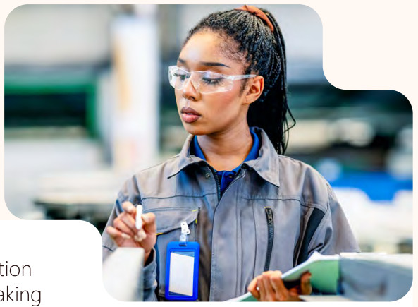 
## INNOVATION IN ACTION 
Advancing LCA methodologies Improving data collection for better decision-making In FY24, Microsofts Devices team launched a fully automated data collection process to faciltate seamless sustainabilty dat changes with suppliers. We are also advancing our data assurance processes through independent third party external audits, indluding the use of onsite audits. In 2025,we are exploring opportunities to standardize supplier sustainabity surveys and data collection across the industry to ease the reporting obligations on suppliers. We've incorporated both the CFE data from our suppliers and the semiconductor manufacturing data from IMEC into customized Microsoft supplier-specific information. 
By integrating this primary data into product environmental LCAs, Microsoft has increased the representativeness of assessments,with 70% of the carbon footprint for devices informed by primary data-a significant improvement over the typical 20%of primary data use in LCAs for laptops and tablets. These insights are driving actionable opportunities to reduce carbon in our supply chain. For example,supplier data has enabled Microsoft to better quantify and track the environmental impacts of individual hardware components, identify carbon hotspots and prioritize reduction strategies across our global operations. 
## Advancing LCA tools 
Microsoft continues to enhance its LCA tools to quantify environmental impacts across atacenter, device, and cloud infrastructure operations. Beyond datacenter insights, such as assessing carbon emissions versus water trade-offs in oling technologies, LCAs faciltate informed decision making and help redistribute costs to prioritize regions most adversely afeted.By applying these principles to devices and Azure hardware, and sharing tools through open-source platforms like the Open Compute Prgject, Microsoft aims to drive industry-wide adoption of LCA-informed practices that scale sustainable innovation. Microsoft participates in the Interuniversity Microelectronics Centre(IMEC) Sustainable Semiconductor Technolagies and Systems program, which assesses and works to reduce the environmental impacts of semiconductor manufacturing. Through customized life cycle inventories for over 400 chip configurations, we can track chip generations, forecast emisions,and differentiate environmental impacts across device and Azure hardware configurations with greater precision.However, LCAs can be time-consuming and labor-intensive, requiring detailed analysis of complex supply chains and product components. To address thi,Microsoft isusing Al to acelerate and enhance the LCA process prouing cr while signifcantly reducing the time required. 2025 Enwironmental Sustainability Report 
24

---

<!-- 原文第 25 页 -->

Overview 
Carbon Water Waste Ecosystems 
Customer sustainability Global sustainability Appendix 
2025 Enwironmental Sustainability Report 
25 
## Measurement and adoption continued 
EC3 buids on the insights prorided by EPDs, serving as a cornerstone of Microsoft's bulding material carbon measurement practices by enabling precise, product-level accounting of materials'embodied carbon impacts. By using EC3, contractors can evaluate materials using detailed carbon data, moving beyond traditional broad estimates to make more informed,data-driven decisions. 
To further support supplier decarbonization efforts, Microsoft Indirect Pocurement teams have enhanced data collection and processing through the ESG Value Chain Solution within Microsoft Sustainability Manager.lnitialycousd o emisinss disclosure, their use of the platform has evolved inta a central hub for sustainability engagement, offerin resources such as webinar recordings and program content to suppliers. AI-powered innovations have streamlined processes,indluding: 
## Adoption 
Microsoft is diving th adoption of best practices by setting ambitious standards for suppliers, providing tools that support implementation, and fostering industry-wide collaboration. By aligning supplier goals with our own, piloting innovative materials,and enhancing access to rsoures ike CFE and SAF, we aim to create a ripple effect that extends well beyond our operations. These efforts are critical for scaling decarbonization across our value chain, supportig meaningful progress toward our 2030 commitments. 
Microsoft's process begins with early engagement of contractors, ideally during the request for proposal stage.By involving contractors in material sourcing,procurement, and fabrication, Microsoft uses their expertise to identify lowcarbon materials and optimize project design. EC3 enhances this process by enabling precise material comparisons. transforming embodied carbon accounting from broad, spend-based estimates into actionable data. In 2024, Microsoft utilied a versin of the Impact Accounting Methodology to refine carbon accounting in two datacenter construction projects. These pilots demonstrated measurable reducions in embodied carbon, increased supplier awareness of EPDs, and enabled greater integration of low-carbon materials into construction workflows. 
HVAC systems represent a significat percentage of a datacenter's embodied carbon footprint,but embodied carbon information about these system is often unavailable.However, Microsoft continues to work with a dedicated team that collaborates with actors throughout our supply chain to ensure that more equipment EPDs become available. Microsoft sustainability 
This efort will nale not just Microsoft but our entire industry to make better-informed wholelife carbon decisions when selecting these critical systems PROGRESS TOWARDS TARGETS 
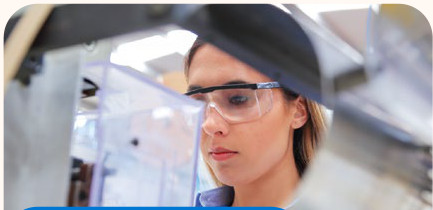 
·Automated survey processing-supplier assurance letters are reviewed, values are extracted directly into disclosures, and compliance determination is automated with detaled feedback provided in a new Actions tab,resulting in a 94% reduction in time for our team to process suppler survey submissions, from 35 minutes per survey to two minutes per survey. 
Elevating supplier standards to accelerate decarbonization Since 2022, Microsoft's Devices Supplier Decarbonizatin program has built policies, procedures, data systems, and educational tools to align suppliers with our sustainability commitments Over the past three years, this program has evolved to address the growing urgency of decarbonizatior amplfed by the introduction of the new Supplier Code of Conduct requirement to transition to 100% CFE by 2030. 
Strengthening engagement Measuring impact across our supplier network At Microsoft, 97% of or emissions are in the cope 3 category, with the majority originating in our supply chain.To acclrate decarbonization, we strengthened supplier engagement by requiring suppliers to transitin to 100%carbon-free electricity by 2030 under the Supplier Code of Conduct. Updated electricty estimates within our supply chain now enable more targeted policy engagement in key operational regions. 
·Streamlined support desk-supplier support tickets are integrated into Microsoft Dynamics, where Copilot drafts responses for human agents based on program knowledge artidles, improving customer satisfaction and response times.

---

<!-- 原文第 26 页 -->

Overview 
Microsoft sustainability 
Carbon 
Water Waste Ecosystems 
Customer sustainability Global sustainability Appendix 
## Measurement and adoption continued 
Progress has been signficant,As ofF F 4,89 devices manufacturing facitis transitioned to 100% CFE for Microsoft production, marking a more than tenfold increase over the previous year. These efforts expanded CFE use and avoided nearly 232,000 mtCOe in emissions. 
Enhancing access through toos and partnerships Recognizing that access to CFE and decarbonizatior solutions varies by region, Microsoft has launched several initaives to support supples.in vercoming these challenges. 
The summit focused on advancing sustainabity across the supply base, aligning suppliers with decarbonization goals, and sharing best practices for achieving impact at scale.This moment marked more than just a milestone--it highlighted the collective power of collaboration driving meaningful change. 
By building strong partnerships and fostering transparency, Microsoft and its suppliers are accelerating progress toward a decarbonized future, reinforcing the idea that shared success is the foundation for industry-wide transformation. 
Key initiatives include: 
Many suppliers have gone beyand meeting minimum requirements, with several commiting to the RE100 standard, ensuring the use of high-qualit renewable energy resources.This effort underscores the importance of maintaining credible, impactful renewable energy standards across the supply chain Microsoft's approach has also inspired several suppliers to adopt similar sustainabity pratices Many have modeled their Scope 3 emissions programs after Microsoft's Cloud Supply Chain efforts, demonstrating how collaborative partnerships can create ripple fects aross industres.These changes not only amplify the impact of Microsoft's program but also contribute to an industry-wide shift toward decarbonization. As the program continues to expand, Microsoft is focused on codifying best practices into supplier requirements while providing tools ie he Supplier REach Portal to make decarbonization solutions more accessible.These efforts are accelerating the global transtion to CE and strengthening the resilience of Microsoft's supply chain. 
·Supplier REach portal-launched in 2023, we partnered with global climate solutions expert 3Degrees to develop a portal that provides suppliers with streamlined access and a guided experience to procure CFE, helping them align with Microsoft's environmental sustainability commitments. 
## LEARNINGS AND WHAT'S NEXT 
Advancing carbon market mechanisms. As part of our efforts to reduce Scope 3 emissions,we are building on our experience with book-and-claim systems for sustainable fuels to contract for sustainable building materials certificates. By collaborating with multi-stakeholder groups,we aim to develop market infrastructure to scale these approaches, driving greater adoption and impact. 
Scaling community.focused sustainability infrastructure. Through energy procurement efforts ike Piut and ReNew, we have learned a lot about the importance of leading with partnership. trusting the expertise of local communities, and authenticlysting povr ad decision-making such that new projects are fairly developed and enhance the heath, safety,and overall welng of the communities in which we operate.We are using these lessons learned and embedding these practices to enable a more sustainable future for all. 
SAF purchasing pilot-in 2024,Microsoft partnered with Chooose to make SAF more accessible to our suppliers. Aviation-related emissions from business travel are a significant contributor to supplier carbon footprints. This partnership enables Microsoft suppliers to act on these emissions by supporting smaller scale SAF purchases. 
Building a robust carbon removal portfolio. We continue to refine our carbon removal strategy by signing bankable, multiyear agreements across high, medium, and low durability pathways. These efforts wil adrnr our supplier base and geographic footprin,hile accelerating financing for critical infrastructure and afforestation projects to deliver meaningful carbon removal credits by 2030. 
Recognizing progress and aligning expectations As wereach the midpoint of our journey to 2030, we are celebrating the progress made with our suppliers whle seting ear epectations for the path ahead. In October 2024, Microsoft hosted a supplier summit, bringing together suppliers across our supply chain. 
2025 Enwironmental Sustainability Report 
26 
Driving datacenter innovation. With rapid cloud business growth, we are advancing datacenter sustainabilit by developing strategies to integrate novel low-carbon materials into HVAC unit, incorporating low-carbon requirements for materials and equipment in datacenter construction into our contracts, and identifying opportunities to improve operational effriency.

---

<!-- 原文第 27 页 -->

Overview Microsoft sustainability 
Carbon Water Waste 
Ecosystems 
Customer sustainability Global sustainability Appendix 
2025 Environmental Sustainability Report 
27 
In this secio u ppac vaning waterepeistnEpandang an wa cespingcr d nee inrene n 
Microsoft is leadingefors to develop and scale the water replenishment market while driving innovation in water solutions. 
Getting to water positive 
Read more about our learnings on the journey to water positive in our white paper. 
Water is esenia to i nd a important part of our sustainability journey. In 2020,we set the ambitious commitment of becoming water positive by 2030. To achieve this commitment,we are taking action to reduce water use,replenish water in crtica regions, improve global water access and sanitation drive innovation in water management,and advocate for effective water policy. Our approach is designed to mitigate water stress, saeguard crtical watersheds, and support global resilience. 
As we progress, our water positive strategy is evolving-integrating new ideas,technologies and approaches to address global water challenges Microsoft is leading efforts to develop and scale the water replenishment market while driving innovation in water solutions. A key challenge since setting our replenishment target in 2020 has been the limited avalabit o ntitvis ed for investment and implementation in priority locations. To overcome this, we are building and scaling replenishment efforts by supporting projects through non-governmental organizations (NGs) and pioneering first-of-their-kind intatves with priate setor partners, As of 2024, private sector projects accounted for 17% of our replenishment portfolio, relecting our resolve to foster a diverse,collboratve ecosystem to achieve water sustainability: 
Today, four principles guide our replenishment works Prioritize investments in areas with high water stress and high operational water consumption Don't just count drops, invet in local lvnt projects that offer co-benefits. Keep community needs and impact at the forefront. 
 
Increasing restoration and reuse.We continue to fund projects that restore,reuse,and reduce freshater consumption in water-stressed locations where we operate.Across approximately 40 priority locations worldwide, we invest in solutions such as rainwater harvesting, groundwater replenishment, and irigation modernization delivering measurable social and environmental benefits while addressing local water challenges. 
Focus on innovation with an aim to build project supply and scale. 
## Our approach 
As we continue our work to be water positive by 2030, we are focusing on progress in three core areas 
Increasing efficiency. Microsoft's newest datacenters feature advanced direct to-chip liquid cooling systems that recycle water in a closedloop design,liminating the need for evaporation. 
By adopting these innovations,each datacenter saves over 125,000 cubic meters of water annually reducing freshwater reliance even as AIl workloads drive increased compute resource needs. Reducing dependence on freshwater. As an ongoing effort across ur lbal pratios we are continually investing in improving the design and operation of our datacenters to minimize water use, including implementing water recycling projects and rainwater harvesting.

---

<!-- 原文第 28 页 -->

Overview 
Microsoft sustainability 
Carbon Water Waste 
Ecosystems 
Customer sustainability Global sustainability Appendix 
2025 Environmental Sutainability Report 
Our approach continued Our targets and progress 
Target 
Water positive 
Replenishing more water than we use by 2030 
We vile pisht mor aeretan e cosme os popnis on water-stressed regions where we work. 
As we work to be water positive, we continue to scale our efforts to reduce water use across our operations, while increasing procurement from alternative sources and investing in innovative replenishment and access projects. 
Increasing access to water 
We willpruice c lieplpi iaec aa esasn services by 2030 
Reducing our water intensity 
We will make prgressagainst ur trgato ioprvewer use eficn y 0aross our global,cwned datacenter operations by 2030,from a 2022baseline. 
## Progress 
In progress Achieved 
## Over 100 million cubic meters of water replenishment volume 
In FY24, we increased the number of projects we have funded by cver 50%, funding 27 replenishment projects that are estimate to provide more than 50 millin ubi meters in volumetric water benefit over the lifetime of these projects Since the inception of this program,projects contracted are estimated to provide more than 100 million cubic meters of replenishment volume over their lifetime. 
## Over 1.5 milion people with water access 
In FY2, we added seven new projects, bringing our portfolio to 1 ntiatis t hen fully implemented will serve over 1.6 milin peple across Brazil india, Indnesia, Menico, Chile, the United States, Malaysia, Kenya, and Nigeria 
## Improving water efficiency 
Since our baseline year of 2022.aperationa/ datacenters have achieved an 18% reduction in water intensity pragressing towards our 2030target to reduce water use intensity by 40% 
28

---

<!-- 原文第 29 页 -->

Overview 
Microsoft sustainability 
Carbon Water Waste Ecosystems 
Customer sustainability Global sustainabilty Appendix 
2025 Environmental Sustainabilty Report 
29 
## Advancing water replenishment 
## Water Table 1 
Replenishing more water than we consume 
Since the program's inception,we have contracted 76 replenishment programs in water-stressed basins which are expected to deliver more than 100 million cubic meters of replenishment volume over their ifetime. 
Delivering support in an emerging field Water replenishment encompasses a broad range of interventions aimed at improving watershed health. These activities focus on enhancing water quantity and quality through measures such as reducing water use,recharging local aquifers, restoring aquatic ecosystems, and conserving critical land resources. By driving these efforts, we aim to not only meet our on environmental sustainability commitments but also catalyze progress across industries and communities worldwide. 
Water replenishment remains an emerging field with limited histrical udance and data to inform corporate investment strategies. This nascence translates to a limited supply of projects and a reliance on new or early-stage organizations entering the space.As corporate demand for replenishment investments grows, there is a pressing need to build supply and scale efforts. 
To address this gap, Microsoft is working to empower new project implementers and help scale the water replenishment market through collaborative partnerships with NGOs and private sector entities. While implementers may not initial specialize in replenishment,thei expertise in water management or related solutions can be adapted to align with replenishment objectives, driving innovation and creating scalable models for success. 
Total contracted volume water replenishment Water m 

| 60M 50M | | | | | 50,031,857 |
| --- | --- | --- | --- | --- | --- |
| 40M | | | | | |
| 20M | | 12,937,207 | 13,230,308 | | |
| 10M | 2,840,030 | | | | |
| OM | FY20 | FY21 | FY22 | FY23 | FY24 |
 
Find out more in our Data Fact Sheet 
r)

---

<!-- 原文第 30 页 -->

Overview 
Microsoft sustainability 
Carbon Water Waste Ecosystems 
Customer sustainability Global sustainability Appendix 
2025 Environmental Sustainability Report 
30 
Advancing water replenishment continued 
Building a robust and effective portfolio 
In FY24, we signiftcaty pand doerpint efforts,contracting 27 new projects and increasing our total portfolio by more than 50%to 76 projects. This represents a cumulative investment of more than $34 million, with 62% of these projects using nature-based solutions and 47%providing critical biodiversity co-benefts. For example,we are supporting a project with Conservation International to conserve and restore the Lake Xochimilco wetlands in Mexico City, Mexico. This wetland is home to 5% of Mexico's described species, ntuding the criticlly endangered axolot salamander. 
## Water Table 3 Replenishment projects 
The outcomes of prgjects tied to natural ystems can be inherently unpredictable.Volumetric water benefts,for intance, may futuate due to changing weather patterns-rairwater harvesting projects, for example, might yield less water than anticipated during droughts or unexpectedly exceed expectations in periods of heavy rainfall. To address these challenges, Microsoft has implemented a proactive and strategic approach for our water portfoliox. 
Our project portfolio continues to grow. We are supporting 76 water replenishment projectsworking with partners,communities,and innovator to drive lasting impact in water-stressed areas where we operate. 
Cumulative total of projects contracted 
Build a diverse portfolio.We mitigate risk by diversifying across a variety of locations, project types, and partners,ensuring resiience against variability. 
Invest early. By building a robust portfolio arly, we create the runway needed to achieve our replenishment target by 2030. Use data-driven forecasts. We collaborate with partners to use conservative, realistic estimates in forecasting project outcomes. 
Evaluate progress continuously. Annual progress eports from partners help us verify project health, address halengs,sad support timely resolutions. 
+50% 
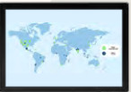 
Learn more about our water access and replenishment projects here 
We increased our water replenishment portfoli by more than 50% in FY24. 
## Water Table 2 
## Replenishment activities 
Our water replenishment portfolio works to improve watershed health through a broad range of activities that are not limited to nature-based solutions.The following table shows replenishment activities by percentage of our total portfolio which enable us to not only meet our own environmental sustainability commitments but also catalyze progress for people and nature. 
 

| Wetland restoration and creation | 29% |
| --- | --- |
| Agricultural water demand reduction measures | 17% |
| Land cover restoration | 9% |
| Operational efficiency measures | 8% |
| Leak repair | 8% |
| Rainwater harvesting | 7% |
| Legal transactions to keep water in-stream | 4% |
| Agricultural best management practices | 4% |
| Water reuse | 3% |
| Constructed wetland treatment systems | 3% |
| Land conservation | 3% |
| In-stream barrier removal | 3% |
| Floodplain inundation/ reestablish hydrologic connection | 3% |
| New water supply for crop irrigation | 1% |

---

<!-- 原文第 31 页 -->

Overview 
Microsoft sustainability 
Carbon 
Water Waste Ecosystems 
Customer sustainability Global sustainability Appendix 
2025 Environmental Sustainability Report 
31 
## Advancing water replenishment continued 
At Microsoft,water volumes are only counted toward our replenishment target if they are implemented beyond our operational needs and directly benefit the local community and environment.For example, rainwater captured for use in our datacenters or campuses cntrbutes to reducing our own water use but does not count toward our replenishment target. 
of our replenishment prjects use Al to replenish, restore, or reduce water use,ensuring real-time tracking and more actionable insights. 
## Al-powered precision irigation Helping farmers save water 
In Chile,one of the world's most waterstressed regions, Microsoft partnered with Kilimo to deploy Al-powered precision irrigation systems. By integrating crop soil moisture tests, satelite data, local weather data, and agronomyadvisory, Klimoproides farmers with tailored irrigation schedules. To date, this technology has been implemented across 440 hectares of farmland in Chile's Maipo Basin, saving an estimated 1.5 milion cubic meters over three years, benefitting 11 farmers. These efforts also 
Accelerating water progress with Al Al is revolutionizing water proiects, 0fring untapped potential to address challenges across the eplenishmen ife ltr a ingn a tom satelite imagery, on-site sampling, and sensors, Al enablest 
·Monitoring and identification at scale by using machine learning to remotely track watershed changes and identify land use patterns over time. 
·Resource planning by creating early warning systems for droughts, loods,and water quality violations, forecasting water demand; and modeling aquifer depletion and recovery. 
·Operational efciencies by detecting leaks and wastewater system blockages, monitoring water quality in real time,optimizing irrigation schedules, and using water and wastewater quality data to hot spot diseases 
Al also simplfies the often-challenging task of monitoring and evalution throughout the project life cycle,which can be prohibitively expensive for many replenishment prjects.Curenty, about 17% 
## Reducing water loss in cities 
In 2023, Microsoft began supporting leak detection projects that utilize Al-enabled technology to combat water loss in collaboration with Aganova,FIDO,FluxGen,and Orbia. These projects use Al to analyze data, precisely identifying the size and location of leaks faster and more accurately than traditional methods. With leaking pipes accounting for an estimated 30% of global water losses,these technologies offer significant potential to reduce waste. Our portfolio now includes seven leak detection projects in cities such as London (England), Quertaro (Mexico), Phoenix (Arizona), Las Vegas (Nevada), Madrid (Spain),Campinas (Brazi),and Bengaluru(India).For example,in Madrid,Microsof is funding Aganova to deploy advanced AI across more than 160 kilometers of pipes in the water distribution network of the Mancomunidad de Aguas del Sorbe (MAS) water utlity,.AS plans to repair identified leaks within three months, helping reduce overall water withdrawals,alelate regional water stress, and lower costs and carbon emissions by decreasing the energy required for water treatment and distribution. Prjects like this strengthen the region's resilience to drought and exemplfy the transformatie impact of Al-powered water management. 
## PARTNERING FOR IMPACT 
Al water management Optimizing water use in hospitals In India,FluxGen Sustainable Technologies is using funding from Microsoftto help two charitable hospitals in Bengaluru improve their water use effciency and reduce thein dependence on groundwater supplies Using the AquaGen System, an end-to-end Al and loT-based water management solution, the project monitors real-time water usage, infrastructure inefficiencies, and energy consumption. By addressing leaks and reducing water waste in laundry facilities, residential areas, and coling towers, the hospitals aim to cut water consumption by 50% The system also enhances the performance of existing rainwater harvesting and wastewater treatment structures, providing a scalable model for other high-demand facilities.

---

<!-- 原文第 32 页 -->

Overview 
Advancing water replenishment continued Protecting watersheds and increasing efficiency in irrigation In addtion to using AI, we continue to inest in nature-based water projects, such as beaver dam analogs, and agricultural water management systems, uch as limate-smart irigation practices, to ensure holistic and scalable solutions. These efforts demonstrate how together,technology and nature can help scale water replenishment progress. Protecting watersheds with beaver dam analogs Beavers have been hunted extensively-not only for their fur but als to eliminate them as perceived pests. However, these industrious animals play a vital role in protecting watersheds. By building dam they help control runof,replenish groundwater, and create important reservoirs. Through a partnership with Trout Unlimited, Microsoft supports aquatic habitat restoration projects that use beaver dam analogs human-made structures mimicking natural beaver dams) to enhance water quality and flow. To date, we have funded the creation of 190 beaver dam analogs in key areas, including the Columbia River Basin and Rock Island Creek in Washington state, as well as the Litle Snake River watershed in Cheyenne, Wyoming. These projects will help mitigate the destructive efets f lding ougt, and wildfire, while increasing wetland areas enhancing groundwater infitration, and improving riparian ealth. They also provide critical habitat for native fish, wildlife, and vegetation, while reducing Microsoft sustainability 
Carbon 
Water Waste Ecosystems 
Customer sustainability Global sustainability Appendix 
2025 Environmental Sustainability Report 
32 
downstream sedimentation and nutrient runoff. Such efforts demonstrate the value of naturebased solutions in bolstering ecosystems and building resilience Supporting climate-smart irigation practices The agricultue sector is one of the largest consumers of water,and inefficient iriation systems can put a significant strain on water resources. To address this, Microsoft invests in agriulture and irigatio eficiceny prjects that transition outdated systems-such as food irigation-to more eficient aternatves These solutions conserve water, reduce fertlier and pesticide use,and improve climate resilience. 
·Land-leveling of agricultural fieds, which improves irrigation efficiency, increases crop yields, and reduces crop disease risk. ·Center pivot sprinklers and subsurface drip irrigation systems, which reduce consumptive water use while maintaining crop productivity. 
These sustainable, climate-smart practices not only conserve water but also strengthen community resilience, ensuring a more sustainable future for both farmers and ecosystems. 
Read our water replenishment project portfolio overview to learn more about the projects that we are funding through our replenishment program. 
Our projects span key locations, including the Verde Valley and the lower Colorado River in Arizona, the mid-Columbia Basin in Washington state, the Edwards Aquifer in San Antonio, Texas, the Tagus River Basin in Madrid, Spain, and the Rio Lerma in the state of Guanajuato, Mexico. Collectively, these initiatives are projected to save 20 millin ubic meters of water over their lfretimes.. Technologies employed include: 
## PARTNERING FOR IMPACT 
Luis Enrique Guerrero,a grain producer growing crops like corn, beans, and sorghum in Guanajuato, says,"We have experienced very severe and intense droughts. We need water to produce... We have a well that provides about 42 lters per second. However with that amount of water and our current flood iriation system, and due to the droughts, we only manage to use about half of it. Luis has aleay raled ater s ign te etngns irigation gates and tubing systems through the project. The adoption of these types of technologies supports sustainable, climate-smart agricultural practices that enhance community water supply resilience. 
·Mobile drip irigation systems, which directly water plants to minimize evaporation and reduce overapplication of fertlizers and pesticides. ·Advanced soil moisture and climate monitoring systems, which provide data to optimize irrigation schedules. 
Improved resilience Supporting sustainable agriculture

---

<!-- 原文第 33 页 -->

Overview 
Microsoft sustainability 
Carbon 
Water Waste Ecosystems 
Customer sustainability Global sustainability Appendix 
2025 Environmental Sustainability Report 
33 
## Expanding clean water access 
Building on this accomplishment, we continue to expand our impact through replenishment projects that also improve access to safe water. In FY24, we added seven new projects, bringing our portfolio to 13 initiatives that when fully implemented will serve over 1.6 million people across Brazil, India Indonesia, Mexico,Chle,the United States, Malaysia Kenya, and Nigeria. These projects range from core solutions, such as piped connections that reduce collection time for women and girls and deeper wells to replace polluted sources, to innvative approaches like air-to-water generation and condensate capture from fut and vegetable manufacturing. Each initiative is tailored to meet the unique needs of local communities. 
Where possibl, e are proriting ppaces that do not pull from groundwater sources. Instead, we focus on sourcing from alternative sources, like rainwater harvesting and capturing condensate from fruit and vegetable manufacturing,to help ensure long-term water security for the communitie we serve. 
In Malaysia, for example, a prject in partnership with Clean Internationa is instaling ainwater harvesting systems at 50 schools. These systems utilize a three-tier filtration process that removes 99.99% of bacteria, providing safe drinking water for 30,000 people. Addtionaly.completed schools in the region act as flood relef centers during the monsoon season. The newly installed systems will proide clean water for up to 500 diplced community members,offering a vital lifeline in the face of natural disasters. 
Access to clean water is a fundamental human right and a cornerstone of the United Nations (UN) Sustainable Development Goal (SDG)6.In support of Microsoft's water positive commitment,we set a target to provide 1.5 million people with access to clean water and sanitation services-a target we proudly achieved in 2023 
## Harvesting rainwater for schools and communities 
In areas prone to water shortages or extreme weather, rainwater harvesting serves as a critical sustainable solution. lt ensures access to clean wate for schools and communities and enhances climate resilience.Through our access and replenishment portfiolios, Microsoft has funded 250 rainwater harvesting projects globally. 
## Capturing potable water in sugarcane manufacturing 
In the vilags arund Nagpu, nda thousands of people face persistent challenges in accessing clean drinking water. To address this, Microsoft is funding an innovative project that utilizes condensate generated during sugarcane processing at a local sugar mill.Through a partnership with Botanical Water Technologies, water harvesting units will be deployed to capture and purfy condensate into safe dinking water to be distributed to water-scarce local communities. 
 
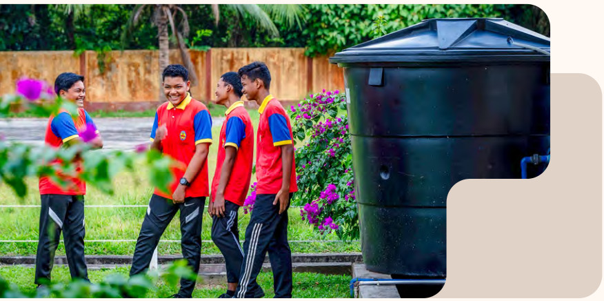 
## 1.6 million people 
This process is stimated to produce 60,000 cubic meters of clean water annually over the next three years, which will th betransprted and distributed to the surrounding villages, providing more than 16,000 people with access to safe clean water This project represent a sustainable and impactful solution to improve water access in a region that is heavily reliant on limited and stressed water resources. 
In FY24,we added sevnew projects,bringing our access portfolio to 13 initiatives that when fully implemented will serve over 1.6 million people.

---

<!-- 原文第 34 页 -->

Overview 
Microsoft sustainability 
Carbon Water Waste Ecosystems 
Customer sustainability Global sustainability Appendix 
2025 Environmental Sustainability Report 
34 
Expanding clean water access continued Water Table 4 
INNOVATION IN ACTION 
Drilling a new well for cleaner water and sanitation services 
## Partnering with local 
Access projects Aftr meeting our access argetin202, e funded seven additional projects in 2024,which will enable us to expand our reach to more than 1.6 million people across the globe. 
Microsoft employees 
Sometimes,the simplest, time-tested solutions are the most efective.This ws the case for the Cerlos community in Curacavi, Chile, where residents were concerned about nitrate contamination in their local shallow well. To address these concerns, Microsoft provided Agua Segura with the support needed to dill a ew well purpos an existing fitition system, and establish a water quality monitoring program aligned with local regulations. This iniatitvee has brought peace of mind and tangible improvements to the community, ensuring reliable access to safe drinking water. 
In 2024, we organized three employee volunteer events in India, Mexico,and Chile to support the launch of crtical water projects and rais awareness about global water challenges. In Pune,India, and Queretaro, Mexico, Microsoft employees actively contrbuted by constructing water towers at four schools involved in the project. This initiative is providing clean water and improved hygiene for 7,200 students and their families. These events not only advanced our water access target but also engaged our employees in meaningful, hands-on efforts to drive positive change in underserved communities.Iin the words of one of the schools,"Because of this plant, we can take care of the children's health. And we can improve their attendance." 
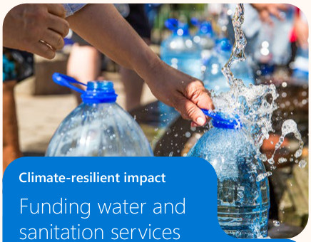 
Numbe of peple reached 
1,581,273 
In last year's sustainability report,we announced a partnership with WaterfEquity to establish a water and cimate resilience investment fund. Through our Climate Innovation Fund,Microsoft provided a $25 millionanchor equity investment in this new impact fund, which focuses on climate resilient water and sanitation services. In September 2024, WaterEquity announced that it had raised more than $100 milin fon the fund. Other key invetors inude Starbuck, Xylem, Ecolab, Reckitt,and Gap Inc.The fund aims to reach 15 million people in low-income populations across South and Southeast Asia, sub-Saharan Africa, and Latin America, providing access to safe water and sanitation. 
"Today, the community lives with the assurance that the water we consume is of good quality, complies with regulations, and that our children and elderly can consume it without fear of getting sick. Additionally, we have better service,pricing, and sufficient supply. Local resident of Curacavi 
Learn more about our water access and replenishment projects here 
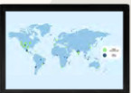

---

<!-- 原文第 35 页 -->

Overview Microsoft sustainability 
Carbon 
Water Waste Ecosystems 
Customer sustainability Global sustainability Appendix 
2025 Enwironmental Sustainability Report 
35 
Improving efficiency and reducing water use 
Complementing our work in replenishment and access,Mirost is etiking bow water is used across our datacenters and campuses to minimize our operational footprint while meeting the growing demand for cloud and AI serices. Through innovative designs like liquid cooling systems and water reuse technologies, we are reducing water consumption in our newest datacenters and campus buildings,as well as retroftting xisting facilities for enhanced effciency, Together, these intiatves align with our 
Applying liguid coing t0 Aienabling GPUs has spurred inovations in our newest datacenter designs and aligns with our target to reduce the water intensity of our operations and to evaporate no municipal water for cooling in our newest Al datacenters. Historicall,water has played a key role in datacenter cooling and humidification, but our new designs aim to eliminate this need for onging municipal water for cooling.in 202,Micrsoft lunched a new datacenter design that optimizes Al workloads and uses zero water for cooling. By adopting chip-level cooling solutions, we deliver precise temperature control without water evaporation, saving over 125,00cubic meters of water annuall per catacenter, bsed on our FY24 global average withdrawal water usage effectiveness (WUE) of 0.30 L/kWh.While water is stilluse for dminitvepuposes ik estooms and kitchens, this shit isa substantial leap forward. These inovations in or newest datacenter designs align with our target to reduce the water intensity of our operations and to require no water for cooling i our newest Al datacenters. 
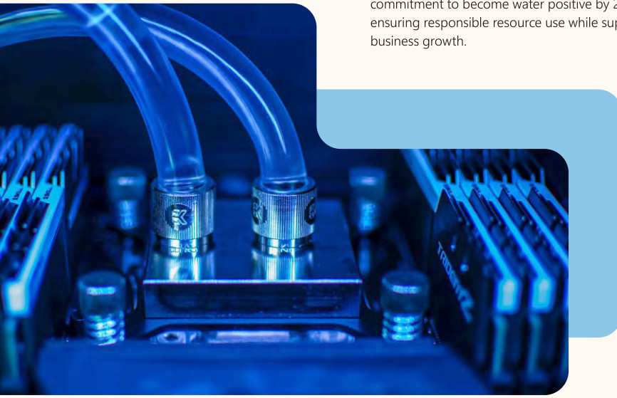 
## Eliminating water for cooling in new datacenters 
Understanding Microsofts approach to reducing water usage intensity starts with recognizing how water is traditionallyued n acenters. itoicly most ongoing water usage has been for cooling servers to prevent overheating as they deliver cloud and Al services. In this process, water is "used" by being evaporated into incoming outdoor air to reduce the air temperature during warmer months. Early datacenter designs relied on cooling entire buildings, simia to turning on an ai conditioner for your whole house to cool a single room. Over time, we have improved operational water efficiengy by constructing newer datacenters with more efective and targeted cooling infrastructure--such as our air-cooled CPU datacenters, which typically require water for cooling only during the hottest portions of the year. 
Our newest datacenter designs go even further by targeting cooling directly to the source of heat -the silicon itself.This method, known as directto-chip liquid colin, appls coin ipuid drectly to the chips in servers. Unlike tradtional systems, it does not rely on evaporating the liquid and recycles water through a closed loop. Once filled during construction, the system continuously circulates water between the servers and chillers, dissipating heat without requiring additional water.

---

<!-- 原文第 36 页 -->

Overview 
Microsoft sustainability 
Carbon 
Water Waste Ecosystems Customer sustainability 
Global sustainability Appendix 
2025 Environmental Sustainability Report 
36 
## Improving efficiency and reducing water use continued 
Traditionally,water has been evaporated nsite to reduce the power demand of the cooling systems. Replacement of evaporative systems with mechanical cooling will increase our power usage effectiveness (PUE) however, our latest chip-level coin slutions will allow us to utilie warmer temperatures for cooling than previous generations of IT hardware. 
This enables us to mitigate the power use with high efficiency economizing chillers with elevated water temperatures. The result is a nominal increase in our annual energy usage compared to our evaporative datacenter designs across the global fleet. Additional inovwations to provide more targeted cooling are in development and are expected to continue to reduce power consumption. 
## Improving datacenter water effciency 
These advancements have improved water usage effectiveness (WUE),a metric that divides the total annual water consumption for humidification and cooling by the total IT equipment energy consumption. Since our baseline year of 2022, operational datacenters have achieved an 18% reduction in water intensity. progressing towards our 2030 target of a 40% reduction. 
Our efforts to reduce water usage began well before 2022.In our last fiscal year, ur datacenters operated with an average WUE of 0.30 L/kWh,a 39% improvement compared to the global average of 0.49 L/kWh in 2021.Next-generation datacenter designs are expected to further reduce WUE across our owned fleet. 
This progress is driven by ongoing efforts to reduce water wastage,xpand our operating temperature ranges, and audit our datacenter operations. Regular audits help identify ineffinces,suoh a excess water use, with improvements surfaced in our 2022 audit eliminating 90% of such instances. Looking ahead, we are developing advanced predictive models that anticipate water needs based on real-time weather and operational data to ensure continued progress. 
## Recycling and reuse initiatives 
To minimize reliance on freshwater from municipal water systems, Microsoft employs water recycling and reuse strategies tailored to the needs of the individual datacenter regions. 
In the United States and many othe there is a limited alabilty of recy with less than 1% of water used recy By 2023,we expanded sourcing of use in Texas, Washington, Californi Rainwater harvesting systems are r in datacenters within the Netherlan and lreland with additional installat Canada, the United Kingdom,Finlar Africa, and Austria. 
Increasing water reuse is a critical w to alleviate stress on municipal sup supporting operational efficiency. 
## PARTNERING FOR IMPACT 
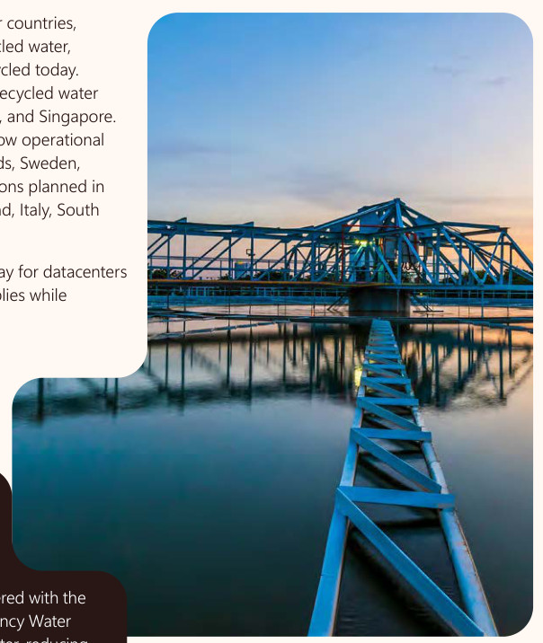 
Quincy, Washington 
## Reducing potable water use 
In Quiny, Washington, we partnered with the local municipality to build the Quincy Water Reuse Utility, recycling cooling water, reducing Microsoft's potable water use in the region by 97%,and providing 1.5 million cubic meters of water annually for community drinking water needs.

---

<!-- 原文第 37 页 -->

Overview 
Microsoft sustainability 
Carbon Water Waste Ecosystems Customer sustainability Global sustainability Appendix 
2025 Environmental Sustainability Report 
37 
## Improving effciency and reducing water use continued Water Table 5 
At site i water.constrained regions, Microsoft is also exploring new ways to source water without placing additional train an local uply./n,202, ve installed an air-to-water system at our Hyderabad, India, campus. Powered by sunlight, the system extracts water vapor from the air and converts it into clean, rinkable water. With plans to install approximately 300 panels, the campus anticipates generating over 1,600 liters of water per day 
## Measuring our annual water consumption informs our replenishment targets 
Our water consumption and withdrawal trend has shown an increase over the years, in igent wih ur business growth. The consumption data from our operations informs the amount of water we need to replenish 
Total water consumption and withdrawal Water m2 
 
Consumed 
 
Withdrawn 
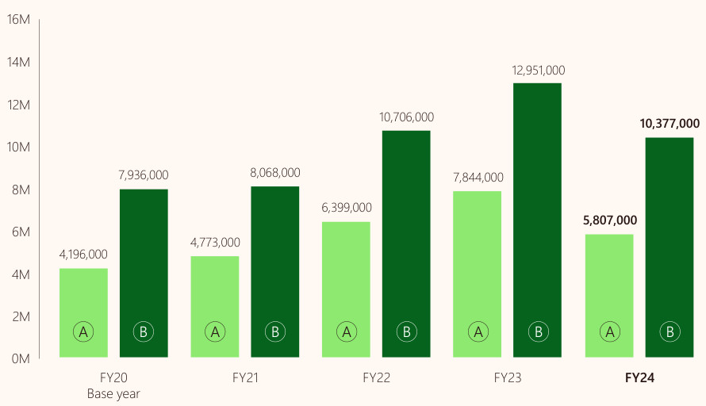 
 
 
Water efficiency across campuses Effors to mprvewatr friinge tend dynd our datacenters to our campuses, where a range of water-saving projects are underway. These include installing low-flow fixtures, dual-flush toilets,and smart irrigation systems; capturing rainwater; and reusing treated water.At or Bejing, China campus, collaborative conservation efforts with dining services partners-incuding purchasing fresh products to reduce water needed for thawing frozen goods--led to a 15% reduction in kitchen water use in 2024. Similarly, our lndia campuses are treating water to a tertiary level,enabling reuse for restrooms, landscaping,and chiller equipment.

---

<!-- 原文第 38 页 -->

Overview 
Microsoft sustainability 
Carbon Waste Microsoft is continualy aporing ne technologies to further reduce water usage. As part of this effor we are assessing ways of improving water effriency in adiabatic cooling systems (a process where no heat transfer takes place).Early testing of a new microporous evaporative media showed promising results, with up to a 30% reduction in water usage, along with a 42% decrease in wastewater via highe cycle of concentration. Testing continues at our Phoenix datacenter, along with collaboration to enhance the media's lifespan and performance. technologies such as microfluidics, which use sicon etched cooling channels to operate at higher facilit 
Water 
Ecosystems 
Customer sustainability Global sustainability Appendix 
2025 Environmental Sustainability Report 
38 
Innovating for greater water efficiency 
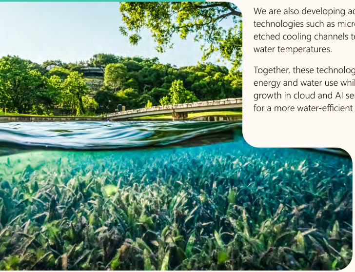 
## LEARNINGS AND WHAT'S NEXT 
Improving monitoring and evaluation.As we continue our journey to become water positive, advancing monitoring, data, and insights will allow us to take more precise action and adjust our approaches to meet our targets. If we face scenarios where water volume cannot be confrmed or it there isa proicthat eaperienced delays or other challenges,these insights wil allow us to respond appropriately We are in the process of building an in-depth asset management strategy to map short-and longer term monitoring opportunities that we can use to ensure the projects we fund are achieving the objectives set Using Al to protect freshwater in high stress priority basins.We continue to look for opportunites to use Al to mitigate water challenges across the globe. This includes funding replenishment projects that use AIl, assistig h rganzation ladinghi rk. and directly supporting groups using Al to drive meaningful impact. 
Innovate and scale as we approach the halfway mark of our water positive goal. When we first set our water positive goal in 2020,we started by assessing ur water related iks and impacts that would inform our strategy. This is a critical first step at the begining of ary company's water journey.Once we understood more about our water footprint, we started to build the program from the ground up.We launched programs to maximize effciency across or datacenters, provided over 1.5 milin people with access to clean water and sanitation solutions,and estabished processes and thought leadership pieces to guide the development of our growing replenishment portfolio. As we approach 2030, we are now laser focused on innovation and scale for our water program.We will launch datacenters that will rpuie er water for cooling to minimize impacts on freshwater resources as we grow, increase procurement of alternative sources of water to reduce our dependence on freshwater resources, and continue partnering with organizations to develop, pilot, and scale first of their kind replenishment projects in high stress priority locations across the globe.

---

<!-- 原文第 39 页 -->

Overview Microsoft sustainability 
Carbon Water 
Waste Ecosystems 
Customer sustainability Global sustainability Appendix 
2025 Environmental Sustainability Report 
39 
In this seton or app rcingere ngcamp antre s nu crg n tn 
## Surpassing our targets 90.9% 
# Getting to zero waste 
This past year, through our Circular Centers, we achieved 90.9% reuse and recycling of servers and components in FY24, surpassing our 90% target a year early. 
In 2020, we made a commitment to be zero waste by 2030-an effort to support the globa trastion out of the traditional take,make,waste linear economic model to a circular economy. Our zero waste commitment applies across our building construction and operations, products, and packaging. We use a circular economy strategy, grounded in the prioritization of reduction and reuse, to xtend the ife of the mateiais we wse and reduce waste and carbon emissions as a result.This effort begins upstream by reducing the quantity of materials wherever possible, keps products in use longer through reuse and repair, and recovers materials downstream to our recycling and composting programs. 
## Our approach 
This commitment reflects our belief that our planet and its resources are precious and underscores our responsibility to minimize environmental impacts and reduce carbon emissions throughout the life cycle of our materials 
We are proud of the progress we have made towards a circular economy over the past five years. This includes deploying si Cirula Centers facilities that recover parts and components from our doud hardware for reuse and recycling; pursuing the elimination of single-use plastics from our product packaging; improving data collection and management systems across our operations; achieving zero waste validation for five offices; and increasing the rates of recycded content and repairability of our devices 
The results of these efforts are clear.Through our Circular Centers,we achieved 90.9% reuse and recycling of servers and components in FY24, surpassing our 90% target a year early, At the same time,we diverted 85.3%of construction and demolition waste from landfills and incinerators, exceeding our annual 75% target six years ahead of schedule These milestones diven by a uture of innovation and cross-functional collaboration, reflect not only our own advancements but also the growing momentum to integrate zero waste and ircularity practices across the technology industry ur zero waste strategy centers on cirulan solutions that reduce waste,pollution, and carbon emissions while improving water quality, ecosystems, and human health. This approach prioritizes waste prevention, robust reuse operations, and transparent reporting to ensure our efforts are measurable and impactful. 
 
# Surpassing our targets 85.3% 
At the same time,we diverted 85.3% of construction and demolition waste from landfll an incinerators, exceeding our annual 75% target six years ahead of schedule. 
As we reflect on the learnings since launching the zero waste program in 2020,we've come to understand that a cirular economy is not choice but a necssity to addes the trpepanetary crsis of climate change,biodiversity loss, and pollution. Moving forward, we will continue to prioritize solutions and materials that continue to incease circularity and further reduce waste and emissions.

---

<!-- 原文第 40 页 -->

Overview 
Microsoft sustainability 
Customer sustainability Global sustainability Appendix 
2025 Enwironmental Sustainability Report 
Our approach continued Our targets and progress 
## Target 
Zero waste 
Driving to zero waste building and operations We willahve0 irinf prtina tara ps and 75%diversion for all construction and demolition projects, by 2030. 
As we work to achieve zero waste,we are taking an increasingly circular approach to materials management to reduce waste and carbon emissions. 
Carbon Water 
Waste Ecosystems 
Increasing reuse and recycling of servers and components By 2025 0% of servers and components for l lud rdwar wit u se dd recycled with support from our Circular Centers 
Sustainable product packaging By the end of 2025, we plan to eliminate single-use plastis ia l aoct rimar product packaging. Adtionly by2030, we aim to design all Micrsaftpruct packaging to be 100% recyclable in OECD countries 
Increasing circularity of our products We are focused on inresign s f eyedccntprpindeceeprpl. and improving data quality of device recycling 
Designing in recycled content and revolutionizing repairability Our Surface Copilot PCs now feature 10 reyced atuminum aly/ h ndsres. and 100% recycled rare earth metals in magnets. Our new devices are some of the most reparable lapteps and tablets in the indusr, ostn a lat 1pcment components. The new Surface Pro 1th Edition and Laptop 7th Edition achieved an B/10 repairability score from iFixit 
## Innovating cloud packaging We are focused on avancing usinale cud packgig ii se. 
## Progress 
In progress Achieved 
25,603 metric tons of operational waste diverted In FY24, we diverted 2, 63 meri tos o .8 pr r re rt m s and incinerators across our owned datacenters and campuses. 85.3% construction and demolition waste. We also diverted 85.3% constrution and demolition waste, achieving our target early. 90.9% reuse and recycling Our reuse and eycerate f e r rn c mpn r r ar ererd 90.9% in FY24, achieving our annual target a year early. 94.8% in product packaging recyclability On our way to eiminatin singlese lastcsi csSosep prpucpcaqgingy bh edd of 2025, we achieved a usage rate of 4.0% single-use plastics across Micsot pocuct packaging portfolio in FY24.In the same year,we used 53.8% recydled content in our product packaging and achieved a packaging recyclability rate of 94.8% 
## Increasing circularity of cloud packaging 
In 2024,we began to reduce the hard-to-recycle plastic-based expanded polyethylene (EPE) foam in bud handware packagig rpecnit t or eep r pp alternatives. We also diverted over 2, 500 metric tons of packaging waste from landfills.

---

<!-- 原文第 41 页 -->

Overview 
Microsoft sustainability 
Carbon Water Waste Customer sustainability Ecosystems 
Global sustainability Appendix 
2025 Environmental Sustainability Report 
41 
Tracking zero waste: Building a data-driven foundation for accountability and impact 
Waste Table 1 Diverting operational waste from landfills and incinerators In FY24 we diverted approximatel20 eiton f sto n an/l ld d nin dds our owned datacenters and campuses 
The progress we ve made toward our zero waste commitments is underpinned by robust methodologies and data governance processes designed to ensure transparency and accountabilit 
This journey began in 2020 with an enterprise-wide waste baselining initiative to establish a clear starting point for our zero waste commitment. From there, we developed methodologies to guide our collection and extrapolation efforts,collaborating with standards organizations to define diversion and prevention calculations to guide our reporting. 
As our data capabilities expanded, including more granular insights from recycler utiation rates, we evolved our processes to better capture, track, and report on the impact of our program. These refinements enable us to identify geographical and material-specific opportunities for intervention, ensuring our strategies remain focused and effective. 
Our dedication to data quality drives greater visibility into waste streams, empowering us to prioritize waste prevention eforts and enhance the integrity of our zero waste program.By continually refining our methodologies, we uphold the spirit of zero waste whle laying the groundwork for ongterm sustainability. 
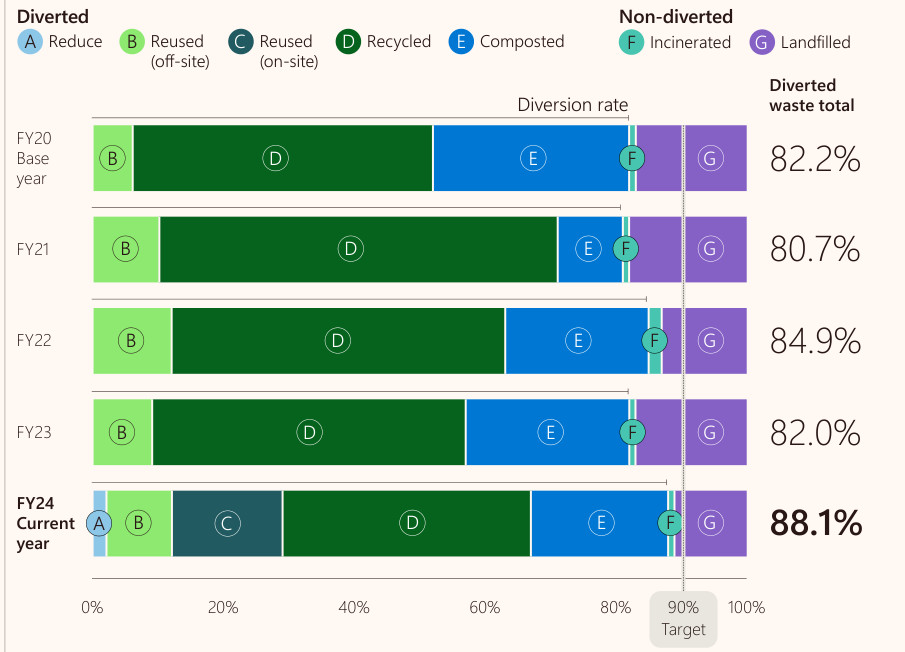 
Find out more in our Data Fact Sheet

---

<!-- 原文第 42 页 -->

Overview Reducing waste at our campuses 
Microsoft sustainability 
Carbon 
Water Waste Ecosystems 
Customer sustainability Global sustainability Appendix 
## 2025 Enwironmental Sustainability Report 
Reducing construction and demolition waste In FY24, we reached an 85.3% waste diversion rate for construction and demolition projects, surpassing our 75% 2030 target six years ahead of schedule. At our Puget Sound campus,the East Campus Modernization Project, a 72-acre redevelopment encompassing 3 million square feet of office spaces, dining halls,an underground garage,and a central utility plant, achieved an 85% diversion rate for construction and demolition waste. 
Reducing operational waste in our workplaces In 2024, our campuses made progress toward our target of diverting 90% of our operational waste by 2030.During the year, Shanghai, Beijing, and Suzhou campuses achieved UL Platinum Zero Waste validation, and our Dublin and Hyderabad facilties achieved UL Gold Zero Waste validation.In adition to these new accomplishments, our Puget Sound headquarters, Microsoft's largest global workplace, maintained its TRUE zero waste certification for the eighth consecutive year.Looking forward, aditional facilities in North America,Europe, and Asia are on track to achieve UL Zero Waste validation. 
These efforts have reuted in he dlversion of approximately 270 metric tons of waste from landfills. 
·Reusable containers in dinig operations. Our China campuses began to shift away from single-use plastics in ther ithen operations to reusable containers,which effectively avoided over 4 metric tons of waste in 2024. 
and datacenters Microsoft has made significant strides toward achieving its zero waste commitment since 2020. From achieving zero waste validaton at five ofics to deplying innovative solutions for waste prevention and diversion, we are transforming our operatins to minimize environmental impact. These efforts include using reusable dishware in cafes, designing datacenters for deconstruction, and implementing programs to divert materials from landills and incinerators. 
Reducing waste in our datacenter operations Microsoft's datacenter operations are at the forefront of our zero waste initiatives. To achieve zero waste in our operations,a primary objective is to prevent waste generation from the outset. Achievin this repuires a combination of practical solutions and active employee participation. One way we've prevented waste generatio is by perating with durable pantry serviceware In 2024,100% of our new owned datacenters located in Europe and the Asia-Pacific region began operations with durable serviceware,and we're looking to expand this practice in North American datacenters in 2025. 
This success was made possible by separating materials on site and working with partners to recycle early all ashalt,concrete, wood, and metals, demonstrating the effectiveness of sustainable practices on a large-scale project. Similal,the expansion of our Belgrade, Serbia ofic achieved an 80% diversion rate through separation of recyclable materials,such as ypsum board,plastic, and cardboard, diverting a total of 110 metric tons of waste. 
Highlights from our global efforts indlude: 
·Electronic reuse and recycling.In 2024. Microsof's hardware recyling program collected nearly 20.00wate nts reting1ee tons of waste. This included refurbishing, reusing and recycling devices, with 1,600 used Surface devices repurposed for spares warranty reuse. 
 
·Food waste reduction. Nine campuses across 
India, China, Ireland, the United Kingdom,and the United States are using Al to optimize food preparation,reducing over 400 metric tons of food waste. 
## 85.3% 
In many of our datacenters, washable pre-fiters have been implemented to extend the lifespan of our primary filters. When these pre-filters acumulate suficintpariculate buldup, they are removed, washed, and redeployed in our datacenters. Each fiter can be reused for multiple years, which reduces waste compared to a disposable alternative. 
In FY24, we reached an 85.3% waste diversion rate for construction and demolition projects, surpassing our 75% 2030 target six years ahead of schedule. 
·Reducing waste contamination.Our Puget Sound headquarters expanded its liquid bins pilot into a full-cale initiative and implemented a new waste conveyor belt system to increase container recycling rates and reduce contamination.

---

<!-- 原文第 43 页 -->

Overview 
Microsoft sustainability 
Carbon 
Water Waste Ecosystems 
Customer sustainability Global sustainability Appendix 
2025 Environmental Sustainability Report 
Reducing waste at our campuses and datacenters continued Waste Table 2 
Improving reuse and recycling of servers and components for all cloud hardware In FY24 Microsot inrase reuse and reyclingf er r compnnt0cdigg the 90%target. 
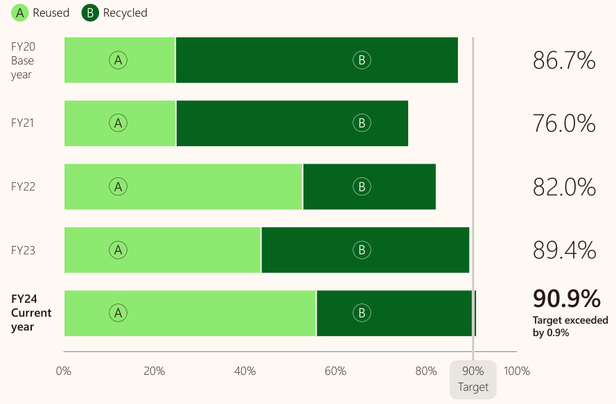 
Find out more in our Data Fact Sheet 
We're proud to partner with organizations in the communities where we operate and work together to drive a circular economy approach locall,.In FY24, we worked to improve donation pathways for our datacenters. This resuted in over 15s metic tons of donated items including furniture, office supplies, laptops, laders, and fan motor control equipment. Donation recipients indlude a food bank in Texas,a community college in Virginia, and a primary schoo in Dublin, Ireland. Recognizing that employee participation can accelerate our zero waste impact, we are engaging our workforce to play an active role in these efforts. In 2024,we introduced an online training course covering global waste issues,circular economy principle, and ways employees can drive impact in their day-to-day roles.We also coordinated local zero waste engagement events that reached hundreds of datacenter employees, fostering a culture of sustainability across datacenter operations. 
PROGRESS TOWARDS TARGETS 
## Linkedin 
Advancing waste reduction 
Linkedin contributed to our zero waste achievements by advancing waste reduction across its offces and datacenters. In 2024, Linkedin's San Francisco office earned UL Gold Zero Waste Certification by diverting over 97% of operational waste.Other sites engaged in partnerships to upcycle or donate 46.7 metric tons of carpet and repurpose over 600pieces of furniture, which diverted 11.3 metric tons of waste and avoided 29.6 metric tons of carbon emissions.

---

<!-- 原文第 44 页 -->

Overview Microsoft sustainability 
Carbon 
Water Waste Ecosystems 
Customer sustainability Global sustainability Appendix 
2025 Environmental Sustainability Report 
Advancing circular cloud hardware and packaging 
Cloud hardware and packaging are a crtical component of Microsoft's zero waste commitment, and we are proud to have achieved our target for reusing and recycling cloud hardware a year ahead of our 2025 deadline.Over the last several years, we've implemented design specications for hardware and packaging with our suppliers requiring minimum recyced content and sustainable design. These efforts,combined with the work of our Circular Centers and collaborations with suppliers, h hardware 
As hardware volume processed through Circulan Centers increases, strategi partnerships with recyclers have improved effciency.By harvesting and recertifying decommissioned server components no longer avalable on the market, we are meeting new demand while reducing waste Collaborations with original equipment manufacturers (OEMs) are also allowing greater reuse of rare earth oxides and improving recycling processes for complex material types.Aditionally we are creating a direct channel with global recycling partners to help us to achieve best-in-class recycling effciencies across material types and improve our collective recycling knowledgebase. 
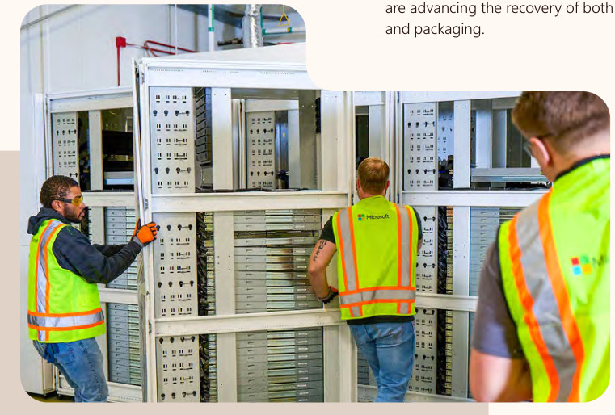 
## Improving reuse and recycling in cloud hardware 
Launched in 2020 with the opening of a firstofits-kind facity he rlr cnrtrh r hed 91% reuse and recycling in FY24-exceeding our 2025 target ahead of schedule.These centers have expanded globally,with six facilities now operating in locations indluding the United States, Amsterdam (Netherlands) Dublin(reland)and Singapore. In 2024,capabilities were further enhanced,and new Circular Centers are planned for Cardif, wales(2025) Sydney, Australia (2026); and San Antonio, Texas (United States) (2028). 
All new coud hardware programs must meet minimum recycled content requirements for plastic and steel. ln addition, we've made progress integrating sustainability into or hardare processes and requirements, indluding a sustainability assessment that identifis dein change to improve materil and energy eficieny throughout the length of the process. These include the qualfications of materals suh as 20 cerfie rerecdrtee/d S certified recycled resins. Over the past year, efforts to improve supply cain predictabity and measurement have also enabled significant sustainability advancements. In 202,or Boydton Circular Center completed a successful pilot for internally reusing solid-state drives,pa ing the way for broader reuse of high-impact components in the future. 
## 91% 
Circular Centers have achieved 91% reuse and recycling in FY24exceeding our 2025 target ahead of schedule. 

---

<!-- 原文第 45 页 -->

Overview 
Microsoft sustainability 
Carbon Water Waste Ecosystems Customer sustainability Global sustainability Appendix 
2025 Environmental Sustainability Report 
45 
## Advancing circular cloud hardware and packaging continued Increasing circularity of cloud packaging 
In addtion to advancing hardware circularty, Microsoft is dedicated to reducing the environmental impact of packaging.In 2024, we began to reduce the hard-to-recycle plastic-based expanded polyethylene (EPE) foam in cloud hardware packaging, replacing it with more sustainable paper and pulp alternatives. These efforts re part of a broader strategy that includes developing a multinational recycling program for datacenter server packaging waste and ransforming server rack packaging through our Sustainable Rack Packaging System Last year,packaging from over 30,000 server racks was processed through our recycling program, diverting over 2,500 metric tons of waste from landfils.The program has now expanded to include packaging used to transport the new generations of Al server racks, and additional datacenter geographies. 
Understanding and transforming the packaging landscape With over 150 OEMs supporting our fiet of datacenters, improving packaging sustainability requires systemic change across the supply chain. In 2024,the Sustainable Packaging Supplier Engagement Program was launched, working with high-volume suppliers, including the major hubs who ship IT hardware to our datacenters, to ensure packaging aligns with environmental sustainability goals from the earliest stages of hardware design. Looking ahead,efots wi fou o dnng diffcut-to-eliminate packaging materials such as rigid plastic trays and soft plastic foams,while continuing to develop technologies to track and transform packaging programs more effectively. Pilots are already underway with our systems integrators, who construct our racks, to provide circular applications for plastic trays. These initiatives reflect an ongoing commitment to advancing circular solutions for both hardware and packaging. 
## Waste Table 3 
Designing our product packaging for circularity 
In FY24 we achieved a rat of94 8e rereli a acsas l lsel ocpocjg. 
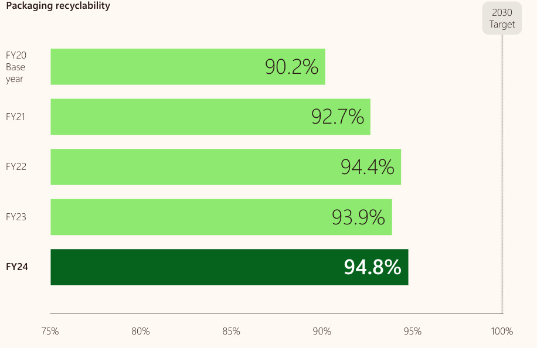 
Find out more in our Data Fact Sheet

---

<!-- 原文第 46 页 -->

Overview 
Microsoft sustainability 
Carbon Water Waste Ecosystems 
Customer sustainability Global sustainability Appendix 
2025 Environmental Sustainability Report 
## Improving device and packaging 
## INNOVATION IN ACTION 
circularity 
Device and pakaing r tern f Ss circular economy strategy, complementing the zero waste initiatives implemented across datacenters. From improving the repairability of devices to redesigning packaging for recyclability and waste reduction, these efforts align with the principles driving progress in datacenter waste management, such as reuse,recycling,and material optimization. By applying a circular mindset, significant advancements have been made in both packaging and device design since 2020,with a focus on scaling these solutions across product lines. 
## Designing for repairability 
 
Repairabiltyisa ke prort or oh sufrfcre devices and Xbox consoles, driving efforts to extend product use and support a circular economy. 
Xbox console repairabilty also advanced in 2024 with the introduction of our frst RUs and service guides for console products, including key components such as HDMI ports, fans, and enclosures. Partnerships with in-person repair service providers, including UbreakiFix(Asurion) Partnerships with in-person repair service providers, including UbreakiFix(Asurion) in the United States and Currys in the United Kingdom, bring repair closer to customers for both inwarranty and out-of-warranty repairs.Finally, the same FRUs available to our partners are also available to consumers and independent repair providers via iFixit. 
Surface devices are among the most repairable laptops and tablets in the industry, reflecting a strong dedication to cirula design Our frst feld repairable product, Surface Laptop 3 in 2019,has evolved into our current portfolio featuring field replaceable units (FRUs) like the display, keyboard, solid state drive, motherboard, battery, and charging ports. Today our newest Surface devices include asiy acecslepfonsfor both slfrepair instructions and in-person expert repair service. 
Reducing waste in packaging design Since 2020,we have been systematical ypasing out single-use plastics in our packaging,and recyclability has been prioritized. In 2024, Surface Copilot+ PCs were introduced with the most sustainable device packaging to date, designed to use less material and minimize plastic content. In line with our targets, we continue to eliminate single-use plastics and improve the recyclability of packaging for all products. 
Our Devices supply chain has introduced the utilization of lightweight, reusable expanded polystyrene pallets for shipments from our contrad manufacturers,driving a carbon emission reduction of 1,528 mtCOze out of our global logistics network. 
For Xbox, a complete packaging redesign for all new Xbox Series S and X console models eliminated single-use plastic packaging, fllwing a comprehensive redesign in fall of 2024. This included incorporating new paper cushioning solutions to replace plastic foam and eliminating plastic laminate films through paper-based labels and coatings. Similar improvements have been made across Xbox accessories, including adaptive controller remotes, with a focus on lower waste solutions 
Microsoft Devices supply chain has transitioned from the use of palletized containers to looseloaded containers for shipments of box consoles in ocean shipments from our contract manufacturers, driving emissions savings of 136 mtCO2e through load optimization. 
 
46

---

<!-- 原文第 47 页 -->

Overview Microsoft sustainability 
Carbon Water Waste Ecosystems 
Customer sustainability Global sustainability Appendix 
2025 Environmental Sustainability Report 
Improving device and packaging circularity continued Waste Table 4 Reducing single-use plastics In FY24 we achieved a rate of 4.0% single-use plastics across l Miasosc poducp caging. Since FY20 we have decreased it by 1.7%. 
Improving data and supplier partnerships for circular design Accurate data and strong suppler colaborations are essential to advancing circularity in devices. Microsoft has taken significant steps to improve the accuracy of recyclability calculations and promote waste reduction across the suppy chain. Since 2021,Microsoft has partnered with the Unite Nations Institute for Research and Development (UNITAR) to enhance recyclability assessments for materials sed in lectial and lecronic quipment. Over the past three years, batch tests in taly and Germany have analyzed how recyclers handle end-of life lecronisan quntified the reycling process efcieny.These efforts,combined with Microsoft's recyclability assessment procedure, provide a more accurate method for calculating recyclabilit, yielding valuable insights to improve product design 
In 2024,supplier clborations rher srngthened circularity efforts. Microsoft worked with 82 supplier factories to achieve waste diversion rates of 90% or higher in the manufacturing process. Among these, 25 factories obtained UL 2799 Zero Waste to Landfill certfication, and 57 factories passed the Responsible Sourcing annual waste data validation. Together, these efforts diverted more than 100,000 metric tons of waste from landfills o incineration. Promoting responsible sourcing with device manufacturing The collection of materials destined for recycling can have both environmental and social impacts. Our responsible sourcing criteria for recycled materials uie a hird part rfictiosheme that verifes th perentage of recycled content and assesses responsible souring practices at collection and processing stes. Fie Surface products Iaunched in FY24 are manufactured using recycled aluminum certified by the UL 2809 standard,which assesses labor safety,community impacts, and environmental contributions. These efforts reduce reliance on mining, minimizing its associated social and environmental impacts. 
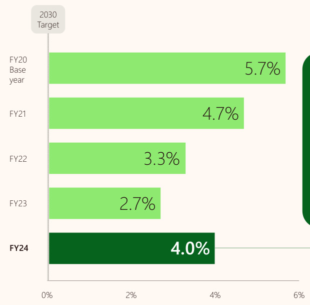 
Find out more in our Data Fact Sheet

---

<!-- 原文第 48 页 -->

Overview Microsoft sustainability 
Carbon 
Water Waste Ecosystems Customer sustainability Global sustainability Appendix 
2025 Environmental Sustainability Report 
## Improving device and packaging circularity continued LEARNINGS AND WHAT'S NEXT 
Microsoft has made tremendous progress towards zero waste over the past five years, including the accomplishment of two of our key targets ahead of schedule, the global deployment of our Circular Centers, and the establishment of robust methodology and governance processes In 2025 and beyond, we're excited to accelerate our adoption of circular practices as we work to collaboratively find solutions for our most challenging materials 
Continuing prevention first.Preventing waste remains the core of our zero waste strategy. By prioritizing material reduction and reuse interventions across our enterprise, we lay a strong foundation for sustainability throughout our operatin. We are also focused on reducing hard-to-recycle materias and deploying innovative circular solutions throughout the design process, ensuring that waste is minimized from the outset. By continually evaluating best practices, emerging data,and new technologies, we ensure that our investments target the highest-impact environmental solutions,further advancing our commitment to sustainability. 
Expanding funding opportunities. To drive progress in cirulart, Microsoft is committed to using its purchasing power to expand markets of circular initiatives. By supporting the scaling of these initiatives, we can strengthen solutions that address the most challenging materials and help accelerate broader adoption of circular practices 
Prioritizing local circularity require solutions that bot communities and circular economy how companies c recapture of tech inteletual prope expanding simila facitate exchang like those with loe and logistics serv Cloud Logistics R demonstrate the to regional conte 
Building on ana the success of ou opportunities for high quality data governance and refining our methodologies, we ensure our approaches remain aligned with best business practices and regional realities. Combining quantitative data with qualitative insights from our regional operators allows us to make informed investments and advance our zero waste commitments.

---

<!-- 原文第 49 页 -->

Overview Microsoft sustainability 
Carbon Water 
Waste 
Ecosystems 
Customer sustainability 
Global sustainability 
Appendix 
2025 Environmental Sustainability Report 
In this setion u ppoh osteing idvestu c pe aantre llinapcm nn 
## Land protection >30% 
## Protecting ecosystems 
In 2022,we met our target of protecting more land than we use by 2025,a target we've since exceeded by more than 30%。 
Healthy ecosystems are essentil fo if tn ath. They provide clean air, water, food, and countless other benets that sustain communities, conomies, and ecosystems globally, Yet these ecosystems face mounting threats from climate change and biodiversty loss,and reqpure urgent and coordinated action 
By 2025, we'll protect more land than we use. 
## Our target 
Taking responsibility for our land footprint We will ake esrpnsibliy orhecaystem impacts of our direct operations by protecting mare land than we use by 2025. 
## Our approach 
Microsoft recognizes the interconnectedness of ecosystem health with allaspects of sustainability From supprting pollinator habitats at our campuses to integrating biodiversity into datacenter designs, we are embedding ecological considerations into our operations. Through partnerships with conservation organizations and the application of innovative technologies, we are helping to monitor, protect, and restore ecosystems, driving meaningful environmental impat at both local and global sales.l Find out more in our Data Fact Sheet 
Total land protected 
15,849 acres 
Microsoft land use fotprint 11,900 acres 
## Our progress 
15,849 acres permanently protected We have eceeded our land potction target of 11,900 by more than 30%

---

<!-- 原文第 50 页 -->

Overview Microsoft sustainability 
Carbon 
Water Waste Ecosystems 
2025 Environmental Sustainability Report 
Fostering biodiversity at campuses and datacenters 
## Datacenters designed for biodiversity 
## Supporting biodiversity at campuses 
Since 2020, Microsoft has been integrating biodiversity considerations into our datacenter development strategy. The introduction of the Ecosystem Inteligence tool has transformed how we assess the cological impacts of our operations evolving from basic environmental assessments for regulatory complince to a comprehensive platform for measuring ecosystem service production around our datacenters. This shift allows us to take a more holistic approach to understanding and enhancing the ecosystems where we operate. 
Our campuses also play a vital role insuprting biodiversity. At our Puget Sound campus,native Washington species such as red-twig dogwood, vine maple, and huckleberry have been planted to reduce irigation needs and enhance local habitats. Polintor gardens and strategicall plced beenives and bee hotels are bolstering the honeybee population,contributing to pollination and ecological health in the area. In 202,more than 40 pounds of honey were harvested from eight frames-a direct result of thriving bee activity. 
Microsoft is commited to advancing biodiversity through innovative approaches at our datacenters and campuses.By using data-driven tools, regenerative design principles,and sustainable practices,we are creating environments that support local ecosystems while reducing our environmental footprint. 
Guided by thes insights,naure-based design solutions, such as natie landscaping,stormwater management, and biodiversity enhancements, are reducing our environmental fotprint and integrating ecological benefits into our datacenter designs. 
To further enhance bidiversity, we updated our Global Sustainability Standards to incorporate ecologically conscious practices in our campuses. These updates indlude ·Requiring the use of native and adaptive plants in landscaping to support local ecosystems and reduce water use. 
To monitor the success of these initiatives,we have deployed Microsoft Premonition technology. an Al-driven ecological monitoring tool that provides real-time insights into species populations and ecosystem health.This approach allows us to track the impact of our biodiversity efforts and refine them for greater global scalabilit,As these efforts expand, ve are comitet lingn acnterr development with regenerative design principles tha prioritize resilience. 
Customer sustainability Global sustainability Appendix 
·Meeting LEED bird collsinsnads by nsingg bird-safe glass and limiting nighttime lighting to protect migratory birds. 
These initiatives reflect our dedication to sustainable design and achieving our goal of supporting the ecosystems around our facilities 
## PARTNERING FOR IMPACT 
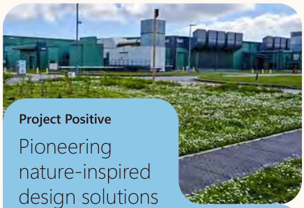 
Through a collaboration with Biomimnicry 3.8 and its Project Postive Colab, Microsoft is pioneering nature-inspired design solutions that align with regenerative principles By appying biomimicry, we aim to improve ecosystem health, reduce environmental impacts, and create long-term positive contributions to biodiversity and resiience at our datacenter campuses 
In North Hollan, our datacenter ecosysterm restoration project has entered its next phase, focusing on soi remediation and the introduction of diverse plant species to fostern year-round biodiversity, These efforts are creating thriving habitats for birds, insects,and other wildlife, demonstrating how datacenters can actively contribute to ecological health

---

<!-- 原文第 51 页 -->

Overview Microsoft sustainability 
Carbon 
Water Ecosystems Waste 
Customer sustainability Global sustainability Appendix 
2025 Environmental Sustainability Report 
51 
Collaborating to protect ecosystems community-wide 
Microsoft istaing action to support the communities that host datacenters and where employes ive and work by advancing projects that protect and restore natural environments. Through the Microsoft Community Environmental Sustainability program, launched in 2020, 123 programs have been implemented across 39 global cities hosting Microsoft datacenters. lnitally focuse on hyper-local eforts, the program has evolved into a principle-based initiative deploying scalable, community-focused environmental projects aligned with datacenter growth. Its guiding principles heeds, integrating technical ing partnerships with 
Restoration projects near datacenters Microsoft's claboration with the Roo- Pike Watershed intiaitve Vework okl in southeastern Wisconsin demonstrates how ecosystem restoration can address local environmental challenges while fostering community resilience 
The flagship Lamparek Creek Restoration project addresses decades of degradation caused by urban development and agricultural runoff. Restoration measures such as stabilizing streambanks, reintroducing native vegetation,and implementing stormwater management practices are enhancing water qualty,fod control, and biodiversity, This work creates critical habitats for fish, birds, and pollinators while improving recreational opportunities for residents 
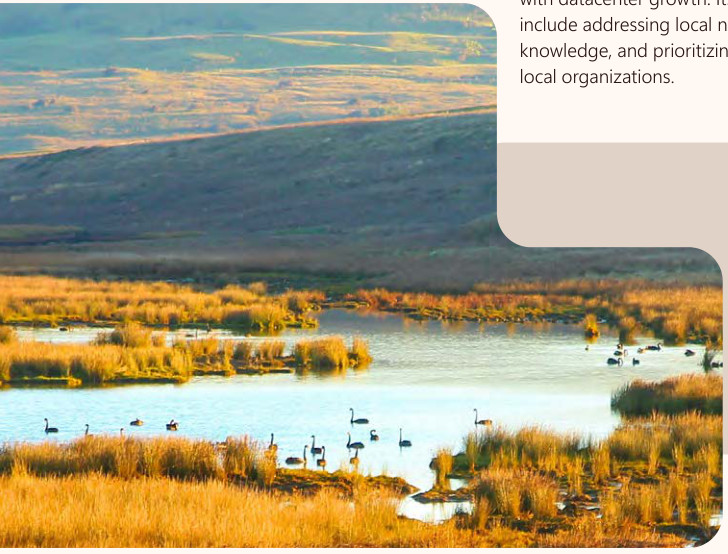 
Between July 2023 and October 2024, communty investment efforts focused on ecological restoration, urban forestry, grassroots engagement, and community development. This work indluded planting 77,657 tres,beneiting native species and creating over 2.7 milion square meters of improved green spaces-equivalent to approximately 378 standard soccer fields." 
cities 
Sir ha 123 acr cit CO ha by res en 
In addition to Lamparek Creek,broader urban habitat restoration efrtsi Raine County focus on creating green corridors, revitalizing degraded land, and increasing access to natural spaces. Education and outreach intiatives empower residents to sustain these benefits over time, connecting communties to restored ecosystems and fostering long-term stewardship. Together, these projects reflect Microsoft's holistic approach to ecological restoration, aligning local priorities with broader sustainability goals.

---

<!-- 原文第 52 页 -->

Overview 
Microsoft sustainability 
Carbon Water Waste Ecosystems 
Customer sustainability Global sustainability Appendix 
2025 Environmental Sustainability Report 
Collaborating to protect ecosystems community-wide continued Collaborating to restore urban forests Urban forestry prgjects have been a conerstone of Microsoft's environmental sustainability efforts over the past five years, particularly in cities hosting datacenters.These initiatives improve local ecosystems, and prioritize underserved neighborhoods and vulnerable populations. 
The collaboration with American Forests focuses on advancing Tree Equity in underserved neighborhoods, ensuring that tree canopy coverage provides cooling, improved air quality. and public health beneft. This work has included over 15 targeted projects and incorporates workforce training programs that create econmic opportunities by equipping residents with urban forestry skills. 
Through multiyear partnerships with organizations like One Tree Planted and American Forests, Microsoft has expanded urban forestry efforts to enhance green spaces, mitigate urban heat islands, and improve stormwater management. One Tree Planted has suppored the pantigf8,:0 across nine projects in eight countries, delivering tangible environmental benefits while engaging local communities to sustain these efforts. 
Together, these initiatives showcase the interconnected benefits of urban forestry, incuding biodiversity enhancement, mental well-being, and opportunities for environmental education. Microsoft's effots emonstrate the role trees play in creating healthier, more resilient urban envirnments while fostering community resilience. 
## PARTNERING FOR IMPACT 
## ChangeX 
Scaling grassroots impact With funding and partnership from Microsoft, the ChangeX platform empowers communities to take localized action by providing resources, guidance, and tools to launch impactful sustainabilt prjects.ChangeX simplfes community initiatives through step-by-step guides, practical frameworks,and financial assistance, enabling residents to implement projects that address local environmental and social challenges. 
ChangeX helps communitiess Access actonable ideas.Communities can select from pre-vetted project ideas tailored to local needs, such as urban tree-planting. polinator gardens,and environmental education. 
Implement projects with confidence.Once a project is chosen,ChangeX offers seed funding and actionable frameworks to acclerate planing and implementation Measure and share results. Participants document progress and share outcomes through the platform, enabling replication and scalability in new locations. 
Since partnering with Microsoft, ChangeX has supported over 140 community funds worldvide, creating scalable models for grassroots-led environmental restoration and community engagement.By equipping local leders with the tools to address their unique challenges, this partnership extends the reach of Microsoft's sustainability eforts while fostering localized, community-driven impact.

---

<!-- 原文第 53 页 -->

Overview 
Microsoft sustainability 
Carbon Water Waste Ecosystems 
Customer sustainability Global sustainability Appendix 
2025 Environmental Sustainability Report 
Collaborating to protect ecosystems community-wide continued Advancing community vitality through ecosystem restoration The Datacenter Community Evriomenta Sustainability program priortizes local needs and long-term benefits that promot ecosystems community health, and well-paying jobs. 
Microsoft supports enhanced biodiversity, mental and physical well-being, and opportunities for community-led sustainability. 
Other key efforts include: 
PARTNERING FOR IMPACT 
·Wetland restoration-enhancing water filtration flood resilience, and habitats for native wildlife. 
Advancing standards-based restoration globally As part of our work to protect and restore ecosystems, Microsoft is collaborating with the Society for Ecolgica Bstrton ERt iplment standards-based projects in communities hosting datacenters worldwide. This partnership stands out for its focus on aligning local restoration efforts with global restoration standards, ensuring projects deliver measurable, long-term benefits for biodiversity and dimate resilience. Since the partnerships inception in 2022,26 restoration projects have been completed. These initiatives span diverse ecosystems, including wetlands, grasslands, and urban green spaces, addressing crtca challenges such as biodiversity loss,habitat degradation,and dimate adaptation. 
·Grassland rehabilitationrevtaling polliatn habitats and improving soil stability. 
·Urban ecosystem connectivity-estabishing green corridors that restore biodiversity while enhancing quality of life for local communities. 
Key initiatives include 
·Workforce development. Programs like the Arizona Clean Energy Workforce Development Program provide job training opportunities, equipping residents with skills for careers in clean energy and environmental restoration. These initiatvs reate pathways for economic mobilty and sustainable community growth. Urban habitat restoration. Projects in Racine County,Wisconsin, connect communities to green spaces, reduce environmental nisks, and foster long-term stewardship through education and engagement. 
By partnering with SER, Microsoft ensures that restoration projects near datacenters adhere to science-informed methodologies, contributing to a global framework for ecological health. This collaboration complements broader efforts like urban forestry and reforestation,underscoring Microsoft's holisic approach to ecosystem restoration across all areas of operation. 
## White stork restoration 
Restoring vital wetland habitats Microsoft is colbratig with the Society for Ecological Restoration to promote white stork wetland restoration in southern Sweden. Once nearly extinct in the region,the white stork is now thriving thanks to a collborative effort that restored vital wetland habitats. These wetlands not only provide essential breeding grounds for the stork but also support a wide range of species, improve water fitration, and enhance flood resilience

---

<!-- 原文第 54 页 -->

Overview 
Microsoft sustainability 
Advancing conservation through 
## PARTNERING FOR IMPACT 
technology 
## Salish Sea Restoring kelp forests with Xbox and the Seattle Aquarium 
Technology is revolutionizing environmental conservaton, nabling researchers,communities, and organizations to better understand and protect fragile ecosystems. 
In 2020, as part of Microsoft's commitment to protect and preserve ecosystems,we announced the development of the Planetary Computer-a platform designed to aggregate global environmental data and enable data-driven decision-making for sustainability. By April 2021, the Planetary Computer was launched as a full-fedged offering,combining petabytes of data with advanced spatial analysis tools to support global-scale environmental monitoring and accelerate sustainability applications. The Planetary Computer represents a cornerstone of Microsoft's approach to using technology for biodiversity restoration, ecosystem health monitoring,and climate resilience.its capabilities complement other initiatives driven by Microsoft and its partners,from localized innovations to global-scale applications, unlocking new possibities for conservation and restoration worldwide. Carbon Water Waste 
Ecosystems 
Customer sustainability 
Global sustainability 
Appendix 
The Salish Sea, a vast marine ecosystem near Microsoft's headquarters in the Pacific Northwest, is home to dynamic kelp forests that provide food and shele formarine species, sequester carbon,and mitigate ocean acidification.Yet, some regions have seen kelp forest declines of up to 95%, with causes stillunclear. To address this, Xbox is partnering with the Seattle quarium on a groundbreaking initiative to restore these critical habitats. 
At the heart of this efort is the ROV Nereo, a remotely operated vehicle (ROV) that gathers data to inform kelp restoration. Named after the scientic name for bull lkp (Nereocystis luetkeana), the ROV Nereo is a small, maneuverable device capable of diving 100 meters and ransmitting live ideo and data Researchers use Xbox controllers to navigate through dense kelp ecosystems in Eliot bay enabling precise exploration and analysis. 2025 Enwironmental Sustainability Report 
The ROV program helps identify factors contributing to kelp decine,guiding targeted restoration efforts that support the broader kelp conservation community in Washington. The aquarium is expanding the program through collaborations with the Tulalip Tribes Natural Resources Shellish Program, state agencies, and Reef Check to establish additional ROV programs and evaluate environmental monitoring strategies. 
This intiatve erhances marie rearch and inspires future conservationists. By using accessible toos like box controllers, the aquarium shows how technology can make environmental science engaging and approachable.Through education and outreach, the program fosters appreciation for kelp forests and the marine life they support,strengthening community connections to these ecosystems.

---

<!-- 原文第 55 页 -->

Overview 
Microsoft sustainability 
Carbon Water Waste Ecosystems 
Customer sustainability Global sustainability Appendix 
2025 Environmental Sustainability Report 
## Advancing conservation through technology continued Advancing biodiversity monitoring with Al 
Building on localized efors ie the Ssatte Aquarium's ROV program, Microsoft is caling biodiversity conservation globally with Al-driven tools that empower conservationists to tackle some of the most complex and time-intensive challenges for environmental conservationespecially biodiversity and ecosystem reporting Traditional methods often require years of research and massive resources to analyze and document the health of ecosystems. Al has emerged as an essential tool to bridge this gap,enabling researchers, governments, and companies to scale monitoring efforts, analyze intricate datasets, and generate actionable insights with unprecedented effriency. At Microsoft, we are committed to advancing the application of Al to monitor and report on ecosystem health, ensuring conservation efforts are both data driven and impactful 
INNOVATION IN ACTION 
## Scaling Al tools for conservation 
Through the Microsoft Al for Good Lab, Microsoft is supporting researchers worldwide to address biodiversity challenges with new Al-driven tools. 
## Scaling Al tools for conservation 
Protecting the Amazon In Colombia,Project Guacamaya combines Al with satelite imagery, wildlife imagery, and bioacoustics monitoring to protect Amazonian ecosystems. The joint effort of the Microsoft AI for Good Lab, Universidad de los Andes,and Instituto Humboldt uses Al to identify bird and non-bird sounds in the rainforest,providing critical insights to combat ecological threats. By analyzing more than 100,000sounds with over 80% reliability in species identifcation, the project enables rapid response to ecological shifts, improving stewardship of the Amazon. 
## Accelerating conservation in Tanzania 
Recognizing the challenges of applying Al in real-world conservation scenarios, the Al for Good Lab developed Pytorch Wildlife, an open-source platform for creating, modifying. and sharing powerful Al conservation models. Accessible through platforms like GitHub and Hugging Face, Pytorch Wildlife is designed for users with limited technical expertise.its modular codebase simplifies customization and enables broader adoption of Al-driven biodiversity monitoring solutions. 
In Tanzania,the Wild Nature Instiute (WNI) is using Al to protect endangered Masai girafes by automating the labor-intensive process of sorting an labeling photographs. The Microsoft computer vision workflow isolates the giraffe in images, applies object detection to focus on the torso, and uses a matching algorithm to identify existing giraffes or assign IDs to new ones. This Al-enabled process reduces image analysis from hours to minutes, alwing WNl to process a library of 50,000 images with timely data to monitor population effciently. The insights generated guide conservtion strategies and ensure timely interventions to protect this endangered species

---

<!-- 原文第 56 页 -->

Overview 
Microsoft sustainability 
Carbon Water Waste Ecosystems Customer sustainability Global sustainability Appendix 
2025 Environmental Sustainability Report 
Advancing conservation through technology continued Scaling ecosystem monitoring to energy systems 
Just as Al supports biodiversity conservation, it aso plays a critical role in addressing climate goals by enabling precise monitoring of renewable energy Systems and their impat on ecosystems. The Global Renewables Watch (GRW),a collaboration between Microsoft, Planet Labs PBC, and The Nature Conservancy, uses Al and satelite imagery to track dlean energy transitions while considering land use and environmental impacts 
The GRW is an atlas of all ulit,-cale win and solar installations,covering every country from 2017 to 2024. Offering inights on land use trends and environmental impacts, GRW fills rtical gaps in renewable energy monitoring. Initaly/anhed a a regional project,it has grown into a global resource that empowers governments,businesses,and researchers to track progress toward cimate goals such as the Paris Agreement and UN SDG 7. 
Our work on the GRW highlights the importance of transparent, accessible data in driving sustainabl change. By democratizing access to renewable energy insights, we empower decision-makers to make informed, responsible environmental choices and accelerate global clean energy adoption. 
## LEARNINGS AND WHAT'S NEXT 
Scaling ecosystem restoration and community impact. As part of the Microsoft Datacenter Community Pledge, these efforts will continue to expand alongside datacenter growth. By focusing on restoring ecosystems,enhancing native habitats, and promoting green spaces, we aim to scale our impact while advancing sustainability globally.Innovative tools, such as Al-driven solutions, and strengthened partnerships will further optimize these efforts and measure longterm success. These efforts aim to ensure lasting benefits for the communities where we operate. 
Driving innovation through technology. Investments in cutting-edge technologies, including Al and platforms like the Planetary Computer, will remain central to Microsoft's strategy for addressing emerging threats to ecosystems from climate change and biodiversity loss y daning oshtat empower conservationists and accelerate environmental monitoring, we aim to support long-term ecosystem resilience on a global scale. 
Designing datacenters and campuses to support local ecosystems. Microsoft will continue to priortize our role as an environmental steward, fostering spaces that balance functional and environmental goals. Through a regenerative approach, we will frhr enhance local biodiversity by integrating sustainable design practices, such as native landscaping and water efficient t infrastruc that supp technoloo 
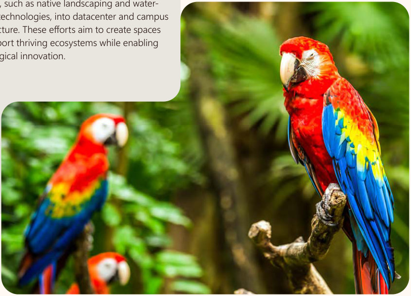

---

<!-- 原文第 57 页 -->

Overview Carbon Microsoft sustainability 
Water Waste Ecosystems 
Customer sustainability Global sustainability Appendix 
2025 Enwironmental Sustainability Report 
Customer sustainability Accelerating progress through technology 
Microsoft is committed to provi help build a more sustainable w our customers and partners acre for Sustainability, by continuous help accelerate climate technolo greener software and reducing device sustainability, and helpin and manage the health of the p with the Microsoft Planetary Cor 
57 50606669 70

---

<!-- 原文第 58 页 -->

Overview 
Carbon 
Water Ecosystems Waste 
Global sustainability Appendix 
2025 Environmental Sustainability Report 
Our own sustainabilit jouney highlights the chalenge of turning envionmental social and governance (ESG) data into useful insights that drive innovation and optimization. From sourcing and structuring data to improving transparency and auditability, we bring our learnings from that journey into solutions that help organizations move from intent to impact. Microsoft for Sustainability helps organization navigate evolving regulations, gain insights,reduce costs,and strengthen business resilience. 
## Accelerating progress with AI 
Organizations can now reduce their ewvironental footprint by optimizing their infratructure, consolidating workloads, and leveraging energyeffcient services. Microsoft for Sustainability provides tools to measure and manage emissions,water,and waste across operations, helping teams make data driven decisions that align with sustainability goals. This enables a shift from reactive compliance to proactive impact reduction. 
We believe Al is esenial for avacngsustainabity progress at speed and scale; empowering organizations to measure,predict, and optimize complex systems, and empowering the sustainability workforce. To take advantage of this potential, we're bringing our best Al capabilities to Microsoft for Sustainability. 
In Sustainabilty Manager,customers can now undertake deeper analysis, idetfying outliers, trends, and correlations with inteligent insights and forecasting outcomes with "what-if" scenarios. Using Microsoft Copilt in Sustainabilty Manager, they can intelligently capture data from documents by using chat with Q&A functions,generate calculation models, and prepare for voluntary and mandatory disclosures. 
Customers using Microsoft for Sustainabilit can embed sustainability into their core operations and decision-making,ncover ne effciencies, ptimize supply chains,advance research and materials innovation, buld business resliec,and dferentiate in the market. Microsoft's solution ecosystem empowers customers to scale these efforts with confidence and agility. 
With centralized data and Al-powered insights, organizations can streamline ESG data collecion, validation, and disclosure processes setting a foundation to advance their sustainability goals. Microsoft Sustainability Manager and Microsoft Fabric empower customers to centralize emissions and ESG data across their value chain for auditable reporting, so customers can better inform business deisions around optimizing effcieny and performance. 
Customer sustainability 
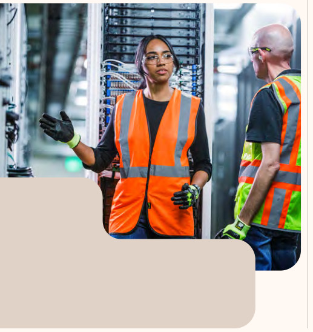 
Microsoft sustainability 
Microsoft for Sustainability: Creating impact with data and Al 
In 2024, we also released sustainability data solutions in Microsoft Fabric, helping organizations to centralize their data estate for deeper ESG analysis within a single, Al-powered platform for advanced analytics and reporting insights. Fabric has Al ingrained at every level to unlock data intelignce and actionable insights for faster progress. 
58

---

<!-- 原文第 59 页 -->

Overview 
Microsoft sustainability 
Carbon Water Waste Ecosystems Customer sustainability Global sustainability Appendix 
2025 Enwironmental Sustainability Report 
59 
Microsoft for Sustainability continued Scaling progress with customers Microsoft for Sustainabiltyuses tethnologis rom the Microsoft Cloud portfolio to help customers and partners through custom industry-tailored and geo-based solutions. 
## Envirotainer 
Envirotainer, a cold chain solution provider for transporting temperature controldpharmaceutias, eed to oreiat collect and analyze emissions data across 100 airines and 600 pharmaceutical companies as part of its ambitious sustainability goals. The company turned to Sustainability Manager to automate data collection and emissions analysis, aiming to improve data transparency and energy-effcient logistis across ts lobal network Now Envirotainer can measure and report across its value chain and use insights to form reduction stategies to help reach net zero by 2050.While reducing data processing from a full day to minutes, the company has reduced energy costs and waste, streamlined decision-making and alignment to science-based targets, and reinforced its endorsement of a more sustainable future.12 
## ICONICS 
A pioneer in doud-based Internet of Things (lT) solution development for buildings and manufacturing, I ONICS was an early adopter and launch partner for Microsoft for Sustainability, This gave the company an early foothold to extend its solutions and support customers' ESG reporting needs using Sustainabilty Manager.ICONICS customers can pubish data colected by ICONics to Sustainabilty Manager for ESG reporting, and ICONICS provides ongaing operational insights and dashboards to help them improve efficiencies and meet their sustainability objectives. 
"Technology can't solve every environmental issue, but it can help us manage,understand, and hold ourselves accountable for action. It enables us all to focus and align on the right aspects, those that truly impact usage, and helps us to hunt for the less obvious aspects in the data for a more positive impact." 
Kyle Reissner VP of Product Management, ICONICS 
## Esri 
Efectvly planning and responding to urgent environmenta challenges. particulary extreme weather events, presents major challenges for cities.Esri's ArcGIS geospatial platform helps local governments and public safety staff navigate, adapt to, and mitigate the effects of an increasingly changing climate.Used alongside Microsoft Azure,organizations can model potential extreme weather scenarios and identify potential impacts to plan a more resilient community.Cties can use ArcGis to ceate envionmental digital twins that simulate heavy rainfall and apay hot spot analysis.and chat functionality supported by large anguage models lets users interact directly with digital twins.1

---

<!-- 原文第 60 页 -->

Overview Microsoft sustainability 
Carbon 
Water Ecosystems Waste 
Customer sustainability Global sustainabilty Appendix 
2025 Erwironmental Sustainability Report 
60 
Green software: 
By embedding green software engineering principles into every stage of the software life cycle-from design to deploymentwe can make applications more energy and hardware efficient. Collaborating with leaders like the Green Software. Foundation and using tools ike the Software Carbon 
Optimizing efficiency from code to cloud 
Intensity (SCI) specification, we continue to empower developers, customers, and partners to integrate sustainable practies int their worklows and create software solutions that align with sustainability goals 
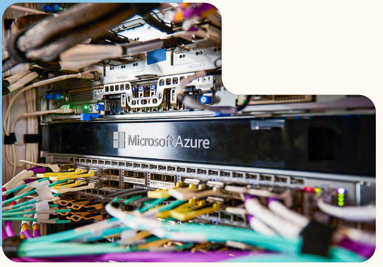 
## Maximizing cloud sustainabilty: Smarter workloads, lower carbon 
As a leader in designing, building, and operating cloud computing infrastructure across the full hardware and software stack, Microsoft has a unique ability to optimize how these elements work together to maximize both performance and efficiency. From datacenters and servers to silicon, code, algorithms, and Al model, chieving efficiency in a hyperscale cloud environment requires a comprehensive approach-optimizing each individual component and considering how the system works to minimize resource demand. One method for improving power efficiency in our datacenters is through real-time workload scheduling--maximizing hardware use to meet fluctuating demand. For instance, higher demand during peak hours in one region can be balanced by running Al training workloads during off-peak hours elsewhere,ensuring idle hardware is used eficiently and improving overall power utiation. 
Carbon_optimization in Azure empowers Azure developers and IT professionals with the data and insights to better optimize the carbon footprint of their cloud resources. It provides more granular emissions data, identifies underutilized resources for deletion or rightsizing,and delivers actionable recommendations to help reduce both emissions and costs. Accessle direty ithin the zure Prtal this tool helps organizations to align their cdoud infrastructure with their sustainability goals while driving meaningful environmental impact. 
The general avalabity f ibenation r genera purpose virtual machines on Azure allows users to deallocate vitual machines while preserving the inmemory state, enabling energy and resource savings by pausing workloads during idle periods. 
Together, these innovations can help customers align heir cloud infrastructure with sustainability goals,maximizing efficiency and minimizing environmental impact.

---

<!-- 原文第 61 页 -->

Overview 
Microsoft sustainability 
Carbon Water Waste 
Ecosystems 
Customer sustainability 
Global sustainability Appendix 
2025 Enwironmental Sustainability Report 
61 
## Green software continued Reducing the impact of greater 
In 2024, within the GSF, we pariclarly focused on adoption of the SCI specification as an internationallyy recognized ISO standard. This specification defines a methodology for calculating the rate of carbon emissions for a software system.SCI helps users and developers make informed choices about which tools, approaches, architectures, and services they use by accounting for energy effriency, hardware effcieny,.and carbon awareness of software applications 
To better support developers, whether they're just starting out or seasoned professionals, we've compiled a comprehensive directory of resources built by the community,for the community: GitHub's Green Software Directory. Highlighted projects include the Carbon Aware 
Al intelligence 
Optimizing Al applicationsis artcaicaleng e large-scale models like generative large language models (LMs) demand complex,power-intensiveA accelerators, raising both costs and environmental concerns. To address this, Microsoft is developing comprehensive best practices and guidelines for designers, developers,and operators to help ensur that Al applications are efficient and optimized throughout their lf cycle.These guidelins willbe published as part of the Azure Well-Architected Framework for Al 
SDK from the Green Software Foundation, Scaphandre from French organization Hubblo, and $CO2$ JS from the Green Web Foundation. 
There are over 60,000 cimate-focused open-source software prgjects on GitHub, many of them listed and categorized by the community in the Open Sustainable Technology repository. 
Empowering developers with tools for a carbon-conscious future Empowering the developer community is ia to increase the adoption of green software practices. There are over 150 million developers on GitHub, incuding a thriving open-source software community focused on climate technology. 
The new guidance provides AI architects with best practices to help them address many key requirements for reliaity, security,performance efficiency, operational excellence,and cost optimization. It offers a more complex approach, covering architectural considerations across the stack-from infrastructure and data layers to application logic-blending Well-Architected Framework principles into every level to empower teams to design smarter, more sustainable Al workloads. 
Our research teams are advancing efficiency through innovative solutions that benefit not only Microsoft but also the global research community. For example, a novel approach to LLM inference splts the two phases of inferene requests,prefll and decode, across separate machines using hardware optimized for each phase (even taking advantage of older generation accelerators). Compared to current designs, this technique can deliver 2.35 times more throughput under the same power and cost budgets. 
Leading the charge: Advancing standards, tools, and best practices for sustainable software Since co-founding the Green Software Foundation (GSF) in 2021, Microsoft has buit a rused ecosystem of people, standards,tooling, and best practices for creating and building green software. As a steering member, Microsoft has collaborated extensively with other industry leaders and developers on open-source projects to make key advancements from contributions to standards like the Real Time Energy and Carbon Standard for Cloud Providers, Transforming Organizations for Sustainable Software and the Software Carbon Efficiency Rating, to developing tools like the lmpact Framework, Azure lmporter, and Organizational Maturity Mtrix. Microsoft also offers leadership within working groups like the Green AI Commite. Microsoft's contributions have been essentia,offering pertise, use cases,and strategic applications to these projects. 
## 150 million 
There are over 150 million developers on GitHub, indluding a thriving opensource software community focused on climate technology. Check out the 10 best tools to help lower your carbon footprint.

---

<!-- 原文第 62 页 -->

Overview 
Microsoft sustainability 
Carbon Water Waste Ecosystems 
Customer sustainability 
Global sustainability Appendix 
2025 Environmental Sustainability Report 
## Green software continued 
Over the ias ya G tu ah a bao eing methods to help climate-focused groups cale thei impact on the platform. This has included engaging with student developers by helping sponsor the Climate Change Al summer school. 
Our research teams are advancing efficiency through innovative solutions that benefit not only Microsoft research 
Microsoft has also focused on proofs of concepts (POCs) that help prioritize sustainability in software development. For example, one POC uses architectural drawings to measure the potential carbon in the software solution,offering actionable recommendations to reduce emissions and contextualize impact with relatable, real-world comparisons. Another POC uses GitHub Copilot to create an extension that suggests greener coding practices in the software integrated development environment(DE).These innovations encourage developers to account for carbon costs early in the development process and foster sustainability from the outset. 
Determining whether Al is truly necessary to achieve a desired outcome is another critical aspect of sustainble development Responsible deployment of Al ensures that resources are used judiciously, avoiding unnecessary relance on high-cost, energyintensive solutions. By focusing on scenarios where Al creates meaningful, innovative impact, developers can balance the transformative potential of Al with its resource demands. 
## Accelerating progress in green software 
The creation of developer enablement resoures and tools for more sustainable software development aims to embed sustainable practices into the software development lf cycle at Microsoft and beyond. As we collectively move forward, using Al to assist developers in making informed decisions about carbon spending will accelerate the ongoing journey to establish and improve measurement, monitoring,and progress in carbon savings through software efficiencies. 
Currently, Microsoft is collaborating with GSF and its members via the Green AI Committee. Early projects incdude developing a white paper detailing the fundamentals of Green Al, a policy position paper for legislators and media and supporting development of SCI for Al within the Standards Working Group.

---

<!-- 原文第 63 页 -->

Overview Microsoft sustainability 
Ecosystems Waste 
Customer sustainability 
Water 
Carbon 
Global sustainability Appendix 
2025 Environmental Sustainability Report 
Devices: Prioritizing sustainability across the life cycle of Microsoft Surface devices 
Microsoft Surface is at the forefront of advancing sustainabilit, relecting a holistic drive to reduce environmental impact aross prpduct design, supply chain operations, and packaging innovations. We design products that priortize sustainability throughout the productlife cycle, embracing the principles of the circular economy, reducing carbon impact, and minimizing waste. 
Designing in recycled content We have reduced the ifegytecarbon opintf our devices by using more recycled materials and avoiding the mining of new materias hr easlte to further decrease emissions related to resource extraction and processing. We focus our efforts on materials with the highest carbon impact,to reduce emissions where it counts the most. 
In the last year, we made significant progress towards lowering carbon emissions during the manufacturing process and throughout the supply chain, utilizing more recycled materials, and implementing energy efficieny features.We reduced the carbon footprints of our Spring 2024 Surface Pro and Surface Laptop products compared to previous models in those product lines while stil lveig tte performance for customers. 
Our Surface Copilot+ PCs now feature 100% recycled aluminum alloy in the enclosures, and 100% recycled rare earth metals in magnets. 

---

<!-- 原文第 64 页 -->

Overview 
Microsoft sustainability 
Carbon 
Water Waste 
Ecosystems 
Global sustainability Appendix 
2025 Environmental Sustainability Report repairabity has alwd ust deplay same-unit repair in many countries, supporting warranty repair where previously an exchange model was used. This has reduced waste, with fewer collateral materials consumed while also etending the useful life of devices, and improved logistics needs, with decreased transportation domestically and overseas 
Devices continued 
Byintegrating these pracics, we aim to create products that not only meet the needs of our customers but also reduce our impact on the environment. In FY24 Surface reduced Scope 3 emissions by 29% from FY23. While we still have a long way to go,we are working hard to implement more innovative solutions and practices across our product development and operations. 
In addition to extending battery lif every day,13 enabling Energy Saver on a Surface Pro (11h Edition -Wi-Fi) can increase average energy effciency by up to 24.2%.1 
Revolutionizing repairability: Simplifying repairs and expanding device lifespan Over the last six yars, Microsoft has develaped a comprehensive portfolio of repairable devices, supported by a robust repair ntwork.Our first fieldrepairable product, Surface Laptop 3,has evolved into our current portfoli fatring dr rpcale unit like the display, keyboard, solid state drive, motherboard,battery, and charging ports 
Reducing the energy demands of device usage Ongoing energy effcieny continues to be a focus for our devices. Our new Copilot+ PCs deliver highe performance while using less energy. For example, our Surface Laptop (7 Edition) uses less energy than Surface Laptop 5 and is ENERGY STAR certifie, 71 better than the ENEGY STAR limit Additionall,we're seeing the benefts as our own employees adopt new Copilot PCs. Surface Laptop (7" Edition) and Surface Pro (11" Editon) in use by our own employees are up to 42% more energy efficient than previous generations.1 
Software is equall critca t device eficny. Windows 11 PCs now come with ways to use less power and extend battery if., Windows 1 ray Recommendations offer reductions in energy consumption from the adoption of more efcient screen, sleep, and power settings. Energy Saver offers a smart solution to extend your PCs battery life and reduce energy consumption without sacrificing performance. Idea for both batterypowered and plugged-in PCs, this feature is not only optimized for laptops but also available for desktops to conserve energy continuously. 
Through a combination of our use of recycled materials, more efcint manuaturing processes, and our suppliers' use of carbon-free electricity. the life cyce aron fotprint of Suface Pro 1 Edition) was reduced by 27% and the life cycle carbon footprint of Sufae Laptop 15(7 dition) was reduced by 41% compared to baseline (no) interventions) This achievement is the resut of collaboration between our Surface product design and development teams, Ecodesign,Sourcing,and Manufacturing teams, identifying and executing high impact interventions. 
Customer sustainability 
With repairable products,both repair intructions and the availaity of spare parts are important next steps. Service guides for our Surface devices are now pubised and pubicy alial i bobt itt and video formats. Spare parts can be obtained through commercial channels and retail outlets such as the Microsoft Store and iFixit. Additionally, we have estabished an Authorized Service Provide (ASP) network to bring certifed Microsoft repair closer to our customers. ASPs are now available in muliple countries globally,serving both consumer and commercial channels. This transformation in 
Our new devices are some of the most repairable laptops and tablets in the industry,hosting at least 11 replacement components.9 
The new Surface Pro 11 Edition and Laptop 7 Edition achieved an 8/10 repairability score from iFixit.

---

<!-- 原文第 65 页 -->

Overview Microsoft sustainability 
Carbon 
Water Waste Ecosystems 
Customer sustainability Global sustainability Appendix 
2025 Environmental Sustainability Report 
65 
Gaming: Pla the 
In addition to these software-based tools, we have improved the energy effriency of the Xbox hardware through advanced manufacturing processes. The latest consoles now indlude an upgraded system on chip (the "brain" of the Xbox designed with a TSMC 6-nanometer (nm) manufacturing process, which reduces the size of the tiny transistors inside the chip. This inovation reduces power consumption during gameplay without degrading visual quality. 
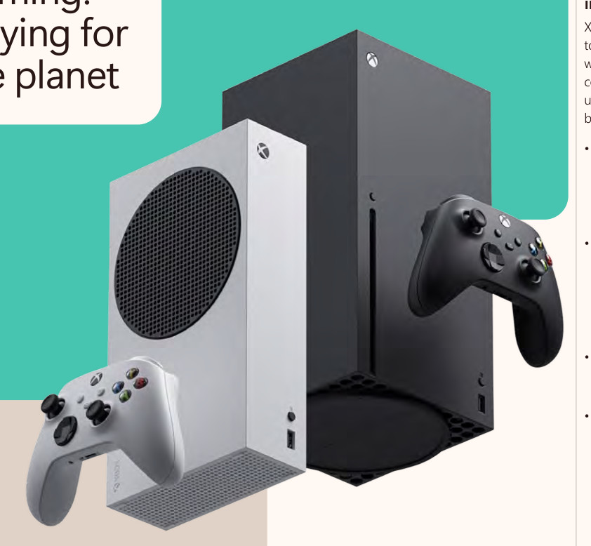 
## Powering play: Energy-saving innovations for Xbox 
Kbox has made significant investments not only co reduce the environmental footprint associated with the prodution of our devices, accessris,and console packaging, but also to reduce the energy usage of the console itself. We've done this by building tools that include: 
An Xbox console with advanced carbon-saving settings, which optimizes game downloads and updates to occur during times when the console can use the most renewable energy, reducing the associated carbon footprint. A shutdown (energy saving) power option, available through a one-time update to power settings, that educes power consumption while the console is turned off by up to 20 times compared to Sleep mode,delivering sizable energy savings for gamers who enable it. Active Hours, an energy setting update that allows players to adjust when their console is active,optimizing energy use. New advancements in video content handling introduced through a media platform release for Xbox Series S, eading to an average reduction approaching 10% in power consumption across all media apps. 
## Empowering game developers with sustainability tools 
In 2023, Xbox became the first console platform to release dedicated energy consumption and carbon emissions measurement toos designed specifically for game creators. These tools, developed in colaboratio with shulios,prvide dashboards, case studies, Certficato lab analysis and telemetry data to help developers understand the energy impact of their games and identify opportunities for improvement With the electicity powering Xbox devices being a major contributor to greenhouse gas emissions, these tools have empowered our developer partners to implement energy-saving measures that are often impeceptible to players but significant in reducing emissions.

---

<!-- 原文第 66 页 -->

Overview 
Microsoft sustainability 
Carbon Water Ecosystems Waste 
Customer sustainability Global sustainability Appendix 
2025 Environmental Sustainabity eport 
66 
## Gaming continued 
As of June 2024, the Toolkit has expanded to include a new Dynamic Power States AP, an innovative prototype platform technology that helps game developers to adjust GPU frequencythe most power-intensive component of a gaming console-when full GPU utilization is unnecessary. This complements the existing tookit gpidane and delivers increased savings without compromising graphical fidelity, further supporting sustainable game development. 
In 2024,we saw widespread adoption of the Xbox Sustainabity Toolkit by both first- and third-party studios 
Through innovative hardware and software tools, sharing energy-effcien game development resources, and collaborations with studios, Xbox is making gaming more sustainable for players and developers alike. These collective efforts have prevented over 1.2 milion mtCOe to date, as measured between FY20 and FY23. Xbox remains committed to empowering gamers and creators to enjoy and develop games responsibly,while significantly reducing the environmental impact of play 
 
 
ZeniMax Online incorporating energy-saving features into The Elder Scrolls Online. 
 
Halo Studios achieving energy effciency gains in Halo Infinite with 2.5D implementation. 
 
Activision Publishing enhancing efficiency in the Call of Duty franchise by optimizing mutiplayer lobbies and in-game menus. 
Mojang Studios delivering notable effciency improvements in Minecraft through a new frame rate limiter feature

---

<!-- 原文第 67 页 -->

Overview Microsoft sustainability 
Carbon Water Waste Ecosystems 
Customer sustainability Global sustainability Appendix 
2025 Environmental Sustainability Report 
Gaming continued 
## Sparking change (while having fun) with Minecraft 
At Minecraf, we re commited to bulding a better world through the power of play, using our platform to drive real-world impact. Minecraft has evolved into a beacon for eco-friendly gaming, translating digital ngagement into tangible sustainabilty outcomes as well as inspiring and educating a global community to help prioritize environmental stewardship. Our message is clear and purposefu,resonating through our in-game content anc collaborations, and each year building on the impact of the projects in both the physical and digital world to enact climate action. 
Since 2020,we've expanded our scope by exploring how digital engagement can translate into real-world environmental benefts with initiatives like 
Freedom to Go Beyond, an ingame Minecraft aveture where game players were encouraged to complete various outdoor challenges and interact with the animal kingdom. Burberry and Minecraft also partnered with Conservation International forest conservation efforts to help protect 500,000trees and help restore 25,000 trees around the world.! 
PARTNERING FOR IMPACT 
 
Rooted Together, ar interactive map where players could explore a mangrove based ecosystem in-game, while helping The Nature Conservancy to restore and protect 66,000 mangrove trees 

---

<!-- 原文第 68 页 -->

Overview Microsoft sustainability 
Carbon 
Water Waste Ecosystems 
Customer sustainability Global sustainability Appendix 
2025 Environmental Sustainability Report 
68 
Gaming continued 
Minecraft also launched the Planet Earth Ill downloadable content in partnership with BBC Earth, which has seen more than 1 millondownloads In this world, players explore the natural world and impacts of climate change by experiencing survival through the eyes of diferent creatures like the great white shark and the treehopper. 
Schools Reinventing Ci engaging more than 12, worldwide to tackle clim through Minecraft Educa in partnership with C40 The program fosters rea 
The next levet Inspiring rther acion through play 2024 was a remarkable year for Minecraft,.continuing to Build a Better World through the power of play, promoting new climate initiatives, and supporting sustainability education. Minecraft's climate and sustainability content have been downloaded more than 30 million times by players around the world since launch, wining four awards in 2024 for social impact and creative campaigns. 
Minecraft recently partnered with The Nature Conservancy to debut a new world called Minecraft National Park, celebrating Earth's wild places and educating players about the importance of preserving them. With net proceeds going to The Nature Conservancy,players can download and roam nine biomes (such as ocean, wetlands, jungle,and savannah), stop in at ranger stations, explore vistor centers, and interat with fatures ike wildlife crossings-a real-life way biologists ensure animals can safely cross roads and keep swathes of habitat connected 
Our work demonstrates the influential role of community and the power of play in driving postive change and empowering a new generation of innovators. Moving forward, we plan to further integrate sustainabit into our core values, keeping our community engaged and motivated to make a meaningful impact. 
er, boosting in-store ycling by 13.8%and 
metric tons of gadgets nd Elkjap Nordic.

---

<!-- 原文第 69 页 -->

Overview Microsoft sustainability 
Carbon Water Waste Ecosystems Customer sustainability Global sustainability Appendix 
2025 Environmental Sustainability Report 
Arts and culture: Inspiring action at the intersection of art and technology 
As our gaming continues to inspire environmental stewardship and action through the power of play, Microsoft's sustainability commitments extend beyond the virtual world.Collaborating with visionary partners like the Natural History Museum London, we're exploring new ways to blend technolgy, art, and science to spark hope and optimism for our planet's future. 
## INNOVATION IN ACTION 
Natural History Museum,London Visions of Nature 
Our planet's future is l pe opmetimeswe u neto see it to believe it.n2024, we partnered with the Natural History Museum. London (NHM) to ceate Visions of Nature A Mixed Realiy Experience.Set in the year 2125,this 18-minute journey transports visitors to an imagined future, inspiring climate optimism and action 
Visions of Nature highlights both the damage humans have caused and the possibilties for recovery. Developed in partnership with SAOLA Studio and NHM researchers,the experience features eight ecosystems that showcase how human innovation and nature's inherent adaptability can help us heal from today's environmental crises. Using Microsoft mixed reality headsets, visitors are transported 100 years into the future to explore a transformed planet inhabited by wildlife like colugos, secretary birds, cuttlefish-and even humans-demonstrating extraordinary resilience and transformation. Visions of Nature opened in October 2024 and will run unti Cctober 2026.

---

<!-- 原文第 70 页 -->

Overview Microsoft sustainability 
Carbon 
Water Ecosystems Waste 
Customer sustainability 
Global sustainability Appendix 
2025 Environmental Sustainability Report 
70 
Planetary 
While immersive storyteling ofers a glips into an optimistic future,the Microsoft Planetary Computer provides the tools th ep tun that visio nto reaity By harnessing one of the largest repositories of open environmental data, the Planetary Computer empowers individuals and organizations to monitor, model and identfy opportunities that protect Earth's natural resources-bridging the gap between imagination and action. 
## A global tool for a shared planet 
In 2020, as part of Microsof's commitment to protect and preserve ecosystems,we announced our intent to build a Planetary Computer-a platform designed to provide access to tilions of data points collected across space, air, land, and water.Five years late, it ha grown to be one of the largest repositories of open Earth observation and Earth science data in the world. 
Computer: Harnessing data to protect our planet and foster resilience 
The Microsoft Planetary Computer offers an open, cross-domain geospatial data platform that empowers every person and organization on our planet with the data they need to measure,monitor model, and protect Earth's natural resources. Accessed bilions of times each month, it provides foundational data infrastructure to power countless sustainability applications and analyses globally. 
Today, the Planetary Computer hosts over 50 petabytes of Earth observation and science data across more than 120 open data collecios,enabling climate researchers, policy makers, and the public to perform geospatial and climate analyses. 
## INNOVATION IN ACTION 
## Howden Driving investment in resilience 
Supported by Microsof, the Howden Resilience Laboratory uses Planetary Computer data, including ERA5 historical atmospheric data and CMIP6 climate projections,to assess limate is to ratica frsruture. By integrating this data with machine learning models, Howden and Microsoft deliver customer-centric analytical tools to drive investment in reslienc and mitigate isks to financial goals and asset insurabilty.

---

<!-- 原文第 71 页 -->

Overview 
Microsoft sustainability 
Carbon Water Waste 
Ecosystems 
Customer sustainability 
Global sustainability Appendix 
2025 Environmental Sustainability Report 
Planetary Computer continued 
## PARTNERING FOR IMPACT 
Beyond data access, he lnetary Computer offers example code and tutorials to lower barriers for users, empowering universties and organizations worldwide to train the next generation of sustainabilty proressinais By democratizing access to actionable insights, Microsoft is ostering feslece where it's needed most. 
Skytec Supporting cost-effective 
wetland conservation 
In collaboration with the Tennessee Department of Environment and Conservation, Skytec launched the Wetland Screening Tool, using advanced GeoAl workflows and deep learning algrthms to rapidly identify potential wetland locations. Powered by Planetary Computer datasets from NAIP, Sentinel-2 imagery and LiDAR, this toolsupots cost effective wetland conservation and land use planning. 
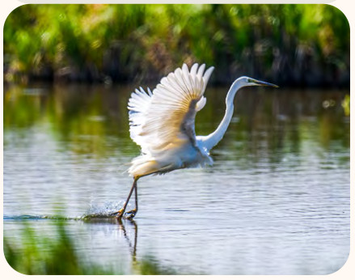 
In 2024, we continued to expand the Planetary Computer with new datasets, including CONUS404, a high-resolution hydroclimate dataset that covers over 40 years of climate data across the contiguous United States. This dataset is vital for studying long term climate trends, xtreme weather events, and hydrological processes,helping scientists to understand and manage water resources through detailed modeling. 
## Breaking barriers through Al transformation 
Advances in Al are transforming how we interact with data about our planet. In the near future, Al is anticipated to make it easier for anyone, anywhere to aess,undestand,and apply suh data to global challenges. By lowering barriers to data use, AI has the potential to radically accelerate the development and adoption of sustainable solutions. However, thi requires machine-readable access to vast repositories of Earth observation data-an area where the Planetary Computer excels. 
With one of the largest collections of openly accessible data about our planet, the Planetary Computer can play a critical role in empowering Al innovation. Nearly all of these datasets are APlaccessible and aligned to open standards, such as SpatioTemporal Asset Catalogs (STAC), enabling data scientists and machine learning engineers to train new Al models with this data at scale and unlock new, critical insights for sustainability. 
Advancing resilience through open data Climate change afects veryon, bt ts ipats are not evenly distributed.Those living in poor and margjinalized communities, particulary in the Global South, bear a disproportionate burden despite ofen contributing least to climate change. These communities face intensified droughts, floods, and heatwaves,exacerbating food insecurity poverty, and other systemic challenges. 
To address some of these inequalites, equal access to reliable, open, interoperable, and timely climate data is essential. The Planetary Computer plays a pivotal role by providing petabytes of environmenta monitoring data in analysis-ready formats. This data enables governments, organizations,and citizen scientists to drive adaptation and resilience planning,ensuring that vulnerable communties have the tools to protect their communities and surrounding environment. 
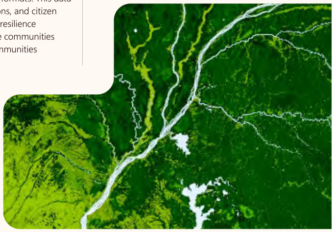 
71

---

<!-- 原文第 72 页 -->

Overview Microsoft sustainability 
Carbon Water Waste Ecosystems 
Customer sustainability Global sustainability Appendix 
2025 Environmental Sustainability Report 
Microsoft's actions alone cannot solve the climate crisis. As a global technology leader,we are 
also 
cond 
that 
focu 
clim 
polid 
and 
advo 
gree 
just 
Global sustainab Catalyzin globalim 
tion re 
72 7781 85

---

<!-- 原文第 73 页 -->

Overview Microsoft sustainability 
Carbon 
Water Ecosystems Waste 
Customer sustainability Global sustainability Appendix 
2025 Environmental Sustainability Report 
73 
Investing in innovation: 
CIP's portfolio has epanded to 63 investees to date, split between 46 companies and project finance entities and 17 fund managers across energy Systems, industrial supply chains, and natural Systems. These investments execute our invest-to procure straegy ensuring our capital catalyzes the scaling of innovative climate technologies globally while supporting our commitments. CIF was launched in 2020with a dual mandate to innovate and to accelerate sustainability markets. Since then, our investments have laid the groundwork for sustainable growth in Al, both through direct decarbonization and enabling technologies across our core focus areas. As climate solutions mature and as we advance our sustainability roadmap to 2030,CIF has added a third mandate: to scale adoption of climate solutions. Moving forward, we will focus on invest-to-procure strategies that have proven to be highly effective in bringing new market supply online at scale. 
This principle underscores our global sustainability commitments, where we work to develop solutions that support not only Microsoft's goals but also those of our customers and across our global value chain. 
Building climate 
markets to reach net zero 
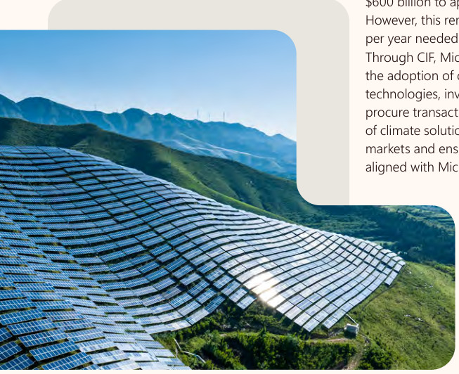 
Microsoft Climate Innovation Fund For Microsoft to do wel h oud ed d l 
Since its inception in 2020,the Microsoft Climate Innovation Fund (CIF) has been a cornerstone of our sustainability efforts. Over the past four years, annual climate capital flows hv nary tpled from $600 billin to approximately s2.1 tilion globaly However this remains far below the s4.5 trilion per year needed for a net zero transition by 2050.8 Through CIF, Microsoft has invested in accelerating the adoption of climate solutions. CIF supports technologies, investment vehicles,and invest-toprocure transactions that grow the market supply of climate solutions,while focusing on underfunded markets and ensuring climate equity co-benefits 
Investing in a portfolio to innovate, accelerate, and scale With a S1 bilin inetment mandate, CIF has allocated over S793 million in capital to bring new supply to market and accelerate adoption and cost reduction in key target technologies. While private market investments in limate tech have doubled from 2020to 2022,sectors critical to Microsoft's Scope 3 carbon footprint--industry and manufacturing,building materials,and carbon management-account for approximately 20% of private market climate technology transactions. CIF prioritizes these underfunded sectors. 
## 00 
$793 
million 
CIF has allocated over S793 million in capital to bring new supply to market and accelerate adoption and cost reduction in key target technologies

---

<!-- 原文第 74 页 -->

Overview 
Microsoft sustainability 
Carbon Water Waste 
Ecosystems 
Customer sustainability Global sustainability Appendix 
2025 Enwironmental Sustainability Report 
74 
Investing in innovation continued 
## INNOVATION IN ACTION 
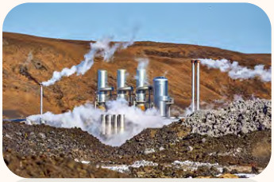 
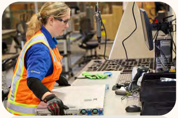 
## Eavor 
## Cyclic Materials 
## SolarCycle 
Eavor is developing a geothermal enegy technology that can be deployed globally providing baseload power and energy autonomy. This clean, elal tetnolagy avcids potential ecological impacts associated with wind, sola, and mining materials for batteries.Eavor's focus is on European combined heat and power (CHP) and westem Us letriat yration marlets, and has strong alignment with Microsofts datacenter electricity needs 
 
Climate Asset Management The Climate Asset Managerment (CAM) Nature Based Carbon Fund (NBCF) is a 5455 million fund focused on irvesting in nature-based solutions which restore and conserve ecosystems to sequester greenhouse gas emissions and support biodiversity and local cmmunitie.NBCF is managed by Climate Asset Management, a joint venture between HSBC Asset Management and Polination, that has raised over S1 bilinto nineintral apa. The Fund aims to invest in high-quality carbon removal projects that contribute significantly to Microsoft's 2030 carbon removal goals. The NBCF targets projects in developing economies, utilizig flexible financing mechanisms and ensuring substantial benefts for local communities through economic beneft-sharing programs. 
Cyclic Material is eruticninthe way we approach circularity by enabling the continuous reuse and recying of critical minerals, reducing waste and enviranmental impat and enabling supply chain resilience.By repurposing rare earth elements and base metals at the end of their lifecyle,valuable resources are not lost but instead re-enter the production cydle.With a scalable hub-and-spoke model Cyclic Materials aims to meet the growing global demand for crtical minrais, particularly for electric vehicles,wind turbines, and datacenters, while maintaining a low carbon footprint and zero waste. 
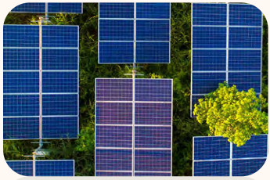 
 
Terradot 
SalarCyce is aleading slrpane ercterr in the United States, using praprietary recycling equipment to automate the recyling process and recver ver 0%of solar panel matras The compary fera vericlytgrted patr that ludes logistics for colecting panels,reycting them, and manufacturing and selling extracted materials ie cpper and icn for new panels. 
Teradot exemplifes Microsofts investment in using Al and data-driven solutions for sustainabilit, By integrating vast datasets collected from plant tissues, soils,pore watet ground watet and cimate models, Terradot's advanced data platform will enhance the ability to understand and manage Earth's natural systems to capture carbon dicxide from the atmosphere

---

<!-- 原文第 75 页 -->

Overview 
Microsoft sustainability 
Carbon Water Waste Ecosystems Customer sustainability Global sustainability Appendix 
2025 Enwironmental Sustainability Report 
75 
Investing in innovation continued Fostering innovation through partnership In addition to capital ivstments, we collborate with partners to make progress toward our 2030 sustainability commitments by using our strengths as a convening thought leader, technology solutions provider, and advocate. These partnerships accelerate the market supply of emerging climate technologies through proactive engagement with broader climate innovation ecosystems. Our partnerships have catalyzed significant progress, such as: University of Washington - Buerk Center for Entrepreneurship Microsoft's partnership with the Buerk Center for Entrepreneurship in the Foster School of Business cultivates student innovation and leadership in sustainabilit.Since 2009,more than 1,850 students from the Cascadia Corridor have participated in the Center's Environmental Innovation Challenge (EIC) with over $550,000 in prizes awarded to support eary-stage ideas addressing environmental and climate challenges. 
## E8 Angels and Decarbon8-US 
Through a partnership with E8 Angels and the Decarbon8-US philanthropic impact fund, Microsoft is also advancing early-stage innovation in renewable energy and sustainable technologies. Founded in 2006,E8 Angels has mobilized S64 milin inpriate capital to support over 160 climate-focused companies. Since 2020,Decarbon8-US Fund has directed over $9.2 million in philanthropic and direct investments aross 1 companies dedicated to decarbonizing key sectors such as agriculture, the built environment, transportation,and renewable energy. 
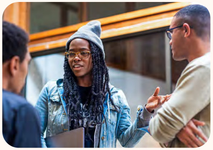 
Microsoft's partnership extends beyond EIC to indude initaivs ike s siable uainworshop co-hosted with industy leaders, intudig Alaska Airlines and the Port of Seattle, which brought together over 100 students to collaborate on advancing SAF. 
In 2024,the fund concentrated on renewable energy, aligning with global goals to triple global renewable energy capacity by 2030.The program has contributed to upskiling over 360 individuals, the funding of 13 innovative ideas, and the mobilization of over $2.3 milio in follow-on capital. The partnership drives critical advancements in renewable energy, including alternative fuels, energy storage, and grid infrastructure,while enabling entrepreneurs in the United States and Canada to scale their solutions. 
By combining industry expertise, student engagement, and Microsoft's commitment to sustainabilt,our Universty of Washington partnership exemplfies how education and collaboration can drive meaningful environmental impact and cultivate the next generation of leaders 
## Build Better Innovation Challenge 
Hosted by Elemental Impact, a nonprofit investment platform with 15 years of experience scaling industry and energy solutions,and in collaboration with Capgemini and Bouygues, Microsoft launched the Build Better ination Challenge to identify innovative low carbon material solutions that reduce Scope3 emissions and embodied carbon in building materials. This partnership uses the strengths of global industry leaders to maximize the challenge's impact by offering winners opportunities to: 
·Deploy funded pilots with Microsoft and Bouygues. 
·Access equity investment from corporate venture funds. 
·Receive technical support to scale solutions and reach potential customers. 
The 2024 challenge received 78 applications, with nine finalists piting thir ideas to a panel of judges.Six winners-C-Crete Technologies Carbon Upycling Technologies, Neolithe, Woodoo, FROOT, and Made of Air-were selected for their groundbreaking solutions. This collaboration exemplfes Microsoft's dedication to advancing decarbonization in the built environment while fostering global innovation in traditionally underrepresented sectors.

---

<!-- 原文第 76 页 -->

Overview 
Investing in innovation continued Advancing equity and climate innovation Climate change demands solutions that deliver meaningful impact to the communities most affected. CIr remains committed to avancing equity alongside innovation; 22%of CEOs and founders in our portfolio are women and 21% are from underrepresented backgrounds, and 19% of capital is allocated toward the Global South. Additionally,.CIF is partnering with leading programs globally t bild an inclusive innovation ecosystem Advancing Climate and Clean Energy Leaders (ACCEL) This accelerator, launched by Greentown Labs and Browning the Green Space(BGS), bolsters dimate tech startups and founders from historically underserved communities by addressing structural inequalities through non-diutive funding networking connections, resources, and opportunities. The program combines education,prototyping support, mentorship and networking to accelerate pilots,partnerships, and funding. Supported by CIF, the program has equipped over 100 entrepreneurs with sils brought 37 climate solutions to market, and mobilized more than s18 millo in arly stage capital for sustainability initiatives. Microsoft sustainability 
Carbon 
Water Waste 
Ecosystems 
Customer sustainability Global sustainability Appendix 
2025 Enwironmental Sustainability Report 
76 
## Kinjani African Climate Talent Accelerator 
By investing in Al-driven companies, CIF goes beyond providing capital to accelerate innovation it connects these companies to a robust ecosystem of support. Tailored programs help CIF portfolio companies scale their impact at every stage of their journey. These programs indlude: 
Building scalable sustainability markets Looking ahead, CIFs srateywill fous o Caing climate technologies as part of Microsoft's net zero roadmap,using Al to drive sustainability outcomes, and integrating cimate equity into new market development.By design, CI invests alongside a diverse networ of over 250 co-investors, including both financial venture capital frms and corporations, to foster future markets. CIF's $793 million in commitments has catalyzed over $3.3billion in follow-on funding,achieving a multiplier effect greater than four times. Moving forward, Microsoft will continue investing to scale sustainability by combining investment,prcurement, and partnerships, accelerating the global transition to a sustainable, equitable future. 
This incubation and investment program empowers African entrepreneurs and science-driven innovators by fosterig gender balance, developing crtical klss expanding professional networks, and providing hands-on support to develop talent in critical sectors.Its inugural cohort includes 29 African founders-55% female-who are developing regenerative solutions in essential areas such as food systems, materials,urbanization, and minerals, which are removing carbon, increasing biodiversity and water access, and improving livelihoods. Accelerating progress through AIdriven product investments Earth's growing data footprint ofers imemse potential for sustainabit. For example,a typical farm alone generates around 5000da points daily, projected to reach 4 million by 2036.20 Recognizing the crtica oe f td te dndng and managing Earth's natural systems, CIF has invested in Al-driven companies with a unique digital product vision 
·Microsoft Founders Hub-a program designed specifical tosupot startups with a comprehensive suite of benefits. Microsoft AI Co-Innovation Lab-a one-week lab available to any Microsoft customer or partner, offering complimentary personalized development sprints for engineering teams to reduce time to market. 
·Collaboration with Microsoft teams-opportunities to engage with Microsoft specialists focused on harnessing Earth system data to develop breakthrough products and research,including our engineering teams building solutions like the Azure Data Manager for Agriculture and Microsoft Planetary Computer as well as the researchers and data scientists with Microsoft Climate Research Initiative and Al for Good 
 
$3.3 billion 
CIF's $793 million in commitments has catalyzed over $3.3 bilion in follow-on funding.

---

<!-- 原文第 77 页 -->

Overview Microsoft sustainability Carbon 
Water Ecosystems Waste 
Customer sustainability Global sustainability Appendix 
2025 Environmental Sustainability Report 
Charting new frontiers in Al innovation 
## Exploring more sustainable 
Al innovation Guided by the Microsoft Acceleratig Sustainabity with Al playbook, Microsoft is estabishing the conditions for Al to become a transformative tool to address envionmental challenges, Launched in 2023 the playbook serves as a strategic framework to align Al innato with sustainablit gals, helping to drive measurable impact and set the stage for responsible and effective Al deployment by focusing on five strategies or "plays" 
By developing groundbreaking tools and expanding the application of Al across diverse domains, these teams aim not only to drive progress toward 
Investing in Al for sustainability. Developing digital and data infrastructure for inclusivity. 
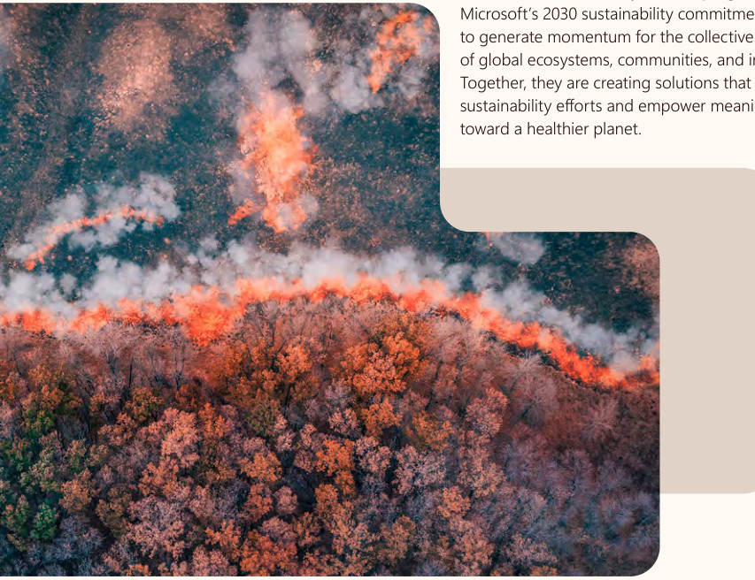 
Two specialized teams-Microsoft Sustainabity Science and Innovation and Microsoft Research-are at the forefront of applying Al to address some of the world's most pressing environmental challenges 
Minimizing resource use,expanding access to carbon-free electricity, and supporting local communities. Advancing Al policies and governance for sustainabilty. 
Building workforce capacity to use Al for sustainabilty. 
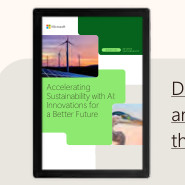 
Download our 2025update nd progress report on he playbook 
77 
A core element of using Al to adress ne key sustainaility challenge, climate change,requires our understanding of the complex interplay between Al, energy,and climate.Over the past year, Microsoft has collaborated with internal teams and external experts to explore this evolving nexus,addressing critical questions about Al's role in the global race to net zero. Highlights of this effort indlude: 
·Participating in a workshop hosted by the International Institute for Applied Systems Analysis to examine Al and digitalization fron climate scenarios. 
·Convening an interdisciplinary team of experts to assess whether Al will acelerate or hinder global decarbonization,with reflections published in Nature. 
These collaborations have deepened Microsoft's understanding of AI as both a driver of new climate solutions and a resource-intensive challenge. The insights gained have shaped strategies to optimize Al for maximum beneft while minimizing its environmental footprint This inudes Microsoft's work with leading institutions to build breakthrough innovations for carbon reduction, energy optimization,and sustainable water management.

---

<!-- 原文第 78 页 -->

Overview 
Microsoft sustainability 
Carbon 
Customer sustainability Global sustainability Appendix 
2025 Environmental Sustainability Report 
78 
Charting new frontiers in Al innovation continued Advancing understanding of Earth's natural systems Microsoft is combining AI and advanced scientifc tools to strengthen our understanding of biodiversity and ecosystem health, carbon budgets, and climate dynamics. These efforts support policymakers, scientists,anorganizations in addressing environmental challenges and improving global outcomes. 
Investing in nature for sustainability As we more effectively monitor nature,we can better understand and prioritize whole ecosystem health in investments for sustainabilit. Microsoft partnered with organizations like CIFOR-ICRAF, the Wilkes Center for Climate Science & Policy at the Universit of Utah, and University of Calfornia Santa Cruz to assess the opportunities and challenges for companies to maximize their nature-positive investments. This colabortio esute i a white paper outlining lessons from Microsoft's own nature strategy and identifying eight actionable steps companies can take to overcome barriers such as nowledge gaps, resource limitations, and incentive misalignment This paper emphasizes how Al is already playing a key role in addressing these challenges, enabling organizations to better understand and manage their impact on natural systems. 
Understanding and managing Earth's carbon budgets 
Transforming weather and climate forecasting Enhancing our understanding of global weather patterns Aurora, Microsofts cuting-edge AI foundation model for environmental forecasting, uses over 1.3 bilion parameters to predict weather patterns and atmospheric processes like air pollution, and to deliver high-resolution global forecasts.Unlike traditional models that train on a single dataset, Aurora was pre-trained on more than a million hours of diverse weather and cimate data,building general knowledge before being fine-tuned for specific tasks. This approach enables superior performance in data sparse tasks, such as atmospheric pollution prediction and extreme weather scenario modeling,offering more accurate forecasts and timely interventions. By improving environmental monitoring and helping mitigate the impacts of extreme weather events, Aurora advances sustainabity and resiience efort. Sub-seasonal climate forecasting Collaborating with the Massachusetts Institute of Technology and Atmospheric and Environmental Research, Microsoft has developed an adaptive bia correction framework that uses machine learning to systematical/y crrect eror. n d ydmnia orfcrsss enhancing forecasts two to six weeks in advance This tool significantly improves predictions, helping water managers allocate assets efficiently, enabling early wildfire prevention,and reducing the human and economic costs of extreme events like droughts and floods 
In collaboration with Tsinghua University,the French Laboratory for Climate and Ervirnmental Sciences, and other leading global scientists, Microsoft Research has developed the world's first near real-time global carbon budget. This analysis provides monthly updates with only a three-month delay, offering important insights into carbon fluxes Analysis of 2023 data revealed a steep decline in the land carbon sink to just 0.14 gigatons of carbon per year-the lowest in nearly two decades. This decline, driven by extreme climate events,highlights the fragilty of terestia arcon systems.Despite stable fossil fuel emissions, increased oceanic carbon uptake was insuffrien to counterbalanc the loss in land-based sequestration,resulting in a sharp rise in atmospheric carbon dioxide. The Mauna Loa Observatory recorded a 3.37-ppm increase in 2023 marking the highest carbon dioxide levels ever. By delivering timely, actionable data on carbon fluxes and their underlying causes,this project enhances global understanding of carbon dynamics and informs sustainability intiatives.t damonstrates how innovative technologies and research can empower policymakers and organizations to address urgent climate challenges and work toward carbon neutrality. 
## Supporting biodiversity and ecosystem reporting 
In collaboration with internal teams and external partners, Microsoft has identified sciencebased Al tools for bidiversty and ecosystem reporting-now mandated by the European Union Corporate Sustainability Reporting Directive (CSRD), UK Biodiversity Net Gain law, and emerging national regulations in Australia and China. Collaborations with Planet Labs, the Gund Institute for the Environment at the University of Vermont, and the Natural Capital Project have enabled the development of cost efetive strategies for meeting these requirements. Using advanced Earth observation tools such as automated camera traps, bioacoustics, automated environmental DNA samplers, and high-resolution satelit iagery, these solutions provide robust methodologies for monitoring and reporting ecosystem health at scale 
Water Waste Ecosystems

---

<!-- 原文第 79 页 -->

Overview 
Microsoft sustainability 
Carbon Water Waste Ecosystems 
Customer sustainability Global sustainability Appendix 
2025 Enwironmental Sustainability Report 
79 
Charting new frontiers in Al innovation continued Revolutionizing energy systems Microsoft is combining avanced AI tetnagies with collaborative partnerships to transform energy systems, creating solutions that address energy storage,distribution, and resilience. These efforts support the transition to renewable energy while empowering communities to achieve greater energy autonomy and sustainability. 
Al-powered community solar micrgrids advancing energy resilience and equity Frontline communities disproportionally face the dual challenges of climate disasters and economic inequality, often with limited access to sustainable energy solutions. Microsoft is sing Mit rate sla microgrids to empower these communities, allowin them to generate, store, and distribute renewable energy that aligns with their specific needs. By reducing dependence on centralized utites, this project promotes fair energy pricing, enhances resilience to climate disasters,and supports local energy autonomy. 
PARTNERING FOR IMPACT 
Innovating materials for a circular economy Through research and collaboration, Microsoft is pioneering breakthroughs in material science to promote circularity and sustainabilit,.By developing innovative polymer composites, these efforts pave the way for more sustainable electronics and a reduction in e-waste. 
## Grid energy storage 
Composites for printed iruit boards Through collaboration with the University of Washington, Microsoft Research is advancing cirularity in polymer composites with a new class of polymers known as virimers, nik corventional polymers, vitimers possess dynamic chemical bond that allow certain composites to be disassembled and reassembled without compromising material integrity. This property enables easier repai,reuse, and recyling ofelectronic components,addressing a majpr challenge in the sustainability of electronics. 
In partnership with the University of Michigan Microsoft is developing cost-effective longduration energy storage technologies using organi redox flow batteries. By applying generative Al to design alternatives to vanadium, central to today's commercialy mature flow batteies,the ateratve batteries aim to reduce relance on citical minerals lower corrosion hazard, and support increased renewable energy integration into the power grid. 
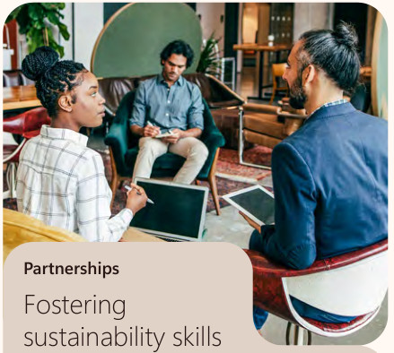 
Al technology plays a crtical role in predicting energy demand and optimizing distribution, ensuring these systems operate more efienty and equitably. This project not only increases the reliability of microgrids but also prepares communities to participate in power purchase agreements (PPAs), improving the long-term financial viability for renewable energy projects that contribute to both local resilience an global decarbonization goals. 
To foster sustainability skills,Mirosoft collaborates with community partners such as Remix: The Soul of Innovation, Ayika Solutions, and Vicars Community Center Resilience Hub to co-develop energy transition programs. These initiatives promote environmental itray through co-design workshops,technology demonstrations, and participatory planning sessions tha ngagecomunity members in shaping their energy futures. By combining technical innovation with community-driven approaches, this project builds the knowledge, capacity, and opportunities needed to create pathways to sustainable change. 
These advancements have led to a functional printed circuit board prototype that demonstrates how vitimers can facitate component dissebly, recycling, and reuse,paving the way for more sustainable electronics manufacturing.Looking ahead, we have developed generative Al methods for design of next-generation vitrimers with enhanced strength, fexibility, and reyclability, These improved propertis aim to epand the applicabity of trimers in advanced composites, riving greater material efficiency and sustainability across industries.

---

<!-- 原文第 80 页 -->

Overview 
Charting new frontiers in Al innovation continued Optimizing building and datacenter efficiency Microsoft is using Al-driven systems to revolutionize energy and water efficiency in buildings and datacenters. These advancements deliver smarter, more sustainable infrastructure while minimizing resource consumption and operational impact. Energy and water optimization Microsoft has developed reinforcement learning (RL)-powered systems to improve traditional heating, ventilation, and air conditioning (HVAC) controls, allowing autonomous, real-time energyefficient decision making to optimize operations. Using offline reinforcement learning,which trains on a static dataset to reduce reliane on continuous data acquisition, we achieved over 30% energy savings in one of our Redmond campus buildings while maintaining comfort The application of RL extends to datacenters,where trials in a Phoenix-based facility demonstrated a 21% reductin in water consumption. The RlL system maintains optimal temperature and humidity in the cold aisle, ensuring operational integrity while delivering significant water savings. The next phase will ivolve collaborating with datacenter teams to integrate these systems onsite and validate their performance through real-world experimentation. Microsoft sustainability 
Carbon 
Water Waste Ecosystems 
Customer sustainability Global sustainability Appendix 
2025 Enwironmental Sustainability Report 
80 
Recent advancements include the integration of LLM to enhance RL agentrobustness and adaptability. Experimental results show that LLM-supported RL agents deliver superior and more consistent performance,even in unfamiliar scenarios,further advancing the potential of this innvatve approach. Enhancing water resource management with accessible Al By integrating Al-powered solutions with cuttingedge data tools,Microsoft is addressing the complexities of water management These efforts empower communities and decision-makers to sustainably manage water resources and adapt to growing environmental challenges. 
Buit on advanced data pipelines and accessed via a uer finl tat tefce peer CP the Copilot enables natural language queries and delivers actionable insights on water availability forecasts, drought conditions, and environmental fows. By making this information accessle in ocal languages, this tool empowers decision-makers to explore data, make informed decisions, and promote sustainable resource use. This initiative enhances the reliability of water management advisory services,offering a transformative solution for the fectve management of the Limpopo River Basin while directly supporting local communities and fostering sustainable practices Driving innovation for globa sustainability 
We remain committed to avancing the role of Al to adres global sustainabit challenge. From targeted research to experimental applications, we will continue to innovate to meet Microsoft's own sustainabity goals while supporting our partners and customers in achieving theirs 
Monitoring biodiversity and complex ecosystems remains a critical focus. Al will be indispensable in monitoring and understanding biodiversity and ecosystems at the scale required for corporate reporting.Our efforts will center on connecting science-driven insights with Al-enabled tools to help companies,governments, and scientists better track characterize,understand,and manage ecosystems. These tools enable more effectve decision-making and support efforts to halt and reverse global biodiversity declines and environmental degradation. 
Developing accessible Al for more sustainable water practices In collaboration with the International Water Management Institute, Microsoft has supported the development of a cutting-edge Al-powered Copilot to address the complexities of water resource management, starting in southern Africa's Limpop River Basin. This solution integrates and interprets diverse data sources-regulatory documents, scientfic reports, real-time sensor data,and remote sensing workflows-to provide localized insights that support sustainable water management. 
Microsoft is pushing the boundaries of AI to tackle the worl's most pressing environmental challenges By empowering governments, businesses, and communtie wih tanfsomate tosus she Accelerating Sustainability with AI playbook and innovations in biodiversity, ecosystem, and carbon monitoring, Microsoft is driving meaningful action toward a more sustainable future for all.

---

<!-- 原文第 81 页 -->

Overview Microsoft sustainability 
Carbon 
Water Ecosystems Waste 
Shaping policy for a sustainable 
We believe that Microsoft has an imprtant role to play in advocating for effective and innovative sustainability policy. When we announced our commitment in 2020 to become carbon negative by 2030,we also pledged to use our voice on publi policy issues to help advance global decarbonization efforts.Since then, we've developed policy prioritie to guide government engagements around our environmental sustainability commitments, published briefs to outline key carbon,electrictycarbon-free power, and Al policy principles, and successfuly advocated to support Microsoft's goals. 
We've identified three primary policy opportunities to unlock carbon-free electriaty supply across operating markets: Expand and reform grid planning, interconnections and infrastructure development. 
future: Microsoft's global advocacy for change 
Unlock carbon-free electriaty generation development and corporate procurement pathways. 
## Accelerate new carbon-fre electricty technologies. 
These markets vary greatly depending on the size of the grid, availabity of carbon-free electricity,and relevant regulatory frameworks. 
To navigate these diferences, we embed three foundational principles in our policy advocacy: 
Driving tangible near-term progress on the pathway to global net-zero emissions by 2030. 
 
Customer sustainability Global sustainability Appendix 
As part of this effort, we have informed,endorsed, and supported the implementation of landmark policies to expand carbon-free electricity,scale markets for carbon removal and low carbon materials, and enable robust interoperable reporting. These policies include: 
·In the United States, the implementation of the Inflation Reduction Act and Bipartisan Infrastructure Law, California Carbon Accounting laws, and regulatory efforts to improve interconnection to the grid and transmission expansion. 
·In the European Union,CSRD,updates to the Renewable Energy Directive and the Energy Effciency Directive, and the Carbon Removal Certification Framework. 
As Microsoft's business grows,we are strengthening our policy engagement in the United States and European Union as well as with overments across Asia, Latin America, and Africa to expand carbon free electricity and grid infrastructure to support Microsoft and our suppliers. 
2025 Enwironmental Sustainability Report 
81 
Approaching policy and the markets where we operate with a flexible,rather than a one-size fits-all,strategy. 
Using the importance of digital technology and Al to enable a resilient, reliable, and low carbon grid, encourage innovation, promote transparency, and enable comparability.

---

<!-- 原文第 82 页 -->

Overview 
Carbon Water Waste Ecosystems 
Customer sustainability Global sustainability Appendix 
2025 Environmental Sustainability Report 
Shaping policy for a sustainable future continued Accelerating carbon-free electricity We are woring o ceectee ete expand grid infrastructur,and scale sustainability markets through policy advocacy in the United States, Europe, and Asia 
importance and key principles for developing the European electricity grid to meet the demands of decarbonization, electrification,and digitalization. Decarbonizing our supply chain in Asia At Microsoft, 97%of our emissions are in the Scope 3 category, with the majority of these emissions within our supply chain.We are therefore increasingly engaging with suppliers to support their own Scope 1,2, and 3 decarbonization. This past year, we focused on improving local supply of carbon-free electricty,which in turm allows suppliers to decarbonize their operations. We are working with governments, suppliers,peers industry associations, and other third parties to improve carbon-free electricity access in markets where we have a significant supply chain footprint, most notably in Korea, Japan, and Taiwan,where the majority of Microsoft's semiconductors are sourced Three priortis include accelerating grid infrastructure,enhancing renewable energy procurement options, and improving the economics of renewable energy. We joined regional and domestic industry associations to deepen our carbon-free electity policy engagement, including the SEMIl Energy Collaborative, the Asia Clean Energy Coalition, and the Japan Climate Leaders Partnership Examples of cooperation included the provision of coordinated industry iputs to Korea's pending Special Act on Key National Grids, and to Japan's 7t Basic Energy Plan. 
Advancing Al and sustainability Microsot i wrin wih ovrmentsand poiy stakeholders to responsibly use Al for sustainability outcomes. This past year, Microsoft provided input and comments to the US Department of Energy's reques for inrormation an energy and A policies. Through our engagement, we outlined ways that Al can advance clean, reliable,and resilient electric power. 
## INNOVATION IN ACTION 
In the United States, we supported new Federal Energy Regulatory Commission transmission rules to improve and expedite regional grid planning, as well as legislative proposals to accelerate project permitting. We also backed federal and state legislation to support fusion energy development and enhance regulatory processes for advanced nuclear reactors. To strengthen our dedication to these advanced carbon-free solutions, Microsoft joined the global Fusion Industry Association and the U.S. Nuclear Industry Council (USNIC),furthering our engagement on nuclear and fusion energy alongside renewable energy advocacy. Additionall,we advocated for scaling clean energy solutions, carbor removal, low-carbon building materials, sustainable aviation fuel, and manufacturing initiatives that deliver local economic and community benefits. Across Europe,we've advocated for a robust marketfor renewable power purchase agreements (PPAs), green certificates enabling aroundthe-clock renewable solutions, and swift development of transmission,distribution grid,and interconnection reform. Microsoft supported the European Commission in highlighting the critical 
Microsoft sustainability 
In Europe,we advocated for coordinated implementation of the Energy Effrciengy Directive and provided thought leadership to drive accurate, transparent regulatory improvements for Al energy needs and opprtunities.We also worked to build a shared understanding of Al's potential to accelerate climate action and the carbon-free energy transition through engagement with key stakeholders, including at the nternational tnergy Agency (IEA) Global Conference on Energy & Al, World Economic Forum, and other major convenings In collaboration with Microsoft, the IEA developed a GPT tool using Copilt Studio on Microsoft Azure tc enhance its World Energy Outlook, enabling users to approachably access energy data, trends, and insights for informed policy decisions. 
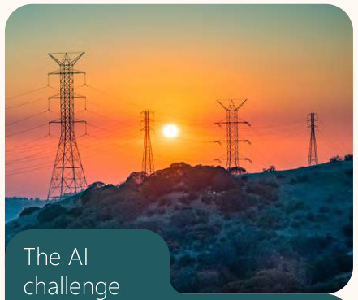 
Acess to Carbon fre lecticty r citt reach our 2030 carbon negative goal, both for reducing the Scope 2 footprint from our own operations and for reducing the Scope 3 footprint from our suppliers. However,the power system presents a bottleneck, intuding limits to grid availability to physically connect new carbon-free electricity generation sources limits to grid capacity to transport carbon free power particulaly from intermittet enewable energy sources) and limits to the speed at which requisite new policy, technology, and finance can be rolled out. Nevertheless, AI also presents a significant opportunity to help solve these challenges.

---

<!-- 原文第 83 页 -->

Overview 
Microsoft sustainability Carbon Water Waste Ecosystems 
Customer sustainability 
Global sustainability Appendix 
2025 Enwironmental Sustainability Report 
Shaping policy for a sustainable future continued 
At the United Nations General Assembly in New York City, we convened key thought leaders to accelerate Al-enabled sustainability solutions in the Global South. At the Convention on Biodiversity COP16 meeting in Cali, Colombia,we showcased the key role of Al in tacking the world's biodiversity challenges through our participation in Project Guacamaya, partnerships with Bloom 24 and Nature House, and the launch of a white paper that highlights the value of investing in nature.At COP29 in Baku, Azerbajan, through Microsoft's particpation in the Early Warnings for All lnrtiatve and our partnership with the UNFCC, e demonstrated how Al can proactively identify at-risk communities afected by climate-related emergencies and how Al can revolutionize the implementation of the Enhanced Transparency Framework reporting under the Paris Agreement. 
Driving progress toward sustainability goals Microsoft is contnuing to drive progress towards our 2030 commitments, indluding advocacy related to our waste and water commitments and engagement with trade associations to ensure policy alignment. 
In the European Union, we are supporting work on the upcoming revision of the Waste of Electrical and Electronic Equipment Directive and advocating for the harmonization of legislation with proportionate collection targets.n 2024, Microsoft signed on as a founding member of the WateReuse Association's Coalition for Water Recycling, a group of companies looking to support the adoption and expansion of water reuse across the United States. In January 2024, Microsoft published the Sustainability Policy Alignment:US Trade Associations report to help us evaluate how our trade associations align with our sustainability goals, and to identiy potential areas of collaboration or misalignment. 
Advancing robust carbon reporting Microsoft has advanced robus,consisten,and interoperable carbon reporting processes to support reliable, precise data led reporting globally Carbon measurement and reporting processes are also essential mechanisms for measuring progress in carbon emissions reduction. 
In the United States, Microsoft continued support for efforts to advance consistent and comparable disclosure of investor elevant climate information including enacted legislation in California. 
We fled comments in Malaysia and South Korea highlighting the importance of internationally ind climate reporting frameworks and the importance of encouraging the use of new technologies to monitor, calculate,and track emissions, supporting emissions reduction. 
In Europe, Microsoft met with European Union policy offcias to help identfy effiencies related to consolidated reporting under the CSRD. We also supported development of the Carbon Certificatior and Removal Framework and advocated for a clear differentiation between removal and reductions, enhanced sustainability criteria for carbon farming and biomass-based activities, strengthened leakage consideration, and the independence of certfication schemes. We also support the European Union Green Claims Directive's ambition to make environmental claims and labels more relable, transparent, and independently verified in the European Union.

---

<!-- 原文第 84 页 -->

Overview Carbon Microsoft sustainability 
Customer sustainability Global sustainability Appendix 
2025 Enwironmental Sustainability Report 
84 
Shaping policy for a sustainable future continued 
## What's next in policy? 
Waste Scaling high integrit yar on emoal arets Today, voluntary corporate net zero goals play an integral role in driving private-sector purchases of carbon dioxide removals(CDR) and thus developing the market. As governments develop carbon removal accounting guidelines and implement the consensus agreement reached on Article 6 of the Paris Agreement at COP29, it is rtical that new rules facilitate and enable the advancement of the CDR market in a high integrty and equitable manner.Transparently reporting corporate claims on CDR alongside national inventories can enable interoperability with Nationally Determined Contributions under the Paris Agreement and continue to scale this important climate solution. Water Ecosystems 
## Harnessing Al for global sustainability policy 
## Al for optimizing power systems 
We know Al holds transformative potential for addressing global sustainability challenges, from optimizing energy systems to developing climateresilient innations. Microsoft is actively engaging poliymakers to ensure that Al adoption is supported by forward-looking polies and infrastructure that enable local community access to its benefit. By advancing policies that promote the responsible use of Al, we aim to accelerate its role in driving environmental progress, enabling a low-carbon future, and empowering communities worldwide. 
At Microsoft, we are working to address the complex opportunities and challenges that Al poses on a global scale. We have developed Albased propositions and partnerships that can help improve power systems efficiency in the short term, for both generation assets and the grid itself. Use cases include: 
·Enabling dynamic grid optimizaton, involving better matching supply and demand. Improving forecasting,including for power loads, prices,and renewable energy resource availabilit. ·Accelerating permiting, including streamlining processes based on historical data. Increasing capacty on rasmisin is sngg dynamic line rating technology Optimizn generation ases nudig nding operational efficiencies and providing these insights to plant operators. 
Policy to enable further Al adoption Al is a vila to tah s atd igpuse to develop aste,cheaper, and improved sustainability solutions. These include accelerating scientific discovery,driving efficiencies in energy systems,and developing climate-resient crops. As we look ahead, policymakers have the opportunity to implement policies and programs that enable adoption of Al to promote positive environmental outcomes. 
All these applictions,and ochers, wilh e significanty accelerate the energy transtion, and we are increasingly engaged in policy and regulation to advance their deployment.

---

<!-- 原文第 85 页 -->

Overview Microsoft sustainability 
Carbon 
Water Ecosystems Waste 
Customer sustainability Global sustainability Appendix 
2025 Enwironmental Sustainability Report 
85 
Scaling impact 
through green skilling 
 
With a global community of over one bilin members,Linkedin is helping to close the green skils gap through four main approaches. upskiling members, coaching young jobseekers, training employees, and supporting green workforce development partners.Linkedin Learning has grown is sustainabity course library to more than 200offerings, covering topics such as ESG basics and sustainable business practices. These courses equip professionals to integrate sustainability into their roles and align with environmental goals, with many of our most in-demand courses made freely available throughout the year. 
Linkedn also supports sustainability nonprofits by helping them connect with core audiences on the platform.In FY24,Linkedin provided s6 million in free advertising to sustainability-focused organizations through its Ad Grant program, amplifying their impact and outreach.In partnership with Microsoft INCO Academy, a global nonproft that launched the Green Digital Certficat through ts Academy,helps workers access economic opportunities through the dual climate and digital transitions. 
To support young jobseekers,Linkedin has employees spearheading the Green Coaches program, training Gen Zand Millennial participants-particularly those from underrepresented backgrounds-with guidance on finding green jobs using the Linkedin platform. In 2024, nearly2,000participants gained free yearlong Linkedin Premium access, and 30 active Green Coaches trained candidates to navigate the growing green economy. 
## PARTNERING FOR IMPACT 
Beyond Linkedin's platform, strategic partnerships are expanding equitable access to green job opportunities worldwide. Programs ike GRID Alternatives upskill individuals from underrepresented backgrounds for careers in the solar industry. In 2024,GRID installed more than 4 MW of solar across 800 projects, benefitig more than 1,040 families and generating lifetime savings exceeding s20 million Linkedin also supports organizations like IPE (Institute for Ecological Research) in Brazil, which empowers eco-entrepreneurs to conserve the Amazonian rainforest, and Bush Heritage Australia, which works to protect native ecosystems, in partnering with Aboriginal Traditional Custodians and other landholders.

---

<!-- 原文第 86 页 -->

Overview 
Carbon Water Waste Ecosystems Customer sustainability Global sustainability Appendix 
Scaling impact through green skilling continued Green Skills Report 
Recognizing the urgent need to align workforce development with climate action,Linkedin's 2024 Green Skills Report highlights critical trends and gaps in the global labor market.Demand for green talent continues to outpace supply, with key areas of growth including renewable energy. building decarbonization, sustainable procurement, and ecosystem management. By advocating for workforce investments in climate policies,Linkedin ensures that economic opportunities in the climate transition are accessible to all. 
11.6% 
Demand for green talent continues to outpace supply, with key areas of growth including renewable energy, building decarbonization, sustainable procurement, and ecosystem management. 
Global demand for green talent grew twice as quickly as supply between 2023 and 2024-with demand increasing by 11.6% and supply by 5.6%. 
54.6% 
Job seekers with green skills o tes see a 54.6% higher hiring rate than the workforce overall. 
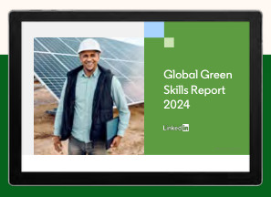 
1in2 
By 2030-halfway to the deadline for fulfiling nationally determined contributions (NDCs)-one in five jobs will lak thegreen alen to flit y2020, this gap will balloon to one in two jobs. 2025 Environmental Sustainability Report 
86 
Green skilling in gaming: Empowering developers and players for industry sustainability Just as Linkedin addresses the green skils apacross the global workforce, Microsoft gaming is leading efforts to foster sustainabilty across the industry. Building both knowledge and skillshain. Micosot Gaming hosts an annual"Sustainafest',a crossorganizational summit dedicated to advancing Sustainability silsaross the industry. Experts from Gaming, partners from Microsoft divisions, and external organizations share insights on a full range of sustainabity topics inudig co-design Al for Sustainabilty,energy efficiency in game development, biomimicry, and other emerging technologies which represent new potential for advancing meaningful environmental progress in the industry. 
Read the report at economicgraph.linkedin.com/esearch/ green-skills-resources 
Microsoft sustainability

---

<!-- 原文第 87 页 -->

Overview Carbon Microsoft sustainability 
Water Waste Ecosystems Customer sustainability Appendix Global sustainability 
2025 Enwironmental Sustainability Report 
Appendix 
In this section 
Appendix A- How we report 88
Appendix B-Endnotes 89

---

<!-- 原文第 88 页 -->

Overview 
Microsoft sustainability 
Carbon 
Water Waste 
Ecosystems 
Customer sustainability Global sustainability Appendix 
## 2025 Enwironmental Sustainability Report 
## Appendix A 
Our Reports Hub available at Microsoft.com/ transparency provides a consolidated,comprehensive view of our ESG reporting and data ranging from our carbon footprint to workforce demographics to poltical donations. This Environmental Sustainability Report is an important part of that overall set of disclosures. For this and other reports, we inform our disclosure strategies with careful consideration of commonly used global standards.We have reported carbon emission and energy data to CDP since 2004 and water data to CDP since 2011. On climate-related issues,we strive to align with the recommendations of the Task Force on Climate-related Financial Disclosures (TCFD) in our TCFD report. 
Forward-looking statements are based on current expectations and assumpins that are subject to riks and uncertainties that may not be antipated and/or which may cause actual results to differ significantly. We describe risks and uncertainties that could cause actual results and events to difer materiallyy in our reports filed with the Securities and Exchange Commission. We undertake no obligation to update or revise publicly any forward-looking statements, whether because of new information, future events, or otherwise. 
## How we report 
Reporting principles and external standards Microsoft works to conduct business in ways tht are principled,transparent, and accountable.We annuall publish this Environmental Sustainability Report to provide information on our strategy. our performance and progress against our goals, and key challenges and trends we see in this work.We also publish our environmental data, which is included in the separate Environmental Data Fact Sheet.We present greenhouse gas emissions in accordance with the GHG Protocol and management's criteria and select environmental metrics that both reference the Global Reporting Initiative (GRI) Standards and are reported in accordance with management's criteria as of and for the fiscal year ended June 30,202(FY24).Microsofts erviomental data reporting covers global wholly owned and partially owned subsidiaries over which Microsoft has management and operational control, including Microsoft owned and leased real estate facities and datacenters. Ervironmental data reported is subject to Microsoft's recalculation and structural changes policy as described in our Environmental Data Fact Sheet. 
A number of our ESG goals may depend on the adoption of certain behaviors and/or activities by third parties, including our customers and partners.if those parties do not adopt certain behaviors or activities,or invest in certain evolving technologies, we may not be able to meet some goals. Additionall,y we are engaged in certain projects, solutions, and technologies that, shoud they not perform as we expect,cold negatively affect our ability to meet some ESG goals on time or at all. Finally,we make certain claims regarding our products and projects, including through our funding of certain projects, and the ability of those products, prjiets and funding eforts to afetthid parties' sustainability effots however, there can be no guarantee that our products, projects, or funding efforts will have the effects we anticipate or intend. 
Working together with stakeholders 
We know that the decisions we make can affect our employees,customers, partners, shareholders, suppliers, and communities,and we take their voices into consideration. Microsoft receives input from millions of people each year-from individual customers to policymakers and global human rights specialists. We bring outside perspectives into the company and inform our business decisions through a variety of feedback channels. We often go beyond formal channels, proactively engaging with key stakeholders, advocacy groups, industry experts, corporate social responsibility (SR) rating agencies, CSR-focused inwestors, and many others.We also share our learnings and practices,thereby generating industry dialogue, informing public debate, and advancing greater progress. 
## ESG priority 
Our ESG reporting describes the topics we consider to be the most important annually to stakehalders when evaluating envionmental, soal and governance issues at Microsoft.Therefore,ESG prioritization in our reporting does not align to the concept of corporate "materiaity'applie in uS.securties law. A lisig of what we currently identify and categorize as our top ESG issues can be found at Microsoft.com/sustainability Governance 
The Ervironmental, Social, and Public Policy Committee of Microsoft's Board of Directors provides oversight and guidance on Microsoft's environmental sustainability strategy and efforts. Our Vice Chair and President and our Chief Sustainabilty Officer present to this committee on our overall ustainabilit agenda,indluding our climate-related work, and solici high-level input on new and emerging initiatives Additional information on Microsoft's corporate governance is available at Microsoft.com/investor. Forward-looking statements 
This report includes estimates, projections, and other "forward-looking statement" wthin the meaning of the Private Securities Litigation Reform Act of 1995, section 27A of the Securities Act of 1933, and section 21E of the Securities Exchange Act of 1934.These forward-ooking statements generally are identified by the words "believe,"prgject,"expect,"nticipate,estimate" "intend,"stategy""future,"target,"efforts,"goal "tactic"roadmap"commitment,"opportunity," "plan,"may,"should"will"'would,"wil be" ill continu""will iely esut" and simila expressions.

---

<!-- 原文第 89 页 -->

Overview Appendix B Endnotes 
Microsoft sustainability 
2025 Enwironmental Sustainability Report 
with CFE generation. Microsoft acknowledges that CFE technalogies have indirect carbon dicxide emissions and these are accounted for in our LCAs.CFE transition in the supply chain includes the onsite generation and purchase of verified Energy Attribute Certificates (EACs) by suppliers that are allocated to Microsoft-specific production volumes. 
is already modeled in the regional grid mixes from Ecoinvent v3.9.1,.) the carbon fooprint f materalsand manufacturing processes assuming no recycled content or additional eco-design interventions as of the date of Ecoprofle where the life yele carbon fotpriti pised and c) the default US distribution,use,and end of life modeling assumptions of the specific product model. 
World Economic Forum./novatin and Adaptation in the Climate Crisis Terhnolgy for the Wew Normal January 2024.https://www3.weforum.org/docs/WEF Inngyation_ and_ Adaptation in the_Climate_Crisis_2024.pdf 
7 This estimate is calculated based on the EPA estimate of the typical pasenger vehicle emitting.6 tons of caron dioxide per year. 
2 
This estimate is calculated based on the EPA estimate of the typical passenger vehicle emitig 4.6 tons of carbon dioxide per year. 
8. Surface AI PC include Surface Pro 10 and Surface Laptop 6.Surface Copilt+ PCs include Surface Pro (1th Edition) and Surface Laptop (10th Edition). Surface Pro 10 and Surface Pro (11th Edition)enclosure includes Bucket and Kickstand. 100%recycled aluminum alloy in Bucket and Kickstand. Surface Laptop 6 enclosure includes A Cover C Cover, and D Bucket.100%recycled aluminum alloy in A Cover. Surface Laptop (7th Edition) endosure inudes A Cover,C Bucket, and D Cover.100%recyded aluminum alloy in A Cover and C Bucet 100% recycled rare earth metals in magnets. Based an validation performed by Underwriter Laboratories, Inc. using Enviranmental Claim Validation Procedure, UL 2809-2, Second Edition, November 7, 2023. 
In FY24, we contracted 2.8 milio metric tons of carbon removal expected to be delivered toward FY30-in addition to 575,000 metric tons that we contracted in FY23-for a total amount of 3.4 milion metric tons of contracted carbon removal to-date. 
Waste Low-carbon building materials are those that have a reduced arbon footprint compared to tradtinal materials This means they have lower emissions,specifcall n tems of the greenhouse gas (GHG) emissions generated by the manufacturing,transportation, installation, maintenance, and disposal of construaction materials. Read more abcut our strategy here. https://www.microsoft.com/en-us/ microsoft-ckoud/blog/2024/12/04/sustainable by-designadvancing-low-carbon-materials/7msockid=36cd13211e6c bf12b4d84120336d3f Fennell Pa,L t l'cament and Steel Nine Steps to Net Zero. Nature, March 23,2022.https:/w.nature.com/ articles/d41586-022-00758-4 Microsoft defines carbon-free electricty CFE) technologies as including technolgies with zero direct emissions and biogenic technologies with life cycle emissions equivalent to renewables.CFE technologies include wind; solar; geothermal; sustainable biomass hydropower, nucear, fosslih c mpltearoncaptre, utilization,and sequestration, and storage charged Carbon 
Water 
Ecosystems Customer sustainability Global sustainability Appendix 
Replacement components available through Surface Commrcial uorzeddevice reseles. Components can be replaced on-site by a skilled technician following the Microsoft Service Guide.Microsoft tools (old separately) may also be required. Availability of replacement compnent and service optins may vary by product, market, and over time.See Surface service options at Microsoft Learn.Opening and/or repairing your device can present electric shock, fre,and personal injury risks and other hazards. Use caution if undertaking do-ityourself repairs. Unless required by law, device damage caused durin repair will no e covered under Microsof Hardware Warranty or protection plans. 
10.Opening and/or repairing your device can present electric shock, fire,and personal injury risks and other hazards.Use caution if undertaking do-it yourself repirs. Unless required by law,device damage caused during repair will not be covered under Microsoft's Hardware Warranty or protection plans. 
11.This estimate calculated based on 7,140 square meters per standard soccer field 
12. This information has been self-reported by the organization and has not been verifed by Microsoft. 
13. Battery lfe ares ignfcaty with tigsaigdedice. and other factors. 
14. Testing conducted by Microsoft in Ctcber 2024 with Surfa Pro (Tth Edtion-W-Fi Snparagon X Pus10 Core 512 GB,16 GB RAM devices using Windows 11 Hame 24H2. esting consisted of a partia batry chargezhifing the Windows ADK web browsing batery ife workloads with Energy Saver enabled and disabled. All stting were defaut except screen brightness set to 150 urits with Auto Brightness/Adaptive Brightness disabled.Wi-Fi was connected to a network. Actual energy efiercy vre sgrficiatty based an settings, usage, and other factors. 
15.Based on a snapshat of aggregated interal usage data for devices connected to Microsoft internal ntwork July 1-5eptember 30, 202, comparing average weighted daily energy consumption per device per usage minute for a population of Surface Copilt+ PCs (Surface Laptop (7th Edition) and Surface Pro (1th Edition) to a population of Surface Laptop 4, 5,6 and Surface Pro 8, 9,X. Actual energy effciency varies significantly by organization and device,and is based on settings, usage, and other factors. 
6 
16. The baseline (no interventions) scenario models the same product without any sustainability interyentions in the production phase of the device. (a) no aditional renewable energy in the supply chain beyond what 
17.Conservation International."'Burberry. Freedom to Go Beyond: 2022.htp:/w.coneratinor/cporate engagements/burberry-feedom-to-go-beyond 
18. Buchner Barbara,et al. Global Landscape of Climate Finance 2023.Climate Policy Initiative. ovember 2,2023. ttps//ww.iatepoliciniatitepuictionloba landscape-of-climate-finance-2023/ 
19.CTVC.532bnand 30%Drop as Marlet Hits Pause in 2023" CTVC y Sghthie Ccmate arays 02 thr. 32bn-and-30-dop-as-marlethits-pause-in-2023/ 
20.PR Newswire.TBM Al and Cloud Technology Helps Agriculture Industry Improve the World's Food and Crop Supply: PR Newswire, May 22,2019. https://www.prnewswire.com/news-releases/ibm-ai-and cloud-technology-helps-agriculture-industry-improve the-worlds-food-and-crop-supply-300855333.html

---

<!-- 原文第 90 页 -->

Stay U date c progr Learn more ab and sign up for 2025 Microsoft Er
