> 原文件：[M158_pdf.dfcfw.com_H3_AP202512021792421898_1.pdf](https://github.com/jadennevercode/CJCC-Knowledge-Base/blob/5ec8511eb834073c8bfbd79c94af196282d483cf/materials/%E4%B8%8B%E6%B8%B8%EF%BC%9A%E4%BA%91%E8%AE%A1%E7%AE%97%E4%B8%8EAI%E9%9C%80%E6%B1%82%E4%BC%A0%E5%AF%BC/M158_pdf.dfcfw.com_H3_AP202512021792421898_1.pdf)
> 转换方式：多模态逐页转录（页面图像 + 文本层交叉校验）

<!-- 原文第 1 页 -->

信达证券 CINDA SECURITIES
Research and Development Center

# 电子行业 2026 年度策略报告：云端共振，算存齐飞

2025 年 12 月 2 日

---

<!-- 原文第 2 页 -->

证券研究报告
行业研究
行业投资策略

电子

投资评级：看好
上次评级：看好

莫文宇 电子行业首席分析师
执业编号：S1500522090001
邮箱：mowenyu@cindasc.com

郭一江 电子行业分析师
执业编号：S1500524120001
邮箱：guoyijiang@cindasc.com

杨宇轩 电子行业分析师
执业编号：S1500525010001
邮箱：yangyuxuan@cindasc.com

王义夫 电子行业分析师
执业编号：S1500525090001
邮箱：wangyifu@cindasc.com

信达证券股份有限公司
CINDA SECURITIES CO.,LTD
北京市西城区宣武门西大街甲127号金隅大厦B座
邮编：100031

# 电子行业 2026 年度策略报告：云端共振，算存齐飞

2025 年 12 月 2 日

## 本期内容提要:

- **AI 算力：全球基建浪潮高增，核心产业链全面受益。** 谷歌发布 Gemini 3 成为新一代大模型标杆，在多项 AI 基准测试中表现出色，Gemini 3 Pro 重新定义了前端开发，将 Agent 与 UI 融为一体，或证明了 Scaling Law 依然是通往 AGI 道理的灯塔。全球 AI 大模型的你追我赶，正是推动上游算力基础设施需求爆发的重要驱动力。受这一强劲的需求的驱动，全球 CSP 正迎来新一轮的资本开支扩张周期。TrendForce 预期 2026 年 CSP 合计资本支出将进一步推升至 6000 亿美元以上，年增 40%，展现出 AI 基础建设的长期成长潜能。这波资本支出成长将激励 AI Server 需求全面升温，并带动 GPU/ASIC、存储器、封装材料等上游供应链，以及液冷散热模块、电源供应及 ODM 组装等下游系统同步扩张，驱动 AI 硬件生态链迈入新一轮结构性成长周期。**海外链方面：GPU 与 ASIC 共振，关注服务器与 PCB 等环节价值重塑。** 英伟达预计到 2026 年底前，Blackwell 与 Rubin GPU 总出货量或将达到 2000 万颗，合计带来 5000 亿美元的 GPU 销售额。推理需求提升也推动 ASIC 芯片需求增长，各大 CSP 积极开发自研 ASIC，考量成本效益与高能效比。AI 服务器正从单 GPU 组件升级向机架级集成设计演进，叠加算力密度的跳跃式提升，机柜需求或将迎来快速增长，建议关注 ODM、PCB 等环节价值量提升。**国产链方面：软硬解耦加速 AI 算力落地，产业链上下游共同受益。** 在供应链安全与自主可控需求的推动下，国产算力芯片正加速缩小与国际先进水平的差距。以华为昇腾、寒武纪、海光信息为代表的国产算力芯片性能不断提升，并随着良率突破，市场份额不断增长。与此同时，先进制程的技术突围仍在持续，国内晶圆代工厂在技术封锁下仍不断实现进步，以中芯国际为主的晶圆代工厂加速扩产以支持国产 AI 芯片的制造。
- **AI 存力：周期回升叠加 AI 需求，“超级周期”趋势形成。** 存储原厂坚定的减产保价策略已逐步扭转供需格局，DRAM 和 NAND Flash 价格步入上行通道。回顾过去几个季度，主要存储原厂通过严格控制晶圆投片量和优化库存结构，成功推动了存储价格触底反弹。从合约价和现货价走势来看，DRAM 和 NAND Flash 均已走出一波明显的上涨行情。展望 2026 年，鉴于原厂在扩产方面依旧保持谨慎，且新增产能主要集中在 HBM 等高端产品，我们预计常规存储产品的供需将持续处于紧平衡状态，价格中枢有望进一步抬升。**DRAM 方面：HBM 产能挤兑效应显著，服务器高端存储加速提升。** 三大原厂积极扩产 HBM，产能挤兑效应或将导致通用 DRAM 进一步供应紧张。在服务器端，DDR5 内存已成为新建数据中心的标配。此外，AI 服务器对内存容量的渴求

---

<!-- 原文第 3 页 -->

推动了 64GB/128GB 等高容量 RDIMM 模组的出货占比提升，进一步拉动了 DRAM 位元出货量的增长。**NAND Flash 方面：大容量 eSSD 需求快速增长，HDD 替代进程加速。** AI 训练对数据吞吐的高要求，正在催化 QLC eSSD 加速替代 Nearline HDD。在 AI 大模型训练和推理过程中，存储设备的读写速度直接影响整体计算效率。AI 创造的庞大数据量正冲击全球数据中心存储设施，传统作为海量数据存储基石的 Nearline HDD（近线硬盘）已出现供应短缺，促使高效能、高成本的 SSD 逐渐成为市场焦点，根据 TrendForce，大容量的 QLC SSD 出货可能于 2026 年出现大幅增长。

- **端侧 AI：AI 重塑终端硬件形态，智能终端迎来革新奇点。** **从 AI 手机来看，换机周期开启，渗透率快速攀升。** 算力升级与模型轻量化双管齐下，推动 AI 手机渗透率跨越式提升。随着手机 SoC NPU 算力的大幅提升以及端侧模型剪枝压缩技术的成熟，越来越多的手机已具备本地运行大模型的能力。根据 Canalys 及 Omdia 预测，全球 AI 手机的出货量渗透率将从 2024 年的约 18%快速攀升至 2026 年的 45%，甚至在 2029 年接近 60%。**从 AI 眼镜来看，杀手级应用初现，SoC 厂商大有可为。** Ray-Ban Meta 眼镜的成功验证了“AI+眼镜”这一产品形态的市场接受度。通过集成多模态 AI 模型，智能眼镜能够实现第一视角拍摄、实时问答、翻译等功能，完美契合了 AI 随身助理的场景需求。根据 Wellsenn XR 数据，全球 AI 眼镜销量正处于爆发前夜，预计 2026 年将随着更多科技巨头的入局而迎来大幅增长。**从机器人来看，具身智能奇点临近，产业链机遇涌现。** 特斯拉 Optimus 等标杆产品的快速迭代，标志着人形机器人正在从实验室走向工厂验证。 在 AI 大模型的赋能下，人形机器人的运动控制和环境感知能力取得了突破性进展。传统消费电子零部件巨头积极布局机器人赛道，供应链外溢效应显著。人形机器人作为集成了视觉、触觉、运控的复杂系统，对高精密零部件有海量需求。蓝思科技等传统果链龙头厂商，正凭借其在玻璃、金属结构件、光学模组领域的制造经验，积极切入机器人供应链。
- 建议关注：（1）AI 算力：【海外链】工业富联/沪电股份/鹏鼎控股/胜宏科技/生益科技/生益电子等；【国产链】寒武纪/芯原股份/海光信息/中芯国际/深南电路等。（2）AI 存力：【模组】德明利/江波龙/佰维存储/香农芯创等；【利基】兆易创新/北京君正/普冉股份/东芯股份/恒烁股份等。（3）端侧 AI：【SoC】瑞芯微/乐鑫科技/恒玄科技/晶晨股份/中科蓝讯等；【消费电子】蓝思科技/领益智造/东山精密/水晶光电/福立旺等。
- 风险因素：宏观需求恢复不及预期；科技创新进展不及预期；市场竞争加剧风险。

---

<!-- 原文第 4 页 -->

## 目 录

- AI 算力：全球基建浪潮高增，核心产业链全面受益 …… 6
  - AI 大模型你追我赶，全球 CSP 加大 CapEx 投入 …… 6
  - 海外链：GPU 与 ASIC 共振，关注服务器与 PCB 等环节价值重塑 …… 8
  - 国产链：软硬解耦加速 AI 算力落地，产业链上下游共同受益 …… 11
- AI 存力：周期回升叠加 AI 需求，“超级周期”趋势形成 …… 14
  - 涨价周期：原厂控产效果显现，新一轮上行周期确立 …… 14
  - DRAM：HBM 产能挤兑效应显著，服务器高端存储加速提升 …… 15
  - NAND Flash：大容量 eSSD 需求快速增长，HDD 替代进程加速 …… 17
- 端侧 AI：AI 重塑终端硬件形态，智能终端迎来革新奇点 …… 19
  - AI 手机：换机周期开启，渗透率快速攀升 …… 19
  - AI 眼镜：杀手级应用初现，SoC 厂商大有可为 …… 20
  - 机器人：具身智能奇点临近，产业链机遇涌现 …… 21
- 风险因素 …… 23

## 表 目 录

- 表 1：英伟达 GPU 芯片 roadmap …… 9
- 表 2：英伟达 AI 服务器系统升级 …… 10
- 表 3：华为昇腾芯片 roadmap …… 11
- 表 4：预计 4Q25 DRAM 和 NAND Flash 价格继续大幅提升 …… 15
- 表 5：Nearline HDD 与 QLC SSD 重点比较 …… 17

## 图 目 录

- 图 1：Gemini 3 Deep Think 在 AI 基准测试中表现出色 …… 6
- 图 2：Gemini 3 Pro 展现出更出色的长期规划能力 …… 6
- 图 3：谷歌 Gemini 3 Pro 智能指数登陆榜首 …… 6
- 图 4：中国 AI 大模型正缩小与美国之间的差距 …… 7
- 图 5：北美 CSP 资本支出（单位：亿美元） …… 7
- 图 6：中国 CSP 资本支出（单位：亿美元） …… 7
- 图 7：2026 年 CSP 资本支出合计或增长至 6000 亿美元以上 …… 8
- 图 8：AI 服务器出货量预测（单位：百万台） …… 8
- 图 9：英伟达预计 26 年底前 Blackwell-Rubin 出货量达 2000 万颗 …… 9
- 图 10：谷歌 TPU Ironwood 算力大幅提升 …… 10
- 图 11：Meta MTIA v2 加速器 …… 10
- 图 12： Rubin Ultra 使用 Kyber 架构或采用正交背板 …… 11
- 图 13：首批通过 DeepSeek 适配测试名单 …… 12
- 图 14： 晶圆代工厂制程节点路线图 …… 13
- 图 15：芯原股份提供一站式芯片定制服务和 IP 授权服务 …… 13
- 图 16：DRAM 合约平均价（单位：美元） …… 14
- 图 17：DRAM 现货平均价（单位：美元） …… 14
- 图 18：NAND Flash 合约平均价（单位：美元） …… 14
- 图 19：NAND Flash 现货平均价（单位：美元） …… 14
- 图 20：DRAM 内存条价格（单位：美元） …… 14
- 图 21：NAND Flash Wafer 价格（单位：美元） …… 14
- 图 22： Nvidia 和 AMD 的 AI 芯片所使用的 HBM 升级趋势 …… 15
- 图 23：三大 DRAM 原厂 HBM 产能（单位：kwpm） …… 16
- 图 24：全球服务器内存模组出货量 …… 16

---

<!-- 原文第 5 页 -->

- 图 25：AI 推理推动 SSD 需求增长 …… 17
- 图 26：单台手机 NAND Flash 平均容量增长趋势 …… 18
- 图 27：单台 PC NAND Flash 平均容量增长趋势 …… 18
- 图 28：服务器 NAND Flash 需求增长 …… 18
- 图 29：AI SSD 位元出货渗透率提升 …… 18
- 图 30：全球智能手机出货量 …… 19
- 图 31：全球 AI 手机渗透率持续提升 …… 19
- 图 32：全球 AI 眼镜季度销量 …… 20
- 图 33：中国 AI 眼镜季度销量 …… 20
- 图 34：全球 AI 眼镜年度销量预测 …… 20
- 图 35：小米 AI 智能眼镜 BOM 表 …… 21
- 图 36：特斯拉 Optimus 机器人 …… 21
- 图 37：宇数机器人 Unitree H2 …… 21
- 图 38：蓝思智能机器人永安园区投产 …… 22

---

<!-- 原文第 6 页 -->

# AI 算力：全球基建浪潮高增，核心产业链全面受益

## AI 大模型你追我赶，全球 CSP 加大 CapEx 投入

**谷歌发布 Gemini 3 成为新一代大模型标杆，Scaling Law 再次得到强化。** 谷歌 Gemini 3 突破原生多模态架构，将文本、图像、音频等信息统一处理，实现了深度的跨模态理解和关联推理，而不仅仅是简单的模态拼接。Gemini 3 凭借百万级上下文窗口和 Deep Think 深度推理模式，在多项专业测试中表现超越竞争对手。Nano Banana Pro 则专注于图像生成，解决了角色一致性和文字精准渲染两大痛点，并能基于逻辑理解进行图像编辑。谷歌 Gemini 3 Pro 重新定义了前端开发，将 Agent 与 UI 融为一体，或证明了 Scaling Law 依然是通往 AGI 道理的灯塔。

图 1：Gemini 3 Deep Think 在 AI 基准测试中表现出色

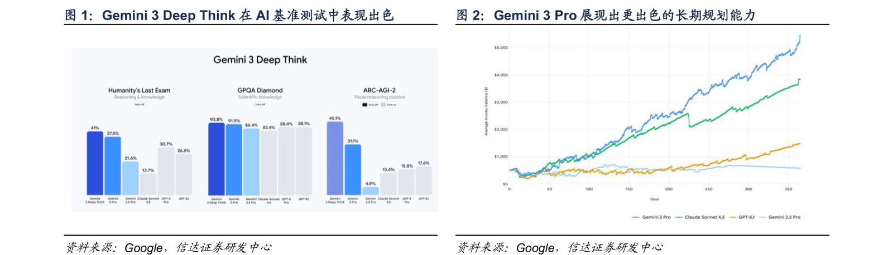

图内标题：Gemini 3 Deep Think
分项：Humanity's Last Exam（Reasoning & knowledge）、GPQA Diamond（Scientific knowledge）、ARC-AGI-2（Visual reasoning puzzles）
横轴（模型）：Gemini 3 Deep Think、Gemini 3 Pro、Gemini 2.5 Pro、Claude Sonnet 4.5、GPT-5 Pro、GPT-5.1
标注：Tools off、Tools on

资料来源：Google，信达证券研发中心

图 2：Gemini 3 Pro 展现出更出色的长期规划能力

横轴：Days；纵轴：Average money balance ($)（0–5,000）
图例：Gemini 3 Pro、Claude Sonnet 4.5、GPT-5.1、Gemini 2.5 Pro

资料来源：Google，信达证券研发中心

全球 AI 大模型的你追我赶，是推动上游算力基础设施需求爆发的重要驱动力。目前，以谷歌 Gemini 3 Pro 为代表的新一代多模态大模型，凭借其在复杂推理、长文本理解和跨模态交互方面的卓越表现，正在引领全球 AI 技术前沿。这种旗舰模型的迭代速度和对算力消耗的指数级增长，直接决定了全球云服务商必须持续加大资本开支以满足训练和部署需求。与此同时，国内头部互联网公司和 AI 初创企业亦在大模型领域展开激烈竞争，国产模型如通义千问、Kimi、文心一言等，在中文语境和特定场景应用上不断优化，技术差距正加速缩小，并积极适配国产算力平台。这种全球范围内技术你追我赶的态势，奠定了未来几年 AI 硬件产业链高景气的基调。

图 3：谷歌 Gemini 3 Pro 智能指数登陆榜首

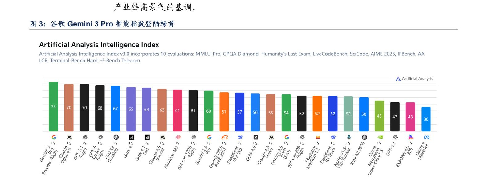

图内标题：Artificial Analysis Intelligence Index
说明：Artificial Analysis Intelligence Index v3.0 incorporates 10 evaluations: MMLU-Pro, GPQA Diamond, Humanity's Last Exam, LiveCodeBench, SciCode, AIME 2025, IFBench, AA-LCR, Terminal-Bench Hard, τ²-Bench Telecom
图例：Artificial Analysis（条形内数字为各模型智能指数得分）

资料来源：Artificial Analysis，信达证券研发中心

---

<!-- 原文第 7 页 -->

图 4：中国 AI 大模型正缩小与美国之间的差距

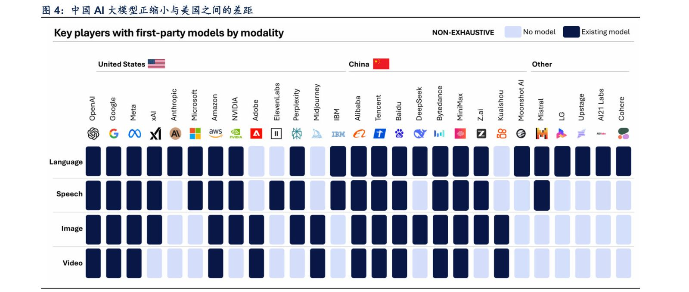

图内标题：Key players with first-party models by modality
说明：NON-EXHAUSTIVE；图例：No model、Existing model
列分组：United States、China、Other
行（模态）：Language、Speech、Image、Video
列（公司）：OpenAI、Google、Meta、xAI、Anthropic、Microsoft、Amazon、NVIDIA、Adobe、ElevenLabs、Perplexity、Midjourney、IBM、Alibaba、Tencent、Baidu、DeepSeek、ByteDance、MiniMax、Z.ai、Kuaishou、Moonshot AI、Mistral、LG、Upstage、AI21 Labs、Cohere

资料来源：Artificial Analysis，信达证券研发中心

北美巨头与国内大厂在 AI 基础设施投入上形成共振，全球 CSP 资本开支大幅提升。受 AI 强劲需求的驱动，全球云服务商（CSP）正迎来新一轮的资本开支扩张周期。北美科技巨头为抢占 AI 技术高地，持续加码基础设施建设，推动投资重心坚定地向算力侧及自研芯片倾斜。与此同时，随着大模型商业化进程的加速及自研训练需求的释放，国内云厂商的投资意愿也显著回暖，正在走出调整期并重回增长轨道。展望未来，在中美两大市场需求的“共振”下，AI 算力竞赛将持续深化，这为全球 CSP 资本开支维持长期上行趋势提供了坚实的逻辑支撑。

图 5：北美 CSP 资本支出（单位：亿美元）

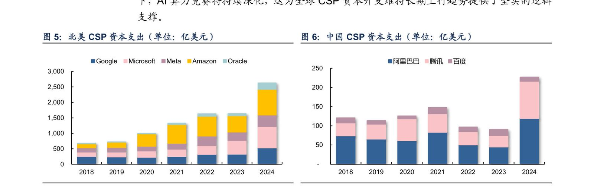

横轴：2018–2024；纵轴：0–3,000（亿美元）
图例：Google、Microsoft、Meta、Amazon、Oracle

资料来源：Bloomberg，信达证券研发中心

图 6：中国 CSP 资本支出（单位：亿美元）

横轴：2018–2024；纵轴：0–250（亿美元）
图例：阿里巴巴、腾讯、百度

资料来源：Bloomberg，信达证券研发中心

**2026 年 CSP 资本支出合计或增长至 6000 亿美元以上，算力迈入新一轮结构性成长周期。** TrendForce 上修 2025 年全球八大主要 CSP 资本开支总额增长率至 65%（原值 61%），并预期 2026 年 CSPs 仍将维持积极的投资节奏，合计资本支出将进一步推升至 6000 亿美元以上，年增 40%，展现出 AI 基础建设的长期成长潜能。这波资本支出成长将激励 AI Server 需求全面升温，并带动 GPU/ASIC、存储器、封装材料等上游供应链，以及液冷散热模块、电源供应及 ODM 组装等下游系统同步扩张，驱动 AI 硬件生态链迈入新一轮结构性成长周

---

<!-- 原文第 8 页 -->

期。

图 7：2026 年 CSP 资本支出合计或增长至 6000 亿美元以上

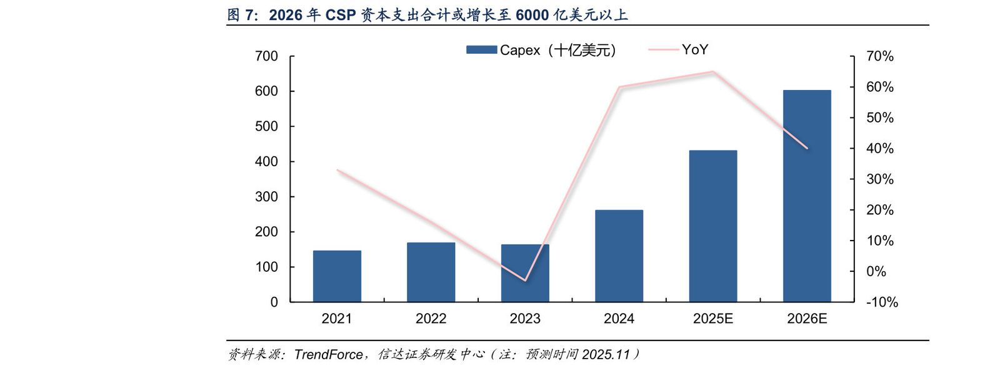

横轴：2021–2026E；左纵轴：Capex（十亿美元，0–700）；右纵轴：YoY（-10%–70%）
图例：Capex（十亿美元）、YoY

资料来源：TrendForce，信达证券研发中心（注：预测时间 2025.11）

**全球 AI 基建 CapEx 动能强劲，拉动 AI 服务器出货保持高增长。** 2026 年来自 CSP、主权云的需求持续稳定，加上 AI 推理应用蓬勃发展，我们预计 AI 服务器出货量维持高增速。根据 Gartner 数据，2024 年全球 AI 服务器出货量 160 万台，同比增长 59%，预计 2025/2026 年将增长至 200 万/240 万台，同比增长 24%/17%。

图 8：AI 服务器出货量预测（单位：百万台）

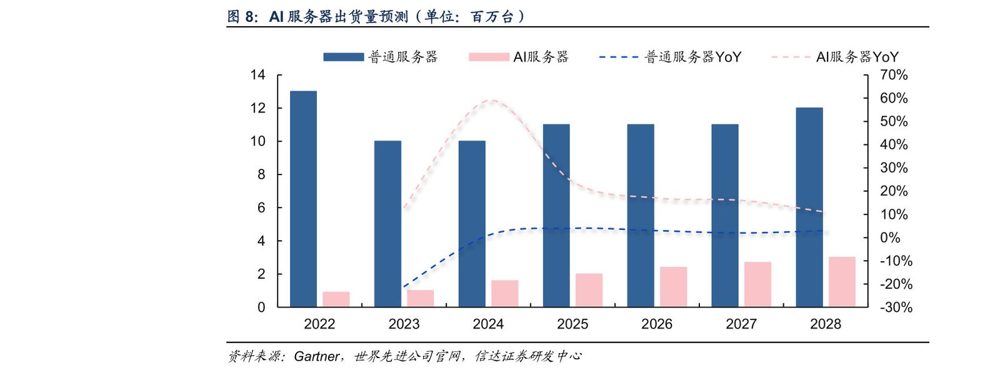

横轴：2022–2028；左纵轴：0–14（百万台）；右纵轴：-30%–70%
图例：普通服务器、AI 服务器、普通服务器YoY、AI服务器YoY

资料来源：Gartner，世界先进公司官网，信达证券研发中心

## 海外链：GPU 与 ASIC 共振，关注服务器与 PCB 等环节价值重塑

**英伟达作为 AI 算力的领军者，其产品迭代节奏显著加快，持续引领行业性能天花板。** 从 Hopper 架构到 Blackwell 架构，英伟达 GPU 在算力及 HBM 显存等指标上实现显著提升。英伟达预计在 26H2 推出 Rubin GPU 芯片，Rubin GPU 由两颗 Reticle 尺寸的核心组成，具备 50 PFLOPS 的 FP4 精度算力，并配备 288GB HBM4 高带宽内存。性能方面，Vera Rubin NVL144 平台可达成 3.6 Exaflops 的 FP4 推理与 1.2 Exaflops 的 FP8 训练算力，相

---

<!-- 原文第 9 页 -->

较 GB300 NVL72 提升约 3.3 倍。英伟达计划在 27H2 推出更高阶的 Rubin Ultra NVL576 平台，将进一步把性能提升至 15 Exaflops。

表 1：英伟达 GPU 芯片 roadmap

| 项目 | 2022 | 2023 | 2024 | 2025 | 2025 | 2026 | 2027 |
|---|---|---|---|---|---|---|---|
| 架构 | Hopper | Hopper | Blackwell | Blackwell | Blackwell | Rubin | Rubin |
| Accelerator | H100 (SXM) | H200 | B200/GB200 | GB300 (Ultra) | B300 (single die, B300A) | VR200 | VR300 (Ultra) |
| GPU TDP (W) | 700 | 700 | 700/1200 | 1,400 | 600 | 1,800 | 3,600 |
| Foundry Node | 4N | 4N | 4NP | 4NP | 4NP | N3P (3NP) | N3P (3NP) |
| Logic Die Configuration | 1 x Reticle Sized GPU | 1 x Reticle Sized GPU | 2 x Reticle Sized GPU | 2 x Reticle Sized GPU | 2 x Reticle Sized GPU | 2 x Reticle Sized GPU, 2x I/O chiplet | 4 x Reticle Sized GPU, 2x I/O chiplet |
| FP4 PFLOPs - Dense (per Package) | 4 | 4 | 10 | 15 | 4.6 | 33.3 | 66.7 |
| HBM | 80GB HBM3 | 141GB HBM3E | 192GB HBM3E | 288GB HBM3E | 144GB HBM3E | 288GB HBM4 | 1024GB HBM4E |
| HBM Stacks | 5 | 6 | 8 | 8 | 4 | 8 | 16 |
| HBM Bandwidth | 3.35TB/s | 4.8TB/s | 8TB/s | 8TB/s | 4TB/s | 3TB/s | 32TB/s |
| Packaging | CoWoS-S | CoWoS-S | CoWoS-L | CoWoS-L | CoWoS-L | CoWoS-L | CoWoS-L |
| SerDes speed (Gb/s uni-di) | 112G | 112G | 224G | 224G | 224G | 224G | 224G |
| Nvidia CPU | Grace | Grace | Grace | Grace | Grace | Vera | Vera |

资料来源：semianalysis，信达证券研发中心

**产能瓶颈有望突破，英伟达 Blackwell+Rubin 至 26 年底预期出货 2000 万颗。** 黄仁勋在美国华盛顿特区 GTC DC 2025 大会上预计，到 2026 年底前，Blackwell 与 Rubin GPU 总出货量或将达到 2000 万颗，Blackwell 与 Rubin 将合计带来 5000 亿美元的 GPU 销售额。对比而言，上一代 Hopper 架构芯片在整个生命周期内仅出货了 400 万块。

图 9：英伟达预计 26 年底前 Blackwell-Rubin 出货量达 2000 万颗

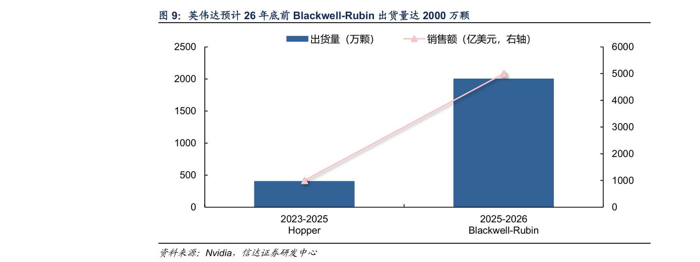

横轴：2023-2025 Hopper、2025-2026 Blackwell-Rubin；左纵轴：出货量（万颗，0–2,500）；右纵轴：销售额（亿美元，右轴，0–6,000）
图例：出货量（万颗）、销售额（亿美元，右轴）

资料来源：Nvidia，信达证券研发中心

大模型厂商你追我赶，推理需求提升推动 ASIC 芯片需求增长。LLM 推理可以分为预填（Prefill）、译码（Decode）两个阶段，Prefill 阶段需要可以进行高度并行的大矩阵计算，

---

<!-- 原文第 10 页 -->

Decode 阶段则需要高带宽、低延迟的存储器，两个阶段对芯片的要求侧重不同。目前市场上的 AI 芯片（多数是 GPU），通常采用“一体适用”的设计，也就是用同一颗芯片来跑完 Prefill 和 Decode 两个阶段，造成了一定的资源浪费。为顺应推理需求增长，各大 CSP 积极开发自研 ASIC，考量成本效益与高能效比。其中其中 Google 于 2025 年 4 月份推出了首款适用于 AI 推理时代的第 7 代 TPU- Ironwood ，Meta 的 MTIA 2 同样也已于 2025 年第三季量产。

图 10：谷歌 TPU Ironwood 算力大幅提升

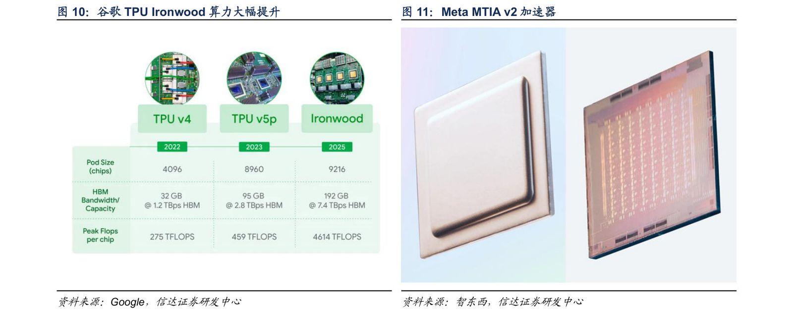

| 项目 | TPU v4（2022） | TPU v5p（2023） | Ironwood（2025） |
|---|---|---|---|
| Pod Size (chips) | 4096 | 8960 | 9216 |
| HBM Bandwidth/Capacity | 32 GB @ 1.2 TBps HBM | 95 GB @ 2.8 TBps HBM | 192 GB @ 7.4 TBps HBM |
| Peak Flops per chip | 275 TFLOPS | 459 TFLOPS | 4614 TFLOPS |

资料来源：Google，信达证券研发中心

图 11：Meta MTIA v2 加速器

资料来源：智东西，信达证券研发中心

**AI 服务器架构升级，关注 ODM、PCB 等环节价值量提升。** AI 服务器正从单 GPU 组件升级向机架级（rack）集成设计演进，叠加算力密度的跳跃式提升，机柜需求或将迎来快速增长。英伟达 2024 年推出 GB200 NVL72 采用第一代 Oberon 架构，2025 年量产第二代 Oberon 架构产品 GB300 NVL72，预计 2026 年下半年推出第三代 Oberon 架构的 Vera Rubin NVL144，且 27 年推出的 Vera Rubin NVL576 有望升级为 Kyber 架构。架构升级有望带来 ODM 毛利率不断提升，工业富联作为全球 AI 服务器 ODM 龙头，已切入英伟达及 ASIC AI 服务器核心供应链，市场份额有望稳定提升。

表 2：英伟达 AI 服务器系统升级

| 项目 | 2022 | 2023 | 2024 | 2025 | 2025 | 2026 | 2027 |
|---|---|---|---|---|---|---|---|
| Maximum system density | NVL8 | NVL8 | NVL72（144 compute chiplets，72 GPUs） | NVL72（144 compute chiplets，72 GPUs） | NVL16 | NVL144（144 compute chiplets，72 GPUs） | NVL576（576 compute chiplets，144 GPUs） |
| Form Factor Supported | HGX | HGX | HGX,Oberon | HGX,Oberon | HGX,Oberon | HGX, Oberon, Kyber | HGX, Oberon, Kyber |
| # of GPU Packages | 8 | 8 | 72 | 72 | 16 | 72 | 144 |
| # of GPU dies | 8 | 8 | 144 | 144 | 16 | 144 | 576 |
| Scale up links | UBB (PCB) | UBB (PCB) | Copper Backplane | Copper Backplane | UBB (PCB) | Copper Backplane | PCB Backplane |
| Aggregate FP4 PFLOPs (Dense) | 32* | 32* | 720 | 1,080 | 74 | 2,398 | 9,605 |
| Aggregate HBM capacity | 14TB | 14TB | 14TB | 21TB | 64TB | 21TB | 147TB |
| Aggregate HBM bandwidth | 27TB/s | 38TB/s | 576TB/s | 576TB/s | 64TB/s | 936TB/s | 4,608TB/s |

资料来源：semianalysis，信达证券研发中心

---

<!-- 原文第 11 页 -->

**Rubin 平台服务器采用的无缆化互连设计，驱动 PCB 成为算力核心。**过去 GPU 与 Switch 间的高速传输依赖线缆，如今改由 Switch tray、Midplane 与 CX9/CPX 等多层 PCB 板直接承接，使讯号完整性（Signal Integrity, SI）与传输稳定性成为设计的核心指标。而 Rubin 平台为达成低损耗与低延迟，全面升级使用材料，包括 Switch Tray 采用 M8U 等级（Low-Dk2 + HVLP4）和 24 层 HDI 板设计，Midplane 与 CX9/CPX 则导入 M9（Q-glass + HVLP4），层数最高达 104 层。这让单台服务器的 PCB 价值比上一代提升逾两倍，并使设计重点从板面布线转向整机互连与散热协同。此外，Rubin 的设计逻辑已成为产业共同语言，包括 Google TPU V7、AWS Trainium3 等 ASIC AI 服务器同样导入高层 HDI、低 Dk 材料与极低粗糙度铜箔。

图 12： Rubin Ultra 使用 Kyber 架构或采用正交背板

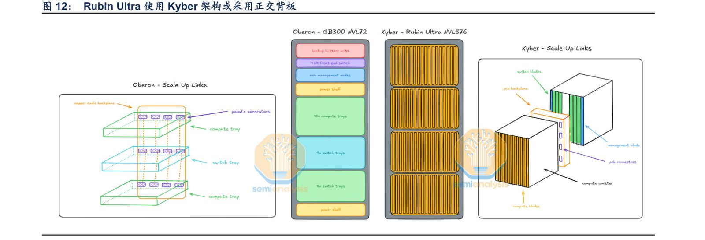
**Oberon - Scale Up Links**：copper cable backplane、paladin connectors、compute tray、switch tray、compute tray

**Oberon - GB300 NVL72**（自上而下）：backup battery units、ToR front-end switch、cdb management nodes、power shelf、10u compute trays、9u switch trays、8u switch trays、power shelf

**Kyber - Rubin Ultra NVL576**：整机架示意（四个竖向面板，无文字标注）

**Kyber - Scale Up Links**：switch blades、pcb backplane、management blade、pcb connectors、compute canister、compute blades

资料来源：semianalysis，信达证券研发中心

## 国产链：软硬解耦加速 AI 算力落地，产业链上下游共同受益

**在供应链安全与自主可控需求的推动下，国产算力芯片正加速缩小与国际先进水平的差距。**一方面，国内 AI 大模型的性能水平在全球保持较强的竞争实力，CSP 龙头在 AI 基建的投资需求扩张；另一方面，美国对华芯片制裁使得英伟达 GPU 在大陆禁售，给国产 AI 算力芯片带来大量空间。以**华为昇腾、寒武纪、海光信息**为代表的国产算力芯片性能不断提升，并随着良率突破，市场份额有望不断增长。以华为昇腾芯片为例，25Q1 推出昇腾 910C 芯片，后续或将在 26Q1 推出全新的昇腾 950PR 芯片，26Q4 推出昇腾 950DT 芯片，27Q4，华为将推出昇腾 960 芯片，28Q4 推出昇腾 970 芯片。

表 3： 华为昇腾芯片 roadmap

|  | Ascend 910C | Ascend 950PR | Ascend 950DT | Ascend 960 | Ascend 970 |
| --- | --- | --- | --- | --- | --- |
| 发布时间 | 2025Q1 | 2026 Q1 | 2026Q4 | 2027 Q4 | 2028Q4 |
| 微架构 | SIMD | SIMD/SIMT | SIMD/SIMT | SIMD/SIMT | SIMD/SIMT |
| 数值类型 | FP32/HF32/FP16/BF16/INT8 | FP32/HF32/FP16/BF16/FP8/MXFP8/HiF8/MXFP4 | FP32/HF32/FP16/BF16/FP8/MXFP8/HiF8/MXFP4 | FP32/HF32/FP16/BF16/FP8/MXFP8/HiF8/MXFP4 | FP32/HF32/FP16/BF16/FP8/MXFP8/HiF8/MXFP4 |

---

<!-- 原文第 12 页 -->

|  | Ascend 910C | Ascend 950PR | Ascend 950DT | Ascend 960 | Ascend 970 |
| --- | --- | --- | --- | --- | --- |
| 互联带宽 | 784GB/s | 2TB/s | 2TB/s | 2.2TB/s | 4TB/s |
| 算力 | 800 TFLOPS FP16 | 1 PFLOPS FP8, 2 PFLOPS FP4 | 1 PFLOPS FP8, 2 PFLOPS FP4 | 2 PFLOPS FP8, 4 PFLOPS FP4 | 4 PFLOPS FP8, 8 PFLOPS FP4 |
| 内存 | 128GB,3.2TB/s | Ascend 950PR: 128GB, 1.6TB/s | Ascend 950DT: 144GB, 4TB/s | 288GB,9.6TB/s | 288GB,14.4 TB/s |

资料来源：芯智讯，信达证券研发中心

**DeepSeek-V3.1 使用 UE8M0 FP8 Scale 的参数精度，国产 AI 芯片迎接战略性机遇。**DeepSeek 发布的 V3.1 模型使用了 UE8M0 FP8 Scale 的参数精度，是针对即将发布的下一代国产芯片设计的。UE8M0 是 MXFP8 路径里的“缩放因子”，其优势包括缩短时钟关键路径；指数表容纳跨度大，为后续块缩放提供充足空间；在保持 8 bit 张量精度的同时大幅减少信息损失。我们关注到，目前多家国产 AI 芯片厂商的下一代产品都或将支持 FP8 计算，这表示国产 AI 正走向软硬件协同阶段，或能实质性减少对海外算力的依赖，我们认为，V3.1 的发布为国产 AI 芯片产业链带来了战略性机遇，AI 芯片替代进程有望提速。

图 13： 首批通过 DeepSeek 适配测试名单

| 产品名称 | 企业名称 | 适配结果 |
| --- | --- | --- |
| 星辰 MaaS 平台 | 中国电信 | 通过 |
| 推理服务器 | 华为 | 通过 |
| AIDC®一体机 | 寒武纪 | 通过 |
| P800 一体机 | 昆仑芯 | 通过 |
| DCU 加速卡 | 海光 | 通过 |
| C550 一体机及智算集群 | 沐曦 | 通过 |
| 泰则®GPTPU 人工智能服务器 | 中昊芯英 | 通过 |
| 中科加禾模型推理引擎 SigInfer V1.0 | 中科加禾 | 通过 |

资料来源：中国信通院，信达证券研发中心

**先进制程的演进虽然面临外部限制，但晶圆代工厂的技术突围仍在持续。**尽管面临地缘政治挑战，全球晶圆代工厂在制程节点的推进上依然按部就班。从 FinFET 向 GAA（全环绕栅极）晶体管架构的演进，将进一步提升芯片的能效比。对于国产算力而言，利用成熟制程通

---

<!-- 原文第 13 页 -->

过 Chiplet（小芯片）架构和先进封装技术提升系统级性能，已成为明确的技术路径。

图 14： 晶圆代工厂制程节点路线图

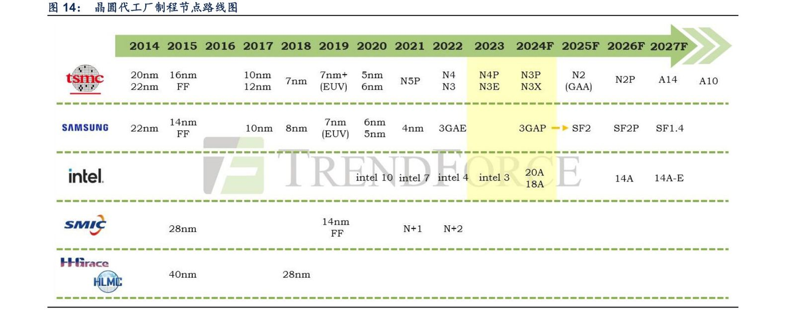
横轴为年份：2014、2015、2016、2017、2018、2019、2020、2021、2022、2023、2024F、2025F、2026F、2027F；纵轴为晶圆代工厂，各厂节点标注（自左至右按版面顺序）：

- TSMC：20nm / 22nm；16nm FF；10nm / 12nm；7nm；7nm+（EUV）/ 6nm；5nm；N5P；N4 / N3；N4P / N3E；N3P / N3X；N2（GAA）；N2P；A14；A10
- SAMSUNG：22nm；14nm FF；10nm；8nm；7nm（EUV）/ 5nm；6nm；4nm；3GAE；3GAP；SF2；SF2P；SF1.4
- intel：intel 10；intel 7；intel 4；intel 3；20A / 18A；14A；14A-E
- SMIC：28nm；14nm FF；N+1；N+2
- HHgrace、HLMC：40nm；28nm

资料来源：TrendForce，信达证券研发中心（注：预测时间 2024.3）

**国内 IP 授权及芯片定制服务商显著受益于系统厂商造芯的浪潮。**随着互联网大厂及系统厂商纷纷涉足自研芯片，对上游 IP 核及设计服务的需求激增。以芯原股份为代表的一站式芯片定制服务商，能够提供从芯片定义、设计到流片的完整解决方案，帮助客户降低研发风险并缩短上市周期。在算力专用化趋势下，这类赋能型企业的价值量有望持续提升。

图 15： 芯原股份提供一站式芯片定制服务和 IP 授权服务

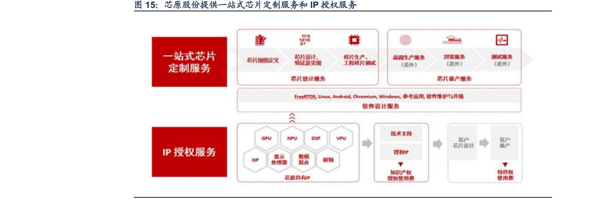
**一站式芯片定制服务**：芯片规格定义 → 芯片设计、验证及实现 → 样片生产、工程样片调试（芯片设计服务）；晶圆生产服务（委外）→ 封装服务（委外）→ 测试服务（委外）（芯片量产服务）；软件设计服务：FreeRTOS、Linux、Android、Chromium、Windows、参考应用、软件维护与升级

**IP 授权服务**：芯原自有 IP（GPU、NPU、DSP、VPU、ISP、显示处理器、数模混合、射频）→ 技术支持 / 授权 IP → 知识产权授权使用费；客户芯片设计 → 客户量产 → 特许权使用费

资料来源：芯原股份公告，信达证券研发中心

---

<!-- 原文第 14 页 -->

## AI 存力：周期回升叠加 AI 需求，“超级周期”趋势形成

### 涨价周期：原厂控产效果显现，新一轮上行周期确立

存储原厂坚定的减产保价策略已逐步扭转供需格局，DRAM 和 NAND Flash 价格步入上行通道。回顾过去几个季度，主要存储原厂通过严格控制晶圆投片量和优化库存结构，成功推动了存储价格触底反弹。从合约价和现货价走势来看，DRAM 和 NAND Flash 均已走出一波明显的上涨行情。展望 2026 年，鉴于原厂在扩产方面依旧保持谨慎，且新增产能主要集中在 HBM 等高端产品，我们预计常规存储产品的供需将持续处于紧平衡状态，价格中枢有望进一步抬升。

图 16： DRAM 合约平均价（单位：美元）

折线图；纵轴刻度 0–60（每 10 一格），横轴为 2022-01 至 2025-07 的月度区间；图例：DDR4 8Gb 1Gx8、DDR4 16Gb 2Gx8、DDR5 8GB SO-DIMM、DDR5 16GB SO-DIMM

资料来源：iFinD，信达证券研发中心

图 17： DRAM 现货平均价（单位：美元）

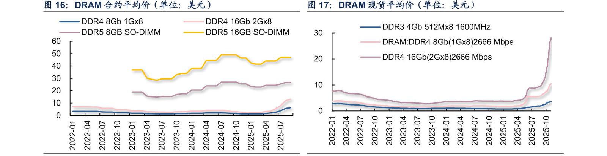
折线图；纵轴刻度 0–30（每 10 一格），横轴为 2022-01 至 2025-10 的月度区间；图例：DDR3 4Gb 512Mx8 1600MHz、DRAM:DDR4 8Gb(1Gx8)2666 Mbps、DDR4 16Gb(2Gx8)2666 Mbps

资料来源：iFinD，信达证券研发中心

图 18： NAND Flash 合约平均价（单位：美元）

折线图；纵轴刻度 0–6（每 1 一格），横轴为 2022-01 至 2025-07 的月度区间；图例：32Gb 4Gx8 MLC、64Gb 8Gx8 MLC、128Gb 16Gx8 MLC

资料来源：iFinD，信达证券研发中心

图 19： NAND Flash 现货平均价（单位：美元）

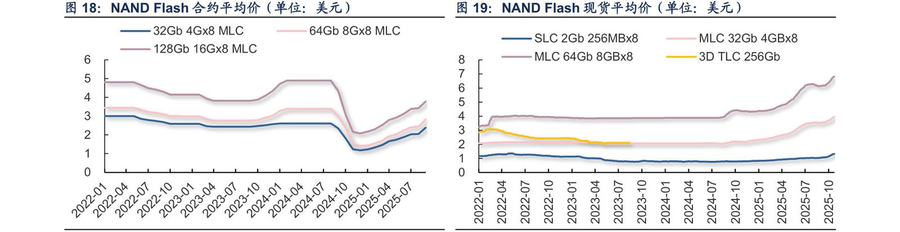
折线图；纵轴刻度 0–8（每 1 一格），横轴为 2022-01 至 2025-10 的月度区间；图例：SLC 2Gb 256MBx8、MLC 32Gb 4GBx8、MLC 64Gb 8GBx8、3D TLC 256Gb

资料来源：iFinD，信达证券研发中心

图 20： DRAM 内存条价格（单位：美元）

折线图；纵轴刻度 0–250（每 50 一格），横轴为 2022-01 至 2025-10 的月度区间；图例：DDR4 SODIMM 8GB 2666 MHz、DDR4 UDIMM 8GB 2666 MHz、DDR4 RDIMM 16GB 3200 MHz

资料来源：iFinD，信达证券研发中心

图 21： NAND Flash Wafer 价格（单位：美元）

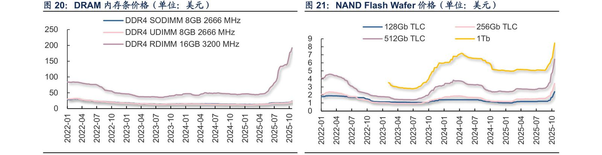
折线图；纵轴刻度 0–9（每 1 一格），横轴为 2022-01 至 2025-10 的月度区间；图例：128Gb TLC、256Gb TLC、512Gb TLC、1Tb

资料来源：iFinD，信达证券研发中心

---

<!-- 原文第 15 页 -->

随着 AI 旺季的到来及传统消费电子的温和复苏，预计 2025 年第四季度存储价格将维持强势。根据 TrendForce 预测，受服务器端强劲需求拉动，4Q25 DRAM 合约价预计将环比上涨 18%-23%，其中 HBM 及高密度 DDR5 产品的涨幅更为显著。NAND Flash 方面，虽然消费端需求相对平稳，但企业级 SSD 的需求爆发支撑了价格的稳步上行，预计 4Q25 涨幅在 5%-10%区间。价格的持续上涨将显著修复存储原厂及模组厂商的盈利能力。

表 4： 预计 4Q25 DRAM 和 NAND Flash 价格继续大幅提升

|  | 3Q25 | 4Q25F |
| --- | --- | --- |
| Total DRAM | Conventional DRAM: up 10%~15% | Conventional DRAM: up 18%~23% |
|  | HBM Blended: up 15%~20% | HBM Blended: up 23%~28% |
| Total NAND Flash | up 3%~8% | up 5%~10% |

资料来源：TrendForce，信达证券研发中心

### DRAM：HBM 产能挤兑效应显著，服务器高端存储加速提升

**HBM 作为 AI 算力的“加油站”，其技术迭代与产能扩张是当前存储市场的主旋律。**Nvidia 及 AMD 的新一代 AI 芯片对显存带宽的需求呈指数级增长，推动 HBM 从 HBM3 向 HBM3e 及 HBM4 快速演进。观察 Nvidia 和 AMD 的产品路线图，HBM3e 12hi 及后续 HBM4 将成为 2026 年的主流配置。单颗 GPU 搭载的 HBM 容量从 80GB 快速提升至 288GB 甚至更高，这对存储厂商的 TSV 工艺及封装良率提出了巨大挑战。

图 22： Nvidia 和 AMD 的 AI 芯片所使用的 HBM 升级趋势

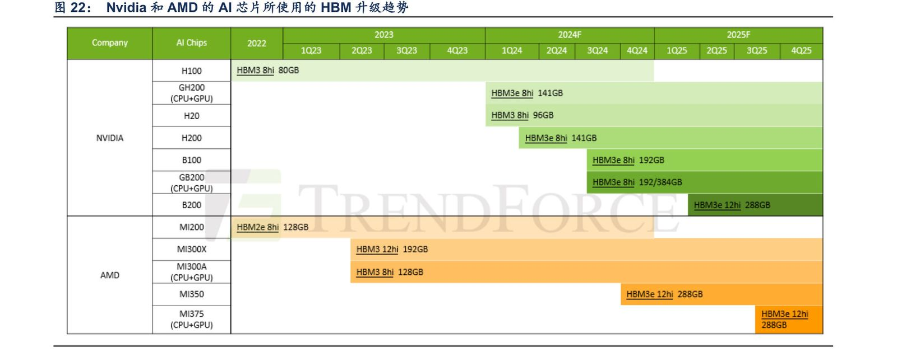
时间轴 / 甘特图式表格；列头为年份与季度：2022、2023（1Q23、2Q23、3Q23、4Q23）、2024F（1Q24、2Q24、3Q24、4Q24）、2025F（1Q25、2Q25、3Q25、4Q25）；行头为 Company、AI Chips，各色条带标注所用 HBM 规格与容量：

- NVIDIA：H100——HBM3 8hi 80GB；GH200（CPU+GPU）——HBM3e 8hi 141GB；H20——HBM3 8hi 96GB；H200——HBM3e 8hi 141GB；B100——HBM3e 8hi 192GB；GB200（CPU+GPU）——HBM3e 8hi 192/384GB；B200——HBM3e 12hi 288GB
- AMD：MI200——HBM2e 8hi 128GB；MI300X——HBM3 12hi 192GB；MI300A（CPU+GPU）——HBM3 8hi 128GB；MI350——HBM3e 12hi 288GB；MI375（CPU+GPU）——HBM3e 12hi 288GB

资料来源：TrendForce，信达证券研发中心（注：预测时间 2024.9）

三大原厂积极扩产 HBM，产能挤兑效应或将导致通用 DRAM 供应紧张。为了抢占高利润的 HBM 市场，Samsung、SK Hynix 及 Micron 纷纷加大 HBM 产能投入。由于 HBM 的晶圆消耗量是同容量 DDR5 的数倍，且需要占用大量先进逻辑制程进行 Base Die 制造，这种产能置换效应极易挤占通用 DRAM 的产能。我们判断，随着 HBM 投片量的增加，标准型 DDR5 内存存在 2026 年可能出现结构性缺货。

---

<!-- 原文第 16 页 -->

图 23： 三大 DRAM 原厂 HBM 产能（单位：kwpm）

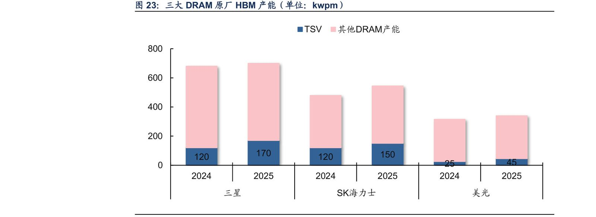
堆叠柱状图；纵轴为产能 0–800（kwpm），横轴按原厂分为三星、SK海力士、美光，各含 2024、2025 两年；图例：TSV（深蓝）、其他DRAM产能（浅粉）。图中仅标注 TSV 部分数值：

| 原厂 | 2024 | 2025 |
| --- | --- | --- |
| 三星 | 120 | 170 |
| SK海力士 | 120 | 150 |
| 美光 | 25 | 45 |

资料来源：TrendForce，信达证券研发中心

**服务器内存从 DDR4 向 DDR5 切换的进程加速，高密度模组需求旺盛。**在服务器端，随着 Intel Sapphire Rapids/Emerald Rapids 及 AMD Genoa/Turin 平台的渗透，DDR5 内存已成为新建数据中心的标配。弗若斯特沙利文预计 2025年，DDR5 的市场渗透率或将超过 85%。此外，AI 服务器对内存容量的渴求推动了 64GB/128GB 等高容量 RDIMM 模组的出货占比提升，进一步拉动了 DRAM 位元出货量的增长。

图 24： 全球服务器内存模组出货量

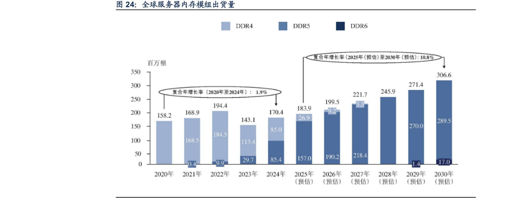
堆叠柱状图；纵轴单位为百万根，刻度 0–350（每 50 一格）；横轴为 2020 年—2030 年（2025 年及以后标注“预估”）；图例：DDR4、DDR5、DDR6。柱顶标注合计值，柱内标注各代际销量：

| 年份 | 合计（百万根） | DDR4 | DDR5 | DDR6 |
| --- | --- | --- | --- | --- |
| 2020年 | 158.2 | 158.2 |  |  |
| 2021年 | 168.9 | 168.5 |  | 0.4 |
| 2022年 | 194.4 | 184.5 |  | 9.9 |
| 2023年 | 143.1 | 113.4 |  | 29.7 |
| 2024年 | 170.4 | 85.0 | 85.4 |  |
| 2025年（预估） | 183.9 | 26.9 | 157.0 |  |
| 2026年（预估） | 199.5 |  | 190.2 | 9.2 |
| 2027年（预估） | 221.7 |  | 218.4 | 3.3 |
| 2028年（预估） | 245.9 |  |  |  |
| 2029年（预估） | 271.4 |  | 270.0 | 1.4 |
| 2030年（预估） | 306.6 |  | 289.5 | 17.0 |

（2028 年柱内未标注分代数值）

图中标注：复合年增长率（2020年至2024年）：1.9%；复合年增长率（2025年（预估）至2030年（预估））：10.8%

资料来源：弗若斯特沙利文，澜起科技公告，信达证券研发中心

---

<!-- 原文第 17 页 -->

### NAND Flash：大容量 eSSD 需求快速增长，HDD 替代进程加速

**AI 训练对数据吞吐的高要求，正在催化 QLC eSSD 加速替代近线（Nearline）HDD。**在 AI 大模型训练和推理过程中，存储设备的读写速度直接影响整体计算效率。AI 创造的庞大数据量正冲击全球数据中心存储设施，传统作为海量数据存储基石的 Nearline HDD（近线硬盘）已出现供应短缺，促使高效能、高成本的 SSD 逐渐成为市场焦点，根据 TrendForce，大容量的 QLC SSD 出货可能于 2026 年出现大幅增长。由于全球主要 HDD 制造商近年未规划扩大产线，无法及时满足 AI 刺激的突发性、巨量储存需求。目前 NL HDD 交期已从原本的数周，急剧延长为 52 周以上，加速扩大 CSP 的储存缺口。

表 5： Nearline HDD 与 QLC SSD 重点比较

| 产品 | 交付周期 | 每 GB 平均售价（美元） | 最大容量 | 性能 | 能效 |
| --- | --- | --- | --- | --- | --- |
| Nearline HDD | 52 周 | 0.015 | 32TB | 弱 | 较低 |
| QLC SSD | 8 周 | 0.05-0.06 | 122TB | 强 | 较高 |

资料来源：TrendForce，信达证券研发中心（注：预测时间 2025.9）

推理场景下的 RAG（检索增强生成）技术普及，直接推动了大容量 SSD 的需求爆发。随着 AI 应用从训练走向推理，RAG 技术被广泛应用于提升大模型的准确性。RAG 需要频繁地从海量向量数据库中检索信息，这对存储介质的随机读取性能提出了严苛要求。由于语言大模型对数据存储需求大幅增长，AI 推理服务器中 SSD 的配置容量高于传统服务器，我们预计这将推动企业级 SSD 位元出货量在 2026 年维持高增长。

图 25： AI 推理推动 SSD 需求增长

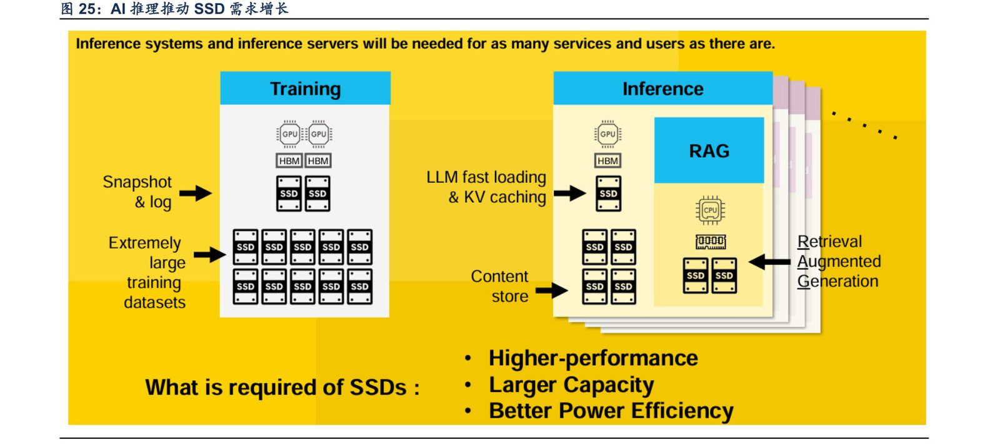
示意图（铠侠公司资料）。顶部标题：Inference systems and inference servers will be needed for as many services and users as there are.

- Training 侧：GPU + HBM，SSD 用于 Snapshot & log；Extremely large training datasets（10 个 SSD 图标）
- 进入 Inference 侧的箭头标注：LLM fast loading & KV caching；Content store
- Inference 侧：GPU + HBM + SSD；RAG 框内为 CPU、DRAM 模组、2 个 SSD；Retrieval Augmented Generation（多层堆叠的推理服务）
- 底部：What is required of SSDs：Higher-performance / Larger Capacity / Better Power Efficiency

资料来源：铠侠公司官网，信达证券研发中心

---

<!-- 原文第 18 页 -->

**端侧设备存储容量升级趋势确立，手机与 PC 单机搭载量稳步提升。**除了数据中心，端侧 AI 的落地也对本地存储提出了更高要求。为了在本地运行数十亿参数的小模型，智能手机和 AI PC 需要更大的 RAM 和 ROM 空间。历史数据显示，手机和 PC 的平均 NAND 搭载量呈逐年上升趋势，AI 功能的引入将进一步强化这一趋势，推动 512GB/1TB 成为旗舰机型的主流配置。

图 26： 单台手机 NAND Flash 平均容量增长趋势

柱状图 + 折线（双纵轴）；横轴为 2025E—2029E；左轴为手机单台容量（GB），刻度 0–500（每 100 一格）；右轴为 AI渗透率，刻度 0%–70%（每 10% 一格）；图例：手机单台容量（GB）（柱）、AI渗透率（线）。柱与折线均未标注数值

资料来源：铠侠公司官网，信达证券研发中心

图 27： 单台 PC NAND Flash 平均容量增长趋势

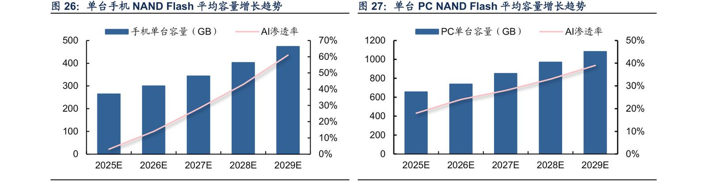
柱状图 + 折线（双纵轴）；横轴为 2025E—2029E；左轴为 PC单台容量（GB），刻度 0–1200（每 200 一格）；右轴为 AI渗透率，刻度 0%–50%（每 10% 一格）；图例：PC单台容量（GB）（柱）、AI渗透率（线）。柱与折线均未标注数值

资料来源：铠侠公司官网，信达证券研发中心

图 28： 服务器 NAND Flash 需求增长

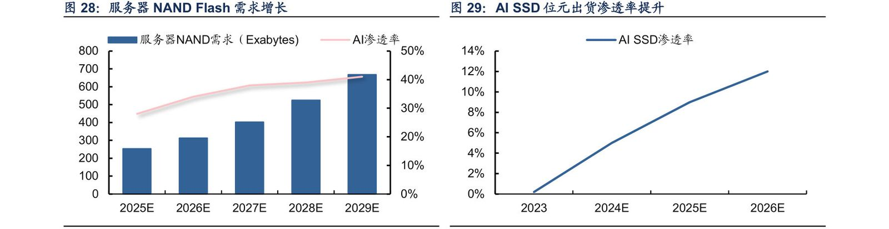
柱状图 + 折线（双纵轴）；横轴为 2025E—2029E；左轴为服务器NAND需求（Exabytes），刻度 0–800（每 100 一格）；右轴为 AI渗透率，刻度 0%–50%（每 10% 一格）；图例：服务器NAND需求（Exabytes）（柱）、AI渗透率（线）。柱与折线均未标注数值

资料来源：铠侠公司官网，信达证券研发中心

图 29： AI SSD 位元出货渗透率提升

折线图；横轴为 2023、2024E、2025E、2026E；纵轴为 AI SSD渗透率，刻度 0%–14%（每 2% 一格）；图例：AI SSD渗透率。折线未标注数值

资料来源：TrendForce，信达证券研发中心（注：预测时间 2024.8）

---

<!-- 原文第 19 页 -->

## 端侧 AI：AI 重塑终端硬件形态，智能终端迎来革新奇点

### AI 手机：换机周期开启，渗透率快速攀升

**全球智能手机市场在经历调整后迎来温和复苏，AI 成为激发换机需求的关键变量。**随着宏观经济环境的改善及渠道库存的去化，全球智能手机出货量已重回增长轨道。展望 2026 年，虽然整体市场规模主要呈现存量博弈特征，但 AI 手机的结构性机会不容忽视。各大手机品牌厂商纷纷将生成式 AI 作为旗舰机型的核心卖点，试图通过差异化的 AI 体验（如实时翻译、图像消除、智能助手）来缩短用户的换机周期。

图 30： 全球智能手机出货量

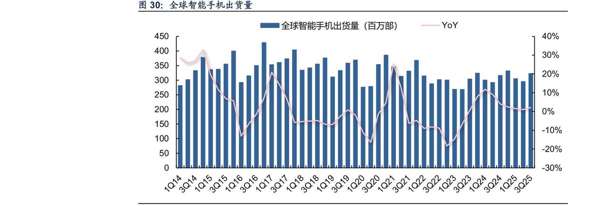
柱状图 + 折线（双纵轴）；横轴为 1Q14—3Q25 各季度；左轴为全球智能手机出货量（百万部），刻度 0–450（每 50 一格）；右轴为 YoY，刻度 -30%–40%（每 10% 一格）；图例：全球智能手机出货量（百万部）（柱）、YoY（线）。柱与折线均未标注数值

资料来源：iFinD，信达证券研发中心

**算力升级与模型轻量化双管齐下，推动 AI 手机渗透率跨越式提升。**随着手机 SoC（如高通 Snapdragon 8 Elite、联发科 Dimensity 9400）NPU 算力的大幅提升以及端侧模型剪枝压缩技术的成熟，越来越多的手机已具备本地运行大模型的能力。根据 Canalys 及 Omdia 预测，全球 AI 手机的出货量渗透率将从 2024 年的约 18%快速攀升至 2026 年的 45%，甚至在 2029 年接近 60%，标志着手机行业正式进入 AI 原生时代。

图 31： 全球 AI 手机渗透率持续提升

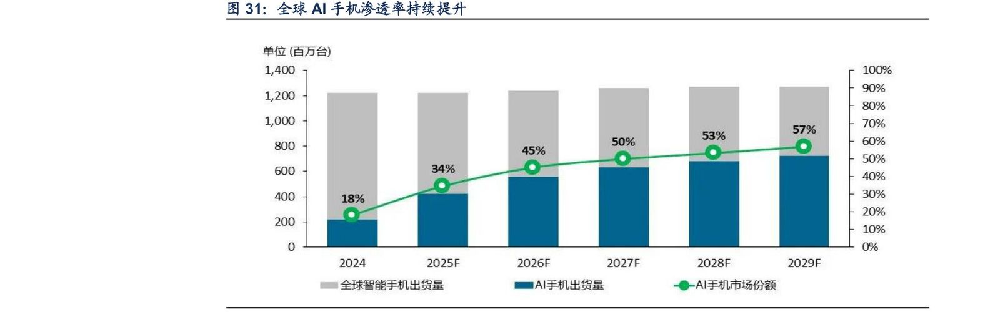
柱状图 + 折线（双纵轴）；单位（百万台）；横轴为 2024、2025F、2026F、2027F、2028F、2029F；左轴刻度 0–1,400（每 200 一格）；右轴为市场份额，刻度 0%–100%（每 10% 一格）；图例：全球智能手机出货量（灰柱）、AI手机出货量（蓝柱）、AI手机市场份额（绿线）。仅折线标注市场份额：

| 年份 | AI 手机市场份额 |
| --- | --- |
| 2024 | 18% |
| 2025F | 34% |
| 2026F | 45% |
| 2027F | 50% |
| 2028F | 53% |
| 2029F | 57% |

（柱状图未标注出货量数值）

资料来源：Canalys，信达证券研发中心（注：预测时间 2025.5）

---

<!-- 原文第 20 页 -->

### AI 眼镜：杀手级应用初现，SoC 厂商大有可为

**AI 智能眼镜作为这一轮端侧 AI 浪潮中的黑马，正展现出强劲的增长爆发力。**Ray-Ban Meta 眼镜的成功验证了“AI+眼镜”这一产品形态的市场接受度。通过集成多模态 AI 模型，智能眼镜能够实现第一视角拍摄、实时问答、翻译等功能，完美契合了 AI 随身助理的场景需求。根据 Wellsenn XR 数据，全球 AI 眼镜销量正处于爆发前夜，预计 2026 年将随着更多科技巨头的入局而迎来大幅增长。

图 32： 全球 AI 眼镜季度销量

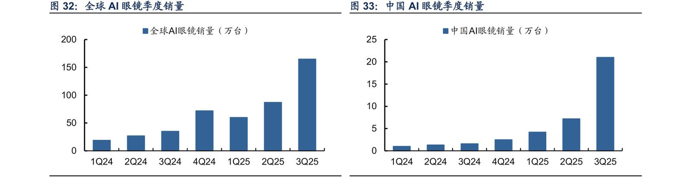
柱状图；纵轴为全球AI眼镜销量（万台），刻度 0–200（每 50 一格）；横轴为 1Q24、2Q24、3Q24、4Q24、1Q25、2Q25、3Q25；柱体未标注数值

资料来源：维深 Wellsenn XR，信达证券研发中心

图 33： 中国 AI 眼镜季度销量

柱状图；纵轴为中国AI眼镜销量（万台），刻度 0–25（每 5 一格）；横轴为 1Q24、2Q24、3Q24、4Q24、1Q25、2Q25、3Q25；柱体未标注数值

资料来源：维深 Wellsenn XR，信达证券研发中心

图 34： 全球 AI 眼镜年度销量预测

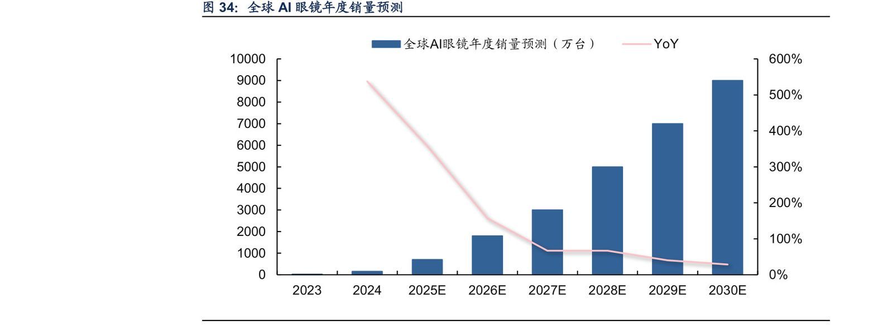
柱状图 + 折线（双纵轴）；左轴为全球AI眼镜年度销量预测（万台），刻度 0–10000（每 1000 一格）；右轴为 YoY，刻度 0%–600%（每 100% 一格）；横轴为 2023、2024、2025E、2026E、2027E、2028E、2029E、2030E；图例：全球AI眼镜年度销量预测（万台）（柱）、YoY（线）。柱与折线均未标注数值

资料来源：维深 Wellsenn XR，信达证券研发中心

**硬件成本的下降与产业链的成熟，为 AI 眼镜的普及奠定了坚实基础。**拆解分析显示，AI 眼镜的硬件成本（BOM）主要集中在 SoC 芯片、摄像头、存储及光机模组上。以小米及主流品牌的 AI 眼镜方案为例，其 BOM 成本已控制在可大规模商用的范围内。随着高通等芯片厂商推出针对眼镜优化的低功耗平台，以及国内精密制造厂商（如歌尔、蓝思等）在组装和零部件环节的良率提升，AI 眼镜有望成为继 TWS 耳机之后的又一个亿级出货量的穿戴单品。

---

<!-- 原文第 21 页 -->

图 35：小米 AI 智能眼镜 BOM 表

| 硬件 | 厂商/型号 | 平光版 | 电变墨镜版 | 电变彩色版 |
| --- | --- | --- | --- | --- |
| 主芯片 | 高通AR1 | 60 | 60 | 60 |
| 副芯片 | BES2700 | 7 | 7 | 7 |
| 存储ePOP | 佰维2+32GB | 11 | 11 | 11 |
| PCB |  | 3 | 3 | 3 |
| 摄像头 | 索尼IMX681/欧菲光模组 | 10 | 10 | 10 |
| 喇叭 | AAC | 2 | 2 | 2 |
| 麦克风 | 楼氏 | 2.5 | 2.5 | 2.5 |
| 电池 | ATL/德赛 | 2 | 2 | 2 |
| 光学镜片 | 明月/唯酷 | 5 | 30 | 60 |
| 结构件 |  | 20 | 20 | 20 |
| FPC |  | 6 | 6 | 6 |
| 其他结构件/元器件 |  | 10 | 10 | 10 |
| OEM/ODM | 歌尔 | 18 | 18 | 18 |
| 充电盒 |  | 20 | 20 | 20 |
| 包装 |  | 4 | 4 | 4 |
| 合计 |  | 180.5美元 | 205.5美元 | 235.5美元 |
| 税后成本（不考虑良率、运损，按7.1汇率折合人名币） |  | 1281.55元 | 1459.05元 | 1672.05元 |

资料来源：维深 Wellsenn XR，信达证券研发中心

## 机器人：具身智能奇点临近，产业链机遇涌现

特斯拉 Optimus 等标杆产品的快速迭代，标志着人形机器人正在从实验室走向工厂验证。在 AI 大模型的赋能下，人形机器人的运动控制和环境感知能力取得了突破性进展。特斯拉 Optimus Gen 2 展现出的灵巧手操作能力及行走稳定性，让市场看到了具身智能商业化的曙光。与此同时，国内厂商如宇数科技（Unitree）推出的通用人形机器人，凭借较高的性价比和快速的迭代速度，也在科研和教育市场占据了一席之地。

图 36：特斯拉 Optimus 机器人

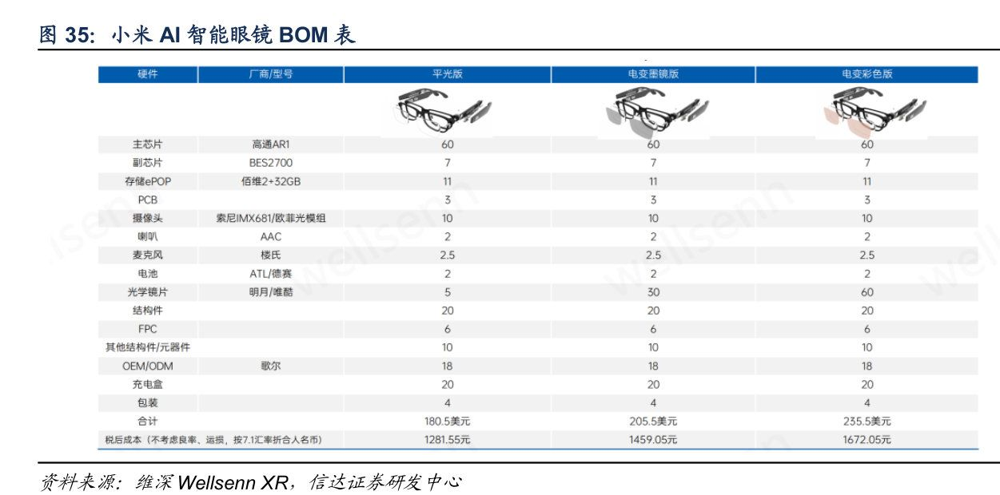

资料来源：爱范儿，信达证券研发中心

图 37：宇数机器人 Unitree H2

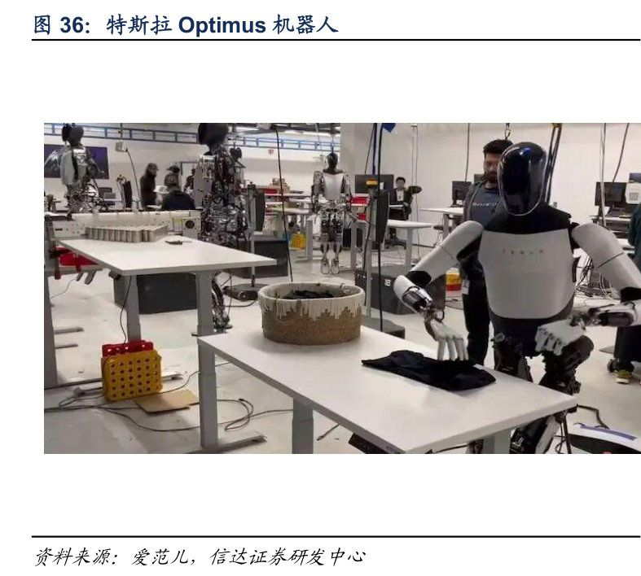

- 仿人双目相机：大视场角
- 仿生人脸：全系标配
- 头部自由度：自由度2个
- 单手臂自由度：肩关节3个 肘关节2个 腕关节2个
- 灵巧手：多型号适配
- 算力模组：最高可选 Jetson AGX Thor（2070 TOPS算力）
- 腰部自由度：自由度3个
- 单腿自由度：自由度6个

资料来源：具身智机产业链，信达证券研发中心

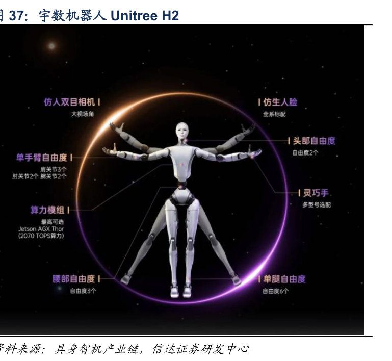

---

<!-- 原文第 22 页 -->

传统消费电子零部件巨头积极布局机器人赛道，供应链外溢效应显著。人形机器人作为集成了视觉、触觉、运控的复杂系统，对高精密零部件有海量需求。蓝思科技等传统果链龙头厂商，正凭借其在玻璃、金属结构件、光学模组领域的制造经验，积极切入机器人供应链。未来，随着人形机器人出货量的量级跃升，具备精密制造能力和规模化降本能力的电子零部件厂商将迎来第二增长曲线。

图 38：蓝思智能机器人永安园区投产

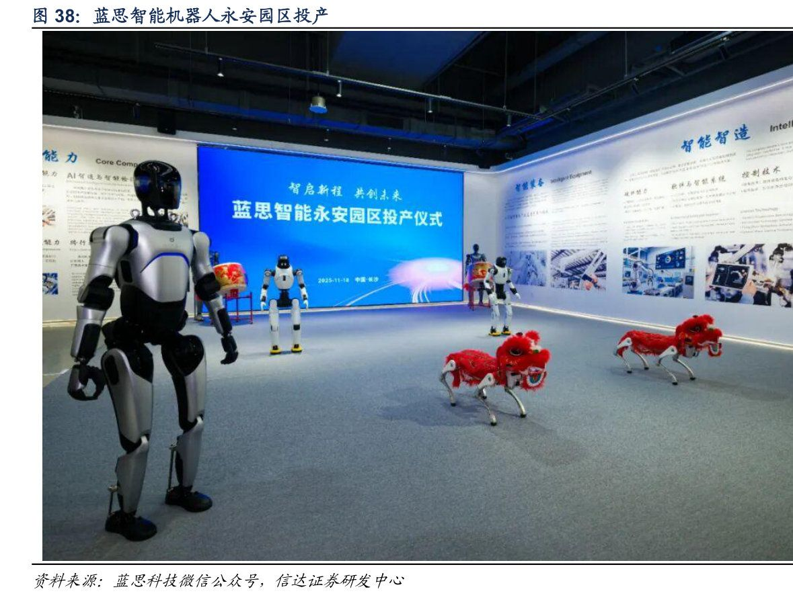

资料来源：蓝思科技微信公众号，信达证券研发中心

---

<!-- 原文第 23 页 -->

## 风险因素

**宏观需求恢复不及预期**：当前宏观经济仍受到地缘政治摩擦、居民消费结构性调整等多重因素影响，恢复节奏或慢于预期进度，这将影响整体下游需求情况；

**科技创新进展不及预期**：以 AI 为代表的新一轮科技创新仍处于应用的探索期，创新存在一定的不确定性和难以落地风险；

**市场竞争加剧风险**：市场参与者逐渐增多将加剧竞争环境，且市场下行期间同业竞争和产业链上下游挤压或将带来不利因素。

---

<!-- 原文第 24 页 -->

## 研究团队简介

莫文宇，电子行业分析师，S1500522090001。毕业于美国佛罗里达大学，电子工程硕士，2012-2022 年就职于长江证券研究所，2022 年入职信达证券研发中心，任电子行业首席分析师。

郭一江，电子行业研究员。本科兰州大学，研究生就读于北京大学化学专业。2020 年 8 月入职华创证券电子组，后于 2022 年 11 月加入信达证券电子组，研究方向为光学、消费电子、汽车电子等。

杨宇轩，电子行业分析师，华北电力大学本科，清华大学硕士，曾就职于东方证券、首创证券、赛迪智库，2025 年 1 月加入信达证券电子组，研究方向为半导体等。

王义夫，电子行业研究员。西南财经大学金融学士，复旦大学金融硕士，2023 年加入信达证券电子组，研究方向为存储芯片、模拟芯片等。

---

<!-- 原文第 25 页 -->

## 分析师声明

负责本报告全部或部分内容的每一位分析师在此申明，本人具有证券投资咨询执业资格，并在中国证券业协会注册登记为证券分析师,以勤勉的职业态度,独立、客观地出具本报告；本报告所表述的所有观点准确反映了分析师本人的研究观点；本人薪酬的任何组成部分不曾与，不与，也将不会与本报告中的具体分析意见或观点直接或间接相关。

## 免责声明

信达证券股份有限公司(以下简称“信达证券”)具有中国证监会批复的证券投资咨询业务资格。本报告由信达证券制作并发布。

本报告是针对与信达证券签署服务协议的签约客户的专属研究产品，为该类客户进行投资决策时提供辅助和参考，双方对权利与义务均有严格约定。本报告仅提供给上述特定客户，并不面向公众发布。信达证券不会因接收人收到本报告而视其为本公司的当然客户。客户应当认识到有关本报告的电话、短信、邮件提示仅为研究观点的简要沟通，对本报告的参考使用须以本报告的完整版本为准。

本报告是基于信达证券认为可靠的已公开信息编制，但信达证券不保证所载信息的准确性和完整性。本报告所载的意见、评估及预测仅为本报告最初出具日的观点和判断，本报告所指的证券或投资标的的价格、价值及投资收入可能会出现不同程度的波动，涉及证券或投资标的的历史表现不应作为日后表现的保证。在不同时期，或因使用不同假设和标准，采用不同观点和分析方法，致使信达证券发出与本报告所载意见、评估及预测不一致的研究报告，对此信达证券可不发出特别通知。

在任何情况下，本报告中的信息或所表述的意见并不构成对任何人的投资建议，也没有考虑到客户特殊的投资目标、财务状况或需求。客户应考虑本报告中的任何意见或建议是否符合其特定状况，若有必要应寻求专家意见。本报告所载的资料、工具、意见及推测仅供参考，并非作为或被视为出售或购买证券或其他投资标的的邀请或向人做出邀请。

在法律允许的情况下，信达证券或其关联机构可能会持有报告中涉及的公司所发行的证券并进行交易，并可能会为这些公司正在提供或争取提供投资银行业务服务。

本报告版权仅为信达证券所有。未经信达证券书面同意，任何机构和个人不得以任何形式翻版、复制、发布、转发或引用本报告的任何部分。若信达证券以外的机构向其客户发放本报告，则由该机构独自为此发送行为负责，信达证券对此等行为不承担任何责任。本报告同时不构成信达证券向发送本报告的机构之客户提供的投资建议。

如未经信达证券授权，私自转载或者转发本报告，所引起的一切后果及法律责任由私自转载或转发者承担。信达证券将保留随时追究其法律责任的权利。

## 评级说明

| 投资建议的比较标准 | 股票投资评级 | 行业投资评级 |
| --- | --- | --- |
| 本报告采用的基准指数：沪深 300 指数（以下简称基准）； 时间段：报告发布之日起 6 个月内。 | 买入：股价相对强于基准 15％以上； | 看好：行业指数超越基准； |
|  | 增持：股价相对强于基准 5％～15％； | 中性：行业指数与基准基本持平； |
|  | 持有：股价相对基准波动在±5% 之间； | 看淡：行业指数弱于基准。 |
|  | 卖出：股价相对弱于基准 5％以下。 |  |

## 风险提示

证券市场是一个风险无时不在的市场。投资者在进行证券交易时存在赢利的可能，也存在亏损的风险。建议投资者应当充分深入地了解证券市场蕴含的各项风险并谨慎行事。

本报告中所述证券不一定能在所有的国家和地区向所有类型的投资者销售，投资者应当对本报告中的信息和意见进行独立评估，并应同时考量各自的投资目的、财务状况和特定需求，必要时就法律、商业、财务、税收等方面咨询专业顾问的意见。在任何情况下，信达证券不对任何人因使用本报告中的任何内容所引致的任何损失负任何责任，投资者需自行承担风险。

---
