> 原文件：[M177_20251218-第一上海-第一上海人工智能计算及半导体行业报告：推理经济的崛起与算力基建的“第二次跃迁”.pdf](https://github.com/jadennevercode/CJCC-Knowledge-Base/blob/5ec8511eb834073c8bfbd79c94af196282d483cf/materials/%E4%B8%8B%E6%B8%B8%EF%BC%9A%E4%BA%91%E8%AE%A1%E7%AE%97%E4%B8%8EAI%E9%9C%80%E6%B1%82%E4%BC%A0%E5%AF%BC/M177_20251218-%E7%AC%AC%E4%B8%80%E4%B8%8A%E6%B5%B7-%E7%AC%AC%E4%B8%80%E4%B8%8A%E6%B5%B7%E4%BA%BA%E5%B7%A5%E6%99%BA%E8%83%BD%E8%AE%A1%E7%AE%97%E5%8F%8A%E5%8D%8A%E5%AF%BC%E4%BD%93%E8%A1%8C%E4%B8%9A%E6%8A%A5%E5%91%8A%EF%BC%9A%E6%8E%A8%E7%90%86%E7%BB%8F%E6%B5%8E%E7%9A%84%E5%B4%9B%E8%B5%B7%E4%B8%8E%E7%AE%97%E5%8A%9B%E5%9F%BA%E5%BB%BA%E7%9A%84%E2%80%9C%E7%AC%AC%E4%BA%8C%E6%AC%A1%E8%B7%83%E8%BF%81%E2%80%9D.pdf)
> 转换方式：多模态逐页转录（页面图像 + 文本层交叉校验）

<!-- 原文第 1 页 -->

# 推理经济的崛起与算力基建的“第二次跃迁”

行业报告

—人工智能计算及半导体发展趋势判断　　2025 年 12 月 18 日

韩啸宇
+852-2522 2101
Peter.han@firstshanghai.com.hk

黄晨
+852-2532 1954
chen.huang@firstshanghai.com.hk

曹凌霁
+852-2532 1539
Rita.cao@firstshanghai.com.hk

## 人工智能计算及半导体行业研究：

本报告旨根据人工智能计算及半导体行业当前的格局对未来的发展趋势做出判断，核心观点如下：

1、 投资 AI 从简单买指数进入精挑细选阶段：行业从“概念验证期”进入了“业绩兑现期”。市场对公司的评价更为严格，既要大模型领先、用户数据和收入漂亮，又要 AI 带来正向的 ROI。简单的购买半导体指数或 M7 指数已经难以获取市场的 Alpha，需要寻找真正能在 AI 时代成长及获益的公司。

2、 半导体产业链中的 Alpha 将快速成长：半导体产业链中具备技术优势及渗透率快速提升的公司将获得“台积电式”价值重估的机会，从供应商提升级至技术创新者而享有更高的估值。

3、 存储芯片将迎来卖方市场：当前这一轮存储价格上涨是由 AI 服务器（HBM、LPDDR）和通用服务器（NAND、DDR）共同驱动的，并且还存在着结构性的产能转换和多个维度的需求竞争，情况更为复杂，短缺和涨价可能将会持续更长时间。

4、 AI 应用渗透率将提升：ToC 应用方面，平台型企业+AI 的模式依旧有很高的护城河，情境感知能力是单纯的模型厂商无法通过 API 获取的；ToB 方面，在代码之后，有更多数据标准化+可验证的工作流程将被 AI 加速。

5、 国产算力破局之年：中国互联网公司、运营商、国资云等算力建设和运营方将加速采购国产算力进行部署，将 AI 能力赋能千行百业。国产算力，也将在项目落地过程中持续迭代升级，迎来研发-销售的良性循环。

6、 关注 AI 估值“泡沫化”风险：绝大部分行业头部公司前瞻估值仍在合理偏高区间内，调整可能是温和的，但对于部分超高估值的应用层或依托单一 Hyperscalers 订单供应链公司，技术路线改变将可能对其造成巨大影响。如果 OpenAI 和 Anthropic 在 2026 年逐步启动上市程序，将成为 AI 是否具备坚实业绩支撑的终极大考。

最后，我们在目前的港美股行业相关上市公司中，最为看好超威半导体（AMD）、谷歌（GOOGL/GOOG）、英伟达（NVDA）、台积电（TSM）、中芯国际（981）；建议关注投资者关注阿斯麦（ASML）、英特尔（INTC）、Lumentum（LITE）、美光（MU）、新思科技（SNPS）

---

<!-- 原文第 2 页 -->

# 行业估值表

**图表 1： 人工智能计算及半导体行业估值表**

**全球股票**（市值单位：亿美元；收入、净利润单位：百万美元）

| 代码 | 公司 | 2025.12.15 收盘价 | 1Y变动 | 市值 | 毛利率 | 经营利润率 | 净利率 | 25PE/3年净利润 CAGR | 收入 FY2024A | 收入 FY2025E | 收入 FY2026E | 收入 FY2027E | 收入 3年CAGR | 净利润 FY2024A | 净利润 FY2025E | 净利润 FY2026E | 净利润 FY2027E | 净利润 3年CAGR | PE FY2024A | PE FY2025E | PE FY2026E | PB FY2024A | PB FY2025E | PB FY2026E |
| --- | --- | --- | --- | --- | --- | --- | --- | --- | --- | --- | --- | --- | --- | --- | --- | --- | --- | --- | --- | --- | --- | --- | --- | --- |
| NVDA US Equity | 英伟达 | 176.3 | 31% | 42,838 | 75.0 | 62.4 | 55.8 | 0.7 | 60,922 | 129,609 | 213,178 | 324,940 | 75% | 29,760 | 73,185 | 114,661 | 186,204 | 84% | 51 | 61 | 38 | 101 | 47 | 28 |
| AVGO US Equity | 博通 | 339.8 | 53% | 16,047 | 67.8 | 39.9 | 36.2 | 0.4 | 51,574 | 63,378 | 95,380 | 128,791 | 36% | 5,895 | 33,271 | 50,689 | 67,774 | 126% | 64 | 50 | 34 | 24 | 21 | 14 |
| 2330 TT Equity | 台积电 | 287.7 | 45% | 14,924 | 56.1 | 45.7 | 40.5 | 0.8 | 90,106 | 120,871 | 147,625 | 177,840 | 25% | 36,526 | 53,235 | 63,873 | 76,682 | 28% | 24 | 22 | 19 | 9 | 7 | 6 |
| ASML NA Equity | 阿斯麦 | 1,087.8 | 53% | 4,222 | 51.3 | 31.9 | 26.8 | 1.8 | 30,574 | 37,764 | 39,903 | 45,767 | 14% | 8,191 | 11,190 | 11,698 | 14,309 | 20% | 35 | 38 | 35 | 20 | 18 | 15 |
| AMD US Equity | 超威半导体 | 207.6 | 64% | 3,379 | 49.4 | 7.4 | 6.4 | 0.4 | 25,785 | 34,004 | 44,785 | 62,785 | 35% | 1,641 | 6,488 | 10,607 | 16,774 | 117% | 106 | 52 | 32 | 6 | 5 | 5 |
| MU US Equity | 美光科技 | 237.5 | 133% | 2,673 | 39.8 | 26.1 | 22.8 | 0.1 | 59,261 | 37,177 | 59,261 | 71,080 | 6% | 778 | 9,169 | 22,699 | 28,419 | 232% | 134 | 29 | 12 | 6 | 5 | 3 |
| AMAT US Equity | 应用材料 | 261.3 | 56% | 2,072 | 48.7 | 29.2 | 24.7 | 3.7 | 27,176 | 28,240 | 28,845 | 32,587 | 6% | 7,177 | 7,557 | 7,488 | 8,923 | 8% | 22 | 28 | 27 | 11 | 11 | 9 |
| LRCX US Equity | 泛林集团 | 164.3 | 117% | 2,064 | 48.7 | 32.0 | 29.1 | 1.8 | 14,905 | 18,262 | 21,258 | 23,852 | 17% | 3,828 | 5,181 | 6,101 | 7,058 | 23% | 35 | 41 | 34 | 25 | 21 | 17 |
| QCOM US Equity | 高通 | 179.3 | 16% | 1,920 | 55.4 | 27.9 | 12.5 | 1.6 | 38,962 | 43,690 | 45,615 | 46,373 | 6% | 10,142 | 13,186 | 12,932 | 13,187 | 9% | 21 | 15 | 15 | 8 | 7 | 7 |
| INTC US Equity | 英特尔 | 37.5 | 84% | 1,789 | 32.7 | -22.0 | -35.3 | 不适用 | 53,101 | 52,571 | 53,995 | 56,644 | 2% | -18,756 | 1,599 | 3,182 | 5,797 | 不适用 | 不适用 | 109 | 59 | 2 | 2 | 2 |
| TXN US Equity | 德州仪器 | 178.0 | -4% | 1,617 | 58.1 | 34.9 | 30.7 | 2.5 | 15,641 | 17,684 | 19,072 | 21,125 | 11% | 4,799 | 5,071 | 5,561 | 6,803 | 12% | 38 | 31 | 29 | 10 | 10 | 9 |
| KLAC US Equity | 科磊 | 1,225.1 | 89% | 1,610 | 60.9 | 39.3 | 33.4 | 1.5 | 9,812 | 12,058 | 13,076 | 14,693 | 14% | 2,762 | 4,347 | 4,697 | 5,423 | 25% | 35 | 38 | 34 | 49 | 40 | 27 |
| ANET US Equity | ARISTA网络 | 125.9 | 12% | 1,585 | 64.1 | 42.0 | 40.7 | 2.0 | 7,003 | 8,890 | 10,830 | 12,989 | 23% | 2,852 | 3,656 | 4,287 | 5,166 | 22% | 55 | 44 | 38 | 16 | 12 | 10 |
| ADI US Equity | 模拟器件 | 280.4 | 32% | 1,373 | 61.5 | 26.6 | 20.6 | 0.7 | 9,427 | 10,958 | 13,017 | 14,135 | 14% | 1,635 | 3,861 | 4,834 | 5,441 | 49% | 35 | 36 | 28 | 4 | 4 | 4 |
| ARM US Equity | 安谋 | 124.4 | -18% | 1,320 | 97.0 | 20.7 | 19.8 | 0.8 | 3,233 | 4,000 | 4,856 | 5,905 | 22% | 306 | 1,713 | 1,836 | 2,440 | 100% | 392 | 77 | 72 | 24 | 20 | 16 |
| SNPS US Equity | 新思科技 | 454.7 | -11% | 846 | 77.0 | 13.0 | 18.9 | 2.6 | 6,127 | 7,047 | 9,628 | 10,206 | 19% | 2,263 | 2,123 | 2,757 | 3,304 | 13% | 53 | 35 | 32 | 8 | 3 | 3 |
| MRVL US Equity | 迈威尔科技 | 84.3 | -30% | 715 | 41.3 | -12.5 | -15.3 | 不适用 | 5,508 | 5,753 | 8,180 | 9,974 | 22% | -933 | 1,363 | 2,459 | 3,062 | 不适用 | 不适用 | 54 | 30 | 5 | 5 | 5 |
| 005930 KS Equity | 三星电子 | 105,600 | 93% | 4,161 | 38.0 | 10.9 | 11.2 | 0.5 | 220,655 | 222,004 | 266,520 | 288,862 | 9% | 24,657 | 25,992 | 51,613 | 58,724 | 34% | 11 | 18 | 9 | 2 | 2 | 1 |
| 000660 KS Equity | SK海力士 | 554,000 | 219% | 2,665 | 48.1 | 35.5 | 29.9 | 0.2 | 48,545 | 63,229 | 95,932 | 112,388 | 32% | 14,513 | 26,440 | 43,303 | 46,697 | 48% | 6 | 10 | 6 | 5 | 4 | 2 |
| 6857 JP Equity | 爱德万测试 | 19,450 | 108% | 961 | 57.1 | 29.3 | 20.7 | 1.1 | 3,369 | 5,260 | 6,160 | 7,261 | 29% | 431 | 1,227 | 1,820 | 2,209 | 72% | 81 | 83 | 49 | 33 | 27 | 22 |
| 8035 JP Equity | 东京电子 | 31,140 | 34% | 935 | 47.1 | 28.7 | 22.4 | 2.0 | 12,678 | 16,945 | 15,455 | 17,284 | 11% | 2,521 | 3,731 | 3,155 | 3,689 | 14% | 50 | 26 | 29 | 8 | 7 | 7 |

**港股**（市值单位：亿港币；收入、净利润单位：百万港币）

| 代码 | 公司 | 2025.12.15 收盘价 | 1Y变动 | 市值 | 毛利率 | 经营利润率 | 净利率 | 25PE/3年净利润 CAGR | 收入 FY2024A | 收入 FY2025E | 收入 FY2026E | 收入 FY2027E | 收入 3年CAGR | 净利润 FY2024A | 净利润 FY2025E | 净利润 FY2026E | 净利润 FY2027E | 净利润 3年CAGR | PE FY2024A | PE FY2025E | PE FY2026E | PB FY2024A | PB FY2025E | PB FY2026E |
| --- | --- | --- | --- | --- | --- | --- | --- | --- | --- | --- | --- | --- | --- | --- | --- | --- | --- | --- | --- | --- | --- | --- | --- | --- |
| 981 HK Equity | 中芯国际 | 64.7 | 150% | 6,186 | 18.0 | 5.9 | 6.1 | 2.2 | 62,656 | 9,275 | 11,179 | 100,586 | 17% | 3,845 | 5,541 | 8,570 | 11,294 | 43% | 82 | 93 | 60 | 3 | 3 | 3 |
| 1347 HK Equity | 华虹半导体 | 67.3 | 230% | 1,307 | 10.2 | -5.7 | 2.9 | 2.7 | 15,637 | 2,409 | 3,030 | 27,062 | 20% | 453 | 618 | 1,584 | 2,207 | 69% | 82 | 186 | 72 | 2 | 2 | 2 |
| 1385 HK Equity | 上海复旦 | 41.1 | 170% | 484 | 55.9 | 16.4 | 15.9 | 2.0 | 4,589 | 590 | 694 | 6,053 | 10% | 621 | 575 | 1,146 | 1,326 | 29% | 20 | 57 | 29 | 5 | 5 | 4 |
| 522 HK Equity | ASM太平洋 | 75.2 | -4% | 308 | 40.0 | 4.1 | 2.6 | 1.3 | 13,229 | 1,807 | 2,119 | 18,704 | 12% | 345 | 389 | 1,220 | 1,782 | 73% | 90 | 92 | 24 | 2 | 2 | 2 |

**A股**（市值单位：亿人民币；收入、净利润单位：百万人民币）

| 代码 | 公司 | 2025.12.15 收盘价 | 1Y变动 | 市值 | 毛利率 | 经营利润率 | 净利率 | 25PE/3年净利润 CAGR | 收入 FY2024A | 收入 FY2025E | 收入 FY2026E | 收入 FY2027E | 收入 3年CAGR | 净利润 FY2024A | 净利润 FY2025E | 净利润 FY2026E | 净利润 FY2027E | 净利润 3年CAGR | PE FY2024A | PE FY2025E | PE FY2026E | PB FY2024A | PB FY2025E | PB FY2026E |
| --- | --- | --- | --- | --- | --- | --- | --- | --- | --- | --- | --- | --- | --- | --- | --- | --- | --- | --- | --- | --- | --- | --- | --- | --- |
| 300308 CH Equity | 中际旭创 | 570.9 | 351% | 6,101 | 33.8 | 24.9 | 21.7 | 0.8 | 23,862 | 5,326 | 72,671 | 92,043 | 57% | 5,171 | 10,717 | 21,731 | 27,992 | 76% | 26 | 58 | 29 | 33 | 22 | 13 |
| 688256 CH Equity | 寒武纪-U | 1,331.9 | 134% | 5,368 | 56.7 | -42.4 | -38.5 | 不适用 | 1,174 | 980 | 14,437 | 24,044 | 174% | -452 | 2,220 | 5,072 | 8,760 | 不适用 | 不适用 | 237 | 110 | 102 | 55 | 36 |
| 688041 CH Equity | 海光信息 | 203.0 | 64% | 4,623 | 63.7 | 28.4 | 21.1 | 2.8 | 9,162 | 2,042 | 21,855 | 29,748 | 48% | 1,931 | 3,137 | 4,850 | 6,908 | 53% | 180 | 148 | 96 | 23 | 20 | 17 |
| 002475 CH Equity | 立讯精密 | 57.4 | 42% | 4,132 | 10.4 | 4.1 | 5.0 | 0.9 | 268,795 | 47,053 | 404,154 | 463,726 | 20% | 13,366 | 16,997 | 21,524 | 26,582 | 26% | 22 | 24 | 19 | 6 | 5 | 4 |
| 002371 CH Equity | 北方华创 | 449.0 | 57% | 3,182 | 42.9 | 22.1 | 18.8 | 1.5 | 29,838 | 5,548 | 49,634 | 60,864 | 27% | 5,621 | 7,128 | 9,518 | 12,084 | 29% | 37 | 44 | 33 | 10 | 9 | 7 |
| 300502 CH Equity | 新易盛 | 426.8 | 364% | 4,034 | 44.7 | 35.3 | 32.8 | 0.4 | 8,647 | 3,534 | 43,978 | 57,741 | 88% | 2,838 | 9,233 | 16,770 | 22,185 | 98% | 29 | 43 | 24 | 51 | 25 | 13 |
| 688795 CH Equity | 摩尔线程-U | 764.9 | 不适用 | 3,394 | 70.7 | -363.7 | -369.1 | NA | 438 | NA | NA | NA | NA | -1,618 | NA | NA | NA | NA | NA | NA | NA | 68 | NA | NA |
| 603986 CH Equity | 兆易创新 | 204.2 | 120% | 1,320 | 38.0 | 8.9 | 15.0 | 2.1 | 7,356 | 1,348 | 12,089 | 14,642 | 36% | 1,103 | 1,621 | 2,338 | 2,964 | 39% | 64 | 82 | 57 | 8 | 8 | 7 |
| 688012 CH Equity | 中微公司 | 275.9 | 38% | 1,691 | 41.1 | 16.9 | 17.8 | 2.0 | 9,065 | 1,732 | 16,119 | 20,272 | 36% | 1,616 | 2,092 | 3,177 | 4,321 | 39% | 72 | 79 | 53 | 9 | 8 | 7 |
| 300476 CH Equity | 胜宏科技 | 288.0 | 562% | 2,526 | 22.7 | 12.1 | 10.8 | 0.4 | 10,731 | 2,849 | 32,325 | 47,260 | 36% | 1,154 | 4,995 | 9,164 | 13,963 | 130% | 31 | 50 | 28 | 28 | 17 | 11 |

资料来源：Bloomberg，第一上海

---

<!-- 原文第 3 页 -->

# 回顾 2025：基础设施重构，思维链驱动推理需求提升

> 2025 年半导体市场规模 7724 亿美元，同比增长 23%

得益于人工智能（Artificial Intelligence，AI）相关应用以及数据中心基础设施的持续需求，据世界半导体贸易统计组织（WSTS）于 11 月份发布的半导体市场预测报告，2025 年全球半导体市场销售额将达到 7724 亿美元，同比增长 22.5%。逻辑电路销售额预计将增长 37%，存储器销售额预计将增长 28%。其他半导体产品类别在经历了 2024 年的下行周期后有所改善，但复苏势头温和：传感器增长 10%，微处理器增长 8%，模拟电路增长 7%，光电子器件增长 4%。分立器件业务预计将略有下滑，主要原因是汽车应用领域持续疲软。受益于人工智能相关需求的强劲推动，包括用于先进逻辑器件的高端外延晶圆，以及用于高带宽存储器（HBM）的抛光晶圆。SEMI 预计 2025 年全球硅晶圆出货量预计将增长 5.4%，达到 12824 百万平方英寸。

> 2025 年半导体市场规模预计将同比增长 26%

2026 年，WSTS 预测全球半导体市场规模将增长超过 26%，达到 9755 亿美元。预计所有地区和产品类别都将实现增长。存储器和逻辑器件预计仍将引领增长，两者的年增长率均超过 30%。 其他大多数产品类别预计将继续逐步复苏，增速较为温和。非 AI 应用领域的晶圆出货量刚刚开始从近期的下行周期中逐步恢复，预计随着 AI 在数据中心及边缘计算领域的持续扩展，全球晶圆出货量将在2028年前持续增长，届时市场有望达到 15485 百万平方英寸的新行业纪录。

**图表 2：半导体年销售额预测（十亿美元）**

| Autumn 2025 | Amounts in US$M 2024 | Amounts in US$M 2025 | Amounts in US$M 2026 | Year on Year Growth in % 2024 | Year on Year Growth in % 2025 | Year on Year Growth in % 2026 |
| --- | --- | --- | --- | --- | --- | --- |
| Americas | 195,123 | 251,926 | 338,574 | 45.2 | 29.1 | 34.4 |
| Europe | 51,250 | 54,127 | 60,429 | -8.1 | 5.6 | 11.6 |
| Japan | 46,739 | 44,835 | 50,164 | 0.0 | -4.1 | 11.9 |
| Asia Pacific | 337,437 | 421,354 | 526,293 | 16.4 | 24.9 | 24.9 |
| Total World - $M | 630,549 | 772,243 | 975,460 | 19.7 | 22.5 | 26.3 |
| Discrete Semiconductors | 31,026 | 30,900 | 33,436 | -12.7 | -0.4 | 8.2 |
| Optoelectronics | 41,095 | 42,597 | 45,020 | -4.8 | 3.7 | 5.7 |
| Sensors | 18,923 | 20,894 | 22,713 | -4.1 | 10.4 | 8.7 |
| Integrated Circuits | 539,505 | 677,852 | 874,291 | 25.9 | 25.6 | 29.0 |
| Analog | 79,588 | 85,552 | 91,988 | -2.0 | 7.5 | 7.5 |
| Micro | 78,633 | 84,839 | 96,620 | 3.0 | 7.9 | 13.9 |
| Logic | 215,768 | 295,892 | 390,863 | 20.8 | 37.1 | 32.1 |
| Memory | 165,516 | 211,568 | 294,821 | 79.3 | 27.8 | 39.4 |
| Total Products - $M | 630,549 | 772,243 | 975,460 | 19.7 | 22.5 | 26.3 |

资料来源：WSTS

**图表 3: 半导体月销售额及增速（十亿美元）**

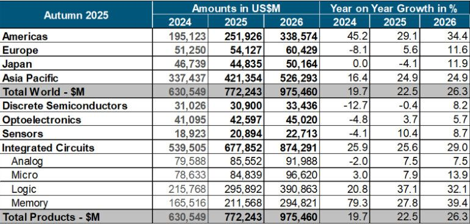

图表标题：SEMICONDUCTOR INDUSTRY - Historic Billings；副标题：Historic billings monthly；图例：3MMA in US$（蓝色）、3MMA YoY growth in percent（灰色）；左轴：十亿美元（$bn），右轴：同比增速（%）；横轴：1996 年至 2025 年的月度序列。

资料来源：WSTS

### AI 计算行业范式转移带来大量推理需求

AI计算行业的范式正在从以模型训练为核心的军备竞赛阶段转向以推理应用为核心的生态建设阶段。模型层竞争的重心已从单纯的“训练驱动”转变为“推理驱动”，推理负载首次全面超越训练负载，成为算力的主要消耗场景。资本支出的逻辑正转向构建能够支撑“代理智能” (Agentic AI)和“系统 2 思维” (System 2 Reasoning)的垂直整合生态系统。OpenAI 推出的 o1 系列模型，标志着 AI 从“概率性文本生成”（System 1）向“逻辑推理与思维链”（System 2）的跨越。这种转变使得即使模型参数量增长放缓，但推理侧的算力需求因“思维链”的引入而呈线性甚至指数级增长。AI 的使用模式正从单次文本完成转向多步、工具集成和推理密集型的工作流，即代理式推理 (Agentic Inference)。

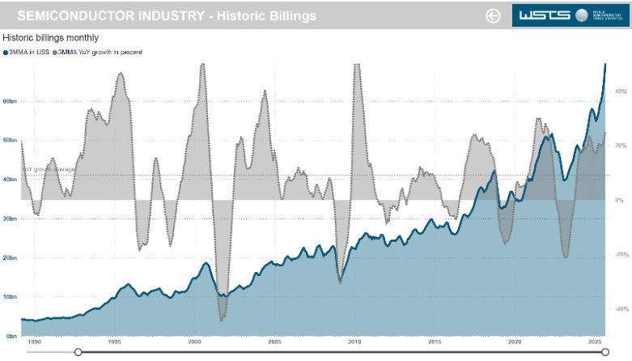

---

<!-- 原文第 4 页 -->

据 OpenRouter 数据，编程已成为所有模型中增长最快、最主要的专业类别，在近期 Token 总量中占比超过 50%。Anthropic 的 Claude 系列模型在编程查询中保持主导地位（60%以上）。每次请求的平均输入 Token 长度增长了约四倍（从约 1.5K 增至 6K 以上），输出 Token 长度增长了近三倍（从约 150 增至 400）。反映出工作负载不再是简单的开放式文本生成，而是对大量上下文（如代码库、文档）进行推理。麦肯锡的《2025 AI 现状报告》显示，全球 78%的企业在 2025 年报告中使用了 AI，远高于 2023 年的 55%。23%的企业已开始规模化部署代理型 AI。这意味着 AI 不再仅仅是一个辅助生成内容的工具，而是开始被允许代表人类采取行动，如自动执行代码、自动发送邮件、自动调用 API。应用层面，AI 的使用多样性超出预期，创意角色扮演和娱乐导向的使用量巨大。

### 谷歌、OpenAI、Anthropic 及 xAI 逐渐形成大模型头部梯队

闭源大模型头部梯队逐渐清晰。谷歌经过三年的追赶，在 Gemini 3 发布后在多模态方面形成优势，结合谷歌生态整合的快速部署能力，用户量迅速提升。虽然面临围剿，但 OpenAI 在 2025 年依然保持着 ToC 流量之王的地位，ChatGPT 月访问数量超过 X 及亚马逊成为第五大网站；依靠先发优势、模型记忆能力和 Sora2 等爆款产品 ARR 接近 200 亿美元。而 Anthropic 依靠代码能力 ARR 收入快速提升至 70 亿美元，估值达到 3000 亿，成为企业端 API 收入第一。xAI 依靠特斯拉和 X 的数据，以及高效的基建能力，证明后发者依然有能力一战。

开源大模型稳步增长，市场并未被单一模型或供应商垄断，而是呈现出一种结构化的多元化生态。2025 年底开源模型约占总 Token 使用量的三分之一。来自中国的 Qwen 和 DeepSeek 等开源模型的份额增长显著，超过 Llama 和 Mistral 等开源模型，成为全球市场中的一支主要力量。同时，地缘政治的摩擦进一步扭曲了供应链的价值分布，各国对主权 AI 的关注和美国的芯片管制政策（如针对中国市场的 H20 芯片），都使得跨区域可用性、多语言能力和合规性成为 AI 技术竞争的关键。

**图表 4: GenAI 平台访问量**

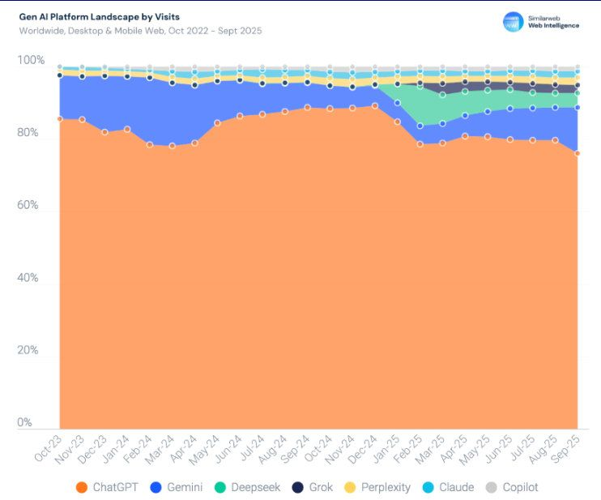

图表标题：Gen AI Platform Landscape by Visits；副标题：Worldwide, Desktop & Mobile Web, Oct 2022 - Sept 2025；来源标识：Similarweb Web intelligence；纵轴：0%–100%；图例：ChatGPT、Gemini、Deepseek、Grok、Perplexity、Claude、Copilot。

资料来源：Openrouter

**图表 5： Token 用量**

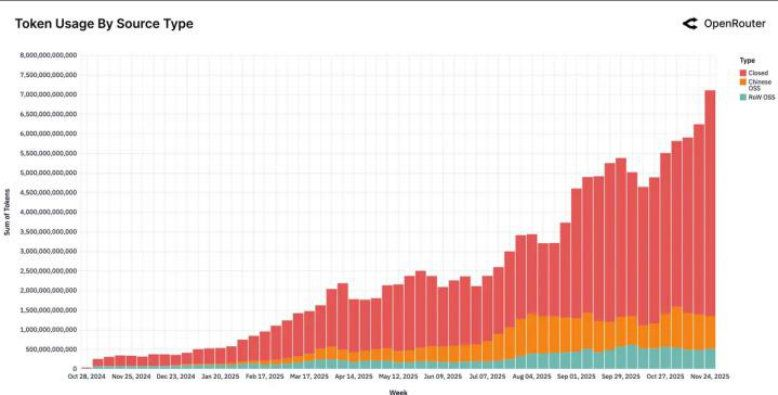

图表标题：Token Usage By Source Type；来源标识：OpenRouter；纵轴：m of Tokens（0 至 8,000,000,000,000，每 500,000,000,000 一档）；横轴：Week（2024 年 10 月 28 日至 2025 年 11 月 24 日）；图例：Closed、Chinese OSS、RoW OSS。

资料来源：Openrouter

### 电力缺口加大

基础设施的物理重构。为了支撑万亿参数大模型的训练与日益庞大的推理需求，全球四大云厂商（Hyperscalers）的资本支出预计将超过 3000 亿美元。这种巨额投入正在推动基础设施的物理重构，例如，随着 GPU 单芯片功耗的突破 1kw，新建数

---

<!-- 原文第 5 页 -->

据中心的液冷技术渗透率从 2024 年的 14%飙升至 2025 年的 33%。AI 数据中心消耗的大量电力也将在 2028 年对美国的电力容量带来超过 40GW 的缺口，推动燃气轮机、核电、燃料电池等产业的需求。

曾被视为“算力黄牛”的 Neocloud，在传统云厂商受困于存量数据中心改造和电力并网排队的背景下，Neocloud 凭借其在电力、部署速度及架构灵活性上的优势，与头部 CSP 及基础模型公司签署长期合约，成为承接 Hyperscaler 溢出算力需求的核心载体。专门为 AI 构建的 GPU 云平台季度收入同比增长超过 200%，总计超过 50 亿美元，Synergy Research 预测 Neocloud 到 2030 年将达到 1800 亿美元。

### 数据中心系统级 TCO 重要性提升

系统架构成为决定 AI 集群算力效率的关键因素。随着万卡集群成为标配，硅光技术加速渗透，NVLink 与 Ultra Ethernet 在 Scale-up 和 Scale-out 层面展开激烈博弈。铜缆目前在机柜内为主流方案，但光互联以损耗更少、效率更高等优势正加速渗透。作为目前唯二可以提供系统级解决方案的厂商，英伟达和博通在 2025Q3 的数据中心收入快速增长，分别达到 356 亿美元和 41 亿美元。

**图表 6: 头部 CSP 季度资本支出（十亿美元）**

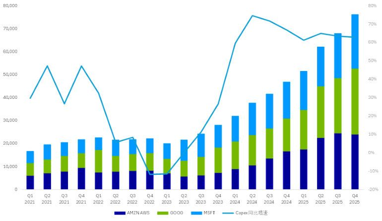

图例：AMZN AWS、GOOG、MSFT（堆叠柱），Capex同比增速（折线）；纵轴：0 至 80,000；横轴：2021Q1 至 2025Q3 各季度。

资料来源：公司财报，第一上海整理

**图表 7:英伟达系统架构路线图**

| 架构 | Blackwell | Rubin | Feynman |
| --- | --- | --- | --- |
| CPU | Grace CPU | Vera CPU | Vera CPU |
| 交换器 Scale-up用 | 第五代 NVL 72 | 第六代 NVSwitch、第七代 NVSwitch | 第八代 NVSwitch |
| 交换器 Scale-Out用 | Spectrum5 CX8 | Spectrum6 CX9 | Spectrum7 CX10 |
| 機架系統 | Oberon NVL72 | Kyber NVL576 |  |

图下方时间轴：2025 → 2026 → 2027 → 2028。

资料来源：The Business Research Company

在供应链端，制约 AI 算力供给的核心瓶颈已经从单纯的先进制程光刻，外延至先进封装、存储器和高速互联设备的制造能力上。台积电的 CoWoS 封装产能是全球 AI 芯片出货量的最大硬约束，尽管其月产能预计将从 2024 年的约 3.2 万片激增至 2025 年的 7.5 万片，生产线依然处于“满载”状态。尽管以英伟达为代表的厂商逐步从较高成本的 CoWoS-S 切换至 CoWoS-L，但博通、AMD 等企业的订单增长依旧让台积电以年化 50%的速度扩产先进封装产能。同时英特尔的 EMIB、Foveros 封装技术等也受到芯片企业关注。

### 2025 年 AI 推动存储市场全面爆发

2025 年存储市场的全面涨价是 AI 需求爆发与原厂供应策略发生结构性冲突的结果。简单来说，就是高利润产品（HBM/企业级 SSD）造不过来，普通产品（DDR4/消费级 SSD/HDD）不想多造。GPU/TPU 的需求暴涨推动三星、SK 海力士和美光将大量产线从 DDR4/DDR5 转去生产 HBM，导致了 DRAM 的供应量减少。而 DDR4 等旧制程产品的投片量下调，市场向 DDR5 切换，导致 DDR4 价格一度超过 DDR5。在 2025 年的 DRAM 供应当中，HBM 同比大涨了 88.1%，消费类记忆体同比下滑 1.2%，用于图形处理的视讯记忆体同比下滑 0.3%，移动端记忆体同比增长了 23.3%，伺服器记忆体同比增长了 28.4%，PC 端记忆体同比增长 4.4%。

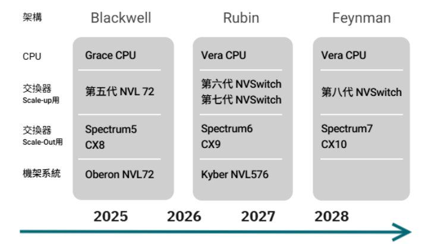

---

<!-- 原文第 6 页 -->

### 传统的 NAND 需求也被带动

AI 不仅需要快数据（存储在 HBM/SSD 里），还需要存储海量的原始数据（Raw Data）作为备份。HDD 依然是单位存储成本最低的介质。随着数据量呈指数级增长，数据中心对近线硬盘（Nearline HDD）的需求激增。过去几年 HDD 市场萎缩，希捷和西部数据几乎停止了扩建新的 HDD 产线。当需求突然反弹时，扩产周期长达 6-12 个月，推动了 HDD 价格的大幅上涨。HDD 的价格大幅上涨及 AI 需求推动企业增加采购大容量 QLC NAND，导致供需不平衡传导至 NAND 行业。经历过 2019、2023 年的巨额亏损后，NAND 原厂（三星、美光、铠侠、海力士）在 2025 年扩产非常谨慎。部分 SSD 涨价还受限于主控芯片产能的紧张，尤其是在高端的 PCIe 5.0 SSD 领域，主控芯片的良率和供应制约了成品出货。

同时，光模块、高阶 PCB、数据中心电源等产品需求也受到 AI 芯片出货大幅增长的拉动作用。AI 数据中心的叶脊交换架构（Spine-Leaf）意味着每一层交换机都需要更多的光模块互联。AI 服务器的 PCB 结构复杂，通常包含 OAM（加速卡基板）和 UBB（通用基板），层数超过 20 层。信号传输质量的需求也推动了 HDI 工艺，高级 CCL 和玻纤布的需求大幅提升。电流太大会导致电线发热损耗，为了应对GB200NVL72单机柜超 120 千瓦级功耗，AI 数据中心电源也正在从传统的 12V 供电架构转向 48V 架构。

**图表 8: 数据中心价值量拆分**

| 环节 | 单位价值量 | 代表厂商 |
| --- | --- | --- |
| Cooling towers | $0.1mn/MW | SPX Technologies、Evapco、Baltimore Aircoil |
| UPS | $0.9mn/MW | Schneider、Eaton、Vertiv |
| Chillers | $0.4mn/MW | Johnson Controls、Trane、Carrier、Daikin |
| Switchgear | $0.5mn/MW | Schneider、Vertiv、Eaton |
| Power distribution | $0.4mn/MW | Schneider、Vertiv、Eaton |
| Engineering fee | $0.4mn/MW | Jacobs、Burns & McDonnell、HP Enterprise |
| Construction fee | $0.9mn/MW | Holder、HITT、Turner |
| Networking | $4.3mn/MW | Arista Networks、Cisco Systems、Huawei、NVIDIA |
| Servers | $25.0mn/MW | Dell、HP Enterprise、Super Micro |
| CRAHs | $0.6mn/MW | Vertiv、Stulz、Johnson Controls |
| Generators | $0.8mn/MW | Caterpillar、Cummins、Rolls Royce |

资料来源：Bank of America

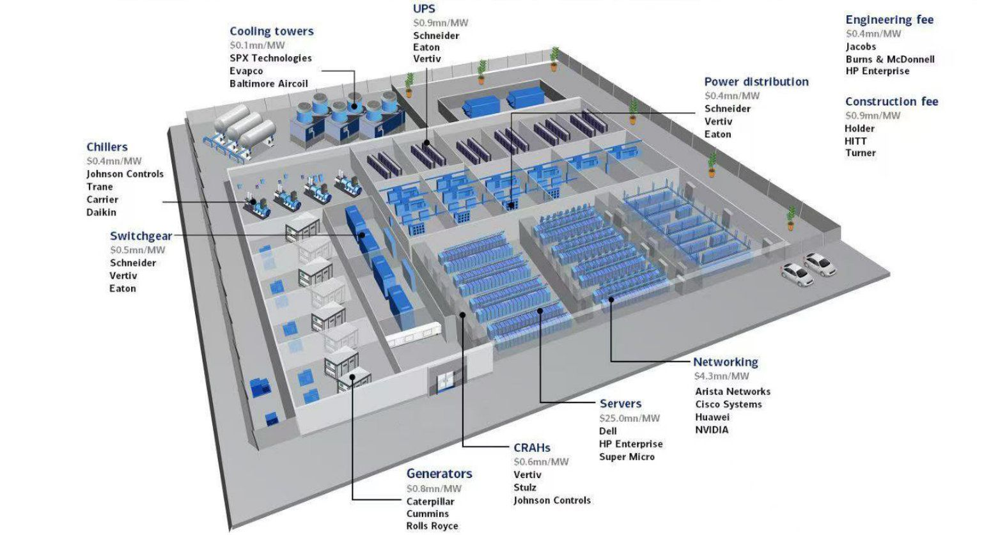

---

<!-- 原文第 7 页 -->

# 展望 2026：AI 进入生态深耕与推理变现的第二阶段

如果说 2024-2025 年是全球 AI 基础设施建设的淘金热时期，那么 2026 年产业将逐步进入生态深耕与推理变现的第二阶段。展望 2026 年，我们认为美股 AI 及半导体市场将有以下趋势：1）投资 AI 从简单买指数进入精挑细选阶段 2）半导体产业链中的 Alpha 将快速成长 3）存储芯片将迎来卖方市场 4）AI 应用渗透率将提升

## 投资 AI 从简单买指数进入精挑细选阶段

### 半导体基建使企业成本激增，2026 年市场对公司的未来盈利能力评价更为严格

如果说 AI 在 2023 年是惊艳，2024 年是狂热，那么 2025 年则是残酷的真相时刻。在这一年，资本市场不再为单纯的算力堆叠和模型参数买单，而是转向了对商业化变现、垂直场景护城河以及端侧落地能力的追求。从 2024 年开始，半导体基建正在飞速吞噬整个 IT 产业利润，标普 500 中半导体净利润在 IT 行业里占比，在两年时间从不到 20%上升了到了 40%，并且呈加速上升趋势。2026 年该数据将超过 45%，AI 需求驱动导致半导体基建的估值体系重构。

不同于互联网时代的零边际成本+用户量增长+广告变现模式，大模型时代模型需要持续迭代以维持用户粘性。由于用户更加注重模型效果而非模型价格，AI 推理成本可能和芯片功耗一样，在能忍受的限度内，尽可能的去提升体验。在 Scaling Law 失效之前，算力开销成本增长不会低于互联网业绩增长。因此，进入 2026 年，对于 Hyperscalers 来说如何平衡成本、算力增长和业绩增长之间的关系成为重点，行业从“概念验证期”进入了“业绩兑现期”。市场对公司的评价更为严格，既要大模型领先、用户数据和收入漂亮，又要 AI 带来正向的 ROI。简单的购买半导体指数或 M7 指数已经难以获取市场的 Alpha，需要寻找真正能在 AI 时代成长及获益的公司。

资本支出对 M7 带来了现金流压力，仅在 2025 年下半年，美国五大 Hyperscalers 的发债总额就已突破 1200 亿美元，其中 M7 成员中的 Meta、Amazon、Google 是主力军，分别发行 300 亿、150 亿及 250 亿按美元计算价值的债券。同时微软、Meta 等公司也和 Neocloud 签订租赁协议减轻现金流压力。

### 自研 ASIC 芯片产量将逐步提升

英伟达的 GPU 的市场份额将开始出现下降，Hyperscalers 在试图自研 ASIC 降低 TCO。OpenAI 多方面下注，与英伟达、博通、AMD 分别签订 10GW、10GW、6GW 总功耗的芯片的购买意向订单，Anthropic 和 Meta 也在尝试直接购买 TPU 及租赁谷歌 TPU 云服务。亚马逊、微软、Meta 等企业开始加速自研芯片 Tranium3/4、Maia 100、MTIAv2。2026 年自研 AI 芯片将开始大量出货，自研芯片效果差异将对公司的 Token 处理效率带来巨大区别。

---

<!-- 原文第 8 页 -->

**图表 9: 标普 500 中半导体板块在 IT 板块利润占比**

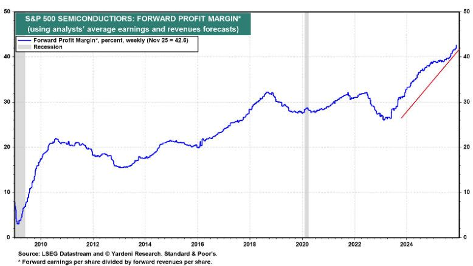

图表标题：S&P 500 SEMICONDUCTORS: FORWARD PROFIT MARGIN*（using analysts' average earnings and revenues forecasts）；图例：Forward Profit Margin*, percent, weekly (Nov 25 = 42.8)、Recession；纵轴：% （0–40）；横轴：2008 年至 2025 年。图注：Source: LSEG Datastream and © Yardeni Research. Standard & Poor's. * Forward earnings per share divided by forward revenues per share.

资料来源：LSEG Datastream & Yardeni Research

**图表 10： AI 训练与 AI 推理市场 TAM**

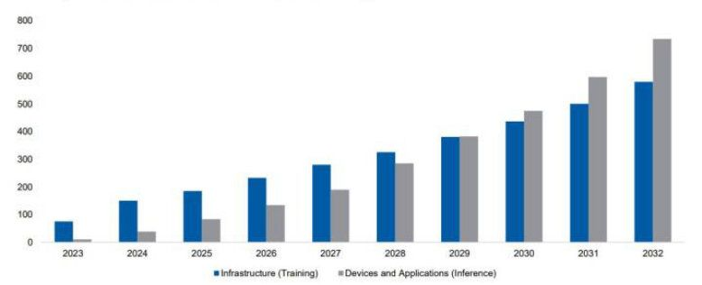

纵轴：0–800（左轴）与 0–50（右轴）；横轴：2023 年至 2032 年；图例：Infrastructure (Training)、Devices and Applications (Inference)。

资料来源：Morgan Stanley

### 谷歌依靠 TPU+自研头部模型+GCP 外供崛起

谷歌在 2025 年发布了第七代 TPU ironwood。据 SemiAnalysis 测算，从谷歌内部视角看，TPUv7 服务器的 TCO 比英伟达 GB200 服务器低约 44%。即便加上谷歌和博通的利润，Anthropic 通过 GCP 使用 TPU 的 TCO，仍比购买 GB200 低约 30%。我们认为，之前 TPU 一直被市场担心的自用需求不足问题已经缓解，自身需求及外部订单将使谷歌将有充分的动力维持 TPU 的迭代。2026 年 TPU 的前瞻出货量已大幅上调至接近 400 万块，对 TPU 产业链相关公司如博通、Lumentum 带来正面影响。

### 英伟达依旧具备一定优势

但需要指出的是，该测算以 FP8 算力进行对比，未考虑 Blackwell 的 FP4 等新特性，同时明年 Rubin 平台产品将开始出货及部署，届时英伟达系统的效率将再次大幅提升。因此，我们认为英伟达将继续在训练和推理市场中占据绝对主流地位，Meta 和 Anthropic 的尝试更多的是为追求议价权及寻找第二供应商。谷歌的 Gemini3 证明 Scaling Law 仍然有效，而明年 Blackwell 的批量部署和 Rubin CPX 的交付将再次推动模型性能进步。

**图表 11: TPU、Tranium、英伟达投资组合表现**

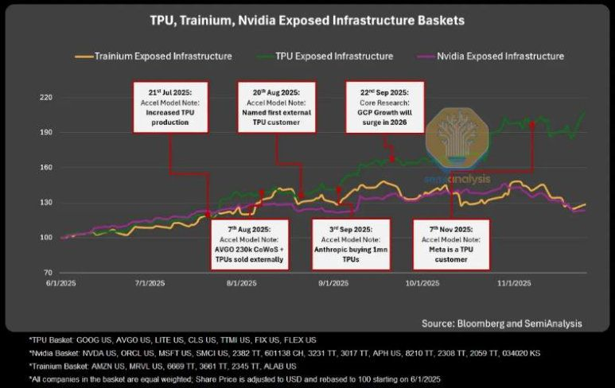

图表标题：TPU, Trainium, Nvidia Exposed Infrastructure Baskets；图例：Trainium Exposed Infrastructure、TPU Exposed Infrastructure、Nvidia Exposed Infrastructure；纵轴：70–220（指数，2025 年 6 月 1 日重设为 100）；横轴：2025 年 6 月 1 日至 2025 年 11 月 1 日。图中标注：21st Jul 2025: Accel Model Note: Increased TPU production；7th Aug 2025: Accel Model Note: AVGO 230k CoWoS + TPUs sold externally；20th Aug 2025: Accel Model Note: Named first external TPU customer；3rd Sep 2025: Accel Model Note: Anthropic buying 1mn TPUs；22nd Sep 2025: Core Research: GCP Growth will surge in 2026；7th Nov 2025: Accel Model Note: Meta is a TPU customer。图下表注：\*TPU Basket: GOOG US, AVGO US, LITE US, CLS US, TTMI US, FIX US, FLEX US；\*Nvidia Basket: NVDA US, ORCL US, MSFT US, SMCI US, 2382 TT, 601138 CH, 3231 TT, 3017 TT, APH US, 8210 TT, 2308 TT, 2059 TT, 034020 KS；\*Trainium Basket: AMZN US, MRVL US, 6669 TT, 3661 TT, 2345 TT, ALAB US；\*All companies in the basket are equal weighted; Share Price is adjusted to USD and rebased to 100 starting on 6/1/2025。Source: Bloomberg and SemiAnalysis

资料来源：SemiAnalysis

**图表 12： 谷歌 TPUv7 对比 GB200/300 NVL72 TCO**

| Chip | Unit | GB200 NVL72 (Spectrum) | GB300 NVL72 (Spectrum) | TPU v7 - 3D Torus - Internal | TPU v7 - 3D Torus - External |
| --- | --- | --- | --- | --- | --- |
| Customer Profile |  | Hyperscaler | Hyperscaler | Hyperscaler | Neocloud Giants |
| Total Cost per Unit per Hour | USD/hr/GPU | $2.28 | $2.73 | $1.28 | $1.60 |
| Capital Cost as % of Total Ownership Cost | % | 77.4% | 79.0% | 72.7% | 72.7% |
| Marketed TFLOPS (FP8) | TFLOPS | 5,000 | 5,000 | 4,614 | 4,614 |
| Marketed TFLOPS (FP4)¹ | TFLOPS | 10,000 | 15,000 | 4,614 | 4,614 |
| Memory Bandwidth per Logical GPU | TB/s | 8.0 | 8.0 | 7.3 | 7.3 |
| Memory Capacity | GB | 192 | 288 | 192 | 192 |
| Marketed TFLOPS (FP8) / Memory Bandwidth | TFLOPS/TB/s | 625 | 625 | 632 | 632 |
| TCO per Marketed FP8 Dense PFLOP | $/hr per PFLOP | $0.46 | $0.55 | $0.28 | $0.40 |
| TCO per Marketed FP4 Dense PFLOP | $/hr per PFLOP | $0.23 | $0.18 | $0.28 | $0.40 |
| TCO per Memory Bandwidth | $/hr per TB/s | $0.28 | $0.34 | $0.18 | $0.25 |
| TCO per Memory Capacity | $/hr per TB | $11.87 | $9.47 | $6.67 | $9.65 |

注：1. TPU v7 does not have native FP4 support hence FP8 PFLOPs are downcast here

资料来源：SemiAnalysis

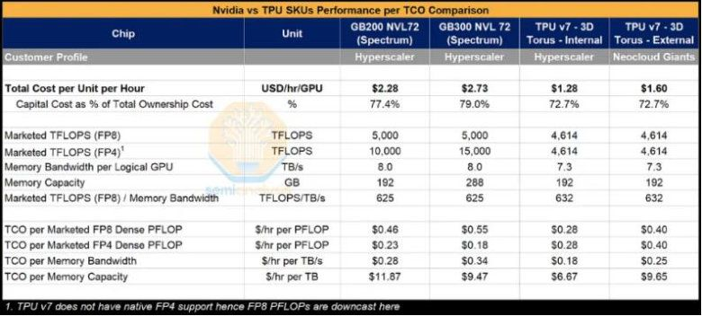

---

<!-- 原文第 9 页 -->

## 半导体产业链中的 Alpha 将快速成长

我们认为，半导体产业链中具备技术优势及渗透率快速提升的公司将获得“台积电式”价值重估的机会，从供应商提升级至技术创新者而享有更高的估值。

**先进封装依旧供不应求：**截止 2025Q3，台积电预计 2025 年底先进封装月产能有望达到 7.0 万片，南科 AP8 厂与嘉义 AP7 厂本季度展开装机作业，2026-2027 年的月产能有望分别超过 9.5 万片/12.1 万片，而 CoWoS-L 产能占比将从 2024 财年的 35%提升至 2025 财年的 60%，成为业内主流封装技术。CoWoS 产能分配上，明年英伟达订单占比 59%，博通产能占比 15%，AMD 占比 11%。未来随着明年 2nm 制程的量产，AI 芯片将从 5nm 往 3nm 转移，公司收入结构将进一步向先进制程倾斜。

### 台积电先进封装订单外溢

同时，由于先进封装产能严重不足，台积电与日月光（日月光及硅品）成立 3D IC 先进封装制造联盟，台积电亚利桑那州工厂与 Amkor 合作进行美国产晶圆的先进封装与测试。其中包含两大主要路线，一条是承接台积电委外订单、严格按照台积电指定标准采购设备的 TSMC-like 产线，另一条则是客户为建立第二供应链而指定、OSAT 厂拥有一定程度设备采购弹性的自主产线。

### 光模块迎来收入与利润释放

**数据中心内网络 Scale-up/Scale-out 导致光模块产业的供需格局持续紧张：**主要源于 Nvidia GB300 服务器出货以及 VR200 服务器进展超预期，VR 架构下单芯片光模块配比从 GB 架构下的 1：2.5 倍增至 1：5.此外，谷歌 TPU 需求持续上修，带动 1.6T 光模块需求攀升。乐观预期情况下，26 年 1.6T 光模块的出货超过 2500 万只，800G 预期出货超过 5500 万只。未来，随着算力往大集群发展，通信的需求将出现指数级增长，带动光通信行业的在 AI 时代景气度的持续性超预期，龙头厂商在当前阶段凭借技术创新，产业链保供，以及下一代技术预研，有望形成强者恒强的格局。

### 光交换及硅光技术将崭露头角

**光交换及硅光技术将迎来快速增长的元年：**CPO（共封装光学）技术将逐步在 2026 年成为核心看点，在 AI 训练集群的高端交换机市场渗透率预计将突破 10%-15%。LightCounting 认为 2025 年是 CPO 的商业化起步年，到 2027 年，CPO 端口将超过 450 万个，占据 800G/1.6T 端口出货量的 30%。Yole Group 预计 2028-2030 年 CPO 将大规模替代可插拔模块，到 2030 年 CPO 市场规模将达到 81 亿美元，CAGR 高达 137%。

通过将光引擎与计算芯片封装在一起，CPO 极大地缩短了电信号的传输距离，从而显著降低交换系统功耗（25%-30%）并提升传输速率，满足数据中心对更低成本、更高集成、更低功耗、更高互联密度等要求。业界头部公司积极推动 CPO 技术发展：英伟达已经发售 Quantum 3450-LD 系列 CPO 交换机；台积电与博通合作的 3nm CPO 方案有望在 2026 年进入量产；Marvell 宣布以 32.5 亿美元收购 CPO 初创公司 Celestial AI；Ciena 收购 CPO 初创公司 Nubis Communications 等。

此外，Google 等巨头在 TPU 集群中成功应用全光交换（OCS）技术，证明了在数据中心内部用光信号直接进行路由交换的可行性。这一趋势将带动光引擎、激光器芯片以及光通信器件产业链迎来“量价齐升”的爆发期。OCS 产业链中，上游核心是

---

<!-- 原文第 10 页 -->

MEMS 微镜阵列等光器件（如赛微电子旗下 Silex），中游由光交换机主导设备集成（如 Lumentum）；下游需求则集中于 AI 数据中心

**PCB 互联的重要性持续提升：**在 AI 服务器的架构中，PCB 已不再是简单的电子元器件支撑体，而是承载高速信号完整性的算力高速公路。

### PCB 价值量提升

2026 年英伟达 Rubin 平台的推出将是关键催化剂。新平台对更高数据传输速率的要求，将推动行业向更昂贵、更复杂的 M9 级别 CCL 材料(Q-glass + HVLP4)和更高层数的 PCB 板迁移，从而显著推高服务器机柜中 PCB/CCL 的价值含量。据 Prismark 数据，2024 年全球 PCB 产值为 736 亿美元，2029 年全球 PCB 市场规模预计将达 947 亿美元，CAGR 为 5.2%，其中 18 层以上 PCB 将从 24 亿增长至 50 亿美元，CAGR 为 15.7%。

英伟达在 Rubin 平台中放弃过去 GPU 与交换机间的线缆盒。Midplane 层数最高超过 70 层。这让单台服务器的 PCB 价值量大幅提升，VR200 NVL144 系统中单 GPU 对应 PCB 价值超过 5000 美元，机柜 PCB 价值量超过 40 万美元，对比 GB300 翻倍增长。且 Google TPU v7、AWS Trainium3 等自研产品同样导入高层 HDI、低 Dk 材料与极低粗糙度铜箔。

另一方面，英伟达正在探索新型芯片封装技术 CoWoP（Chip-on-Wafer-on-PCB），该技术有望替代现有的 CoWoS 封装方案。这一技术变革将利用先进的高密度 PCB 去除 CoWoS 封装中的 ABF 基板层，直接将中介层与 PCB 连接。性能与主板高电流/电压要求之间的权衡是阻止平台 PCB 实现真正基板规格的主要挑战。mSAP 是在实现 25/25 微米更精细线/间距尺寸方面最佳的 PCB 技术，但仍远低于 ABF 的亚 10 微米线/间距能力。

**半导体扩产将利好半导体设备及 EDA 板块：**设备与 EDA 作为半导体产业的“卖铲人”，将穿越芯片价格波动的周期，成为最为稳健的投资赛道。

在设备端，随着摩尔定律放缓，通过 CoWoS、HBM 等先进封装技术提升系统性能已成为行业共识。相关产能的扩产，大幅提升了对光刻机、混合键合机、研磨设备、固晶机及检测设备的需求。同时，中国大陆为保障供应链安全，正加速在成熟制程和关键设备领域的国产替代，刻蚀机、薄膜沉积设备等核心环节的订单量将持续维持高位。

在设计端，随着芯片设计向 3D 堆叠和异构计算演进，设计的复杂度呈指数级上升，单纯依靠人力已无法完成。AI 赋能 EDA 成为新趋势，芯片设计公司必须采购更昂贵、更智能的 EDA 工具来辅助设计。同时各家 Fabless、模型公司、Foundry 及 EDA 公司开始进行 Co-Design 以达到系统最优解，EDA 工具的粘性和价值量也将提升。

---

<!-- 原文第 11 页 -->

图表 13: OCS 市场规模预测

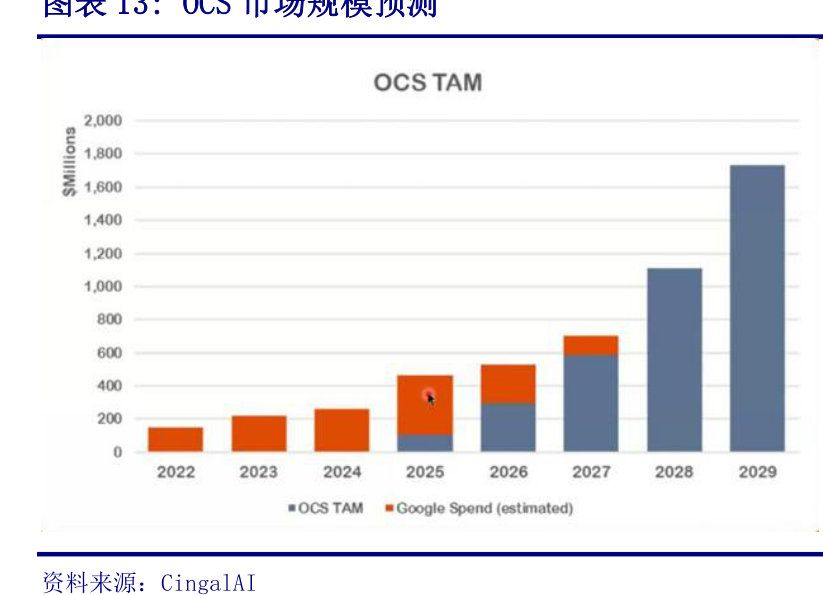

- 纵轴：$Million；横轴：2022–2029
- 图例：OCS TAM、Google Spend (estimated)

资料来源：CingalAI

图表 14：光模块（包含 LPO 及 CPO）市场规模预测

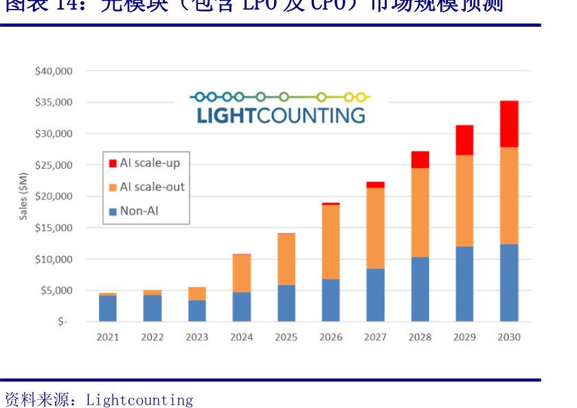

- 纵轴：Sales ($M)；横轴：2021–2030
- 图例：AI scale-up、AI scale-out、Non-AI

资料来源：Lightcounting

## 存储芯片将迎来卖方市场

### 存储价格在 2026 年将持续上涨

**HBM 挤占晶圆产能，DRAM 及 NAND 价格将持续上涨：**以上一个 DRAM 超级周期为例来看，在 2016 年-2018 年由云计算通用服务器需求驱动的，DRAM 价格持续上涨了约 9 个季度。但当前这一轮存储芯片价格上涨则是由 AI 服务器（HBM、LPDDR）和通用服务器（NAND、DDR）共同驱动的，并且还存在着结构性的产能转换和多个维度的需求竞争，情况更为复杂，短缺和涨价可能将会持续更长时间，预计 2026 年一整年都会面临供应紧缺和涨价的问题，三大存储原厂（三星、美光、SK 海力士）的利润将在明年快速增长。

目前 SK 海力士凭借 MR-MUF 技术，在 HBM 市场占据了主导地位。但 HBM4 将采用混合键合技术，并直接堆叠在逻辑芯片上。三星的 IDM 模式可自产基底逻辑芯片，海力士、美光则依靠台积电代工，将可能使 HBM 竞争格局发生改变。

服务器高端 DRAM 需求旺盛：据 TrendForce 的预计，2026 年 DRAM 市场的供应量将为 1740 亿个单位（2Gb）容量，同比增长 20%；营收规模将会达到 3010 亿美元，同比大涨 85%；平均单价约为 1.63 美元，同比上涨 58%。DRAM 行业的资本支出将在 2025 年达到 537 亿美元，并于 2026 年进一步增长 14% 至 613 亿美元。

但这笔巨额投资并不会转化为同比例的晶圆供应，因为资本支出主要用于购买昂贵的 HBM 生产设备以及 EUV 光刻机以推进 1β 和 1γ 纳米先进制程，而非单纯扩大投片量。由于 HBM 的生产工艺极度复杂且良率较低，生产一片 HBM 晶圆所消耗的产能约等于三片普通 DDR5 晶圆。

### 存储供需将极度不平衡

具体来看：三星在韩国新的 P4L 厂的洁净室是来自其 NAND Flash 产线，计划于 2026 年开始生产。SK 海力士 M15X 晶圆厂将专注于生产 1b DRAM，用作 HBM3E 的核心晶片，计划于 2025 年底实现量产，初期月产能为 3.5 万片晶圆，未来预计可扩大至 5.5 万至 6 万片；在韩国 Yongin 的新晶圆厂第一阶段计划于 2025 年开始建设，并于 2027 年第二季度竣工，预计到 2027 年底开始贡献产出。美光在美国的 ID1 晶圆厂预计将于 2027 年上半年开始生产晶圆；在美国的 ID2 晶圆厂的第二阶段将在第一阶段晶圆厂完工后开始建设；纽约厂目前仍处于准备阶段，预计将于 2030 年前进

---

<!-- 原文第 12 页 -->

入量产阶段；日本广岛工厂预计将于 2026 年开始建设，主要将用于 HBM 相关生产。由于 2026 年全球 DRAM 供应同比增长幅度只有 20%，预测的 2026 年 DRAM 需求增长是 26%，2026 年 DRAM 将至少存在 6 个百分点的供应缺口。

**NAND 技术升级保利润：**据 Trendforce 的预计，2026 年 NAND Flash 市场的供应量将为 11220 亿个单位（8Gb）容量，同比增长 21%；营收规模将会达到 1110 亿美元，同比大涨 59%；平均单价约为 0.1 美元，同比上涨 32%。与 DRAM 的激进投资不同，NAND 市场处于明显的休养生息阶段，2025 年的资本支出预计维持在 211 亿美元的相对低位，2026 年会有小幅增加。

各大原厂在经历了 2023 年的亏损后，目前并没有大规模新建工厂的计划，而是将有限的资金集中用于现有产线的制程升级（如提升至 232 层以上）和推动 QLC（四层单元）技术在企业级 SSD 中的渗透，以满足 AI 对大容量存储的需求。这种极具纪律性的投资策略意味着 NAND 的整体供应增长将持续受到人为压制，原厂通过牺牲市场份额扩张来换取供需紧平衡，以确保长期的盈利能力。

图表 15: 2026 年 DRAM 需求量预测

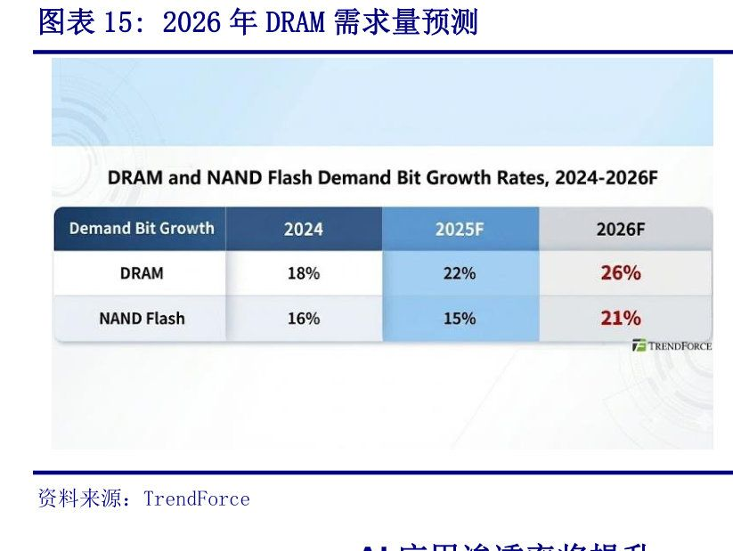

DRAM and NAND Flash Demand Bit Growth Rates, 2024-2026F

| Demand Bit Growth | 2024 | 2025F | 2026F |
| --- | --- | --- | --- |
| DRAM | 18% | 22% | 26% |
| NAND Flash | 16% | 15% | 21% |

资料来源：TrendForce

图表 16：英伟达与谷歌相关 HBM 供应情况

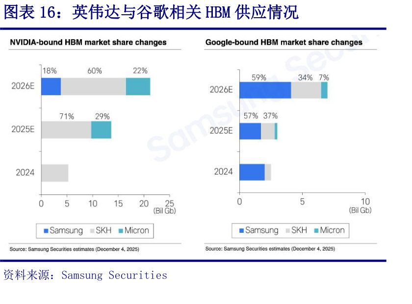

- 左图：NVIDIA-bound HBM market share changes；右图：Google-bound HBM market share changes
- 横轴单位：(Bil Gb)；图例：Samsung、SKH、Micron

| 年份 | NVIDIA-bound（Samsung / SKH / Micron） | Google-bound（Samsung / SKH / Micron） |
| --- | --- | --- |
| 2026E | 18% / 60% / 22% | 59% / 34% / 7% |
| 2025E | — / 71% / 29% | 57% / 37% / — |
| 2024 | 图上无数据标签 | 图上无数据标签 |

Source: Samsung Securities estimates (December 4, 2025)

资料来源：Samsung Securities

## AI 应用渗透率将提升

### 平台型公司护城河较深

**ToC 应用方面**，平台型企业+AI 的模式依旧有很高的护城河，没有独特数据和互联网分发渠道的基础模型价值将下降。平台型巨头（如 Apple、Google、腾讯）掌握着用户的社交关系链、即时位置、支付记录和历史行为习惯。当 AI 能力被内嵌进这些生态时，它能提供的不再是冰冷的问答，而是基于上帝视角的主动服务。例如，手机厂商的 AIOS 可以根据你的日历、邮件和交通状况直接建议出发时间，而无需输入任何 Prompt。**情境感知能力是单纯的模型厂商无法通过 API 获取的。**

对于一家新兴的 AI 模型应用层公司，获取一个付费用户的成本极其高昂，且面临极高的流失率。而平台型企业拥有零边际成本的分发能力。谷歌可以通过一次更新，瞬间让数十亿用户用上 Gemini3；苹果通过一次 iOS 升级，就能让几十亿设备具备端侧智能。用户本质上是懒惰的，如果现有的高频应用（如微信、浏览器）已经足够好用，他们不会愿意为了微小的性能提升去下载一个新的独立 App。随着模型性能的持续进化，2026 年我们可以看到系统级 AI 渗透率的持续提升。

---

<!-- 原文第 13 页 -->

### 企业级应用渗透率和付费率都将继续提升

**ToB 方面**，在代码之后，有更多数据标准化+可验证的工作流程将被 AI 加速。人工智能之所以能够自动化任何可被验证的任务，核心在于可验证性为强化学习提供了完美的、无需人工干预的闭环反馈信号，任务的结果本身就是最好的老师。对于任何拥有明确对错标准或量化指标的任务——如数学证明、代码编写、芯片布线等，AI 不再需要模仿人类已有的步骤（监督学习），而是不断修正策略以最大化奖励函数。这种结果导向的梯度优化过程就像生物进化一样，让 AI 能发现人类直觉之外的捷径或极其复杂的优化路径，因为 AI 不需要理解“为什么要这样做”，它只需要知道“这样做能通过验证”。

Anthropic 已经证明只要有确实提升生产力的应用，企业级市场的付费意愿和付费能力都较强。编写代码能力仅依托大模型的自然语言处理能力，在 2026 年，我们将看到多模态 AI 在可验证工作流程中变得更加强大，如在医疗端，多模态 AI 将不再局限于读片，而是开始接管初级分诊、自动生成病历并深度参与新药研发的分子模拟验证，显著降低误诊率与研发周期；在法律端，基于私有判例库训练的垂直模型将从起草文书升级为独立完成尽职调查甚至实时辅助合同谈判。OpenAI 目前拥有超过 100 万家企业付费使用其企业级 AI 产品。过去一年 ChatGPT 企业版每周消息量增长约 8 倍，平均每位员工发送消息数增加 30%，企业对高级推理能力的使用在 12 个月内激增约 320 倍。

企业级 AI 将逐步变得更加实用，多个传统大型企业已经通过 AI 优化其经营效率：沃尔玛应用 Pactum AI 与长尾供应商进行自主谈判。它知道沃尔玛的预算底线、付款周期偏好等参数，成功与数千家长尾供应商重新签订了合同，平均每笔交易为沃尔玛节省了 3%的成本。UPS 应用 ORION 系统（On-Road Integrated Optimization and Navigation）通过算法每分钟进行数千次路线优化计算，根据实时交通、天气、送货承诺时间，甚至避免左转（左转更耗油且风险高）来动态调整，每年帮助 UPS 节省约 1000 万加仑燃油。辉瑞在在研发新冠口服药 Paxlovid 时，利用 AI 模型来预测分子与病毒蛋白的结合能力，进行虚拟筛选。

**AI 原生的 PaaS 将享受第一波 AI 红利**（如数据湖平台），传统 SaaS 公司转型 AI 过程中虽然短期内毛利率承压，但只要毛利润绝对值增长，投资者就会接受。AI 的本质决定了每次输入/输出都需要消耗算力，与传统软件零边际成本的模式截然不同。AI 公司虽然毛利率较低，但因为员工数量较少，实际上的利润水平并不低。SaaS 平台存储了客户过去十年的销售记录、代码库或财务报表，利用这些数据微调出来的垂类模型，效果远超通用模型，且成本更低。同时用户已经习惯了在 SaaS 上的工作流，如果 AI 无缝嵌入现有流程，用户即使面对稍高的价格或稍差的体验，也会留在生态内。

---

<!-- 原文第 14 页 -->

图表 17: 使用 AI 的组织比例

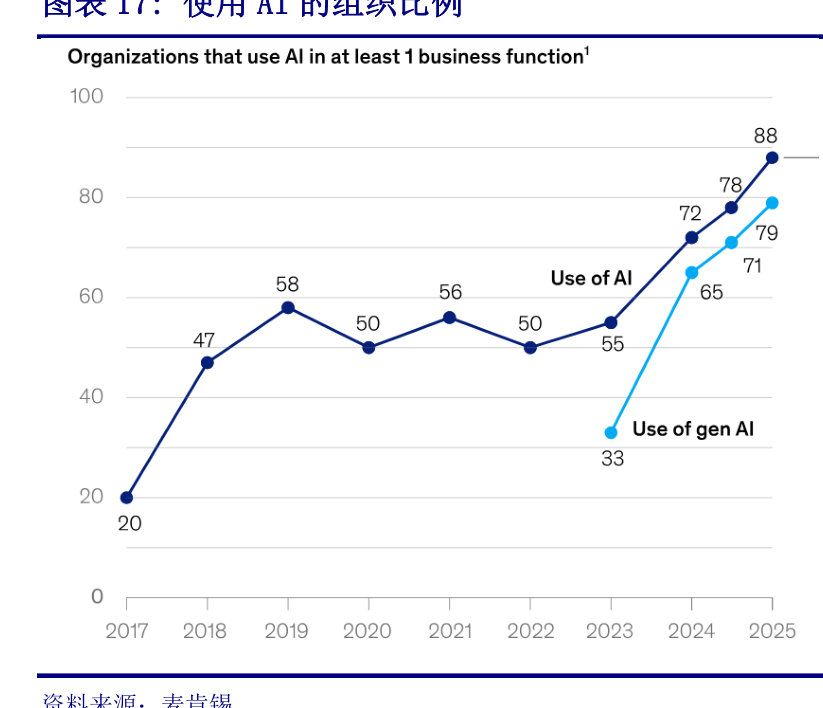

- 标题：Organizations that use AI in at least 1 business function
- 纵轴：百分比（0–100）；横轴：2017–2025
- Use of AI：2017–2024 数据标签依次为 20、47、58、50、56、50、55、72；末段另有 78、88 两个相邻数据点（与年份的对应无法确定）
- Use of gen AI：2023 为 33、2024 为 65；末段另有 71、79 两个相邻数据点（与年份的对应无法确定）

资料来源：麦肯锡

图表 18： OpenAI 企业用户增长来源

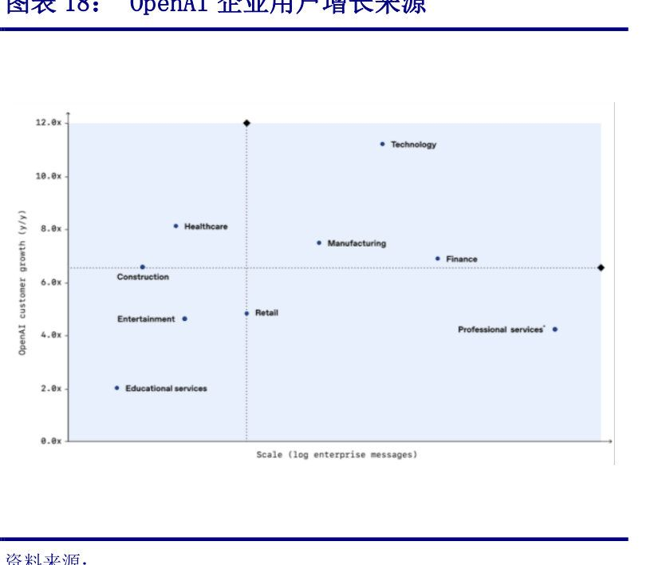

- 横轴：Scale (log enterprise messages)；纵轴：OpenAI customer growth (y/y)，0.0%–12.0%
- 标注：Technology、Healthcare、Manufacturing、Finance、Construction、Retail、Entertainment、Professional services、Educational services

资料来源：

## 国产算力破局之年

### 中国智算投资加速，AI 服务器市场将突破千亿美元

2025 年中国智算服务器市场 400 亿美元，预计到 2029 年市场规模突破 1,400 亿美元，年复合增速 37%

2025 年，字节跳动资本开支预计在 1,500 亿元，其中 50%为智算投资。预计 2026 年其资本开支规模进一步增加至 2,000 亿元，其中约 75%将投资于智算领域。阿里巴巴也提出积极的资本开支计划，计划在未来 3 年（2025-2027 年）投入超过 3,800 亿元用于 AI 算力建设，如果预算提前完成则将继续加码。预计 2026 年阿里巴巴资本开支将超过 1,200 亿元。腾讯采取审慎和跟随的资本开支政策，预计 2025 年资本开支 800 亿元，同比小幅增长，预计 2026 年资本开支将有所增加。此外，三大运营商也是国内算力投资的主要玩家，承担着国内算力一张网建设的重任，预计运营商 2025 年资本开支接近 3,000 亿元，其中智算投资预计在千亿元级别。

图表 19: 中国智算市场规模

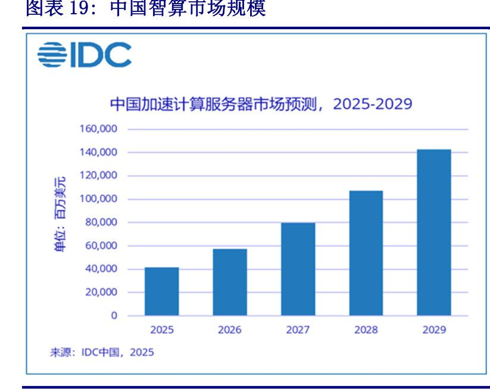

- 中国加速计算服务器市场预测，2025-2029
- 纵轴：单位：百万美元（0–160,000）；横轴：2025–2029

资料来源：IDC

图表 20：国产芯片市占率提升至 35%

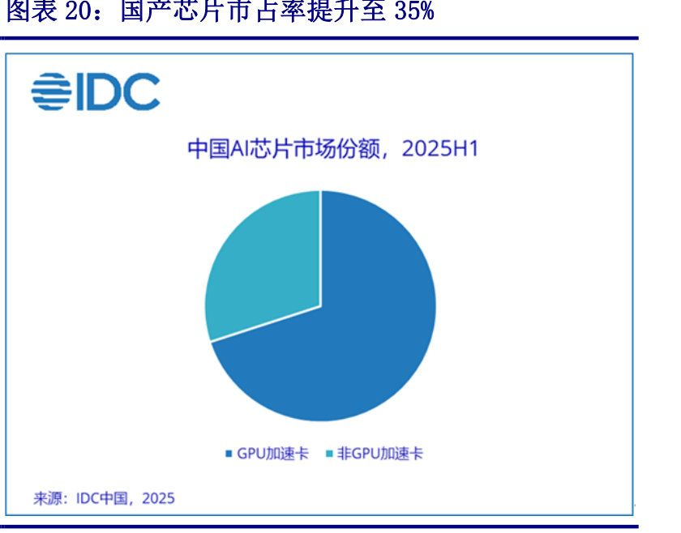

- 中国AI芯片市场份额，2025H1
- 图例：GPU加速卡、非GPU加速卡

资料来源：IDC

---

<!-- 原文第 15 页 -->

## 算力成为中美博弈主战场

### 算力成为大国博弈主战场，算力自主可控势在必行，不可动摇

自 2018 年中美贸易摩擦以来，美国就开始对中国高科技领域，尤其是半导体产业，进行层层加码的限制。2022 年生成式人工智能横空出世，中美进入 AI 制高点的争夺。美国挟其在半导体先进制程技术的优势，不断对中国 AI 产业卡脖子。中国在先进算力芯片的供给端受到极大的限制，不仅难以购买到最先进的算卡，制造端受制于半导体技术的能力也面临瓶颈。同时，美国在未来 AI 竞争中的立场和方向开始明确，即鼓励全球采用美国主导的 AI 芯片和软件，同时对中国等“竞争”国家采取压制措施，限制中国为主导的芯片和模型在全球的应用和发展。

我们认为 AI 算力、AI 大模型将成为未来世界的基础设施，类似移动通信（4G、5G）、互联网等技术在全球科技产业中的地位。谁掌握 AI 算力和大模型的话语权，谁就占据未来科技竞争的主导地位。美国挟其半导体技术和大模型能力优势，开启算力外交，期望复制其过去在全球供应链中的核心地位，抢抓全球 AI 发展主动权。

图表 21: 美国对中国算力芯片相关限制梳理

| 时间 | 具体事件 |
| --- | --- |
| 2022年8月 | 美国政府通知，要求停止向中国出口用于人工智能的高端计算芯片，该禁令影响的芯片分别为英伟达的A100、H100，以及 AMD的MI200芯片 |
| 2022年10月 | 美国商务部工业和安全局（BIS）公布一系列针对中国的出口管制新规，涉及对中国的先进计算、半导体先进制造进行出口管制，包括限制16/14nm及以下工艺节点逻辑电路制造、128层及以上的3D NAND制造工艺、18nm及以下的DRAM制造工艺。同时限制美国公民支持中国半导体制造或者研发 |
| 2022年12月 | 美国商务部将长江存储、上海微电子、寒武纪等36家中国实体纳入实体清单 |
| 2023年10月 | 美国商务部更新出口管制的规则，新增13家中国先进计算芯片企业列入实体清单，包括壁仞科技、摩尔线程及其子公司 |
| 2024年11月 | 美国商务部给台积电发函，要求暂停中国大陆AI芯片企业的7nm及以下先进制程芯片的代工服务，重新审核认证客户身份（KYC）流程。三星也采取了类似的行动，向大陆客户发出了类似的通知 |
| 2024年12月 | 美国商务部工业和安全局（BIS）发布了出口管制的“强化版”新规，新增对于中国进口HBM和EDA管制，并且重点限制中国半导体设备、零部件、EDA厂商 |
| 2025年1月 | 美国拜登政府发布AI芯片出口管制新规，限制美国先进AI算力芯片出口，禁止中国大陆进口美国先进AI算力芯片 |
| 2025年4月 | 英伟达公告，美国政府要求其出口至中国的 H20 芯片以及任何达到 H20 内存带宽、互联带宽的其他高端芯片必须申请出口许可，美国政府通知公司该许可要求将在未来无限期生效 |
| 2025年5月 | 美国宣布废除《AI扩散规则》，代之以新的规则。针对中国，则引入新的规则，包括（1）提醒公众允许美国AI芯片用于中国AI模型的训练和推理可能带来的后果；（2）发布禁令指南，明确在全球任何地方使用华为昇腾芯片均违反美国出口管制规定；（3）发布行业指南，指导美国公司如何防止供应链转移。 |
| 2025年12月 | 特朗普政府宣布可向中国认可实体出售H200芯片，并将向销售金额增收25%的税费 |

资料来源：公开资料，第一上海

---

<!-- 原文第 16 页 -->

## 国产算力破局之年，自主芯片加速渗透

2024 年以来，国产算力在客户侧的测试和验证逐步展开，以华为，海光、寒武纪为龙头的国产算力公司业绩迎来爆发。2025 年初，随着英伟达 H20 芯片被禁，中美博弈进入深水区，国产算力替代迎来加速。在过去的一年，我们看到国产算力的卡脖子环节，如先进制程产能、先进封装技术、芯片架构设计、大模型适配、HBM 供给等，均在被陆续攻克，新一代国产算力芯片性能全面对标英伟达 H100 系列，预计 2026 年国产算力将迎来破局之年，在供给端迎来爆发。

**华为昇腾：**2025 年 9 月，华为在其全连接大会上披露了华为昇腾芯片演进规划和目标。公司规划了四款芯片，包括昇腾 950PR、950DT，960 以及 970，其中，昇腾 950PR 将在 2026 年第一季度对外发布，昇腾 950DT 将在 2026 年第四季度对外发布，昇腾 960 芯片和昇腾 970 芯片则分别在 2027 年四季度和 2028 年四季度对外发布。

**寒武纪：**思元 590 顺利出货，供应链稳健。思元 690 在客户端测试中，预计 2026 年中正式量产出货。2025 年 10 月，公司完成 39.9 亿元定增，进一步提升公司在研发和供应链保障上的能力。公司所得募资款项将主要用于面向大模型 AI 芯片的创新突破，研发覆盖不同类型场景的芯片，包括训练用芯片、推理用芯片、交换机芯片等。

**海光信息：**深算 DCU 产品进入互联网客户供应链，凭借 GPGPU 架构、类 CUDA 环境在运营商、互联网等多个领域客户实现规模化应用。

**摩尔线程：**第四代“平湖”GPU 架构在 2024 年正式发布，基于该架构的 S5000 顺利出货，单卡算力超过 A100。新一代 GPU 架构将于 2025 年 12 月 19-20 日在公司首届 MUSA 开发者大会上发布。2025 年 12 月，公司成功 IPO 融资 80 亿元，为未来研发和供应链保障提供支持。

**沐曦股份：**首款全国产 GPGPU——曦云 C600 发布，支持 144GB 大容量存储和 FP8 精度计算，预计 2025 年底进入风险量产。公司当前主力产品 C500 主要客户为国家智算平台、运营商、互联网等，与中科院合作的国产千卡集群完成多个大模型训练任务，证明了公司产品的不俗性能表现。2025 年 12 月，公司将在科创板上市。

此外，阿里平头哥，百度昆仑芯等互联网公司自研芯片也取得不错表现，有望在算力供给面临掣肘的当下，提供满足自身业务发展需求的优质算力。

---

<!-- 原文第 17 页 -->

图表 22: 算力国产替代，寒武纪股价大涨

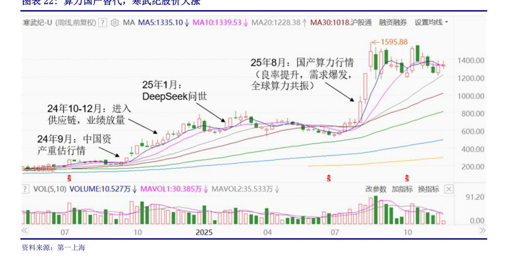

- 标的：寒武纪-U（周线.前复权）；均线：MA5、MA10、MA20、MA30
- 纵轴（价格）：200.00–1400.00；下方副图为成交量（VOL(5,10)）
- 图内标注：24年9月：中国资产重估行情；24年10-12月：进入供应链，业绩放量；25年1月：DeepSeek问世；25年8月：国产算力行情（良率提升，需求爆发，全球算力共振）；阶段高点标注 1595.88

资料来源：第一上海

## AI 应用加速落地，国产算力大有可为

### 国产芯片在推理时代有广阔应用前景。2026 年国产算力将加速落地

2025 年大模型进入应用落地期，对话应用、AI 编程、图像/视频生成等陆续出现爆款，带动算力需求逐渐从训练转向推理主导。25 年二季度，亚马逊在季报会上率先上修 ASIC 订单，反映了托管在 AWS 上的 Anthropic Claude 在 AI 编程上的强劲需求。此后 Meta、Google 等公司陆续在季报会上发表正面的 ASIC 订单预期，反映了整个行业受推理应用加速落地带来的需求非常旺盛。

回到国内，字节跳动、阿里巴巴等大厂也正在将 AI 能力赋能到旗下全线应用端。
1）字节跳动：豆包大模型日均 Token 调用量全球领先，25 年 9 月达到日均 30 万亿，预计 25 年底达到 50-60 万亿。此外，公司也在打造更多流量入口，AI 手机（12 月发布 AI 手机，与中兴通讯合作）、AI 智能眼镜、AI 耳机等 AI 新品陆续发布。预计字节跳动 2026 年日均 Token 消耗量仍将实现数倍增长。
2）阿里巴巴：推出战略级 APP-千问 Qwen，免费开放，人人可用，对标 ChatGPT，打造未来流量入口。打造 AIaaS 下一代云操作系统，Qwen3 Max 性能全球领先，覆盖大语言模型、多模态模型、编程模型等领域，在智能水平、Agent 工具调用、Coding 能力、深度推理、多模态等多维度实现全面性突破。夸克 AI 眼镜 S1 和 G1 发布，钉钉、高德、淘宝等 AI 赋能。
3）DeepSeek：将低成本高性价比进行到底，正式推出 DeepSeek V3.2 系列模型，推理能力全球领先，适合日常使用，首次加入工具调用功能，打造 AI 智能体。
4）腾讯：全面开放 AI 落地能力，以应用使用体验为先。腾讯混元大模型持续迭代，AI 编程内部落地，元宝与旗下 APP 打通，打造全新互动体验。

---

<!-- 原文第 18 页 -->

推理时代，国产芯片将持续深挖用户侧应用场景，针对性优化性能，进而实现对进口芯片的替代。据我们了解，国产芯片在互联网公司的搜索-广告-推荐（搜广推）应用场景已经广泛落地。百度昆仑芯在百度搜索场景实现了广泛应用，寒武纪芯片在大客户的推荐大模型训练，图像、语音识别等细分场景也取得不错的客户反馈，有望加速替代进口芯片。除此之外，国产芯片对国产大模型如 DeepSeek、Qwen、豆包等做到了 0Day 适配，方便针对垂直应用场景进行过定向优化的国产模型实现快速部署。

2026 年，预计互联网公司、运营商、国资云等算力建设和运营方将加速采购国产算力进行部署，将 AI 能力赋能千行百业。国产算力，也将在项目落地过程中持续迭代升级，迎来研发-销售的良性循环。

## 关注 AI 估值“泡沫化”风险

尽管英伟达在 2025 年 11 月市值一度突破 5 万亿美元，占据标普 500 指数 8%的权重，但市场对 AI 泡沫的担忧从未停止。红杉资本提出的“6000 亿美元问题”在 2025 年依然未能完全解答：底层基础设施的巨额资本支出与应用层产生的实际收入之间，存在着巨大的剪刀差。虽然微软、谷歌等巨头的 Capex 在 2025 年开始趋于稳定，但应用层的爆发速度仍滞后于基础设施的建设速度，这构成了市场波动的主要风险源。我们认为绝大部分头部公司前瞻（NTM）估值仍在合理偏高区间内，调整可能是温和的，但对于部分超高估值的应用层或依托单一 Hyperscalers 订单供应链公司，技术路线改变将可能对其造成巨大影响。

**CoreWeave 等新兴云厂商利用 GPU 和订单抵押融资的模式将在 2026 年面临考验。**随着推理成本下降和 performance per watt 的不断升级，纯租赁模式的毛利将被压缩。CDS 全称 Credit Default Swap，可以理解为贷款人为一笔债务买的违约保险。目前 CoreWeave 的 CDS 约 700bps，甲骨文的 CDS 超过 110bps，高 CDS 意味着保护成本的大幅上升导致贷款利差的大幅下降。我们认为由于风控严格的美国头部投资银行目前愿意为 NeoCloud 提供贷款，所以短期风险不大；但需要规避高估值、高杠杆、客户结构过于单一的部分 NeoCloud。

如果 OpenAI 和 Anthropic 在 2026 年逐步启动上市程序，这将是继 2025 年 AI 基础设施投资热潮之后的又一个里程碑事件，AI 是否具备坚实业绩支撑的终极高考。目前二级市场对 AI 公司的估值主要基于营收增速，而 BP 上预测至 5 年后的收入中期难以证实或证伪。同时对 AI 公司真实的推理成本、训练折旧和毛利率知之甚少。如果数据显示推理成本随着技术迭代下降的速度快于价格战速度，且企业复购率极高，将极大提振市场信心，证明 AI 不是烧钱无底洞；而如果头部企业的毛利率仍受制于高昂的 Infra 成本，或 2026 年出现 ARR 增长的降速，可能会引发对整个 AI 商业模式可持续性的质疑。

---

<!-- 原文第 19 页 -->

图表 23: 美股大市值公司估值

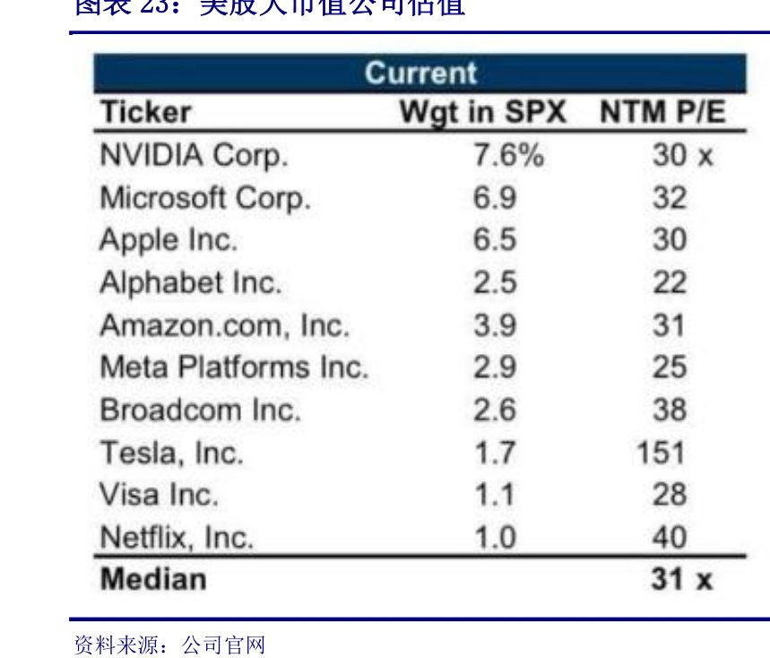

| Ticker | Wgt in SPX | NTM P/E |
| --- | --- | --- |
| NVIDIA Corp. | 7.6% | 30 x |
| Microsoft Corp. | 6.9 | 32 |
| Apple Inc. | 6.5 | 30 |
| Alphabet Inc. | 2.5 | 22 |
| Amazon.com, Inc. | 3.9 | 31 |
| Meta Platforms Inc. | 2.9 | 25 |
| Broadcom Inc. | 2.6 | 38 |
| Tesla, Inc. | 1.7 | 151 |
| Visa Inc. | 1.1 | 28 |
| Netflix, Inc. | 1.0 | 40 |
| Median | | 31 x |

资料来源：公司官网

图表 24： Neocloud 发债情况

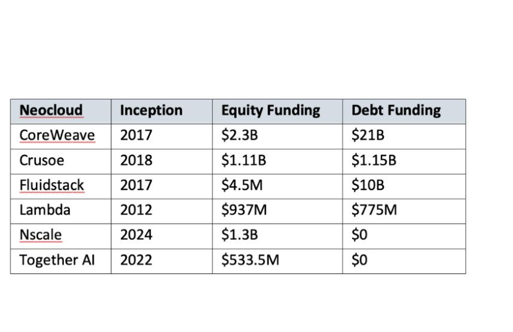

| Neocloud | Inception | Equity Funding | Debt Funding |
| --- | --- | --- | --- |
| CoreWeave | 2017 | $2.3B | $21B |
| Crusoe | 2018 | $1.11B | $1.15B |
| Fluidstack | 2017 | $4.5M | $10B |
| Lambda | 2012 | $937M | $775M |
| Nscale | 2024 | $1.3B | $0 |
| Together AI | 2022 | $533.5M | $0 |

资料来源：forbes.com

---

<!-- 原文第 20 页 -->

## 第一上海证券有限公司

香港中环德辅道中 71 号

永安集团大厦 19 楼

电话: (852) 2522-2101

传真: (852) 2810-6789

本报告由第一上海证券有限公司（“第一上海”）编制，仅供机构投资者一般审阅。未经第一上海事先明确书面许可，就本报告之任何材料、内容或印本，不得以任何方式复制、摘录、引用、更改、转移、传输或分发给任何其他人。本报告所载的资料、工具及材料只提供给阁下作参考之用，并非作为或被视为出售或购买或认购证券或其它金融票据，或就其作出要约或要约邀请，也不构成投资建议。阁下不可依赖本报告中的任何内容作出任何投资决策。本报告及任何资料、材料及内容并未有考虑到个别的投资者的特定投资目标、财务情况、风险承受能力或任何特别需要。阁下应综合考虑到本身的投资目标、风险评估、财务及税务状况等因素，自行作出本身独立的投资决策。

本报告所载资料及意见来自第一上海认为可靠的来源取得或衍生，但对于本报告所载预测、意见和预期的公平性、准确性、完整性或正确性，并不作任何明示或暗示的陈述或保证。 第一上海或其各自的董事、主管人员、职员、雇员或代理均不对因使用本报告或其内容或与此相关的任何损失而承担任何责任。对于本报告所载信息的准确性、公平性、完整性或正确性，不可作出依赖。

第一上海或其一家或多家关联公司可能或已经，就本报告所载信息、评论或投资策略，发布不一致或得出不同结论的其他报告或观点。信息、意见和估计均按“现况”提供，不提供任何形式的保证，并可随时更改，恕不另行通知。

第一上海并不是美国一九三四年修订的证券法（「一九三四年证券法」）或其他有关的美国州政府法例下的注册经纪-交易商。此外，第一上海亦不是美国一九四零年修订的投资顾问法(下简称为「投资顾问法」，「投资顾问法」及「一九三四年证券法」一起简称为「有关法例」)或其他有关的美国州政府法例下的注册投资顾问。在没有获得有关法例特别豁免的情况下，任何由第一上海提供的经纪及投资顾问服务，包括(但不限于)在此档内陈述的内容，皆没有意图提供给美国人。此档及其复印本均不可传送或被带往美国、在美国分发或提供给美国人。

在若干国家或司法管辖区，分发、发行或使用本报告可能会抵触当地法律、规定或其他注册/发牌的规例。本报告不是旨在向该等国家或司法管辖区的任何人或单位分发或由其使用。

©2025 第一上海证券有限公司 版权所有。保留一切权利。

---
