> 原文件：[M178_20260930-头豹研究院-头豹研究院AI算力硬件与存储周期共振：2026年中国半导体产业深度洞察——从AI计算价值链到存储结构升级.pdf](https://github.com/jadennevercode/CJCC-Knowledge-Base/blob/5ec8511eb834073c8bfbd79c94af196282d483cf/materials/%E4%B8%8B%E6%B8%B8%EF%BC%9A%E4%BA%91%E8%AE%A1%E7%AE%97%E4%B8%8EAI%E9%9C%80%E6%B1%82%E4%BC%A0%E5%AF%BC/M178_20260930-%E5%A4%B4%E8%B1%B9%E7%A0%94%E7%A9%B6%E9%99%A2-%E5%A4%B4%E8%B1%B9%E7%A0%94%E7%A9%B6%E9%99%A2AI%E7%AE%97%E5%8A%9B%E7%A1%AC%E4%BB%B6%E4%B8%8E%E5%AD%98%E5%82%A8%E5%91%A8%E6%9C%9F%E5%85%B1%E6%8C%AF%EF%BC%9A2026%E5%B9%B4%E4%B8%AD%E5%9B%BD%E5%8D%8A%E5%AF%BC%E4%BD%93%E4%BA%A7%E4%B8%9A%E6%B7%B1%E5%BA%A6%E6%B4%9E%E5%AF%9F%E2%80%94%E2%80%94%E4%BB%8EAI%E8%AE%A1%E7%AE%97%E4%BB%B7%E5%80%BC%E9%93%BE%E5%88%B0%E5%AD%98%E5%82%A8%E7%BB%93%E6%9E%84%E5%8D%87%E7%BA%A7.pdf)
> 转换方式：多模态逐页转录（页面图像 + 文本层交叉校验）

<!-- 原文第 1 页 -->

# AI算力硬件与存储周期共振：2026年中国半导体产业深度洞察——从AI计算价值链到存储结构升级

China Semiconductor Industry

中国半導體產業

报告提供的任何内容（包括但不限于数据、文字、图表、图像等）均系头豹研究院独有的高度机密性文件（在报告中另行标明出处者除外）。未经头豹研究院事先书面许可，任何人不得以任何方式擅自复制、再造、传播、出版、引用、改编、汇编本报告内容，若有违反上述约定的行为发生，头豹研究院保留采取法律措施、追究相关人员责任的权利。头豹研究院开展的所有商业活动均使用“头豹研究院”或“头豹”的商号、商标，头豹研究院无任何前述名称之外的其他分支机构，也未授权或聘用其他任何第三方代表头豹研究院开展商业活动。

头豹研究院

---

<!-- 原文第 2 页 -->

## 研究目标

### 研究背景

2026年，全球AI基础设施投资仍处高位，AI服务器扩张及单节点配置升级持续提高对AI加速芯片、HBM、高速互连和先进封装的需求。与此同时，存储行业自2024年起进入修复周期，服务器逐步成为DRAM与NAND的重要增量来源，HBM扩产又进一步影响普通DRAM供给。AI计算硬件与存储市场同步变化，使半导体产业的需求增长、供给约束及中国厂商价值承接呈现新的分化。

### 本报告的关键问题

- AI服务器扩张与单节点配置升级如何影响半导体硬件需求？
- Scale-up与Scale-out分别对应哪些核心价值环节？
- HBM市场如何演进，其供给集中与制造壁垒如何形成？
- AI先进封装如何向多Die、3D及混合集成方向升级？
- 中国厂商在AI芯片、HBM、先进封装及高速光互连中的产业化进展如何？
- 当前DRAM与NAND市场周期及下游需求结构发生了哪些变化？
- 原厂产能配置为何导致DRAM与NAND中期供给弹性出现分化？
- MRDIMM、CXL等服务器内存升级将带来哪些接口芯片价值增量？

## 观点摘要

### 01 AI计算硬件协同升级：

◆ AI服务器出货增长与单节点配置提升并行，AI硬件增量由计算芯片进一步延伸至HBM、节点内高速互联、Scale-out光互连及先进封装，多个高价值环节同步受益。

### 02 HBM与先进封装加速演进：

◆ 2026年HBM3E仍为主力，HBM4进入量产爬坡，供应仍高度集中；多Die与多HBM推动大尺寸先进封装持续升级，制造良率、散热及客户认证要求同步提高。

### 03 中国厂商产业化能力分化：

◆ 高速光模块已进入全球头部供应，国产AI加速芯片及先进封装形成规模商业化或批量导入能力；相比之下，HBM与高速DSP仍主要处于客户验证或早期导入阶段。

### 04 存储周期与服务器内存升级：

◆ 服务器需求成为DRAM与NAND的重要增量来源，DRAM受HBM产能占用及扩产周期约束，供给弹性低于NAND；MRDIMM、CXL等升级进一步提高内存接口及控制芯片价值量。

---

<!-- 原文第 3 页 -->

## 内容目录

◆ AI计算硬件价值链 ---------- 5

- AI节点Scale-up：AI服务器扩张与单节点配置升级 ---------- 6
- AI节点Scale-up：核心价值环节与供应格局 ---------- 7
- AI集群Scale-out：高速光互连需求扩张 ---------- 8
- AI集群Scale-out：网络速率升级与技术演进 ---------- 9
- AI集群Scale-out：高速光模块结构与核心器件供应 ---------- 10
- HBM：市场扩张与产品代际升级 ---------- 11
- HBM：结构复杂度与制造壁垒 ---------- 12
- HBM：供给集中与DRAM产能挤压 ---------- 13
- HBM：主要厂商商业化进展 ---------- 14
- 先进封装：多Die与HBM推动封装级集成升级 ---------- 15
- 先进封装：多维异构集成推高制造与良率壁垒 ---------- 16
- 先进封装：主要厂商商业化进展与中国供给能力 ---------- 17
- AI计算硬件产业化进展：核心环节参与位置与价值承接 ---------- 18
- AI计算硬件产业化进展：代表厂商商业化进展 ---------- 19

◆ 存储周期与结构升级 ---------- 22

- 存储周期：价格走势与市场规模变化 ---------- 23
- 存储需求：下游应用结构变化 ---------- 24
- 存储供给：原厂产能配置与供给弹性 ---------- 25
- 服务器内存：高带宽模组与接口芯片升级 ---------- 26

◆ 头豹业务介绍 ---------- 28

◆ 方法论与法律声明 ---------- 29

---

<!-- 原文第 4 页 -->

## 名词解释

◆ **Scale-up**：通过提高单个计算节点内GPU、AI加速器数量及高速互联能力扩展算力的方式，重点解决节点内部多芯片协同。

◆ **Scale-out**：通过增加服务器、机架或计算节点数量，并利用高速网络连接形成更大计算集群的横向扩展方式。

◆ **HBM**：High Bandwidth Memory，高带宽存储器，通过DRAM Die垂直堆叠及宽I/O接口提供高带宽，主要用于GPU、AI加速器及HPC芯片。

◆ **PAM4**：Pulse Amplitude Modulation 4，四电平脉冲幅度调制，一次符号可传输2 bit数据，广泛用于高速光模块及高速电互连。

◆ **CPO/NPO**：Co-Packaged Optics / Near-Packaged Optics，共封装光学/近封装光学，将光学器件与交换或计算芯片共封装或近距离集成，以降低高速互连损耗与功耗。

◆ **CoWoS**：Chip-on-Wafer-on-Substrate，台积电先进封装平台，通过中介层等技术实现逻辑芯片、多颗HBM等器件的高密度2.5D集成。

◆ **TSV**：Through-Silicon Via，硅通孔，通过贯穿硅片的垂直导电通道实现不同Die之间的高密度垂直互联，是HBM等3D堆叠产品的关键技术。

◆ **OSAT**：Outsourced Semiconductor Assembly and Test，独立半导体封装测试服务商，为芯片企业提供封装、测试及相关制造服务。

◆ **RDIMM**：Registered DIMM，寄存式内存模组，通过RCD对命令、地址及时钟信号进行缓冲，是服务器DDR5内存的主要模组形态之一。

◆ **MRDIMM**：Multiplexed Rank DIMM，多路复用内存模组，通过MRCD和MDB实现多个Rank数据并行与多路复用，以提高服务器主内存带宽。

◆ **RCD/MRCD/MDB**：服务器内存核心接口芯片。RCD主要用于RDIMM信号缓冲；MRCD和MDB主要用于MRDIMM的控制信号处理及数据多路复用。

◆ **CXL**：Compute Express Link，基于PCIe物理层的高速互连协议，可连接CPU、加速器及内存扩展设备，并支持内存扩展、池化和资源共享。

◆ **oDSP**：Optical Digital Signal Processor，光通信数字信号处理芯片，用于高速光模块中的信号处理、均衡、编码及误码校正。

◆ **PIC**：Photonic Integrated Circuit，光子集成电路，将调制、复用、探测等多个光学功能集成在单颗芯片上，提高高速光通信系统集成度。

---

<!-- 原文第 5 页 -->

## 主线一：AI计算硬件价值链

- AI节点Scale-up
- AI集群Scale-out
- HBM
- AI先进封装
- AI计算硬件产业化进展

---

<!-- 原文第 6 页 -->

## AI节点Scale-up：AI服务器扩张与单节点配置升级

**AI服务器出货与CSP资本开支持续增长，NVIDIA HGX平台在GPU数量不变下显著提升HBM容量、带宽与节点内互连，AI硬件需求同时受整机扩张与单节点配置升级推动**

### 全球AI服务器出货量及主要需求背景，2023-2026E

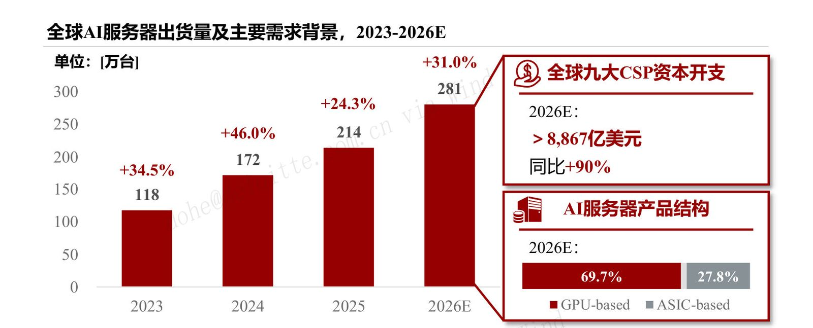

单位：[万台]

| 年份 | 出货量 | 同比 |
| --- | --- | --- |
| 2023 | 118 | +34.5% |
| 2024 | 172 | +46.0% |
| 2025 | 214 | +24.3% |
| 2026E | 281 | +31.0% |

**全球九大CSP资本开支**

2026E：

＞8,867亿美元

同比+90%

**AI服务器产品结构**

2026E：

69.7%

27.8%

- GPU-based
- ASIC-based

◆ AI服务器需求在全球CSP持续扩张AI基础设施的推动下，仍处于较快增长阶段。根据TrendForce预测，2026年全球AI服务器出货量预计增长约31%。同期全球九大CSP资本开支将超过8,867亿美元，同比增长约90%，持续投入AI数据中心、GPU集群及相关基础设施。产品结构方面，2026年GPU型AI服务器预计占69.7%，ASIC型占比升至27.8%。

### NVIDIA HGX 8-GPU平台配置演进：HGX H100 vs. HGX B300

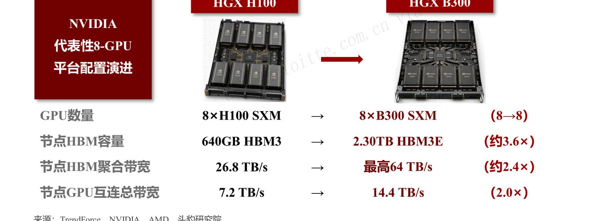

| NVIDIA 代表性8-GPU平台配置演进 | HGX H100 | HGX B300 | 变化 |
| --- | --- | --- | --- |
| GPU数量 | 8×H100 SXM | 8×B300 SXM | （8→8） |
| 节点HBM容量 | 640GB HBM3 | 2.30TB HBM3E | （约3.6×） |
| 节点HBM聚合带宽 | 26.8 TB/s | 最高64 TB/s | （约2.4×） |
| 节点GPU互连总带宽 | 7.2 TB/s | 14.4 TB/s | （2.0×） |

来源：TrendForce，NVIDIA，AMD，头豹研究院

---

<!-- 原文第 7 页 -->

## AI节点Scale-up：核心价值环节与供应格局

**AI节点升级已由计算性能单点提升转向计算、存储与节点内通信协同扩展，价值增量主要由AI加速器、HBM及Scale-up互连承接，其中HBM的供给集中度和进入壁垒尤为突出**

### AMD Instinct 8-GPU平台配置演进：MI300X vs. MI350X

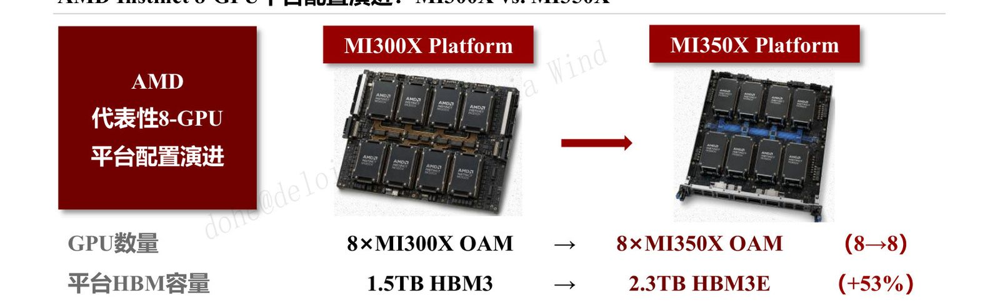

| AMD 代表性8-GPU平台配置演进 | MI300X Platform | MI350X Platform | 变化 |
| --- | --- | --- | --- |
| GPU数量 | 8×MI300X OAM | 8×MI350X OAM | （8→8） |
| 平台HBM容量 | 1.5TB HBM3 | 2.3TB HBM3E | （+53%） |
| 聚合HBM带宽 | 42.4TB/s | 64TB/s | （+51%） |
| P2P双向I/O | 896GB/s | 1,194.8GB/s | （+33%） |

◆ 大模型规模和并发需求增加，使AI节点同时面临存储与多GPU通信约束：HBM容量和带宽影响模型承载及数据供给效率，Scale-up互连则影响多GPU协同性能。NVIDIA HGX H100至B300、AMD MI300X至MI350X均在8-GPU配置不变的情况下显著提升HBM及节点内互连能力，表明AI节点升级正由计算性能提升进一步转向计算、存储和节点内通信能力的同步提升。

### AI节点Scale-up核心价值承接环节

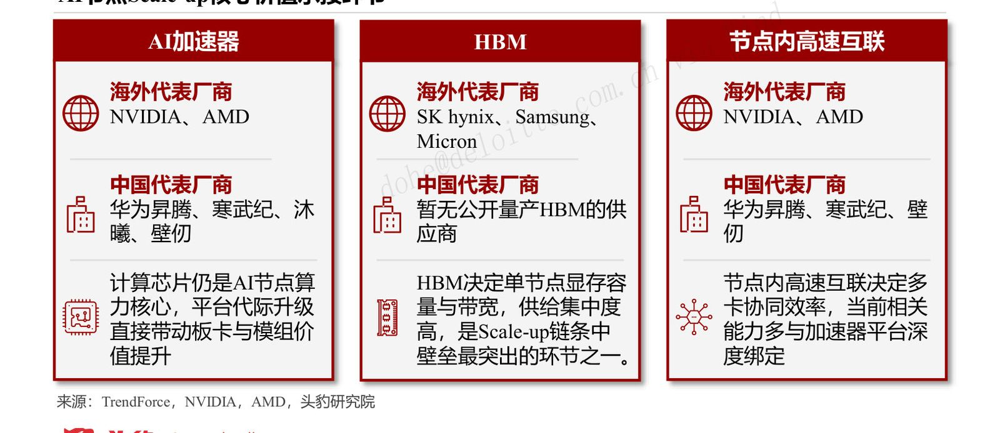

| 环节 | AI加速器 | HBM | 节点内高速互联 |
| --- | --- | --- | --- |
| 海外代表厂商 | NVIDIA、AMD | SK hynix、Samsung、Micron | NVIDIA、AMD |
| 中国代表厂商 | 华为昇腾、寒武纪、沐曦、壁仞 | 暂无公开量产HBM的供应商 | 华为昇腾、寒武纪、壁仞 |
| 环节说明 | 计算芯片仍是AI节点算力核心，平台代际升级直接带动板卡与模组价值提升 | HBM决定单节点显存容量与带宽，供给集中度高，是Scale-up链条中壁垒最突出的环节之一。 | 节点内高速互联决定多卡协同效率，当前相关能力多与加速器平台深度绑定 |

来源：TrendForce，NVIDIA，AMD，头豹研究院

---

<!-- 原文第 8 页 -->

## AI集群Scale-out：高速光互连需求扩张

**AI集群向多服务器、多机架扩展显著增加跨节点数据交换，推动Scale-out网络端口数量和带宽同步提升，高速光模块由此成为AI集群扩容的重要互连基础设施**

### 全球400G及以上高速光模块出货量，2025-2026E

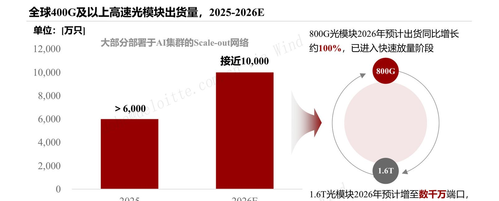

单位：[万只]

大部分部署于AI集群的Scale-out网络

| 年份 | 出货量 |
| --- | --- |
| 2025 | ＞6,000 |
| 2026E | 接近10,000 |

800G光模块2026年预计出货同比增长约100%，已进入快速放量阶段

1.6T光模块2026年预计增至数千万端口，已进入批量导入阶段

◆ 随着AI集群由单服务器向多服务器、多机架扩展，计算任务需要在更多节点之间进行数据交换，Scale-out网络的连接端口数量和传输带宽随之提高。LightCounting数据显示，全球400G及以上高速光模块出货量由2025年的超过6,000万只增至2026年接近1亿只，且大部分产品部署于AI集群Scale-out网络，反映高速光互连已成为AI基础设施扩容的重要组成部分。

### AI集群Scale-out网络拓扑图

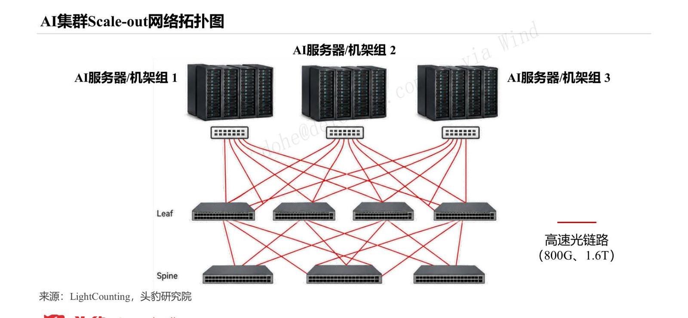

- AI服务器/机架组 1
- AI服务器/机架组 2
- AI服务器/机架组 3
- Leaf
- Spine
- 高速光链路（800G、1.6T）

来源：LightCounting，头豹研究院

---

<!-- 原文第 9 页 -->

## AI集群Scale-out：网络速率升级与技术演进

**AI集群Scale-out网络正由400G向800G、1.6T持续升级，2026年处于800G规模扩张、1.6T加速导入的阶段；200G/通道PAM4开始进入规模应用，单端口传输能力持续提升，进一步支撑更大规模AI集群跨节点高速互连**

◆ AI集群Scale-out网络通常采用Leaf-Spine等分层架构，服务器接入Leaf交换机，并通过Spine层实现不同服务器及机架间的大规模数据交换。随着集群规模扩大，节点间东西向流量和网络连接数量快速增加，跨机架链路对带宽和传输距离的要求同步提高，高速光模块因而成为Scale-out网络的重要互连方式。在AI算力持续扩张下，Scale-out网络不仅需要增加连接端口，也需要持续提升单端口传输能力，推动网络速率由400G向800G、1.6T加快演进。

### Scale-out网络速率演进路径

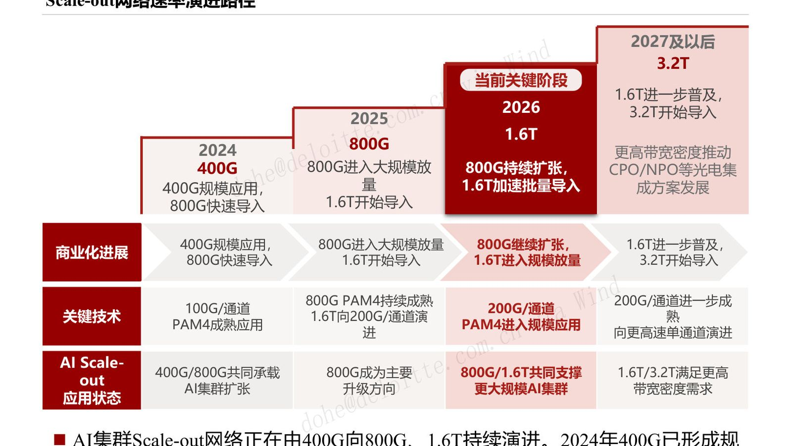

| 项目 | 2024 | 2025 | 2026（当前关键阶段） | 2027及以后 |
| --- | --- | --- | --- | --- |
| 速率 | 400G | 800G | 1.6T | 3.2T |
| 商业化进展 | 400G规模应用，800G快速导入 | 800G进入大规模放量，1.6T开始导入 | 800G继续扩张，1.6T进入规模放量 | 1.6T进一步普及，3.2T开始导入 |
| 关键技术 | 100G/通道 PAM4成熟应用 | 800G PAM4持续成熟，1.6T向200G/通道演进 | 200G/通道 PAM4进入规模应用 | 200G/通道进一步成熟，向更高速单通道演进 |
| AI Scale-out 应用状态 | 400G/800G共同承载AI集群扩张 | 800G成为主要升级方向 | 800G/1.6T共同支撑更大规模AI集群 | 1.6T/3.2T满足更高带宽密度需求 |

◆ AI集群Scale-out网络正在由400G向800G、1.6T持续演进。2024年400G已形成规模部署，800G开始快速导入；2025年800G进入明显放量阶段，同时1.6T开始由小规模验证向商用导入推进。进入2026年，800G仍是AI集群高速互连的重要主力规格，而1.6T的商业化进程明显加快。整体来看，当前Scale-out网络正处于“800G规模放量、1.6T加速导入”的阶段，后续将继续向更高速率产品演进。

来源：头豹研究院

---

<!-- 原文第 10 页 -->

## AI集群Scale-out：高速光模块结构与核心器件供应

**800G向1.6T升级进一步提高高速DSP、InP激光器、硅光PIC及精密光学耦合的技术要求；中国企业在光模块整机环节已具备较强供给能力，核心器件成熟度仍存在差异**

### 高速光模块产品结构拆解

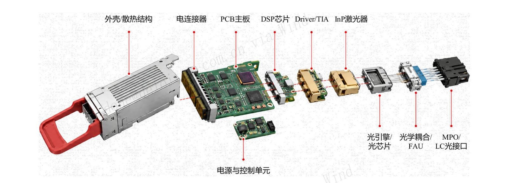

- 外壳/散热结构
- 电连接器
- PCB主板
- DSP芯片
- Driver/TIA
- InP激光器
- 光引擎/光芯片
- 光学耦合/FAU
- MPO/LC光接口
- 电源与控制单元

◆ 高速光模块主要由DSP、Driver/TIA、激光器、光芯片、光学耦合及封装等核心单元构成。当前Scale-out网络正处于800G规模放量、1.6T加速导入阶段，单通道速率进一步提升，对信号处理、光发射与接收、耦合精度及散热能力提出更高要求。其中，高速DSP承担更复杂的信号处理与纠错，InP激光器直接影响高速光信号发射能力，硅光及其他光芯片承担更高集成度下的光电转换，精密光学封装则关系到耦合损耗、散热和量产良率。随着速率提升，高速DSP、InP激光器、光芯片及精密封装成为光模块中技术要求和供给约束更突出的核心环节。

### 高速光模块及核心器件供应格局

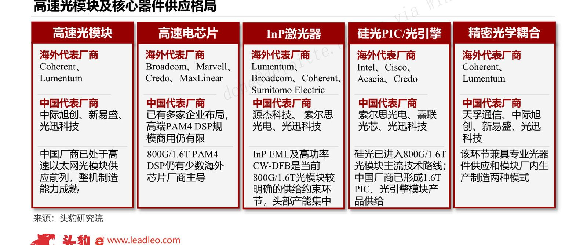

| 环节 | 高速光模块 | 高速电芯片 | InP激光器 | 硅光PIC/光引擎 | 精密光学耦合 |
| --- | --- | --- | --- | --- | --- |
| 海外代表厂商 | Coherent、Lumentum | Broadcom、Marvell、Credo、MaxLinear | Lumentum、Broadcom、Coherent、Sumitomo Electric | Intel、Cisco、Acacia、Credo | Coherent、Lumentum |
| 中国代表厂商 | 中际旭创、新易盛、光迅科技 | 已有多家企业布局，高端PAM4 DSP规模商用仍有限 | 源杰科技、索尔思光电、光迅科技 | 索尔思光电、熹联光芯、光迅科技 | 天孚通信、中际旭创、新易盛、光迅科技 |
| 环节说明 | 中国厂商已处于高速以太网光模块供应前列，整机制造能力成熟 | 800G/1.6T PAM4 DSP仍有少数海外芯片厂商主导 | InP EML及高功率CW-DFB是当前800G/1.6T光模块较明确的供给约束环节，头部产能集中 | 硅光已进入800G/1.6T光模块主流技术路线；中国厂商已形成1.6T PIC、光引擎模块产品供给 | 该环节兼具专业光器件供应和模块厂内生产制造两种模式 |

来源：头豹研究院

---

<!-- 原文第 11 页 -->

# HBM：市场扩张与产品代际升级

全球HBM市场继续快速扩张，2026年HBM3E仍为主要出货产品，HBM4进入量产爬坡；接口宽度和单堆栈带宽显著提升，推动HBM向更高数据吞吐能力演进

## 全球HBM市场规模及出货量结构，2025-2026E

单位：[亿美元]

纵轴刻度：0 / 100 / 200 / 300 / 400 / 500 / 600

- 2025：346
- 2026E：546

出货量结构（2026E）：HBM3E，66%；HBM4及其他，34%

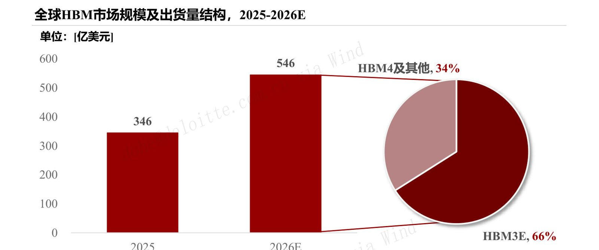

- 根据美国银行（BofA）的预测，全球HBM市场规模由2025年的346亿美元增长至2026年的546亿美元，预计同比增长约58%，AI加速器出货增长及单芯片HBM配置提升持续拉动需求。产品结构方面，2026年HBM3E预计仍占约三分之二，继续作为市场主力；与此同时，HBM4随新一代AI加速器平台导入进入量产爬坡期。整体来看，2026年HBM市场呈现“HBM3E持续放量、HBM4加快导入”的代际切换特征，市场增长与产品升级同步推进。

## HBM3E与HBM4产品代际变化

| HBM3E | 关键技术 | HBM4 |
| --- | --- | --- |
| 1,024-bit | I/O接口宽度 | 2,048-bit |
| >1.2 TB/s | 单堆栈带宽 | >2.8 TB/s |
| >9.2 Gb/s | Pin速率 | >11.0 Gb/s |
| 24GB（8H）/ 36GB（12H） | 典型容量 | 36GB（12H）/ 48GB（16H，送样） |
| 以传统HBM基底架构为主 | Base Die | Logic Base Die重要性明显提高 |
| 当前AI加速器主力HBM产品 | 产品阶段 | 2026年进入量产爬坡期 |

来源：BofA，SK hynix，Micron，头豹研究院

注：带宽、Pin速率及容量为Micron代表性产品参数，用于体现代际升级，不代表所有厂商统一规格

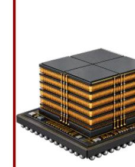

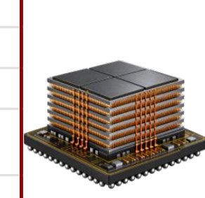

---

<!-- 原文第 12 页 -->

# HBM：结构复杂度与制造壁垒

HBM量产同时依赖先进DRAM制程、TSV、多Die堆叠、键合、热管理及客户认证，任一环节的工艺稳定性和良率均影响有效供给，形成较高的复合制造壁垒

- HBM正由HBM3E向HBM4加快演进。HBM4将I/O接口宽度由1,024-bit提升至2,048-bit，在相近容量下显著提高单堆栈数据吞吐能力；以Micron代表性产品为例，Pin速率由HBM3E的>9.2Gb/s提升至HBM4的>11.0Gb/s，单堆栈带宽由>1.2TB/s提升至>2.8TB/s，并开始向16层堆叠拓展。与此同时，HBM4对Logic Base Die、功耗控制及系统协同提出更高要求。产品升级在持续提高AI加速器存储带宽的同时，也进一步增加HBM制造、封装及客户验证的复杂度，为市场供给长期集中于少数存储原厂形成支撑。

## HBM结构与制造难点

### 制造流程与主要难点

| 序号 | 环节 | 主要难点 |
| --- | --- | --- |
| 1 | 先进DRAM Die | 先进制程基础性能与良率 |
| 2 | 晶圆减薄 | 均匀减薄厚度与机械稳定性 |
| 3 | TSV | 高深宽比刻蚀、Cu填充与绝缘 |
| 4 | 多Die堆叠 | 高精度对准、层间互连、可靠性 |
| 5 | 键合 / Underfill | 高精度键合、Underfill填充、热机械可靠性 |
| 6 | Logic Base Die | 高速I/O接口、逻辑与存储协同 |
| 7 | 散热 / 翘曲控制 | 热设计、材料与应力控制 |
| 8 | 测试与客户认证 | 全流程测试、平台认证与可靠性验证 |

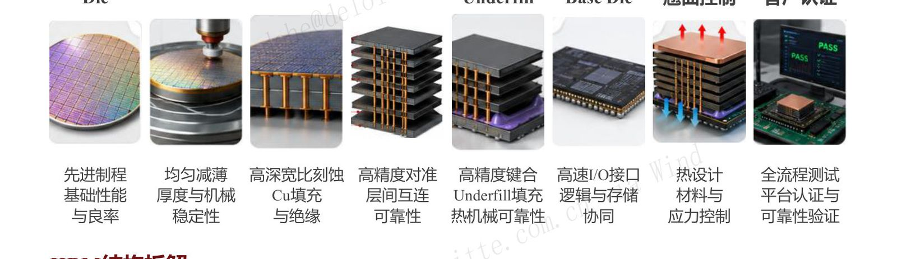

### HBM结构拆解

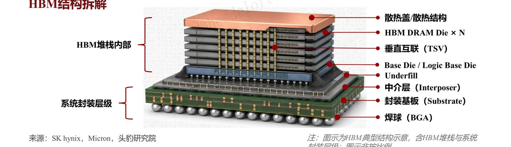

图示标注：散热盖/散热结构、HBM DRAM Die × N、垂直互联（TSV）、Base Die / Logic Base Die、Underfill、中介层（Interposer）、封装基板（Substrate）、焊球（BGA）

层级划分：HBM堆栈内部（散热盖/散热结构、HBM DRAM Die × N、垂直互联（TSV））；系统封装层级（Base Die / Logic Base Die、Underfill、中介层（Interposer）、封装基板（Substrate）、焊球（BGA））

来源：SK hynix，Micron，头豹研究院

注：图示为HBM典型结构示意，含HBM堆栈与系统封装层级；图示非按比例

---

<!-- 原文第 13 页 -->

# HBM：供给集中与DRAM产能挤压

全球HBM收入仍高度集中于三大存储原厂，且HBM占用的DRAM晶圆资源明显高于其Bit供给贡献；随着HBM扩产，先进DRAM产能进一步向其倾斜并挤压普通DRAM供给

- HBM量产不仅依赖先进DRAM制程，还需完成晶圆减薄、TSV、多Die堆叠、键合、Logic Base Die集成及热管理等复杂工艺，任一环节的稳定性和良率均会影响最终有效产出。随着堆叠层数和接口带宽提升，工艺控制、散热及可靠性要求进一步提高；产品还需与GPU、ASIC平台完成性能验证和长期可靠性认证。因此，HBM的规模供给建立在存储制造、先进封装和客户协同等复合能力之上，较高的进入壁垒使市场有效供给长期集中于少数具备完整量产能力的存储厂商。

## 全球HBM市场份额，按季度，2025Q1-2026Q1

单位：[%]

纵轴刻度：0% / 50% / 100%

| 厂商 | 2025Q1 | 2025Q2 | 2025Q3 | 2025Q4 | 2026Q1 |
| --- | --- | --- | --- | --- | --- |
| Micron | 18% | 21% | 21% | 21% | 21% |
| Samsung | 13% | 15% | 23% | 22% | 21% |
| SK hynix | 69% | 64% | 56% | 57% | 58% |

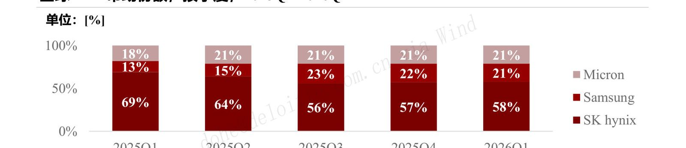

## 三大HBM供应商HBM晶圆投片与Bit供给占DRAM总量比例，2025-2027E

单位：[%]

纵轴刻度：0% / 20% / 40%

| 指标 | 2025 | 2026E | 2027E |
| --- | --- | --- | --- |
| 晶圆投片占比 | 18% | 22% | 30% |
| Bit供给占比 | 8% | 9% | 13% |

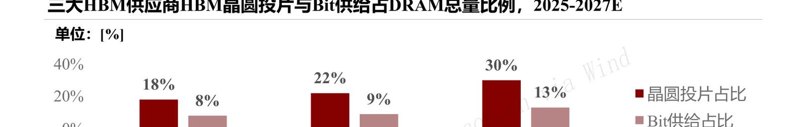

- 根据Counterpoint数据，2026Q1全球HBM收入仍全部集中于SK hynix、Samsung和Micron三家，其中SK hynix占58%，Samsung和Micron各占21%。此外，根据TrendForce数据，三大供应商合计HBM晶圆投片占比预计由2025年底的18%升至2027年底的30%，明显高于同期8%至13%的Bit供给占比。HBM较高的晶圆资源消耗使先进DRAM产能持续向其倾斜，对普通DRAM供给形成挤压，供给约束由HBM进一步传导至整体DRAM市场。

来源：Counterpoint，TrendForce，头豹研究院

---

<!-- 原文第 14 页 -->

# HBM：主要厂商商业化进展

SK hynix、Samsung和Micron均已跨入HBM4规模量产阶段并继续向HBM4E迭代；长鑫科技HBM3E开始进入小批量生产和客户测试，国产HBM整体仍处产业化早期

## HBM相关厂商商业化进展，截至2026年9月

| 厂商 | HBM3E | HBM4 | HBM4E及后续 |
| --- | --- | --- | --- |
| SK hynix | 规模量产/商业供货：8H产品2024年3月开始量产供货；12H 36GB于2024年9月开始量产；16H 48GB已完成样品开发 | 规模量产/商业供货：12H 36GB于2026Q2开始量产出货，H2继续扩大产量；16H 48GB仍处开发阶段 | 客户送样/验证：12H 48GB HBM4E于2026年6月向主要客户送样 |
| Samsung | 规模量产/商业供货：8H 24GB、12H 36GB均已量产；2025Q3公司披露HBM3E已向相关客户量产销售 | 规模量产/商业供货：12H产品2026年2月开始量产并商业出货，容量覆盖24-36GB；16H 48GB为后续扩展规划 | 客户送样/验证：12H 48GB于2026年5月向主要客户送样；8H 32GB、16H 64GB为后续产品规划；Custom HBM计划2027年开始送样 |
| Micron | 规模量产/商业供货：8H 24GB于2024年开始量产；12H 36GB已规模量产，并导入NVIDIA B300/GB300、AMD MI350等平台 | 规模量产/商业供货：12H 36GB于2026Q1开始量产出货；16H 48GB已向客户送样 | 开发中：HBM4E研发推进中，预计2027年进入规模量产 |
| 长鑫科技 | 小批量生产/客户测试：2026年已开始小批量生产HBM3E，平头哥、寒武纪等国内AI芯片厂商正在测试，计划2027年扩大产量 | / | / |

- SK hynix、Samsung和Micron均已实现HBM3E及HBM4规模量产与商业供货，全球HBM竞争已由HBM3E放量进一步转向HBM4产能爬坡及HBM4E产品迭代。其中，SK hynix与Samsung的HBM4E已进入客户送样验证阶段，Micron仍处开发阶段。相比之下，长鑫科技HBM3E已进入小批量生产和客户测试，但尚未形成规模商业供货，整体仍处HBM产业化早期。

来源：公司公告，公开资料整理，头豹研究院

---

<!-- 原文第 15 页 -->

# 先进封装：多Die与HBM推动封装级集成升级

AI计算芯片正由单Die向多Compute Die与多HBM的封装级集成演进；以台积电CoWoS为代表的先进封装技术持续扩大可集成面积，为更高算力与存储带宽提供空间，同时推高互连、供电、散热及良率控制难度

## AI计算芯片封装级集成演进

### 单逻辑Die + 外部存储

封装结构相对简单，逻辑芯片主要通过封装及板级互连连接外部存储

- 单颗Logic Die承担主要计算功能
- 存储主要位于芯片封装之外
- 计算与存储间传输距离较长、带宽相对受限
- 封装规模及集成复杂度相对较低

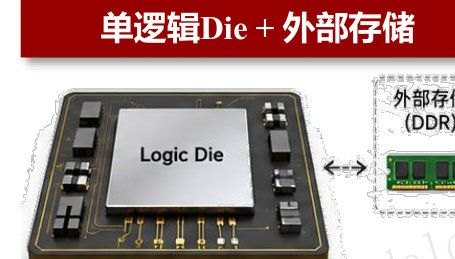

### 单逻辑Die + 多颗HBM

通过2.5D先进封装将Logic Die与多颗HBM集成于同一Package，大幅提升存储带宽

- 单颗大型Logic Die承担主要计算功能
- 多颗HBM与Logic Die实现封装级集成
- Interposer等高密度互连显著缩短数据传输距离
- 封装面积、供电及散热要求同步提高

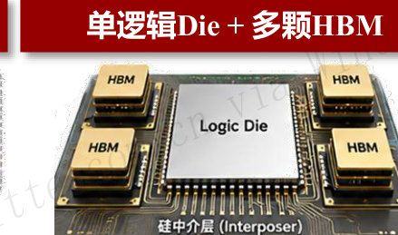

### 多Compute Die + 多颗HBM

多个Compute Die与更多HBM在大尺寸Package内协同集成，计算扩展进一步转向封装级系统集成

- 多个Compute Die协同扩展计算能力
- 更多HBM提供更高存储容量与带宽
- Die间通过高密度互连实现高速数据交换
- 封装尺寸持续扩大，供电、散热、翘曲及良率控制难度进一步提高

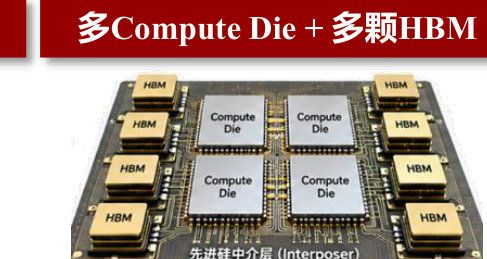

- AI计算芯片由单Die向多Compute Die与多HBM集成演进，封装规模及互连密度持续提升，先进封装逐步成为计算性能扩展的重要技术基础。

## TSMC CoWoS封装尺寸代表性演进节点

### CoWoS-S

CoWoS-S已形成成熟量产能力，Silicon Interposer最大可扩展至约3.3× Reticle尺寸

### CoWoS-L

首代3.5× Reticle CoWoS-L于2024年进入规模量产

### 大尺寸CoWoS

5.5× Reticle CoWoS已于2025年完成认证，2026年进入量产并持续扩大供给

### 超大尺寸CoWoS

14× Reticle预计可集成约10颗大型Compute Die + 20颗HBM，计划于2028年进入生产

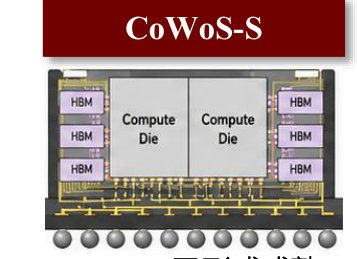

- CoWoS封装尺寸持续扩大，反映AI计算芯片正由单一大Die向多Compute Die与多HBM的大尺寸异构集成演进。

来源：TSMC，头豹研究院

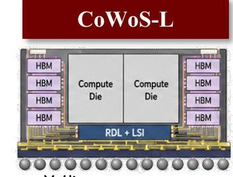

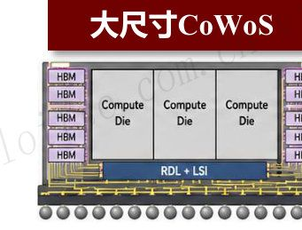

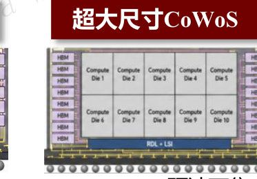

---

<!-- 原文第 16 页 -->

# 先进封装：多维异构集成推高制造与良率壁垒

AI加速器先进封装正由2.5D横向集成向3D及混合异构集成延伸，多芯片与HBM的封装级集成规模持续扩大，在提升计算密度与存储带宽的同时，也显著提高高密度互连、散热、翘曲控制及整体良率要求

## AI加速器先进封装的主要集成形态与实现技术

|  | 2.5D横向集成 | 3D垂直集成 | 2.5D + 3D混合集成 |
| --- | --- | --- | --- |
| 结构特征 | 多个Logic/Compute Die与HBM横向布置，并通过高密度封装级互连连接 | 不同功能Die上下堆叠，以高密度垂直互连缩短Die间距离 | 同一Package内同时存在横向多Die互连与纵向Die堆叠 |
| 主要价值 | 支持大规模多Die及多HBM集成，扩大封装级计算与存储带宽 | 提高单位面积互连密度、缩短信号路径并降低Die间通信功耗 | 同时扩展横向集成规模与纵向集成密度，适配更复杂异构系统 |
| 实现技术 | Silicon Interposer、RDL/Fan-out Interposer、Silicon Bridge等 | Micro-bump、TSV、Hybrid Bonding等 | Interposer/RDL/Bridge与3D Bonding/Stacking组合 |
| 代表平台 | TSMC CoWoS、Intel EMIB、Samsung I-Cube、ASE FOCoS等 | TSMC SoIC、Intel Foveros Direct、Samsung X-Cube等 | TSMC SoIC+CoWoS、Intel EMIB+Foveros等 |
| 图示 | （形态示意图） | （形态示意图） | （形态示意图） |

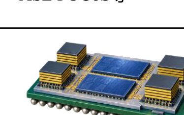

- 随着AI加速器集成的计算芯片裸片与HBM数量增加，封装尺寸和互连规模持续扩大，对高密度布线、芯片对准、供电及高速信号传输提出更高要求。大尺寸封装还会放大不同材料热膨胀差异带来的翘曲与应力问题，高功率密度也进一步增加散热难度。与此同时，多颗高价值芯片共同封装后，单颗芯片或局部互连缺陷都可能影响整个封装成品，因此对封装前良品筛选、键合精度、过程检测和系统级测试提出更高要求。AI先进封装的量产难点不仅在于实现多芯片与HBM集成，更在于大尺寸、高复杂度封装下维持稳定良率。

来源：头豹研究院

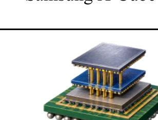

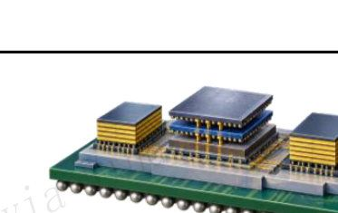

---

<!-- 原文第 17 页 -->

# 先进封装：主要厂商商业化进展与中国供给能力

AI先进封装增量价值目前主要由具备大尺寸异构集成与稳定量产能力的头部晶圆制造及封测厂商承接；中国头部封测厂已在2.5D、高密度异构集成等环节具备价值承接能力，并持续向多芯片与HBM集成升级

## AI先进封装主要厂商商业化进展，截至2026年9月

| 厂商类型 | 厂商 | 代表性技术/平台 | AI/HPC及HBM相关公开进展 |
| --- | --- | --- | --- |
| 晶圆代工 | TSMC | CoWoS、SoIC | 规模量产/持续扩产：CoWoS已规模应用于AI/HPC逻辑芯片与HBM集成，2026年5.5× Reticle方案已进入生产 |
| IDM | Intel | EMIB、Foveros / Foveros Direct | 规模量产：EMIB及Foveros已用于多Die与HBM集成产品，并支持2.5D与3D混合集成 |
| IDM | Samsung | I-Cube、X-Cube | 具备量产能力：2.5D平台已支持先进逻辑芯片与多颗HBM集成，3D集成持续推进 |
| 全球OSAT | ASE | VIPack、FOCoS / FOCoS-Bridge | 商业化/持续扩产：FOCoS系列面向AI/HPC及ASIC+HBM集成，已完成2 ASIC+8 HBM大尺寸封装验证 |
| 全球OSAT | Amkor | S-SWIFT、S-Connect | 商业化/客户合作深化：S-SWIFT、S-Connect面向AI/HPC及ASIC+HBM集成，并持续推进头部客户合作 |
| 中国OSAT | 长电科技 | XDFOI® | 规模量产：XDFOI®高密度多维异构集成平台已实现规模量产，面向AI/HPC应用 |
| 中国OSAT | 华天科技 | eSiFO、eSinC；2.5D平台 | 量产推进：2026H1重点推进2.5D技术平台规模化量产，并拓展大尺寸高性能封装应用 |
| 中国OSAT | 通富微电 | VISIONS平台 | 批量导入：先进封装多款产品已批量导入高性能计算及推理芯片领域，HBM相关产线持续建设 |
| 中国OSAT | 甬矽电子 | FH-BSAP、HCoS系列 | 客户验证：硅转接板及硅桥2.5D产品已完成送样，目前处多客户验证阶段 |

- AI先进封装供给由晶圆制造企业与专业封测厂商共同参与。TSMC、Intel、Samsung已形成面向AI/HPC的2.5D、3D及混合集成能力，ASE、Amkor等也在推进多芯片与HBM集成。中国厂商方面，长电科技相关异构集成平台已实现规模量产，通富微电已有先进封装产品批量导入高性能计算领域，华天科技正推进2.5D平台规模化量产，甬矽电子处于客户验证阶段。整体来看，中国头部封测厂商已在2.5D、高密度异构集成等方向形成产业化能力，并正向更大封装尺寸、更高集成密度及多芯片与HBM协同集成持续推进。

来源：公司公告，头豹研究院

---

<!-- 原文第 18 页 -->

# AI计算硬件产业化进展：核心环节参与位置与价值承接

中国AI计算硬件链的价值承接能力已呈明显分化，高速光模块具备全球领先供应能力，AI加速芯片与先进封装进入规模商业化或产业化加速阶段，HBM及高速DSP等核心环节仍处突破早期

## AI计算硬件核心价值环节与中国参与位置

### AI计算硬件核心结构

- AI计算节点（Scale-up节点内协同）：AI加速芯片与Scale-up互连、HBM、AI先进封装
- AI计算集群（Scale-out高速互连）：高速光模块、高速光模块核心器件
- 承接端：AI服务器/集群系统集成

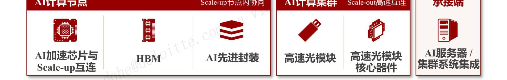

### 中国参与位置热力路径图

成熟度由低到高；评价环节横向对应：早期验证 → 产业化推进 → 批量导入 → 规模商业化 → 全球头部供应

| 评价环节 | 所处阶段 | 说明 |
| --- | --- | --- |
| A AI加速芯片与Scale-up互连 | 规模商业化 | 国产AI加速芯片已形成规模商业化，市场渗透持续提升 |
| B HBM | 早期验证～产业化推进 | HBM3E开始进入小批量生产与客户验证 |
| C AI先进封装 | 批量导入 | 2.5D及高密度异构集成已进入产业化阶段 |
| D 高速光模块 | 全球头部供应 | 中国厂商已进入全球头部供应位置 |
| E 高速光模块核心器件：光学器件/封装 | 产业化推进～批量导入 | 部分光学器件及精密封装已形成商业供给 |
| F 高速光模块核心器件：高速DSP | 早期验证 | 高速DSP仍以海外厂商为主 |

图例：参与度/产业化成熟度：低 → 高；◎ 当前中国参与位置

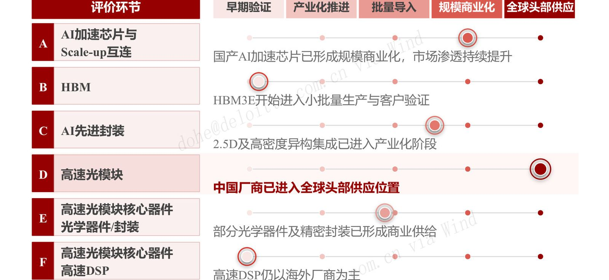

- 中国AI计算硬件不同环节的产业化成熟度差异显著。高速光模块已形成较强全球竞争力，国产AI加速芯片实现规模商业化，先进封装也进入批量导入和部分量产阶段；相比之下，HBM仍处小批量生产与客户验证阶段，高速DSP等核心电芯片仍以海外厂商为主。整体来看，中国AI硬件价值承接正由整机与制造能力，逐步向高价值核心芯片、存储及关键器件延伸。

来源：头豹研究院

---

<!-- 原文第 19 页 -->

# AI计算硬件产业化进展：代表厂商商业化进展

AI加速芯片已形成多家厂商规模商用的产品梯队，先进封装也出现从客户验证到规模量产的进展；相比之下，国产HBM目前仍仅处于小批量生产和客户验证阶段

## 中国AI计算硬件代表厂商商业化阶梯，截至2026年9月（1/3）

- ① 产品发布/工程验证：产品已发布、流片、形成工程样品或完成内部验证，但未见明确客户验证或商业出货。
- ② 客户验证/小批量：已送样、客户验证、小批量生产或小批量出货。
- ③ 批量导入：已进入客户供应链并形成批量交付，但尚不足以确认成熟规模化供货。
- ④ 规模商业化：已明确量产，并形成持续规模出货、规模部署或较大商业收入。
- ⑤ 全球头部供应：不仅已实现规模商业化，而且已进入全球头部供应商位置。

图例：● 当前主力产品/平台；○ 下一代或前瞻产品；单一阶段；跨阶段过渡；横向位置：商业化阶段

### 赛道1｜AI加速芯片与Scale-up互连

| 所处阶段 | 厂商｜产品/平台 |
| --- | --- |
| ① 产品发布/工程验证 | 天数智芯｜天垓300 |
| ③ 批量导入 | 沐曦｜曦云C600 |
| ④ 规模商业化 | 华为昇腾｜Atlas 900 A3 / 昇腾384超节点 |
| ④ 规模商业化 | 海光信息｜DCU 8000系列 + HSL互连 |
| ④ 规模商业化 | 寒武纪｜云端智能芯片/板卡及智能计算集群系统 |
| ④ 规模商业化 | 昆仑芯｜P800 + 天池超节点 |
| ④ 规模商业化 | 摩尔线程｜MTT S5000 / 夸娥智算集群 / MTLink |
| ④ 规模商业化 | 沐曦｜C500 |
| ④ 规模商业化 | 壁仞科技｜壁砺166系列 / BR166 |
| ④ 规模商业化 | 天数智芯｜天垓训练系列 / 智铠推理系列 |
| ④ 规模商业化 | 燧原科技｜L600训推一体卡 / S60推理卡 |

④ 规模商业化产品（⑤暂无节点）

### 赛道2｜HBM

| 所处阶段 | 厂商｜产品/平台 |
| --- | --- |
| ② 客户验证/小批量 | 长鑫科技｜HBM3E* |

国产HBM直接供应主体仍明显稀缺

* 长鑫HBM3E进展据Reuters于2026年8月31日转引The Information报道，截至目前尚非长鑫科技官方产品公告确认。

### 赛道3｜AI先进封装

| 所处阶段 | 厂商｜产品/平台 |
| --- | --- |
| ② 客户验证/小批量 | 甬矽电子｜HCoS系列——硅转接板 / 硅桥2.5D |
| ② 客户验证/小批量 | 盛合晶微｜SmartPoser®-3DIC-HB |
| ③ 批量导入 | 通富微电｜VISIONS平台 |
| ③ 批量导入 | 华天科技｜2.5D技术平台 |
| ④ 规模商业化 | 长电科技｜XDFOI® |
| ④ 规模商业化 | 盛合晶微｜SmartPoser®-Si / SmartPoser®-3DIC-BP |

④ 规模商业化产品（⑤暂无节点）

来源：公开资料整理，头豹研究院

---

<!-- 原文第 20 页 -->

# （接上页）

高速光模块已形成由全球头部供应商与多家规模交付厂商构成的较完整产品层级，800G规模出货与1.6T产品导入同步推进；上游激光器、光引擎及精密光学器件也已有多家中国厂商进入批量供货

## 中国AI计算硬件代表厂商商业化阶梯，截至2026年9月（2/3）

- ① 产品发布/工程验证：产品已发布、流片、形成工程样品或完成内部验证，但未见明确客户验证或商业出货。
- ② 客户验证/小批量：已送样、客户验证、小批量生产或小批量出货。
- ③ 批量导入：已进入客户供应链并形成批量交付，但尚不足以确认成熟规模化供货。
- ④ 规模商业化：已明确量产，并形成持续规模出货、规模部署或较大商业收入。
- ⑤ 全球头部供应：不仅已实现规模商业化，而且已进入全球头部供应商位置。

图例：● 当前主力产品/平台；○ 下一代或前瞻产品；单一阶段；跨阶段过渡；横向位置：商业化阶段

### 赛道4｜高速光模块

| 所处阶段 | 厂商｜产品/平台 |
| --- | --- |
| ① 产品发布/工程验证 | 易飞扬 GIGALIGHT｜1.6T OSFP224 DR8 / HYBRID |
| ① 产品发布/工程验证 | 索尔思光电｜1.6T |
| ② 客户验证/小批量 | 联特科技｜1.6T |
| ② 客户验证/小批量 | 剑桥科技｜1.6T |
| ③ 批量导入 | 光迅科技｜1.6T |
| ④ 规模商业化 | 光迅科技｜800G |
| ④ 规模商业化 | 华工正源｜800G LPO / 1.6T |
| ④ 规模商业化 | 剑桥科技｜800G |
| ④ 规模商业化 | 联特科技｜800G |
| ④ 规模商业化 | 索尔思光电｜800G系列 |
| ⑤ 全球头部供应 | 中际旭创｜800G / 1.6T |
| ⑤ 全球头部供应 | 新易盛｜800G / 1.6T / LPO |

### 赛道5｜高速光模块核心器件

#### 5A｜光芯片 / 光引擎 / 精密光学器件

| 所处阶段 | 厂商｜产品/平台 |
| --- | --- |
| ① 产品发布/工程验证 | 熹联光芯｜单波200G 800G/1.6T PIC及光引擎 |
| ② 客户验证/小批量 | 源杰科技｜200G PAM4 EML |
| ② 客户验证/小批量 | 仕佳光子｜1.6T AWG / CPO高通道FAU |
| ② 客户验证/小批量 | 光库科技｜AI高速光互连PAM4薄膜铌酸锂调制器芯片 |
| ③ 批量导入 | 天孚通信｜CPO FAU / ELS |
| ③ 批量导入 | 熹联光芯｜400G / 800G PIC及光引擎 |
| ③ 批量导入 | 仕佳光子｜800G / 1.6T MT-FA-lens |
| ④ 规模商业化 | 天孚通信｜1.6T高速光引擎 |
| ④ 规模商业化 | 源杰科技｜70/100mW CW激光器 / 100G PAM4 EML |
| ④ 规模商业化 | 索尔思光电｜100G / 200G PAM4 EML |
| ④ 规模商业化 | 云岭光电｜70/100mW CW / 56G Baud EML |

④ 规模商业化产品（⑤暂无节点）

来源：公开资料整理，头豹研究院

---

<!-- 原文第 21 页 -->

## （接上页）

**中国厂商在高速光互连领域的商业化能力已由模块整机进一步延伸至部分核心光器件。国产高速电芯片已出现从工程产品、客户验证到早期批量导入的厂商，但不同产品进度差异较大**

### 中国AI计算硬件代表厂商商业化阶梯，截至2026年9月（3/3）

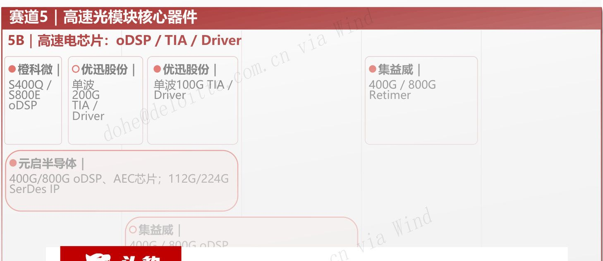

**赛道5｜高速光模块核心器件**

**5B｜高速电芯片：oDSP / TIA / Driver**

- **橙科微｜** S400Q / S800E oDSP
- **优迅股份｜** 单波200G TIA / Driver
- **优迅股份｜** 单波100G TIA / Driver
- **集益威｜** 400G / 800G Retimer
- **元启半导体｜** 400G/800G oDSP、AEC芯片；112G/224G SerDes IP
- **集益威｜** 400G / 800G oDSP

◼ AI加速芯片方面，华为昇腾、寒武纪、海光、昆仑芯等已形成规模商用基础，沐曦、天数智芯等则处于成熟产品放量与新一代产品导入并行阶段，国内厂商已覆盖从产品验证到规模部署的多个商业化层级；HBM方面，当前国内仅长鑫HBM3E处于客户验证及小批量阶段，尚未形成多家厂商规模供货的市场格局；先进封装方面，长电科技、盛合晶微部分2.5D/3D平台已进入规模量产，通富微电、华天科技处于批量导入或产能爬坡阶段，甬矽电子新平台仍以客户验证为主；高速光模块方面，中际旭创、新易盛已进入全球头部供应商序列，光迅科技、华工正源、剑桥科技、联特科技等已形成800G规模交付能力，并逐步推进1.6T产品导入；核心器件方面，源杰科技、云岭光电、天孚通信等在激光器、光引擎及精密光学器件上已具备批量供货能力，而国产oDSP、TIA、Driver仍主要处于产品发布、送样验证和早期导入阶段。从厂商产品进展看，中国企业在AI加速芯片、高速光模块和部分光器件环节已形成较完整的商业化产品序列，而HBM及高速电芯片仍缺少多家厂商持续规模供货，产品商业化进度差异较为明显。

来源：公开资料整理，头豹研究院

---

<!-- 原文第 22 页 -->

## 主线二：存储周期与结构升级

- 存储周期
- 存储需求
- 存储供给
- 服务器内存

---

<!-- 原文第 23 页 -->

## 存储周期：价格走势与市场规模变化

**全球DRAM与NAND市场自2024年起明显修复，2025年市场规模进一步增至2,215.8亿美元；2025年9月以来两类存储价格快速上行，但进入2026年二季度后走势开始分化，DRAM继续走强，NAND趋于高位稳定**

### 全球DRAM与NAND综合价格指数，2024.1–2026.9

单位：[点]

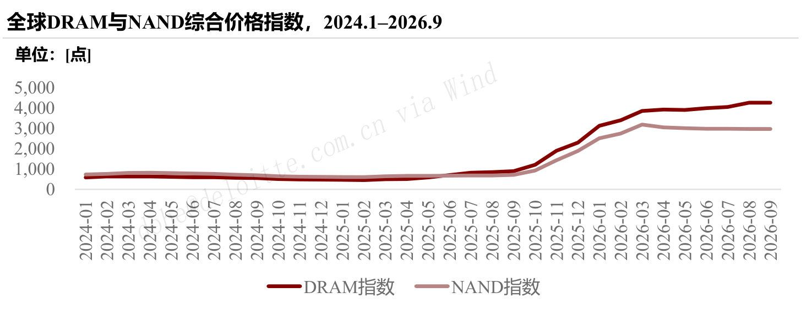

- 横轴：月份，2024-01 至 2026-09
- 纵轴：0–5,000 点，刻度依次为 0、1,000、2,000、3,000、4,000、5,000
- 图例：DRAM指数、NAND指数

◼ NAND与DRAM综合价格指数自2025年9月起进入明显上行阶段，随后涨幅持续扩大。进入2026年二季度后，两者走势开始出现分化：DRAM综合价格指数继续上行，并在8月后维持高位；NAND综合价格指数则在前期快速上涨后趋于平稳。截至2026年9月，DRAM与NAND综合价格指数分别达到4,274.57和2,980.03，当前两类存储价格均处于较高水平，但DRAM后续走势明显强于NAND。

### 全球DRAM与NAND Flash市场规模，2020–2025

单位：[亿美元]

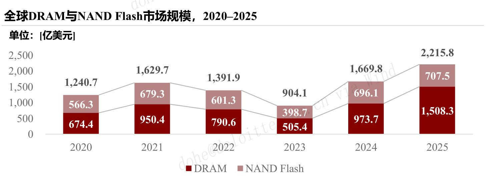

| 年份 | DRAM | NAND Flash | 合计 |
| --- | --- | --- | --- |
| 2020 | 674.4 | 566.3 | 1,240.7 |
| 2021 | 950.4 | 679.3 | 1,629.7 |
| 2022 | 790.6 | 601.3 | 1,391.9 |
| 2023 | 505.4 | 398.7 | 904.1 |
| 2024 | 973.7 | 696.1 | 1,669.8 |
| 2025 | 1,508.3 | 707.5 | 2,215.8 |

◼ 全球DRAM与NAND Flash市场规模在2021年达到阶段高位后，于2022–2023年连续回落，随后伴随库存去化和存储价格回升，自2024年起明显修复，2025年进一步增至2,215.8亿美元。其中DRAM市场恢复幅度明显高于NAND，2025年全球存储市场的主要收入增量更多由DRAM贡献。

来源：CFM闪存市场，头豹研究院

---

<!-- 原文第 24 页 -->

## 存储需求：下游应用结构变化

**2024-2026年，全球NAND Flash与DRAM需求均明显向服务器侧集中：服务器预计成为NAND Flash最大应用方向，服务器DRAM与HBM合计占DRAM需求比重升至50%，数据中心成为存储需求增长的主要来源**

### 全球NAND Flash下游应用结构，2024-2026E

单位：[%]

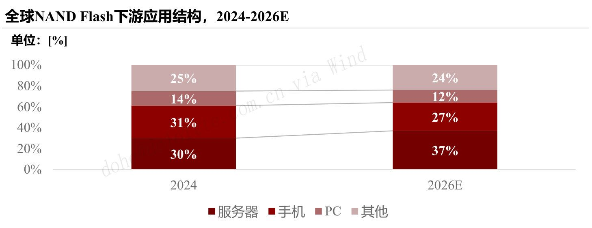

| 应用 | 2024 | 2026E |
| --- | --- | --- |
| 服务器 | 30% | 37% |
| 手机 | 31% | 27% |
| PC | 14% | 12% |
| 其他 | 25% | 24% |

◼ 2024至2026E，服务器在全球NAND Flash需求中的占比由30%提升至37%，同期手机和PC占比分别降至27%和12%。服务器预计超过手机成为NAND Flash最大的下游应用，NAND需求增长正从以终端出货量为主，逐步转向由数据中心建设及单机存储容量提升驱动。

### 全球DRAM下游应用结构，2024-2026E

单位：[%]

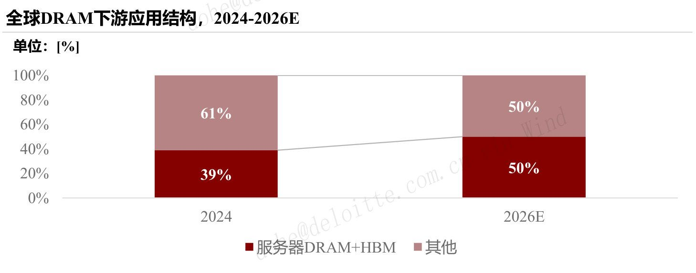

| 应用 | 2024 | 2026E |
| --- | --- | --- |
| 服务器DRAM+HBM | 39% | 50% |
| 其他 | 61% | 50% |

◼ 2024至2026E，服务器DRAM与HBM在全球DRAM需求中的合计占比由39%提升至50%，其余应用占比相应下降。服务器相关需求已占全球DRAM需求的一半，DRAM市场增长对数据中心投资及单机内存配置提升的依赖进一步增强，传统PC和手机换机周期对整体需求的影响相对下降。

来源：CFM闪存市场，头豹研究院

---

<!-- 原文第 25 页 -->

## 存储供给：原厂产能配置与供给弹性

**相较NAND，DRAM受HBM产能占用及新增产能释放周期约束，中期供给弹性更低；叠加服务器主内存持续向高容量、高带宽方向升级，服务器DRAM及相关接口芯片成为本轮存储周期中更值得关注的增量环节**

### 全球DRAM与NAND供给响应机制

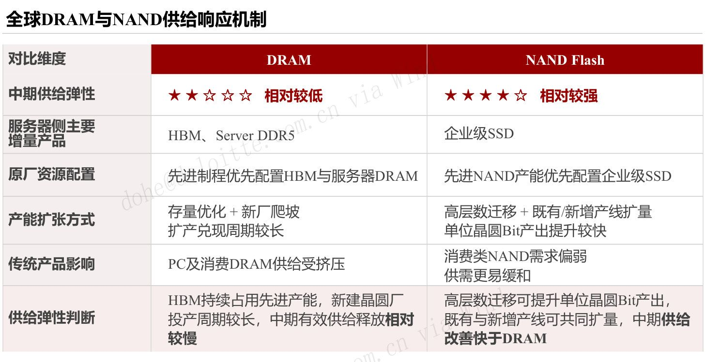

| 对比维度 | DRAM | NAND Flash |
| --- | --- | --- |
| 中期供给弹性 | ★★☆☆☆ 相对较低 | ★★★★☆ 相对较强 |
| 服务器侧主要增量产品 | HBM、Server DDR5 | 企业级SSD |
| 原厂资源配置 | 先进制程优先配置HBM与服务器DRAM | 先进NAND产能优先配置企业级SSD |
| 产能扩张方式 | 存量优化 + 新厂爬坡，扩产兑现周期较长 | 高层数迁移 + 既有/新增产线扩量，单位晶圆Bit产出提升较快 |
| 传统产品影响 | PC及消费DRAM供给受挤压 | 消费类NAND需求偏弱，供需更易缓和 |
| 供给弹性判断 | HBM持续占用先进产能，新建晶圆厂投产周期较长，中期有效供给释放**相对较慢** | 高层数迁移可提升单位晶圆Bit产出，既有与新增产线可共同扩量，中期供给**改善快于DRAM** |

### 主要存储原厂供给动作时间轴，2026–2029

图例：● 产品组合 / 现有产能 / 量产　◆ 制程迁移　■ 新Fab / 洁净室 / 产线　🔒 长期锁量

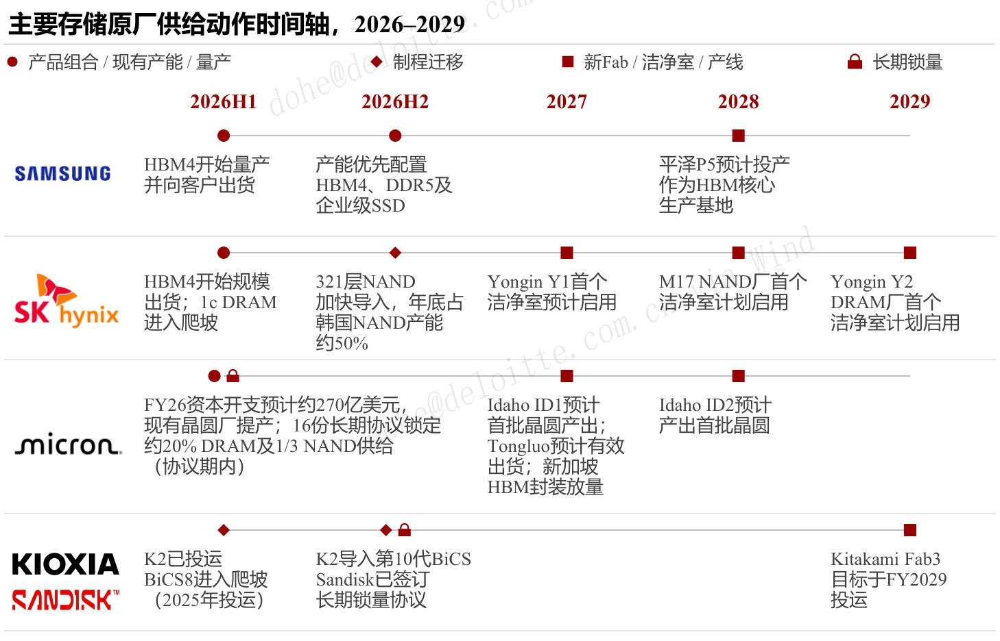

| 原厂 | 2026H1 | 2026H2 | 2027 | 2028 | 2029 |
| --- | --- | --- | --- | --- | --- |
| SAMSUNG | HBM4开始量产并向客户出货 | 产能优先配置HBM4、DDR5及企业级SSD |  | 平泽P5预计投产，作为HBM核心生产基地 |  |
| SK hynix | HBM4开始规模出货；1c DRAM进入爬坡 | 321层NAND加快导入，年底占韩国NAND产能约50% | Yongin Y1首个洁净室预计启用 | M17 NAND厂首个洁净室计划启用 | Yongin Y2 DRAM厂首个洁净室计划启用 |
| Micron | FY26资本开支预计约270亿美元，现有晶圆厂提产；16份长期协议锁定约20% DRAM及1/3 NAND供给（协议期内） |  | Idaho ID1预计首批晶圆产出；Tongluo预计有效出货；新加坡HBM封装放量 | Idaho ID2预计产出首批晶圆 |  |
| KIOXIA / SANDISK | K2已投运，BiCS8进入爬坡（2025年投运） | K2导入第10代BiCS，Sandisk已签订长期锁量协议 |  |  | Kitakami Fab3 目标于FY2029投运 |

来源：Samsung、SK hynix、Micron、Kioxia、SanDisk，头豹研究院

---

<!-- 原文第 26 页 -->

## 服务器内存：高带宽模组与接口芯片升级

**服务器CPU核心数提升及AI等应用带动主内存带宽需求快速增长，DDR5 RDIMM仍是主流形态，同时MRDIMM加速导入，进一步提升内存带宽，带动RCD、MRCD和MDB等接口芯片价值量提升**

### 服务器主内存架构及模组形态

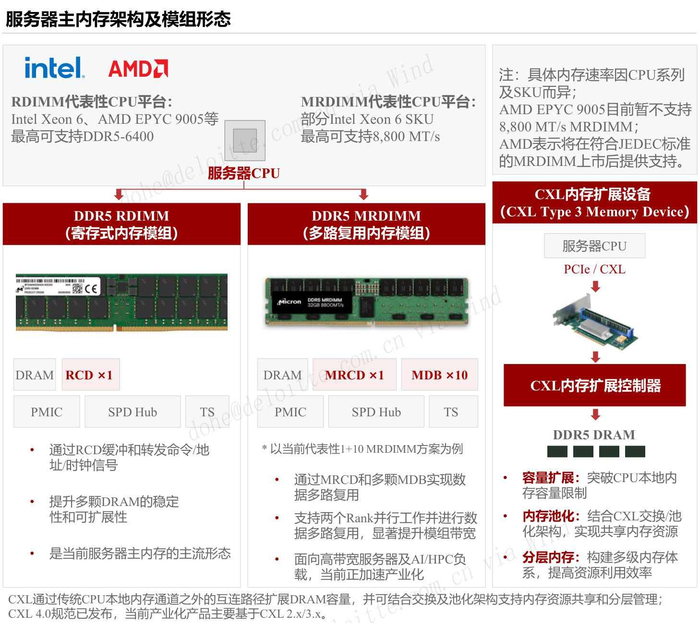

**代表性CPU平台**

- RDIMM代表性CPU平台：Intel Xeon 6、AMD EPYC 9005等，最高可支持DDR5-6400
- MRDIMM代表性CPU平台：部分Intel Xeon 6 SKU，最高可支持8,800 MT/s

注：具体内存速率因CPU系列及SKU而异；AMD EPYC 9005目前暂不支持8,800 MT/s MRDIMM；AMD表示将在符合JEDEC标准的MRDIMM上市后提供支持。

**DDR5 RDIMM（寄存式内存模组）**

- 配置：DRAM、RCD ×1、PMIC、SPD Hub、TS
- 通过RCD缓冲和转发命令/地址/时钟信号
- 提升多颗DRAM的稳定性和可扩展性
- 是当前服务器主内存的主流形态

**DDR5 MRDIMM（多路复用内存模组）**

- 配置：DRAM、MRCD ×1、MDB ×10、PMIC、SPD Hub、TS
- * 以当前代表性1+10 MRDIMM方案为例
- 通过MRCD和多颗MDB实现数据多路复用
- 支持两个Rank并行工作并进行数据多路复用，显著提升模组带宽
- 面向高带宽服务器及AI/HPC负载，当前正加速产业化

**CXL内存扩展设备（CXL Type 3 Memory Device）**

- 结构：服务器CPU → PCIe / CXL → CXL内存扩展控制器 → DDR5 DRAM
- 容量扩展：突破CPU本地内存容量限制
- 内存池化：结合CXL交换/池化架构，实现共享内存资源
- 分层内存：构建多级内存体系，提高资源利用效率

CXL通过传统CPU本地内存通道之外的互连路径扩展DRAM容量，并可结合交换及池化架构支持内存资源共享和分层管理；CXL 4.0规范已发布，当前产业化产品主要基于CXL 2.x/3.x。

### 相关内存接口芯片及配套芯片功能

| 芯片 | 功能 | 说明 |
| --- | --- | --- |
| RCD | 寄存时钟驱动 | 缓冲/重驱命令、地址与时钟信号 |
| MRCD | 多路复用寄存时钟驱动 | 缓冲/调度地址、命令、时钟与控制信号 |
| MDB | 数据缓冲 | 实现数据多路复用，提升MRDIMM带宽 |
| PMIC | 电源管理 | 为内存模组提供多路电源管理 |
| SPD Hub | 串行存在检测 | 存储模组配置及身份信息 |
| TS | 温度传感 | 监测模组温度，辅助稳定运行 |

来源：Intel，AMD，Micron，Rambus，Renesas，澜起科技，CXL Consortium，头豹研究院

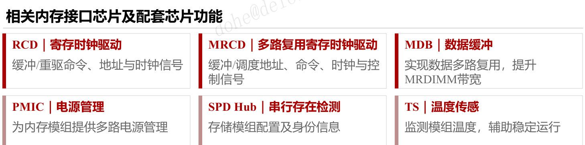

---

<!-- 原文第 27 页 -->

## （接上页）

**RDIMM接口芯片持续迭代，MRDIMM加速产业化，CXL拓展内存扩展场景；以澜起科技、聚辰股份为代表的中国厂商已在核心接口及模组配套芯片部分环节形成规模供给，新产品正成为业务增量来源**

### 服务器内存接口技术与代表性产品产业化进展

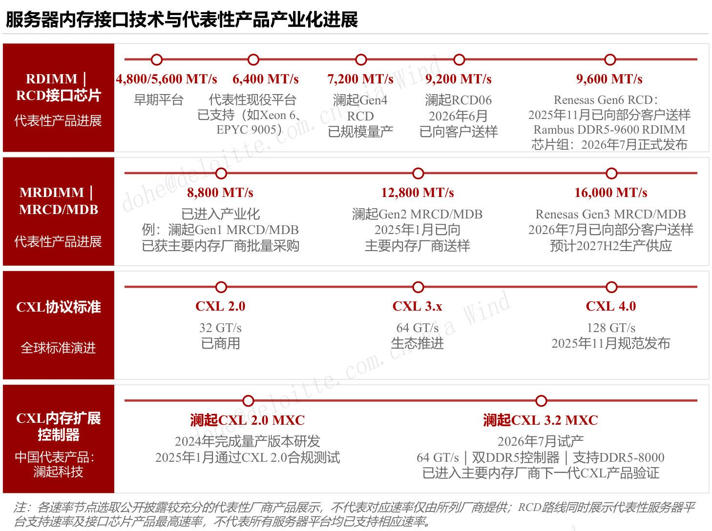

**RDIMM｜RCD接口芯片（代表性产品进展）**

- 4,800/5,600 MT/s：早期平台
- 6,400 MT/s：代表性现役平台已支持（如Xeon 6、EPYC 9005）
- 7,200 MT/s：澜起Gen4 RCD，已规模量产
- 9,200 MT/s：澜起RCD06，2026年6月已向客户送样
- 9,600 MT/s：Renesas Gen6 RCD：2025年11月已向部分客户送样；Rambus DDR5-9600 RDIMM芯片组：2026年7月正式发布

**MRDIMM｜MRCD/MDB（代表性产品进展）**

- 8,800 MT/s：已进入产业化；例：澜起Gen1 MRCD/MDB已获主要内存厂商批量采购
- 12,800 MT/s：澜起Gen2 MRCD/MDB，2025年1月已向主要内存厂商送样
- 16,000 MT/s：Renesas Gen3 MRCD/MDB，2026年7月已向部分客户送样，预计2027H2生产供应

**CXL协议标准（全球标准演进）**

- CXL 2.0：32 GT/s，已商用
- CXL 3.x：64 GT/s，生态推进
- CXL 4.0：128 GT/s，2025年11月规范发布

**CXL内存扩展控制器（中国代表产品：澜起科技）**

- 澜起CXL 2.0 MXC：2024年完成量产版本研发；2025年1月通过CXL 2.0合规测试
- 澜起CXL 3.2 MXC：2026年7月试产；64 GT/s｜双DDR5控制器｜支持DDR5-8000；已进入主要内存厂商下一代CXL产品验证

注：各速率节点选取公开披露较充分的代表性厂商产品展示，不代表对应速率仅由所列厂商提供；RCD路线同时展示代表性服务器平台支持速率及接口芯片产品最高速率，不代表所有服务器平台均已支持相应速率。

### 中国厂商在服务器内存接口及配套芯片领域的价值承接

| 环节 | 中国代表厂商 | 主要产品 | 最新进展（截至2026年9月） | 典型客户/生态 |
| --- | --- | --- | --- | --- |
| 核心内存接口芯片 | 澜起科技（MONTAGE Technology） | RCD、DB；MRCD、MDB；CXL MXC | 2026H1互连类芯片收入31.11亿元，同比+26.4%；MRCD/MDB、PCIe Retimer、CKD、CXL MXC等四类新产品收入5.38亿元，同比+80.7% | 全球主要DRAM厂商、CPU及服务器生态；CXL产品已进入三星、SK海力士等主要内存厂商验证 |
| 内存模组配套芯片 | 聚辰股份（GIANTEC SEMICONDUCTOR） | DDR5 SPD（串行存在检测芯片） | 与澜起合作开发DDR5 SPD，已在行业主要内存模组厂商大范围应用；2026Q2 DDR5 SPD出货较Q1快速增长 | 行业主要内存模组厂商及存储产业链客户 |

来源：Intel，AMD，Micron，Rambus，Renesas，CXL Consortium，澜起科技，聚辰股份，头豹研究院

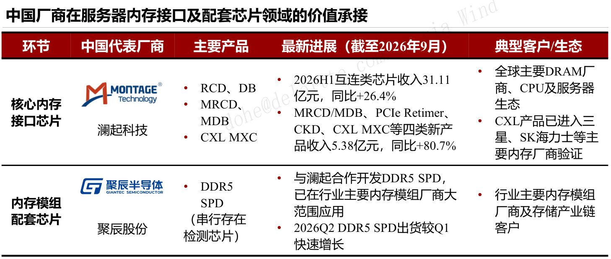

---

<!-- 原文第 28 页 -->

## 头豹业务合作

全球视野 · 本土洞察 · 助力企业把握市场先机

### 核心业务

| 业务 | 说明 |
| --- | --- |
| 行业数据API | 开放原创报告与研究数据接口，支持企业知识库、系统平台及AI应用高效接入和调用 |
| KNIT解决方案 | 构建企业可信内容体系，提升品牌在AI搜索与问答中的可见度、准确性与转化效果 |
| 报告会员账号 | 可阅读全部原创报告和百万数据，提供PC及移动端，方便触达平台内容 |
| 定制报告/白皮书 | 对产业及细分行业进行现状梳理和趋势洞察，输出全局观深度研究报告 |
| 商业尽调 | 面向投资并购和商业决策，评估标的公司的商业前景、价值及风险 |
| 招股书引用 | 研究覆盖国民经济19+核心产业，内容可授权引用至上市文件、年报 |

### 业务咨询

- 客服电话：400-072-5588
- 官方网站：www.leadleo.com
- 商务咨询与深度合作

### 报告作者

- 袁栩聪　首席分析师
- 张俊雅　行业分析师
- service@leadleo.com

### 办公地点

- 深圳办公室：广东省深圳市南山区粤海街道华润置地大厦E座4105室，邮编：518057
- 上海办公室：上海市静安区南京西路1717号会德丰国际广场2701室，邮编：200040
- 南京办公室：江苏省南京市栖霞区经济开发区兴智科技园B栋401，邮编：210046

---

<!-- 原文第 29 页 -->

## 方法论

◆ 头豹研究院布局中国市场，深入研究19大行业，持续跟踪532个垂直行业的市场变化，已沉淀超过100万行业研究价值数据元素，完成超过1万个独立的研究咨询项目。

◆ 研究院依托中国活跃的经济环境，研究内容覆盖整个行业的发展周期，伴随着行业中企业的创立，发展，扩张，到企业走向上市及上市后的成熟期，研究院的各行业研究员探索和评估行业中多变的产业模式，企业的商业模式和运营模式，以专业的视野解读行业的沿革。

◆ 研究院融合传统与新型的研究方法，采用自主研发的算法，结合行业交叉的大数据，以多元化的调研方法，挖掘定量数据背后的逻辑，分析定性内容背后的观点，客观和真实地阐述行业的现状，前瞻性地预测行业未来的发展趋势，在研究院的每一份研究报告中，完整地呈现行业的过去，现在和未来。

◆ 研究院密切关注行业发展最新动向，报告内容及数据会随着行业发展、技术革新、竞争格局变化、政策法规颁布、市场调研深入，保持不断更新与优化。

◆ 研究院秉承匠心研究，砥砺前行的宗旨，从战略的角度分析行业，从执行的层面阅读行业，为每一个行业的报告阅读者提供值得品鉴的研究报告。

## 法律声明

◆ 本报告著作权归头豹所有，未经书面许可，任何机构或个人不得以任何形式翻版、复刻、发表或引用。若征得头豹同意进行引用、刊发的，需在允许的范围内使用，并注明出处为“头豹研究院”，且不得对本报告进行任何有悖原意的引用、删节或修改。

◆ 本报告分析师具有专业研究能力，保证报告数据均来自合法合规渠道，观点产出及数据分析基于分析师对行业的客观理解，本报告不受任何第三方授意或影响。

◆ 本报告所涉及的观点或信息仅供参考，不构成任何投资建议。本报告仅在相关法律许可的情况下发放，并仅为提供信息而发放，概不构成任何广告。在法律许可的情况下，头豹可能会为报告中提及的企业提供或争取提供投融资或咨询等相关服务。本报告所指的公司或投资标的的价值、价格及投资收入可升可跌。

◆ 本报告的部分信息来源于公开资料，头豹对该等信息的准确性、完整性或可靠性不做任何保证。本文所载的资料、意见及推测仅反映头豹于发布本报告当日的判断，过往报告中的描述不应作为日后的表现依据。在不同时期，头豹可发出与本文所载资料、意见及推测不一致的报告和文章。头豹不保证本报告所含信息保持在最新状态。同时，头豹对本报告所含信息可在不发出通知的情形下做出修改，读者应当自行关注相应的更新或修改。任何机构或个人应对其利用本报告的数据、分析、研究、部分或者全部内容所进行的一切活动负责并承担该等活动所导致的任何损失或伤害。

---

<!-- 原文第 30 页 -->

## 2026年AI进阶与飞跃年度最佳应用实践

一图读懂　｜　弗若斯特沙利文 × 头豹研究院 · 年度征集

### 年度标杆AI Agent · AI英雄人物

能力进阶 · 形态飞跃 · 价值深化

### PART 01 评选体系：8类标杆Agent + AI英雄人物

**年度标杆AI Agent　8类 · 每类TOP10**　　P-E-B-C 四维评估

| 维度 | 标杆类别 | 评选理由 | 要点 |
| --- | --- | --- | --- |
| 一 AI智能能力进阶：从智能辅助走向自主任务执行 | 01 企业级通用标杆Agent（TOP10） | 面向企业通用工作任务，在真实工作流程中体现通用价值 | 任务覆盖、执行协作、应用成效 |
| 一 AI智能能力进阶：从智能辅助走向自主任务执行 | 02 消费级标杆Agent（TOP10） | 面向个人用户高频需求，以可感知体验体现应用吸引力 | 任务体验、交互服务、用户价值 |
| 二 AI智能形态飞跃：从数字智能走向端侧智能与物理世界 | 03 端侧AI标杆Agent（TOP10） | 依托AI手机、AI PC等智能终端与端云协同，体现端侧智能落地价值 | 端侧能力、协同执行、终端成效 |
| 二 AI智能形态飞跃：从数字智能走向端侧智能与物理世界 | 04 物理AI标杆Agent（TOP10） | 面向具身智能、机器人等物理场景，体现物理世界任务落地能力 | 感知执行、稳定适应、作业成效 |
| 三 AI应用价值深化：从技术创新走向规模化场景落地 | 05 企业服务标杆Agent（TOP10） | 聚焦客服、营销、财税、人力等专业职能，体现企业服务场景化价值 | 专业能力、系统协同、业务成效 |
| 三 AI应用价值深化：从技术创新走向规模化场景落地 | 06 产业落地标杆Agent（TOP10） | 面向行业真实场景，体现行业复制与规模应用潜力 | 场景适配、行业协同、落地成效 |
| 四 年度特别标杆：前沿突破与社会价值 | 07 年度创新突破标杆Agent（TOP10） | 聚焦前沿技术与Agent能力创新，体现创新方向与应用前景 | 技术突破、能力创新、转化潜力 |
| 四 年度特别标杆：前沿突破与社会价值 | 08 年度社会价值标杆Agent（TOP10） | 聚焦公益、普惠与公共服务场景，体现社会价值与持续服务能力 | 服务覆盖、普惠协同、受益成效 |

06 行业标签：金融 · 医疗 · 工业 · 政务 · 互联网 · 教育 · 能源 · 交通

**同期评选｜AI英雄人物 TOP20**　C 可验证贡献 | E 产业成效 | I 创新引领 | V 价值与影响　（C-E-I-V）

评选理由 | 聚焦可验证贡献、产业成效与创新引领，体现其在AI技术突破、产业推动与行业影响中的综合价值

### PART 02 评选流程与时间

| 时间 | 事项 | 说明 |
| --- | --- | --- |
| 2026年10月起 | 开放一轮报名 | 企业、机构及个人扫码提交报名信息 |
| 2026年12月1日 | 一轮报名截止 | 研究团队开展初审与调研，通知入围对象 |
| 2026年12月31日 | 二轮提报截止 | 入围对象提交详细申报材料与案例证明 |
| 2027年1月 | 报告发布（预计） | 专家综合评审后，揭晓入选Agent产品与人物 |

**欢迎申报**

- 联系邮箱：oliver.yuan@frostchina.com
- 申报网址：https://tp.wjx.com/vm/OPqi8i1.aspx
- 一轮报名截止2026年12月1日·二轮材料提报截止12月31日
- 发布渠道：头豹科技创新网、Wind、Choice等主流报告发布平台

主办：弗若斯特沙利文 × 头豹研究院
www.leadleo.com

---
