> 原文件：[28_file.sgpjbg.com_5ead08a3e51049439a97cd406dae.pdf](https://github.com/jadennevercode/CJCC-Knowledge-Base/blob/564ab11aa9785e569e3853c8a4d7ce86f88e7535/materials/%E4%B8%8B%E6%B8%B8%EF%BC%9A%E5%BA%94%E7%94%A8%E4%B8%8E%E9%9C%80%E6%B1%82%E7%BB%93%E6%9E%84/28_file.sgpjbg.com_5ead08a3e51049439a97cd406dae.pdf)
> 转换方式：Volcengine OCRPdf v3, parse_mode=ocr

<!-- 原文第 1 页 -->

 
2026年 
三个皮匠报告网www.sgpjbg.com 全行业研究报告、财报、峰会、数据、产业政策下载平台

---

<!-- 原文第 2 页 -->

目录 
 
01 
仔储行业涨价潮开后 
02 
驱动NAND需求高 
03 
海外原厂 捏厂 与供需改 
04 投资建议与风险提示

---

<!-- 原文第 3 页 -->

01 

---

<!-- 原文第 4 页 -->

海外各大存储原厂开启涨价潮(闪迪/美光/三星/海力士/西部数据) 2025年9月,闪迪率先宣布产品价格上调10%以上,打响涨价第一枪。随后美光向渠道商发出通知,宣布存储产品价格将上涨20%-30%,并暂 停所有DRAM产品报价一周。三星电子计划将部分DRAM价格上调15%-30%,NAND闪存价格上调5%-10%;海力士正与客户谈判价格;西 部数据立即开始逐步提高所有机械硬盘产品价格。本轮涨价核心驱动力是全球AI算力需求爆炸式增长拉动存储需求爆发,与2023-2024年行业低 迷期形成鲜明对比。 
 

| 厂商 | 时间 | 涨价情况 |
| --- | --- | --- |
| 闪迪 | 2025.9 | 宣布将面向所有渠道和消费者客户的产品价格上调10%以上。 |
| 美光 | 2025.9 | 向渠道商发出通知,宣布其存储产品价格将上涨20%-30%。从9月12日起,所有DDR4、DDR5、LPDDR4、 LPDDR5等存储产品全部停止报价,协议客户价格全部取消,暂停报价一周。 |
| 三星 | 2025.9 | 三星电子计划将部分DRAM价格上调15%至30%,NAND闪存价格上调5%至10%。 |
| 海力士 | 2025.9 | 市场传闻正在跟客户谈判价格。 |
| 西部数据 | 2025.9 | 西部数据已通知客户,将立即开始逐步提高所有机械硬盘产品的价格。 |
 
数据来源:三个皮匠报告 www.sgpjbg.com

---

<!-- 原文第 5 页 -->

25Q4存储芯片价格预测(Server/Mobile/PC各品类涨幅) 服务器市场:大型云服务商对高容量DDR5和eSSD新增需求显著,Q4 eSSD涨幅预计达10%,DDR5RDIMM约10%-15%,DDR4 RDIMM15%-20%。手机市场:原厂产能全面转向服务器,收紧嵌入式存储供应,Mobile NAND ASP预计上涨5%-10%,LPDDR4X/5X 10%-15%。PC市场:供需双方拉锯,cSSD涨幅预计5%-10%,PC DDR5/LPDDR5X 10%-15%。存储芯片全面涨价反映了从服务器到消费 端的全产业链供需改善。 
 

| 市场 | 品类 | 4Q25涨价幅度(QoQ) |
| --- | --- | --- |
| Server | NAND | up~10% |
| DDR5 | up 10%~15% |
| DDR4 | up 15%~20% |
| Mobile | NAND | up 5%~10% |
| LPDDR5/X | up 10%~15% |
| LPDDR4/X | up 10%~15% |
| PC | NAND | up 5%~10% |
| | LPDDR5X/DDR5 | up10%~15% |
 
数据来源:三个皮匠报告 www.sgpjbg.com

---

<!-- 原文第 6 页 -->

三大存储原厂(三星/海力士/美光)营收与利润趋势 三星DS部门营收自2023Q1低点持续回升,利润于2024Q3转正并加速改善;海力士营收快速攀升,净利润由2023年巨亏转为高盈利,受益于 HBM高增长;美光营收自2024Q3起强劲复苏,净利润于2024Q4转正后持续扩大。三大原厂业绩同步改善印证存储行业已进入新一轮上行周期, 量价齐升趋势明确,与AI服务器、企业级存储需求爆发高度相关。 
 
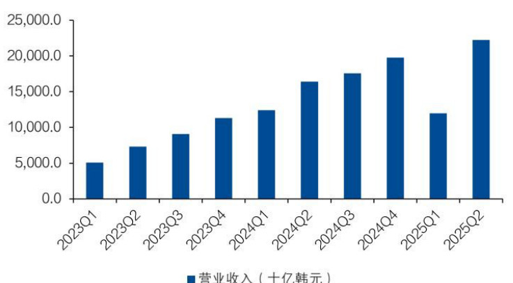 
数据来源:三个皮匠报告 www.sgpjbg.com

---

<!-- 原文第 7 页 -->

中国台湾存储厂商月度营收变化(华邦电/旺宏/南亚科) 
 
华邦电2025年9月营收79.2亿新台币(同比+9.52%),南亚科9月营收66.64亿新台币(同比+157.81%),均呈现强劲增长态势。华邦电 自2024年下半年起营收同比转正并稳步提升,南亚科2025年3月以来营收同比增速持续高增,5月达+94.95%、6月+141.32%、9月 +157.81%。中国台湾存储模组厂商业绩持续改善反映行业需求回暖及涨价效应传导。 
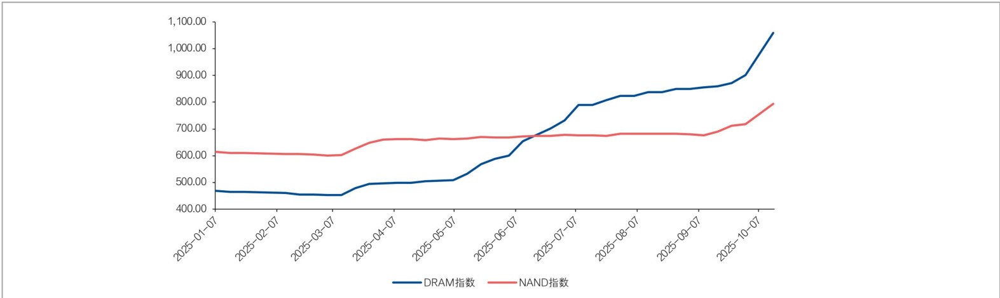 
数据来源:三个皮匠报告 www.sgpjbg.com

---

<!-- 原文第 8 页 -->

DRAM和NAND指数走势 
 
DRAM和NAND指数自2024年下半年触底后震荡上行,2025年Q3以来上涨斜率明显加大,反映存储芯片价格进入加速上升通道。指数上行趋 势与各大原厂涨价行动、下游补库需求以及AI服务器强劲拉货相互印证,存储行业景气度持续上行。 
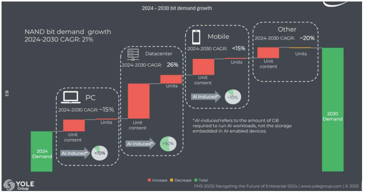 
数据来源:三个皮匠报告 
www.sgpjbg.com

---

<!-- 原文第 9 页 -->

02 

---

<!-- 原文第 10 页 -->

2024-2030年NAND不同下游应用需求增速(数据中心CAGR26%领跑) 据Yole预测,2024-2030年NAND位元需求CAGR约21%。数据中心CAGR约26%,其中超50%需求与AI工作负载直接相关,是最大驱动 力;PC市场CAGR约15%,AI额外需求不到10%;手机CAGR低于15%,AI额外需求约10%;车载、loT等其他应用约20%。AI算力爆 发使数据中心从"通用计算"向"AI加速计算"转型,存储需求结构发生深刻变化--AI推理阶段的RAG向量数据库、模型存储等场景催生大量新增 存储需求。 
 
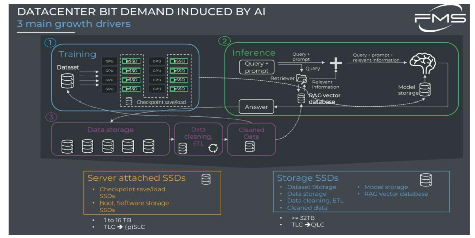 
数据来源:三个皮匠报告 www.sgpjbg.com

---

<!-- 原文第 11 页 -->

AI训练和推理中SSD是关键支撑(训练/推理/数据存储三阶段) 
 
AI工作负载对存储的需求体现在三个阶段:训练阶段--大模型训练需要超大规模数据集,GPU依赖eSSD做数据加载和检查点保存,容量从1TB 到16TB;推理阶段--Query被送到RAG向量数据库检索相关信息,结合模型参数生成答案,需要大量存储SSD支持模型存储和数据库操作 容量通常大于32TB:数据存储与处理--原始数据需经存储、清洗、ETL处理生成干净数据集,SSD是关键支撑。AI存储需求从"训练端"向"推 理端"延伸,推理场景的存储需求增速更快。 
The $/GB gap remains important QLC penetration will heip in reucing it but won't close it SSDs are becoming increasingly competitive when evaluated through a TCO lens, which factors W/TB, bandwidth,and storage density. 
 
VS 
Price 0.015$/CB 
SAS/SATA Bandwidth:<300MB/s 
0.09$/CB 6X moreexpensive 
SAS/SATA/PCIE 4 
Read Bandwidth 
Bandwidth: up to 7000MB/sec >20x higher 
Storage density 
Up to 32TB in HDD 100GB/cm3 
~2 to 5x more efficient 1TB/cm3 40to 125mW/TB 
>10x denser 
Up to 120TB in U.2 
W/TB ~200mW/TB 
数据来源:三个皮匠报告 
www.sgpjbg.com

---

<!-- 原文第 12 页 -->

企业级SSD和HDD对比(价格/性能/密度/功耗TCO优势) 
 
SSD的竞争力已从"单一性能优势"升级为"总拥有成本(TCO)优势":价格方面,HDD约0.015美元/GB,SSD约0.09美元/GB(贵约6 倍);读写速度,HDD低于300MB/s,SSD最高7000MB/s(快20倍以上);存储密度,HDD最高 $32TB/100GB/cm3$ ,SSD最高 $120TB/1TB/cm3$ (密度高10倍);功耗,HDD高于200mW/TB,SSD仅40-125mW/TB(节能2-5倍)。QLC eSSD通过提升容量密度 进一步降低$/GB,加速企业从HDD向eSSD迁移。 
## STORAGE SSDS SSD share rising, HDD growth still strong 
Storage eSSD bit demand Forecast e55D20% 
Bit demand forecast HDD and eSSD 
Forecast HOD 
AGR24-30 
eS50 55% 
Based on the 11% scenario,the eSSD storage bit demand is expected to grow by 54%CAGR24-30. 
Historically,eSSDs have accounted for about 3% of storage. 
This still lvesa o of rom fo HD bit demand growth (26% CAGR2430) 
数据来源:三个皮匠报告 
www.sgpjbg.com

---

<!-- 原文第 13 页 -->

企业级SSD和HDD需求增速和占比(eSSD CAGR 54% vs HDD 26%) 历史上企业级SSD在整个存储中仅占约3%份额,但AI带来的存储需求暴增使SSD增长曲线明显变陡。按预测,2030年eSSD市场份额预计达 11%(乐观条件下可达20%)。HDD需求依旧坚挺,2024-2030年CAGR预计26%,而企业级SSD增速更高,CAGR可达54%。AI是 eSSD增长的最大引擎--存储类SSD(数据集存储/RAG向量数据库/数据清洗等)CAGR高达54%,AI服务器挂载SSD约20%,非AI服务 器SSD仅12%。 
 

| Nearline HDD与QLC SSD重点比较 | | | | | |
| --- | --- | --- | --- | --- | --- |
| 产品 | 交付周期 | 每GB平均售价(美元) | 最大容量 | 性能 | 能效 |
| Nearline HDD | 52周 | 0.015 | 32TB | 弱 | 较低 |
| QLC SSD | 8周 | 0.05-0.06 | 122TB | 强 | 较高 |
 
数据来源:三个皮匠报告 www.sgpjbg.com

---

<!-- 原文第 14 页 -->

Nearline HDD与QLC SSD重点对比(交期52周vs8周) 
 
AI推理需求快速推升实时存取、高速处理海量数据的需求,但HDD市场正面临巨大供应缺口。NL HDD交期已从原本数周急剧延长至52周以上 而QLC SSD交期仅8周。每GB平均售价方面,HDD约0.015美元,QLC SSD约0.05-0.06美元(SSD约贵3-4倍,而非历史6倍),价差 持续收窄。最大容量方面,HDD32TB,QLC SSD已达122TB。性能方面SSD远优于HDD。HDD正面临技术换代阵痛期--HAMR技术产 线投资高昂造成产能扩张瓶颈,而NAND Flash通过3D堆栈技术演进使产能提升速度远快于HDD,预期2026年2Tb QLC芯片产出逐步放量, 将成降低Nearline SSD成本的主力。 
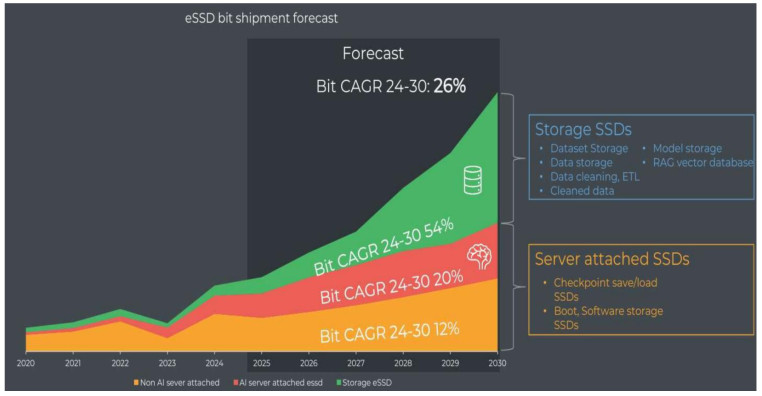 
数据来源:三个皮匠报告 
www.sgpjbg.com

---

<!-- 原文第 15 页 -->

 

| 全球NAND厂商月产能(万片) | | 产量(百万/等效 1GB) | 营收(百万美金) |
| --- | --- | --- | --- |
| 三星 | 41.5 | 244351 | 19524 |
| 海力士 | 14.5 | 101644 | 5646 |
| Solidigm | 8.5 | 90115 | 4754 |
| Kioxia/WDC/San Disk | 40 | 265198 | 17817 |
| 美光 | 13 | 102804 | 8703 |
| 长存 | 14.5 | 107905 | 5590 |
| others | 2.1 | 337 | 394 |
| 总计 | 134.1 | 912352 | 62428 |

---

<!-- 原文第 16 页 -->

---

<!-- 原文第 17 页 -->

2024-2025年全球NAND厂商产能/产量/营收变化(减产10-20%) 2025年全球NAND月产能预计134万片,较2024年142万片下降约5.6%。主要原厂为应对库存积压和价格下行压力启动减产:三星西安工厂 月产量从20万片降至17万片(减产超10%),韩国华城12号和17号线同步调整;美光将NAND晶圆启动率下调10%并减慢制程节点转移。 减产带来供给收缩,叠加AI需求爆发,供需格局逆转驱动价格上涨。营收方面,2025年全球NAND营收预计约624亿美元,同比增长约 19%(2024年约506亿美元),量价齐升趋势确认。 
 

| Ranking | Company | Revenue (USSM) | | Market Share (%) | |
| --- | --- | --- | --- | --- | --- |
| 2Q25 | QoQ(%) | 2Q25 | 1Q25 |
| 1 | Samsung | 1,899.0 | 0.5% | 34.6% | 39.6% |
| 2 | SK Group (SK hynix +Solidigm) | 1461.7 | 47.1% | 26.7% | 20.8% |
| 3 | Micron | 784.6 | -7.9% | 14.3% | 17.9% |
| 4 | Kioxia | 750.3 | 32.5% | 13.7% | 11.9% |
| 5 | SanDisk | 213.0 | -8.2% | 3.9% | 4.9% |
| Total of Top 5 | | 5,108.6 | 12.7% | 93.2% | 95.1% |
 
数据来源:三个皮匠报告 www.sgpjbg.com

---

<!-- 原文第 18 页 -->

企业级SSD收入情况(25Q2五大厂营收51亿美元,+12.7%) 
 
2025Q2,英伟达Blackwell平台规模化出货及北美CSP持续扩大通用服务器布局,带动企业级SSD需求显著增长。前五大品牌厂三星、海力士、 美光、铠侠、闪迪营收合计超51亿美元,环比增长12.7%。三星以34.6%份额居首(营收18.99亿美元)、海力士(含Solidigm)26. 7%(14.62亿美元,环比+47.1%增长最猛)、美光14.3%(7.85亿美元)、铠侠13.7%(7.50亿美元,环比+32.5%)、闪迪 3.9%(2.13亿美元)。韩国厂商在AI存储领域优势明显,海力士凭借HBM和企业级SSD双轮驱动增长最为突出。 
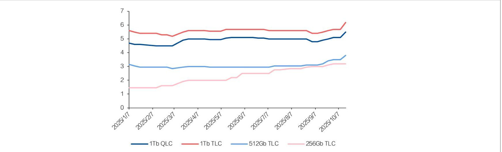 
数据来源:三个皮匠报告 www.sgpjbg.com

---

<!-- 原文第 19 页 -->

存储模组价格跟踪(NAND Flash Wafer/SSD/eMMC/UFS/DRAM现货价格) 
 
NAND Flash Wafer现货价格自2024年中触底后持续回升,2025年Q3涨幅加速;SSD、eMMC、UFS等模组产品价格跟随上涨。DRAM 现货价格同步上行,行业内存条和渠道内存条价格均呈上涨趋势。LPDDR现货价格亦有所回升。各类存储产品价格全面上涨反映行业从"供给过剩" 向"供需紧平衡"转变,模组厂商业绩弹性最大--上游原厂涨价向模组端传导,模组厂商库存价值重估叠加出货价格提升,盈利能力有望显著改善。 

| 全球NAND厂商 | 月产能(万片) | 产量(百万/等效1GB) | 营收(百万美金) |
| --- | --- | --- | --- |
| 三星 | 47.3 | 245032 | 23,400 |
| 海力士 | 14.4 | 96446 | 7,628 |
| Solidigm | 7.1 | 77684 | 6,382 |
| Kioxia/DC/San Disk | 44.3 | 247949 | 16694 |
| 美光 | 14.3 | 93923 | 8,483 |
| 长存 | 12.5 | 60989 | |
| others | 2.0 | 425 | 3050 |
| 总计 | 141.7 | 822450 | 65637 |
 
数据来源:三个皮匠报告 www.sgpjbg.com

---

<!-- 原文第 20 页 -->

04 

---

<!-- 原文第 21 页 -->

投资建议及风险提示(模组厂受益标的:江波龙/佰维存储/德明利/香农芯创) 
 
2025Q2开始存储行业进入新一轮上行周期,伴随存储芯片量价齐升,存储模组相关公司业绩预计将持续改善。企业级SSD成为国内存储模组厂商 布局重点,预计未来云计算和互联网大厂将持续加大AI相关资本开支,在企业级SSD深入布局的模组公司将深度受益。重点关注:江波龙(企业级 存储布局深入)、佰维存储(兴业证券为做市商)、德明利、香农芯创。风险提示:下游需求不及预期、存货规模较大及跌价风险、供应商集中度较 高及原材料供应风险、国内互联网大厂资本开支不及预期。 

| 投资建议的评级标准 | 类别 | 评级 | 说明 |
| --- | --- | --- | --- |
| | 股票评级 | 买入 | 相对同期相关证券市场代表性指数涨幅大于15% |
| 报告中投资建议所涉及的评级分为股票评级和行业 | 增持 | 相对同期相关证券市场代表性指数涨幅在5%~15%之间 |
| 评级(另有说明的除外)。评级标准为报告发布日 | 中性 | 相对同期相关证券市场代表性指数涨幅在-5%~5%之间 |
| 后的12个月内公司股价(或行业指数)相对同期相 关证券市场代表性指数的涨跌幅。其中:沪深两市 | 减持 | 相对同期相关证券市场代表性指数涨幅小于-5% |
| 以沪深300指数为基准;北交所市场以北证50指数 | 无评级 | 由于我们无法获取必要的资料,或者公司面临无法预见结果的重大不确定性事件,或者其他原因, 致使我们无法给出明确的投资评级 |
| 为基准;新三板市场以三板成指为基准;香港市场 以恒生指数为基准;美国市场以标普500或纳斯达 | 行业评级 | 推荐 | 相对表现优于同期相关证券市场代表性指数 |
| 克综合指数为基准。 | 中性 | 相对表现与同期相关证券市场代表性指数持平 |
| 回避 | 相对表现弱于同期相关证券市场代表性指数 |
 
数据来源:三个皮匠报告 
www.sgpjbg.com

---

<!-- 原文第 22 页 -->

## 查看完整报告 获取完整报告及数据请前往【三个皮匠报告】官网 
三个皮匠报告 WWW.SGPJBG.COM 
电脑端官网 
微信小程序 
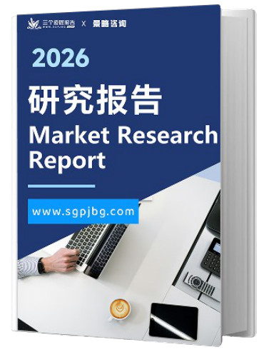 
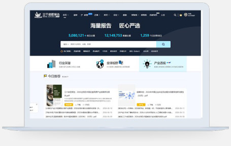 
浏览器访问电脑端官网 www.sgpjbg.com 
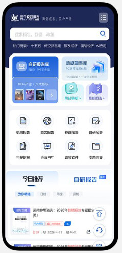 
 
扫码访问手机端

---

<!-- 原文第 23 页 -->

三个皮匠报告 
官网:www.sgpjbg.com 
联系电话:0731-84720580 
自研报告库 
报告定制业务 
全行业研究报告、财报、峰会、数 据、产业政策下载平台 
十五五全系列产业深度报告 
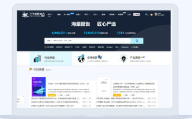 
新质生产力、未来产业、战略性新兴产业 
 
 
 
前沿技术·趋势前瞻 核聚变能、AIDC、深地经济、具身智能.. 
微信公众号 
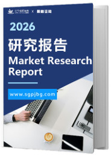 
商务合作、报告定制 小红书 
网站栏目 
 
未来消费·投资风口 银发经济、宠物经济、情绪消费.. 
 
产品形式:纸质版+电子版 电子版格式:WORD版+PDF版 交付时间:6-10个工作日,特殊要求另行商定 
 
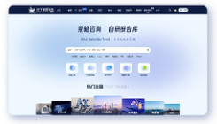 
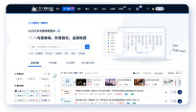 
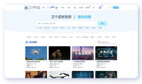 
## 核心产品 
自研报告库 
券商&投行研报 
专题合集 
 
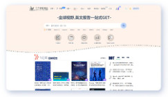 
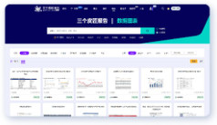 
 
 
 
 
 
500万+报告 
2800+合集 
450万+财报 
500万+政策 1200万+数据 
会议峰会 
英文报告 
数据图表 
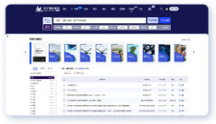 
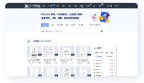 
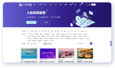 
 
 
 
 
 
6000+全球智库 
会议峰会PPT 投研报告 
AI工具集 自研报告 
产业政策 
财报&招股书 
报告分发 
咨询/机构/协会 产业峰会/国际大会 内资券商/外资投行 
搜索/翻译/辅读 报告定制/原创报告库
