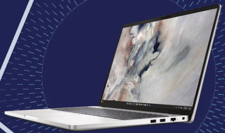
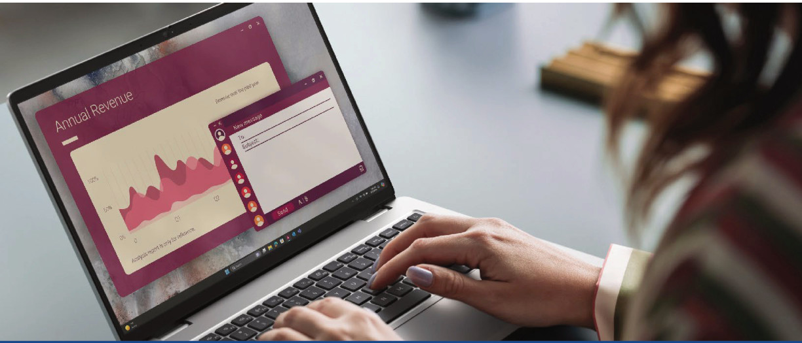
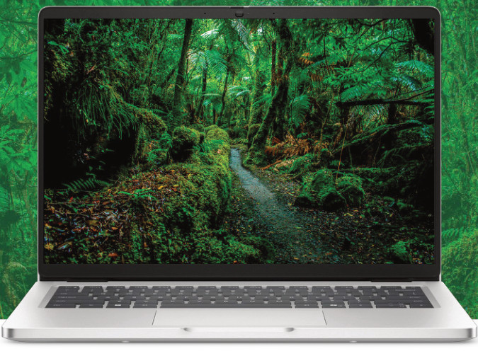
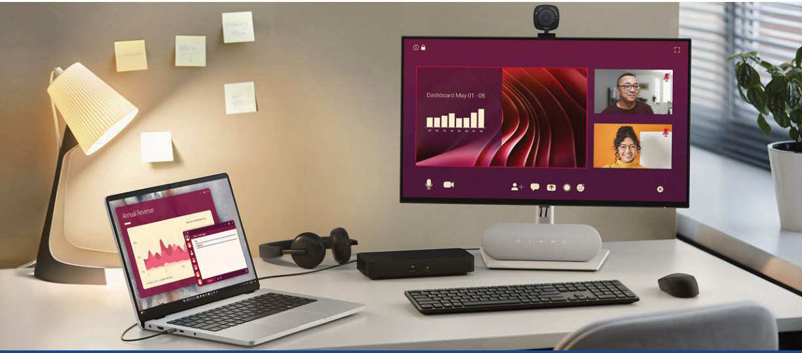
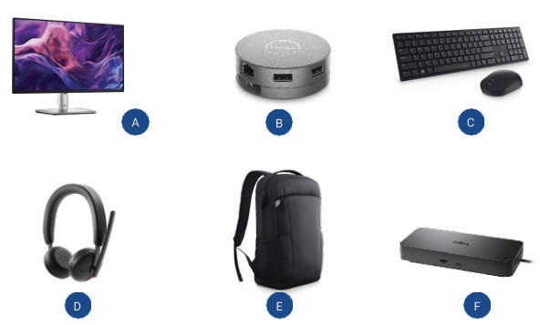
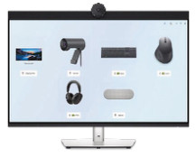
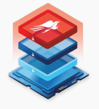
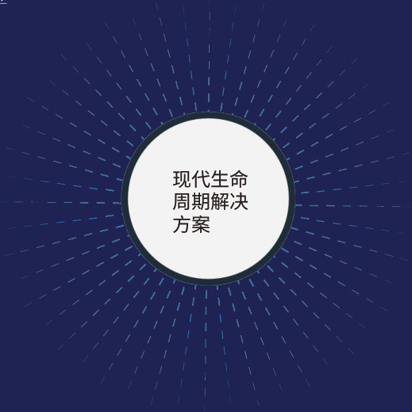

> 原文件：[42_delltechnologies.c_dell-pro-14-16-laptop-product-.pdf](https://github.com/jadennevercode/CJCC-Knowledge-Base/blob/564ab11aa9785e569e3853c8a4d7ce86f88e7535/materials/%E4%B8%8B%E6%B8%B8%EF%BC%9A%E6%89%8B%E6%9C%BA%E3%80%81PC%E5%92%8C%E5%B9%B3%E6%9D%BF%E9%9C%80%E6%B1%82%E4%BC%A0%E5%AF%BC/42_delltechnologies.c_dell-pro-14-16-laptop-product-.pdf)
> 转换方式：Volcengine OCRPdf v3, parse_mode=ocr

<!-- 原文第 1 页 -->

## DELLTechnologies 
采用全新现代设计, 可满足专业办公需求 
Dell Pro 14/16 
英特尔 酷睿TM Ultra处理器 
PC14250 
PC16250

---

<!-- 原文第 2 页 -->

DELL PRO14/16 
D LLTechnologies 
兼具企业级性能,支持轻松扩展 体验全新创新技术:您既可选择配备英特尔 酷睿TM处理器的机型,也可升级为AI PC。 后者搭载性能更强的英特尔"酷睿TUltra 处理器,并集成了强大的英特尔vPro管理功能。 
优质材料,高端工艺 
精心打造,提供两种机身选择:铂银金属质感和 磁铁矿激光纹理质感。 
高端大气,出色视效 
宽大的16:10显示屏,边框更窄 在相同尺寸下屏幕显示面积 5%,重量减轻10%,生产力和 性更胜一筹。7.8.9 
Windows Copilot 
只需单击Windows Copilot键,您就可以立即访问自己的个人 AI助手。 
快速连接 
提供丰富的连接选项,包括Wi-Fi6、Wi-Fi 6E和支持Wi-Fi7的无线网卡, 让您保持快速连接。 
超长电池续航时间 
更大的电池选项和可选的超低功耗显示屏可延长系统运行时间,一次充电可提供 长达10.3小时的电池续航时间"。 
每次视频通话,您都能尽展风采 采用HDR技术的FHD红外摄像头可在光线不佳的 情况下准确捕捉图像细节。 
 
使用摄像头挡板,保护个人隐私 配备手动控制的摄像头挡板,可保护您的隐私, 让您安心无忧。 
经久耐用 这是戴尔首款配备模块化 USB-C端口的商用PC, 该端口的耐用性提高了 4倍之多,维修也更加轻松。 
经过精心设计,以降低对环境 的影响: 
该设备采用多种环保材料精心设计,其中消 料占比高达30%。 
发货包装采用100%回收或可再生材料制成。 高度安全的商用PC,戴尔率先: 提供主机外BIOS验证和攻击指标,降低了未来 遭遇威胁的可能性。将PC遥测集成到出色的软 件中,以提升整个机群的安全性。 戴尔提供安全组件验证,可确保PC从出厂到首 次启动皆安全无虞。 
宏亮清晰的电话会议效果 使用两个麦克风和双立体声扬声器(配备两 个底部发射扬声器),让会议音效令人惊叹。 
选配集成ControlVault3+的接触式智能卡读卡 器,有助于提供更高水平的安全防护。 
军用级耐用性 
我们的笔记本电脑经过严格的MIL-STD810H耐 用性和可靠性测试,让您能够随时随地开展工作。 
2

---

<!-- 原文第 3 页 -->

DELL PRO14/16 
DELLTechnologies 
 
## AI 赋能,为工作增效 
利用创新软件应用程序,实现生产力、协作能力与创造力的全面跃升。 
 
McAfee的AI驱动型Deepfake Detector可高效识别误导性视频 和音频。通过针对AI生成的内容发出实时警报,它可确保您轻松 辨别内容真伪,从而保护您的品牌并维持信任。 
## lakeside 
支持主动识别IT问题,可通过异常检测减少咨询台工单, 并使用智能虚拟助手简化故障排除,从而获得AI 驱动型见解,以便改善运营情况和投资回报率。 
## Dell Pro AI PC 
Dell AI PC通过用于设备上AI任务的内置NPU,提高了安全性和能 效,从而重新定义了生产力。从内容创建到高级AI模型训练 Dell AI PC解决方案简化了AI的采用,为工作场所提供了用于创意、 协作和创新的工具。 
 
借助CyberLink的Promeo AI Magic Designer,您可以缩 短设计时间,更多地专注于创意工作。该工具使用生成式 AI来创建完全可编辑的自定义设计和文本,速度是以往的 1.9倍,即使在离线状态下也能使用。 
3

---

<!-- 原文第 4 页 -->

DELL PR 
D LLTechnologies 
 
 
## 可持续创新 
 
 
采用环保材料打造而成 
卓越设计,成就长久的PC使用寿命 
经过精心设计,在边框、掌托和底盖中含有高达50%的消费后回收塑 料,在电池框架中含有98%的消费后回收塑料。 
这款笔记本电脑采用模块化主板搭配V/O板设计,便于检修,有助于减 少电子废弃物。它是戴尔首款采用模块化USB-C端口设计的商用PC, 抗扭曲性提升多达4倍,抗冲击性提升多达33倍,不仅更加坚固耐用, 而且更易于维修。 
延续戴尔倡导利用回收钴的一贯策略,根据所选配置,Dell Pro Plus 笔记本电脑的电池中钻含量可能减少80%或采用50%的回收钴。2 
戴尔还提供了便捷的部件检修和更换途径,以充分延长我们产品的使 用寿命。 
部件、电池和升级> 
 
 
环保包装 
从旧技术无缝过渡到新技术 
采用100%的回收材料或可再生材料包装运输,提供多件包装 选项,简化拆箱体验,同时减少包装和运输废弃物。 
我们可以帮助您负责任且安全地淘汰旧IT设备,无论设备是何品牌, 同时实现您的可持续发展目标。 Asset Recovery Services z 
 
4

---

<!-- 原文第 5 页 -->

DELL PRO14/16 
DELLTechnologies 
 
## 利用戴尔显示器和配件提升您的 PC体验 
戴尔产品生态系统覆盖全面,配件种类丰富,并经过精心设计和测试,可与Dell Pro笔记本电脑彼此配 合、相得益彰,助您提高工作效率和协作能力。 
A.Dell Pro24Plus USB-C HUB显示器-P2425HE B.Dell Pro七合一USB-C旅行转换器-DA310 
 
C 
无是 
日 
D.Dell Pro无线耳机-WL3024 E. Dell Pro 1-16 Plus EcoLoop轻薄双肩背包-CP5724S E.Dell Pro智能坞站-SD25 
 
Dell Display and Peripheral Manager 只一个简单的应即理和化尔显示器 
探索更多戴尔桌面解决方案 
5

---

<!-- 原文第 6 页 -->

DELL PRO 14/16 
DELLTechnologies 
简化IT 
安全性出众的商用 PC 
A comparison of security features in Dell, HP, and Lenovo PC systems Approach 
据Principled Technologies.评价, 
## 我们的产品既安全可靠1 又易于管理,让IT 管理变得轻而易举 
戴尔是能够提供非常 出色的BIOS级可见性 的PC制造商。 
## 安全性 
## 通过多层防御提高整个机群的安全性。 
通过Dell Trusted Workspace,减少受攻击面, 提升长期网络弹性 
 
严格控制供应链,确保从首次启动便安 全无虞。 
 
通过全面深入的固件级别可见性维护 BIOS完整性。 
 
保护终端用户身份,防止恶意软件窃取凭证。 
 
通过PC遥测收集更多操作系统级别的数据, 以更快地发现问题、做出响应并进行修正。 
 
依托卓越软件合作伙伴生态系统,实现高级威 胁防护。 
利用集成式AI解决方案 缩小IT安全缺口 
 
探索来自戴尔、英特尔和 CrowdStrike的硬件辅助 安全解决方案。 了解详情 
## 可管理性 
可靠、轻松地管理PC机群 
戴尔管理解决方案既能帮助保护并优化端点, 又能确保终端用户的工作效率 
借助戴尔管理门户,您可以结合Microsoft Intune, 在云端管理戴尔PC。 
戴尔管理门户> 
只需一个应用程序,即Dell Client Device Manager, 就能更新和保护您的戴尔PC机群。 
Dell Trusted Update Experience提供全新的BIOS和驱动程 序版本,助您轻松更新端点。业界有五大PC供应商能做到以 下几点,戴尔便是其中的先行者: 
 
发布*设备驱动程序和下载发布计划: IT管理员可根据可预测的时间线部署整个机群的 设备更新。 了解详情> 
 
戴尔拥有以下出色解决方案:3 
可通过Microsoft Intune访问合作伙伴门户,该门户具 有机群级BIOS密码访问功能以及企业应用程序访问 和发布功能 
企业应用程序,具有模块化更新和安全部署功能,在戴 尔合作伙伴门户中提供,可通过Microsoft Intune访问 基于二进制大对象(BLOB)包的解决方案,支持使用 Microsoft Intune配置端点BIOS设置 
硬件OEM系统管理解决方案,可与英特尔 vPro集成 

---

<!-- 原文第 7 页 -->

DELL PRO 14/16 
DELLTechnologies 
# 利用Dell Services简化PC更新 支持PC生命周期的每个环节 
## Dell Technologes APEX 率先 
## ProDeploy客户端套件 
PC更新换代的第一步是使终 端用户入手全新设备。Dell ProDeploy Suite通过提供预先 配置好的PC,简化了操作流程 并提高了工作效率。通过采用 基于云的动态资源调配和映像 技术,这些PC在部署第一天就 可以投入使用。 
推出全面的"即服务"产品组 合,涵盖了从多云到客户端设备 的各类产品。 以可预测的成本灵活实现 IT转型和新技术部署工作。 
Dell APEX PC-as-a-Service 全面定制化的按月订阅服务, 涵盖PC、外围设备、软件和多种 服务,无需前期投资。 
在从旧技术向新技术过渡 时,ProDeploy Plus提供了使 用先进工具安全擦除敏感的终 端用户数据的功能,以对设备 进行清理,并采用Asset Recovery Services确保以负责 任的方式淘汰设备。 
Dell APEX PC-as-a-Service (PCAAS) 
Dell ProDeploy Client Suite z 
 
## Dell Premier 
324% 3年期ROI增幅 通过量身定制的在线解决方 案购买您目录中的产品和服 务,实现IT采购的现代化。 控制整个IT生态系统,以便 降低成本、实现订购过程标 准化、访问分析报告等。 
Dell Premier > 
## Asset Recovery Services 28亿 
自2007年以来,通过全部回收 计划所回收的电子产品超过 28亿磅"让戴尔协助您安全、 负责任地淘汰各品牌的旧IT 设备,以便从旧技术无缝过渡到 新技术,同时保护您的企业和整 个地球。 
Asset Recovery Services > 
## ProSupport Suite for PCs 
ProSupport Suite不仅是一款全天 候的故障修复解决方案,更是一整 套工具,能够自动化和优化您的IT 环境,且几乎不需要人工干预, 也不会对终端用户造成干扰。 
您可以从戴尔提供的多样化脚本库 中选择合适的脚本,这些脚本能够 快速解决公司范围内的常见问题, 从而大幅缩短修复时间并保持系统 的出色性能。ProSupport Suite提 供基于遥测技术的数据,帮助IT 部门获取见解并进行有针对性的更 新,所有这些操作都可以通过单个 控制面板进行控制。 
ProSupport Suite for PCs > 
7

---

<!-- 原文第 8 页 -->

DELL PRO14/16 
D LLTechnologies 

| 功能部件 | 技术规格 | 技术规格 |
| --- | --- | --- |
| 型号 | Dell Pro 14(PC14250) | |
| 机身材料和颜色选项 | PC+ABS1、铁黑色和铂银色 | |
| 处理器选项1-2 | 英特尔"酷睿系列 第13代英特尔 酷睿i3-1315U 第13代英特尔 酷睿i5-1335U 第13代英特尔"酷睿i5-1345U 英特尔 处理器U300E 英特尔 酷睿3100U 英特尔 酷睿5120U 英特尔 酷睿5220U 英特尔 酷睿7150U | 英特尔"酷睿Litra系列2(U) 英特尔 酷睿Ultra5225U 英特尔酷睿Ultra5235UvPro英特尔 酷睿UItra 7255U 英特尔 酷睿Ultra7265UvPro |
| 显示屏 | 14"16:10FHD+(1920x1200),60Hz,IPS,非触控,防眩光,300尼特,45%NTSC,6位+FRC 1416:10 FHD+(1920x1200),60Hz,IPS,触摸屏(无盖板玻璃),防眩光,300尼特,100%sRGB,6位+FRC 14"16:10FHD+(1920x1200,0Hz,IPS,非触控,防眩光,400特,100%RGB,8位,ComfortView Plus(低蓝光),低功耗 | |
| AI加速器! | 14"16:10FHD+(1920x1200),60Hz,IPS,非触摸屏,防眩光,400尼特,45%NTSC,6位+FRC 14"16:10 FHD+(1920x1200),60Hz, IPS,触摸屏(无盖板玻璃),防眩光,400尼特,100%sRGB,6位+FRC 这款Dell Pro系统配备神经处理单元(NPU)。NPU是一种专门用于加速机器学习任务的微处理器。处理大量视频和图像等多媒体数据时,NPU可以有效减轻 CPU和/或GPU的负担,且功耗较低,可提高资源利用率。AI加速器支持Windows中的Copilot。 | |
| 芯片组" | 与处理器集成 | |
| 操作系统 | MicrosoftWindows 11家庭版(64位) MicrosoftWindows 11专业版(64位) Microsoft Windows11专业教育版(64位) Ubuntu\*24.04 LTS,64位 | |
| Thin 0S12 | ThinOS和Windows 11loT企业版LTSC2024操作系统选项 | |
| 显卡17 | 英特尔 显卡 | |
| 内存15 | 在配备了英特尔"酷睿处理器的系统上: 8GB DDR5,5200 MT/s,单通道 16 GB DDR5,5200MT/s,单通道或双通道 32GB DDR5,5200MT/s,单通道或双通道 16 GB DDR5,5200 MT/s,双通道 | 在配备了英特尔"酷睿Ultra处理器的系统上: 8GB DDR5,5600MT/s,单通道 16 GB DDR5,5600MT/s,单通道或双通道 32 GB DDR5,5600 MT/s,单通道或双通道 64 GB DDR5,5600 MT/s,双通道 |
| 存储选项14.6 | 在配备了英特尔 酷睿处理器的系统上: 128 GBUFS(仅限搭载英特尔U300E处理器的铁黑色机箱配置) 256 GB SSD TLC M.22230,PCle Gen4 512 GB SSD QLC M.2 2230,PCle Gen4 512 GB SSD TLC M.2 2230,PCle Gen4 1 TB SSD QLC M.2 2230,PCle Gen4 1 TB SSD TLC M.2 2230,PCle Gen4 2TB SSD QLC M.22230,PCle Gen4 | 在配备了英特尔 酷睿Uitra处理器的系统上: 256 GB SSD TLC M.2 2230,PCle Gen4 512 GB SSD QLC M.2 2230,PCle Gen4 512GB SSD TLC M.2 2230,PCle Gen4 512GB固态硬盘TLC M.22230 PCle Gen4 SED16 1TB SSD QLC M.22230,PCle Gen4 1 TB SSD TLC M.2 2230.PCle Gen4 2TB SSD QLC M.22230,PCle Gen4 |
| 安全性 | 标准安全功能: 经FIPS-140-2和TCG认证的TPM2.0 机箱防盗开关-远程检测硬件改,并与Dell SafeBIOS攻击指标集成。 摄像头挡板 安全锁槽 可选安全功能: 符合Windows Hello标准的指纹读取器(在电源按钮中) 支持Windows Hello的全高清红外摄像头 | 接触式智能卡读卡器,配备经FIPS140-3第3级认证的ControlVult3+高级身份验证功能(仅在搭载英特尔酷睿Ultra225U235U和265U的铂银色机箱上提供 |
| 坞接 | 可选配坞站(另售) Dell USB-C坞站-WD19S Dell Performance坞站-WD19DCS 戴尔Thunderbolt坞站-WD19TBS、WD22TB4 Dell通用坞站-D6000S Dell Pro坞站WD25(2025年3月RTS) Dell Pro智能坞站SD25(2025年3月RTS Dell Pro Thunderbolt4智能坞站SD25TB4(2025年3月RTS) Dell Pro Thunderbolt 4 TAA智能坞站WD25TB4(2025年3月RTS) Dell Pro Thunderbolt5智能坞站SD25TB5(2025年3月RTS) Dell Pro Thunderbolt 5 TAA智能坞站WD25TB5(2025年7月RTS) | |
| 连接选项 | 在配备了英特尔 酷睿处理器的系统上: 兼容Microsoft Modem Standby 无线LAN选项?: MediaTek W-Fi6MT7920、2x2、蓝牙5.4无线网卡 英特尔 AX211 Wi-Fi 6E2x2,蓝牙5.3无线网卡 移动宽带:不适用 | 在配备了英特尔 酷睿Ultra处理器的系统上: 兼容Microsoft Modern Standby 无线LANM702蓝25.4线网卡 英特22 移动宽带:不适用 |
| 摄像头选项 | 在备了装器的板限铁黑色机箱配置) FHDHDR摄像头,1080pHDR视频,时域降噪,摄像头挡板 FHD+红外HDR摄像头,1080pHDR视频,时域降噪、摄像头挡板 | 在配备了英特尔 酷睿Ultra处理器的系统上: FHD HDR摄像头,1080pHDR视频,时域降噪,摄像头挡板 FHD+红外HDR摄像头,1080pHDR视频,时域降噪、摄像头挡板 |
| 音频和扬声器 | 2个2W扬声器、WavesMaxxAudioPro音频输出处理 | |

---

<!-- 原文第 9 页 -->

DELL PRO14/16 
D LL Technologies 

| 功能部件 | 技术规格 | | 技术规格 |
| --- | --- | --- | --- |
| 型号 | Dell Pro 14(PC14250)一续 | | |
| 电池选项1.10 | 3芯45瓦时,锂离子,ExpressCharge快速充电1.0,ExpressCharge Boost 3芯45瓦时,锂离子,ExpressCharge快速充电1.0,ExpressCharge Boost,长续航时间,3年有限硬件保修 3芯55瓦时、锂离子、ExpressCharge快速充电1.0、支持ExpressCharge Boost15 3芯55瓦时、锂离子、ExpressCharge快速充电1.0、支持ExpressCharge Boost、持久续航时间、3年期有限硬件保修 | | |
| 麦克风1 | 2个带Intelligo输入音频处理的降噪麦克风 | | |
| 电源选项 | 65W适配器,USB Type-C 65W适配器,4.5毫米圆形接头 60W超轻迷你适配器,Type-C端口,2针(仅限日本) | | |
| 端口、插槽和机身111 | 在配备了英特尔"酷睿处理器的系统上: 1个USB TypeC端口,支持功率传输3.1和DisplayPort2.0 4.5毫米圆形接头功率传输 2个第1代USB3.2Type-A端口(1个支持PowerShare) 1个HDMI2.1端口 1个RJ-45端口(1 GbE) 1个球形耳机插孔 1个楔形锁插槽 | 1个USB Type-C雷电技术4.0端口,支持功率传输3.1和DisplayPort2.1 | 在配备了英特尔"酷睿Ultra处理器的系统上: 1个USB Type-C雷电技术4.0端口,支持功率传输3.1和DisplayPort 2.1 1个USBType-C端口,支持功率传输3.1和DisplayPort2.0 4.5毫米圆形接头功率传输 2个第1代USB3.2Type-A端口(1个支持PowerShare) 1个HDMI2.1端口 1个RJ-45端口(1GbE) 1个球形耳机插孔 1个楔形锁插槽 1个智能卡读卡器(可选,仅限铂银色机箱配置) |
| 触控板 | 支持多点触控手势的高精度触控板 | | |
| 输入 | 10指触摸屏 防泼溅非背光AI热键键盘 防泼溅背光AI热键键盘 | | |
| 传感器! 合盖传感器(霍尔效应传感器) | | | |
| 尺寸与重量110 | 宽:313.70毫米/12.35英寸 厚:8.87英寸/225.3毫米 高(正面):起始高度为0.74英寸/18.89毫米 高(背面):起始高度为0.80英寸/20.37毫米 屏占比:87.8% 起始重量:1.35千克/2.99磅 | | |
| 包装清单 | Dell Pro14笔记本电脑 电源适配器 电源线 快速入门指南 | | |
 
9

---

<!-- 原文第 10 页 -->

DELL PRO14/16 
D LLTechnologies 

| 功能部件 | 技术规格 | 技术规格 |
| --- | --- | --- |
| 型号 | Dell Pro 16(PC16250) | |
| 机身材料和颜色选项 | PC+ABS1、铁黑色和铂银色 | |
| 处理器选项2 | 英特尔"酷睿系列 第13代英特尔 酷睿i3-1315U 第13代英特尔 酷睿i5-1335U 第13代英特尔酷睿i5-1345U 英特尔 处理器U300E 英特尔酷睿3100U 英特尔 酷睿5120U 英特尔\*酷睿5220U 英特尔酷睿7150U 英特尔\*酷睿7250U | 英特 英特尔 酷睿Ultra5235UvPro英特尔酷睿Utra7255U 英特尔 酷睿Ultra7265UvPro |
| 显示屏 | 16"16:10FHD+(1920x1200),60Hz,IPS,非触控,防眩光,300尼特,45%NTSC,6位+FRC 16"16:10FHD+(1920x1200),60Hz, IPS,触摸屏(无盖板玻璃),防眩光,300尼特,45%NTSC,6位+FRC 16"16:10FHD+(1920x1200),60Hz, IPS,非触摸屏,防眩光,400尼特,45%NTSC,6位+FRC | |
| AI加速器 | CPU和/或GPU的负担,且功耗较低,可提高资源利用率。AI加速器支持Windows中的Copilot。 | 这款DellPp系统配备神经处理单元(NPU)。NPU是一种专门用于加速机器学习任务的微处理器。处理大量视频和图像等多媒体数据时,NPU可以有效轻 |
| 芯片组" | 与处理器集成 | |
| 操作系统 | Mc Wd6 Microsoft Windows 11专业教育版(64位)14 Ubuntu24.04 LTS,64位 | |
| Thin OS12 | ThinOS和Windows 11 loT企业版LTSC2024操作系统选项 | |
| 显卡18 | 英特尔 显卡 | |
| 内存15 | 在配备了英特尔 酷睿处理器的系统上; 8GB DDR5,5200MT/s,单通道 16 GB DDR5,5200MT/s,单通道或双通道 32 GB DDR5,5200MT/s,单通道或双通道 16GB DDR5,5200MT/s,双通道 | 在配备了英特尔"酷睿Uitra处理器的系统上: 8GB DDR5, 5600MT/s,单通道 16 GB DDR5,5600 MT/s,单通道或双通道 32GB DDR5,5600 MT/s,单通道或双通道 64GB DDR5,5600 MT/s,双通道 |
| 存储选项1-4.6 | 在配备了英特尔 酷睿处理器的系统上: 128 GB UFS(仅限搭载英特尔"U300E处理器的铁黑色机箱配置) 256 GB SSD TLC M.2 2230,PCle Gen4 512 GB SSD QLC M.22230,PCle Gen4 512 GB SSD TLC M.2 2230,PCle Gen4 1 TB SSD QLC M.2 2230,PCle Gen4 1 TB SSD TLC M.2 2230,PCle Gen4 2TB SSD QLC M.2 2230,PCle Gen4 | 7 512 GB SSD QLC M.2 2230,PCle Gen4 512 GB SSD TLC M.2 2230,PCle Gen4 512GB固态硬盘TLC M.22230PCle Gen4 SED16 1 TB SSD QLC M.2 2230,PCle Gen4 1 TB SSD TLC M.2 2230,PCle Gen4 2TB SSD QLC M.22230,PCle Gen4 |
| 安全性 | 标准安全功能: 经FIPS-140-2和TCG认证的TPM2.0 机箱防盗开关一远程检测硬件慕改,并与Dell SafeBIOS攻击指标集成。 摄像头挡板 安全锁槽 可选安全功能: 符合Windows Hello标准的指纹读取器(在电源按钮中) 支持Windows Hello的全高清红外摄像头 接触式智能卡读卡器,配备经FIPS140-3第3级认证的Controlut3+高级身份验证功能(仅在搭载英特尔" 酷睿Ultra225U、235U和265U的铂银色机箱上提供) | |
| 坞接 | 可选配坞站(另售) el Dell Performance坞站-WD19DCS 戴尔Thunderbolt坞站-WD19TBS、WD22TB4 Dell通用坞站-D6000S Dell通用坞站-UD22 Dell Pro坞站WD25(2025年3月RTS) Dell Pro智能坞站SD25(2025年3月RTS) Dell Pro Thunderbolt4智能坞站SD25TB4(2025年3月RTS) Dell Pro Thunderbot 4TAA智能坞站WD25TB4(2025年3月RTS) Dell Pro Thunderbolt5智能坞站SD25TB5(2025年3月RTS) Dell Pro Thunderbolt 5 TAA智能坞站WD25TB5(2025年7月RTS) | |
| 连接 | 在配备了英特尔"酷睿处理器的系统上: 兼容Microsoft Modemn Standby 无线LAN选项 MediaTek Wi-Fi6 MT7920、2x2、蓝牙5.4无线网卡 英特尔\*AX211W-Fi 6E2x2,蓝牙5.3无线网卡 移动宽带:不适用 | 在配备英的系上 无线LAN选项: 加 |
| 摄像头选项! | 在配备了英特尔 酷睿处理器的系统上: 高清摄像头,720p视频,时域降噪,摄像头挡板(仅限铁黑色机箱配置) FHD HDR摄像头、1080pHDR视频、时域降噪、 摄像头挡板 FHD+IRHDR摄像头、1080pHDR视频、时域降噪。 摄像头挡板 | 在配备了英特尔 酷睿Ultra处理器的系统上: 时 降噪、摄像头挡板 |
 
10

---

<!-- 原文第 11 页 -->

DELL PRO14/16 
D LL Technologies 

| 功能部件 | 技术规格 | 技术规格 |
| --- | --- | --- |
| 型号 | Dell Pro 16(PC16250)-续 | |
| 音频和扬声器 | 2个2W扬声器、Waves MaxxAudio°Pro音频输出处理 | |
| 麦克风 | 2个带Intelligo输入音频处理的降噪麦克风 | |
| 电池选项1-.10 | 3芯45瓦时,锂离子,ExpressCharge快速充电1.0,ExpressCharge Boost 3芯45瓦时,锂离子,ExpressCharge快速充电1.0,ExpressCharge Boost,长续航时间,3年有限硬件保修 3芯55瓦时、锂离子、ExpressCharge快速充电1.0、支持ExpressCharge Boost1 3芯55瓦时、锂离子、ExpressCharge快速充电1.0、支持ExpressCharge Boost、持久续航时间、3年期有限硬件保修 | |
| 电源选项! | 65W适配器,USB Type-C 65W适配器,4.5毫米圆形接头 60W超轻迷你适配器,Type-C端口,2针(仅限日本) | |
| 端口、插槽和机身111 | 在配备了英特尔"酷睿处理器的系统上: 1个USB TypeC雷电技术4.0端口,支持功率传输3.1和DisplayPort2.1 1个USB TypeC端口,支持功率传输3.1和DisplayPort2.0 4.5毫米圆形接头功率传输 2个第1代USB 3.2Type-A端口(1个支持PowerShare) 1个HDMI2.1端口 1个RJ-45端口(1 GbE) 1个球形耳机插孔 1个楔形锁插槽 | 在配备了英特尔"酷睿Lltra处理器的系统上: 1个USB TypeC雷电技术4.0端口,支持功率传输3.1和DisplayPort2.1 1个USB Type-C端口,支持功率传输3.1和DisplayPort2.0 4.5毫米圆形接头功率传输 2个第1代USB 3.2Type-A端口(1个支持PowerShare) 1个HDMI2.1端口 1个RJ-45端口(1 GbE) 1个球形耳机插孔 1个楔形锁插槽 1个智能卡读卡器(可选,仅限铂银色机箱配置) |
| 触控板 | 支持多点触控手势的高精度触控板 | |
| 输入1 | 10指触摸屏 防泼溅非背光AI热键键盘 防泼溅背光AI热键键盘 | |
| 传感器 合盖传感器(霍尔效应传感器) | | |
| 尺寸与重量110 | 宽:358毫米/14.09英寸 厚:9.91英寸/251.82毫米 高(正面):起始高度为0.74英寸/18.89毫米 高(背面):起始高度为0.82英寸/20.85毫米 屏占比:89.2% 起始重量:1.92千克/4.23磅 | |
| 包装清单 | Dell Pro16笔记本电脑 电源适配器 电源线 快速入门指南 | |
 
11

---

<!-- 原文第 12 页 -->

DELL PRO 14/16 
DELLTechnologies 
 
在可持续实践方面处于领先地位,减少我们的产品和包装对环境造成的影响。 了解详情:Dell.com/sustainable-devices 

| 功能特性 | 技术规格 | 提供情况 |
| --- | --- | --- |
| | | 边框、掌托和底盖含50% |
| 材料1 | 消费后回收塑料(PCR) | 扬声器外壳含30% |
| | 适配器框架(65W)含98%2 |
| 回收铝 | 适配器框架(65W)含95%2 |
| 回收钴 | 电池(55瓦时)含50% |
| 钴使用量减少 | 电池(45瓦时)减少80% |
| 包装 | 材料 | 100%回收或可再生材料 |
| 戴尔多件合装 | 是 |
| 生态标签 详情因地区而异。 有关更多信息, 请访问生态标签网站, | EPEATGold with Climatet | 是 |
| TCO认证 | |
| 能源之星 认证 | 是是 |
| 模块化和可维修组件 | USB-C端口 | 是 |
| 客户可更换电池 | 是 |
 
12

---

<!-- 原文第 13 页 -->

DELL PRO14/16 
## 声明 
## 第2页 
1.基于Principled Technologies开展的第三方分析,该分析对比了搭载英特尔处理器的戴尔商用AI PC与其他同类产品的表现,2025年7月。基于戴尔在2024年10月对全球 PC市场进行的内部分析。适用于搭载英特尔处理器的PC。并非所有PC都提供所有功能。某些功能需要额外购买。 
2.Wi-Fi7:Wi-Fi7认证产品将在2024年全年按照WiFi联盟认证计划陆续推出。Wi-Fi7要求最新的WiFi联盟认证、Windows HLK 认证设备驱动程序、硬件更新、受支持的 连接功能仅在部分地区可用。要了解服务供应情况,请咨询服务提供商。蓝牙无线网卡版本可能因计算机上安装的操作系统而异。 
3.适用于2025年推出的Dell Pr笔记本。基于2024年11月进行的内部分析。全新USB-C端口采用螺纹连接设计,维修更轻松,耐用性更高。请阅读保修信息,了解US-C 端口更换说明。 
4. 百分比基于系统塑料重量。基于2025年2月进行的内部分析 
5.含有高达94.1%的回收材料和6.3%的可再生材料(环保森林纤维的形式)。不包括添加到订单并随箱交付的选购商品。 
6.基于2025年3月进行的Mobile Mark2025电池续航时间基准测试。接受测试的Dell Pro 14配备ARL U5-225U、16 GB RAM、512 GB PCle SSD、Windows11、FHD+400 尼特显示屏(亮度设置为250特)和55瓦时电池。有关此基准测试的更多信息,请访问www.bapco.com.实际电池续航时间因产品配置和用途、软件、使用情况、运行条件 电源管理设置以及其他因素而异,可能显著低于测试结果。随着使用时间的增加,最长电池续航时间将会逐渐缩短。标明的瓦时(Whr)数并不表示电池续航时间。 
7.Dell Po14的屏幕面积比Latitude3450大5%,同时占用空间保持不变。基于内部分析(2025年7月)。Dell Pp14的屏幕面积比Latitude5450大5%。基于内部分析 (2025年7月)。Dell Pro16的屏幕面积比Latitude3550和Latitude 5550大10%。基于内部分析(2025年7月)。 
8.89.8%的最大屏占比配置对应于配备FHD+显示屏的Dell Pro16。基于戴尔在2024年11月进行的内部测试。 
9.与Latitude3450相比,Dell Pro 14(PC14250)的起始重量减轻了10%。基于戴尔在2025年3月进行的内部分析。 
## 第4页 
1.基于2024年12月进行的内部分析。 
2.基于内部分析。入门级电池(45瓦时)使用NCM技术,与LCO技术相比,钻含量减少了80%。追加销售电池(55瓦时)采用50%的回收钻制成。 
3.基于2024年11月进行的内部分析。 
4.适用于2025年发售的Del Po.Del Pl PusDell Pro Premim笔记本。基于对Latitude 7450上的焊接连接与Dell Pro Premim笔记本电脑的螺纹连接测试数据的内部比 较,测试中,连接处在多个方向上重复承受标准轴向负载和标准扳手扭矩。全新USBC端口采用螺纹连接设计,维修更轻松,耐用性更高。阅读保修信息,了解US-C端口更换说 明。 
5.含有高达94.1%的回收材料和6.3%的可再生材料(环保森林纤维的形式)。不包括添加到订单并随箱交付的选购商品。 
6.基于2024年11月进行的内部分析。 
7.基于2024年11月进行的内部分析。已在适用地区经过EPEAT认证。EPEAT认证情况因国家/地区而异。有关各个国家/地区的认证状态,请访问www.epeat.net. 
## 第6页 
1.高度安全:基于Principled Technologies开展的第三方分析,该分析对比了搭载英特尔处理器的戴尔商用AIPC与其他同类产品的表现,2025年7月。基于戴尔在 2024年10月对全球PC市场进行的内部分析。适用于搭载英特尔处理器的PC。并非所有PC都提供所有功能。某些功能需要额外购买。 
2.基于戴尔在2025年1月进行的内部分析。"非常易于管理的商用PC"这一评价是将Dell update流程的系统管理功能、戴尔可管理性解决方案的功能以及与第三方管理解决方 案的集成表现,与其他厂商的更新流程、系统管理解决方案功能以及与第三方管理解决方案的集成表现相比较所得出的结果。第三方管理解决方案Microsoft Intun 需单独购买。 
3.戴尔发布设备驱动程序和下载发布计划。来源:基于2023年5月进行的内部分析。对比前五大PC供应商截至2023年5月发布的向公众提供的设备驱动程序和下载发布计划 
4.Dell update流程的功能、戴尔管理门户和戴尔可管理性解决方案的功能以及与第三方管理解决方案的集成,与竞争对手更新流程、Microsoft Intune系统管理解决方案中的合作 伙伴门户功能以及与第三方管理解决方案的集成。第三方管理解决方案(Microsoft lntune和Workspace ONE)需单独购买。英特尔vPro是一项额外的系统配置升级,可支持带 外系统管理,且戴尔率先提供: 
5.a.基于戴尔在2024年10月进行的内部分析。基于Microsoft Intune中戴尔管理门户的功能与竞争对手在Microsoft intune中合作伙伴门户功能的比较。 
13

---

<!-- 原文第 14 页 -->

DELL PRO14/16 
## 第7页 
1.基于戴尔在2023年4月进行的内部分析。 
2.Payment Solutions由DelFiancial Services LL.C.或其关联方或指定方(下称"DFS")为符合条件的客户提供并负责服务。各项服务并非在所有国家/地区均有提供,某些国 家/地区所提供的服务会有所不同。在提供服务的国家/地区,各项服务如有更改,恕不另行通知;各项服务受产品供应、适用法律、信贷审批以及由DFS提供并获DFS认可的文 件的限制,并可能受最低交易金额的限制。各项服务不适合个人或家庭(包括住户)使用。Dell Techologies和Dell Technologies微标是Dell lnc.的商标。相关限制和其他要求 可能适用于与政府或公共实体的交易。At the end of the contract,the customer may renew the contract or retumn the equipment to DFS 
3.自2007年以来,Dell Technologies已经回收了28亿磅电子产品。来源:基于戴尔在2023年4月对公开数据进行的内部分析。 
4.基于Dell echnologies和 AMD委托Forrester开展的Total Economic lmpact研究The Total Economic lmpact of Dell rmier,2024年2月。完整研究报告: Dell Premier的The Total Economic ImpactT。 
## 第8-11页 
1.供应情况可能因国家/地区和配置及操作系统而异。 
2.Dll HybidClenWye Management uite可证售。需要为设备配置8GB内存-128 GB或更高容量的SSD,以及buntu Linux22.04和Dell Clent ent Enabler (DCA-Enabler)。请参阅dell.com/support上的Dell Hybrid Client管理员指南,了解有关受支持的平台和配置的更多详细信息。 
3.英特尔*显卡适用于搭载英特尔酷睿Ultra系列2和第14代英特尔*酷睿处理器的系统;而英特集成锐*Xe或UHD显卡则适用于搭载第13代英特尔酷睿处理器的系 统。 
4.1GB代表10亿字节,1TB代表1万亿字节;根据系统内存大小和其他因素,可能会使用大量系统内存来支持显卡。 
5.内存速度因处理器而异。与英特尔*酷睿Ultra系列2(U)处理器搭配使用的内存将以5600 MT/s的速度运行。与第13代/第14代英特尔酷睿处理器搭配的内存将以 5200 MT/s的速度运行。 
6.61GB代表10亿字节,1TB代表1万亿字节;实际容量因预装内容和操作环境而异,可能会有所降低。 
7.Wi-Fi6E(支持6 GHz频段)需要Windows11操作系统和兼容的路由器。兼容Wi-Fi6E的路由器须单独购买。Wi-Fi 6E连接仅在特定位置可用。要了解服务供应情况 请咨询服务提供商。 
8.Wi-Fi7要求最新的WiFi联盟认证、经认证的设备驱动程序、硬件更新、受支持的操作系统版本,以及兼容的路由器。路由器需要单独购买。WiFi7连接仅在部分地区提供。 要了解服务供应情况,请咨询服务提供商。蓝牙无线网卡版本可能因计算机上安装的操作系统而异。 
9.标明的瓦时数(Wh)并不表示电池续航时间。ExpressCharge快速充电1.0(EC1.0)可在60分钟内将电池电量快速充至80%,在120分钟内将电量充至100%。Expres Charge Boos(ECB)可在20分钟内将电池电量快速充至35%。C1.0和ECB充电模式是针对处于关机状态的系统测量的。长寿命电池选项的充电模式有助于实现更长使用 寿命。长寿命电池选项可实现3年使用寿命或1000次放电/充电周期,并且戴尔为这些电池选项提供3年有限硬件保修。 
10.有限硬件保修:要获得有限硬件保修协议的副本,请寄信至DellUSALP,收信人:Warantes,one Dell way,Round Rock, TX 78682;或访问www.dell.com/。 
11.实际重量会因配置和制造工艺不同而有所差异。 
12.配备英特尔酷睿Ultra系列2处理器时支持USBTypeC接口的DisplayPort20;配备第13/14代特尔"酷睿处理器时支持USB TypeC接口的DisplaPort1.4 
13.PC+ABS是两种热塑性塑料的混合物一聚碳酸酯(PC)和丙烯丁二烯苯乙烯共聚物(ABS) 
14.Microsoft Windows 11企业教育版仅支持符合条件的教育机构。 
15.确保附带55Wh电池的计算机已连接到90W电源适配器,以支持此功能。 
16.仅在配备了英特尔*酷睿Ultra系列2处理器的系统上提供。 
17.具有独立显卡、配备Linux/Thin OS、内置4K面板、Dolby Vision 或CyberLink蓝光播放器的配置支持在系统和外部显示器上播放高效视频编码(HEVC)内容,并支持流式传输 HEVC内容;对于其他配置,在系统上播放HEVC内容需要单独购买和下载软件HEVC编解码器或第三方媒体播放器。 
## 第12页 
1.供应情况可能因国家/地区和配置及操作系统而异。 
2.电源和电池选项可能会因所选技术规格和定制情况而异。 
## *百分比基于系统的塑料重量计算得出根据2025年2月的内部分析。机身和电池均使用回收钴材料制成。 
与代 
14
