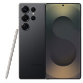
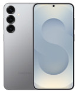
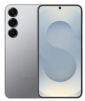
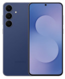

> 原文件：[42_images.samsung.com_S25_Series_B2B_spec_sheet_upda.pdf](https://github.com/jadennevercode/CJCC-Knowledge-Base/blob/564ab11aa9785e569e3853c8a4d7ce86f88e7535/materials/%E4%B8%8B%E6%B8%B8%EF%BC%9A%E6%89%8B%E6%9C%BA%E3%80%81PC%E5%92%8C%E5%B9%B3%E6%9D%BF%E9%9C%80%E6%B1%82%E4%BC%A0%E5%AF%BC/42_images.samsung.com_S25_Series_B2B_spec_sheet_upda.pdf)
> 转换方式：Volcengine OCRPdf v3, parse_mode=ocr

<!-- 原文第 1 页 -->

SAMSUNG 
## Galaxy S25 Series Galaxy Al 
Now Brief Get today's highlight 
S Pen and functinality only avallable with Galaxy 525 Ultra.Calaxy Al features by Samsung are free through 2025 and require Samsung account login. 
## Al evolved. Life elevated. 
## Multiple tasks with one ask 
Streamline your day with an assistant that gets you. Have it send your boss a summary about the big.new industry merger. Enable a workflow to keep your team on the same page - your phone has it under control! 
## Your cloud-based mobile HQ 
Simplify how you remotely direct your mobile fleet and empower your workforce - in the office or in the fieldwith Samsung Account for Business. 
## More power to you 
Reimagine what's possible with our most powerful processor yet, Effortlessly ranslate your calls, slow down a video or edit your photos without skipping a beat. 
## Start the day smarter 
stay one step ahead with a phone that gives you the info you need before you even know you need it. Now Brief gives you personalized insights based on your schedule.? 
## Turn voice calls into notes 
Record and summarize phone calls,.just like that. With a simple tap, you can record an important business call so you don't forget the vital details and summarize the conversation into notes. 
## The display your content deserves 
Present your ideas with the massive display of Galaxy S25 Series. Showcase it all - from the tiniest components to the bigger picture- in bright, vivid detail.

---

<!-- 原文第 2 页 -->

 
 
 
 

| | | | Galaxy S25 Silver Shadow lcyblue Mint Navy | |
| --- | --- | --- | --- | --- |
| Color (Some colors not available in all channels) | Galaxy S25 Ultra Titanium Black Titanium Silverbluc Titanium Whitesilver Titanium Gray | Galaxy S25+ SiverShadow Navy Mint kyblue | | Galaxy S25 FE Navy Jetblack White Icyblue |
| Screen Display3 | | | 6.2' Dynamic AMOLED 2X FHD+Screen Resolution 120Hz Adaptive Refresh Rate 2600 nits Brightness DeX compatible4 | |
| | 6.9'Dynamic AMOLED 2X QHD+Screen Resolution 120Hz Adaptive Refresh Rate 2600 nits Brightness DeX compatible | 6.7'Dynamic AMOLED 2X QHD+Screen Resolution 120Hz Adaptive Refresh Rate 2600 nits Brightness DeX compatible4 | | 6.7"Dynamic AMOLED 2X FHD+Screen Resolution 120Hz Refresh Rate Narrow Bezels 1900 nits Brightness DeX compatible |
| OS | Androidm 15 One Ul 7.0 7 years of Os and security updates | Android 15 One Ul 7.0 7 years of Os and security updates | Android 15 One UI 7.0 7 years of Os and security updates | Android 16 One UI 8.0 7 years of Os and security updates |
| Processor5 | Snapdragone 8 Elite for Galaxy | Snapdragon 8 Elite for Galaxy | Snapdragon 8 Eite for Galaxy | Exynos 2400 |
| Camera | 200MP Wide AF OIS 50MP Ultra Wide AF OIS 10MP|50MP Telephoto AF OIS 12MP AF Selfie 4K at 120fps Video Capture 8Kat 30fps Video Capture | 50MP Wide AF OIS 12MP Ultra Wide 10MP Telephoto AF OIS 12MP AF Selfie 4K at 60fps Video Capture 8Kat 30fps Video Capture | 50MP Wide AF OIS 12MP Ultra Wide 10MP Telephoto AF OIS 12MP AF Selfie 4K at 60fps Video Capture 8K at 30fps Video Capture | 50MP with OIS and Super HDR 12MP Ultra Wide 8MP Telephoto 12MP AF Selfie 4K at 30fps Video Capture |
| Camera Zoom | 2x 10x Optical Quality 3x|5x Optical Zoom 100x Space Zoom? | 2x Optical Quality 3x Optical Zoom 30x Space Zoom | 2x Optical Quality 3xOptical Zoom 30x Space Zoom | 3x Optical Zoom |
| Memory (RAM) and Storage (Some storage options not available in all channels) | 12GB Memory 256GB/512GB/1TB Storage | 12GB Memory 256GB/512GB Storage | 12GB Memory 128GB/256GB Storage | 8GB Memory 128GB/256GB Storage |
| Battery° | 5000mAh | 4900mAh | 4000mAh | 4900mAh |
| Network Connectivity10 | 5G(Sub6/mmWave) Wi-Fi7 UWB | 5G(Sub6/mmWave) Wi-Fi7 UWB | 5G(Sub6/mmWave) Wi-Fi7 | 5G(Sub6) Wi-Fi 6e |
| Biometrics | Ultrasonic Fingerprint Face Recognition | Ultrasonic Fingerprint Face Recognition | Ultrasonic Fingerprint Face Recognition | Ultrasonic fingerprint sensor (on screen) |
