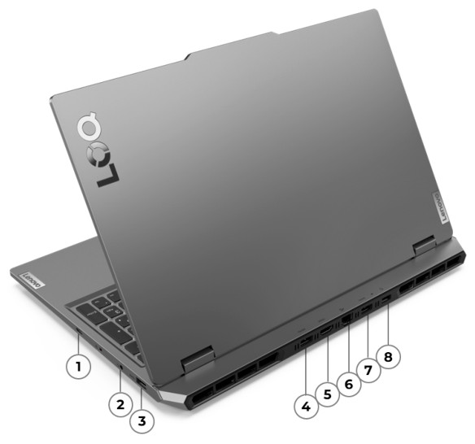
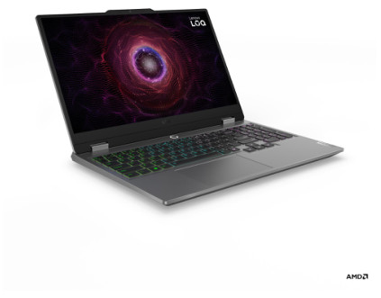
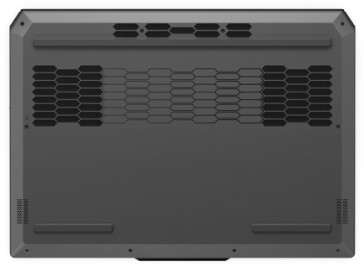
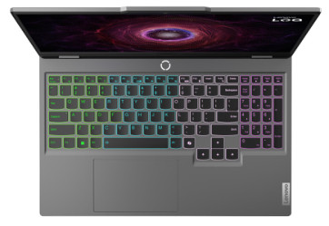
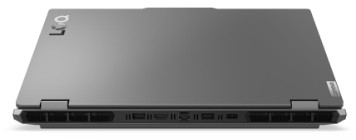

> 原文件：[42_psref.lenovo.com_LOQ_15AHP9_Spec.pdf](https://github.com/jadennevercode/CJCC-Knowledge-Base/blob/564ab11aa9785e569e3853c8a4d7ce86f88e7535/materials/%E4%B8%8B%E6%B8%B8%EF%BC%9A%E6%89%8B%E6%9C%BA%E3%80%81PC%E5%92%8C%E5%B9%B3%E6%9D%BF%E9%9C%80%E6%B1%82%E4%BC%A0%E5%AF%BC/42_psref.lenovo.com_LOQ_15AHP9_Spec.pdf)
> 转换方式：Volcengine OCRPdf v3, parse_mode=ocr

<!-- 原文第 1 页 -->

LOQ15AHP9 
PSREF Lenovo Product Specification Reference 
## OVERVIEW 
 
1 DP1.4 USB-C(USB 10Gbps), with USB PD 65-100W& 5.HDMI
Combo audio jack 6.Ethernet(RJ-45)
3. USB-A(USB 5Gbps) 7.USB-A(USB 5Gbps)
4. USB-A(USB 5Gbps) 8. Slim tip (rectangle) power connector 
## Notes: 
Port 1:PD 140W is the input power and requires the use of Lenovo unique adapter, otherwise it may support lower than 140W. 
LOQ15AHP9-October 152026 
1 of 8

---

<!-- 原文第 2 页 -->

PSREF Product Specification Reference 
LOQ15AHP9 
Lenovo 
## PERFORMANCE 
Processor 
Processor Family AMD RyzenTM 5/7100 Series, RyzenT7 7000 or AMD RyzenT5/78000 Series Processor 
Processor** 

| Processor Name | Cores | Threads | Base Frequency | Max Frequency | Cache | Processor Graphics | NPU | Overall TOPS |
| --- | --- | --- | --- | --- | --- | --- | --- | --- |
| AMD RyzenM 5 125 | 4 | 8 | 2.8GHz | 4.5GHz | 4MBL2/ 8MB L3 | AMD RadeonTM 740M | | |
| AMD RyzenM 5 8645HS | 6 | 12 | 4.3GHz | 5.0GHz | 6MB L2/ 16MB L3 | AMD RadeonTM 760M | AMD RyzenM AI, up to 16 TOPS | Up to 31 TOPS |
| AMD RyzenM 7 155 | 6 | 12 | 3.0GHz | 4.7GHz | 6MB L2/ 16MB L3 | AMD RadeonTM 740M | | |
| AMD RyzenM 7 7445HS | 6 | 12 | 3.55GHz | 4.7GHz | 6MBL2/ 16MB L3 | AMD RadeonTM 740M | | |
| AMD RyzenM7 8845HS | 8 | 16 | 3.8GHz | 5.1GHz | 8MB L2/ 16MB L3 | AMD RadeonTM 780M | AMD RyzenM AI, up to 16 TOPS | Up to 38 TOPS |
 
## AI (Artificial Intelligence) 
AI PC Category*** 
. AI-Powered Gaming PCU 
AI PC[2] 
## NPU 
Integrated AMD RyzenTM AI, up to 16 TOPS 
## Notes: 
[1] AI-Powered Gaming PCs feature Lenovo Al Engine and NVIDIA GeForce RTXGPUs to handle Al-driven tasks and deliver exceptional gaming performance. 
[2] AI PCs have a Neural Processing Unit (NPU) designed to accelerate artificial inteligence and machine learning workloads on the device. 
## Operating System 
Operating System" 
Windows 11 Pro 
Windows 11 Home 
Windows11 Home Single Language 
No preload operating system 
## Graphics 
Graphics** 

| Graphics | Type | Memory | Boost Clock | TGP | AI TOPS (Peak) | Key Features |
| --- | --- | --- | --- | --- | --- | --- |
| NVIDIA GeForce RTXT 3050 Laptop GPU | Discrete | 4GB GDDR6 | 1740 MHz | 95W | 114 TOPS | Advanced Optimus, DLSS, DirectX12 Ultimate |
| NVIDIA GeForce RTXTM 3050 Laptop GPU | Discrete | 6GB GDDR6 | 1732 MHz | 95W | 142 TOPS | Advanced Optimus, DLSS, DirectX"12 Ultimate |
| NVIDIA GeForce RTXTM 4050 Laptop GPU | Discrete | 6GB GDDR6 | 2370 MHz | 105W | 194 TOPS | Advanced Optimus, DLSS 3.5,Dynamic Boost 2.0, DirectX 12 Ultimate |
| NVIDIA GeForce RTXTM 4060 Laptop GPU | Discrete | 8GB GDDR6 | 2370 MHz | 115W [1] | 233 TOPS | Advanced Optimus, DLSS 3.5,Dynamic Boost 2.0, VR ready,DirectX 12 Ultimate |
 
## Notes: 
[1] The actual TGP may depend on system configuration. System configured with 170W power adapter, TGP will be 105W. 
LOQ15AHP9 -October 15 2026 
2of8

---

<!-- 原文第 3 页 -->

LOQ15AHP9 
Lenovo 
PSREF Product Specification Reference 
System configured with 230W power adapter, TGP will be 115W. 
Monitor Support 
Monitor Support 
Supports up to 3 independent displays (native display and 2 external monitors via HDMI', USB-C) 
·HDMIsupports up to 4K@60Hz 
·USB-Csupports up to 4k@60Hz 
Chipset 
Chipset 
AMD SoC (System on Chip) platform 
Memory 
Max Memoryl 
·Up to 32GB DDR5-4800 
Up to 32GB DDR5-5600 
Memory Slots 
Two DDR5 SODIMM slots,dual-channel capable 
Memory Type** 
·DDR5-4800(2] 
DDR5-5600 
Notes: 
[1] Maximum memory is only to test technical readiness of notebook. Available memory to sell would vary. 
[2] Installed memory is actually DDR5-4800 or DDR5-5600 but may run as DDR5-4800 due to processor limitation. 
Storage 
Max Storage Support 
Up to two drives, 2x M.2 SSD 
·M.2 2242 SSD up to 1TB each 
Storage Slotz] 
Two M.2 2280PCle4.0x4 slots 
Storage Type 

| Disk Type | Interface | Offering |
| --- | --- | --- |
| M.2 2242SSD | PCle'NVMe", PCle4.0x4 | 512GB/1TB |
 
Notes: 
[1] The storage capacity supported is based on the test results with current Lenovo" storage offerings. 
[2] The actual data transfer rate of the following PCle interface also depends on the capabilities of the connected PCle" 
device. The listed values represent theoretical maximums. 
PCle3.0(x2/x4):2GB/s(16 Gbps)/4 GB/s(32 Gbps); 
PCle4.0(x2/x4):4 GB/s(32 Gbps)/8GB/s(64 Gbps); 
PCle5.0(x2/x4):8GB/s(64 Gbps)/16 GB/s (128 Gbps). 
Removable Storage 
Card Reader 
No card reader 
Multi-Media 
Audio Chip 
High Definition(HD) Audio, Realtek ALC3287 codec 
Speakers 
Stereo speakers, 2W x2, optimized with Nahimic Audio 
Microphone 
Dual-microphone array 
LOQ15AHP9 -October 15 2026 
3of8

---

<!-- 原文第 4 页 -->

LOQ15AHP9 
Lenovo 
PSREF Product Specification Reference 
Camera** FHD 1080p, with E-shutter, fixed focus HD720p,with E-shutter,fixed focus 
Battery Battery 60Wh Rechargeable Li-ion Battery, supports Rapid Charge Pro (charge up to 50% in 30min) Max Battery Life!u MobileMark 25:5.4 hr Local video (1080p) playback@150nits: 11.5 hr 
Notes: 
[1] All battery life claims are approximate maximum and based on results using the MobileMark 2014, MobileMark 2018 MobileMark25,MobileMark30,JEITA 2.0,JEITA 3.0,ontinuous 1080p video playback (with 150nits brightness and default volume level) or Google Power Load Test (PLT) battery-life benchmark tests. Actual battery life will vary depending on many factors such as product configuration and usage, software use, wireless functionality,power management settings, and screen brightness. The maximum capacity of the battery will decrease with time and use. 
Power Adapter Power Adapter** 170W slim tip (3-pin) AC adapter, 100-240V,50-60Hz 230W slim tip(3-pin) AC adapter, 100-240V,50-60Hz No power adapter 
Notes: 
[1] AC adapter offerings depend on the country. 
Special Features 
Special Features 
AI Chip: LA1 
## DESIGN 
Display 
Display**[] 

| Size | Resolution | Touch | Type | Brightness | Surface | Aspect Ratio | Contrast Ratio | Color Gamut | Refresh Rate | Viewing Angle (L/R/U/D) | Key Features |
| --- | --- | --- | --- | --- | --- | --- | --- | --- | --- | --- | --- |
| 15.6" | FHD (1920x1080) | Non- touch | IPS | 300nits | Anti- glare | 16:9 | 1000:1 | 100% sRGB | 144Hz | 85°/85°/ 85°/85° | Advanced Optimus, NVIDIAG- SYNC |
| 15.6" | WQHD (2560x1440) | Non- touch | IPS | 350nits | Anti- glare | 16:9 | 1000:1 | 100% sRGB | 165Hz | 85°/85°/ 85°/85° | Advanced Optimus, NVIDIAG- SYNC |
 
Touchscreen 
Non-touch Screen-to-Body Ratio 88% AAR(active area ratio) 
Notes: 
[1] IPS (in-plane switching) technology may refer to IPS,PLS,ADS, AHVA,AAS. 
Input Device 
LOQ15AHP9 -October 15 2026 
4 of 8

---

<!-- 原文第 5 页 -->

Lenovo 
PSREF Product Specification Reference 
LOQ15AHP9 
Pen No support Keyboard 6-row, multimedia Fn keys,numeric keypad Keyboard Backlight* ·4-Zone RGB backlight White backlight 
Touchpad Buttonless Mylar' surface multi-touch touchpad, supports Precision TouchPad (PTP), 75x 120mm (2.95x 4.72inches) 
Mechanical Dimensions (WxDxH) 359.86x258.7x21.9-23.9 mm(14.17x10.19 x0.86-0.94 inches) Weight2] Starting at 2.38 kg (5.25 lbs) Case Color Luna grey Case Material PC-ABS (top),PC-ABS (bottom) Surface Treatment Painting 
Notes: 
[1] The system dimensions may vary depending on configurations. 
[2] The system weight is approximate and based on results in Lenovo" lab, which varies depending on the source of component, variance of the distribution of each component, and manufacturing process. It may not be the exact weight for each specific model. 
## CONNECTIVITY 
Network 
WLAN+Bluetooth@(] Wi-Fi 6, 802.11ax 2x2 Wi-Fi+ Bluetooth 5.2, M.2 card WWAN No support Ethernet Gigabit Ethernet, 1x RJ-45 
Notes: 
[1] Wi-Fi' operation (including Wi-Fi"6, Wi-Fi" 6E, Wi-Fi" 7, etc.) is subject to the regulatory requirements of each country. Bluetooth" may operate at a lower version than hardware design depending on the factors such as operating system, driver,etc. 
Ports 
Standard Ports 
3x USB-A (USB 5Gbps/USB 3.2 Gen 1) 
1x USB-C (USB 10Gbps/USB 3.2 Gen 2), with USB PD 65-100W and DisplayPortM 1.4(2 
1x HDMI2.1,up to 8K/60Hz 
1x Headphone/microphone combo jack (3.5mm) 
1x Ethernet(RJ-45) 
1x Slim tip (rectangle) power connector 
Notes: 
[1] The transfer speed of the ports will vary and, depending on many factors, such as the processing speed of the host 
LOQ15AHP9 -October 15 2026 
5of 8

---

<!-- 原文第 6 页 -->

LOQ15AHP9 
Lenovo 
PSREF Product Specification Reference 
device, file attributes and other factors related to system configuration and your operating environment,will be slower than theoretical speed. 
[2] Supports Lenovo protocol for 140W charging but requires a unique Lenovo adapter for operation. 
Docking 
Docking 
Various docking solutions supported via USB-C* 
For more compatible docking solutions, please visit Docking for LOQM 15AHP9 
## SECURITY & PRIVACY 
Security 
Security Chip 
Firmware TPM 2.0 integrated in SoC 
Fingerprint Reader 
No fingerprint reader 
BIOS Security 
Administrator password 
Master hard disk password 
Power-on password 
User hard disk password 
User password 
Self-healing BIOS 
More BIOS security features,please visit BIOS Simulatort 
Other Security 
E-shutter 
Notes: 
[1] The BIOS simulator is just for reference. Default settings and some options may vary depending on the hardware, operating system and BIOS version. 
## SERVICE 
Warranty 
Base Warranty** 
·1-year courier or carry-in service 
·1-year courier or carry-in with 2-year system board service (Korea only) 
2-year (1-yr battery) courier or carry-in service 
·3-yea(-yr battery) courier or carry-in service 
## ACCESSORIES 
Bundled Accessories 
Bundled Accessories 
Lenovo"LOQ M100 RGB Mouse (USB connector) 
None 
Notes: 
[1] For more compatible accessory solutions,please visit Accessories for LOQM 15AHP9 
## OPERATING REQUIREMENTS 
Operating Environment 
Temperature 
LOQ15AHP9 -October 15 2026 
6of 8

---

<!-- 原文第 7 页 -->

LOQ15AHP9 
Lenovo 
PSREF Product Specification Reference 
At altitudes up to 2438 m(8,000ft) 
-Operating: 5°C to 35°C (41°F to 95°F) 
-Storage: 5 to 43°(41°F to 109°F) 
At altitudes above 2438 m (8,000 ft) 
- Maximum temperature when operating under the unpressurized condition: 31.3°C(88°F) 
Relative Humidity 
Operating:8%to 95% at wet-bulb temperature 23C(73°F) 
Storage:5% to 95% at wet-bulb temperature 27 (81°F) 
## Altitude 
Maximum altitude (without pressurization):3048 m(10,000 ft) 
## Notes: 
[1] When you charge the battery, its temperature must be no lower than 10°C (50°F). 
## CERTIFICATIONS 
Green Certifications Green Certifications ErP Lot3 RoHS compliant 
## Notes: 
[1] The items listed under the "Green Certification"section may not only refer to certification but also registration or selfdeclaration. For ESG & regulatory compliance documents, please visit https://compliance.lenovo.com 
Other Certifications Mil-Spec Test MIL-STD-810H military test passed Other Certifications (Optional) TUV Rheinland" Low Blue Light (Software Solution) 
Feature with* means that only one option listed under the feature can be configured on selected models. 
Please refer to the model configuration for specific information. 
Feature with*** means that one or more options listed under the feature can be configured on selected models. Please refer to the model configuration for specific information. 
Lenovo reserves the right to change specifications or other product information without notice.Lenovo is not responsible for photographic or typographical errors. LENOVO PROVIDES THIS PUBLICATION"AS IS" WITHOUT WARRANTY OF ANY KIND, EITHER EXPRESS OR IMPLIED, INCLUDING THE IMPLIED WARRANTIES OF MERCHANTABILITY OR FITNESS FOR A PARTICULAR PURPOSE. Some jurisdictions do not allow disclaimer of express or implied warranties in certain transactions, therefore this disclaimer may not apply to you. 
The specifications on this page may not be available in all regions,and may be changed or updated without notice. 
LOQ15AHP9-October 152026 
7 of 8

---

<!-- 原文第 8 页 -->

Lenovo 
LOQ15AHP9 
 
 
PSREF Product Specification Reference 
 
 
LOQ15AHP9-October 15 2026 
8 of8
