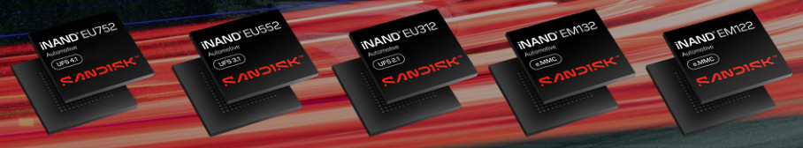

> 原文件：[49_documents.sandisk._brochure-sandisk-automotive-uf.pdf](https://github.com/jadennevercode/CJCC-Knowledge-Base/blob/564ab11aa9785e569e3853c8a4d7ce86f88e7535/materials/%E4%B8%8B%E6%B8%B8%EF%BC%9A%E6%B1%BD%E8%BD%A6%E3%80%81%E5%B7%A5%E4%B8%9A%E5%8F%8A%E5%85%B6%E4%BB%96%E5%BA%94%E7%94%A8/49_documents.sandisk._brochure-sandisk-automotive-uf.pdf)
> 转换方式：Volcengine OCRPdf v3, parse_mode=ocr

<!-- 原文第 1 页 -->

AUTOMOTIVEGRADE() UFS AND E.MMC EMBEDDED FLASH DRIVES 
SANDISK 
TM 
"BROCHURE" 
SEPTEMBER.2025

---

<!-- 原文第 2 页 -->

## SANJISK 
The Storage You Can Drive On Designed for the connected and autonomous car market, Sandisk's automotive-grade iNAND UFS and e.MMC Embedded Flash Drives (EFDs) deliver highperformance and high-reliabity storage for a variety of demanding automotive applications. The devices address the evolving needs of traditional applications such as infotainment and vehicle navigation systems, and next generation applications such as Vehicle-toVehicle/lnfrastructur communications,telematic gateways, digital cluster, drive recorders, Advance Driver Assistance Systems (ADAS) and autonomous driving. 
Smart partitioning, a sophisticated read refresh algorithm,power fail imunt,and an LDPC ECC engine are just a few of the features that make these some of the most advanced EFDs on the market. With additional industry-leading features including automotive-optimized 3D technology,iNAND SmartSLCtechnology,and deep diagnostics SANDISK INAND automotive grade e.MMC and UFS EFDs empower your data-driven applications. 
 
PG.02 "BROCHURE" AUTOMOTIVE-GRADE UFS AND E.MC EMBEDDED FLASH DRIVES

---

<!-- 原文第 3 页 -->

## 3D Technology 
·Higher performance, lower cost and lower power consumption 
·Larger effective cell size and less celltcel interference than 2D NAND 
·Higher relabity argins when compared to 2D NAND with similar bit density 
## SmartSLC & Write Booster1 
Sandisk's automotive grade iNAND products feature industry-leading SmartSLC technology for e.MMC and UFS2.1 and Write Booster for UFS3.1 and UFS4.1,designed to boost host write performance and leverage the benefits of SLC to maximize device throughput and endurance. 
Adaptive mechanisms enable writes to be routed through SLC blocks for increased write speeds and efficient migration of data to TLC to help ensure performance consistency. 
Advantages: 
Performance 
Endurance 
Robustness 
Boost sequential and random write performance to SLC level 
·Reduce host writes to the TLC area 
·Leverage SLC's higher resilieny to data corruption 
·Reduces Write Amplification Factor (WAF) to the TLC area 
·SLC-grade latency for better write-driven use cases 
TLC/SLC redundancy increases power failure handling 
Increase product endurance and longevity (TBW) 
·Maintain high performance when media is fragmented 
Persistent performance even when media is full 
## Advanced Device Report 
iNAND branded products offer a proprietary device report feature with detailed information and diagnostics on the firmware and device status at runtime. This information provides a deeper EFD status understanding, on top of the e.MMC and UFS JEDEC specs in an easyto-use method including: 
·Wearleveling areas and device health 
·WAF(Write Amplification Factor) value 
·Host read and write ·Error detection and correction Temperature Failures and recovery 
Voltage droop and occurrences 
·Lifetime prediction ·Firmware release and update 
Power diagnostics 
## Smart Partitioning 
iNANDautomotive-grade e.MMC and UFS Smart Partitioning implementation creates dedicated,physically seprated and individually managed memory areas. This protects specific partitions from the unwanted effects of overuse as well as preventing any impact to the data integrity caused by activities in other areas, thus helping to maximize endurance,data retention and separation. 
TLC/MLC based User Area 
·SLC based High Data Retention/Read Intensive /Secured area 
·SLC based High Endurance area, tailored for write-intensive applications 

---

<!-- 原文第 4 页 -->

## Auto/Manual Read Refresh 
 
A sophisticated automatic read refresh algorithm is implemented in the iNAND automotivegrade e.MMC and UFS devices to offer better handling of data retention,read disturb and read refresh.It senses early signs of block degradation and automatically refreshes the data. The algorithm includes multiple types of scans designed to identify affected pages with high Bit Error Rate (BER). 
In addition,the host can initiate Refresh via command, which is proprietary in iNAND" automotivegrade e.MMC and according to JEDEC UFS3.0 and JEDEC UFS4.1 in iNAND automotive-grade UFS device. 
## Power Immunity 
 
iNAND automotive-grade e.MMC and UFS devices implement advanced mechanisms for protecting the device and the user data from data loss,data corruption or device damage due to external power failures. This addresses the occurrence of both write abort and voltage droop. 
 
100% Content Preloading and Integrity Post IR Reflow iNAND automotive gradee.MC and UFS devices are designed to support 100% content preloading (via external programmer) pre-lR reflow and guarantee high data integrity postIR reflow.This helps assure that the high temperature experienced during the IR-reflow process does not affect the data integrity of the preloaded data. 
 
## Thermal Management 
To prevent the damage to the NAND or controller while operating in high temperatures,the iNAND" automotive-grade e.MMC and UFS devices implement a robust thermal management mechanism. This mechanism is activated by default and automatically adjusts the internal power mode to help protect from overheating.In additon, the iNAND automotive-grade UFS device supports Temperature Event Notification a JEDEC UFS3.0 and UFS4.1 parameter. 
 
## Suited for Automotive Applications 
iNAND automotive-grade e.MMC and UFS devices undergo rigorous qualification and production testing, and comply with automotive standards such as AEC-Q100 and are qualified to meet and exceed the standard requirements. 
## Fast Boot 
 
iNAND automotive grade e.MMC and UFS devices enable the host to boot from boot partitions/ LUs of the device. 
This feature allows the system to be functional at the proper time.For example,the console display and the remaining car system functionality are needed the moment the driver enters or activates the vehicle.In addition, this feature enables the replacement of SPI NOR for the inherent capabity of the iNAND device,reducing BOM costs and board space. 

---

<!-- 原文第 5 页 -->

## Automotive-Grade Embedded Flash Drives 

| | iNAND" AT EU752 Grade2 | iNAND" AT EU552 Grade 2/3 | iNAND" AT EU312 Grade 2/3 | iNAND" AT EM132 Grade 2/3 | iNAND" AT EM122 Grade 2/3 |
| --- | --- | --- | --- | --- | --- |
| Capacity2 | 256GB-1TB | 64GB-512GB | 16GB·256GB | 32GB-256GB | 8GB·64GB |
| Interface | UFS4.1 | UFS3.1 | UFS 2.1 | e.MMC 5.1HS400 | e.MMC5.1HS400 |
| Operating Temperature | ZA:-40℃Cto105° | ZA:-40°Cto 105° XA:-40℃C to 85℃ | ZA:-40Cto 105℃ XA:-40℃to 85℃ | ZA:-40℃Cto 105°C XA:-40℃Cto 85℃ | ZA:-40°Cto 105℃ XA:-40℃to 85℃ |
| Sequential R/W(MB/s) | Up to 4200/3900 | Up to 1600/1200 | Up to 800/550 | Up to 310/250 | Up to 300/125 |
| RandomR/W(IOPS) | Up to420K/440K | Upto 100K/95K | Up to45K/40K | Up to20K/12K | Up to22K/12K |
| Enhanced Features | Advanced Health Report. Smart Partitioning, Auto and Manual Refresh, Thermal Management, UFS 4.1 automotive features included | Advanced Health Report. Smart Partitioning, Auto and Manual Refresh, Thermal Management, UFS 3.0 automotive features included | Advanced Health Report. Smart Partitioning, Auto and Manual Refresh. Thermal Management, UFS 3.0 automotive features included | Advanced Health Report, Smart Partitioning. Auto and Manual Refresh. Thermal Management | Advanced Health Report,Smart Partitioning, Auto and Manual Refresh, Thermal Management |
| Package | 11.5x13x1.2mm | 11.5x13x 1.2mm | 11.5x13x1.2mm | 11.5x13x1.0mm, 11.5x13x1.2mm | 11.5x13x0.8mm, 11.5x13x1.0mm, 11.5x13x1.2mm |
| Ordering Information | SDINHDI6-####-ZA | SDINFDQ6-##G-ZA1 SDINFDQ6-##G-XA1 | SDINDDH6-##G-ZA2 SDINDDH6-##G-XA2 | SDINBDA6-##G-ZA1 SDINBDA6-##G-XA1 | SDINBDG4-##G-ZA3 SDINBDG4-##G-XA3 |
 
PG.05 
"BROCHURE" 
ADVANCED FLASH STORAGE SOLUTIONS FOR AUTOMOTVE APPLTCATIONS 

---

<!-- 原文第 6 页 -->

951 Sandisk Drive Mlptas, CA 95035,USA 
www.sandisk.com 
Peodueteeos etit ttttto e e ) OEMProducts@sandisk.com C2025 Sandisk Corporation or its affiliates. All rights reserved. 
SEPTEMBER.2025 
"BROCHURE" 
ADVANCED FLASH STORAGE SOLUTIONS FOR AUTOMOTIVE APPLICATIONS 

