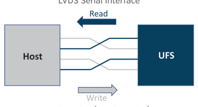

> 原文件：[49_issi.com.cn_UFS-brochure.pdf](https://github.com/jadennevercode/CJCC-Knowledge-Base/blob/564ab11aa9785e569e3853c8a4d7ce86f88e7535/materials/%E4%B8%8B%E6%B8%B8%EF%BC%9A%E6%B1%BD%E8%BD%A6%E3%80%81%E5%B7%A5%E4%B8%9A%E5%8F%8A%E5%85%B6%E4%BB%96%E5%BA%94%E7%94%A8/49_issi.com.cn_UFS-brochure.pdf)
> 转换方式：Volcengine OCRPdf v3, parse_mode=ocr

<!-- 原文第 1 页 -->

ISSI 
Long-Term Support World Class Quality 
ISSI 
IS27TH064G31A UFS.. Automot 
Markets 
 
## Product Description: 
UFS is an advanced storage interface ideal for applications requiring high-performance and low power consumption. UFS is an open standard defined by JEDEC and incorporates standards from the Mobile Industry Processor Interface [MIPI) alliance. UFS utilizes the well-known Small Computer System Interface [SCSI Architecture Model and command protocols that support multiple simultaneous commands and command queuing features to enable highly efficient multi-thread programming. UFS improves read and write performance of flash memory in two ways. First,unlike eMMC, there are dedicated channels for reading and writing data allowing for simultaneous read/write data flow. The second advantage of UFS is Command Queuing. the efficient grouping and reordering of read or write commands, to maximize the performance throughput. 
ISSI's UFS product family provides the ideal embedded storage solution for the Automotive, Industrial, Medical, 
LVDS Serial Interface 
 
Full Duplex [Read & Write] 
ISSI Part Numbers: 

| ISSI P/N | 1/F | | Capacity | Temperature | Operating Volt. | | Sequential Rd/Wr [MB/s] | Random Rd/Wr [IOPS] |
| --- | --- | --- | --- | --- | --- | --- | --- | --- |
| Vcc | VccQ |
| IS27TH064G31A | HS-G4x2 | UFS3.1 | 64GB | -40℃C~105° | 2.5V | 1.2V | R800/W450 | R40,000/W60,000 |
| IS27TH128G31A | HS-G4x2 | UFS3.1 | 128GB | -40℃~105℃ | 2.5V | 1.2V | R1550/W900 | R85,000/W115,000 |
| IS27TH256G31A | HS-G4x2 | UFS3.1 | 256GB | -40°~105℃ | 2.5V | 1.2V | R1550/W1200 | R150,000/W190,000 |
 
For UFS sample requests and enquiries, please contact flash@issi.com 
## Key Features: 
Low Voltage Diferental Signalig LVDS signling 
High Performance with High-Speed Serial Interface 
Full-duplex interface supporting simultaneous read and write Low Energy Consumption 
Reliable advanced physical,link, and command protocol layers 
Supports advanced features like Deep Sleep, Write Booster, Host Performance Booster (HPB2.0), and Throttling notifications to the host 
Security Features 
UFS 3.1 interface 
Density: 64GB to 256GB Automotive Grade Qualified 
Networking,and Consumer applications, which require high performance,endurance, and low power across a wide range of operating temperatures, and long-term support.These products are available in Industrial as well as Automotive grade. ISSI's UFS integrates NAND flash memory and an intelligent UFS controller in a single small formfactor BGA package.The controller implements all the algorithms for reliable NAND flash management in addition to all the UFS functionality and advanced features. ISSI's UFS products are optimized for efficient throughput,system performance and reliability, delivering superior sequential and random read/write performance, while offering near zero idle power consumption. 
ISSI's UFS solution includes the UFS 3.1 (uses 1.2V I0 Voltage] devices. The UFS 3.1 products support advanced data refresh and temperature notification features for superior system reliability for automotive applications. 
1623Buckeye Drive,Milpitas,A 95035-Tel:408.969.6600-Support: flash@issi.com·www.issi.com june 2026
