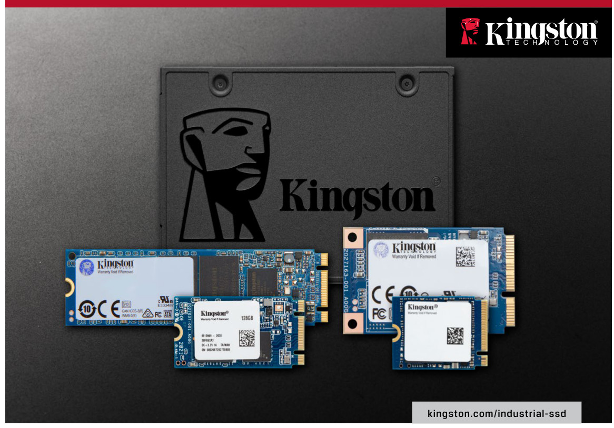
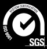

> 原文件：[49_media.kingston.com_Industrial-SSD-Commercial-Temp.pdf](https://github.com/jadennevercode/CJCC-Knowledge-Base/blob/564ab11aa9785e569e3853c8a4d7ce86f88e7535/materials/%E4%B8%8B%E6%B8%B8%EF%BC%9A%E6%B1%BD%E8%BD%A6%E3%80%81%E5%B7%A5%E4%B8%9A%E5%8F%8A%E5%85%B6%E4%BB%96%E5%BA%94%E7%94%A8/49_media.kingston.com_Industrial-SSD-Commercial-Temp.pdf)
> 转换方式：Volcengine OCRPdf v3, parse_mode=ocr

<!-- 原文第 1 页 -->

 
## Kingston Industrial SSDs 
## Perfect storage solutions for system designers and builders 
Overview (Commercial Temperature SSDs) 
Kingstonoffers a high-quality line of Industrial Temperature SATA solid-state drives created specifically for system designers and builders requiring increased reliability for harsh environments. 
The line includes: 
·SATA 2.5-inch, mSATA, M.2 2242 and M.22280 
·PCle Gen.4 NVMe: M.2 2280,M.2 2230 
·Capacity Range - 128GB, 256GB, 512GB, 1TB, TB 
·Commercial Operating Temperature Range -0~70° 
Kingston Industral SSDs incorporate advanced controllers that automatically perform wear-leveling, garbage collection and other NAND Flash management features.Kingston's 2.5"SATA SSDs are a drop-in replacement for hard drives and deliver up to 20x greater performance as well as igh reliabity. nustial SSDs incorporate next-generation 3DTLC NAND Flash for the best cost and reliability. 
#Kingstonls WithYou 
more》

---

<!-- 原文第 2 页 -->

Industrial Temperature SATA SSDS 
## KEY BENEFITS 
System designers and builders rely on consistent storage products. Kingston offers the following benefits with the Industial SSD product line: 
·Contoled BOM and Firmware - Ensures there are no changes to key components after customer gualificatior 
·PCN Support - ll generational changes and firmware updates are handled through a controlled and timed process. 
MARKET SEGMENTS 
 
Point of Sale (POS) 
 
Digital Signage 
 
Robotics 
 
Kiosk (Charging Stations, Key Makers, ATM) 
 
Surveillance/Mobile Recording 
 
THIS DOCUMENT SUBJECTTO CHANGE WTHOUT NOTICE 
) 
·Engineering Support - Customers have a direct contact with their regional Kingston Field Application Engineering teams for fast response to storage requirement questions and support requests 
·Global Support - Kingston can coordinate SSD deliveries with a customer's Original Design Manufacturers (ODMs) or Contract Manufacturers (CMs) in other regions of the world, if required 
·Warranty- For peace of mind, our Industrial s are backed by a limited fiveyear warranty and free technical support. 
## INDUSTRIAL SSD PART NUMBERS AND SPECIFICATIONS (COMMERCIAL TEMP) 

| 2.5 SATA Rev.3 | Capacity | Description |
| --- | --- | --- |
| OCPOS31280-AO | 128GB | 2.5'7mm 128GB SSD TLC |
| 0CPOS32560-A0 | 256GB | 2.5'7mm 256GB SSD TLC |
| OCP0S35120-AD | 512GB | 2.5'7mm 512GB SSD TLC |
| OCPOS310240-AO | ITB | 2.5'7mm ITB SSD TLC |
| mSATA SATA Rev.3 | Capacity | Description |
| OMSPOS31280-00 | 128GB | mSATA 128GB SSD TLC |
| OMSPOS32560-00 | 256GB | mSATA 256GB SSD TLC |
| OMSPOS35120-00 | 512GB | mSATA 512GB SSD TLC |
| M.2 SATA Rev.3 | Capacity | Description |
| OM4P0S31280-AO | 128GB | M.2 2242128GB SSD TLC |
| OM4P0S32560-AO | 256GB | M.2 2242256GB SSD TLC |
| OM4P0S35120-AO | 512GB | M.2 2242512GB SSD TLC |
| OM8POS31280-AO | 128GB | M.22280128GB SSD TLC |
| OM8P0S32560-AO | 256GB | M.2 2280256GB SSD TLC |
| OM8POS35120-A0 | 512GB | M.22280512GB SSD TLC |
| OM8POS310240-AO | ITB | M.2 2280 ITB SSD TLC |
| M.2 PCle Gen 4x4 | Capacity | Description |
| OM8PGP41280-A0 | 128GB | M.2 2280128GB SSD TLC |
| OM8PGP42560-AO | 256GB | M.22280256GB SSD TLC |
| OM8PGP45120-A0 | 512GB | M.2 2280512GB SSD TLC |
| OMBPGP410240-AC | ITB | M.2 2280 ITB SSD TLC |
| OM8SGP4256K2-A00 | 256GB | M.2 2280256GB SSD TLC |
| OMBSGP4512K2-A00 | 512GB | M.2 2280512GB SSD TLC |
| OM8SGP41024K2-A00 | ITB | M.2 2280 ITB SSD TLC |
| OM8SGP42048K2-A00 | 2TB | M.222802TB SSD TLC |
| OM8TAP4512KI-A00 | 512GB | M.2 2280512GB SSDQLC |
| OM8TAP41024KI-A00 | ITB | M.2 2280 ITB SSD QLC |
| OM8TAP42048KI-A00 | 2TB | M.2 2280 2TB SSD QLC |
| 0M3SGP4256K2-A00 | 256GB | M.2 2230256GB SSD TLC |
| OM3SGP4512K2-A00 | 512GB | M.2 2230512GB SSD TLC |
| OM3SGP41024K2-A00 | ITB | M.2 2230 ITB SSD TLC |
| 0M3SGP42048K2-A00 | 2TB | M.222302TB SSD TLC |
 
## For more information 
Please contact yur Kingston representative. This program is rurenty available in limited regions but will bexpanded gradually. 
kingston
