> 原文件：[M182_20260915-中原证券-中原证券半导体行业月报：半导体行业26Q2保持快速增长，国内存储厂商业绩表现亮眼.pdf](https://github.com/jadennevercode/CJCC-Knowledge-Base/blob/5ec8511eb834073c8bfbd79c94af196282d483cf/materials/%E4%B8%AD%E6%B8%B8%EF%BC%9A%E4%BE%9B%E7%BB%99%E5%BD%A2%E6%88%90%E4%B8%8E%E4%BA%A7%E8%83%BD%E5%86%B3%E7%AD%96/M182_20260915-%E4%B8%AD%E5%8E%9F%E8%AF%81%E5%88%B8-%E4%B8%AD%E5%8E%9F%E8%AF%81%E5%88%B8%E5%8D%8A%E5%AF%BC%E4%BD%93%E8%A1%8C%E4%B8%9A%E6%9C%88%E6%8A%A5%EF%BC%9A%E5%8D%8A%E5%AF%BC%E4%BD%93%E8%A1%8C%E4%B8%9A26Q2%E4%BF%9D%E6%8C%81%E5%BF%AB%E9%80%9F%E5%A2%9E%E9%95%BF%EF%BC%8C%E5%9B%BD%E5%86%85%E5%AD%98%E5%82%A8%E5%8E%82%E5%95%86%E4%B8%9A%E7%BB%A9%E8%A1%A8%E7%8E%B0%E4%BA%AE%E7%9C%BC.pdf)
> 转换方式：多模态逐页转录（页面图像 + 文本层交叉校验）

<!-- 原文第 1 页 -->

# 半导体行业 26Q2 保持快速增长，国内存储厂商业绩表现亮眼

## ——半导体行业月报

证券研究报告-行业月报

强于大市(维持)

发布日期：2026 年 09 月 15 日

分析师：邹臣
登记编码：S0730523100001
zouchen@ccnew.com 021-50581991

半导体相对沪深 300 指数表现

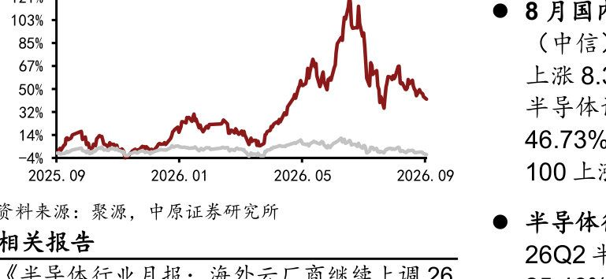

图例：半导体、沪深 300；纵轴刻度：-4%、14%、32%、50%、67%、85%、103%、121%；横轴刻度：2025.09、2026.01、2026.05、2026.09。图中无数据标签。

资料来源：聚源，中原证券研究所

## 相关报告

- 《半导体行业月报：海外云厂商继续上调 26 年资本支出计划，服务器 CPU 需求旺盛》2026-08-11
- 《半导体行业月报：全球存储厂商加速扩产，关注半导体设备及零部件投资机会》2026-07-09
- 《半导体行业月报：华为发布韬定律，关注半导体产业链发展新机遇》2026-06-15

联系人：李智
电话：0371-65585629
地址：郑州郑东新区商务外环路 10 号 18 楼
地址：上海浦东新区世纪大道 1788 号 T1 座 22 楼

## 投资要点：

- 8 月国内半导体行业表现相对较强。2026 年 8 月国内半导体行业（中信）上涨 8.93%，同期沪深 300 上涨 0.80%，其中集成电路上涨 8.33%，分立器件上涨 14.90%，半导体材料上涨 15.95%，半导体设备上涨 7.85%；半导体行业（中信）2026 年初至今上涨 46.73%。2026 年 8 月费城半导体指数上涨 1.98%，同期纳斯达克 100 上涨 4.18%，费城半导体指数 2026 年初至今上涨 62.85%。

- 半导体行业 26Q2 保持快速增长，国内存储厂商业绩表现亮眼。26Q2 半导体行业（中信）营收为 2454.24 亿元，同比增长 25.46%，26Q2 半导体行业（中信）归母净利润为 452.83 亿元，同比增长 202.26%，半导体行业 26Q2 毛利率及净利率同环比持续回升。国内存储厂商 26Q2 业绩表现亮眼，存储器模组厂商大普微、佰维存储、德明利、江波龙，以及存储芯片厂商东芯股份、普冉股份、兆易创新、恒烁股份、君正股份等 26Q2 营收及归母净利润实现高速增长；AI 及国产替代需求有望推动国内存储厂商显著受益于行业趋势，并持续提升市场份额。

- 全球半导体月度销售额继续同比高速增长，国内外云厂商持续加大资本支出。2026 年 7 月全球半导体销售额同比增长 135.1%，环比增长 6.4%；根据 WSTS 的最新预测，预计 2026 年全球半导体销售额将达到 1.511 万亿美元，同比增长 89.9%。下游需求呈现结构分化趋势，AI 算力硬件基础设施需求持续旺盛，26Q2 北美四大云厂商谷歌、微软、Meta、亚马逊资本支出同比增长 86%，环比增长 27%，并继续上调 2026 年资本支出计划；26Q2 国内三大互联网厂商阿里巴巴、百度、腾讯资本开支同比增长 102%，环比增长 92%。2026 年 8 月 DRAM 现货价格继续环比上涨，NAND Flash 现货价格环比小幅下降，DRAM 指数环比上涨约 5.25%，NAND 指数环比下降约 0.30%。根据 SEAJ 的数据，全球半导体设备销售额 26Q2 同比增长 23%，中国半导体设备销售额 26Q2 同比增长 5%，2026 年 7 月日本半导体设备销售额同比增长 35.4%，环比增长 8.3%；SEMI 预计 2026 年全球 300mm 晶圆厂设备支出将增长 18%至 1330 亿美元。全球硅片出货量 26Q2 同比增长 7.4%，环比增长 9.1%。综上所述，我们认为目前半导体行业仍处于上行周期，AI 为推动半导体行业成长的重要动力。

- 投资建议。国内存储器厂商主要布局存储器模组、存储芯片等环节，26Q2 主流存储器产品价格持续上涨，国内存储器模组厂商大普微、佰维存储、德明利、江波龙 26Q2 营收分别同比增长 656.40%、269.81%、228.04%、138.75%，归母净利润分别同比增长 519.17%、15177.40%、5566.72%、3930.86%；受益于利基型存储产品价格上涨，国内存储芯片厂商东芯股份、普冉股份、兆易创新、恒烁股份、君正股份 26Q2 营收分别同比增长 406.95%、402.11%、229.18%、211.64%、101.66%，归母净利润分别同比增长 1107.17%、2485.07%、1482.99%、304.72%、

---

<!-- 原文第 2 页 -->

579.96%；长鑫科技 26Q2 营收环比增长 95.89%，归母净利润环比增长 113.40%。AI 驱动存储器需求旺盛，存储器周期持续上行，AI 及国产替代需求有望推动国内存储厂商显著受益于行业趋势，并持续提升市场份额，建议关注国内存储芯片、存储模组厂商投资机会。

受益于 AI 基础设施投资的不断扩张，AI 驱动对先进存储需求持续旺盛，全球存储制造商正在加速扩大产能，根据 SEMI 的最新预测，预计 2026 年全球 300mm 晶圆厂存储领域设备投资将达到 520 亿美元，同比增长 29%，预计 2024-2029 年复合增速将达 19%。AI 驱动全球存储厂商加速扩产，半导体设备供给紧张程度有望逐步提升，国产半导体设备出海有望加速，同时叠加半导体设备国产替代在持续推进中，建议关注国内半导体设备及零部件厂商的投资机会。

风险提示：下游需求不及预期，市场竞争加剧风险，国内厂商研发进展不及预期，国产化进度不及预期，国际地缘政治冲突加剧风险。

---

<!-- 原文第 3 页 -->

# 内容目录

1. 2026 年 8 月半导体行业市场表现情况 6

1.1. 8 月半导体行业股票市场表现情况 6

1.2. 8 月半导体行业可转债市场表现情况 8

1.3. 8 月半导体行业 ETF 市场表现情况 9

2. 国内半导体行业 2026 年半年报总结 9

2.1. 半导体行业 26Q2 保持快速增长，盈利能力同环比持续提升 9

2.2. 国内存储厂商 26Q2 业绩表现亮眼，有望持续提升市场份额 11

3. 全球半导体月度销售额继续同比高速增长，国内外云厂商持续加大资本支出 12

3.1. 全球半导体月度销售额继续同比高速增长 12

3.2. 2026 年全球 AI 眼镜出货量有望快速增长，AI 算力硬件基础设施需求旺盛 15

3.2.1. 全球智能手机季度出货量同比下降，预计 2026 年全球智能手机市场将有所承压 16

3.2.2. 全球 PC 季度出货量继续同比下降，预计 2026 年全球 PC 出货量大幅下降 21

3.2.3. AI 眼镜是端侧 AI 最佳硬件载体之一，2026 年全球 AI 眼镜出货量有望快速增长 25

3.2.4. 国内外云厂商持续加大资本支出，推动 AI 算力硬件基础设施需求旺盛 30

3.2.5. 中国新能源汽车月度销量同比稳健增长 31

3.3. 全球部分芯片厂商季度库存水位环比下降，国内部分芯片厂商季度库存水位环比大幅下降 32

3.4. 国内主要晶圆厂季度产能利用率环比小幅提升 33

3.5. DRAM 月度现货价格环比继续上涨，NAND Flash 现货价格环比小幅下降 35

3.6. 全球半导体设备季度销售额继续同比增长，预计 2026 年有望持续增长 37

3.7. 全球硅片季度出货量继续同比增长，预计 2026 年将持续增长 39

4. 行业政策 40

5. 行业动态 41

5.1. 全球半导体行业动态 41

5.2. 河南省半导体行业动态 44

6. 估值分析与投资建议 45

6.1. 估值分析 45

6.2. 投资建议 45

7. 风险提示 46

# 图表目录

图 1：2026 年 8 月中信一级行业涨跌幅情况（%） 6

图 2：中信半导体指数与沪深 300 涨跌幅情况（%） 6

图 3：费城半导体指数与纳斯达克 100 涨跌幅情况（%） 7

图 4：半导体行业 2020-2026 年营收及增速情况 10

图 5：半导体行业 2020-2026 年归母净利润及增速情况 10

图 6：半导体行业 2020-2026 年毛利率和净利率情况 10

图 7：半导体行业 21Q1-26Q2 毛利率和净利率情况 10

图 8：2000-2026 年全球半导体市场销售额情况 12

图 9：2015-2026 年中国半导体市场销售额情况 13

图 10：2018-2029 年全球半导体销售额及预测情况（十亿美元） 13

图 11：2020-2027 年全球集成电路分产品市场预测情况 14

图 12：2024 年全球半导体下游应用领域占比情况 16

图 13：23Q1-26Q2 全球智能手机出货量情况 16

图 14：22Q1-26Q2 全球智能手机厂商市场份额情况 17

图 15：手机智能化演进路线图 17

图 16：AI 手机带来手机全栈革新和生态重构 18

图 17：AI 手机生态系统及主要参与者情况 18

图 18：2024-2029 年全球 AI 手机出货量及预测情况 21

---

<!-- 原文第 4 页 -->

图 19：23Q1-26Q2 年全球 PC 季度出货量情况 21

图 20：2016-2027 年全球 PC 出货量及预测情况 22

图 21：Canalys 对 AI PC 的定义及未来演变的考量 23

图 22：微软和英特尔对 AI PC 的定义 23

图 23：23Q4-24Q4 全球 AI PC 出货量情况 25

图 24：24Q1-25Q4 全球 PC 及 AI PC 出货量及预测 25

图 25：2024-2028 年全球 PC 市场总收入预测情况 25

图 26：Ray-Ban Meta 产品示意图 26

图 27：Ray-Ban Meta 产品支持耳机功能 26

图 28：AI 眼镜产品形态分类情况 26

图 29：拍照 AI 眼镜为当前主流形态 26

图 30：23Q4-24Q4 Ray-Ban Meta 眼镜出货量情况 27

图 31：小度 AI 眼镜产品示意图 27

图 32：小度 AI 眼镜产品配置及功能情况 27

图 33：华为智能眼镜 2 产品示意图 27

图 34：华为智能眼镜 2 产品示意图 27

图 35：雷鸟 V3 AI 眼镜产品示意图 28

图 36：雷鸟 X3 Pro AR 眼镜产品示意图 28

图 37：Oakley Meta HSTN AI 眼镜产品示意图 28

图 38：Oakley Meta HSTN AI 眼镜产品示意图 28

图 39：小米 AI 眼镜产品示意图 29

图 40：小米 AI 眼镜产品示意图 29

图 41：2023-2025 年全球 AI 眼镜出货量情况 29

图 42：2025 年全球及中国大陆 AI 眼镜市场竞争格局情况 30

图 43：RayBan Meta AI 眼镜系统架构框图 30

图 44：RayBan Meta AI 眼镜成本结构图 30

图 45：2020-2026 年北美四大云厂商资本开支情况（亿美元） 31

图 46：2021-2026 年国内三大互联网厂商资本开支情况（百万元） 31

图 47：2000-2026 年中国汽车销量情况 32

图 48：2015-2026 年中国新能源汽车销量情况 32

图 49：全球部分芯片厂商平均库存周转天数情况 33

图 50：国内部分芯片厂商平均库存周转天数情况 33

图 51：全球部分晶圆厂产能利用率情况 34

图 52：2024-2028 年全球晶圆产能及预测情况 34

图 53：25H2-26H2 晶圆代工价格涨幅变化情况 35

图 54：DRAM 指数走势情况 35

图 55：DRAM 现货价格走势情况（美元） 35

图 56：NAND 指数走势情况 36

图 57：NAND Flash 现货价格走势情况（美元） 36

图 58：26Q2-26Q3 DRAM 及 NAND Flash 产品合约价格预测情况 36

图 59：26H2 各类 NOR Flash 产品供需、价格趋势情况 37

图 60：2005-2026 年全球半导体设备销售额情况 37

图 61：2005-2026 年中国半导体设备销售额情况 37

图 62：日本半导体设备月度销售额情况 38

图 63：2024-2029 年全球 300mm 晶圆厂设备支出情况及预测 38

图 64：2024-2029 年全球 300mm 晶圆厂存储领域设备投资情况及预测 39

图 65：全球硅片出货量情况 39

图 66：2022-2027 年全球硅片出货量情况及预测 40

图 67：近十年半导体（申万）PE Bands 45

表 1：2026 年 8 月 A 股中信半导体行业部分个股涨跌幅情况 6

表 2：2026 年 8 月美股主要半导体公司涨跌幅情况 8

表 3：2026 年 8 月国内半导体行业可转债涨跌幅情况（截至 2026 年 9 月 4 日） 8

---

<!-- 原文第 5 页 -->

表 4：2026 年 8 月国内半导体行业 ETF 涨跌幅情况（截至 2026 年 9 月 4 日） 9

表 5：26Q2 半导体（中信）各子板块营收及归母净利润情况 10

表 6：A 股半导体行业（中信）26Q2 营收同比增速排名情况 11

表 7：国内存储器厂商 26Q2 业绩情况 12

表 8：全球前十五大芯片公司 26Q2 营收情况及 26 年展望 14

表 9：全球部分处理器厂商发布的支持端侧 AI 大模型手机的 SoC 芯片情况 19

表 10：全球部分智能手机厂商旗舰 AI 手机布局情况 19

表 11：26Q2 全球 PC 厂商市场份额情况 22

表 12：全球主要处理器厂商发布的适用于 AI PC 处理器情况 23

表 13：全球部分 PC 厂商 AI PC 布局情况 24

表 14：近年美日荷对中国半导体产业部分制裁政策情况 40

---

<!-- 原文第 6 页 -->

## 1. 2026 年 8 月半导体行业市场表现情况

### 1.1. 8 月半导体行业股票市场表现情况

国内 2026 年 8 月半导体行业表现相对较强，走势大幅强于沪深 300。2026 年 8 月电子行业（中信）上涨 12.30%，8 月沪深 300 上涨 0.80%，电子行业表现大幅强于沪深 300 指数。半导体行业（中信）2026 年 8 月上涨 8.93%，表现大幅强于沪深 300，其中集成电路上涨 8.33%，分立器件上涨 14.90%，半导体材料上涨 15.95%，半导体设备上涨 7.85%；半导体行业（中信）2026 年初至今上涨 46.73%。

**图 1：2026 年 8 月中信一级行业涨跌幅情况（%）**

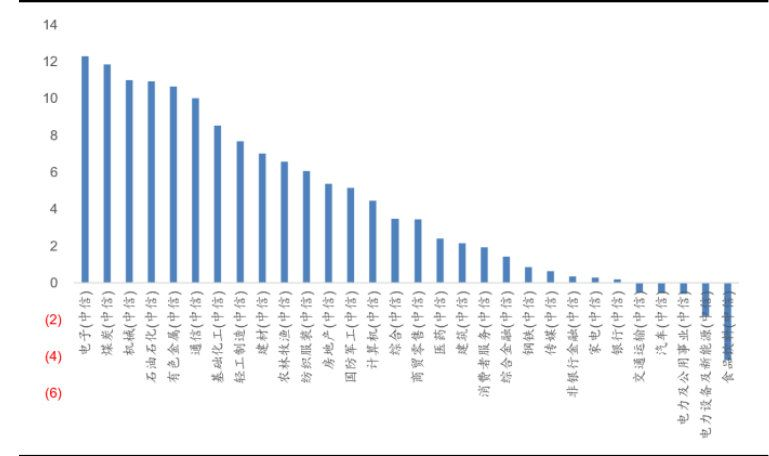

纵轴刻度：14、12、10、8、6、4、2、0、(2)、(4)、(6)；横轴为中信一级行业名称（按涨跌幅降序排列，自电子(中信)起）。图中无数据标签。

资料来源：Wind，中原证券研究所

**图 2：中信半导体指数与沪深 300 涨跌幅情况（%）**

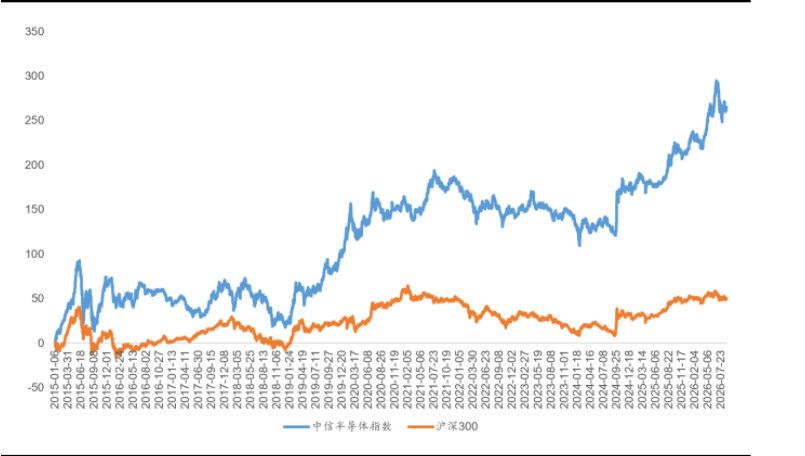

图例：中信半导体指数、沪深 300；纵轴刻度：-50、0、50、100、150、200、250、300、350；横轴为日期刻度（2015-01-03 起，间隔约 3 个月，末端刻度标签 [OCR_UNREADABLE]）。图中无数据标签。

资料来源：Wind，中原证券研究所

2026 年 8 月半导体板块上涨家数远多于下跌家数，2026 年 8 月涨幅排名前十的公司分别为力芯微（83%）、耐科装备（57%）、有研硅（55%）、有研新材（46%）、赛微电子（43%）、富瀚微（42%）、源杰科技（40%）、概伦电子（40%）、锴威特（39%）、思瑞浦（39%）。

**表 1：2026 年 8 月 A 股中信半导体行业部分个股涨跌幅情况**

| 证券代码 | 证券名称 | 总市值（亿元） | 8 月涨跌幅（%） | 年初至今涨跌幅（%） | 市盈率（TTM） | 市销率（TTM） | 市净率 |
| --- | --- | --- | --- | --- | --- | --- | --- |
| 688601.SH | 力芯微 | 86 | 83 | 52 | 527 | 10 | 7 |
| 688419.SH | 耐科装备 | 61 | 57 | 91 | 69 | 18 | 6 |
| 688432.SH | 有研硅 | 565 | 55 | 265 | 239 | 48 | 12 |
| 600206.SH | 有研新材 | 438 | 46 | 156 | 138 | 4 | 10 |
| 300456.SZ | 赛微电子 | 295 | 43 | -27 | 7 | 68 | 3 |
| 300613.SZ | 富瀚微 | 186 | 42 | 74 | 39 | 8 | 6 |
| 688498.SH | 源杰科技 | 1,909 | 40 | 246 | 254 | 144 | 61 |
| 688206.SH | 概伦电子 | 224 | 40 | 28 | -1,200 | 44 | 11 |
| 688693.SH | 锴威特 | 57 | 39 | 107 | -62 | 19 | 8 |
| 688536.SH | 思瑞浦 | 427 | 39 | 93 | 103 | 15 | 6 |
| 688209.SH | 英集芯 | 125 | 38 | 45 | 54 | 7 | 5 |
| 688508.SH | 芯朋微 | 119 | 38 | 48 | 47 | 10 | 4 |
| 300672.SZ | 国科微 | 384 | 37 | 64 | -666 | 16 | 10 |
| 688052.SH | 纳芯微 | 392 | 36 | 60 | -498 | 9 | 5 |
| 688061.SH | 灿瑞科技 | 52 | 36 | 40 | -93 | 8 | 2 |
| 688381.SH | 帝奥微 | 92 | 34 | 62 | 119 | 19 | 3 |
| 688286.SH | 敏芯股份 | 40 | 34 | -8 | -412 | 7 | 4 |
| 688130.SH | 晶华微 | 30 | 34 | 17 | -140 | 15 | 2 |
| 688653.SH | 康希通信 | 61 | 33 | 19 | 711 | 8 | 4 |

---

<!-- 原文第 7 页 -->

| 证券代码 | 证券名称 | 总市值（亿元） | 8 月涨跌幅（%） | 年初至今涨跌幅（%） | 市盈率（TTM） | 市销率（TTM） | 市净率 |
| --- | --- | --- | --- | --- | --- | --- | --- |
| 688135.SH | 利扬芯片 | 65 | 32 | 0 | 489 | 9 | 4 |
| 688002.SH | 睿创微纳 | 861 | 31 | 84 | 42 | 11 | 11 |
| 603061.SH | 金海通 | 298 | 30 | 254 | 110 | 30 | 16 |
| 688048.SH | 长光华芯 | 519 | 29 | 135 | 1,203 | 79 | 17 |
| 688045.SH | 必易微 | 43 | 29 | 57 | 73 | 5 | 3 |
| 688620.SH | 安凯微 | 66 | 29 | 40 | -130 | 9 | 5 |
| 688352.SH | 颀中科技 | 214 | 29 | 43 | -156 | 10 | 4 |
| 603078.SH | 江化微 | 139 | 29 | 103 | 134 | 10 | 7 |
| 300077.SZ | 国民技术 | 129 | 29 | 3 | -190 | 9 | 8 |
| 300623.SZ | 捷捷微电 | 249 | 29 | 11 | 47 | 6 | 4 |
| 688403.SH | 汇成股份 | 252 | 29 | 56 | 396 | 13 | 6 |
| 688099.SH | 晶晨股份 | 413 | 0 | 12 | 42 | 5 | 5 |
| 688008.SH | 澜起科技 | 2,523 | 0 | 74 | 81 | 41 | 12 |
| 688172.SH | 燕东微 | 707 | -1 | 71 | -73 | 33 | 4 |
| 603160.SH | 汇顶科技 | 241 | -1 | -34 | 37 | 5 | 3 |
| 002049.SZ | 紫光国微 | 539 | -2 | -19 | 35 | 8 | 4 |
| 300474.SZ | 景嘉微 | 269 | -2 | -28 | -145 | 31 | 4 |
| 688146.SH | 中船特气 | 1,376 | -2 | 544 | 267 | 44 | 23 |
| 603501.SH | 豪威集团 | 1,037 | -6 | -34 | 32 | 4 | 3 |
| 688041.SH | 海光信息 | 5,901 | -8 | 13 | 188 | 33 | 23 |
| 688608.SH | 恒玄科技 | 251 | -14 | -34 | 55 | 9 | 4 |

资料来源：Wind，中原证券研究所

2026 年 8 月费城半导体指数表现弱于纳斯达克 100。2026 年 8 月费城半导体指数上涨 1.98%，8 月纳斯达克 100 上涨 4.18%，费城半导体指数走势弱于纳斯达克 100；费城半导体指数 2026 年初至今上涨 62.85%。

**图 3：费城半导体指数与纳斯达克 100 涨跌幅情况（%）**

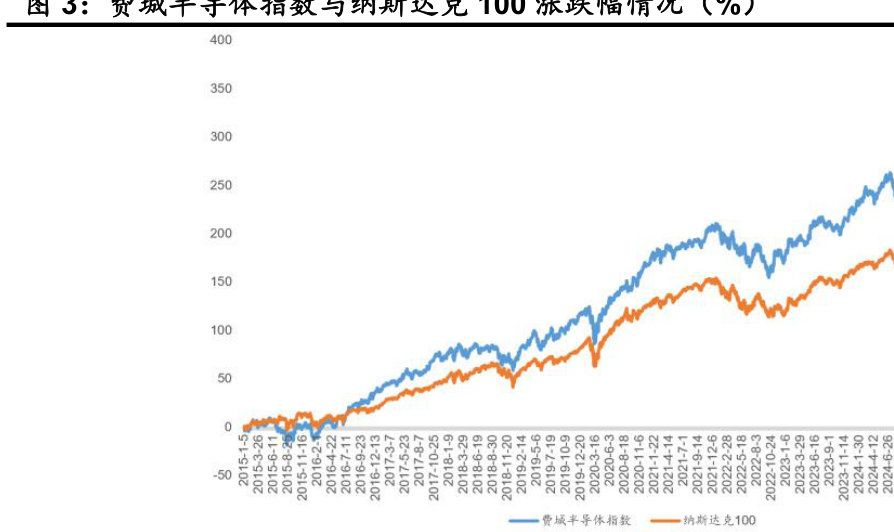

图例：费城半导体指数、纳斯达克 100；纵轴刻度：-50、0、50、100、150、200、250、300、350、400；横轴为日期刻度（2015 年起至 2026 年，刻度标签密集，末端标签 [OCR_UNREADABLE]）。图中无数据标签。

资料来源：Wind，中原证券研究所

2026 年 8 月美股半导体板块上涨家数少于下跌家数，2026 年 8 月涨幅排名前十的公司分别为嘉楠科技（115%）、高平电子（26%）、聪链集团（23%）、纳比特（21%）、Sequans（19%）、美光科技（16%）、Azenta（16%）、Wolfspeed（16%）、高通（15%）、南茂（15%）。

---

<!-- 原文第 8 页 -->

**表 2：2026 年 8 月美股主要半导体公司涨跌幅情况**

| 证券代码 | 证券名称 | 总市值（亿美元） | 8 月涨跌幅（%） | 年初至今涨跌幅（%） | 市盈率（TTM） | 市销率（TTM） | 市净率 |
| --- | --- | --- | --- | --- | --- | --- | --- |
| CAN.O | 嘉楠科技 | 3 | 115 | (47) | (1) | 1 | 1 |
| KOPN.O | 高平电子 | 8 | 26 | 90 | 105 | 19 | 12 |
| ICG.O | 聪链集团 | 1 | 23 | (44) | (2) | 7 | 1 |
| NA.O | 纳比特 | 0.5 | 21 | (31) | (2) | 15 | 1 |
| SQNS.N | Sequans | 0.4 | 19 | (35) | (0) | 2 | 1 |
| MU.O | 美光科技 | 10828 | 16 | 236 | 21 | 12 | 11 |
| AZTA.O | Azenta | 14 | 16 | (2) | (11) | 2 | 1 |
| WOLF.N | Wolfspeed | 15 | 16 | 57 | (3) | 3 | 2 |
| QCOM.O | 高通 | 1790 | 15 | 1 | 19 | 4 | 6 |
| IMOS.O | 南茂 | 19 | 15 | 87 | 27 | 2 | 2 |
| INDI.O | indie Semiconductor | 9 | 15 | 5 | (6) | 4 | 3 |
| PXLW.O | 美国像素 | 0.4 | 14 | 8 | 1 | (3) | 1 |
| AAOI.O | 应用光电 | 91 | 14 | 209 | (160) | 15 | 5 |
| ENTG.O | 英特格 | 207 | 14 | 61 | 68 | 6 | 5 |
| VLN.N | Valens Semiconductor | 2 | 13 | 25 | (6) | 3 | 2 |
| SMTC.O | 先科电子 | 124 | 13 | 80 | 81 | 11 | 17 |
| MRVL.O | 迈威尔科技 | 1856 | 13 | 149 | 70 | 20 | 10 |
| MRAM.O | Everspin | 4 | 12 | 75 | (150) | 6 | 5 |
| DIOD.O | Diodes | 42 | 10 | 84 | 49 | 3 | 2 |
| NVDA.O | 英伟达 | 53208 | 10 | 19 | 28 | 18 | 23 |
| UCTT.O | 超科林半导体 | 31 | (19) | 168 | (131) | 1 | 5 |
| AMBA.O | 安霸 | 30 | (19) | (2) | (44) | 8 | 5 |
| ATOM.O | Atomera | 2 | (19) | 88 | (7) | 706 | 4 |
| MOBX.O | Mobix Labs | 0.2 | (21) | (51) | (0) | 4 | 3 |
| SEDG.O | Solaredge | 20 | (22) | 12 | (7) | 1 | 5 |
| AOSL.O | 阿尔法和欧米伽半导体 | 7 | (22) | 24 | (18) | 1 | 1 |
| AIP.O | Arteris | 11 | (27) | 41 | (27) | 13 | 16 |
| ICHR.O | Ichor Holdings | 20 | (29) | 191 | (50) | 2 | 2 |
| LASR.O | nLIGHT | 24 | (39) | 13 | (195) | 8 | 6 |
| SMTK.O | SmartKem | 0.02 | (71) | (94) | (0) | 3 | 0 |

资料来源：iFinD，中原证券研究所

### 1.2. 8 月半导体行业可转债市场表现情况

2026 年 8 月国内半导体行业可转债上涨家数多于下跌家数，其中微导转债（17.41%）、颀中转债（9.60%）、路维转债（9.37%）、闻泰转债（6.35%）、力合转债（4.94%）涨幅居前。

**表 3：2026 年 8 月国内半导体行业可转债涨跌幅情况（截至 2026 年 9 月 4 日）**

| 证券名称 | 代码 | 评级 | 余额（亿元） | 剩余期限（年） | 转股溢价率（%） | 2026 年 8 月涨跌幅（%） | 2026 年初至今涨跌幅（%） | 现价 |
| --- | --- | --- | --- | --- | --- | --- | --- | --- |
| 微导转债 | 118058.SH | AA | 11.70 | 4.92 | 12.25 | 17.41 | 4.06 | 340.18 |
| 颀中转债 | 118059.SH | AA+ | 8.50 | 5.16 | 47.72 | 9.60 | 19.46 | 176.94 |
| 路维转债 | 118056.SH | AA- | 6.14 | 4.76 | 37.40 | 9.37 | 26.27 | 246.65 |
| 闻泰转债 | 110081.SH | BBB+ | 71.70 | 0.89 | 8.61 | 6.35 | -6.99 | 107.25 |
| 力合转债 | 118036.SH | AA- | 3.80 | 2.81 | 34.50 | 4.94 | 8.53 | 143.58 |
| 富瀚转债 | 123122.SZ | A+ | 5.80 | 0.92 | 58.80 | 2.65 | 5.07 | 125.60 |
| 晶瑞转 2 | 123124.SZ | A+ | 5.22 | 0.95 | 42.92 | 1.28 | -1.43 | 134.65 |
| 芯海转债 | 118015.SH | A+ | 4.10 | 1.87 | 140.23 | -1.75 | 2.67 | 126.82 |
| 南芯转债 | 118070.SH | AA+ | 15.87 | 5.78 | 88.69 | -2.38 | 15.06 | 149.58 |
| 韦尔转债 | 113616.SH | AA+ | 24.32 | 0.31 | 117.16 | -3.94 | -11.26 | 109.59 |
| 鼎龙转债 | 123255.SZ | AA | 9.10 | 4.57 | 40.61 | -5.00 | 80.78 | 328.00 |

---

<!-- 原文第 9 页 -->

| 证券名称 | 代码 | 评级 | 余额（亿元） | 剩余期限（年） | 转股溢价率（%） | 2026 年 8 月涨跌幅（%） | 2026 年初至今涨跌幅（%） | 现价 |
| --- | --- | --- | --- | --- | --- | --- | --- | --- |
| 华峰转债 | 118071.SH | AA | 7.49 | 5.80 | 81.66 | -6.77 | 91.90 | 191.90 |

资料来源：Wind，中原证券研究所

### 1.3. 8 月半导体行业 ETF 市场表现情况

2026 年 8 月国内半导体行业 ETF 全面上涨，其中华泰柏瑞上证科创板半导体材料设备主题 ETF（9.61%）、华夏上证科创板半导体材料设备主题 ETF（9.46%）、鹏华科创板半导体材料设备主题 ETF（9.29%）、广发中证半导体材料设备主题 ETF（8.32%）、万家中证半导体材料设备主题 ETF（8.29%）涨幅居前。

**表 4：2026 年 8 月国内半导体行业 ETF 涨跌幅情况（截至 2026 年 9 月 4 日）**

| 代码 | 证券名称 | 上市日期 | 现有规模（亿元） | 2026 年 8 月涨跌幅（%） | 2026 年初至今涨跌幅（%） |
| --- | --- | --- | --- | --- | --- |
| 588710.SH | 华泰柏瑞上证科创板半导体材料设备主题 ETF | 2025/6/4 | 108.08 | 9.61 | 79.60 |
| 588170.SH | 华夏上证科创板半导体材料设备主题 ETF | 2025/4/8 | 409.40 | 9.46 | 79.80 |
| 589020.SH | 鹏华科创板半导体材料设备主题 ETF | 2025/9/4 | 50.31 | 9.29 | 80.85 |
| 560780.SH | 广发中证半导体材料设备主题 ETF | 2023/12/12 | 126.14 | 8.32 | 70.32 |
| 159327.SZ | 万家中证半导体材料设备主题 ETF | 2024/8/5 | 30.69 | 8.29 | 71.97 |
| 562590.SH | 华夏中证半导体材料设备主题 ETF | 2023/10/18 | 85.72 | 8.14 | 71.50 |
| 159558.SZ | 易方达中证半导体材料设备主题 ETF | 2024/6/18 | 198.46 | 8.09 | 70.79 |
| 159516.SZ | 国泰中证半导体材料设备主题 ETF | 2023/7/27 | 405.24 | 7.91 | 70.23 |
| 588200.SH | 嘉实上证科创板芯片 ETF | 2022/10/26 | 478.21 | 7.09 | 41.51 |
| 512480.SH | 国联安中证全指半导体 ETF | 2019/6/12 | 200.16 | 6.65 | 33.33 |
| 159325.SZ | 南方中证半导体行业精选 ETF | 2024/11/8 | 11.11 | 5.00 | 34.27 |
| 159665.SZ | 工银瑞信国证半导体芯片 ETF | 2023/1/6 | 5.91 | 4.94 | 28.41 |
| 513310.SH | 华泰柏瑞中证韩交所中韩半导体 ETF | 2022/12/22 | 104.03 | 4.70 | 80.48 |
| 159995.SZ | 华夏国证半导体芯片 ETF | 2020/2/10 | 268.50 | 4.47 | 25.36 |
| 159813.SZ | 鹏华国证半导体芯片 ETF | 2020/5/25 | 64.89 | 4.47 | 25.52 |
| 159801.SZ | 广发国证半导体芯片 ETF | 2020/2/18 | 49.67 | 4.33 | 25.79 |
| 159582.SZ | 博时中证半导体产业 ETF | 2024/4/16 | 8.02 | 4.32 | 58.67 |
| 512760.SH | 国泰 CES 半导体芯片 ETF | 2019/6/12 | 101.68 | 4.19 | 28.06 |
| 561980.SH | 招商中证半导体产业 ETF | 2023/9/1 | 55.90 | 3.71 | 58.07 |

资料来源：Wind，中原证券研究所

## 2. 国内半导体行业 2026 年半年报总结

### 2.1. 半导体行业 26Q2 保持快速增长，盈利能力同环比持续提升

半导体行业 26Q2 营收及归母净利润保持快速增长。2026 年上半年半导体行业（中信）营业收入为 4487.86 亿元，同比增长 22.58%，26Q2 半导体行业（中信）营收为 2454.24 亿元，同比增长 25.46%，其中集成电路、分立器件、半导体设备和半导体材料板块分别同比 +36.13%、-42.26%、+28.61%、+28.49%；2026 年上半年半导体行业（中信）归母净利润为 677.64 亿元，同比增长 173.51%，26Q2 半导体行业（中信）归母净利润为 452.83 亿元，同比增长 202.26%，其中集成电路、分立器件、半导体设备和半导体材料板块分别同比 +327.10%、-43.17%、+76.19%、+41.17%。

---

<!-- 原文第 10 页 -->

**图 4：半导体行业 2020-2026 年营收及增速情况**

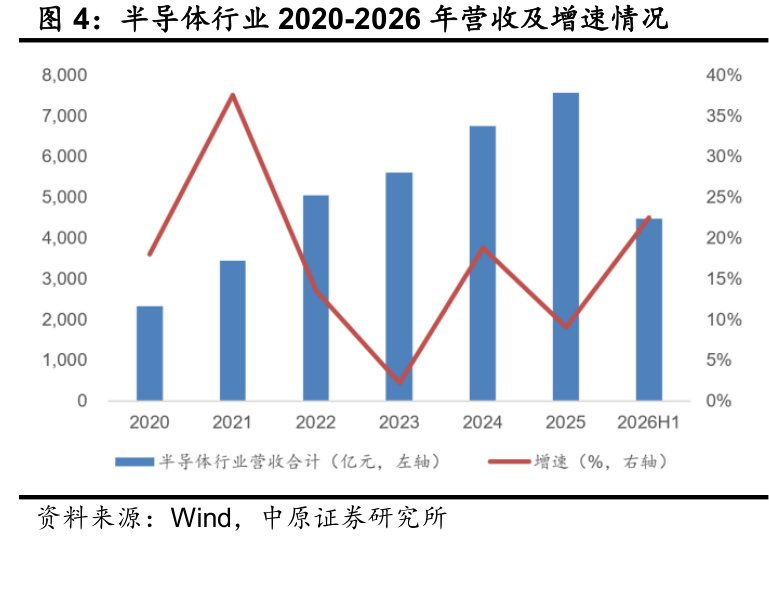

图例：半导体行业营收合计（亿元，左轴）、增速（%，右轴）；左轴刻度：0、1,000、2,000、3,000、4,000、5,000、6,000、7,000、8,000；右轴刻度：0%、5%、10%、15%、20%、25%、30%、35%、40%；横轴：2020、2021、2022、2023、2024、2025、2026H1。图中无数据标签。

资料来源：Wind，中原证券研究所

**图 5：半导体行业 2020-2026 年归母净利润及增速情况**

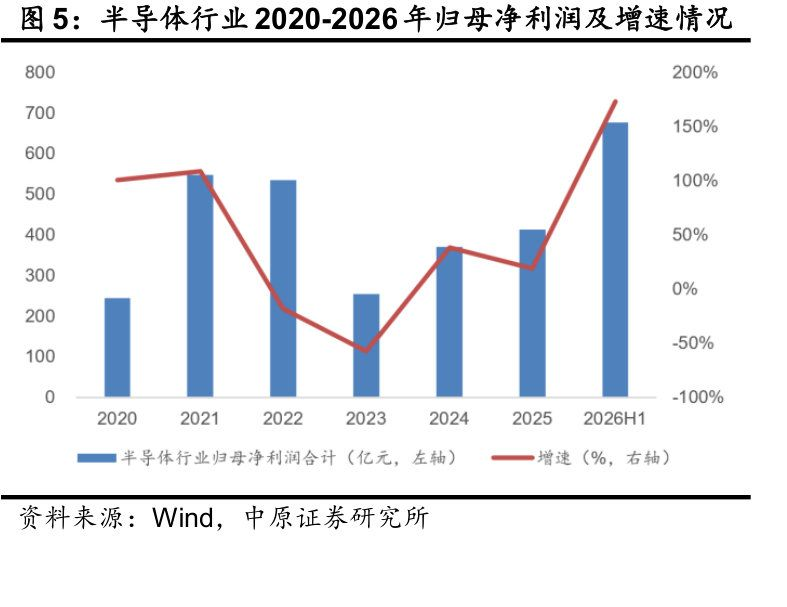

图例：半导体行业归母净利润合计（亿元，左轴）、增速（%，右轴）；左轴刻度：0、100、200、300、400、500、600、700、800；右轴刻度：-100%、-50%、0%、50%、100%、150%、200%；横轴：2020、2021、2022、2023、2024、2025、2026H1。图中无数据标签。

资料来源：Wind，中原证券研究所

**表 5：26Q2 半导体（中信）各子板块营收及归母净利润情况**

| 子板块 | 营业收入（亿元） | 营收同比增速 | 归母净利润（亿元） | 归母净利润同比增速 | 毛利率 | 净利率 |
| --- | --- | --- | --- | --- | --- | --- |
| 集成电路 | 1,765.08 | 36.13% | 353.88 | 327.10% | 33.68% | 21.14% |
| 分立器件 | 129.40 | -42.26% | 7.68 | -43.17% | 22.78% | 5.12% |
| 半导体材料 | 223.62 | 28.49% | 11.62 | 41.17% | 17.59% | 5.18% |
| 半导体设备 | 336.13 | 28.61% | 79.64 | 76.19% | 40.51% | 23.37% |

资料来源：Wind，中原证券研究所

半导体行业 26Q2 毛利率及净利率同环比持续回升。2026 年上半年半导体行业毛利率为 31.75%，同比提升 5.75%，26Q2 毛利率为 32.58%，同比提升 6.28%，环比提升 1.89%；2026 年上半年半导体行业净利率为 15.47%，同比提升 8.66%，26Q2 净利率为 19.15%，同比提升 11.66%，环比提升 8.25%。

**图 6：半导体行业 2020-2026 年毛利率和净利率情况**

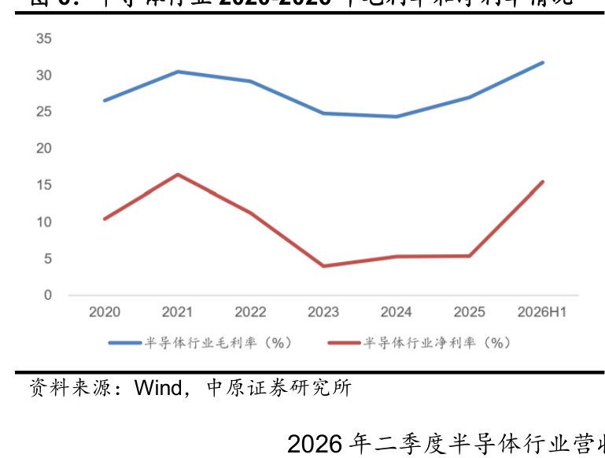

图例：半导体行业毛利率（%）、半导体行业净利率（%）；纵轴刻度：0、5、10、15、20、25、30、35；横轴：2020、2021、2022、2023、2024、2025、2026H1。图中无数据标签。

资料来源：Wind，中原证券研究所

**图 7：半导体行业 21Q1-26Q2 毛利率和净利率情况**

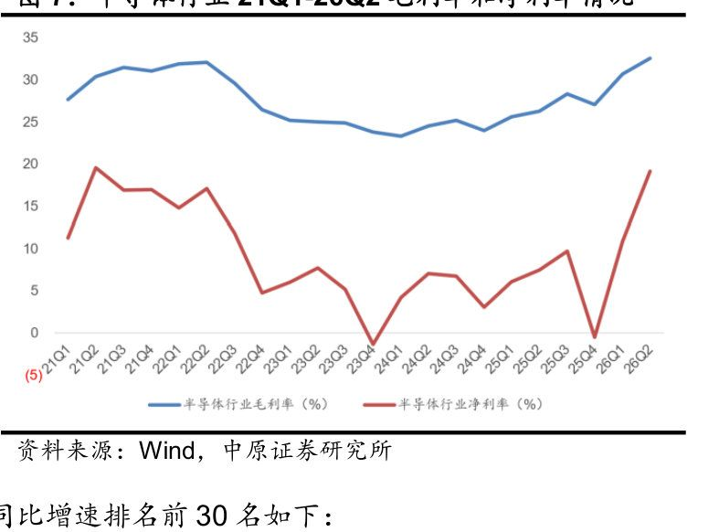

图例：半导体行业毛利率（%）、半导体行业净利率（%）；纵轴刻度：0、5、10、15、20、25、30、35；横轴：21Q1、21Q2、21Q3、21Q4、22Q1、22Q2、22Q3、22Q4、23Q1、23Q2、23Q3、23Q4、24Q1、24Q2、24Q3、24Q4、25Q1、25Q2、25Q3、25Q4、26Q1、26Q2。图中无数据标签。

资料来源：Wind，中原证券研究所

2026 年二季度半导体行业营收同比增速排名前 30 名如下：

---

<!-- 原文第 11 页 -->

**表 6：A 股半导体行业（中信）26Q2 营收同比增速排名情况**

| 序号 | 证券代码 | 证券名称 | 26Q2 营收（亿元） | 26Q2 营收同比增速（%） | 26Q2 归母净利润（亿元） | 26Q2 归母净利润同比增速（%） |
| --- | --- | --- | --- | --- | --- | --- |
| 1 | 301666.SZ | 大普微-UW | 34.13 | 656.40 | 9.64 | 519.17 |
| 2 | 688110.SH | 东芯股份 | 10.18 | 406.95 | 5.21 | 1107.17 |
| 3 | 688766.SH | 普冉股份 | 25.13 | 402.11 | 5.76 | 2485.07 |
| 4 | 688498.SH | 源杰科技 | 5.70 | 372.73 | 4.28 | 1238.70 |
| 5 | 688525.SH | 佰维存储 | 87.61 | 269.81 | 42.67 | 15177.40 |
| 6 | 603986.SH | 兆易创新 | 73.78 | 229.18 | 53.96 | 1482.99 |
| 7 | 001309.SZ | 德明利 | 93.72 | 228.04 | 26.71 | 5566.72 |
| 8 | 688478.SH | 晶升股份 | 0.38 | 228.02 | (0.03) | 10.22 |
| 9 | 688416.SH | 恒烁股份 | 3.09 | 211.64 | 0.91 | 304.72 |
| 10 | 688801.SH | C 燧原-U | 8.33 | 200.50 | (1.88) | 34.86 |
| 11 | 688535.SH | 华海诚科 | 2.46 | 158.42 | 0.26 | 298.39 |
| 12 | 300613.SZ | 富瀚微 | 9.04 | 144.65 | 2.65 | 3057.19 |
| 13 | 688795.SH | 摩尔线程-U | 9.99 | 141.88 | (0.41) | 74.17 |
| 14 | 688146.SH | 中船特气 | 12.03 | 129.49 | 2.47 | 170.52 |
| 15 | 301536.SZ | 星宸科技 | 16.64 | 125.59 | 6.43 | 834.79 |
| 16 | 688048.SH | 长光华芯 | 2.61 | 117.97 | 0.26 | 56.97 |
| 17 | 688620.SH | 安凯微 | 2.86 | 115.91 | 0.60 | 320.63 |
| 18 | 301200.SZ | 大族数控 | 30.30 | 113.07 | 6.34 | 332.73 |
| 19 | 688368.SH | 晶丰明源 | 8.44 | 108.36 | 0.50 | 121.86 |
| 20 | 688107.SH | 安路科技 | 2.66 | 104.69 | (0.34) | 58.95 |
| 21 | 300223.SZ | 君正股份 | 23.97 | 101.66 | 8.79 | 579.96 |
| 22 | 300671.SZ | 富满微 | 4.09 | 90.95 | 0.70 | 754.42 |
| 23 | 688262.SH | 国芯科技 | 1.57 | 88.01 | (0.33) | 35.74 |
| 24 | 603061.SH | 金海通 | 3.17 | 77.17 | 0.89 | 76.12 |
| 25 | 688521.SH | 芯原股份 | 10.28 | 75.95 | (2.71) | (172.63) |
| 26 | 688256.SH | 寒武纪 | 31.11 | 75.83 | 12.98 | 90.11 |
| 27 | 688002.SH | 睿创微纳 | 24.52 | 74.22 | 7.81 | 280.43 |
| 28 | 688052.SH | 纳芯微 | 13.99 | 73.45 | 1.03 | 487.41 |
| 29 | 688536.SH | 思瑞浦 | 9.04 | 71.33 | 2.02 | 303.72 |
| 30 | 300672.SZ | 国科微 | 7.44 | 70.66 | 1.41 | 548.68 |

资料来源：Wind，中原证券研究所

### 2.2. 国内存储厂商 26Q2 业绩表现亮眼，有望持续提升市场份额

**26Q2 存储器产品价格持续上涨，国内存储厂商业绩表现亮眼。** 国内存储器厂商主要布局存储器模组、存储芯片等环节，26Q2 主流存储器产品价格持续上涨，国内存储器模组厂商大普微、佰维存储、德明利、江波龙 26Q2 营收分别同比增长 656.40%、269.81%、228.04%、138.75%，归母净利润分别同比增长 519.17%、15177.40%、5566.72%、3930.86%；受益于利基型存储产品价格上涨，国内存储芯片厂商东芯股份、普冉股份、兆易创新、恒烁股份、君正股份 26Q2 营收分别同比增长 406.95%、402.11%、229.18%、211.64%、101.66%，归母净利润分别同比增长 1107.17%、2485.07%、1482.99%、304.72%、579.96%；长鑫科技 26Q2 营收环比增长 95.89%，归母净利润环比增长 113.40%。AI 驱动存储器需求旺盛，存储器周期持续上行，AI 及国产替代需求有望推动国内存储厂商显著受益于行业趋势，并持续提升市场份额，建议关注国内存储芯片、存储模组厂商投资机会。

---

<!-- 原文第 12 页 -->

**表 7：国内存储器厂商 26Q2 业绩情况**

| 证券代码 | 证券名称 | 26Q2 营收（亿元） | 同比增速（%） | 环比增速（%） | 26Q2 归母净利润（亿元） | 同比增速（%） | 环比增速（%） |
| --- | --- | --- | --- | --- | --- | --- | --- |
| 301666.SZ | 大普微-UW | 34.13 | 656.40 | 160.55 | 9.64 | 519.17 | 160.64 |
| 688525.SH | 佰维存储 | 87.61 | 269.81 | 28.56 | 42.67 | 15177.40 | 47.18 |
| 001309.SZ | 德明利 | 93.72 | 228.04 | 24.33 | 26.71 | 5566.72 | (20.18) |
| 301308.SZ | 江波龙 | 141.80 | 138.75 | 43.10 | 67.15 | 3930.86 | 73.85 |
| 688110.SH | 东芯股份 | 10.18 | 406.95 | 112.31 | 5.21 | 1107.17 | 276.74 |
| 688766.SH | 普冉股份 | 25.13 | 402.11 | 73.66 | 5.76 | 2485.07 | 129.23 |
| 603986.SH | 兆易创新 | 73.78 | 229.18 | 76.16 | 53.96 | 1482.99 | 269.24 |
| 688416.SH | 恒烁股份 | 3.09 | 211.64 | 40.77 | 0.91 | 304.72 | 87.11 |
| 300223.SZ | 君正股份 | 23.97 | 101.66 | 53.71 | 8.79 | 579.96 | 175.44 |
| 688825.SH | 长鑫科技 | 995.10 |  | 95.89 | 528.43 |  | 113.40 |

资料来源：Wind，中原证券研究所

## 3. 全球半导体月度销售额继续同比高速增长，国内外云厂商持续加大资本支出

### 3.1. 全球半导体月度销售额继续同比高速增长

**2026 年 7 月全球半导体销售额同比增长 135.1%，环比增长 6.4%。** 根据美国半导体行业协会（SIA）的数据，2026 年 7 月份全球半导体销售额约为 1468 亿美元，同比增长 135.1%，连续 33 个月实现同比增长，环比增长 6.4%。2026 年 7 月，从区域表现来看，同比增长上，美洲同比增长 171.3%，亚太及其他地区增长 134.9%，中国增长 123.6%，欧洲增长 85.2%，日本增长 50.8%；环比增长上，日本市场环比增长 9.2%，美洲增长 8.7%，亚太及其他地区增长 6.8%，欧洲增长 5.2%，中国增长 2.9%。

**图 8：2000-2026 年全球半导体市场销售额情况**

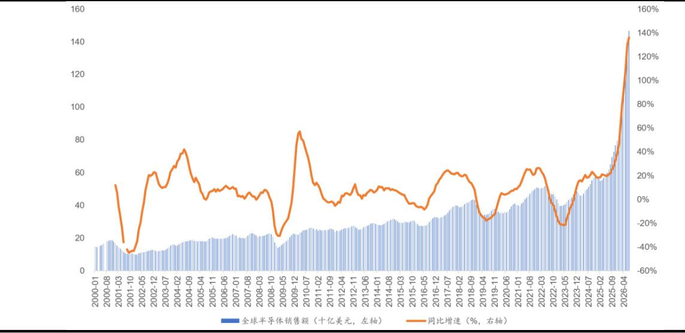

图例：全球半导体销售额（十亿美元，左轴，蓝色柱）、同比增速（%，右轴，橙色折线）；左轴刻度：0、20、40、60、80、100、120、140、160；右轴刻度：-60%、-40%、-20%、0%、20%、40%、60%、80%、100%、120%、140%、160%；横轴为月度刻度（2000-01 起至 2026-04，按双月标注）。图中无数据标签。

资料来源：SIA，Wind，中原证券研究所

**2026 年 7 月中国半导体销售额同比增长 123.6%，环比增长 2.9%。** 根据美国半导体行业协会（SIA）的数据，2026 年 7 月中国半导体行业销售额为 382 亿美元，同比增长 123.6%，连续 33 个月实现同比增长，环比增长 2.9%。

---

<!-- 原文第 13 页 -->

**图 9：2015-2026 年中国半导体市场销售额情况**

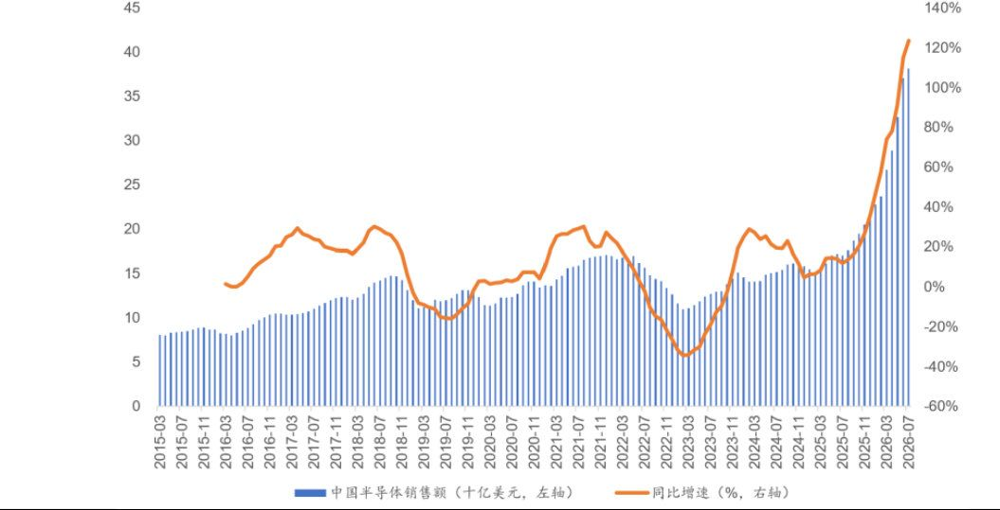

图例：中国半导体销售额（十亿美元，左轴，蓝色柱）、同比增速（%，右轴，橙色折线）；左轴刻度：0、5、10、15、20、25、30、35、40、45；右轴刻度：-60%、-40%、-20%、0%、20%、40%、60%、80%、100%、120%、140%；横轴为月度刻度（2015-03、2015-07、2015-11 起，每隔 4 个月标注，至 2026-07）。图中无数据标签。

资料来源：SIA，Wind，中原证券研究所

**WSTS 预计 2026 年全球半导体销售额将同比增长 89.9%。** 根据 WSTS 的最新预测，预计 2026 年全球半导体市场规模将达到 1.511 万亿美元，同比增幅高达 89.9%；预计半导体市场 2027 年将继续增长 26.6%，市场规模达 1.914 万亿美元。

**图 10：2018-2029 年全球半导体销售额及预测情况（十亿美元）**

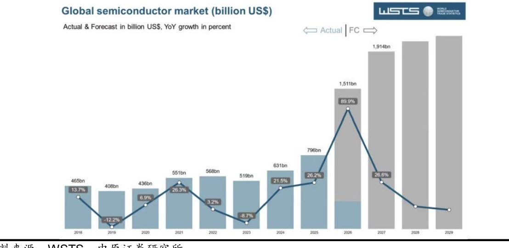

图内标题：Global semiconductor market (billion US$)；副标题：Actual & Forecast in billion US$, YoY growth in percent；图例：Actual、FC。

柱上标注的销售额与同比增速：2018 年 465bn（13.7%）、2019 年 408bn（-12.2%）、2020 年 436bn（6.9%）、2021 年 551bn（26.3%）、2022 年 568bn（3.2%）、2023 年 519bn（-8.7%）、2024 年 631bn（21.5%）、2025 年 796bn（26.2%）、2026 年 1,511bn（89.9%）、2027 年 1,914bn（26.6%）；2028、2029 年柱体无数据标签。

资料来源：WSTS，中原证券研究所

**WSTS 预计 2026 年全球存储器销售额同比增长 249.5%。** 根据 WSTS 的最新预测，WSTS 预计存储器细分领域 2026 年销售额同比增幅将达到惊人的 249.5%，市场规模突破 8000 亿美元，一举超越 2025 年整体半导体市场规模；而逻辑芯片 2026 年也将实现 37.3% 增幅；微处理器、模拟、分立、传感、光电子增幅则在 19.8%~2.7% 区间。 2027 年，存储器预计将继续以 32.1% 的增速引领市场，此后是逻辑的 27.1% 和微处理器的 20.0%。

---

<!-- 原文第 14 页 -->

**图 11：2020-2027 年全球集成电路分产品市场预测情况**

| 项目 | 2020CY | 2021CY | 2022CY | 2023CY | 2024CY | 2025CY | 2026CY | 2027CY |
| --- | --- | --- | --- | --- | --- | --- | --- | --- |
| Total IC(M$) | 361,226 | 463,002 | 474,402 | 428,442 | 539,505 | 700,975 | 1,412,326 | 1,808,533 |
| Analog | 55,658 | 74,105 | 88,983 | 81,225 | 79,588 | 86,519 | 95,358 | 101,662 |
| Micro | 69,678 | 80,221 | 79,073 | 76,340 | 78,633 | 84,867 | 101,655 | 121,966 |
| Logic | 118,408 | 154,837 | 176,578 | 178,589 | 215,768 | 299,547 | 411,371 | 522,820 |
| Memory | 117,482 | 153,839 | 129,767 | 92,288 | 165,516 | 230,042 | 803,941 | 1,062,085 |

| Growth Rate(%) | 2020CY | 2021CY | 2022CY | 2023CY | 2024CY | 2025CY | 2026CY | 2027CY |
| --- | --- | --- | --- | --- | --- | --- | --- | --- |
| Total IC(M$) | +8.4% | +28.2% | +2.5% | -9.7% | +25.9% | +29.9% | +101.5% | +28.1% |
| Analog | +3.2% | +33.1% | +20.1% | -8.7% | -2.0% | +8.7% | +10.2% | +6.6% |
| Micro | +4.9% | +15.1% | -1.4% | -3.5% | +3.0% | +7.9% | +19.8% | +20.0% |
| Logic | +11.1% | +30.8% | +14.0% | +1.1% | +20.8% | +38.8% | +37.3% | +27.1% |
| Memory | +10.4% | +30.9% | -15.6% | -28.9% | +79.3% | +39.0% | +249.5% | +32.1% |

资料来源：WSTS，中原证券研究所

**全球存储器厂商 26Q2 业绩继续表现亮眼，服务器 CPU 需求旺盛。** 近期部分全球 15 大芯片厂商公布了 26Q2 季报，受益于 AI 推理对于存储用量大幅提升，推动 HBM、DDR5 及企业级 SSD 需求增长，存储器厂商三星、SK 海力士、美光、铠侠 26Q2 业绩继续实现同环比高速增长；目前 DRAM、NAND 供应紧张，预计 2026 年存储需求将继续快速增长。随着 AI 工作负载从训练转向推理、智能体，CPU 在 AI 数据中心中的地位逐步提升，英特尔与 AMD 服务器 CPU 出货量 26 年实现强劲增长。TI、NXP、ST、英飞凌受益于数据中心需求加速，工业、汽车等领域需求恢复，模拟芯片行业 26Q2 继续复苏。

**表 8：全球前十五大芯片公司 26Q2 营收情况及 26 年展望**

| 序号 | 公司 | 26Q2 营收（亿美元） | 26Q2 同比增速 | 26Q2 环比增速 | 26Q3 环比增速指引 | 2026 年展望 |
| --- | --- | --- | --- | --- | --- | --- |
| 1 | 英伟达 | 962 | 106% | 18% | +12% | 英伟达预计 26Q3 公司营收将达 1080 亿美元，上下浮动 2%，中位值同比增长 89%，环比增长 12%,毛利率约为 74%。AI 需求激增推动全球持续加大基础设施建设，公司预计 2028 财年营收同比增长约 70%，并且该预期受到供给约束。 |
| 2 | 三星半导体 | 906 | 357% | 56% | - | 三星预计 26H2 服务器 DRAM 与 SSD 需求预计持续强劲，智能体 AI 加速需求增长，持续提升 DDR5、SOCAMM2 等高附加值 AI 产品占比，以高性能产品主导 PCIe Gen6 企业级 SSD 市场，聚焦 KV 缓存。 |
| 3 | SK 海力士 | 555 | 257% | 51% | - | 海力士预计 26Q3 DRAM 出货量环比增长约 10%，NAND 出货量环比增长低个位数。公司已与约 10 家客户签订 LTA，合同期限通常约为五年，不同客户、不同产品对应不同的定价机制。 |
| 4 | 美光 | 415 | 346% | 74% | +21% | 美光预计 26Q3 营收为 490-510 亿美元，中位值同比 +342%、环比 +21%，毛利率预计为 86%。公司预计 DRAM 与 NAND 的供需紧张格局将持续至 2027 年之后，预计 2026 年 DRAM 位元出货量将增长低到中 20%，NAND 位元出货量将增长约 20%，预计 2026 年供应将持续紧张。预计 2026 财年资本支出将达 270 亿美元，预计 2027 年资本支出将继续增长。 |
| 5 | 博通 | 296 | 86% | 33% | +18% | 博通预计 26Q3 营收约为 348 亿美元，同比增长 93%，环比增长 18%。公司将 2026 财年 AI 收入指引上调至 580 亿美元，预计 2027 财年将达 1150 亿美元，预计 2028 财年继续增长至 2300 亿美元。 |
| 6 | 英特尔 | 161 | 25% | 19% | +% | 英特尔预计 26Q3 营收 158-168 亿美元，中值同比 +19%、环比 +1%。随着 AI 工作负载从训练转向推理、智能体，CPU 在 AI 基础设施中的结构性地位更加重要，26Q2 公司签署多份 LTA；公司预计服务器 CPU 出货量今明两年将实现强劲增长，景气周期将延续至 2028 年。 |

---

<!-- 原文第 15 页 -->

| 序号 | 公司 | 26Q2 营收（亿美元） | 26Q2 同比增速 | 26Q2 环比增速 | 26Q3 环比增速指引 | 2026 年展望 |
| --- | --- | --- | --- | --- | --- | --- |
| 7 | AMD | 115 | 50% | 13% | +41% | AMD 预计 26Q3 营收为 127-133 亿美元，中位值同比 +41%、环比 +13%，毛利率约为 56%。AMD 预计数据中心销售将在 2026 年下半年进一步加速，推动整体收入增长和利润扩张；预计 2027 年数据中心销售将翻倍，并计划推出配备 MI500 GPU、Verano CPU 及 Pensando 网络技术的机架级产品。 |
| 8 | 铠侠 | 111 | 416% | 76% | +35% | 铠侠预计 26Q3 营收为 2.39 万亿日元，环比增长 35.3%。AI 数据中心 NAND 需求是核心驱动力，2026 财年产能已基本售罄，供需紧张支撑高位价格。NAND 市场已脱离传统周期性，转向更稳定的增长轨道，公司目标将约 50% 出货量通过多年 LTA 锁定。 |
| 9 | 高通（IC） | 85 | -5% | -6% | +2% | 高通 26Q2 汽车业务强劲，但手机业务疲软拖累整体表现。预计 26Q3 QCT 芯片业务营收 84–90 亿美元，中位值环比增长 2%，手机芯片业务受秋季新机备货启动导致需求边际改善，汽车及 IoT 业务持续增长，但内存供应短缺和成本压力仍影响公司整体增速。 |
| 10 | TI | 55 | 23% | 13% | +% | TI 预计 26Q3 营收 56.5-61.5 亿美元，中值同比 +33%、环比 +8%。26Q2 数据中心业务营收同比翻倍、环比增长约 20%，工业业务营收同比增长约 30%、环比增长约 10%，汽车业务营收实现同比中双位数增长。公司预计工业和汽车市场的复苏势头有望在 26H2 延续，AI 数据中心相关需求将继续成为重要增长动力。 |
| 11 | 联发科 | 48 | 2% | 3% | +3% | 联发科预计 26Q3 营收为 1522 -1598 亿元新台币，中位值同比 +9.8%、环比 +2.5%，毛利率为 46%；26Q2 呈现 AI 数据中心需求强劲、手机芯片需求疲软的分化格局；公司正通过涨价应对成本压力，并将数据中心 AI ASIC 作为公司核心增长引擎。 |
| 12 | 英飞凌 | 48 | 13% | 9% | +13% | 英飞凌预计 26Q3 营收约 47 亿欧元，环比 +13%。展望 2026 财年，AI 数据中心电源业务处于供不应求状态，成为最核心的增长引擎，上调全年营收目标至 163 亿欧元。 |
| 13 | ADI | 40 | 40% | 11% | +7% | ADI 预计 26Q3 营收 42-44 亿美元，中值同比 +49.5%、环比 +6.9%。26Q2 所有终端市场均实现增长，数据中心和工业领域表现尤为突出，AI 基础设施投资将是未来数年增长的核心驱动力。 |
| 14 | 恩智浦 | 35 | +19% | +10% | +7% | 恩智浦预计 26Q3 营收为 36.5-38.5 亿美元，中值同比 +18%、环比 +7%，毛利率为 58.5%。26Q2 公司所有终端市场和区域均实现增长，人工智能正从云端走向汽车、工业和机器人，而这些应用场景正是恩智浦长期保持领先地位的核心市场。 |
| 15 | 意法半导体 | 35 | 26% | 13% | +6% | ST 预计 26Q3 营收中值为 37 亿美元，中值同比 +16%、环比 +6%；毛利率约为 37%。26Q2 通信设备与计算机外设业务营收同比 +50%，工业业务营收同比 +34%，个人电子产品营收同比 +20%，汽车业务营收同比 +16%。公司看好后续市场需求，多个品类出现供应趋紧迹象。 |

资料来源：各公司公告，中原证券研究所

### 3.2. 2026 年全球 AI 眼镜出货量有望快速增长， AI 算力硬件基础设施需求旺盛

全球半导体下游需求呈现结构性特征，消费类需求占比较高。根据 SIA 的数据，2024 年全球半导体下游应用领域中计算机占比 34.9%、通信占比 33.0%、汽车占比 12.7%、消费电子占比 9.9%、工业占比 8.4%、政府占比 1%。消费类下游占比较高，目前 AI 算力硬件需求持续旺盛，工业市场需求开始复苏。

---

<!-- 原文第 16 页 -->

**图 12：2024 年全球半导体下游应用领域占比情况**

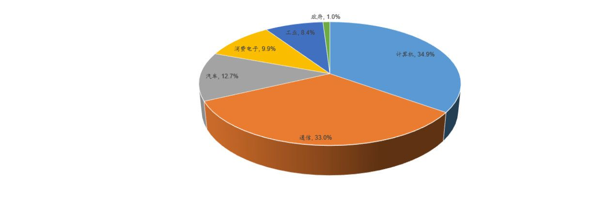

饼图标注：计算机 34.9%、通信 33.0%、汽车 12.7%、消费电子 9.9%、工业 8.4%、政府 1.0%。

资料来源：SIA，中原证券研究所

#### 3.2.1. 全球智能手机季度出货量同比下降，预计 2026 年全球智能手机市场将有所承压

**26Q2 全球智能手机出货量同比下降 6%。** 根据 Omdia 的数据，2026 年第二季度全球智能手机出货量同比下降 6%，降至 2.72 亿部。 2026 年第一季度受提前备货需求带动，市场表现较强，而第二季度则进入存储器成本周期的调整阶段。持续高企的存储价格扰乱了供应，推高了元器件成本，迫使厂商重新思考定价策略、产品组合和渠道战略。

**图 13：23Q1-26Q2 全球智能手机出货量情况**

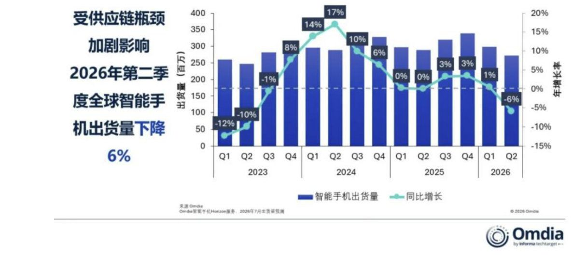

图例：智能手机出货量（百万，左轴，柱状，深蓝色）、同比增长（%，右轴，折线，浅蓝色）；左轴刻度：0、50、100、150、200、250、300、350、400；右轴刻度：-15%、-10%、-5%、0%、5%、10%、15%、20%；横轴：按年分组标注 2023、2024、2025、2026，每组内为 Q1、Q2、Q3、Q4（2026 年仅 Q1、Q2）。

折线上标注的同比增长率：23Q1 -12%、23Q2 -10%、23Q3 -1%、23Q4 8%、24Q1 14%、24Q2 17%、24Q3 10%、24Q4 6%、25Q1 0%、25Q2 0%、25Q3 3%、25Q4 3%、26Q1 1%、26Q2 -6%。柱状出货量无数据标签。

图左侧标注文字：受供应链瓶颈加剧影响 2026年第二季度全球智能手机出货量下降 6%。

资料来源：Omdia，中原证券研究所

**26Q2 三星、苹果、小米、OPPO、vivo 市场份额位列前五位。** 根据 Omdia 的数据，2026 年第二季度，三星保持全球份额第一地位，出货量达 6050 万部，同比增长 5%，市场份额为 22%；苹果实现了有史以来最强劲的第二季度表现，出货量达 5510 万部，同比增长 23%，在传统淡季创下 20%的市场份额纪录；小米以 3120 万部出货量保持第三位，同比下降 26%，连续第二个季度下滑，小米是前五大厂商中受存储成本上涨影响最大的，特别是在亚太和拉丁美洲新兴市场，入门级产品涨价严重影响了需求；OPPO 排名第四，出货量为 2840 万部，同比下降 17%，OPPO 精简了旗下三个子品牌的市场组合，并减少了入门级 SKU 以提高盈利能力；vivo 以 2150 万部出货量位列第五，同比下降 18%。

---

<!-- 原文第 17 页 -->

**图 14：22Q1-26Q2 全球智能手机厂商市场份额情况**

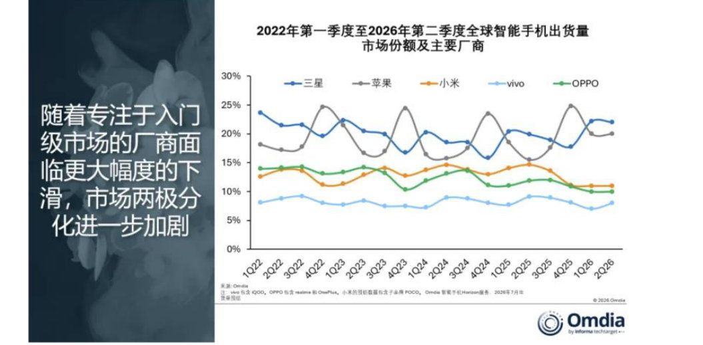

图内标题：2022年第一季度至2026年第二季度全球智能手机出货量市场份额及主要厂商；图例：三星、苹果、小米、vivo、OPPO；纵轴刻度：0%、5%、10%、15%、20%、25%、30%；横轴：1Q22、2Q22、3Q22、4Q22、1Q23、2Q23、3Q23、4Q23、1Q24、2Q24、3Q24、4Q24、1Q25、2Q25、3Q25、4Q25、1Q26、2Q26。

图左侧标注文字：随着专注于入门级市场的厂商面临更大程度的下滑，市场两极分化进一步加剧。图中无数据标签，图内来源小字字号过小 [OCR_UNREADABLE]。

资料来源：Omdia，中原证券研究所

受益于 AI 大模型的赋能，智能手机将迎来 AI 新时代。通过 AI 技术赋能智能手机可以追溯至 2017 年，安卓厂商开始在其 SoC 平台中加入独立的 AI 计算单元，用于运行和影像增强相关的深度学习模型，随后 AI 技术逐渐被手机厂商用于更多方面，如强化安全、优化续航、提升网络性能等，但计算、摄影一直是其最主要的应用领域，直到大模型被装进智能手机，手机 AI 应用从中小模型时代跨越至大模型时代。有了大模型的加持，在人机交互层面，新的多模态交互将取代传统的触控屏交互，用户可以更自然的与手机沟通；多模态输入和输出能力相结合，可以极大强化智能手机的生产力工具属性，既可以基于多种形式的输入信息，生成用户需要的图表、文本、音乐、图片甚至是视频，也可以对输入的图片、视频进行编辑。

**图 15：手机智能化演进路线图**

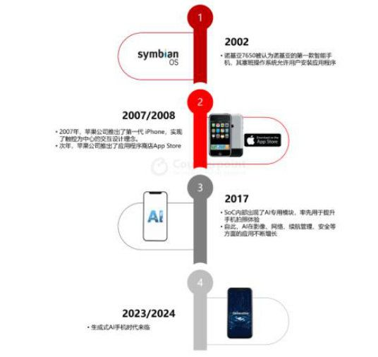

图中四个演进阶段：

1. 2002：symbian OS；诺基亚7650被认为诺基亚的第一款智能手机，其塞班操作系统允许用户安装应用程序。
2. 2007/2008：2007年，苹果公司推出了第一代iPhone，实现了触控为中心的交互设计理念；次年，苹果公司推出了应用程序商店App Store。
3. 2017：SoC内部出现了AI专用模块，率先用于提升手机拍照体验；自此，AI在影像、网络、续航管理、安全等方面的应用不断增长。
4. 2023/2024：生成式AI手机时代来临。

资料来源：生成式 AI 手机产业白皮书（Counterpoint，联发科等），中原证券研究所

AI 手机可以通过端侧部署 AI 大模型实现多模态内容生成、情境感知，能更自然的进行交互，并内嵌专属智能体。AI 手机应具有创作能力、自学习能力、真实世界感知能力、算力高效利用能力。

---

<!-- 原文第 18 页 -->

**图 16：AI 手机带来手机全栈革新和生态重构**

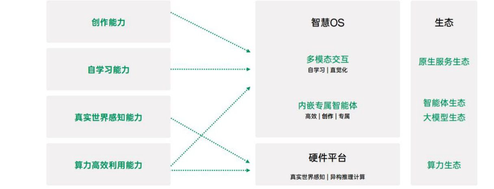

图示结构：左侧四项能力——创作能力、自学习能力、真实世界感知能力、算力高效利用能力，通过箭头指向中间与右侧的「智慧OS」「硬件平台」「生态」：

- 智慧OS：多模态交互（自学 | 直观化）；内嵌专属智能体（高效 | 创作 | 专属）
- 硬件平台：真实世界感知 | 异构推理计算
- 生态：原生服务生态；智能体生态；大模型生态；算力生态

资料来源： AI 手机白皮书（IDC，OPPO），中原证券研究所

生成式 AI 将成为智能手机厂商的重要战略，行业领导者引领 AI 技术。随着三星发布全新的 Galaxy S24 智能手机，三星将生成式 AI 作为长期的产品策略，同时中国厂商小米、vivo、OPPO 和荣耀等也已发布具备生成式 AI 能力的旗舰机型。AI 逐步从最初的产品层面的差异化上升至运营及公司层面的整体战略，各智能手机厂商均涉及其中。苹果、谷歌和三星等全球主要厂商以及荣耀、OPPO、小米和 vivo 等中国领先厂商都走在将生成式 AI 功能集成到其设备的前列；其战略各不相同，从开发专用 AI 芯片到加强利用 AI 的生态系统集成来提升用户体验。

**图 17：AI 手机生态系统及主要参与者情况**

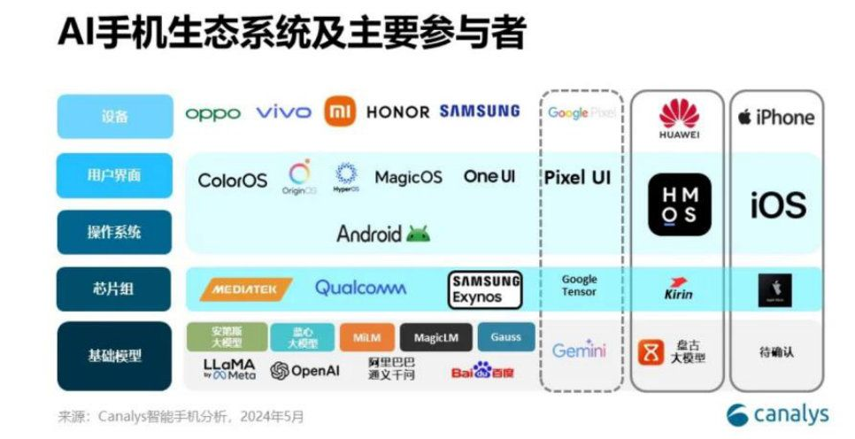

图内标题：AI手机生态系统及主要参与者。按层级与阵营列出：

- 设备：oppo、vivo、mi（小米）、HONOR、SAMSUNG；Google Pixel；HUAWEI；iPhone
- 用户界面：ColorOS、OriginOS、HyperOS、MagicOS、One UI；Pixel UI；HarmonyOS（HMOS）；iOS
- 操作系统：Android；Android（Pixel）；HMOS；iOS
- 芯片组：MediaTek、Qualcomm、Samsung Exynos；Google Tensor；Kirin（麒麟）；苹果自研芯片（图标 [OCR_UNCERTAIN]）
- 基础模型：安卓AI大模型、蓝心大模型、MiLM、MagicLM、Gauss、LLaMA（Meta）、OpenAI、阿里云通义千问、百度；Gemini；盘古大模型；待确认

图内来源：Canalys智能手机分析，2024年5月。

资料来源：Canalys，中原证券研究所

高通、联发科不断迭代支持端侧 AI 大模型手机的 SoC 芯片，NPU 算力不断提升。2025 年 9 月 25 日，高通正式发布新一代旗舰芯片骁龙 8 Elite Gen 5，延续 2+6 核心架构，两个 Prime 核心频率提升至 4.6GHz，六个性能核心运行于 3.62GHz；比前代产品，CPU 性能提升 20%，能效提升 35%，整体功耗降低 16%；图形处理方面，新一代 Adreno GPU 采用切片式架构，整体 GPU 性能提升 23%，功耗降低 20%；AI 性能显著增强，Hexagon NPU 速度提升 37%，支持 INT2 精度量化，可在设备端运行更复杂的大语言模型。2025 年 9 月 22 日，联发科正式发布天玑 9500 旗舰手机处理器，天玑 9500 全大核 CPU 架构包含 1 个主频高达 4.21GHz 的 C1-Ultra 超大核、3 个 C1-Premium 超大核和 4 个 C1-Pro 大核，物体侦测运算性能提升 57%、运行编解码模型功耗下降 50%；搭载新一代旗舰 GPU G1-Ultra，其峰

---

<!-- 原文第 19 页 -->

值性能相较上一代提升 33%，功耗相较上一代峰值性能下降低 42%，光线追踪渲染性能相较上一代提升 119%；集成全新超性能和超能效双 NPU，超性能 NPU 990 峰值性能相较上一代提升 111%，在大语言模型摘要输出能力、多模态理解能力皆有大幅跃进，并率先实现 4K 高清画质文生图，同时 NPU 990 相较上一代在峰值性能下的功耗降低 56%。

**表 9：全球部分处理器厂商发布的支持端侧 AI 大模型手机的 SoC 芯片情况**

| 厂商 | 处理器 | 发布时间 | CPU | GPU | NPU AI 算力 | 存储器 | 制程 |
| --- | --- | --- | --- | --- | --- | --- | --- |
| 高通 | 骁龙 8 Gen 3 | 2023.10 | 骁龙 8 Gen 3 | Adreno750 GPU | 支持 100 亿参数的 AI 大模型 | LPDDR5X | 4nm |
| 高通 | 骁龙 8 Elite | 2024.10 | Oryon CPU | Adreno 830 | 80 TOPS | LPDDR5X | 3nm |
| 高通 | 骁龙 8 Elite Gen 5 | 2025.9 | Oryon CPU，8 核心（2+6） | Adreno 840 | - | LPDDR5X | 3nm |
| 联发科技 | 天玑 9300 | 2023.11 | 8 核心，4 个 Cortex-X4、4 个 Cortex-A720，最高主频 5.2GHz | 12 核 Arm Immortalis-G720 MC12 GPU | 支持 330 亿参数的 AI 大模型 | LPDDR5T | 4nm |
| 联发科技 | 天玑 9400 | 2024.9 | 8 核心，1 个 Cortex-X925，3 个 Cortex-X4、4 个 Cortex-A720 | 12 核 Arm Immortalis-G925 GPU | MediaTek NPU 890 | LPDDR5X | 3nm |
| 联发科技 | 天玑 9500 | 2025.9 | 8 核心，1 个 C1-Ultra 超大核、3 个 C1-Premium 超大核，4 个 C1-Pro 大核 | G1-Ultra | 集成全新超性能和超能效双 NPU， NPU 990 | LPDDR5X | 3nm |
| 苹果 | A18 | 2024.9 | 6 核心，2 个性能核心和 4 个效率核心，主频分别为 4.05GHz 和 2.42GHz | 5 核 GPU | 35 TOPS | LPDDR5X | 3nm |
| 苹果 | A19/Pro | 2025.9 | 6 核心 | 6 核 GPU | - | LPDDR5X | 3nm |

资料来源：各公司官网，中原证券研究所

手机厂商持续迭代 AI 手机。随着三星发布全新的 Galaxy S24 智能手机，三星将生成式 AI 作为长期的产品策略，同时中国厂商华为、小米、vivo、OPPO 和荣耀等也陆续发布并持续迭代 AI 手机。目前安卓手机厂商旗舰机型的 AI 功能主要支持通话实时翻译、通话及会议摘要、语音识别与文本生成、AI 写作、AI 修图等，AI 功能仍为基础性应用。

**表 10：全球部分智能手机厂商旗舰 AI 手机布局情况**

| 厂商 | 型号 | 发布时间 | 处理器 | 存储器 | 大模型 | 参数量 | AI 功能 |
| --- | --- | --- | --- | --- | --- | --- | --- |
| 苹果 | iPhone16/Pro/ Max | 2024.9 | 苹果 A18/Pro | 8GB LPDDR5X，最高 1TB 存储空间 | 自有模型及第三方模型 | - | 支持 Apple Intelligence。 |
| 苹果 | iPhone17/Air / Pro/ Max | 2025.9 | 苹果 A19/Pro | 12GB LPDDR5X，最高 1TB 存储空间 | 自有模型及第三方模型 | - | 支持 Apple Intelligence。 |
| 三星 | Galaxy S24/Plus/Ultra | 2024.1 | 骁龙 8 Gen 3 | 12GB LPDDR5X，最高 1TB 存储空间 | 谷歌 Gemini Nano | 1.8B/3.25B | 支持通话实时翻译、写作助手、转录助手、智能修图、利用 AI 改善成像效果的 AI 图像处理器等。 |
| 三星 | Galaxy S25/Plus/Ultra | 2025.1 | 骁龙 8 至尊版 | 16GB LPDDR5X，最高 1TB 存储空间 | 谷歌 Gemini Nano，DeepSeek-R1 | - | 支持深度思考与联网搜索；搭载升级的 Galaxy AI，支持即圈即搜、写作助手和更为智能的翻译功能，支持 AI 影像优化等。 |

---

<!-- 原文第 20 页 -->

| 厂商 | 型号 | 发布时间 | 处理器 | 存储器 | 大模型 | 参数量 | AI 功能 |
| --- | --- | --- | --- | --- | --- | --- | --- |
| 华为 | Mate70/ Pro | 2024.11 | 麒麟 9010/9020 | 16GB LPDDR5X，最高 1TB 存储空间 | - | - | 支持 AI 运动轨迹、AI 主角时刻、AI 时空穿越、AI 智控键、AI 隔空传送、AI 通话摘要、AI 消息随身、AI 降噪通话、AI 静谧通话。 |
| 华为 | Mate80/ Pro | 2025.11 | 麒麟 9020/9030 | 16GB LPDDR5X，最高 1TB 存储空间 | - | - | 支持全新小艺智能助手，支持自主学习与技能生成、任务自动化、购物场景优化、系统级整合等功能；支持 AI 魔法系列的图像视频创作等。 |
| 小米 | 小米 15 | 2024.10 | 骁龙 8 Elite | 16GB LPDDR5X，最高 1TB 存储空间 | 小米 MiLM2 | 0.3B-30B | 支持超级小爱助手、AI 写作、AI 字幕、AI 妙画、语音识别与文本生成、全局实时翻译等。 |
| 小米 | 小米 15 Ultra | 2025.2 | 骁龙 8 至尊版 | 16GB LPDDR5X，最高 1TB 存储空间 | - | - | 支持 AI 影像系统，可实现 AI 动态人像壁纸、AI 融合变焦、智能拍摄优化功能；支持 AI 绘画与文本生成功能、AI 助手与语音识别等。 |
| 小米 | 小米 17/Pro/ Max | 2025.9 | 第五代骁龙 8 至尊版 | 16GB LPDDR5X，最高 1TB 存储空间 | - | - | 以 "AI 生态融合" 为核心定位，依托澎湃 OS 3.0 与硬件级 AI 算力支撑，构建了覆盖交互、影像、创作、跨设备协同等多场景的 AI 功能体系。 |
| OPPO | Find X8 | 2024.10 | 天玑 9400 | 16GB LPDDR5X，最高 1TB 存储空间 | OPPO AndesGPT | 7B | 支持 SenseNow 智慧框架、AI 私密计算云、AI 修图功能、AI 超清像素、AI 千里长焦、全局语音摘要功能等。 |
| OPPO | Find X9 | 2025.10 | 天玑 9500 | 16GB LPDDR5X，最高 1TB 存储空间 | - | - | 小布 AI 智能助手支持一键闪记、主动智能建议、系统级 AI 集成等；影像 AI 功能支持 AI 人像补光、AI 灵感成片、Live 图 AI 消除等。 |
| vivo | X200 | 2024.10 | 天玑 9400 | 16GB LPDDR5X、最高 1TB 存储空间 | vivo 蓝心大模型 | 1B/7B | 支持超能问答、超能创作、超能搜索、超能管理、超能交互、原子岛、小 V 电话助手、小 V 写作等。 |
| vivo | X300 | 2025.10 | 天玑 9500 | 16GB LPDDR5X、最高 1TB 存储空间 | - | - | 影像 AI 功能包括 AI 电影分镜、灵动人像算法、AI 定制美颜、Live Photo 路人消除等，系统 AI 功能包括小 V 圈搜 2.0 等。 |
| 荣耀 | Magic 7/pro | 2024.10 | 骁龙 8 Elite | 16GB LPDDR5X，最高 1TB 存储空间 | 光影人像大模型/荣耀魔法大模型 | 1.3B/7B | 支持 AI 智能体验，包括一键生成会议纪要、AI 辅助高效阅读、AI 辅助高效写作等，以及 AI 换脸检测、AI 魔法修图等。 |
| 谷歌 | Pixel 9/Pro | 2024.8 | 谷歌 Tensor G4 | 16GB LPDDR5X、最高 1TB 存储空间 | 谷歌 Gemini Nano | 1.8B/3.25B | 支持 Add Me 功能、Pixel Studio、Pixel Screenshots、魔法编辑器、Gemini Live 语音助手、询问此屏幕/视频等。 |

资料来源：各公司官网，中原证券研究所

**Canalys 预计 2026 年 AI 手机渗透率将达到 45%，端侧模型的精简以及芯片算力的升级将进一步助推 AI 手机向中端价位段渗透。** 2025 年芯片厂商发布的新款次旗舰 SoC，如

---

<!-- 原文第 21 页 -->

Snapdragon 8s Gen4, Dimensity 9400e 已经具备了流畅运行端侧大模型的能力，Deepseek 的出现也在很大程度上降低了大模型对于芯片算力的开销，在这两大因素的共同作用下，2025-2026 年 AI 手机仍预计会保持高速渗透的趋势。根据 Canalys 的预测，2024 年全球智能手机出货量中 18%为 AI 手机，预计 2025 年渗透率将快速提升至 34%，预计 2026 年将达到 45%。

**图 18：2024-2029 年全球 AI 手机出货量及预测情况**

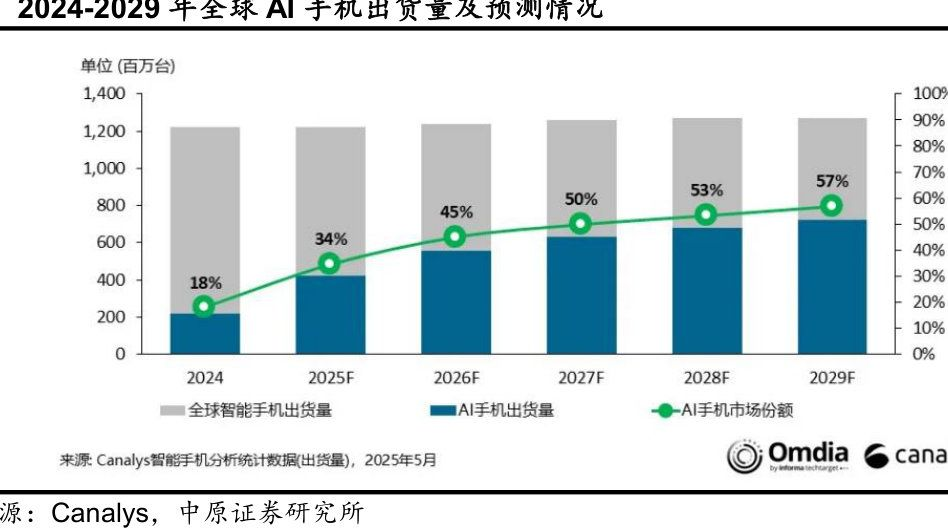

图内标注：纵轴（左）单位（百万台），0–1,400；纵轴（右）市场份额，0%–100%；图例：全球智能手机出货量、AI 手机出货量、AI 手机市场份额。AI 手机市场份额：2024 年 18%，2025F 34%，2026F 45%，2027F 50%，2028F 53%，2029F 57%。

资料来源：Canalys，中原证券研究所

## 3.2.2. 全球 PC 季度出货量继续同比下降，预计 2026 年全球 PC 出货量大幅下降

全球 PC 出货量 26Q2 同比下降 3.6%。根据 Omdia 的数据，2026 年第二季度全球台式电脑、笔记本电脑及工作站出货量同比下降 3.6%，降至 6570 万台；其中，台式电脑（含台式工作站）出货量为 1390 万台，同比下降 1.3%；笔记本电脑（含移动工作站）出货量为 5170 万台，同比下降 4.2%。Omdia 预计 2026 年下半年存储器和存储产品的成本涨幅将明显放缓，但 PC 整机售价仍将受到 2026 年第二季度上游零部件成本上涨的持续影响。Omdia 研究显示，今年内存储器和存储产品价格均无明显回落的迹象，同时 MLCC、PCB 等其他关键零部件价格也在持续上涨。因此，PC 厂商预计仍将把不断增加的成本压力转嫁给终端市场，这将进一步抑制 2026 年下半年的市场需求。

**图 19：23Q1-26Q2 年全球 PC 季度出货量情况**

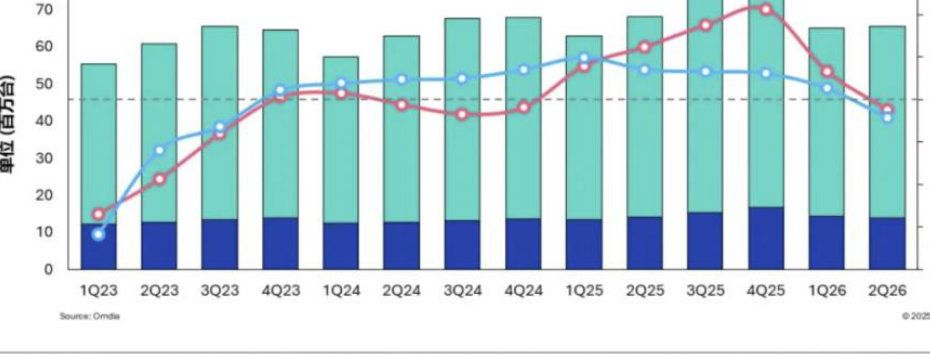

图内标注：纵轴（左）单位（百万台），0–80；纵轴（右）增长率，-40%–30%；图例：台式机、笔记本、台式机（增长率）、笔记本（增长率）；横轴：1Q23、2Q23、3Q23、4Q23、1Q24、2Q24、3Q24、4Q24、1Q25、2Q25、3Q25、4Q25、1Q26、2Q26。

资料来源：Omdia，中原证券研究所

26Q2 全球 PC 市场厂商前五名分别为联想、惠普、戴尔、苹果和华硕。根据 Omdia 的数据，2026 年第二季度，联想继续稳居全球 PC 市场第一，出货量达到 1662 万台，同比下降

---

<!-- 原文第 22 页 -->

2%，仍保持 25%的市场份额；惠普以 1300 万台的出货量位居第二，但受市场环境影响，出货量同比下降 9%；戴尔排名第三，在供应持续紧张的市场环境下展现出较强韧性，出货量达到 929 万台，市场份额维持在 14%；苹果成为前五大厂商中增长最快的品牌，受 MacBook Neo 上市以及市场需求持续向好的带动，第二季度出货量达到 725 万台，市场份额较 2025 年第二季度提升 2%；华硕位列第五，出货量为 501 万台，整体表现与去年同期基本持平。

**表 11：26Q2 全球 PC 厂商市场份额情况**

| 公司 | 26Q2 出货量（百万台） | 26Q2 市场份额（%） | 25Q2 出货量（百万台） | 25Q2 市场份额（%） | 26Q2 同比增速（%） |
| --- | --- | --- | --- | --- | --- |
| 联想 | 16.6 | 25.3 | 17.0 | 24.9 | -2.1 |
| 惠普 | 13.0 | 19.8 | 14.3 | 21.0 | -9.0 |
| 戴尔 | 9.3 | 14.1 | 9.8 | 14.3 | -4.9 |
| 苹果 | 7.3 | 11.1 | 6.3 | 9.2 | 15.9 |
| 华硕 | 5.0 | 7.6 | 5.0 | 7.3 | 0.9 |
| 其他 | 14.5 | 22.0 | 15.8 | 23.2 | -8.5 |
| 合计 | 65.7 | 100 | 68.1 | 100 | -3.6 |

资料来源：Omdia，中原证券研究所

Omdia 预计 2026 年全球 PC 出货量下降 12%。根据 Omdia 的预测，2026 年全球台式机、笔记本及工作站出货量预计下降 12%，至 2.45 亿台；这一预测基于内存与存储价格的急剧上涨——特别是预计 2026 年第一季度将至少上涨 60%；预计全年剩余季度仍将面临进一步的价格上涨压力，但后续涨幅可能更加温和；自 2025 年第一季度以来，主流内存与存储配置的成本已上涨 90 至 165 美元，对 PC 厂商造成重大财务压力，迫使其减少促销、提高产品售价并调整配置；各类 PC 产品受影响的程度预计大体一致，台式机出货量预计下降 10%至 5320 万台，笔记本出货量预计下降 12%至 1.922 亿台。

**图 20：2016-2027 年全球 PC 出货量及预测情况**

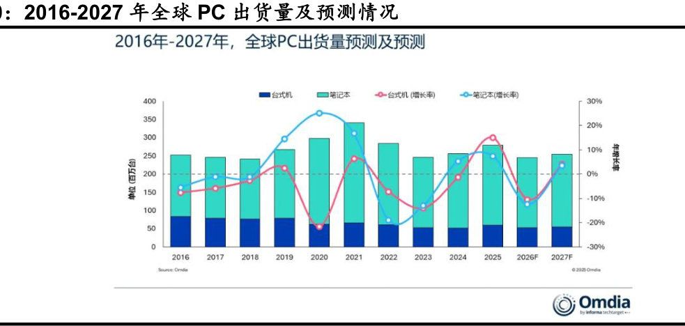

图内标注：标题“2016年-2027年，全球PC出货量预测及预测”；纵轴（左）单位（百万台），0–400；纵轴（右）增长率，-30%–30%；图例：台式机、笔记本、台式机（增长率）、笔记本（增长率）；横轴：2016-2027 年。

资料来源：Omdia，中原证券研究所

AI PC 是端侧 AI 落地的重要应用场景，将推动 PC 产业生态加速迭代。具备 AI 功能的个人电脑（AI PC）的问世有望重振市场并改变用户体验，将专用的 AI 加速硬件集成到 PC 中，可以在效率、生产力、协作和创造力方面实现惊人的创新。Canalys 提出 AI PC 需要具备专用芯片组/块以承载端侧的 AI 运行负载。微软和英特尔联合提出 AI PC 的定义，即 AI PC 需要配备 NPU、CPU 和 GPU，并支持微软的 Copilot，且键盘上直接配有 Copilot 物理按键（该键取代了键盘右侧第二个 Windows 键）。AI PC 是终端、边缘计算和云技术的颠覆性混合体，它不仅重新定义生产力，也将推动 PC 产业生态加速迭代。

---

<!-- 原文第 23 页 -->

**图 21：Canalys 对 AI PC 的定义及未来演变的考量**

对端侧 AI 体验持续演变的考量

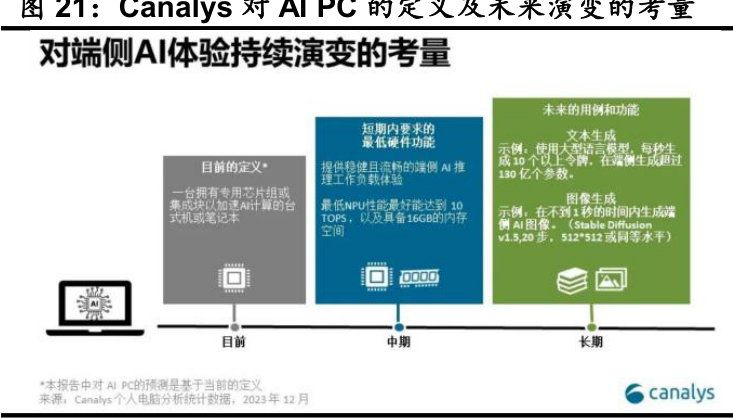

图内标注：
- 目前的定义*：一台拥有专用芯片组或集成块以加速 AI 计算的台式机或笔记本。
- 短期内要求的最低硬件功能：提供稳健且流畅的端侧 AI 推理工作负载体验；最低 NPU 性能最好能达到 10 TOPS，以及具备 16GB 的内存空间。
- 未来的用例和功能：文本生成——示例：使用大语言模型，每秒生成 10 个以上令牌，在端侧生成超过 130 亿个参数。图像生成——示例：在不到 1 秒的时间内生成端侧 AI 图像。（Stable Diffusion v1.5,20 步，512*512 或同等水平）
- 时间轴：目前 / 中期 / 长期
- 脚注：*本报告中对 AI PC 的预测是基于当前的定义；来源：Canalys 个人电脑分析统计数据，2023 年 12 月

资料来源：Canalys，中原证券研究所

**图 22：微软和英特尔对 AI PC 的定义**

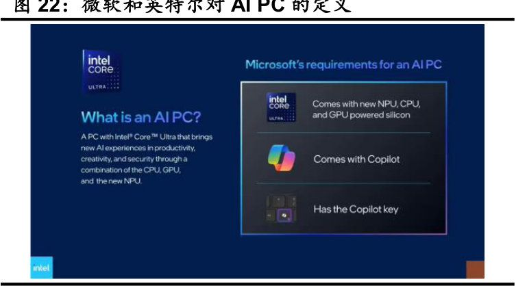

图内标注：“What is an AI PC?”；Microsoft's requirements for an AI PC：Comes with new NPU, CPU, and GPU powered silicon；Comes with Copilot；Has the Copilot key。

资料来源：微软，英特尔，IT 之家，中原证券研究所

英特尔、AMD 等芯片厂商持续迭代适用于 AI PC 的处理器芯片，NPU 算力不断提升。2024 年 9 月 4 日，英特尔发布超高能效的 x86 处理器家族——英特尔酷睿 Ultra 200V 系列处理器，CPU、NPU 和 GPU 的整体平台算力高达 120 TOPS，在实现跨模型和引擎的同时提供极具兼容和性能的 AI 体验，整体功耗降低了 50%，使搭载该处理器为 AI PC 带来超前的低功耗表现。2024 年 6 月 4 日，AMD 为下一代 AI PC 推出锐龙 AI 300 系列处理器，采用全新的“Zen 5”架构，配备高达 12 颗高性能 CPU 核心和 24 个线程；采用基于全新 AMD XDNA 2 架构的专用 AI 引擎，NPU 拥有 50 TOPS 的 AI 处理能力；采用全新的 AMD RDNA 3.5 图形架构，配备最新的 AMD Radeon 800M 系列显卡，带来流畅的帧速率和 3A 游戏体验。英特尔、AMD、高通和苹果等芯片厂商持续迭代适用于 AI PC 的处理器芯片，联想、惠普等 PC 厂商陆续发布 AI PC 新品。

**表 12：全球主要处理器厂商发布的适用于 AI PC 处理器情况**

| 厂商 | 处理器 | 发布时间 | CPU | GPU | NPU AI 算力 | 存储器 | 制程 |
| --- | --- | --- | --- | --- | --- | --- | --- |
| 英特尔 | 酷睿 Ultra 9 | 2023.12 | 16 核心（6+8+2）/22 线程，最高主频 5.1GHz | Intel Arc GPU，8 个 Xe 核显 | 34TOPS | 支持最多 64GB 的 LPDDR5/5X-7467 和 96GB DDR5-5600 | Intel 4 |
| 英特尔 | 酷睿 Ultra 200V | 2024.9 | 8 核 8 线程，最高主频 5.1GHz | Intel Arc 100V GPU | NPU 算力最高 48TOPS，整体算力 120TOPS | 支持最大 32GB 的 LPDDR5X-8533 | 3nm |
| AMD | 锐龙 8040 | 2023.12 | Zen 4 架构，8 核心/16 线程，最高主频 5.2GHz | RDNA 3 架构，12 个计算单元 | NPU 算力 16TOPS，整体算力 39TOPS | - | 4nm |
| AMD | 锐龙 AI 300 | 2024.6 | Zen 5 架构，12 核心/24 线程，最高主频 5.1GHz | RDNA 3.5 架构，16 个计算单元 | 50 TOPS | - | 4nm |
| 高通 | 骁龙 X Elite | 2023.10 | Oryon CPU，12 核，最高主频 3.8GHz | Adreno GPU，算力达 4.6TFlops | NPU 算力 45TOPS，整体算力 75TOPS | 支持 LPDDR5X 8533MHz，最大容量 64GB | 4nm |
| 苹果 | M3 | 2023.10 | 8 个 CPU 核心 | 10 个 GPU 核心 | 18TOPS | 支持内存容量最高达 128GB | 3nm |
| 苹果 | M4 | 2024.5 | 10 个 CPU 核心 | 10 个 GPU 核心 | 38TOPS | 支持内存容量最高达 128GB | 3nm |

资料来源：各公司官网，中关村在线，IT 之家，中原证券研究所

联想、惠普等 PC 厂商陆续发布 AI PC 新品。AI PC 是终端、边缘计算和云技术的颠覆性

---

<!-- 原文第 24 页 -->

混合体，它不仅重新定义生产力，也将推动 PC 产业生态加速迭代。头部 PC 厂商视 AI PC 为重要的创新机会，PC 行业迎来 iPhone 时刻。随着英特尔、AMD 等芯片厂商陆续推出适用于 AI PC 的计算芯片，以及 Windows 向 Windows11 过渡，头部 PC 厂商联想、惠普、戴尔、苹果、宏基、华硕、三星、荣耀、华为等都陆续推出全新的 AI PC 产品。

**表 13：全球部分 PC 厂商 AI PC 布局情况**

| 厂商 | 型号 | 处理器 | 内存 | 硬盘 | 软件 |
| --- | --- | --- | --- | --- | --- |
| 联想 | Thinkpad X1 Carbon AI | 英特尔酷睿 Ultra 7 | 32GB LPDDR5x 6400Mhz | 2TB PCIe NVMe Gen4 高速固态硬盘 | 内置了全新的 AI 智能会议助手，可以通过 AI 完成会议邮件撰写、发送会议邀请，撰写会议纪要等工作，实现 AI 智能降噪等；实现一秒之内完成图片创作。 |
| 联想 | 小新 Pro AI 超能本 2024 | 英特尔酷睿 Ultra 9 | 32GB LPDDR5x 7467MT/s | 1TB PCIe 4.0 高性能固态硬盘 | 通过智能语音助手、智能图像识别等技术，为用户提供更便捷、高效的使用体验；支持智能家居控制，可以通过语音指令实现对家中各种设备的远程控制。 |
| 惠普 | 星 Book Pro 14 | 英特尔酷睿 Ultra 7 | 32GB LPDDR5X | 1TB PCIe 4.0 固态硬盘 | 支持智能语音助手，支持实时翻译，更精准，可收录来自系统声音，支持中英文互译，可译文或原译文同时显示字幕。 |
| 惠普 | Spectre x360 商务本 | 英特尔酷睿 Ultra 7 | 32GB LPDDR5x 7467Mhz | 2TB PCIe 4.0 高性能固态硬盘 | 支持 AI 智能降噪功能，智能追焦取景，AI 智能字幕翻译，支持语音输入和会议笔记功能，能够实时记录语音并翻译，支持中英/英中互译。 |
| 戴尔 | 灵越 16Plus | 英特尔酷睿 Ultra 7 | 32GB LPDDR5X | 1TB PCIe 4.0 固态硬盘 | 与 100 多个 AI APP 加速合作；AI 智能降噪、AI 眼神锁定和 AI 背景虚化等智能功能的全面覆盖。 |
| 戴尔 | XPS 16 | 英特尔酷睿 Ultra 9 | 64GB LPDDR5X | 2TB PCIe 4.0 固态硬盘 | 搭载 Windows 11 系统，支持 200 亿参数大模型运行，能够实现本地生图。 |
| 苹果 | MacBook Air | M3 | 24GB 100GB/s | 2TB 固态硬盘 | 实时语音转文本、翻译、文本预测、视觉理解、辅助功能等。 |
| 宏基 | 非凡 Go 14 | 英特尔酷睿 Ultra 7 | 32GB LPDDR5X | 1TB PCIe 4.0 高速固态硬盘 | 支持智能视频会议,自动取景、眼神接触、物理防窥、AI 降噪。 |
| 华硕 | 灵耀 14 2024 | 英特尔酷睿 Ultra 7 | 32GB LPDDR5x | 1TB PCIe 4.0 高速固态硬盘 | 支持 200 亿参数的大模型，即使不联网也能实现问答、文本创作、摘要生成、编程、翻译等多种功能。 |
| 三星 | Galaxy Book 4 Ultra | 英特尔酷睿 Ultra 9 | 64GB LPDDR5X | 2TB PCIe 4.0 固态硬盘 | 与 100 多个软件供应商加速合作，支持 Galaxy AI 功能，支持智能搜索和翻译，利用 AI 技术对照片进行智能编辑。 |
| 荣耀 | MagicBook Pro 16 | 英特尔酷睿 Ultra 7 | 32GB LPDDR5X | 1TB PCIe 4.0 固态硬盘 | 配备 YOYO AI 超级助理凭借其先进的 AI 语义理解能力，实现了智慧搜索、文档总结以及智能推荐等多项功能。 |
| 华为 | Matebook X Pro | 英特尔酷睿 Ultra 9 | 32GB LPDDR5X | 2TB PCIe 4.0 固态硬盘 | 内置华为盘古大模型，搭载 AI 空间功能，支持 100+个智能体，为用户提供从代码编写、文档处理到创意设计、信息检索等；能从音视频或实时纪要的海量信息中，快速精准地提炼关键点，生成摘要；支持 AI 字幕，实时翻译等功能。 |

资料来源：各公司官网，中原证券研究所

预计 AI PC 渗透率将持续快速提升。根据 Canalys 的数据，2024 年第四季度，AI PC 出货量达到 1540 万台，占季度 PC 总出货量的 23%；2024 年 AI PC 占 PC 总出货量的 17%；其中苹果以 54%的市场份额领跑，联想和惠普各占 12%。受 Windows 10 服务停止带来的换机潮，预计 AI PC 的市场渗透率将在 2025 年继续提升。展望未来，受商用需求的推动，PC 市场将加速增长，企业正为 Windows 10 系统结束做准备；目前 PC 市场正致力于将 AI PC 打造成明星类别，根据 Canalys 的预测，预计 2025 年 AI PC 将占全球 PC 出货量的 35%。

---

<!-- 原文第 25 页 -->

**图 23：23Q4-24Q4 全球 AI PC 出货量情况**

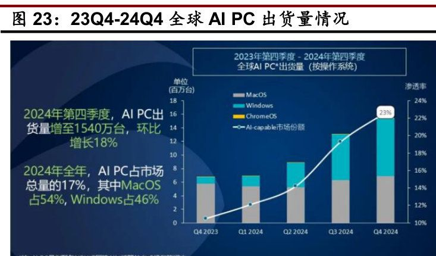

图内标注：标题“2023年第四季度 - 2024年第四季度 全球AI PC 出货量（按操作系统）”；纵轴（左）单位（百万台），0–18；纵轴（右）渗透率，0%–24%；图例：Windows、MacOS、ChromeOS、AI-capable市场份额；横轴：Q4 2023、Q1 2024、Q2 2024、Q3 2024、Q4 2024。文本标注：2024年第四季度，AI PC 出货量增至 1540 万台，环比增长 18%；2024年全年，AI PC 占市场总量的 17%，其中 MacOS 占 54%，Windows 占 46%。

资料来源：Canalys，中原证券研究所

**图 24：24Q1-25Q4 全球 PC 及 AI PC 出货量及预测**

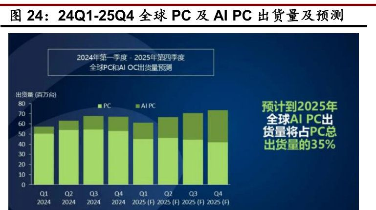

图内标注：标题“2024年第一季度 - 2025年第四季度 全球PC和AI PC 出货量预测”；纵轴 出货量（百万台），0–80；图例：PC、AI PC；横轴：Q1 2024、Q2 2024、Q3 2024、Q4 2024、Q1 2025(f)、Q2 2025(f)、Q3 2025(f)、Q4 2025(f)。文本标注：预计到 2025 年全球 AI PC 出货量将占 PC 总出货量的 35%。

资料来源：Canalys，中原证券研究所

AI PC 有望推动高端 PC 市场收入增长。AI PC 集成了专用于 AI 的加速器，将释放出高生产力、个性化及能效方面的新功能，颠覆整个 PC 市场，并为厂商及其合作伙伴带来显著的价值收益。根据 Canalys 的预测，与未集成 NPU 的传统 PC 相比，AI PC 将溢价 10%-15%；随着采用率的激增，到 2025 年底，价格在 800 美元及以上的 PC 将有一半以上是 AI PC，到 2028 年，这一比例将增至 80%以上。因此，800 美元及以上的 PC 出货量将在短短四年内增长到市场的一半以上，这将有助于推动 PC 出货的整体价值从 2024 年的 2250 亿美元增长到 2028 年的 2700 亿美元以上。

**图 25：2024-2028 年全球 PC 市场总收入预测情况**

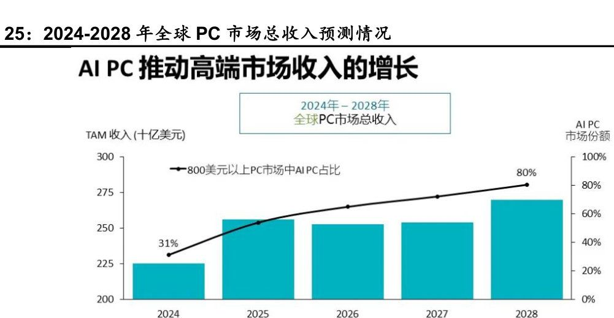

图内标注：标题“AI PC 推动高端市场收入的增长”“2024年 - 2028年 全球PC市场总收入”；纵轴（左）TAM 收入（十亿美元），200–300；纵轴（右）AI PC 市场份额，0%–100%；折线“800美元以上PC市场中AI PC占比”：2024 年 31%，2028 年 80%。

资料来源：Canalys，中原证券研究所

## 3.2.3. AI 眼镜是端侧 AI 最佳硬件载体之一，2026 年全球 AI 眼镜出货量有望快速增长

AI 眼镜是端侧 AI 最佳硬件载体之一。嘴巴、耳朵和眼睛是人体三大重要感官器官，嘴巴是语言输出器官，耳朵是语音接受的器官，眼睛则是人类最重要的信息摄入器官，人 80%的信息来源于视觉。眼镜是最靠近人体三大重要感官的穿戴设备，是端侧 AI 最佳硬件载体之一，可以非常直接和自然的实现声音、语言、视觉的输入和输出。

---

<!-- 原文第 26 页 -->

**图 26：Ray-Ban Meta 产品示意图**

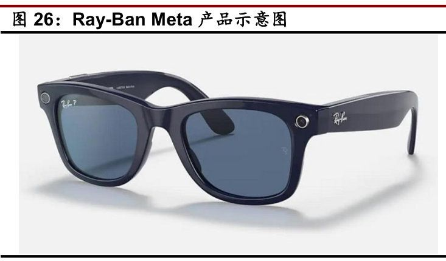

资料来源：腾讯，中原证券研究所

**图 27：Ray-Ban Meta 产品支持耳机功能**

资料来源：腾讯，中原证券研究所

AI 眼镜是在普通眼镜的基础上，增加 AI 功能，拍照 AI 眼镜为当前主流形态。AI 眼镜的产品形态包括音频 AI 眼镜、拍照 AI 眼镜、AR+AI 眼镜；传统蓝牙音频眼镜接入 AI 大模型，是 AI 眼镜的基础形态，AI 大模型通过语音交互方式提供基础的智能服务；拍照 AI 眼镜是在音频 AI 眼镜的基础上增加摄像头，AI 大模型可通过摄像头感知周边环境，提供与当下环境具备交互能力的智能服务；AR+AI 眼镜是具备 AR 显示功能、并且接入大模型的眼镜，部分眼镜具备拍照、空间定位等多模态感知能力，AI 大模型可通过 AR 显示实现实时信息输出，实现更简便的信息交互。根据 wellsenn XR 的数据，2024 年全球 AI 眼镜销量中 94%为拍照 AI 眼镜，4%为 AR+AI 眼镜，2%为音频 AI 眼镜。

**图 28：AI 眼镜产品形态分类情况**

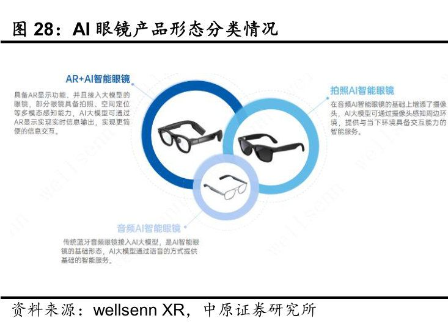

图内标注：
- AR+AI智能眼镜：具备 AR 显示功能、并且接入大模型的眼镜，部分眼镜具备拍照、空间定位等多模态感知能力，AI 大模型可通过 AR 显示实现实时信息输出，实现更简便的信息交互。
- 拍照AI智能眼镜：在音频 AI 智能眼镜的基础上增添了摄像头，AI 大模型可通过摄像头感知周边环境，提供与当下环境具备交互能力的智能服务。
- 音频AI智能眼镜：传统蓝牙音频眼镜接入 AI 大模型，是 AI 智能眼镜的基础形态，AI 大模型通过语音的方式提供基础的智能服务。

资料来源：wellsenn XR，中原证券研究所

**图 29：拍照 AI 眼镜为当前主流形态**

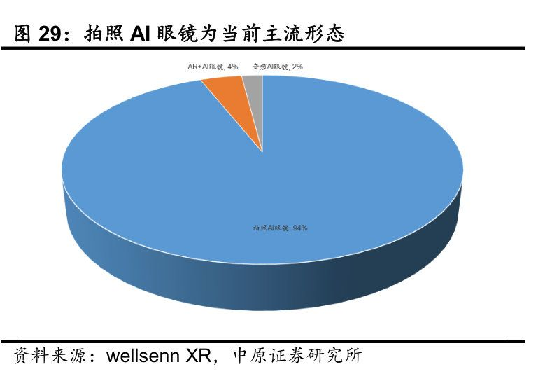

图内标注：拍照 AI 眼镜 94%，AR+AI 眼镜 4%，音频 AI 眼镜 2%。

资料来源：wellsenn XR，中原证券研究所

Ray-Ban Meta 发布后热销，带动大量厂商加速进入 AI 眼镜市场。2023 年 9 月，Meta 联合雷朋推出 Ray-Ban Meta 智能眼镜，Ray-Ban Meta 为眼镜增加了摄像、耳机，以及 AI 功能。用户可以通过语音与 Meta AI 进行互动，获取各种信息和服务；支持英语、西班牙语、意大利语、法语和德语之间的互译，能够翻译所拍摄到的标识和文字，并以对应的语言念出来。根据 wellsenn XR 的数据，2024 年 Ray-Ban Meta 眼镜出货量达 142 万台。Ray-Ban Meta 智能眼镜发布后热销,带动百度、华为、小米、三星、雷鸟等厂商加速进入 AI 眼镜市场。

---

<!-- 原文第 27 页 -->

**图 30：23Q4-24Q4 Ray-Ban Meta 眼镜出货量情况**

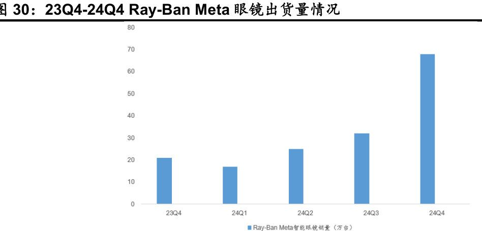

图内标注：纵轴 0–80，图例“Ray-Ban Meta智能眼镜销量（万台）”；横轴：23Q4、24Q1、24Q2、24Q3、24Q4。

资料来源：wellsenn XR，中原证券研究所

百度发布全球首款搭载中文大模型的原生 AI 眼镜。2024 年 11 月 12 日，百度正式发布小度 AI 眼镜，称该产品为“全球首款搭载中文大模型的原生 AI 眼镜”。小度 AI 眼镜具备第一视角拍摄、边走边问、卡路里识别、识物百科、视听翻译、智能备忘等功能。小度 AI 眼镜支持文心大模型，对接百度地图、搜索、百科等百度应用生态。

**图 31：小度 AI 眼镜产品示意图**

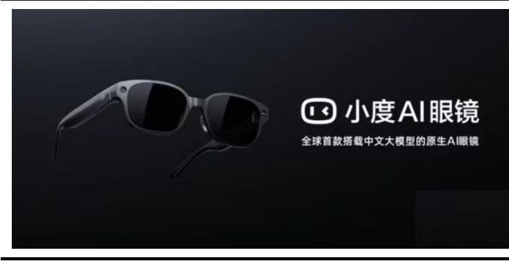

资料来源：百度，IT 之家，中原证券研究所

**图 32：小度 AI 眼镜产品配置及功能情况**

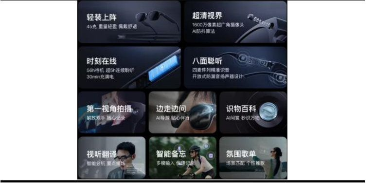

图内标注：
- 轻装上场：45 克 重量轻盈 佩戴舒适
- 超清视界：1600 万像素超广角摄像头 AI 防抖算法
- 时刻在线：56h 待机 超 5h 连续聆听 30min 充满电
- 八面聪听：四麦阵列精准识音 开放式防漏音扬声器设计
- 第一视角拍摄：解放双手 随心记录
- 边走边问：AI 导游 贴心伴行
- 识物百科：AI 问答 秒识万物
- 视听翻译：智能分析 重点提炼
- 智能备忘：多模输入 快速记录
- 氛围歌单：场景匹配 个性推歌

资料来源：百度，IT 之家，中原证券研究所

华为发布智能眼镜 2——钛空圆框光学镜。2025 年 4 月 16 日消息，华为正式发布智能眼镜 2——钛空圆框光学镜；华为智能眼镜 2 设计整体风格时尚，眼镜的“鸢尾”雕花设计精致高雅，钛金属镜框不仅轻巧坚固，还经过 33 道工序精雕细琢，确保了产品的耐用性和美观性；华为智能眼镜 2 配备小艺翻译、头部控制等功能，支持面对面翻译、同声传译、全天候智慧播报，续航为 11 小时，售价 2299 元。

**图 33：华为智能眼镜 2 产品示意图**

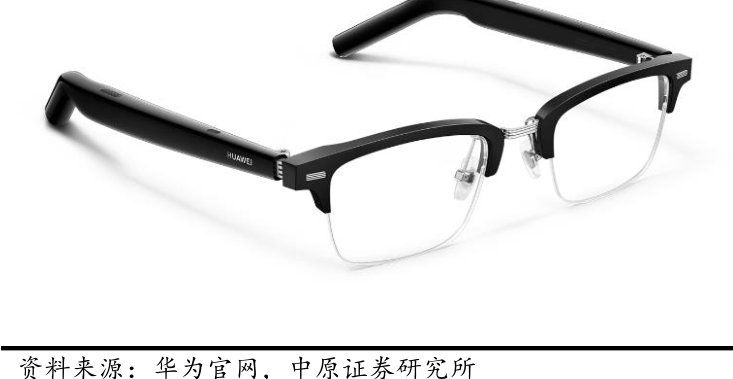

资料来源：华为官网，中原证券研究所

**图 34：华为智能眼镜 2 产品示意图**

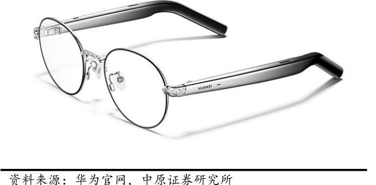

资料来源：华为官网，中原证券研究所

雷鸟发布 AI 拍摄智能眼镜及全彩光波导 AR 眼镜。2025 年 1 月 7 日，雷鸟 V3 AI 拍摄智

---

<!-- 原文第 28 页 -->

能眼镜正式发布，售价 1799 元起；雷鸟 V3 搭载第一代高通骁龙 AR1 平台，采用台积电 4nm 工艺；搭载与 TCL 联合调教的“猎鹰影像”，采用 5 层镀膜光学镜片，搭载索尼 IMX681 背照式 CMOS；雷鸟 AI 支持全景式智能搜索，覆盖海量知识领域；电池容量 159mAh，40 分钟可充满，可用 7 小时；重量为 39g（不含镜片），采用钛合金金属转轴、肤感鼻托，专为亚洲人脸型设计。2025 年 5 月 27 日，雷鸟 X3 Pro 旗舰 AR 眼镜正式发布；雷鸟 X3 Pro 为全彩光波导 AR 眼镜，采用新一代二维扩瞳衍射光波导镜片，搭载新一代萤火光引擎，采用三色合色全彩方案，内置 JBD 定制红绿蓝三原色屏幕，配合 0.1cc 超小聚合 Cube 棱镜，实现 1670 万色全彩显示输出，峰值入眼亮度 6000nits，平均入眼亮度 3500nits，光引擎大小 0.36cc；雷鸟 X3 Pro 推出安卓虚拟机功能，可将手机 App 搬到眼镜中使用；持语音翻译、同声传译、图像翻译等多种翻译模式，以及高德地图 AR 导航、AI 助手连续对话等功能。

**图 35：雷鸟 V3 AI 眼镜产品示意图**

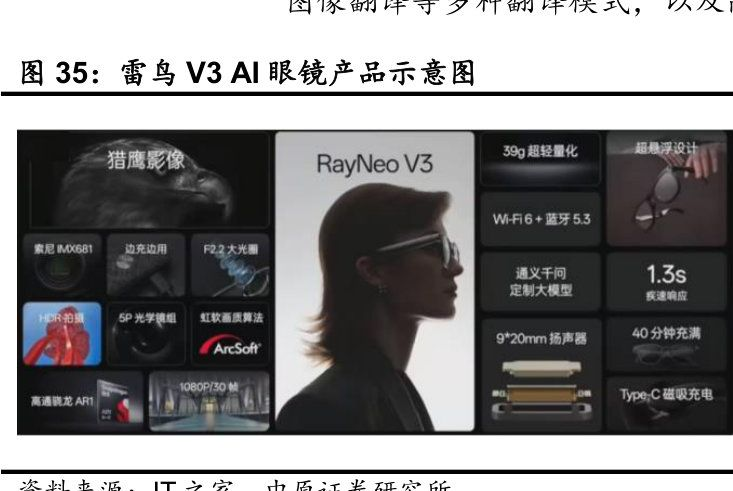

资料来源：IT 之家，中原证券研究所

**图 36：雷鸟 X3 Pro AR 眼镜产品示意图**

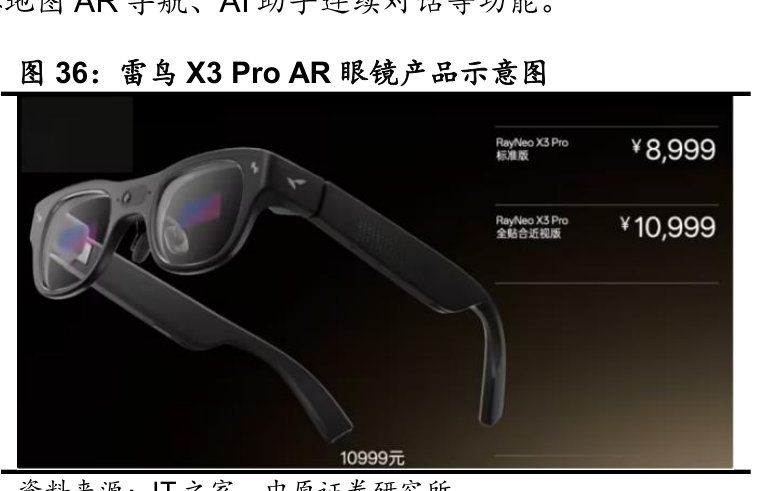

资料来源：IT 之家，中原证券研究所

Meta 与欧克利联合发布新款 AI 眼镜 Oakley Meta HSTN。2025 年 6 月 21 日，Meta 与美国知名运动品牌欧克利（Oakley）联合发布了新款 AI 眼镜 Oakley Meta HSTN，其定位为“高性能 AI 眼镜（Performance AI Glass）”，主打运动场景。Oakley Meta HSTN 支持 POV 视频拍摄、Meta AI 助理，常规使用状态下续航时间可达 8 小时，待机续航时间长达 19 小时，并且支持快充；这款眼镜采用最先进的 Oakley PRIZM 镜片，结合 Oakley 的 PRIZM Lens 技术，旨在帮助运动员在不断变化的光线和天气条件下获得更清晰的视野；该产品将于 7 月 11 日开始预售，起售价 399 美元（约 2868 元人民币），限量版 499 美元（约 3587 元人民币）。

**图 37：Oakley Meta HSTN AI 眼镜产品示意图**

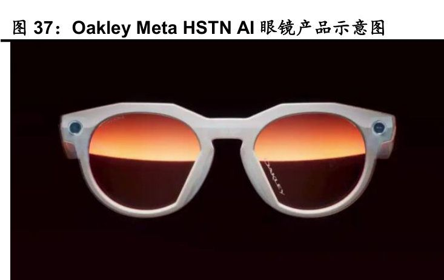

资料来源：IT 之家，中原证券研究所

**图 38：Oakley Meta HSTN AI 眼镜产品示意图**

资料来源：IT 之家，中原证券研究所

小米发布首款 AI 眼镜。2025 年 6 月 26 日，小米首款 AI 眼镜发布，小米 AI 眼镜是面向

---

<!-- 原文第 29 页 -->

下一代的个人智能设备，售价 1999 元起，电致变色版本 2699 元，彩色版本 2999 元。小米 AI 眼镜采用经典威灵顿式 D 型方框设计，12 度外翻转轴解决传统智能眼镜夹头痛点，40 克裸框重量搭配黑、玳瑁棕、鹦鹉绿三色半透明镜架，支持线下 400 家门店验光与线上定制处方镜片；1200 万像素 IMX681 传感器实现 0.8 秒疾速拍摄与 2K 视频录制；四麦克风阵列结合骨传导技术提升复杂环境收音效果；通过 HyperOS 系统，眼镜可替代手机摄像头用于微信、QQ 视频通话，还与 B 站、抖音等平台打通直播推流功能；内置小爱同学支持十语种同声传译、卡路里识别等 AI 应用，可呼唤小爱同学开启第一人称视角拍摄录像。

**图 39：小米 AI 眼镜产品示意图**

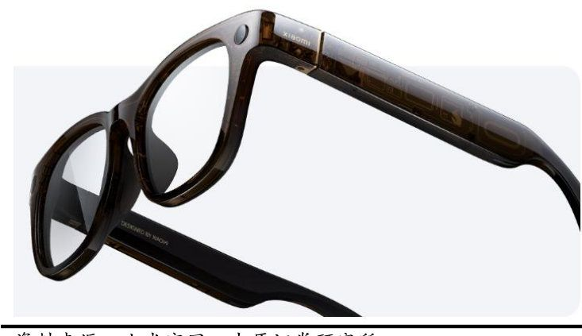

资料来源：小米官网，中原证券研究所

**图 40：小米 AI 眼镜产品示意图**

资料来源：小米官网，中原证券研究所

多款 AI 眼镜新品放量在即，有望推动全球 AI 眼镜出货量快速增长。根据 Omdia 的数据，2025 年全球 AI 眼镜出货量达到 870 万台，同比大幅增长 322%；预计 2026 年全球 AI 眼镜出货量将超过 1500 万台，这一增长将由多方面因素推动，包括主要设备厂商和科技巨头进入市场、Meta 提高产量并拓展新区域市场，以及印度、日本和韩国本土厂商的崛起。目前中国大陆市场占全球 AI 眼镜市场 10.9%的份额，出货量接近 100 万台，成为仅次于美国的全球第二大市场。

**图 41：2023-2025 年全球 AI 眼镜出货量情况**

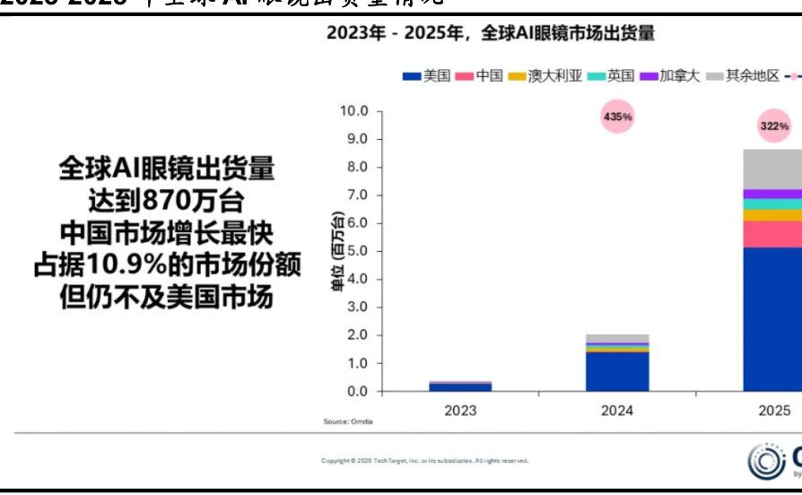

图内标注：标题“2023年 - 2025年，全球AI眼镜市场出货量”；纵轴 单位（百万台），0.0–10.0；图例：美国、中国、澳大利亚、英国、加拿大、其余地区、--增长率；数据标签：2024 年 435%，2025 年 322%；文本标注：全球 AI 眼镜出货量达到 870 万台，中国市场增长最快，占据 10.9%的市场份额，但仍不及美国市场。

资料来源：Omdia，中原证券研究所

Meta 在全球 AI 眼镜市场占据绝对领先地位，国内厂商快速崛起。根据 Omdia 的数据，2025 年 Meta 的 AI 眼镜出货量达到 740 万台，同比增长 281.3%，市场份额达 85.2%，这一增长主要得益于 Oakley 和第二代 Ray-Ban 品牌 AI 眼镜的强劲表现，同时 Meta 也在积极拓

---

<!-- 原文第 30 页 -->

展新市场，包括印度、墨西哥、巴西等国家；中国厂商 Rokid 以及智能手机厂商小米快速崛起，分别位列第二和第三位。

**图 42：2025 年全球及中国大陆 AI 眼镜市场竞争格局情况**

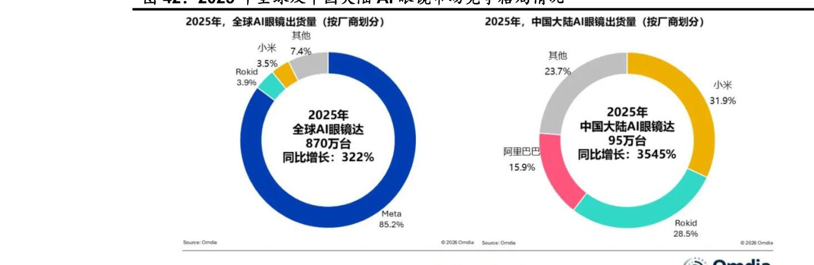

图内标注：左图“2025年，全球AI眼镜出货量（按厂商划分）”：Meta 85.2%、Rokid 3.9%、小米 3.5%、其他 7.4%，图心文字“2025年 全球AI眼镜达 870万台 同比增长：322%”；右图“2025年，中国大陆AI眼镜出货量（按厂商划分）”：小米 31.9%、Rokid 28.5%、阿里巴巴 15.9%、其他 23.7%，图心文字“2025年 中国大陆AI眼镜达 95万台 同比增长：3545%”。

资料来源：Omdia，中原证券研究所

芯片占 AI 眼镜成本大部分，关注 AI 眼镜产业链核心环节投资机会。根据 wellsenn XR 的数据，RayBan Meta AI 眼镜成本总计 174 美元，主板芯片的成本约 99.1 美元，占比约 56.95%，成本占比超一半；眼镜充电盒的成本约 17.5 美元，占比约 10.06%；结构件的成本约 16.9 美元，占比约 9.71%；OEM 的成本约 15 美元，占比约 8.62%。AI 眼镜主要芯片包括 SoC、MCU、存储器、电源、射频等，建议关注 SoC、存储器、光学、电池、镜片、OEM 等产业链核心环节投资机会。

**图 43：RayBan Meta AI 眼镜系统架构框图**

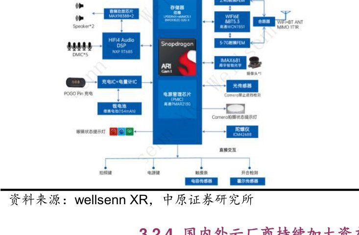

资料来源：wellsenn XR，中原证券研究所

**图 44：RayBan Meta AI 眼镜成本结构图**

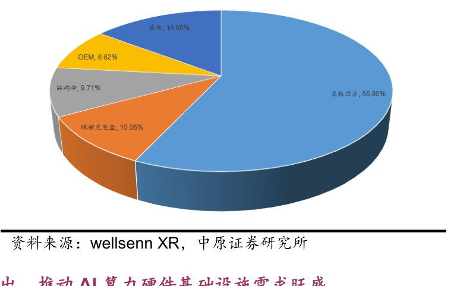

图内标注：主板芯片 56.95%、眼镜充电盒 10.06%、结构件 9.71%、OEM 8.62%、其他 14.66%。

资料来源：wellsenn XR，中原证券研究所

## 3.2.4. 国内外云厂商持续加大资本支出，推动 AI 算力硬件基础设施需求旺盛

北美四大云厂商受益于 AI 对核心业务的推动，持续加大资本支出。受益于 AI 对于公司核心业务的推动，北美四大云厂商谷歌、微软、Meta、亚马逊 2023 年开始持续加大资本支出，2026 年第二季度四大云厂商的资本开支合计约为 1639 亿美元，同比增长 86%，环比增长 27%，推动 AI 算力硬件基础设施需求旺盛。

北美四大云厂商继续上调 2026 年资本支出计划。目前北美四大云厂商的资本支出增长主要用于 AI 基础设施的投资，并从 AI 投资中获得了积极回报，谷歌预计 2026 年资本支出将增加至 1950-2050 亿美元（原值为 1800-1900 亿美元），并预计 2027 年资本支出将进一步上

---

<!-- 原文第 31 页 -->

升；Meta 预计 2026 年资本支出为 1300-1450 亿美金（原值为 1250-1450 亿美元）；微软受数据中心使用寿命会计政策变更影响，预计 2026 年资本支出约为 1750 亿美元；亚马逊预计 2026 年资本支出约为 2200 亿美元（原值为 2000 亿美元），持续加大 AI 基础设施的投资力度。

图 45：2020-2026 年北美四大云厂商资本开支情况（亿美元）
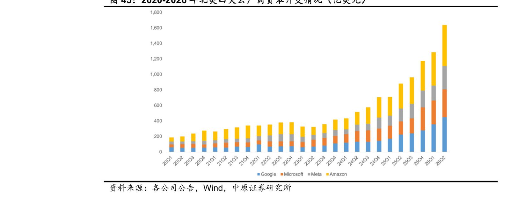
资料来源：各公司公告，Wind，中原证券研究所

国内三大互联网厂商不断提升资本开支。国内三大互联网厂商阿里巴巴、百度、腾讯 2023 年也开始不断加大资本开支，2026 年二季度三大互联网厂商的资本开支合计约为 1243 亿元，同比增长 102%，环比增长 92%；预计 2026 年国内三大互联网厂商将继续加大用于 AI 基础设施建设的资本开支。

图 46：2021-2026 年国内三大互联网厂商资本开支情况（百万元）
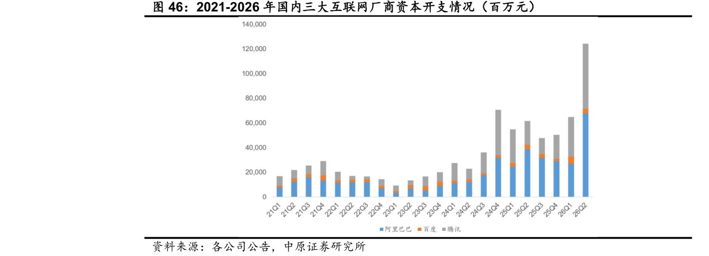
资料来源：各公司公告，中原证券研究所

#### 3.2.5. 中国新能源汽车月度销量同比稳健增长

**2026 年 8 月中国汽车销量同比下降 5.1%。** 根据中国汽车工业协会的统计数据，2026 年 8 月，中国汽车销量达到 271.2 万辆，同比下降 5.1%，环比增长 4.9%。8 月多地汽车消费补贴持续升级，车企促销活动活跃，国内市场继续承压，出口保持高速增长，成为稳定行业大盘的关键增量。近期，有关政府部门在规范账款支付、质量提升、车企出海行为等方面积极开展行动，汽车行业治理工作持续深化，将推动行业从追求规模和速度转向质量和安全，助力产业

---

<!-- 原文第 32 页 -->

健康可持续发展。

图 47：2000-2026 年中国汽车销量情况
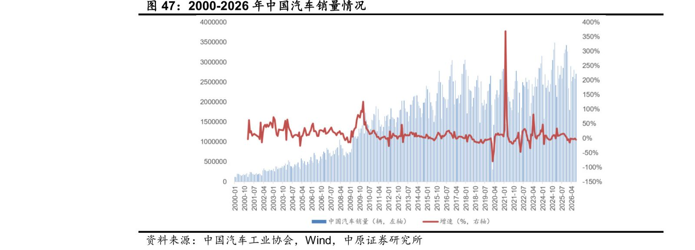
资料来源：中国汽车工业协会，Wind，中原证券研究所

**2026 年 8 月中国新能源汽车销量同比增长 17.8%。** 根据中国汽车工业协会统计数据，2026 年 8 月，中国新能源汽车销量 164.3 万辆，同比增长 17.8%，环比增长 5.3%，新能源汽车新车销量达到汽车新车总销量的 60.6%。

图 48：2015-2026 年中国新能源汽车销量情况
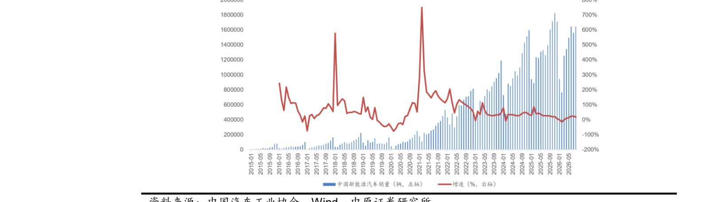
资料来源：中国汽车工业协会，Wind，中原证券研究所

### 3.3. 全球部分芯片厂商季度库存水位环比下降，国内部分芯片厂商季度库存水位环比大幅下降

**全球部分芯片厂商 26Q2 库存水位环比下降。** 根据 Wind 的数据，全球部分芯片厂商包括英特尔、AMD、英伟达、高通、博通、美光、TI、ADI、恩智浦、微芯、安森美 23Q1 的平均库存周转天数为 139 天，23Q4 下降至 133 天，随后开始环比提升，24Q2 提升至 148 天，随后开始逐步下降，25Q4 小幅下降至 141 天，26Q1 小幅提升至 145 天，26Q2 下降至 139 天；由于工业市场需求开始复苏，AI 数据中心需求旺盛，模拟厂商 TI、ADI、微芯科技等库存有望逐步下降。

---

<!-- 原文第 33 页 -->

图 49：全球部分芯片厂商平均库存周转天数情况
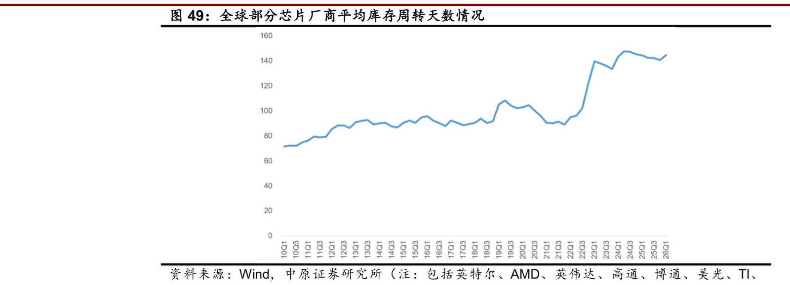
资料来源：Wind，中原证券研究所（注：包括英特尔、AMD、英伟达、高通、博通、美光、TI、ADI、恩智浦、微芯、安森美）

**国内部分芯片厂商 26Q2 库存水位环比大幅下降。** 国内部分芯片厂商包括兆易创新、卓胜微、韦尔股份、澜起科技、晶晨股份、瑞芯微、北京君正、圣邦股份、紫光国微 23Q1 的平均库存周转天数达到 351 天，随后逐步下降，24Q4 继续下降到 210 天，25Q1 提升至 232 天，25Q2 大幅下降至 206 天，随后逐步提升，26Q1 提升至 245 天，26Q2 大幅下降至 219 天，环比下降 26 天。26Q2 国内部分芯片厂商库存水位环比大幅下降，目前部分芯片设计厂商库存仍偏高，预计后续有望逐步回到健康水平。

图 50：国内部分芯片厂商平均库存周转天数情况
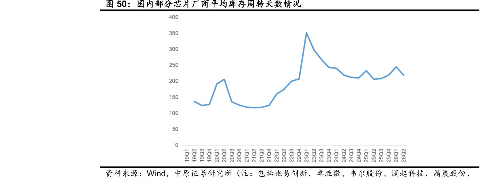
资料来源：Wind，中原证券研究所（注：包括兆易创新、卓胜微、韦尔股份、澜起科技、晶晨股份、瑞芯微、北京君正、圣邦股份、紫光国微）

### 3.4. 国内主要晶圆厂季度产能利用率环比小幅提升

**国内主要晶圆厂产能利用率 26Q2 环比小幅提升。** 半导体市场需求自 2022 年三季度大幅下跌，导致芯片原厂流片意愿不强，晶圆厂的产能利用率也出现下滑；国内晶圆代工龙头中芯国际 23Q1 的产能利用率从 22Q4 的 79.5%大幅下降至 68.1%，随后开始逐步回升，23Q2 至 23Q4 产能利用率在 76%-78%区间波动，24Q1 至 24Q4 产能利用率在 80%-90%区间波动，25Q1 至 25Q4 产能利用率从 89.60%提升至 95.7%，26Q1 产能利用率为 93.1%，26Q2 提升至 93.70%。华虹 23Q2 产能利用率从 23Q1 的 103.5%略微下降至 102.7%，随后开始大幅下降，23Q4 下滑至 84.1%，随后逐步提升至 24Q3 的 105.3%，24Q4 至 25Q1 小幅回落至

---

<!-- 原文第 34 页 -->

102.70%，25Q2 至 25Q3 继续提升至 109.5%，25Q4 至 26Q1 逐步回落至 99.7%，26Q2 提升至 102.80%；26Q2 中芯国际、华虹产能利用率环比小幅提升，处于满负荷运行状态。

图 51：全球部分晶圆厂产能利用率情况
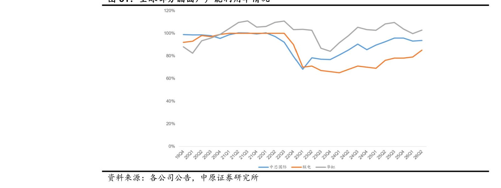
资料来源：各公司公告，中原证券研究所

**AI 推动全球先进制造产能加速扩张。** 根据 SEMI 发布最新的《300 毫米晶圆厂展望报告（300mm Fab Outlook）》，全球半导体制造行业预计将保持强劲增长势头，预计从 2024 年底到 2028 年，产能将以 7%的复合年增长率增长，达到创纪录的每月 1110 万片晶圆；推动这一增长的关键因素是先进工艺产能（7 纳米及以下）的持续扩张，预计将从 2024 年的每月 85 万片晶圆增长到 2028 年的历史新高 140 万片晶圆，增长约 69%，复合年增长率约为 14%，是行业平均水平的两倍；AI 继续成为全球半导体行业的变革力量，推动全球先进制造产能加速扩张。

图 52： 2024-2028 年全球晶圆产能及预测情况
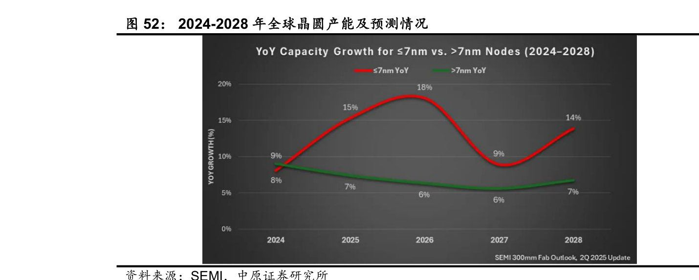
资料来源：SEMI，中原证券研究所

**TrendForce 预计晶圆代工成熟制程涨价效应有望延伸至 2027 年。** 根据 TrendForce 集邦咨询最新调查，随着 AI 服务器、通用服务器与边缘 AI 周边需求持续升温，晶圆代工产能配置明显朝 AI 相关产品倾斜，加速改变成熟制程供需结构；8 英寸制程受益于 AI 相关电源订单增量及台积电、三星电子减产，产能利用率与代工价格强势拉升；12 英寸成熟制程则因台积电启动减产，有望带动中长期转单效应；加上 55nm（含）以上 Power IC 订单强劲，引发台系晶圆厂减产 High Voltage（HV）制程、订单流向大陆系厂供应链等效应，以及 AI 相关新兴

---

<!-- 原文第 35 页 -->

应用增量排挤、原物料通膨等因素，导致 12 英寸成熟制程代工涨价氛围，预计涨势将延伸至 2027 年。

图 53： 25H2-26H2 晶圆代工价格涨幅变化情况

**2H25-2H26晶圆代工价格涨幅变化**

| Process Node | 2H25 | 1H26 | 2H26 |
| --- | --- | --- | --- |
| 8-inch Processes | 5-10% (specific processes only) | 5-15% | 0-10% |
| 12-inch Mature Nodes | Flat | Flat | 0-10% |
| 12-inch Advanced Nodes | Flat | 5-10% | Flat |

资料来源：TrendForce，中原证券研究所

### 3.5. DRAM 月度现货价格环比继续上涨，NAND Flash 现货价格环比小幅下降

**2026 年 8 月 DRAM 现货价格继续环比上涨。** 根据中国闪存市场的数据，2026 年 8 月 DRAM 指数环比上涨约 5.25%，2025 年 3 月至 2026 年 8 月 DRAM 指数上涨约 844%。根据 DRAMexchange 的数据，2026 年 8 月，DDR4 8Gb(512Mx16)3200 的现货价格环比上涨 0.16%，DDR4 16Gb(1Gx16)3200 的现货价格环比上涨 3.30%，DDR5 16G(2Gx8)4800/5600 的现货价格环比上涨 5.79%。

图 54：DRAM 指数走势情况
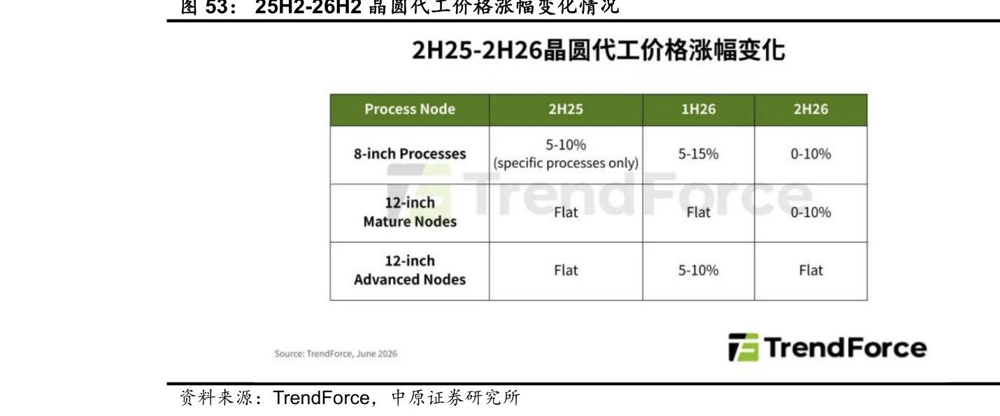
图 55：DRAM 现货价格走势情况（美元）

资料来源：中国闪存市场，iFinD，中原证券研究所
资料来源：DRAMexchange，iFinD，中原证券研究所

**2026 年 8 月 NAND Flash 现货价格环比小幅下降。** 根据中国闪存市场的数据，2026 年 8 月 NAND 指数环比下降约 0.30%，2025 年 3 月至 2026 年 8 月 NAND 指数上涨约 395%；其中 TLC 闪存 256Gb 的现货价格环比持平，512Gb 的现货价格环比持平。

---

<!-- 原文第 36 页 -->

图 56：NAND 指数走势情况

图 57：NAND Flash 现货价格走势情况（美元）

资料来源：中国闪存市场，iFinD，中原证券研究所
资料来源：InSpectrum，中国闪存市场，中原证券研究所

**TrendForce 预计 26Q3 DRAM 及 NAND Flash 合约价格分别环比增长 13-18%及 10-15%。** 根据 TrendForce 集邦咨询最新调查，2026 年第三季度整体 DRAM 格局持续极度紧缺，但因消费级应用需求下修及高基期作用，合约价涨幅收敛，预计 26Q3 将环比增长 13-18%；NAND Flash 主要需求仍由 AI 推理与大型数据中心建设支撑，但因合约价格已达历史高点，消费端客户在需求放缓的情况下，对价格承受力已达极限，预估 26Q3 整体 NAND Flash 合约价将环比增长 10-15%，幅度较前几季明显缩减。

图 58：26Q2-26Q3 DRAM 及 NAND Flash 产品合约价格预测情况

**2Q26-3Q26 DRAM、NAND Flash合约价格预测**

| | 2Q26 | 3Q26E |
| --- | --- | --- |
| Total DRAM | Conventional DRAM: up 58~63% HBM Blended: up 53~58% | Conventional DRAM: up 13~18% HBM Blended: up 8~13% |
| Total NAND Flash | up 55~60% | up 10~15% |

资料来源：TrendForce，中原证券研究所

**TrendForce 预计 262H NOR Flash 价格走势分化，高容量产品涨幅预计达 90-110%。** 根据 TrendForce 集邦咨询的调查，尽管新增供给有限，NOR Flash 需求持续成长；除了传统的 ADAS、数字座舱及工控应用，2026 年新增需求主力为 AI 与航天通信领域；以 AI Server 为例，单台对 NOR 的需求量为传统 Server 的三至五倍，且 AI Server 内部配备大量 Retimer 芯片，每颗 Retimer 均需要独立 NOR Flash 加载微码，推升高容量及 Octal SPI NOR 需求；此外，Edge-AI、AI PC 与机器人等本地推理设备带动模型固件规模数倍膨胀，也提升高密度 NOR Flash 需求。TrendForce 指出，2026 年上半年 NOR Flash 合约价平均累计涨幅达 100-120%，预估 26H2 不同容量产品价格走势将分化，256Mb 及以上高容量产品有 AI Server、车用等强劲需求，加上供给主力厂商的新增位元有限，预估下半年平均价格仍有 90-110%的上涨空间；在 128Mb 及以下的中低容量市场，随着部分供应商产能逐步释出，消费类产品价

---

<!-- 原文第 37 页 -->

格涨势趋缓，后续将进入高位盘整，预估 2026 年第四季度涨幅落在 10-20%之间。

图 59： 26H2 各类 NOR Flash 产品供需、价格趋势情况

| 产品类别 | 2H26供给状况 | 核心需求驱动力 | 2H26价格趋势 |
| --- | --- | --- | --- |
| 高容量（≥256Mb） | 严重供不应求 | AI Server, ADAS, Edge-AI | 持续上涨, 涨幅90-110% |
| Octal/xSPI高端规格NOR | 供应偏紧 | AI芯片、高速数据传输 | 持续上涨 |
| 车规/航太高可靠度NOR | 供给紧张 | 车用智能化、低轨卫星 | 持续上涨 |
| 通用型/中低容量NOR（≤128Mb） | 供需相对平衡 | 消费电子、小家电、TWS | 高档震荡/盘整 |

资料来源：TrendForce，中原证券研究所

### 3.6. 全球半导体设备季度销售额继续同比增长，预计 2026 年有望持续增长

**26Q2 全球半导体设备销售额同比增长 23%，中国半导体设备销售额同比增长 5%。** 根据日本半导体制造装置协会（SEAJ）的数据，2026 年第二季度全球半导体设备销售额为 405.3 亿美元，同比增长 23%，环比增长 11%；2026 年第二季度中国半导体设备销售额为 119.1 亿美元，同比增长 5%，环比增长 8%。

图 60：2005-2026 年全球半导体设备销售额情况

图 61：2005-2026 年中国半导体设备销售额情况

资料来源：SEAJ，iFinD，中原证券研究所
资料来源：SEAJ，iFinD，中原证券研究所

**2026 年 7 月日本半导体设备销售额同比增长 35.4%。** 根据日本半导体制造装置协会的数据，2026 年 7 月日本半导体设备销售额为 5562.20 亿日元，同比增长 35.4%，环比增长 8.3%；2025 年日本半导体设备销售额达 5.0585 万亿日元，同比增长 14%；日本半导体设备全球市场占有率达三成，仅次于美国位居全球第 2。

---

<!-- 原文第 38 页 -->

图 62：日本半导体设备月度销售额情况

资料来源：SEAJ，iFinD，中原证券研究所

**SEMI 预计 2026 年全球 300mm 晶圆厂设备支出将同比增长 18%。** 根据 SEMI 的最新预测，全球 300mm 晶圆厂设备支出预计 2026 年将增长 18%至 1330 亿美元，2027 年将增长 14%至 1510 亿美元，2028 年将继续增长 3%至 1550 亿美元，2029 年再增长 11%至 1720 亿美元；这一强劲增长反映了数据中心和边缘设备对 AI 芯片需求的激增，以及各主要地区通过本地化产业生态系统和供应链重组来加强半导体自给自足能力的坚定承诺。

SEMI 总裁兼首席执行官 Ajit Manocha 表示：“AI 正在重塑半导体制造投资的规模，随着全球 300mm 晶圆厂设备支出预计在 2027 年首次突破 1500 亿美元，行业正以史无前例的持续性的投入，着力构建 AI 时代所需的先进产能与韧性供应链。”

图 63：2024-2029 年全球 300mm 晶圆厂设备支出情况及预测

资料来源：SEMI，中原证券研究所

**SEMI 预计 2026 年全球 300mm 晶圆厂存储领域设备投资将同比增长 29%。** 根据 SEMI 的最新预测，受 AI 基础设施、数据中心及下一代计算系统投资增加的支撑，2026 年全球 300mm 晶圆厂存储领域设备投资预计将达到 520 亿美元，同比增长 29%，预计 2027 年再增 11%至 570 亿美元，预计 2024-2029 年复合增速将达 19%。

SEMI 总裁兼首席执行官 Ajit Manocha 表示：“对 HBM 及其他先进存储技术的强劲需求正在重塑整个半导体供应链的投资优先级，随着 AI 基础设施的扩张，存储制造商正在加速产

---

<!-- 原文第 39 页 -->

能和技术迁移方面的投资，以支持下一波数据密集型应用。”

图 64：2024-2029 年全球 300mm 晶圆厂存储领域设备投资情况及预测

资料来源：SEMI，中原证券研究所

### 3.7. 全球硅片季度出货量继续同比增长, 预计 2026 年将持续增长

**26Q2 全球硅片出货量同比增长 7.4%。** 硅片是半导体产业链中最重要的材料之一，也是价值含量最高的半导体材料，占整个晶圆制造材料超过 33%。根据 SEMI 的数据，2026 年第二季度全球硅晶圆出货量达到 3573 百万平方英寸，同比增长 7.4%，环比增长 9.1%。SEMI SMG 主席、胜高株式会社（SUMCO）销售与市场事业部总经理矢田银次（Ginji Yada）表示：“第二季度硅晶圆出货量保持稳健增长，强劲且不断增长的 AI 相关需求已从先进逻辑和存储领域扩展至功率器件、光电子及其他市场；此外，工业和汽车需求正在复苏，而存储器价格压力则限制了 PC 和智能手机需求；器件制造商正大力投资扩产，硅晶圆需求增长预计将持续。”

图 65：全球硅片出货量情况

资料来源：SEMI，Wind，中原证券研究所

**SEMI 预计 2025-2028 年全球硅晶圆出货量将持续增长。** 根据 SEMI 的预测，预计 2026 年全球硅晶圆出货量预计将增长 5.2%，并将在 2028 年前持续增长，届时市场有望达到 15485 百万平方英寸的新行业纪录。2025 年硅晶圆出货量的增长主要受益于人工智能相关需求的强劲推动，包括用于先进逻辑器件的高端外延晶圆，以及用于高带宽存储器（HBM）的抛光晶圆；非 AI 应用领域的晶圆出货量则刚刚开始从近期的下行周期中逐步恢复；预计随着

---

<!-- 原文第 40 页 -->

AI 在数据中心及边缘计算领域的持续扩展，这一稳步增长趋势将延续至 2028 年。

图 66：2022-2027 年全球硅片出货量情况及预测

资料来源：SEMI，中原证券研究所

## 4. 行业政策

外部环境对中国半导体产业限制不断加剧。近年来美日荷不断加大对中国半导体产业的限制，主要针对半导体先进制造、先进制程半导体设备、先进存储器、先进计算芯片、EDA 工具等环节。

**表 14：近年美日荷对中国半导体产业部分制裁政策情况**

| 时间 | 具体事件及制裁政策情况 |
| --- | --- |
| 2018 年 10 月 | 美国商务部将福建省晋华集成电路有限公司列入出口管制“实体清单”。 |
| 2019 年 7 月 | ASML 中止向中国交付 EUV 光刻机。 |
| 2020 年 5 月 | 美国商务部限制华为使用美国技术和软件在海外设计和制造半导体。 |
| 2020 年 9 月 | 美国商务部对华为实施严格的芯片禁令正式生效，台积电停止为华为代工生产麒麟芯片，高通、三星及 SK 海力士、美光等都将不再供应芯片给华为。 |
| 2020 年 12 月 | 美国商务部将中芯国际列入出口管制“实体清单”。 |
| 2022 年 8 月 | 美国总统拜登签署《2022 芯片与科学法案》，该法案将为美国半导体研发、制造以及劳动力发展提供 527 亿美元，获得补贴的半导体企业将禁止在中国扩大或新增 14 纳米及以下先进制程芯片产业的投资。 |
| 2022 年 8 月 | 美国芯片厂商英伟达和 AMD 收到美国政府通知，要求停止向中国出口用于人工智能的高端计算芯片，该禁令影响的芯片分别为英伟达的 GPU A100 与 H100，以及 AMD 的 GPU MI200。 |
| 2022 年 10 月 | 美国商务部公布一系列针对中国的出口管制新规，BIS 这项新的半导体出口限制政策涉及到对中国的先进计算、半导体先进制造进行出口管制；具体要限制美国的半导体设备在国内应用到 16/14nm 及以下工艺节点（非平面架构）的逻辑电路制造、128 层及以上的 3D NAND 工艺制造、18nm 及以下的 DRAM 工艺制造；对中国超级计算机或半导体开发或生产最终用途的项目进行限制；限制美国公民支持中国半导体制造或者研发。 |
| 2022 年 12 月 | 美国商务部将长江存储、上海微电子、寒武纪等 36 家中国实体加入出口管制“实体清单”。 |
| 2023 年 5 月 | 日本政府正式发布针对先进芯片制造所需的 23 种半导体制造设备的出口管制措施，这些设备包括 3 项清洗设备、11 项薄膜沉积设备、1 项热处理设备、4 项光刻设备、3 项蚀刻设备、1 项测试设备。 |
| 2023 年 6 月 | 荷兰政府正式发布针对先进的芯片制造技术，包括先进的沉积设备和浸润式 DUV 光刻机实施出口管制。 |
| 2023 年 10 月 | 美国商务部公布针对先进计算芯片、半导体制造设备出口管制的更新规则，并将 13 家中国 GPU 企业列入实体清单，主要为壁仞科技和摩尔线程及其子公司。 |
| 2024 年 12 月 | 美国商务部修订了《出口管理条例》，这次制裁主要涉及半导体制造设备、存储芯片等物项的对华出口管制，并且扩展了对华出口管制的范围，包括了 24 种半导体制造设备、3 种软件工具和 HBM 芯片出口的限制，将 140 个中国半导体行业相关实体添加到“实体清单”。新进入“实体清单”的企业包括北方华创、盛美上海、芯源微、拓荆科技、华峰测控、中科飞测、精测电子、华海清科、凯世通、至纯科技、武汉新芯、华大九天、沪硅产业、南大光电、闻泰科技、建广资本、智路资本等。 |
| 2025 年 1 月 | 美国商务部修订了《出口管理条例》，将中国 11 个实体加入实体清单，包括中国科学院长春光学精密机械与物理研究所、中国科学院上海光学精密机械研究所、苏州超纳精密光电技术有限公司、南京施密特光学仪器有限公司等，自 1 月 6 日起生效。 从 2025 年 1 月 2 日起，包括美国公民、持有“绿卡”的合法永久居民在内的美国人士，在美国设立的实体及其外国分支机构，以及在美国境内的任何个人或实 |

---

<!-- 原文第 41 页 -->

体，都禁止投资或需要申报才能投资中国的半导体和微电子、量子信息技术以及人工智能三个行业。

| 时间 | 具体事件及制裁政策情况 |
| --- | --- |
| 2025 年 1 月 | 美国国防部发布最新版的“中国涉军企业”清单（根据美国法律正式规定为“第 1260H 条名单”），将腾讯控股、宁德时代、长鑫存储、长江存储、华为控股、中芯国际、奇虎 360 公司、中国移动、中国联通、中国电信、华大基因等 134 家中国企业新增列入该清单。 |
| 2025 年 1 月 | 美国政府推出《人工智能扩散规则》，公布对 AI 芯片出口的新限制措施，这份新规将出口目的地分为三类，美国对 18 个关键盟友与合作伙伴的芯片销售无任何限制；对中国、伊朗等实施了严格的 AI 芯片销售限制；对其他国家，大多数国家则将面临总算力限制，每个国家在 2025 年至 2027 年期间最多可获得约 5 万个 AI GPU。 |
| 2025 年 1 月 | 美国商务部修订了《出口管制条例》，共增加了 25 个中国实体，主要包括智谱旗下 10 个实体、算能旗下约 11 个实体，以及哈勃投资的光刻机企业科益虹源等；BIS 还更新先进计算半导体的出口管制，针对于先进逻辑集成电路是采用“16nm/14nm 节点”及以下工艺、或采用非平面晶体管架构生产的逻辑集成电路，采取更多审查和规范，并且细化了多个物项信息如 DRAM 行业 18 纳米半间距节点的生产标准等。 |
| 2025 年 5 月 | 美国商务部宣布废除拜登政府此前推出的《人工智能扩散规则》（AI Diffusion Rule），并同时宣布三项旨在加强海外 AI 芯片出口管制的新举措：全球禁用华为 Ascend 芯片，明确在世界任何地区使用华为 Ascend 芯片均被视为违反美国出口管制条例；限制 AI 芯片用于中国 AI 模型，若美国 AI 芯片被用于训练或干扰中国人工智能模型，相关企业将面临严重后果；供应链反制指南，要求美国企业重新审视供应链合作伙伴，强化审查机制，防范技术转移风险。 |

资料来源：中华人民共和国商务部官网，美国商务部官网，美国政府官网，人民网，央视网，芯智讯，日经新闻，中芯国际公司公告，半导体产业纵横，腾讯，芯榜，中原证券研究所

## 5. 行业动态

### 5.1. 全球半导体行业动态

#### 1、SK 海力士计划重启中国大连 NAND 生产基地 2 号工厂的投资建设

2026 年 8 月 12 日消息，据《首尔经济日报》报道，SK 海力士计划重启中国大连 NAND 闪存生产基地 2 号工厂的建设，将产能提高约 50%。

据了解，大连 2 号工厂于 4 年前动工，但受到存储行业低迷的影响，工程长期处于停滞状态。

随着 AI 数据中心扩张推动企业级固态硬盘需求增长，SK 海力士决定恢复投资。

据悉，新生产线的晶圆投片量约为每月 5 万片，加上大连 1 号工厂现有的每月 10 万片产能，大连当地总产能将增加约 50%。

2021 年，SK 海力士收购英特尔的 NAND 业务并成立了 Solidigm，接手了大连 1 号工厂及相关厂区，于 2022 年 5 月启动 2 号工厂的建设。（首尔经济日报，SEMI）

#### 2、闪迪在 2026 年投资者日公布长期财务模型

2026 年 8 月 14 日消息，闪迪在 2026 年投资者日公布长期财务模型，提出一系列 2028 财年至 2030 财年将要达到的财务目标，包括这期间内，公司营收将保持中高双位数增长。闪迪还澄清市场对比特增长的疑虑，提出可供销售比特量将根据盈利优化需要调整，同时承诺，在完成业务投资后，将把 100%的剩余现金返还股东。

公司预计在 2028 至 2030 财年期间，营收将保持中高双位数增长，增速与比特出货量增长相匹配；与此同时，非 GAAP 口径下，毛利率预计维持在约 80%，营业利润率约为 75%。

---

<!-- 原文第 42 页 -->

闪迪首席财务官 Luis Visoso 表示，在完成支持业务增长所需的投资之后，公司预计将把 100%的超额现金返还给股东。

公司披露，目前已经与 8 家客户签署新商业模式（NBM）协议；这些协议包括承诺采购量、具有约束力的合同框架、最低财务保障以及结构化定价机制，可以加强客户需求与公司产能规划之间的匹配，并降低传统存储行业周期性波动的影响。更重要的是，这些协议覆盖的规模已经相当可观：目前签署的 NBM 协议约覆盖 FY2027 比特出货量的 50%，以及 FY2028 比特出货量的约三分之二。闪迪认为，这种模式能够带来更加可预测的营收、更高的现金流可见度以及更加持久的盈利增长。

公司表示，AI 推理工作负载正在推动 Token 使用量快速增长，KV Cache 正在重塑数据中心的内存层级。随着 AI 推理规模扩大，AI 数据中心将变得更加依赖存储，闪迪预计，到 2030 年企业数据中心闪存的总可用市场（TAM）将达到 1.2ZB。（华尔街见闻）

#### 3、英伟达全面投产 Spectrum-X 交换机

2026 年 8 月 15 日消息，英伟达官方账号 @NVIDIAAIInfra 在 X 平台发布推文，官宣已全面投产 Spectrum-X 以太网光子交换机，成为全球首款量产的 200G/lane 共封装光器件（CPO）以太网交换机系统。

应用场景方面，英伟达表示该交换机主要面向大规模 AI 训练与推理集群。随着 AI 工厂扩大，密集部署 GPU 的服务器需要在高带宽下频繁交换数据。

传输方面，传统网络通常把独立光模块插入交换机面板，光模块先将电信号转为光信号，经光纤传输后再转回电信号，这种方案会增加功耗、热量和潜在故障点。

Spectrum-X Ethernet Photonics 在同一模块内封装光学引擎与交换芯片。光信号的生成与转换靠近负责数据包转发的交换 ASIC，缩短电信号传输路径。

与采用传统可插拔光模块的网络相比，英伟达称功耗降低至 1/5，AI 应用无中断运行时间可延长 5 倍，平均事件间隔时间可提高 10 倍。

硬件方面，SN6810 可在 2U 液冷机箱内配置 128 个 800 Gb/s 端口，总交换能力为 102.4 Tb/s。

更大的 SN6800 在 5U 系统中堆叠 4 颗 ASIC，可提供 409.6 Tb/s 交换能力，支持 512 个 800 Gb/s 端口，或超过 2,000 个 200 Gb/s 端口。

制造环节中，光学引擎直接焊接到模块基板上，工艺可纳入常规量产流程。顶部光纤连接器用于高精度连接光纤。

台积电负责硅光子技术，SPIL 负责芯片级封装与测试，Lumentum 与 TFC 供应激光器组件，富士康负责整机交换机系统开发。英伟达在自有设施完成交换机出货前的最终测试，目前已启动全面生产。（英伟达，IT 之家）

---

<!-- 原文第 43 页 -->

#### 4、谷歌订购 Marvell 产品用于 TPU

2026 年 8 月 19 日消息，光通信公司 Marvell Technology 发布公告，与谷歌签订了一项商业协议，Marvell 将为谷歌开发定制半导体产品。

Marvell 为谷歌定制的产品，包括 AI 推理加速器、存储控制器、网络接口控制器、内存接口控制器及近存储计算产品，将接入谷歌的 AI 芯片——TPU 生态系统。

此外，Marvell 向谷歌发行了一份认股权证，谷歌可据此以每股 206.58 美元的行权价格，购买合计最多 5897.09 万股 Marvell 的普通股票，以 121.82 亿美元的价格投资 Marvell。（财新网）

#### 5、长江存储申请科创板 IPO 获上交所受理

2026 年 8 月 24 日消息，长江存储控股股份有限公司科创板 IPO 申请获上交所受理，拟募资 330 亿元，成为科创板开板以来拟募资规模最大的 IPO。

根据招股书，2023-2025 年及 2026 年一季度，长江存储实现营收分别为 187.44 亿元、452.03 亿元、631.85 亿元、470.42 亿元；归母净利润分别为-191.81 亿元、67.71 亿元、142.11 亿元、333.79 亿元。

根据 TrendForce 数据，2026 年 1-3 月公司在全球 NAND Flash 厂商中按销售金额和出货量排名，均位列全球第三、中国第一。（网易）

#### 6、铠侠与闪迪宣布联合投资超过 310 亿美元

2026 年 8 月 27 日消息，铠侠与闪迪宣布，计划到 2032 年在日本投资超过 310 亿美元，但具体投资取决于日本政府支持。两家公司将继续加强长期合资合作，投资将用于扩建四日市工厂和北上市工厂的基础设施及相关技术，以提高闪存产能并满足 AI 和数据驱动业务增长带来的需求。

铠侠表示，双方各自承诺推动未来数年的闪存位增长并确保稳定供应。铠侠首席执行官太田裕雄表示，此次联合投资将进一步巩固与闪迪的长期合作，并支持 AI 社会发展对高容量、高性能和高能效闪存的需求。（财联社）

#### 7、长鑫科技式宣布 LPDDR6 量产

2026 年 8 月 29 日消息，长鑫科技正式宣布自主研发的最新一代低功耗内存 LPDDR6 实现量产，并将首批搭载于小米 18 Fold 折叠旗舰手机。这是全球 LPDDR6 产品首次落地商用。

在 AI 需求爆发的趋势下，LPDDR6 被视为端侧 AI 算力释放的关键支柱，应用场景涵盖智能手机、PC 等设备，并延伸至智能座舱、AI 数据中心等。

LPDDR6 是当前国际最新一代 LPDDR 产品，2025 年 7 月国际标准组织 JEDEC 首次发

---

<!-- 原文第 44 页 -->

布 LPDDR6 标准。

长鑫表示，LPDDR6 量产商用为国产手机等终端厂商抢占 AI 机遇奠定关键基础。长鑫与小米最新旗舰等高端机型的合作，体现了前沿存储与顶级终端生态的协同创新，共同驱动产业向高端价值链迈进，实现在 AI 时代的关键战略卡位。（新浪）

### 5.2. 河南省半导体行业动态

#### 1、金刚石—半导体产业链对接会举行

2026 年 8 月 28 日消息，金刚石—半导体产业链对接会在苏州举行。作为即将启幕的“2026 金刚石产业大会”首个配套活动，本次对接会立足郑州超硬材料产业优势，精准对焦苏州半导体产业集群，通过实地参访、技术分享、供需洽谈等方式，推动豫苏两地产业资源深度握手。

产业是发展的根基，也是新质生产力的核心载体。一个地方要在未来发展和区域竞争中赢得主动，既离不开坚实的产业支撑，更不可满足于“有什么就发展什么”的路径依赖。构建兼具完整性、先进性、安全性的现代化产业体系，既要把传统优势产业做优做强，也要推动产业向高端化、智能化、绿色化跃升，更要主动融入更大的产业分工版图，在产业链、创新链、供应链等深度协同中持续锻造竞争力。

郑州超硬材料产业家底殷实。2024 年，全市超硬材料产业规模近 200 亿元；2023 年，郑州生产金刚石 28.65 亿克拉，约占全国总产量的 20%，立方氮化硼产量约占全国的 80%……历经多年深耕，郑州已形成涵盖研发、装备、合成、制品等全环节的产业体系。

过去，人们提起金刚石，更多想到磨料、刀具、切割等传统应用。如今，随着人工智能、先进计算、半导体等产业加速崛起，金刚石正打开全新的应用想象。尤其在芯片散热、电子热管理等领域，其优异性能正让这块“硬材料”叩开更高端产业链的大门。

此次把对接会办到苏州，实质上是一次主动“向链而行”。苏州集聚晶圆制造、芯片设计、封装测试、半导体设备等丰富资源，郑州则手握超硬材料这一产业长板。一方有材料优势，一方有应用场景，两地之间天然存在产业连接点。

当今的产业竞争，早已不是单个企业之间的角力，也不是简单的规模比拼。产业链、创新链、供应链的协同能力，越来越成为城市产业竞争力的关键内核。因此，产业发展不能只盘自家账本，更要主动寻觅自己在更大产业链中的坐标。

一家超硬材料企业，若能通过产业链对接找到头部半导体企业，进入其供应链体系，收获的不只是一个订单，更可能是一套新的技术标准、一批稳定的客户资源，以及持续迭代产品的宝贵契机。

因此，郑州发展超硬材料产业，在把产业规模做大的同时，更要着力把产业链条做长、把技术含量做高、把应用场景做广。要让这颗“钻石”真正嵌入半导体等高端产业链，首先要把

---

<!-- 原文第 45 页 -->

企业自身的硬实力做得更硬。紧扣半导体、新能源、人工智能等产业需求，加大关键材料、核心工艺和装备研发，推动企业、高校、科研院所与下游应用企业开展联合攻关，让更多技术成果从实验室走向产线。同时，也要把产业对接做深做实，如建立持续对接机制，围绕企业进入供应链过程中的技术验证、标准认证、市场拓展等问题，精准提供服务，让一次握手变成长期合作，让一个订单串起一条产业链。

把长板锻得更长，把链条连得更紧，把郑州的产业优势主动嵌入全国乃至全球产业版图，我们一定能让这颗“钻石”真正从“硬实力”化为“硬竞争力”，在更大的产业舞台上释放更大能量。（郑州日报）

## 6. 估值分析与投资建议

### 6.1. 估值分析

目前半导体行业 PE 估值高于近十年中位值及平均值。目前申万半导体行业 PE（TTM）约为 77 倍，近十年申万半导体行业 PE（TTM）最大值约为 165 倍、最小值约为 32 倍，申万半导体行业 PE（TTM）近十年中位值约为 75 倍、平均值约为 79 倍，目前半导体行业 PE 估值低于近十年平均值、高于近十年中位值。

图 67：近十年半导体（申万）PE Bands

图例：收盘点位（折线）、31.92x、53.62x、75.32x、97.02x、118.72x；纵轴刻度：0、2,500、5,000、7,500、10,000、12,500、15,000、17,500；横轴刻度：17-01-01、18-01-01、19-01-01、20-01-01、21-01-01、22-01-01、23-01-01、24-01-01、25-01-01、26-01-01。图中无数据标签。

资料来源：Wind，中原证券研究所（截至 2026 年 9 月 4 日）

### 6.2. 投资建议

国内存储器厂商主要布局存储器模组、存储芯片等环节，26Q2 主流存储器产品价格持续上涨，国内存储器模组厂商大普微、佰维存储、德明利、江波龙 26Q2 营收分别同比增长 656.40%、269.81%、228.04%、138.75%，归母净利润分别同比增长 519.17%、15177.40%、5566.72%、3930.86%；受益于利基型存储产品价格上涨，国内存储芯片厂商东芯股份、普冉股份、兆易创新、恒烁股份、君正股份 26Q2 营收分别同比增长 406.95%、

---

<!-- 原文第 46 页 -->

402.11%、229.18%、211.64%、101.66%，归母净利润分别同比增长 1107.17%、2485.07%、1482.99%、304.72%、579.96%；长鑫科技 26Q2 营收环比增长 95.89%，归母净利润环比增长 113.40%。AI 驱动存储器需求旺盛，存储器周期持续上行，AI 及国产替代需求有望推动国内存储厂商显著受益于行业趋势，并持续提升市场份额，建议关注国内存储芯片、存储模组厂商投资机会。

受益于 AI 基础设施投资的不断扩张，AI 驱动对先进存储需求持续旺盛，全球存储制造商正在加速扩大产能，根据 SEMI 的最新预测，预计 2026 年全球 300mm 晶圆厂存储领域设备投资将达到 520 亿美元，同比增长 29%，预计 2024-2029 年复合增速将达 19%。AI 驱动全球存储厂商加速扩产，半导体设备供给紧张程度有望逐步提升，国产半导体设备出海有望加速，同时叠加半导体设备国产替代在持续推进中，建议关注国内半导体设备及零部件厂商的投资机会。

## 7. 风险提示

下游需求不及预期；

市场竞争加剧风险；

国内厂商研发进展不及预期；

国产化进度不及预期；

国际地缘政治冲突加剧风险。

---

<!-- 原文第 47 页 -->

## 行业投资评级

强于大市：未来 6 个月内行业指数相对沪深 300 涨幅 10%以上；

同步大市：未来 6 个月内行业指数相对沪深 300 涨幅－10%至 10%之间；

弱于大市：未来 6 个月内行业指数相对沪深 300 跌幅 10%以上。

## 公司投资评级

买入：未来 6 个月内公司相对沪深 300 涨幅 15%以上；

增持：未来 6 个月内公司相对沪深 300 涨幅 5%至 15%；

谨慎增持：未来 6 个月内公司相对沪深 300 涨幅－10%至 5%；

减持：未来 6 个月内公司相对沪深 300 涨幅－15%至－10%；

卖出：未来 6 个月内公司相对沪深 300 跌幅 15%以上。

## 证券分析师承诺

本报告署名分析师具有中国证券业协会授予的证券分析师执业资格，本人任职符合监管机构相关合规要求。本人基于认真审慎的职业态度、专业严谨的研究方法与分析逻辑，独立、客观的制作本报告。本报告准确的反映了本人的研究观点，本人对报告内容和观点负责，保证报告信息来源合法合规。

## 重要声明

中原证券股份有限公司具备证券投资咨询业务资格。本报告由中原证券股份有限公司（以下简称“本公司”）制作并仅向本公司客户发布，本公司不会因任何机构或个人接收到本报告而视其为本公司的当然客户。

本报告中的信息均来源于已公开的资料，本公司对这些信息的准确性及完整性不作任何保证，也不保证所含的信息不会发生任何变更。本报告中的推测、预测、评估、建议均为报告发布日的判断，本报告中的证券或投资标的价格、价值及投资带来的收益可能会波动，过往的业绩表现也不应当作为未来证券或投资标的表现的依据和担保。报告中的信息或所表达的意见并不构成所述证券买卖的出价或征价。本报告所含观点和建议并未考虑投资者的具体投资目标、财务状况以及特殊需求，任何时候不应视为对特定投资者关于特定证券或投资标的的推荐。

本报告具有专业性，仅供专业投资者和合格投资者参考。根据《证券期货投资者适当性管理办法》相关规定，本报告作为资讯类服务属于低风险（R1）等级，普通投资者应在投资顾问指导下谨慎使用。

本报告版权归本公司所有，未经本公司书面授权，任何机构、个人不得刊载、转发本报告或本报告任何部分，不得以任何侵犯本公司版权的方式使用。未经授权的刊载、转发，本公司不承担任何刊载、转发责任。获得本公司书面授权的刊载、转发、引用，须在本公司允许的范围内使用，并注明报告出处、发布人、发布日期，提示使用本报告的风险。

若本公司客户（以下简称“该客户”）向第三方发送本报告，则由该客户独自为其发送行为负责，提醒通过该种途径获得本报告的投资者注意，本公司不对通过该种途径获得本报告所引起的任何损失承担任何责任。

## 特别声明

在合法合规的前提下，本公司及其所属关联机构可能会持有报告中提到的公司所发行的证券头寸并进行交易，还可能为这些公司提供或争取提供投资银行、财务顾问等各种服务。本公司资产管理部门、自营部门以及其他投资业务部门可能独立做出与本报告意见或者建议不一致的投资决策。投资者应当考虑到潜在的利益冲突，勿将本报告作为投资或者其他决定的唯一信赖依据。

---
