> 原文件：[26_kioxia-holdings.co_Integrated-Report-2026-05-en.pdf](https://github.com/jadennevercode/CJCC-Knowledge-Base/blob/564ab11aa9785e569e3853c8a4d7ce86f88e7535/materials/%E4%B8%AD%E6%B8%B8%EF%BC%9A%E9%87%8D%E7%82%B9%E5%B7%A5%E5%8E%82%E4%B8%8E%E5%88%B6%E9%80%A0%E5%9F%BA%E5%9C%B0/26_kioxia-holdings.co_Integrated-Report-2026-05-en.pdf)
> 转换方式：Volcengine OCRPdf v3, parse_mode=ocr

<!-- 原文第 1 页 -->

## Management Capital as the Source of Value Creation 
Section 
 
32 Flash Memory Production Scale
36Technology
40 Partnerships
43 Human Resources

---

<!-- 原文第 2 页 -->

About Kioxia Group Messges from Senior 
Value Creation Story Management 
Growth Strategy 
Management Capital as the Governance Source of Value Creation 
Kioxia Holdings Corporation Data Integrated Report 2026 
32 
 
 
## Flash Memory Production Scale (Manufactured Capita) 
Achieving Scale and Cost Competitiveness with State-of-the-Art Flash Memory Plants 
Global Share of Flash Memory Production 
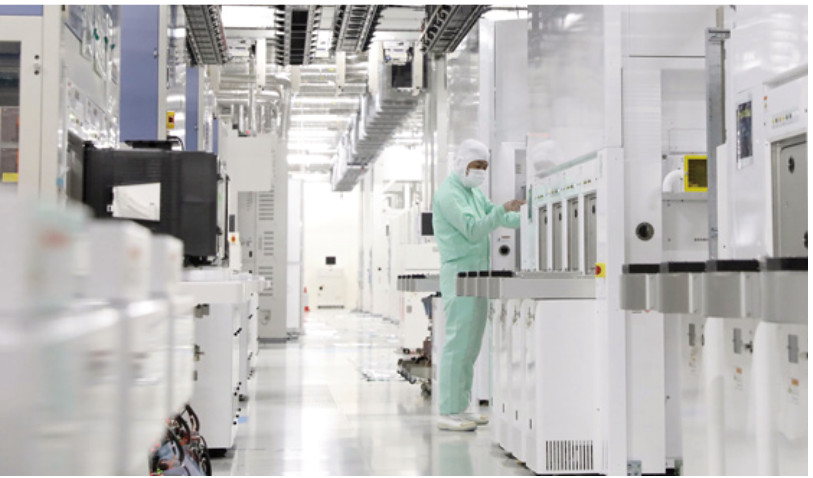 
Volume on a Storage Capacity Basis (FY2025) 
## Key Points 
on a storage capacity basis (ineluding joint venture with Sandisk Group, FY2025) Capital invetment (FY2025) 
Global share of flash memory production volume 
283.7 billion yen 28% Source: Techlnsights Inc. AND Markat ReportQ1,202 
Smart factories maximizing performance through an integrated production system combining the Yokkaichi Plant and the Kitakami Plant 
High cost competitiveness through disciplined capital investment and world-class flash memory production scale 
## One of the World's Largest Flash Memory Production Volumes 
The combined flash memory production volume on a storage capacity basis of the Yokkaichi Plant and the Kitakami Plant, including that of the manufacturing joint venture between Kioxia Group and Sandisk Group, accounts for one of the world's largest shares at 28% 
Fab7 of the Yokkaichi Plant started operation in October 2022, and Fab2 of the Kitakami Plant started operation in September 2025.These facities will continue to meet expected growth in demand for flash memory going forward. 
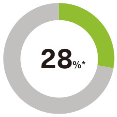 
*Soure:Techinsights In ND Manit epor1h2022 
## Cost Competitiveness Based on Production Scale and Efficiency 
Kioxia Group achieves high production effcieny through close coordination between the Yokkaichi Plant and the Kitakami Plan,which operate as smart actories utig and dig ata.T hes cliss meet growing fash memory demand with high ot copetespngon is aoy. 
production capacities High cost competitiveness 
High production efficiency 
X 
One of the world's largest 
## Manufacturing Leadership That Drives Our Joint Venture 
Approximately 80% of the production capacity of the Yokkaichi Plant and the Kitakami Plant is shared equally with Sandisk Group through a manufacturing joint venture, while the remaining 20% is held exclusively by Kioxia Group. Accordingly, approximately 60% of the flash memory produced at the two plants is alatat icxi opy. ixia uppnagsan operates both plants, and possesses advanced manufacturing expertise.

---

<!-- 原文第 3 页 -->

Kioxia Holdings Corporation Data Integrated Report 2026 
About Kioxia Group Messges from Senior Value Creation Story Management 
Growth Strategy Management Capital as the Governance Source of Value Creation 
33 
 
# Flash Memory Production Scale 
## Systems and Technologies That Enable Production at Scale 
The flash memory manufacturing process can be broadly divided into a rontend process.in which circuits are formed on silicon wafers, and a back-end process, in which the wafers are cut into tiny chips that are stacd and packaged. As the rapid adpin f ie d candor rgptrcpct flash memory, we are responding through advances in both stages of the manufacturing process: increasing capacity per chip at the front end and increasing capacity per package at the back end. 
## Smart Factories 
## Increased Production Scale and Efficiency Driven by Al and Big Data 
At our plants, manufacturing, inspection and metrology equipment generate a substantial amount of manufacturing related data every day, t the okici lant teprocucion lins generate approxiately 3 billio data points per day, A is sed to analze data in rea timefor varous purposes, including to help prevent product defects and automaticaly identify likely causes when defects do occur. 
## Amount of Manufacturing-Related Data Generated per Day at the Yokkaichi Plant 
We are working to improve yields amid plant expansion and an exponential rise in the amount of data handled. 
Through 2019: 
2025: 
Approx.2 billion data points/day 
Approx.3 billion data points/day 
Up to Fab6 in operation 
Up to Fab7 in operation 
## A Digital Twin Enabling Close Coordination between the Yokkaichi Plant and the Kitakami Plant 
The data obtained from manufacturing equipment and systems at both plants is replicated in a virtual environment in real time.Leveraging this"'digital twin" technology, we optimize manufacturing conditions based on large amounts of data and apply them to the manufacturing processes at both plants, enabling the plants to effectively share expertise and achieve high productivity. 
This approach enabled us to rapidly ramp up the Kitakami Plant, which commenced mass productior of flash memory products in 2020,and to achieve higher yields more smoothly than in the past.As a recent milestone,we successtully completed a rapid production ramp-up for 10th-generation BiCS FLASHM products at the Kitakami Plant, leading to sample shipments in July 2026. 
Digital Plant 
Physical Plant 
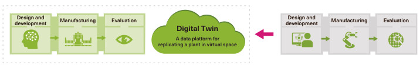 
## Advancement of Assembly Process Technologies 
Kioxia Group has enhanced production efficieny by outsourcing the majority of the semiconductor and SSD assembly processes to contract manufacturers overseas, and is working to strengthen its supply chain. At the Yokkaichi Plant, we are also focusing on developing and enhancing assembly technologies for advanced products. 
## TOPICS 
Advanced Assembly Technology for Stacking 32 Memory Dies in 
a 2 mm-High Package 
Kioxia Corporation has successfuly eveloped arge capacity 8terabyte flash memory by stacking thirty-two 2-terabit memory dies into a package less than 2 mmin height. Kioxia has optimized advanced technologies across mutiple assembly processes to support higher-capacity flash memory. These include wafer thining technology for grinding waers from a thickness of 0.8 mm down to 30-40 pum,molding resin technology that enables precise control and formation of ultra thin sections and narrow spaces of less than 100 um,and wire bonding technology for electrically connecting stacked dies to a substrate. 
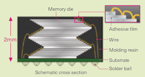

---

<!-- 原文第 4 页 -->

Kioxia Holdings Corporation Data Integrated Report 2026 34 
About Kioxia Group Messges from Senior Management 
Value Creation Story Growth Strategy Management Capital as the Governance Source of Value Creation 
 
# Flash Memory Production Scale 
Yokkaichi Plant (Yokkaichi City,.Mie Prefecture) 
Kitakami Plant (KitakamiCit,.(owate Perecture) 
Since its estabishment in 1992, the Yokkaichi Plant has developed as a state-ofthe_art manufacturing site for memory products. There are six Fabs and an assembly facity on the expansive 694,000 m site.Fab7 started operation in October 2022. Production fiency has been increased through the use of a production system that integrates the six Fabs, as well as Al and big data. Moreover, through close coordination with the onsite research and technology development departments, there is a smooth transition from new product development to mass production. 
The Kitakami Plant was established as a mass production site to meet growing demand for fiash memory. Fab started operation in2020 an Fab2 started operation in September 2025. Production capacity of the plant will be continuously expanded in line with growth in demand. Specialized in mass prduction, he plant ha increased jedsand prouctvty.Thrugh ose digital coordination with the Yokkaichi Plant using digital technologies and by building on its expertise, the Kitakami Plant contrbutes to highly efficient production of high-quality products. 
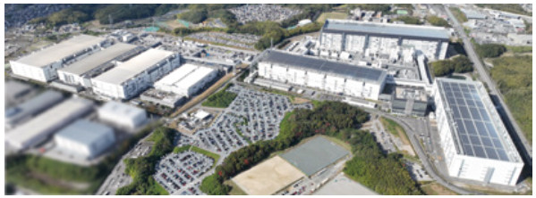 
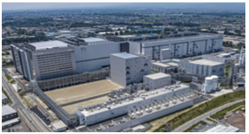 
Message 
Kazuhiro Shimizu,General Manager of Cokkicki Pan.Klxi Coporaton 
Message 
Koichiro Shibayama.President and Chief Executive Officer, Kioxia Wwate Corporation 
The Yokkaichi Plant engages in both development and mass production as one of the world's largest flash memory plants. Leveraging AIl and big data to achieve high production efficiency, we deliver both production scale and quality as a smart factory. As a corporate citizen rooted in a region with an excellent industril fundation, we also engage in social contributins and environmental conservation activities and contribute to the sustainable development of society. 
Aiming to contribute to further increases in Kioxia Group's production capacity, the Kitakami Plant is expanding its production scale in line with market growth. In July 2026,we commenced production of 10th-generation BiCS FLASHTM products on a newly launched manufacturing line at Fab2,marking another milestone.As we continue to expand and develop,we will ontibute to the local economy and community as a company trusted by both our customers and local stakeholders. 
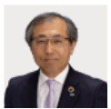 
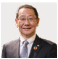 
## History of Yokkaichi Plant and Kitakami Plant 
Kitakami 
Started Fab1 operation 
S 
19921993 1996 
19992000 
2002 
2005 
2007 
Started Fab5 Phase2 operation 2019 
2022 
2020 
2018 
2016 
2014 
20102011 
2024 2025 
Started Fab2 operation 
Transferred N Started Fab4 operation operation 
Started Fab5 
Started Fab6 operation Started Fab7 operation Started New Fab2 operation 
Started Fab3 operation Discontinued 200 mm wafer Started 300 mm-water operation production line 
Started mass 
Yobhaichi 
Establishment 
isd n

---

<!-- 原文第 5 页 -->

Kioxia Holdings Corporation Integrated Report 2026 35 
About Kioxia Group Messges from Senior 
Value Creation Story Growth Strategy 
Management Capital as the Governance Data Source of Value Creation 
Management 
 
# Flash Memory Production Scale 
## Challenges and Measures for Sustainable Production Preparedness for Business Continuity 
For Kioxia Group, which supplies memory products to society, its manufacturing sites are crucial to business continuity. Under our BCM framework(P.56), ve implementdisaster-prevention and emergency response measures and develop systems forapd ecovry t our to mnratuing tes in Japan, the Yokkaichi Plant and the Kitakami Plant. 
For example, as an earthquake countermeasure we have adopted seismic isolation structures that absorb building vibratins. Furthermore, we have installed equipment hat protects key facilities from power outages and momentary voltage drops. In addition, we tak into account natural disasters, as well as geopolitical and other risks, and are working to strengthen supply chain resilience through measures such as supplier diversification, and standardization and reduction of components. 
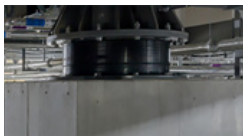 
Plant seismic isolation device 
## Initiatives for the Environment 
Kioxia Group promotes sustainable business activities that take environmental impact into account, including initiatives to address climate change, reduce waste, manage chemical substances and control wastewater quality. 
## Climate Change Countermeasures 
Kioxia Group will contibute to the realization of a decarbonized society by reducing greenhouse gas emissions and promoting the use of renewable energy at its manufacturing sites. We have set target of achieving net zero greenhouse gas emissions from our business activities by FY2050 (net zero means reducing net emissions to zero by subtracting greenhouse gas removals from emissions),and we will expand our use of renewable energy through measures such as instaling solar panels. Furthermore,in the wafer manufacturing process we have installed abatement equipment on allapicacle aitist b rak dow Pcs2 and other gases with high global warming potential before they are discharged. 
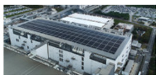 
Sosro we ene cen t 
## Effective Use of Water Resources 
We continually strive to reduce water withdrawal and wastewater volumes and encourage water recycling at ur manufacturing site.To support businss continuit an conserve water resources,we have set voluntary standards that are stricter than legal requirements and are working to reduce environmental impact and recycle water.In addition,we have assessed water related risks at our manufacturing ste in pan ndersesa thunh 0uoSun pcli/ccold/d/ Resources Institute and the Worldwide Fund or Nature,and are working to understand their potential impact on our busines actvits. Based on investigations into waer supply-demand ris, waterelated disaster risks, and watershed vulnerabity to pollution at our manufacturing sites through 2040, we identified no water risks that could have a material financial or strategic impact on our business. 
## Resource Recycling 
Kioxia Group considers the efeciv us of resources and waste reductin in ts manufacturing processes to beimportantisussnd e r woringt chv othitncdd environmental impact, For example, we are taking steps to improve resource circulation by rigorous sorting and reprocessing the daily waste we produce, with a particular focus on maintaining a high recycling rate of 90%or more for plastic waste. We are also promoting initiatives to reuse packaging materials used to transport wafers, products, and semifinished products and to reduce the amount of resources used, helping to lower our $CO_{2}$ emissions. 
## Natural Capital and Biodiversity 
Kioxia Group promotes biodiversity conservation activities,recognizing that biodiversity is a foundation for a sustainable societyand an extremely important form of capital inadesing joalisuesush as climate change and resource constraints. In addition, we analyze risks and opportunities, conduct scenario assessments, consider metrics and targets, and perform monitoring based on the Taskforce on Nature-related Financial Disclosures (TNFD) recommendations. Through these efforts we are exploring ways to bulid a sustainable business toundation that enables us to coexist with nature.From FY2024 through FY2025, we conducted initiatives in line with the LEAP approach,focusing on the direct opertions of Kioxia Corporatin. In the Lcate" phase, we identiied ecolgicalysesti ras and in the"Evaluate"phase,we idetfid and aluated dpendencies and impacts on natural capital. We are currenty n he" ss pase,idnitying the is and opportunitis thee dependencies and impacts pose for our business. '/) 
 
Sustainabiliy Management P P.57

---

<!-- 原文第 6 页 -->

Kioxia Holdings Corporation Integrated Report 2026 
About Kioxia Group Messges from Senior Management 
Value Creation Story Growth Strategy 
Management Capital as the Governance Source of Value Creation 
Data 
36 
 
# Technology (Intelletual Capta) Supporting an Al Society with Advanced Memory Technology 
 
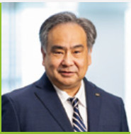 
Hideshi Miyajima Managing Executive Officer 
Chief Technology Officer Kioxia Corporation 
Key Points 
R&Dexpenses 
Number of reg istered patents 
141.1billion yen 
Approx. 15,000 (As of December 2025,Kixia Corporaion) 
(FY2025) 
Created a number of world firsts, such as the invention of NAND flash memory 
Promoting advanced and diverse research and technology development as a leader in memory technologies 
## Innovating Flash Memory Technologies that 
Power Value Creation in the AI Era 
Al is evovingat o nprecedented pace, ranstorming the way industries and society operate.Flash memory and SSD storage are no longer merely media for storing datat,they have become essential technology foundations that directly influence the perfomance and finy of stms s wlrhrugh helping to drive this transformation and create new value. innovation in flash memory technologies, Kioxia Group is 
Kioxia Group has long anticipated the needs of our changing times and continue t pursue technologica inationfity inventing NAND fiash memory, and later b becoming the fistcopanr in the world topropos the basic structure of three-dimensional flsh memory, BiCS FLASHTM. Today, in addition to furher increasing the capacit,performance,and power iciene of BiGS FLASH, ar focusing on the development of nextgenertion memory, storage systems, softare,and high-density packaging technologies designed for the future Al market 
At he same time,semiconductor technology is becoming increasingly challenging and complex to develop.For Kioxia Group to continue demonstrating technology leadership, it s essential that we not only invest in research and development,but also strengthen the core foundations of our innovation-our human resources, intellectual property, and partnerships. Through close collaboration between our research laboratoris, development center, and business divisions, we are working to improve developmenteficiency by leveraging Al and digita transtormation. We are also bulding rous development foundation that continusly generates innovation by inorporating new insights through co-creation with cxternal partners 
The true source of Kioxia Groups technological competitiveness is or people. To cultivate talent capable of taking on calengswih res deasand creatigy lve in apaily yhangigrn,v are strengthening our technicaleccatin iniaitvs nd promoin pesonal echange.As one xample, we are planning to establish "Kioxia College"(tentative name) as an internal initiative to urther develop our R&D professionals. by creating an enioment where people with diverse eapertise can inspire one another and grow together, we aim to become a world-class technology organization. 
Kioxia Group will continue to pand the possibities of lash memory as a technology leader that creates new standards through innovation. We will kep challenging ourselves to create new value that supports the advancement of an Al-driven society.

---

<!-- 原文第 7 页 -->

Kioxia Holdings Corporation Data Integrated Report 2026 37 
About Kioxia Group Messges from Senior Management 
 
## Strengths and Policy in Research and Technology Development 
Research and Technology Development Policy: Steadfastly Maintain Technology Leadership Centered on Advanced Memory Technology Innovation Kioxia Group has ahieved a number of word firt, uoh s th inin N aht ar and has contributed to innovation in society. We wil fous on investment in R&D,as well as on taln recruiment an deveopoem, an paresisd stiaty leadership by leveraging the memory technologies we have cultivated to address increasingly sophisticated and diverse market needs driven by advances in AI. 
## (1) Continuous Strategic Investment in R&D 
We will continue to invest in research and technology development focused on growth areas, including the further evolution of BiCS FLASH and the development of nextgeneration memory devices and storage systems. 
## (2) Recruitment and Development of High-Caliber Engineers 
We will recruit and develop highly skilled engineering professionals to advance cutting-edge technology development.We will rare ystems ad frameworks that enable them to fulylverege their capabities,enabling us to respond to increasingly sophisticated and diverse market needs. 
## (3)Generating Innovation Through Collaboration with Partners 
Through open innovation in collaboration with customers and R&D partners in various fields, we will generate new ideas and innovations and deliver value to society together. 
By addressing increasingly sophisticated and diverse market needs driven by advances in AI, we will expand business opportunities and steadfastly maintain our technology leadership. 
## Creating Industry-Leading Cuting Edge Technologies in the Field of Memory 
Continou r (1) 
Becnitment nd (2) Caliber Engineers 
Generating Innovation (3) Through Collaboration with Partners 
- Increasingly sophisticated and diverse needs - Increased complexity and intensifying competition in technology development -Competition for engineering talent 
## Research and Technology Development Structure for Leading Memory Technology 
## R&D Structure for Turning Research into Products 
Kioxia Group has estabished a research and technology development structure that supports industy lading memory technology We create new products through collaboration within our research and technology development structure.This structure consists of a research institute, which studies future technologies from a long-tem perspective, development centers, which develop technologies to be applied to products, and business divisions, which develop commercial products. 
Kioxia Group's Research and Technology Development Structure 
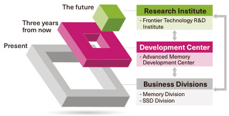 

| Frontier Technology R&D Institute | Promotes research and development of technolagies to support Al and its aplications, high-capacity and high-speed memory system technologies utilizing new principles and new materials,and new process technalogies for cost-efective semiconductor memory manufacturing |
| --- | --- |
| Advanced Memory Development Center | Serves as a bridge between research and development of Bis FLASH 3D flash memory and mass productian |
| Memory Division and SSD Division | Plan, develop,and market memory and SSD products that address increasingly sophisticated and diverse needs |
 
## Research and Technology Development Sites for Advanced Research 
Kioxia Corporation conducts research and technology development primarily at the Yokohama Technology Campus (okohama City, Kanagawa Prefecture) and the Memory R&D Center at the Yokkaichi Plant (Yokkaichi City, Mie Prefecture).Our overseas research and technology development sites are located in countries/regions where many advanced IT companies are based, providing us with rapid access to uting edge technologies and enabling us to respond flexibly to markets and customer needs 
## Using Al in R&D 
The Group is using Al for applications including manufacturing data analysis in product development, process condition optimization, faut detection and predictive maintenance at plants, image recognition-based defect inspection, and yield analysis and identification of defect causes. 
Our View of the Busin Rapid development of AI Market expansion 
Value Creation Story Growth Strategy Management Capital as the Governance Source of Value Creation 
Smart Factorie P P.33

---

<!-- 原文第 8 页 -->

About Kioxia Group Messges from Senior Management 
## New Memory Devices: Accelerating Development to Improve OCTRAM Device Characteristics 
New Memory Technologies Including OCTRAM 
We have developed highly stackable oxide-semiconductor channel transistors as a foundational technology for the practical implementation of high-density, low-power3D DRAM. This technology has the potential to achieve lower power consumption in a wide range of applications, including AI servers and loT products. 
ts00 e esnemrohred 
Value Creation Story Growth Strategy Management Capital as the Governance Source of Value Creation 
Kioxia Holdings Corporation Data Integrated Report 2026 38 
 
## Recent Research and Technology Development 
Kioxia Group is commited to the research and technology development of semiconductor memor, which is indispensable for rapiiy yoving gictiiint cn of AI.We are advancing development across the memory hierarchy in line with the requirements of Al and data centers, including BiCS FLASHTM 3D fiash memory. We presented the resuts of our research at major academic conferences in the semiconductor field, including the 2025 
## Interational Electron Devices Meeting(EDM),he 202 ymposium on VSI echnolgy and Circuits, and the 2026 International Solid-State Circuits Conference (ISSCC) 
The Group is also conducting a wide range of research and technology development aimed at generating new value in memory technology through creative ideas. 
QTechnalogy Topics 
## Aligning R&D with the Evolution of the Memory Hierarchy Driven by Advances in Al 
DRAM 
XL-FLASHTM 
## Development of BiCS FLASHM Devices 
Device Development BICS FLASHTM Gen.10/Gen.11 
We are developing next-generation devices for our current core products to address the Al inference market, combining increased layer stacking with horizontal scaling to pursue greater capacity and higher density. 
TLC 
## Development of SSDs for Al Systems 
QLC 
SSD 
Development New areas ineluding Super High IOPS 
We are develping SSDs for Al systems,led by the KIOXIA GP Seres Super High IOPS SSD, which helps achieve low lateny and high PS (read/rite operations)in Al inference systems. 
Capacity

---

<!-- 原文第 9 页 -->

Messges from Senior About Kioxia Group 
Management Capital as the Value Creation Story Growth Strategy 
Kioxia Holdings Corporation Data Integrated Report 2026 
Governance Source of Value Creation 
39 
Management 
 
## Intellectual Property Initiatives 
To enable Kioxia Group to continuously launch highly competive flash memory and SSD products and achieve stable business growth, the Group works to appropriately protect and effectively utiz its intellectual proprty (IP). Specifically we ous on strengthening our IP portfolio, managing ondnta informaton nd nanin our I inipapitsic an he roup customers and competitors are located outside Japan, wealso place importance on fling patent applications overseas. 
## Structure for Promoting Intellectual Property Initiatives 
The Group has established a system for creating and utizin strong I through close communication among the research and development, corporate planning, legal,sales departments,and the intellectual property department. 
## Patent Activities 
As of December 2025,iia Corporato dsaspatedl FY2025, approximately390 patent applications were published in Japan, whie in the nited States approximately 630 were published and approximately 540 were registered. 
## TOPICS 
## Kioxia Selected in Clarivate Top 100 Global Innovators 2026 
Kioxia Corporation has been recognized as one of the "Clarivate Top 100 Global Innovators 2026." The award is presented to the world's most innovative companies and organizations by Clarivate Plc.(headquartered in the United Kingdom), based on Clarivate's proprietary analysis of intellectual property and patent trends. This is the fifth consecutive year that the Company has received the award. The award evaluates companies based on multiple indicators, inluding not only volume but also infuence,success rate, geographical investment, and rarity. Kixia Corporation scored particularly highly for success rate and geographical investment. 
QAbout the BuzzCam colisborative research project 
## Fostering the Next Generation of Semiconductor Specialists and Engineers 
Kioxia Group is commited to promoting a range of initatives for the sustainale development of the semiconductor and flash memory industry. 
## Initiatives for Generating Innovation 
In 2024,Kioxia Corporation entered a cross appointment agreement with Kyoto Institute of Technology. Together they aim to promote R&D related to the design of large-scale integrated circuits (LSls) that operate at cryogenic temperatures and to develop talent in the semiconductor industry.Furthermore, to contribute to the advancement of science and engineering,we conduct an annual research grant program for researchers afliated with academic and research institutions in Japan.In FY2026, we invited proposals under the priority theme of "Memoryx Al Technology" and are providing funding for selected original and compelling research themes. 
Kioxia Group aims to create an environment in which new ideas and technologies are continuously generated, thereby laying the groundwork for future businesses.We are pursuing this through two key approaches: building structures and fostering a cultue that support innovation, and proactively collaborating with a wide range of partners in industry, government, and academia. 
## Academic Collaboration 
Kioxia Group collaborates with universities, technology organizations, and research institutes in Japan and overseas on a diverse range of reearch themes,incorporating deasrcomotside the Group to further enhance its research and technology development activities. 
## TOPICS 
## BuzzCam: Contributing to Advances in Ecological Research through Storage Technology in Collaboration with the MIT Media Lab 
Through collaborative research with the MIT Media Lab,Kioxia Corporation contributed to the development of a large scale dataset of bumblebee buzzes for ecological monitoring.Compied from acoustic recordings collcted in Patagonia using BuzZCam devices, the dataset is described in an article published in Scientific Data, a Nature Portfolio journal. 
BuzzCam is an outdoor acoustic monitoring device equipped with microphones, environmental sensors,abatter,y lapane and KIXIAmicro S memory cards for storage. Designed for long term operation in harsh field conditions, BuzzCcam enables passive collection of acoustic and environmental data while minimizing disturbance to natural habitats.This publicly avalable dataset can support a wide range of research appications, ineluding conservatin of endangered native bumblebee species, assessment of the ecological impacts of inasive species,and development of machine learning models for ecological monitoring. 
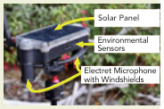 
Poadt

---

<!-- 原文第 10 页 -->

Kioxia Holdings Corporation Integrated Report 2026 
About Kioxia Group Messges from Senior Value Creation Story Management 
Growth Strategy 
Management Capital as the Governance Source of Value Creation 
Data 
40 
 
## Partnerships (Social and Ratiosip Capita) 
Co-Creation with Customers, R&D Partners, and Suppliers 
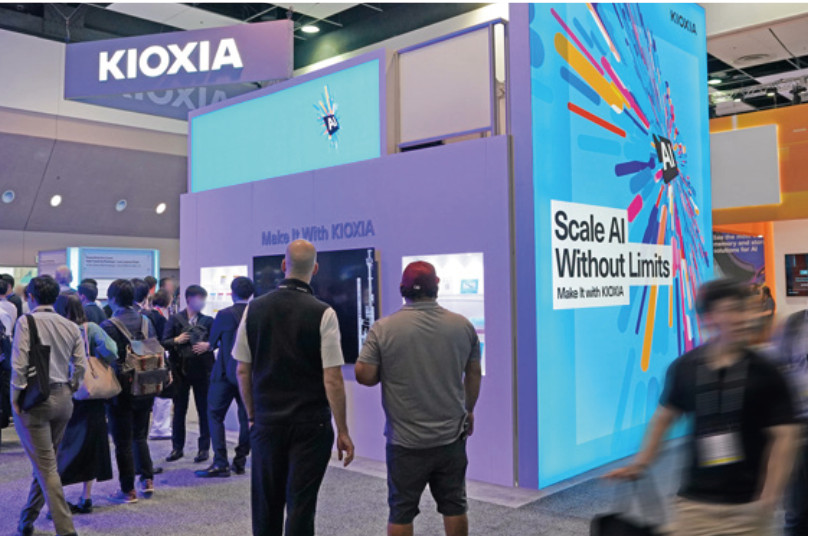 
## Key Points 
Business operation in countries/regions Timely response to global market needs 
Strong Partnerships with Customers, R&D Partners, and Suppliers 
Kioxia Group builds strong relationships with customers, R&D partners, and suppliers. We aim to further strengthen these partnerships, develop products and services that anticipate the needs of society, ensure a stable supply of high-quality products, and continuously deliver value to society. 
Customers: Leading global companies in the data center, smartphone, and PC fields We have estabished global sales, technical suppor,and supply chain networks,and co-create value to society together with customers all over the world. 
R&D Partners: Technology organizations, universities, research instiutes, and other companies in Japan and overseas 
We incorporate a vide range o utingdg owdg and des t ostonwitth aim of further evolving our products and technologies 
Suppliers: Equipment manufacturers, materials manufacturers, OSATs, and others We work with suppliers to build resien supply chains that ensure a stable supply of high-quality products, while strengthening our competitiveness by creating new manufacturing technologies. *Outsoured Semiconductor Assembly and Test 
## Kioxia Group's Global Locations 
Kioxia Group operates globally, with sits inine countries/regions. We have established strong relationships with leading companies in the data center, smartphone,and PC fields through our sales and supportcenters in the United States, Europe, and Asia. 
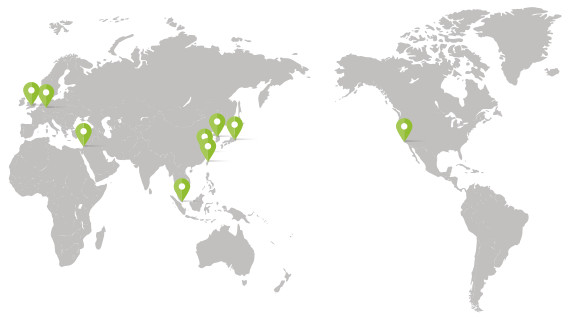

---

<!-- 原文第 11 页 -->

Kioxia Holdings Corporation Integrated Report 2026 41 
About Kioxia Group Messges from Senior Value Creation Story Management 
Growth Strategy Management Capital as the Governance Data Source of Value Creation 
 
## Strong Customer Relationships and Collaboration 
Trough is olbation it aing plocpssos pcs ci rp realize products and services that anticipate the needs of the growing Al market. 
## Examples of Co-Creation with Partners 
Buiding a Flash Based Platformor High-Capaciy,High-Performance,and Poer-Eficient Data Centers for AI Applications 
Kioxia Corporation and Dell Technologies buit a system incorporating 40 KIOXIA LC9 Series 245 TB enterprise SSDs, enabling a 2U server configuration capable of scaling up to 9.8 petabytes (PB) for Al applications. The two companies have a long history of developing scalable infrastructure for data-driven applications. This latest milestone underscores a shared commitment to advancing high-density systems that enhance performance, reduce energy consumption, and maximize data center efficiency. 
## Deepening Engagement Through Dialogue with Customers: Communication Activities at Trade Fairs 
Kioxia Group participates in various trade fairs and other events to help partners gain a better understanding of its latest products, services, and technological capabities,and to deepen dialogue with them 
At FMS: the Future of Memory and Storage 2025,the world's largest event for flash memory and storage, we showcased the Group's Al solutions through a keynote address and productsand technology demonstrations under the theme "Scale AI Without Limits."In adition,the highcapacity KIOXIA LC9 Series SSD for generative Al won the Best of Show Award in the Most Innovative Technology category. 
We also exhibited at major industy events hosted by leading companies in the Al and data center fields, including NVIDIA GTC, COMPUTEX, and Interop Tokyo, to highlight the critical role played by the Group's high-performance storage solutions. 
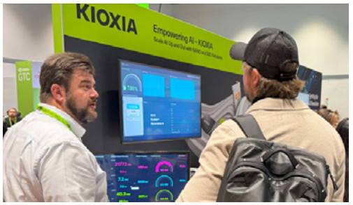 
A.live technology demonstration of KIOXIA AISAQ st NVIDIA GTC 2025 
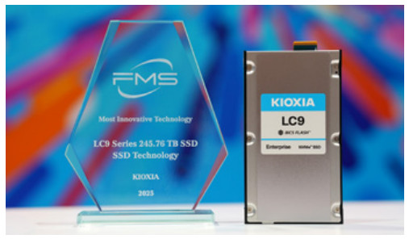 
The KIOXIA LC9 series enterprise Ss received the Best of Show Award at FMS 2025. 
## TOPICS 
## KIOXIA Innovation Lab Bridging Customers with Research 
KIOXIA Innovation Lab provides customers with an environment for testing and evaluating the company's new products, technologies, and software.We aim to enhance value for customers and the market by quickly and ffectivelyincorporating customer feedback into new products and technologies.

---

<!-- 原文第 12 页 -->

Kioxia Holdings Corporation Data Integrated Report 2026 
About Kioxia Group Messges from Senior Value Creation Story Management 
Growth Strategy Management Capital as the Governance Source of Value Creation 
42 
 
## Generating Innovation with R&D Partners 
We incorporate ideas from outside the Kioxia Group, from academic institutions and partners across industies,generating innovation through cose collaboration to deliver new value to society. 
Joint Development: Next-Generation Green Data Center Technology Development(Broadband Optical SSDs) 
Kioxia Corporation is working together with Fujitsu Limite, FINTY Ino..AI Core Co, Ltd.. Furukawa FITEL Optical Components Co,Ltd,Kycera Corporation, and NEC Corporation on the 
Nx-Geion Gre Data Center Tchnolgy Development Project" UPNP21029) Tis prpje subsidized by the New Energy and industrial Technology Development Organization (NEDO), is part of the"Green Innovation Fund Project Construction of Next-Generation Digjtal lnirastructure." Each company is contributing to the development of technologies for improving energy efficiency, increasing capacity,and reducing latency in data centers,including photoelectric fusion technologies that enable more eficient data transfer.By appying these technologies, the project aims to achieve energy savings of at least 35% compared with data centers at the start of technology development. 
Kioxia Corporation is responsible for developing broadband optical SSDs that use photoelectric fusion technology, and has confirmed the operation of a PCle5.0-compatible prototype. 
To support the realization of next-generation green data centers, we will continue deloping technologies to improve compatbility with advanced applications that rquire high-speed processing of large amounts of data, such as generative Al. We also plan to apply these technologies in proof-of-concept(PoC) testing toward the practical implementation ofdata center systems that use photoelectric fusion technology. 
Note: PCle is regitener arcark L 
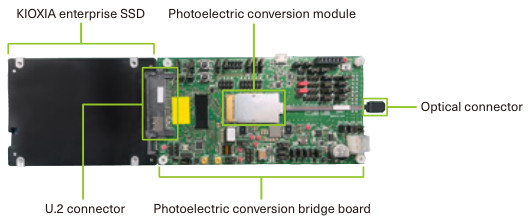 
Academic Collaboration P.39 
## Building Robust Supply Chains Through Co-Creation with Suppliers 
Kioxia Group's products depend on supply chains involving suppliers in a wide range of fields, including semiconductor maufacturing equipent afacturers,aterials manfacturers,a OSATs. Cooperation with suppliers is essential to improving product quality, ensuring a stable supplf rot,an iniing thipt of poicaik natass chains. In addition to the Group's own initiatives, such as diversifying procurement sources and standardizing components, we actively work to create robust supply chains by promoting mutual understanding and building trust with suppliers. 
## Deepening Dialogue with Suppliers through Partners Day 
In November 2025,Kioxia Corporation held Partners Day, inviting over 100 suppliers from Japan and overseas. The company provided detailed explanations of market trends and Kioxia Group's business sratejisan policies_and presented awards to outstanding suppiers. We wil to enhance supply chain resiienc by fostering mutual understanding and enhancing engagement with suppliers through dialogue. 
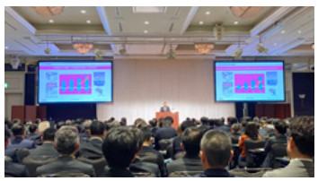 
Business policy presentation at Partners Day 
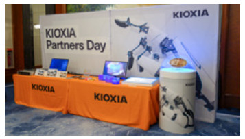 
Product dlsplay booth

---

<!-- 原文第 13 页 -->

Kioxia Holdings Corporation Data Integrated Report 2026 
About Kioxia Group Messges from Senior Management 
43 
 
## Human Resources (Human Capital) Professionals Supporting the Realization of Our Mission 
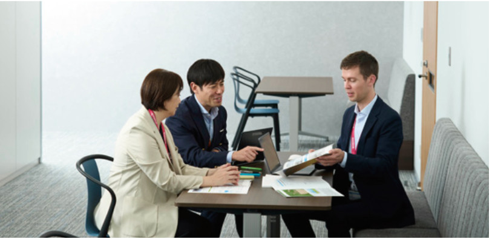 
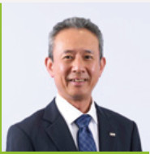 
Kyota Okishiro Managing Excutive Office General Manager, Human Resources and Administration Division Kioxia Holdings Corporation 
Key Points 
Number of Employees 15,218 (As of March 31,2026, Koxia Grcup) 
New graduate recruits 476 Nog 
Ratio of mid-career recruits 63.6% (FY2025,Kiocia Corporation, hr f o trts 
Value Creation Story Growth Strategy 
Management Capital as the Governance Source of Value Creation 
Number of female managers 111 (As of March 31.2026,Koxia Carponatine aluaie adonnn 
People with diverse experience and skils contribute across a wide range of fields. 
We will further strengthen the human capital we have cultivated to support Kioxia Group's sustainable development and realize its mission. 
## Our Diverse Talent and Human Capital-the Key to Sustainable Growth 
Guided by our mission of "upliting the world with 'memory," Kioxia Group aimns to continusy crat e walue or ot through our memory technology. The efforts of every single employee are essential f we are to accomplish this mission Accordingy, we se or human resources as the ounatin on sustainable growth and the source of our future value creation. The rapid advancement of Ai is rastcal sorming business environment.Expectations of our Group as a provider of fiash memory and SSDs indispensable to this Al-driven world are rising, and the competition to acquire technical talent is intensifying. To turn these challenges into opportunities for sustainable growth, we must ensure our organization embodies our mission and vision. This means cultivating an environment where diverse talent with whom these ideals resonate can best showcase their respective strengths. 
Securing and developing the human resources who will support our future growth is therefore one of ur key management prorts. Wweare stigt co ry teepte r industry and Kioxia to a wide range of generations, including yung people.Simutaneousl, we are bostin ur hiring f nen graduatsan pree profesis lininias from diverse backgrounds.n adtion,we are developing or management personeland establishing opportunities for diverse talent to take on new challenges and thrive. 
Althe same time, we are increasingly focused on creating an environment where every employee can perform at their best without undue stress, To this n, we are making sure our employees stay in good physical and mental health, seeing employee well-being as a core business driver. We ar also improving our workplace environments, identiying and resolving issues through employee surveys, and ostrin a orporate uture wher employees respect one another and proactively embrace challenges. 
We believe that maximizing the potential of our human resources directly enhances our corporate value. Kioxia Group accordingly aims to be a company where every employee can grow professionally and take pride in their wor. By leveraging the wisdom and experienc of our diverse talent to enhance human capital, we willahihve ustialegrouth and continue to be a company that is essential to society.

---

<!-- 原文第 14 页 -->

Kioxia Holdings Corporation Data Integrated Report 2026 44 
About Kioxia Group Messges from Senior 
Value Creation Story Growth Strategy 
Management Capital as the Governance Source of Value Creation 
Management 
 
Human Resources 
## Kioxia Group's Approach to Human Capital Management 
At Kioxia Group,a wide rang of peop ontribut arosgpdt dpd amid the rapid evelopoment and aoption o I th up orinn ranhtns htnaptdnn n ntnnn a Polcy, Kioxia Croup identis e susnsthtspttitwoiei business growth, and the realization of its mission,"uplifting the world with 'memory." 
## Human Capital Management Map 
Our Aspiration 
Our View of the Business Environment 
Key Issues 
## Initiatives 
## Organization Embodying Our Mission and Vision 
Increasing recognition of the semiconductor industry and Kioxia among younger generations to secure future talent 
## Recruitment Activities 
·Raise awareness of the semiconductor industry and highlight its appeal among the general public and younger generations 
We will provide products and services that create new value for society through memory technology, based on our mission of "uplifting the world with 'memory." 
·Actively recruit new graduates and experienced professionals 
·Recruit talent with diverse backgrounds 
Enhancing employee skilsand operational efficiency to keep pace with increasingly advanced and diverse technologies 
Human Resource and Organizational Capability 
·Develop talent with advanced expertise 
·Strategically develop management talent capable of leading value creation 
·Create opportunities,an ervironment, and a culture that enable diverse talent to thrive 
·Al-driven market expansion and evolution of applications 
Ideal Employees for Our Organization 
Enhancing organizational management capabilities to enable value creation 
## Corporate Culture 
·Advances and diversification in digital technologies 
uo to noterieai ehtenitropgs nolteringo bn tel noisiv hne noissim 
Embed the behavioral uidelines based on our mission and vision 
Behavioral Guidelines 
·Intensifying competion for ·Share inspiring images of the future engineering talent 
## Foundation Enabling Employees to Thrive 
·Explore possibilities without constraints 
## Systems 
arrangements illness or injury 
Flexible work 
employees during 
efficiency 
Safety net to support 
enhance operational 
management 
transformation to 
·Promoting health 
Promotion of digital 
health and safety 
evaluation systems 
Ensuring employee 
·Appropriate 
Health and Safety 
Engagement 
Developing global talent to help build and strengthen partnerships 
·Think for yourself,be active, cooperative,and flexible 
·Conducting and analyzing engagement surveys 
·Be inclusive,respect others 
·Implementing improvement measures based on survey results 
·Act with integrity and transparentty 
Building an organizational foundation that enables diverse talent to thrive

---

<!-- 原文第 15 页 -->

Kioxia Holdings Corporation Data Integrated Report 2026 
About Kioxia Group Messges from Senior Value Creation Story Management 
Growth Strategy Management Capital as the Governance Source of Value Creation 
45 
 
Human Resources 
## Recruitment Activities 
## Diversity Promotion 
To respond swifly to growing market needs and increasingly advanced and diversified technologies, Kioxia Group regards the recruitment and development of people with divre backgrounds as a key priority,As such, it atvely ecruts rew graduates and mid-career talen,.ineluding through referral and alumni recruitment. 
Kioxia Group believs that enabling diverse talent to thrive wil ecorg ewideas reatr divestyinn approaches to issues, and inovation, ultmately leading to corporate growth and the creation of new value for society, The Grup is committed to crating opportunities,an environmen,and a culture that enable diverse talento l ps te nce ili/n e e eii i women's participation in management as a key priority. 
Kioxia Corporation has established a Training and Development Committe to further enhance the development and effective utlization of ts personne., ased on the business plan, the committee reviews the results of in-house training programs each fiscal year, deliberates on measures for improvement and policies for the following fiscal year,and provides feedback for training activities. In FY2025, the committee eiberated on enhancing management training and roling out companywide digital transformation training. 
Kioxia Corporation set a target in FY2021 of doubling the number of female managers compared with FY2019, and achieved this target by the end of FY2025.In March 2026,it st the folwn ihnhtragtss and is taking steps to achieve them. 
·Ratio of female managers:7%(by FY2030) 
·Ratio of female new graduate recruits: Al least45% for administrative positions and at least 15%for technical positions 
Numbers of New Graduate and Mid-Career Recruits (Kioxia Corporation) 

| | FY2023 | FY2024 | FY2025 |
| --- | --- | --- | --- |
| New graduate recruits! | 511 | 276 | 119 |
| Mid-career recruits | 25 | 63 | 208 |
 
These targets are also stipulate in our General Employers Action Plan under Japan's Act on the Promotion of Women's Participation and Advancement in the Workplace QDiersity Promotion 
## 2Nbeoo Organizational and Talent Development Technical Training 
Aoiaons n 
Number of Female Managers 
Ratio of Female New Graduate Recruits 
Kioxia Group is focusing on the development of engineers capable of meeting increasingly advanced technical needs and leading the industry in the yars ahad.For new employees of Kixia Group in Japan,we provide basic training to strengthen their foundational skills in the semiconductor field, and from their second year onward, we offer more advanced specialized technical courses. At each workplace, we have also estabished a framework for amployees to aquie pratical slithoh on-thejob training.In addition, we provide an environmenthat enables engineers to proactively develop their own careers.We foster generalists who bridge business and technology, as well as professionals who integrate different technologies to create new value. 
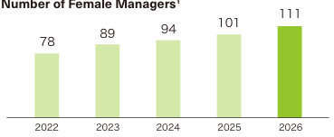 

| | Administrative positions | Technical positions |
| --- | --- | --- |
| FY2022 | 53.3% | 13.2% |
| FY2023 | 37.5% | 8.7% |
| FY2024 | 30.4% | 9.7% |
| FY2025 | 71.4% | 14.3% |
| FY2026 | 59.3% | 7.2% |
 
i desoth nw 
Kiaxia Corporation an Group companies in Japan 
## Developing Future Managers 
## Passing Technical Skills on to Future Generations 
Kioxia Group in Japan provides training at every levelfrom new reruisto management to enance the competitiveness of the overall Croup. In training and development based on levels of responsibility (level-specific education),we provide training for leders and managers to acquire the knowledge and skis neded for their roles a wlls aa ccaic argorams to tengthen their management capabites.For managers in particula, we provide ongoing training to help them demonstrate leadership within the organization and improve performance. 
The Group has Senior Fellows-professionals who are active in wide ranin felds inludig rhitecture, memory design, and memory development.They are committed to passing on advanced specialist knowledge and expertise in research and technology development and product development to the next generation, as well as contributing to the development of semiconductor technologies. 
Talent Development

---

<!-- 原文第 16 页 -->

Kioxia Holdings Corporation Integrated Report 2026 
About Kioxia Group Messges from Senior 
Value Creation Story Growth Strategy 
Management Capital as the Governance Source of Value Creation 
Data 
46 
Management 
 
Human Resources 
## Corporate Culture 
Embedding the Mission, Vision, and Behavioral Guidelines 
Kioxia Group regularly provides levelspecific eucation and e-learning programs designed to deepen employees understanding of the mission and vision.We have also established our Behavioral Guidelines to express the values that each employee should embrace based on the mission and vision, and are working to foster a corporate culture around them. 
At Rioxia Group in Japan, yarious initatives are underway to share senior management's perspectives on the mission and vision with employees. These initiatives inlude management policy briefings led by senior management and the publication of interview aricles on the internal communications portal site 
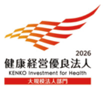 
Moreover, Kioxia Corporation has incorporated specific initiatives aligned with the Behavioral Guidelines into employees' target management and performance evaluations. it aims to connect each employee's work with these values so that the organization as a whole can work toward the mission with a shared sense of purpose and continue to grow. 
## Foundation Enabling Employees to Thrive Promoting Work-Life Balance 
The Group is working to create systems and foster a corporate culture that together enable each employee to work in their own way while achieving both high productivity and work-life balance. 
For example, Kioxia Corporation aims to maintain a childcare leave utiization rate of 100% among female employees and achieve a rate of 85% or higher among eligible male employees. To this end, it has estabished systems such as hourlyunit annual leave and nursing leave to support employees in balancing their careers with childcare. t also works to increase awareness in the workplace, including through roundtable discussions for employees who have taken childcare leave.In FY2025, the childcare leave utiization rate was 100% among female employees. Among eligile male employees, the rate was 69.8% (Number of male employees who took chidcare leave, etc. divided by the number of male regular employees whose spouse gave birth) and has been increasing year by year. 
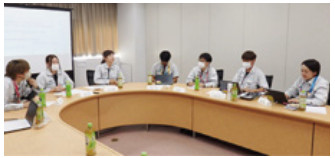 
Panbt 
## Health and Safety 
The Group recognizes the vitality and mental and physical well-being of each employee are an important foundation supporting its business activties.,Accordingly, we are working to create a safe and comfortable working environment for all employees and others involved in our business activities. We have acquired certification for occupational health and safety management systems under ISO 45001:2018, mainly at or manufacturing and R&D sites. Based on these systems,we continuously conduct risk assessments, confirm compliance with relevant laws and regulations, and increase the visibility of health and safety management. In March 2026,Kioxia Holdings Corporation and Kioxia Corporation were recognized for the third consecutive year as Outstanding Organizations of KENKO Investment for Health (Lage Enterprise Category) by the Ministry of Economy, Trade and Industry and the Japan Health Conference. 
 
Health and Safety 
## Employee Engagement 
Kioxia Group regularly conducts employee engagement surveys, identifies issues, and implements measures to address them. 
In FY2025,we conducted an anonymous worldwide survey of about 14,500 Kioxia Group employees, asking about the Group's strong points and areas for improvement, as well as their levels of satsfation with thi compry, thir wor,thir superisors, an teir worplacs, We received responses from 92% of those targeted. Analysis of the results identifid the isue of communicating the Company's vision and the rationale behind management decisions to employees in a more understandable manner as one to be addressed. In response, members of senior management regularly visit business sites to engage in direct ialogue with employees. 
Going forward,we will enhance corporate value by continuing to strengthen employee engagement through a cycle of surveys, analysis, and measures. 
QDiversity Promation 口Health and Safety 
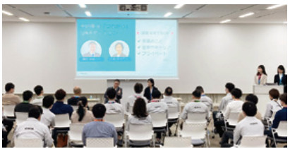 
Dialogue between senior management and employees
