> 原文件：[26_www.kioxia-holdings._Integrated-Report-2026-all-en.pdf](https://github.com/jadennevercode/CJCC-Knowledge-Base/blob/564ab11aa9785e569e3853c8a4d7ce86f88e7535/materials/%E4%B8%AD%E6%B8%B8%EF%BC%9A%E9%87%8D%E7%82%B9%E5%B7%A5%E5%8E%82%E4%B8%8E%E5%88%B6%E9%80%A0%E5%9F%BA%E5%9C%B0/26_www.kioxia-holdings._Integrated-Report-2026-all-en.pdf)
> 转换方式：Volcengine OCRPdf v3, parse_mode=ocr

<!-- 原文第 1 页 -->

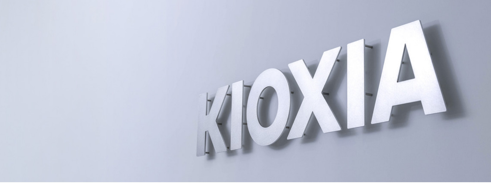 
Uplifting the world with "memory" 
Integrated Report 2026 Kioxia Holdings Corporation

---

<!-- 原文第 2 页 -->

Kioxia Holdings Corporation 1 Integrated Report 2026 
## Contents 
## 5 Management Capital as the Source of Value Creation 
32Flash Memory Production Scale 36Technology 40 Partnerships 43Human Resources 
1 About Kioxia Group
3Mission & Vision
A Global Leader in Flash Memory and SSDs
5 Our History At a Glance
Messages from Senior Management
8Message from the President and Chief
Executive Officer
11 Message from the Executive Chairman
13 Message from the Chief Financial fficer
Value Creation Story
16Value Creation Process
18 Feature | Social Value Created by Kioxia
Group for an Al-Powered Society
Growth Strategy
23 Market and Social Environment
25 Our Strengths
26 Growth Strategy in the Al Inference Era
27 Business Activities 
6 Governance 
48Corporate Governance 55 Risk Management and Compliance 57 Sustainability Management 
## 7 Data 
62 Financial Highlights 63 Non-Financial Highlights 64Company Outline 
## Key Points of This Report 
1.Senior mnagement an executive ficer ro busnesssustainabity and other areas, plain Kioxia Group's growth strategy and compettive advantages in the Al inference era, and share their respective commitments. 
2.The Group's value creation process is xplained from overall and time-based perspectives,clarifying the relationship between the social value the Group creates and its mission and vision. 
3.Concise explanations are provided for the Group's four forms of management capital that serve as the foundation for value creation, its sustainabiity initiatives, and the governance that supports its corporate activities. 
## Editorial Policy 
Scope of the Report Kioxia Group (Kioxia Holdings Corporatin and consolidated subsidiaries) For mattr where therepring scope difers,te sple cpse eprl 
## Reporting Period 
FY2025 (April1,2025-March 31,2026) This report also ineludes certain information from periods before and ater FY2025,s well as reent attie 
## Accounting Standard 
International Financial Reporting Standards (IFRS) 
## Reference Guidelines 
The lnternational Integrated Reporting Framework compied by the IFRS Foundation,the Guidance for Collaborative Value Creation provided by the Ministry of Economy, Trade and Industry,the GRI Standards of the Global Reporting Initiative, and the SASB Standards of the Sustainability Accounting Standards Board,etc. 
## Disclaimer Regarding Forward-Looking Statements 
This report contains historical nd crnmaio oi rys w g statements, ineluding strategies, forecasts,and ther projections.These statements are based on information available at the time of the report's preparation and involve risks and uncertainties. Accordingly, actual business results and financial performance may differ materially rom those expressed or implied in the forward-looking statements due to various factors. 
## Disclosure System 
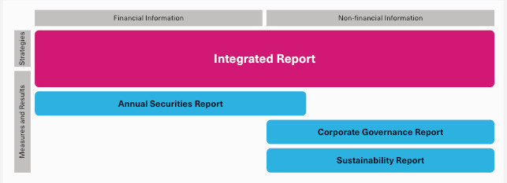 
Other compary names,product names,and senice names in this repart may e trademarks of their respective companies

---

<!-- 原文第 3 页 -->

Section 
## About Kioxia Group 
1 
3Mission&Vision
4 A Global Leader in Flash Memory and SSDs
5 Our History
6 At a Glance

---

<!-- 原文第 4 页 -->

Kioxia Holdings Corporation Data Integrated Report 2026 
About Kioxia Group Messges from Senior 
Value Creation Story Management 
Growth Strategy Management Capital as the Governance Source of Value Creation 
3 
Mission &Vision 
Mission 
## Vision 
Uplifting the world with "memory" By evolving "memory,"we create upliting experiences and change the world. 
With progressive memory technology at the core, we offer products, services, and systems that create choice and define the future. 
Origin of the Name "Kioxia" 
The name KIOXIA is a combination of the Japanese word kioku meaning "memory" and the Greek word axia meaning "value." 
KIOXIA 
The concept of kioku, which underpins our mission and vision, goes beyond the notion of memory as mere data to more broadly encompass experiences, emotions and ideas.

---

<!-- 原文第 5 页 -->

Kioxia Holdings Corporation 4 Data Integrated Report 2026 
About Kioxia Group Messges from Senior Growth Strategy Value Creation Story Management 
Management Capital as the Governance Source of Value Creation 
## A Global Leader in Flash Memory and SSDs 
Flash memory is semiconductor memory that can record and store large amounts of digital data. The most important feature of flash memory is that it is non-volatile, meaning that it retains data even when the power is turned off. 
Kioxia invented NAND flash memory in 1987.Bulding on this technological inovation, in 2007 we announced the world's first 3D flash memory technology,"BiCS FLASHM" We also began developing SSDs buit with BiCS FLASHM. With nearly 40 years of experience in developing advanced technologies, we have estabished a position as a leading company in the field of flash memory and SSDs. 
Kioxia Group's fiash memory and SSDs are used in digital devices such as smartphones and PCs, as well as n at centers that support cloud services and in other aplications, helping to drive the development of the digital society. As Al is increasingly adopted and becomes part of the infrastructure of society, flash memory and SSDs are becoming ever more important as essential foundational technologies. 
 
## Kioxia Group Products 
Memory 
## SSDs (Solid State Drives 
We offer iverse linep ofash memory products to meet a broad range of needs, with applications in smartphones,tablets,and automotive and industrial equipment. Wealso offer lash memorybased storage class memory that features low latency and high performance. 
We focus on SSD products for Al data centers and enterprise applications.Wve offr SDprducts for a wide range of markets, from client PCs to enterprise servers and cloud data centers, as well as for consumers. 
## SD Memory Cards and Other Retail Products 
Our retail lineup includes microSD and SD memory cards for applications such as digital cameras, smartphones, and dash cams, as well as USB flash drives available in a variety of capacities and designs. 
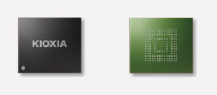 
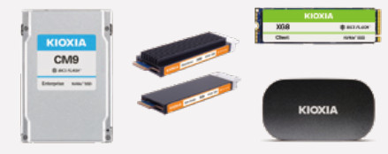 
梦Vwe 512 
256k 
1m 
KIOXIA 
EXCERIA PLUS 
KIOXIA 
KIOXIA

---

<!-- 原文第 6 页 -->

Kioxia Holdings Corporation Data Integrated Report 2026 
About Kioxia Group Messges from Senior Management 
Value Creation Story 
Growth Strategy Management Capital as the Source of Value Creation 
Governance 
5 
## Our History 
Since inventing NAND flash memory in 1987, Kioxia Grup has cutivted flash memory and SSD technology and the people who support it, Bilding on this foundation, we have pursued our mission as a company supporting society's digitalization and the advancement of information technology.Kioxia Group has grown since then. It currenty employs approximately 15,000 people worldwide and had consolidated revenue exceeding 2 trillion yen in FY2025. 
2018 Spun off from Toshiba Group 
10th-generation BiCs FLASHTM Engineering Corporation 
Announcement of 
2022 Acquisition of Chubu Toshiba 
2025 
2019 March Establishment of Toshiba Memory Holdings Corporation October Company name changed to Kioxia Holdings Corporation 
Campus and Shin-Koyasu Technology Front 2,337.6 billo yo 
Building at Yokohama Technology 
Revenue 
2023 Start of operation of Flagship 
We will continue to pursue advances in technology with the aim of contributing to the sustainable development of an information society underpinned by Al and enriching our lives by promoting more abundant and convenient lifestyles. 
1987 
2008 World's First SATA SSDs with MLC NAND adopted in laptop PCs 2015 World's First Commercialization of 48-layer BiCS FLASHIM 
2020 Acquisition of LTEON Technology's SSD business Start of production at Kitakami Plant 
2024 Listed on the Prime Market of the Tokyo Stock Exchange 
2000 Commercialization of SD memory card 2005 Start of 300 mm-vafer fab operation 
World's First Invention of NAND flash memory 
1991 
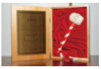 
World's First Commercialization of NAND fiash memory 
2007 World's First Announcement of BiCS FLASHTM 3D flash memory technology 
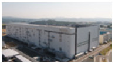 
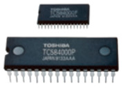 
2017 Establisment of Toshiba 2000s-2010s Advancement of digital society Memory Corporation 
1992 Establishment of Yokkaichi Plant 
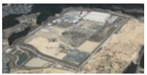 
1987 19911992 2000 
2005 2010 
2015 
2020 
2025(FY) 
internet digitalization 
Spread of the 
Start of 
1990s 
Changes in Society 1980s 
2020s Development of an Al-powered society 
Note o vevPpnhop v s

---

<!-- 原文第 7 页 -->

Kioxia Holdings Corporation Integrated Report 2026 6 
About Kioxia Group Messges from Senior 
Value Creation Story 
Growth Strategy 
Management Capital as the Governance Source of Value Creation 
Data 
Management 
## At a Glance 
Kioxia Group will coribut to te veveepomentof agtaia tepnnd e as d np supports the as sources of compettive trength i th hanhy coptis mor martwhr tehogica inoio siye wiin corporate value over the medium to long term. 
## Flash Memory Production Scale 
 
## Partnerships 
 
Revenue (FY2025,consolidated basis) 
Global share of flash memory production volume on a storage capacity basis (FY2025) 
Global network Business operations in countries/regions 
Overseas sales ratio Strong (FY2025) 
Smart Factories Coordination between the 
Partnerships 
2,337.6 biay 
Yokkaichi Plant and the Kitakami Plant 28 
with customers,R&D partners, and suppliers 
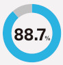 
We have sales and customer support centers in Japan,the United States,Europe,and Asia. Our bases in Japan and overseas work closely together to deliver products that meet market needs. 
products,and continuously deliver value to society. partners around the world. 
needs of society,ensure a stable supply of high-quality 
fieneo smetabh snns 
and services that anticipate the 
leading companies in the data 
partnerships,develop products 
strong relationships with 
We will further strengthen our 
Kioxia Group has established 
Revenue and operating profit reached record highs as Kioxia Group captured expanding demand for fiash memory driven by Al applications and enterprise data centers. 
Kioxia Group, together with its Sandte con of the world's largest shares of global production volume. Sore ATrnhnanz 
The two plants coordinate closely using Al and big data, achieving high production efficiency to meet growing demand for flash memory. 
Technology 
OA 
## Human Resources 
 
R&D expenses 
Number of registered patents (As of December 2025, Rioxia Corporation) Appoc:15,000 
Number of employees (As of March 31,2026,cansolidated) 15,218 
63.6% 476 
FY2025,Kixi Crportion share of total recruits) 
Coi 
Ratio of mid-career recruits 
New graduate recruits 
(FY2025) 
Selected for Clarivate Top 100 Global Innovators 2026 
141.1bioyo 
We are strengthening advanced development for applications including Al systems to maintain our technology leadership. 
Recognized for its continuous intellectual property (IP) boenhe o consecutive years, placing it among the world's most innovative companies and organizations. 
The Group focuses on strengthening its IP portfolio ed l p filing patent applications overseas,where many of our customers and competitors are located. 
in an environment that enables each individual to fully demonstrate their abilities individual strengths and thrive. 
and focus on employee development 
backgrounds leverage their 
We actively recruit diverse talent 
Employees from various 
We are focused on creating an environment that welcomes diverse knowledge and fosters innovative ideas.

---

<!-- 原文第 8 页 -->

Section 
Messages from Senior Management 
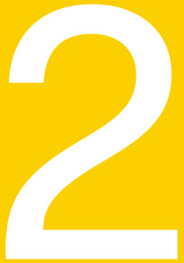 
8 Message from the President and Chief Executive Officer 
11Message from the Executive Chairman 
13Message from the Chief Financial Officer

---

<!-- 原文第 9 页 -->

Messges from Senior About Kioxia Group Management 
Value Creation Story Growth Strategy Management Capital as the Governance Source of Value Creation 
Kioxia Holdings Corporation Data Integrated Report 2026 
8 
Message from the President and Chief Executive Officer 
# Capturing Growth Opportunities in the Era of Al to Continuously Create Value Through the Power of Memory Hiroo Ota Pso 
Kioxia Holdings Corporation 
Seize the Moment: Turning Change into the Catalyst for Growth 
I assumed the role of President and Chief Executive Officer in April 2026. Since joining Toshiba, Kioxia's predecessor,.in198, have bult my career in appled technolgy, within the semiconductor memory division. Since 2001, my focus has been on market development for our NAND business. By standing at the forefront of technology marketing and engaging in direct dialogue with our customers, I have dedicated myself to driving our business expansion. 
As President, my primary focus is to continuously put into practice the Kioxia Group's mission of "upliting the world with memory." We aim to enhance our corporate value by helping advance our Al-driven digital sciety and resolve increasingly complex and sophisticated social issues through our technological innovations. 
The flash memory market has always been defined by rapid technological progress and dynamic changes in market conditions and the competitive landscape. To succeed, we must accurately anticipate these changes and translate them into decisive action. A guiding principle for me is to "seize the moment." We must never let an inlection point pass us by. By switty idenifying customer challenges and market trends, and rallying ur technology,product, manufacturing,and sales capabilities, we transform shits into tangile alue.itis th acumulation of these relentless efforts that has supported the growth of our Group.

---

<!-- 原文第 10 页 -->

Messges from Senior About Kioxia Group Management 
Value Creation Story Growth Strategy 
Kioxia Holdings Corporation Integrated Report 2026 
Management Capital as the Governance Data Source of Value Creation 
9 
## Message from the President and Chief Executive Officer Becoming a Go-to Memory Storage Company 
The applications for NAND flash memory have expanded across smartphones, PCs, automotive systems and data cetersping it n n enriching.As Al evolves from generative and agentic models to physical Al, the demand for memory storage capable of rapidly and effint pressing massie olumes of dat isgrowing xponentially 
Our roots trace back to NAND flash memory, invented by our predecessor, Toshiba, in 1987.Since then,we have proudly led the market,drive by our core strengths: technology development capabilities,manufacturing scale,and strong customer engagement. Moving forward,we wil sharpen these competive advantages, anticipate evolving market needs, and expand the potential of the memory solutions that empower more effectve data utization. our ambition is cleart to make Kioxia the go-to memory storage company for customers and partners. 
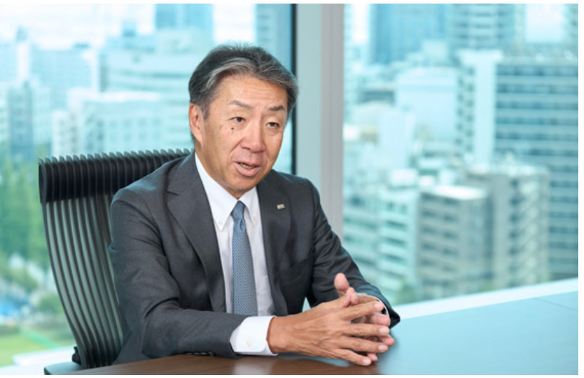 
## Capturing AI Demand to Drive Business Growth 
Our financial performance in fiscal 2025 achieved record-high revenue and profit. This success was driven by growing demand for memory solutions fueled by data centers, particularly for generative Al applications, alongside favorable pricing and increased shipment volumes. 
As Al transitions from training to inference,we are entering an era where data is utlized in rea lime across a broad range of scenarios. Hyperscaler investments in Al data centers remain robust, and demand for enterprise and data center SSDs is poised for continued growth. At the same time, foundational markets iks arthones and Ps remain vital Rater thn rideig spec applications, we will tak a holistic view of market trends, ensure stable yetagile production, and meet the soaring demand for Al infrastructure. 
## Driving Competitiveness Through Technology, Scale, and Customer Engagement 
The foundatin of Kioxia Group's competitiveness rests on three plasiu ecthoay development capabities,manufacturing scal, and customer engagement. As a provider of flash memory and SSDs, technology development is our most critical driver. We are committed to continuously pioneering cutig-ege technologies and products that deliver superior value to our customers and the market. 
While we operate on a global scale, our major production bases remain in Japan. Our manufacturing foundation-anchored by the Yokkaichi Plant and the Kitakami Plant-combined with robust partnerships with leading globa companies, constutes a compeling operational strength. Looking ahead, we illepncprioroso d mo nsd dinein Research and Development, Manufacturing, and Sales.By strengthening this end-to-end system, we can switly deliver products that anticipate and meet dynamic market needs. 
As Al volves,so do data center architectures. To rapidly and eficienty process massive data sets, storage performance must continuously advance. In lockstep with our partners, Kioxia Group wil refine the storage technologies enabling this Al paradigm shift and strategically execute growth investments. We are positioned to capture future market opportunities and deliver highly competitive solutions.

---

<!-- 原文第 11 页 -->

Messges from Senior About Kioxia Group Management 
Value Creation Story Growth Strategy Management Capital as the Governance Source of Value Creation 
Kioxia Holdings Corporation Data Integrated Report 2026 
10 
## Message from the President and Chief Executive Officer Accelerating Value Creation Through Our People and Teamwork 
For Kioxia Group to secure sustainable growth, the people who drive our technology development, manufacturing, and customer engagement are our most inaluable asset, We are united by a strong tam spitinerited from our predecesors. our histor,proves that loseclbrtion orostse corftarctions is what buit us into a inusty leader,as the business anvironment accelerates, e aso recognize that increasing our speed-to-market-from initial development to final delivery-is a critical imperative. 
One of my most important duties as CEO is to strngthen the teamwork we have cultivated,ensuring our entire organizatin is aligned around a shared ision and embraces chalenges,ven in a continuously evolving environment. To maximize our organizational strength, every employee must strive to deliver value for their colleagues, continuously reinforcing a culture of mutual trust. 
I constantly encourage our teams to keep their"antenna high"-staying attuned to the evolving needs of our customers and society, Fostering a mindset that takes ownership of technological evolution, market shits, and social issues, while drving cros-deprtmental collabratin is the catalyst that turns change into growth. 
I firmly believe that aligning the individual ambitions of our employees with tangible business results-and further strengthening our collective tamwork-will be rving fore behind the Kioxia Group's value creation in the Al era. 
## Contributing to a Sustainable Digital Society 
As a semiconductor memory provider, weaim to advance a sustainable society through our products and technologies. While the increasing capacity and performance of our flash memory and SSDs support growth across various industries, the rising power consumption of data centers has become a significant global chaleng. Kici rup vews th enery efoicin f urdutsasartcalpori. and we will aggressively pursue technological developments that contribute to energy conservation. 
Addressing cimate change is also a top management pririty,Rixia Group has commited to achieving net-zero greenhouse gas emissions by fiscal 2050.We are actively reducing our environmental footprint by implementing emission reduction measures in our manufacturing processes, advancing energy conservation, and adopting renewable energy sources. Furthermore,by building a robust supply chain with our partners and maintaining a resilient production system, we will achieve both sustainable business growth and meaningful societal impact. 
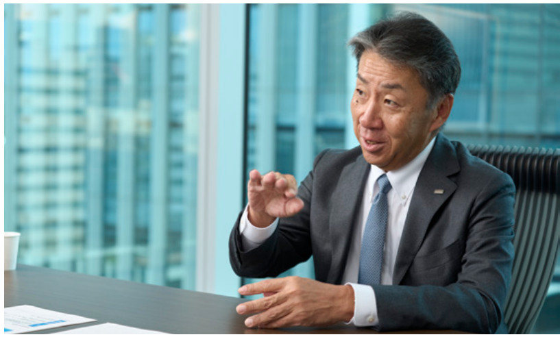 
## Enhancing Corporate Value Through Transparent Management and Dialogue 
To elizsustainale roh ndn our corporat ale, et asprat orance an indispensable foundation. Our management teamis commited to maintaining open and diligent communication, while executing our strategies with agility and speed. We deeply value dialogue with our stakeholders-including shareholders, investors, ustomers, businss parners,and local communities-and we will actively incorporate their insights into our management decisions. 
This Integrated Report is a vital to o taing ur ppach to value creation, our strategic vision, and our ongoing intiatives, hie assering asa bridge to deepen our dialogue with our stakehoders, including you.The Kioxia Group views the paradigm shifts ot the Al era not as challenges, but as profound opportunities for growth. Through the power of memory,we will continue to make society more convenient, enriching,and upliting. We remain dedicated to transforming ourselves, exceeding stakeholder expectations,and maintaining our position as a highly trusted company.

---

<!-- 原文第 12 页 -->

Messges from Senior About Kioxia Group Management 
Value Creation Story Growth Strategy 
Kioxia Holdings Corporation Integrated Report 2026 
Management Capital as the Governance Data 
11 
Source of Value Creation 
## Message from the Executive Chairman 
# Pioneering the AI Frontier: Kioxia's Heritage of Innovation and Sustainable Growth 
Stacy J. Smith 
Director Executive Chairman Kioxia Holdings Corporation 
## Reimagining Memory for the Al Age 
Today, our society stands at the threshold of a period of profound transformation. At the hearto avances in arfcialiininiseicicncntcnecrnron y inctcoss are no longer merely elecronic components; they have become critica infrastructure that underpins economic growth, industrial innovation,and societal progress 
Looking ahead, the widespread adoption of Al inference will drive unprecedented growth in computing power and data volumes, further increasing demand for high-performance semiconductor solutions that balance performance with power consumption.At h same time, our industry is expected to contribute to a more sustainable future by reducing environmental impact across the value chain. Kioxia supports this goal through multiple avenues, includin nergyeficient manufacturing, optimized productin processes,and flash memory technologies engineered for lower power consumptin. At hyperscale,these innovations can significantly enhance the energy effciency of A infrasructure,enabling more sustainable operations for our customers. 
Al is only as powerful as the data behind it, Handling data at scale requires advanced memory solutions. Flash memory is the indispensable foundation of the Al age,enabling the storage, accessibility, and intelligence that will shape our future for decades to come.

---

<!-- 原文第 13 页 -->

Messges from Senior About Kioxia Group 
Value Creation Story Growth Strategy 
Management Capital as the Governance Source of Value Creation 
Kioxia Holdings Corporation Data Integrated Report 2026 
12 
Management 
## Message from the Executive Chairman 
At the heart of the Al evolution, the memory hierarchy itself is being fundamentally redefined. Flash memory is evolving beyond its traditional role as a data storage medium to become a critical enabler of system performance, optimizing data movement and off loading computational burdens across Al infrastructure. 
In the era of Al inference,data is becoming essential infratruture for societ, and flash memory provides the foundation needed to store and use it fienty,As data volume continues to grow rapidly, meeting this unprecedented demand for Al infrastructure requires partners who can combine cutting-edge technology with unmatched manufacturing scale and supply chain reliability 
## Innovating for the Future 
Since inventing NAND flash memory in 1987,Kioxia has continued to innovate with a long-term vision and an unwavering commitment to creating value for society through technology.Our breakthrough in flash memory has helped transform industries, enabling the rise and evolution of smartphones, mobile computing, enterprise systems, and hyperscale data centers. This legacy is built on a proven track record of relentlessly improving our flash memory technologies-a foundation that enables us to sustain our technological ledership today and well inio the uture. We advance this leadership through industry-defining advancements applied to BiCS FLASHTM technology, including groundbreaking new architectures such as CBA (CMOS Bonded to Array) technology, as well as next-generation SSD solutions. 
While our history of delivering many world firsts reflets our technological leadership,it is ony on of our strengths. Over the decades,we have reinforced this foundation with unmatched manufacturing scale,a deep commitment to customer-centricity and the exceptional talent of our dedicated employees around the world. 
These strengths have enabled us to navigate industry cycles while ontinuing to invest in advanced technologies, manufacturing capabilities,and human talent. We believe that maintaining a long-term view and investing consistently through both favorable and challenging market conditions are essential to sustaining innovation and strengthening competitiveness. 
Today, the rapid adoption of Al for inference is transtorming industries and acelerating the growth of data at an unprecedented scale. As a result,high-capacity, high-performance,and energyefficient memory and storage solution are becoming increasingly critical to the digital economy. We believe flash memory will play an even more central role in the Al era, not only as a storage technology but also as a key enabler of system performance, fficiency, and innovation. 
Building on our heritage of innovation, Kioxia will continue working closely with customers and partners to address the evolving needs of society. By leveraging our technology leadership, anufacturing scal,trategi partnerships,antaleted worforce, w in drr sa growth, contribute to the advancement of our digital society, and deliver long-term value for shareholders and stakeholders. 
## New Leadership Driving Our Shared Future 
The formation of our new managementeam represents an important step in Kioxia's evolution and prepares us for the next stage of growth. What gives me great confidence is the depth of experience and diversity of perspectives this team brings. 
President Ota has buit his career across technology development, business leadership, and corporate management, gaining a comprehensive understanding of both our industry and our customers'needs. His leadership,combined with the expertise of the broader management team, provides a strong foundation for driving innovation,strengthening competitiveness,and delivering sustainable growth. 
Kioxia has always been defined by a pioneering spirit. Since the invention of NAND flash memory, we have continuously pushed the boundaries of innovation and contributed to the advancement of the digital society. Today, we stand at the dawn of another transformational era. The rapid adoption of Al is reshaping industries, accelerating data creation, and increasing the strategic importance of flash memory. 
In this new envionment,urabitio is lean to ake lxiath o o omry strage compary for customers and partners. Achieving this vision requires technological leadership,unmatched manufacturing scale and supply chain reliabity,as well sacelece iprut qualit,customer trust, and speed of execution.Fundamentally,our goal is to create long-term value by delivering innovative,energy-ffintehnologies that address society's evolving data needs and enable a sustainable future where technological progress and arvromental respnsibit g andin hnd. 
With a highly capable management team, a world-class technology portfolio,unmatched manufacturing scale, and a clear strategic direction,I am confident that Kioxia is well postioned to capture the opportunities of the Al era and deliver sustainable growth for our shareholders for decades to come.

---

<!-- 原文第 14 页 -->

Messges from Senior About Kioxia Group Value Creation Story Management 
Kioxia Holdings Corporation Integrated Report 2026 
Growth Strategy Management Capital as the Governance Data Source of Value Creation 
13 
# Message from the Chief Financial Officer 
# The Solid Financial Foundations That Will Deliver Sustainable Growth and Profit to Enhance Shareholder Value 
Yoshihiko Kawamura Executive Vice President and Executive Oficer Chief Financial Officer Kioxia Holdings Corporation 
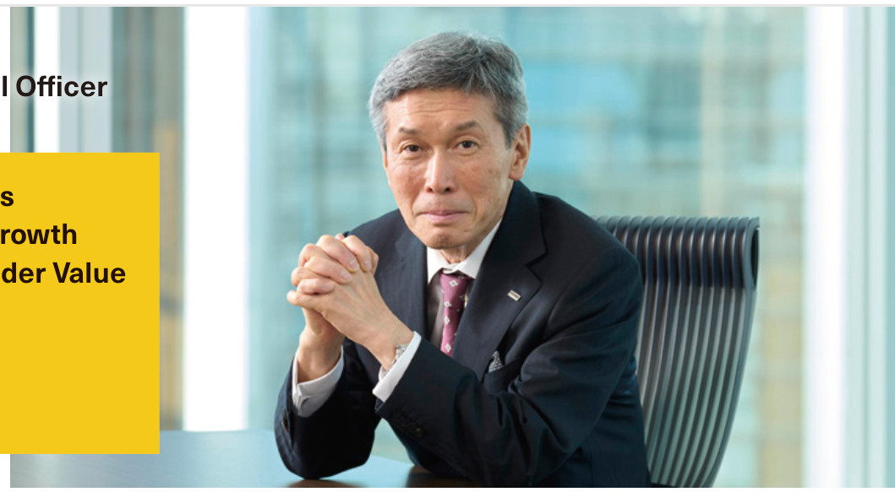 
## Financial Strategies That Drive Sustainable Growth and Corporate Value 
I assumed the role of Chief Financial Officer in April2026.My aim is to formulate financial strategies that will maximize the value of the Kioxia Group as a whole and ensure sustainable growth.Instead of focusing solely on the short-term, I devise medium-to long-term strategies that leverage our unique business strengths.Linking these perspectives enhances our abilty to execute these strategies. 
Consecutive Years of Record Financial Performance Leveraging AI Demand as a Core Growth Driver to Exceed Capital Market Expectations In fiscal 2025,ur consolidated revenue was 2,337.6 billion yen, with non-GAAP operating profit of 876.2 ilion yen, the second consecutive year of record highs for both metrics. Growing demand from the Al inerence market has significanty bosted or financial rnce ands rin expectations for further growth. 
Folowing our strong performance,expectations for our growth continue to rise.There is keen interest among investors and analysts in the potential contribution of long-term agreements (LTAs) with our customers, in the competitiveness of our technology and products with BiCS FLASHM at the core, in our financial strategy,and in shareholder returns. We willbe ure to ceary comunicate this potential to the markets and ensure it is firmly reflected in our management strategy. 
## Strategic Portfolio Transformation and Accelerated Investment Execution Concentrating on High-Growth Areas Helps Ensure High-Quality Profit 
Within the growing flash memory market, demand is shifting from the consumer sector to the industrial and enterprise sectors. Driven by investment in hyperscale infrastructure,demand for Al and data centers remains exceptionally robust. Few companies globally can provide a stable supply of fash memory,so we anticipate this positive trend will continue through 2027. Kioxia Group is seizing the oportunities this structural shift provides. Weare shifting our portfolio mix,aiming for data center and enterprise business to account for at least 60% of our total sales. We will maintain our focus on the smartphone and PC sectors-our bedrock-while making inroads into the edge Al market.Furthermore,we will leverage LTAs to increase the predictability of our revenues and stabilize our profits.

---

<!-- 原文第 15 页 -->

Messges from Senior About Kioxia Group Management 
Kioxia Holdings Corporation Data Integrated Report 2026 14 
Value Creation Story Growth Strategy Management Capital as the Governance Source of Value Creation 
## Message from the Chief Financial Officer 
While market cycles will persist, we believe the Al-driven flash memory growth curve wil faten significantly, making cyclical troughs much shallower.This stabilization will alo us to make capital investment and invest in R&D and the human capital we need to exploit profitable high growth business areas. 
Beyond mere growth, Kioxia Group is pursuing the kinds of high-quality profit that lead to ustainale growth by deploying technology when launching new product, and by leveraging the potential of new markets. Our 10th-generation BiCS FLASH, which began sample shipments from the Kitakami Plant Fab2 this past July, emplifies this commitment Designed to address Al demand with high capacity, high performance,and low power consumption, it demonstrates how we translate our technological advantages into competitive product strength.Our products'technological superiority directly boosts our competitiveness; we therefore plan to invest 230 billion yen annually in RD,an increase of over 60% from fiscal 2025,in order to maintain our technological leadership. 
Liabilities and Equity 
(Billions of yen) (Bilions of yen) 
Transformational Financial Strengthening FY26Q1: Achieving Net Cash Position 
A company can continue to grow in any environment as long as its talent pool is deep, We will accelerate investment in our human capital, focusing on the recruitment of a diverse range of skills and the specialists who underpin our technological development. 
Enhancing profitability guality through capital expenditure, R&D and human capital inestments that support high-growth, high-margin sectors 

| Market | Technology Leadership | Capital Expenditure | Cost Competitivenes |
| --- | --- | --- | --- |
 
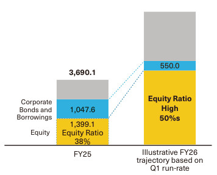 
## Capital Strategy for Accelerating Growth 
Enhancing Return on Invested Capital (ROIC) and Maximizing Free Cash Flow 
We devise our investment strategy by formulating our long-term vision and working back from that. We will continue to observe strict investment criteria as we transition to a structurally high-ROIC model, aiming for industry-leading levels of capital efficiency. 
As a listed company that engages with the capital markets, we prioritize the maximization of free cash fow,a kay indicato of prott inn and financing methods are most strategically aligned. We will enhance our earning power and prioritize investments that generate growth, while strengthening our finances and boosting shareholder returns. This will lolu/l l lu arowung parets andsustinaly enhance our corporate value. 
## Balancing growth investments with financial strength to drive sustainable value creation 
Assets 
Enhancing Asset Efficiency FY26 ae (+60%YoY,FY26 Q1 plan) FCF maximization 
1.055.3 PP&E 
Capex for next pnes 
3,690.1 470.7 
Cae atn 
Liquidlty for fue een 
Total Assetss 2x growth 
FY25 llustrative FY26 taletory aed onn 
## Reflecting Feedback from the Capital Markets in Our Business Strategy 
I strongly feet the rsing xipectations of the capital markets. My most important responsibity as CFO is to engage proactively with market paricipants and to reflect our dialogue with investors, financial analysts and shareholders in our business statey. We will wield our world-class technological capabities and talent to enhance our corporate value sustainably,building a business model that ensures the quality of our profitability. 
Note: Aas of lrnesator Day 2026(June 2026)

---

<!-- 原文第 16 页 -->

Section 
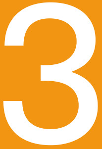 
## Value Creation Story 
16 Value Creation Process 
18 Feature I Social Value Created by Kioxia Group for an Al-Powered Society

---

<!-- 原文第 17 页 -->

Kioxia Holdings Corporation Integrated Report 2026 16 
About Kioxia Group 
Messges from Senior Management 
Value Creation Story Growth Strategy 
Management Capital as the Data Governance Source of Value Creation 
## Value Creation Process 
Kioxia Group's Mission 
Based on ts mision of prfing te d ith r"r i up orbts ts stbtpuinp pcnd esn duinnise for data utlization together with its partners.Demand for flash memory and SSDs is expected to continue growing as use of Al inferencerapidly expands. In this market environment, we willprsue a growth strategy that leverages ur management capital and industry-leading strengths, hich are the source of our competitiveness, with the aim of achieving sustainable growth through our business activities and enhancing corporate value. 
# Uplifting the world with "memory" 
Growth Strategy 
Social Value Created with Partners 
Market and Social Environment 
## Management Capital 
Expansion of the flash memory and SSD market driven by rapid advances in Al 
Source of competitveness for medium to long-term growth 
 
Flash memory production scale 
·Increasingly sophisticated and diverse requirements driven by the growing use of Al inference 
creative world through memory technology (FY2025,cnsolidated basis) 
Building a 
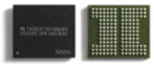 
provision of products and services based on cutting-edge memory technology Sstoen y to ghgout s 
Contributing to customers' value creation through the 
 
Technology 
·Growing social issues such as climate change 
based on Sustainability Materiality, including: Reduction of greenhouse gas emissions Contributing to 
Non-Financial Results of activities 
 
Partnerships 
Tosooo 
convenient and lifemtortsble 
Cost competitiveness and a stable supply enabled by production scale and efficiency Kioxia Group's Strengths 
 
Human resources 
## Business Activities 
Memory business Provision of high capacity, high performance,and ervironmentally conscious flash memary and SSD products 
Value Provided to Customers 
efficiency and environments 
## Governance 
Corporate governance·Risk management and compliance·Sustainability managemen 
Enhancing Our Aspiration Corporate Value 
Contributing to society by providing a foundation for data utilization 
Sustainable growth

---

<!-- 原文第 18 页 -->

Kioxia Holdings Corporation Data Integrated Report 2026 17 
About Kioxia Group Messges from Senior Management 
Value Creation Story Growth Strategy 
Management Capital as the Governance Source of Value Creation 
## Long-Term Strategy for Increasing Corporate Value 
Increasing importance of cybersecurity 
To achieve sustainable growth and enhance corporate value, we will anticipate changes in the needs of society and our customers and steadiy implement our growth strategy from a long-term perspective.We will aso enance our abilityto execute this strategy by strengthening our management capital. 
Diversification of Aapslication people and AI) 
e Energy 
Through continued innovation in memory technology, we will evolve the foundations of a data-driven society and pioneer a creative future. 
mary areas 
Sustainable Growth Strategy 
Expansion of the flash memory and SSD market driven by rapid advances in Al 
·Strategic shift in business portfolio 
Strengthen capital investment and cost competitiveness nvest in and accelerate R&D 
Track record of creating world firsts 
Our strengths supporting our growth strategy 
Ingismet opni Turning R&D results into businesses 
As the inventor of flash memory,"Kioxia will contribute to society together with its partners 
Governance (resource allocation and risk management) 
·Realize a creative society in which individuals can make the most of their ideas and experiences through memory technology. 
Track record of sustainable growth amid market changes 
Enhancement of Effectiveness Target best in-class ROIc among manufac uring companies 
·Contribute to the development of data inrastructure for the general public,as flash memory has contributed to the development of today's society. 
Drive strategy execution by strengthening management capital 
·Contribute to a sustainable society that accommodates growing data demand while reducing environmental impact by pursuing lower power consumption and efficient use of resources *Kioxia invened MAND fsah memory in 1987 
Initiatives to strengthen management capital and KPI-based progress management 
Management Capital Past 
 
Flash memory Technology production scale 
 
 
Partnerships 
 
Human resources 
Present 
Future 
Kioxia Group's Mission 
Uplifting the world with "memory"

---

<!-- 原文第 19 页 -->

Kioxia Holdings Corporation Data Integrated Report 2026 
About Kioxia Group Messges from Senior 
Value Creation Story Growth Strategy 
Management Capital as the Governance Source of Value Creation 
18 
Management 
Feature Social Value Created by Kioxia Group for an Al-Powered Society 
Uplifting 
the world 
with "memory" 
## Feature 1 Expanding Possibitis fo Solet Thrugh dvanes in AI Featue 2 Alntastuture Ko ospi s 
Feature 3 Using Memory Technology to Address Social ssues Arising from Technological Advances

---

<!-- 原文第 20 页 -->

Kioxia Holdings Corporation Integrated Report 2026 
About Kioxia Group 
Messges from Senior Management 
Value Creation Story Growth Strategy 
Management Capital as the Governance Source of Value Creation 
Data 
19 
Anoi 
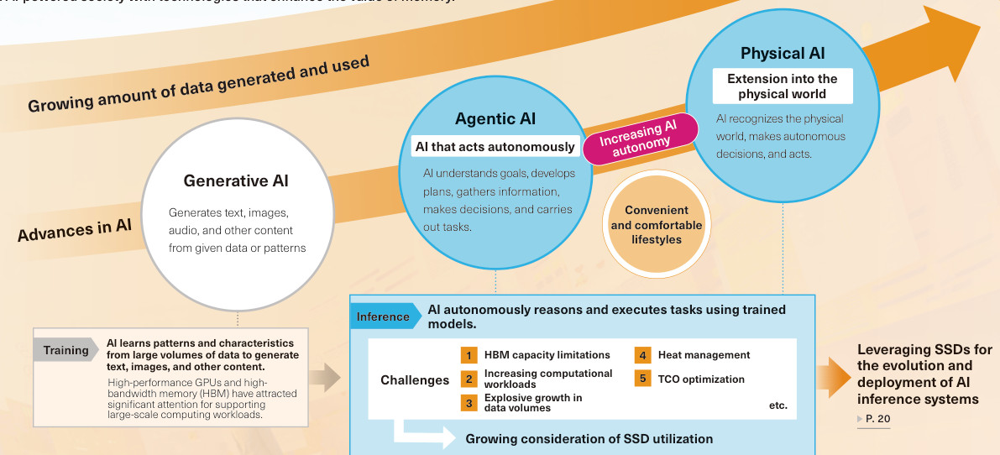 
P.21 
Safe and secure societies and environments 
*Conceptual view of a future Al-powered society

---

<!-- 原文第 21 页 -->

Kioxia Holdings Corporation Data Integrated Report 2026 20 
About Kioxia Group Festuie 2 
Messges from Senior 
Value Creation Story Growth Strategy 
Management Capital as the Governance Source of Value Creation 
Management 
# Al Infrastructure: Kioxia Group Technologies Supporting AI Data Centers 
The emergence of autonomous Al, such as agentic Al and physical AI, is driving exponential growth in inference workloads. Kioxia Group will support Al data infrastructure with its flash memory and SSD technologies. 
Challenges in the Evolution and Deployment of Al Inference Systems 
## Expanding SSD Adoption and the Value Created by Kioxia Group Technologies 
AI Data Center (Overview) 
SSDs are evolving from data storage devices into core infrastructure that enhances Al performance and efficiency. Kicxia Group supports the evolution of AI with products and solutions that address diverse needs, powered by flash memory technologies delivering high capacity, high performance,and low power consumption. 
GPU servers 
(Computation) 
Perform Al training and inference 
1 
HBM capacity limitations 
High-Performance SSDs Resohving HBM capacity bottenecks High-Pstomance 
High-speed storage (Memory) Store and supply data and models 
1 
Increasing computational workloads 
High-Bandwidth SSDs Eficient storage of GPU computation results and more efficient data transfer 
2 
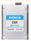 
Network 
Storing growing volumes of data as interence complexity increases KIOXIA AiSAQTM Improving Al response accuracy by using SSD in RAG High-Capaditlty 
High-Capacity SSDs 
High-Bandwidth 
Contributing to the Evolution of AI Expanding the Value of Memory 
(Communication) 
3 Explosive growth 3 in data volumes 
Power supply equipment 
KIOXIA AISAQTM Oen Source Vector 
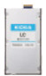 
Cooling equipment 
Heat management 
Certain SS productssupport liguid cooin,which is increasingly being adopted in Al data centers as an alternative to air cooing, enabling efficient heat dissipation in high-performance Al server environments. 
4 
optimization 5 
Ownership) 
5 
TCO (Total Cost of 
Kioxia Group provides SSDs and solutions for divere nextgeneration Ai iniratruture applications,helping to optimize TCO by reducing computational workloads, improving power efficiency, and saving space.

---

<!-- 原文第 22 页 -->

About Kioxia Group Messges from Senior Management 
Value Creation Story Growth Strategy 
Management Capital as the Governance Source of Value Creation 
Kioxia Holdings Corporation Data Integrated Report 2026 21 
## Increase in AI Data Center Power Consumption 
Power consumption is increasing as the number of AIl data centers grows. 
## AI Hallucination 
A phenomenon in which Al generates plausible but factually incorrect information 
## Cyber Security 
As data use becomes more advanced, information security is becoming an increasingly important issue. 
## Improving Product Power Efficiency 
We developed the KIOXIA CM10 Sees of enterprise SSDsequipped with 1th-generation BiCS FLASHT TLC flash memory, achieving significant improvements in power effiency and cooling flexibilit,.including support for direct liquid cooling. 
## Contributing to Greater Energy Efficiency in Data Centers 
We are enabling next-generatin green dta centers by developing high-bandwidth optical SSDs that optimize computing performance and improve power efficiency. P.42 
## Contribution to Advances in Retrieval-Augmented Generation (RAG) Technology 
RAG creates dedicated databases from the vast amounts of data held by iniviual companis and organizations enabling more accurate and up-to-date responses. The ability to utilize non-public information within an organization helps reduce hallucinations. Kiaxia Group contributes to advances in RAG technology through the integration of SSDs and software technologies. 
## SSD Security and Encryption Options for Diverse Needs 
We are addressing the need to protect personal and business data through products such as enterprise data center-, and client SSDs. 
Note:Optianal security festrecompliant rives are not alasle in al ounis due to ecpot and loal regins

---

<!-- 原文第 23 页 -->

Section 
 
Growth Strategy 
23Market and Social Environment
25 Our Strengths
26 Growth Strategy in the Al Inference Era
27 Business Activities

---

<!-- 原文第 24 页 -->

About Kioxia Group Messges from Senior Value Creation Story Management 
Growth Strategy Management Capital as the Governance Source of Value Creation 
Kioxia Holdings Corporation Data Integrated Report 2026 23 
## Market and Social Environment Expansion of the Flash Memory Market Driven by Rapid Advances in Al 
## Increase in Worldwide Digital Data Generation 
With the advancement of a digital soiety drven by Ai,the volume of digita data continues to grow.The total volume of data generated worldwide is projected to reach 718.5 zettabytes(ZB) annually in 2030. 
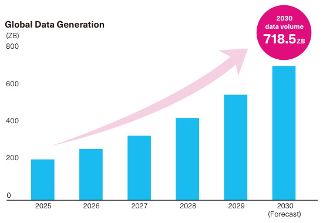 
Note: A zatye Eis10 eand is sunit that idicatste luve f . Source: IDC,Woridwide IDC Globel DetaSphere Forecast,2025-2030,#US53425426 
## Soaring Flash Memory Demand Driven by Al Inference 
The main applications in the flash memory market are data centers, smartphones, and PCs.We believe that the market will continue to grow through a virtuous cycle of increasing data volumes, driven by expanding Al server storage capacit, and technological advances in fash memory. 
The NAND flash memory market is epected to grow at a compound annual growth rate (CAGR) of 22% from 2025 to 2028.Compared with the overall volume of data generated, approximately 0.25% is recorded on flash memory. 
Focusing on demand for flash memory in data centers, the market is expected to grow at a CAGR of 46% from 2025to 2028. Within tis market, A inference applications are projected to grow at a CAGR of 86%, making them a major driver of flash memory market growth. 
Flash Memory Market Growth 
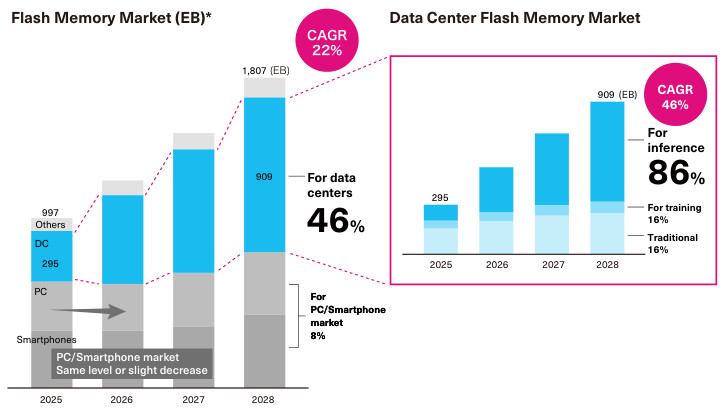 
*An exabyte [EB) is 10' bytes Source. Techinsights Ine. AND Market Report Q2,2026 
*As of lrwestor Day 2026(June 2026)

---

<!-- 原文第 25 页 -->

About Kioxia Group Messges from Senior Value Creation Story Management 
Growth Strategy Management Capital as the Governance Source of Value Creation 
Kioxia Holdings Corporation Data Integrated Report 2026 24 
## Market and Social Environment 
## Changing Role of Storage in the AI Ecosystem Rapid Increase in Inference Workload 
Since the second half of 2025, Al has been shifting from a focus on training to inference for realworld applications. Moreover, Ai is evoving from a too used by people,such as generative Al, into an autonomous agent, typiried by agentic and physical AI, that uses a wide range of data to achieve its objectives.Explosive growth in the volume of information processing required for Al inference is driving rapid evolution in technologies such as Retrieval-Augmented Generation (RAG), which leverages external knowledge,and key-value (KV) caching, which stores past inference results. 
## Storage as Key Determinant of AI System Performance 
Traditionall,storage in AI systems has functioned primarily as a storage repository for large volumes of training data and computation results. As Al use expands, the importance of high-speed, energy-eficient storage is increasing. Furthermore,rapid advances in Al inference are prompting discussion across the Al ecosystem about redefining Al systems as a whole.Within this context, storage is xpanding beyond its rational l a t epcom orcompen that, alongside GPUs and HBM, plays a key role in determining the performance of Al systems. 
New Uses for SSDs Created by Al Inference Systems (Conceptual lustn 
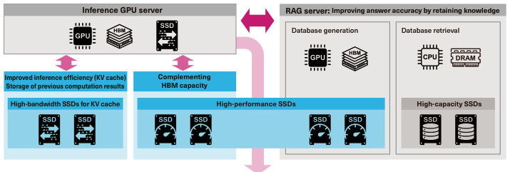 
Storage server Storing the rapidly growing volumes of generated output 
Highrcapacity SSDs 
## Increase in Electricity Consumption by Data Centers 
As data centers proliferate globally wit h avance of Al, their growing electricity consumption is becoming a social issue. 
According to the Energy and Al report released by the International Energy Agency (IEA) in April 2025,lectrity consumption by data centers wordwide isprjected to double rom 2024 to 20 to approximately 945 TWh, slightly exceeding Japan's current total electricity consumption.The report also notes that the ise f A i s colrating th dopono highparormance,highsped servers, increasing the power density of data centers. 
Kioxia Group is working to reduce the power consumption and increas the capacity of flash memory and SSDs, thereby contributing to the development of a sustainable society underpinned by AI. 
## Global Data Center Electricity Consumption in the Base Case, 2020-2030 (Hiatoicl fs 
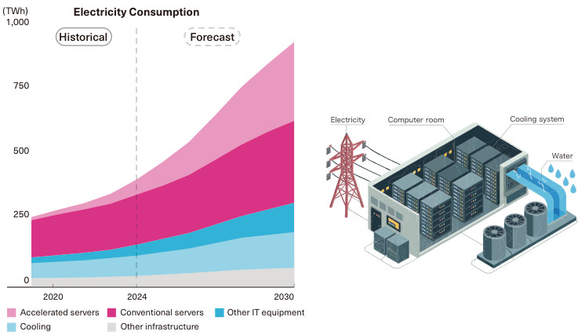 
Source: IEAEnergy and AI,2025.https:/wwia.org/reports/energyand-ai/,License:CC BY4.0

---

<!-- 原文第 26 页 -->

Kioxia Holdings Corporation Data Integrated Report 2026 
About Kioxia Group Messges from Senior 
Value Creation Story 
Growth Strategy Management Capital as the Governance Source of Value Creation 
25 
Management 
## Our Strengths 
In the rapil rowing trge market rvny thspad oiope da p in siih nsr r/ r invention of MAND iash memory w have cutivac dating ops.s o oc e corporate value. 
## Strong Position in High-Growth Markets Driven by AI 
## Technological Competitiveness for Leading the Al Inference Era 
## Cost Competitiveness and a Stable Supply Enabled by Production Scale and Efficiency 
## Drving nnovation Trough Co-Creation with key Players in the Al Ecosystem 
## Pursuit of Migh-Capacity, MighPerformance, and Low-Power Consumption Flash Memory Technologies 
## World-Class Flash Memory Production System to Meet Growing Demand 
As a specialist in flash memory and SSDs, which play a central role in next-generation Al systems, we are working with partners to lead the Al paradigm shift througha range o technologies and solutions. 
We will drve the development of competive BiCS FLASHTM 3D flash memory,delivering added value through high capacity, high performance, and low power consumption to adress the exponential growth in data volumes in an Al-powered society. 
The okkaichi Planthas one or he ondl aras lahs hamr production volumes, while the Kitakami Plant supports growing demand. Together their flash memory output on a storage capacity basis, including production by the manufacturing joint venture between Kioxia Group and Sandisk Group, accounted for approximately 28% of global production in FY2025,placing it among the largest shares worldwide. 
## Network for Capturing Business Opportunties 
## Creating New Memory and Solutions for the AI Era 
Through ur global salesechogy ndspotr will work with customers to capture business opportunities as the use of Al inference expands, thereby growing our business. 
Looking ahead to a future in hioh agenti a and pyscala are put into practical use,we are pursuing research and technology development of semiconductor memory and solutions based on new concepts that address diverse needs. 
Source: Techinights in AND Market Report Q1 2026 
## High Productivity Enabled by Smart Factories 
## Strong Relationships with Leading Global Companies 
The Yokkaichi Plant and the Kitakami Plant operate as smart factoris,ing cuigedge Al and big data to achieve advanced control of production equipment,higher productivity and igorous quality control. 
We do business with global industry leaders in smartphones, PCs, and data centers, and have built srong relationships with many customers. 
## Technologies That Maximize the Value of Memory 
As a pioneer in flash memor, we have supported the foundation of our information society with memory technologies refined over nearly 40 years. Going forward,we will continuv to accurately identify changing social needs and create new value. 
## Stable Supply Through a Resilient Supply Chain 
Through co-creation with suppliers of materials,manufacturing equipment and other inputs we have buita reslentstup in. enabling a stable supply of high-performance, high-quality products. 
Relevant Management Capltal 
Relevant Management Capi 
Relevant Management Capita 
 
Partnerships 
P.40 Technology 
 
P.36 
 
Flash Memory Production Scale 
P.32 
Human Resources 
P.43 
 
Human Resources 
P.43 
 
Partnerships 
P.40

---

<!-- 原文第 27 页 -->

About Kioxia Group Messges from Senior Management 
Value Creation Story Growth Strategy Management Capital as the Governance Source of Value Creation 
Kioxia Holdings Corporation Data Integrated Report 2026 26 
## Growth Strategy in the Al Inference Era 
As the use of Ai intence ner he pas of llpci or i r t h spt Leveraging our strengths,we will further nhance corporate value through growth investments centered on the Al market and by strengthening our financial position 
## Strategic Shift in Business Portfolio 
## Strengthen Capital Investment and Cost Competitiveness 
-Shift the focus to the Al infrastructure market By focusing on the data center and enterprise business, we aim to increase the percentage of revenue from this business to over 60% in the medium to long term.As well as increasing the competitiveness of existing products,we will develop high-value-added products that contribute directly to greater efficiency in Al systems, thereby improving profitability. ln smartphones and PCs, the main markets for flash memory, we will maintain our current scale of sales as a solid business foundation.We will also expand our efforts to develop the edge Al market segment. 
## Capture opportunities for sustainable growth 
In response to th xpansion of the MND marker,which is driven by Al and data center demand, we currenty plan capital expenditures averaging approximately 470.0 bilion yen per year over the next thre years.Through disciplined and efficient capital investment and production that leverages our world-class economies of scale,we will maintain gigabyte costs below the industry average.We will also focus on ensuring a stable supply system by strengthening supply chain resience, as wellas on investing in human capital to support growth. 
Sales Portfolio (Excluding Sandisk ales) 
Planned Annual Capex: Approx.470 billion yen (Three-year average) 
Achieving High Capital Investment Efficiency Fne e obuceg 
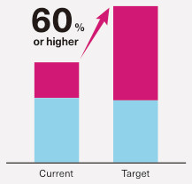 
Percentage of revenue tom prdantftfor enterprise markets: 60%orhigher 
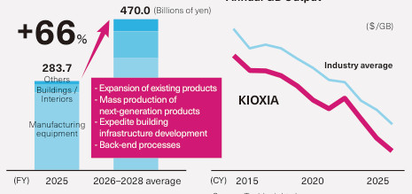 
Soure t 
## Invest In and Accelerate R&D -Maintain technology leadership 
We plan to increase annual R&D investment by 63%rom FY2025 to 230.0 bilin yn re te n tre r. er developing a diverse range of products taliord to the needs of Al and data centers. Specifically v are lig AD resources to the development of next-generation Bics FLASHI products and, in or key focus area of SSs, to accelerating the introduction of Super High IOPS SSDs.We will aso focuson recruiting and developing researchers and engineers to maintain our technology leadership. 
Techmology P.36 
Annual R&D Investment:230 Billion Yen (Three-year werage) 
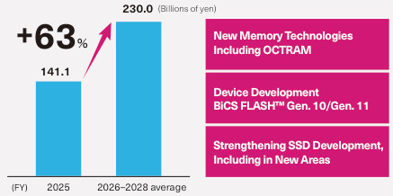 
As a core company underpinning the Al inference era and driving the next technology paradigm shift,we aim to further enhance our corporate value through growth investments and a stronger financial position. 
Nate:.As of lrvstrd Da202e Jun2026)

---

<!-- 原文第 28 页 -->

About Kioxia Group Messges from Senior Value Creation Story Management 
Growth Strategy Management Capital as the Governance Source of Value Creation 
Kioxia Holdings Corporation Data Integrated Report 2026 27 
## Business Activities Supporting an Al-Powered Society Through Flash Memory and SSDs 
Kioxia Group develops, manufactures, and sells flash memory and SSDs. Since inventing NAND flash memory in 1987,we have spent nearly 40 years leading the industry in making technological innovation that increase the capacit,enhance the performance,and reduce the power consumption of flash memory and SSDs.Growing alongside the development of a digital society, we have ontinued to expand our business. Underpind by Al,sciety continus t avance, and we ai to achieve medium- to long-term growth as a corporate group supporting this transformation. 
## Breakdown of Revenue by Application 
Our products are used in a variety of applications, with revenue classified into three categories by applicatin."SSD & Storage"primarily comprises SSD and memory products for Ps, data centers, and enterprises."mart Device"comprises embedded memory products with control functions, used in consumer devices such as smartphones,tablets, and televisions, as well as in utomotive and industrial devices. "Others"comprises retail products such as SD memory cards and USB fiash drives, as well as sales to the Sandisk Group recorded through our manufacturing joint venture. 
In FY2025,we achieved record-high revenue across alaplacoinsupored by a oraleatenal environment with growth in demand, mainly for Al inferene applications, and higher selling prices, as well as beneficial fets roprouctivity gains and the successtul strengthening of our business foundation, including an improved capital structure. 
 
## Breakdown of Revenue by Application (FY2025) 
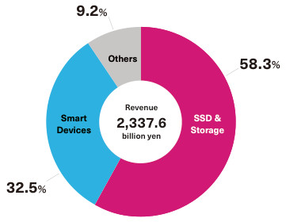 
SSD& Storage Primarily SSD and memory products for PCs,data centers,and enterprises
Smart Devices Embedded memory produts with contol funetions,used in consumer devices such as smartphones,tablets,and televisions,as well as in automotive and industrial devices
Others Retai products such as SD memory cards and US fash drives, s well as sas t Sandisk Group recorded through our manufacturing joint venture 
## Creating Market Value Through Cross-Divisional Collaboration and Co-Creation with Partners 
Kioxia Group has built robust partnerships with leading companies across markets, and has a track record of business rlationsis wit mair gpbol stomr i te at eor,atrphn, and PC sectors. We also collaborate with server and GPU manufacturers to further expand our Al-related business opportunities. The Research and Technology Development Division, Manufacturing Division, and ales and Marketing Divsion cordinate closely to ospond swiftyo increasingly sophisticated and diverse market needs by providing products that address those requirements.

---

<!-- 原文第 29 页 -->

About Kioxia Group Messges from Senior Value Creation Story Management 
Growth Strategy Management Capital as the Governance Source of Value Creation 
Kioxia Holdings Corporation Data Integrated Report 2026 
28 
## Business Activities 
## Development of High-Capacity, High-Performance 3D Flash Memory 
Fourtechnologies enable high-capacity 3D fiash memory. verical memory cell taking, atal tningg of memory cells,multi-level cell technology," which logically increases the amount of data that can be stored, and the introduction of new architectures. By using a combination of all of these technologies, not just vertical stacking technology, Kioxia Group is increasing bit density (the amount of information stored per unit area) and promoting the development of cost-competitive high-capacity products. *Asechralgy that increas the amount of data stored in a single memory cel Depending on the number of bis pr cel memoy is clsied as SLC (SingleLevel Cel bir Mli-Level Cl bis. Tripel Ceis/ L(ouavel Cel:4 bisic 
## Dual-Axis Strategy: A Development Roadmap for 3D Flash Memory BiCS FLASHTM 
Kioxia Group is pursuing a Dual-Axis Strategy. one axis focuses on increasing the number of layers in D flash memory to deliver a line of higher-capacity, higher-performance products, while the other leverages CBA technology to achieve high performance with lower per-layer investment Through these approaches, we will provide competitive products that meet increasingly sophisticated and diverse needs. 
Starting Point: 8th-Generation BiCS FLASH with CBA Technology CMOS directy Bonded to Array(CBA) technology involves separately manufacturing the CMOS ciruit Wafer and the memary cell aray watr nrerthirerpiep tmalpocesocs snae mrtre cndtin then bonding the wafers together.This approach achieves high performance while reducing the surface area of the chip, thereby increasing bit density and enabling the delivery of cost-competitive products. 
We plan to transition around 80% of our output to 8th-generation products on a GB basis by the end of FY2026. 
## First Axis: 10th-Generation BiCS FLASHTM Combining High Capacity, High Performance, and Low Power Consumption 
Along the first development axis, we combine increased verical stacking technology with lateral shrink technology, as in previous generations,to achieve products with higher bit density and higher capacity. Development along this axis primarily targets the enterprise and data center SSD markets. 
In July 2026,we began sample shipments of 10th-generation BiCS FLASH, which delivers the high capacity, ih paromance, and low power consumption rqpuired for th eatrationin enee market.This generation provides higher interface performance using CBA and OPS technologies, as well as icreased bit density through the combination of a 332ayer architecture and lateral shrink technology optimized for power efficiency and reliability. 
*On Pich ele Cad rir inngyph n n unused memory holes 
## Second Axis: Pursuing Higher Performance Through CBA Technology 
Along the second development axis,we focus on achieving high performance by combining cell technology featuring a lower layer count and the latest CMOS technology. This approach is used in our 9th-generation BiCS FLASH, for which sample shipments began in July 2025.We are developing products for the low- to medium-capacity range,primarily targeting the market for Al-enabled PCs and mobile devices. 
BiCS FLASHTM Development Roadmap 
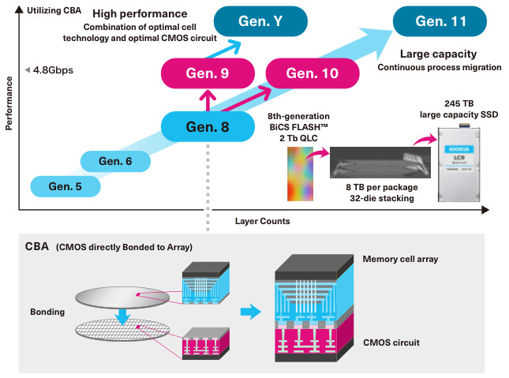

---

<!-- 原文第 30 页 -->

About Kioxia Group Messges from Senior Value Creation Story Management 
Growth Strategy Management Capital as the Governance Source of Value Creation 
Kioxia Holdings Corporation Data Integrated Report 2026 29 
## Business Activities 
## SSD Product Development 
SSDs are storage devices that use flash memory to store data. They feature resistance to vibration and shock, are ighwigt n ostow powr corsumption. kci cup spucts combine BiCS FLASH With a controller and firmware. We will combine the latest flash memory and SSD technologies to provide products that meetincreasingly advanced and diverse needs as Al evolves. 
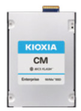 
## Kioxia Group SSD Products for the Al Inference Market 
The Group views advances in Al as an important growth opportunity and will support the Al inference market through cutting-edge products that address inceasingly advanced and diverse market needs and respond to emerging market trends. As industry players advance the development of next generation infrastructure for Al inferene, SSs are taking on an increasingly critical rle that goes beyond storage,becoming key to improving Al performance and cost efficiency. 
## Addressing System Memory Shortages 
In Al inference, insufficient GPU memory capacity, particularly high-bandwidth memory (HBM) is an issue.SSDs are used as an extension of the KV cache that stores previous computatin results, helping to improve inference efficiency.We are also developing SSDs designed for direct interaction with GPUs, complementing HBM capacity. 
## Enabling Larger Databases and Faster Generation and Retrieval 
As the databases used by RAG servers continue to grow larger, DRAM capacity becomes a constraint in conventionalsystems.High-performance,high-capacity SSDs that can replace DRAM help achieve both scalability and cost efficiency. 
## Storing Large Volumes of Data and Enabling High-Speed Access 
The continued spread of generative Al is driving a rapid increase in data volumes.We are actively developing high-capacity SSDs that underpin high storage density and high throughput. 
## KIOXIA CM Series: High-Bandwidth SSDs with TLC Flash Memory 
The CM Series can eficiently store and utilize the growing volume of data generated by long-duration,multistep inference in agentic Al, enabling high power eficieny. Furthermore, it supports liquid cooling systems and delivers stable performance even in environments with high heat loads. 
## KIOXIA GP Series: High-Performance SSDs with XL-FLASHTM 
Combining dedicated XL-FLASHM NAND-type flash memory with a dedicated controller,the KIOXIA GP Series elivers exceptional processing performance to support nextgeneration AI systems. Designed for direct interaction with GPUs, the GP Series complements HBM capacity. 
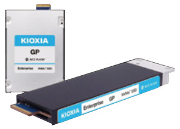 
## KIOXIA LC Series: High-Capacity SSDs with QLC Flash Memory 
The KIOXIA LC Series is suitable for effienty storing the large volumes of data generated by Al. Products incorporate 32 stacked 2 Tb QLC dies of 8th-generation BiCS FLASH in a single package, enabling an ultra-high capacity of 245 TB.The LC Series also contributes to greater overall data center efieny and optimization of total cost of ownership(TCO). 
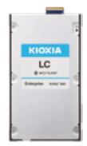

---

<!-- 原文第 31 页 -->

Kioxia Holdings Corporation Data Integrated Report 2026 
About Kioxia Group Messges from Senior 
Value Creation Story Management 
Growth Strategy Management Capital as the Governance Source of Value Creation 
30 
## The Evolution of BiCS FLASHTM: Meeting the Diverse Needs of the AI Era 
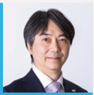 
As Al continues to evolve, flash memory performance requirements are becoming increasingly sophisticated and diverse. High performance and power efficiency have emerged as critical specifications across a broad spectrum of applications, from Al infrastructure to edge devices. The rapid expansion of generative Al has created a surge in demand for higher-capacity solutions, particularly in the data center and enterprise segments. Recognizing these market dynamics as a growth opportunity, the Kioxia Group is accelerating the development of our cutting edge three-dimensional flash memory "BiCS FLASH in order to address the evolving needs of our customers. 
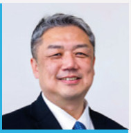 
Atsushi Inoue Executive Officen Vice President of Memory Division Kioxia Corporatior 
Masashi Yokotsuka Managing Excuive ic Vice President of SSD Division Kioxia Corporatian 
Our development roadmap is based on a dual-axis strategy: pursuing both high capacity and high density alongide high performance.The 8thgeneration BiCS FLASHT-our roadmaps foundation-incorporates CBA technology( P.28), achieving exceptional levels of performance,bit density,and power effiency, We are expanding mass production, with plans to transition approximately 80 percent of our memory output to 8th-generation products by the end of fiscal 2026. 
Our first stratejc xis targets high-capacity and high-density products designed for large capacity storage in data centers and enterprise markets. The 10th-generation BiCS FLASHTM, sample shipments of which commenced in July, is optimized for next-generation Al inference applications across multiple dimensions, fering higher layer counts, lower cost, enhanced reliability, and greater power efficiency. By continuing to develop CBA technology, we will maintain this performance advantage and deliver highly competitive solutions to the market. 
The second strategic axis focuses on high-performance products.Leveraging CBA technology allows us to minimize our investment costs and to target the Al-enabled PC and mobile device markets, where fast processing and power efficiency are increasingly important. 
## This dual-axis strategy is a key strength of Kioxia Group, enabling us to provide products optimized for a wide range of applications. 
We are strengthening internal collaboration between our Memory Division and SSD Division in order to continue developing more advanced flash memory technology, the foundation underpinning Al-era data infrastructure. By integrating our comprehensive technical capabities from front-end technologies such as stacking and CBA to back-end processes-we are demonstrating clear technological leadership.We remain committed to solving our customers' challenges and making our contribution to the development of a sustainable Al society. 
## SSDs That Create New Value in the Al Ecosystem 
The Kioxia Group provides a broad range of SSD products designed for diverse applications, including client PCs, enterprise, and data centers. As the practical application and widespread adoption of inference Al continue to advance, SSDs are evolving beyond their role as mere storage devices for data. They have now become a critical foundational technology that determines the overall performane and efficiency of Al systems; a major expansion of their scope of application. 
Looking back on fiscal 2025,our SSD business made significant progress by capitalizing on growing demand driven by advances in AI. Noteworthy achievements include the introduction of our Ultra High-Capacity SSD products designed to support evolving Al functinality,and the technlogical advancement of KIOXIA AiSAQ,ur proprietary open source software that enhances the precision and speed of Al inference in RAG (RetrievalAugmented Generation). 
In the emerging ecosystem of inference AI,SSDs transcend their traditional role as auxiliary storage devices and assume critical, core functions. New demand has emerged for a diverse range of advanced capabites memory expansion through direct integration with GPUs, the storage of exponentially increasing data volumes, and high-speed data access and processing. Kioxia Group has developed a diverse product lineup that supports these SSD applications; these boost Al system performance and operational efficiency while helping our customers address their various challenges. Additionally, we are helping to optimize power consumption across entire data centers by improving the power efficiency of our products, and we are promoting the development of a sustainable Al ecosystem through our deployment of liquid cooling technology. 
Kioxia Group possesses a competitive advantage: the ability to rapidly integrate our cutting-edge flash memory technology into SSD products and provide solutions that maximize storage utilization within Al systems. Through collaborative innation with our customers and partners,we continue to embrace the challenge of developing new applications and opening up new markets for them. 
Going forward, we remain committed to anticipating the evolution of our markets and to creating new value for the Al era through the further enhancement of SSD functionality.

---

<!-- 原文第 32 页 -->

## Management Capital as the Source of Value Creation 
Section 
 
32 Flash Memory Production Scale
36Technology
40 Partnerships
43 Human Resources

---

<!-- 原文第 33 页 -->

About Kioxia Group Messges from Senior 
Value Creation Story Management 
Growth Strategy 
Management Capital as the Governance Source of Value Creation 
Kioxia Holdings Corporation Data Integrated Report 2026 
32 
 
 
## Flash Memory Production Scale (Manufactured Capita) 
Achieving Scale and Cost Competitiveness with State-of-the-Art Flash Memory Plants 
Global Share of Flash Memory Production 
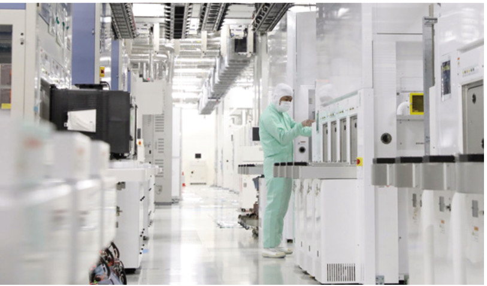 
Volume on a Storage Capacity Basis (FY2025) 
## Key Points 
on a storage capacity basis (ineluding joint venture with Sandisk Group, FY2025) Capital invetment (FY2025) 
Global share of flash memory production volume 
283.7 billion yen 28% Source: Techlnsights Inc. AND Markat ReportQ1,202 
Smart factories maximizing performance through an integrated production system combining the Yokkaichi Plant and the Kitakami Plant 
High cost competitiveness through disciplined capital investment and world-class flash memory production scale 
## One of the World's Largest Flash Memory Production Volumes 
The combined flash memory production volume on a storage capacity basis of the Yokkaichi Plant and the Kitakami Plant, including that of the manufacturing joint venture between Kioxia Group and Sandisk Group, accounts for one of the world's largest shares at 28% 
Fab7 of the Yokkaichi Plant started operation in October 2022, and Fab2 of the Kitakami Plant started operation in September 2025.These facities will continue to meet expected growth in demand for flash memory going forward. 
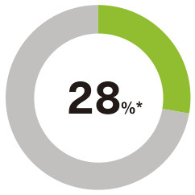 
*Soure:Techinsights In ND Manit epor1h2022 
## Cost Competitiveness Based on Production Scale and Efficiency 
Kioxia Group achieves high production effcieny through close coordination between the Yokkaichi Plant and the Kitakami Plan,which operate as smart actories utig and dig ata.T hes cliss meet growing fash memory demand with high ot copetespngon is aoy. 
production capacities High cost competitiveness 
High production efficiency 
X 
One of the world's largest 
## Manufacturing Leadership That Drives Our Joint Venture 
Approximately 80% of the production capacity of the Yokkaichi Plant and the Kitakami Plant is shared equally with Sandisk Group through a manufacturing joint venture, while the remaining 20% is held exclusively by Kioxia Group. Accordingly, approximately 60% of the flash memory produced at the two plants is alatat icxi opy. ixia uppnagsan operates both plants, and possesses advanced manufacturing expertise.

---

<!-- 原文第 34 页 -->

Kioxia Holdings Corporation Data Integrated Report 2026 
About Kioxia Group Messges from Senior Value Creation Story Management 
Growth Strategy Management Capital as the Governance Source of Value Creation 
33 
 
# Flash Memory Production Scale 
## Systems and Technologies That Enable Production at Scale 
The flash memory manufacturing process can be broadly divided into a rontend process.in which circuits are formed on silicon wafers, and a back-end process, in which the wafers are cut into tiny chips that are stacd and packaged. As the rapid adpin f ie d candor rgptrcpct flash memory, we are responding through advances in both stages of the manufacturing process: increasing capacity per chip at the front end and increasing capacity per package at the back end. 
## Smart Factories 
## Increased Production Scale and Efficiency Driven by Al and Big Data 
At our plants, manufacturing, inspection and metrology equipment generate a substantial amount of manufacturing related data every day, t the okici lant teprocucion lins generate approxiately 3 billio data points per day, A is sed to analze data in rea timefor varous purposes, including to help prevent product defects and automaticaly identify likely causes when defects do occur. 
## Amount of Manufacturing-Related Data Generated per Day at the Yokkaichi Plant 
We are working to improve yields amid plant expansion and an exponential rise in the amount of data handled. 
Through 2019: 
2025: 
Approx.2 billion data points/day 
Approx.3 billion data points/day 
Up to Fab6 in operation 
Up to Fab7 in operation 
## A Digital Twin Enabling Close Coordination between the Yokkaichi Plant and the Kitakami Plant 
The data obtained from manufacturing equipment and systems at both plants is replicated in a virtual environment in real time.Leveraging this"'digital twin" technology, we optimize manufacturing conditions based on large amounts of data and apply them to the manufacturing processes at both plants, enabling the plants to effectively share expertise and achieve high productivity. 
This approach enabled us to rapidly ramp up the Kitakami Plant, which commenced mass productior of flash memory products in 2020,and to achieve higher yields more smoothly than in the past.As a recent milestone,we successtully completed a rapid production ramp-up for 10th-generation BiCS FLASHM products at the Kitakami Plant, leading to sample shipments in July 2026. 
Digital Plant 
Physical Plant 
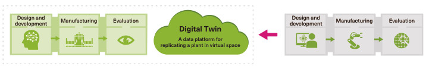 
## Advancement of Assembly Process Technologies 
Kioxia Group has enhanced production efficieny by outsourcing the majority of the semiconductor and SSD assembly processes to contract manufacturers overseas, and is working to strengthen its supply chain. At the Yokkaichi Plant, we are also focusing on developing and enhancing assembly technologies for advanced products. 
## TOPICS 
Advanced Assembly Technology for Stacking 32 Memory Dies in 
a 2 mm-High Package 
Kioxia Corporation has successfuly eveloped arge capacity 8terabyte flash memory by stacking thirty-two 2-terabit memory dies into a package less than 2 mmin height. Kioxia has optimized advanced technologies across mutiple assembly processes to support higher-capacity flash memory. These include wafer thining technology for grinding waers from a thickness of 0.8 mm down to 30-40 pum,molding resin technology that enables precise control and formation of ultra thin sections and narrow spaces of less than 100 um,and wire bonding technology for electrically connecting stacked dies to a substrate. 
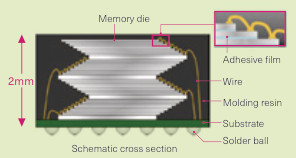

---

<!-- 原文第 35 页 -->

Kioxia Holdings Corporation Data Integrated Report 2026 34 
About Kioxia Group Messges from Senior Management 
Value Creation Story Growth Strategy Management Capital as the Governance Source of Value Creation 
 
# Flash Memory Production Scale 
Yokkaichi Plant (Yokkaichi City,.Mie Prefecture) 
Kitakami Plant (KitakamiCit,.(owate Perecture) 
Since its estabishment in 1992, the Yokkaichi Plant has developed as a state-ofthe_art manufacturing site for memory products. There are six Fabs and an assembly facity on the expansive 694,000 m site.Fab7 started operation in October 2022. Production fiency has been increased through the use of a production system that integrates the six Fabs, as well as Al and big data. Moreover, through close coordination with the onsite research and technology development departments, there is a smooth transition from new product development to mass production. 
The Kitakami Plant was established as a mass production site to meet growing demand for fiash memory. Fab started operation in2020 an Fab2 started operation in September 2025. Production capacity of the plant will be continuously expanded in line with growth in demand. Specialized in mass prduction, he plant ha increased jedsand prouctvty.Thrugh ose digital coordination with the Yokkaichi Plant using digital technologies and by building on its expertise, the Kitakami Plant contrbutes to highly efficient production of high-quality products. 
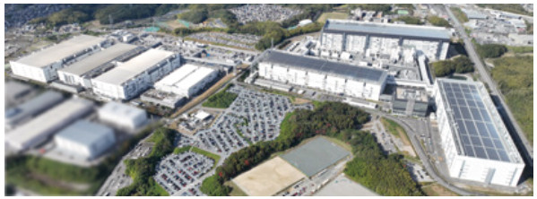 
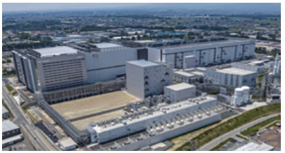 
Message 
Kazuhiro Shimizu,General Manager of Cokkicki Pan.Klxi Coporaton 
Message 
Koichiro Shibayama.President and Chief Executive Officer, Kioxia Wwate Corporation 
The Yokkaichi Plant engages in both development and mass production as one of the world's largest flash memory plants. Leveraging AIl and big data to achieve high production efficiency, we deliver both production scale and quality as a smart factory. As a corporate citizen rooted in a region with an excellent industril fundation, we also engage in social contributins and environmental conservation activities and contribute to the sustainable development of society. 
Aiming to contribute to further increases in Kioxia Group's production capacity, the Kitakami Plant is expanding its production scale in line with market growth. In July 2026,we commenced production of 10th-generation BiCS FLASHTM products on a newly launched manufacturing line at Fab2,marking another milestone.As we continue to expand and develop,we will ontibute to the local economy and community as a company trusted by both our customers and local stakeholders. 
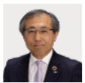 
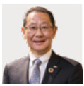 
## History of Yokkaichi Plant and Kitakami Plant 
Kitakami 
Started Fab1 operation 
S 
19921993 1996 
19992000 
2002 
2005 
2007 
Started Fab5 Phase2 operation 2019 
2022 
2020 
2018 
2016 
2014 
20102011 
2024 2025 
Started Fab2 operation 
Transferred N Started Fab4 operation operation 
Started Fab5 
Started Fab6 operation Started Fab7 operation Started New Fab2 operation 
Started Fab3 operation Discontinued 200 mm wafer Started 300 mm-water operation production line 
Started mass 
Yobhaichi 
Establishment 
isd n

---

<!-- 原文第 36 页 -->

Kioxia Holdings Corporation Integrated Report 2026 35 
About Kioxia Group Messges from Senior 
Value Creation Story Growth Strategy 
Management Capital as the Governance Data Source of Value Creation 
Management 
 
# Flash Memory Production Scale 
## Challenges and Measures for Sustainable Production Preparedness for Business Continuity 
For Kioxia Group, which supplies memory products to society, its manufacturing sites are crucial to business continuity. Under our BCM framework(P.56), ve implementdisaster-prevention and emergency response measures and develop systems forapd ecovry t our to mnratuing tes in Japan, the Yokkaichi Plant and the Kitakami Plant. 
For example, as an earthquake countermeasure we have adopted seismic isolation structures that absorb building vibratins. Furthermore, we have installed equipment hat protects key facilities from power outages and momentary voltage drops. In addition, we tak into account natural disasters, as well as geopolitical and other risks, and are working to strengthen supply chain resilience through measures such as supplier diversification, and standardization and reduction of components. 
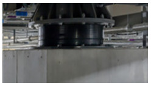 
Plant seismic isolation device 
## Initiatives for the Environment 
Kioxia Group promotes sustainable business activities that take environmental impact into account, including initiatives to address climate change, reduce waste, manage chemical substances and control wastewater quality. 
## Climate Change Countermeasures 
Kioxia Group will contibute to the realization of a decarbonized society by reducing greenhouse gas emissions and promoting the use of renewable energy at its manufacturing sites. We have set target of achieving net zero greenhouse gas emissions from our business activities by FY2050 (net zero means reducing net emissions to zero by subtracting greenhouse gas removals from emissions),and we will expand our use of renewable energy through measures such as instaling solar panels. Furthermore,in the wafer manufacturing process we have installed abatement equipment on allapicacle aitist b rak dow Pcs2 and other gases with high global warming potential before they are discharged. 
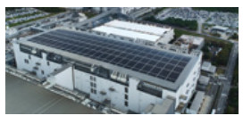 
Sosro we ene cen t 
## Effective Use of Water Resources 
We continually strive to reduce water withdrawal and wastewater volumes and encourage water recycling at ur manufacturing site.To support businss continuit an conserve water resources,we have set voluntary standards that are stricter than legal requirements and are working to reduce environmental impact and recycle water.In addition,we have assessed water related risks at our manufacturing ste in pan ndersesa thunh 0uoSun pcli/ccold/d/ Resources Institute and the Worldwide Fund or Nature,and are working to understand their potential impact on our busines actvits. Based on investigations into waer supply-demand ris, waterelated disaster risks, and watershed vulnerabity to pollution at our manufacturing sites through 2040, we identified no water risks that could have a material financial or strategic impact on our business. 
## Resource Recycling 
Kioxia Group considers the efeciv us of resources and waste reductin in ts manufacturing processes to beimportantisussnd e r woringt chv othitncdd environmental impact, For example, we are taking steps to improve resource circulation by rigorous sorting and reprocessing the daily waste we produce, with a particular focus on maintaining a high recycling rate of 90%or more for plastic waste. We are also promoting initiatives to reuse packaging materials used to transport wafers, products, and semifinished products and to reduce the amount of resources used, helping to lower our $CO_{2}$ emissions. 
## Natural Capital and Biodiversity 
Kioxia Group promotes biodiversity conservation activities,recognizing that biodiversity is a foundation for a sustainable societyand an extremely important form of capital inadesing joalisuesush as climate change and resource constraints. In addition, we analyze risks and opportunities, conduct scenario assessments, consider metrics and targets, and perform monitoring based on the Taskforce on Nature-related Financial Disclosures (TNFD) recommendations. Through these efforts we are exploring ways to bulid a sustainable business toundation that enables us to coexist with nature.From FY2024 through FY2025, we conducted initiatives in line with the LEAP approach,focusing on the direct opertions of Kioxia Corporatin. In the Lcate" phase, we identiied ecolgicalysesti ras and in the"Evaluate"phase,we idetfid and aluated dpendencies and impacts on natural capital. We are currenty n he" ss pase,idnitying the is and opportunitis thee dependencies and impacts pose for our business. '/) 
 
Sustainabiliy Management P P.57

---

<!-- 原文第 37 页 -->

About Kioxia Group Messges from Senior Management 
Value Creation Story 
Growth Strategy 
Management Capital as the Governance Source of Value Creation 
Kioxia Holdings Corporation Data Integrated Report 2026 
36 
 
# Technology (Intelletual Capta) Supporting an Al Society with Advanced Memory Technology 
## Innovating Flash Memory Technologies that 
Power Value Creation in the AI Era 
 
Al is evovingat o nprecedented pace, ranstorming the way industries and society operate.Flash memory and SSD storage are no longer merely media for storing datat,they have become essential technology foundations that directly influence the perfomance and finy of stms s wlrhrugh helping to drive this transformation and create new value. innovation in flash memory technologies, Kioxia Group is 
Chief Technology Officer Kioxia Corporation 
Kioxia Group has long anticipated the needs of our changing times and continue t pursue technologica inationfity inventing NAND fiash memory, and later b becoming the fistcopanr in the world topropos the basic structure of three-dimensional flsh memory, BiCS FLASHTM. Today, in addition to furher increasing the capacit,performance,and power iciene of BiGS FLASH, ar focusing on the development of nextgenertion memory, storage systems, softare,and high-density packaging technologies designed for the future Al market 
Key Points 
At he same time,semiconductor technology is becoming increasingly challenging and complex to develop.For Kioxia Group to continue demonstrating technology leadership, it s essential that we not only invest in research and development,but also strengthen the core foundations of our innovation-our human resources, intellectual property, and partnerships. Through close collaboration between our research laboratoris, development center, and business divisions, we are working to improve developmenteficiency by leveraging Al and digita transtormation. We are also bulding rous development foundation that continusly generates innovation by inorporating new insights through co-creation with cxternal partners 
R&Dexpenses 
Number of reg istered patents 
141.1billion yen 
Approx. 15,000 (FY2025) (As of December 2025,Kixia Corporaion) 
The true source of Kioxia Groups technological competitiveness is or people. To cultivate talent capable of taking on calengswih res deasand creatigy lve in apaily yhangigrn,v are strengthening our technicaleccatin iniaitvs nd promoin pesonal echange.As one xample, we are planning to establish "Kioxia College"(tentative name) as an internal initiative to urther develop our R&D professionals. by creating an enioment where people with diverse eapertise can inspire one another and grow together, we aim to become a world-class technology organization. 
Created a number of world firsts, such as the invention of NAND flash memory 
Promoting advanced and diverse research and technology development as a leader in memory technologies 
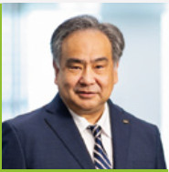 
Hideshi Miyajima Managing Executive Officer 
Kioxia Group will continue to pand the possibities of lash memory as a technology leader that creates new standards through innovation. We will kep challenging ourselves to create new value that supports the advancement of an Al-driven society.

---

<!-- 原文第 38 页 -->

Kioxia Holdings Corporation Data Integrated Report 2026 37 
About Kioxia Group Messges from Senior Management 
 
## Strengths and Policy in Research and Technology Development 
Research and Technology Development Policy: Steadfastly Maintain Technology Leadership Centered on Advanced Memory Technology Innovation Kioxia Group has ahieved a number of word firt, uoh s th inin N aht ar and has contributed to innovation in society. We wil fous on investment in R&D,as well as on taln recruiment an deveopoem, an paresisd stiaty leadership by leveraging the memory technologies we have cultivated to address increasingly sophisticated and diverse market needs driven by advances in AI. 
## (1) Continuous Strategic Investment in R&D 
We will continue to invest in research and technology development focused on growth areas, including the further evolution of BiCS FLASH and the development of nextgeneration memory devices and storage systems. 
## (2) Recruitment and Development of High-Caliber Engineers 
We will recruit and develop highly skilled engineering professionals to advance cutting-edge technology development.We will rare ystems ad frameworks that enable them to fulylverege their capabities,enabling us to respond to increasingly sophisticated and diverse market needs. 
## (3)Generating Innovation Through Collaboration with Partners 
Through open innovation in collaboration with customers and R&D partners in various fields, we will generate new ideas and innovations and deliver value to society together. 
By addressing increasingly sophisticated and diverse market needs driven by advances in AI, we will expand business opportunities and steadfastly maintain our technology leadership. 
## Creating Industry-Leading Cuting Edge Technologies in the Field of Memory 
Continou r (1) 
Becnitment nd (2) Caliber Engineers 
Generating Innovation (3) Through Collaboration with Partners 
- Increasingly sophisticated and diverse needs - Increased complexity and intensifying competition in technology development -Competition for engineering talent 
## Research and Technology Development Structure for Leading Memory Technology 
## R&D Structure for Turning Research into Products 
Kioxia Group has estabished a research and technology development structure that supports industy lading memory technology We create new products through collaboration within our research and technology development structure.This structure consists of a research institute, which studies future technologies from a long-tem perspective, development centers, which develop technologies to be applied to products, and business divisions, which develop commercial products. 
Kioxia Group's Research and Technology Development Structure 
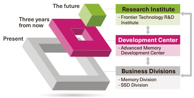 

| Frontier Technology R&D Institute | Promotes research and development of technolagies to support Al and its aplications, high-capacity and high-speed memory system technologies utilizing new principles and new materials,and new process technalogies for cost-efective semiconductor memory manufacturing |
| --- | --- |
| Advanced Memory Development Center | Serves as a bridge between research and development of Bis FLASH 3D flash memory and mass productian |
| Memory Division and SSD Division | Plan, develop,and market memory and SSD products that address increasingly sophisticated and diverse needs |
 
## Research and Technology Development Sites for Advanced Research 
Kioxia Corporation conducts research and technology development primarily at the Yokohama Technology Campus (okohama City, Kanagawa Prefecture) and the Memory R&D Center at the Yokkaichi Plant (Yokkaichi City, Mie Prefecture).Our overseas research and technology development sites are located in countries/regions where many advanced IT companies are based, providing us with rapid access to uting edge technologies and enabling us to respond flexibly to markets and customer needs 
## Using Al in R&D 
The Group is using Al for applications including manufacturing data analysis in product development, process condition optimization, faut detection and predictive maintenance at plants, image recognition-based defect inspection, and yield analysis and identification of defect causes. 
Our View of the Busin Rapid development of AI Market expansion 
Value Creation Story Growth Strategy Management Capital as the Governance Source of Value Creation 
Smart Factorie P P.33

---

<!-- 原文第 39 页 -->

About Kioxia Group Messges from Senior Management 
## New Memory Devices: Accelerating Development to Improve OCTRAM Device Characteristics 
New Memory Technologies Including OCTRAM 
We have developed highly stackable oxide-semiconductor channel transistors as a foundational technology for the practical implementation of high-density, low-power3D DRAM. This technology has the potential to achieve lower power consumption in a wide range of applications, including AI servers and loT products. 
ts00 e esnemrohred 
Value Creation Story Growth Strategy Management Capital as the Governance Source of Value Creation 
Kioxia Holdings Corporation Data Integrated Report 2026 38 
 
## Recent Research and Technology Development 
Kioxia Group is commited to the research and technology development of semiconductor memor, which is indispensable for rapiiy yoving gictiiint cn of AI.We are advancing development across the memory hierarchy in line with the requirements of Al and data centers, including BiCS FLASHTM 3D fiash memory. We presented the resuts of our research at major academic conferences in the semiconductor field, including the 2025 
## Interational Electron Devices Meeting(EDM),he 202 ymposium on VSI echnolgy and Circuits, and the 2026 International Solid-State Circuits Conference (ISSCC) 
The Group is also conducting a wide range of research and technology development aimed at generating new value in memory technology through creative ideas. 
QTechnalogy Topics 
## Aligning R&D with the Evolution of the Memory Hierarchy Driven by Advances in Al 
DRAM 
XL-FLASHTM 
## Development of BiCS FLASHM Devices 
Device Development BICS FLASHTM Gen.10/Gen.11 
We are developing next-generation devices for our current core products to address the Al inference market, combining increased layer stacking with horizontal scaling to pursue greater capacity and higher density. 
TLC 
## Development of SSDs for Al Systems 
QLC 
SSD Development New areas ineluding Super High IOPS 
We are develping SSDs for Al systems,led by the KIOXIA GP Seres Super High IOPS SSD, which helps achieve low lateny and high PS (read/rite operations)in Al inference systems. 
Capacity

---

<!-- 原文第 40 页 -->

Messges from Senior About Kioxia Group 
Management Capital as the Value Creation Story Growth Strategy 
Kioxia Holdings Corporation Data Integrated Report 2026 
Governance Source of Value Creation 
39 
Management 
 
## Intellectual Property Initiatives 
To enable Kioxia Group to continuously launch highly competive flash memory and SSD products and achieve stable business growth, the Group works to appropriately protect and effectively utiz its intellectual proprty (IP). Specifically we ous on strengthening our IP portfolio, managing ondnta informaton nd nanin our I inipapitsic an he roup customers and competitors are located outside Japan, wealso place importance on fling patent applications overseas. 
## Structure for Promoting Intellectual Property Initiatives 
The Group has established a system for creating and utizin strong I through close communication among the research and development, corporate planning, legal,sales departments,and the intellectual property department. 
## Patent Activities 
As of December 2025,iia Corporato dsaspatedl FY2025, approximately390 patent applications were published in Japan, whie in the nited States approximately 630 were published and approximately 540 were registered. 
## TOPICS 
## Kioxia Selected in Clarivate Top 100 Global Innovators 2026 
Kioxia Corporation has been recognized as one of the "Clarivate Top 100 Global Innovators 2026." The award is presented to the world's most innovative companies and organizations by Clarivate Plc.(headquartered in the United Kingdom), based on Clarivate's proprietary analysis of intellectual property and patent trends. This is the fifth consecutive year that the Company has received the award. The award evaluates companies based on multiple indicators, inluding not only volume but also infuence,success rate, geographical investment, and rarity. Kixia Corporation scored particularly highly for success rate and geographical investment. 
QAbout the BuzzCam colisborative research project 
## Fostering the Next Generation of Semiconductor Specialists and Engineers 
Kioxia Group is commited to promoting a range of initatives for the sustainale development of the semiconductor and flash memory industry. 
## Initiatives for Generating Innovation 
In 2024,Kioxia Corporation entered a cross appointment agreement with Kyoto Institute of Technology. Together they aim to promote R&D related to the design of large-scale integrated circuits (LSls) that operate at cryogenic temperatures and to develop talent in the semiconductor industry.Furthermore, to contribute to the advancement of science and engineering,we conduct an annual research grant program for researchers afliated with academic and research institutions in Japan.In FY2026, we invited proposals under the priority theme of "Memoryx Al Technology" and are providing funding for selected original and compelling research themes. 
Kioxia Group aims to create an environment in which new ideas and technologies are continuously generated, thereby laying the groundwork for future businesses.We are pursuing this through two key approaches: building structures and fostering a cultue that support innovation, and proactively collaborating with a wide range of partners in industry, government, and academia. 
## Academic Collaboration 
Kioxia Group collaborates with universities, technology organizations, and research institutes in Japan and overseas on a diverse range of reearch themes,incorporating deasrcomotside the Group to further enhance its research and technology development activities. 
## TOPICS 
## BuzzCam: Contributing to Advances in Ecological Research through Storage Technology in Collaboration with the MIT Media Lab 
Through collaborative research with the MIT Media Lab,Kioxia Corporation contributed to the development of a large scale dataset of bumblebee buzzes for ecological monitoring.Compied from acoustic recordings collcted in Patagonia using BuzZCam devices, the dataset is described in an article published in Scientific Data, a Nature Portfolio journal. 
BuzzCam is an outdoor acoustic monitoring device equipped with microphones, environmental sensors,abatter,y lapane and KIXIAmicro S memory cards for storage. Designed for long term operation in harsh field conditions, BuzzCcam enables passive collection of acoustic and environmental data while minimizing disturbance to natural habitats.This publicly avalable dataset can support a wide range of research appications, ineluding conservatin of endangered native bumblebee species, assessment of the ecological impacts of inasive species,and development of machine learning models for ecological monitoring. 
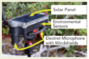 
Poadt

---

<!-- 原文第 41 页 -->

Kioxia Holdings Corporation Integrated Report 2026 
About Kioxia Group Messges from Senior Value Creation Story Management 
Growth Strategy 
Management Capital as the Governance Data Source of Value Creation 
40 
 
## Partnerships (Social and Ratiosip Capita) 
Co-Creation with Customers, R&D Partners, and Suppliers 
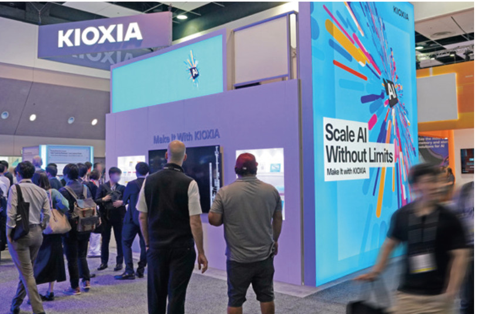 
## Key Points 
Business operation in countries/regions Timely response to global market needs 
Strong Partnerships with Customers, R&D Partners, and Suppliers 
Kioxia Group builds strong relationships with customers, R&D partners, and suppliers. We aim to further strengthen these partnerships, develop products and services that anticipate the needs of society, ensure a stable supply of high-quality products, and continuously deliver value to society. 
Customers: Leading global companies in the data center, smartphone, and PC fields We have estabished global sales, technical suppor,and supply chain networks,and co-create value to society together with customers all over the world. 
R&D Partners: Technology organizations, universities, research instiutes, and other companies in Japan and overseas 
We incorporate a vide range o utingdg owdg and des t ostonwitth aim of further evolving our products and technologies 
Suppliers: Equipment manufacturers, materials manufacturers, OSATs, and others We work with suppliers to build resien supply chains that ensure a stable supply of high-quality products, while strengthening our competitiveness by creating new manufacturing technologies. *Outsoured Semiconductor Assembly and Test 
## Kioxia Group's Global Locations 
Kioxia Group operates globally, with sits inine countries/regions. We have established strong relationships with leading companies in the data center, smartphone,and PC fields through our sales and supportcenters in the United States, Europe, and Asia. 
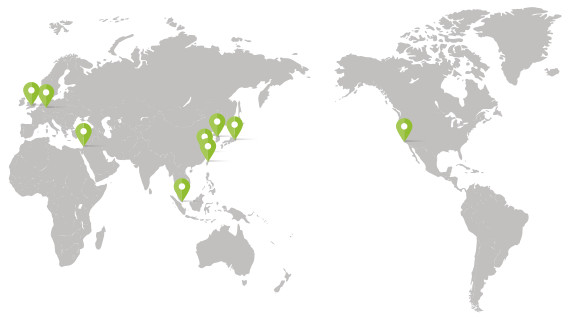

---

<!-- 原文第 42 页 -->

Kioxia Holdings Corporation Integrated Report 2026 41 
About Kioxia Group Messges from Senior Value Creation Story Management 
Growth Strategy Management Capital as the Governance Data Source of Value Creation 
 
## Strong Customer Relationships and Collaboration 
Trough is olbation it aing plocpssos pcs ci rp realize products and services that anticipate the needs of the growing Al market. 
## Examples of Co-Creation with Partners 
Buiding a Flash Based Platformor High-Capaciy,High-Performance,and Poer-Eficient Data Centers for AI Applications 
Kioxia Corporation and Dell Technologies buit a system incorporating 40 KIOXIA LC9 Series 245 TB enterprise SSDs, enabling a 2U server configuration capable of scaling up to 9.8 petabytes (PB) for Al applications. The two companies have a long history of developing scalable infrastructure for data-driven applications. This latest milestone underscores a shared commitment to advancing high-density systems that enhance performance, reduce energy consumption, and maximize data center efficiency. 
## Deepening Engagement Through Dialogue with Customers: Communication Activities at Trade Fairs 
Kioxia Group participates in various trade fairs and other events to help partners gain a better understanding of its latest products, services, and technological capabities,and to deepen dialogue with them 
At FMS: the Future of Memory and Storage 2025,the world's largest event for flash memory and storage, we showcased the Group's Al solutions through a keynote address and productsand technology demonstrations under the theme "Scale AI Without Limits."In adition,the highcapacity KIOXIA LC9 Series SSD for generative Al won the Best of Show Award in the Most Innovative Technology category. 
We also exhibited at major industy events hosted by leading companies in the Al and data center fields, including NVIDIA GTC, COMPUTEX, and Interop Tokyo, to highlight the critical role played by the Group's high-performance storage solutions. 
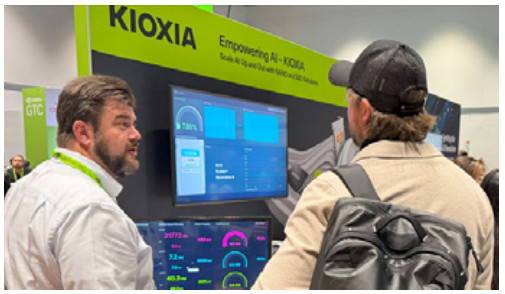 
A.live technology demonstration of KIOXIA AISAQ st NVIDIA GTC 2025 
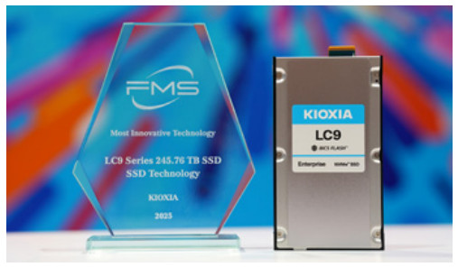 
The KIOXIA LC9 series enterprise Ss received the Best of Show Award at FMS 2025. 
## TOPICS 
## KIOXIA Innovation Lab Bridging Customers with Research 
KIOXIA Innovation Lab provides customers with an environment for testing and evaluating the company's new products, technologies, and software.We aim to enhance value for customers and the market by quickly and ffectivelyincorporating customer feedback into new products and technologies.

---

<!-- 原文第 43 页 -->

About Kioxia Group Messges from Senior Value Creation Story Management 
Growth Strategy Management Capital as the Governance Source of Value Creation 
Kioxia Holdings Corporation Data Integrated Report 2026 
42 
 
## Generating Innovation with R&D Partners 
We incorporate ideas from outside the Kioxia Group, from academic institutions and partners across industies,generating innovation through cose collaboration to deliver new value to society. 
Joint Development: Next-Generation Green Data Center Technology Development(Broadband Optical SSDs) 
Kioxia Corporation is working together with Fujitsu Limite, FINTY Ino..AI Core Co, Ltd.. Furukawa FITEL Optical Components Co,Ltd,Kycera Corporation, and NEC Corporation on the 
Nx-Geion Gre Data Center Tchnolgy Development Project" UPNP21029) Tis prpje subsidized by the New Energy and industrial Technology Development Organization (NEDO), is part of the"Green Innovation Fund Project Construction of Next-Generation Digjtal lnirastructure." Each company is contributing to the development of technologies for improving energy efficiency, increasing capacity,and reducing latency in data centers,including photoelectric fusion technologies that enable more eficient data transfer.By appying these technologies, the project aims to achieve energy savings of at least 35% compared with data centers at the start of technology development. 
Kioxia Corporation is responsible for developing broadband optical SSDs that use photoelectric fusion technology, and has confirmed the operation of a PCle5.0-compatible prototype. 
To support the realization of next-generation green data centers, we will continue deloping technologies to improve compatbility with advanced applications that rquire high-speed processing of large amounts of data, such as generative Al. We also plan to apply these technologies in proof-of-concept(PoC) testing toward the practical implementation ofdata center systems that use photoelectric fusion technology. 
Note: PCle is regitener arcark L 
 
Academic Collaboration P.39 
## Building Robust Supply Chains Through Co-Creation with Suppliers 
Kioxia Group's products depend on supply chains involving suppliers in a wide range of fields, including semiconductor maufacturing equipent afacturers,aterials manfacturers,a OSATs. Cooperation with suppliers is essential to improving product quality, ensuring a stable supplf rot,an iniing thipt of poicaik natass chains. In addition to the Group's own initiatives, such as diversifying procurement sources and standardizing components, we actively work to create robust supply chains by promoting mutual understanding and building trust with suppliers. 
## Deepening Dialogue with Suppliers through Partners Day 
In November 2025,Kioxia Corporation held Partners Day, inviting over 100 suppliers from Japan and overseas. The company provided detailed explanations of market trends and Kioxia Group's business sratejisan policies_and presented awards to outstanding suppiers. We wil to enhance supply chain resiienc by fostering mutual understanding and enhancing engagement with suppliers through dialogue. 
 
Business policy presentation at Partners Day 
 
Product dlsplay booth

---

<!-- 原文第 44 页 -->

Kioxia Holdings Corporation Integrated Report 2026 
About Kioxia Group Messges from Senior Management 
43 
 
## Human Resources (Human Capital) Professionals Supporting the Realization of Our Mission 
 
 
Kyota Okishiro Managing Excutive Office General Manager, Human Resources and Administration Division Kioxia Holdings Corporation 
Key Points 
Number of Employees 15,218 (As of March 31,2026, Koxia Grcup) 
New graduate recruits 476 Nog 
Ratio of mid-career recruits 63.6% (FY2025,Kiocia Corporation, hr f o trts 
Value Creation Story Growth Strategy 
Management Capital as the Data Governance Source of Value Creation 
Number of female managers 111 (As of March 31.2026,Koxia Carponatine aluaie adonnn 
People with diverse experience and skils contribute across a wide range of fields. 
We will further strengthen the human capital we have cultivated to support Kioxia Group's sustainable development and realize its mission. 
## Our Diverse Talent and Human Capital-the Key to Sustainable Growth 
Guided by our mission of "upliting the world with 'memory," Kioxia Group aimns to continusy crat e walue or ot through our memory technology. The efforts of every single employee are essential f we are to accomplish this mission Accordingy, we se or human resources as the ounatin on sustainable growth and the source of our future value creation. The rapid advancement of Ai is rastcal sorming business environment.Expectations of our Group as a provider of fiash memory and SSDs indispensable to this Al-driven world are rising, and the competition to acquire technical talent is intensifying. To turn these challenges into opportunities for sustainable growth, we must ensure our organization embodies our mission and vision. This means cultivating an environment where diverse talent with whom these ideals resonate can best showcase their respective strengths. 
Securing and developing the human resources who will support our future growth is therefore one of ur key management prorts. Wweare stigt co ry teepte r industry and Kioxia to a wide range of generations, including yung people.Simutaneousl, we are bostin ur hiring f nen graduatsan pree profesis lininias from diverse backgrounds.n adtion,we are developing or management personeland establishing opportunities for diverse talent to take on new challenges and thrive. 
Althe same time, we are increasingly focused on creating an environment where every employee can perform at their best without undue stress, To this n, we are making sure our employees stay in good physical and mental health, seeing employee well-being as a core business driver. We ar also improving our workplace environments, identiying and resolving issues through employee surveys, and ostrin a orporate uture wher employees respect one another and proactively embrace challenges. 
We believe that maximizing the potential of our human resources directly enhances our corporate value. Kioxia Group accordingly aims to be a company where every employee can grow professionally and take pride in their wor. By leveraging the wisdom and experienc of our diverse talent to enhance human capital, we willahihve ustialegrouth and continue to be a company that is essential to society.

---

<!-- 原文第 45 页 -->

Kioxia Holdings Corporation Data Integrated Report 2026 44 
About Kioxia Group Messges from Senior 
Value Creation Story Growth Strategy 
Management Capital as the Governance Source of Value Creation 
Management 
 
Human Resources 
## Kioxia Group's Approach to Human Capital Management 
At Kioxia Group,a wide rang of peop ontribut arosgpdt dpd amid the rapid evelopoment and aoption o I th up orinn ranhtns htnaptdnn n ntnnn a Polcy, Kioxia Croup identis e susnsthtspttitwoiei business growth, and the realization of its mission,"uplifting the world with 'memory." 
## Human Capital Management Map 
Our Aspiration 
Our View of the Business Environment 
Key Issues 
## Initiatives 
## Organization Embodying Our Mission and Vision 
Increasing recognition of the semiconductor industry and Kioxia among younger generations to secure future talent 
## Recruitment Activities 
·Raise awareness of the semiconductor industry and highlight its appeal among the general public and younger generations 
We will provide products and services that create new value for society through memory technology, based on our mission of "uplifting the world with 'memory." 
·Actively recruit new graduates and experienced professionals 
·Recruit talent with diverse backgrounds 
Enhancing employee skilsand operational efficiency to keep pace with increasingly advanced and diverse technologies 
Human Resource and Organizational Capability 
·Develop talent with advanced expertise 
·Strategically develop management talent capable of leading value creation 
·Create opportunities,an ervironment, and a culture that enable diverse talent to thrive 
·Al-driven market expansion and evolution of applications 
Ideal Employees for Our Organization 
Enhancing organizational management capabilities to enable value creation 
## Corporate Culture 
·Advances and diversification in digital technologies 
uo to noterieai ehtenitropgs nolteringo bn tel noisiv hne noissim 
Embed the behavioral uidelines based on our mission and vision 
Behavioral Guidelines 
·Intensifying competion for ·Share inspiring images of the future engineering talent 
## Foundation Enabling Employees to Thrive 
·Explore possibilities without constraints 
## Systems 
arrangements illness or injury 
Flexible work 
employees during 
efficiency 
Safety net to support 
enhance operational 
management 
transformation to 
·Promoting health 
Promotion of digital 
health and safety 
evaluation systems 
Ensuring employee 
·Appropriate 
Health and Safety 
Engagement 
Developing global talent to help build and strengthen partnerships 
·Think for yourself,be active, cooperative,and flexible 
·Conducting and analyzing engagement surveys 
·Be inclusive,respect others 
·Implementing improvement measures based on survey results 
·Act with integrity and transparentty 
Building an organizational foundation that enables diverse talent to thrive

---

<!-- 原文第 46 页 -->

Kioxia Holdings Corporation Data Integrated Report 2026 
About Kioxia Group Messges from Senior Value Creation Story Management 
Growth Strategy Management Capital as the Governance Source of Value Creation 
45 
 
Human Resources 
## Recruitment Activities 
## Diversity Promotion 
To respond swifly to growing market needs and increasingly advanced and diversified technologies, Kioxia Group regards the recruitment and development of people with divre backgrounds as a key priority,As such, it atvely ecruts rew graduates and mid-career talen,.ineluding through referral and alumni recruitment. 
Kioxia Group believs that enabling diverse talent to thrive wil ecorg ewideas reatr divestyinn approaches to issues, and inovation, ultmately leading to corporate growth and the creation of new value for society, The Grup is committed to crating opportunities,an environmen,and a culture that enable diverse talento l ps te nce ili/n e e eii i women's participation in management as a key priority. 
Kioxia Corporation has established a Training and Development Committe to further enhance the development and effective utlization of ts personne., ased on the business plan, the committee reviews the results of in-house training programs each fiscal year, deliberates on measures for improvement and policies for the following fiscal year,and provides feedback for training activities. In FY2025, the committee eiberated on enhancing management training and roling out companywide digital transformation training. 
Kioxia Corporation set a target in FY2021 of doubling the number of female managers compared with FY2019, and achieved this target by the end of FY2025.In March 2026,it st the folwn ihnhtragtss and is taking steps to achieve them. 
·Ratio of female managers:7%(by FY2030) 
·Ratio of female new graduate recruits: Al least45% for administrative positions and at least 15%for technical positions 
Numbers of New Graduate and Mid-Career Recruits (Kioxia Corporation) 

| | FY2023 | FY2024 | FY2025 |
| --- | --- | --- | --- |
| New graduate recruits! | 511 | 276 | 119 |
| Mid-career recruits | 25 | 63 | 208 |
 
These targets are also stipulate in our General Employers Action Plan under Japan's Act on the Promotion of Women's Participation and Advancement in the Workplace QDiersity Promotion 
## 2Nbeoo Organizational and Talent Development Technical Training 
Aoiaons n 
Number of Female Managers 
Ratio of Female New Graduate Recruits 
Kioxia Group is focusing on the development of engineers capable of meeting increasingly advanced technical needs and leading the industry in the yars ahad.For new employees of Kixia Group in Japan,we provide basic training to strengthen their foundational skills in the semiconductor field, and from their second year onward, we offer more advanced specialized technical courses. At each workplace, we have also estabished a framework for amployees to aquie pratical slithoh on-thejob training.In addition, we provide an environmenthat enables engineers to proactively develop their own careers.We foster generalists who bridge business and technology, as well as professionals who integrate different technologies to create new value. 
 

| | Administrative positions | Technical positions |
| --- | --- | --- |
| FY2022 | 53.3% | 13.2% |
| FY2023 | 37.5% | 8.7% |
| FY2024 | 30.4% | 9.7% |
| FY2025 | 71.4% | 14.3% |
| FY2026 | 59.3% | 7.2% |
 
i desoth nw 
Kiaxia Corporation an Group companies in Japan 
## Developing Future Managers 
## Passing Technical Skills on to Future Generations 
Kioxia Group in Japan provides training at every levelfrom new reruisto management to enance the competitiveness of the overall Croup. In training and development based on levels of responsibility (level-specific education),we provide training for leders and managers to acquire the knowledge and skis neded for their roles a wlls aa ccaic argorams to tengthen their management capabites.For managers in particula, we provide ongoing training to help them demonstrate leadership within the organization and improve performance. 
The Group has Senior Fellows-professionals who are active in wide ranin felds inludig rhitecture, memory design, and memory development.They are committed to passing on advanced specialist knowledge and expertise in research and technology development and product development to the next generation, as well as contributing to the development of semiconductor technologies. 
Talent Development

---

<!-- 原文第 47 页 -->

Kioxia Holdings Corporation Integrated Report 2026 
About Kioxia Group Messges from Senior 
Value Creation Story Growth Strategy 
Management Capital as the Governance Source of Value Creation 
Data 
46 
Management 
 
Human Resources 
## Corporate Culture 
Embedding the Mission, Vision, and Behavioral Guidelines 
Kioxia Group regularly provides levelspecific eucation and e-learning programs designed to deepen employees understanding of the mission and vision.We have also established our Behavioral Guidelines to express the values that each employee should embrace based on the mission and vision, and are working to foster a corporate culture around them. 
At Rioxia Group in Japan, yarious initatives are underway to share senior management's perspectives on the mission and vision with employees. These initiatives inlude management policy briefings led by senior management and the publication of interview aricles on the internal communications portal site 
 
Moreover, Kioxia Corporation has incorporated specific initiatives aligned with the Behavioral Guidelines into employees' target management and performance evaluations. it aims to connect each employee's work with these values so that the organization as a whole can work toward the mission with a shared sense of purpose and continue to grow. 
## Foundation Enabling Employees to Thrive Promoting Work-Life Balance 
The Group is working to create systems and foster a corporate culture that together enable each employee to work in their own way while achieving both high productivity and work-life balance. 
For example, Kioxia Corporation aims to maintain a childcare leave utiization rate of 100% among female employees and achieve a rate of 85% or higher among eligible male employees. To this end, it has estabished systems such as hourlyunit annual leave and nursing leave to support employees in balancing their careers with childcare. t also works to increase awareness in the workplace, including through roundtable discussions for employees who have taken childcare leave.In FY2025, the childcare leave utiization rate was 100% among female employees. Among eligile male employees, the rate was 69.8% (Number of male employees who took chidcare leave, etc. divided by the number of male regular employees whose spouse gave birth) and has been increasing year by year. 
 
Panbt 
## Health and Safety 
The Group recognizes the vitality and mental and physical well-being of each employee are an important foundation supporting its business activties.,Accordingly, we are working to create a safe and comfortable working environment for all employees and others involved in our business activities. We have acquired certification for occupational health and safety management systems under ISO 45001:2018, mainly at or manufacturing and R&D sites. Based on these systems,we continuously conduct risk assessments, confirm compliance with relevant laws and regulations, and increase the visibility of health and safety management. In March 2026,Kioxia Holdings Corporation and Kioxia Corporation were recognized for the third consecutive year as Outstanding Organizations of KENKO Investment for Health (Lage Enterprise Category) by the Ministry of Economy, Trade and Industry and the Japan Health Conference. 
 
Health and Safety 
## Employee Engagement 
Kioxia Group regularly conducts employee engagement surveys, identifies issues, and implements measures to address them. 
In FY2025,we conducted an anonymous worldwide survey of about 14,500 Kioxia Group employees, asking about the Group's strong points and areas for improvement, as well as their levels of satsfation with thi compry, thir wor,thir superisors, an teir worplacs, We received responses from 92% of those targeted. Analysis of the results identifid the isue of communicating the Company's vision and the rationale behind management decisions to employees in a more understandable manner as one to be addressed. In response, members of senior management regularly visit business sites to engage in direct ialogue with employees. 
Going forward,we will enhance corporate value by continuing to strengthen employee engagement through a cycle of surveys, analysis, and measures. 
QDiversity Promation 口Health and Safety 
 
Dialogue between senior management and employees

---

<!-- 原文第 48 页 -->

Section 
## Governance 
6 
48 Corporate Governance
55 Risk Management and Compliance
57 Sustainability Management

---

<!-- 原文第 49 页 -->

About Kioxia Group Messges from Senior Management 
Value Creation Story Growth Strategy Management Capital as the Governance Source of Value Creation 
Kioxia Holdings Corporation Data Integrated Report 2026 
48 
## Corporate Governance 
## Basic Views 
The aim of Kioxia Group's governance is to enhance the transparency and effiency of management through the establishment of an internal control system for the Grup,ensure risk management and compliance with laws and regulations, and continuously increase corporate value as one of the world's largest flash memory players by accelerating the speed of management through coperation from superision t eution.The Group strives to ansure the igts and eguality shareholders and investors by appropriately disclosing information and engaging in constructive dialogue, and the Group will continue to maintain and improve its governance system in order to promote appropriate cooperation through similar information disclosure and dialogue for the mutual benefit of alstateodes elated to te Company,including employees, customers, business partners, creditors, and local communities. 
## Corporate Governance Structure Aaof jy2 
Kioxia Holdings Corporation isa company with an Audit and Superisory Bard which audits the duties of the directors. 
The Board of Directors is the main body of governance at the Company. In order to clarify the separatior of management supervisory functions and executive functions, execution functions are performed by the executive officers to whom authority has been delegated by the Board of Directors, together with the relevant departments that assist them. 
 
## Board of Directors 
The Board of Directors consists of seven directors, inluding three outside directors.To clarify management responsibilities and enable prompt responses to changes in the business environment, the term of office for directors is set at one year. 
## Representative Director, President and CEO 
Th representative diretor nd preident,o alosvs spsdentn C,aesdecisions on important matters for the Company, generates synergies through the optimal deployment of management resources at the Company and its group companies, and bears responsibility to shareholders for execution of the Company's business. 
## Executive Officers 
The Company has nine executie oficersone President and CEO,ne Executive Chairperson, two Executive Vice President and Executive Officers, two Managing Executive Officers, and three Executive Officers. 
## Audit and Supervisory Board 
The Audit and Supervisory Board consists of three members, ineluding two outside members. Working with the accounting auditor and the Internal Audit Division, the Audit and Supervisory Board helps ensure sound management. 
## Voluntary Nomination and Compensation Advisory Committee 
The Company estabished a voluntary Nomination and Compenstion Advisory Comitte as a advisory body to the Board of Directors on November22,2024. The committe consists of at least three directors or Audit and Supervisory Board Members, the majority of whom are independent officers as stipulated by the Tokyo Stock Exchange.The chairperson is selected from among the committee's independent officers by resolution of the committee. The committee deliberates primarily on matters related to nomination, including policies and standards for the appointment and dismissal of directors,the representative director, the president and CEO and the executive chaiperson,as vells satr ttr iiin tf sct the individual remuneration of directors, the president and CEo,and the executive chairperson, which are submitted to the Board of Directors. These matters are then reported to the Board of Directors.Through this framewor, the Company works to stengthen the tainessaspareanr, and objectivity of procedures related to the nomination and remuneration of directors, thereby enhancing corporate governance.

---

<!-- 原文第 50 页 -->

About Kioxia Group Messges from Senior 
Value Creation Story Management 
Kioxia Holdings Corporation Integrated Report 2026 49 
Growth Strategy Management Capital as the Governance Source of Value Creation 
Data 
## Corporate Governance 
## Nomination and Compensation Advisory Committee Members 

| Chairperson | Hiroshi Suzuki (Independent officer) |
| --- | --- |
| Committee Member | Michael R. Splinter (Independent officer) |
| Committee Member | Emiko Higashi (Independent officer) |
| Committee Member | Hiroo Ota (Representative Director, President and CEO) |
 
## Appointment Process for President and CEC 
The Company's President and CEO is selected after assessing candidates from around the world and from inside and outside the Company and conducting interviews with the Nomination and Compensation Advisory Committee. 
Hiroo Ota was appointed as President and CEO of the Company in April 2026.The Nomination and Compensation Advisory Commite resolved unanimously that he was the most suitable person for the role.The reasons for this resolution are that Mr.Ota possesses extensive technical knowledge regarding the development and production of memory and SSDs, as well as deep insight into semiconductor memory and Al ecosystems. The committee believed that,by leveraging these strengths and demonstrating strong leadership, Mr. Ota would enable Kioxia Group to achieve further growth and enhance its corporate value amid changes in the business environment. 
## Analysis and Evaluation of the Effectiveness of the Board of Directors 
The Company decided to conduct selfassessments and analyses of its Board of Directors starting in FY2025, with the aim of improving the function of the Board of Directors, and in turn, corporate value. 
The method and a summary of the results of the self-assessments and analyses are as follows. 
## Method of Evaluation 
In January 2026, he Company conducted a survey via an external organization for alldlirctorsand auditors serving on the Board of Director, and the board subsequently analyzed, discussed, and evaluated the results. 
## Summary of Results for FY2025 
Responses to the survey were generall pstiv with regard to matters such as shared understanding of the roles of the Board of Directors, discussions that take into account sustainable profitability and capital costs, the operation of the Nomination and Compensation Advisory Committee, and discussions on the succession plans for the CE, which indicates that both the Board of Directors and the Nomination and Compensation Advisory Commite are functining effectively. 
On the other hand, respondents idetid isus for further improvement,such as diversity of the Board of Directors and the ratio of independent outside directors, discussions on management strategies and plans at board meetings, and dialogue with shareholders and investors in the context of how to further improve the function of the Board of Directors and its discussions. 
## Initiatives Going Forward 
Based on this assessment, the Board of Directors of the Company will dicuss isus and work quickly to improve them to continue its eforts to imprve the function of the Board of Directors. 
## Activities of Outside Officers in FY2025 

| | Overview of Duties Performed Regarding the Roles Expected of Outside Officers |
| --- | --- |
| Hiroshi Suzuki Director | Mr.Suzuki actively makes statements at Board of Directors meetings and other meetings based on his broad knowledge of the manufacturing industry. In addition, through his role as Chairperson of the Nomination and Compensation Advisory Committee, he fulfills his duties as an outside director. |
| Michael R. Splinter Director | Mr. Splinter actively makes statements at Board of Directors meetings and other meetings based on his extensive experience and expertise in the global semiconductor industry. In addition,through his role as a member of the Nomination and Compensation Advisory Commitee, he fulfills his duties as an outside director |
| Isao Morita Audit and Supervisory Board Member | Mr.Morita has made statements mainly from the perspective of verifying the soundness of governance, leveraging his expertise in memory and storage as well as management. |
| Koichi Hatano Audit and Supervisory Board Member | Mr.Hatano has made statements mainly from the perspective of verifying the soundness of governance,utilizing his extensive knowledge in the field of human resources and general affairs. |

---

<!-- 原文第 51 页 -->

Kioxia Holdings Corporation Integrated Report 2026 
About Kioxia Group Messges from Senior Management 
Value Creation Story Growth Strategy 
Management Capital as the Governance Source of Value Creation 
Data 
50 
# Corporate Governance 
## Management Team (As of un812, 2 
Directors 
Hiroo Ota 
Masashi Suekane 
 
Director 
 
 
Postiol moran cn Partner of Bain Capital Japan,LC 
Reasons for appointment Since joining the Company, Mr.Ota has helped lead the 
Reasons for appointment As the Partner Head of Japan and Asia Pacific at a priuate 
eouvee 
Reasons for appointment 
As a partner at a prlvate equity firm,Mr.Suekane has been 
anegement.n thu the compny hspac 
 
iss e ct n d 
Hiroshi Suzuki 
Michael R. Splinter Independent Outside Director 
Emiko Higashi Independent Outside Director 
 
Independent Outside Director 
 
Soluo mpotant cconn Lead Independent irector of Nasdaq. Directoro fn Director of Tigo Energy, In. 
 
Director of Rambus Inc. 
Reasons for appointment Eo 
Reasons for appointment Mr.Splinter has long served as an executive of global companies listed overseas and has extensive experience in international business in the semiconductor industry. Having 
Reasons for appointment Ms.Higashi a ben involved ith mergers and aqution for semiconductor and high-tech companies based in the U.S.and has experience co-founding a strategic consulting 
supervision from an independent standpoint, the Company has appointed him as an outside director. 
Stacy J. Smith 
Director 
 
Reasons for appointment 
Mr. Smith has served as CFO at Intel Corporation and 
oaaog 
Company has appointed him as a director. 
from an independent standpoint, the Company has appointed him as an outside director. 
Yuji Sugimoto Director 
 
Company's corporate value and supervise management from at

---

<!-- 原文第 52 页 -->

Kioxia Holdings Corporation Data Integrated Report 2026 
About Kioxia Group 
Messges from Senior 
Value Creation Story Growth Strategy 
Management Capital as the Governance Source of Value Creation 
51 
Management 
## Corporate Governance 
# Management Team (As of June 25,2026) 
Audit and Supervisory Board Members 
Isao Morita 
Outside Audit and Supervisory Board Member (Ful-fime) 
 
Kotido cod t D Superisan ad cebt l MP 
Chizuko Yamamoto 
Outside Audit and Supervisory Board Member (Part-Gime) 
Outside Audit &Superisory Board Member of TDK Corporation 
## Executive Officers 
Hiroo Ota 
Stacy J. Smith 
President and Chief Executive Officer 
Executive Chairman 
Yoshihiko Kawamura 
Tomoharu Watanabe 
Executive Vice President and Executive Officer (Chief Financial Officer) 
Executive Vice President and Executive Officer 
Junichiro Yaguchi 
Kyota Okishiro 
Managing Executive Officer (Chief Strategy Officer 
Managing Executive Officer (General Manager, Human Resources and Administration Division) 
Toshiaki Fujikawa Executive Officer (erl MangCorpor Comuncation Division) 
## Dialogue with Shareholders and Investors 
Kioxia Holdings Corporation places emphasis on engagement with shareholders and investors through constructive dialogue and strives to foster trust through highly transparent communications. In adition to financial results presentations and the general meeting of shareholders, we host events such as Investor Day for institutional investors and analysts to provide clear explanations of our business and management strategies. 
We also engage proactiely in dialogue with institutional investors through conferences and one-on-one IR meetings. Conferences include participation by the CEO, CFO,and other management as appropriate, ensuring that senior management engages directly with investors.Through these opportunities,we strive to provide an even deeper understanding of such aspects of Kioxia Group as its business strategy, financial strategy and performance, sustainability efforts,and governance. 
Feedback and insights obtained through dialogues with investors are regularly shared with senior management and directors in reports at meetings and other appropriate opportunitis. Senior management appropriately considers investor perspectives and market feedback, incorporating them into the development of management strategies and intiatives t enhance corporate value. 
## Use of the Integrated Report 
Kioxia Group uses its inegrated Report as a key too tor depening constructive dialogue with investors and other stakeholders. Through the Integrated Report,we strive to present information on the Group's growth strategy, business activities, financial and non-financial information, and sustainability initiatives in a clear and accessible manner. Feedback from inside and outside the Company together with the results of expert evaluations and other assessments is used not only to improve the lntegrated Report but also to identify management isus and enhance management intativs.,hrough this yle of fagu and fedback, we enhance the transparency and effectiveness of management and support sustainable growth and the enhancement of corporate value. 
Toshiaki Kawabata Executive Officer (Chief Information and Security Officer) 
Kayoko Yasutomi 
Executive Officer (General Manager,Legal Affairs Division) 
Shunsuke Nakahama 
Audit and Supervisory Board Member (Partime) 
Seatesppm 
Non-Executive, Non-Outside Director of ECHOMARKETING Co,Ltd.

---

<!-- 原文第 53 页 -->

Kioxia Holdings Corporation Data Integrated Report 2026 
About Kioxia Group Messges from Senior Value Creation Story Management 
Growth Strategy 
Management Capital as the Governance Source of Value Creation 
52 
## Corporate Governance 
## Skill Matrix 
Each directoris spetet to orbut th mduim to ongtrmeancement of prtd saprreeorr Nomination and Compensation Advisory Committe and the Board of Directors 

| | | Hiroo Ota | Stacy J. Smith | Yuji Sugimoto | Masashi Suekane | Hiroshi Suzuki | Michael R. Splinter | Emiko Higashi |
| --- | --- | --- | --- | --- | --- | --- | --- | --- |
| | Date of appointment as director | June 2026 | March 2019 | March 2019 | August 2024 | March 2019 | June2020 | June 2026 |
| | Attendance at Board of Directors Meetings(FY2025) | | 18/20times | 15/20 times | 19/20times | 20/20times | 16/20 times | |
| | Research & Development | 人 | | | | | | |
| | Supply Chain Management (Procurement/Logistics) | √ | √ | | | √ | | |
| | Global | √ | J | √ | | √ | √ | √ |
| | Finance/Capital Policy | √ | J | √ | | √ | | 爱 |
| | M&A/Strategic Alliances | √ | √ | √ | | √ | | √ |
| SIis | Semiconductors(Including Materials/Equipment Manufacturers) | | L | | | 人 | | |
| IT/DX/Information Security | | √ | | | √ | | √ |
| Capital Market Insight | | √ | √ | √ | | √ | √ |
| Global Inelligence | √ | √ | √ | | | √ | |
| Manufacturing/Production Operations | √ | √ | | | √ | | |
| Sales/Marketing | √ | √ | | | | √ | |
| Corporate Management (Execution) | | √ | √ | | √ | | √ |
| Human Resource Management | √ | √ | √ | | √ | √ | |
| Finance/Accounting | | | | | √ | | |
| Corporate Legal Affairs/Compliance | | | | | | √ | |
| Governance (Supervision) | | | | | | | |
| Corporate Strategy | | | | | √ | | |
 
Note: The check marks in the chart do not represent the full etent of each director's knowledge,experience,or expertise.

---

<!-- 原文第 54 页 -->

Kioxia Holdings Corporation Integrated Report 2026 
Data 
53 
Management 
Strengthening Our Governance in Order to Navigate Rapid Change 
About Kioxia Group Value Creation Story Messges from Senior 
Growth Strategy Management Capital as the Governance Source of Value Creation 
Leading the AI-Driven Flash Memory Revolution 
Supporting Sustainable 
Growth: an Independent 
Perspective

---

<!-- 原文第 55 页 -->

About Kioxia Group Messges from Senior Value Creation Story Management 
Kioxia Holdings Corporation Integrated Report 2026 54 
Growth Strategy Management Capital as the Governance Source of Value Creation 
Data 
## Corporate Governance Officer Remuneration 
## Basic Policy 
Based on its Basic Policy on Corporate Governance, the Company has established a remuneration system for officers designed to realize the continuous enhancement of corporate value,and to ensure that the functions of business execution and management superision are appropriately fulfile.Tis remuneration plan for officers will be pdated periodically to rect the Company's business growth and the market environment. 
## Remuneration Level 
The level of remuneration is designed to ensure appropriate remuneration competitiveness as a global company to attract and retain highly capable executive talent who drive the Company's business.Specifically,the leve is ttermined by referencing the remuneration levels of domestic and global companies in the semiconductor industry and other related industries. 
## Remuneration Structure 
Remuneration for directors who concurrently serve as executive officers is structured as follows,to reflect their responsibility for medium- to long-term performance and for enhancing corporate value. Fixed remuneration: Monetary remuneration paid as the fundamental component of remuneration for officers in accordance with the responsibilities and roles to be fulfille 
Performance-linked remuneration: Monetary remuneration that varies based on the degree to which performance targets are achieved for each fiscal year 
Continuous service stock-based remuneration: Deferred compensation stock-based remuneration plan paid subject to continued serice for a certain consecutive period Performance-linked stock-based remuneration: Deferred compensation stock-based remuneration plan paid based on the degree of achievement of performance targets over a certain consecutive period 
## Remuneration for directors who do not concurrenty serve as executive ofices is strutured as follows,considering their role in overseeing business execution. 
Fixed remuneration: Monetary remuneration paid as the fundamental component of remuneration for officers in accordance with the responsibities and roles to be fulfilled 
Continuous service stock-based remuneration: Deferred compensation stock-based remuneratin plan paid subject to continued service for a certain consecutive period 
## Method of Determining Remuneration for Directors 
To ensure objectivity an ranpareny, the Board of Directors delegates the etermination of individual remuneration amounts for directors to the Nomination and Compensation Advisory Committe, hich is a voluntary committeechaired by an independent director and composed of at least three directors, the majority of whom are independent officers. 
## Malus and Clawback Provisions 
The Company has established,by resolution of the Board of Directors,a"'malus provision"under which all or a portion of the nits of perormance-linked remuneration and continuous serice/ performance-linked stock-based remuneration may be forfeited,and a "clawback provision"under which the Company may request the retur of all o a portiono money or shares paid in the event of serious misconduct or violation of laws and regulations on the part of a director. 
## Officer Remuneration Structure 
(At standar valv foperomaneine re neratin and vith o lsftuo atpoaro 

---

<!-- 原文第 56 页 -->

About Kioxia Group 
Messges from Senior 
Value Creation Story Management 
Growth Strategy 
Management Capital as the Source of Value Creation 
Kioxia Holdings Corporation Integrated Report 2026 
Governance Data 
55 
The commitee meets once every six months. Trends in cyberattacks that may affect the Company, the status of countermeasures, and activity plans are discussed and approved by management, resulting in the implementation of necessary measures and continuous improvement. 
ia Group's Risk Management and iance Committee Structure 
Risks are managed in accordance with the RC Regulations, with responsibility assigned to the Internal Management Reinforcement Division, the Human Resources and Administration Division the Legal Affairs Division,or the Corporate Strategy Division.The division responsible for each rish monitors relevant laws and regulations, including their content and any amendments or repeal, as well as newly applicable social norms, and revises the risk table as necessary. 
 
Borad o 
Reprt Audit and 
薹 
S 
"Serious and immediate risk that cannot be addressed through usual decision-making channels and is of a severity that sotxsveaes) 
 
Details of business and other risk: Annual Securites Report for the Fisca/ Year Ended March 2026 
Risk Management and Compliance Committee 
Delesalion 
Report 
Related Committees 
## How Compliance Supports the Sustainable Growth of Kioxia Group 
 
Driven by the A-led evolution of a society that is hungry for data, the deployment of or fash memry and SDs s xpanding.A our business continues to grow, there is increasing public interest in and expectations for ur rop and greater fous on our corporate social responsibities 
Kayoko Yasutomi 
Executive Officer and General Manager, Legal Afaia Dision Kioxia Holdings Corporation 
Compliance is a vital management function: a foundation on which we build tus,achieve sustainable growth, and enhance our corporate value.Guided by the Kioxia Group Standards of Conduct, ve are haping crs a tto business activities that emphasize fairness, integrit, and transparency. The management communicates its commitment to these principles internally to boos ndiwidual mployee awareness of them.We also ensure our whistleblowing systems identrfy and address compliance risks early. 
We will conine to respnd appropriately to evoving laws, regulations, and social expectations, growing our business while maintaining the highest ethical standards, in ordeto sustainably enhance our corporate value and make our contribution to society

---

<!-- 原文第 57 页 -->

About Kioxia Group Messges from Senior Management 
Value Creation Story Growth Strategy Management Capital as the Governance Source of Value Creation 
Kioxia Holdings Corporation Integrated Report 2026 
Data 
56 
## Risk Management and Compliance Internal Audits 
Kioxia Holdings Corporation has stabised an itea Audt Dvisin ndrthe dret corto the President and CEO to conduct audits, primarily of accounting and operations, with the aim of strengthening internal controls. 
Based on an internal audit plan, the internal Audit Division carries out audits through on-site visits or by reviewing submitted materials and conducting remote interviews, then reports its findings ta the President and CEO approximately once each quarter and to the Board of Directors once a year For audit findings, the internal Audit Division monitors the progress and verifies the results of corrective actions as necessary until those actions have been completed. 
The Internal Audit Division strives to enhance the effectiveness of its various audit functions, including accounting and operational audits, by strengthening collaboration with the Audit and Supervisory Board members and the Accounting Auditor through the mutual exchange of information on audit plans,progress, and results, among other intiatives. Specificaly he uit nd Supervisory Board members,the Accounting Auditor, and the Internal Audit Division hold regular meetings approximately once each quarter to echange information on the status of audits and other matters. The Audit and Supervisory Board member and the Internal udit DMvsio alis ala pl s approximately once each quarter for the same purpose.The Internal Audit Division also explains the status of internal audits and other matters to departments responsible for internal controls at Accounting Compliance Commite meetings, which are held approximately once every six months. 
## Whistleblower System 
Kioxia Group encourages day-to-day communication within each workplace in order to foster an open work environment. We also operate a whistleblower system to prevent misconduct and facitat is ary tecton l plpeeousstth ocpn intranet, including that whistleblowers'anonymity is protected and that they will not be treated disadvantageously. Additionally, Kioxia Group in Japan* accepts reports from employees within one year of their retirement. The number of reports and consultations received through the whistleblower system in FY2025 was 110.Kixia Holdings Corporation has also estabished a System that allows the company's officers or employees to provide information directly to an external lawyer in the event they become aware of any suspected legal violations tincluding those related to accounting) by the company or by its officers or employees. 
"Kioxia oldings Corporation and its subidiaries in Japan 
## Information Security 
As advances in Al drive rapid digitalization, ata breahes and other risks associated with more sophisticated and targeted cyberattacks are increasing, making information security a ctical management issue for companies. 
Guided by its policy on information management, including the handling of personal information, Kioxia Group rigorously manages personal information and oustomer and business partner information as confidential information, and has established systems to prevent improper disclosure or leakage. Initiatives conducted under these systems include regular employe training,addressing external cyber-attacks, and the establishment of a framework for managing assets and vulnerabilities. 
The Group's forts to stngthen information secrity also xtend to suppliers and other stakeholders. In FY2025,Kioxia Corporation used a security risk rating tool to valuate approximately 200 items, including website and server configurations and the presence of vulnerabilities, for business partners in areas including component supply, outsourcing, and cloud services,and provided guidance on improvements to those whose security capabilities were found to be inadequate. 
## Business Continuity Management 
Kioxia Group has formulated a Basic Policy on Business Continuity Management (BCM)and established a framework for minimizing the risk of damage to corporate value resulting from unforeseen events such as natural disasters, accidents, pandemics, and regional conficts by ensuring the safety of employees and their familes, minimizing human casualties, and facitating the continuation or rapid resumption of business operations. 
Under this BCM framework, we have formulated a Business Continuity Plan (BCP) and implement disaster preparedness measures, practical dils,and periodic reviews of the plan at each of the Group's business sites during normal operations. Specific initiatives include disaster prevention measures at our business sites and factories(P.35)and the implementation ofa safety confirmation system for employees in lapan. We have also formulated action plans for emergencies in countries and regions that are critical to the Group's business.In FY2025,we revised our action plans for a potential major earthquake and conducted drills based on those plans. 
Risk Management and Compliance

---

<!-- 原文第 58 页 -->

Kioxia Holdings Corporation Through its business activities,Kioxia Group is working to reduce negative impacts on society and aims to create value for society with its partners by leveraging the driving forces behind its sustainable growth. Data Integrated Report 2026 57 
About Kioxia Group Messges from Senior Management 
Value Creation Story Growth Strategy Management Capital as the Governance Source of Value Creation 
## Sustainability Management 
## Sustainability-a Core Kioxia Management Focus Aimed at Boosting our Corporate Value 
 
At Kioxia Group,we are implementing sustainability management that balances business growth with the resolution of social issues. Or"Sustinabilry Materaty' a istos s altprs summarizes the various critical initiatives we are taking in this space, all aimed at enhancing our corporate value. 
 
Tomoharu Watanabe Executive Vice President and Executive Oficr in Charge of Sustainability Kiaxia Holdings Corporatian 
In terms of our response to climate change, we are steadily reducing 一 $CO_{2}$ emissios an making inraingus orfnewaleeregyas swe strive to meet our 2050 net zero goals, whileacelrting highy effective initiatives such as the acquisition of SBT certificatin. 
## Establishment and Identification Process 
Our inclusion in the FTSE4Good Index Series, our selection as an"A List Company'-the highest rating in th Water SecurtyCatgory202-by the D,and our recognitionas an S oinated Company within the SX Brands 2026 program ttest to the effectiveness of these efforts ( P.59) 
## Background and Business Environment 
Global scale environmental issues such as climate change and environmental impacts and various forms of social inequality are becoming more serious. Meanwhile, new needs and challenges are emerging with the rapid development of a digital society centered on AI.Recognizing its growing role in the sustainable development of society, Kioxia Group has established its Sustainability Materiality to clearly set out its direction for sustainability management. 
Moving forward, we willaclrteimplementation of our sustainabit intaives bp means of transparent disclosure,dialogu,and co-creation with our customers, partners, employees, local oues,shareders,and ivestors, We are comdtatin ttngs our entire value chain to continuously enhance our corporate value and make a positive contribution to society. 
## Determination Process 
In determining its Sustainability Materiality, and taking into account the characteristics of its business,the Group has 1) referred to the Integrated Reporting Framework of the IFRS Foundation, the Guidance for Collaborative Value Creation of the Ministry of Economy, Trade and Industy, the GRI Standards of the Global Reporting Initiative, ISO 26000(the international standard on the social respnsibiliy f organizations, and oter materasi sesdstahide onensan considered their importance to the Group;3) selectd candidate material themes through interiews with the management team and verification by external experts; and 4) finalized the selection following lively discussions at the Sustainabity Commite, hich inludes participants from various divisions including corporate sta,research and technology development, sales, and manufacturing, and at the Sustainability Strategy Meeting,rom the perspectives of trends in the international community, relevance to the Group's business, and enhancing competitiveness to increase corporate value. 
## Sustainability Materiality Priority Areas for Growing with Society and Increasing Corporate Value 
Kioxia Group has identified its Sustainability Materiality-priority areas for avancing its sustainable develpment with society,enancing its corporate value,and realiing ts mission. ur Sustainability Materiality comprises three domains:"Requirements from Stakeholders, which refers to societal expectations that we recognize as being of particular importance,"Foundation of Value Creation." the Group's driving force for continuing to provide value to society, and "Creating Social Value, which involves working with partners to provide society with a foundation for data utilization through memory technologies, thus creating value over the medium to long term. These domains comprise 11 elements. 
The finalized themes are reported to the Board of Directors for deliberation as part of the nonfinancial medium-term management plan, thereby increasing their effectiveness. 
Sustainabity Maeriali

---

<!-- 原文第 59 页 -->

Kioxia Holdings Corporation Data Integrated Report 2026 58 
About Kioxia Group Messges from Senior 
Value Creation Story Growth Strategy 
Management Capital as the Governance Source of Value Creation 
Management 
Sustainability Management 
## Approaches to Material lssues Roaling ur Apatino r 00o 
the Representative Director and President, with executive officers serving as committee members. t discusses and decides on Kioxia Group's sustainability strategies, policies, and target, regularly reviews progress, and reports any significant issues to the Board of Directors. Sustainability Management Structure 
Sustainability Strategy Meeting: This body is chaired by 
For each element of our Sustainability Materiality, we have identified issues based on our aspiration for FY2030 and the targets to be achieved, and set out specific action guidelines. We have set a total of 31 KPls, which we review annually in igh f atorsuch as changes in the social and business environments. 
Requirements from Stakeholders 
Foundation for Value Creation Creating Social Value ( P.1) 
## Sustainability Committee This body is chaired by the Executive fieinCcCange of ustainality Basa on the strategies and policies formulated at the Sustainability 
Human resoures(4) 
alin 
Strategy Meeting, the heads of corporate divisions and Kioxia Corporation's business divsions discuss sustainabity issues and KPls and check the progress of activities. 

| Respect for human rights (=P.eo) | Respect the human rights of all people involed in our business activit ies, including those in our supply chain |
| --- | --- |
| Sustainable 8upply chains (=P.eo) | Conduct busines with due regard for human rights,cooupational health and 8alety, and the erironmental isue in our 8upply chain |
| Climate change (=P.58) | Reduce GHG emissions during manufacturing Improve the energy elliciency of our products during use |
| Enwironmental consideration (=P.58) | Conserve water resource8 Conserve biodiversity Redue wate and manage chemical 8ubstanc88 |
| Health and safety P.46) | Create sae and comfortable workplaces |
 
 
Technology Ie . z 
Con 
In addition,where necesary, we have setup appropriat task forces under the Sustainability Committee to tackle important themes, promote measures to address issues, and manage progress. These deliberative bodies are managed by the SustainabilityDision, which is reponsile fo promoting Kioi rop's sustainaity attsrmor,e have established sustainability secretariats at Kixia Corporation's Yokkaichi Plant, Yokohama Technology Campus,and Kioxia lwate Corporation and are working to embed sustainability management practices across all ites and affliated ompanies. 
Partnerships ( P.40) 
## Main KPls 
For each theme of our Sustainabit Materiality, we have analyzed its impact on the Group and its stakeholders and identified themes and KPls of particular importance. 
## Main Achievements in FY2025 

| KPI | Targets |
| --- | --- |
| Reduction in greenhouse gas (GHG) emissions | Net-zero greenhouse gas emissions (Scopes 1 and 2) by FY2050 100% renewable energy usage ratio by FY2040 |
| Contribution to the environment through products | 30% reduction in energy consumed by products per GB of data processed (by FY2030,compared with FY2025) |
| Promoting the career advancement of female employees | Increase the ratio of female managers to 7%(by FY2030) Women comprise at least 45% of new graduate hires for administrative positions,and at least 15% for technical positions (every fiscal year). |
 
In FY2025,the Sustainability Strategy Meeting met twice, and the Sustainabity Commite four times. They discussed measures to address priority areas in light of changes in the business environment.In particular,stakeholder expectations regarding climate change countermeasures have continued to grow. Recognizing the need for a timely response, the Group reviewed various initiatives, including measures to further enhance the ffectiveness of greenhouse gas emission reductions. We also reviewed important activities and measures related to the Group's human capital strategy, recognizing the urgent need to recruit and develop talent as a source of competiv avantage. Regarding the Pls for eac thme of our Sustainait Matliyi reviewed progress and revised targets for some themes to reflet hanges in the external environment. In addition,to more clearly present our process for creating value with our stakeholders,we estabished new KPls for"Creating Scial Vale" and st out masures for visualizing and communicating our results internally and externally. 
1 Reduction in energy consumed per GB of data processed by products sadin P2030.compred with products sold in F2025 2Kiaxia Corporation 
## Sustainability Management Structure (As of luy1,2126)) 
Kioxia Group strengthens and advances sustainability management mainly through two deliberative bodies: the Sustainabilit Strategy Meeting and the Sustainability Committee.

---

<!-- 原文第 60 页 -->

Kioxia Holdings Corporation Integrated Report 2026 
About Kioxia Group Messges from Senior Management 
Value Creation Story Growth Strategy Management Capital as the Governance Source of Value Creation 
Data 
59 
Sustainability Management 
## Inclusion in ESG Indexes, External Evaluations, and Certifications 
The Group has seta goal of ahieving net zero greenhouse gas emissions from business activities by FY2050.As a part f this goai yw i oc cp rrccso nsde tct emissions) to net zero.We have additionally st arget of achieving a 100 renewable energy usage ratio by FY2040 and are ntrouoing solr owre nratons stmnst o st cosop As an interim milestone,we aim to reduce greenhouse gas emissions (Scope 1 and Scope 2) by 63.0% by FY2035 compared with FY2024.In addition, over the same period the Group also aims to reduce Scope 3 greenhouse gasemissions from purchased goods and services and capital goods (Category 1 and Category 2) by 67.0% per GB of products sold. These targets through FY2035 were certified by the Science Based Targets initiative (SBT)* 
"An international intiaivetht ertisescneategrenuegs ecuton agatsi i wit he Pis Agee 
## Disclosures Aligned with TCFD Recommendations 
 
 
 
The Group has endorsed the recommendations of the Task Force on Climate-Related Financial Disclosures(TCFD) and is promoting intatves n in with the recommendations.Speciicalwe analyze the impact of climate change on our operations and use the 1.5C,2,and 4C scenarios provided by the International Energy Agency (IEA) to consider its effects on stakeholders,business activities, and our value chain. 
FTSE4Good 
FTSE JPX Blossom Japan Index 
FTSE JPX Blossom Japan Sector Relative Index 
 
We also assess future risks and opportunities from short-term and medium-to long-term perspectives. As transition risks,we assume such impacts as increased electricity costs due to the introduction of carbon taxes and higher costs for insalig tinnnal proctonequipment s the Grup expands production. As physical riks, we assume such impacts as increased airconditioning costs to control cleanroom temperatures due to rising outdoor temperatures. 
 
 
SCIENCE BASED TARGETS 
DRNG AMBITIOUS CORPORAITE CUIMATE ACTION 
## Initiatives for the Environment 
As opportunitis, w assue business spansion through the prorsion f pouts withiproed energy efficiency, as well as reduced environmental impact and manufacturing costs through the introduction of energy-saving equipment. 
## Addressing Climate Change 
Recognition of Issues 
Based on these analyses, the Group is promoting specific intativs ing overance and strategy formulation, risk management, and measures based on metrics and targets to maximize opportunities and minimize risks 
Given that it owns and operates large-scale fiash memory plants, ioxia Group has positioned climate change countermeasures as a key sustainabit issue. Ww aim to reduce greenhouse gas emissions across the product lifecycle through our business activities and throughout the value chain.Demon aoutabiytrouh laterelislosures ictin wi stakeholders,we also aim for sustainable growth. 
## Our response to the TCD recommendations Climat Change Environmental Consideration 
Amid worsening worldvide water shortages, Kioxia Group has identiet th stale operation of flash memory plants and the conservation of water resources as one of its prortis. Wwstrive to identiy regional water risks from both short term and medium to long-term perspectives and promote appropriate water resource management. 
## Targets and Initiatives 
Moreover, we engage in efient manufacturing that considers environmental impact and resource circulation, while recognizing the importance of natural capital and ecosystem services.We are also working to provide disclosures based on the recommendations of the Taskforce on Nature related Financial Disclosures (TNFD). 
Flash Memory Production Scale ntitis or e e e ri en . Ou apprcach to the eroden Eniroment

---

<!-- 原文第 61 页 -->

Kioxia Holdings Corporation Data Integrated Report 2026 60 
About Kioxia Group Messges from Senior 
Value Creation Story Growth Strategy Management Capital as the Governance Source of Value Creation 
Management 
## Sustainability Management 
## Respect for Human Rights 
range of stakeholders,helping to enhance the fairness and transparency of the grievance proces and promote dialogue and remedy,thereby strengthening our response to human rights issues in the supply chain. 
## Basic Philosophy 
Kioxia Group believes that human rights are a prerequisite for the sustainable development of companies and of society. We are working to fufi ur psponsiblity t espect the human rights of all people involved in our business activities, including those in our supply chain.In 2021,we formulated the Kioxia Human Rights Policy to clarify or responsibitie.This policy stipulates that we must fully respect the human rights recognized in the International Bill of Human Rights and other documents, and that we illpro poitict ttrd such as the United Nations Guiding Principles on Business and Human Rights (UNGPs).The Kioxia Human Rights Policy constitutes one of our most important sets of rules, and has been endorsed by the Board of Directors of Kioxia Holdings Corporation. 
2 An organizaion that prouides a nonjudicial evune edreeptn ie it h MPa, with th im ot uppring and promoting grievance handling by member companies through its professional expertise 
Our approach to human rights Q Respect for Fuman Right 
## Sustainability Initiatives in the Value Chain 
## Basic Philosophy 
The Group identfies the stakeholders and analyzes the sustainability isves associated with ach process, rom raw material mining to the disposal of products at the end of their life, and strives to avoid and mitigate risks based on the results of that analysis (See figure below). 
Furthermore,we are committed to conducting business actvties that ar in line with the Responsible Business Aliane(RBA) Code of Conduct. Examples include promoting our own sustainability initiatives and requesting our suppliers to respect human rights. 1 Corporate allane tat promotes social feposibitywihingbalsuly ain 
## Main Activities in FY2025 
Obtained "Supplier Engagement Leader," the Highest Rating in the CDP "Supplier Engagement Assessment" 
## Human Rights Due Diligence 
Kioxia Holdings Corporation was named a "Supplier Engagement Leader,the highest rating in the CDP's 2025 Supplier Engagement Assessment(SEA),in recognitin of ts ffort des cimate change throughout the supply chain. 
Kioia Group is promoting intiatvs to osrpet th human rgts of thse impated by ts busiess activities and across itsuppy chain.To minimize human rights risks, we conduct human rights due dligence incordane wih the INGPs and have estabished aye atit identifying and assessing human rights risks, constructing a framework for the prevention and mitgation ot these ris an iplementing appropriate countermeasures, racking and investigating any identified situations, and disclosing relevant information. 
## Achieved Platinum Status,the Highest Level of Certification under the RBA Validated Assessment Program 
In an RBA audit conducted at Yokkaichi Plant in May 2025,Kioxia Corporation was recognized for appropriate management in the areas of labor,safety,environment, thics, and management systems. t scored the maximum possible 200 points and achieved Platinum Status, the highest level of certification under the RBA Validated Assessment Program. 
## Main Activities in FY2025 
Kioxia Corporation joined the Japan Center for Engagement and Remedy on Business and Human Rights (aCER) as an official member, and established a third-party hotline utilizing JaCER's Engagement and Remedy Platorm. The hotline receives reports and consultations from a wide 
Major Sustainabilty isues and intiatiesin he lue Chainn 
## Kioxia Group's Value Chain 
Kioxia's business activities 
Mining of e 
M 
R&D Planing and design manufacture 
Product -Ocupational heath and alety- Fair competition Sales 
Supply chain 
Distribution 
Use Disposal 
Examples of issues -Child iabor, forced labor -Child labor, forced labor -Labor management 
-Occupational health - Reducing environmental - Reducing environmental Recycling 
 
emissions 
Peomatoy 
-Workfore diversity

---

<!-- 原文第 62 页 -->

Section 
Data 
7 
62 Financial Highlights
63 Non-Financial Highlights
64 Company Outline

---

<!-- 原文第 63 页 -->

Kioxia Holdings Corporation Data Integrated Report 2026 62 
About Kioxia Group Value Creation Story Messges from Senior Management 
Growth Strategy 
Management Capital as the Governance Source of Value Creation 
## Financial Highlights (and MonAP Coe 
Revenue 
Non-GAAP Operating Profit(Loss) and Operating Proft Margin 
Non-GAAP Profit(Loss) Attributable to Owners of Parent 
(on 
 
 
 
Core Free Cash Flow* 
Capital Expenditures and Non-GAAP Depreciation and Amortization Capial expendiures Non-GAP deprecistion and amortization 
(ailionsaoye 
 
Net Interest-Bearing Debt and Net D/E Ratio 
 
 
"Core free cash flow equals cash flow from operating acthities minus net capital expenditures

---

<!-- 原文第 64 页 -->

Kioxia Holdings Corporation Data Integrated Report 2026 
About Kioxia Group Messges from Senior Value Creation Story Management 
Growth Strategy 
Management Capital as the Governance Source of Value Creation 
63 
## Non-Financial Highlights 
Greenhouse Gas Emissions (Scope 1 and Scape 2) 
 
the Company (marker bais) 
Number of Employees (Consolidated) 
18,000 
 
Note: As of end of March esch iscal year 
Electric Power Usage 
 
Ratio of Female Managers 
 
Boundarg: Female rati in managers eto manger leve and abve of Kioxia Corporation s otend March each fical y 
Water Intake 
 
Noter Excludes conserved water. 
Bounday Kioxia Corpration,Kioxia wate Corporation, and Solid tate stonge Teohnalogy Corporation

---

<!-- 原文第 65 页 -->

Kioxia Holdings Corporation Data Integrated Report 2026 
About Kioxia Group Messges from Senior 
Value Creation Story Management 
Growth Strategy Management Capital as the Governance Source of Value Creation 
64 
## Company Outline 
Name 
Kioxia Holdings Corporation 
Head Office Address Tamachi Statin Tower S, -1-21, Shibaura Minato-ku, Tokyo 108-0023,Japan 
Establishment 
March 1,2019 Kioxia Holdings Corporation was established as the holding company for our corporate group by means of a share transfer from Toshiba Memory Corporation (now Kioxia Corporation). 
President and CEO 
Hiroo Ota 
Capital 
31,284 million yen (As of March 31,2026) 
Business Group strategy formulation and management oversight 
Number of Employees Non-consolidated:140 Consolidated: 15,218 (As of March 31,2026) 
Listed Stock Exchange Tokyo Stock Exchange Prime Market (Securities code: 285A) 
## Kioxia Group 
"Kioxia Groupeers to Kioxia Holdings orporation and its 22 consolidaed subsidiaries (7in Japan and 15 overseas) 
 
Kioxia lwate Corporation 
Kioxia Systems Co.,Ltd. Kioxia Engineering Corporation Kioxia Etoile Corporation Kioxia Energy Management Corporation 
Kioxia America, Inc. Kioxia Europe GmbH Kioxia Singapore Pte.Ltd. Kioxia Taiwan Corporation 
Kioxia Semiconductor Taiwan Corporation Kioxia Korea Corporation Kioxia (China) Co., Ltd. Kioxia Israel Ltd. Kioxia Technology UK Ltd. Solid State Storage Technology Corporation Note:Certain consolidated subsidliaries have been omited.

---

<!-- 原文第 66 页 -->

KIOXIA 
Kioxia Holdings Corporation Corporate Communication Division 
Tamachi Station Tower S, 3-1-21, Shibaura, Minato-ku, Tokyo 108-0023,Japan https://www.kioxia-holdings.com
