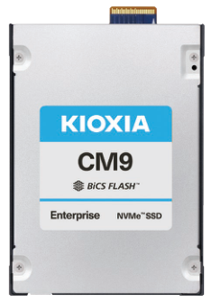

> 原文件：[27_apac.kioxia.com_eSSD-CM9-V-E3.S-Product-brief.pdf](https://github.com/jadennevercode/CJCC-Knowledge-Base/blob/564ab11aa9785e569e3853c8a4d7ce86f88e7535/materials/%E4%BA%A7%E5%93%81%EF%BC%9ANAND%E5%88%B0%E6%88%90%E5%93%81%E7%9A%84%E6%98%A0%E5%B0%84/27_apac.kioxia.com_eSSD-CM9-V-E3.S-Product-brief.pdf)
> 转换方式：Volcengine OCRPdf v3, parse_mode=ocr

<!-- 原文第 1 页 -->

KIOXIA 
## KIOXIA CM9-V Series (E3.S) (KCM9XVJE/KCM9DVJE/KCM9FVE) Enterprise NVMe Mixed Use SSD 
KIOXIA CM9-V Series is a mixed use SSD that is optimized to support a broad range of enterprise applications and associated workloads. Buit on PCle 5.0 and NVMeM 2.0technology, the CM9 Series SSDs deliver excellent performance up to 11,000 MB/s (sequential write) and 800K IOPS(random write). 
CM9-VE3.S form factor SSDs deliver3 WPD(Drive Writes Per Day) ofendurance, making them ideally suited for read intensive enterprise applications, featuring KIOXIA BiCS FLASHTM 3D TLC flash memory generation 5 for 1.6 TB and3.2 TB models and generation 8 for 6.4TB and 25.6 TB models). 
 
The 25.6 TB model is a newly added lineup designed to meet further SSD demands in Al workloads. The CM9-V series combines TLC high capacity with 3 DWPD durability, making it ideal for expanding memory hierarchies GPU can access with highperformance storage and building large-scale inference environments. 
Product image may represent a design model 
## Key Features 
·PCle 5.0, NVMeT2.0 specification compliant 
·Open Compute Project Datacenter NVMeM SSD specification v2.5support (not allryurements) 
·Form factor: E3.S,7.5 mm thickness 
·Proprietary KIOXIA architecture:controlle,.firwre and BiCS FLASH 3D TLC flash memory generation 5 and generation 8 
·Dual-port design optimized for high availabity applications 
·High performance with lower power consumption 
Power Loss Protection (PLP) and End-to-End Data Protection 
·Suited for 24x7 enterprise workloads 
·Security options:SIE,SED,FIPS SED I1H(25.6 TB supports only SIE and SED) 
Specifications 

| SIE Model Number | KCM9XVJE25T6 KCM9DVJE25T6 | KCM9XVJE12T8 KCM9DVJE12T8 KCM9FVJE12T8 | KCM9XVJE6T40 | KCM9XVJE3T20 | KCM9XVJE1T60 |
| --- | --- | --- | --- | --- | --- |
| SED Model Number | KCM9DVJE6T40 | KCM9DVJE3T20 KCM9FVJE3T20 | KCM9DVJE1T60 |
| FIPS SED Model Number | KCM9FVJE6T40 | KCM9FVJE1T60 |
| Capacity | 25,600GB | 12,800 GB | 6,400GB | 3,200 GB | 1,600 GB |
| Basic Specifications | | | | | |
| Form Factor | E3.S | | | | |
| Interface | PCle5.0.NVMeM2.0 | | | | |
| Maximum Interface Speed | 128 GT/s(PCle8Gen5 single x4,dual x2) | | | | |
| Flash Memory Type | BiCS FLASHT TLC | | | | |
 
## Key Applications 
·Artificial intelligence and machine learning 
·Business intelligence 
·Data warehousing 
·Online transaction processing (OLTP) (transactional and relational databases) 
·Software defined storage and virtualization 
CVES

---

<!-- 原文第 2 页 -->

KIOXIA 
## Specifications (Continued) 

| Capacity | 25,600GB | 12,800 GB | 6,400GB | 3,200GB | 1,600 GB |
| --- | --- | --- | --- | --- | --- |
| Performance in single port(1x4) mode (Up to) | | | | | |
| Sustained 128 KiB Sequential Read | 13.500MB/s | 14,800MB/s | | 14,500MB/s | |
| Sustained 128 KiB Sequential Write | 10,000 MB/s | 11,000 MB/s | 10,000 MB/s | 7,000 MB/s | 3,600 MB/s |
| Sustained 4 KiB Random Read | 3,200K IOPS | 3,400KIOPS | | 2,900K IOPS | 2,050KIOPS |
| Sustained 4 KiB Random Write | | 800K IOPS | | 600KIOPS | 310KIOPS |
| Power Requirements | | | | | |
| Supply Voltage | | | 12V±10%,3.3V±15% | | |
| Power Consumption (Active) | | 25W typ. | | | |
| Power Consumption (Ready) | | | 5Wtyp. | | |
| Reliability | | | | | |
| MTTF | | | 2.500,000 hours | | |
| Warranty | | | 5 years | | |
| DWPD | | | 3 | | |
| Dimensions | | | | | |
| Thickness | | 7.5mm +0.2/-0.5 mm | | | |
| Width | 76mm±0.25mm | | | | |
| Length | | 112.75mm+0.4mm | | | |
| Weight | | | 120g Max | | |
| Environmental | | | | | |
| Temperature (Operating) | 0℃to 75℃C | | | | |
| Temperature (Non-operating) -40℃Cto 85℃ | | | | | |
| Humidity (Operating) | | | 5%to 95% R.H. | | |
| Vibration (Operating) 21.27m/s(2.17 Grms)(5to 800 Hz) | | | | | |
| Shock (Operating) | 9.8km/s2(1,000G)(0.5ms) | | | | |
 
GT/s: Giga Transfers per second. 
A kibibyte (KiB) means 2*10,or 1,024 byte. 
MTTF Mean Time o Falure /sno e ranee ettep i s t e c operation. Actual operating life of the product may be dilferent from the MTTF. 
DWPD: riv Wrtes Per Day, One full ie wie er dar mean he fve ca e ritndte ep yyp 
Actual results may vary due to system configuration, usage and other factors. 
Read nd rite speed may vary depending on rious actors suh sost devices,ofare (driers,S etc),and red/write conditions. 
IOPS: nput utput Per Second o he uber of / operation pr econd. 
Temperature loperatingl: Specified by the composite temperature reported by SMART. 
[1) Sanize lntan r SE seleqting ve Et) a PS eeral frmatio PceingStandads S ecurit ponal moels ar sil 
[2) SIE optional model supports Ccptgraphic Erae hich iasastandacied feture eineay te etncac mts Grs he neiactln Standards). 
[3) SED optinal model suppors CG opal and Ruy cs.t h uupte e rc oe teltas mi u oca e https://www.kioxia.com/. 
5我Ilii t) 
[5) Security aptional models are not aiahe i l uorie epneegis 
All inormation provided here is subject to change without prior notice. 
PCle is areisteret rdamark oI CLSIG. 
NVMe is a registred oruregsted mar MN pet nied tsn tcrs 
Other company names,product names, and service names may be trademarks of third-party companies. 
CeVSo)
