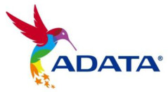
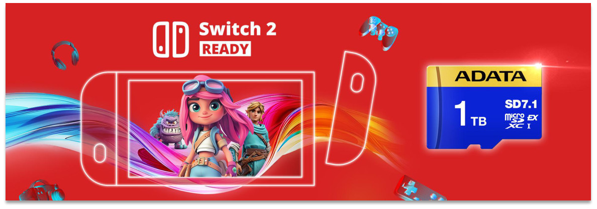
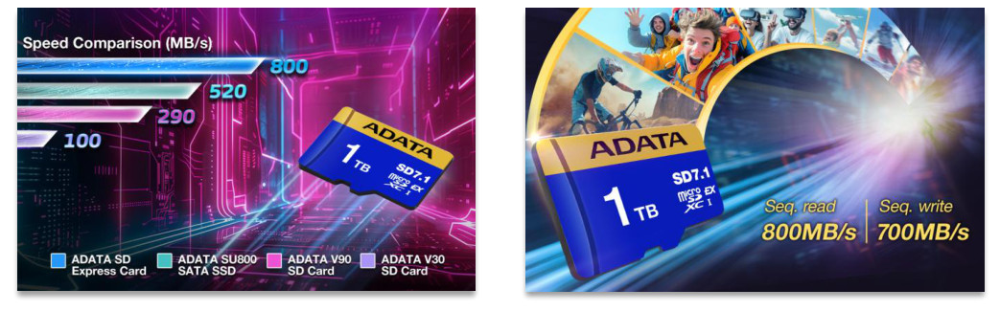
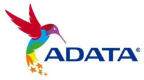
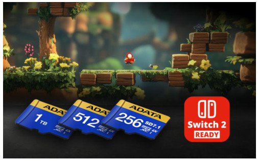
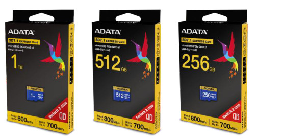

> 原文件：[27_webapi3.adata.com_datasheet_premier_extreme_micr.pdf](https://github.com/jadennevercode/CJCC-Knowledge-Base/blob/564ab11aa9785e569e3853c8a4d7ce86f88e7535/materials/%E4%BA%A7%E5%93%81%EF%BC%9ANAND%E5%88%B0%E6%88%90%E5%93%81%E7%9A%84%E6%98%A0%E5%B0%84/27_webapi3.adata.com_datasheet_premier_extreme_micr.pdf)
> 转换方式：Volcengine OCRPdf v3, parse_mode=ocr

<!-- 原文第 1 页 -->

 
www.adata.com 
 
## Premier Extreme microSDXC SD7.1 Express Card 
The next generation Premier Extreme SD7.1 Express memory card is like a miniature SSD,providing transfer speeds up to 800/700MB per second. It supports PCle and NVMe, It is an excellent choice for professional image creators. 
## Flexing microSD Express 
## Lightspeed 
The next generation Premier Extreme SD7.1Express The Premier Extreme SD7.1 Express memory card adopt memory card delivers transfer performance of up to PCle and NVMe protocols, using the PCle Gen3 x1 bus 800MB per second,which is 1.times faster than a SA speedtoincrease read/write performance ta SSD,2.7 times faster than a high-sped UHS-II SD card, 800/700MB per second. Whether large files,random and 8 times faster than a standard UHS-I SD card. smal fles,dynamic or static image output,all transfers are completed at the highest performance. 
 
*Regarding SD7.1 compatibility, please refer to information provided by your device manufacturer

---

<!-- 原文第 2 页 -->

 
www.adata.com 
## Nintendo Switch 2 Ready! 
The memory card incorporates the Silicon Motion SM2708 SD Express controller, which successfully validated by Switch 2 compatibility testing. It will dramatically enhance the smoothness of file saving and high-definition video capture - comprehensively optimizing the entire gaming journey. 
 
## Features 
·Nintendo Switch 2 Ready 
·Next-gen SD Express format 
·Certified by the SD Association SVP 
·V30 Video Speed Class support 
·High capacities 
·Secure,durable,and reliable 
Specifications 
·Capacity: 256GB/512GB/1TB 
·Standard: SD7.1 
●R/W performance:up to 800/700 MB/s* 
·Speed Class: PCle Gen3x1/U3/C10/V30 
·Dimensions (Lx WxH):15x11x1mm 
·Weight:0.25g 
·Warranty: Lifetime 
*Max speeds only when paired with SD Express compatible device 
*Backward compatible with UHS-I HOST, at Max speed of 104 MB/s 
## Ultra-clear Dynamic Recording 
The Premier Extreme SD7.1 Express memory card can maintain a minimum write speed of nearly 150MB/s*, and is backward compatible with video speed classes below V30. It perfectly facilitates low latency,highspeed photography without frame drops. 
 
*The aforementioned minimum write speed of 150MB/s is close to the"E150"specification defined by the association.For detailed information, please visit the association's website: 
https://www.sdcard.org/developers/sd-standard-overview/speed-cass/ 
Ordering Information 

| Capacity | Product Code | EAN Code | UPC Code |
| --- | --- | --- | --- |
| 1TB | UD1TEX3L1-C | 4711658153814 | 842243036817 |
| 512GB | UD512GEX3L1-C | 4711085947376 | 842243033175 |
| 256GB | UD256GEX3L1-C | 4711085947369 | 842243033168 |
 
 
ADATA Technology Co.,Lid Ne D n" 
FCCE 
T.+886-2-8228-0886 F:+886-2-8228-0887 
凶 
E:adata@adata.com
