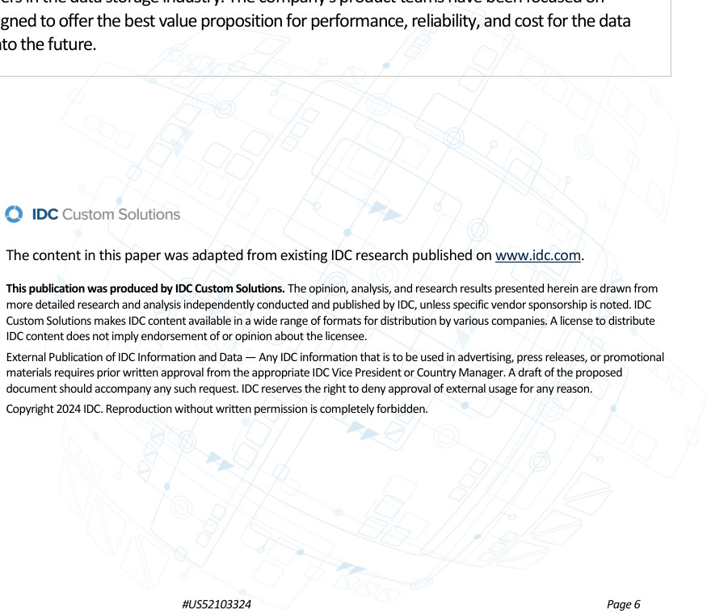

> 原文件：[S0cece11bd156_solidigm.com_value-of-data-storage-for-ai-e_1.pdf](https://github.com/jadennevercode/CJCC-Knowledge-Base/blob/564ab11aa9785e569e3853c8a4d7ce86f88e7535/materials/%E5%9F%BA%E7%A1%80%EF%BC%9ANAND%E4%BA%A7%E5%93%81%E4%B8%8E%E6%8A%80%E6%9C%AF%E8%B0%B1%E7%B3%BB/S0cece11bd156_solidigm.com_value-of-data-storage-for-ai-e_1.pdf)
> 转换方式：Volcengine OCRPdf v3, parse_mode=ocr

<!-- 原文第 1 页 -->

By leveraging flash data storage, companies can efficiently unlock valuable insig Beie them to stay ahead of the curve and differentiate themselves in the market. 
## The Value of Data Storage for the Al Era 
Written by:Jeff Janukowicz, Resea 
## Introduction 
AT A GLANCE WHAT'S IMPORTANT 
The dawn of the artificia inelieng transformative wave of innovation, catalyzing unprecedented changes and opportunities in the realm of data storage.With artificia intelience applications evolving at an unprecedented pace, the demand for robust data storage solutions has never been more pressing,AI appliation are becoming not only more sophisticated but also increasingly pervasive across various sectors, from core datacenters to the edge and from healthcare and finance to manufacturing and entertainment. These applications rely heavily on vast amounts of data, necessitating scalable and efficient storage solutin to support their computational demands.As Al aprtms become more comple and data intensve, the seer volume of generated and processed data continues to escalate.Thissurge in data creation underscores the critical importance of storage systems capable of accommodating massive data sets while maintaining high levels of performance and accessibity to ensure that computational (i.e, PU) investments are fully maximized. 
Data storage serves as the foundation of the Al revolution, enabling organizations to harness the full potential of artificial inteligence to drive innovation, enhance decision-making, and create transformative value across diverse industries. As the Al landscape continues to evolve, he role of data storage will reman indispensable in shaping the uture of technology and enterprise infrastructure.The Al era presents both extraordinary opportunities and notable challenges for data storage. To meet the demands of this transformative era,flash data storage emerges as an invaluable asset. The combination o speed, scalability, and effiency makes flash data storage ideally uited to adress the dynamic requirements of increasing data-hungry Al applications.As rganizations navigate the complexities of the Al landscape, leveraging flash storage solutions will be pivotal in unlocking the full potential of artificial inteligence 
## The Top 4 AI Storage Imperatives 
Al inrastructure is complex.While the compute infrastructure of CPUs and GPUs is a vita component of Al solutions and has been the focus infrastructure investments up until now,data sorage is also a foundational pill af he hardware infrastructure for the Al era.The widespread adoption of artificial inteligence and machine learning (ML) workloads means that architectures will eove.This nderscores newfound opportunities in data storage as use cases and massive data sets only continue to grow. 
000

---

<!-- 原文第 2 页 -->

SPOTLIGHT 
The Value of Data Storage for the Al Era 
## These requirements can be understood by examining the demands for data and the role of storage within AI infrastructure solutions 
Volume and location of data: The Al workflow or pipeline often requires massive amounts of data for ingestion, preparation, training, validation, and inference. With the advent of big data technologies, organizations are collecting and storing vas datasets rom ariousours uahassesorscal meda, n o decen.Th ality to manage, store, and archive these large volumes of data efficiently isa key requirement in the Al era.In adition, the ability to store and act on more and more data closer to or at the source of data generation is vital to maintain a high level of efficiency 
>Speed of data: In adition to the sheer volume of data, the speed at which data is generated and processed has increased tremendously. Real time analytics and decision-making are becomin morecritical in domans suh as finane, hathcare, the clou, and edge.,Data storage systems need to support highspeed data ingestin processing, and retrieval to enable real-time Al applications. 
>High performance: AI workloads often require high-performance data storage to meet the computational demands of training complex models and processing large data sets. Data storage systems should provide low latency access to data and high throughput to support intensive Al workloads effcienty and maximize compute infrastructure investments. 
Data eficieny: finp laysa essetal l n nsint o tatti nrr costs,enhance energy conservation for accelerated training and inference, faitate calablit, and bolster reliability.,AI servers consume large amounts of energy, and Al solutions often struggle with delivering enough power to the datacenter.Thus leveraging more power-and space effint torge cn deliver huge benefts to overal frastuture fiien idigfinep n o we nedetcomodatemore compute. Through the integration of data-efficient techniques, solutions can deliver more effective and impactful Al data storage systems, thereby generating value across a broad spectrum of Al applications. 
While it may be convenient to think of all Il soutions as being the same, the reality is that data in the Al era comes in various formats, indluding structured, semistructured, and unstructured data. This includes texts, images,videos,ensor data, and time series data. Data storage systems must be capable of handling diverse data types effintly and support data models of various sizes to be compatible with Al algorithms and solutions. 
For Al soutions,on of the most important consideratios is th ncrasd vlv of ata givn that large and hinhquaity data sets result in the most accurate and complete Al models.Extracting actionable insights and value from data is the primary goal of Al applications. Data storage systems should provide mechanisms for data analysis, visualization,and integration with Al algorithms to deliver meaningful insights and drive business decisions. 
## Overview of the Flash Data Storage Landscape 
Al workloads often require high-performance storage systems and servers to meet the computational demands of training complex models and processing large data sets. Enterprise storage systems and servers should provide lowlatency access at nd in thruput supoitesie woras iiet pahstrae n ) beneficial for Al workloads due to its unique characteristics that align well with the demands of Al applications. 
 
#US52103324 
Poge2

---

<!-- 原文第 3 页 -->

SPOTLIGHT 
The Value of Data Storage for the Al Era 
## What Is Flash Storage? 
Flash storage is a type of storage device that uses solid state storage technology(typically AND flash memory) to store data, unlike traditional mechanical hard disk drives (HDDs), which use spinning disks and moving read/write heads to access data.Solid state drives Sssars the most comon type of flash storage and have no moving parts, making them faster, more durable, and more energy efficient. 
SSDs consist of MAND flash memory chips, a contolle,and a cace. The controller manages ata trge and retieval operation, optimizing performance and ensuring data integrity. The NAND flash memory chipsstore data in a nonvolatile manner, meaning the data persists even when the power is turned off,Tere are several types of MAND flash memory used in Ss including singlelevel cl| SL)utilevel cl/ ML),triple level celL)and quad-level cell(L) with each offering different levels of performance, endurance, and cost. In enterprise environments, SSDs provide high performance, reliabit,ad endurance to meet the demanding requirements of enterprise and datacenter applications and workloads. 
## Advantages of SSD Storage for Al 
SSDs ffer everal adcantaes or apctcoisspscalyvcocpared with eay Ds,u t their characteristics and performance capabilities: 
## 》Speed and performance: 
SSDs provide significantly faster data access tims and high throughput. This high-speed access is rucial for l apleonspecalstpimdetrinn inference, where large data sets need to be read and processed quickly. 
=SSDs offer low latency, meaning they can quickly respond to read and write requests.SSDs also help mitigate the /O blender effect when simultaneously random read and wit requests to the storage system result in mixed and unpredictable /O patterms, leading to decreased overall torage performance.These characteristics are essential for Al workloads that require real-time processing, such as natural language processing, recommendation engines, and real-time analytics. 
## 》Scalability: 
SSDs are highly scalale in term f boh capacity and performance. They can be easily scaled up by adding more SSDs or deploying higher-capacity configurations (such as QLC to meet the growing storage demands of Al applications. This scalability ensures that the data storage infrastructure can keep pace with the increasing volume of data generated by Al workloads. 
. SSDs in AI solutions enable costly GPUs to scale and improve utilization by providing fast and efficient storage for data preprocessing, loading, and transfer, as well as reliable storage for model checkpointing and recovery. By leveraging the capabitis ofSSSsS A stems can maximize the efficiency of GPU resources, accelerate model training, and achieve better performance outcomes. 
## 》Operational efficiency: 
The operational eficieny of SSs in datacenters is driven by their speed,reliabity, calabit,nergy efficiency, and density improvements. At scale, SSDs have lower power consumption compared with over-provisioned HDDs, resulting in reduced cooling requirements within the datacenter and helping 
 
#US52103324 
Poge3

---

<!-- 原文第 4 页 -->

SPOTLIGHT 
The Value of Data Storage for the Al Era 
address datacenter power bottlenecks due to their more energyeffien prorile. Newer Sst rorm factors also enable higher density as solutions move away from traditional HDD-based ones. 
Al solutions can be expensive due to the high cost of CPUs, GPUs, and memory.SSDs provide efficient data storage to support the vast amount of Al data to deliver a cost-effective Al solution.While SSDs typically have a higher initia cos tin terms of dollars per gabyt) compared with HDDs, they can be more cost effective when factoring in performance, reliait, and the total cost of ownership, particularly in high-performance workloads such as AI. 
## Considering Solidigm 
Data storage requirements are evolving rapidly with the explosion of the Al era,and it's important to find the right partner that can provide the fiexity and breath for eacs pecic A pplicticn Clcii pla ennn NAND flash storage solutions with a comprehensive portfolio of SSD products based on SLC, TLC, and QLC technologies. Headquartered in Rancho Cordova,california, Solidigm operates as a standalone U.s.subsidiary of Sk hynix with offices across 13 locations worldwide. 
Solidigm has a long legacy of solid state innovation and leadership and is positioning itself with solutions for the Al era. Solidigm currently offers a storage portfolio that optimizes and accelerates Al infrastructure,scales efficiently, and improves operation efficiency from core datacenters to the edge. The products that power Al solutions indude: 
For high red/write and endurance requirements, the Soidigm D7-P5810 is a as Cle4 SS bsed on 144ayr SLC3D NAND,delivering up to.1.T8 capacity with up to 5DWP for sequential workloads an up o 5DWPD for random workloads with extreme write-intensity and high-endurance needs. 
For many mainstreamand read-intensive workloads,the Solidig D5-P5430 provides a blend of hyperdense affordable storage and high throughput. The Solidigem D5-P5430is designed to deliver IC ike read pfrance with masie lifetime writes, on QLC economics, leading to reduced total cost of ownership and improved sustainabit of datacenterand edge infrastructures.Avalable in bhradrange oformfator and capacities p to 30.72TB,the Solidigm D5-P5430 can be deployed in a wide array of 1U and 2U configurations. 
>For the lowest cost with read optimization, the Soidigm D-P5336 is pat o te companys fourth-generation QLC SSDs (using 192-layer QLCNAND flash) for the datacenter, delivering a blend ofhigh capacties up to 61.44TB with readoptimized performance and high value to read and data-intensive workloads. The Solidigm D5-P5336 has been designed to efficintyacclerte and scale with increasingly massive data sets found in data-hungry workloads, such as data pipelines and data lakes for AI, ML, and big data and analytics. 
## Challenges 
Storage requirements in the Al era are rapidly evolving, driven by the exponential growth of data in next-generation Al system.The voume of data stored and data storage location and retention duration are crtial a torstat w to shape storage infrastructure as Al becomes increasingly ubiquitous worldwide.torage solutions offered by vendors such as Solidigm must not only meet current demand but also remain adaptable and flexible as enterprise datacenter infrastructure expands to support lat scale.This necessitates a focus on high-speed access, calabity,and effiency to accommodat the dynami nature of Al workloads. Advancements in storage techologies taiored for Al are epected t play a pivotal role in shaping the future of data storage in Al-driven environments. 
 
#US52103324 
Page4

---

<!-- 原文第 5 页 -->

SPOTLIGHT 
The Value of Data Storage for the Al Era 
## Conclusion 
The onset of the Al era has triggered a significant revolution in data storage, leading to groundbreaking innonations and new opportuntie.as he anscape of Alevoves,the significance of data storage remains paramount in shaping the trajectory of technology and enterprise infratructure.With the growing value of data in the Al ecosystem, there arises a heightened need to prioritize data storage. By leveraging flash data storage, companies can efficientyunlock valuable insights,uncover hiden patterns,and derive actionable inteliene rom ther at, aling thmn to tay hea f te urve and differentiate themselves in the market. 
With the growing value of data in the Al ecosystem, there arises a heightened need to prioritize data storage. 
 
#US52103324 
Poge5

---

<!-- 原文第 6 页 -->

SPOTLIGHT 
The Value of Data Storage for the Al Era 
# About the Analyst 
 
Jeff Jonukowic, Research Vice President, Solid state Drives and Enabling Technologies 
Jeff Janukowicz is a research vice president at IDC where he provides insight and analysis on the SSD market for the client PC, enterprise datacenter, and cloud market segments. In this role,Jeff provides expert opinion,in-depth market research,and strategicanalysis on the dynamics, trends,and opportunities facing the industry. His research includes market forecasts, market share reports, and technology trends of cients, investors, suppliers, and manufacturers. 
## MESSAGE FROM THE SPONSOR 
Solidigm is a leder in the data storage industr, bringing to market an unmatched technology portfolio. Solidigm was formed in 2021from the sale of the lntel NAND and SSD business to SK hynix In. Headquartered in Rancho Cordova, California, Solidigm has over 1,0eplvesin1 lcationsarossth be,comprised of pionering inventors, leaders, and problem solvers in the data storage industry. The company's product teams have been focused on delivering QLC NAND designed workloads of today and into th 
IDC Research, Inc. 140 Kendrick Street Building B Needham, MA 02494, USA T 508.872.8200 F508.935.4015 Twitter @IDC idc-insights-community.com www.idc.com 
 

