> 原文件：[S1fb680042ab4_kioxia-holdings.co_Kioxia_Investor_Day_2026_en_sc.pdf](https://github.com/jadennevercode/CJCC-Knowledge-Base/blob/564ab11aa9785e569e3853c8a4d7ce86f88e7535/materials/%E5%9F%BA%E7%A1%80%EF%BC%9ANAND%E4%BA%A7%E5%93%81%E4%B8%8E%E6%8A%80%E6%9C%AF%E8%B0%B1%E7%B3%BB/S1fb680042ab4_kioxia-holdings.co_Kioxia_Investor_Day_2026_en_sc.pdf)
> 转换方式：Volcengine OCRPdf v3, parse_mode=ocr

<!-- 原文第 1 页 -->

## Flash Memory Scales Al Inference 
Investor Day KIOXIA Holdings Corporation June 2,2026 
2026KIOXA Hdings Corporation.Al Rights Reserved 
KIOXIA 
1

---

<!-- 原文第 2 页 -->

Agenda 
## 1. Kioxia's Growth Strategy in the Al Inference Era 
Hiroo Ota 
President and CEO 
## 2. Flash Memory Market and Resource Allocation 
Junichiro Yaguchi Managing Executive Officer (CSO) 
## 3. SSD Drives Al inferences 
Masashi Yokotsuka Managing Executive Officer (Vice President of SSD Division)1 
## 4. Advancing Technology Leadership with BiCS FLASHTM generation 10 
Atsushi Inoue Executive Officer (Vice President of Memory Division) 2 
5. Financial Strategy to Support Our Growth 
Yoshihiko Kawamura Executive Vice President and Executive Officer (CFO) 
6.Q&A 
KIOXIA vi aeee t SSD Divsion of Kioea Co 
2026 KICXIA Holaings Corporation AIlRiats Roserved 
2

---

<!-- 原文第 3 页 -->

## Disclaimer 
Forward-looking statements included in this presentation are prepared based on our expectations and projiections in light of the information currently available to us,which involve varous risks and uncertainties (including,but not limited to, economic trends,market demand and the highly compelttve semiconductor industry). Such risks and uncertainties may cause our actual results to be materially aifenf rom any future results expressed or implied by these forward-ooking statements. We undertake no obligation to update any forward-ooking statement included herein. 
The information and projections regarding the fiash memory industry included in this presentation are derived rom information current available to us. Whilst this presentation is provided in good faith, it does not purport to be comprehensive and has not been independently verified. We make no representations with respect to such information and projections. 
This presentation includes internal measures which our management relies upon in making decisions (the "Non-GAAP Financial Measures") that differ from financial measures prepared in accordance with International Financial Reporting Standards ("IFRS").The Non-GAAP Financial Measures,which are IFRS measures plus adjustments made for non-recuring items,have not been audited or reviewed by auditors. Therefore, such Non-GAAP Financial Measures may not accurately reflect our financial condition or operating results. 
This presentation has been prepared solely for the Investor Day to be held on June 2, 2026,and provided for informational purposes only. It does not constitute,or form a part of,any offer or solicitation to purchase or subscribe for any shares of other securities in any jurisdiction. 
Any plans,estimates,forecasts,projections or other statements contained in this presentation that are not historical facts are forward-looking statements based on our expectations and projections as of the date of this preparation. Actual results, including our operating results,inancial position and other outcomes, may be materially different due to various factors including but are not limited to geopolitical factors,changes in global and domestic economic conditions,fuctuations in the semiconductor memory market,compettive developments,disruptions in supply chains, suspension or constraints of manufacturing operations, fuctuations in foreign exchange rates, interest rates and other financial market conditions, and changes in laws, regulations or policies relating to the semiconductor business. Prodict nmes an servie names sapearig n this ocument-may bergtedtrsdamams o r admams o tererte 
KIOXIA 
2926 KIOXIA alaings Corponain Il Riit ed 
3

---

<!-- 原文第 4 页 -->

## Kioxia's Growth Strategy in the Al Inference Era 
Hiroo Ota 
President and CEO 
I am Hiroo Ota, President and CEO. Thank you for taking the time to join our Investor Day today. 
The rapid proliferation of generative Al is bringing a seismic shift to our industry. 
Today, I would like to outline our strategy for how we-as a provider of the flash memory that underpins the data infrastructure of the Al era- will meet market demands and achieve sustainable growth throughout this transformative period. 
4

---

<!-- 原文第 5 页 -->

Agenda 
Expanding the Role of Flash Memory in Al Inference Focusing on the Data Center and Enterprise Markets Growth Investments to Further Enhance Corporate Value 
KIOXIA 
2026 KICXIA Holaings Corporation AIlRiats Roserved 
I'll be explaining the following points. 
5

---

<!-- 原文第 6 页 -->

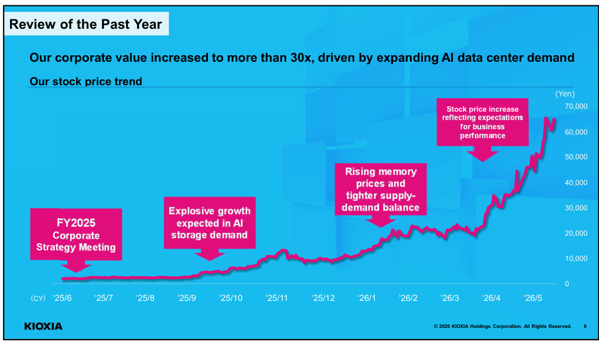 
At last June's Corporate Strategy Meeting, we shared our projection that flash memory would evolve from being a simple data repository into a critical component that dictates the performance of entire Al systems. 
Over the past year, this projection has materialized as tangible demand. We interpret our current share price as a clear sign of the capital market's recognition and trust in our strategy to effectively capture this Al-driven demand. 
This growth is underpinned by rising data center investments since 2024.Most notably, as the use of generative Al started to shift from 'training to "inference' in the second half of 2025,the vital role of storage has been strongly reaffirmed. 
Consequently, demand for Al-focused data centers is expanding robustly, and the flash memory market is thriving. We anticipate this favorable environment will persist through 2027. 
6

---

<!-- 原文第 7 页 -->

## Rapid Growth in Inference Workloads 
Agentic Al and Physical Al that autonomously solve tasks are driving inference workloads to increase exponentially 
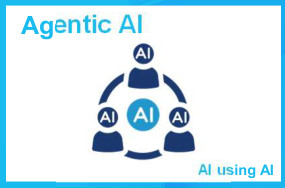 
 
Urgent Need to Improve Inference Processing Efficiency ( ) 
Physical Al 
KIOXIA 
Starting from the second half of 2025,the Al landscape is transitioning from a 'training' phase, focused on building Large Language Models (LLMs), to an inference'phase, where these models are implemented in real-world applications. 
Furthermore, Al is evolving from a mere tool" used by humans into 'autonomous agents'-exemplified by Agentic Al and Physical Al--that can autonomously reference data and achieve specific objectives. We anticipate this trend will tigr an explosion in the volume of inference processing. 
In this inference phase, calculation speed, data processing capacity, and Total Cost of Ownership (TCO)-including power consumption-become paramount. The key is how to execute these massive inference tasks both economically and efficiently. 
To that end, technologies such as Retrieval-Augmented Generation (RAG), which leverages external knowledge,and KV Caching, which reuses previous inference results, are advancing at a rapid pace. 
However, it will be difficult for High Bandwidth Memory (HBM) alone to meet the massive memory demands generated by these advancements. 
This is especially true as Al applications expand into the 'edge' domain, where local data processing is a prerequisite.Consequenty, the importance of low-power, high-speed storage has never been greater. 
We believe flash memory is the only storage medium capable of meeting these diverse market demands and economically scaling inference systems from a total cost of ownership perspective. 
7

---

<!-- 原文第 8 页 -->

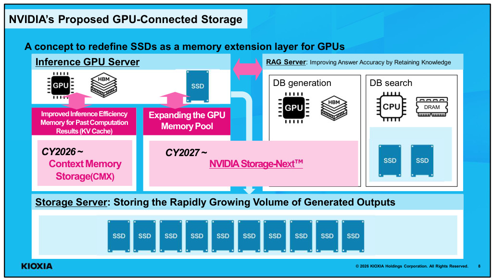 
Driven by these trends, discussions involving the entire ecosystem are intensifying around the realization of next-generation Al-native storage.At the heart of these discussions is our key partner, NVIDIA, who are proposing a vision to redefine storage not as a mere storage device, but as an extended memory tier for GPUs. 
This vision is embodied in initiatives such as CMX (Context Memory Storage Platform),' which utilizes SSDs as a memory tier to record previous calculation results (KV Cache) for improved inference efficiency. 
Another example is 'NVIDIA Storage-NextTM, where SSDs are used as extended memory in RAG servers that store external knowledge to enhance response accuracy. Furthermore, we anticipate an accelerating increase in the volume of generated results stored on storage servers. 
What these developments signify is that, alongside GPUs and HBMs, storage has become a core component that determines the performance of Al systems. As specialists in flash memory and SSDs, we will actively propose a wide range of technologies and solutions for these initiatives, leading this Al paradigm shift together with our partners. 
8

---

<!-- 原文第 9 页 -->

## Focus on the Data Center & Enterprise Markets 
Kioxia Sales Portfolio Exokdig SsnDis ee 
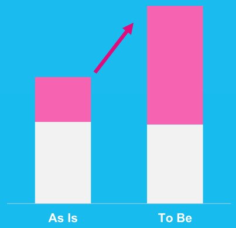 
## Revenue mix of products for the Data Center & Enterprise markets Over 60% 
Driving profitability through strategic product-market fit for value-added products (e.g., Super High IOPS SSDs) 
KIOXIA 
To capture the opportunities brought about by these structural changes in the market, we plan to make a strategic shift in our business portfolio. 
First and foremost, we will focus on our Data Center and Enterprise business. Over the medium to long term,we aim to raise this segment's share of our overall revenues to over 60%. 
While maintaining and enhancing our competitiveness in standardized products,we will expand our offerings of high-value-added products-exemplified by Super High IOPS SSDs-that directly help improve the efficiency of Al systems, thereby driving improved proftability. 
In our core smartphone and PC segments, we will maintain our revenue scale,positioning these as an unwavering foundation for our business. 
Buiding upon this solid base, we will expand our market development efforts argeting the edge Al segment, where we foresee significant growth. 
9

---

<!-- 原文第 10 页 -->

## Phase Change 
Two consecutive years of record-high sales revenue and operating profit 
Growth investments including inorganic investments 
 
 
Significant improvement in profitability Q1 OP Margin:74%1 
Achieve net cash position in Q1 FY26 
Shareholder returns 
KIOXIA 1.FY2026 Q1 Guidance (Announced on May 15,2026) 
2026KICXIA Holangs Corporation A 
I am pleased to report that, for the second consecutive year, we have achieved record highs in both revenue and operating profit. 
We expect to maintain this high level of profitability in fiscal 2026, and our Q1 guidance projects a OP margin of 74%. 
The repayment of our interest-bearing debt is progressing smoothly,and we anticipate achieving a net cash position by the end of the first quarter. In light of this improved financial health, we are actively considering shareholder returns for fiscal 2027. 
10

---

<!-- 原文第 11 页 -->

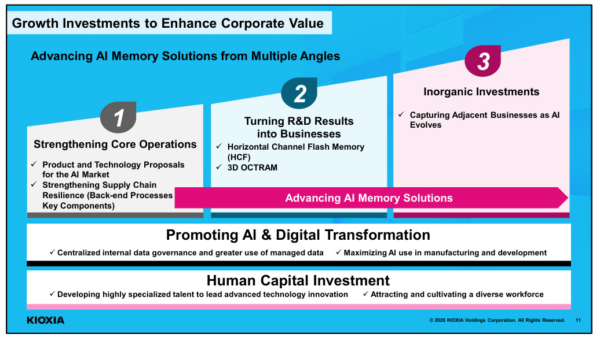 
The funds generated will be allocated toward strategic investments for the future,alongside shareholder returns. 
First and foremost, as a provider of the flash memory and SSDs that form the backbone of Al infrastructure,we must resolutely ensure we continue to deliver optimal technologies and products to the market in a timely manner. We will advance the implementation of our technologies through partnerships with our customers. Simultaneously, as the procurement environment becomes increasingly uncertain, we will focus on building a resient supply chain to ensure the reliable delivery of our products. 
Our second priority is the commercialization of our R&D achievements. At the research level,we have successfully demonstrated the operation of Horizontal Channel Flash (HCF) memory as the next evolution beyond our vertically stacked BiCS architecture, paving the way for the future advancement of 3D flash memory.We will continue to evaluate fundamental cell characterstics to verify its feasibility. 
Furthermore, at IEDM 2024,we announced the development of OCTRAM (Oxide-Semiconductor Channel Transistor DRAM) technology utilizing vertical transistors made of oxide semiconductors. At last year's IEDM, we presented an evolution of this: a highly stackable oxide-semiconductor channel transistor technology in a 3D architecture. We are commited to driving this development forward, exploring commercialization while assessing market viability and mass-production readiness. 
Moreover, as Al evolves,the required memory solutions must also evolve.We will explore strategic acquisitions to broaden our capabilities into domains that extend beyond flash memory alone. 
People are the foundation of this growth. We will train highly skilled professionals to support the technological expertise required to succeed in intense global competition, and create an environment where diverse talent can thrive. 
Also,we are accelerating digital transformation and the use of Al across our entire organization. Just as we enable Al infratructure for our customers, we will led by example by integrating Al deeply into our own operations to drive efficiency and innovation. 
11

---

<!-- 原文第 12 页 -->

KIOXIA 
## Uplifting the world with "memory" 
## A Core Company Powering Al Infrastructure 
202KIOXIA Holdings Corpor aion All Rigts Reserved 
Moving forward, we will bring our technological expertise to the forefront. By co-creating the next generation of Al capabilitis alongside our customers, we will epand our role as a vital provider of data infrastructure. 
We are not merely a component supplier. At the core of Al infrastructure,we are driving the next technological paradigm shift. We remain committed to meeting market demands and enhancing our corporate value. 
We look forward to sharing our future successes with you as we continue to grow. Thank you very much for your time and attention today! 
12

---

<!-- 原文第 13 页 -->

# Flash Memory Market and Resource Allocation 
Junichiro Yaguchi 
Managing Executive fr Chief Stategy ficer 
I'm Junichiro Yaguchi, Chief Strategy Officer. 
13

---

<!-- 原文第 14 页 -->

Agenda 
## Strong Demand and Growth Opportunities Driven by Al Inference Resource Allocation Policy 
KIOXIA 
62026KIOXIA Holaings Corporat 
I'm going to cover the outlook for the flash memory market, our resource allocation, and our investment strategy. 
14

---

<!-- 原文第 15 页 -->

Flash Memory Market 
Flash Memory Market (EB) 
Flash Memory Market for Data Centers 
(EB) 
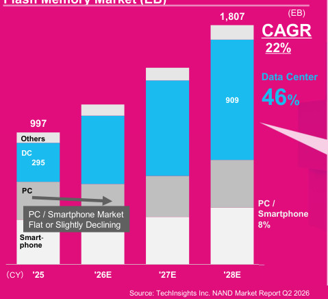 
909 CAGR 46% 
86% 
295 
Training 16% Traditional 16% 
(CY) "25 
26E 
'27E 
28E Source: Techirnsights lnc. NAND Market Report Q2 2026 
KIOXIA 
First, let me outline our bit growth outlook for the NAND flash memory market. The Compound Annual Growth Rate (CAGR) through 2028 is projected to be slightly over 20%. Notably, datacenter demand is expected to grow significantly, by 46%, with increasing Al server capacity driving market expansion.Within this segment, inference Al applications will serve as a primary growth catalyst, and are likely to achieve an estimated CAGR of 86%. 
On the other hand, near-term storage demand for smartphones and PCs is undergoing a minor adjustment phase, with some forecasts projecting a slight decline this year. 
Although the demand environment varies by application, we are focusing sharply on the expanding Al and datacenter SSD markets. 
To meet this increased demand and achieve sustainable growth, we willacelerate our capital expenditure and R&D. 
15

---

<!-- 原文第 16 页 -->

Supply-Demand Balance and Revenue Market Forecast 
Supply-Demand Balance Tight Supply-Demand to Persist Throughout FY27 
Flash Memory Market by Revenue Base Rapid Market Expansion Driven by Rising ASPs 
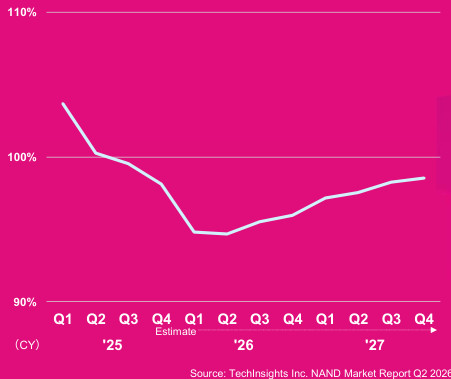 
KIOXIA 
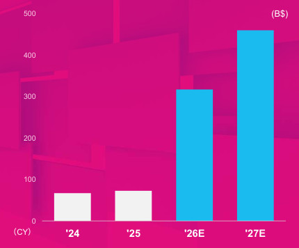 
Source: Techlnsights In. MAND Market Reporl 02 2026 
Next, let's look at the supply and demand balance and the size of the NAND market. The former is expected to remain tight throughout CY2027, driven by strong demand for Al data centers and constraints on NAND supply. 
Furthermore, NAND prices are on an upward rend. Several research firms estimate that the revenue of this market will be approximately four times larger in 2026 compared to 2025,with this trend projected to continue into CY2027. 
16

---

<!-- 原文第 17 页 -->

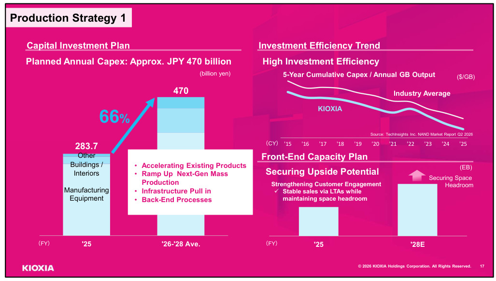 
In response to the expansion of the NAND market driven by Al and datacenter demand, we currenty plan or annual capital expenditure to average approximately 470 billion yen over the next three years. This represents an increase of roughly 60% compared to FY2025. 
This figure includes not only investment in production equipment but also in cleanroom interiors and infrastructure. It incorporates medium-to long-term investments designed to secure upside flexibility by expanding our available space. 
Leveraging customer commitments, including Long-Term Agreements (LTAs),we will establish a supply framework to support stable demand. Furthermore, we will continue to maintain higher capital efficiency than the industry average, executing disciplined investments. 
17

---

<!-- 原文第 18 页 -->

Production Strategy 2 
Front-End Cost per Gigabyte Front-End GB Cost Reduction via Node Transition 
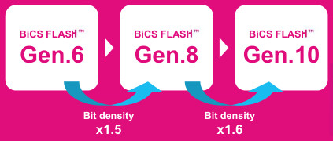 
Maximizing Bit Density Beyond Layer Stacking: Integrating 2D Shrinkage and Oplimal Layer Counts 
Reduction of 
10%n y 
KIOXIA 
Cost per Gigabyte (CY25) Cost Compettiveness via Efficient Capital Investment 
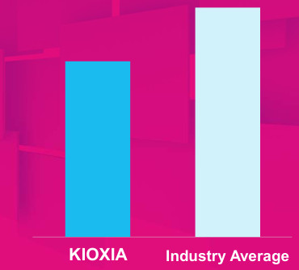 
Source: Techirsights Inc. AND Marke Report 02 2026 226 KICXIA Holaings Corporation AIlRiges Resarve 
We are targeting an average annual reduction in front-end cost per gigabyte(GB) in the 10% range. Through the migration of BiCS FLASHT, we have factored in bit density improvements of 50% or more per each new generation. 
During transitions between product generations, we don't base our key performance indicators solely on the layer count, rather, we plan to achieve compettve cost reductions by pursuing the optimal mix of 2D shrink (lateral scaling) and layer count. 
We will cover this point in further detail later, Through effcient capital expenditure and by leveraging our world-leading economies of scale, we have maintained a lower cost per gigabyte than the industry average, and we intend to sustain this competitive advantage in the future. 
18

---

<!-- 原文第 19 页 -->

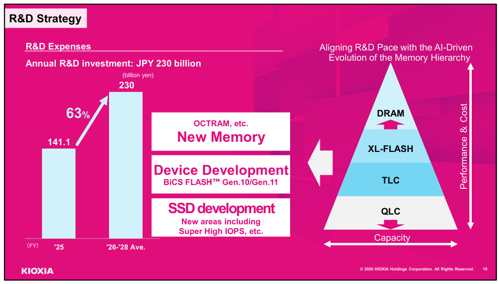 
Research and development is the source of our competitive strength. 
Over the next three years, we plan to increase our R&D investment by 60% over FY2025 levels, bringing it to approximately 230 billion yen annually. 
Furthermore,we are progressing development tailored to specific memory hierarchy in order to deliver the distinct performance characteristics demanded by Al and data centers. 
We are allocating R&D investment to the development of 10th- and 11th-generation BiCS FLASHTM as next generation products following 8th-generation BiCS FLASH 
In SSDs, our key focus area, we are targeting investment specifically at areas that will help speed up the launch of new storage architectures, including our Super High IOPS SSDs. 
Additionally, for new memory devices,we will accelerate development at our Frontier Technology R&D Institute to improve the characteristics of OCTRAM devices, and facilitate decision-making around commercialization of these. 
In addition, although not listed here,we are planning to establish the tentatively-named "Kioxia College"at our Shin-Koyasu Technology Front campus,our R&D hub. 
This initiative,which we plan to launch by the end of FY2027, is part of our commitment to boosting the development and cultivation of our researchers and engineers. Thank you very much for your attention. 
19

---

<!-- 原文第 20 页 -->

## SSD Drives Al Inference 
Masashi Yokotsuka 
Managing Executive fficr Vice President o SD Division) 
I'm Masashi Yokotsuka, Head of our SSD Business Unit. 
In this section, I will discuss our initiatives in the Al field in the context of our SSD business. 
We view the rapid advancement of generative Al and agentic Al as a critical growth opportunit, and we are boosting our development efforts across both our SSD product portfolio and our software solutions. 
20

---

<!-- 原文第 21 页 -->

Agenda 
## Achievements from FY2025 Challenges Faced by Growing Inference Systems New Uses of SSD Created by Inference Al Systems Our Latest SSD Lineup to Solve Scaling Challenges in Al 
KIOXIA 
2026 KICXIA Holaings Corporation All Righes Rosrved 
Here is the agenda for today's presentation. 
First, I will review our key achievements and performance from fiscal year 2025. Next, I will discuss the emerging challenges associated with Al inference systems as they become increasingly commercialized and widely adopted. Then, I will ihight the new applications for SSDs that are being unlocked by these cutting-edge Al inference systems. 
Finally, wliinice Kixctis comprehensive SSD portfolio, which is designed to fully address and support all of these new applications. 
21

---

<!-- 原文第 22 页 -->

## Achievements from FY2025 Ulta Large Capacity SSD KIOXIALC9 Series 
Softare for lmproving lnference Accuracy and Speed KIOXIAAiSAQ" 
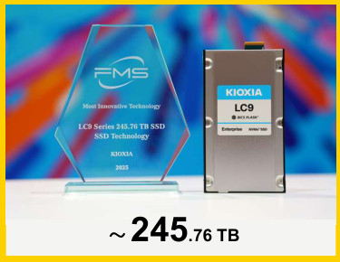 
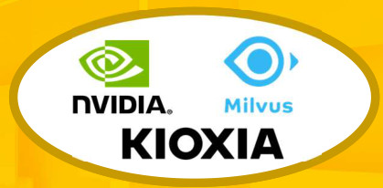 
Enhancing RAG Accuracy: Constructing Large-Scale Vector Databases on SSDs for Rapid Searches Accelerating indexing with GPUs through Integration with NVIDIA cuVS. Quick deployment using the open-source vector database Milus 2026KICXIA Holaings Corporation AllRighes Rosrved 
Powering Generative Al with Ultra High-Capacity SSDs 
KIOXIA 
Looking back, fiscal 2025 was a year where we achieved significant progress in our generative Al systems businesses. We successfully capitalized on this wave of growth, with our products being adopted by a broad range of customers, primarily in the data center, enterprise, and PC segments. 
The first of these was our high-capacity SSD, the LC9. Offering an industry-leading capacity of 245TB, his product is designed to meet the rapidly expanding demand for Al data storage. it has already completed evaluation and validation with key customers and is now being rolled out to the market. 
The second is our open software solution, KIOXIA AiSAQTM.As generative Al moves into practical application,the adoption of RAG (Retrieval-Augmented Generation) is expanding rapidly. Previously, a major challenge was that vector databases-which are critical for response accuracy--were constrained by DRAM capacity and CPU performance limits. The software effectively utilizes SSDs and GPUs to significantly alleviate these constraints, enabling highspeed, cost-effective processing of vector data on a scale of billions. 
By integrating with 'Milvus, a leading open-source vector database,we enhance both the practicality and adoption of our technology. Additionally, we have leveraged the software library 'NVIDIA cuVS', which enables high-speed processing of vector databases through GPU acceleration. This collaboration allows us to construct databases with billions of vectors and achieve indexing speeds up to approximately 20 times faster than using only CPUs. 
Through these initiatives,we position KIOXIA AiSAQ as a crucial technology that significantly improves the scalabity and practicality of generative Al infrastructures. We are advancing integration with various ecosystems. 
Driven by these achievements, fiscal 2025was a year of steady progress in our efforts to keep pace with the evolution of Al infrastructure, allowing us to build a solid foundation that will support our future growth. 
22

---

<!-- 原文第 23 页 -->

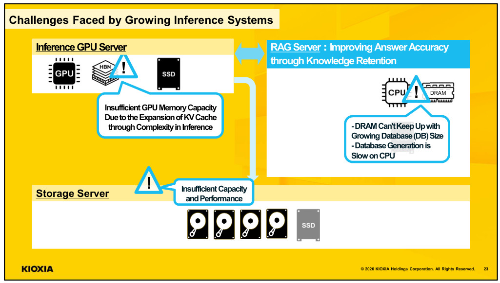 
Next, regarding the emerging challenges of growing Al inference systems,this section oulines the system architecture of conventional inference Al and the challenges that are emerging as it evolves 
Traditional inference Al systems primarily perform a simple proces: ecuting a single inference in response to a user's prompt and returning an answer. 
Therefore, a configuration combining inference servers equipped with GPUs, basic RAG, and standard storage is sufficient. 
The volume of data handled and the frequency of access remain relatively limite,and the demands on storage performance are not particularly high, allowing for the use of HDDs for cold data. 
However,with the rapid evolution of Al,this premise is fundamentally changing. In the case of agentic Al, the system autonomously repeats inferences multiple times, advancing processes while continuously interacting with external tools and other Al models. 
Consequently,the system oad increases exponentially. 
A critical bottleneck in this new paradigm is the KV cache.As inferences become continuous and multi-stage, the context expands rapidly, making it impossible to hold the entire KV cache within the GPU memory alone. This leads to increased cache evictions and reloads, resulting in memory throughput and storage performance becoming the primary bottlenecks impeding overall inference efficiency. 
Furthermore, regarding RAG, the expansion of data scale and the surge in access frequency make it difficult to manage with capacity-constrained DRAM or slow storage like HDDs. 
In this way, the evolution of Al is significantly elevating the performance requirements of the entire system, necessitating advancements not only in computational power but also in storage capabilities. 
23

---

<!-- 原文第 24 页 -->

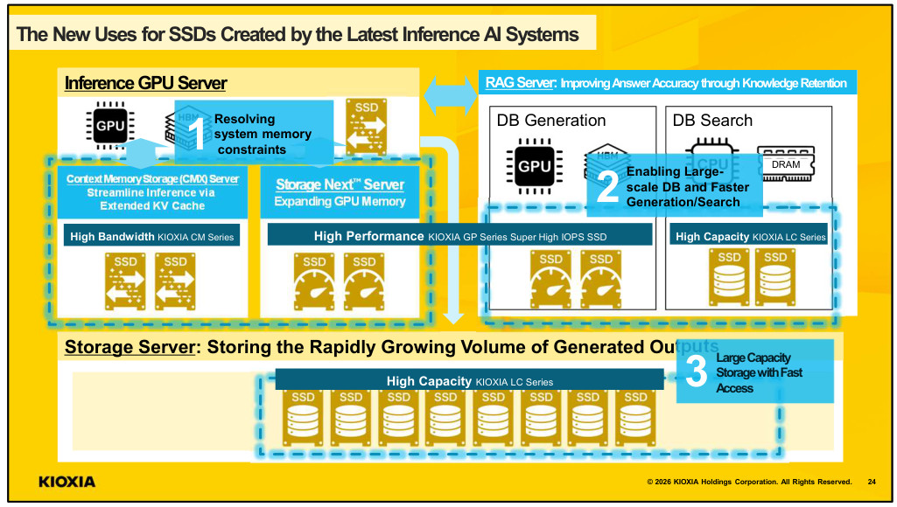 
Next, regarding the new applications for SSDs unlocked by these cutting-edge Al inference systems, this section details how the latest Al server technologies are addressing these challenges. 
Currently, various solutions for inference Al are being proposed, notably by industry leaders like NVIDIA. The common denominator among all these approaches is the critically important role played by SSDs. 
The first point is addressing the lack of capacity of GPU memory, particularly HBM.In agentic AI, KV caches multiply rapidly and exceed the internal capacity of the GPU. To counter this, Context Memory Storage (CMX) technology expands the cache onto highspeed SSDs to maintain inference efficiency. Furthermore, NVIDIA Storage-NextTM advanced architecture that bypasses the CPU-enables GPUs to directly access SSDs, achieving an effective expansion of memory capacity. 
The second point is the evolution of RAG servers. While high-speed search is essential for handling large-scale, up-to-date data, DRAM capacity has traditionally been a limnting factor. Today, the utilization of high-performance, high-capacity SSDs is successfully balancing scalability with cost-efficiency. 
The third point is the transformation of storage servers. As data volumes surge alongside the widespread adoption of generative Al, high-capacity SSDs are becoming increasingly vital as the foundational infrastructure for delivering high deployment density and high throughput. 
Building on these developments, next-generation Al systems will ahieve comprehensive system optimization by combining the externalization of KV caches via CMX framework, high-speed processing through NVIDIA Storage-NextTM, and large-scale RAG that is independent of DRAM capacity utilizing KIOXIA AiSAQTM. 
Ultimately, these new inference Al archite ctures are designed to resolve the structural challenges brought about by the evolution of AI, with SSDs positioned firmly at their core. 
24

---

<!-- 原文第 25 页 -->

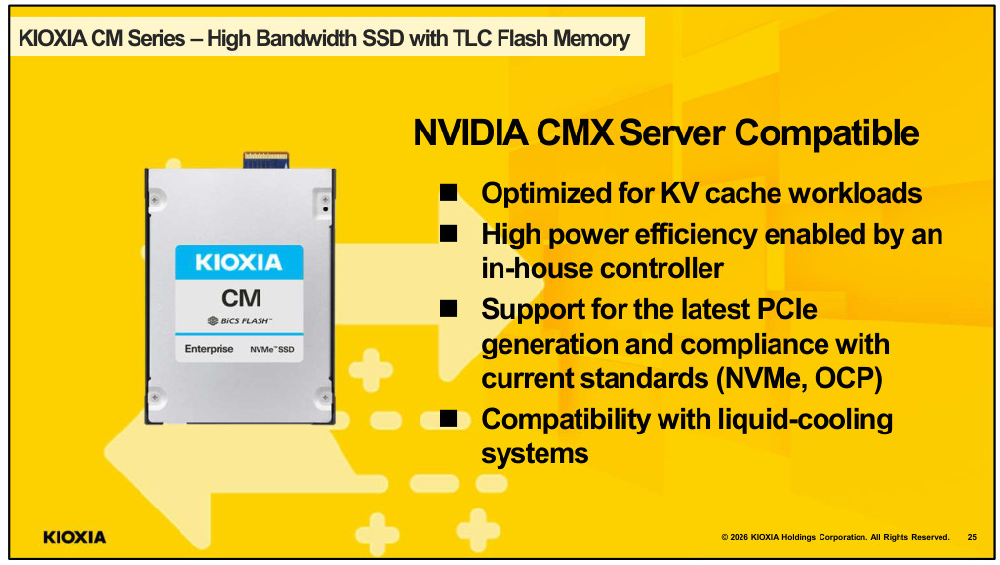 
From here, I would like to introduce our product portfolio designed to cover these new applications for SSDs. 
As I have outined, the advancement of agentic Al is driving an exponential increase in both data access volumes and processing density within inference Al systems. Consequently, data transfer performance between the GPU and storage-namely, bandwidth-has become crucial. To utlize storage not merely as an auxiliary space, but as an integral part of the effective memory hierarchy, storage solutions with high throughput and low latency are absolutely essential. 
To meet these exacting requirements,we offer the CM Series, high-bandwidth SSDs equipped with TLC flash memory. 
The CM Series is fully compatible with CMX framework and is specifically architected to optimize KV cache applications. Incorporating our most advanced NAND flash memory allows it to achieve even greater capacities than previous generations, and to efficiently retain and utilize the massive amounts of data generated during the prolonged, multistage inferences characteristic of agentic Al. 
Furthermore, the adoption of our in-house developed SoC (System on a Chip) solution delivers superior power effieny, directy contributing to the optimization of overall power consumption in data centers. In addition, its support for the latest PCle generation and compliance with cutting-edge standards such as NVMeTM and OCP ensure seamless integration into advanced Al infrastructures. 
Crucially the CM Series is also compatible with liquid cooling systems,which are increasingly being adopted in Al environments. This enables the drives to deliver stable, high performance even in high-density deployments involving equipment with significant heat generation, such as Al servers. 
In summary, the CM Series is a core component that underpins the high-bandwidth data transfer essential for next-generation inference Al systems. 
25

---

<!-- 原文第 26 页 -->

KIOXIA GP Series -High Performance SSD with XL-Flash " 
## Compatible with NVIDIA Storage-NextTM Super High IOPS SSD 
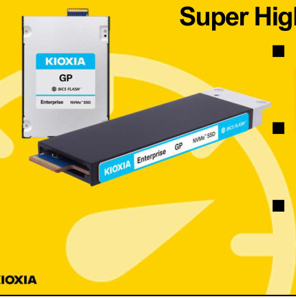 
Breakthrough performance from a dedicated SoC combined with XLFLASHTM 
## 100M+ IOPS,ultra-fast and lowlatency performance to accelerate Next-Gen AIl 
Flash memory complements HBM for high performance and cost efficiency 
On the other hand, the proliferation of agentic Al-characterized by a dramatic increase in the number of iterative inferences-generates extremely granular and highly frequent data access. In this domain, further improvements in latency and IO (Input/Output) performance are critical. 
To address this, we are undertaking a performance innovation through a novel architecture that transcends conventional SSD technology. 
Meeting these exacting needs is the GP Series, a high-performance SSD powered by XLFLASHTM. 
The GP Series is engineered specifically for direct integration with GPUs,fully supporting NVIDIA Storage-Next M initiative-a framework designed to seamlessly extend GPU-accessible memory. By combining our proprietary XL-FLASHTM (a specialized NAND flash memory optimized for ultra low latency) with a custom SoC capable of handling data access at an incredibly fine 512-byte granularity, we have achieved a major breakthrough. 
This combination delivers both exceptionally low latency and the high IOPS performance required by next-generation Al systems, which demand upwards of 100 milion IOPS. 
Crucially, this performance enables the SSD to function as an effective extension and complement to HBM.By mitigating memory capacity constraints,we are paving the way for entirely new Al system architectures. 
Ultimately,the GP Series is the core product driving the "low-latency, high-IOPS data access'essential for the future of inference Al systems. 
26

---

<!-- 原文第 27 页 -->

## KIOXIALC Series -High Capacity SSD with QLC Flash Memory 
## Achieving Next Gen AI Platform 
Industry-leading capacity using BiCs FLASHTM generation 8, 2Tb QLC 32-die stacking in a compact NAND package through advanced design and integration 245TB ultra-high capacity in a standard E3.L form factor, optimizing TCO 
KIOXIA 
LC BICS FLASH 
Enterprise NVMSSD 
Now in mass production 
KIOXIA 
Furthermore, the advancement of agentic Al presents another challenge that cannot be ignored: the explosive growth in data volumes. As inference processes become more multi-staged and prolonged, and the volume of generated data itself increases exponentill, tere is a growing requirement for the overall ystem to efficiently store far larger amounts of data. 
Addressing this specific need is the LC Series, our high-capacity SSD equipped with QLC flash memory. 
The LC Series utilizes the 2Tb QLC of our 8th-generation BiCS FLASHTM. Leveraging highly advanced packaging technology, we successfully stack 32 memory chips within a single, compact package. 
This enables an industry-leading capacity of 245TB within the standard E3.L form factor. We have now commenced mass production shipments of this product, and it is already being deployed in ultra-high-capacity servers. 
This remarkable increase in data density allows for significant storage expansion within limited physical space, directly helping to improve efficiency across entire data centers and to optimize the Total Cost of Ownership. Moreover, it serves as an ideal foundational infrastructure for cost-effectively storing the expanding massive datasets and cold data typical of inference Al systems. 
In short, the LC Series provides the foundational storage capacity required to support the continued scaling of Al infrastructure. 
27

---

<!-- 原文第 28 页 -->

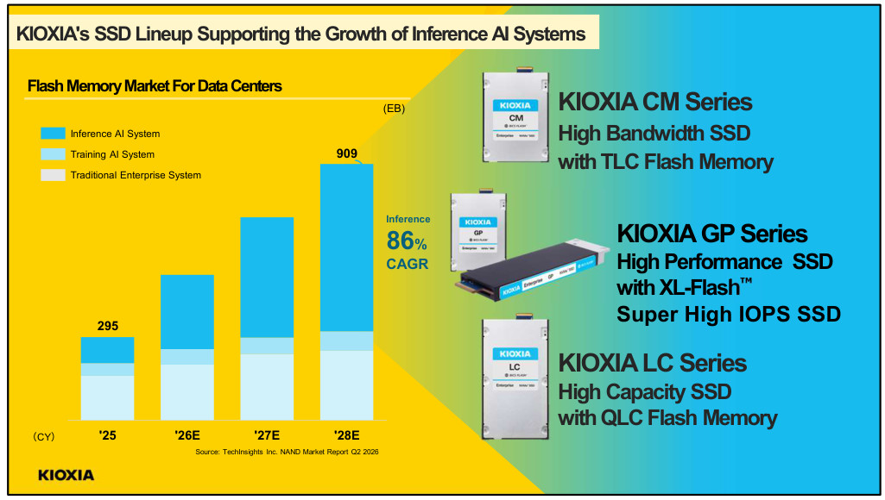 
As Yaguchi-san explained earlier, we are already witnessing a tangible expansion in demand within the flash memory market, driven primarily by inference Al systems. In particular, inference Al systems designed for agentic Al architectures handle an exponentill growing volume of data, including KV caches, RAG vector data, and inference histories. 
To address this rapidly evolving and expanding market, we offer a comprehensive portfolio: the CM Series for high-bandwidth data transfer,the GP Series for'ultra-low latency and high-IOPS performance, and the LC Series for 'ultra-high-capacity data storage.! Through this strategic alignment,we are actively driving the enhancement of performance and scalability in inference Al systems. 
With the continuous advancement of Al systems, storage has evolved from a simple data repository into a critical component that dictates the performance of the entire system. Moving forward, in addition to developing cutting-edge NAND flash memory and SSD technologies, we are strengthening our total solutions capabilities, including the seamless integration of storage and memory. 
Through these initiatives,we will reiforce our competitive edge in the next-generation AI infrastructure market and drive our mid- to long-term growth. 
Next, Inoue-san, Head of our Memory Division, will discuss our memory strategy. 
28

---

<!-- 原文第 29 页 -->

## Advancing Technology Leadership with BiCS FLASHTM generation 10 
Atsushi Inoue 
Executive Officer Vice President of Memory Division 
I'm Atsushi Inoue, head of our Memory Business Unit. 
I would like to outine our BiCS FLASHTM development strategy for the Al era, focusing specifically on the latest developments of our 10th-generation BiCS FLASHT 
29

---

<!-- 原文第 30 页 -->

Agenda 
## The Evolution of AI Inference Systems and the Dual-Axis Strategy for Response Technological Leadership of BiCS FLASHTM generation 10 Development Status of BiCS FLASHTM generation 10 
KIOXIA 
2026KICXIA Holaings Corporation AIlRis Rosrved 
Here is the agenda for today's presentation. 
First, I will disuss our NAND development strategy in response to the evolution of Al inference systems. 
Next, I will highlight the technological leadership of our cutting-edge 10th-generation Bics FLASHTM. 
Finally,I will proride an update on the progress of our development of that 10t generation. 
30

---

<!-- 原文第 31 页 -->

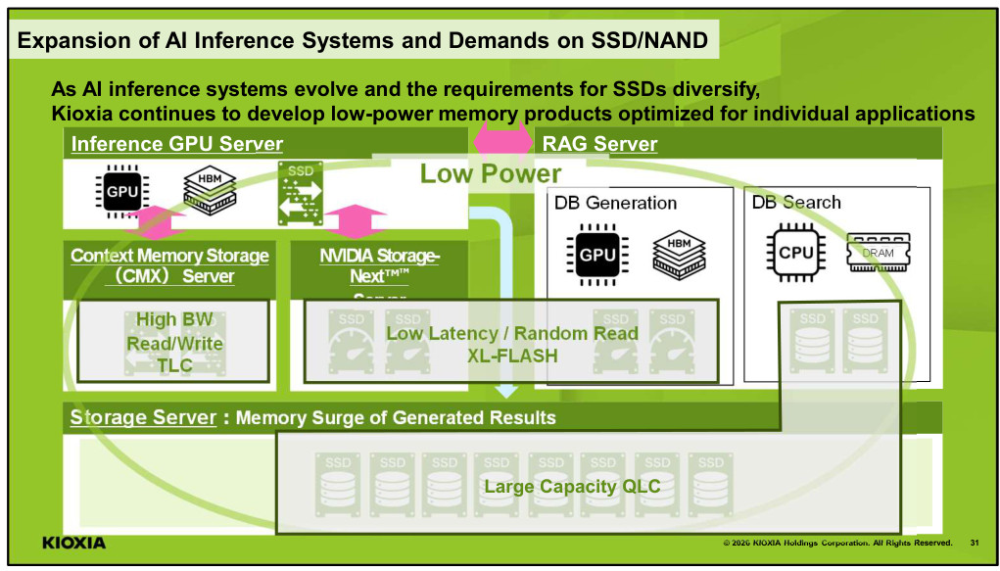 
I'll tart by focusing on our memory development strategy. As noted in the earlier session on SSD business strategy, the evolution of generative Al is diversifying customer requirements for both SSDs and NAND flash memory. To address the rapidly expanding inference market,we are advancing our product development with a focus on three core areas. 
First is addressing the need for greater efficiency in inference processing. For the Context Memory Storage shown on the left, KV Cache--which stores previous calculation results--must be swapped with HBM at high speeds. This requires high-bandwidth read and write performance.In this domain, TLC NAND is the optimal solution. 
Second is meeting the demand for improved response accuracy. Processes such as Vector Database generation on RAG servers,shown in the center-right of the slide, demand low latency and exceptional random read performance. Here,SLC-or MLCbased XL-FLASH is the optimal solution. Positioned as an HBM extension, this technology will be deployed in our Super High-Performance GP Series SSDs, which deliver exceptional IOPS. 
Third is managing the explosive volume of data generated by Al. We are driving the development of high-capacity QLC NAND tailored for high-capacity SSDs. These serve as the primary storage medium for the exponential surge of data generated by RAG server database queries and agentic Al. 
The common requirement across al thre of the approaches is performance per wattin other words, power efficiency. In the data infrastructure of the Al era, achieving low power consumption to boost power efficiency is of paramount importance. 
As we develop BiCS FLASHM, our 3D flash memory, our primary focus is to deliver high capacity, high performance, and high power efficiency/low power consumption. This builds upon the foundational value of cost competitiveness that the market has historically demanded. 
31

---

<!-- 原文第 32 页 -->

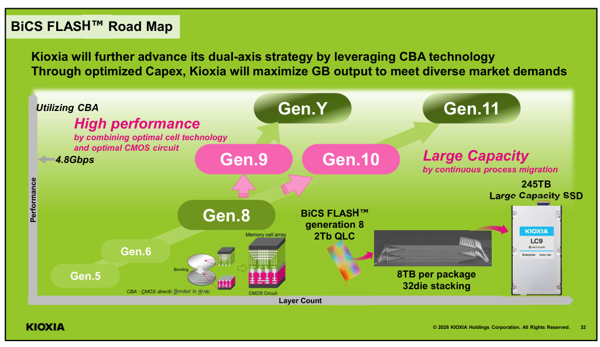 
Next, I will outine our path to achieving this high capacity and high performance, guided by our BiCS FLASHTM roadmap. 
Our 8th-generation BiCS FLASHTM serves as the starting point for our future product development roadmap.A defining feature of the 8th generation is its adoption of CBA (CMOS Directly Bonded to Array) technology. 
This optimizes thermal processing by separately manufacturing the memory cell wafer and the CMOS circuit wafer before bonding them together. By enabling industry-leading performance, capacity, and power efficiency, this technology has earned exceptionally high praise from our customers. We are currently scaling up mass production for numerous projects, and by the end of fiscal 2026,we plan to transition approximately 80% of Kioxia's gigabyte output to this 8th generation. 
Additionally, with the 8th generation, we became the first in the industry to establish the technology that allows 32 dies to be stacked within a single package. This breakthrough has enabled us to achieve a massive 8TB capacity in a single, small-form-factor BGA package. This high-density packaging is key to delivering our 245TB LC9 SSD for the generative Al market. Building upon this 8th-generation foundation, and to address the diverse needs of the Al era, last year we introduced a dual-axis strategy for our product development. 
The first axis of development, shown extending to the upper right of the graph, is the pursui of high capacity and high density. For our 10th-generation BiCS FLASHTM and the subsequent 11th generation,we will continue to combine increased vertical stacking with lateral scaling. This will deliver high bit density and massive capacity products tailored primarily for the Enterprise and Data Center SSD markets. 
The second axis of development is the pursuit of high performance. For our 9th-generation BiCs FLASHTM and the subsequent Generation Y,we will combine cell technology featuring an optimized layer count with the latest CMOS technology to achieve exceptional performance. This will primarily target the needs of the Al-enabled PC and mobile device markets. 
Today, within this dual-axis strategy, I will focus specifically on our 10th-generation BiCs FLASHTM. This latest development is primarily targeted at the next-generation Al inference market. 
32

---

<!-- 原文第 33 页 -->

## BiCS FLASHTM generation 10: Technological Leadership (Layer Count) 
Kioxia achieves cost competitiveness and improved power consumption by optimizing the layer count to balance chip size, investment costs, and power efficiency 
GB cost vs. Layer Count in BiCS FLASHT generation 10 
Advantages of Choosing 332 Layers 
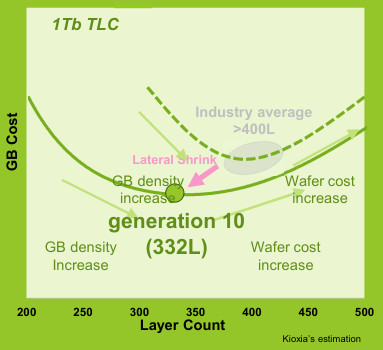 
KIOXIA 
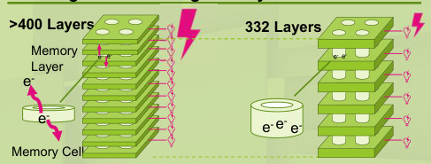 

| | Layer Count | GB Cost | Power Efficiency | Cell Reliability |
| --- | --- | --- | --- | --- |
| 332Lvs >400L | About <23% | About <10% | About >10% | About >35% |
 
Kioxia's esimation 
2026KICXIA Holaings Corporation AIlRis Rosrved 
Over the next two slides,I will eplain the technological leadership of our 10th-generation BiCs FLASHTM 
First,this section addresses the relationship between layer count, cost per gigabyte (GB cost), reliability, and power efficiency. 
As illustrated in the diagram on the left, conventional 3D flash memory has traditionally relied on increasing the vertical layer count to enhance bit density and achieve cost reductions. However, excessive stacking requires substantial capital expenditures and additional manufacturing steps, which ultimately increases wafer costs 
For the 10th generation, as with the 8th generation,cost reductin is not pursued solely through increased vertical stacking. By incorporating lateral scaling technology in a well-balanced manner, the GB cost has been optimized with a lower layer count than the industry average 
Furthermore, excessive vertical stacking introduces two performance-related concerns The first is the degradation of power efficiency, and the second is the decrease in reliabilit., As shown in the structure on the lef,with extreme stacking of 400 layers or more, the number of memory layers activated during data read and write operations is higher than a 332-layer architecture, which tends to increase power consumption. 
The second concern involves the reliabilit of the memory cells. To stack 400 or more layers, the individual memory layers must be made thinner.This reduces the electrical charge that each cell can retain, thereby degrading memory cell elait,.For the 10th generation,selecting the optimized 332-layer architecture has successfully improved power efficiency and secured memory cell reliability. 
The table on the bottom right compares our 332-layer 10th-generation product with a case where a product is developed with 400 layers or more. By limiting the layer count to 332,estimates show that the GB cost is approximately 10% lower. Additionally, it achieves a 10% advantage in power efficiency and a 35% advantage in memory cell reliability. 
In conclusion, rather than simply pursuing a higher layer count, the 332-ayer 10th-generation BiCS FLASHTM has been optimized from multiple perspectives, including GB cost, memory cell reliabilit, and power efficiency. Consequently, this architecture has produced a highly competitive product in the market. 
33

---

<!-- 原文第 34 页 -->

## BiCS FLASH generation 10: Technological Leadership (CBA) 
By early adoption of CBA technology, Kioxia will be able to supply high-performance products superior to those rest of the industry in the future 
Over 4 years ahead of the industry standard in CBA adoption 
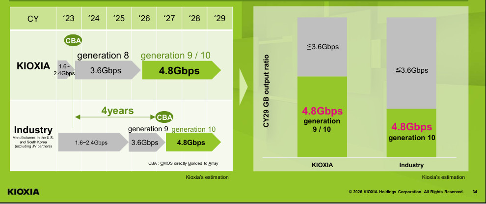 
The second technological leadership is the CMOS Directly Bonded to Array (CBA) technology. 
By inheriting the CBA technology--which was introduced early in the 8th generation-and applying it to the 10th generation, we are able to maintain our industry-wide advantage in interface performance,a key performance indicator, following the success of the 8th generation. 
As shown in the diagram on the left, CBA technology was introduced beginning with the 8th-generation BiCS FLASHTM, representing a market launch approximately four years ahead of the industry average. Consequenty, an interface performance of 3.6 Gbps was achieved two years ahead of the rest of industry. Similarly, an interface performance of 4.8 Gbps is expected to be achieved approximately one year ahead of the industry by implementing it in the 9th and 10th generations. 
Our deployment of high-speed interface products from an early stage effectively differentiates our product portfolio. As ilutrted i te diagram on the right, by 2029,the proportion of our products supporting 4.8 Gbps within our product mix is projected to be approximately 20% higher than the industry average.This will enable us to precisely address the requirements of growth markets, such as high-performance SSDs supporting PCle Gen.6 and Gen.7 that demand high bandwidth for future generative AIl markets, as well as high-speed mobile applications. 
34

---

<!-- 原文第 35 页 -->

## BiCS FLASHTM generation 10: Development Status 
Development of the BiCS FLASHT is on track 
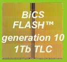 
Sample Shipments generation 10 Targeted for Summer 2026 

| Bit Density | +59% |
| --- | --- |
| Interface Speed | +33% |
| Read Throughput Write Throughput | >15% better >30% better |
| Read Power Efficiency Write Power Efficiency | >40% better >30% better |
 
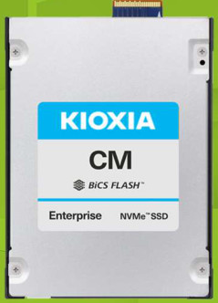 
High Bandwidth TLC-SSD supporting PCle Gen.6 
KIOXIA 
Finall, ould ike to update you on the current development status of our 10thgeneration BiCS FLASHT 
Development of the 10th-generation BiCS FLASHTM Tb TLC product is progressing smoothly. We are currently conducting reliability testing--the final phase of development-and are targeting to commence sample shipments this summer. 
As shown in the table on the left, we have confirmed steady performance improvements across key metrics compared to our 8th-generation products. Specifically, bit density has improved by 59%, interface speed by 33%, data read throughput by over 15%, and write throughput by over 30%. 
Furthermore, regarding power effiency-which we projected to improve by 10% at last year's Corporate Strategy Meeting-we have achieved substantial gains, surpassing a 40% improvement in read operations and a 30% improvement in write operations. 
The 10th-generation 1 Tb TLC BiCS FLASHTM will be deployed in high-performance, high-bandwidth SSD products, including Kioxia's next-generation "CM Series" SSDs 
With this highly competitive NAND product that will spport the ongoing evolution of AI, Kioxia is positioned to precisely meet the demands of the market. 
35

---

<!-- 原文第 36 页 -->

# Financial Strategy to Support Our Growth 
Yoshihiko Kawamura, Chief Financial Officer 
I'm Yoshiniko Kawamura, Chief Financial Officer. 
I'm going to outline our financial strategy, a strategy designed to support our growth. 
36

---

<!-- 原文第 37 页 -->

Agenda 
## Elevating Our Quality of Profit Structural Business Transformation Achieving Best-in-Class Capital Efficiency Maximizing Cash Generation and Strengthening Financial Position Capital Allocation and Shareholder Return Frameworks 
KIOXIA 
2026 KIOI alaigs Corpnaton AIl Rg d 
I will cover the following five topics today: 
First, how we will urther enhance our profitgenerating capabilities. Second, how we have significantly transformed our business and revenue structures. Third, the various initiatives we are taking to improve our capital efficiency. Fourth, how we have maximized cash generation and subsequently improved our financial position - specifically, by substantially strengthening our balance sheet. And inally, how we approach capital allocation and shareholder returns. 
37

---

<!-- 原文第 38 页 -->

## Elevating Our Quality of Profit 
Capturing demand in the data center market to build a structurally stable revenue model Enhancing the quality of earnings through Capex, R&D and Human capital investments in high-growth, high-margin sectors 
Market 
Technology Leadership 
## Cost Competfiveness 
 
 
 
Strategic shift from consumer to data infrastructure Build revenue stability through multi-year LTAs 
Deliver higih vaiue-added products (Super High IOPS SSD, etc.)for Al systems Expand high-capacity QLC and high-performance products (4.8Gbps) 
Accelerate migration to nextgeneration products for competitive cost 
Portfolio 
R&D 
Migration 
Ratio of Data Center Revenue Over 60%(by FY28) 
Focused on advanced development Over +60%(vs.FY25) 
Ratlo of BIGS FASHT Gneration 8. Over $80 \%$ (end of FY26) 
KIOXIA 
1 Proicton G8 base 
6226 KIOKA alaigs Coprnion AI Rig Red 
Regarding our first main topic (enhancing our proft-generating capabilities): by accurately capturing the demand for data centers, we are transitioning to a structurally more stable revenue model. 
This marks a strategic shift from our traditional, cyclical, consumer-centric business to a more resilient model focused on the industrial and enterprise sectors. We will continue to make focused investments in these high-growth, high-margin areas. Specificall, we have identified three priority areas for investment. 
The first area is our investment in capital expenditure (Capex), research and development,and human capital. Through these initiatives, we aim to further enhance the quality of our earnings. We define high-quality earnings as revenue generated by leveraging new technologies to bring innovative products to market, or by pioneering entirely new markets 
Take a look at the left side of the slide. 
The market has undergone a significant transformation.We are strategically expanding our product offerings for data centers while stabiling our revenue structure through multi-year LTAs. On a portfolio basis, we plan to increase the share of our overall revenues delivered by data center products to over 60% by FY2028. 
Next is technological leadership. We plan to introduce high value-added products for Al systems, including the launch of Super High IOPS SSDs and other new products. We will also expand our high-capacity QLC and high-performance 4.8Gbps product lines. Furthermore,we are boosting our investments in R&D, focusing primarily on cutting-edge developmen, and we plan to increase this by over 60% compared to FY2025. 
Third, we are acelerating the migration to next-generation products that offer greater cost competitiveness. Specifically, we are aiming for our 8th-generation BiCS FLASHTM to represent over 80% of our total gigabyte-based shipments by the end of fiscal year 2026. 
38

---

<!-- 原文第 39 页 -->

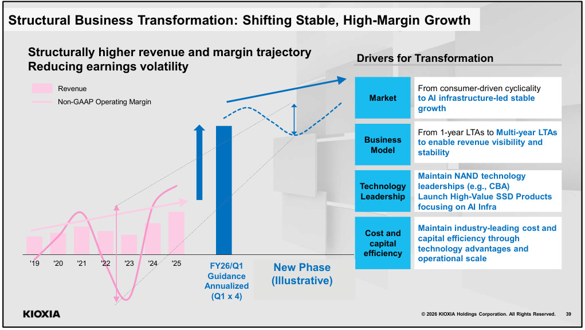 
Now, I would like to explain the structural transformation of our revenue and profit.Please look at the charts on the left. The left half covers the period from FY2019 to FY2025, with the orange bars representing revenue and the line graph showing our non-GAAP operating margin. As you can see, this period was characterized by severe cyclical volatility. 
However, the blue bar and line chart in the middle indicate a clear shift away from this extreme volatility and show that our overall revenues have grown significantly. For visual reference, this blue bar represents an annualized figure, calculated by simply multiplying our FY2026 Q1 guidance-announced this May-by four. 
We anticipate that his trend will continue, which is why we have illustrated our projected growth trajectory with the upward-sloping blue arrow.While we expect the market to remain cyclical in the future,you can see our overall growth curve has shifted upward. As a result,when factoring in both the cyclicality and this upward shif, you can see that the troughs have become considerably shallower. 
On the right,we have outlined the four key drivers behind our structural transformation. First, regarding the market, we are shifting from a consumer-driven cyclical model to one of stable growth led by demand for Al infrastructure. 
Second, our business model.We are moving from one-year LTAs to multi-year LTAs to enable greater revenue visibility and stability, which in turn allows for more proactive capital investment. Third, technological leadership. We will maintain our competitive advantage in NAND technology-such as through our CBA technology-and will continue to launch a series of highvalue SSD products aimed at the Al infrastructure market. 
Fourth, cost and capital eficiency. We will maintain our industry-leading cost and capital efficiencies through our technological advantages and operational scale. 
39

---

<!-- 原文第 40 页 -->

## Achieving Best-in-Class Capital Efficiency 
Improve asset efficiency through strict investment criteria and structurally shift to a high ROIC model ROIC 
Target bestin-class ROIC among manufacturing companies √ Concentrate Capex, R&D and Human Capital investments in high-growth,high-margin sectors Strict investment discipline: fund only projects exceeding hurdle rate 
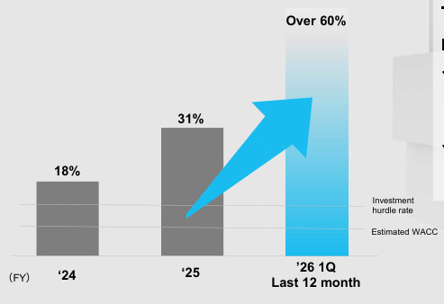 
Significant improvement in EPS and FCF per share 622 KIOIA lag Cro i 
KIOXIA *ROIC= NOPAT /(Equity+ Net Debt) 
Through these initiatives,we aim to achieve industry-leading levels of capital efficiency. By applying disciplined investment criteria, we will further enhance both our investment and asset efficiency, driving our transition to a structurally high ROIC (Return on Invested Capital) model. 
Please take a look at the bar chart in the left illustrating our ROIC progression. Starting from the left, you'll see our ROIC grew from 18% in FY2024 to 31% in FY2025.For the 12-month period from Q2 of FY2025 to Q1 of FY2026,it exceeded 60%. We believe this represents one of the highest ROIC levels not only within our industry,but across the entire Japanese manufacturing sector. 
To sustain this top-tier ROIC, as mentioned earlier we will continue our focused investments in Capex, R&D, and human capital. Even with abundant cash generation, we will observe strict criteria and execute only highly disciplined investment decisions. Through these efforts, we aim to significantly increase both our earnings per share and free cash flow per share. 
40

---

<!-- 原文第 41 页 -->

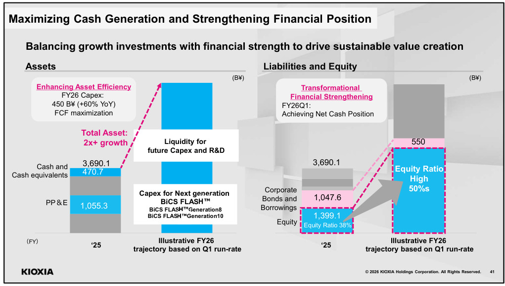 
This slide illustrates the transformation of our balance sheet. Our goal is to maximize cash generation and improve our overall financial position, enabling us to simultaneous pursue investments in growth and in areas that will improve our financial health. While these two objectives are often seen as a trade-off, we are committed to achieving both in order to further boost our corporate value. 
The chart on the left shows our assets, while the chart on the right represents our liabilities and equity Let's start with the assets. The bar on the far left shows our position in FY2025.The one next to it does not include detailed figures as they are not yet finalized, but it depicts our projected balance sheet as of the end of FY2026.In FY2025, our total assets stood at 3.6901 trillion yen. 
Based on our current projections, we expect this figure to more than double by the end of the fiscal year, driven by two factors. First, our assets will grow as we rapidly accelerate our capital expenditure, or Capex. Second, we will secure the level of liquidity required to ensure stable long-term operations. 
Now, turning to liabilities and equity and the chart on the right. Naturally, these will also increase,but the key takeaway is the significant strengthening of our equity ratio. As you can see, our equity ratio is projected to rise from 38% in FY2025to the high 50sapproaching 60%. This will create a truly robust balance sheet and a rock-solid business foundation. Ultimately,we believe this strong financial base will serve as the basis for enhancing shareholder returns. 
41

---

<!-- 原文第 42 页 -->

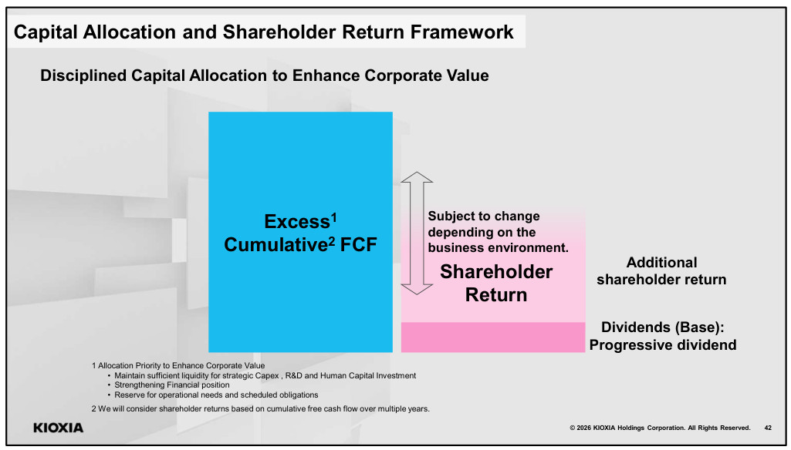 
Turning to capital allocation and shareholder returns, we are currently evaluating various approaches to return the cash we 've accumulated to our shareholders. 
The "Excess Free Cash Flow' shown on this slide represents the net free cash flow remaining after prioritizing liquidity and future investments in growth. We intend to proactively return this surplus cash to our shareholders. 
While we cannot share specific details at this time regarding the exact timing or payout ratios for dividends and share buybacks, our fundamental principle is to allocate this net free cash flow into two main areas. 
The first area is further investments in growth,such as investments to advance Al memory solutions. The second area, the remaining portion, will be allocated to shareholder returns. 
Under our basic framework,we target a benchmark of allocating approximately 50% of our surplus free cash flow to shareholder returns. So for example, if 50% is utiized for growth investments, the other 50% would be returned to shareholders. 
However,the actual allocation ratio between growth investments and shareholder returns wil remain highly flexible, and will depend on prevailing business conditions and our financial status. If significant M&A opportunities arise, the proportion allocated to shareholder returns may decrease.Conversely, it there are few or no opportunities to invest in growth, the portion available for shareholder returns will increase. If circumstances allow, we are prepared to allocate a substantial majority of our surplus cash to shareholder returns. 
Thank you very much for your attention. 
42

---

<!-- 原文第 43 页 -->

## KIOXIA 
46
