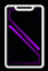

> 原文件：[S54fd69a896df_micron.com_g9-nand.pdf](https://github.com/jadennevercode/CJCC-Knowledge-Base/blob/564ab11aa9785e569e3853c8a4d7ce86f88e7535/materials/%E5%9F%BA%E7%A1%80%EF%BC%9ANAND%E4%BA%A7%E5%93%81%E4%B8%8E%E6%8A%80%E6%9C%AF%E8%B0%B1%E7%B3%BB/S54fd69a896df_micron.com_g9-nand.pdf)
> 转换方式：Volcengine OCRPdf v3, parse_mode=ocr

<!-- 原文第 1 页 -->

## The world's fastest TLC NAND 
Ideal for the most demanding high performance and data intensive workloads 
Micron is now the first to ship the industry's 9th-generation (G9) 3D NAND in an SSD, and for the third-generation in a row2 
 
Data center 
micron 
G9 TLC NAND 
99% 88% better read better write 
 
Client 
Micron 2650 SSD1 to the edge and into the Al-enabled cloud 
ultra-dense storage 
is now shipping in the 
devices from your PC 
ultra-compact, 
High performance for 
World's densest NAND 
Design flexibility with 
Advanced building block for cutting-edge storage 
Mobile 
 
 
Learn more at micron.com/G9 more space efficient 
Automotive and embedded 
Sources 
28% 73% denser NAND 
Up to 
Up to 
micron 
Peak performance. Density dominance.1 3.6GB/s performance Up to Up to
