> 原文件：[13_pdf.dfcfw.com_H2_AN202608211828282178_1.pdf](https://github.com/jadennevercode/CJCC-Knowledge-Base/blob/564ab11aa9785e569e3853c8a4d7ce86f88e7535/materials/%E5%9F%BA%E7%A1%80%EF%BC%9A%E5%8E%82%E5%95%86%E4%B8%8E%E7%BB%84%E7%BB%87%E7%BB%93%E6%9E%84/13_pdf.dfcfw.com_H2_AN202608211828282178_1.pdf)
> 转换方式：Volcengine OCRPdf v3, parse_mode=ocr

<!-- 原文第 1 页 -->

科创板投资风险提示:本次发行股票拟在科创板上市,该市场具有较高的投资风险。科创板公司 具有研发投入大、经营风险高、业绩不稳定、退市风险高等特点,投资者面临较大的市场风险。 投资者应充分了解科创板的投资风险及本公司所披露的风险因素,审慎作出投资决定。 
## 轻股股 
长江存储控股股份有限公司 CCSH Corporation 
(武汉东湖新技术开发区高新大道999号海外人才大楼A座1701室) 首次公开发行股票并在科创板上市 招股说明书 
(申报稿) 
声明:本公司的发行申请尚需经上海证券交易所和中国证监会履行相应程序。本招股说明书(申 报稿)不具有据以发行股票的法律效力,仅供预先披露之用。投资者应当以正式公告的招股说明 书作为投资决定的依据。 
联席保荐人(主承销商) 
 
中信证券股份有限公司 CITIC Securities Company Limited 广东省深圳市福田区中心三路8号 卓越时代广场(二期)北座 
中信建投证券股份有限公司 
 
CHINA SECURITIES CO,LTD. 北京市朝阳区安立路66号4号楼

---

<!-- 原文第 2 页 -->

长江存储控股股份有限公司 
招股说明书 
## 发行人声明 
中国证监会、上海证券交易所对本次发行所作的任何决定或意见,均不表明 其对发行人注册申请文件及所披露信息的真实性、准确性、完整性作出保证,也 不表明其对发行人的盈利能力、投资价值或者对投资者的收益作出实质性判断或 保证。任何与之相反的声明均属虚假不实陈述。 
根据《证券法》规定,股票依法发行后,发行人经营与收益的变化,由发行 人自行负责;投资者自主判断发行人的投资价值,自主作出投资决策,自行承担 股票依法发行后因发行人经营与收益变化或者股票价格变动引致的投资风险。 
1-1-1

---

<!-- 原文第 3 页 -->

长江存储控股股份有限公司 
招股说明书 
## 致投资者的声明 
人工智能时代,数据逐渐成为核心生产要素,存力是数字时代的基础设施。 作为代表中国跻身世界一流的存储器IDM企业,公司致力于为全球用户提供高 品质、高性价比的存力产品。根植于国内集成电路产业,受益于时代发展机遇和 产业上下游合作伙伴的共同努力,公司业务取得长足进步,希望能够进一步获得 A股资本市场的认可和选择,为公司长期发展战略奠定基础。 
## 一、发行人上市的目的 
## (一)升级先进产能,稳定全球存力供给 
人工智能规模化落地催生长期、海量配套存力需求。公司本次发行上市将为 全球和中国市场有序升级先进产能、保障稳定供给,让优质存储产品更易获得、 更具性价比,最终惠及广大终端消费者。公司愿以稳定的供给促进存储产业健康 持续发展,与产业上下游共享成长。 
## (二)迭代产品技术,提升全球竞争位势 
在全球竞争格局中,存储产品制造企业竞争的核心在于以技术升级迭代构筑 产品在性能、成本方面的比较优势。本次发行上市将为公司持续推进产品迭代与 技术演进提供有力支撑,巩固增强公司核心竞争力。此外,存储产业具有重资产、 高投入特征,公司的持续投入也将带动上游设备、材料、零部件等产业链环节协 同发展,促使中国存储产业链抓住产业窗口期。 
## (三)汇聚资本力量,实现世界一流愿景 
世界一流企业的成长离不开持续的科技投入,更离不开资本的长期支持。本 次发行上市,公司将借助资本市场的力量,加大研发与技术投入、汇聚全球优秀 人才、开拓市场空间,为实现长期愿景注入持久动能。公司愿以开放的姿态融入 全球产业体系,与全球伙伴合作共赢,努力成为受人尊敬的世界一流存储企业。 
## 二、发行人现代企业制度的建立健全情况 
公司已按照《公司法》《证券法》《公司章程》等要求,建立健全现代企业 制度和法人治理结构。公司股东结构多元均衡,股东会、董事会、经营管理层权 
1-1-2

---

<!-- 原文第 4 页 -->

长江存储控股股份有限公司 
招股说明书 
责清晰、运作规范,内部控制健全有效。上市后,公司将进一步提升战略决策与 监督效能,制定完善的股东分红回报规划,健全中小股东权益保护机制,切实维 护全体股东特别是中小股东的合法权益。 
## 三、发行人本次融资的必要性及募集资金使用规划 
本次募集资金拟用于公司产线建设升级和技术研发提升,满足全球存储产品 需求的同时带动产业链协同发展。募投项目实施完成后,公司研发技术实力进一 步增强,核心产品谱系拓展,制造规模和效率提升,为长期可持续发展提供有力 支撑。 
## 四、发行人持续经营能力及未来发展规划 
报告期内,公司整体实力持续增强,经营业绩显著改善,自2024年扭亏后 盈利水平快速提升,2026年1-3月实现营业收入470.42亿元、归母净利润333.79 亿元。根据TrendForce数据计算,2026年1-3月公司在全球NANDFlash厂商按 销售金额和出货量排名,均位列全球第三、中国第一。 
恰逢全球人工智能快速发展的时代机遇,叠加国内庞大市场空间潜力,公司 将在深耕国内市场的同时积极布局全球,力争成为产品卓越、技术领先、合作伙 伴信赖、股东和员工满意的全球存储产业领导者,在成就自身的同时服务社会。 
1-1-3

---

<!-- 原文第 5 页 -->

长江存储控股股份有限公司 
招股说明书 
(本页无正文,为《致投资者的声明》之签章页) 
董事长、总裁: 
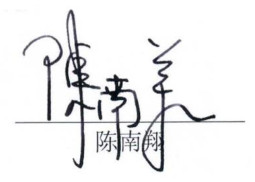 
控股股 长江在情股股份有限公司 支f 2 6年 2种 A 色 
1-1-4

---

<!-- 原文第 6 页 -->

长江存储控股股份有限公司 
招股说明书 
本次发行概况 

| 发行股票类型 | 人民币普通股(A股) |
| --- | --- |
| 发行股数 | 本次拟公开发行人民币普通股(A股)股票(行使超额配 售选择权之前)不低于198,000.00万股且不超过 243,000.00万股、占公司发行后总股本比例不低于10%且 不超过12%。本次发行不涉及公司股东公开发售股份。本 次发行可以采用超额配售选择权,采用超额配售选择权发 行的股票数量不超过本次发行股票数量(行使超额配售选 择权之前)的15.00% |
| 每股面值 | 人民币1.00元 |
| 每股发行价格 | 人民币【】元 |
| 发行日期 | 【】年【】月【】日 |
| 拟上市证券交易所和板块 | 上海证券交易所科创板 |
| 发行后总股本 | 不低于1,980,000.00万股且不超过2,025,000.00万股(行 使超额配售选择权之前) |
| 联席保荐人(主承销商) | 中信证券股份有限公司、中信建投证券股份有限公司 |
| 招股说明书签署日期 | 【】年【】月【】日 |
 
1-1-5

---

<!-- 原文第 7 页 -->

长江存储控股股份有限公司 
招股说明书 
目录 
发行人声明.
致投者的声明
一、发行人上市的目的……
二、发行人现代企业制度的建立健全情况…2
三、发行人本次融资的必要性及募集资金使用规划……3
四、发行人持续经营能力及未来发展规划……3
本次发行概况
第一节释义0 目…
一一义0
二、专业释
第二概览…7 一、重大事项提示17
二、发行人及本次发行的中介机构基本情况…19
三、本次发行概况……9
四、发行人主营业务经营情况2
五、公司符合科创板科技创新企业定位……2
、发行人报告期主要财务数据财务指…
七、财务报告审计截止日后主要财务信息及经营状况……24
八、发行人选择的具体上市标准…24
九、发行人公治理特殊安排……24
十、募集资金运用与未来发展规划……24
第三风险因素….5
一、与发行人相关的风险…25
二、与行关的风险…7
三、其他风27
第四节发行人基本情况.…8 一、发行人基本信息…28 
1-1-6

---

<!-- 原文第 8 页 -->

长江存储控股股份有限公司 
招股说明书 
二、发行人的设立情况.…… 28
三、报告期内公股本和股东变化情况.……3 四、发行人成立以来重要事件……7
五、发行人不存在其他证券市场上市及挂牌情况….8
六、发行人的股权结构……9
、发行人公、分公及参股公司情况……0
八、持有发行人百分之五以上股份的主要股东和实际控制人情况.……...433
九、发行人不存在特别表决权股份或类似安排情况…….466
、发行人不存在协议控制架构情况…46
十一、控股股东、实际控制人报告期内不存在重大违法行为……...666
十二、发行人股本情况… …46
十三、发行人不存在股东特殊权利安排及终止情况…
十四、董事、监事、高级管理人员及核心技术人员情况……5
十五、发行人本次申报前已经制定或实施的员工持股计划及相关安排….67
十六、发行人的员工情……7
第五节业务与技术……7
一、发行人主营业务、主要产品及变化情况74
二、发行人所处行业基本情况……85
三、发行人主要产品销售情况和主要客户….109
四、发行人采购情况和主要供应商……10
五、发行人的主要固定资产及无形资产情况……13
六、截至本招股说明书签署日,发行人不存在特许经营情况………..1
七、发行人核心技术及研发情况13
八、安全生产及环境保护情况……139
九、发行人境外生产经营情况……140
第财务会计信息与管理分析……141
一、财务会计报表…141
二、审计意见、关键审计事项…… ……145
三、财务报表的编制基础、合并范围变化情况和重要性标准确定方法和选择
依据… 146 
1-1-7

---

<!-- 原文第 9 页 -->

长江存储控股股份有限公司 
招股说明书 
四、重要会计政策会计估计……147
五、非经常性损益…153
六、税项.153
七、报告期内主要财务指标……157
八、经营成果分析.158
九、资产质量分析……180
十、偿债能力、流动性与持续经营能力分析……204
十一、报告期重大投资或资本性支出等事项的基本情况……....210
十二、资产负债表日后事项、或有事项、其他重要事项及重大担保、诉讼等
第七节募集资金运用与未来发展规划……212 事项…… …211
一、募集资金运用概况…212
二、募集资金投资项目必要性及可行性分析213
三、本次募集资金投资项目与公司现有主要业务、核心技术的关系.…….215
四、未来发展规划…215
第八公司治理与独立性……217
一、公司治理制度的建立健全及运行情况说明……217
二、发行人内部控制情况……219
三、报告期内发行人的违法违规情况…..219
四、报告期内资金占用及对外关联担保情况……219
五、发行人独立行情况.…219
六、同业竞争…721
七、关联方及关联交易2
第九节投资者保护……33
一、公司投资者权益保护的情况… ....333
二、本次发行完成前滚存利润的分配安排和已履行的决策程序………..2
三、股利分配政策及长期回报规划……234
四、股东投票机制建立情况……27
五、承诺事项…238
第十其他重要事项……239 
1-1-8

---

<!-- 原文第 10 页 -->

长江存储控股股份有限公司 
招股说明书 
一、重大合同…… ...3
二、对外担..240
三、重大诉讼、仲裁及行政处罚.…241
四、持有发行人5%以上股份的股东的重大诉讼、仲裁及行政处罚…….2
五、发行人董事、高级管理人员和核心技术人员的重大诉讼、仲裁及行政处
罚.242
第十一声明…243
一、发行人及全体董事、审计委员会成员和高级管理人员声明……...4
二、发行人第一大股东声……46
三、保人(主承销商)声明…47
四、发行人律师声明……52
五、会计师事务所声明……53
六、产评机构声……55
第十二附….56
一、备查文件…256
二、文件查阅时间……256
三、文件查阅地点…56
附一:本次发行相关承诺……257
附件二:发行人及其子公拥有的主要商标清单…27
附件三:发行人及其子公司拥有的主要专利清单…7
附件四:发行人及其子公司拥有的集成电路布图设计专有权清单……29
附五:发行人及其子公司拥有的主要著作权清单……0
附件六:募集资金投资项目具体情况…301 
1-1-9

---

<!-- 原文第 11 页 -->

长江存储控股股份有限公司 
招股说明书 
## 第一节释义 
本招股说明书中除非文义另有所指,下列缩略语和术语具有如下含义: 一、一般释义 

| 公司、发行人、长存控股 | 指 | 长江存储控股股份有限公司 |
| --- | --- | --- |
| 本次发行 | 指 | 公司本次申请在境内首次公开发行人民币普通股(A股) 股票 |
| 本次发行上市 | 指 | 公司本次申请在境内首次公开发行人民币普通股(A股) 股票并在上海证券交易所科创板上市 |
| 招股说明书 | 指 | 长江存储控股股份有限公司首次公开发行股票并在科创 板上市招股说明书 |
| 长存有限 | 指 | 长江存储科技控股有限责任公司,为发行人前身 |
| 长江存储 | 指 | 长江存储科技有限责任公司 |
| 武汉新芯 | 指 | 武汉新芯集成电路股份有限公司及其前身武汉新芯集成 电路制造有限公司 |
| 宏茂微 | 指 | 宏茂微电子(上海)有限公司 |
| 长存资本 | 指 | 长存资本(武汉)投资管理有限公司 |
| 长存科服 | 指 | 武汉长江存储科技服务有限公司 |
| 创新中心 | 指 | 长江先进存储产业创新中心有限责任公司 |
| 长存香港 | 指 | 长江存储(香港)科技有限公司 |
| 长存上海 | 指 | 长存创芯(上海)集成电路有限公司 |
| 长存北京 | 指 | 长存创芯(北京)集成电路设计有限公司 |
| 长存美国 | 指 | Yangtze Memory Technologies, Inc. |
| 长存日本 | 指 | JYM夕/口一株式会社 |
| 新芯香港 | 指 | 武汉新芯集成电路制造(香港)有限公司 |
| 宏茂微武汉 | 指 | 宏茂微电子(武汉)有限公司 |
| 长存基管 | 指 | 长存(武汉)私募基金管理有限公司 |
| 长存鸿图 | 指 | 长存鸿图股权投资(武汉)合伙企业(有限合伙) |
| 武汉芯时代 | 指 | 武汉芯时代管理有限公司 |
| 长存二期 | 指 | 长江存储二期科技有限责任公司,目前已注销 |
| 长存三期 | 指 | 长存三期(武汉)集成电路有限责任公司 |
| 长存产业基金 | 指 | 长存产业投资基金(武汉)合伙企业(有限合伙) |
| 长江存储深圳分公司 | 指 | 长江存储科技有限责任公司深圳分公司 |
| 长江存储上海分公司 | 指 | 长江存储科技有限责任公司上海分公司 |
| 长存科服未来分公司 | 指 | 武汉长江存储科技服务有限公司未来分公司,目前已注销 |
 
1-1-10

---

<!-- 原文第 12 页 -->

长江存储控股股份有限公司 
招股说明书 

| 三维创新 | 指 | 湖北三维半导体集成创新中心有限责任公司 |
| --- | --- | --- |
| 长控香港 | 指 | 长存控股香港有限公司 |
| 湖北长晟 | 指 | 湖北长晟发展有限责任公司 |
| 芯飞科技 | 指 | 武汉芯飞科技投资有限公司,曾用名湖北紫光国器科技控 股有限公司 |
| 芯腾科技 | 指 | 武汉芯腾科技投资有限公司,曾用名湖北紫芯科技投资有 限公司 |
| 大基金一期 | 指 | 国家集成电路产业投资基金股份有限公司 |
| 大基金二期 | 指 | 国家集成电路产业投资基金二期股份有限公司 |
| 大基金三期 | 指 | 国家集成电路产业投资基金三期股份有限公司 |
| 国芯基金 | 指 | 湖北国芯产业投资基金合伙企业(有限合伙) |
| 湖北科投 | 指 | 湖北省科技投资集团有限公司 |
| 光谷产投 | 指 | 武汉光谷产业投资有限公司 |
| 长江产业集团 | 指 | 长江产业投资集团有限公司 |
| 闻名投资 | 指 | 芜湖闻名泉泓投资管理合伙企业(有限合伙) |
| 工融基金 | 指 | 工融金投(北京)新兴产业股权投资基金合伙企业(有限 合伙) |
| 中银资产1号 | 指 | 中银资产一长存1号债转股投资计划 |
| 中银投资 | 指 | 中银金融资产投资有限公司 |
| 建信投资 | 指 | 建信金融资产投资有限公司 |
| 农银投资 | 指 | 农银金融资产投资有限公司 |
| 交银投资 | 指 | 交银金融资产投资有限公司 |
| 华恒二号 | 指 | 厦门辰途华恒二号创业投资基金合伙企业(有限合伙) |
| 炬达二号 | 指 | 厦门炬达二号投资合伙企业(有限合伙) |
| 恒盛投资 | 指 | 嘉兴恒盛百旺创业投资合伙企业(有限合伙) |
| 上海国资 | 指 | 上海国有资产经营有限公司 |
| 招赢成长 | 指 | 招赢成长贰拾壹号私募股权投资基金(深圳)合伙企业(有 限合伙) |
| 融媒体基金 | 指 | 央视融媒体产业投资基金(有限合伙) |
| 允泰九号 | 指 | 大连允泰九号高科技股权投资基金合伙企业(有限合伙) |
| 中网投 | 指 | 中国互联网投资基金(有限合伙) |
| 辰途华能 | 指 | 厦门辰途华能创业投资基金合伙企业(有限合伙) |
| 华恒一号 | 指 | 厦门辰途华恒一号创业投资基金合伙企业(有限合伙) |
| 智芯1号、智芯2号、智芯3 号、智芯4号、智芯5号、智 芯6号 | 指 | 武汉市智芯计划一号企业管理合伙企业(有限合伙)、武 汉市智芯计划二号企业管理合伙企业(有限合伙)、武汉 市智芯计划三号企业管理合伙企业(有限合伙)、武汉市 智芯计划四号企业管理合伙企业(有限合伙)、武汉市智 |
 
1-1-11

---

<!-- 原文第 13 页 -->

长江存储控股股份有限公司 
招股说明书 

| | 芯计划五号企业管理合伙企业(有限合伙)、武汉市智芯 计划六号企业管理合伙企业(有限合伙) |
| --- | --- |
| 智芯7号、智芯8号、智芯9 号、智芯10号、智芯11号、 智芯12号、智芯13号、智芯 14号、智芯15号、智芯16 号、智芯17号、智芯18号、 智芯19号、智芯20号、智芯 21号、智芯22号、智芯23 号、智芯24号、智芯25号、 智芯26号、智芯27号、智芯 28号、智芯29号、智芯30号 | 武汉市智芯计划七号企业管理合伙企业(有限合伙)、武 汉市智芯计划八号企业管理合伙企业(有限合伙)、武汉 市智芯计划九号企业管理合伙企业(有限合伙)、武汉市 智芯计划十号企业管理合伙企业(有限合伙)、武汉市智 芯计划十一号企业管理合伙企业(有限合伙)、武汉市智 芯计划十二号企业管理合伙企业(有限合伙)、武汉市智 芯计划十三号企业管理合伙企业(有限合伙)、武汉市智 芯计划十四号企业管理合伙企业(有限合伙)、武汉市智 芯计划十五号企业管理合伙企业(有限合伙)、武汉市智 芯计划十六号企业管理合伙企业(有限合伙)、武汉市智 芯计划十七号企业管理合伙企业(有限合伙)、武汉市智 芯计划十八号企业管理合伙企业(有限合伙)、武汉市智 芯计划十九号企业管理合伙企业(有限合伙)、武汉市智 芯计划二十号企业管理合伙企业(有限合伙)、武汉市智 芯计划二十一号企业管理合伙企业(有限合伙)、武汉市 智芯计划二十二号企业管理合伙企业(有限合伙)、武汉 市智芯计划二十三号企业管理合伙企业(有限合伙)、武 汉市智芯计划二十四号企业管理合伙企业(有限合伙)、 武汉市智芯计划二十五号企业管理合伙企业(有限合伙)、 武汉市智芯计划二十六号企业管理合伙企业(有限合伙)、 武汉市智芯计划二十七号企业管理合伙企业(有限合伙)、 武汉市智芯计划二十八号企业管理合伙企业(有限合伙)、 武汉市智芯计划二十九号企业管理合伙企业(有限合伙)、 |
| 众智芯存 | 武汉市智芯计划三十号企业管理合伙企业(有限合伙) 武汉众智芯存科技有限公司 |
| 光谷金控 | 武汉光谷金融控股集团有限公司 |
| 湖北集成电路基金 | 湖北集成电路产业投资基金股份有限公司 |
| 武汉金控 | 武汉金融控股(集团)有限公司 |
| 芯展二号 | 武汉芯展二号股权投资基金合伙企业(有限合伙) |
| 紫芯伟华 | 北京紫芯伟华股权投资管理中心(有限合伙) |
| 湖北省国资委 | 湖北省人民政府国有资产监督管理委员会 |
| 武汉市国资委 | 武汉市人民政府国有资产监督管理委员会 |
| 东湖高新区管委会 | 武汉东湖新技术开发区管理委员会 |
| 同方股份 | 同方股份有限公司 |
| 芯盟科技 | 芯盟科技有限公司 |
| 众望科技 | 安徽省众望科希盟科技有限公司 |
| 格罗方德 | 格罗方德半导体股份有限公司 |
| 新华三 | 新华三技术有限公司 |
| 紫光集团 | 2024年更名前的紫光集团有限公司 |
 
1-1-12

---

<!-- 原文第 14 页 -->

长江存储控股股份有限公司 
招股说明书 

| 诚泰保险 | 指 | 诚泰财产保险股份有限公司 |
| --- | --- | --- |
| 国芯投资 | 指 | 湖北国芯产业投资管理有限责任公司 |
| 华海清科 | 指 | 华海清科股份有限公司 |
| 三星电子 | 指 | Samsung Electronics Co.,Ltd. |
| SK海力士 | 指 | Sk hynix Inc. |
| 美光科技 | 指 | Micron Technology, Inc. |
| 铠侠 | 指 | Kioxia Holdings Corporation |
| 闪迪 | 指 | Sandisk Corporation |
| 西部数据 | 指 | Western Digital Corporation |
| 长鑫科技 | 指 | 长鑫科技集团股份有限公司 |
| 台积电 | 指 | 台湾积体电路制造股份有限公司 |
| 中芯国际 | 指 | 中芯国际集成电路制造有限公司 |
| 华虹宏力 | 指 | 华虹宏力半导体有限公司 |
| 华润微 | 指 | 华润微电子有限公司 |
| 《公司章程》 | 指 | 《长江存储控股股份有限公司章程》及其历次修订版本 |
| 《公司章程(草案)》 | 指 | 《长江存储控股股份有限公司章程(草案)》,将于公司 首次公开发行股票并在科创板上市后生效实施 |
| 《上市规则》 | 指 | 《上海证券交易所科创板股票上市规则》 |
| 《公司法》 | 指 | 《中华人民共和国公司法》 |
| 《证券法》 | 指 | 《中华人民共和国证券法》 |
| 股东会 | 指 | 长江存储控股股份有限公司股东会 |
| 董事会 | 指 | 长江存储控股股份有限公司董事会 |
| 保荐人、保荐机构、联席保荐 人、联席保荐机构 | 指 | 中信证券股份有限公司、中信建投证券股份有限公司 |
| 发行人律师、律师、锦天城 | 指 | 上海市锦天城律师事务所 |
| 发行人会计师、会计师、德勤、 德勤会计师 | 指 | 德勤华永会计师事务所(特殊普通合伙) |
| 发行人评估师、中企华 | 指 | 北京中企华资产评估有限责任公司 |
| 报告期 | 指 | 2023年、2024年、2025年和2026年1-3月 |
| 国务院 | 指 | 中华人民共和国国务院 |
| 国家发改委 | 指 | 中华人民共和国国家发展和改革委员会 |
| 工信部 | 指 | 中华人民共和国工业和信息化部 |
| 财政部 | 指 | 中华人民共和国财政部 |
| 国家统计局 | 指 | 中华人民共和国国家统计局 |
| 税务总局 | 指 | 中华人民共和国国家税务总局 |
| 海关总署 | 指 | 中华人民共和国海关总署 |
 
1-1-13

---

<!-- 原文第 15 页 -->

长江存储控股股份有限公司 
招股说明书 

| 中国证监会 | 指 | 中国证券监督管理委员会 |
| --- | --- | --- |
| 上交所 | 指 | 上海证券交易所 |
| 联交所 | 指 | 香港联合交易所有限公司 |
| 元、万元、亿元 | 指 | 除特别注明的币种外,指人民币元、人民币万元、人民币 亿元 |
 
1-1-14

---

<!-- 原文第 16 页 -->

长江存储控股股份有限公司 
招股说明书 
二、专业释义 

| 集成电路、芯片 | 指 | 采用半导体制造工艺,将晶体管、电阻、电容等元器件及互连导线集成于半 导体衬底,经切割、封装后形成具备特定电路功能的微型电子器件 |
| --- | --- | --- |
| 半导体存储器、 存储芯片 | 指 | 具备数据存储功能的芯片,是电子设备数据与程序的硬件载体;按断电后数 据是否保留分为易失性存储器(核心品类为DRAM、SRAM)与非易失性存 储器(核心品类为Flash、ROM)两大类 |
| 闪存、Flash | 指 | 类非易失性半导体存储器,断电后数据可长期保留,支持反复擦除与写入; 行业主流产品包括NAND Flash和NOR Flash 两大类型 |
| NAND Flash | 指 | 类闪存,具有存储密度高、单位容量成本低的特点,广泛应用于固态硬盘、 嵌入式存储、移动存储等大容量场景:当前商用产品以3D堆叠架构为主, 堆叠层数越高,工艺难度与技术壁垒越高 |
| 3D NAND | 指 | NAND Flash 主流三维技术架构,采用存储单元垂直多层堆叠,相较传统平 面2DNAND可大幅提升单晶圆存储密度、降低单位容量成本,为大容量 NAND Flash量产主流方案 |
| DRAM | 指 | 动态随机存取存储器(Dynamic Random AccsSMemory),属于易失性存储 器,需周期性刷新以维持数据,断电后数据立即丢失;主要作为电子设备的 运行内存,承担系统临时数据读写功能 |
| 晶圆、Wafer | 指 | 经过特定工艺加工、具备特定电路功能的硅半导体圆片,经切割、封装、测 试后可制成成品芯片 |
| 晶粒、Die | 指 | 整片晶圆完成电路加工后,经划片切割分离得到的单颗裸芯片(Bare Die), 是封装工序的基础单元 |
| 颗粒 | 指 | 晶圆经切割、分离工艺制成单颗晶粒后,再经过封装、测试制成颗粒 |
| IDM | 指 | 垂直整合制造工厂(Intgratd Device Manufacturer),是集芯片设计、晶圆 制造、封装测试及产品销售于一体的整合元件制造商,属于半导体行业的 种业务模式 |
| SLC | 指 | Single-level cell,即单个存储单元存储1bit数据的NAND Flash存储芯片, 具有延迟低、寿命极长、可靠性高的特点,但成本较高 |
| MLC | 指 | Muli-level cel,即单个存储单元存储2bit数据的NAND Flash存储芯片,具 有速度较快、寿命较长的特点,成本与容量介于SLC与TLC之间 |
| TLC | 指 | Triple-level cell,即单个存储单元存储3bi数据的NAND Flash存储芯片, 具有容量大、成本低、速度较快的特点,为当前市场主流类型 |
| QLC | 指 | Quad-level cell,即单个存储单元存储4bit数据的NANDFlash存储芯片,具 有容量更大、成本更低的特点,读取速度较快 |
| SSD | 指 | 固态硬盘(Solid State Drive),以NAND Flash为主要存储介质、基于主控 芯片与固件协同工作的非易失性存储设备;按应用场景分为消费级(cSSD) 与企业级(eSSD),按接口协议分为SATA SSD、SAS SSD与PCle SSD |
| PCle | 指 | Peripheral Component Interconnect Express,一种高速串行计算机扩展总线标 准,支持点对点双通道高带宽传输,广泛应用于显卡、固态硬盘等高性能设 备连接 |
| SATA | 指 | Serial Advanccd Technology Attachment,一种串行数据传输存储接口标准, 用于连接主板与硬盘、光驱等大容量存储设备,传输速率较PCIe低 |
| SAS | 指 | Serial Attached SCSI,一种基于串行通信的高性能存储接口技术,用于连接 服务器与存储设备,传输速率较PCle低 |
| NVMe | 指 | Non-Volatile Memory Express,一种针对PCleSSD优化的接口协议标准,支 持多队列并行访问,可大幅降低读写延迟、提升并发带宽,为当前企业级及 高端消费SSD主流协议 |
| HDD | 指 | 机械硬盘(Hard Disk Drive),主要由盘片、磁头、盘片转轴及控制电机、 磁头控制器等几个部分组成 |
 
1-1-15

---

<!-- 原文第 17 页 -->

长江存储控股股份有限公司 
招股说明书 

| 嵌入式存储 | 指 | 直接集成在设备主板具有嵌入式接口的存储器,其类型包括UFS、eMMC等 |
| --- | --- | --- |
| UFS | 指 | 通用闪存存储(Universal Flash Storage),一种嵌入式存储标准,采用串行 接口支持全双工通信,读写性能与功耗优于eMMC,主要应用于智能手机等 移动终端 |
| eMMC | 指 | 嵌入式多媒体存储器(Embedded MultiMedia Card),一种嵌入式存储,采 用并行接口,主要应用于手机、平板电脑等移动电子终端 |
| MCP | 指 | 多芯片封装(Multi Chip Package),将两种以上芯片通过堆叠、并排等方式 集成封装于同一封装体内的技术 |
| eMCP | 指 | 嵌入式多芯片封装(Embedded Muli Chip Package),将Flash与DRAM芯 片集成封装于同一封装体内的技术及产品,主要应用于移动终端 |
| HBM | 指 | 高带宽内存(High Bandwidth Memory),一种基于3D堆叠工艺的高性能 DRAM,通过将多个DRAM芯片垂直堆叠并与处理器通过中介层紧密封装 在一起,实现高数据传输带宽 |
| 高带宽闪存 | 指 | 种基于3D堆叠工艺的高性能NAND,通过将多个NAND芯片垂直堆叠 并与处理器通过中介层紧密封装实现高带宽与大容量 |
| 封测 | 指 | 封装、测试的简称:"封装"指对晶圆进行适当的减薄、切割、贴装、引线 键合、塑封、植球及切割,以形成封装好的芯片;"测试"指检测封装好的 芯片,验证其功能是否符合产品规格要求 |
| 温数据 | 指 | 访问频率中等的数据,无需实时访问但需在较短时间内(几秒到几分钟内) 完成调取:介于热数据(高频实时访问)与冷数据(低频长期归档)之间 |
| KV缓存、KV Cache | 指 | 键值缓存(Key-Value Cache),大语言模型理过程中需保存并复用的历史 计算中间数据,按访问频率分为热缓存(高频复用,由DRAM/HBM承载) 与冷缓存(低频复用,由SSD/NAND承接),冷热分层可缓解HBM容量 瓶颈并降低存储成本 |
| bit、Byte、KB、 MB、GB、TB、 PB、EB、ZB | 指 | 存储单位,各存储单位换算关系为IByte=8bit、1KB=1,024Byte、 IMB=1,024KB、1GB=1,024MB、ITB=1,024GB、1PB=1,024TB、 1EB=1,024PB、1ZB=1,024EB |
| DDP、QDP、 ODP、HDP、 32DP | 指 | 闪存颗粒的多晶粒堆叠封装类型,DP指Die per Package(每封装晶粒数), DDP、QDP、ODP、HDP、32DP分别代表单封装内置2颗、4颗、8颗、16 颗、32颗存储晶粒 |
| TrendForce | 指 | 集邦咨询,全球知名半导体与存储行业研究咨询机构 |
| FMS | 指 | 原称世界闪存峰会(Flash Memory Summit);2024年正式更名为未来内存 与存储峰会(The Future of Memory and Storage),峰会缩写FMS维持不变, 为全球存储领域权威峰会 |
 
本招股说明书中所列数据可能因四舍五入原因与相关单项数据直接相加之 和在尾数上略有差异。 
本招股说明书所引用有关行业的统计及其他信息均来自不同的公开刊物、研 究报告及行业专业机构提供的信息,由于引用来源不同,统计口径存在一定差异, 统计信息并非完全具有可比性。 
1-1-16

---

<!-- 原文第 18 页 -->

长江存储控股股份有限公司 
招股说明书 
## 第二节概览 
本概览仅针对招股说明书全文做扼要提示。投资者作出投资决策前,应认真 阅读招股说明书全文。 
## 一、重大事项提示 
## (一)特别风险因素 
公司提醒投资者认真阅读本招股说明书"第三节风险因素"全部内容,充 分了解公司所披露的风险因素,审慎作出投资决定,并特别关注以下风险因素: 
## 1、持续高额投入风险 
存储芯片行业具有持续高投入特点。存储芯片行业产品、技术、工艺迭代速 度较快,企业需对行业发展趋势、产品布局、技术路线进行预判并以巨额资金投 入前瞻性研发。报告期内,公司累计研发支出约159.53亿元。同时,产品供应能 力和价格是核心竞争因素,规模效应是降低单位成本的主要手段之一。报告期内, 公司购建长期资产累计现金支出约 963.90亿元。但公司产能规模与国际存储巨 头仍存在差距,未来一段时间仍需保持高额产能建设及产线升级投入,投产后将 产生高额折旧摊销费用。报告期内,公司折旧及摊销费用合计约509.49亿元,为 营业成本和期间费用的主要构成部分。 
若公司未能从生产经营或其他渠道获得足够资金,可能无法支撑公司前述持 续高额投入需求。若未来公司不能及时推出在性能、质量、成本等方面具有综合 竞争力的产品,或研发方向出现误判、产品和工艺迭代速度不及预期,将可能在 激烈的市场竞争中落后于国际巨头并丧失市场份额。若未来存储芯片技术、市场 需求等因素发生重大不利变化,亦可能导致公司花费巨额投入的新产品、新技术、 新工艺、新产能无法实现预期商业效益,进而对公司经营业绩造成不利影响。提 请投资者注意相关风险。 
## 2、价格及毛利率波动和下滑风险 
历史上存储芯片行业受供需影响具有周期性波动特点。需求端,下游主要应 用领域受技术迭代、国内外经济状况、消费水平、新兴产业发展等因素影响;供 给端,存储芯片行业集中度高,产能建设投资大,产能释放和压降需要一定周期, 
1-1-17

---

<!-- 原文第 19 页 -->

长江存储控股股份有限公司 
招股说明书 
主要供应商产能调整可能对市场供应量构成较大影响。产能集中释放可能在短期 内导致市场供给过剩,进而引发产品单价下跌。同时规模庞大且相对稳定的折旧 摊销费用将在一定程度上放大单价波动对毛利率及净利润的影响。 
截至本招股说明书签署日,全球NAND Flash 市场处于供不应求的高景气周 期,公司毛利率及净利润规模随之快速上升。但NANDFlash 市场高景气度持续 时间存在不确定性。当市场需求增速放缓或主要存储厂商快速扩产及重新调配产 能导致供给大幅增加时,产品价格可能出现回落。同时,公司直面与国际巨头的 激烈竞争,国内外经济形势、产品技术发展状况、原材料及设备供应情况、地缘 政治等多方面因素均可能影响公司业绩表现,导致公司毛利率、净利润水平明显 波动、甚至亏损。提请投资者注意相关风险。 
## 3、地缘政治摩擦风险 
存储芯片制造对原材料、设备及备品备件要求较高,全球半导体产业链已形 成高度专业化协同分工体系。近年来国际贸易政策不稳定因素增加,若相关情况 发生重大不利变化,可能对公司供应链和生产经营稳定性、产品成本控制以及海 外市场开拓等方面造成不利影响。提请投资者注意相关风险。 
## (二)本次发行相关主体作出的重要承诺和说明 
公司及相关责任主体按照中国证监会及上交所等监管机构的要求,出具了关 于在特定情况和条件下的有关承诺。具体承诺事项详见本招股说明书"第十二节 附件"之"附件一:本次发行相关承诺"。 
## (三)本次发行前滚存利润的分配安排、发行后现金分红的股利分配政策及 长期回报规划 
公司2026年第四次股东会审议通过《关于公司首次公开发行人民普通股 (A股)股票前滚存未分配利润分配和累计未弥补亏损承担方案的议案》,如公 司本次发行上市获得上海证券交易所审核通过以及经中国证监会同意注册并成 功实施,公司本次发行上市前的滚存未分配利润由本次发行上市后的新老股东按 照届时的持股比例共同享有,公司本次发行上市前的累计未弥补亏损由本次发行 上市后的新老股东按照届时的持股比例相应承担。 
公司2026年第四次股东会审议通过《关于制定公司首次公开发行人民币普 
1-1-18

---

<!-- 原文第 20 页 -->

长江存储控股股份有限公司 
招股说明书 
通股(A股)股票并在科创板上市后三年内股东分红回报规划的议案》,对本次 发行上市后的股利分配相关政策、上市后三年内股东分红回报规划作出相应安排, 具体内容详见"第九节投资者保护"之"三、股利分配政策及长期回报规划"。 
## 二、发行人及本次发行的中介机构基本情况 
## (一)发行人基本情况 

| 发行人名称 | 长江存储控股股份有限公司 | 成立日期 | 2016年12月21日 |
| --- | --- | --- | --- |
| 注册资本 | 法定代表人 陈南翔 1,782,000万元 | | |
| 注册地址 | 武汉东湖新技术开发区高新大道999号海外人才大楼A座1701室 | | |
| 控股股东 | | 实际控制人 | |
| 行业分类 | C39计算机、通信和其他 电子设备制造业 | 在其他交易 场所(申 请)挂牌或 上市情况 | 不适用 |
 
## (二)本次发行的有关中介机构 

| 保荐人 | 中信证券股份有限公司、 中信建投证券股份有限公司 | 主承销商 | 中信证券股份有限公司、 中信建投证券股份有限公司 |
| --- | --- | --- | --- |
| 发行人律师 | 上海市锦天城律师事务所 | 其他承销 机构 | |
| 审计机构 | 德勤华永会计师事务所(特殊 普通合伙) | 评估机构 | 北京中企华资产评估有限责 任公司 |
| 发行人与本次发行有关的保荐人、承销机构、 证券服务机构及其负责人、高级管理人员、经 办人员之间存在的直接或间接的股权关系或其 他利益关系 | | | |
 
## (三)本次发行其他有关机构 

| 股票登记机构 | 中国证券登记结算有限责 任公司上海分公司 | 收款银行 | 【】 |
| --- | --- | --- | --- |
 
## 三、本次发行概况 
(一)本次发行的基本情况 

| 股票种类 | 人民币普通股(A股) | | |
| --- | --- | --- | --- |
| 每股面值 | 人民币1.00元 | | |
| 发行股数 | 不低于198,000.00万股 且不超过243,000.00万 股(行使超额配售选择 权之前) | 占发行后总股本 比例 | 不低于10%且不超 过12%(行使超额配 售选择权之前) |
 
1-1-19

---

<!-- 原文第 21 页 -->

长江存储控股股份有限公司 
招股说明书 

| 其中:发行新股数量 | 不低于198,000.00万股 且不超过243,000.00万 股(行使超额配售选择 权之前) | 占发行后总股本 比例 | 不低于10%且不超 过12%(行使超额配 售选择权之前) |
| --- | --- | --- | --- |
| 股东公开发售股份数量 | 不适用 | 占发行后总股本 比例 | 不适用 |
| 发行后总股本 | 不低于1,980,000.00万股且不超过2,025,000.00万股(行使超额配售 选择权之前) | | |
| 每股发行价格 | | | | 人民币【】元 【】倍(按每股发行价格除以发行后每股收益计算,发行后每股 收益按【】年度经审计的扣除非经常性损益前后孰低的归属于母 公司所有者净利润除以本次发行后总股本计算) | | |
| 发行市盈率 |
| 发行前每股净资产 | 【】元 发行前每股收益 【】元 | | |
| 发行后每股净资产 | 【】元 | 发行后每股收益 | 【】元 |
| 发行市净率 发行方式 | 【】倍(按每股发行价格除以发行后每股净资产计算) 采用网下向符合条件的投资者询价配售、网上向社会公众投资者 定价发行相结合的方式,或中国证监会、上交所认可的其他方式 进行(包括但不限于向战略投资者定向配售) | | |
| |
| 发行对象 | 符合中国证监会或上交所规定资格的战略投资者、询价对象以及 符合投资者适当性要求且在上交所开立证券账户并开通科创板交 易权限的境内自然人、法人和其他机构等投资者(法律法规、中 国证监会部门规章或上交所业务规则等规定的禁止购买者除外), 中国证监会或上交所等监管部门另有规定的,按其规定执行 余额包销 | | |
| 承销方式 | | | |
| 募集资金总额 | 【】万元 | | |
| 募集资金净额 | 【】万元 | | |
| 募集资金投资项目 | 长江存储量产线技术升级项目 | | |
| 研发相关募投项目 | | |
| 发行费用概算 | 本次发行费用共计【】万元(不含增值税),其中承销及保荐费 【】万元,审计及验资费【】万元,律师费【】万元,用于本次发 行的信息披露费【】万元,用于本次发行的发行手续费及其他【】 万元 | | |
| 高级管理人员、员工拟 参与战略配售情况 | 若公司决定实施高级管理人员及员工战略配售,则公司将依据相 关法律法规的要求,适时履行相应审议程序及其他相关所需程序, 并依法进行披露 | | |
| 保荐机构相关子公司拟 参与战略配售情况 | 保荐机构相关子公司参与本次发行战略配售,具体按照上交所相 关规定执行。保荐机构及其相关子公司后续将按要求进一步明确 参与本次发行战略配售的具体方案,并按规定向上交所提交相关 文件 | | |
 
(二)本次发行上市的重要日期 

| 刊登发行公告日期 | 【】年【】月【】日 |
| --- | --- |
| 开始询价推介日期 | 【】年【】月【】日 |
| 刊登定价公告日期 | 【】年【】月【】日 |
 
1-1-20

---

<!-- 原文第 22 页 -->

长江存储控股股份有限公司 
招股说明书 

| 申购日期和缴款日期 | 【】 年【】月【1日 |
| --- | --- |
| 股票上市日期 | 【】年【】月【】日 |
 
## 四、发行人主营业务经营情况 
## (一)主要业务情况 
公司是代表中国路身世界一流的存储器IDM企业,打造全球领先层数、高 存储密度、高1/O速度的NAND Flash系列产品,广泛应用于企业服务器、数据 中心、消费电子等领域。依托中国庞大的应用市场和国际化布局,报告期内公司 出货量快速增长,根据TrendForce数据计算, 2026年1-3月公司在全球NAND Flash厂商中按销售金额和出货量排名,均位列全球第三、中国第一。 
公司始终坚持原创核心技术攻关,引领我国3DNAND技术赶超国际先进水 平。公司2022年推出Xtacking 3.0技术,获得全球存储领域权威峰会FMS"最 具创新存储技术奖",成为全球首批推出200层以上3D NAND Flash产品的企 业,实现国内存储技术首次领先世界先进水平;2024年迭代Xtacking4.0技术, 次年再度获得FMS权威奖项,重塑全球3DNAND技术发展路线:2025年成为 中国大陆为数不多的与国际头部厂商达成专利交叉授权的集成电路企业,技术影 响力凸显。 
公司已构建多元高质量客户体系,实现多维度、多层级市场覆盖。在企业用 户市场,公司与国内互联网、服务器、消费电子等领域头部企业深度合作,同时 切入国际一流客户供应体系。在个人用户市场,公司推出自有品牌致态系列产 品,品牌知名度与市场影响力持续提升。 
存力是数字时代的基石,是数字基建的核心载体。公司以终端应用为牵引, 持续构建高商业价值产品组合,支撑各细分领域、应用场景多元需求。同时,公 司为上游材料、设备、零部件厂商提供应用验证场景,与上下游商业伙伴共同推 动全产业链技术迭代、工艺升级,做大做强中国存储器产业,以科技创新服务回 馈社会。 
## (二)主要产品 
报告期内,公司主营业务收入来源主要为NAND Flash产品。NAND Flash 产品根据产品形态分为存储芯片、智能终端产品和固态硬盘,主要应用于数据中 
1-1-21

---

<!-- 原文第 23 页 -->

长江存储控股股份有限公司 
招股说明书 
心、企业服务器、消费电子等应用场景。此外,公司子公司宏茂微可提供芯片封 测解决方案和存储器封装测试服务。公司主要业务和产品具体情况详见本招股说 明书"第五节业务与技术"之"一、发行人主营业务、主要产品及变化情况" 之"(一)公司主营业务、主要产品、主营业务收入构成及特征"。 
## (三)主要原材料及重要供应商 
报告期内,公司生产经营采购的主要原材料包括备品备件、硅片、化学品、 光阻、气体、靶材等。具体情况详见本招股说明书"第五节业务与技术"之"四、 发行人采购情况和主要供应商"。 
## (四)主要生产模式 
公司采用IDM经营模式,业务涵盖芯片设计、晶圆制造、封装测试,并延 伸至固态硬盘的模组加工与测试环节。公司具体生产模式详见本招股说明书"第 五节业务与技术"之"一、发行人主营业务、主要产品及变化情况"之"(二) 主要经营模式"之"2、生产模式"。 
## (五)主要销售方式及客户 
公司采用直销与经销相结合的销售模式,根据市场动态及客户需求,统筹制 定产品整体规划、业务推广策略及产销需求计划。公司主要客户情况详见本招股 说明书"第五节业务与技术"之"三、发行人主要产品销售情况和主要客户"。 
## (六)行业竞争情况及发行人的竞争地位 
公司专注于3D NAND闪存及存储器解决方案,成为全球首批突破200层 NAND存储芯片的企业。根据TrendForce数据计算,2026年1-3月公司在全球 NAND Flash厂商中按销售金额和出货量排名,均位列全球第三、中国第一。 五、公司符合科创板科技创新企业定位 
## (一)公司符合行业领域要求 

| 公司所属 行业领域 | √新一代信息技术 | 公司是一家集芯片设计、晶圆制造、封装测试及系统解决 |
| --- | --- | --- |
| 高端装备 | 方案产品于一体的半导体存储器IDM企业。 |
| 口新材料 | 根据国家统计局《国民经济行业分类(GB/T4754-2017)》 和中国证监会《上市公司行业统计分类与代码(JR/T0020- |
| 口新能源 | 2024)》,公司所处行业为"C39计算机、通信和其他电 |
 
1-1-22

---

<!-- 原文第 24 页 -->

长江存储控股股份有限公司 
招股说明书 

| 口节能环保 | 子设备制造业"。 |
| --- | --- |
| 口生物医药 | 根据国家统计局《战略性新兴产业分类(2018)》,公司 所处行业为战略性新兴产业分类中"电子核心产业"中 |
| 口符合科创板定位 的其他领域 | 的"集成电路制造"(分类代码:1.2.4)。 根据《上海证券交易所科创板企业发行上市申报及推荐暂 行规定》,公司所处行业为"新一代信息技术领域"中的 "半导体和集成电路"。 |
 
(二)公司符合科创属性相关指标要求 

| 科创属性评价标准一 | 是否符合 | 指标情况 |
| --- | --- | --- |
| 最近三年研发投入占营业收入比 例5%以上,或者最近三年研发 投入金额累计在8,000万元以上 | 是 | 2023年至2025年,公司累计研发投入为 141.89亿元、超过8,000万元,累计研发投 入占同期累计营业收入的比例超过5% |
| 研发人员占当年员工总数的比例 不低于10% | 是 | 截至2025年12月31日,公司拥有研发人 员4,704人,研发人员数量占当年员工总 数的比例超过10% |
| 应用于公司主营业务并能够产业 化的发明专利7项以上 | 是 | 截至2026年3月31日,发行人及其控股 子公司(不包括武汉新芯及其控制的企业) 已获授权发明专利共计5,611项,广泛应 用于公司的主营业务,应用于公司主营业 务并能够产业化的发明专利超过7项 |
| 最近三年营业收入复合增长率达 到25%,或最近一年营业收入 金额达到3亿元 | 是 | 2025年,公司实现营业收入631.85亿元、 超过3亿元,最近三年营业收入复合增长 率超过25% |
 
六、发行人报告期主要财务数据和财务指标 
单位:万元 

| 项目 | 2026.3.31/ 2026年1-3月 | 2025.12.31/ 2025年 | 2024.12.31/ 2024年 | 2023.12.31/ 2023年 |
| --- | --- | --- | --- | --- |
| 资产总额 | 26,158,847.11 | 22,839,616.25 | 21,102,416.29 | 19,787,856.63 |
| 归属于母公司所有者权益 | 13.577,750.41 | 10,236,556.13 | 8.608,153.04 | 7,576,074.55 |
| 资产负债率(合并) | 43.65% | 50.14% | 56.83% | 61.30% |
| 资产负债率(母公司) | 0.90% | 0.72% | 0.06% | 0.11% |
| 营业收入 | 4,704,231.49 | 6,318,462.42 | 4,520,321.51 | 1,874,380.21 |
| 归属于母公司所有者净利润 | 3,337,887.88 | 1,421,073.80 | 677,074.52 | -1,918,064.00 |
| 扣除非经常性损益后归属于 母公司所有者净利润 | 3,317,215.49 | 1,330,909.72 | 622,964.02 | -1,935,986.21 |
| 基本每股收益(元/股) | 1.87 | 0.80 | 0.39 | -1.23 |
| 稀释每股收益(元/股) | 1.87 | 0.80 | 0.39 | -1.23 |
| 加权平均净资产收益率 | 28.03% | 15.08% | 8.23% | -27.68% |
| 经营活动产生现金流量净额 | 2,674,405.47 | 3.268,357.89 | 2,172,071.60 | 98.869.76 |
| 现金分红 | | | | |
 
1-1-23

---

<!-- 原文第 25 页 -->

长江存储控股股份有限公司 
招股说明书 

| 项目 | 2026.3.31/ 2026年1-3月 | 2025.12.31/ 2025年 | 2024.12.31/ 2024年 | 2023.12.31/ 2023年 |
| --- | --- | --- | --- | --- |
| 研发投入占营业收入比例 | 3.75% | 8.84% | 9.50% | 23.00% |
 
## 七、财务报告审计截止日后主要财务信息及经营状况 
财务报告审计截止日至本招股说明书签署日期间,公司经营模式、主要原材 料采购、技术研发、生产及销售、主要客户及供应商构成、税收政策以及其他可 能影响投资者判断的重大事项均未发生重大变化。 
## 八、发行人选择的具体上市标准 
公司选择适用《上市规则》2.1.2规定的上市标准中的"(四)预计市值不低 于人民币30亿元,且最近一年营业收入不低于人民币3亿元"。 
## 九、发行人公司治理特殊安排 
截至本招股说明书签署日,公司治理结构方面不存在特殊安排事项。 
## 十、募集资金运用与未来发展规划 
本次发行募集资金扣除发行费用后,将用于如下项目: 
单位:亿元 

| 序号 | 项目名称 | 拟使用募集资金 |
| --- | --- | --- |
| 1 | 长江存储量产线技术升级项目 | 208.00 |
| 2 | 研发相关募投项目 | 122.00 |
| 合计 | | 330.00 |
 
公司本次募集资金运用具体情况和未来发展规划详见本招股说明书"第七节 募集资金运用与未来发展规划"。 
1-1-24

---

<!-- 原文第 26 页 -->

长江存储控股股份有限公司 
招股说明书 
## 第三节风险因素 
投资者在评价公司本次发行的股票时,除本招股说明书提供的其他各项资料 外,应特别认真考虑下述各项风险因素,排序并不表示风险因素依次发生。 
## 一、与发行人相关的风险 
## (一)经营风险 
## 1、人才短缺或流失风险 
半导体存储器行业属于人才密集型产业,具有丰富行业经验的研发、生产、 采购、销售、运营管理团队是公司保持竞争力的关键。在国家政策大力支持下, 我国集成电路产业蓬勃发展,对优秀人才需求与日俱增。未来,若公司核心团队 流失、优秀人才短缺或人员能力未能匹配公司业务发展需要,可能对公司业务开 展造成不利影响。提请投资者注意相关风险。 
## 2、商业秘密泄露风险 
半导体存储器行业属于技术密集型产业,核心技术、制造工艺等商业秘密是 公司保持竞争优势的关键因素。虽然公司已建立较为完善的知识产权保护体系和 严格的保密制度,但考虑到全球存储芯片行业激烈竞争背景、商业秘密保护措施 的局限性、人员流动等其他不可控因素,公司商业秘密仍存在泄露风险。如该等 情况发生,将对公司市场竞争力造成不利影响。提请投资者注意相关风险。 
## 3、产能区域集中度较高风险 
公司是集芯片设计、晶圆制造、封装测试及系统解决方案产品于一体的存储 器IDM企业,在多地设有产研基地。基于半导体产业集聚发展、配套协同优化、 降低运营成本、提升生产协同效率的布局逻辑,截至本招股说明书签署日,公司 核心晶圆制造产能相关的主要经营性资产均位于武汉区域,地理分布距离近、区 域集中度较高。若未来公司核心晶圆产能所处地区的电力、能源、水等资源供应、 环保或安全生产、公共配套保障、区域性公共突发事件、不可预测的灾害(如地 震、洪涝、火灾等)等出现不利情形,可能导致制造流程中止甚至精密设备损坏, 从而可能带来产能及产能利用率波动、产品交付延期、生产运营成本上升等问题。 提请投资者注意相关风险。 
1-1-25

---

<!-- 原文第 27 页 -->

长江存储控股股份有限公司 
招股说明书 
## (二)财务风险 
## 1、持续高额投入风险 
详见本招股说明书"第二节概览"之"一、重大事项提示"之"(一)特 别风险因素"对应内容。 
## 2、价格及毛利率波动和下滑风险 
详见本招股说明书"第二节概览"之"一、重大事项提示"之"(一)特 别风险因素"对应内容。 
## 3、存货减值风险 
报告期内,公司存货跌价损失及合同履约成本减值损失金额分别为113.53亿 元、1.16亿元、6.93亿元和2.49亿元。若未来出现客户违约,或产品价格显著 下降等情况,可能导致公司需计提大额存货跌价准备。提请投资者注意相关风险。 
## (三)合规和法律风险 
## 1、安全生产风险 
公司产品制造过程涉及近千步工艺步骤,需使用具有一定危险性的材料及气 体。公司高度重视并已建立了严格的安全生产、健康与环境管理制度、规范及体 系,对厂区内人员开展系统性培训,但仍存在相关制度执行不到位发生意外事故、 故障等风险。提请投资者注意相关风险。 
## 2、环境保护风险 
公司生产过程涉及产生废气、废水、固体废物等污染物。公司拥有相匹配的 环保装置和防护措施,报告期内整体运行情况良好。但如未来环保设施运行发生 意外故障或有关环境保护制度执行不到位等均可能导致环境污染事件。提请投资 者注意相关风险。 
## 3、诉讼纠纷风险 
半导体产业属于典型的知识产权密集型行业。公司坚持自主创新,高度重视 公司知识产权及商业秘密。但全球存储芯片行业竞争激烈,涉及利益相关方较多, 并受国际政治因素影响。国际巨头亦将知识产权诉讼、收取知识产权费用等作为 
1-1-26

---

<!-- 原文第 28 页 -->

长江存储控股股份有限公司 
招股说明书 
竞争甚至创收手段之一。公司在经营过程中存在与竞争对手等相关方产生诉讼纠 纷的可能。提请投资者注意相关风险。 
## 二、与行业相关的风险 
## (一)地缘政治摩擦风险 
详见本招股说明书"第二节概览"之"一、重大事项提示"之"(一)特 别风险因素"对应内容。 
## 三、其他风险 
## (一)募投项目相关风险 
公司已对本次募集资金投资项目可行性进行论证,该等分析论证均基于当时 的市场环境、业务状况。项目实施需要一定周期,若前述因素发生重大变化,包 括但不限于宏观和市场环境、下游客户需求、产品市场价格、供应链保障、技术 路线、产业政策、项目管理、核心团队等,或募投项目所需的其他资金来源无法 及时到位,均可能影响项目进度或导致项目实际效益不及预期。 
公司实施本次募投项目将新增固定资产在内的投资支出。项目建成后将新增 研发、折旧、摊销费用。若未来募集资金投资项目效益不及预期,可能对公司经 营业绩构成不利影响。提请投资者注意相关风险。 
## (二)发行上市失败的风险 
公司本次首次公开发行股票并上市的结果受宏观环境、股票市场情况、行业 发展情况、公司经营状况、投资者对行业及公司价值判断等因素影响。若前述因 素发生重大不利变化,可能存在公司本次发行或上市中止甚至终止的风险。提请 投资者注意相关风险。 
## (三)其他 
除上述风险因素外,投资者在评价公司本次发行的股票时,还应特别考虑即 期回报摊薄、净资产收益率下降、股票价格较大波动、不可抗力等风险。提请投 资者注意相关风险。 
1-1-27

---

<!-- 原文第 29 页 -->

长江存储控股股份有限公司 
招股说明书 
## 第四节发行人基本情况 
## 一、发行人基本信息 

| 公司名称 | 长江存储控股股份有限公司 |
| --- | --- |
| 英文名称 | CCSH Corporation |
| 注册资本 | 1,782,000.00万元 |
| 法定代表人 | 陈南翔 |
| 有限公司成立日期 | 2016年12月21日 |
| 股份公司成立日期 | 2025年9月25日 |
| 公司住所 | 武汉东湖新技术开发区高新大道999号海外人才大楼A座1701室 |
| 邮政编码 | 430205 |
| 联系电话 | 027-65529696 |
| 传真号码 | 027-65529697 |
| 互联网网址 | www.ccsh.com |
| 电子信箱 | ir@ccsh.com |
| 信息披露和投资者关 系负责部门、负责人 及联系方式 | 董事会办公室,李刚,027-65529696 |
 
## 二、发行人的设立情况 
## (一)有限公司设立 
公司前身为长存有限。长存有限设立于2016年12月21日,由芯飞科技、 大基金一期、湖北科投、国芯基金共同出资设立,设立时注册资本3,860,000.00 万元。 
2016年11月29日,中联资产评估集团有限公司出具《资产评估报告》(中 联评报字[2016]第2004号),并经武汉东湖新技术开发区国有资产监督管理办公 室备案,截至2016年9月30日,长江存储净资产评估值为1,339,057.56万元。 
2016年12月20日,长存有限(筹)召开股东会,审议通过了《长江存储科 技控股有限责任公司章程》等议案,同意长存有限注册资本为3.860,000.00万元, 其中: 
## 1、芯飞科技以货币向长存有限出资1,970,000.00万元; 
1-1-28

---

<!-- 原文第 30 页 -->

长江存储控股股份有限公司 
招股说明书 
2、大基金一期以其持有的长江存储49.21%股权作价向长存有限出资(其中 650,000.00万元计入长存有限注册资本,溢价部分计入长存有限资本公积),大 基金一期对长江存储未实缴的280,000.00万元出资义务随本次股权出资完成转 移至长存有限,大基金一期以货币向长存有限出资280,000.00万元,由长存有限 完成对长江存储的出资; 
3、湖北科投以其持有的长江存储26.52%股权作价向长存有限出资(其中 501,265.33万元计入长存有限注册资本,溢价部分计入长存有限资本公积); 
4、国芯基金以其持有的长江存储24.27%股权作价向长存有限出资(其中 169.734.67万元计入长存有限注册资本,溢价部分计入长存有限资本公积),国 芯基金对长江存储未实缴的289,000.00万元出资义务随本次股权出资完成转移 到长存有限,国芯基金以货币向长存有限出资289,000.00万元,由长存有限完成 对长江存储的出资。 
2016年,芯飞科技、大基金一期、湖北科投、国芯基金签署了《长江存储和 技控股有限责任公司(筹)出资协议》,就共同出资设立长存有限相关事宜进行 了约定。 
2016年12月21日,长存有限完成了本次设立登记。 
2017年4月1日,北京中兆国际会计师事务所有限公司出具《验资报告》 (中兆国际验字(2017)第0039号),确认截至2016年12月31日,长存有限 已收到芯飞科技、大基金一期、湖北科投、国芯基金以股权、货币缴纳的注册资 本合计2,700,000.00万元。 
2017年4月12日,北京中兆国际会计师事务所有限公司出具《验资报告》 (中兆国际验字(2017)第0040号),确认截至2017年3月30日,长存有限 已收到芯飞科技、大基金一期、国芯基金以货币缴纳的注册资本合计1,160,000.00 万元。 
长存有限设立时股权结构如下: 
单位:万元 

| 序号 | 出资人 | 出资额 | 出资比例 | 出资方式 |
| --- | --- | --- | --- | --- |
| 1 | 芯飞科技 | 1,970,000.00 | 51.04% | 货币 |
 
1-1-29

---

<!-- 原文第 31 页 -->

长江存储控股股份有限公司 
招股说明书 

| 序号 | 出资人 | 出资额 | 出资比例 | 出资方式 |
| --- | --- | --- | --- | --- |
| 2 | 大基金一期 | 930,000.00 | 24.09% | 股权、货币 |
| 3 | 湖北科投 | 501,265.33 | 12.99% | 股权 |
| 4 | 国芯基金 | 458,734.67 | 11.88% | 股权、货币 |
| 合计 | | 3,860,000.00 | 100.00% | |
 
## (二)股份公司设立 
2025年8月19日,德勤出具《审计报告》(德师报(审)字(25)第S00657 号),确认截至2025年6月30日,长存有限经审计净资产账面值为13,660,022.21 万元。 
2025年月19日,北京中企资产评估有限责任公司出具《资产评估报告》 (中企华评报字(2025)第4822号),并经武汉东湖新技术开发区国有资产监 督管理办公室备案,截至2025年6月30日,长存有限净资产评估值为 14,500,837.58万元。 
2025年9月23日,长存有限召开股东会,同意长存有限以截至2025年6 月30日经审计的净资产按照7.6656:1比例折股的方式整体变更为股份有限公司。 
2025年9月24日,长存有限全体出资人共同签署了《发起人协议》。 
2025年9月24日,公司召开成立大会暨第一次股东会。 
2025年9月25日,公司完成了本次长存有限整体变更为股份有限公司的变 更登记。 
2025年9月29日,德勤出具《验资报告》(德师报(验)字(25)第00303 号),确认截至2025年9月23日,公司已收到全体发起人以长存有限截至2025 年6月30日经审计的净资产折股出资的股本1.782.000.00万元,净资产超过股 本部分计入资本公积。 
股份公司设立时股权结构如下: 
单位:万股 

| 序号 | 股东 | 持股数量 | 持股比例 |
| --- | --- | --- | --- |
| 1 | 湖北长晟 | 473,018.46 | 26.54% |
| 2 | 芯飞科技 | 451,804.76 | 25.35% |
 
1-1-30

---

<!-- 原文第 32 页 -->

长江存储控股股份有限公司 
招股说明书 

| 序号 | 股东 | 持股数量 | 持股比例 |
| --- | --- | --- | --- |
| 3 | 大基金一期 | 213.288.54 | 11.97% |
| 4 | 大基金二期 | 202,722.20 | 11.38% |
| 5 | 光谷产投 | 164,923.72 | 9.25% |
| 6 | 国芯基金 | 105,207.37 | 5.90% |
| 7 | 长江产业集团 | 45.051.64 | 2.53% |
| 8 | 闻名投资 | 17,478.97 | 0.98% |
| 9 | 农银投资 | 10.924.36 | 0.61% |
| 10 | 建信投资 | 10,924.36 | 0.61% |
| 11 | 交银投资 | 10.924.36 | 0.61% |
| 12 | 中银资产1号 | 10,924.36 | 0.61% |
| 13 | 工融基金 | 10.924.36 | 0.61% |
| 14 | 华恒二号 | 5.462.18 | 0.31% |
| 15 | 炬达二号 | 4,369.74 | 0.25% |
| 16 | 智芯1号 | 4,090.08 | 0.23% |
| 17 | 智芯2号 | 3.797.16 | 0.21% |
| 18 | 智芯3号 | 3,797.16 | 0.21% |
| 19 | 智芯4号 | 3,797.16 | 0.21% |
| 20 | 智芯5号 | 3.797.16 | 0.21% |
| 21 | 智芯6号 | 3.797.16 | 0.21% |
| 22 | 恒盛投资 | 3.605.04 | 0.20% |
| 23 | 上海国资 | 3,277.31 | 0.18% |
| 24 | 招赢成长 | 3.277.31 | 0.18% |
| 25 | 融媒体基金 | 2.731.09 | 0.15% |
| 26 | 允泰九号 | 2.512.60 | 0.14% |
| 27 | 中网投 | 2,184.87 | 0.12% |
| 28 | 辰途华能 | 2,021.01 | 0.11% |
| 29 | 华恒一号 | 1,365.54 | 0.08% |
| 合计 | | 1,782,000.00 | 100.00% |
 
前述有限公司、股份公司设立过程中均履行了相关内外部审议决策程序,符 合法律法规相关规定。 
1-1-31

---

<!-- 原文第 33 页 -->

长江存储控股股份有限公司 
招股说明书 
## 三、报告期内公司股本和股东变化情况 
## 报告期内,公司股本和股东变化情况如下: 
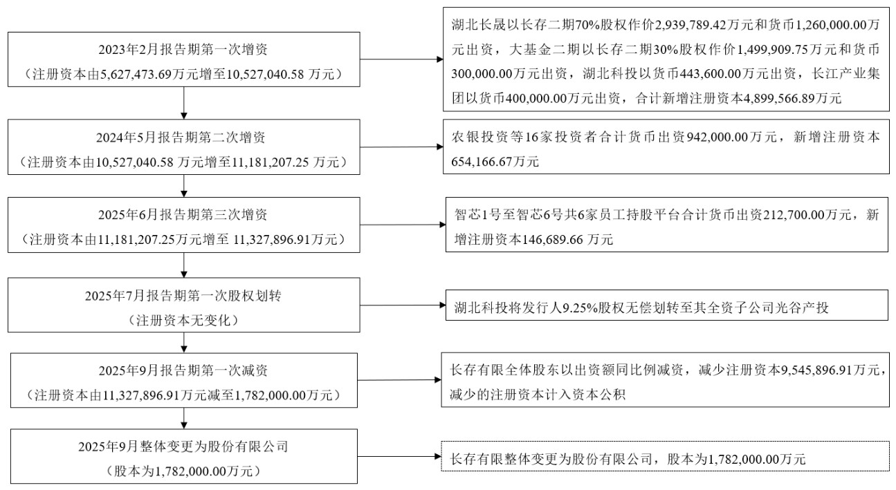 
1-1-32

---

<!-- 原文第 34 页 -->

长江存储控股股份有限公司 
招股说明书 
报告期初(2023年1月1日),公司股权结构如下: 
单位:万元 

| 序号 | 出资人 | 出资额 | 出资比例 | 出资方式 |
| --- | --- | --- | --- | --- |
| 1 | 芯飞科技 | 2,872,052.63 | 51.04% | 货币 |
| 2 | 大基金一期 | 1,355,842.11 | 24.09% | 股权、货币 |
| 3 | 湖北科投 | 730,792.09 | 12.99% | 股权、货币 |
| 4 | 国芯基金 | 668,786.86 | 11.88% | 股权、货币 |
| 合计 | | 5,627,473.69 | 100.00% | |
 
2023年2月增资后,公司股权结构如下: 
单位:万元 

| 序号 | 出资人 | 出资额 | 出资比例 | 出资方式 |
| --- | --- | --- | --- | --- |
| 1 | 湖北长晟 | 3,006,904.81 | 28.56% | 股权、货币 |
| 2 | 芯飞科技 | 2,872,052.63 | 27.28% | 货币 |
| 3 | 大基金一期 | 1,355,842.11 | 12.88% | 股权、货币 |
| 4 | 大基金二期 | 1,288,673.49 | 12.24% | 股权、货币 |
| 5 | 湖北科投 | 1,048,394.44 | 9.96% | 股权、货币 |
| 6 | 国芯基金 | 668,786.86 | 6.35% | 股权、货币 |
| 7 | 长江产业集团 | 286,386.25 | 2.72% | 货币 |
| 合计 | | 10,527,040.58 | 100.00% | |
 
2024年5月增资后,公司股权结构如下: 
单位:万元 

| 序号 | 出资人 | 出资额 | 出资比例 | 出资方式 |
| --- | --- | --- | --- | --- |
| 1 | 湖北长晟 | 3,006,904.81 | 26.89% | 股权、货币 |
| 2 | 芯飞科技 | 2,872,052.63 | 25.69% | 货币 |
| 3 | 大基金一期 | 1,355,842.11 | 12.13% | 股权、货币 |
| 4 | 大基金二期 | 1,288,673.49 | 11.53% | 股权、货币 |
| 5 | 湖北科投 | 1,048,394.44 | 9.38% | 股权、货币 |
| 6 | 国芯基金 | 668,786.86 | 5.98% | 股权、货币 |
| 7 | 长江产业集团 | 286,386.25 | 2.56% | 货币 |
| 8 | 闻名投资 | 111,111.11 | 0.99% | 货币 |
| 9 | 农银投资 | 69,444.44 | 0.62% | 货币 |
| 10 | 建信投资 | 69,444.44 | 0.62% | 货币 |
| 11 | 交银投资 | 69,444.44 | 0.62% | 货币 |
 
1-1-33

---

<!-- 原文第 35 页 -->

长江存储控股股份有限公司 
招股说明书 

| 序号 | 出资人 | 出资额 | 出资比例 | 出资方式 |
| --- | --- | --- | --- | --- |
| 12 | 中银资产1号 | 69,444.44 | 0.62% | 货币 |
| 13 | 工融基金 | 69,444.44 | 0.62% | 货币 |
| 14 | 华恒二号 | 34,722.22 | 0.31% | 货币 |
| 15 | 炬达二号 | 27,777.78 | 0.25% | 货币 |
| 16 | 恒盛投资 | 22,916.67 | 0.20% | 货币 |
| 17 | 上海国资 | 20,833.33 | 0.19% | 货币 |
| 18 | 招赢成长 | 20,833.33 | 0.19% | 货币 |
| 19 | 融媒体基金 | 17,361.11 | 0.16% | 货币 |
| 20 | 允泰九号 | 15,972.22 | 0.14% | 货币 |
| 21 | 中网投 | 13,888.89 | 0.12% | 货币 |
| 22 | 辰途华能 | 12,847.22 | 0.11% | 货币 |
| 23 | 华恒一号 | 8,680.56 | 0.08% | 货币 |
| 合计 | | 11,181,207.25 | 100.00% | |
 
2025年6月增资后,公司股权结构如下: 
单位:万元 

| 序号 | 出资人 | 出资额 | 出资比例 | 出资方式 |
| --- | --- | --- | --- | --- |
| 1 | 湖北长晟 | 3,006,904.81 | 26.54% | 股权、货币 |
| 2 | 芯飞科技 | 2,872,052.63 | 25.35% | 货币 |
| 3 | 大基金一期 | 1,355,842.11 | 11.97% | 股权、货币 |
| 4 | 大基金二期 | 1,288,673.49 | 11.38% | 股权、货币 |
| 5 | 湖北科投 | 1,048,394.44 | 9.25% | 股权、货币 |
| 6 | 国芯基金 | 668,786.86 | 5.90% | 股权、货币 |
| 7 | 长江产业集团 | 286,386.25 | 2.53% | 货币 |
| 8 | 闻名投资 | 111,111.11 | 0.98% | 货币 |
| 9 | 农银投资 | 69,444.44 | 0.61% | 货币 |
| 10 | 建信投资 | 69,444.44 | 0.61% | 货币 |
| 11 | 交银投资 | 69,444.44 | 0.61% | 货币 |
| 12 | 中银资产1号 | 69.444.44 | 0.61% | 货币 |
| 13 | 工融基金 | 69,444.44 | 0.61% | 货币 |
| 14 | 华恒二号 | 34,722.22 | 0.31% | 货币 |
| 15 | 炬达二号 | 27,777.78 | 0.25% | 货币 |
| 16 | 智芯1号 | 26,000.00 | 0.23% | 货币 |
 
1-1-34

---

<!-- 原文第 36 页 -->

长江存储控股股份有限公司 
招股说明书 
序号 出资人 出资额 出资比例 出资方式
17 智芯2号 24,137.93 0.21% 货币
18 智芯3号 24.137.93 0.21% 货币
19 智芯4号 24,137.93 0.21% 货币
20 智芯5号 24,137.93 0.21% 货币
21 智芯6号 24.137.93 0.21% 货币
22 恒盛投资 22,916.67 0.20% 货币
23 上海国资 20.833.33 0.18% 货币
24 招赢成长 20,833.33 0.18% 货币
25 融媒体基金 17,361.11 0.15% 货币
26 允泰九号 15.972.22 0.14% 货币
27 中网投 13,888.89 0.12% 货币
28 辰途华能 12.847.22 0.11% 货币
29 华恒一号 8,680.56 0.08% 货币
合计 11,327,896.91 100.00% 
2025年7月股权划转后,公司股权结构如下: 
单位:万元 
序号 出资人 出资额 出资比例 出资方式
1 湖北长晟 3.006.904.81 26.54% 股权、货币
2 芯飞科技 2.872,052.63 25.35% 货币
3 大基金一期 1.355.842.11 11.97% 股权、货币
4 大基金二期 1.288,673.49 11.38% 股权、货币
5 光谷产投 1.048.394.44 9.25% 股权、货币
6 国芯基金 668.786.86 5.90% 股权、货币
7 长江产业集团 286,386.25 2.53% 货币
8 闻名投资 111.111.11 0.98% 货币
9 农银投资 69.444.44 0.61% 货币
10 建信投资 69.444.44 0.61% 货币
11 交银投资 69.444.44 0.61% 货币
12 中银资产1号 69,444.44 0.61% 货币
13 工融基金 69.444.44 0.61% 货币
14 华恒二号 34,722.22 0.31% 货币
15 炬达二号 27,777.78 0.25% 货币 
1-1-35

---

<!-- 原文第 37 页 -->

长江存储控股股份有限公司 
招股说明书 

| 序号 | 出资人 | 出资额 | 出资比例 | 出资方式 |
| --- | --- | --- | --- | --- |
| 16 | 智芯1号 | 26,000.00 | 0.23% | 货币 |
| 17 | 智芯2号 | 24,137.93 | 0.21% | 货币 |
| 18 | 智芯3号 | 24,137.93 | 0.21% | 货币 |
| 19 | 智芯4号 | 24,137.93 | 0.21% | 货币 |
| 20 | 智芯5号 | 24,137.93 | 0.21% | 货币 |
| 21 | 智芯6号 | 24,137.93 | 0.21% | 货币 |
| 22 | 恒盛投资 | 22,916.67 | 0.20% | 货币 |
| 23 | 上海国资 | 20,833.33 | 0.18% | 货币 |
| 24 | 招赢成长 | 20,833.33 | 0.18% | 货币 |
| 25 | 融媒体基金 | 17,361.11 | 0.15% | 货币 |
| 26 | 允泰九号 | 15.972.22 | 0.14% | 货币 |
| 27 | 中网投 | 13,888.89 | 0.12% | 货币 |
| 28 | 辰途华能 | 12,847.22 | 0.11% | 货币 |
| 29 | 华恒一号 | 8,680.56 | 0.08% | 货币 |
| 合计 | | 11,327,896.91 | 100.00% | |
 
2025年9月减资后,公司股权结构如下: 
单位:万元 

| 序号 | 出资人 | 出资额 | 出资比例 | 出资方式 |
| --- | --- | --- | --- | --- |
| 1 | 湖北长晟 | 473,018.46 | 26.54% | 股权、货币 |
| 2 | 芯飞科技 | 451,804.76 | 25.35% | 货币 |
| 3 | 大基金一期 | 213,288.54 | 11.97% | 股权、货币 |
| 4 | 大基金二期 | 202.722.20 | 11.38% | 股权、货币 |
| 5 | 光谷产投 | 164,923.72 | 9.25% | 股权、货币 |
| 6 | 国芯基金 | 105,207.37 | 5.90% | 股权、货币 |
| 7 | 长江产业集团 | 45,051.64 | 2.53% | 货币 |
| 8 | 闻名投资 | 17,478.97 | 0.98% | 货币 |
| 9 | 农银投资 | 10,924.36 | 0.61% | 货币 |
| 10 | 建信投资 | 10,924.36 | 0.61% | 货币 |
| 11 | 交银投资 | 10,924.36 | 0.61% | 货币 |
| 12 | 中银资产1号 | 10.924.36 | 0.61% | 货币 |
| 13 | 工融基金 | 10,924.36 | 0.61% | 货币 |
| 14 | 华恒二号 | 5,462.18 | 0.31% | 货币 |
 
1-1-36

---

<!-- 原文第 38 页 -->

长江存储控股股份有限公司 
招股说明书 

| 序号 | 出资人 | 出资额 | 出资比例 | 出资方式 |
| --- | --- | --- | --- | --- |
| 15 | 炬达二号 | 4,369.74 | 0.25% | 货币 |
| 16 | 智芯1号 | 4,090.08 | 0.23% | 货币 |
| 17 | 智芯2号 | 3.797.16 | 0.21% | 货币 |
| 18 | 智芯3号 | 3,797.16 | 0.21% | 货币 |
| 19 | 智芯4号 | 3,797.16 | 0.21% | 货币 |
| 20 | 智芯5号 | 3,797.16 | 0.21% | 货币 |
| 21 | 智芯6号 | 3,797.16 | 0.21% | 货币 |
| 22 | 恒盛投资 | 3,605.04 | 0.20% | 货币 |
| 23 | 上海国资 | 3,277.31 | 0.18% | 货币 |
| 24 | 招赢成长 | 3,277.31 | 0.18% | 货币 |
| 25 | 融媒体基金 | 2.731.09 | 0.15% | 货币 |
| 26 | 允泰九号 | 2,512.60 | 0.14% | 货币 |
| 27 | 中网投 | 2,184.87 | 0.12% | 货币 |
| 28 | 辰途华能 | 2,021.01 | 0.11% | 货币 |
| 29 | 华恒一号 | 1,365.54 | 0.08% | 货币 |
| 合计 | | 1,782,000.00 | 100.00% | |
 
2025年9月整体变更为股份公司,公司股权结构详见本节之"二、发行人 的设立情况"之"(二)股份公司设立"。 
截至本招股说明书签署日,公司股权结构见本节之"十二、发行人股本情 况"之"(一)本次发行前后股本情况"。 
报告期内,公司历次股本和股东变化已履行必要的决策审批程序,符合法律 法规相关规定。 
## 四、发行人成立以来重要事件 
报告期内,公司不存在重大资产重组情况,成立以来的重要事件为长江存储 吸收合并长存二期,具体情况如下: 
## (一)吸收合并背景 
长存二期于2021年12月设立,湖北长晟、大基金二期分别持有其70%、 30%股权。长存二期于2022年12月30日召开股东会,同意长存有限购买湖北 长晟、大基金二期持有的长存二期股权,于2023年2月28日完成工商变更登 
1-1-37

---

<!-- 原文第 39 页 -->

长江存储控股股份有限公司 
招股说明书 
记。本次收购完成后,长存二期成为长存有限的全资子公司。 
为优化管理架构、提高运营效率,长江存储于2023年12月吸收合并长存二 期。长江存储作为吸并方存续经营,长存二期注销。 
## (二)履行的法定程序 
2023年4月28日,长存有限召开第一届董事会第三十三次会议,审议通过 《关于长江存储科技有限责任公司吸收合并长江存储二期科技有限责任公司的 议案》。同日,长江存储召开第一届董事会第五十次会议,审议通过《关于长江 存储科技有限责任公司吸收合并长江存储二期科技有限责任公司的议案》;长存 二期召开第一届董事会第六次会议,审议通过《关于长江存储科技有限责任公司 吸收合并长江存储二期科技有限责任公司的议案》。 
2023年10月24日,长江存储、长存二期作出股东决定,审议通过《关于长 江存储科技有限责任公司吸收合并长江存储二期科技有限责任公司的议案》。同 日,交易各方签署《长江存储科技有限责任公司与长江存储二期科技有限责任公 司之吸收合并协议》。 
2023年10月25日,长江存储、长存二期在武汉晚报刊登《吸收合并公告》。 
2023年12月9日,长江存储、长存二期作出股东决定,审议通过《关于注 销长江存储二期科技有限责任公司的议案》。 
2023年12月22日,武汉市市场监督管理局出具《登记通知书》((武新市 监)登字[2023]第228164号),准予长存二期注销登记。 
2024年5月20日,长江存储就吸收合并事项完成工商变更登记。 
## (三)对公司管理层、控制权、业务发展及经营业绩的影响 
通过本次吸收合并,公司下属存储芯片设计制造相关资产业务整合并入长江 存储,有利于统一协调管理、优化资源配置、降低经营成本。公司管理层、控制 权、业务发展及经营业绩未因本次吸收合并发生其他重大变化。 五、发行人不存在其他证券市场上市及挂牌情况 
截至本招股说明书签署日,公司不存在其他证券市场上市及挂牌情况。 
1-1-38

---

<!-- 原文第 40 页 -->

长江存储控股股份有限公司 
招股说明书 
## 六、发行人的股权结构 
截至本招股说明书签署日,公司股权关系图如下: 
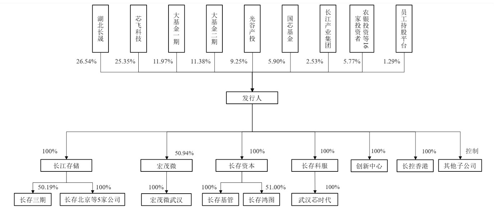 
1-1-39

---

<!-- 原文第 41 页 -->

长江存储控股股份有限公司 
招股说明书 
## 七、发行人子公司、分公司及参股公司情况 
报告期内,公司注销1家控股子公司长存二期和1家控股子公司的分公司长 存科服未来分公司。截至本招股说明书签署日,公司主要全资/控股子公司、参股 公司或合伙企业、分公司情况如下: 
## (一)重要子公司 
截至本招股说明书签署日,长江存储是公司主要的经营主体,对公司的生产、 销售、采购、研发等业务具有重大影响,且最近一年营业收入占公司合并口径数 据超过90%,因此,长江存储为公司的重要子公司。长江存储的具体情况如下: 

| 企业名称 | 长江存储科技有限责任公司 | | |
| --- | --- | --- | --- |
| 成立时间 | 2016.7.26 | | |
| 注册资本 | 12,469,608.0404万元 | | |
| 实收资本 | 12,469,608.0404万元 | | |
| 法定代表人 | 陈南翔 | | |
| 注册地/主要生产经营地 | 武汉东湖新技术开发区未来三路88号 | | |
| 股权结构 | 公司直接持股100.00% | | |
| 主营业务 | 3DNAND闪存设计制造及销售 | | |
| 主要财务数据 (单位:万元) | 项目 | 2026.3.31/2026年1-3月 | 2025.12.31/2025年 |
| 总资产 | 22,548,464.04 | 18,967,137.96 |
| 净资产 | 12,662,746.24 | 8,988,995.60 |
| 营业收入 | 4,821,893.31 | 5,783,507.57 |
| 净利润 | 3,671,044.21 | 1,551,194.02 |
 
注:财务数据为长江存储合并报表数据,上表数据已经审计 
1-1-40

---

<!-- 原文第 42 页 -->

长江存储控股股份有限公司 
招股说明书 
其他子公司 

| 序 号 | 名称 | 股权结构 | 注册资本/股本总额 | 成立时间 | 主营业务 |
| --- | --- | --- | --- | --- | --- |
| 1 | 长存上海 | 长江存储持股100.00% | 50,000.00万元 | 2019.4.23 | 集成电路及相关产品的设计、研发及销售 |
| 2 | 长存北京 | 长江存储持股100.00% | 5,000.00万元 | 2019.8.8 | 集成电路及相关产品的设计、研发及销售 |
| 3 | 长存三期 | 长江存储持股50.19%,湖北长晟三期投资发 展有限责任公司持股49.81% | 2,072,000.00万元 | 2025.9.5 | 集成电路及相关产品的制造、研发及销售 |
| 4 | 长控香港 | 公司直接持股100.00% | 3,000.00万美元 | 2026.5.4 | 产品销售 |
| 5 | 长存香港 | 长江存储持股100.00% | 5,000.00万美元 | 2020.2.25 | 产品销售 |
| 6 | 长存日本 | 长江存储持股100.00% | 10,000.00万日元 | 2017.10.13 | 销售支持 |
| 7 | 长存美国 | 长江存储持股100.00% | 5,000.00万美元 | 2016.10.18 | 销售支持 |
| 8 | 长存科服 | 公司直接持股100.00% | 145,000.00万元 | 2017.10.16 | 物业园区管理 |
| 9 | 武汉芯时代 | 长存科服持股100.00% | 500.00万元 | 2022.8.10 | 园区生活服务 |
| 10 | 长存资本 | 公司直接持股100.00% | 80,750.00万元 | 2022.11.11 | 产业投资 |
| 11 | 长存基管 | 长存资本持股100.00% | 2,000.00万元 | 2023.5.8 | 产业投资 |
| 12 | 长存鸿图 | 长存资本持股51.00%,长存基管直接持股 0.50%、担任执行事务合伙人 | 50,000.00万元 | 2025.9.22 | 产业投资 |
| 13 | 创新中心 | 公司直接持股100.00% | 31,500.00万元 | 2018.12.26 | 新型存储器相关技术及产品研发 |
| 14 | 宏茂微 | 公司直接持股50.94%,其他股东合计持股 49.06% | 246.884.36万元 | 2002.6.7 | 半导体芯片封测 |
| 15 | 宏茂微武汉 | 宏茂微持股100.00% | 20,000.00万元 | 2025.3.26 | 半导体芯片封测 |
 
1-1-41

---

<!-- 原文第 43 页 -->

长江存储控股股份有限公司 招股说明书 
参股公司 

| 序号 | 名称 | 股权结构 | 认缴出资额 | 成立时间 | 主营业务 |
| --- | --- | --- | --- | --- | --- |
| 1 | 武汉新芯 | 公司直接持股29.19% | 847,900.64万元 | 2006.4.21 | 半导体特色工艺晶圆代工企业,聚焦于 特色存储、数模混合和三维集成等业务 领域 |
| 2 | 长存产业基金 | 长存资本直接持股11.26%,并通过长存基管间接 持股0.93%;长存基管为其执行事务合伙人 | 204,300.00万元 | 2023.8.15 | 私募股权投资基金管理 |
 
(四)分支机构 

| 序号 | 名称 | 成立时间 | 主营业务 |
| --- | --- | --- | --- |
| 1 | 长江存储深圳分公司 | 2022.8.19 | 集成电路及相关产品的设计、研发及销售 |
| 2 | 长江存储上海分公司 | 2016.11.18 | 集成电路及相关产品的设计、研发及销售 |
 
1-1-42

---

<!-- 原文第 44 页 -->

| 企业名称 湖北长晟发展有限责任公司 | | | |
| --- | --- | --- | --- |
| 成立日期 | 2021.12.4 | | |
| 注册资本 | 4.200,000.00万元 | | |
| 实收资本 | 3.384,400.00万元 | | |
| 注册地 | 湖北省武汉市东湖新技术开发区九峰街道高新大道770号光谷科技大厦A栋 10层1016号 | | |
| 主营业务 | 股权投资 | | |
| 持股比例 | 26.54% | | |
| 股权结构 | 出资人 | 出资额(万元) | 出资比例 |

---

<!-- 原文第 45 页 -->

长江存储控股股份有限公司 
招股说明书 

| 湖北集成电路基金 | 1,680,000.00 | 40.00% |
| --- | --- | --- |
| 光谷金控 | 1,680,000.00 | 40.00% |
| 长江产业集团 | 840,000.00 | 20.00% |
| 合计 | 4.200,000.00 | 100.00% |
 
## 2、芯飞科技 

| 企业名称 武汉芯飞科技投资有限公司 | | | |
| --- | --- | --- | --- |
| 成立日期 | 2016.11.30 | | |
| 注册资本 | 2,872,052.63万元 | | |
| 实收资本 | 2,872,052.63万元 | | |
| 注册地 | 武汉市东湖新技术开发区高新四路18号新芯生产线厂房及配套设施2幢OS6 号 | | |
| 主营业务 | 集成电路科技产业投资 | | |
| 持股比例 | 25.35% | | |
| 股权结构 | 出资人 | 出资额(万元) | 出资比例 |
| 芯腾科技 | 2,872,052.63 | 100.00% |
| 合计 | 2.872,052.63 | 100.00% |
 
## 3、大基金一期 

| 企业名称 国家集成电路产业投资基金股份有限公司 | | | |
| --- | --- | --- | --- |
| 成立日期 | 2014.9.26 | | |
| 注册资本 | 8,072,000.00万元 | | |
| 实收资本 | 8,072,000.00万元 | | |
| 注册地 | 北京市北京经济技术开发区景园北街2号52幢7层718室 | | |
| 主营业务 | 集成电路产业相关投资业务 | | |
| 持股比例 | 11.97% | | |
| 基金管理人 | 华芯投资管理有限责任公司 | | |
| 股权结构 | 出资人 出资额(万元) 出资比例 | | |
| 财政部 | 2,943,598.06 | 36.47% |
| 国开金融有限责任公司 | 1,798,865.48 | 22.29% |
| 中国烟草总公司 | 899,432.74 | 11.14% |
| 北京亦庄国际投资发展有限公司 | 817,666.13 | 10.13% |
| 上海国盛(集团)有限公司 | 408,833.06 | 5.06% |
| 中国移动通信集团有限公司 | 408,833.06 | 5.06% |
| 武汉金控 | 408,833.06 | 5.06% |
 
1-1-44

---

<!-- 原文第 46 页 -->

长江存储控股股份有限公司 
招股说明书 
其他持股5%以下股东合计 385,938.41 4.79%
合计 8,072,000.00 100.00% 
## 4、大基金二期 
企业名称 国家集成电路产业投资基金二期股份有限公司
成立日期 2019.10.22
注册资本 20,415,000.00万元
实收资本 20,039,270.10万元
注册地 北京市北京经济技术开发区景园北街2号52幢7层701-6
主营业务 集成电路产业相关投资业务
持股比例 11.38%
基金管理人 华芯投资管理有限责任公司
出资人 出资额(万 元) 出资比例
财政部 2.250,000.00 11.02%
国开金融有限责任公司 2.200.000.00 10.78%
成都天府国集投资有限公司 1.500,000.00 7.35%
上海国盛(集团)有限公司 1.500.000.00 7.35%
股权结构 光谷金控 1,500,000.00 7.35%
浙江富浙集成电路产业发展有限公司 1.500,000.00 7.35%
中国烟草总公司 1.500.000.00 7.35%
重庆战略性新兴产业股权投资基金合伙 企业(有限合伙) 1,400,000.00 6.86%
其他持股5%以下股东合计 7.065.000.00 34.60%
合计 20,415,000.00 100.00% 
## 5、光谷产投 
企业名称 武汉光谷产业投资有限公司
成立日期 2016.5.25
注册资本 1,300,000.00万元
实收资本 1,000,000.00万元
注册地 武汉市东湖新技术开发区高新大道666号光谷生物城C5栋
主营业务 产业投资业务
持股比例 9.25%
股权结构 出资人 出资额(万元) 出资比例 
1-1-45

---

<!-- 原文第 47 页 -->

长江存储控股股份有限公司 
招股说明书 

| 湖北科投 | 1,300,000.00 | 100.00% |
| --- | --- | --- |
| 合计 | 1.300,000.00 | 100.00% |
 
## 6、国芯基金 

| 企业名称 | 湖北国芯产业投资基金合伙企业(有限合伙) | | |
| --- | --- | --- | --- |
| 成立日期 | 2016.5.5 | | |
| 认缴出资额 | 669,000.00万元 | | |
| 注册地 | 武汉东湖新技术开发区光谷三路777号武汉光谷保税国际交流中心311 | | |
| 主营业务 | 股权投资业务 | | |
| 持股比例 | 5.90% | | |
| 基金管理人 | 湖北国芯产业投资管理有限责任公司 | | |
| 出资人构成 | 出资人 | 出资额(万元) | 出资比例 |
| 湖北国芯产业投资管理有限责任公司 | 100.00 | 0.01% |
| 湖北集成电路基金 | 617,420.80 | 92.29% |
| 武汉金控 | 30,000.00 | 4.48% |
| 武汉产业发展基金有限公司 | 21,479.20 | 3.21% |
| 合计 | 669,000.00 | 100.00% |
 
## 九、发行人不存在特别表决权股份或类似安排情况 
截至本招股说明书签署日,公司不存在特别表决权股份或类似安排情况。 十、发行人不存在协议控制架构情况 
截至本招股说明书签署日,公司不存在协议控制架构情况。 十一、控股股东、实际控制人报告期内不存在重大违法行为 
报告期内,公司不存在控股股东、实际控制人。持有公司5%以上股份或表 决权的股东不存在贪污、贿赂、侵占财产、挪用财产或者破坏社会主义市场经济 秩序的刑事犯罪,不存在欺诈发行、重大信息披露违法或者其他涉及国家安全、 公共安全、生态安全、生产安全、公众健康安全等领域的重大违法行为。 
## 十二、发行人股本情况 
## (一)本次发行前后股本情况 
本次发行前,公司总股本为1,782,000.00万股,本次拟公开发行股份不低于 
1-1-46

---

<!-- 原文第 48 页 -->

长江存储控股股份有限公司 
招股说明书 
198,000.00万股且不超过243,000.00万股(行使超额配售选择权之前),不低于 本次发行后总股本的10%且不超过12%。本次发行全部为新股发行,原股东不公 开发售股份。若本次公司公开发行198,000.00万股,发行前后公司股权结构如下: 
单位:万股 

| 序号 | 股东 | 发行前 | | 发行后 | |
| --- | --- | --- | --- | --- | --- |
| 持股数量 | 持股比例 | 持股数量 | 持股比例 |
| 1 | 湖北长晟 | 473,018.46 | 26.54% | 473,018.46 | 23.89% |
| 2 | 芯飞科技 | 451,804.76 | 25.35% | 451,804.76 | 22.82% |
| 3 | 大基金一期 | 213,288.54 | 11.97% | 213,288.54 | 10.77% |
| 4 | 大基金二期 | 202.722.20 | 11.38% | 202.722.20 | 10.24% |
| 5 | 光谷产投 | 164,923.72 | 9.25% | 164,923.72 | 8.33% |
| 6 | 国芯基金 | 105.207.37 | 5.90% | 105.207.37 | 5.31% |
| 7 | 长江产业集团 | 45,051.64 | 2.53% | 45.051.64 | 2.28% |
| 8 | 闻名投资 | 17.478.97 | 0.98% | 17.478.97 | 0.88% |
| 9 | 农银投资 | 10.924.36 | 0.61% | 10,924.36 | 0.55% |
| 10 | 建信投资 | 10.924.36 | 0.61% | 10.924.36 | 0.55% |
| 11 | 交银投资 | 10.924.36 | 0.61% | 10,924.36 | 0.55% |
| 12 | 中银资产1号 | 10,924.36 | 0.61% | 10,924.36 | 0.55% |
| 13 | 工融基金 | 10,924.36 | 0.61% | 10,924.36 | 0.55% |
| 14 | 华恒二号 | 5.462.18 | 0.31% | 5.462.18 | 0.28% |
| 15 | 炬达二号 | 4,369.74 | 0.25% | 4.369.74 | 0.22% |
| 16 | 智芯1号 | 4,090.08 | 0.23% | 4,090.08 | 0.21% |
| 17 | 智芯2号 | 3,797.16 | 0.21% | 3,797.16 | 0.19% |
| 18 | 智芯3号 | 3.797.16 | 0.21% | 3,797.16 | 0.19% |
| 19 | 智芯4号 | 3,797.16 | 0.21% | 3,797.16 | 0.19% |
| 20 | 智芯5号 | 3,797.16 | 0.21% | 3,797.16 | 0.19% |
| 21 | 智芯6号 | 3,797.16 | 0.21% | 3,797.16 | 0.19% |
| 22 | 恒盛投资 | 3.605.04 | 0.20% | 3.605.04 | 0.18% |
| 23 | 上海国资 | 3.277.31 | 0.18% | 3.277.31 | 0.17% |
| 24 | 招赢成长 | 3,277.31 | 0.18% | 3,277.31 | 0.17% |
| 25 | 融媒体基金 | 2,731.09 | 0.15% | 2,731.09 | 0.14% |
| 26 | 允泰九号 | 2,512.60 | 0.14% | 2,512.60 | 0.13% |
| 27 | 中网投 | 2,184.87 | 0.12% | 2,184.87 | 0.11% |
 
1-1-47

---

<!-- 原文第 49 页 -->

长江存储控股股份有限公司 
招股说明书 

| 序号 | 股东 | 发行前 | | 发行后 | |
| --- | --- | --- | --- | --- | --- |
| 持股数量 | 持股比例 | 持股数量 | 持股比例 |
| 28 | 辰途华能 | 2,021.01 | 0.11% | 2,021.01 | 0.10% |
| 29 | 华恒一号 | 1,365.54 | 0.08% | 1,365.54 | 0.07% |
| 30 | 本次发行股份 | | | 198,000.00 | 10.00% |
| 合计 | | 1,782,000.00 | 100.00% | 1,980,000.00 | 100.00% |
 
## (二)本次发行前的前十名股东持股情况 
单位:万股 

| 序号 | 股东 | 持股数量 | 持股比例 |
| --- | --- | --- | --- |
| 1 | 湖北长晟 | 473,018.46 | 26.54% |
| 2 | 芯飞科技 | 451,804.76 | 25.35% |
| 3 | 大基金一期 | 213,288.54 | 11.97% |
| 4 | 大基金二期 | 202.722.20 | 11.38% |
| 5 | 光谷产投 | 164,923.72 | 9.25% |
| 6 | 国芯基金 | 105,207.37 | 5.90% |
| 7 | 长江产业集团 | 45,051.64 | 2.53% |
| 8 | 闻名投资 | 17,478.97 | 0.98% |
| 9 | 农银投资 | 10,924.36 | 0.61% |
| 10 | 建信投资 | 10.924.36 | 0.61% |
| 11 | 交银投资 | 10,924.36 | 0.61% |
| 12 | 中银资产1号 | 10.924.36 | 0.61% |
| 13 | 工融基金 | 10,924.36 | 0.61% |
| 合计 | | 1,728,117.46 | 96.95% |
 
## (三)前十名自然人股东及其在发行人担任的职务 
截至本招股说明书签署日,公司不存在直接持股的自然人股东。 
## (四)发行人股份中国有股份及外资股份情况 
根据东湖高新区管委会于2026年6月22日出具的《关于长江存储控股股份 有限公司国有股东标识界定的批复》,相关股东国有标识情况如下 
单位:万股 

| 序号 | 股东 | 持股数量 | 持股比例 | 国有股东标识 |
| --- | --- | --- | --- | --- |
| 1 | 湖北长晟 | 473,018.46 | 26.54% | SS |
 
1-1-48

---

<!-- 原文第 50 页 -->

长江存储控股股份有限公司 
招股说明书 

| 序号 | 股东 | 持股数量 | 持股比例 | 国有股东标识 |
| --- | --- | --- | --- | --- |
| 2 | 芯飞科技 | 451.804.76 | 25.35% | SS |
| 3 | 大基金一期 | 213,288.54 | 11.97% | SS |
| 4 | 大基金二期 | 202,722.20 | 11.38% | SS |
| 5 | 光谷产投 | 164,923.72 | 9.25% | SS |
| 6 | 长江产业集团 | 45,051.64 | 2.53% | SS |
| 7 | 交银投资 | 10,924.36 | 0.61% | SS |
| 8 | 农银投资 | 10,924.36 | 0.61% | SS |
| 9 | 中银资产 | 10,924.36 | 0.61% | SS |
| 10 | 建信投资 | 10,924.36 | 0.61% | SS |
| 11 | 上海国资 | 3,277.31 | 0.18% | SS |
 
截至本招股说明书签署日,公司不存在直接持股的外资股东。 
## (五)申报前十二个月新增股东情况 
公司不存在申报前12个月内新增股东情况。 
(六)本次发行前各股东间的关联关系及关联股东的各自持股比例 

| 序号 | 股东 | 持股比例 | 主要关联关系 |
| --- | --- | --- | --- |
| 1 | 湖北长晟 | 26.54% | 光谷金控直接持有湖北长晟40%的股权,光谷金 控、光谷产投同为湖北科投控制的企业; 湖北集成电路基金直接持有湖北长晟40.00%股 权,国芯基金为湖北集成电路基金控制的企业; 长江产业集团直接持有湖北长晟20.00%股权。 |
| 光谷产投 | 9.25% |
| 国芯基金 | 5.90% |
| 长江产业集团 | 2.53% |
| | 芯飞科技 | 25.35% | 光谷产投控制的武汉创芯谷科技投资有限公司及 其一致行动人武汉芯展二号股权投资基金合伙企 业(有限合伙)间接持有芯飞科技50.76%的股权。 |
| 2 | 光谷产投 | 9.25% |
| 3 | 芯飞科技 | 25.35% | 大基金一期间接持有芯飞科技49.24%股权。 |
| 大基金一期 | 11.97% |
| 4 | 大基金一期 | 11.97% | 大基金一期、大基金二期基金管理人同为华芯投 资管理有限责任公司。 |
| 大基金二期 | 11.38% |
| 5 | 大基金一期 | 11.97% | 武汉金控直接持有大基金一期5.06%股份,国芯 基金为武汉金控控制的企业。 |
| 国芯基金 | 5.90% |
| 6 | 大基金二期 | 11.38% | 光谷金控直接持有大基金二期7.35%股份; 光谷金控直接持有湖北长晟40%的股权。 |
| 湖北长晟 | 26.54% |
| 7 | 华恒二号 | 0.31% | 华恒二号、辰途华能、华恒一号执行事务合伙人、 |
 
1-1-49

---

<!-- 原文第 51 页 -->

长江存储控股股份有限公司 
招股说明书 
序号 股东 持股比例 主要关联关系
华恒一号 辰途华能 0.11% 0.08% 基金管理人同为广州谢诺辰途股权投资管理有限 公司。
智芯1号 0.23%
智芯2号 0.21%
智芯3号 0.21% 智芯1号、智芯2号、智芯3号、智芯4号、智
8 芯5号、智芯6号执行事务合伙人同为武汉众智
智芯4号 0.21% 芯存科技有限公司。
智芯5号 0.21%
智芯6号 0.21% 
除上述关联关系外,本次发行前各股东之间不存在其他主要关联关系。 
## (七)现有股东的私募投资基金备案情况 
截至本招股说明书签署日,公司共29名股东,均为机构股东。其中13名股 东为私募基金,均已按照《私募投资基金监督管理暂行办法》《私募投资基金登 记备案办法》等规定进行登记或备案,具体如下: 
序号 名称 备案号 基金管理人 管理人登记编号
1 大基金一期 SD5797
2 大基金二期 SJU890 华芯投资管理有限责任公司 P1009674
3 国芯基金 ST8539 湖北国芯产业投资管理有限责任公司 P1062935
4 闻名投资 SOR646 北京闻名投资基金管理有限公司 P1060770
5 工融基金 SXL680 工银资本管理有限公司 P1069650
6 华恒二号 SAGE60
7 辰途华能 SADU04 广州谢诺辰途股权投资管理有限公司 P1014565
8 华恒一号 SAGC73
9 恒盛投资 SAGV24 北京恒盛融通投资管理有限公司 P1067379
10 招赢成长 SAGN27 招银国际资本管理(深圳)有限公司 P1009831
11 融媒体基金 STW537 海通创意私募基金管理有限公司 PT1900001700
12 允泰九号 SAGH05 北京允泰投资管理有限公司 P1067079
13 中网投 SS8838 中国互联网投资基金管理有限公司 P1060330 
公司其他16名股东不存在以非公开方式向合格投资者募集资金设立情形, 未委托私募基金管理人管理其资产,亦未受托管理私募投资基金资产,不属于《私 募投资基金监督管理暂行办法》《私募投资基金登记备案办法》所规范的私募投 
1-1-50

---

<!-- 原文第 52 页 -->

长江存储控股股份有限公司 
招股说明书 
资基金或私募基金管理人,无需按照相关规定履行私募投资基金备案或私募基金 管理人登记程序。 
## (八)发行人特殊股东情况 
截至本招股说明书签署日,公司直接股东中银资产1号所持股权比例为 0.61%,中银资产1号基本情况如下: 

| 项目 | 基本情况 |
| --- | --- |
| 中银资产计划名称 | 中银资产一长存1号债转股投资计划 |
| 类型 | 私募封闭式权益类资产管理产品 |
| 运作方式 | 封闭式 |
| 规模 | 不超过100,000.00万元 |
| 存续期 | 自投资计划设立之日起预计存续85个月 |
| 委托人 | 中银投资 |
| 管理人 | 中银投资 |
| 托管人 | 中国银行股份有限公司北京市分行 |
| 产品登记编码 | D2004323000001 |
 
中银投资通过中银资产1号所持公司的股份比例较低,不属于主要股东。中 银资产1号依法设立并有效存续,已纳入国家金融监管部门监管,并已按照规定 履行登记程序,中银投资作为管理人已依法注册登记。 
公司董事、高级管理人员及其近亲属,本次发行的中介机构及其经办人员未 直接或间接在上述投资计划中持有权益:中银资产1号的资金均来自于中银投资 的自有资金,已作出合理存续期安排,符合现行锁定期和减持规则要求,对公司 持续经营不构成重大不利影响。 
## (九)发行人本次公开发行不存在股东公开发售股份的情况 
公司本次公开发行不存在股东公开发售股份情况。 
## 十三、发行人不存在股东特殊权利安排及终止情况 
截至本招股说明书签署日,公司不存在股东特殊权利安排。 
1-1-51

---

<!-- 原文第 53 页 -->

长江存储控股股份有限公司 
招股说明书 
十四、董事、监事、高级管理人员及核心技术人员情况 
## (一)董事、审计委员会、高级管理人员及核心技术人员概况 
## 1、董事会成员 
截至本招股说明书签署日,公司董事会成员15名,其中职工代表董事1名、 独立董事5名,具体如下: 

| 序号 | 姓名 | 职位 | 提名人 | 本届任职期间 |
| --- | --- | --- | --- | --- |
| 1 | 陈南翔 | 董事长 | 股东 | 2025.9-2028.9 |
| 2 | 秦军 | 董事 | 股东 | 2025.9-2028.9 |
| 3 | 韦俊 | 董事 | 股东 | 2025.9-2028.9 |
| 4 | 杨鲁闽 | 董事 | 股东 | 2025.9-2028.9 |
| 5 | 胡晓云 | 董事 | 股东 | 2025.9-2028.9 |
| 6 | 张加强 | 董事 | 股东 | 2025.9-2028.9 |
| 7 | 程驰光 | 董事 | 股东 | 2025.9-2028.9 |
| 8 | 金波涛 | 董事 | 股东 | 2025.9-2028.9 |
| 9 | 吴家伟 | 董事 | 股东 | 2025.9-2028.9 |
| 10 | 李刚 | 职工代表董事 | 职工代表大会 | 2026.8-2028.9 |
| 11 | 缪向水 | 独立董事 | 董事会 | 2026.8-2028.9 |
| 12 | 王永海 | 独立董事 | 董事会 | 2026.8-2028.9 |
| 13 | 谭崇钧 | 独立董事 | 董事会 | 2026.8-2028.9 |
| 14 | 王玥 | 独立董事 | 董事会 | 2026.8-2028.9 |
| 15 | 王润声 | 独立董事 | 董事会 | 2026.8-2028.9 |
 
各位董事简历如下: 
## (1)陈南翔 
陈南翔先生,1961年出生,中国国籍,拥有中国香港永久居留权,理学博士, 正高级工程师。陈先生曾先后任职于北京大学计算机科学技术系微电子学研究所、 德国Fraunhofer协会集成电路技术研究所洪堡基金会、德国Max-Planck 协会微 结构研究所、美国加州硅谷Supertex,Inc、华润微、紫光集团等公司,现任中国半 导体行业协会理事长、北京大学微纳电子器件与集成技术全国重点实验室学术委 员会委员、宁波东方理工大学校董事会董事等。2021年5月至今历任长江存储 董事长、代理总裁,2021年5月至今历任发行人执行董事、董事长、总裁;陈先 
1-1-52

---

<!-- 原文第 54 页 -->

长江存储控股股份有限公司 
招股说明书 
生现任发行人董事长、总裁。 
## (2)秦军 
秦军先生,1972年出生,中国国籍,无境外永久居留权,管理学硕士,正高 级经济师。秦先生曾任职于武汉东湖开发区发展总公司、武汉高科国有控股集团 有限公司、东湖高新区驻珠三角招商办事处、湖北科投、东湖开发区管理委员会 发改局及金融办、光谷金控以及武汉新芯等。2021年11月至今历任湖北科投党 委副书记、副董事长、总经理、董事长、党委书记、董事;2022年12月至今历 任长江存储董事、党委书记、执行董事;2024年4月至今任湖北长晟董事;2023 年7月至今历任发行人董事、执行董事、党委书记;秦先生现任发行人董事、党 委书记。 
## (3)韦俊 
韦俊先生,1967年出生,中国国籍,无境外永久居留权,无线电技术专业工 学硕士,管理学硕士,工程师。韦先生曾任职于电子工业部、信息产业部、工业 和信息化部。2015年7月至今任大基金一期副总裁:2019年10月至今任大基金 二期副总裁:2025年5月至今任大基金三期副总裁;2022年9月至今,韦先生 任发行人董事。 
## (4)杨鲁闽 
杨鲁闽先生,1979年出生,中国国籍,无境外永久居留权,金融学硕士,高 级经济师。杨先生曾任职于国家开发银行总行、国家开发银行江苏省分行、国开 金融有限责任公司等。2021年9月至今任华芯投资管理有限责任公司董事、党 委副书记、总裁;2021年9月至今任长江存储董事;2021年9月至今,杨先生 任发行人董事。 
## (5)胡晓云 
胡晓云女士,1972年出生,中国国籍,无境外永久居留权,法律硕士,金融 学硕士,高级会计师。胡女士曾任职于国家开发银行总行、国开证券有限责任公 司、国银金融租赁股份有限公司、国家开发银行内蒙古自治区分行。2023年2月 至今任华芯投资管理有限责任公司董事、财务负责人、副总裁;2025年8月至 今任长江存储董事;2025年9月至今,胡女士任发行人董事。 
1-1-53

---

<!-- 原文第 55 页 -->

长江存储控股股份有限公司 
招股说明书 
## (6)张加强 
张加强先生,1979年出生,中国国籍,无境外永久居留权,管理学博士,经 济师。张先生曾任职于武汉科技大学中南分校商学院、长江证券股份有限公司、 长江产业投资私募基金管理有限公司、长江创业投资基金管理有限公司。2023年 7月至今任长江存储董事:2025年3月至今任湖北省长江光电产业投资有限公司 副总经理、董事,以及长江创业投资基金管理有限公司光电子信息投资总监:2023 年7月至今,张先生任发行人董事。 
## (7)程驰光 
程驰光先生,1975年出生,中国国籍,无境外永久居留权,经济学学士。程 先生曾任职于中国人民银行湖北省分行、武汉分行。2018年12月至今历任武汉 金控总经理助理、党委委员、副总经理;2021年4月至今任湖北集成电路基金 董事长:2023年7月至今任长江存储董事:2024年5月至今任大基金一期董事: 2024年8月至今任江城产业投资基金(武汉)有限公司董事长;2026年4月至 今任国芯投资董事长;2023年7月至今,程先生任发行人董事。 
## (8)金波涛 
金波涛先生,1983年出生,中国国籍,无境外永久居留权,会计学硕士。金 先生曾任职于中国人民银行广州分行、美的集团财务有限公司、湖北金融租赁股 份有限公司、武汉金控。2024年8月至今,历任江城产业投资基金(武汉)有限 公司副总经理、总经理、董事;2025年9月至今任湖北长晟三期投资发展有限 责任公司董事、财务负责人;2025年9月至今任长江存储董事;2025年9月至 今,金先生任发行人董事。 
## (9)吴家伟 
吴家伟先生,1981年出生,中国国籍,无境外永久居留权,工学博士,工程 师。吴先生曾任职于武汉未来科技城建设服务中心、武汉东湖新技术开发区管理 委员会发改局及金融办。2025年7月至今任光谷金控董事长、党委书记;2025 年9月至今任华源证券股份有限公司董事:2025年11月至今任湖北长晟董事长; 2026年1月至今任大基金二期董事;2026年4月至今任武汉农村商业银行股份 有限公司董事;2025年9月至今,吴先生任发行人董事。 
1-1-54

---

<!-- 原文第 56 页 -->

长江存储控股股份有限公司 
招股说明书 
## (10)李刚 
李刚先生,1979年出生,中国国籍,无境外永久居留权,工程硕士,经济师。 李先生曾任职于同方股份、紫光集团等。2021年9月至今历任长江存储董事会 秘书、副总裁;2023年7月至今历任发行人董事会秘书、副总裁、职工代表董 事;李先生现任发行人职工代表董事、副总裁、董事会秘书。 
## (11)缪向水 
缪向水先生,1965年出生,中国国籍,无境外永久居留权,工学博士,教授。 缪先生曾任职于华中理工大学(现华中科技大学)、香港城市大学、新加坡国立 大学国家数据存储研究院。2007年3月至今历任华中科技大学集成电路学院博 士生导师、教授、院长;2026年8月至今,缪先生任发行人独立董事。 
## (12)王永海 
王永海先生,1965年出生,中国国籍,无境外永久居留权,经济学博士,教 授。王先生曾任职于武汉大学经济学院、武汉大学商学院。2013年6月至今任 武汉大学经济与管理学院教授:2026年8月至今,王先生任发行人独立董事。 
## (13)谭崇钧 
谭崇钧先生,1970年出生,中国国籍,无境外永久居留权,经济学博士。谭 先生曾任职于财政部财税体制改革司、财政部税政司。2018年4月至今任阿里 研究院副院长;2026年8月至今,谭先生任发行人独立董事。 
## (14)王玥 
王玥先生,1981年出生,中国国籍,无境外永久居留权,工商管理硕士。 2005年11月至今任职于天职国际会计师事务所(特殊普通合伙),现任管理合 伙人:2026年8月至今,王先生任发行人独立董事。 
## (15)王润声 
王润声先生,1983年出生,中国国籍,无境外永久居留权,理学博士,教授。 王先生曾任职于北京大学集成电路学院设计自动化与计算系统系。2010年4月 至今历任北京大学讲师、副教授、教授:2022年4月至今任北京大学信息科学 技术学院副院长;2022年5月至今任北京大学微纳电子器件与集成技术全国重 
1-1-55

---

<!-- 原文第 57 页 -->

长江存储控股股份有限公司 
招股说明书 
点实验室主任;2023年1月至今任无锡北京大学电子设计自动化研究院院长、 负责人;2026年8月至今,王先生现任发行人独立董事。 
## 2、审计委员会 
2026年7月30日,公司召开2026年第二次股东会,审议通过《关于修订 长江存储控股股份有限公司公司章程的议案》,公司不再设置监事会,监事会职 权由董事会审计委员会行使。 
截至本招股说明书签署日,审计委员会成员5名,包括王永海、胡晓云、程 驰光、谭崇钧、王玥,由王永海担任召集人。审计委员会成员的简历详见本招股 说明书"第四节发行人基本情况"之"十四、董事、监事、高级管理人员及核 心技术人员情况"之"(一)董事、审计委员会、高级管理人员及核心技术人员 概况"之"1、董事会成员"。 
## 3、高级管理人员 
根据《公司章程》,公司总裁、高级副总裁、副总裁、财务负责人、董事会 秘书、助理总裁为公司高级管理人员。截至本招股说明书签署日,公司高级管理 人员共10名,具体如下: 

| 序号 | 姓名 | 职位 | 本届任职期间 |
| --- | --- | --- | --- |
| 1 | 陈南翔 | 总裁 | 2025.9-2028.9 |
| 2 | 程卫华 | 高级副总裁 | 2025.9-2028.9 |
| 3 | 陈俊 | 高级副总裁 | 2025.9-2028.9 |
| 4 | 劳伟贤 | 副总裁 | 2026.7-2028.9 |
| 5 | 吴丹 | 副总裁、财务负责人 | 2025.9-2028.9 |
| 6 | 李刚 | 副总裁、董事会秘书 | 2025.9-2028.9 |
| 7 | 付永朝 | 副总裁 | 2025.9-2028.9 |
| 8 | 桂珍若 | 副总裁 | 2025.9-2028.9 |
| 9 | 李璇 | 助理总裁 | 2026.8-2028.9 |
| 10 | 王兴强 | 助理总裁 | 2026.8-2028.9 |
 
公司高级管理人员简历如下: 
## (1)陈南翔 
陈南翔先生,详见本招股说明书"第四节发行人基本情况"之"十四、董 
1-1-56

---

<!-- 原文第 58 页 -->

长江存储控股股份有限公司 
招股说明书 
事、监事、高级管理人员及核心技术人员情况"之"(一)董事、审计委员会、 高级管理人员及核心技术人员概况"之"1、董事会成员"。 
## (2)程卫华 
程卫华先生,1969年出生,新加坡国籍,拥有中国永久居留权,微电子学硕 士。程先生曾任职于中国华晶电子集团公司、新加坡特许半导体制造有限公司、 中芯国际、格罗方德、武汉新芯。2017年1月至今历任长江存储首席技术官、执 行副总裁、首席运营官;2020年8月至今历任宏茂微董事、董事长;2023年7 月至今,程先生任发行人高级副总裁。 
## (3)陈俊 
陈俊先生,1979年出生,中国国籍,无境外永久居留权,电子与信息学博士, 正高级工程师。陈先生曾任职于武汉新芯。2017年3月至今历任长江存储研发 中心资深总监、制造工程中心总经理、执行副总裁;2023年7月至今,陈先生任 发行人高级副总裁。 
## (4)劳伟贤 
劳伟贤先生,1966年出生,无其他境外永久居留权,工商管理硕士,理学硕 士。劳先生曾任职于东芝电子亚洲有限公司、东芝电子(深圳)有限公司、东芝 (中国)有限公司、铠侠电子(中国)有限公司、芯智国际有限公司。2023年3 月至今历任长江存储市场销售中心总经理、副总裁;2026年7月至今,劳先生 任发行人副总裁。 
## (5)吴丹 
吴丹女士,1973年出生,中国国籍,拥有中国香港永久居留权,工商管理硕 士,ACCA。吴女士曾任职于中国建设银行股份有限公司珠海分行、中国平安保 险(集团)股份有限公司、华润股份有限公司、广东华润银行股份有限公司、华 夏健康股份有限公司、华夏幸福基业股份有限公司等;2023年9月至今任长江 存储财务负责人:2024年4月至今任宏茂微监事;2026年7月至今任武汉新芯 董事:2023年9月至今,吴女士任发行人副总裁、财务负责人。 
## (6)李刚 
1-1-57

---

<!-- 原文第 59 页 -->

长江存储控股股份有限公司 
招股说明书 
李刚先生,详见本招股说明书"第四节发行人基本情况"之"十四、董事、 监事、高级管理人员及核心技术人员情况"之"(一)董事、审计委员会、高级 管理人员及核心技术人员概况"之"1、董事会成员"。 
## (7)付永朝 
付永朝先生,1978年出生,中国国籍,无境外永久居留权,工商管理硕士, 工学硕士,正高级工程师。付先生曾任职于英飞凌科技(西安)有限公司、奇梦 达科技(西安)有限公司、西安紫光国芯半导体有限公司。2018年8月至今历任 宏茂微总经理、董事;2023年7月至今,付先生任发行人副总裁。 
## (8)桂珍若 
桂珍若先生,1967年出生,中国国籍,无境外永久居留权,审计学学士,高 级审计师。桂先生曾任职于审计署驻武汉特派员办事处、武汉新芯。2023年5月 至今历任长江存储审计长、副总裁;2023年5月至今历任发行人审计长、副总 裁;桂先生现任发行人副总裁。 
## (9)李璇 
李璇女士,1980年出生,中国国籍,无境外永久居留权,法学硕士、工商管 理硕士,律师。李女士曾任职于长飞光纤光缆股份有限公司。2019年11月至今 历任长江存储法务与知识产权处总经理等:2026年8月至今,李女士任发行人 助理总裁。 
## (10)王兴强 
王兴强先生,1976年出生,中国国籍,无境外永久居留权,工学硕士、工商 管理硕士。王先生曾任职于UT 斯达康通讯有限公司、安捷伦科技(中国)有限 公司、摩莎科技(上海)有限公司、施耐德电气(中国)有限公司、迈威迩电子 科技(上海)有限公司。2022年11月至今任长江存储系统解决方案负责人;2026 年8月至今,王先生任发行人助理总裁。 
## 4、核心技术人员 
截至本招股说明书签署日,公司核心技术人员11名,具体如下: 
1-1-58

---

<!-- 原文第 60 页 -->

长江存储控股股份有限公司 
招股说明书 

| 序号 | 姓名 | 职务 |
| --- | --- | --- |
| 1 | 程卫华 | 高级副总裁 |
| 2 | 霍宗亮 | 首席科学家、创新研究院院长 |
| 3 | 陈俊 | 高级副总裁 |
| 4 | 王兴强 | 助理总裁 |
| 5 | 周文斌 | 创新研究院技术开发副总经理 |
| 6 | 冯耀斌 | 创新研究院技术开发副总经理 |
| 7 | 侯春源 | 创新研究院IC开发副总经理 |
| 8 | 曹宏 | 创新研究院产品与测试工程副总经理 |
| 9 | 靳磊 | 创新研究院闪存器件副总经理 |
| 10 | 华子群 | 长江存储制造工程中心厂长 |
| 11 | 顾立勋 | 长江存储制造工程中心厂长 |
 
公司核心技术人员简历如下: 
## (1)程卫华 
程卫华先生,详见本招股说明书"第四节发行人基本情况"之"十四、董 事、监事、高级管理人员及核心技术人员情况"之"(一)董事、审计委员会、 高级管理人员及核心技术人员概况"之"3、高级管理人员"。 
## (2)霍宗亮 
霍宗亮先生,1975年出生,中国国籍,无境外永久居留权,微电子学与固体 电子学博士,正高级工程师。霍先生曾任职于韩国三星半导体研发中心、中科院 微电子研究所、武汉新芯。2016年8月至今历任长江存储首席技术官、执行副 总裁、首席科学家;2023年9月至今,霍先生任发行人首席科学家、创新研究院 院长。 
## (3)陈俊 
陈俊先生,详见本招股说明书"第四节发行人基本情况"之"十四、董事、 监事、高级管理人员及核心技术人员情况"之"(一)董事、审计委员会、高级 管理人员及核心技术人员概况"之"3、高级管理人员"。 
## (4)王兴强 
王兴强先生,详见本招股说明书"第四节发行人基本情况"之"十四、董 
1-1-59

---

<!-- 原文第 61 页 -->

长江存储控股股份有限公司 
招股说明书 
事、监事、高级管理人员及核心技术人员情况"之"(一)董事、审计委员会、 高级管理人员及核心技术人员概况"之"3、高级管理人员"。 
## (5)周文斌 
周文斌先生,1979年出生,中国国籍,无境外永久居留权,工学硕士。周先 生曾任职于无锡华润晶芯半导体有限公司、武汉新芯;2017年1月加入发行人, 周先生现任发行人创新研究院技术开发副总经理。 
## (6)冯耀斌 
冯耀斌先生,1981年出生,新加坡国籍,拥有中国永久居留权,工学博士, 正高级工程师。冯先生曾任职于中纬积体电路(宁波)有限公司、上海先进半导 体制造有限公司、United Microelectronics Corporation(Singapore Branch)、Micron Semiconductor Asia Pte.Ltd,、武汉新芯;2017年1月加入发行人,冯先生现任发 行人创新研究院技术开发副总经理。 
## (7)侯春源 
侯春源先生,1973年出生,中国国籍,无境外永久居留权,工学硕士,高级 工程师。侯先生曾任职于上海贝岭股份有限公司、英特尔产品(上海)有限公司、 美光半导体技术(上海)有限公司等;2018年4月加入发行人,侯先生现任发行 人创新研究院IC开发副总经理。 
## (8)曹宏 
曹宏先生,1973年出生,中国国籍,无境外永久居留权,工学学士。曹先生 曾任职于中颖电子股份有限公司、英特尔产品(上海)有限公司、恒亿科技股份 有限公司、晟碟信息科技(上海)有限公司;2018年11月加入发行人,曹先生 现任发行人创新研究院产品与测试工程副总经理。 
## (9)靳磊 
靳磊先生,1980年出生,中国国籍,无境外永久居留权,理学博士,高级工 程师。靳先生曾任职于新加坡思达科技有限公司、中国科学院微电子研究所、武 汉新芯;2016年10月加入发行人,靳先生现任发行人创新研究院闪存器件副总 经理。 
1-1-60

---

<!-- 原文第 62 页 -->

长江存储控股股份有限公司 招股说明书 
## (10)华子群 
华子群先生,1985年出生,新加坡国籍,拥有中国永久居留权,工学学士。 华先生曾任职于Micron Semiconductor Asia Pte.Ltd.:2017年4月加入发行人, 华先生现任发行人长江存储制造工程中心厂长。 
## (11)顾立勋 
顾立勋先生,1985年出生,中国国籍,无境外永久居留权,经济学硕士。顾 先生曾任职于无锡夏普电子元器件有限公司、SK海力士半导体(中国)有限公 司;2017年4月加入发行人,顾先生现任发行人长江存储制造工程中心厂长。 
## (二)董事、高级管理人员及核心技术人员兼职情况 
截至本招股说明书签署日,公司董事、高级管理人员及核心技术人员在其他 单位(除公司及公司控制的企业外)兼职情况如下: 

| 姓名 | 公司职务 | 兼职单位 | 兼任职务 | 兼职单位与公司 的其他关联关系 |
| --- | --- | --- | --- | --- |
| 陈南翔 | 董事长、总裁 | 中国半导体行业协会 | 理事长 | 无 |
| 北京大学微纳电子器件与 集成技术全国重点实验室 | 学术委员会委员 | 无 |
| 宁波东方理工大学 | 校董事会董事 | 无 |
| 秦军 | 董事 | 湖北长晟 | 董事 | 公司股东 |
| 湖北科投 | 董事 | 公司间接股东 |
| 韦俊 | 董事 | 长鑫科技集团股份有限公 司 | 董事 | 无 |
| 上海华力集成电路制造有 限公司 | 董事 | 无 |
| 芯飞科技 | 董事 | 公司股东 |
| 芯腾科技 | 董事 | 公司间接股东 |
| 华虹半导体(无锡)有限 公司 | 董事 | 无 |
| 大基金一期 | 副总裁 | 公司股东 |
| 大基金二期 | 副总裁 | 公司股东 |
| 大基金三期 | 副总裁 | 无 |
| 杨鲁闽 | 董事 | 中芯国际 | 非执行董事 | 无 |
| 华芯投资管理有限责任公 司 | 总裁、董事、党 委副书记 | 公司间接股东 |
| 胡晓云 | 董事 | 芯飞科技 | 董事 | 公司股东 |
| 芯腾科技 | 董事 | 公司间接股东 |
 
1-1-61

---

<!-- 原文第 63 页 -->

长江存储控股股份有限公司 
招股说明书 

| 姓名 | 公司职务 | 兼职单位 | 兼任职务 | 兼职单位与公司 的其他关联关系 |
| --- | --- | --- | --- | --- |
| | | 巽鑫(上海)投资有限公 司 | 执行董事 | 公司股东大基金 一期的下属公司 |
| | 鑫芯(香港)投资有限公 司 | 董事 | 公司股东大基金 期的下属公司 |
| | 华芯投资管理有限责任公 司 | 董事、财务负责 人、副总裁 | 公司间接股东 |
| 张加强 | 董事 | 湖北长晟 | 董事 | 公司股东 |
| 湖北省长江光电产业投资 有限公司 | 副总经理、董事 | 无 |
| 湖北长江长信私募基金管 理有限公司 | 执行董事、总经 理 | 无 |
| 长江创业投资基金管理有 限公司 | 投资总监 | 无 |
| 程驰光 | 董事 | 大基金一期 | 董事 | 公司股东 |
| 江城产业投资基金(武汉) 有限公司 | 董事长 | 无 |
| 湖北集成电路基金 | 董事长 | 公司间接股东 |
| 武汉金控 | 副总经理 | 公司间接股东 |
| 国芯投资 | 董事长 | 公司间接股东 |
| 金波涛 | 董事 | 湖北长晟三期投资发展有 限责任公司 | 董事、财务负责人 | 无 |
| 江城产业投资基金(武汉) 有限公司 | 经理、董事 | 无 |
| 国芯投资 | 董事 | 公司间接股东 |
| 武汉芯海产业投资管理有 限责任公司 | 董事 | 无 |
| 吴家伟 | 董事 | 光谷金控 | 董事长、党委书记 | 公司间接股东 |
| 华源证券股份有限公司 | 董事 | 无 |
| 湖北长晟 | 董事长 | 公司股东 |
| 大基金二期 | 董事 | 公司股东 |
| 武汉农村商业银行股份有 限公司 | 董事 | 无 |
| 李刚 | 职工代表董 事、副总裁、 董事会秘书 | 众智芯存 | 监事 | 公司间接股东 |
| 缪向水 | 独立董事 | 华中科技大学 | 教授、集成电路学 院博士生导师、院 长 | 无 |
| 武汉东湖新技术开发区光 谷集成电路创新平台运营 中心 | 法定代表人 | 无 |
| 王永海 | 独立董事 | 武汉大学 | 教授 | 无 |
 
1-1-62

---

<!-- 原文第 64 页 -->

长江存储控股股份有限公司 
招股说明书 

| 姓名 | 公司职务 | 兼职单位 | 兼任职务 | 兼职单位与公司 的其他关联关系 |
| --- | --- | --- | --- | --- |
| | | 武汉帝尔激光股份有限公 司 | 独立董事 | 无 |
| | | 深圳市则成电子股份有限 公司 | 独立董事 | 无 |
| | | 深圳市坪山区国资局 | 外部董事 | 无 |
| 谭崇钧 | 独立董事 | 阿里研究院 | 副院长 | 无 |
| 王玥 | 独立董事 | 天职国际会计师事务所(特 殊普通合伙) | 管理合伙人 | 无 |
| 王润声 | 独立董事 | 北京大学 | 副院长、微纳电子 器件与集成技术 全国重点实验室 主任 | 无 |
| 无锡北京大学电子设计自 动化研究院 | 院长、负责人 | 无 |
| 北京伦刻电子技术有限公 司 | 董事 | 无 |
| 陈俊 | 高级副总裁 | 众智芯存 | 总经理 | 公司间接股东 |
| 吴丹 | 副总裁、财务 负责人 | 武汉新芯 | 董事 | 公司参股公司 |
| 付永朝 | 副总裁 | 上海宏存初芯企业管理有 限公司 | 执行董事、总经理 | 无 |
| 桂珍若 | 副总裁 | 众智芯存 | 董事、财务负责人 | 公司间接股东 |
 
(三)董事、高级管理人员及核心技术人员之间的亲属关系 
截至本招股说明书签署日,公司董事、高级管理人员及核心技术人员相互之 间不存在亲属关系。 
(四)董事、监事、高级管理人员及核心技术人员合法合规情况 
截至本招股说明书签署日,公司董事、取消监事会前在任监事、高级管理人 员及核心技术人员最近三年不存在被行政处罚、监督管理措施、纪律处分或自律 监管措施、被司法机关立案侦查、被中国证监会立案调查等情况。 
(五)公司与董事、高级管理人员及核心技术人员所签订的对投资者作出价 值判断和投资决策有重大影响的协议 
截至本招股说明书签署日,在公司专职工作并领薪的董事、高级管理人员及 核心技术人员均与公司签署了劳动合同和保密协议。除上述情形外,报告期内, 公司不存在与董事、高级管理人员及核心技术人员签订对投资者作出价值判断和 投资决策有重大影响的协议的情形。 
1-1-63

---

<!-- 原文第 65 页 -->

长江存储控股股份有限公司 
招股说明书 
公司现任董事、高级管理人员及核心技术人员做出的重要承诺详见本招股说 明书"第十二节附件"之"附件一:本次发行相关承诺"。 
(六)董事、高级管理人员及核心技术人员及其近亲属持有公司股份情况 
截至本招股说明书签署日,公司董事、高级管理人员、核心技术人员及其近 亲属不存在直接持有公司股份情况,部分人员通过公司员工持股平台间接持有公 司股份,具体如下: 

| 序号 | 姓名 | 公司职务 | 直接持股 主体 | 对直接出资主 体的出资比例 | 穿透后对公司 持股比例 |
| --- | --- | --- | --- | --- | --- |
| 1 | 陈南翔 | 董事长、总裁 | 智芯1号 | 14.5154% | 0.0333% |
| 2 | 程卫华 | 高级副总裁 | 智芯6号 | 9.1226% | 0.0194% |
| 3 | 陈俊 | 高级副总裁 | 智芯1号 | 10.7038% | 0.0246% |
| 4 | 劳伟贤 | 副总裁 | 智芯6号 | 2.0880% | 0.0044% |
| 5 | 吴丹 | 副总裁、财务负责人 | 智芯1号 | 1.8154% | 0.0042% |
| 6 | 李刚 | 职工代表董事、副总裁、 董事会秘书 | 智芯1号 | 5.2654% | 0.0121% |
| 7 | 桂珍若 | 副总裁 | 智芯1号 | 2.9038% | 0.0067% |
| 8 | 李璇 | 助理总裁 | 智芯7号 | 2.4230% | 0.0031% |
| 9 | 王兴强 | 助理总裁 | 智芯7号 | 2.6190% | 0.0033% |
| 10 | 霍宗亮 | 首席科学家、创新研究院 院长 | 智芯1号 | 11.5846% | 0.0266% |
| 11 | 周文斌 | 创新研究院技术开发副总 经理 | 智芯7号 | 3.3193% | 0.0042% |
| 12 | 冯耀斌 | 创新研究院技术开发副总 经理 | 智芯6号 | 2.8710% | 0.0061% |
| 13 | 侯春源 | 创新研究院IC开发副总 经理 | 智芯7号 | 4.8529% | 0.0061% |
| 14 | 曹宏 | 创新研究院产品与测试工 程副总经理 | 智芯7号 | 4.8529% | 0.0061% |
| 15 | 靳磊 | 创新研究院闪存器件副总 经理 | 智芯7号 | 3.0182% | 0.0038% |
| 16 | 华子群 | 长江存储制造工程中心厂 长 | 智芯6号 | 2.9580% | 0.0063% |
| 17 | 顾立勋 | 长江存储制造工程中心厂 长 | 智芯7号 | 2.5280% | 0.0032% |
 
截至本招股说明书签署日,公司董事、高级管理人员及核心技术人员间接持 有的公司股份不存在质押、冻结或诉讼纠纷情形。 
1-1-64

---

<!-- 原文第 66 页 -->

长江存储控股股份有限公司 
招股说明书 
## (七)董事、监事、高级管理人员及核心技术人员近两年变动情况 
## 1、董事变动情况及原因 

| 时间 | 董事 | 变动说明 |
| --- | --- | --- |
| 2024年1月至 2025年8月 | 陈南翔、杨士宁、秦军、杨鲁闽、 韦俊、彭红兵、张加强、程驰光、 佘志宏、龚学艺 | |
| 2025年8月至 2025年9月 | 陈南翔、杨士宁、秦军、杨鲁闽、 韦俊、胡晓云、张加强、程驰光、 佘志宏、龚学艺 | 大基金二期变更提名董事,由彭红 兵变更为胡晓云 |
| 2025年9月至 2026年7月 | 陈南翔、杨士宁、秦军、杨鲁闽、 韦俊、胡晓云、张加强、程驰光、 金波涛、吴家伟 | 公司成立大会暨第一次股东会选 举陈南翔、杨士宁、秦军、杨鲁闽、 韦俊、胡晓云、张加强、程驰光、 金波涛(湖北长晟提名)、吴家伟 (光谷产投提名)担任长存控股第 一届董事会董事 |
| 2026年7月至 2026年8月 | 陈南翔、秦军、杨鲁闽、韦俊、胡 晓云、张加强、程驰光、金波涛、 吴家伟 | 杨士宁辞去公司董事职务 |
| 2026年8月至今 | 陈南翔、秦军、韦俊、杨鲁闽、胡 晓云、张加强、程驰光、金波涛、 吴家伟、李刚、缪向水、王永海、 谭崇钓、王玥、王润声 | 增选缪向水、王永海、谭崇钧、王 玥、王润声为独立董事,李刚为职 工代表董事 |
 
## 2、监事变动情况及原因 

| 时间 | 监事 | 变动说明 |
| --- | --- | --- |
| 2024年1月至 2024年1月 | 任志安、汤海燕、黄泓崴、董东霞、 袁萍 | |
| 2024年1月至 2024年4月 | 任志安、曾玉梅、黄泓崴、董东霞、 袁萍 | 湖北科投变更提名监事,由汤海燕 变更为曾玉梅 |
| 2024年4月至 2024年8月 | 任志安、曾玉梅、黄泓崴、王继增、 舒磊 | 长存有限第一届职工代表大会第 一次会议选举王继增、舒磊担任职 工代表监事,董东霞、袁萍不再担 任职工代表监事 |
| 2024年8月至 2025年9月 | 任志安、曾玉梅、黄泓崴、舒磊 | 王继增辞任职工代表监事 |
| 2025年9月至 2026年7月 | 任志安、曾玉梅、黄泓崴、董东霞、 舒磊 | 公司第一届职工代表大会第三次 会议选举董东霞、舒磊担任公司第 二 届监事会职工代表监事 公司成立大会暨第一次股东会选 举任志安、曾玉梅、黄泓歲担任公 司第一届监事会非职工代表监事 |
| 2026年7月至今 | 无 | 根据《公司法》及《关于修订长江 存储控股股份有限公司公司章程 的议案》,公司不再设置监事会 |
 
1-1-65

---

<!-- 原文第 67 页 -->

长江存储控股股份有限公司 
招股说明书 
## 3、高管变动情况及原因 
时间 高级管理人员 变动说明
2024年1月至 陈南翔、程卫华、霍宗亮、陈俊、
2024年4月 孙鹏、付永朝、李刚
2024年9月至 2025年4月 2024年4月至 2024年9月 孙鹏、付永朝、李刚、吴丹、桂珍 陈南翔、程卫华、霍宗亮、陈俊、 若 陈南翔、程卫华、霍宗亮、陈俊、 付永朝、李刚、吴丹、桂珍若 裁、财务负责人,聘任桂珍若担任 长存有限第二届董事会第十五次 副总裁,聘任李刚担任副总裁 孙鹏辞任副总裁 会议审议决定聘任吴丹担任副总
2025年4月至 2025年9月 陈南翔、程卫华、陈俊、付永朝、 李刚、吴丹、桂珍若 霍宗亮辞任执行副总裁
公司第一届董事会第一次会议审
议决定聘任陈南翔担任总裁,聘任
2025年9月至 陈南翔、程卫华、陈俊、吴丹、付 程卫华、陈俊担任执行副总裁,聘
2026年7月 永朝、桂珍若、李刚 任吴丹、付永朝、桂珍若、李刚担 任副总裁,聘任吴丹担任财务负责
人,聘任李刚担任董事会秘书
2026年7月至 2026年8月 陈南翔、程卫华、陈俊、吴丹、付 永朝、桂珍若、李刚、劳伟贤 公司第一届董事会第五次会议聘 任劳伟贤为副总裁
2026年8月至 今 陈南翔、程卫华、陈俊、劳伟贤、 吴丹、李刚、付永朝、桂珍若、李 璇、王兴强 公司第一届董事会第八次会议聘 任李璇、王兴强为助理总裁 
## 4、核心技术人员变动情况及原因 
最近两年,公司核心技术人员未发生变动。 
## 5、发行人董事、监事及高级管理人员变动对公司生产经营的影响 
最近两年,公司董事、监事和高级管理人员变动已履行必要的决策程序,变 动主要系股东单位提名委派调整、公司进一步完善治理结构需要以及根据法规的 规定取消监事会等原因所致,不构成重大不利变动,未对生产经营构成重大不利 影响。 
## (八)董事、高级管理人员及核心技术人员与发行人及其业务相关的对外投 资情况 
截至本招股说明书签署日,除公司员工持股平台外,公司董事、高级管理人 员及其他核心技术人员不存在其他与发行人及其业务相关的对外投资。 
1-1-66

---

<!-- 原文第 68 页 -->

长江存储控股股份有限公司 
招股说明书 
## (九)董事、监事、高级管理人员及核心技术人员薪酬 
## 1、薪酬组成、确定依据及履行程序 
在公司担任具体生产经营职务的董事、高级管理人员及核心技术人员薪酬组 成包括基本薪酬和绩效薪酬。基本薪酬根据人员的任职岗位、职务、资历、学历、 专业能力等因素确定,绩效薪酬根据年度表现、绩效考核及公司经营情况发放。 公司独立董事除领取独立董事津贴外,不享受其他福利待遇。 
公司董事会下属薪酬与考核委员会根据法律法规及《公司章程》,负责制定 绩效评价标准、流程、体系以及奖励和惩罚的主要制度和方案。 
## 2、薪酬占利润总额的比例 
2023年至2026年1-3月,公司董事、监事、高级管理人员及核心技术人员 薪酬合计分别为7,734.26万元、8,697.92万元、8,799.02万元和1,302.10万元。 薪酬总额占同期公司利润总额(绝对值)的比例分别为0.40%、1.25%、0.62%及 0.04%。 
## 3、最近一年从发行人领取薪酬情况 
公司董事韦俊、杨鲁闽、胡晓云、张加强、程驰光、金波涛、吴家伟不在公 司领薪,监事黄泓崴、曾玉梅不在公司领薪。 
独立董事在公司只领取独立董事津贴,不享有其他福利待遇。 
除上述人员外的董事、监事、高级管理人员和核心技术人员在公司及/或公司 控股子公司领取薪酬,2025年从发行人处领取薪酬合计为8,799.02万元。 
除上述薪酬待遇外,公司现任董事、高级管理人员和核心技术人员未在公司 享受其他待遇和退休金计划。 
## 十五、发行人本次申报前已经制定或实施的员工持股计划及相关安排 
## (一)员工持股平台基本情况 
为了进一步建立健全长效激励机制,吸引和保留优秀人才,提高核心员工积 极性,发行人对核心人员实施员工持股计划,共计1,024人。 
截至本招股说明书签署日,纳入持股计划的员工通过6个直接员工持股平台 
1-1-67

---

<!-- 原文第 69 页 -->

长江存储控股股份有限公司 
招股说明书 
和24个上层员工持股平台持有公司股权,具体如下: 

| 层级 | 持股平台 | 持股员工人数 | 直接/间接持股比例 |
| --- | --- | --- | --- |
| 直接持股平台1 | 智芯1号 | | 0.2295% |
| 上层持股平台1-1 | 智芯7号 | 35名持股员工 | 0.1221% |
| 6名持股员工 | | 6名持股员工 | 0.1074% |
| 直接持股平台2 | 智芯2号 | | 0.2131% |
| 上层持股平台2-1 | 智芯9号 | 35名持股员工 | 0.0281% |
| 上层持股平台2-2 | 智芯10号 | 35名持股员工 | 0.0637% |
| 上层持股平台2-3 | 智芯11号 | 40名持股员工 | 0.0631% |
| 上层持股平台2-4 | 智芯12号 | 40名持股员工 | 0.0555% |
| | | | |
| 上层持股平台2-5 | 智芯13号 | 40名持股员工 | 0.0027% |
| 直接持股平台3 | 智芯3号 | | 0.2131% |
| 上层持股平台3-1 | 智芯13号 | 40名持股员工 | 0.0009% |
| 上层持股平台3-2 | 智芯14号 | 40名持股员工 | 0.0496% |
| 上层持股平台3-3 | 智芯15号 | 40名持股员工 | 0.0458% |
| 上层持股平台3-4 | 智芯16号 | 39名持股员工 | 0.0413% |
| 上层持股平台3-5 | 智芯17号 | 40名持股员工 | 0.0391% |
| 上层持股平台3-6 | 智芯22号 | 45名持股员工 | 0.0354% |
| 上层持股平台3-7 | 智芯30号 | 34名持股员工 | 0.0011% |
| 直接持股平台4 | 智芯4号 | | 0.2131% |
| 上层持股平台4-1 | 智芯13号 | 40名持股员工 | 0.0184% |
| 上层持股平台4-2 | 智芯18号 | 40名持股员工 | 0.0384% |
| 上层持股平台4-3 | 智芯19号 | 45名持股员工 | 0.0426% |
| 上层持股平台4-4 | 智芯20号 | 45名持股员工 | 0.0417% |
| 上层持股平台4-5 | 智芯21号 | 46名持股员工 | 0.0392% |
| 上层持股平台4-6 | 智芯23号 | 45名持股员工 | 0.0330% |
| 直接持股平台5 | 智芯5号 | | 0.2131% |
| 上层持股平台5-1 | 智芯13号 | 40名持股员工 | 0.0314% |
| 上层持股平台5-2 | 智芯24号 | 45名持股员工 | 0.0306% |
| 上层持股平台5-3 | 智芯25号 | 45名持股员工 | 0.0299% |
| 上层持股平台5-4 | 智芯26号 | 45名持股员工 | 0.0284% |
| 上层持股平台5-5 | 智芯27号 | 45名持股员工 | 0.0255% |
| 上层持股平台5-6 | 智芯28号 | 45名持股员工 | 0.0243% |
| 上层持股平台5-7 | 智芯29号 | 45名持股员工 | 0.0213% |
 
1-1-68

---

<!-- 原文第 70 页 -->

长江存储控股股份有限公司 
招股说明书 

| 层级 | 持股平台 | 持股员工人数 | 直接/间接持股比例 |
| --- | --- | --- | --- |
| 上层持股平台5-8 | 智芯30号 | 34名持股员工 | 0.0218% |
| 直接持股平台6 | 智芯6号 | | 0.2131% |
| 上层持股平台6-1 | 智芯7号 | 35名持股员工 | 0.0039% |
| 上层持股平台6-2 | 智芯8号 | 35名持股员工 | 0.0809% |
| 上层持股平台6-3 | 智芯9号 | 35名持股员工 | 0.0388% |
| 31名持股员工 | | 31名持股员工 | 0.0895% |
| 合计 | | | 1.2949% |
 
注:上层持股平台持有发行人股份比例=上层持股平台持有直接持股平台财产份额比例*直 接持股平台直接持有发行人股份比例。 
## (二)实施员工持股计划的程序 
2024年3月29日,北京中企华资产评估有限责任公司出具《长存控股员工 持股计划涉及的长江存储科技控股有限责任公司股东全部权益价值资产评估报 告》(中企华评报字(2024)第3519号),以2023年6月30日为基准日,长 存有限净资产的评估价值为14,356,430.12万元;自评估基准日至2023年11月 30日期间,湖北长晟向长存有限实缴货币出资860,000.00万元,假定上述货币 出资已于评估基准日实缴到位的前提下,长存有限净资产的模拟评估价值为 15,216,430.12万元。该评估报告经武汉东湖新技术开发区国有资产监督管理办公 室备案。 
2024年4月22日、2024年6月28日,长存有限召开股东会,审议通过了 《关于长江存储科技控股有限责任公司员工持股方案的议案》《关于与员工持股 平台签署增资协议并修订公司章程的议案》等议案,同意《长江存储科技控股有 限责任公司员工持股方案》。 
2024年6月28日,本次增资各方签署了《关于长江存储科技控股有限责任 公司之增资协议》,就本次增资相关事宜进行了约定。 
2025年6月,智芯1号、智芯2号、智芯3号、智芯4号、智芯5号、智 芯6号完成实缴出资,长存有限完成本次增资的工商变更登记。 
综上,发行人本次员工持股计划已履行必要的法定程序。 
1-1-69

---

<!-- 原文第 71 页 -->

长江存储控股股份有限公司 
招股说明书 
## (三)员工持股计划的主要内容 
## 1、员工范围 
员工持股范围涵盖公司的核心管理人员与技术骨干,包括执行董事、总裁、 中高层管理人员、专家工程师或专家及以上级别的员工。 
## 2、入股价格及定价方式 
员工持股计划的入股价格以经国有资产监督管理部门核准或备案的每股净 资产评估值为依据进行确定。 
## 3、股权锁定与流转 
## (1)锁定期 
持股对象直接持有的员工持股平台份额或间接持有的公司股权以及员工持 股平台所直接持有的公司股权,自所在员工持股平台对公司完成实缴出资义务之 日起36个月内不得转让、退出、捐赠,公司上市后依照届时政策法规执行。 
持股平台因公司未分配利润转增、资本公积转增等情形所衍生取得的后续股 权亦应遵守上述锁定安排。 
锁定期满后,公司董事、高级管理人员每年可转让股权不得高于所持股权总 数的25%。 
员工持股平台、董事、高级管理人员及核心技术人员就所持公司股份锁定期 及减持事项承诺详见本招股说明书"第十二节附件"之"附件一:本次发行相 关承诺"。 
## (2)人员离职后的股份处理 
## 1)锁定期内离职 

| 要素 | 主要内容 |
| --- | --- |
| 持有人退出 的持股份额 | ①应优先转让给员工持股管理委员会指定的符合条件的新引进或新晋持股对 象; ②若暂无符合条件的新引进或新晋持股对象或符合条件的新引进或新晋持股对 象自愿放弃的,可由本次全部认购人员中高潜绩优人承接。 |
| 持有人退出 持股的时间 | 持股对象因任何原因离开员工持股范围或者触发员工持股委员会认定的其他不 符合持股条件的情况而导致其所持股权全部退出的,持股对象应在十二个月内 完成对应持股的退出。 |
 
1-1-70

---

<!-- 原文第 72 页 -->

长江存储控股股份有限公司 
招股说明书 
## 2)锁定期满离职 
锁定期满后、上市前,现有持有人应优先向员工持股管理委员会指定的员工 持股平台现有持股对象或新引进、新晋的符合条件的持股对象转让个人持有的全 部或部分股权,双方协商确定合理的转让价格。 
## (四)员工持股对公司的影响 
## 1、员工持股对公司经营状况影响 
半导体行业属于高度知识密集型产业,需充分调动核心员工积极性、创造性, 实施员工持股为行业惯常操作。通过本次员工持股,公司建立健全员工长效激励 机制,有利于长远业务发展。 
## 2、员工持股对公司财务状况影响 
为公允反映员工持股对公司财务状况的影响,公司自2025年6月开始确认 股份支付费用,2025年、2026年1-3月确认股份支付费用分别为8.949.41万元、 4,197.84万元,未对公司财务状况构成重大影响。 
## 3、员工持股对公司控制权影响 
员工持股平台合计对公司持股比例为1.29%,与其他股东不存在关联关系。 员工持股实施前后,公司均无控股股东或实际控制人,控制权未发生变化。 
## 4、上市后的行权安排 
截至本招股说明书签署日,公司员工持股计划已实施完毕,不涉及上市后的 行权安排。 
## 十六、发行人的员工情况 
## (一)员工人数及其结构 
## 1、员工人数及其变化情况 
报告期内,公司员工人数如下: 
单位: 
项目 2026.3.31 2025.12.31 2024.12.31 2023.12.31
员工人数 15,422 15,321 12,890 10,804 
注:因截至2026年3月31日武汉新芯仍纳入公司合并报表范围,因此上述员工人数包含武 
1-1-71

---

<!-- 原文第 73 页 -->

长江存储控股股份有限公司 
招股说明书 
汉新芯员工(下同) 
## 2、员工专业结构、受教育及年龄分布情况 
截至2026年3月31日,公司员工构成如下: 
单位: 

| 专业结构 | | | 受教育情况 | | | 年龄分布 | | |
| --- | --- | --- | --- | --- | --- | --- | --- | --- |
| 专业 | 人数 | 比例 | 学历 | 人数 | 比例 | 年龄 | 人数 | 比例 |
| 管理人员 | 1,500 | 9.73% | 博士 | 720 | 4.67% | 30岁以下 | 7,247 | 46.99% |
| 研发人员 | 4,796 | 31.10% | 硕士 | 6,872 | 44.56% | 30-40岁 | 6,514 | 42.24% |
| 生产人员 | 8.690 | 56.35% | 本科 | 4.216 | 27.34% | 40-50岁 | 1,551 | 10.06% |
| 销售人员 | 436 | 2.83% | 大专及以下 | 3,614 | 23.43% | 50岁以上 | 110 | 0.71% |
| 合计 | 15,422 | 100.00% | 合计 | 15.422 | 100.00% | 合计 | 15.422 | 100.00% |
 
## 3、社会保险和住房公积金缴纳规范性 
报告期内,公司员工社会保险及住房公积金缴纳情况如下: 
单位: 

| 日期 | 险种 | 员工人数 | 缴纳人数 | 缴纳比例 | 未缴人数 |
| --- | --- | --- | --- | --- | --- |
| 2026.3.31 | 社会保险 | 15,422 | 15,234 | 98.78% | 188 |
| 住房公积金 | 14,577 | 94.52% | 845 |
| 2025.12.31 | 社会保险 | 15,321 | 15,163 | 98.97% | 158 |
| 住房公积金 | 14,478 | 94.50% | 843 |
| 2024.12.31 | 社会保险 | 12,890 | 12.727 | 98.74% | 163 |
| 住房公积金 | 12,108 | 93.93% | 782 |
| 2023.12.31 | 社会保险 | 10,804 | 10.683 | 98.88% | 121 |
| 住房公积金 | 10,156 | 94.00% | 648 |
 
截至2026年3月31日,公司及其子公司未为188名员工缴纳社会保险,主 要包括委托第三方代为缴纳、原工作单位未转移或封存账户等情况。 
截至2026年3月31日,公司及其子公司未为845名员工缴纳住房公积金, 主要包括委托第三方代为缴纳、农村户籍未缴纳等情况。 
根据公司及其子公司的公共信用信息报告,报告期内,公司及其子公司不存 在因违反社会保险、住房公积金方面法律、法规、规章和规范性文件的相关规定 而受到行政处罚的情形。 
1-1-72

---

<!-- 原文第 74 页 -->

长江存储控股股份有限公司 
招股说明书 
## (二)劳务派遣 
报告期内,公司存在聘用劳务派遣人员情形,劳务派遣人数分别为197人、 147人、310人及355人,占用工人数的比例分别为1.79%、1.13%、1.98%及2.25%, 符合《劳务派遣暂行规定》关于劳务派遣用工比例不得超过用工总量10%的规定。 
1-1-73

---

<!-- 原文第 75 页 -->

长江存储控股股份有限公司 
招股说明书 
## 第五节业务与技术 
## 一、发行人主营业务、主要产品及变化情况 
(一)公司主营业务、主要产品、主营业务收入构成及特征 
## 1、主营业务 
公司是代表中国跻身世界一流的存储器IDM企业,打造全球领先层数、高 存储密度、高1/O速度的NAND Flash系列产品,广泛应用于企业服务器、数据 中心、消费电子等领域。依托中国庞大的应用市场和国际化布局,报告期内公司 出货量快速增长。根据TrendForce数据计算,2026年1-3月公司在全球NAND Flash厂商中按销售金额和出货量排名,均位列全球第三、中国第一。 
公司始终坚持原创核心技术攻关,引领我国3DNAND技术赶超国际先进水 平。公司2022年推出Xtacking3.0技术,获得全球存储领域权威峰会FMS"最 具创新存储技术奖",成为全球首批推出200层以上3D NAND Flash产品的企 业,实现国内存储技术首次领先世界先进水平;2024年迭代Xtacking4.0技术, 次年再度获得FMS权威奖项,重塑全球3D NAND技术发展路线:2025年成为 中国大陆为数不多的与国际头部厂商达成专利交叉授权的集成电路企业,技术影 响力凸显。 
公司已构建多元高质量客户体系,实现多维度、多层级市场覆盖。在企业用 户市场,公司与国内互联网、服务器、消费电子等领域头部企业深度合作,同时 切入国际一流客户供应体系。在个人用户市场,公司推出自有品牌致态系列产 品,品牌知名度与市场影响力持续提升。 
存力是数字时代的基石,是数字基建的核心载体。公司以终端应用为牵引, 持续构建高商业价值产品组合,支撑各细分领域、应用场景多元需求。同时,公 司为上游材料、设备、零部件厂商提供应用验证场景,与上下游商业伙伴共同推 动全产业链技术迭代、工艺升级,做大做强中国存储器产业,以科技创新服务回 馈社会。 
## 2、主要产品 
(1)3D NAND Flash 
1-1-74

---

<!-- 原文第 76 页 -->

长江存储控股股份有限公司 
招股说明书 
3DNAND Flash产品主要应用场景及性能需求如下: 

| 主要客户类型 | 产品类型 | 应用场景 | 性能需求 |
| --- | --- | --- | --- |
| 手机、平板电脑、 电视、IoT设备厂商 | 智能终端、存储 芯片 | 智能手机、平板电脑、电 视及其他IoT设备等 | 高速读写、快速启动、低 功耗、小体积、高集成 度、高可靠性 |
| 互联网企业、服务 器厂商和产业客户 | 企业级固态硬 盘、存储芯片 | 云计算、大数据等应用场 景中的企业级服务器 | 高吞吐量、低延迟、高 IOPS、高可靠性、高擦写 次数、高可用性、低功 耗、高安全性 |
| 电脑厂商 | 消费级固态硬 盘、存储芯片 | 笔记本电脑、台式电脑等 消费电子产品 | 高连续读写、低功耗、快 速系统响应、高性价比 |
| 个人用户 | 固态硬盘、存储 卡 | 设备存储扩展、影像创 作、娱乐、资料存储、家 庭监控、行车记录等个人 存储场景 | 高性价比、大容量、高可 靠性、低功耗、抗摔抗 震、接口适配性强 |
 
公司持续迭代满足各类应用场景需求的系列产品,具体如下: 
## 1)智能终端 
公司智能终端产品是以闪存晶粒为基础,集成主控芯片、外围电路、配套固 件与UFS、eMMC等标准通信接口,形成系统级存储产品,属于嵌入式存储产品 范畴。全球主要供应商包括三星、SK海力士、美光科技、铠侠、闪迪等。公司 智能终端主要产品型号如下: 

| 产品系列 | 产品示例 | 存储容量 | 产品特点 |
| --- | --- | --- | --- |
| UC341 | YMTC UC341 3.1 | 512GB/ 256GB/ 128GB | 主要应用于手机、平板电脑、VR/AR以及其他IoT设备,采 用UFS3.1协议和Xtacking3.0技术,具备高性能、低功耗、 稳定可靠等特性。顺序读写速度分别高达2,000MB/s、 1,900MB/s |
| UC260 | YMTC UC260 2.2 UFS | 512GB/ 256GB/ 128GB | 主要应用于手机、平板电脑等智能设备,采用UFS2.2标准 和Xtacking4.0技术,兼具高性能、低功耗特性,可缩短智 能设备开机时间,提高程序运行、切换速度,降低发热并延 长续航时间。顺序读写速度分别高达1,050MB/s、950MB/s |
| EC150 | YMTC EC150 | 256GB/ 128GB/ 64GB | 主要应用于智能手机、平板电脑、智能电视等智能终端,采 用eMMC5.1和Xtacking4.0技术,具备长寿命、高可靠性、 高性能、兼容性强等特性。顺序读写速度分别为320MB/s、 280MB/s。写入寿命达256TBW(产品容量256GB),可帮助 终端设备延长生命周期,提高数据安全性 |
 
## 2)固态硬盘 
公司固态硬盘产品以闪存颗粒为基础,集成主控芯片、外围电路、配套固件 与PCle、SATA等标准通信接口,形成系统级存储产品。全球主要供应商包括三 星、SK海力士、美光科技、铠侠、闪迪等。公司主要产品型号如下: 
1-1-75

---

<!-- 原文第 77 页 -->

长江存储控股股份有限公司 
招股说明书 

| 产品系列 | 产品示例 | 存储容量 | | 产品特点 |
| --- | --- | --- | --- | --- |
| PE522 (企业级) | PE522| | 读取密集 型: 30.72TB/ 15.36TB/ 7.68TB/ 3.84TB | 读写混 合型: 25.6TB/ 12.8TB/ 6.4TB/ 3.2TB | 主要应用于数据中心,采用PCle 5.0和NVMe2.1 协议以及Xtacking4.0技术,具有高性能、高能 效、低延迟和高耐久等特性。顺序读写分别最高可 达14,200MB/s和11,500MB/s,产品覆盖读取密集 型与读写混合型两种方案,适配多元业务需求 |
| PE511 (企业级) | | 读取密集 型: 15.36TB/ 7.68TB/ 3.84TB | 读写混 合型: 12.8TB/ 6.4TB/ 3.2TB | 主要应用于数据中心,采用PCle5.0和NVMe2.0 协议以及Xtacking4.0技术,具有高性能、高能 效、低延迟和高耐久等特性。顺序读写分别最高可 达14,000MB/s和10,500MB/s,产品覆盖读取密集 型与读写混合型两种方案,适配多元业务需求 |
| PE501 (企业级) | PE501 | 122.88TB/ 61.44TB/ 30.72TB/ 15.36TB | | 主要应用于服务器集群,采用PCIe5.0和NVMe2.0 协议以及Xtacking4.0技术,具有高容量、高性 能、高能效等特性。顺序读写分别最高可达 14,200MB/s和4,000MB/s,可凭借高带宽、低延迟 的优秀表现,减少计算等待时间,提升算力利用率 |
| SE006 (企业级) | SE006 | 7.68TB/ 3.84TB/ 1.92TB/ 960GB/ 480GB | | 主要应用于数据中心、云计算服务器,采用SATA III接口以及Xtacking 4.0技术,具有高可靠性 高性能、广泛兼容性特点,顺序读写分别最高可达 560MB/s和530MB/s |
| PC550 (消费级) | | 2TB/ 1TB/ 512GB | | 主要应用于个人电脑等终端设备,采用PCle5.0和 NVMe2.0协议以及Xtacking4.0技术,具有高性 能、低功耗、低发热特性。顺序读写分别最高可达 10,500MB/s和10,000MB/s,且采用了四通道方案, 引入多命名空间管理与谷底预测算法技术,在提升 性能的同时,降低了功耗与发热,适应数字经济时 代更高的多元化需求 |
| PC450 (消费级) | PC450 | 2TB/ 1TB/ 512GB | | 主要应用于个人电脑等终端设备,采用PCle4.0和 NVMe1.4协议以及Xtacking4.0技术,具有高性 能、低功耗、低发热特性。顺序读写分别最高可达 7,000MB/s和6,300MB/ |
| PC42Q (消费级) | PC420 | 2TB/ 1TB/ 512GB | | 主要应用于个人电脑等终端设备,采用PCle4.0和 NVMe2.0协议以及Xtacking4.0技术,具有高性 能功耗比、高可靠性特性。顺序读写分别最高可达 7,000MB/s和6,500MB/s,可满足大众用户、内容 创作者的数据存储需求,是高质价比存储解决方案 |
| PC41Q (消费级) | PC41Q | 2TB/ 1TB/ 512GB | | 主要应用于电脑等终端设备,采用PCle 4.0和 NVMe1.4协议以及Xtacking 4.0技术,具有高性 能、低功耗、更高能耗比等特性。顺序读取速度达 到5,700MB/s,且采用主机缓存方案及混合缓存策 略,为OEM客户提供了灵活高效的存储解决方案 |
 
## 3)存储芯片 
公司存储芯片产品包括晶圆和颗粒两种形态。存储晶圆是以高纯度硅片为基 底,通过光刻、刻蚀、离子注入等集成电路制造工艺,在硅片上加工制成具有数 据存储功能的电路结构。存储晶圆经切割、分离工艺制成单颗晶粒后,再经过封 
1-1-76

---

<!-- 原文第 78 页 -->

长江存储控股股份有限公司 
招股说明书 
装、测试制成颗粒。全球主要供应商包括三星、SK海力士、美光科技、铠侠等。 公司主要产品型号如下: 

| 产品系列 | 晶圆产品示例 | 颗粒产品示例 | 存储容量 | 产品特点 |
| --- | --- | --- | --- | --- |
| X4-9070 (第五代TLC) | | Y X4-9070 | 128GB/Die | 基于Xtacking4.0技术的第五代TLC3D NAND闪存,1/O传输速度达3,600MT/s、 具备行业优异的存储密度、更优异的可靠 性和更高的数据耐久度 |
| X4-9060 (第五代TLC) | | YI X4-9060 | 64GB/Die | 基于Xtacking4.0技术的第五代TLC3D NAND闪存,1/O传输速度达3,600MT/s、 具备行业优异的存储密度及更优化的产 品功耗 |
| X4-6080 (第五代QLC) | | Y X4-6080 | 256GB/Die | 基于Xtacking"4.0技术的第五代QLC3D NAND闪存是业界首款2Tb 8-Plane QLC 闪存,/O传输速度达3,600MT/s,显著提 升系统响应速度 |
| X3-9070 (第四代TLC) | | Y X3-9070 | 128GB/Die | 基于Xtacking3.0技术的第四代TLC3D NAND闪存,1/O传输速度达2,400MT/s, 采用6-plane设计,相较于传统4-plane设 计,功耗显著降低 |
| X3-6070 (第四代QLC) | | X3-6070 | 128GB/Die | 基于Xiacking3.0技术的第四代QLC3D NAND闪存,1/O传输速度达2,400MT/s |
 
## 4)个人用户产品 
公司面向个人用户推出致态品牌固态硬盘和存储卡等产品,全球主要供应 商包括三星、SK海力士、铠侠、闪迪等。公司主要产品型号如下: 

| 产品系列 | 产品示例 | 存储容量 | 产品特点 |
| --- | --- | --- | --- |
| TiPro9000 | | 4TB/ 2TB/ 1TB | 主要应用于个人电脑等终端设备,采用PCle 5.0和 NVMe2.0协议以及Xtacking4.0技术,搭配DRAM缓 存及智能SLC缓存机制,顺序读取速度高达 14,900MB/s,顺序写入速度高达13,800MB/s |
| TiPlus9100 | | 4TB/ 2TB/ 1TB | 主要应用于个人电脑等终端设备,采用PCle5.0和 NVMe2.0协议以及Xacking4.0技术,顺序读取速度 高达12,000MB/s,顺序写入速度高达10,700MB/s |
| TiPlus7100s | | 4TB/ 2TB/ 1TB | 主要应用于个人电脑等终端设备,采用PCle 4.0和 NVMe2.0协议以及Xtacking4.0技术,顺序读取速度 高达7,400MB/s,顺序写入速度高达6,900MB/s |
| 移动固态硬 盘 | | 4TB/ 2TB/ 1TB | 基于Xtacking架构的闪存颗粒和USB 3.2 Gen 2x2接 口,顺序读写速度最高可达2,000MB/s,广泛兼容个人 电脑、智能手机、智能平板、智能电视等多种设备 |
 
1-1-77

---

<!-- 原文第 79 页 -->

长江存储控股股份有限公司 
招股说明书 

| 产品系列 | 产品示例 | 存储容量 | 产品特点 |
| --- | --- | --- | --- |
| 存储卡 | | 1TB/ | 基于Xtacking"架构的闪存颗粒,具备高品质、高性能、 |
| 致态 HITAI PRO 1TB | 512GB/ 256GB/ 128GB/ 64GB | 高耐久等特性,最高顺序读写速度分别达到170MB/s 和120MB/s,支持全高清FHD或4K视频拍摄,适用 于相机、运动相机、游戏掌机等设备 |
 
## (2)其他产品及服务 
除NANDFlash产品,公司目前其他主营业务中包含芯片封测业务,系子公 司宏茂微提供芯片封测解决方案和存储器封装测试服务,产品覆盖3D NAND (RawNAND,eMMC,UFS,eMCP)、2DNAND、NOR等存储器产品的封装 测试。 
## 3、主营业务收入构成及特征 
报告期内,公司主营业务收入按产品分类构成如下: 
单位:万元 

| 项目 | 2026年1-3月 | | 2025年 | | 2024年 | | 2023年 | |
| --- | --- | --- | --- | --- | --- | --- | --- | --- |
| 金额 | 占比 | 金额 | 占比 | 金额 | 占比 | 金额 | 占比 |
| NAND Flash产品 | 4,523,775.73 | 96.42% | 5,665,968.37 | 90.77% | 3,988,010.34 | 88.93% | 1,410,161.04 | 76.88% |
| 其中:存储芯片 | 2,385,495.05 | 50.84% | 2,944,403.34 | 47.17% | 2,398,918.11 | 53.49% | 897,604.43 | 48.93% |
| 智能终端 | 1,666,831.40 | 35.53% | 2,119,110.71 | 33.95% | 1,200,651.74 | 26.77% | 366,678.69 | 19.99% |
| 固态硬盘 | 471,449.28 | 10.05% | 602.454.32 | 9.65% | 388,440.50 | 8.66% | 145,877.91 | 7.95% |
| 其他产品及服务 | 168,046.42 | 3.58% | 576,172.63 | 9.23% | 496,655.83 | 11.07% | 424,171.34 | 23.12% |
| 主营业务收入小计 | 4,691,822.15 | 100.00% | 6,242,141.00 | 100.00% | 4,484,666.17100.00% | | 1,834,332.38 100.00% | |
 
注:固态硬盘包括企业级、消费级和面向个人用户的固态硬盘及少量面向个人用户的存储卡。 
## (二)主要经营模式 
## 1、采购模式 
公司通过严格的供应商准入和管理制度对供应商进行分类管理,根据采购内 容及供应商情况采用公开招标、邀请招标、询比价、单一来源等多种采购方式。 
采购流程方面:供应链管理部门对采购需求的合理性和有效性进行确认,制 定采购策划书,明确供应市场分析、供应商开发策划、采购方式选择等采购策略, 执行供应商选择、定价签约等工作。之后依次推进采购订单创建、收货、验收、 对账、付款等程序。 
1-1-78

---

<!-- 原文第 80 页 -->

长江存储控股股份有限公司 
招股说明书 
## 2、生产模式 
公司采用IDM经营模式,业务涵盖芯片设计、晶圆制造、封装测试,并延 伸至固态硬盘的模组加工与测试环节。鉴于存储产品生产工序复杂,公司基于制 造工艺、产能效率及运营成本等综合考量,对各环节实施差异化生产安排:晶圆 制造主要由子公司长江存储完成,颗粒和嵌入式产品封装测试由子公司宏茂微或 委托第三方封测厂商完成,固态硬盘产品模组加工与测试由公司委托第三方模组 厂商完成。公司采用自主生产与外协生产相结合的生产模式符合行业惯例。主要 生产流程具体如下: 
## (1)晶圆制造 
公司生产部门根据年度商业计划和业务生产计划组织生产,负责安全、产出、 质量、成本及效率等目标的达成,并持续优化生产工艺、设备效率及制造成本等 工作,保障产品质量及供货时间满足客户要求。质量部门对生产过程质量和产品 质量进行品质监控。 
公司晶圆制造需要在高清洁度无尘间完成,涉及全天候生命安全系统、高精 密空气净化系统、温湿度控制系统、振动与微循环控制系统;生产过程涉及上千 台设备、近千步工序,并涉及特种气体、化学品、射线、电磁辐射等要素。公司 采用全自动化制造系统进行晶圆制造,通过智能报表工具对产线运行状态进行实 时监控。 
报告期内,公司持续扩大产能,建成产线运行稳定、量产效率突出、生产良 率优异的规模化生产体系,持续产出高性能、高品质晶圆。截至2026年3月末, 公司已建成中国大陆最大的3DNAND Flash晶圆生产基地。 
## (2)颗粒和嵌入式产品封装与测试、固态硬盘产品模组加工与测试 
在自主研发的基础上,公司采用自主生产与外协加工相结合的生产模式:颗 粒和嵌入式产品封装测试一部分由子公司宏茂微完成,一部分委托第三方封测厂 商外协完成;固态硬盘产品模组加工与测试委托第三方模组厂商外协完成。公司 供应链管理部门根据公司年度商业计划和业务生产计划制定外协产能分配方案, 统筹宏茂微和第三方外协厂商生产安排,并跟进产品交付。 
1-1-79

---

<!-- 原文第 81 页 -->

长江存储控股股份有限公司 
招股说明书 
## 3、销售模式 
公司采用直销与经销相结合的销售模式,根据市场动态及客户需求,统筹制 定产品整体规划、业务推广策略及产销需求计划。通过前期技术对接导入、产品 资质认证,深耕长期合作,向客户提供存储产品与配套技术服务,并以框架协议 锁定合作关系。销售部门结合产品库存与可售情况跟进客户下单需求,订单确认 后通过内部订单管理系统生成正式销售订单,同步至供应链管理部门统筹安排发 货和物流配送。 
公司产品定价遵循市场化原则,综合考虑市场供需、产品规格、客户合作规 模及行业竞争格局等因素确定。建立覆盖境内外的营销网络与产品全生命周期技 术服务体系,保证产品稳定供应和客户需求的高效响应。 
经销商管理方面,公司制定《销售经销商管理办法》明确经销商选取标准、 批准程序以及日常考核标准。综合评估经销商的资金实力、分销经验、行业资源 等择优引入经销商。公司与合格经销商签署经销框架协议,从付款及时性、产品 交付配合度、商机落地情况、库存管理和库存报告报送情况等对经销商进行日常 考核。 
## 4、研发模式 
公司研发主要包括技术开发和产品开发等类型,研发项目包括立项、计划、 开发、验证四个阶段。 
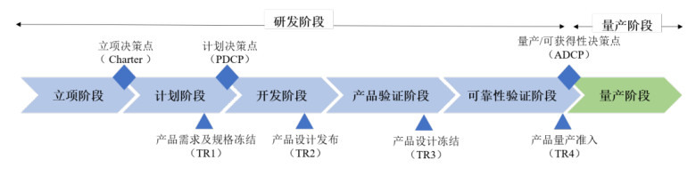 
立项阶段,公司依据产品路线图及业务需求提出立项申请并编制立项报告, 经立项决策点对产品战略定位、市场目标、竞争力、投资回报、开发计划及风险 等进行评审,评审通过后进入计划阶段。计划阶段,公司对业务计划、项目开发 计划、产品上市计划及技术规格等开展全面风险评估,经计划决策点评审通过后 进入开发阶段。开发阶段,按计划完成架构、工艺、电路、封装、器件及测试程 序等设计开发工作,并制定产品与可靠性验证方案,首批产品产出并通过评审后 
1-1-80

---

<!-- 原文第 82 页 -->

长江存储控股股份有限公司 
招股说明书 
进入验证阶段。验证阶段,通过功能、性能、可靠性等全面测试验证及持续优化, 确保产品满足规格要求,同时开展客户送样与导入工作,最终经量产/可获得性决 策点对开发进度、费用执行、产品质量及客户导入情况等进行综合评审,通过后 完成研发与量产交接,产品具备规模化量产条件。 
## 5、采用目前经营模式的原因、影响经营模式的关键因素、经营模式和影响 因素在报告期内的变化情况及未来变化趋势 
公司的经营模式是根据行业发展特点、上下游情况、市场供需关系、公司自 身情况等因素逐步发展形成的,符合行业发展及公司实际情况。影响公司经营模 式的主要因素包括政策法规、市场竞争及供需情况以及公司自身发展战略等。 
报告期内,上述影响公司经营模式的主要因素未发生重大变化,预计未来一 定期间内公司经营模式不会发生重大变化。 
(三)公司设立以来主营业务、主要产品、主要经营模式的演变情况 
报告期内,公司主营业务及主要产品未发生重大变化。公司成立以来产品及 技术发展演进过程如下: 
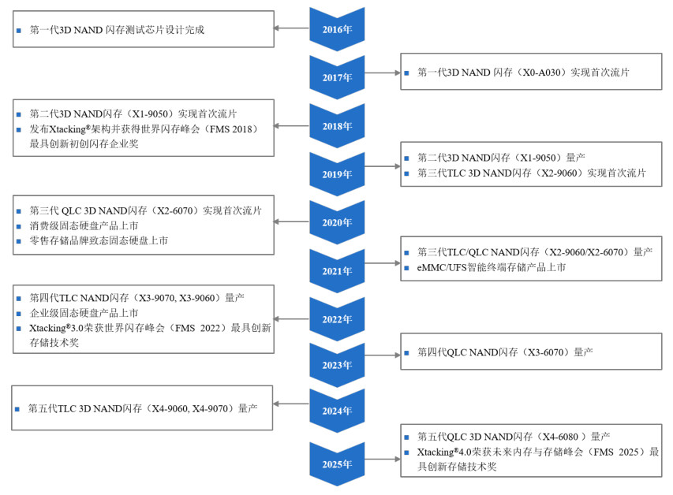 
1-1-81

---

<!-- 原文第 83 页 -->

长江存储控股股份有限公司 
招股说明书 
## (四)主营业务经营情况和核心技术产业化情况 
报告期内,公司主要从事NAND Flash 相关产品的研发、生产与销售,通过 宏茂微从事封测等服务。经过多年积累,截至2026年3月31日,公司及控股子 公司(不包括武汉新芯及其控制的企业)已拥有多项主要核心技术,已获授权发 明专利5.611项,并将核心技术融合应用于主营业务中。公司核心技术形成的收 入及其占营业收入比例情况详见本节之"七、(一)、2、核心技术在主营业务 及产品中的应用及核心技术产品收入占比"。 
报告期内,公司主营业务收入分别为183.43亿元、448.47亿元、624.21亿 元、469.18亿元,整体呈快速增长趋势,其中,NAND Flash产品销售收入分别 为141.02亿元、398.80亿元、566.60亿元和452.38亿元,为公司收入增长主要 来源。 
## (五)主要产品的工艺流程及核心技术在生产过程中的具体使用情况和效果 
公司采用IDM经营模式,业务涵盖芯片设计、晶圆制造、封装测试,并延 伸至固态硬盘的模组加工与测试环节,具体工艺流程如下: 
1-1-82

---

<!-- 原文第 84 页 -->

长江存储控股股份有限公司 招股说明书 
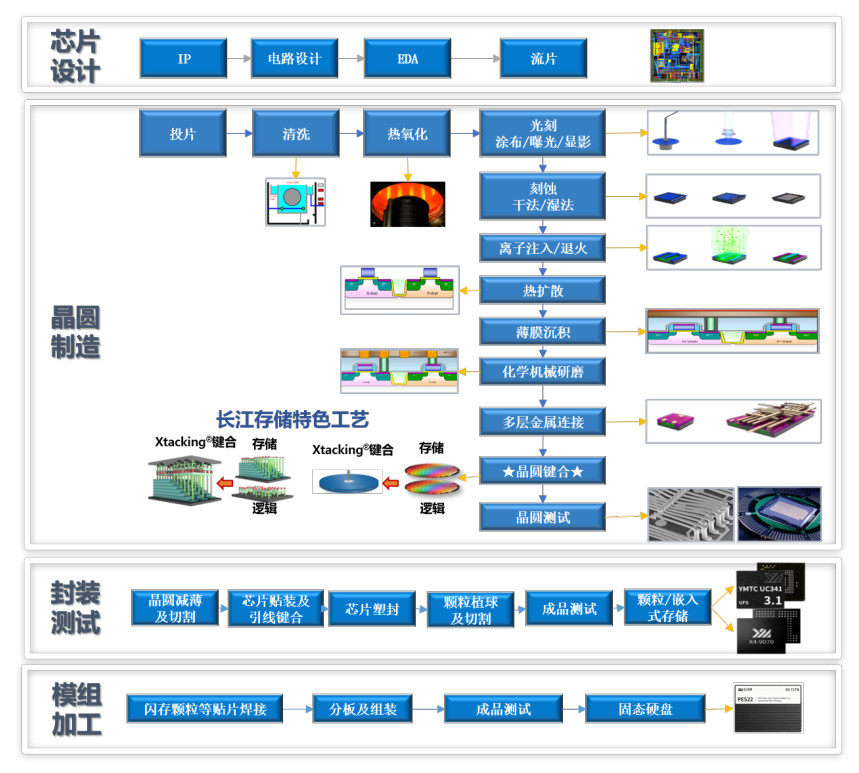 
注:上图中蓝色箭头指向下一道工艺流程,黄色箭头指向对应单道工艺流程或产品的示意图。 上述工艺流程相关环节主要内容如下: 

| 主要环节 | 工艺流程 | 具体内容 |
| --- | --- | --- |
| 芯片设计 | 设计 | 自主设计IP模块和引入经过验证的第三方IP进行电路设计, 利用EDA软件完成电路设计、前端设计与后端物理设计,形 成最终确认的集成电路版图文件,进行试生产完成流片 |
| 晶圆制造 | 清洗 | 使用喷淋或沉浸的方式,先用多种化学品对半导体硅片进行清 洗,再用超纯水对半导体硅片进行二次清洗去除残留的化学 液。清洗工序的目的是去除半导体硅片表面的尘埃颗粒、残留 有机物、表面金属离子等杂质,提高后续生长热氧化层的质量, 保证后续工艺的稳定性 |
| 热氧化 | 在高温环境下,硅晶圆与氧气或水蒸气等发生化学反应,在硅 表面生成一层均匀、致密的绝缘或掩蔽介质薄膜 |
| 光刻 | 对硅片进行氧化处理后,涂上一层光刻胶,并用光刻机通过掩 膜版对涂有光刻胶的晶圆进行分步曝光,目的是将芯片图形分 步印在晶圆上,经曝光的光刻胶变硬,并在显影过程中留下来, 未被曝光的胶层被去掉 |
| 刻蚀 | 用化学反应或物理轰击方法去掉蚀刻区的薄膜形成特定图形, 根据工艺特性要求应用湿刻和干刻两种刻蚀方法 |
| 离子注入/ | 离子注入将杂质原子掺杂到特定区域,使用热退火将离子注入 |
 
1-1-83

---

<!-- 原文第 85 页 -->

长江存储控股股份有限公司 
招股说明书 

| 主要环节 | 工艺流程 | 具体内容 |
| --- | --- | --- |
| | 退火 | 杂质活化,重复此工艺可在不同区域掺杂不同杂质,形成不同 的电性区 |
| 热扩散形 成栅极 | 利用特种气体在高温炉管中发生热化学反应,在晶圆表面形成 均匀致密的薄膜层,通过沉积栅极薄膜层并结合光刻,蚀刻工 艺形成栅氧层和多晶硅层,构成晶体管的栅极,控制晶体管源 区和漏区的电流 |
| 薄膜沉积 | 利用化学气相沉积和物理气相沉积的方法分别对栅氧层和金 属层进行处理,形成隔离或连接 |
| 化学机械 研磨 | 利用化学试剂并结合物理研磨的方法,去除掉多余的金属薄 膜,将晶圆表面平坦化,显露出金属连线 |
| 多金属连 接 | 根据产品结构信号传输复杂度,循环实施光刻、刻蚀、薄膜沉 积、铜电镀填充和化学机械平坦化等工艺流程,通过多层金属 水平和垂直交错布线方式将存储阵列、外围电路等器件连通, 实现集成电路完整电气互联 |
| 晶圆键合 | 晶圆键合是公司特色工艺,利用范德华力原理在常温常压下将 两片晶圆贴合、高温退火键合在一起 |
| 封装测试 | 封装 | 对晶圆进行适当的减薄、切割、贴装、引线键合、塑封、植球 及切割后形成封装好的芯片。集成了存储控制芯片、固件和标 准接口的为嵌入式存储产品,未集成的为闪存颗粒 |
| 测试 | 测试封装好的芯片,验证其功能是否符合产品规格要求 |
| 模组加工 与测试 | 模组加工 | 通过表面贴装工艺将闪存芯片、控制芯片等元器件焊接在电路 板上,完成电路组装及整机装配 |
| 测试 | 完成固件写入,对固态硬盘成品开展性能、稳定性、环境适应 性及耐久度等多项检测,确保产品符合使用标准 |
 
公司核心技术在生产流程中的具体使用情况和效果详见本节之"七、(一) 
## 1、核心技术先进性和具体表征"。 
(六)公司具有代表性的业务指标、技术先进性及具体表征 
报告期内,公司具有代表性的业务数据包括产品种类、产销量、收入规模等。 相关业务数据的变动情况及原因详见本节之"三、(一)主要产品的生产情况" 和本招股说明书"第六节财务会计信息与管理层分析"之"八、经营成果分析" 中的有关内容。 
## (七)符合产业政策和国家经济发展战略情况 
公司专注于存储器业务,符合产业政策和国家经济发展战略,对我国半导体 产业链具有重要意义,具体情况详见本节之"二、(二)行业主管部门、行业监 管体制、行业主要法律法规及政策"。 
1-1-84

---

<!-- 原文第 86 页 -->

长江存储控股股份有限公司 
招股说明书 
## 二、发行人所处行业基本情况 
## (一)发行人所处行业及确定依据 
根据国家统计局《国民经济行业分类(GB/T4754-2017)》和中国证监会《上 市公司行业统计分类与代码(JR/T 0020-2024)》,公司所处行业为"C39计算 机、通信和其他电子设备制造业"。 
根据国家统计局《战略性新兴产业分类(2018)》,公司所处行业为战略性 新兴产业分类中"电子核心产业"中的"集成电路制造"(分类代码:1.2.4)。 
根据《上海证券交易所科创板企业发行上市申报及推荐暂行规定》,公司所 处行业为"新一代信息技术领域"中的"半导体和集成电路"。 
## (二)行业主管部门、行业监管体制、行业主要法律法规及政策 
## 1、行政主管部门及监管体系 
公司所处行业的行政主管部门主要为国家发改委和工信部,全国性自律组织 主要为中国半导体行业协会。 
## 2、近五年行业主要法律法规和政策 

| 时间 | 颁布部门 | 文件名称 | 主要内容 |
| --- | --- | --- | --- |
| 2026年3月 | 第十四届全 国人大四次 会议 | 《中华人民共和国国民经济 和社会发展第十五个五年规 划纲要》 | 聚焦战略必争领域和产业链供应链薄弱环节, 采取超常规措施,全链条推动集成电路、工业 母机、高端仪器、基础软件、先进材料、生物 制造等重点领域关键核心技术攻关取得决定 性突破 |
| 2026年3月 | 国家发改 委、工信部、 财政部、海 关总署、国 家税务总局 | 《关于做好2026年享受税收 优惠政策的集成电路企业或 项目、软件企业清单制定工作 的通知》 | 提及国家鼓励的集成电路线宽小于28nm (含)、线宽小于65nm(含)、线宽小于130nm (含)的集成电路生产企业或项目:集成电路 线宽小于65mm(含)的逻辑电路、存储器生 产企业,线宽小于0.25微米(含)的特色工艺 集成电路生产企业,集成电路线宽小于0.5微 米(含)的化合物集成电路生产企业和先进封 装测试企业享受税收优惠的政策条件 |
| 2025年3月 | 《关于做好2025年享受税收 优惠政策的集成电路企业或 项目、软件企业清单制定工作 的通知》 |
| 2024年3月 | 《关于做好2024年享受税收 优惠政策的集成电路企业或 项目、软件企业清单制定工作 有关要求的通知》 |
| 2023年3月 | 《关于做好2023年享受税收 优惠政策的集成电路企业或 项目、软件企业清单制定工作 有关要求的通知》 |
 
1-1-85

---

<!-- 原文第 87 页 -->

长江存储控股股份有限公司 
招股说明书 

| 时间 | 颁布部门 | 文件名称 | 主要内容 |
| --- | --- | --- | --- |
| 2024年12月 | 国家发改委 等六部门 | 《国家发展改革委等部门关 于促进数据产业高质量发展 的指导意见》 | 大力推动云边端计算技术协同发展,支持云原 生等技术模式创新,形成适应数据规模汇聚、 实时分析和智能应用的计算服务能力。加强新 型存储技术研发,支撑规模化、实时性跨域数 据存储和流动,提高智能存储使用占比。面向 人工智能发展,提升数据采集、治理、应用的 智能化水平。强化数据标注、数据合成等核心 技术攻关。加快可信数据空间、区块链、隐私 计算、匿名化等可信流通技术研发和应用推广 |
| 2024年7月 | 中国共产党 第二十届中 央委员会 | 《关于进一步全面深化改革 推进中国式现代化的决定》 | 健全强化集成电路、工业母机、医疗装备、仪 器仪表、基础软件、工业软件、先进材料等重 点产业链发展体制机制,全链条推进技术攻 关、成果应用。建立产业链供应链安全风险评 估和应对机制 |
| 2024年1月 | 工信部等七 部门 | 《工业和信息化部等七部门 关于推动未来产业创新发展 的实施意见》 | 强化新型基础设施。深入推进5G、算力基础 设施、工业互联网、物联网、车联网、千兆光 网等建设,前瞻布局6G、卫星互联网、手机 直连卫星等关键技术研究,构建高速泛在、集 成互联、智能绿色、安全高效的新型数字基础 设施 |
| 2023年10月 | 工信部等六 部门 | 《算力基础设施高质量发展 行动计划》 | 持续提升存储产业能力。鼓励存储产品制造企 业持续提升关键存储部件等自主研发制造水 平,打造存储介质、存储芯片、存储系统和存 储应用相互促进、协同发展的产业生态; 推动存算网协同发展。加快存储网络技术研发 应用,推动计算与存储融合设计,促进存储与 网络和计算协同发展,引导合理配置存算比 例,实现数据在算力中心内部和算力中心之间 的高效流动 |
| 2023年8月 | 工信部、财 政部 | 《电子信息制造业2023-2024 年稳增长行动方案》 | 提出有序推动集成电路等重点领域重大项目 开工建设,在集成电路等领域建立与有关国家 间常态化交流合作机制,提升集成电路产业链 现代化水平,加快重点标准制定和已发布标准 落地实施 |
| 2021年12月 | 中央网络安 全和信息化 委员会 | 《"十四五"国家信息化规 划》 | 提出完成信息领域核心技术突破,加快集成电 路关键技术攻关。推动计算芯片、存储芯片等 创新 |
| 2021年12月 | 国务院 | 《国务院关于印发"十四 五"数字经济发展规划的通 知》 | 实施产业链强链补链行动,加强面向多元化应 用场景的技术融合和产品创新,提升产业链关 键环节竞争力,完善5G、集成电路、新能源 汽车、人工智能、工业互联网等重点产业供应 链体系 |
| 2021年3月 | 第十三届全 国人大四次 会议 | 《中华人民共和国国民经济 和社会发展第十四个五年规 划和2035年远景目标纲要》 | 聚焦高端芯片、操作系统、人工智能关键算法、 传感器等关键领域,加快推进基础理论、基础 算法、装备材料等研发突破与迭代应用 |
 
基于国家战略定位、支撑产业升级及推动高水平科技自立自强等国家导向, 我国将集成电路产业列为战略性产业。公司主要产品为集成电路产业重点领域产 
1-1-86

---

<!-- 原文第 88 页 -->

长江存储控股股份有限公司 
招股说明书 
品,业务发展符合国家发展战略和产业政策。 
## (三)行业发展情况 
1、半导体存储器行业概况 
## (1)半导体存储器行业基本情况 
半导体存储器利用半导体介质贮存电荷以实现信息存储,存储、读取、擦除 的过程体现为电荷的贮存、检测和释放。具体分类如下: 
## 1)根据原理 
半导体存储器的基本组成部分为存储芯片。根据原理不同,存储芯片包括非 易失性存储芯片(断电后仍保存数据)和易失性存储芯片(断电后丢失数据): 
## ①非易失性存储芯片 
常见的非易失性存储芯片包括闪存(Flash)、只读存储芯片(ROM)。在闪 存中,NAND Flash的先进技术(TLC和QLC)适用于大容量应用,是目前主流 技术:NAND Flash的成熟技术(如SLC)和NOR Flash 适用于小容量、低功耗 应用场景。 
## ②易失性存储芯片 
常见的易失性存储芯片主要为随机存储芯片(RAM),进一步分为DRAM 和SRAM.DRAM中,DDR通常用于形态标准化和功耗约束适中的设备:LPDDR 主要用于严格功耗限制的设备,如智能手机等移动终端:GDDR主要用于高带宽 图形显卡:HBM主要用于高性能计算和图形处理。 
## 2)根据下游应用分类 
半导体存储器面向终端用户分类如下: 
1-1-87

---

<!-- 原文第 89 页 -->

长江存储控股股份有限公司 
招股说明书 
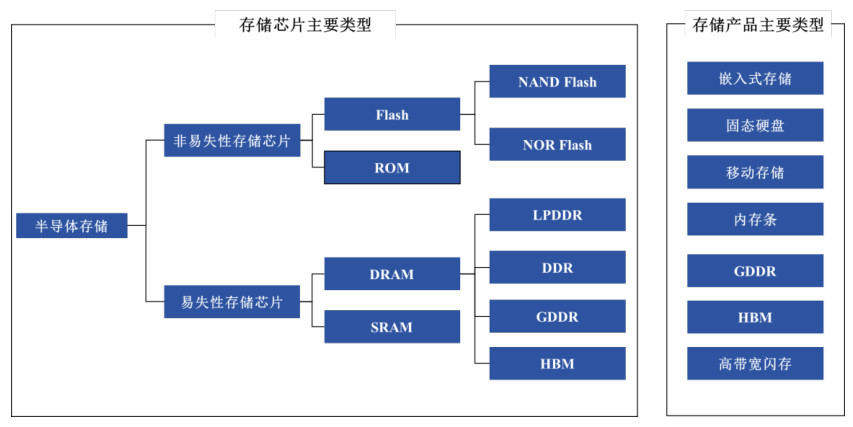 
注:高带宽闪存产品尚未在行业内实现量产。根据公开信息,SK海力士和闪迪的高带宽闪 存工程样品预计将于2027年实现商用。 
不同类型产品的核心构成和下游应用具体如下: 
## ①嵌入式存储 
直接集成在设备主板具有嵌入式接口的存储器,包括主要由NAND Flash 制 成的非易失性存储器(如eMMC、UFS)和由DRAM制成的易失性存储器(如 LPDDR)。还可通过多芯片封装将NAND Flash和DRAM集成为eMCP、uMCP、 ePOP等。嵌入式存储广泛应用于智能手机、平板电脑、智能电视、IoT智能终 端、工业控制设备和车载系统等。 
## ②固态硬盘 
主要由NAND Flash制成,用于个人电脑、游戏主机、AIBOX、服务器的非 易失性存储器,根据应用场景分为消费级固态硬盘和企业级固态硬盘。 
## ③移动存储 
主要由NANDFlash 制成,用于数据传输、备份或存储扩展的便携式非易失 性存储器,包括U盘、存储卡、便携式固态硬盘等。 
## ④内存条 
主要由DDR制成,提供DRAM解决方案以进行临时数据处理及程序执行, 应用于个人电脑、服务器、工业控制设备等。 
## ⑤其他 
1-1-88

---

<!-- 原文第 90 页 -->

长江存储控股股份有限公司 
招股说明书 
GDDR是专用于图形渲染与并行计算的DRAM,通过多通道并行架构与高 时钟频率实现高数据带宽,主要应用于显卡、游戏主机、高性能计算等领域。 
HBM是一种基于3D堆叠工艺的高性能DRAM。通过将多个DRAM芯片垂 直堆叠并与处理器通过中介层紧密封装在一起,实现高数据传输带宽,主要应用 于人工智能、高性能计算、高端图形处理等领域。 
高带宽闪存是一种基于3D堆叠工艺的高性能NAND。通过将多个NAND 芯片垂直堆叠并与处理器通过中介层紧密封装实现高带宽与大容量,主要应用于 新兴推理场景。 
## (2)半导体存储器产业链 
半导体存储器产业上游主要为EDA软件、IP、半导体相关材料、设备及零 部件等行业;下游主要为消费电子、汽车电子、工业等应用市场,具体如下: 
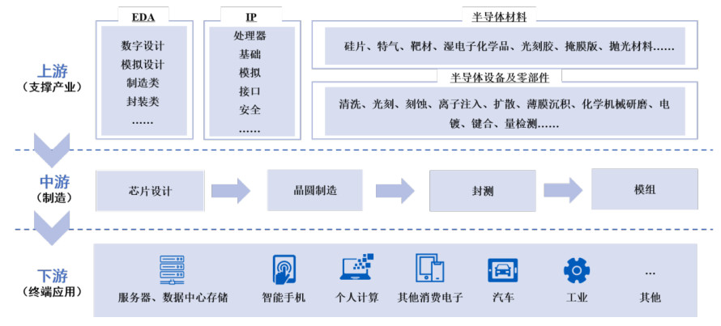 
## 1)上下游对发行人所处行业的影响 
在国家政策支持下,上游软件、设备、材料、零部件等国产供应商正快速实 现技术突破和产线导入,为存储芯片产业构建安全、稳定、多元的供应体系,支 撑行业长期可持续发展。 
受益于国内数字经济快速发展,下游数据中心、企业服务器、消费电子等领 域数据量显著增长,对高容量、高带宽、高可靠性的存储产品需求持续旺盛;同 时,全球数字化转型浪潮推动国际市场存储需求扩容,为存储芯片产业提供广阔 市场空间。 
1-1-89

---

<!-- 原文第 91 页 -->

长江存储控股股份有限公司 
招股说明书 
## 2)发行人所属行业在产业链中的地位和作用 
公司处于半导体存储器产业链中游,为产业链中规模最大、壁垒最高、拉动 效应最强的核心环节,既是上游软件、设备、材料、零部件的主要需求验证平台, 又是下游各类智能终端与数据系统的性能基石,是半导体产业链的核心枢纽。 
## (3)半导体存储器行业和NANDFlash存储器市场规模 
## 1)半导体存储器行业市场规模 
在数字经济快速发展、消费电子产品升级、存储技术迭代及周期修复等因素 共同作用下,全球半导体存储器市场规模由2020年的1,175亿美元增长至2025 年的2,300亿美元。受供需关系影响,2022年与2023年,全球半导体存储器市 场出现短暂下跌。2024年,全球算力基础设施建设提速与数字化应用深化带动 存储需求提升,市场规模明显回升并保持增长。 
全球半导体存储器市场规模(亿美元) 
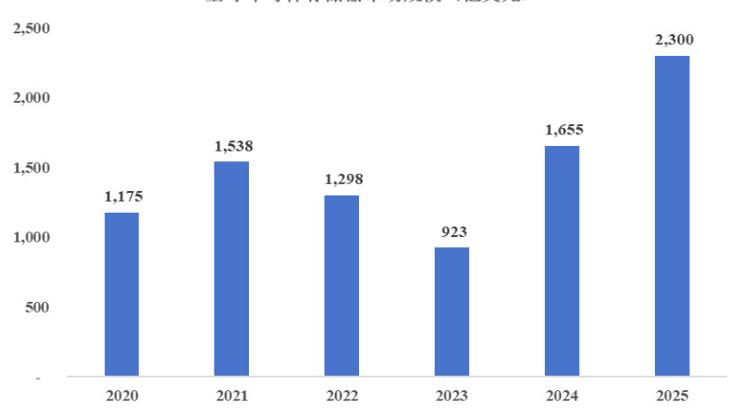 
注:数据来源为WSTS。 
根据WSTS统计,2025年全球集成电路市场规模约为7.009亿美元,其中 半导体存储器市场规模占集成电路市场规模的32.81%。根据TrendForce统计, 2025年全球DRAM存储器产品和 NAND Flash存储器产品的市场规模分别为 1,536亿美元、711亿美元,占半导体存储器市场规模的66.79%和30.91%,是半 导体存储器的重要组成部分。 
1-1-90

---

<!-- 原文第 92 页 -->

长江存储控股股份有限公司 
招股说明书 
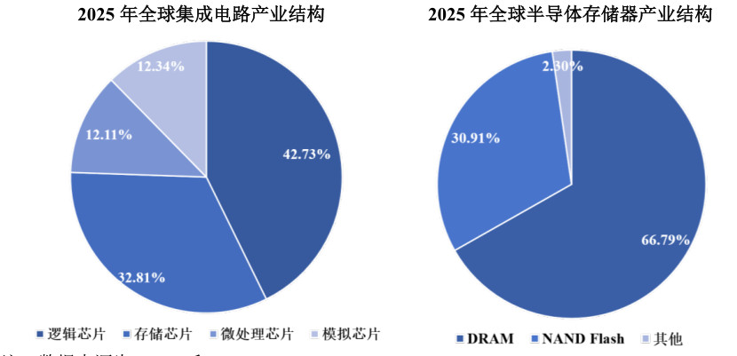 
注:数据来源为WSTS和TrendForce。 
## 2)NAND Flash存储器行业市场规模 
AI技术的迅猛发展引发全球数据总量及存储需求爆发式增长,NAND Flash 市场规模随之扩大,特别是云侧AI对数据中心及企业级服务器存储的刚性需求, 叠加端侧AI推动智能手机、PC及其他消费电子设备的存储配置升级,共同驱动 行业市场规模整体跨越式提升。 
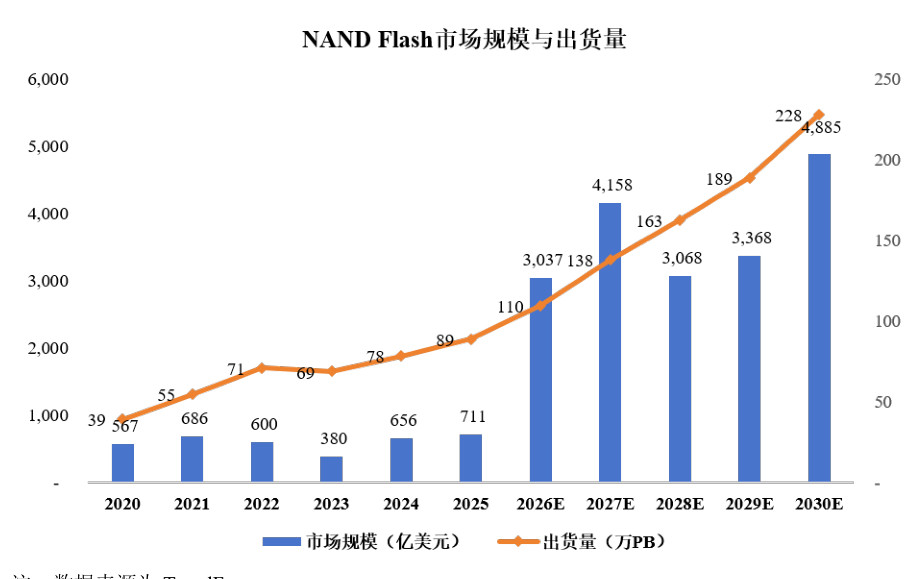 
注:数据来源为TrendForce。 
## 3)NAND Flash主要应用领域及需求情况 
1-1-91

---

<!-- 原文第 93 页 -->

长江存储控股股份有限公司 
招股说明书 
NAND Flash存储产品主要包括企业级固态硬盘、消费级固态硬盘、嵌入式 存储、存储卡等,下游应用包括数据中心/企业用服务器、个人电脑、手机等智能 终端、智能穿戴等其他消费电子、汽车、工业自动化设备等。随着数字化应用普 及与终端智能化水平提升,产品功能日益丰富,AI渗透率快速提升,数据存储需 求显著增加。 
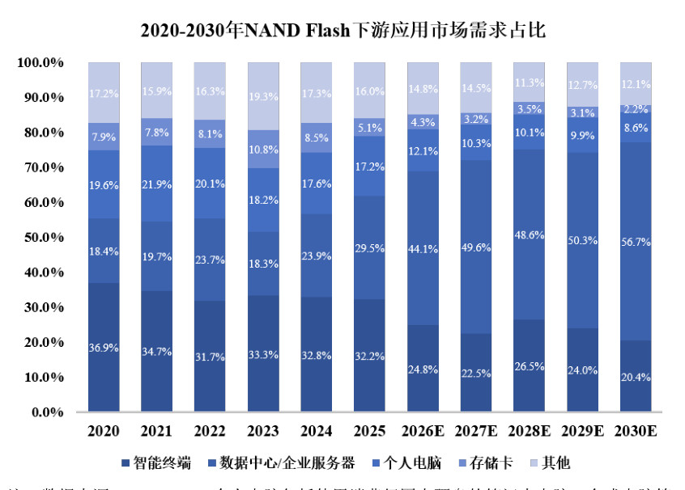 
注:数据来源TrendForce。个人电脑包括使用消费级固态硬盘的笔记本电脑、台式电脑等, 智能终端包括手机、使用嵌入式存储的平板电脑和个人电脑等,其他包括智能穿戴等消费电 子、汽车、工业自动化设备等。 
①云侧AI推动数据中心/企业用服务器存储需求增加 
A.AI发展趋势对存力提出更高要求 
云侧AI指依托大规模数据中心和云端服务器集群运行的分布式人工智能计 算架构,需要超级计算、超大容量数据存储和超速连接。首先,AI模型的数据准 备、训练、推理等环节均涉及庞大底层数据。根据IDC的数据,预计全球数据新 产生量将由2025年的175ZB增长至2030年的1.003ZB。其次,模型训练中产生 海量数据集、模型参数、模型检查点,且训练任务中频繁的随机读写操作对存储 性能提出更高要求。第三,AI应用重心从训练向大规模推理部署迁移,从"生成 式"向"智能体AI"迈进,拓宽应用场景,提升普及度,推动用户数爆发式增 
1-1-92

---

<!-- 原文第 94 页 -->

长江存储控股股份有限公司 
招股说明书 
长,同时对上下文记忆能力、自主性等提出更高要求。上述发展趋势共同推动存 储容量需求快速攀升。 
全球每年新产生的数据总量(ZB) 
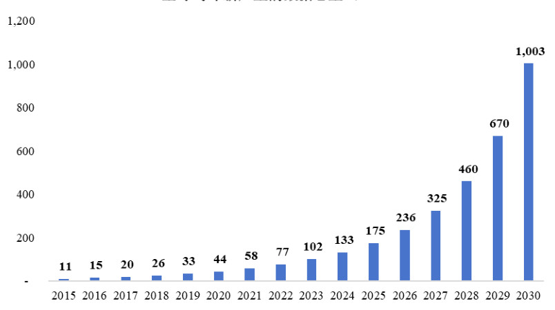 
注:数据来源为IDC。 
## B.海外云厂商率先布局,国内厂商加速跟进 
2024年开始,美国和我国主要云厂商和互联网厂商纷纷加大云端服务器资 本投入。根据高盛2026年5月研究报告,伴随2026年企业端、消费端AIAgent 进入规模化商用阶段,预计全球月度Token消耗将呈指数级增长,到2030年将 提升至当前水平24倍,算力需求增长持续扩大现有基础设施供给缺口,推动头 部企业加大投入,前述厂商2026年和2027年的资本开支预计规模及占营业收入 比例持续增长。 
根据TrendForce在2026年发布的报告,2024年至2030年,美国4家互联 网厂商资本开支将从2,283亿美元增至14,504亿美元,资本开支占营业收入比例 由16.1%增至44.7%。中国4家互联网厂商资本开支将从2024年的330亿美元 增至2,218亿美元,资本开支占营业收入比例由8.4%增至20.2%。美国互联网厂 商率先启动大规模资本开支,国内互联网厂商最近两年加速跟进,但投入规模及 占营业收入比例相较海外仍有较大提升空间。 
国内外云厂商和互联网公司资本开支情况 
1-1-93

---

<!-- 原文第 95 页 -->

长江存储控股股份有限公司 
招股说明书 
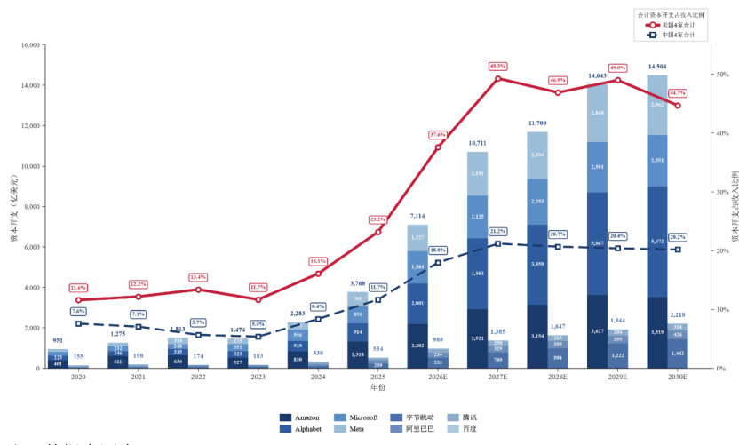 
注:数据来源为TrendForce。 
## C.企业级SSD替代Near-Line HDD趋势形成 
受技术迭代与供应链安全需求驱动,企业级SSD正加速替代Near-Line HDD, 成为云侧AI与智能算力存储的主流选择。 
在性能端,传统HDD受限于机械结构,读写速度慢且延迟达毫秒级,导致 AI训练中的GPU常因等待数据而闲置。而主流QLC SSD采用电子信号传输, 顺序读写速度突破7,000MB/s,随机延迟降至微秒级,可将GPU利用率提升至 85%以上,充分满足AI"高频次、高并发"的数据调用需求。 
在场景端,随着NAND Flash技术演进,企业级SSD容量提升、单位成本下 降,正逐步打破Near-Line HDD在"大容量+低成本"领域的垄断,由SSD承接 AI训练日志、模型备份等温数据存储的趋势正加速演进。受此驱动,全球企业级 NANDFlash市场需求迎来爆发。根据TrendForce预测,2030年全球企业级NAND Flash需求规模将超132.5万PB,2025至2030年复合增长率达36.1%,成为半 导体存储器市场增长最快的应用领域。 
1-1-94

---

<!-- 原文第 96 页 -->

长江存储控股股份有限公司 
招股说明书 
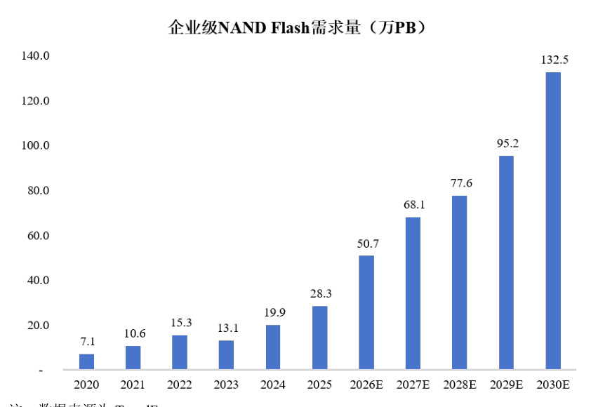 
注:数据来源为TrendForce。 
## ②端侧AI对冲手机、电脑出货压力,支撑对应存储需求维持相对稳定 
端侧AI拓展了人工智能的应用边界,将传统终端设备升级为具备自主决策 能力的智能体,推动消费电子全面AI化转型。以智能手机和个人电脑为代表的 消费电子产品快速普及,对更高算力、更高效数据处理、更大存储容量、更低功 耗等方面提出持续诉求。 
智能手机领域,高像素拍照、4K/8K超高清视频录制、多任务并行处理、大 型移动游戏等新功能的普及,以及AI手机新增端侧大模型及量身定做AI语音 助手等,均对设备内置存储容量和性能要求持续提升,推动手机存储配置从 128GB逐渐向256GB、512GB升级,高端机型已推出1TB、2TB及以上版本。 
个人电脑领域,高清视频编辑、大型游戏运行、多任务处理等需求的提升, AIPC新增NPU和本地部署大模型、AIAgent,对电脑内置存储的容量与性能要 求持续升级,带动消费级SSD的主流容量已从256GB向512GB、1TB甚至2TB、 4TB迈进,读写速度从SATA接口的600MB/s提升至NVMe接口的3,000MB/s 至7,000MB/s以上,部分高端产品已突破10,000MB/s。 
1-1-95

---

<!-- 原文第 97 页 -->

长江存储控股股份有限公司 
招股说明书 
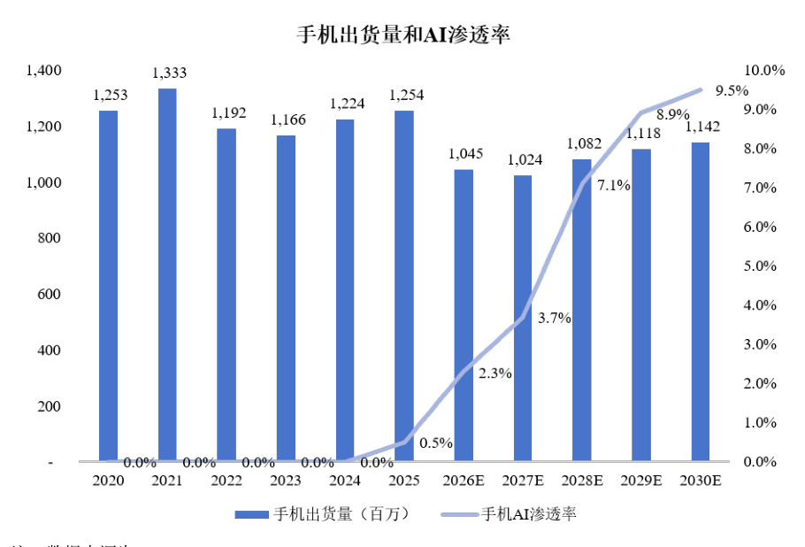 
注:数据来源为TrendForce。 
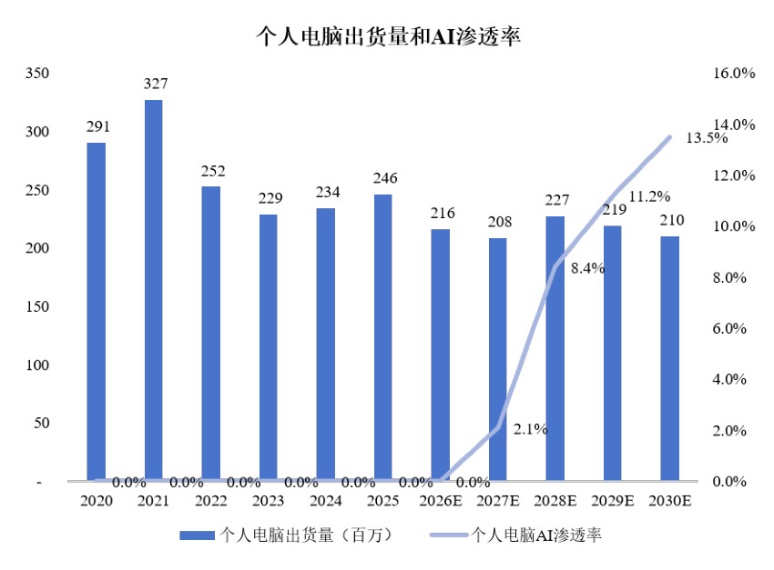 
注:数据来源为TrendForce。 
根据TrendForce数据,虽然全球手机、个人电脑出货量预计有所下滑,但随 
1-1-96

---

<!-- 原文第 98 页 -->

长江存储控股股份有限公司 
招股说明书 
着AI渗透率显著提升,全球应用于手机、平板电脑等智能终端的NAND Flash 和应用于个人电脑的消费级固态硬盘需求将在2026年略有下降后持续提升。 
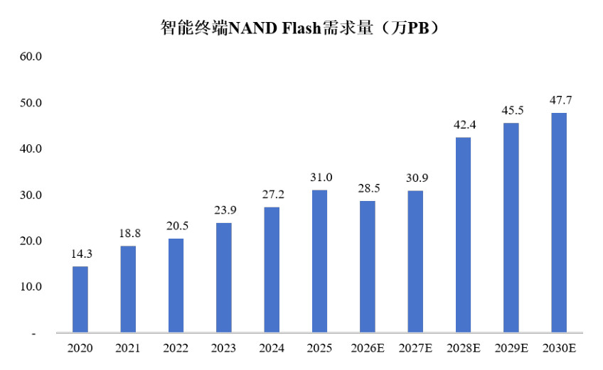 
注:数据来源为TrendForce。 
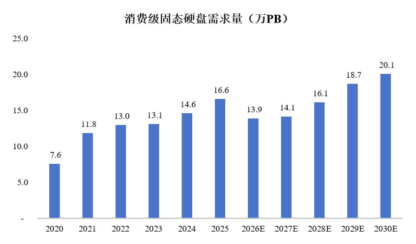 
注:数据来源为TrendForce。 
综上,AI的快速发展迭代导致全球数据生成量指数级上升,存力需求快速 伴生增长。 
## (4)半导体存储器行业的周期性特征 
受技术迭代、下游应用领域发展与需求变迁、行业供需关系变化等共同影响, 
1-1-97

---

<!-- 原文第 99 页 -->

长江存储控股股份有限公司 
招股说明书 
半导体存储器行业呈现较为明显的周期性波动特征,近十年可划分为三轮周期, 具体如下: 
最近十年存储行业历史周期情况 
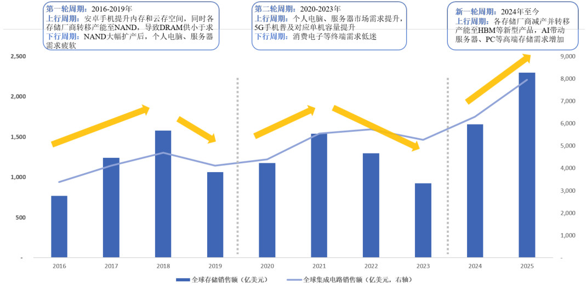 
注:数据来源为WSTS、WIND。 
其中,2024年至今全球存储市场处于算力与数字化需求驱动的强势上行周 期,叠加各存储厂商在减产后库存快速消化,行业整体由价格修复进入结构性缺 货、量价齐升阶段。由于AI技术正逐步根本性改变生产生活各个维度,截至本 招股说明书签署日,本轮周期上行趋势高于此前两轮周期。 
作为半导体存储器的核心品类,NAND Flash 存储器行业历史周期与整体存 储市场趋势高度一致,NANDFlash存储器行业收入规模变化情况具体如下: 
1-1-98

---

<!-- 原文第 100 页 -->

长江存储控股股份有限公司 
招股说明书 
最近十年NAND Flash存储器行业历史周期情况 
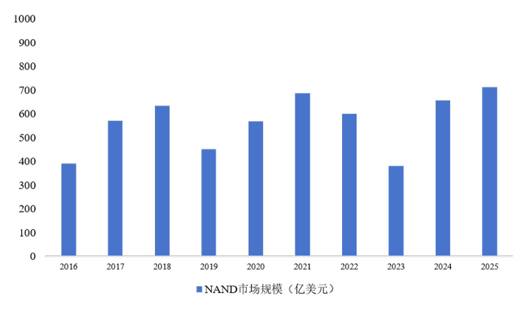 
注:数据来源为TrendForce。 
## 2、行业发展趋势 
## (1)存储器向更大容量持续演进 
AI场景进入规模化商用阶段,大模型训练、云端推理、边缘算力、终端智能 等场景催生海量存储需求。大容量是NAND Flash行业中长期核心发展方向,推 动行业持续突破堆叠工艺上限。截至2026年3月末,行业内300层以上3DNAND 产品已量产出货。3DNAND产品向超高层堆叠升级过程中,晶圆应力管控、高 深宽比沟道孔刻蚀、横向电荷损失成为主要技术瓶颈。晶圆混合键合、多堆栈堆 叠、存储单元多值存储,成为3DNAND产品向更高容量迭代的核心技术路线。 
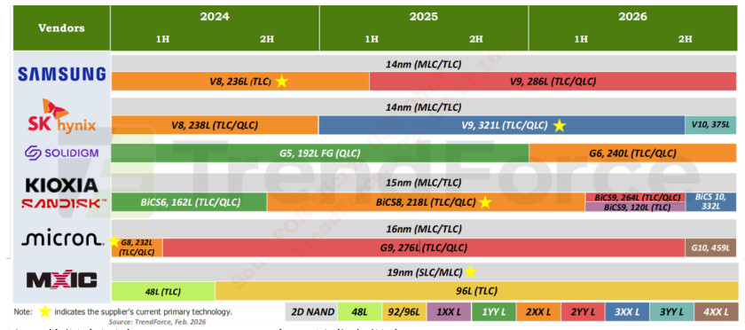 
注:数据来源为TrendForce 2026年7月发布报告 
1-1-99

---

<!-- 原文第 101 页 -->

长江存储控股股份有限公司 
招股说明书 
## (2)AI催生高带宽、高速度存储需求 
AI大模型训练与推理呈现高并发、高吞吐、低时延、读多写少的典型特征, 对底层存储提出远超传统服务器的性能要求:训练阶段需持续吞吐PB级海量数 据,支撑多轮迭代与参数更新:推理阶段需处理高频次并发请求,对I/O响应时 延极为敏感。上述场景要求NAND Flash存储产品具备更高带宽、更快接口速度、 更低读写时延,以消除数据访问瓶颈,充分释放GPU算力。 
响应前述应用需求,存储芯片行业一方面正加速推出AI SSD,通过控制器 深度并行化、NVMe协议优化、智能固件预取、PCle 5.0/6.0/CXL接口升级等技 术提升带宽及速度。另一方面研制高带宽闪存等新型产品,以多层堆叠3DNAND 为基础,融合硅通孔、微凸点和混合键合技术,在带宽性能接近HBM的基础上, 实现更低成本、更大容量,夯实AI时代存储底座。 
## (3)单位存力成本持续下降,QLCNAND Flash占比持续提升 
提升存储密度、降低单位存力成本是存储行业长期发展趋势。继SLC、MLC、 TLC技术迭代后,QLC NAND凭借更高单颗粒存储密度,成为行业降本增效的 核心路径。行业持续打磨技术工艺,补齐QLC早期寿命及稳定性不足短板。AI 产业发展加速QLC商业化进程,QLCNANDFlash占比持续提升。 
大模型运行产生海量冷、温数据,推动传统HDD存储向QLC SSD迁移。 QLC规模化应用带动产能与良品率稳步提升,形成技术迭代与成本下降的正向 循环,持续降低单位存力成本。 
## (4)NAND与DRAM产品深度融合 
在大模型超长上下文推理、海量KV缓存扩容需求驱动下,行业正在从 NAND与DRAM/HBM物理隔离的传统架构,转向两类介质深度融合、协同创 新的全新发展格局,以发挥DRAM的低延迟优势与NAND的高容量特性。短期 行业已落地AI服务器机柜标配大容量SSD、冷热KV缓存分层方案,以SSD承 接冷KV缓存,缓解HBM容量瓶颈;中长期产业将推进高带宽闪存技术量产落 地,构建HBM-高带宽闪存-DRAM-本地SSD四级近端存储分层体系,在满足AI 高带宽算力需求的同时,实现整体存储方案的成本优化。 
1-1-100

---

<!-- 原文第 102 页 -->

长江存储控股股份有限公司 
招股说明书 
## 3、行业壁垒 
## (1)市场格局与客户准入壁垒 
全球NAND Flash存储行业集中度极高,头部企业持续占据较高市场份额, 与主要下游主流客户建立长期稳定合作关系。NAND Flash 存储行业下游涵盖数 据中心、企业服务器、消费电子等应用场景,主要客户为体量巨大的业内龙头。 此类客户对产品的可靠性、稳定性要求极为严格。新供应商需要通过复杂苛刻的 产品验证,才可能进入其供应商体系及获取订单。客户一旦完成导入验证选定供 应商,更换合作方的成本较高。头部厂商主导的市场格局叠加客户长周期准入验 证要求,导致新进入企业较难切入及获取市场份额。 
## (2)配套体系与供应链壁垒 
NAND Flash存储芯片设计和制造涉及精密且复杂的工艺流程,对上游设备、 核心材料及配套零部件均提出较高要求。新技术的开发落地依托于设备、材料、 零部件性能提升。国际存储芯片巨头已与全球主要设备、材料供应商建立长期供 货、合作研制关系。新进入者在获得国际先进供应商设备、材料、零部件供应方 面处于相对弱势地位,难以保证稳定供应或及时获得最先进产品。境内本土供应 商仍处于追赶国际先进水平阶段。在目前国际政治经济环境下,供应链整体技术 水平和稳定性构成行业进入壁垒。 
## (3)商业秘密壁垒 
NAND Flash行业的技术壁垒极高,要求企业具备强大的研发实力和长期制 造实践经验。经过几十年的激烈竞争,目前全球NANDFlash存储行业中头部企 业掌握大量技术工艺商业秘密及注册专利。后进入者如使用已注册专利技术需支 付高昂的授权费,即使获得授权也因缺乏长期生产验证经验难以在短期内消化掌 握技术诀窍。如新进入企业不能突破商业秘密壁垒建立自主知识产权体系,推出 具有竞争力的产品,将在残酷的市场竞争中淘汰出局。 
## (4)重资产投入与资本壁垒 
NAND Flash存储芯片制造多采用IDM模式,具有明显的重资产、高投入特 征。产线对于无尘、恒温、恒湿、恒压、电压稳定性、地面平整性、防震性等方 面要求严苛。高端半导体设备采购价格高昂,单条先进产线投资额高达上百亿美 
1-1-101

---

<!-- 原文第 103 页 -->

长江存储控股股份有限公司 
招股说明书 
元。同时,NAND Flash存储芯片行业技术迭代速度快,企业需对产线持续升级 改造。行业内普遍采取在周期低谷建厂、升级产能的投资策略,领先企业依托雄 厚资本实力积极应对行业周期波动,甚至采取激进低价策略抢占市场份额,挤压 弱势竞争者生存空间。 
全球NAND Flash芯片头部供应商三星、SK海力士、美光科技、铠侠、闪 迪等均为资金实力雄厚或由政府支持的超大型企业集团,新进入者面临严酷的资 本实力竞争压力。 
## (5)高端人才储备壁垒 
NAND Flash 存储芯片是高端技术人员高度聚集的产业,需要物理、材料、 力学、化学、光学、微电子、数学与计算科学、精密机械工程、电气工程等多领 域高精尖人才持续钻研实践。国际行业巨头在全球吸纳一流技术人才,搭建成熟 的科研体系与人才培养机制,对新进入企业形成高端人才储备壁垒。 
## 4、行业面临的机遇与挑战 
## (1)行业面临的机遇 
1)全球数字经济转型带来长期广阔发展空间 
全球数字经济转型进入快速发展期。人工智能产业由大模型训练迈向规模化 商用推理,云服务商持续加码算力基建,带动AI服务器存储需求实现指数级增 长。AI PC、智能汽车、物联网终端全面渗透、边缘计算落地推动存储规格快速 迭代升级。 
不同于此前单项应用市场带来的上行周期,本轮为全社会多应用领域整体转 型升级的长效周期,存储器作为不可或缺的基础设施预计可分享长期红利。 
## 2)国内消费级市场需求缺口待填补,企业级市场增量空间广阔 
当前海外存储市场供需持续紧张,国际存储巨头阶段性倾斜产能优先保障海 外客户供货,进一步放大国内消费级市场供给缺口。目前国内存储厂商产能仅能 覆盖约半数本土消费级市场需求,亟需通过产能扩张填补缺口,为国内存储产业 带来难得的市场空间和发展机遇。 
从企业级存储市场来看,当前国内互联网公司资本开支占营业收入比例约为 
1-1-102

---

<!-- 原文第 104 页 -->

长江存储控股股份有限公司 
招股说明书 
10%,显著低于国际头部互联网公司约20%-30%的投入比例。依托国内庞大数字 经济应用底座和市场空间,国内互联网厂商后续资本开支存在较大提升空间,有 望为本土企业级存储产品带来更多增量机遇。 
## 3)政策支持及产业链能力提升营造良好生态环境 
近年来,国家连续出台多项政策推动集成电路全链发展。"十五五"规划将 集成电路产业列为战略性新兴支柱产业之首,明确将通过超常规措施和新型举国 体制在2026年至2030年间实现关键核心技术的决定性突破。 
在此背景下,国内半导体产业链能力整体快速迭代,各环节技术、产能持续 突破,商业化落地与终端应用协同提速。存储器厂商作为产业链中重要一环,既 是产业生态协同的主要贡献者,又是最大受益者,与上下游共同推动产业生态正 向循环。 
## (2)行业面临的挑战 
## 1)地缘政治对全球化协作布局形成挑战 
近年来,地缘政治摩擦升级,国际经贸形势复杂,国内半导体企业面临越来 越多的非市场性干预限制,增加了产业链全球化布局、行业生态体系搭建的不确 定性。国内NAND Flash 存储产业作为国际贸易管制的重点领域,在设备、零部 件、原材料采购以及境外销售方面受到一系列政策管制,对企业全球化经营布局 构成挑战。 
## 2)持续高额资本支出成为行业常态压力 
NAND Flash 存储器制造产线具备重资产、高投入、高门槛的显著特征,对 标国际先进水平的单条产线总投资额普遍达百亿美元量级。无尘生产环境、高标 准基建体系对各项指标均设置严苛标准,叠加海量高端精密设备采购,进一步推 高产线整体投入。同时,半导体行业技术快速迭代,需要企业长期保持高强度研 发和产线投入。能否具备长期稳定大额资本开支能力,直接决定NAND Flash厂 商的行业话语权与长期竞争力。 
## 3)高集中度竞争格局构成突围挑战 
现阶段,全球NANDFlash存储行业经过数十年发展,国际头部企业持续占 
1-1-103

---

<!-- 原文第 105 页 -->

长江存储控股股份有限公司 
招股说明书 
据较高市场份额,该等企业均为国际超大型企业集团,在产品布局、资金实力、 技术沉淀、产能规模等方面实力雄厚,拥有丰富的专利储备,并与下游主要客户、 上游核心材料及设备供应商建立长期稳定合作关系。国内存储厂商想要突破现有 竞争格局,需要集技术研发、供应链体系、运营管理等多重核心能力于一体,长 期深耕持续攻坚,方有可能突围赶超。 
## (四)竞争格局与发行人产品市场地位 
1、竞争格局与行业内主要企业 
## (1)公司的行业及市场地位 
公司专注于3DNAND闪存及存储器解决方案,成为全球首批突破200层 NAND存储芯片的企业。根据TrendForce数据计算,2026年1-3月公司在全球 NAND Flash厂商中按销售金额和出货量排名,均位列全球第三、中国第一。 
## (2)同行业主要企业情况 
## 1)三星电子(005930.KS) 
三星电子成立于1969年,韩国证券交易所上市公司,总部位于韩国,业务 涵盖消费类电子产品、IT和移动通信、设备解决方案,全球存储芯片龙头企业之 一。三星电子的设备解决方案包括NAND Flash和DRAM存储器,系统LSI业 务(包括移动处理器、图像传感器、显示驱动芯片等)和晶圆代工业务。根据其 财报,2025财年三星电子存储器业务收入占总收入比例约为31%。 
## 2)SK海力士(000660.KS/SKHY.O) 
SK海力士成立于1983年,韩国证券交易所和美国纳斯达克证券交易所上市 公司,总部位于韩国,主要从事半导体存储器(包括NANDFlash和DRAM)的 生产销售业务,全球存储芯片龙头企业之一。根据其财报,2025财年SK海力士 NAND Flash相关业务收入占总收入比例约为21%。 
## 3)铠侠(285A.T) 
铠侠成立于2019年,前身为东芝存储器公司,东京证券交易所上市公司, 总部位于日本,主要从事NANDFlash相关存储产品的制造、销售、研究开发及 其他服务,全球存储芯片龙头企业之一。 
1-1-104

---

<!-- 原文第 106 页 -->

长江存储控股股份有限公司 
招股说明书 
## 4)美光科技(MU.O) 
美光科技成立于1978年,美国纳斯达克证券交易所上市公司,总部位于美 国,主要提供创新存储解决方案(包括NAND Flash和DRAM),全球存储芯片 龙头企业之一。根据其财报,2025财年美光科技NANDFlash相关业务收入占总 收入比例约为23%。 
## 5)西部数据(WDC.O)和闪迪(SNDK.O) 
西部数据成立于1970年,美国纳斯达克证券交易所上市公司,总部位于美 国,为数据存储设备和解决方案开发商、制造商和提供商。2025年2月,西部数 据分拆闪迪作为独立公司独立运营NAND闪存和SSD业务,并在美国纳斯达克 证券交易所上市。 
## (3)可比上市公司的选择依据 
在产品及业务方面,NAND行业内主要企业为境外企业,因此选取前述全球 NAND主要厂商三星电子、SK海力士、铠侠、美光科技、闪迪作为可比公司。 
公司是代表中国跻身世界一流的存储器IDM企业。基于技术特点、市场地 位及业务模式等核心要素考虑,进一步选取长鑫科技、台积电、中芯国际、华虹 宏力和华润微作为可比公司,具体情况如下: 
## 1)长鑫科技(688825.SH) 
长鑫科技成立于2016年,上交所科创板上市公司,总部位于合肥,专注于 DRAM产品的研发、设计、生产及销售,是全球存储芯片主要生产企业之一。 
## 2)台积电(2330.TW) 
台积电成立于1987年,台湾证券交易所上市公司,总部位于中国台湾,主 营业务包括集成电路及其他半导体芯片的制造、销售、封装测试与电脑辅助设计 及光罩制造等代工服务,是世界领先的晶圆代工企业之一。 
## 3)中芯国际(688981.SH/00981.HK) 
中芯国际成立于2000年,上交所科创板和联交所上市公司,总部位于上海, 向全球客户提供8英寸和12英寸晶圆代工与技术服务,是世界领先的集成电路 晶圆代工企业之一。 
1-1-105

---

<!-- 原文第 107 页 -->

长江存储控股股份有限公司 
招股说明书 
## 4)华虹宏力(688347.SH/01347.HK) 
华虹宏力成立于2005年,上交所科创板和联交所上市公司,总部位于上海, 是全球领先的特色工艺晶圆代工企业之一,行业内特色工艺平台覆盖最全面的晶 圆代工企业。 
## 5)华润微(688396.SH) 
华润微成立于2003年,上交所科创板上市公司,总部位于无锡,是拥有芯 片设计、掩模制造、晶圆制造、封装测试等全产业链一体化经营能力的半导体企 业,聚焦于功率半导体、智能传感器与智能控制等领域。 
## 2、发行人与同行业可比公司的比较情况 
截至本招股说明书签署日,公司产品技术已达到全球第一梯队水平。2025年, 公司与全球行业主要竞争对手主要财务、业务指标比较如下: 
单位:亿元 

| 主要指标 | 公司 | 三星电子 | SK海力士 | 铠侠 | 闪迪 | 美光科技 |
| --- | --- | --- | --- | --- | --- | --- |
| 总资产 | 2,283.96 | 27,554.90 | 8,559.30 | 1.431.19 | 913.60 | 6,084.94 |
| 归母净资产 | 1,023.66 | 20,622.76 | 5,857.41 | 438.34 | 717.85 | 4.162.23 |
| 营业收入 | 631.85 | 16.214.14 | 4.721.59 | 753.43 | 627.60 | 2,994.80 |
| 归母净利润 | 142.11 | 2,151.20 | 2,085.99 | 74.84 | -73.17 | 842.91 |
 
注1:可比公司数据来源为WIND; 注2:由于铠侠、闪迪、美光科技年度报告基准日与A股不同,基于区间可比因素考虑,上 表中使用闪迪、铠侠、美光科技披露的季度报告数据按照日历年重新计算后的财务指标,相 关外币数据采用各公司最后一个季度报告财务数据截止日对应的中国人民银行公布的人民 币汇率中间价折算为人民币。调整后除美光科技外的公司均为截至2025年12月31日日历 年数据,美光科技因其年度报告基准日为8月31日,按日历年调整后,其数据较其他上市 公司整体提前一个月。 
## 3、发行人主要竞争优势与竞争劣势 
## (1)竞争优势 
## 1)高性能产品体系 
公司持续迭代推出更快I/O速度、更高存储密度的NAND Flash产品。产品 体系能够覆盖多梯度性能需求,可适配数字化产业各类下游应用场景,已导入全 球一流客户供应链并稳定供货。具有国际竞争力的产品体系有利于公司把握需求 扩容机遇,穿越行业周期。 
1-1-106

---

<!-- 原文第 108 页 -->

长江存储控股股份有限公司 
招股说明书 
## 2)原创架构技术突破 
公司始终坚持原始创新,依托自主研发及底层架构创新,打破海外存储厂商 技术壁垒,打造出涵盖闪存晶圆、闪存产品技术的自主技术体系。当前全球3D NAND Flash向更高堆叠层数演进,混合键合成为行业主流发展方向,公司率先 落地并持续迭代的Xtacking架构能够支撑产品持续迭代升级,推动我国3D NAND Flash技术领先全球。 
## 3)规模量产高效运营 
公司依托原创分段制造技术,有效解决传统制程中的工艺干扰问题。结合 IDM全产业链协同优势与智能化、精细化生产管理,构建起高良率、高设备运行 率、低成本的精益制造体系,运营效率位居行业前列。 
## 4)高韧性配套供应体系 
公司以先进工艺需求和应用场景为牵引,深度融入国内半导体产业链,积极 推动存储芯片产业设备、材料、零部件供应商协同发展。高韧性、高协同的供应 链体系是公司抵御外部风险、稳定生产运营的可靠保障和长期发展的重要支撑。 
## 5)资深专业研发团队 
公司核心研发团队在存储芯片领域深耕多年,积累了扎实的技术功底和实践 经验。在历次重大技术路线布局中均作出前瞻性精准研判,持续引领行业技术演 进方向。公司已搭建梯队健全的专业研发体系,注重实践积累,牵头研发或参与 多项重大科研项目,解决大量关键技术难题,为长期发展奠定人才基础。 
## 6)应对重大危机能力 
在国际贸易政策最为严峻期间,公司生产经营曾处于极端困难处境。在国内 半导体产业链及应用市场的共同努力下,公司凭借明确坚定的战略定力及方向性 决策、供应链统筹协同攻关、精益化制造及成本控制能力克服外部冲击干扰,实 现逆势扩张。应对重大突发外部危机时公司所体现出的凝聚力、稳健性和韧性是 未来直面全球竞争,抵御各种不确定因素的系统性能力。 
## (2)竞争劣势 
1)境内集成电路产业起步较晚 
1-1-107

---

<!-- 原文第 109 页 -->

长江存储控股股份有限公司 
招股说明书 
美日韩集成电路产业发展较早,近年我国持续投入最优秀的人才和巨额资金 推动集成电路产业发展,但整体生态系统与国际一流水平仍存在差距,产业链各 环节发展亦存在一定不均衡:封装测试较强:设计起步较晚,近期快速成长;部 分材料、设备与全球最先进水平仍存在差距;先进制程制造仍需关键技术突破。 叠加当下复杂的国际贸易环境,产业发展现状在一定程度上影响产业链内企业技 术迭代和产品开发进度。 
## 2)融资渠道相对单一 
NAND Flash 存储行业具有重资产、高投入的特征,需要持续投入大额长期 资本。现阶段公司外部资金来源主要依靠银行贷款,融资渠道相对单一。相较于 资金储备雄厚、融资体系多元的国际巨头,综合资本实力存在显著差距。 
## 3)海外市场拓展受限 
受地缘政治因素影响,报告期内,公司在海外市场的业务拓展面临不对称竞 争壁垒,导致海外市场拓展有限,在一定程度上限制了公司收入来源、国际知名 度,以及与国际存储巨头在全球市场直面竞争的实践经验,全球化经营布局仍有 待提升。 
## (五)盈利能力或财务状况的主要影响因素分析 
## 1、行业景气度与周期波动 
存储芯片整体标准化程度高,价格受市场供需波动影响,具有较为明显的周 期性特征。需求侧,存储芯片下游应用智能手机、个人电脑及服务器等领域受技 术迭代、国内外经济状况、消费水平等因素影响,不同年份单一下游应用市场需 求波动较大,造成存储芯片市场需求变动较大。供给侧,存储芯片晶圆厂产能集 中度高,产能建设投资金额高、难度大,产能释放和压降需要一定周期。下游需 求波动与产能释放周期可能存在错配,导致存储芯片市场价格周期性波动,直接 影响存储芯片制造企业的销售规模与利润水平。 
## 2、技术和产品迭代 
存储芯片行业具有快速迭代的特点,平均每1.5-2年完成一次技术迭代。存 储芯片厂商需不断进行产品技术研发、工艺迭代升级、产线技改优化等。随着堆 
1-1-108

---

<!-- 原文第 110 页 -->

长江存储控股股份有限公司 
招股说明书 
叠层数提升,对存储芯片厂商的技术与研发、产业链整合、设备与配套工艺、材 料等综合能力要求越来越高。若存储芯片厂商无法保持迭代速度,一旦在产品性 能和成本方面落后于竞争对手,丧失市场竞争力,可能导致销量大幅下滑,无法 消化高额固定成本,显著影响盈利水平。 
## 3、国际贸易政策变化带来的机遇与挑战 
一方面,国际贸易政策变化及美国等国家对中国半导体企业关键设备、材料 的出口管制,导致我国半导体企业在设备、原材料采购等方面受到一定程度的制 约,以及我国半导体企业出口美国等区域客户受到限制和关税成本增加。另一方 面,前述情况促使我国半导体关键设备和材料领域加快多元化进程。综合考虑国 内半导体市场容量和产业链上下游发展进度,尽管国际贸易摩擦短期内对我国半 导体行业造成了一定不利影响,但从长期来看对公司及行业整体带来的机遇大于 挑战。 
## 三、发行人主要产品销售情况和主要客户 
## (一)主要产品的生产情况 
报告期内,公司NAND Flash产品产能利用率情况如下: 

| 类别 | 2026年1-3月 | 2025年 | 2024年 | 2023年 |
| --- | --- | --- | --- | --- |
| 产能利用率 | 98.02% | 97.91% | 95.43% | 94.42% |
 
## (二)主要产品的销售情况 
## 1、主要产品的销售情况 
报告期内,公司NAND Flash产品产销率情况如下: 

| 类别 | 2026年1-3月 | 2025年 | 2024年 | 2023年 |
| --- | --- | --- | --- | --- |
| 产销率 | 82.40% | 97.48% | 89.18% | 108.37% |
 
## 2、销售收入及产品均价 
报告期内,公司各类产品的销售收入、平均单价、销量情况详见本招股说明 书"第六节财务会计信息与管理层分析"之"八、(一)营业收入分析" 
1-1-109

---

<!-- 原文第 111 页 -->

长江存储控股股份有限公司 
招股说明书 
## 3、报告期各销售模式规模及占比 
报告期内,公司存在直销、经销两种销售方式,详见本招股说明书"第六节 财务会计信息与管理层分析"之"八、(一)营业收入分析"。 
## (三)报告期内主要客户情况 
报告期内,公司向主营业务的前五大客户合计销售金额分别为1.044.579.19 万元、2,921,034.45万元、3,263,716.42万元及2,556,512.68万元,占各期营业收 入的比例分别为55.73%、64.62%、51.65%和54.34%,报告期内,发行人不存在 向单个客户的销售占比超过百分之五十的情况。截至本招股说明书签署日,报告 期各期发行人前五名客户与发行人均不存在关联关系。 
## 四、发行人采购情况和主要供应商 
## (一)报告期内采购情况 
## 1、主要原材料采购情况 
报告期内,公司生产经营采购的主要原材料包括备品备件、硅片、化学品、 光阻、气体、靶材等,具体采购情况如下: 
单位:万元 

| 项目 | 2026年1-3月 | | 2025年 | | 2024年 | | 2023年 | |
| --- | --- | --- | --- | --- | --- | --- | --- | --- |
| 采购额 | 占比 | 采购额 | 占比 | 采购额 | 占比 | 采购额 | 占比 |
| 备品备 件 | 316,533.94 | 58.99% | 840,647.54 | 51.80% | 595,047.68 | 48.71% | 369,271.23 | 40.99% |
| 化学品 | 69,040.85 | 12.87% | 244,977.08 | 15.10% | 197,086.79 | 16.13% | 152,037.02 | 16.88% |
| 硅片 | 42,644.75 | 7.95% | 184,537.06 | 11.37% | 143,648.81 | 11.76% | 150,335.98 | 16.69% |
| 光阻 | 42,056.51 | 7.84% | 162,298.36 | 10.00% | 136,613.90 | 11.18% | 101,726.04 | 11.29% |
| 气体 | 37,687.70 | 7.02% | 98,385.42 | 6.06% | 87,774.48 | 7.18% | 84.988.96 | 9.43% |
| 靶材 | 7,665.50 | 1.43% | 20,388.42 | 1.26% | 17,779.85 | 1.46% | 10,855.25 | 1.21% |
| 其他 | 20,988.15 | 3.91% | 71.583.95 | 4.41% | 43,709.94 | 3.58% | 31.581.80 | 3.51% |
| 合计 | 536.617.41 | 100.00% | 1,622.817.83 | 100.00% | 1,221,661.45 | 100.00% | 900.796.28 | 100.00% |
 
报告期内,公司采购备品备件金额及占比逐年提升,主要原因为系统级产品 材料等采购增加所致。其他原材料采购金额及占比波动整体为采购量上升及平均 采购价格下降共同作用所致。 
## 2、报告期内主要原材料采购价格变动情况 
1-1-110

---

<!-- 原文第 112 页 -->

长江存储控股股份有限公司 
招股说明书 
报告期内,公司主要原材料采购单价整体呈现下降趋势。假设2023年采购 价格指数为100.00,后续各期采购价格指数以2023年采购价格指数为基数进行 计算的主要原材料采购价格指数如下: 

| 项目 | 2026年1-3月 | 2025年 | 2024年 | 2023年 |
| --- | --- | --- | --- | --- |
| 备品备件 | 71.88 | 77.12 | 115.98 | 100.00 |
| 化学品 | 92.30 | 94.57 | 101.62 | 100.00 |
| 硅片 | 56.76 | 66.83 | 72.10 | 100.00 |
| 光阻 | 76.63 | 86.59 | 93.29 | 100.00 |
| 气体 | 84.36 | 69.68 | 82.22 | 100.00 |
| 靶材 | 98.75 | 91.89 | 102.57 | 100.00 |
 
## 3、主要能源采购情况 
报告期内,公司生产经营所需能源主要为电力和水,供应稳定,采购单价为 当地基础能源价格。 

| 类型 | 项目 | 2026年1-3 月 | 2025年 | 2024年 | 2023年 |
| --- | --- | --- | --- | --- | --- |
| 水 | 金额(万元) | 1,006.04 | 4,312.45 | 3,899.93 | 3,145.70 |
| 采购量(万吨) | 271.40 | 1,181.45 | 1,078.23 | 862.46 |
| 采购单价(元/吨) | 3.71 | 3.65 | 3.62 | 3.65 |
| 电 | 金额(万元) | 65.511.55 | 245,115.96 | 208.480.53 | 189,154.14 |
| 采购量(万度) | 116,716.11 | 438,286.05 | 350,116.40 | 297,456.56 |
| 采购单价(元/度) | 0.56 | 0.56 | 0.60 | 0.64 |
 
## (二)前五名供应商的采购情况 
报告期内,公司持续构建多元化供应商体系,不存在向单个原材料供应商采 购比例超过采购总额50%的情形。公司与前五大原材料供应商不存在关联关系。 报告期内,公司前五大原材料供应商采购情况如下: 
单位:万元 

| 期间 | 供应商 | 采购金额 | 类别 | 主要采购内容 | 采购占比 |
| --- | --- | --- | --- | --- | --- |
| 2026年 1-3月 | 供应商B | 123,662.77 | 贸易商 | 备品备件 | 23.04% |
| 供应商E | 23,171.50 | 原厂 | 备品备件 | 4.32% |
| 供应商C | 19.238.19 | 原厂 | 化学品 | 3.59% |
| 供应商D | 17,142.67 | 贸易商 | 硅片 | 3.19% |
| 供应商R | 15,668.88 | 原厂 | 气体 | 2.92% |
 
1-1-111

---

<!-- 原文第 113 页 -->

长江存储控股股份有限公司 
招股说明书 

| 期间 | 供应商 | 采购金额 | 类别 | 主要采购内容 | 采购占比 |
| --- | --- | --- | --- | --- | --- |
| | 合计 | 198,884.01 | | | 37.06% |
| 2025年 | 供应商A | 108,476.63 | 贸易商 | 备品备件 | 6.68% |
| 供应商B | 100,407.34 | 贸易商 | 备品备件 | 6.19% |
| 供应商C | 67,156.52 | 原厂 | 化学品 | 4.14% |
| 供应商D | 59,605.29 | 贸易商 | 硅片 | 3.67% |
| 供应商E | 53,980.57 | 原厂 | 备品备件 | 3.33% |
| 合计 | 389,626.35 | - | | 24.01% |
| 2024年 | 供应商A | 68,303.66 | 贸易商 | 备品备件 | 5.59% |
| 供应商F | 61,205.63 | 原厂/贸易商 | 光阻 | 5.01% |
| 供应商C | 54,328.10 | 原厂 | 化学品 | 4.45% |
| 供应商D | 42,531.01 | 贸易商 | 硅片 | 3.48% |
| 供应商G | 40,264.08 | 原厂/贸易商 | 备品备件 | 3.30% |
| 合计 | 266,632.48 | | | 21.83% |
| 2023年 | 供应商H | 47,254.22 | 原厂 | 备品备件 | 5.25% |
| 供应商C | 46,716.18 | 原厂 | 化学品 | 5.19% |
| 供应商I | 46.575.83 | 原厂 | 硅片 | 5.17% |
| 供应商F | 46,343.78 | 原厂/贸易商 | 光阻 | 5.14% |
| 供应商J | 44,301.26 | 原厂 | 硅片 | 4.92% |
| 合计 | 231,191.26 | | | 25.67% |
 
报告期内,公司不存在向单个供应商的采购比例超过采购总额50%或严重依 赖于少数供应商的情形。截至本招股说明书签署日,上述主要供应商与公司及其 董事、高级管理人员、核心技术人员及持股5%以上的股东之间不存在关联关系。 
1-1-112

---

<!-- 原文第 114 页 -->

长江存储控股股份有限公司 
招股说明书 
## 五、发行人的主要固定资产及无形资产情况 
(一)固定资产 
1、自有房屋建筑物 
## (1)有证房产 
截至2026年3月31日,发行人及其控股子公司(不包括武汉新芯及其控制的企业)拥有的房屋所有权具体情况如下: 

| 序号 | 权利人 | 证书编号 | 坐落 | 面积 (m2) | 用途 |
| --- | --- | --- | --- | --- | --- |
| 1 | 长江存储 | 鄂(2025)武汉市东开不动产权第 0035290号 | 东湖新技术开发区未来三路88号硅烷站(甲类)栋/单元1层 /号 | 621.57硅烷站 | |
| 2 | 长江存储 | 鄂(2025)武汉市东开不动产权第 0035292号 | 东湖新技术开发区未来三路88号化学品库1a/单元1层/号 | | 1,553.12化学品库 |
| 3 | 长江存储 | 鄂(2025)武汉市东开不动产权第 0035293号 | 东湖新技术开发区未来三路88号甲类仓库2栋/单元1层/号 | 186.02仓库 | |
| 4 | 长江存储 | 鄂(2025)武汉市东开不动产权第 0035295号 | 东湖新技术开发区未来三路88号氢氨站1栋/单元1层/号 | 522.71氢氨站 | |
| 5 | 长江存储 | 鄂(2025)武汉市东开不动产权第 0035296号 | 东湖新技术开发区未来三路88号废水处理站1栋/单元1-3层 /号 | | 51,131.30废水处理站 |
| 6 | 长江存储 | 鄂(2025)武汉市东开不动产权第 0035297号 | 东湖新技术开发区未来三路88号化学品库2栋/单元1层/号 | 3.957.03 | 化学品库 |
| 7 | 长江存储 | 鄂(2025)武汉市东开不动产权第 0035298号 | 东湖新技术开发区未来三路88号门房3栋/单元1-3层/号 | 3.190.04门房 | |
| 8 | 长江存储 | 0035299号 | 鄂(2025)武汉市东开不动产权第东湖新技术开发区未来三路88号气化供配厂房la栋/单元1 层/号 | | 2.736.76气化供配厂房 |
 
1-1-113

---

<!-- 原文第 115 页 -->

长江存储控股股份有限公司 
招股说明书 

| 9 | 长江存储 | 鄂(2025)武汉市东开不动产权第 0035302号 | 东湖新技术开发区未来三路88号气化供配厂房1b栋/单元1 层/号 | 1,969.84 | 气化供配厂房 |
| --- | --- | --- | --- | --- | --- |
| 10 | 长江存储 | 鄂(2025)武汉市东开不动产权第 0035304号 | 东湖新技术开发区未来三路88号特气站1栋/单元1层/号 | 1,643.72特气站 | |
| 11 | 长江存储 | 鄂(2025)武汉市东开不动产权第 0035308号 | 东湖新技术开发区未来三路88号特气站2栋/单元1层/号 | 842.06特气站 | |
| 12 | 长江存储 | 鄂(2025)武汉市东开不动产权第 0035309号 | 东湖新技术开发区未来三路88号危废仓库2栋/单元1层/号 | 366.15仓库 | |
| 13 | 长江存储 | 鄂(2025)武汉市东开不动产权第 0035311号 | 东湖新技术开发区未来三路88号制氢站1栋/单元1层/号 | | 769.98制氢站 |
| 14 | 长江存储 | 鄂(2025)武汉市东开不动产权第 0035312号 | 东湖新技术开发区未来三路88号危废仓库3栋/单元1层/号 | 1.688.37仓库 | |
| 15 | 长江存储 | 鄂(2025)武汉市东开不动产权第 0035313号 | 东湖新技术开发区未来三路88号危废仓库1栋/单元1层/号 | 3,099.35 | 仓库 |
| 16 | 长江存储 | 鄂(2025)武汉市东开不动产权第 0035314号 | 东湖新技术开发区未来三路88号综合动力站1栋/单元1-4层 (1)号 | | 47.690.60综合动力站 |
| 17 | 长江存储 | 鄂(2025)武汉市东开不动产权第 0035315号 | 东湖新技术开发区未来三路88号化学品库1b栋/单元1层/号 | | 2.009.92化学品库 |
| 18 | 长江存储 | 鄂(2025)武汉市东开不动产权第 0035316号 | 东湖新技术开发区未来三路88号甲类仓库1栋/单元1层/号 | 739.28仓库 | |
| 19 | 长江存储 | 鄂(2025)武汉市东开不动产权第 0035317号 | 东湖新技术开发区未来三路88号压缩机房及配电室1栋/单元 1-2层/号 | | 3,143.82压缩机房及配电室 |
| 20 | 长江存储 | 鄂(2025)武汉市东开不动产权第 0035318号 | 东湖新技术开发区未来三路88号综合仓库栋/单元1-3层/号 | 10.092.59仓库 | |
| 21 | 长江存储 | 鄂(2025)武汉市东开不动产权第 0035319号 | 东湖新技术开发区未来三路88号仓库1栋/单元1-3层/号 | 4,262.47仓库 | |
| 22 | 长江存储 | 鄂(2025)武汉市东开不动产权第 0041662号 | 东湖新技术开发区未来三路88号变电站la栋一单元1-2层1 号 | 3.692.44变电站 | |
 
1-1-114

---

<!-- 原文第 116 页 -->

长江存储控股股份有限公司 
招股说明书 

| 23 | 长江存储 | 鄂(2025)武汉市东开不动产权第 0041663号 | 东湖新技术开发区未来三路88号门房6栋/单元1层/号 | 62.64门房 | |
| --- | --- | --- | --- | --- | --- |
| 24 | 长江存储 | 鄂(2025)武汉市东开不动产权第 0041665号 | 东湖新技术开发区未来三路88号生产支持厂房1栋/单元1-6 | 65,395.51 | 生产支持厂房 |
| 25 | 长江存储 | 鄂(2025)武汉市东开不动产权第 0041666号 | 东湖新技术开发区未来三路88号总部研发大楼栋/单元1-6层 (2)厂房号 | 58,072.49 | 工业 |
| 26 | 长江存储 | 鄂(2025)武汉市东开不动产权第 0041667号 | 东湖新技术开发区未来三路88号长江未来馆栋/单元1-5, 20.45标高层(1)长江未来馆号 | 38,679.31 | 长江未来馆 |
| 27 | 长江存储 | 鄂(2025)武汉市东开不动产权第 0041668号 | 东湖新技术开发区未来三路88号12英寸存储器生产厂房1栋 /单元1-4层/号 | 266,948.51 | 生产厂房 |
| 28 | 长江存储 | 鄂(2025)武汉市东开不动产权第 0041669号 | 东湖新技术开发区未来三路88号门房2栋/单元1层/号 | 298.00门房 | |
| 29 | 长江存储 | 鄂(2025)武汉市东开不动产权第 0041670号 | 东湖新技术开发区未来三路88号门房1栋/单元1层/号 | 432.80门房 | |
| 30 | 长江存储 | 鄂(2025)武汉市东开不动产权第 0041678号 | 东湖新技术开发区未来三路88号变电站la栋一单元电缆夹层 | 1,359.26变电站 | |
| 31 | 长江存储 | 鄂(2025)武汉市东开不动产权第 0041679号 | 东湖新技术开发区未来三路88号长江未来馆栋/单元1-2层 (2)停车库号 | 26,312.54停车库 | |
| 32 | 长江存储 | 鄂(2025)武汉市东开不动产权第 0041680号 | 东湖新技术开发区未来三路88号总部研发大楼栋/单元1层 (4)停车场号 | 4.352.17停车场 | |
| 33 | 长江存储 | 鄂(2025)武汉市东开不动产权第 0041681号 | 东湖新技术开发区未来三路88号总部研发大楼栋/单元1层 (1)地上水泵房号 | 32.32 | 水泵房 |
| 34 | 长江存储 | 鄂(2025)武汉市东开不动产权第 0034326号 | 东湖新技术开发区科技四路77号食堂栋/单元1层(3)高压 变电所号 | | 273.57高压变电所 |
| 35 | 长江存储 | 鄂(2025)武汉市东开不动产权第 0034327号 | 东湖新技术开发区科技四路77号食堂栋/单元1-4层夹层(1) 食堂(地上部分)号 | 21.321.59食堂 | |
| 36 | 长江存储 | 0034328号 | 鄂(2025)武汉市东开不动产权第东湖新技术开发区科技四路77号倒班宿舍5栋/单元1层(2) 电动车、自行车停放区号 | 208.28 | 电动车、自行车停 放区 |
 
1-1-115

---

<!-- 原文第 117 页 -->

长江存储控股股份有限公司 
招股说明书 

| 37 | 长江存储 | 鄂(2025)武汉市东开不动产权第 0034329号 | 东湖新技术开发区科技四路77号倒班宿舍5栋/单元1-18层 | 25,264.33倒班宿舍 | |
| --- | --- | --- | --- | --- | --- |
| 38 | 长江存储 | 鄂(2025)武汉市东开不动产权第 0034330号 | 东湖新技术开发区科技四路77号倒班宿舍4栋/单元1层(2) 电动车、自行车停放区号 | 208.28 | 电动车、自行车停 放区 |
| 39 | 长江存储 | 鄂(2025)武汉市东开不动产权第 0034331号 | 东湖新技术开发区科技四路77号倒班宿舍4栋/单元1-18层 | 25,290.19 | 倒班宿舍 |
| 40 | 长江存储 | 鄂(2025)武汉市东开不动产权第 0034332号 | 东湖新技术开发区科技四路77号倒班宿舍3栋/单元1层(5) 消防控制室号 | | 89.82消防控制室 |
| 41 | 长江存储 | 鄂(2025)武汉市东开不动产权第 0034333号 | 东湖新技术开发区科技四路77号倒班宿舍3栋/单元1层(4) 物业中心号 | | 770.01物业用房 |
| 42 | 长江存储 | 鄂(2025)武汉市东开不动产权第 0034334号 | 东湖新技术开发区科技四路77号倒班宿舍3栋/单元1层(2) 电动车、自行车停放区号 | 228.85 | 电动车、自行车停 放区 |
| 43 | 长江存储 | 鄂(2025)武汉市东开不动产权第 0034335号 | 东湖新技术开发区科技四路77号倒班宿舍3栋/单元1-18层 | 24,386.99 | 倒班宿舍 |
| 44 | 长江存储 | 鄂(2025)武汉市东开不动产权第 0034336号 | 东湖新技术开发区科技四路77号倒班宿舍2栋/单元1层(2) 电动车、自行车停放区号 | 228.85 | 电动车、自行车停 放区 |
| 45 | 长江存储 | 鄂(2025)武汉市东开不动产权第 0034337号 | 东湖新技术开发区科技四路77号倒班宿舍2栋/单元1-18层 | 25,227.33 | 倒班宿舍 |
| 46 | 长江存储 | 鄂(2025)武汉市东开不动产权第 0034338号 | 东湖新技术开发区科技四路77号倒班宿舍1栋/单元1-16层 | 7,968.49 | 倒班宿舍 |
| 47 | 长江存储 | 鄂(2025)武汉市东开不动产权第 0034339号 | 东湖新技术开发区科技四路77号倒班宿舍1栋/单元1层(2) 电动车、自行车停放区号 | 92.35 | 电动车、自行车停 放区 |
| 48 | 长江存储 | 鄂(2026)武汉市东开不动产权第 0020625号 | 东湖新技术开发区三湖街26号5栋/单元1-3层1厂房号 | 3,023.46 | 工业 |
| 49 | 长江存储 | 鄂(2026)武汉市东开不动产权第 0020627号 | 东湖新技术开发区三湖街26号栋/单元1-3层1食堂号 | 5.572.70食堂 | |
| 50 | 长江存储 | 鄂(2026)武汉市东开不动产权第 0020631号 | 东湖新技术开发区三湖街26号2栋/单元1层7配电间号 | 147.20配电间 | |
 
1-1-116

---

<!-- 原文第 118 页 -->

长江存储控股股份有限公司 
招股说明书 

| 51 | 长江存储 | 鄂(2026)武汉市东开不动产权第 0020632号 | 东湖新技术开发区三湖街26号9栋/单元1-4楼/室 | 12,457.75 | 工业 |
| --- | --- | --- | --- | --- | --- |
| 52 | 长江存储 | 鄂(2026)武汉市东开不动产权第 0020636号 | 东湖新技术开发区三湖街26号2栋/单元1层8柴油发电机房 号 | | 100.60柴油发电机房 |
| 53 | 长江存储 | 鄂(2026)武汉市东开不动产权第 0020639号 | 东湖新技术开发区三湖街26号1栋/单元1-2层/号 | 4,039.41 | 工业 |
| 54 | 长江存储 | 鄂(2026)武汉市东开不动产权第 0020640号 | 东湖新技术开发区三湖街26号2栋/单元1层9配电间号 | 297.13配电间 | |
| 55 | 长江存储 | 鄂(2026)武汉市东开不动产权第 0020642号 | 东湖新技术开发区三湖街26号2栋/单元1-17层/1号 | 51,566.87 | 工业 |
| 56 | 长江存储 | 鄂(2026)武汉市东开不动产权第 0020648号 | 东湖新技术开发区三湖街26号10栋/单元1-4楼/室 | 12,457.75 | 工业 |
| 57 | 长江存储 | 鄂(2026)武汉市东开不动产权第 0020652号 | 东湖新技术开发区三湖街26号8栋/单元1-4楼1室 | 27.726.30 | 工业 |
| 58 | 长江存储 | 鄂(2026)武汉市东开不动产权第 0020653号 | 东湖新技术开发区三湖街26号11栋/单元1-4楼/室 | 10,793.11 | 工业 |
| 59 | 长江存储 | 鄂(2026)武汉市东开不动产权第 0020654号 | 东湖新技术开发区三湖街26号2栋/单元1层5消防控制室号 | | 91.53消防控制室 |
| 60 | 长江存储 | 鄂(2026)武汉市东开不动产权第 0020662号 | 东湖新技术开发区三湖街26号4栋/单元1-3层1多层厂房号 | 3,624.98 | 工业 |
| 61 | 长江存储 | 鄂(2026)武汉市东开不动产权第 0020664号 | 东湖新技术开发区三湖街26号12栋/单元1-5楼/室 | 15,528.94工业 | |
| 62 | 长江存储 | 鄂(2026)武汉市东开不动产权第 0021530号 | 东湖新技术开发区未来三路88号12英寸存储器生产厂房2a 栋/单元1-4层/号 | 135,761.80 | 工业 |
| 63 | 长江存储 | 鄂(2026)武汉市东开不动产权第 0021531号 | 东湖新技术开发区未来三路88号12英寸存储器生产厂房2b 栋/单元1-4层/号 | 127.376.76工业 | |
| 64 | 长江存储 | 鄂(2026)武汉市东开不动产权第 0021532号 | 东湖新技术开发区未来三路88号仓库2栋/单元1-3层/号 | 24,178.91 | 仓库 |
 
1-1-117

---

<!-- 原文第 119 页 -->

长江存储控股股份有限公司 
招股说明书 

| 65 | 长江存储 | 鄂(2026)武汉市东开不动产权第 0021533号 | | 东湖新技术开发区未来三路88号测试厂房栋/单元1-4层/号 | 63.994.48 | 工业 |
| --- | --- | --- | --- | --- | --- | --- |
| 66 | 长江存储 | 鄂(2026)武汉市东开不动产权第 0021534号 | /号 | 东湖新技术开发区未来三路88号氮气压缩机房栋/单元1-3层 | | 2.304.37氮气压缩机房 |
| 67 | 长江存储 | 鄂(2026)武汉市东开不动产权第 0021535号 | /号 | 东湖新技术开发区未来三路88号废水处理站2栋/单元1-3层 | 80,334.61 | 废水处理站 |
| 68 | 长江存储 | 鄂(2026)武汉市东开不动产权第 0021536号 | | 东湖新技术开发区未来三路88号甲类仓库3栋/单元1层/号 | 359.01仓库 | |
| 69 | 长江存储 | 鄂(2026)武汉市东开不动产权第 0021537号 | 东湖新技术开发区未来三路88号空压机房栋/单元1层/号 | | | 742.20空压机房 |
| 70 | 长江存储 | 鄂(2026)武汉市东开不动产权第 0021538号 | | 东湖新技术开发区未来三路88号甲类仓库4栋/单元1层/号 | 360.00仓库 | |
| 71 | 长江存储 | 鄂(2026)武汉市东开不动产权第 0021539号 | 东湖新技术开发区未来三路88号氢气站栋/单元1层/号 | | 486.64氢气站 | |
| 72 | 长江存储 | 鄂(2026)武汉市东开不动产权第 0021540号 | 东湖新技术开发区未来三路88号乙类仓库栋/单元1层/号 | | 1.405.00仓库 | |
| 73 | 长江存储 | 鄂(2026)武汉市东开不动产权第 0021541号 | 1号 | 东湖新技术开发区未来三路88号综合动力站2栋/单元1-4层 | | 48,998.56综合动力站 |
| 74 | 长江存储 | 鄂(2026)武汉市东开不动产权第 0021542号 | (厂房5层)层/号 | 东湖新技术开发区未来三路88号生产支持厂房2栋/单元1-7 | 54,493.56工业 | |
| 75 | 长江存储 | 鄂(2026)武汉市东开不动产权第 0021543号 | 层)层/号 | 东湖新技术开发区未来三路88号辅助楼栋/单元1-6(厂房5 | 25,780.05辅助楼 | |
| 76 | 宏茂微 | 沪(2023)青字不动产权第014428 号 | 青浦区青浦镇崧泽大道9688号 | | 66,859.73 | 厂房 |
| 77 | 宏茂微 | 沪(2023)青字不动产权第014430 号 | 青浦区青浦镇崧泽大道9788号 | | 27.09厂房 | |
| 78 | 长存科服 | 鄂(2023)武汉市东开不动产权第 0008097号 | 商业栋/单元1层(1)商号 | 东湖新技术开发区未来二路16号居住项目(长存花园)S4号 | | 55.10商业服务 |
 
1-1-118

---

<!-- 原文第 120 页 -->

长江存储控股股份有限公司 
招股说明书 

| 79 | 长存科服 | 鄂(2023)武汉市东开不动产权第 0008098号 | 东湖新技术开发区未来二路16号居住项目(长存花园)S4号 商业栋/单元1-2层(2)商号 | 1,134.88商业服务 |
| --- | --- | --- | --- | --- |
| 80 | 长存科服 | 鄂(2023)武汉市东开不动产权第 0008099号 | 东湖新技术开发区未来二路16号居住项目(长存花园)S4号 商业栋/单元1层(3)商号 | 55.10商业服务 |
| 81 | 长存科服 | 鄂(2023)武汉市东开不动产权第 0008101号 | 东湖新技术开发区未来二路16号居住项目(长存花园)S3号 商业栋/单元1层(7)商号 | 49.45商业服务 |
| 82 | 长存科服 | 鄂(2023)武汉市东开不动产权第 0008102号 | 东湖新技术开发区未来二路16号居住项目(长存花园)S3号 商业栋/单元1层(6)商号 | 49.45商业服务 |
| 83 | 长存科服 | 鄂(2023)武汉市东开不动产权第 0008103号 | 东湖新技术开发区未来二路16号居住项目(长存花园)S3号 商业栋/单元1层(5)商号 | 49.45商业服务 |
| 84 | 长存科服 | 鄂(2023)武汉市东开不动产权第 0008104号 | 东湖新技术开发区未来二路16号居住项目(长存花园)S3号 商业栋/单元1层(4)商号 | 49.45商业服务 |
| 85 | 长存科服 | 鄂(2023)武汉市东开不动产权第 0008105号 | 东湖新技术开发区未来二路16号居住项目(长存花园)S3号 商业栋/单元1层(3)商号 | 49.45商业服务 |
| 86 | 长存科服 | 鄂(2023)武汉市东开不动产权第 0008106号 | 东湖新技术开发区未来二路16号居住项目(长存花园)S3号 商业栋/单元1层(2)商号 | 57.69商业服务 |
| 87 | 长存科服 | 鄂(2023)武汉市东开不动产权第 0008107号 | 东湖新技术开发区未来二路16号居住项目(长存花园)S3号 商业栋/单元1层(1)商号 | 41.21商业服务 |
| 88 | 长存科服 | 鄂(2023)武汉市东开不动产权第 0008108号 | 东湖新技术开发区未来二路16号居住项目(长存花园)S2号 商业栋/单元1层(1)商号 | 49.45商业服务 |
| 89 | 长存科服 | 鄂(2023)武汉市东开不动产权第 0008109号 | 东湖新技术开发区未来二路16号居住项目(长存花园)S2号 商业栋/单元1层(7)商号 | 41.21商业服务 |
| 90 | 长存科服 | 鄂(2023)武汉市东开不动产权第 0008110号 | 东湖新技术开发区未来二路16号居住项目(长存花园)S2号 商业栋/单元1层(6)商号 | 57.69商业服务 |
| 91 | 长存科服 | 鄂(2023)武汉市东开不动产权第 0008111号 | 东湖新技术开发区未来二路16号居住项目(长存花园)S2号 商业栋/单元1层(5)商号 | 49.45商业服务 |
| 92 | 长存科服 | 鄂(2023)武汉市东开不动产权第 0008112号 | 东湖新技术开发区未来二路16号居住项目(长存花园)S2号 商业栋/单元1层(4)商号 | 49.45商业服务 |
 
1-1-119

---

<!-- 原文第 121 页 -->

长江存储控股股份有限公司 
招股说明书 

| 93 | 长存科服 | 鄂(2023)武汉市东开不动产权第 0008113号 | 东湖新技术开发区未来二路16号居住项目(长存花园)S2号 商业栋/单元1层(3)商号 | 49.45 | 商业服务 |
| --- | --- | --- | --- | --- | --- |
| 94 | 长存科服 | 鄂(2023)武汉市东开不动产权第 0008114号 | 东湖新技术开发区未来二路16号居住项目(长存花园)S2号 商业栋/单元1层(2)商号 | 49.45 | 商业服务 |
| 95 | 长存科服 | 鄂(2023)武汉市东开不动产权第 0008116号 | 东湖新技术开发区未来二路16号居住项目(长存花园)S1号 超市栋/单元1层(2)超市号 | 3,246.69商业服务 | |
| 96 | 长存科服 | 鄂(2022)武汉市东开不动产权第 0102327号 | 东湖新技术开发区未来二路16号居住项目(长存花园)15栋 /单元1层(4)商号 | | 55.39商业服务 |
| 97 | 长存科服 | 鄂(2022)武汉市东开不动产权第 0102364号 | 东湖新技术开发区未来二路16号居住项目(长存花园)15栋 /单元1层(7)商号 | | 43.93商业服务 |
| 98 | 长存科服 | 鄂(2022)武汉市东开不动产权第 0102365号 | 东湖新技术开发区未来二路16号居住项目(长存花园)15栋 /单元1层(6)商号 | | 59.99商业服务 |
| 99 | 长存科服 | 鄂(2022)武汉市东开不动产权第 0102366号 | 东湖新技术开发区未来二路16号居住项目(长存花园)15栋 /单元1层(5)商号 | | 40.68商业服务 |
| 100 | 长存科服 | 鄂(2022)武汉市东开不动产权第 0102367号 | 东湖新技术开发区未来二路16号居住项目(长存花园)15栋 /单元1层(3)商号 | | 55.39商业服务 |
| 101 | 长存科服 | 鄂(2022)武汉市东开不动产权第 0102368号 | 东湖新技术开发区未来二路16号居住项目(长存花园)15栋 /单元1层(2)商号 | | 45.75商业服务 |
| 102 | 长存科服 | 鄂(2022)武汉市东开不动产权第 0102369号 | 东湖新技术开发区未来二路16号居住项目 (长存花园)15栋 /单元1层(1)商号 | | 81.71商业服务 |
| 103 | 长存科服 | 鄂(2022)武汉市东开不动产权第 0102413号 | 东湖新技术开发区未来二路16号居住项目(长存花园)19栋 /单元1层(1)商号 | | 65.40商业服务 |
| 104 | 长存科服 | 鄂(2022)武汉市东开不动产权第 0102419号 | 东湖新技术开发区未来二路16号居住项目(长存花园)19栋 /单元1层(2)商号 | | 85.83商业服务 |
| 105 | 长存科服 | 鄂(2022)武汉市东开不动产权第 0102492号 | 东湖新技术开发区未来二路16号居住项目(长存花园)19栋 /单元1层(7)商号 | | 113.08商业服务 |
| 106 | 长存科服 | 鄂(2022)武汉市东开不动产权第 0102493号 | 东湖新技术开发区未来二路16号居住项目(长存花园)19栋 /单元1层(6)商号 | | 101.68商业服务 |
 
1-1-120

---

<!-- 原文第 122 页 -->

长江存储控股股份有限公司 
招股说明书 

| 107 | 长存科服 | 鄂(2022)武汉市东开不动产权第 0102494号 | 东湖新技术开发区未来二路16号居住项目(长存花园)19栋 /单元1层(5)商号 | 85.83商业服务 |
| --- | --- | --- | --- | --- |
| 108 | 长存科服 | 鄂(2022)武汉市东开不动产权第 0102495号 | 东湖新技术开发区未来二路16号居住项目(长存花园)19栋 /单元1层(4)商号 | 85.83商业服务 |
| 109 | 长存科服 | 鄂(2022)武汉市东开不动产权第 0102496号 | 东湖新技术开发区未来二路16号居住项目 (长存花园)19栋 /单元1层(3)商号 | 101.68商业服务 |
| 110 | 长存科服 | 鄂(2023)武汉市东开不动产权第 0000826号 | 东湖新技术开发区长山侧路8号居住项目(长存锦园)9栋/单 元1-2层(5)商号 | 86.73商业服务 |
| 111 | 长存科服 | 鄂(2023)武汉市东开不动产权第 0000834号 | 东湖新技术开发区长山侧路8号居住项目(长存锦园)9栋/单 元1-2层(2)商号 | 135.39商业服务 |
| 112 | 长存科服 | 鄂(2023)武汉市东开不动产权第 0000909号 | 东湖新技术开发区长山侧路8号居住项目(长存锦园)9栋/单 元1-2层(9)商号 | 84.37商业服务 |
| 113 | 长存科服 | 鄂(2023)武汉市东开不动产权第 0000910号 | 东湖新技术开发区长山侧路8号居住项目(长存锦园)9栋/单 元1-2层(8)商号 | 84.37商业服务 |
| 114 | 长存科服 | 鄂(2023)武汉市东开不动产权第 0000911号 | 东湖新技术开发区长山侧路8号居住项目(长存锦园)9栋/单 元1-2层(7)商号 | 79.49商业服务 |
| 115 | 长存科服 | 鄂(2023)武汉市东开不动产权第 0000912号 | 东湖新技术开发区长山侧路8号居住项目(长存锦园)9栋/单 元1-2层(6)商号 | 77.29商业服务 |
| 116 | 长存科服 | 鄂(2023)武汉市东开不动产权第 0000913号 | 东湖新技术开发区长山侧路8号居住项目(长存锦园)9栋/单 元1-2层(4)商号 | 97.54商业服务 |
| 117 | 长存科服 | 鄂(2023)武汉市东开不动产权第 0000914号 | 东湖新技术开发区长山侧路8号居住项目(长存锦园)9栋/单 元1-2层(3)商号 | 153.72商业服务 |
| 118 | 长存科服 | 鄂(2023)武汉市东开不动产权第 0000915号 | 东湖新技术开发区长山侧路8号居住项目(长存锦园)9栋/单 元1-2层(1)商号 | 118.02商业服务 |
| 119 | 长存科服 | 鄂(2023)武汉市东开不动产权第 0000925号 | 东湖新技术开发区长山侧路8号居住项目(长存锦园)10栋 单元1-2层(13)商号 | 88.84商业服务 |
| 120 | 长存科服 | 鄂(2023)武汉市东开不动产权第 0001012号 | 东湖新技术开发区长山侧路8号居住项目(长存锦园)10栋 单元1-2层(18)商号 | 102.65商业服务 |
 
1-1-121

---

<!-- 原文第 123 页 -->

长江存储控股股份有限公司 
招股说明书 

| 121 | 长存科服 | 鄂(2023)武汉市东开不动产权第 0001013号 | 东湖新技术开发区长山侧路8号居住项目(长存锦园)10栋 单元1-2层(17)商号 | 102.65 | 商业服务 |
| --- | --- | --- | --- | --- | --- |
| 122 | 长存科服 | 鄂(2023)武汉市东开不动产权第 0001014号 | 东湖新技术开发区长山侧路8号居住项目(长存锦园)10栋/ 单元1-2层(16)商号 | 79.49 | 商业服务 |
| 123 | 长存科服 | 鄂(2023)武汉市东开不动产权第 0001015号 | 东湖新技术开发区长山侧路8号居住项目(长存锦园)10栋 单元1-2层(15)商号 | | 99.27商业服务 |
| 124 | 长存科服 | 鄂(2023)武汉市东开不动产权第 0001016号 | 东湖新技术开发区长山侧路8号居住项目(长存锦园)10栋 单元1-2层(14)商号 | | 89.59商业服务 |
| 125 | 长存科服 | 鄂(2023)武汉市东开不动产权第 0001017号 | 东湖新技术开发区长山侧路8号居住项目(长存锦园)10栋 单元1-2层(12)商号 | | 88.84商业服务 |
| 126 | 长存科服 | 鄂(2023)武汉市东开不动产权第 0001018号 | 东湖新技术开发区长山侧路8号居住项目(长存锦园)10栋 单元1-2层(11)商号 | | 88.84商业服务 |
| 127 | 长存科服 | 鄂(2023)武汉市东开不动产权第 0001019号 | 东湖新技术开发区长山侧路8号居住项目(长存锦园)10栋 单元1-2层(10)商号 | | 95.19商业服务 |
| 128 | 长存科服 | 鄂(2023)武汉市东开不动产权第 0001020号 | 东湖新技术开发区长山侧路8号居住项目(长存锦园)10栋 单元1-2层(9)商号 | | 95.19商业服务 |
| 129 | 长存科服 | 鄂(2023)武汉市东开不动产权第 0001021号 | 东湖新技术开发区长山侧路8号居住项目(长存锦园)10栋 单元1-2层(8)商号 | | 95.19商业服务 |
| 130 | 长存科服 | 鄂(2023)武汉市东开不动产权第 0001022号 | 东湖新技术开发区长山侧路8号居住项目(长存锦园)10栋 单元1-2层(7)商号 | | 95.19商业服务 |
| 131 | 长存科服 | 鄂(2023)武汉市东开不动产权第 0001023号 | 东湖新技术开发区长山侧路8号居住项目(长存锦园)10栋 单元1-2层(6)商号 | | 95.19商业服务 |
| 132 | 长存科服 | 鄂(2023)武汉市东开不动产权第 0001024号 | 东湖新技术开发区长山侧路8号居住项目(长存锦园)10栋 单元1-2层(5)商号 | | 95.19商业服务 |
| 133 | 长存科服 | 鄂(2023)武汉市东开不动产权第 0001064号 | 东湖新技术开发区长山侧路8号居住项目(长存锦园)11栋/ 单元1-2层(9)商号 | | 99.12商业服务 |
| 134 | 长存科服 | 鄂(2023)武汉市东开不动产权第 0001065号 | 东湖新技术开发区长山侧路8号居住项目(长存锦园)11栋 单元1-2层(11)商号 | | 99.12商业服务 |
 
1-1-122

---

<!-- 原文第 124 页 -->

长江存储控股股份有限公司 
招股说明书 

| 135 | 长存科服 | 鄂(2023)武汉市东开不动产权第 0001165号 | 东湖新技术开发区长山侧路8号居住项目(长存锦园)11栋/ 单元1-2层(13)商号 | 117.05 | 商业服务 |
| --- | --- | --- | --- | --- | --- |
| 136 | 长存科服 | 鄂(2023)武汉市东开不动产权第 0001166号 | 东湖新技术开发区长山侧路8号居住项目(长存锦园)11栋 单元1-2层(12)商号 | | 117.05商业服务 |
| 137 | 长存科服 | 鄂(2023)武汉市东开不动产权第 0001167号 | 东湖新技术开发区长山侧路8号居住项目(长存锦园)11栋 单元1-2层(10)商号 | | 99.12商业服务 |
| 138 | 长存科服 | 鄂(2023)武汉市东开不动产权第 0001168号 | 东湖新技术开发区长山侧路8号居住项目(长存锦园)11栋/ 单元1-2层(8)商号 | | 99.12商业服务 |
| 139 | 长存科服 | 鄂(2023)武汉市东开不动产权第 0001169号 | 东湖新技术开发区长山侧路8号居住项目(长存锦园)11栋/ 单元1-2层(7)商号 | | 99.12商业服务 |
| 140 | 长存科服 | 鄂(2023)武汉市东开不动产权第 0001170号 | 东湖新技术开发区长山侧路8号居住项目(长存锦园)11栋/ 单元1-2层(6)商号 | | 99.12商业服务 |
| 141 | 长存科服 | 鄂(2023)武汉市东开不动产权第 0001171号 | 东湖新技术开发区长山侧路8号居住项目(长存锦园)11栋/ 单元1-2层(5)商号 | | 101.23商业服务 |
| 142 | 长存科服 | 鄂(2023)武汉市东开不动产权第 0001183号 | 东湖新技术开发区长山侧路8号居住项目(长存锦园)12栋/ 单元1层(7)商号 | | 75.55商业服务 |
| 143 | 长存科服 | 鄂(2023)武汉市东开不动产权第 0001241号 | 东湖新技术开发区长山侧路8号居住项目(长存锦园)12栋/ 单元1,3层(6)商号 | | 100.74商业服务 |
| 144 | 长存科服 | 鄂(2023)武汉市东开不动产权第 0001242号 | 东湖新技术开发区长山侧路8号居住项目(长存锦园)12栋 单元1,3层(5)商号 | | 225.37商业服务 |
| 145 | 长存科服 | 鄂(2023)武汉市东开不动产权第 0001243号 | 东湖新技术开发区长山侧路8号居住项目(长存锦园)12栋 单元1,3层(4)商号 | 111.11 | 商业服务 |
| 146 | 长存科服 | 0001244号 | 鄂(2023)武汉市东开不动产权第东湖新技术开发区长山侧路8号居住项目(长存锦园)12栋/ 单元1,3层(3)商号 | | 117.42商业服务 |
| 合计 | | | | 1.530,298.83 | |
 
注:长江存储于2026年6月取得上述第48项至61项房产的不动产权证书,于2026年7月取得上述第62项至75项房产的不动产权证书。 
发行人及控股子公司所拥有的上述房产系依法取得,截至2026年3月31日,不存在重大权属纠纷,不存在被抵押、查封、冻结 
1-1-123

---

<!-- 原文第 125 页 -->

长江存储控股股份有限公司 
招股说明书 
或其他权利受到限制的情形。 
## (2)无证房产 
截至本招股说明书签署日,长江存储存在部分自建房产尚未取得权属证书的情况,具体如下: 
房产名称 坐落 用途 建筑面积"(m2) 所在土地对应的不动产权证
大宗气站I氢气棚、制氮厂房、氮气压缩机房、空压机 房 大宗气站II压缩机厂房 东湖新技术开发区未来三路 88号 厂房 厂房 5,795.32 1,406.88 鄂(2016)武汉市东开不动 产权第0056100号
220千伏变电站 变电站 5,518.37
倒班宿舍及停车区等 东湖新技术开发区科技四路 77号 员工宿舍 109,990.34 鄂(2016)武汉市东开不动 产权第0056098号
合计 122,710.91 
注:以上建筑面积为规划面积,实际以届时办理的产权证书为准。 
截至本招股说明书签署日,上述房产正在办理工程结算过程中,尚未办理竣工验收备案手续,暂未取得不动产权证书。该等自建 房产占发行人全部已建成房产面积比例较小,且主要系员工宿舍等辅助配套用房,对发行人生产经营的影响较小。 
武汉东湖新技术开发区建设管理和交通局和武汉东湖新技术开发区自然资源和规划局均已出具《证明》,说明前述无证房产正在 办理工程结算,待工程结算完成后,可正常办理工程竣工备案手续。上述未取证房产属于长江存储合法建设并拥有,长江存储对上述 房产的占有和使用合法有效。长江存储在用地、规划、建设及取证过程中不存在违反土地管理、规划、建设工程管理等方面法律法规 的情形,亦不存在因此受到行政处罚的情形。 
1-1-124

---

<!-- 原文第 126 页 -->

长江存储控股股份有限公司 
招股说明书 
## 2、租赁房屋及建筑物情况 
截至2026年3月31日,发行人及其控股子公司(不包括武汉新芯及其控制的企业)正在履行的、与生产经营相关且租赁面积在 $2,000 ~m^{2}$ 以上的主要租赁房产如下: 

| 序号 | 承租方 | 出租方 | 地址 | 租赁用途 | 租赁面积 (㎡2) | 租赁期限 |
| --- | --- | --- | --- | --- | --- | --- |
| 1 | 长存上海 | 上海张江高科技园区开发股份有 限公司 | 上海市浦东新区张东路1387号45幢101 (复式)室、102(复式)室 | 办公研发 | 3,631.85 | 2019.3.1-2027.12.31 |
| 2 | 长存上海 | 上海张江高科技园区开发股份有 限公司 | 上海市浦东新区张东路1387号46幢101 (复式)室2-3层、46幢102(复式)室 2-3层 | 办公研发 | 2.303.99 | 2022.8.15-2027.12.31 |
| 3 | 长存上海 | 上海张江高科技园区开发股份有 限公司 | 上海市浦东新区张东路1387号47幢101 (复式)室2-3层、47幢102(复式)室 2-3层 | 办公研发 | 2.303.99 | 2021.10.1-2027.12.31 |
| 4 | 长存科服 | 北京紫光芯云科技发展有限公司 | 北京市海淀区知春路7号致真大厦B座8 层、9层 | 产品展示、办 公及实验室 | 3,875.38 | 2025.12.1-2026.9.30 |
| 5 | 宏茂微武汉 | 武汉东湖综合保税区建设投资有 限公司 | 武汉市东湖新技术开发区光谷三路777号 保税光电子产业园8号楼1-3层整层、9号 楼1层部分区域 | 办公生产 | 22.488.52 | 2025.10.1-2035.9.30 |
| 合计 | | | | | 34,603.73 | |
 
截至2026年3月31日,发行人上述房屋租赁合同合法有效,对发行人的日常生产经营不构成重大影响。 
1-1-125

---

<!-- 原文第 127 页 -->

长江存储控股股份有限公司 
招股说明书 
## (二)无形资产 
## 1、土地使用权 
截至2026年3月31日,发行人及其控股子公司(不包括武汉新芯及其控制的企业)拥有的土地使用权情况如下: 

| 序号 | 权利人 | 证书编号 | 坐落 | 面积(m) | 用途 | 使用期限 |
| --- | --- | --- | --- | --- | --- | --- |
| 1 | 长江存储 | 鄂(2016)武汉市东开不 动产权第0056100号 | 东湖新技术开发区未来二路以东、科 技五路以北 | 968,085.59 | 工业用地 | 2016.12.6-2066.12.5 |
| 2 | 长江存储 | 鄂(2016)武汉市东开不 动产权第0056098号 | 东湖新技术开发区未来三路以东、科 技四路以北 | 128.553.67 | 工业用地 | 2016.12.6-2066.12.5 |
| 3 | 长江存储 | 鄂(2026)武汉市东开不 动产权第0020577号 | 东湖新技术开发区未来二路以西、科 技四路以北 | 117,678.92 | 工业用地 | 2021.12.30-2071.12.29 |
| 4 | 长存上海 | 沪(2025)浦字不动产权 第027032号 | 康桥镇21街坊25/6丘 | 26,839.70 | 科研设计用地(研 发总部产业项目 类) | 2022.8.17-2072.8.16 |
| 5 | 宏茂微 | 沪(2023)青字不动产权 第014428号 | 青浦区青浦镇崧泽大道9688号 | 130.649.45 | 工业 | 2002.8.27-2052.8.26 |
| 6 | 宏茂微 | 沪(2023)青字不动产权 第014430号 | 青浦区青浦镇崧泽大道9788号 | 30.687.45 | 工业 | 2002.8.27-2052.8.26 |
| 合计 | | | | 1,402,494.78 | | |
 
注:长江存储于2026年6月取得上述第3项土地使用权的不动产权证书。 
上述土地使用权均为发行人依法取得,不存在权属纠纷,不存在被抵押、查封、冻结或其他权利受到限制情形。 
1-1-126

---

<!-- 原文第 128 页 -->

长江存储控股股份有限公司 
招股说明书 
## 2、商标 
截至2026年3月31日,发行人及其控股子公司(不包括武汉新芯及其控制 的企业)拥有的注册商标共计2,167项,其中,境内注册商标1,183项,境外注 册商标984项。与发行人生产经营相关的主要注册商标的具体情况详见"第十二 节附件"之"附件二:发行人及其子公司拥有的主要商标清单"。 
截至2026年3月31日,发行人合法拥有上述商标权,不存在权属方面的诉 讼仲裁纠纷。 
## 3、专利 
截至2026年3月31日,发行人及其控股子公司(不包括武汉新芯及其控制 的企业)拥有6,088项已授权专利(包括发明专利5,611项),其中境内专利3,452 项、境外专利2,636项。与发行人生产经营相关的主要发明专利的具体情况详见 "第十二节附件"之"附件三:发行人及其子公司拥有的主要专利清单"。 
截至2026年3月31日,发行人合法拥有上述专利权,上述专利权均在保护 期内,不存在被质押等权利受到限制的情形。 
根据《关于长江存储控股股份有限公司知识产权诉讼专项法律意见书》《关 于长江存储控股股份有限公司境外专利的核查报告》,截至2026年6月30日, 长江存储编号为第ZL201820879997.6号等9项专利涉及专利权属诉讼案件。根 据《关于长江存储控股股份有限公司知识产权诉讼专项法律意见书》,对于长江 存储所涉前述专利权属诉讼案件,长江存储败诉风险较低,不会对长江存储核心 产品技术和持续经营产生重大不利影响;除此之外,发行人其他专利不存在权属 纠纷或潜在纠纷。 
根据《关于长江存储控股股份有限公司知识产权稳定性专项法律意见书》《关 于长江存储控股股份有限公司境外专利的核查报告》,截至2026年6月30日, 长江存储第ZL201980000179.1号等36项专利涉及无效程序。根据《关于长江存 储控股股份有限公司知识产权稳定性专项法律意见书》,对于长江存储前述涉案 专利被全部无效的风险较低,且长江存储已经采取积极措施应对风险专利,涉案 专利不涉及长江存储核心技术,专利无效程序不会对长江存储的核心产品技术和 持续经营能力产生重大不利影响。 
1-1-127

---

<!-- 原文第 129 页 -->

长江存储控股股份有限公司 
招股说明书 
## 4、集成电路布图设计专有权 
截至2026年3月31日,发行人及其控股子公司(不包括武汉新芯及其控制 的企业)拥有190项集成电路布图设计专有权。与发行人生产经营相关的主要集 成电路布图设计专有权的具体情况详见"第十二节附件"之"附件四:发行人 及其子公司拥有的集成电路布图设计专有权清单"。 
截至2026年3月31日,发行人合法拥有上述集成电路布图设计专有权,不 存在重大权属纠纷或潜在纠纷,不存在被质押、冻结或其他权利限制的情形。 
## 5、著作权 
截至2026年3月31日,发行人及其控股子公司(不包括武汉新芯及其控制 的企业)拥有65项著作权。与发行人生产经营相关的主要著作权的具体情况详 见"第十二节附件"之"附件五:发行人及其子公司拥有的主要著作权清单"。 
截至2026年3月31日,发行人合法拥有上述著作权,不存在重大权属纠纷 或潜在纠纷,不存在被质押、冻结或其他权利限制的情形。 
1-1-128

---

<!-- 原文第 130 页 -->

长江存储控股股份有限公司 
招股说明书 
## (三)业务资质、许可、备案文件 
截至2026年3月31日,发行人及其境内控股子公司(不包括武汉新芯及其 控制的企业)持有的从事主营业务所需的资质、许可、备案文件如下: 
1-1-129

---

<!-- 原文第 131 页 -->

长江存储控股股份有限公司 
招股说明书 

| 序 号 | 持有主体 | 证书名称 | 证书编号备案号码 | 有效期 | 发证部门 |
| --- | --- | --- | --- | --- | --- |
| 1 | 长江存储 | 危险化学品登记证 | 42012500033 | 2025.3.14-2028.3.13 | 湖北省危险化学品登记中心、应急管理部化 学品登记中心 |
| 2 | 长江存储 | 辐射安全许可证 | 鄂环辐证[A5126] | 2026.2.12-2029.4.22 | 武汉东湖新技术开发区生态环境和水务湖泊 局 |
| 3 | 长江存储 | 城镇污水排入排水管网 许可证 | 4201182024字第24453号 | 2024.5.27-2029.5.26 | 高新区管委会 |
| 4 | 长江存储 | 危险化学品重大危险源 备案告知书 | BA鄂420100[2023]005 | 2023.12.8-2026.12.7 | 武汉东湖新技术开发区应急管理局 |
| 5 | 长江存储 | 城镇污水排入排水管网 许可证 | 4201182025字第25063号 | 2025.5.23-2029.1.1 | 高新区管委会 |
| 6 | 长江存储 | 报关单位备案证明 | 4201310005 | -2099.12.31 | 武昌海关 |
| 7 | 长江存储 | 安全生产标准化二级企 业 | | 2024.1.9-2027.1.8 | 湖北省应急管理厅 |
| 8 | 长存上海 | 报关单位备案证明 | 3122260XGL | -2099.12.31 | 浦东海关 |
| 9 | 长存北京 | 报关单位备案证明 | 1108960AP8 | -2099.12.31 | 中关村海关 |
| 10 | 长存三期 | 报关单位备案证明 | 4201360AMM | -2099.12.31 | 武昌海关 |
| 11 | 宏茂微 | 辐射安全许可证 | 沪环辐证[64635] | 2025.4.27-2030.4.26 | 上海市青浦区生态环境局 |
| 12 | 宏茂微 | 城镇污水排入排水管网 许可证 | 青水务排证字第 250200199号 | 2025.4.15-2030.4.14 | 上海市青浦区水务局 |
| 13 | 宏茂微 | 安全生产标准化三级企 业 | | 2024.5.16-2027.5.15 | 青浦区应急管理局 |
| 14 | 宏茂微 | 报关单位备案证明 | 3120960A31 | -2099.12.31 | 青浦海关 |
| 15 | 宏茂微武汉 | 报关单位备案证明 | 4201660AIU | -2099.12.31 | 武昌海关 |
| 16 | 创新中心 | 报关单位备案证明 | 420131000C | -2099.12.31 | 武昌海关 |
 
1-1-130

---

<!-- 原文第 132 页 -->

长江存储控股股份有限公司 
招股说明书 
截至2026年3月31日,发行人及其控股子公司(不包括武汉新芯及其控制 的企业)已经取得从事主营业务所需的主要资质、许可、备案文件,且该等资质、 许可、备案文件均在有效期内。 
六、截至本招股说明书签署日,发行人不存在特许经营情况 
报告期内并截至本招股说明书签署日,公司不存在特许经营情况。 
七、发行人核心技术及研发情况 
## (一)核心技术情况 
## 1、核心技术先进性和具体表征 
公司作为代表中国跻身世界一流的存储器IDM企业,核心技术覆盖NAND Flash产品设计、工艺、封测等各环节,具有独立自主的技术路线和技术体系。 
公司具有代表性的核心技术主要包括3DNAND晶圆技术和3DNAND产品 技术,核心技术具体情况如下: 
1-1-131

---

<!-- 原文第 133 页 -->

长江存储控股股份有限公司 
招股说明书 
(1)3DNAND晶圆技术 
序号 类别 技术名称 技术概况及先进性表征 先进性 专利
架构1.0~4.0的演进过程中实现了异质集成、同质多堆栈堆叠、晶背信号与电源引 全球首创Xtacking架构,依托分合、共享、重构与正反的核心理念,在Xtacking"
出、无台阶自对准字线引出多项架构创新,从本质上解决了氢热耦合矛盾和超高
层工艺集成难题,开辟了三维闪存技术新路径,为3D NAND闪存迈向更高层提
供了核心技术支撑。其中: ①异构集成是将存储阵列与外围电路通过异质混合键合集成,采用新型铜机械研 磨工艺、背面应力补偿工艺与光刻修正技术,开发新型绝缘介质材料,实现了百
1 3DNAND技术 Xtacking架构技术 ③晶背信号与电源引出将三维架构底部的复杂三维工艺变为平面工艺,显著降低 ②同质多堆栈阵列架构解决刻蚀设备能力不足的问题,在同等设备能力下存储密 了集成难度和制造成本,解除了垂直深槽底部立体工艺对三维闪存向更高层数堆 ④无台阶自对准字线形成与引出架构,通过自对准接触孔代替传统台阶字线引出 亿根铜通孔亚微米级对准精度的互连,键合密度领先业界同期一个数量级; 度大幅提升; 叠发展的限制; 国际领先 利2,000 项以上 发明专
技术,解决传统架构中台阶字线引出在向更高层数迭代中导致的平面存储面积损
失和多维工艺牵制问题,显著提升存储密度 获得未来内存与存储峰会(FMS)"最具创新存储技术奖";全球闪存峰会(FMW) "闪存存储创新产品特别奖":中国闪存市场峰会(CFMS)"最佳技术突破奖"
2 3 TLC 3D NAND MLC 3D NAND 论方法 新型自适应编程、 技术 栅堆栈能带调控理 多阶存储单元调控 2bit存储,应用于第一代3DNAND产品。 精准调控,解决电荷俘获器件基础科学问题,控制数据失效比在极低水平,实现 创新性地提出新型自适应编程、阶梯式电势调控等阵列操作算法,有效解决了存 自主研发了多阶存储单元调控技术,针对纳米尺度多叠层栅介质结构进行原子级 通过引入栅堆栈能带调控理论方法,有效解决了层数增加带来的层间耦合效应, 显著提升了产品可靠性,实现3bit存储,应用于第二至第五代3DNAND产品。 国际先进 国际先进 发明专 项以上 利350
4 QLC 3D NAND 阵列操作算法 阶梯式电势调控等 产品。 储阵列连接区的器件串扰问题,实现4bit存储。应用于第三至第五代3D NAND 国际先进 
1-1-132

---

<!-- 原文第 134 页 -->

长江存储控股股份有限公司 
招股说明书 
(2)3DNAND产品技术 

| 序号 | 类别 | 技术名称 | 技术概况及先进性表征 | 先进性 | 专利 |
| --- | --- | --- | --- | --- | --- |
| 1 | 硬件设计 | 硬件电路设计 与可靠集成技 术 | 在供电方案、备电电路、大容量架构、高速接口、高速高密互连、极限尺寸结构堆叠、热设 计及可靠性设计等方向,沉淀了丰富的标准电路和成熟设计方案,保障UFS、SSD等产品硬 件设计完整可靠。具备完善的多物理场联合仿真技术,高效破解信号传输、电磁兼容、散热、 机械环境适配等各类技术难题,推动产品硬件综合性能与可靠性达到国际一流水平。 | 国际先进 | 发明专利10 项以上 |
| 2 | 嵌入式 | 嵌入式 eMMC、UFS 产品技术 | 通过写入增强技术,主机缓存加速,多级自主优化等定制化固件设计,依托从控制器定制化 到NAND特性级别的优化,提升产品存储效率和性能。通过自主研发的多模态低功耗模式, 显著降低产品功耗。自主开发UFS2.2、UFS3.1、UFS4.1等多款产品。 | 国际先进 | 发明专利20 项以上 |
| 3 | 消费级 | 消费级PCle Gen4、Gen5产 品技术 | 拥有行业领先的PCle无缓(DRAM-less) SSD软硬件设计,包括高顺序读写性能设计、低 功耗策略、主机缓存方案(HMB)、冗余数据保护(RAID)算法等多项核心技术,实现办 公、影音、游戏等多场景和高负载、冷启动等多工作模式下的性能优化,持续推出PC411、 PC450、PC41Q、PC550等多款OEM商用消费级产品,产品性能同代领先。 | 国际先进 | 发明专利20 项以上 |
| 4 | 企业级 | 企业级PCle Gen4、Gen5产 品技术 | 针对企业级高稳定性、高可靠性需求,拥有一系列介质优化算法如谷底电压搜索、数据保持 刷新、纠错流程等算法,使闪存颗粒在性能、数据可靠性等方面发挥出最佳特征。 具备体系化的功耗评估模型和功耗优化方法论,通过一系列创新的硬件设计和散热结构的优 化,配合固件算法,实现行业领先的功耗管理 基于Xtacking 4.0架构3DNAND推出PCle Gen5高性能企业级SSD产品,具备行业领先的 性能和可靠性设计。 | 国际先进 |
| 5 | 封装 | 多层堆叠封装 技术 | 通过多层堆叠封装技术(DDP/QDP/ODP/HDP/32DP),实现单颗粒容量涵盖512GB~8TB。 其中通过晶圆厚度减薄及精准切割技术实现两位数芯片堆叠封装,为目前业界最大容量存储 芯片封装,且封装后产品实现业界体积最小。广泛应用于智能手机、电脑、企业级服务器, 互联网设备等场景。 | 国内领先 | 发明专利160 项以上 |
 
1-1-133

---

<!-- 原文第 135 页 -->

长江存储控股股份有限公司 
招股说明书 
## 2、核心技术在主营业务及产品中的应用及核心技术产品收入占比 
报告期内,核心技术产品收入占营业收入具体如下: 
单位:万元 

| 项目 | 2026年1-3月 | 2025年 | 2024年 | 2023年 |
| --- | --- | --- | --- | --- |
| 核心技术产品收入 | 4,549,799.33 | 5,741,145.59 | 4,028,494.07 | 1,443.078.11 |
| 营业收入 | 4,704,231.49 | 6,318,462.42 | 4,520,321.51 | 1,874,380.21 |
| 核心技术产品收入占比 | 96.72% | 90.86% | 89.12% | 76.99% |
 
## (二)科研实力和成果情况 
## 1、主要荣誉奖项 
截至2026年3月31日,公司获得的主要荣誉、奖项情况如下: 

| 获得时间 | 获奖主体 | 颁发部门 | 荣誉名称 |
| --- | --- | --- | --- |
| 2026年3月 | 长江存储 | 中国闪存市场峰会(CFMS) | 年度技术创新奖 |
| 2025年8月 | 长江存储 | 未来内存与存储峰会(FMS) | 最具创新存储技术奖 |
| 2025年5月 | 长江存储 | 德国红点奖委员会 | 红点设计奖 |
| 2025年3月 | 长江存储 | 中国电子学会 | 技术发明奖特等奖 |
| 2025年3月 | 长江存储 | 中国闪存市场峰会(CFMS) | 年度闪存技术创新奖 |
| 2025年3月 | 长江存储 | 国际半导体产业协会 | 可持续发展卓越贡献奖 |
| 2024年3月 | 长江存储 | 中国闪存市场峰会(CFMS) | 年度技术突破奖 |
| 2023年3月 | 长江存储 | 中国闪存市场峰会(CFMS) | 最佳技术突破奖、最佳行业价值贡 献奖 |
| 2022年8月 | 长江存储 | 世界闪存峰会(FMS) | 最具创新存储技术奖 |
| 2021年9月 | 长江存储 | 中国闪存市场峰会(CFMS) | 最佳市场突破奖 |
| 2021年7月 | 长江存储 | 全球闪存峰会(FMW) | 十大固态硬盘企业金奖、闪存存储 创新产品特别奖 |
| 2018年9月 | 长江存储 | 中国闪存市场峰会(CFMS) | 最佳技术创新奖 |
| 2018年8月 | 长江存储 | 世界闪存峰会(FMS) | 最具创新初创闪存企业奖 |
| 2022年10月 | 宏茂微 | 上海市科学技术委员会 | 上海市科技小巨人企业 |
 
## 2、重大科研项目及主要在研项目 
自成立以来,公司牵头或参与了多个重大科研项目。截至2026年3月31日, 公司主要在研项目情况如下: 

| 序号 | 名称 | 所处阶段 | 研发目标 |
| --- | --- | --- | --- |
| 1 | 第六代三维闪存系 列产品研发项目 | 研发阶段 | 完成公司多个第六代三维闪存产品研发 |
 
1-1-134

---

<!-- 原文第 136 页 -->

长江存储控股股份有限公司 
招股说明书 

| 序号 | 名称 | 所处阶段 | 研发目标 |
| --- | --- | --- | --- |
| 2 | 三维闪存系统解决 方案产品研发系列 项目 | 研发阶段 | 进一步完善公司系统解决方案产品固件和硬件技术平台,并 基于公司第五代三维闪存产品,开发具有更高性能、更低延 迟、更大容量、更低功耗的存储器产品,包括:①面向企业 级服务器的PCle Gen5和SATA eSSD产品等:②面向消费电 子领域的PCle Gen5 cSSD产品、UFS3.1和UFS4.1嵌入式存 储产品等 |
 
## 3、研发投入情况 
报告期内,公司保持较高的研发投入水平,研发投入及占营业收入比例情况 如下: 
单位:万元 

| 项目 | 2026年1-3月 | 2025年 | 2024年 | 2023年 |
| --- | --- | --- | --- | --- |
| 研发投入 | 176,312.62 | 558,459.15 | 429.438.65 | 431,048.67 |
| 营业收入 | 4,704,231.49 | 6,318,462.42 | 4,520,321.51 | 1,874,380.21 |
| 研发投入占比营业收入 | 3.75% | 8.84% | 9.50% | 23.00% |
 
## 4、合作研发情况 
截至2026年3月31日,公司不存在正在从事的重要合作研发项目。 
## (三)研发部门与研发人员情况 
## 1、研发部门 
公司负责产品与技术研发的部门主要包括创新研究院、系统解决方案处和品 质与可靠性工程处。创新研究院主要负责晶圆及颗粒产品的新技术、新产品的研 究和开发;系统解决方案处主要负责系统产品的新产品、新技术的开发和研究; 品质与可靠性工程处主要负责监督产品开发进度、风险及质量,执行项目阶段性 评审与验收管理等。 
## 2、研发人员占比 
报告期内,公司研发人员具体情况如下: 

| 项目 | 2026.3.31 | 2025.12.31 | 2024.12.31 | 2023.12.31 |
| --- | --- | --- | --- | --- |
| 研发人员数量 | 4,796 | 4,704 | 3,508 | 2,928 |
| 研发人员占员工总数比例 | 31.10% | 30.70% | 27.21% | 27.10% |
 
1-1-135

---

<!-- 原文第 137 页 -->

长江存储控股股份有限公司 
招股说明书 
## 3、核心技术人员情况 
公司核心技术人员共计11名,相关简历情况详见本招股说明书"第四节发 行人基本情况"之"十四、董事、监事、高级管理人员及核心技术人员情况"之 "(一)董事、审计委员会、高级管理人员及核心技术人员概况"之"4、核心技 术人员"。公司核心技术人员对公司研发活动的贡献、取得的专业资质、重要科 研成果和获得奖项情况如下: 
程卫华在公司任职期间,曾负责第一代和第二代3DNAND的技术研发,为 3DNAND产品的大规模生产奠定了良好的基础。带领公司供应链等部门,联合 上下游企业攻克国内外半导体设备、材料、零部件等领域的多项技术难题,极大 提升了上下游产业链产品的技术水平、质量水平和产品稳定性。 
霍宗亮在公司任职期间,长期从事存储技术研发与产业化工作,先后主导完 成全国首款9层闪存原型芯片、公司第一至第五代三维闪存芯片技术与产品的研 发并进入量产,获授权发明专利超600项,发表论文百余篇。获国家技术发明二 等奖、中国电子学会技术发明奖特等奖、中国专利银奖,入选科技部中青年科技 创新领军人才、获评全国劳动模范、湖北省突出贡献专家等荣誉。 
陈俊在公司任职期间,专注于半导体领域3DIC技术研究,主导并成功完成 国内集成电路行业首条12寸背照式图像传感器成套工艺研发,填补了国内该领 域的技术空白。带领团队完成Xtacking全套工艺研发工作,并成功将Xtacking 历代产品导入大规模量产,参与并主导了多个三维存储器技术、产品、供应链等 重大核心攻关项目,突破了核心技术瓶颈。陈先生荣获国家工信部先进制造技术 人才、湖北省技术发明一等奖、湖北省卓越工程师等多项荣誉。 
王兴强在公司任职期间,带领团队完成多项关键产品研发和产业化,建立了 覆盖客户端SSD、企业级SSD和移动存储产品的研发体系,推动国产高端存储 产品实现规模化应用。累计各类发明专利十余项,多项技术成果已应用于系列产 品研发和产业化。 
周文斌在公司任职期间,带领团队完成了3DNAND第一代产品外围电路工 艺及器件开发、第三代产品存储阵列工艺及器件开发、第五代产品外围电路及晶 圆键合工艺开发。2017年至今获授权专利189项,曾荣获中国电子学会技术发 
1-1-136

---

<!-- 原文第 138 页 -->

长江存储控股股份有限公司 
招股说明书 
明奖特等奖。 
冯耀斌在公司任职期间,主要负责芯片模块工艺技术研发,作为核心人员参 与多项国家级、省部级重点科研项目。统筹研发工艺团队完成了多个闪存技术代 的模块工艺研发,带队攻克了双堆栈深孔对准、极低温深孔刻蚀、晶圆键合精度 补偿和台阶深孔形成等系列关键工艺技术。 
侯春源在公司任职期间,参与组建了芯片设计团队,建立了3DNAND芯片 设计流程。2020年以来,侯先生带领团队成功设计开发了第三代至第五代3D NAND的产品,并实现量产。侯先生参与公司90项已授权发明专利的技术研发 工作,并作为设计负责人,主导和参与多项省部级重大科研项目。 
曹宏在公司任职期间,主导公司3DNAND产品研发,带领团队成功开发第 二代至第五代3DNAND产品,实现从设计到验证到量产的完整突破。曹先生具 有近30年NAND相关的工作经验,覆盖设计、研发、量产、封装测试、市场、 固件开发等领域。 
靳磊在公司任职期间,主导了各代存储器件的研发工作,牵头构建了国内首 个完整的三维闪存器件可靠性理论和技术体系,涵盖建立器件研究平台、器件物 理与可靠性机理研究、器件结构与工艺优化等关键技术环节,率队攻克三维闪存 芯片阵列存储器件可靠性难题。共发表SCI期刊文章50多篇,获授权专利100 余项,荣获2024年中国电子学会技术发明奖特等奖。 
华子群在公司职期间,前期主导负责外围逻辑与金属互联工艺的研发,带 领团队成功开发多款产品。其主导负责的混合键合、双重自对准曝光工艺与数模 混合逻辑工艺等在性能上达到领先水准。后期参与主导几代产品的大规模生产效 能与质量提升工作,产品良率达到业界一流水准,并有效推动了生产供应的多元 进展。 
顾立勋在公司任职期间,主导了多代三维闪存关键湿法刻蚀工艺和特有设备 及配方化学品的研发,公开相关技术专利超50项。先后主持或参与了多个三维 闪存配套的定制化设备和零部件的攻关课题,推动了众多核心设备和关键零部件 的大规模量产应用。 
1-1-137

---

<!-- 原文第 139 页 -->

长江存储控股股份有限公司 
招股说明书 
## 4、核心技术人员激励约束措施 
## (1)员工持股计划 
公司实施骨干员工持股计划,将核心技术人员引入员工持股平台,充分调动 团队的积极性和创造性,使员工利益与公司长远发展更紧密地结合,员工与股东 的利益共享、风险共担、事业共创,保证公司可持续发展。 
## (2)知识产权保护机制 
公司高度重视知识产权,制定了知识产权管理的相关制度,建立了涵盖专利 管理、商标管理、集成电路布图设计管理、商业秘密保护等在内的多层次知识产 权管理体系。通过积极申请专利与专有技术保密相结合的方式,对关键技术进行 保护,对公司的核心技术体系进行保障。 
## (3)保密信息保护和竞业禁止措施 
公司为确保职务作品归属,防范员工流动导致的技术秘密外泄以及与员工之 间的知识产权争议,制定了关于员工竞业禁止限制方面的规范制度,同时与主要 技术人员在劳动合同及相关附件中就保密义务及竞业禁止义务进行详细约定。 
## 5、核心技术人员变动及影响 
报告期内公司不存在核心技术人员变动情况。 
## (四)技术创新机制、技术储备与技术创新安排 
## 1、技术创新机制及安排 
(1)市场和客户为中心的研发机制 
公司紧跟市场动态和技术发展趋势,研发立项前对产品的目标市场、竞争态 势进行深入调研和分析,对未来预期收益、成本情况进行判断,从而精准定位产 品研发方向,抓住市场机遇,提升公司技术和产品竞争力。 
## (2)科学严谨的项目管理机制 
公司建立了完善的研发管理制度、严谨的研发项目管理机制,涵盖研发项目 立项、执行、验收结项的全过程,保证技术创新过程中的高效性和可控性,持续 输送高质量的研发成果。 
1-1-138

---

<!-- 原文第 140 页 -->

长江存储控股股份有限公司 
招股说明书 
## (3)企业文化建设与人才队伍建设和激励机制 
公司建立了完善的人才培养体系,引进外部优秀人才同时关注内部员工成长。 通过鼓励创新的企业文化和奖励机制对员工创新进行有效激励,对专利和非专利 技术创新应用设置专项奖励,促进公司技术成果积累。 
## 2、技术储备及技术创新的安排 
公司的技术储备情况详见本节之"七、(二)科研实力和成果情况"之"2、 重大科研项目及主要在研项目"。 
## 八、安全生产及环境保护情况 
## (一)发行人环境保护情况 
公司不属于重污染行业。公司生产经营过程产生的污染物主要为废水、废气、 固体废弃物,公司拥有与之相匹配的环保装置和防护措施。相关设施运行情况良 好,具体如下: 

| 污染类型 | 主要污染物 | 主要处理设施及处理能力 |
| --- | --- | --- |
| 废气 | 酸性废气、碱性废气、有机废气、含 砷废气、纯水站废气、锅炉废气、污 水处理站废气等 | 经碱液喷淋塔吸收系统、酸液喷淋塔吸收 系统、沸石浓缩转轮焚烧系统、干式吸附、 低氮燃烧、酸碱液+氧化剂喷淋等处理,在 排放浓度及排放速率符合标准限值要求情 况下排放 |
| 废水 | 酸碱废水、含铜废水、含氮废水、有 机废水、TMAH废水、含氟废水、 含氟IPA废水、研磨废水、反冲洗 水废水、废气洗涤塔及机台工艺尾 气处理喷淋废水等 | 生产废水进入污水处理站根据废水性质或 成分输入对应的废水处理系统进行处理 后,在排放浓度符合标准限值要求,年排 放量满足已批复总量控制指标情况下,排 入市政污水管网 |
| 固废 | 废靶材、废芯片、废金属、其他类包 装材料等一般固体废弃物; 废酸液、废碱液、废活性炭、废石英 砂等危险废物 | 一般固体废弃物委托物资回收单位处理: 危废定期交由有处置资质的单位转运处置 |
 
报告期内,公司严格遵守环境保护各项法律法规,环保手续齐全,环保设施 运行正常,各项污染因子均达标排放。生产经营过程中未发生过严重违反环境保 护相关法律法规的行为,亦不存在环保方面的行政处罚。 
## (二)发行人安全生产情况 
公司不属于高危险行业。公司以《大中型企业安全生产标准化管理体系要求》 (GB/T33000-2025)为依据,结合公司实际,组织建立了较为完善的安全生产管 
1-1-139

---

<!-- 原文第 141 页 -->

长江存储控股股份有限公司 
招股说明书 
理制度体系,并得到有效执行。 
报告期内,公司在生产经营过程中未发生过安全生产违法违规行为,亦未受 到安全生产方面的行政处罚。 
## 九、发行人境外生产经营情况 
报告期内,公司存在境外子公司,具体情况详见本招股说明书"第四节发行 人基本情况"之"七、发行人子公司、分公司及参股公司情况"之"(二)其他 子公司"。 
1-1-140

---

<!-- 原文第 142 页 -->

长江存储控股股份有限公司 
招股说明书 
## 第六节财务会计信息与管理层分析 
本节财务会计数据及有关分析说明反映了公司报告期内经审计的财务报表 及附注的主要内容。本章引用的财务数据非经特别说明,均引自德勤出具的标准 无保留意见审计报告《长江存储控股股份有限公司财务报表及审计报告》(德师 报(审)字(26)第S00633号)或根据其中相关数据计算得出。投资者欲对公 司财务状况、经营成果、会计政策等进行更详细的了解,请查阅审计报告全文相 关内容。 
## 一、财务会计报表 
## (一)合并资产负债表 
单位:万元 

| 项目 | 2026.3.31 | 2025.12.31 | 2024.12.31 | 2023.12.31 |
| --- | --- | --- | --- | --- |
| 货币资金 | 5,198,975.72 | 3,477,843.57 | 4,001,369.31 | 5,632,167.15 |
| 交易性金融资产 | 280,521.37 | 146,570.26 | 107,607.88 | 50,747.06 |
| 应收账款 | 2.284,493.37 | 954,063.26 | 544,292.83 | 172.948.92 |
| 预付款项 | 51,809.93 | 54,621.90 | 35,501.84 | 31,585.74 |
| 其他应收款 | 6,477.18 | 9,115.00 | 9,458.31 | 7,929.04 |
| 存货 | 1,859,199.28 | 1,662,065.06 | 1,570,640.01 | 1,346,363.42 |
| 持有待售资产 | 60.96 | 4.28 | 3.879.18 | |
| 其他流动资产 | 225,883.50 | 361,623.07 | 198,922.09 | 81,112.96 |
| 流动资产合计 | 9,907,421.32 | 6,665,906.40 | 6,471,671.44 | 7,322,854.28 |
| 长期股权投资 | 24,285.96 | 24,241.76 | 20,786.52 | 7.446.84 |
| 投资性房地产 | 24,210.04 | 24,718.57 | 30,036.99 | 32,395.15 |
| 固定资产 | 13,168,176.98 | 13,056,803.96 | 11,567,175.94 | 9,892,747.59 |
| 在建工程 | 2,414,692.70 | 2,455,271.43 | 2,393,578.20 | 2.232,825.96 |
| 使用权资产 | 22,479.07 | 15,730.44 | 7,492.82 | 10,071.49 |
| 无形资产 | 129,755.37 | 131,981.71 | 139,548.91 | 159.476.52 |
| 商誉 | 33,282.98 | 33,282.98 | 33,282.98 | 33,282.98 |
| 长期待摊费用 | 5,219.71 | 4,423.74 | 545.62 | 1,536.44 |
| 递延所得税资产 | 36.962.68 | 35,323.45 | 14,697.66 | 11,162.87 |
| 其他非流动资产 | 392,360.29 | 391,931.81 | 423,599.20 | 84,056.50 |
| 非流动资产合计 | 16,251,425.79 | 16,173,709.85 | 14,630,744.84 | 12,465,002.35 |
 
1-1-141

---

<!-- 原文第 143 页 -->

长江存储控股股份有限公司 
招股说明书 

| 项目 | 2026.3.31 | 2025.12.31 | 2024.12.31 | 2023.12.31 |
| --- | --- | --- | --- | --- |
| 资产总计 | 26.158.847.11 | 22.839.616.25 | 21,102,416.29 | 19.787.856.63 |
| 短期借款 | 140,858.61 | 142,958.61 | | 38,500.00 |
| 应付票据 | 43.003.72 | 47,708.27 | 26,000.00 | |
| 应付账款 | 1,544,841.60 | 1,676,247.99 | 1,591,235.95 | 760.345.94 |
| 预收款项 | 462.30 | 468.25 | 365.77 | 365.30 |
| 合同负债 | 56,646.08 | 39,871.42 | 115.268.87 | 102.751.33 |
| 应付职工薪酬 | 109,087.29 | 108,280.85 | 87,120.16 | 74,568.24 |
| 应交税费 | 16,138.44 | 30.669.04 | 29,993.63 | 10,124.22 |
| 其他应付款 | 83,083.84 | | 714.571.47 | |
| | | 80,850.84 | | 252,707.08 |
| ·年内到期的非流动负债 | 1,109,225.32 | 1.450.088.72 | 1.139.930.41 | 1.292.882.27 |
| 其他流动负债 | 21,178.54 | 10,753.62 | 11,711.34 | 4,554.86 |
| 流动负债合计 | 3.124.525.73 | 3,587,897.62 | 3.716,197.61 | 2.536,799.24 |
| 长期借款 | 7,630,534.76 | 7,306,341.29 | 7,891,019.91 | 8,802.236.82 |
| 租赁负债 | 17,566.32 | 11,346.40 | 3.711.82 | 4.503.75 |
| 长期应付款 | 585.01 | 579.94 | 19,199.19 | 470,277.93 |
| 预计负债 | 8.321.85 | 7,989.86 | 4,312.29 | 1,953.63 |
| 递延收益 | 433,544.73 | 375.496.53 | 343,754.59 | 305.562.30 |
| 递延所得税负债 | 22,290.99 | 19.832.57 | 13,526.29 | 7,185.07 |
| 其他非流动负债 | 180.895.61 | 141.510.92 | 526.31 | 581.27 |
| 非流动负债合计 | 8.293,739.27 | 7.863,097.52 | 8.276,050.40 | 9.592.300.78 |
| 负债合计 | 11,418,265.01 | 11.450.995.14 | 11.992.248.01 | 12.129.100.02 |
| 股本/实收资本 | 1,782,000.00 | 1,782,000.00 | 11,181,207.25 | 11,023,568.36 |
| 资本公积 | 12,148,633.78 | 12.144,300.20 | 2,539,037.15 | 2.228,097.56 |
| 其他综合收益 | -12,479.56 | -11,452.37 | 2,860.61 | 27,919.74 |
| 盈余公积 | | | 2.798.63 | 2.798.63 |
| 累计亏损 | -340,403.81 | -3,678,291.69 | -5,117,750.60 | -5,706,309.73 |
| 归属于母公司所有者权益 | 13.577,750.41 | 10.236.556.13 | 8.608,153.04 | 7.576.074.55 |
| 少数股东权益 | 1,162,831.69 | 1.152.064.98 | 502.015.24 | 82.682.06 |
| 所有者权益合计 | 14,740,582.10 | 11,388,621.11 | 9,110,168.28 | 7,658,756.61 |
| 负债和所有者权益总计 | 26.158.847.11 | 22,839,616.25 | 21.102.416.29 | 19.787.856.63 |
 
1-1-142

---

<!-- 原文第 144 页 -->

长江存储控股股份有限公司 
招股说明书 
合并利润表 
单位:万元 

| 项目 | 2026年1-3月 | 2025年 | 2024年 | 2023年 |
| --- | --- | --- | --- | --- |
| 营业收入 | 4.704.231.49 | 6,318,462.42 | 4.520,321.51 | 1.874.380.21 |
| 营业成本 | 1.092.633.73 | 4,088.201.75 | 3.051.504.78 | 1,772,266.60 |
| 税金及附加 | 5,581.90 | 13,789.65 | 11,402.14 | 9,810.39 |
| 销售费用 | 12,001.59 | 36.784.16 | 29.280.90 | 23.261.76 |
| 管理费用 | 42,748.23 | 154,655.33 | 128,348.13 | 113,944.45 |
| 研发费用 | 176,312.62 | 558,459.15 | 429,438.65 | 431.048.67 |
| 财务费用 | 44,611.92 | 201,497.09 | 239,163.60 | 322,573.22 |
| 其中:利息费用 | 36,124.71 | 212,179.07 | 318,426.21 | 372.010.58 |
| 利息收入 | 8.468.69 | 43.725.39 | 76,123.31 | 66.708.25 |
| 其他收益 | 24.258.42 | 174,991.59 | 66,756.07 | 35,011.25 |
| 投资收益 | 1.515.57 | 22.358.84 | 5,166.34 | 1,588.59 |
| 公允价值变动收益 | 14,091.19 | 31,613.88 | 23,871.45 | 124.16 |
| 信用减值利得(损失以""列示) | 7,692.07 | 2,600.03 | -11,726.22 | -60.91 |
| 资产减值损失(损失以""列示) | -25,051.28 | -86,074.34 | -21,780.66 | -1,151,815.15 |
| 资产处置收益(损失以""列示) | -112.08 | 6.694.38 | 29.02 | 1.097.56 |
| 营业利润 | 3,352,735.38 | 1,417,259.67 | 693,499.29 | -1,912,579.38 |
| 营业外收入 | 733.54 | 7.084.87 | 5.050.10 | 1.505.19 |
| 营业外支出 | 1,163.20 | 2.777.90 | 2.973.06 | 4.343.29 |
| 利润总额 | 3.352.305.72 | 1,421,566.65 | 695.576.33 | -1,915,417.48 |
| 所得税费用 | 3,797.31 | -1,396.84 | 5.476.05 | 2,121.04 |
| 净利润 | 3,348,508.41 | 1,422,963.49 | 690,100.29 | -1,917,538.51 |
| 归属于母公司所有者净利润 | 3,337,887.88 | 1,421,073.80 | 677,074.52 | -1,918,064.00 |
| 少数股东损益 | 10,620.53 | 1,889.69 | 13,025.76 | 525.49 |
| 其他综合收益的税后净额 | -1,018.37 | -23.160.08 | 13.313.26 | 6.583.14 |
| 综合收益总额 | 3,347,490.04 | 1,399,803.42 | 703,413.55 | -1,910,955.37 |
| 归属于母公司所有者综合收益总 额 | 3,336,860.70 | 1,406,760.82 | 685.454.97 | -1,911,480.86 |
| 归属于少数股东综合收益总额 | 10,629.34 | -6,957.40 | 17,958.58 | 525.49 |
 
1-1-143

---

<!-- 原文第 145 页 -->

长江存储控股股份有限公司 
招股说明书 
## (三)合并现金流量表 
单位:万元 

| 项目 | 2026年1-3月 | 2025年 | 2024年 | 2023年 |
| --- | --- | --- | --- | --- |
| 销售商品、提供劳务收到的现金 | 3,651,215.51 | 6,435,461.02 | 4,509,415.83 | 1.978.177.96 |
| 收到的税费返还 | 144,580.22 | 465,727.05 | 176,207.37 | 390.404.66 |
| 收到其他与经营活动有关的现金 | 85.174.35 | 186,717.70 | 209.398.13 | 193.880.87 |
| 经营活动现金流入小计 | 3,880,970.08 | 7,087.905.77 | 4.895.021.32 | 2.562,463.49 |
| 购买商品、接受劳务支付的现金 | 804,298.31 | 2.750,618.71 | 1,941,926.57 | 1,649,107.39 |
| 支付给职工以及为职工支付的现 金 | 234,271.03 | 592,843.48 | 483.260.27 | 432.288.87 |
| 支付的各项税费 | 126,104.67 | 372.582.49 | 196.559.89 | 289.292.75 |
| 支付其他与经营活动有关的现金 | 41.890.60 | 103.503.21 | 101.202.99 | 92.904.72 |
| 经营活动现金流出小计 | 1,206,564.60 | 3.819.547.88 | 2.722.949.72 | 2.463.593.72 |
| 经营活动产生的现金流量净额 | 2,674,405.47 | 3,268,357.89 | 2,172,071.60 | 98.869.76 |
| 收回投资收到的现金 | 451,805.98 | 396.525.49 | 577,500.00 | 342.520.98 |
| 取得投资收益收到的现金 | 585.12 | 1,865.35 | 1,873.22 | 1,672.10 |
| 处置固定资产、无形资产和其他 长期资产收回的现金净额 | 44.44 | 12.895.48 | 676.22 | 263.69 |
| 收到其他与投资活动有关的现金 | 41.02 | 712.51 | 1.757.27 | 785.71 |
| 投资活动现金流入小计 | 452.476.57 | 411.998.82 | 581.806.71 | 345.242.48 |
| 购建固定资产、无形资产和其他 长期资产支付的现金 | 786,983.62 | 3,619.224.69 | 3,101,234.89 | 2,131,583.56 |
| 投资所支付的现金 | 570,710.52 | 376,565.39 | 629,449.36 | 364,470.00 |
| 投资活动现金流出小计 | 1,357,694.14 | 3,995,790.08 | 3,730,684.25 | 2.496,053.56 |
| 投资活动产生的现金流量净额 | -905.217.57 | -3,583,791.26 | -3,148.877.54 | -2,150,811.09 |
| 吸收投资所收到的现金 | | 869,700.00 | 647,220.22 | 2.275,000.00 |
| 其中:子公司吸收少数股东投资 收到的现金 | | 657,000.00 | 420,220.22 | |
| 取得借款收到的现金 | 420,000.00 | 4,013,877.59 | 1,772,420.96 | 3,863,835.82 |
| 收到其他与筹资活动有关的现金 | 10,045.85 | 14,550.00 | 657,000.00 | 840,838.30 |
| 筹资活动现金流入小计 | 430,045.85 | 4,898,127.59 | 3,076,641.18 | 6.979,674.12 |
| 偿还债务支付的现金 | 437,360.82 | 4,191,769.04 | 2.643,519.03 | 787,834.64 |
| 分配股利、利润或偿付利息支付 的现金 | 41,897.59 | 219,645.04 | 332,750.34 | 332,533.87 |
| 支付其他与筹资活动有关的现金 | 2.772.60 | 685.610.99 | 770.491.86 | 1.191,708.43 |
| 筹资活动现金流出小计 | 482.031.01 | 5,097.025.06 | 3,746,761.23 | 2.312.076.94 |
| 筹资活动产生的现金流量净额 | -51,985.16 | -198,897.47 | -670,120.05 | 4,667,597.18 |
 
1-1-144

---

<!-- 原文第 146 页 -->

长江存储控股股份有限公司 
招股说明书 

| 项目 | 2026年1-3月 | 2025年 | 2024年 | 2023年 |
| --- | --- | --- | --- | --- |
| 汇率变动对现金及现金等价物的 影响 | -7.440.44 | -10,966.91 | 3,626.65 | 3,036.95 |
| 现金及现金等价物净增加额 | 1,709,762.30 | -525,297.75 | -1,643,299.35 | 2,618,692.81 |
| 期/年初现金及现金等价物余额 | 3,462,437.48 | 3,987,735.22 | 5,631,034.57 | 3,012,341.76 |
| 期/年末现金及现金等价物余额 | 5,172,199.78 | 3,462,437.48 | 3,987,735.22 | 5,631,034.57 |
 
## 二、审计意见、关键审计事项 
## (一)审计意见 
德勤对公司财务报表进行审计,包括2026年3月31日、2025年12月31 日、2024年12月31日、2023年12月31日合并及母公司资产负债表,2026年 1-3月、2025年、2024年、2023年合并及母公司利润表、合并及母公司现金流 量表、合并及母公司所有者权益变动表以及相关财务报表附注,出具了标准无保 留意见审计报告《长江存储控股股份有限公司财务报表及审计报告》(德师报(审) 字(26)第S00633号)。 
德勤认为:公司的财务报表在所有重大方面按照企业会计准则的规定编制, 公允反映了公司2026年3月31日、2025年12月31日、2024年12月31日及 2023年12月31日的合并及母公司财务状况以及2026年1-3月、2025年、2024 年及2023年的合并及母公司经营成果和合并及母公司现金流量。 
## (二)关键审计事项 
会计师认为,报告期内存储产品销售收入金额重大,且存储产品销售收入为 长存控股关键业绩指标之一,因此将存储产品销售收入发生作为关键审计事项, 执行如下审计程序: 
1、了解长存控股与存储产品销售收入确认相关的关键内部控制,评价相关 关键内部控制的设计和执行; 
2、查阅长存控股的主要销售合同及订单条款以评价长存控股的存储产品销 售收入确认政策是否符合企业会计准则的规定; 
3、对于报告期内的存储产品销售收入以及毛利情况实施分析程序,对报告 期内存储产品销售收入以及毛利的波动情况,询问管理层了解变动原因并评估合 
1-1-145

---

<!-- 原文第 147 页 -->

长江存储控股股份有限公司 
招股说明书 
理性; 
4、基于交易金额和客户特点的考虑,对主要客户销售金额及往来款项余额 实施函证程序:对于回函差异,了解并检查差异原因;对于未回函的客户,执行 替代程序; 
5、从报告期内记录的存储产品销售收入交易中选取样本,查看销售订单、 发票、出库单、签收单、经销商代销清单、回款记录以及报关单等支持文件,检 查存储产品销售收入确认的真实性; 
6、对长存控股的主要客户进行背景调查、实地走访或视频电话访谈。 三、财务报表的编制基础、合并范围变化情况和重要性标准确定方法 和选择依据 
## (一)编制基础 
公司执行财政部颁布的企业会计准则及相关规定,此外,公司还按照《公开 发行证券的公司信息披露编报规则第15号--财务报告的一般规定(2023修 订)》披露有关财务信息。 
## (二)合并范围变化情况 
报告期内,公司合并范围变化为新设子公司。报告期内新设立并纳入合并范 围的子公司具体情况如下: 

| 公司 | 设立 时间 | 持股比例 | | | | | | | |
| --- | --- | --- | --- | --- | --- | --- | --- | --- | --- |
| 2026.3.31 | | 2025.12.31 | | 2024.12.31 | | 2023.12.31 | |
| 直接 | 间接 | 直接 | 间接 | 直接 | 间接 | 直接 | 间接 |
| 长存基管 | 2023.5 | | 100% | | 100% | | 100% | | 100% |
| 其他子公司 | 2023年- 2024年 | 0% -100.00% | 0% -33.50% | 0% -100.00% | 0% -33.50% | 0% -100.00% | 0% -33.50% | 0% /不适用 | 0% /不适用 |
| 宏茂微武汉 | 2025.3 | | 50.94% | | 50.94% | 未设立 | 未设立 | 未设立 | 未设立 |
| 长存三期 | 2025.9 | | 50.19% | | 50.19% | 未设立 | 未设立 | 未设立 | 未设立 |
| 长存鸿图 | 2025.9 | | 51.50% | | 51.50% | 未设立 | 未设立 | 未设立 | 未设立 |
 
1-1-146

---

<!-- 原文第 148 页 -->

长江存储控股股份有限公司 
招股说明书 
## (三)重要性标准和选择依据 

| 项目 | 重要性标准 |
| --- | --- |
| 重要的单项计提坏账准备的应收款项 | 报告期内任意期末单项计提金额占各类应收款项坏账 准备总额的10%以上 |
| 重要的坏账准备收回或转回 | 报告期内任意期末单项坏账准备收回或转回金额占坏 账准备总额的10%以上 |
| 重要的在建工程 | 报告期内任意期末单个项目余额占公司期末总资产 1.5%以上 |
| 账龄超过1年的重要应付账款 | 报告期内任意期末单个项目余额人民币5亿元以上或占 应付账款账面价值总额的5%以上 |
| 账龄超过1年的重要其他应付款 | 报告期内任意期末单个项目余额占其他应付款账面价 值总额的1%以上 |
| 账龄超过1年的重要合同负债 | 报告期内任意期末单个项目余额占合同负债账面价值 总额的10%以上 |
| 重要的联营企业 | 报告期内任意期末单个被投资单位对应的长期股权投 资账面价值占公司期末总资产的5%以上 |
| 重要的非全资子公司 | 报告期内任意期末非全资子公司总资产占公司期末总 资产5%以上 |
 
## 四、重要会计政策及会计估计 
报告期内,公司重要会计政策及估计如下: 
## (一)收入 
公司收入主要来源于存储产品销售、晶圆代工及其他产品销售、芯片封测、 知识产权授权许可及服务收入。报告期内,公司收入确认政策如下: 
公司在履行了合同中的履约义务,即在客户取得相关商品或服务控制权时, 按照分摊至该项履约义务的交易价格确认收入。履约义务,是指合同中公司向客 户转让可明确区分商品或服务的承诺。 
公司对上述收入的具体会计政策如下: 
## 1、存储产品销售 
公司存储产品销售的控制权转移及收入确认时点综合考虑了下列因素确定: 与客户基本确定交易价格并取得现时收款权利、商品主要风险和报酬转移时点。 根据合同或订单约定的交货方式,商品主要风险报酬转移时点如下:约定将商品 发至客户指定交货地点的,以客户签收时作为收入确认时点;采用货交承运人贸 易条款的,以货交指定承运人时作为收入确认时点;采用客户自提方式的,以客 户或其委托的承运人提货签收时作为收入确认时点。 
1-1-147

---

<!-- 原文第 149 页 -->

长江存储控股股份有限公司 
招股说明书 
## 2、晶圆代工及其他产品销售 
公司晶圆代工及其他产品销售收入与客户之间的销售商品合同通常仅包含 转让商品的履约义务,公司通常在综合考虑了下列因素的基础上,于客户取得相 关商品控制权的时点确认收入:取得商品的现时收款权利、商品所有权上的主要 风险和报酬的转移、商品的法定所有权的转移、商品实物资产的转移、客户接受 该商品。 
## 3、芯片封测 
公司芯片封测收入根据与客户之间签订的集成电路封装测试合同,对于封装 及测试可单独区分及单独交付的履约义务,公司将其分别作为单项履约义务,对 于不可单独区分或者合并交付的集成电路封装、测试等履约义务,公司将相关服 务的组合作为单项履约义务。公司按照上述单项履约义务完成并取得收款权利时 点确认收入。 
## 4、知识产权授权许可 
公司向客户授予知识产权许可,确定该知识产权许可是在某一时段内履行还 是在某一时点履行。同时满足合同要求或客户能够合理预期公司将从事对该项知 识产权有重大影响的活动,该活动对客户将产生有利或不利影响,且该活动不会 导致向客户转让某项商品时,作为在某一时段内履行的履约义务确认相关收入; 否则,作为在某一时点履行的履约义务确认相关收入。部分授予知识产权许可合 同包含基于销售或使用情况的特许权使用费等合同条款,构成可变对价,公司在 客户后续销售或使用行为实际发生与公司履行相关履约义务二者孰晚的时点确 认收入。 
## 5、服务收入 
公司服务收入根据与客户签订的服务合同,在相关服务已提供时或按照履约 进度在一段时间内确认收入。 
公司在合同开始日对合同进行评估,识别该合同所包含的各单项履约义务, 并确定各单项履约义务是在某一时段内履行,还是在某一时点履行。满足下列条 件之一的,属于在某一时间段内履行的履约义务,公司按照履约进度,在一段时 间内确认收入:(1)客户在公司履约的同时即取得并消耗所带来的经济利益; 
1-1-148

---

<!-- 原文第 150 页 -->

长江存储控股股份有限公司 
招股说明书 
(2)客户能够控制公司履约过程中在建的商品;(3)公司履约过程中所产出的 商品具有不可替代用途,且公司在整个合同期间内有权就累计至今已完成的履约 部分收取款项。否则,公司在客户取得相关商品或服务控制权的时点确认收入。 
交易价格,是指公司因向客户转让商品或服务而预期有权收取的对价金额, 但不包含代第三方收取的款项以及公司预期将退还给客户的款项。在确定交易价 格时,公司考虑可变对价等因素的影响。 
合同中包含两项或多项履约义务的,公司在合同开始日,按照各单项履约义 务所承诺商品或服务的单独售价的相对比例,将交易价格分摊至各单项履约义务。 但在有确凿证据表明合同折扣或可变对价仅与合同中一项或多项(而非全部)履 约义务相关的,公司将该合同折扣或可变对价分摊至相关一项或多项履约义务。 单独售价,是指公司向客户单独销售商品或服务的价格。单独售价无法直接观察 的,公司综合考虑能够合理取得的全部相关信息,并最大限度地采用可观察的输 入值估计单独售价。 
合同中存在可变对价(如销售返利)的,公司按照期望值或最可能发生金额 确定可变对价的最佳估计数。包含可变对价的交易价格,不超过在相关不确定性 消除时累计已确认收入极可能不会发生重大转回的金额。每一资产负债表日,公 司重新估计应计入交易价格的可变对价金额。 
对于附有质量保证条款的销售,如果该质量保证在向客户保证所销售商品或 服务符合既定标准之外提供了一项单独的服务,该质量保证构成单项履约义务。 否则,公司按照《企业会计准则第13号--或有事项》规定对质量保证责任进 行会计处理。 
对于附有销售退回条款的销售,公司在客户取得相关商品控制权时,按照因 向客户转让商品而预期有权收取的对价金额(即不包含预期因销售退回将退还的 金额)确认收入,按照预期因销售退回将退还的金额确认负债;同时,按照预期 将退回商品转让时的账面价值,扣除收回该商品预计发生的成本(包括退回商品 的价值减损)后的余额,确认为一项资产,按照所转让商品转让时的账面价值, 扣除上述资产成本的净额结转成本。 
公司根据在向客户转让商品或服务前是否拥有对该商品或服务的控制权,来 
1-1-149

---

<!-- 原文第 151 页 -->

长江存储控股股份有限公司 
招股说明书 
判断从事交易时公司的身份是主要责任人还是代理人。公司在向客户转让商品或 服务前能够控制该商品或服务的,公司为主要责任人,按照已收或应收对价总额 确认收入;否则,公司为代理人,按照预期有权收取的佣金或手续费的金额确认 收入,该金额按照已收或应收对价总额扣除应支付给其他相关方的价款后的净额 确定。 
公司向客户预收销售商品或服务款项的,首先将该款项确认为负债,待履行 了相关履约义务时再转为收入。当公司预收款项无需退回,且客户可能会放弃其 全部或部分合同权利时,公司预期将有权获得与客户所放弃的合同权利相关的金 额的,按照客户行使合同权利的模式按比例将上述金额确认为收入;否则,公司 只有在客户要求履行剩余履约义务的可能性极低时,才将上述负债的相关余额转 为收入。 
## (二)应收账款 
除公司合并范围内的应收账款之外,公司以共同风险特征为依据将应收账款 进行分组。公司采用的共同信用风险特征包括:初始确认日期、剩余合同期限、 债务人所处区域等。公司以应收账款的账龄作为信用风险特征,采用减值矩阵确 定其信用损失。账龄自其应收账款初始确认日起算。除公司合并范围内的应收账 款之外,公司对客户存在破产、财务重大困难等情形的应收账款单项评估其信用 风险。公司对合并范围内的应收账款,因其信用风险与其他客户不同而单项评估 信用风险。 
## (三)存货 
公司存货主要包括原材料、自制半成品及在产品、库存商品、委托加工物资、 发出商品以及房地产开发产品,按成本进行初始计量。除房地产开发产品外,存 货成本包括采购成本、加工成本和其他使存货达到目前场所和状态所发生的支出。 房地产开发产品的成本包括土地出让金、基础配套设施支出、建筑安装工程支出、 开发项目完工之前所发生的借款费用及开发过程中的其他相关费用。 
存货发出时,采用加权平均法确定发出存货的实际成本。存货盘存制度为永 续盘存制,包装物和低值易耗品采用一次转销法进行摊销。 
资产负债表日,存货按照成本与可变现净值孰低计量,当其可变现净值低于 
1-1-150

---

<!-- 原文第 152 页 -->

长江存储控股股份有限公司 
招股说明书 
成本时,计提存货跌价准备。可变现净值是指在日常活动中,存货的估计售价减 去至完工时估计将要发生的成本、估计的销售费用以及相关税费后的金额。在确 定存货的可变现净值时,以取得的确凿证据为基础,同时考虑持有存货的目的以 及资产负债表日后事项的影响。计提存货跌价准备后,如果以前减记存货价值的 影响因素已经消失,存货的可变现净值高于其账面价值的,在原已计提的存货跌 价准备金额内予以转回,转回的金额计入当期损益。 
## (四)固定资产 
固定资产是指为生产商品、提供劳务、出租或经营管理而持有,使用寿命超 过一个会计年度的有形资产。固定资产仅在与其有关的经济利益很可能流入公司, 且其成本能够可靠计量时予以确认。 
固定资产按成本进行初始计量。与固定资产有关的后续支出,如果与该固定 资产有关的经济利益很可能流入且其成本能可靠地计量,计入固定资产成本,并 终止确认被替换部分的账面价值。除此以外的其他后续支出,在发生时计入当期 损益。 
固定资产从达到预定可使用状态次月起,采用年限平均法在使用寿命内计提 折旧。各类固定资产折旧年限、预计残值率和年折旧率如下: 

| 类别 | 折旧年限(年) | 残值率 | 年折旧率 |
| --- | --- | --- | --- |
| 房屋及建筑物 | 5-25 | - | 4.00%-20.00% |
| 机器设备 | 5-15 | | 6.67%-20.00% |
| 运输工具 | 5-6 | | 16.67%-20.00% |
| 办公及其他设备 | 2-6 | | 16.67%-50.00% |
 
预计净残值是指假定固定资产预计使用寿命已满并处于使用寿命终了时的 预期状态,公司目前从该项资产处置中获得的扣除预计处置费用后的金额。 
当固定资产处于处置状态或预期通过使用或处置不能产生经济利益时,终止 确认该固定资产。固定资产出售、转让、报废或毁损的处置收入扣除其账面价值 和相关税费后的差额计入当期损益。 
公司至少于年度终了对固定资产的使用寿命、预计净残值和折旧方法进行复 核。对使用寿命和预计净残值的估计是根据对类似性质和功能的固定资产的实际 
1-1-151

---

<!-- 原文第 153 页 -->

长江存储控股股份有限公司 
招股说明书 
可使用年限和残值的历史经验为基础,并可能因技术革新的原因发生重大改变。 当固定资产预计使用寿命和预计净残值与先前估计不同时,公司将作会计估计变 更。报告期内,未发现固定资产使用寿命缩短或延长及需要改变预计净残值的情 况。 
## (五)在建工程 
在建工程按实际成本计量,实际成本包括在建期间发生的各项工程支出、工 程达到预定可使用状态前的资本化借款费用以及其他相关费用,在建工程不计提 折旧。 
在建工程达到预定可使用状态后结转为固定资产,各类在建工程结转为固定 资产的标准和时点如下: 

| 类别 | 结转为固定资产的标准及时点 |
| --- | --- |
| 房屋及建筑物 | 达到预定可使用状态 |
| 机器设备 | 达到设计要求并完成安装调试或完成试生产 |
| 其他设备 | 设备经过资产管理人员或使用人员验收 |
 
## (六)无形资产 
无形资产包括土地使用权、软件、专利使用权及非专利技术和其他。 
无形资产按成本进行初始计量。使用寿命有限的无形资产自可供使用时起, 对其原值在预计使用寿命内采用直线法分期平均摊销。报告期内,各类无形资产 的摊销方法、使用寿命和残值率如下: 

| 类别 | 摊销方法 | 使用寿命确认依据 | 使用寿命 (年) | 残值率 |
| --- | --- | --- | --- | --- |
| 土地使用权 | 直线法 | 土地使用权期限 | 50 | |
| 软件 | 直线法 | 软件使用权期限与预计使用期限孰短 | 2-10 | |
| 专利使用权及 非专利技术 | 直线法 | 专利使用权按专利权期限与预计使用 期限孰短:非专利技术按预计使用期 限 | 3-5 | |
| 其他 | 直线法 | 预计使用期限 | 5 | |
 
期末,公司对使用寿命有限的无形资产的使用寿命和摊销方法进行复核,必 要时进行调整。 
1-1-152

---

<!-- 原文第 154 页 -->

长江存储控股股份有限公司 招股说明书 
## 五、非经常性损益 
单位:万元 

| 项目 | 2026年1-3月 | 2025年 | 2024年 | 2023年 |
| --- | --- | --- | --- | --- |
| 非流动资产处置收益(损失) | -112.08 | 6.694.38 | 29.02 | 1,097.56 |
| 除同公司正常经营业务相关的有效套 期保值业务外,持有交易性金融资产产 生的公允价值变动损益,及处置上述金 融资产取得的投资收益 | 15,562.56 | 50,517.49 | 25,658.11 | 1,735.91 |
| 单独进行减值测试的应收款项减值准 备转回 | 7,882.65 | 3,708.43 | | |
| 除上述各项之外的其他营业外收入和 支出 | -429.66 | 4,306.98 | 2,077.04 | -2,838.10 |
| 其他符合非经常性损益定义的损益项 目 | 1,988.01 | 49,018.12 | 39,118.78 | 20,583.32 |
| 所得税影响额 | -3,901.67 | -15,817.42 | -8,340.65 | -1,370.08 |
| 少数股东权益影响额(税后) | -317.41 | -8,263.89 | -4,431.78 | -1,286.41 |
| 合计 | 20,672.40 | 90,164.08 | 54,110.51 | 17,922.20 |
 
报告期内,公司非经常性损益主要为持有交易性金融资产产生的公允价值变 动损益及处置上述金融资产取得的投资收益等。 
## 六、税项 
(一)主要税种及税率 

| 税种 | 计税依据 | 税率 |
| --- | --- | --- |
| 增值税 | 应税货物、服务、无形资产、不动产销售收入,按照 -般计税方法计算缴纳增值税的,应纳增值税额为当 期销项税额抵扣当期进项税额后的余额 | 13%/9%/6%/5% |
| 企业所得税 | 应纳税所得额 | 详见下文 |
| 城市维护建设税 | 实际缴纳的增值税税额,并按照规定扣除期末留抵退 税退还的增值税税额 | 7%/5% |
| 教育费附加 | 实际缴纳的增值税税额,并按照规定扣除期末留抵退 税退还的增值税税额 | 3% |
| 地方教育附加 | 实际缴纳的增值税税额,并按照规定扣除期末留抵退 税退还的增值税税额 | 2% |
| 房产税 | 从租计征部分按照租金收入计缴;从价计征部分按照 房产原值一次减除10%至30%后余值计缴 | 12%/1.2% |
| 印花税 | 买卖合同、承揽合同、建设工程合同、技术合同、借 款合同、租赁合同等各类印花税计税合同、营业账簿 及应税产权转移书据 | 0.03%/0.005%/0.1%/ 0.025%/0.05% |
 
报告期内,公司合并范围内各纳税主体适用的企业所得税税率如下: 
1-1-153

---

<!-- 原文第 155 页 -->

长江存储控股股份有限公司 
招股说明书 
纳税主体 注册地 2026年1-3月 2025年 2024年 2023年
长存控股 武汉 25% 25% 25% 25%
长江存储 武汉 15% 15% 15% 15%
长存上海 上海 15% 15% 15% 12.5%
长存北京 北京 15% 15% 15% 15%
长存香港 中国香港 16.5%/8.25% 16.5%/8.25% 16.5%/8.25% 16.5%/8.25%
长存美国 美国 21%/8.84% 21%/8.84% 21%/8.84% 21%/8.84%
长存日本 日本 23.2%/10.3% 23.2%/10.3% 23.2%/10.3% 23.2%/10.3%
长存三期 武汉 25% 25% 不适用 不适用
宏茂微 上海 15% 15% 15% 15%
宏茂微武汉 武汉 25% 25% 不适用 不适用
创新中心 武汉 25% 25% 25% 25%
长存科服 武汉 25% 25% 25% 25%
武汉芯时代 武汉 20% 20% 20% 20%
长存资本 武汉 25% 25% 25% 25%
长存基管 武汉 25% 25% 25% 25%
长存鸿图 武汉 不适用 不适用 不适用 不适用
武汉新芯 武汉 15% 12.5% 12.5% 12.5%
新芯香港 中国香港 16.5% 16.5% 16.5% 16.5%
三维创新 武汉 15% 15% 15% 15%
其他子公司 中国境内 15%/25% 15%/25% 25% 25%/不适用 
注1:中国香港地区利得税实行两级税制,对于同一集团企业内实体,应税利润不超过200 万港币的部分,减按8.25%的优惠税率计税;对超过200万港币的部分,按照16.5%的税率 计税,报告期内两级税制优惠额度由长存香港享受。 
注2:长存美国适用美国的联邦税和州税,税率分别为21%和8.84%。 
注3:长存日本适用日本法人税和地方法人税,税率分别为23.2%和10.3%。 
注4:长存鸿图为合伙企业,无需缴纳企业所得税。 
注5:武汉芯时代符合小微企业标准,减按25%计算应纳税所得额,按20%的税率缴纳企业 所得税。 
## (二)税收优惠 
## 1、高新技术企业税收优惠 
根据《中华人民共和国企业所得税法》及《国家税务总局关于实施高新技术 企业所得税优惠政策有关问题的公告》(国家税务总局公告2017年第24号), 国家需要重点扶持的高新技术企业,减按15%的税率征收企业所得税。企业获得 高新技术企业资格后,自高新技术企业证书注明的发证时间所在年度起申报享受 
1-1-154

---

<!-- 原文第 156 页 -->

长江存储控股股份有限公司 
招股说明书 
税收优惠。根据《国务院关于经济特区和上海浦东新区新设立高新技术企业实行 过渡性税收优惠的通知》(国发(2007)40号),对经济特区和上海浦东新区内 在2008年1月1日(含)之后完成登记注册的国家需要重点扶持的高新技术企 业(以下简称新设高新技术企业),在经济特区和上海浦东新区内取得的所得, 自取得第一笔生产经营收入所属纳税年度起,第一年至第二年免征企业所得税, 第三年至第五年按照25%的法定税率减半征收企业所得税。发行人在报告期内获 得高新技术企业资格以及享受对应税收优惠情况如下: 
长江存储分别于2022年10月和2025年11月取得由湖北省科学技术厅、湖 北省财政厅、国家税务总局湖北省税务局联合颁发的《高新技术企业证书》,有 效期均为三年,2022年至2027年适用15%的企业所得税税率。 
长存上海分别于2021年12月和2024年12月取得由上海市科学技术委员 会、上海市财政局、国家税务总局上海市税务局联合颁发的《高新技术企业证书》, 有效期均为三年,2021年至2023年按照25%的法定税率减半征收企业所得税, 2024年至2026年适用15%的企业所得税税率。 
长存北京分别于2021年12月和2024年10月取得由北京市科学技术委员 会、北京市财政局、国家税务总局北京市税务局联合颁发的《高新技术企业证书》, 有效期均为三年,2021年至2026年适用15%的企业所得税税率。 
宏茂微分别于2022年12月和2025年12月取得由上海市科学技术委员会、 上海市财政局、国家税务总局上海市税务局联合颁发的《高新技术企业证书》, 有效期均为三年,2022年至2027年适用15%的企业所得税税率。 
武汉新芯于2023年12月取得由湖北省科学技术厅、湖北省财政厅、国家税 务总局湖北省税务局联合颁发的《高新技术企业证书》,有效期三年。根据《国 家税务总局关于实施高新技术企业所得税优惠政策有关问题的公告》(国家税务 总局公告2017年第24号),企业的高新技术企业资格期满当年内,在通过重新 认定前,其企业所得税暂按15%的税率预缴,2026年1-3月,武汉新芯尚在高新 技术企业资格复审申报阶段,企业所得税暂按15%的税率预缴。 
三维创新分别于2021年12月和2024年12月取得由湖北省科学技术厅、湖 北省财政厅、国家税务总局湖北省税务局联合颁发的《高新技术企业证书》,有 
1-1-155

---

<!-- 原文第 157 页 -->

长江存储控股股份有限公司 
招股说明书 
效期均为3年,2021年至2026年适用15%的企业所得税税率。 
## 2、集成电路产业所得税优惠政策 
根据《关于印发新时期促进集成电路产业和软件产业高质量发展若干政策的 通知》(国发(2020)8号)、《关于促进集成电路产业和软件产业高质量发展 企业所得税政策的公告》(财政部税务总局发展改革委工业和信息化部公告 2020年第45号),国家鼓励的集成电路线宽小于28纳米(含),且经营期在 15年以上的集成电路生产企业或项目,第一年至第十年免征企业所得税。国家 鼓励的集成电路线宽小于65纳米(含),且经营期在15年以上的集成电路生产 企业或项目,第一年至第五年免征企业所得税,第六年至第十年按照25%的法定 税率减半征收企业所得税。对于按照集成电路生产企业享受税收优惠政策的,优 惠期自获利年度起计算。 
长江存储属于线宽小于28纳米的集成电路生产企业,符合上述政策规定, 因报告期内尚未到达税法规定的获利年度,在报告期内尚未实际享受上述的所得 税优惠政策。武汉新芯属于线宽小于65纳米的集成电路生产企业,符合上述政 策规定,在2021年至2025年按照25%的法定税率减半征收企业所得税。 
## 3、增值税加计抵减税收优惠政策 
根据《财政部税务总局关于集成电路企业增值税加计抵减政策的通知》(财 税(2023)17号)规定,自2023年1月1日至2027年12月31日,允许集成 电路设计、生产、封测、装备、材料企业按照当期可抵扣进项税额加计15%抵减 应纳增值税税额。 
长江存储、宏茂微、武汉新芯为符合条件的集成电路企业,在报告期内按照 当期可抵扣进项税额加计15%抵减应纳增值税税额。 
## 4、集成电路产业进口关税优惠政策 
根据《国务院关于印发新时期促进集成电路产业和软件产业高质量发展若干 政策的通知》(国发(2020)8号)、《财政部海关总署税务总局关于支持集 成电路产业和软件产业发展进口税收政策的通知》(财关税(2021)4号),集 成电路线宽小于65纳米(含,下同)的逻辑电路、存储器生产企业,以及线宽 小于0.25微米的特色工艺(即模拟、数模混合、高压、射频、功率、光电集成、 
1-1-156

---

<!-- 原文第 158 页 -->

长江存储控股股份有限公司 
招股说明书 
图像传感、微机电系统、绝缘体上硅工艺)集成电路生产企业,进口国内不能生 产或性能不能满足需求的自用生产性(含研发用,下同)原材料、消耗品,净化 室专用建筑材料、配套系统和集成电路生产设备(包括进口设备和国产设备)零 配件,免征进口关税。集成电路线宽小于0.5微米的化合物集成电路生产企业和 先进封装测试企业,进口国内不能生产或性能不能满足需求的自用生产性原材料、 消耗品,免征进口关税。以及上述企业进口自用设备,及按照合同随设备进口的 技术(含软件)及配套件、备件,除相关不予免税的进口商品目录所列商品外, 免征进口关税。 
长江存储、宏茂微、武汉新芯为符合条件的集成电路企业,在报告期内根据 实际进口情况享受上述优惠政策。 
## 七、报告期内主要财务指标 
(一)基本财务指标 

| 项目 | 2026.3.31 /2026年1-3月 | 2025.12.31 /2025年 | 2024.12.31 /2024年 | 2023.12.31 /2023年 |
| --- | --- | --- | --- | --- |
| 流动比率(倍) | 3.17 | 1.86 | 1.74 | 2.89 |
| 速动比率(倍) | 2.58 | 1.39 | 1.32 | 2.36 |
| 资产负债率(母公司) | 0.90% | 0.72% | 0.06% | 0.11% |
| 资产负债率(合并) | 43.65% | 50.14% | 56.83% | 61.30% |
| 应收账款周转率(次/年) | 11.62 | 8.43 | 12.60 | 10.84 |
| 存货周转率(次/年) | 2.48 | 2.53 | 2.09 | 1.32 |
| 息税折旧摊销前利润(万元) | 3,875,479.80 | 3,382,944.31 | 2,430,647.24 | -296,393.73 |
| 归属于发行人股东的净利润 (万元) | 3,337,887.88 | 1,421,073.80 | 677,074.52 | -1,918,064.00 |
| 归属于发行人股东扣除非经常 性损益后的净利润(万元) | 3,317,215.49 | 1.330.909.72 | 622,964.02 | -1,935,986.21 |
| 利息保障倍数(倍) | 93.80 | 7.70 | 3.18 | -4.15 |
| 研发投入占营业收入的比例 | 3.75% | 8.84% | 9.50% | 23.00% |
| 每股经营活动产生的现金流量 (元) | 1.50 | 1.85 | 1.24 | 0.06 |
| 每股净现金流量(元) | 0.96 | -0.30 | -0.94 | 1.68 |
| 归属于发行人股东的每股净资 产(元) | 7.62 | 5.74 | 4.89 | 4.37 |
 
注:上述财务指标计算公式如下,后文同此计算方式: 
$$流动比率=流动资产/流动负债$$

$$速动比率 = (流动资产 - 存货) / 流动负债$$
 
1-1-157

---

<!-- 原文第 159 页 -->

长江存储控股股份有限公司 
招股说明书 

$$资产负债率 = (总负债/总资产 ) × 100 \%$$
应收账款周转率=营业收入/((期初应收账款账面价值+期末应收账款账面价值)/2),2023 年计算基础为2023年营业收入/2023年末应收账款账面价值。2026年1-3月应收账款周转 率已年化处理,下同 
$$存货周转率=营业成本/((期初存货账面价值+期末存货账面价值,/2,: 2023 年计算基$$
为2023年营业成本/2023年末存货账面价值。2026年1-3月存货周转率已年化处理,下同 
$$息税折旧摊销前利润=利润总额 + (利息费用 - 利息收入) + 投资性房地产折旧 + 固定资产$$
折旧+使用权资产折旧+无形资产摊销+长期待摊费用摊销 
$$利息保障倍数 =( 利润总额+利息费用) / 利息费用$$

$$研发投入占营业收入的比例=研发费用/营业收入$$

$$每股经营活动产生现金净流量=经营活动产生的现金流量净额/调整后加权平均股本数$$

$$每股净现金流量=现金及现金等价物净增加额/调整后加权平均股本数$$

$$归属于母公司股东的每股净资产=归属于母公司股东的净资产/期末调整后股本数量$$
 
## (二)净资产收益率及每股收益 
根据中国证监会《公开发行证券的公司信息披露编报规则第9号--净资产 收益率和每股收益的计算及披露》的规定,公司加权平均净资产收益率、基本每 股收益和稀释每股收益如下: 
报告期利润 加权平均净 资产收益率 基本每股收益 每股收益(元/股) 稀释每股收益
2026年1-3月 28.03% 1.87 1.87
归属于公司普通 2025年 15.08% 0.80 0.80
股股东的净利润 2024年 8.23% 0.39 0.39
2023年 -27.68% -1.23 -1.23
扣除非经常性损 益后归属于公司 2026年1-3月 2025年 27.86% 14.12% 0.75 1.86 1.86 0.75
普通股股东的净 利润 2024年 2023年 -27.94% 7.57% -1.24 0.35 -1.24 0.35 
## 八、经营成果分析 
## (一)营业收入分析 
1、营业收入构成及变动分析 
单位:万元 
项目 金额 2026年1-3月 占比 金额 2025年 占比 金额 2024年 占比 金额 2023年 占比
主营业务收入 4,691,822.15 99.74% 6.242.141.00 98.79% 4.484.666.17 99.21% 1.834.332.38 97.86%
其他业务收入 12,409.35 0.26% 76,321.42 1.21% 35.655.34 0.79% 40,047.82 2.14% 
1-1-158

---

<!-- 原文第 160 页 -->

长江存储控股股份有限公司 
招股说明书 

| 项目 | 2026年1-3月 | | 2025年 | | 2024年 | | 2023年 | |
| --- | --- | --- | --- | --- | --- | --- | --- | --- |
| 金额 | 占比 | 金额 | 占比 | 金额 | 占比 | 金额 | 占比 |
| 合计 | 4.704.231.49 | 100.00% | 6.318.462.42 | 100.00% | 4,520,321.51 | 100.00% | 1.874,380.21 | 100.00% |
 
报告期内,公司97.80%以上营业收入来源于主营业务,整体呈上升趋势, 2023年至2025年复合增长率为83.60%。其他业务收入主要为验证服务、包装废 料处理、租金等收入。 
## 2、主营业务收入构成及变动分析 
## (1)产品类别构成 
单位:万元 

| 项目 | 2026年1-3月 | | 2025年 | | 2024年 | | 2023年 | |
| --- | --- | --- | --- | --- | --- | --- | --- | --- |
| 金额 | 占比 | 金额 | 占比 | 金额 | 占比 | 金额 | 占比 |
| NAND Flash产品 | 4.523.775.73 | 96.42% | 5,665,968.37 | 90.77% | 3.988,010.34 | 88.93% | 1,410.161.04 | 76.88% |
| 其中:存储芯片 | 2.385.495.05 | 50.84% | 2.944,403.34 | 47.17% | 2,398,918.11 | 53.49% | 897,604.43 | 48.93% |
| 智能终端 | 1,666,831.40 | 35.53% | 2,119,110.71 | 33.95% | 1,200,651.74 | 26.77% | 366,678.69 | 19.99% |
| 固态硬盘 | 471,449.28 | 10.05% | 602,454.32 | 9.65% | 388.440.50 | 8.66% | 145,877.91 | 7.95% |
| 其他产品及服务 | 168.046.42 | 3.58% | 576,172.63 | 9.23% | 496.655.83 | 11.07% | 424.171.34 | 23.12% |
| 主营业务收入小计 | 4,691.822.15 | 100.00% | 6,242,141.00 | 100.00% | 4.484,666.17 | 100.00% | 1.834.332.38 | 100.00% |
 
报告期内,公司主营业务收入主要来源于NANDFlash产品销售收入且持续 增长。其他产品及服务主要包括晶圆代工、NORFlash产品、芯片封测等业务收 入,占主营业务收入的比例逐期下降。 
## 1)NAND Flash产品收入分析 
报告期内,公司NAND Flash产品包括存储芯片、智能终端和固态硬盘,智 能终端、固态硬盘在存储芯片的基础上集成主控芯片、固件、标准接口等完成生 产。 
报告期内,公司NANDFlash产品销售收入、销售数量及平均单价(按容量) 变动情况如下: 

| 项目 | 2026年1-3月 | 2025年 | 2024年 |
| --- | --- | --- | --- |
| 销售收入 | 一 | 42.08% | 182.81% |
| 销售数量 | | 64.74% | 25.63% |
 
1-1-159

---

<!-- 原文第 161 页 -->

长江存储控股股份有限公司 
招股说明书 

| 项目 | 2026年1-3月 | 2025年 | 2024年 |
| --- | --- | --- | --- |
| 平均单价 | 172.72% | -13.76% | 125.11% |
 
注:2026年1-3月平均单价变动幅度为相对2025年全年的变动幅度,下同。 
报告期内,受益于产能提升、存储市场回暖以及公司的持续市场开拓,公司 存储产品销售收入、销量保持快速增长趋势。产品平均单价与全球市场NAND Flash产品走势基本一致。 
全球NAND Flash产品平均售价走势(单位:美元/GB) 
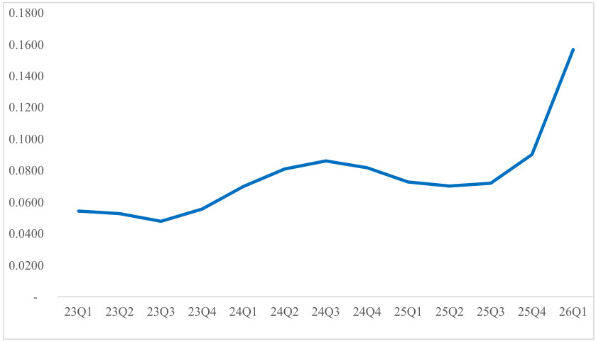 
数据来源:TrendForce统计数据 
## ①存储芯片 
报告期内,公司存储芯片销售收入、销售数量及平均单价(按容量)变动情 况如下: 

| 项目 | 2026年1-3月 | 2025年 | 2024年 |
| --- | --- | --- | --- |
| 销售收入 | / | 22.74% | 167.26% |
| 销售数量 | | 49.86% | 5.95% |
| 平均单价 | 218.00% | -18.10% | 152.26% |
 
报告期内,公司存储芯片销售收入逐年增长,主要由于存储行业景气度提升、 企业级存储芯片逐步获得国内头部数据中心企业级用户认可及公司产能提升。存 储芯片的销售数量增速低于NANDFlash产品整体增速,主要由于报告期内公司 将生产的存储芯片更多用于自主研发的智能终端、固态硬盘产品的生产,因此对 
1-1-160

---

<!-- 原文第 162 页 -->

长江存储控股股份有限公司 
招股说明书 
外销售的数量增长率低于其他类型产品。报告期内存储芯片的平均售价与市场价 格走势整体一致。 
## ②智能终端 
报告期内,公司智能终端销售收入、销售数量及平均单价(按容量)变动情 况如下: 

| 项目 | | 2026年1-3月 | 2025年 | 2024年 |
| --- | --- | --- | --- | --- |
| 销售收入 | 中 | | 76.50% | 227.44% |
| 销售数量 | / | | 92.10% | 72.53% |
| 平均单价 | 127.75% | | -8.12% | 89.79% |
 
报告期内,公司智能终端产品主要应用于智能手机等移动终端,已导入国内 主要智能手机厂商,销量和市场份额快速提升。智能终端产品平均售价与市场价 格走势整体一致,报告期内销售收入快速增长。 
## ③固态硬盘 
报告期内,公司固态硬盘销售收入、销量及平均单价(按容量)变动情况如 下: 

| 项目 | 2026年1-3月 | 2025年 | 2024年 |
| --- | --- | --- | --- |
| 销售收入 | / | 55.10% | 166.28% |
| 销售数量 | / | 76.55% | 92.73% |
| 平均单价 | 141.40% | -12.15% | 38.16% |
 
公司固态硬盘产品包括企业级固态硬盘、消费级固态硬盘和致态系列等个 人用户固态硬盘及存储卡。企业级固态硬盘主要应用于互联网基础设施、企业级 数据库等领域,主要客户为国内领先的互联网企业、服务器厂商和产业客户等; 消费级固态硬盘主要应用于笔记本、台式机等消费电子产品;个人用户产品直接 面向零售客户,产品种类涵盖固态硬盘、存储卡等。 
报告期内,公司固态硬盘销量保持逐年增长趋势,平均售价与市场价格走势 整体一致。 
## 2)其他产品及服务业务收入分析 
报告期内,公司其他产品及服务收入主要包括晶圆代工、NOR Flash产品销 
1-1-161

---

<!-- 原文第 163 页 -->

长江存储控股股份有限公司 
招股说明书 
售、芯片封测业务收入,其他主要为研发流片、技术授权等业务。具体收入金额 及占比如下: 
单位:万元 

| 项目 | 2026年1-3月 | | 2025年 | | 2024年 | | 2023年 | |
| --- | --- | --- | --- | --- | --- | --- | --- | --- |
| 金额 | 占比 | 金额 | 占比 | 金额 | 占比 | 金额 | 占比 |
| 晶圆代工 | 90.981.84 | 54.14% | 384.771.95 | 66.78% | 307,181.70 | 61.85% | 254,692.59 | 60.04% |
| NOR Flash产品 | 34,727.49 | 20.67% | 75,701.07 | 13.14% | 65,293.70 | 13.15% | 61.475.75 | 14.49% |
| 芯片封测 | 26,023.60 | 15.49% | 75,177.22 | 13.05% | 40,483.73 | 8.15% | 32.917.07 | 7.76% |
| 其他 | 16.313.49 | 9.71% | 40.522.39 | 7.03% | 83,696.70 | 16.85% | 75.085.93 | 17.70% |
| 合计 | 168,046.42 | 100.00% | 576,172.63 | 100.00% | 496,655.83 | 100.00% | 424,171.34 | 100.00% |
 
报告期内,公司晶圆代工(按片)、NOR Flash产品销售(按颗)、芯片封 测(按颗)收入销售数量及平均单价变动情况如下: 
## ①晶圆代工 

| 项目 | 2026年1-3月 | 2025年 | 2024年 |
| --- | --- | --- | --- |
| 销售收入 | / | 25.26% | 20.61% |
| 销售数量 | | 26.44% | 36.16% |
| 平均单价 | 3.49% | -0.94% | -11.42% |
 
报告期内,晶圆代工业务收入主要来自武汉新芯,根据客户需求提供晶圆代 工、键合等服务。 
## ②NOR Flash产品 

| 项目 | 2026年1-3月 | 2025年 | 2024年 |
| --- | --- | --- | --- |
| 销售收入 | / | 15.94% | 6.21% |
| 销售数量 | / | 41.59% | 26.41% |
| 平均单价 | 16.64% | -18.11% | -15.98% |
 
报告期内,公司NOR Flash产品为武汉新芯设计、生产和销售的NOR Flash 产品,该等产品主要应用于可穿戴式设备、汽车电子、工业控制等领域。 
## ③芯片封测 

| 项目 | 2026年1-3月 | 2025年 | 2024年 |
| --- | --- | --- | --- |
| 销售收入 | | 85.70% | 22.99% |
 
1-1-162

---

<!-- 原文第 164 页 -->

长江存储控股股份有限公司 
招股说明书 

| 项目 | 2026年1-3月 | 2025年 | 2024年 |
| --- | --- | --- | --- |
| 销售数量 | / | 63.96% | 25.26% |
| 平均单价 | -2.88% | 13.26% | -1.82% |
 
报告期内,宏茂微主要从事芯片封测业务,销售收入及数量增长主要因半导 体行业下游需求提升带动封装测试业务收入规模增长。 
## (2)主要产品市场区域构成分析 
报告期内,公司主要产品为NAND Flash产品,销售市场情况如下: 
单位:万元 

| 项目 | 2026年1-3月 | | 2025年 | | 2024年 | | 2023年 | |
| --- | --- | --- | --- | --- | --- | --- | --- | --- |
| 金额 | 占比 | 金额 | 占比 | 金额 | 占比 | 金额 | 占比 |
| 境内 | 1,661,103.70 | 36.72% | 2.420,492.40 | 42.72% | 2.258,708.89 | 56.64% | 633,377.91 | 44.92% |
| 境外 | 2.862,672.03 | 63.28% | 3,245,475.97 | 57.28% | 1,729,301.46 | 43.36% | 776.783.13 | 55.08% |
| 合计 | 4,523,775.73 | 100.00% | 5,665,968.37 | 100.00% | 3,988,010.34 | 100.00% | 1,410,161.04 | 100.00% |
 
注:上表按照客户注册地区分境内外销售。 
报告期内,公司NAND Flash 产品境内收入占比在35%-60%区间内,境外收 入主要来源于中国港澳台地区,主要由于部分下游客户出于外汇结算便利,倾向 于在中国香港等地区以美元计价开展交易。 
## (3)主要产品销售模式分析 
报告期内,公司主要产品的销售模式包括直销、经销,具体如下: 
单位:万元 

| 项目 | 2026年1-3月 | | 2025年 | | 2024年 | | 2023年 | |
| --- | --- | --- | --- | --- | --- | --- | --- | --- |
| 金额 | 占比 | 金额 | 占比 | 金额 | 占比 | 金额 | 占比 |
| 直销 | 1.349.294.34 | 29.83% | 1,604,114.01 | 28.31% | 819,770.45 | 20.56% | 445.636.01 | 31.60% |
| 经销 | 3.174.481.39 | 70.17% | 4,061.854.35 | 71.69% | 3,168,239.90 | 79.44% | 964,525.03 | 68.40% |
| 合计 | 4,523,775.73 | 100.00% | 5,665.968.37 | 100.00% | 3,988,010.34 | 100.00% | 1,410,161.04 | 100.00% |
 
报告期内,公司NAND Flash产品销售采用经销和直销相结合的方式,经销 方式占比较高,主要由于经销商能够在产品购销过程中配合提供资金结算便利, 及时向供货方支付款项并给予终端客户一定账期,减轻公司和终端客户的资金压 力,同时能够承担部分如仓储、物流、分拣包装等辅助工作,提高交易效率。 
1-1-163

---

<!-- 原文第 165 页 -->

长江存储控股股份有限公司 
招股说明书 
## (4)主要产品收入季节性分析 
单位:万元 

| 项目 | 2026年1-3月 金额 | 2025年 | | 2024年 | | 2023年 | |
| --- | --- | --- | --- | --- | --- | --- | --- |
| 金额 | 占比 | 金额 | 占比 | 金额 | 占比 |
| ·季度 | 4,523,775.73 | 916.900.32 | 16.18% | 841,684.59 | 21.11% | 186.789.22 | 13.25% |
| 二季度 | / | 1,353,201.87 | 23.88% | 1,006,677.16 | 25.24% | 369,129.65 | 26.18% |
| 三季度 | / | 1,396,736.32 | 24.65% | 1,035,760.39 | 25.97% | 456,542.52 | 32.38% |
| 四季度 | | 1,999,129.86 | 35.28% | 1,103,888.20 | 27.68% | 397,699.65 | 28.20% |
| 合计 | 4.523,775.73 | 5.665.968.37 | 100.00% | 3,988,010.34 | 100.00% | 1,410,161.04 | 100.00% |
 
报告期内,公司NAND Flash产品销量整体取决于市场需求及公司产量,售 价主要取决于市场供需情况。销售收入不存在显著季节性波动,偶发市场剧烈波 动可能导致下游备货需求随之短期调整。2025年第四季度占比较高主要由于AI 技术的迅猛发展引发全球数据总量及存储需求爆发式增长,NAND Flash产品需 求提升带动产品价格上涨。2026年第一季度,NAND Flash供需缺口持续扩大, 产品价格进一步上涨使公司NAND Flash产品收入规模快速增加,较上年同期增 长393.38%。 
## (二)营业成本分析 
## 1、营业成本构成及变动分析 
单位:万元 

| 项目 | 2026年1-3月 | | 2025年 | | 2024年 | | 2023年 | |
| --- | --- | --- | --- | --- | --- | --- | --- | --- |
| 金额 | 占比 | 金额 | 占比 | 金额 | 占比 | 金额 | 占比 |
| 主营业务成本 | 1,088,985.49 | 99.67% | 4,072,635.21 | 99.62% | 3,026,912.49 | 99.19% | 1,735,438.47 | 97.92% |
| 其他业务成本 | 3,648.24 | 0.33% | 15,566.54 | 0.38% | 24,592.29 | 0.81% | 36,828.13 | 2.08% |
| 合计 | 1,092,633.73 | 100.00% | 4.088.201.75 | 100.00% | 3.051.504.78 | 100.00% | 1.772.266.60 | 100.00% |
 
报告期内,公司主营业务成本占比在97.90%以上,与营业收入构成匹配。 
1-1-164

---

<!-- 原文第 166 页 -->

长江存储控股股份有限公司 
招股说明书 
## 2、主营业务成本构成及变动分析 
## (1)产品类别构成 
单位:万元 

| 项目 | 2026年1-3月 | | 2025年 | | 2024年 | | 2023年 | |
| --- | --- | --- | --- | --- | --- | --- | --- | --- |
| 金额 | 占比 | 金额 | 占比 | 金额 | 占比 | 金额 | 占比 |
| NAND Flash产品 | 962,020.61 | 88.34% | 3.588,978.48 | 88.12% | 2.622,433.96 | 86.64% | 1,396,010.67 | 80.44% |
| 其中:存储芯片 | 376,185.97 | 34.54% | 1,642,664.25 | 40.33% | 1,394,480.84 | 46.07% | 892,129.17 | 51.41% |
| 智能终端 | 445,773.56 | 40.93% | 1,486.971.32 | 36.51% | 897,587.58 | 29.65% | 364,841.85 | 21.02% |
| 固态硬盘 | 140.061.09 | 12.86% | 459,342.92 | 11.28% | 330.365.54 | 10.91% | 139.039.65 | 8.01% |
| 其他产品及服务 | 126.964.87 | 11.66% | 483,656.72 | 11.88% | 404,478.53 | 13.36% | 339.427.80 | 19.56% |
| 主营业务成本小计 | 1.088.985.49 | 100.00% | 4,072,635.21 | 100.00% | 3.026.912.49 | 100.00% | 1.735,438.47 | 100.00% |
 
报告期内,主营业务成本主要为NANDFlash产品成本,与主营业务收入构 成匹配。 
## (2)主要产品成本类别构成分析 
报告期内,主营业务成本主要为NAND Flash产品成本,NAND Flash产品 成本的具体构成如下: 
单位:万元 

| 项目 | 2026年1-3月 | | 2025年 | | 2024年 | | 2023年 | |
| --- | --- | --- | --- | --- | --- | --- | --- | --- |
| 金额 | 占比 | 金额 | 占比 | 金额 | 占比 | 金额 | 占比 |
| 包含存货跌价准备转销 | | | | | | | | |
| 材料 | 221,613.79 | 23.04% | 809,798.80 | 22.56% | 610,362.53 | 23.27% | 711,497.05 | 50.97% |
| 人工 | 48.480.65 | 5.04% | 171.061.50 | 4.77% | 134,572.06 | 5.13% | 140,644.92 | 10.07% |
| 制造费用及其他 | 692,757.51 | 72.01% | 2,648,378.32 | 73.79% | 2.036.044.78 | 77.64% | 1.921,903.99 | 137.67% |
| 存货跌价准备转销 | -831.33 | -0.09% | -40.260.14 | -1.12% | -158.545.42 | -6.05% | -1,378,035.28 | -98.71% |
| 合计 | 962,020.61 | 100.00% | 3,588,978.48 | 100.00% | 2,622,433.96 | 100.00% | 1,396,010.67 | 100.00% |
| 剔除存货跌价准备转销 | | | | | | | | |
| 材料 | 221,613.79 | 23.02% | 809,798.80 | 22.31% | 610,362.53 | 21.95% | 711,497.05 | 25.65% |
| 人工 | 48.480.65 | 5.04% | 171.061.50 | 4.71% | 134.572.06 | 4.84% | 140.644.92 | 5.07% |
| 制造费用及其他 | 692,757.51 | 71.95% | 2,648,378.32 | 72.97% | 2,036,044.78 | 73.21% | 1,921,903.99 | 69.28% |
| 合计 | 962,851.94 | 100.00% | 3.629,238.63 | 100.00% | 2,780,979.37 | 100.00% | 2.774,045.96 | 100.00% |
 
不考虑存货跌价准备转销影响,报告期内,公司NAND Flash 产品成本中材 
1-1-165

---

<!-- 原文第 167 页 -->

长江存储控股股份有限公司 
招股说明书 
料、人工、制造费用及其他占比分别为21%-26%、4.7%-5.1%、69%-74%。 
材料成本主要包括硅片、气体、化学品、靶材等成本。随着公司持续优化工 艺、提升良率,2024年较2023年材料成本占比下降并在后续期间保持占比相对 稳定。 
人工费用占比较低的原因为公司闪存晶圆制造生产线高度自动化,所需制造 人力资源投入相对较低。 
制造费用及其他占比较高主要原因为厂房、产线建设投入大,相应固定资产 折旧金额高。2024年之后,随着公司二期生产线主体建成转固,相应增加固定资 产折旧费用,制造费用及其他占比较2023年有所提升。 
## (三)毛利及毛利率分析 
## 1、综合毛利及毛利率情况分析 
单位:万元 

| 项目 | 毛利 | 占比 | 毛利率 |
| --- | --- | --- | --- |
| 2026年1-3月 | | | |
| 主营业务 | 3,602,836.66 | 99.76% | 76.79% |
| 其他业务 | 8,761.10 | 0.24% | 70.60% |
| 合计 | 3,611,597.76 | 100.00% | 76.77% |
| | 2025年 | | |
| 主营业务 | 2,169,505.79 | 97.28% | 34.76% |
| 其他业务 | 60,754.88 | 2.72% | 79.60% |
| 合计 | 2,230,260.67 | 100.00% | 35.30% |
| 2024年 | | | |
| 主营业务 | 1,457,753.68 | 99.25% | 32.51% |
| 其他业务 | 11,063.05 | 0.75% | 31.03% |
| 合计 | 1,468,816.73 | 100.00% | 32.49% |
| 2023年 | | | |
| 主营业务 | 98,893.91 | 96.85% | 5.39% |
| 其他业务 | 3,219.70 | 3.15% | 8.04% |
| 合计 | 102,113.61 | 100.00% | 5.45% |
 
报告期内,公司96.80%以上毛利来自主营业务,报告期各期主营业务收入 
1-1-166

---

<!-- 原文第 168 页 -->

长江存储控股股份有限公司 
招股说明书 
毛利率逐年提升,主要为NAND Flash产品售价上升及单位成本下降所致。其他 业务成本主要为废料销售成本、验证服务成本、租赁成本等,金额相对较小,毛 利率代表性较低。 
## 2、主营业务毛利率分析 
## (1)主营业务毛利率整体分析 
报告期内,公司主营业务主要为NANDFlash产品销售,毛利率水平主要影 响因素如下: 
## 1)产品售价 
NAND Flash产品标准化程度较高,售价主要取决于市场供需。2023年,全 球存储行业周期整体下行,产品价格下降。2024年以来,全球存储行业周期整体 回暖。直至2025年第四季度和2026年第一季度,产品价格在全球闪存产品需求 增长的带动下快速提升。由于公司NAND Flash产品成本中短期相对稳定的人工、 折旧摊销、水电动力费用等成本占比较高,产品售价高于以材料成本为主的变动 成本的部分形成新增毛利,售价上升对毛利率提升作用明显。 
## 2)产品技术迭代 
公司通过持续技术研发推进产品迭代,报告期内,公司主要销售产品逐步由 第三代闪存产品向第四代、第五代闪存产品迭代,新产品的存储密度明显提升。 同时,公司通过积累制造经验,不断改善工艺技术、提高产品良率,提升单片晶 圆的有效容量,从而摊薄单位成本,支撑毛利率的提升。 
## 3)产能提升 
报告期内,公司推进一期生产线升级改造和二期、三期生产线建设。2023年, 公司产能利用率处于爬坡阶段,规模效应尚未完全显现;2024年至2026年,公 司产能、产量均显著提升,有效摊薄新增折旧摊销费用。 
## (2)分产品毛利率分析 
报告期内,公司各类主营业务毛利、毛利率情况如下: 
1-1-167

---

<!-- 原文第 169 页 -->

长江存储控股股份有限公司 
招股说明书 
单位:万元 

| 项目 | 毛利 | 占比 | 毛利率 |
| --- | --- | --- | --- |
| | 2026年1-3月 | | |
| NAND Flash产品 | 3,561,755.11 | 98.86% | 78.73% |
| 其中:存储芯片 | 2,009,309.08 | 55.77% | 84.23% |
| 智能终端 | 1.221,057.84 | 33.89% | 73.26% |
| 固态硬盘 | 331,388.19 | 9.20% | 70.29% |
| 其他产品及服务 | 41,081.55 | 1.14% | 24.45% |
| 合计 | 3,602,836.66 | 100.00% | 76.79% |
| 2025年 | | | |
| NAND Flash产品 | 2,076,989.88 | 95.74% | 36.66% |
| 其中:存储芯片 | 1.301,739.10 | 60.00% | 44.21% |
| 智能终端 | 632,139.39 | 29.14% | 29.83% |
| 固态硬盘 | 143,111.40 | 6.60% | 23.75% |
| 其他产品及服务 | 92,515.91 | 4.26% | 16.06% |
| 合计 | 2.169,505.79 | 100.00% | 34.76% |
| 2024年 | | | |
| NAND Flash产品 | 1.365,576.39 | 93.68% | 34.24% |
| 其中:存储芯片 | 1,004,437.27 | 68.90% | 41.87% |
| 智能终端 | 303,064.17 | 20.79% | 25.24% |
| 固态硬盘 | 58,074.95 | 3.98% | 14.95% |
| 其他产品及服务 | 92,177.30 | 6.32% | 18.56% |
| 合计 | 1,457,753.68 | 100.00% | 32.51% |
| 2023年 | | | |
| NAND Flash产品 | 14.150.36 | 14.31% | 1.00% |
| 其中:存储芯片 | 5.475.26 | 5.54% | 0.61% |
| 智能终端 | 1,836.84 | 1.86% | 0.50% |
| 固态硬盘 | 6,838.26 | 6.91% | 4.69% |
| 其他产品及服务 | 84,743.55 | 85.69% | 19.98% |
| 合计 | 98.893.91 | 100.00% | 5.39% |
 
报告期内,公司毛利构成有所波动。2023年,由于存储行业整体处于下行周 期,NAND Flash产品毛利贡献较低,公司毛利主要来自晶圆代工、芯片封测等 业务。2024年以来,NANDFlash产品毛利规模及毛利率快速提升,毛利贡献超 过90%且逐年增加。 
1-1-168

---

<!-- 原文第 170 页 -->

长江存储控股股份有限公司 
招股说明书 
## 1)NAND Flash产品 
报告期内,公司NAND Flash产品毛利率逐年上升,具体如下: 
单位:万元 

| 项目 | 2026年1-3月 | 2025年 | 2024年 | 2023年 |
| --- | --- | --- | --- | --- |
| 销售收入 | 4,523,775.73 | 5,665,968.37 | 3,988,010.34 | 1,410,161.04 |
| 毛利率 | 78.73% | 36.66% | 34.24% | 1.00% |
| 毛利率(剔除存货跌 价准备转销后) | 78.72% | 35.95% | 30.27% | -96.72% |
 
各类NAND Flash产品平均单价、单位成本变动及毛利率(剔除存货跌价转 销后)情况如下: 

| 产品类型 | 项目 | 2026年1-3月 | 2025年 | 2024年 | 2023年 |
| --- | --- | --- | --- | --- | --- |
| NAND Flash 产品 | 平均单价变动 | 172.72% | -13.76% | 125.11% | |
| 单位成本变动 | -9.38% | -20.78% | -20.20% | |
| 毛利率 | 78.72% | 35.95% | 30.27% | -96.72% |
| 其中:存储芯片 | 平均单价变动 | 218.00% | -18.10% | 152.26% | |
| 单位成本变动 | -11.12% | -25.26% | -23.03% | |
| 毛利率 | 84.20% | 43.48% | 38.06% | -102.98% |
| 智能终端 | 平均单价变动 | 127.75% | -8.12% | 89.79% | / |
| 单位成本变动 | -13.54% | -16.61% | -22.81% | |
| 毛利率 | 73.25% | 29.53% | 22.36% | -90.88% |
| 固态硬盘 | 平均单价变动 | 141.40% | -12.15% | 38.16% | |
| 单位成本变动 | -8.38% | -26.37% | -25.31% | |
| 毛利率 | 70.27% | 21.67% | 6.55% | -72.88% |
 
注:2026年1-3月平均单价、单位成本变动幅度为相对2025年全年的变动幅度。 
公司智能终端和消费级固态硬盘主要应用于手机、个人电脑等移动终端,终 端客户业务体量大、议价能力强,且公司需与国际存储巨头竞争:企业级固态硬 盘性能要求最高,需满足低功耗、低延迟、长寿命和高可靠性等要求,在导入初 期单位成本较高。上述情况对报告期内智能终端、固态硬盘产品的毛利率形成一 定压力。2025年及2026年一季度,随着公司产品市场需求增加、市场竞争力提 升和单位成本的下降,上述产品毛利率有所提升。 
综上,在产品平均单价提升及单位成本下降共同推动下,报告期内公司 NAND Flash产品毛利率逐年提升。 
1-1-169

---

<!-- 原文第 171 页 -->

长江存储控股股份有限公司 
招股说明书 
## 2)其他产品及服务业务 
公司其他产品及服务主要为晶圆代工、NOR Flash产品销售、芯片封测业务, 毛利、毛利率情况如下: 
单位:万元 

| 项目 | 2026年1-3月 | | 2025年 | | 2024年 | | 2023年 | |
| --- | --- | --- | --- | --- | --- | --- | --- | --- |
| 毛利 | 毛利率 | 毛利 | 毛利率 | 毛利 | 毛利率 | 毛利 | 毛利率 |
| 晶圆代工 | 22,100.90 | 24.29% | 74.947.25 | 19.48% | 44.489.09 | 14.48% | 37.131.97 | 14.58% |
| NOR Flash产品 | 10,852.39 | 31.25% | 15,757.84 | 20.82% | 13,232.22 | 20.27% | 10,951.67 | 17.81% |
| 芯片封测 | 6.380.89 | 24.52% | 15,076.03 | 20.05% | 10.088.65 | 24.92% | 8.287.23 | 25.18% |
 
晶圆代工、NOR Flash产品销售、芯片封测业务平均单价、单位成本变动及 毛利率情况如下: 

| 产品类型 | 项目 | 2026年1-3月 | 2025年 | 2024年 | 2023年 |
| --- | --- | --- | --- | --- | --- |
| 晶圆代工 | 平均单价变动 | 3.49% | -0.94% | -11.42% | |
| 单位成本变动 | -2.70% | -6.72% | -11.32% | |
| 毛利率 | 24.29% | 19.48% | 14.48% | 14.58% |
| NOR Flash产品 | 平均单价变动 | 16.64% | -18.11% | -15.98% | |
| 单位成本变动 | 1.27% | -18.68% | -18.49% | |
| 毛利率 | 31.25% | 20.82% | 20.27% | 17.81% |
| 芯片封测 | 平均单价变动 | -2.88% | 13.26% | -1.82% | |
| 单位成本变动 | -8.31% | 20.60% | -1.48% | |
| 毛利率 | 24.52% | 20.05% | 24.92% | 25.18% |
 
注:2026年1-3月平均单价、单位成本变动幅度为相对2025年全年的变动幅度。 
报告期内,晶圆代工业务包括三维集成、数模混合、特色存储等类型,主要 为定制化代工服务,平均价格随具体代工类型及市场供需波动。 
报告期内,NOR Flash产品平均单价在2023年至2025年逐年下降,由于产 品成本亦逐年下降,毛利率保持相对稳定。2026年1-3月,NOR Flash产品价格 上涨,单位成本相对稳定,毛利率有所提升。 
报告期内,公司芯片封测业务平均单价、毛利率整体较为稳定,销量有所提 升带动收入增长。 
1-1-170

---

<!-- 原文第 172 页 -->

长江存储控股股份有限公司 
招股说明书 
## 3、同行业公司毛利率比较 

| 可比公司 | 2026年1-3月 | 2025年 | 2024年 | 2023年 |
| --- | --- | --- | --- | --- |
| 三星电子 | 61.19% | 39.38% | 37.99% | 30.33% |
| SK海力士 | 79.27% | 60.41% | 48.08% | -1.63% |
| 美光科技 | 74.41% | 45.31% | 30.92% | -14.49% |
| 凯侠 | 64.11% | 25.72% | 34.47% | -27.32% |
| 闪迪 | 78.35% | 34.81% | 33.65% | |
| 长鑫科技 | 79.16% | 40.99% | 5.58% | -1.93% |
| 台积电 | 66.25% | 59.89% | 56.12% | 54.36% |
| 中芯国际 | 21.48% | 21.62% | 18.59% | 21.89% |
| 华虹宏力 | 17.63% | 18.72% | 17.43% | 27.10% |
| 华润微 | 25.48% | 26.38% | 27.19% | 32.22% |
| 存储类可比公司均值 | 72.75% | 41.10% | 31.78% | -3.01% |
| 其他可比公司均值 | 32.71% | 31.66% | 29.84% | 33.89% |
| 全部可比公司均值 | 56.73% | 37.32% | 31.00% | 13.39% |
| 发行人整体 | 76.77% | 35.30% | 32.49% | 5.45% |
| 发行人NAND Flash产品 | 78.73% | 36.66% | 34.24% | 1.00% |
 
注1、可比公司财务数据来源于可比公司定期报告或招股说明书。由于美光科技、铠侠、闪 迪年度报告基准日与A股不同,基于区间可比因素考虑,如无特殊说明,本招股说明书使 用美光科技、铠侠、闪迪披露的季度报告数据按照日历年重新计算后的财务指标用作可比公 司对比使用。其中,美光科技较其他上市公司日历年数据整体提前一个月;铠侠未披露2023 年日历年第一季度数据,如无特殊说明,使用2023年第二季度至第四季度数据计算:长鑫 科技2026年1-3月数据使用其招股意向书附录中披露的2026年第一季度审阅报告数据计 算: 注2、存储类可比公司为从事NANDFlash及/或DRAM产品的三星电子、SK海力士、美光 科技、铠侠、闪迪、长鑫科技,其他可比公司指主要从事晶圆代工的企业台积电、中芯国际、 华虹宏力和其他半导体产品IDM企业华润微。 
选取主要从事存储产品生产的国内外主要企业三星电子、SK海力士、美光 科技、铠侠、闪迪和长鑫科技作为可比公司。同时,补充选取从事晶圆代工业务 的龙头企业台积电、中芯国际、华虹宏力和功率半导体IDM企业华润微作为可 比公司。 
存储类可比公司中,三星电子业务范围涵盖消费电子、IT&移动通信、各类 芯片制造及晶圆代工业务,基于其全产业链布局,能够通过自身下游产品消化部 分存储产品产能。因此,报告期内其毛利率相对其他存储类可比公司更为稳定。 其他从事NANDFlash 业务的存储行业龙头企业毛利率变动趋势与公司相似,即 
1-1-171

---

<!-- 原文第 173 页 -->

长江存储控股股份有限公司 
招股说明书 
2023年处于较低或负值水平,2024年和2025年毛利率回升,2026年第一季度 随着存储器产品市场价格的增长毛利率大幅提升。2026年第一季度,发行人 NAND Flash 产品毛利率已超过美光科技、铠侠及闪迪的综合毛利率,与SK海 力士接近。 
晶圆代工及IDM企业中:台积电、中芯国际、华虹宏力主要从事逻辑类、 模拟类芯片代工业务,与公司产品及业务模式存在较大差异;华润微主要从事功 率半导体IDM业务,与公司产品存在较大差异。该等公司报告期内毛利率波动 明显小于存储类IDM企业。 
综上,公司与存储类全球主要龙头企业毛利率具有可比性,主要受存储市场 行情变化影响,具有合理性,符合业务实际情况。 
## (四)期间费用分析 
报告期内,公司期间费用构成如下: 
单位:万元 

| 项目 | 2026年1-3月 | | 2025年 | | 2024年 | | 2023年 | |
| --- | --- | --- | --- | --- | --- | --- | --- | --- |
| 金额 | 占比营 业收入 | 金额 | 占比营 业收入 | 金额 | 占比营 业收入 | 金额 | 占比营 业收入 |
| 销售费用 | 12,001.59 | 0.26% | 36,784.16 | 0.58% | 29,280.90 | 0.65% | 23,261.76 | 1.24% |
| 管理费用 | 42,748.23 | 0.91% | 154,655.33 | 2.45% | 128,348.13 | 2.84% | 113,944.45 | 6.08% |
| 研发费用 | 176.312.62 | 3.75% | 558,459.15 | 8.84% | 429,438.65 | 9.50% | 431,048.67 | 23.00% |
| 财务费用 | 44,611.92 | 0.95% | 201,497.09 | 3.19% | 239,163.60 | 5.29% | 322.573.22 | 17.21% |
| 合计 | 275.674.36 | 5.86% | 951,395.73 | 15.06% | 826,231.28 | 18.28% | 890.828.10 | 47.53% |
 
2023年至2025年,公司期间费用规模整体呈先降后升趋势。报告期内,随 着公司营业收入快速增长,期间费用率呈下降趋势。 
## 1、销售费用分析 
## (1)销售费用明细 
单位:万元 

| 项目 | 2026年1-3月 | | 2025年 | | 2024年 | | 2023年 | |
| --- | --- | --- | --- | --- | --- | --- | --- | --- |
| 金额 | 占比 | 金额 | 占比 | 金额 | 占比 | 金额 | 占比 |
| 职工薪酬 | 9,736.81 | 81.13% | 24.435.11 | 66.43% | 19.292.69 | 65.89% | 15.132.03 | 65.05% |
| 样品及测试费 | 559.48 | 4.66% | 3.011.80 | 8.19% | 2,139.21 | 7.31% | 2.236.57 | 9.61% |
 
1-1-172

---

<!-- 原文第 174 页 -->

长江存储控股股份有限公司 
招股说明书 
项目 金额 2026年1-3月 占比 金额 2025年 占比 金额 2024年 占比 金额 2023年 占比
差旅招待费 532.55 4.44% 2.484.75 6.75% 2.174.77 7.43% 1.773.59 7.62%
业务宣传费 484.37 4.04% 3.893.75 10.59% 3,376.60 11.53% 1,480.17 6.36%
折旧摊销费 207.84 1.73% 889.82 2.42% 794.60 2.71% 810.65 3.48%
咨询服务费 20.55 0.17% 387.74 1.05% 326.75 1.12% 902.40 3.88%
股份支付费用 225.83 1.88% 495.18 1.35%
其他费用 234.15 1.95% 1,186.00 3.22% 1.176.27 4.02% 926.35 3.98%
合计 12,001.59 100.00% 36.784.16 100.00% 29,280.90 100.00% 23,261.76 100.00% 
报告期内,公司销售费用主要包括职工薪酬、样品及测试费等,随收入增长 而增加,占营业收入的比例较低且逐年下降。NAND Flash产品具有较为持续的 市场需求,主要依靠产品自身性能和价格竞争,因此销售费用占营业收入的比例 整体较低。 
公司于2025年实施员工持股计划,具体详见本招股说明书"第四节发行人 基本情况"之"十五、发行人本次申报前已经制定或实施的员工持股计划及相关安 排",股份支付根据持股员工类型分别确认营业成本、销售费用、管理费用及研 发费用,对公司财务状况影响较小。 
## (2)可比公司比较 
可比公司 2026年1-3月 2025年 2024年 2023年
长鑫科技 0.15% 0.55% 0.93% 1.88%
台积电 0.39% 0.44% 0.45% 0.49%
中芯国际 0.38% 0.45% 0.49% 0.56%
华虹宏力 0.35% 0.45% 0.48% 0.44%
华润微 1.57% 1.59% 1.56% 1.69%
可比公司均值 0.57% 0.70% 0.78% 1.01%
发行人 0.26% 0.58% 0.65% 1.24% 
注:三星电子、SK海力士、美光科技、铠侠和闪迪未分别披露管理费用及销售费用数据, 故此处未作比较(下同)。 
报告期内,公司销售费用率与可比公司平均值基本接近,随着2024年、2025 年和2026年1-3月公司收入规模显著提升,销售费用占营业收入的比例降至低 于可比公司平均水平。 
1-1-173

---

<!-- 原文第 175 页 -->

长江存储控股股份有限公司 
招股说明书 
## 2、管理费用 
## (1)管理费用明细 
单位:万元 

| 项目 | 2026年1-3月 | | 2025年 | | 2024年 | | 2023年 | |
| --- | --- | --- | --- | --- | --- | --- | --- | --- |
| 金额 | 占比 | 金额 | 占比 | 金额 | 占比 | 金额 | 占比 |
| 职工薪酬 | 27.676.11 | 64.74% | 77,339.54 | 50.01% | 65,036.99 | 50.67% | 61,365.68 | 53.86% |
| 专业服务费 | 5,198.09 | 12.16% | 36.037.92 | 23.30% | 22,204.71 | 17.30% | 12,373.55 | 10.86% |
| 折旧摊销费 | 4,748.37 | 11.11% | 20,216.88 | 13.07% | 22,239.47 | 17.33% | 23,707.85 | 20.81% |
| 办公维修费 | 1,557.50 | 3.64% | 6.934.20 | 4.48% | 6,615.32 | 5.15% | 7,056.53 | 6.19% |
| 租金、物业及水电费 | 1,038.63 | 2.43% | 4,593.27 | 2.97% | 4,077.12 | 3.18% | 3,990.28 | 3.50% |
| 软件使用费 | 199.55 | 0.47% | 2,077.53 | 1.34% | 1,224.86 | 0.95% | 866.43 | 0.76% |
| 股份支付费用 | 1,113.50 | 2.60% | 1,662.14 | 1.07% | | | | |
| 其他费用 | 1.216.47 | 2.85% | 5.793.86 | 3.75% | 6.949.65 | 5.41% | 4,584.13 | 4.02% |
| 合计 | 42,748.23 | 100.00% | 154,655.33 | 100.00% | 128,348.13 | 100.00% | 113,944.45 | 100.00% |
 
报告期内,公司管理费用规模整体呈增长趋势,主要包括职工薪酬、折旧摊 销费和专业服务费等,管理费用占营业收入比例持续下降。报告期内,公司管理 费用中职工薪酬规模呈上升趋势,折旧摊销费用较为稳定,专业服务费主要包括 咨询费、专利服务费、保险费等,报告期内整体呈上升趋势。 
(2)可比公司比较 

| 可比公司 | 2026年1-3月 | 2025年 | 2024年 | 2023年 |
| --- | --- | --- | --- | --- |
| 长鑫科技 | 0.95% | 10.73% | 9.75% | 25.03% |
| 台积电 | 1.93% | 2.16% | 2.89% | 2.82% |
| 中芯国际 | 4.02% | 5.10% | 6.64% | 6.97% |
| 华虹宏力 | 5.61% | 4.90% | 5.65% | 4.79% |
| 华润微 | 4.73% | 5.17% | 5.17% | 6.62% |
| 可比公司均值 | 3.45% | 5.61% | 6.02% | 9.25% |
| 发行人 | 0.91% | 2.45% | 2.84% | 6.08% |
 
2023年公司管理费用率与中芯国际、华润微水平接近,低于可比公司均值, 主要由于可比公司中长鑫科技2023年股份支付费用较高。2024年、2025年及 2026年1-3月,由于收入规模显著提升,公司管理费用率明显下降并低于可比公 司均值。 
1-1-174

---

<!-- 原文第 176 页 -->

长江存储控股股份有限公司 
招股说明书 
报告期内,公司管理费用、销售费用合计占营业收入的比例与可比公司对比 情况如下: 

| 可比公司 | 2026年1-3月 | 2025年 | 2024年 | 2023年 |
| --- | --- | --- | --- | --- |
| 三星电子 | 9.97% | 15.00% | 15.48% | 16.85% |
| SK海力士 | 3.08% | 5.17% | 5.93% | 10.52% |
| 美光科技 | 1.44% | 2.96% | 3.97% | 5.76% |
| 铠侠 | 4.65% | 4.75% | 4.52% | 7.10% |
| 闪迪 | 2.71% | 6.93% | 7.03% | |
| 长鑫科技 | 1.10% | 11.28% | 10.68% | 26.91% |
| 台积电 | 2.31% | 2.60% | 3.35% | 3.31% |
| 中芯国际 | 4.40% | 5.55% | 7.12% | 7.53% |
| 华虹宏力 | 5.97% | 5.36% | 6.13% | 5.23% |
| 华润微 | 6.31% | 6.76% | 6.73% | 8.31% |
| 存储类可比公司均值 | 3.83% | 7.68% | 7.94% | 13.43% |
| 其他可比公司均值 | 4.75% | 5.07% | 5.83% | 6.09% |
| 可比公司均值 | 4.19% | 6.64% | 7.09% | 10.17% |
| 发行人 | 1.16% | 3.03% | 3.49% | 7.32% |
 
公司销售及管理费用合计占营业收入的比例整体低于存储类可比公司平均 值,主要由于:1)三星电子业务范围较广,从事消费电子等面向消费者的终端 产品业务,因此销售及管理费用率较高:2)长鑫科技因股份支付费用较高导致 销售及管理费用率较高;3)公司报告期内营业收入增长速度较快。报告期内, 公司管理费用、销售费用合计占营业收入的比例整体与美光科技相对接近。 
## 3、研发费用 
## (1)研发费用明细 
单位:万元 

| 项目 | 2026年1-3月 | | 2025年 | | 2024年 | | 2023年 | |
| --- | --- | --- | --- | --- | --- | --- | --- | --- |
| 金额 | 占比 | 金额 | 占比 | 金额 | 占比 | 金额 | 占比 |
| 职工薪酬 | 98,435.37 | 55.83% | 243,834.89 | 43.66% | 190,902.60 | 44.45% | 159,677.56 | 37.04% |
| 折旧摊销费 | 33,101.98 | 18.77% | 114,918.94 | 20.58% | 98,265.08 | 22.88% | 118,839.47 | 27.57% |
| 材料测试费 | 17,389.07 | 9.86% | 66,709.98 | 11.95% | 67,047.98 | 15.61% | 69,397.53 | 16.10% |
| 维修保养费 | 9.871.24 | 5.60% | 43,601.09 | 7.81% | 35,833.10 | 8.34% | 37,330.94 | 8.66% |
 
1-1-175

---

<!-- 原文第 177 页 -->

长江存储控股股份有限公司 
招股说明书 
项目 金额 2026年1-3月 占比 金额 2025年 占比 金额 2024年 占比 金额 2023年 占比
软件使用费 8.086.13 4.59% 22.584.93 4.04% 16.644.16 3.88% 21,193.97 4.92%
水电气费 2.514.75 1.43% 8,139.40 1.46% 6.804.73 1.58% 8,832.58 2.05%
专利服务费 355.57 0.20% 7.008.33 1.25% 4.942.00 1.15% 4.793.09 1.11%
委托外部研发费 1,702.74 0.97% 36,811.67 6.59% 2.985.20 0.70% 3.595.59 0.83%
股份支付费用 1,949.88 1.11% 4,189.93 0.75%
其他费用 2.905.89 1.65% 10.660.00 1.91% 6.013.81 1.40% 7.387.94 1.71%
合计 176,312.62 100.00% 558,459.15 100.00% 429.438.65 100.00% 431,048.67 100.00% 
报告期内,公司保持较高的研发投入,主要包括职工薪酬、折旧摊销费、材 料测试费、维修保养费、软件使用费等。 
报告期内,研发费用中职工薪酬逐年增长,主要由于研发人员数量增加。2024 年,折旧摊销、水电气、维修保养费、软件使用费较2023年有所下降,2025年 较2024年有所上升,主要由于:2024年,公司生产规模显著提升,分摊至研发 活动的机器工时占比下降,导致分摊至研发费用中的折旧摊销、水电气等费用下 降;2025年,公司研发项目投入增加,对应折旧摊销、水电气等费用均有所增加; 2026年1-3月,由于研发人员数量和人均薪酬随公司业务规模扩大而增加,职工 薪酬占比提升,折旧摊销、材料消耗等支出占比有所下降。 
(2)可比公司比较 
可比公司 2026年1-3月 2025年 2024年 2023年
三星电子 8.47% 11.31% 11.63% 10.94%
SK海力士 4.66% 6.66% 6.70% 11.45%
美光科技 5.24% 9.65% 11.94% 19.22%
铠侠 1.40% 3.03% 3.16% 5.80%
闪迪 5.66% 13.58% 15.74%
长鑫科技 4.24% 15.52% 19.06% 49.75%
台积电 5.97% 6.47% 7.05% 8.44%
中芯国际 7.37% 8.20% 9.42% 11.03%
华虹宏力 9.33% 11.40% 11.30% 8.99%
华润微 9.30% 10.57% 11.53% 11.66%
存储类可比公司均值 4.95% 9.96% 11.37% 19.43% 
1-1-176

---

<!-- 原文第 178 页 -->

长江存储控股股份有限公司 
招股说明书 

| 可比公司 | 2026年1-3月 | 2025年 | 2024年 | 2023年 |
| --- | --- | --- | --- | --- |
| 其他可比公司均值 | 7.99% | 9.16% | 9.83% | 10.03% |
| 可比公司均值 | 6.16% | 9.64% | 10.75% | 15.25% |
| 发行人 | 3.75% | 8.84% | 9.50% | 23.00% |
 
2023年,公司研发费用率高于可比公司均值,主要系公司营业收入规模偏 低所致。2024年、2025年和2026年1-3月,公司保持高研发投入,2024年、 2025年接近可比公司平均水平,2026年1-3月由于营业收入增长幅度较大,研 发费用占营业收入比例有所下降,但与存储类可比公司变化趋势一致。 
## 4、财务费用 
单位:万元 

| 项目 | 2026年1-3月 | 2025年 | 2024年 | 2023年 |
| --- | --- | --- | --- | --- |
| 利息费用 | 36,124.71 | 212,179.07 | 318,426.21 | 372,010.58 |
| 减:利息收入 | 8.468.69 | 43,725.39 | 76,123.31 | 66.708.25 |
| 汇兑差额 | 12,653.78 | 23,815.35 | -3,920.74 | 13,512.00 |
| 应付纳入合并范围的结构化主 体的其他持有人的款项的利息 | 4,231.67 | 8,761.77 | | |
| 手续费及其他 | 70.45 | 466.29 | 781.45 | 3,758.90 |
| 合计 | 44.611.92 | 201,497.09 | 239,163.60 | 322,573.22 |
| 占比营业收入 | 0.95% | 3.19% | 5.29% | 17.21% |
 
报告期内,公司财务费用规模较高,但整体呈下降趋势,主要由于公司根据 经营情况降低整体有息负债规模,通过低利率有息负债置换等方式主动进行资本 结构管理,财务费用规模逐年下降。受报告期内美元汇率波动影响,汇兑差额有 所波动。 
## (五)利润表其他主要项目分析 
## 1、投资收益 
单位:万元 

| 项目 | 2026年1-3月 | 2025年 | 2024年 | 2023年 |
| --- | --- | --- | --- | --- |
| 处置交易性金融资产的投资收益 | 1,471.36 | 18,732.37 | 1,786.66 | 1,611.75 |
| 权益法核算的长期股权投资收益 | 44.20 | 3,455.24 | 3,379.68 | -23.16 |
| 持有交易性金融资产期间取得的 投资收益 | | 171.23 | | |
| 合计 | 1,515.57 | 22,358.84 | 5,166.34 | 1,588.59 |
 
1-1-177

---

<!-- 原文第 179 页 -->

长江存储控股股份有限公司 
招股说明书 
报告期内,公司投资收益主要为结构性存款及处置交易性金融资产产生的投 资收益、权益法核算的长期股权投资收益。 
## 2、公允价值变动收益 
单位:万元 

| 项目 | 2026年1-3月 | 2025年 | 2024年 | 2023年 |
| --- | --- | --- | --- | --- |
| 交易性金融资产变动收益 | 14,091.19 | 31,613.88 | 23,871.45 | 124.16 |
 
报告期内,公司公允价值变动收益为交易性金融资产变动收益,包括结构性 存款以及子公司长存资本、长存鸿图对产业链上下游上市公司的权益投资产生的 公允价值变动收益。 
## 3、信用减值损失和资产减值损失 
单位:万元 

| 项目 | 2026年1-3月 | 2025年 | 2024年 | 2023年 |
| --- | --- | --- | --- | --- |
| 应收账款信用减值(转回) 损失 | -7,692.07 | -2,600.03 | 11,717.80 | 60.91 |
| 其他应收款减值损失 | | | 8.42 | |
| 信用减值损失小计 | -7,692.07 | -2,600.03 | 11,726.22 | 60.91 |
| 存货跌价损失及合同履约成 本减值损失 | 24,852.17 | 69,317.52 | 11,641.14 | 1,135,252.22 |
| 投资性房地产减值损失 | 199.11 | 3,845.36 | 780.31 | |
| 固定资产减值损失 | - | 12,911.46 | 6,134.60 | 16,562.46 |
| 在建工程减值损失 | | | 3.224.61 | 0.47 |
| 资产减值损失小计 | 25,051.28 | 86,074.34 | 21,780.66 | 1,151,815.15 |
| 合计 | 17,359.21 | 83,474.31 | 33,506.88 | 1,151,876.06 |
 
报告期内,公司资产减值损失主要为存货跌价损失。2023年,公司存货跌价 损失及合同履约成本减值损失金额较高,主要由于存储市场处于下行周期, NANDFlash产品价格下跌导致存货可变现净值降低。2024年以来,随着存储市 场回暖,NAND Flash产品价格上升,存货跌价损失及合同履约成本减值损失金 额较2023年大幅降低。2025年及2026年1-3月,公司存货跌价损失及合同履约 成本减值损失金额分别为69,317.52万元和24.852.17万元,主要由于公司在生产 线建设初期储备部分备品备件,截至2025年末和2026年3月末部分备品备件库 龄较长,基于谨慎性考虑计提跌价准备。 
1-1-178

---

<!-- 原文第 180 页 -->

长江存储控股股份有限公司 
招股说明书 
## (六)纳税情况分析 
报告期内,公司主要税种纳税情况如下: 
单位:万元 

| 税种 | 期间 | 期初未交数 | 本期应交数 | 本期缴纳数 | 期末未交数 |
| --- | --- | --- | --- | --- | --- |
| 企业 所得税 | 2026年1-3月 | 2,615.51 | 4,627.20 | 3,662.44 | 3,580.27 |
| 2025年 | 1,589.34 | 21,114.76 | 20,088.58 | 2,615.51 |
| 2024年 | 3,601.90 | 5,447.17 | 7,459.73 | 1,589.34 |
| 2023年 | 2,075.10 | 6,468.76 | 4.941.95 | 3,601.90 |
| 增值税 | 2026年1-3月 | 20,400.60 | -2.580.15 | 12,997.92 | 4,822.53 |
| 2025年 | 22,469.51 | 27,600.28 | 29,669.18 | 20,400.60 |
| 2024年 | 1,194.06 | 29,728.66 | 8,453.21 | 22,469.51 |
| 2023年 | 918.21 | 17,441.00 | 17,165.15 | 1,194.06 |
 
注:上表列示企业所得税余额及当期发生额均不含代扣代缴企业所得税。增值税本期应交数 存在负数,为享受集成电路生产企业增值税加计抵减税收优惠的时间性差异影响。 
## (七)报告期最近一期末存在未弥补亏损的分析 
报告期内,公司净利润及各期末累计亏损情况如下: 
单位:万元 

| 项目 | 2026年1-3月 | 2025年 | 2024年 | 2023年 |
| --- | --- | --- | --- | --- |
| 归属于母公司所有者净利 润 | 3,337,887.88 | 1,421,073.80 | 677,074.52 | -1,918,064.00 |
| 扣除非经常性损益后归属 于母公司所有者净利润 | 3,317,215.49 | 1,330,909.72 | 622,964.02 | -1,935,986.21 |
| 累计亏损 | -340,403.81 | -3,678,291.69 | -5,117,750.60 | -5,706,309.73 |
 
2023年,公司净利润为负值,主要由于:1、产品销量及价格处于相对低位; 
2、二期生产线处于产能建设期及部分产线升级改造,产能未充分释放,单位成 本较高:3、公司推进产品研发及客户导入,研发投入较高。 
2024年,公司扭亏为盈,主要由于:1、存储行业周期回暖,产品售价提升; 
2、产能及良率提升,销量增加;3、规模效应显现、产品迭代等带来的单位成本 下降。 
2025年及2026年1-3月,公司经营业绩进一步提升,主要由于:1、公司二 期生产线满产,产销量提升:2、技术持续迭代,良率提升,产品单位成本下降; 
3、2025年四季度及2026年一季度,全球存储产品需求显著增加,NAND Flash 
1-1-179

---

<!-- 原文第 181 页 -->

长江存储控股股份有限公司 
招股说明书 
产品价格大幅提升。 
截至2026年3月31日,公司累计亏损大幅收窄至约34亿元,符合存储器 IDM企业发展特点,对公司现金流、业务拓展、人才吸引、团队稳定、研发投入、 战略性投入、生产经营可持续性等方面不存在重大不利影响。报告期内,公司3D NAND 相关主要核心技术已达到国际领先或国际先进水平,已构建相对完整的 产品体系及长期合作客户集群,营业收入、净利润持续快速增长。 
## 九、资产质量分析 
## (一)资产构成分析 
单位:万元 

| 项目 | 2026.3.31 | | 2025.12.31 | | 2024.12.31 | | 2023.12.31 | |
| --- | --- | --- | --- | --- | --- | --- | --- | --- |
| 金额 | 占比 | 金额 | 占比 | 金额 | 占比 | 金额 | 占比 |
| 流动资产 | 9.907.,421.32 | 37.87% | 6.665,906.40 | 29.19% | 6.471.671.44 | 30.67% | 7.322.854.28 | 37.01% |
| 非流动资产 | 16.251,425.79 | 62.13% | 16,173,709.85 | 70.81% | 14,630,744.84 | 69.33% | 12,465,002.35 | 62.99% |
| 资产合计 | 26,158,847.11 | 100.00% | 22.839,616.25 | 100.00% | 21,102,416.29 | 100.00% | 19,787,856.63 | 100.00% |
 
报告期内,公司总资产规模呈上升趋势。公司为IDM企业,呈重资产特征, 报告期各期非流动资产占总资产的比例约60%-70%。 
## 1、流动资产构成分析 
单位:万元 

| 项目 | 2026.3.31 | | 2025.12.31 | | 2024.12.31 | | 2023.12.31 | |
| --- | --- | --- | --- | --- | --- | --- | --- | --- |
| 金额 | 占比 | 金额 | 占比 | 金额 | 占比 | 金额 | 占比 |
| 货币资金 | 5,198,975.72 | 52.48% | 3.477,843.57 | 52.17% | 4,001,369.31 | 61.83% | 5.632,167.15 | 76.91% |
| 交易性金融资产 | 280,521.37 | 2.83% | 146,570.26 | 2.20% | 107,607.88 | 1.66% | 50,747.06 | 0.69% |
| 应收账款 | 2,284,493.37 | 23.06% | 954,063.26 | 14.31% | 544,292.83 | 8.41% | 172,948.92 | 2.36% |
| 预付款项 | 51,809.93 | 0.52% | 54,621.90 | 0.82% | 35.501.84 | 0.55% | 31,585.74 | 0.43% |
| 其他应收款 | 6,477.18 | 0.07% | 9.115.00 | 0.14% | 9,458.31 | 0.15% | 7,929.04 | 0.11% |
| 存货 | 1,859,199.28 | 18.77% | 1,662,065.06 | 24.93% | 1,570,640.01 | 24.27% | 1,346,363.42 | 18.39% |
| 持有待售资产 | 60.96 | 0.00% | 4.28 | 0.00% | 3.879.18 | 0.06% | | |
| 其他流动资产 | 225.883.50 | 2.28% | 361,623.07 | 5.42% | 198,922.09 | 3.07% | 81,112.96 | 1.11% |
| 流动资产合计 | 9,907,421.32 | 100.00% | 6,665,906.40 | 100.00% | 6,471,671.44 | 100.00% | 7,322,854.28 | 100.00% |
 
报告期内,公司流动资产主要包括货币资金、应收账款和存货,三者合计占 
1-1-180

---

<!-- 原文第 182 页 -->

长江存储控股股份有限公司 
招股说明书 
流动资产的比例达90%以上。流动资产规模变化源于货币资金及应收账款金额的 波动。 
## (1)货币资金 
单位:万元 

| 项目 | 2026.3.31 | 2025.12.31 | 2024.12.31 | 2023.12.31 |
| --- | --- | --- | --- | --- |
| 现金 | | | 4.20 | 4.14 |
| 银行存款 | 5,172,198.35 | 3,453,976.49 | 3,987,731.03 | 5,631,030.43 |
| 其他货币资金 | 13,166.41 | 12,296.91 | 105.94 | |
| 应收利息 | 13,610.95 | 11,570.17 | 13,528.14 | 1,132.58 |
| 合计 | 5,198,975.72 | 3,477,843.57 | 4,001,369.31 | 5,632,167.15 |
 
2023年至2025年,公司货币资金规模逐年下降,主要系公司持续开展项目 建设,同时主动降低有息负债规模。2026年1-3月,因公司销售收入及经营活动 产生的现金流量快速增长,货币资金规模增加。 
## (2)交易性金融资产 
单位:万元 

| 项目 | 2026.3.31 | 2025.12.31 | 2024.12.31 | 2023.12.31 |
| --- | --- | --- | --- | --- |
| 结构性存款 | 176,059.40 | 64,352.10 | 72,269.20 | 50,747.06 |
| 对上市公司的 权益投资 | 104,461.97 | 82,218.16 | 35,338.67 | |
| 合计 | 280.521.37 | 146,570.26 | 107,607.88 | 50,747.06 |
 
报告期内,公司交易性金融资产包括结构性存款及对上市公司的权益投资, 公司在资产负债表日根据评估结果确定对上市公司权益投资的公允价值。 
## (3)应收账款 
## 1)账面价值 
单位:万元 

| 项目 | 2026.3.31/ 2026年1-3月 | 2025.12.31/ 2025年 | 2024.12.31/ 2024年 | 2023.12.31/ 2023年 |
| --- | --- | --- | --- | --- |
| 账面余额 | 2,286,145.26 | 963,408.12 | 556,242.95 | 173,180.37 |
| 坏账准备 | 1,651.89 | 9,344.86 | 11,950.13 | 231.45 |
| 账面价值 | 2,284,493.37 | 954,063.26 | 544.292.83 | 172,948.92 |
| 营业收入 | 4,704,231.49 | 6,318,462.42 | 4,520,321.51 | 1,874,380.21 |
| 应收账款周转率(次/年) | 11.62 | 8.43 | 12.60 | 10.84 |
 
1-1-181

---

<!-- 原文第 183 页 -->

长江存储控股股份有限公司 
招股说明书 
注:2026年1-3月应收账款周转率已年化处理。 
报告期内,公司销售回款均采用银行转账方式,不存在应收票据。应收账款 周转次数保持较高水平,下游客户回款情况整体良好。 
## 2)账龄分布 
单位:万元 

| 项目 | 2026.3.31 | | 2025.12.31 | | 2024.12.31 | | 2023.12.31 | |
| --- | --- | --- | --- | --- | --- | --- | --- | --- |
| 账面余额 | 占比 | 账面余额 | 占比 | 账面余额 | 占比 | 账面余额 | 占比 |
| 6个月以内 | 2.270,654.81 | 99.32% | 937,491.66 | 97.31% | 553,492.96 | 99.51% | 172,678.80 | 99.71% |
| 6个月至1年 | 9,730.14 | 0.43% | 12,359.35 | 1.28% | 2.414.96 | 0.43% | | 0.00% |
| 1至2年 | 5,760.31 | 0.25% | 13,557.11 | 1.41% | 1.92 | 0.00% | 501.57 | 0.29% |
| 2至3年 | | | | | 333.11 | 0.06% | | 0.00% |
| 合计 | 2,286,145.26 | 100.00% | 963,408.12 | 100.00% | 556,242.95 | 100.00% | 173,180.37 | 100.00% |
 
报告期内,公司应收账款账龄在6个月以内的占比超过97%,客户信用情况 整体良好。 
## 3)信用减值准备 
报告期内,公司应收账款信用减值损失计提情况如下: 
单位:万元 

| 项目 | 账面余额 | 坏账准备 | 计提比例 | 账面价值 |
| --- | --- | --- | --- | --- |
| 2026.3.31 | | | | |
| 单项计提坏账准备 | | | | |
| 信用组合计提坏账准备 | 2,286,145.26 | 1,651.89 | 0.07% | 2,284,493.37 |
| 其中:账龄组合 | 2,286,145.26 | 1,651.89 | 0.07% | 2,284,493.37 |
| 合计 | 2.286,145.26 | 1,651.89 | 0.07% | 2,284,493.37 |
| 2025.12.31 | | | | |
| 单项计提坏账准备 | 12,882.65 | 7,882.65 | 61.19% | 5,000.00 |
| 信用组合计提坏账准备 | 950,525.46 | 1,462.20 | 0.15% | 949,063.26 |
| 其中:账龄组合 | 950,525.46 | 1,462.20 | 0.15% | 949,063.26 |
| 合计 | 963,408.12 | 9,344.86 | 0.97% | 954,063.26 |
| 2024.12.31 | | | | |
| 单项计提坏账准备 | 16,558.69 | 11.591.08 | 70.00% | 4,967.61 |
| 信用组合计提坏账准备 | 539,684.27 | 359.05 | 0.07% | 539,325.22 |
| 其中:账龄组合 | 539,684.27 | 359.05 | 0.07% | 539,325.22 |
 
1-1-182

---

<!-- 原文第 184 页 -->

长江存储控股股份有限公司 
招股说明书 

| 项目 | 账面余额 | 坏账准备 | 计提比例 | 账面价值 |
| --- | --- | --- | --- | --- |
| 合计 | 556,242.95 11,950.13 2.15% 544,292.83 | | | |
| 2023.12.31 | | | | |
| 单项计提坏账准备 | | | | |
| 信用组合计提坏账准备 | 173,180.37 | 231.45 | 0.13% | 172,948.92 |
| 其中:账龄组合 | 173,180.37 | 231.45 | 0.13% | 172,948.92 |
| 合计 | 173,180.37 | 231.45 | 0.13% | 172,948.92 |
 
报告期内,公司应收账款主要按账龄组合计提信用减值损失。报告期内,公 司按账龄组合计提信用减值损失的应收账款账龄分布情况如下: 
单位:万元 

| 项目 | 账面余额 | 坏账准备 | 预期平均损失率 | 账面价值 |
| --- | --- | --- | --- | --- |
| 2026.3.31 | | | | |
| 6个月内 | 2,270,654.81 | 252.31 | 0.01% | 2,270,402.50 |
| 6个月至1年 | 9,730.14 | 476.38 | 4.90% | 9.253.76 |
| 1至2年 | 5,760.31 | 923.19 | 16.03% | 4.837.12 |
| 2至3年 | | | | |
| 合计 | 2.286,145.26 | 1,651.89 | 0.07% | 2.284,493.37 |
| | | 2025.12.31 | | |
| 6个月内 | 936,727.16 | 291.05 | 0.03% | 936,436.11 |
| 6个月至1年 | 10,325.45 | 440.24 | 4.26% | 9,885.21 |
| 1至2年 | 3,472.85 | 730.91 | 21.05% | 2.741.94 |
| 2至3年 | | | | |
| 合计 | 950,525.46 | 1,462.20 | 0.15% | 949,063.26 |
| 2024.12.31 | | | | |
| 6个月内 | 539,347.80 | 196.16 | 0.04% | 539,151.64 |
| 6个月至1年 | 1.43 | | | 1.43 |
| 1至2年 | 1.92 | 0.38 | 20.00% | 1.54 |
| 2至3年 | 333.11 | 162.50 | 48.78% | 170.61 |
| 合计 | 539,684.27 | 359.05 | 0.07% | 539,325.22 |
| 2023.12.31 | | | | |
| 6个月内 | 172,678.80 | 166.45 | 0.10% | 172.512.35 |
| 6个月至1年 | | | | |
| 1至2年 | 501.57 | 65.00 | 12.96% | 436.57 |
 
1-1-183

---

<!-- 原文第 185 页 -->

长江存储控股股份有限公司 
招股说明书 

| 项目 | 账面余额 | 坏账准备 | 预期平均损失率 | 账面价值 |
| --- | --- | --- | --- | --- |
| 2至3年 | | | | |
| 合计 | 173,180.37 | 231.45 | 0.13% | 172,948.92 |
 
报告期内,公司账龄组合的应收账款账龄主要集中在6个月以内,应收账款 回款情况整体较好,信用减值准备计提符合业务实际情况。报告期各期末应收账 款余额期后回款比例如下,期后回款比例较高: 

| 项目 | 2026.3.31 | 2025.12.31 | 2024.12.31 | 2023.12.31 |
| --- | --- | --- | --- | --- |
| 期后回款比例 | 99.39% | 99.13% | 96.37% | 99.81% |
 
注:2023.12.31和2024.12.31应收账款期后回款为截至期后一年的回款数据:2025.12.31和 2026.3.31应收账款期后回款为截至2026.7.31的回款数据。 
报告期各期末,应收账款余额前五名客户的合计应收账款余额分别为 88,623.91万元、295,177.87万元、452,093.64万元和1,093,765.92万元,占应收 账款余额的比例分别为51.17%、53.07%、46.93%和47.84%。报告期内,公司应 收账款前五名均为多年合作客户,相关应收账款期后正常回款,不存在实际坏账 情况。 
## 4)可比公司比较 
报告期内,公司与可比公司账龄分布及坏账准备计提情况对比如下: 

| 可比公司 | 2025.12.31 | 2024.12.31 | | 2023.12.31 |
| --- | --- | --- | --- | --- |
| 账龄1年以内占比 | | | | |
| 长鑫科技 | 99.98% | | 100.00% | 100.00% |
| 中芯国际 | 99.45% | | 99.92% | 99.98% |
| 华虹宏力 | 99.54% | 99.41% | | 99.37% |
| 平均值 | 99.66% | 99.78% | | 99.78% |
| 发行人 | 98.59% | 99.94% | | 99.71% |
| 信用减值准备计提比例 | | | | |
| 三星电子 | 1.10% | 0.96% | | 0.96% |
| SK海力士 | 0.01% | 0.01% | | 0.15% |
| 长鑫科技 | 0.51% | 0.50% | | 0.50% |
| 台积电 | 0.18% | 0.17% | | 0.26% |
| 中芯国际 | 0.59% | 0.25% | | 0.15% |
| 华虹宏力 | 1.02% | 1.18% | | 1.23% |
 
1-1-184

---

<!-- 原文第 186 页 -->

长江存储控股股份有限公司 
招股说明书 

| 可比公司 | 2025.12.31 | 2024.12.31 | 2023.12.31 |
| --- | --- | --- | --- |
| 华润微 | 0.06% | 0.24% | 0.40% |
| 存储类可比公司均值 | 0.54% | 0.49% | 0.54% |
| 其他可比公司均值 | 0.46% | 0.46% | 0.51% |
| 可比公司均值 | 0.50% | 0.47% | 0.52% |
| 发行人 | 0.97% | 2.15% | 0.13% |
 
注:华润微按逾期时间披露应收账款及坏账计提,未按账龄披露,境外可比公司未披露应收 账款账龄情况;美光科技、铠侠、闪迪未披露分季度应收账款减值计提金额:因2026年一 季度多数可比公司均未披露上述数据,未进行比较。 
报告期内,公司应收账款账龄分布情况与中芯国际、华虹宏力基本接近。2024 年及2025年,公司信用减值损失计提比例高于可比公司均值,主要系单项计提 坏账所致。 
(4)预付款项 
单位:万元 

| 账龄 | 2026.3.31 | | 2025.12.31 | | 2024.12.31 | | 2023.12.31 | |
| --- | --- | --- | --- | --- | --- | --- | --- | --- |
| 金额 | 占比 | 金额 | 占比 | 金额 | 占比 | 金额 | 占比 |
| 1年以内 | 51,388.39 | 99.19% | 54,306.86 | 99.42% | 31,521.70 | 88.79% | 31,557.67 | 99.91% |
| 1-2年 | 299.32 | 0.58% | 190.80 | 0.35% | 3,955.23 | 11.14% | 3.00 | 0.01% |
| 2-3年 | 57.31 | 0.11% | 99.33 | 0.18% | | 0.00% | 13.00 | 0.04% |
| 3年以上 | 64.91 | 0.12% | 24.91 | 0.05% | 24.91 | 0.07% | 12.07 | 0.04% |
| 合计 | 51,809.93 | 100.00% | 54,621.90 | 100.00% | 35,501.84 | 100.00% | 31,585.74 | 100.00% |
| 占比营业成本 | 1.19% | | 1.34% | | | 1.16% | 1.78% | |
 
注:截至2026年3月末预付款项占营业成本比例已年化处理。 
报告期内,公司预付款项主要为预付供应商采购款,占总资产和营业成本的 比例较低。 
## (5)其他应收款 
单位:万元 

| 项目 | 2026.3.31 | 2025.12.31 | 2024.12.31 | 2023.12.31 |
| --- | --- | --- | --- | --- |
| 押金保证金及意向金 | 2,596.58 | 5,006.20 | 4,366.15 | 4,110.80 |
| 代垫款项 | 1,550.75 | 1,586.26 | 2,247.75 | 1,093.22 |
| 废料回收款 | 1,035.75 | 1,378.06 | 534.13 | 1,141.38 |
| 财产保险退款 | 114.05 | 114.05 | 1,698.08 | 1,293.64 |
| 其他 | 1,188.48 | 1,038.85 | 620.63 | 290.00 |
 
1-1-185

---

<!-- 原文第 187 页 -->

长江存储控股股份有限公司 
招股说明书 

| 项目 | 2026.3.31 | 2025.12.31 | 2024.12.31 | 2023.12.31 |
| --- | --- | --- | --- | --- |
| 账面余额 | 6,485.60 | 9,123.42 | 9,466.73 | 7.929.04 |
| 减:信用损失准备 | 8.42 | 8.42 | 8.42 | |
| 账面价值 | 6.477.18 | 9,115.00 | 9,458.31 | 7,929.04 |
 
报告期内,公司其他应收款占总资产的比例均不超过0.05%,主要包括押金 保证金及意向金等。 
## (6)存货 
## 1)存货构成 
单位:万元 

| 项目 | 账面余额 | 占比 | 跌价准备 | 账面价值 | 占比 |
| --- | --- | --- | --- | --- | --- |
| 2026.3.31 | | | | | |
| 原材料 | 438.866.18 | 22.01% | 98,147.31 | 340,718.88 | 18.33% |
| 自制半成品及在产品 | 971,842.39 | 48.73% | 15,256.90 | 956,585.49 | 51.45% |
| 库存商品 | 176,029.63 | 8.83% | 12,328.70 | 163,700.92 | 8.80% |
| 委托加工物资 | 344.866.04 | 17.29% | 1,556.85 | 343,309.19 | 18.47% |
| 发出商品 | 45,090.96 | 2.26% | 500.92 | 44.590.04 | 2.40% |
| 合同履约成本 | 4,519.35 | 0.23% | 1,701.02 | 2.818.32 | 0.15% |
| 房地产开发产品 | 12.927.16 | 0.65% | 5.450.72 | 7,476.43 | 0.40% |
| 合计 | 1,994,141.70 | 100.00% | 134,942.42 | 1,859,199.28 | 100.00% |
| 2025.12.31 | | | | | |
| 原材料 | 448,756.97 | 25.12% | 91,075.60 | 357,681.37 | 21.52% |
| 自制半成品及在产品 | 962,650.38 | 53.89% | 11,592.68 | 951,057.69 | 57.22% |
| 库存商品 | 181,976.58 | 10.19% | 12,765.20 | 169,211.38 | 10.18% |
| 委托加工物资 | 173,749.01 | 9.73% | 1,036.79 | 172,712.22 | 10.39% |
| 发出商品 | 2,096.74 | 0.12% | 23.65 | 2,073.09 | 0.12% |
| 合同履约成本 | 3.979.23 | 0.22% | 2,336.20 | 1,643.03 | 0.10% |
| 房地产开发产品 | 13,062.95 | 0.73% | 5,376.69 | 7,686.26 | 0.46% |
| 合计 | 1,786,271.86 | 100.00% | 124,206.80 | 1,662,065.06 | 100.00% |
| 2024.12.31 | | | | | |
| 原材料 | 379.541.62 | 22.26% | 81,027.42 | 298,514.20 | 19.01% |
| 自制半成品及在产品 | 830,851.14 | 48.73% | 26,069.34 | 804.781.80 | 51.24% |
| 库存商品 | 376,792.53 | 22.10% | 16,698.16 | 360,094.37 | 22.93% |
 
1-1-186

---

<!-- 原文第 188 页 -->

长江存储控股股份有限公司 
招股说明书 

| 项目 | 账面余额 | 占比 | 跌价准备 | 账面价值 | 占比 |
| --- | --- | --- | --- | --- | --- |
| 委托加工物资 | 86,275.61 | 5.06% | 3,270.43 | 83,005.18 | 5.28% |
| 发出商品 | 7,934.27 | 0.47% | 166.02 | 7,768.25 | 0.49% |
| 合同履约成本 | 7,536.13 | 0.44% | 1,843.58 | 5,692.55 | 0.36% |
| 房地产开发产品 | 15,987.35 | 0.94% | 5,203.69 | 10,783.66 | 0.69% |
| 合计 | 1,704,918.65 | 100.00% | 134,278.64 | 1,570,640.01 | 100.00% |
| 2023.12.31 | | | | | |
| 原材料 | 395,134.84 | 22.35% | 53,300.03 | 341,834.81 | 25.39% |
| 自制半成品及在产品 | 757,714.45 | 42.86% | 62,166.11 | 695,548.34 | 51.66% |
| 库存商品 | 468,484.70 | 26.50% | 285,259.56 | 183,225.14 | 13.61% |
| 委托加工物资 | 80,116.44 | 4.53% | 11,958.34 | 68,158.10 | 5.06% |
| 发出商品 | 38,670.07 | 2.19% | 5,022.34 | 33,647.73 | 2.50% |
| 合同履约成本 | 5,675.87 | 0.32% | | 5,675.87 | 0.42% |
| 房地产开发产品 | 22,230.79 | 1.26% | 3,957.37 | 18,273.42 | 1.36% |
| 合计 | 1,768,027.16 | 100.00% | 421,663.74 | 1,346,363.42 | 100.00% |
 
报告期内,公司存货主要为原材料、自制半成品及在产品、库存商品和委托 加工物资,存货规模构成较为稳定。 
## 2)跌价准备 
报告期内,公司存货跌价准备计提情况如下。 
单位:万元 

| 公司 | 2026.3.31 | | 2025.12.31 | | 2024.12.31 | | 2023.12.31 | |
| --- | --- | --- | --- | --- | --- | --- | --- | --- |
| 跌价准备 | 计提比例 | 跌价准备 | 计提比例 | 跌价准备 | 计提比例 | 跌价准备 | 计提比例 |
| 原材料 | 98,147.31 | 22.36% | 91,075.60 | 20.30% | 81,027.42 | 21.35% | 53.300.03 | 13.49% |
| 自制半成品及在产品 | 15,256.90 | 1.57% | 11.592.68 | 1.20% | 26,069.34 | 3.14% | 62,166.11 | 8.20% |
| 库存商品 | 12.328.70 | 7.00% | 12,765.20 | 7.01% | 16,698.16 | 4.43% | 285.259.56 | 60.89% |
| 委托加工物资 | 1,556.85 | 0.45% | 1,036.79 | 0.60% | 3,270.43 | 3.79% | 11,958.34 | 14.93% |
| 发出商品 | 500.92 | 1.11% | 23.65 | 1.13% | 166.02 | 2.09% | 5,022.34 | 12.99% |
| 合同履约成本 | 1,701.02 | 37.64% | 2,336.20 | 58.71% | 1.843.58 | 24.46% | | |
| 房地产开发产品 | 5,450.72 | 42.16% | 5,376.69 | 41.16% | 5,203.69 | 32.55% | 3,957.37 | 17.80% |
| 合计 | 134.942.42 | 6.77% | 124.206.80 | 6.95% | 134.278.64 | 7.88% | 421,663.74 | 23.85% |
 
报告期内,公司存货整体跌价准备计提、转销情况如下: 
1-1-187

---

<!-- 原文第 189 页 -->

长江存储控股股份有限公司 
招股说明书 
单位:万元 

| 项目 | 2026.3.31 /2026年1-3月 | 2025.12.31 /2025年 | 2024.12.31 /2024年 | 2023.12.31 /2023年 |
| --- | --- | --- | --- | --- |
| 期初余额 | 124,206.80 | 134,278.64 | 421,663.74 | 675,823.09 |
| 本期计提 | 24,852.17 | 69,317.52 | 11,641.14 | 1,135,252.22 |
| 本期转销 | 14,113.23 | 78,949.66 | 299,789.95 | 1.389,882.08 |
| 汇率变动影响 | -3.33 | -439.70 | 763.71 | 470.51 |
| 期末余额 | 134,942.42 | 124,206.80 | 134,278.64 | 421,663.74 |
 
## 3)可比公司比较 
报告期内,公司与可比公司存货跌价准备计提比较情况如下: 

| 可比公司 | 2025.12.31 | 2024.12.31 | 2023.12.31 |
| --- | --- | --- | --- |
| 三星电子 | 9.99% | 8.78% | 12.53% |
| SK海力士 | 3.35% | 7.99% | 15.25% |
| 美光科技(按财年列示) | 0.00% | 0.00% | 17.92% |
| 铠侠(按财年列示) | / | 5.55% | 16.90% |
| 闪迪(按财年列示) | / | 1.14% | 2.69% |
| 长鑫科技 | 2.80% | 12.56% | 24.29% |
| 台积电 | 0.74% | 0.31% | 1.39% |
| 中芯国际 | 11.15% | 11.12% | 9.76% |
| 华虹宏力 | 10.98% | 9.78% | 10.39% |
| 华润微 | 11.82% | 12.03% | 10.83% |
| 存储类可比公司均值 | 4.04% | 6.00% | 14.93% |
| 其他可比公司均值 | 8.67% | 8.31% | 8.09% |
| 可比公司均值 | 6.35% | 6.93% | 12.20% |
| 发行人 | 6.95% | 7.88% | 23.85% |
 
注:因美光科技、铠侠、闪迪未按季度披露存货跌价准备余额,本表列示上述可比公司各财 年数据并比较。因2026年一季度多数可比公司均未披露上述数据,未进行比较。 
2023年,公司存货跌价计提比例高于存储类可比公司均值水平,主要由于 公司长期资产投入规模较大使得产品单位成本较高,存货跌价准备计提比例较高。 2024年、2025年,随着全球闪存市场回暖和公司产品迭代,存货跌价计提比例 与存储类可比公司的差异减小。其他可比公司由于主要业务和产品与公司存在显 著差异,存货跌价准备计提比例与公司可比性相对较低。 
1-1-188

---

<!-- 原文第 190 页 -->

长江存储控股股份有限公司 
招股说明书 
## (7)其他流动资产 
单位:万元 

| 项目 | 2026.3.31 | 2025.12.31 | 2024.12.31 | 2023.12.31 |
| --- | --- | --- | --- | --- |
| 待抵扣进项税 | 183,607.56 | 325,201.98 | 166.275.32 | 66,169.40 |
| 其他待摊费用 | 21,667.57 | 17,793.75 | 11,168.84 | 6,142.44 |
| 预缴税费 | 15,704.07 | 14,055.92 | 10,710.30 | 8,323.39 |
| 应收退货成本 | 4.904.30 | 4.571.42 | 1,707.22 | 477.73 |
| 定期存款 | | | 9,060.40 | |
| 合计 | 225,883.50 | 361,623.07 | 198.922.09 | 81,112.96 |
 
报告期内,公司其他流动资产主要为待抵扣进项税,随公司固定资产投资和 材料采购增长。其他待摊费用随公司业务规模扩大而逐年增长。 
应收退货成本为报告期各期末公司根据尚在质保期内的已售产品收入和预 计退货比例预提退货准备金,计入其他流动负债;同时预提应收退货成本冲减营 业成本计入其他流动资产。报告期内金额增长主要由于产品销售规模增长,相应 计提的退货准备金增加。 
单位:万元 

| 项目 | 2026.3.31 | 2025.12.31 | 2024.12.31 | 2023.12.31 |
| --- | --- | --- | --- | --- |
| 其他流动负债-预提退货准备金 | 10,801.67 | 6,199.60 | 2,313.89 | 547.37 |
| 其他流动资产-应收退货成本 | 4.904.30 | 4,571.42 | 1,707.22 | 477.73 |
 
## 2、非流动资产构成分析 
报告期内,公司非流动资产构成如下: 
单位:万元 

| 项目 | 2026.3.31 | | 2025.12.31 | | 2024.12.31 | | 2023.12.31 | |
| --- | --- | --- | --- | --- | --- | --- | --- | --- |
| 金额 | 占比 | 金额 | 占比 | 金额 | 占比 | 金额 | 占比 |
| 长期股权投资 | 24,285.96 | 0.15% | 24,241.76 | 0.15% | 20,786.52 | 0.14% | 7,446.84 | 0.06% |
| 投资性房地产 | 24,210.04 | 0.15% | 24,718.57 | 0.15% | 30,036.99 | 0.21% | 32.395.15 | 0.26% |
| 固定资产 | 13,168,176.98 | 81.03% | 13,056,803.96 | 80.73% | 11,567,175.94 | 79.06% | 9.892,747.59 | 79.36% |
| 在建工程 | 2,414,692.70 | 14.86% | 2,455,271.43 | 15.18% | 2,393,578.20 | 16.36% | 2,232,825.96 | 17.91% |
| 使用权资产 | 22,479.07 | 0.14% | 15.730.44 | 0.10% | 7,492.82 | 0.05% | 10.071.49 | 0.08% |
| 无形资产 | 129.755.37 | 0.80% | 131.981.71 | 0.82% | 139.548.91 | 0.95% | 159.476.52 | 1.28% |
| 商誉 | 33,282.98 | 0.20% | 33,282.98 | 0.21% | 33,282.98 | 0.23% | 33,282.98 | 0.27% |
 
1-1-189

---

<!-- 原文第 191 页 -->

长江存储控股股份有限公司 
招股说明书 

| 项目 | 2026.3.31 | | 2025.12.31 | | 2024.12.31 | | 2023.12.31 | |
| --- | --- | --- | --- | --- | --- | --- | --- | --- |
| 金额 | 占比 | 金额 | 占比 | 金额 | 占比 | 金额 | 占比 |
| 长期待摊费用 | 5,219.71 | 0.03% | 4.423.74 | 0.03% | 545.62 | 0.00% | 1,536.44 | 0.01% |
| 递延所得税资产 | 36,962.68 | 0.23% | 35,323.45 | 0.22% | 14,697.66 | 0.10% | 11,162.87 | 0.09% |
| 其他非流动资产 | 392.360.29 | 2.41% | 391.931.81 | 2.42% | 423,599.20 | 2.90% | 84.056.50 | 0.67% |
| 非流动资产合计 | 16.251,425.79 | 100.00% | 16.173,709.85 | 100.00% | 14,630.744.84 | 100.00% | 12.465,002.35 | 100.00% |
 
报告期内,公司非流动资产主要为固定资产和在建工程,二者合计占非流动 资产的比例超过95%,非流动资产规模随产能增加保持增长趋势。 
## (1)长期股权投资 
单位:万元 

| 项目 | 2026.3.31 | 2025.12.31 | 2024.12.31 | 2023.12.31 |
| --- | --- | --- | --- | --- |
| 长存产业基金 | 24,285.96 | 24,241.76 | 20,786.52 | 7,446.84 |
| 合计 | 24,285.96 | 24.241.76 | 20.786.52 | 7,446.84 |
 
报告期内,公司长期股权投资为参股长存产业基金的份额。2024年长期股 权投资增加主要为对长存产业基金实缴出资。 
## (2)投资性房地产 
单位:万元 

| 项目 | 2026.3.31 | 2025.12.31 | 2024.12.31 | 2023.12.31 |
| --- | --- | --- | --- | --- |
| 账面原值 | 53,445.03 | 53,445.03 | 53,498.25 | 53,616.19 |
| 累计折旧 | 7,938.30 | 7,628.88 | 6,209.04 | 4,749.13 |
| 减值准备 | 21,296.68 | 21,097.57 | 17,252.21 | 16,471.90 |
| 账面价值 | 24,210.04 | 24,718.57 | 30,036.99 | 32,395.15 |
 
报告期内,公司投资性房地产为自行建造并用于对外出租的员工生活配套商 铺,账面价值占总资产的比例低于0.2%。 
## (3)固定资产 
单位:万元 

| 项目 | 2026.3.31 | 2025.12.31 | 2024.12.31 | 2023.12.31 |
| --- | --- | --- | --- | --- |
| 固定资产 | 13,167,929.35 | 13,056,449.19 | 11,565,608.10 | 9,888,724.57 |
| 固定资产清理 | 247.64 | 354.76 | 1,567.84 | 4,023.01 |
| 合计 | 13,168,176.98 | 13,056,803.96 | 11,567,175.94 | 9,892,747.59 |
 
1-1-190

---

<!-- 原文第 192 页 -->

长江存储控股股份有限公司 
招股说明书 
报告期内,公司固定资产(不含固定资产清理)情况如下: 
单位:万元 
项目 账面原值 累计折旧 减值准备 账面价值
2026.3.31
房屋建筑物 927,127.41 225,285.56 4.229.97 697,611.88
机器设备 20.339.055.01 7,882.883.55 29,599.44 12.426.572.02
运输工具 1.298.02 1,065.62 4.48 227.92
办公及其他设备 166.877.46 122,798.15 561.78 43,517.53
合计 21.434.357.90 8.232.032.88 34.395.67 13.167.929.35
2025.12.31
房屋建筑物 924,506.12 215.975.66 4.229.97 704,300.49
机器设备 19.750.761.90 7.412.680.44 30.840.11 12.307.241.34
运输工具 1,389.36 1,139.28 4.48 245.60
办公及其他设备 163.587.59 118.364.06 561.78 44.661.76
合计 20.840,244.97 7.748,159.44 35.636.34 13.056,449.19
2024.12.31
房屋建筑物 918,502.89 179.108.72 4.229.97 735,164.20
机器设备 16.593.592.13 5,783.271.38 25.248.53 10.785.072.22
运输工具 1.386.83 1.013.69 4.84 368.29
办公及其他设备 147.454.63 101,894.06 557.18 45,003.39
合计 17,660,936.48 6.065.287.85 30.040.53 11.565.608.10
2023.12.31
房屋建筑物 810,145.31 143,375.07 4,229.97 662.540.28
机器设备 13.603.047.49 4.404.322.82 25.244.55 9.173.480.12
运输工具 1,198.28 910.39 4.84 283.05
办公及其他设备 135.418.51 82.435.26 562.12 52.421.13
合计 14.549.809.60 4.631.043.54 30.041.49 9.888,724.57 
报告期内,公司固定资产主要为机器设备和房屋建筑物。2024年和2025年 固定资产账面价值增加,主要由于二期生产线等在建工程逐步竣工转固。 
半导体制造或晶圆代工企业普遍存在重资产投入特征,可比公司固定资产占 营业收入比例及折旧政策与公司比较情况如下: 
1-1-191

---

<!-- 原文第 193 页 -->

长江存储控股股份有限公司 招股说明书 

| 可比公司 | 固定资产账面价值/营业收入 | | | | 折旧年限 | | 残值率 | |
| --- | --- | --- | --- | --- | --- | --- | --- | --- |
| 2026.3.31 | 2025.12.31 | 2024.12.31 | 2023.12.31 | 房屋建筑物 | 机器设备 | 房屋建筑物 | 机器设备 |
| 三星电子 | 40.68% | 64.54% | 68.45% | 72.32% | 15/30年 | 5年 | | |
| SK海力士 | 39.02% | 79.78% | 90.88% | 160.85% | 10-50年 | 5-15年 | / | / |
| 美光科技 | 53.86% | 116.22% | 142.56% | 232.85% | 10-30年 | 7年 | / | / |
| 铠侠 | | | | | 3-60年 | 3-17年 | / | / |
| 闪迪 | | | 1 | | | |
| 长鑫科技 | 89.28% | 296.16% | 633.35% | 929.36% | 10-35年 | 5-8年 | 5% | 5% |
| 台积电 | 87.18% | 96.92% | 111.77% | 141.76% | 10-20年 | 5年 | / | / |
| 中芯国际 | 218.07% | 202.39% | 196.46% | 204.27% | 25年 | 5-10年 | | |
| 华虹宏力 | 186.99% | 187.60% | 199.01% | 120.83% | 25年 | 5-7年 | 5% | 5% |
| 华润微 | 66.57% | 69.00% | 76.60% | 66.07% | 25年 | 8年 | 5% | 2% |
| 存储类可比公司均值 | 55.71% | 139.18% | 233.81% | 348.84% | / | / | / | / |
| 其他可比公司均值 | 139.70% | 138.98% | 145.96% | 133.23% | / | / | / | / |
| 可比公司均值 | 97.71% | 139.08% | 189.88% | 241.04% | / | / | / | 1 |
| 发行人 | 69.98% | 206.65% | 255.89% | 527.79% | 5-25年 | 5-15年 | | |
 
注1:由于铠侠和闪迪共用合资工厂,固定资产账面价值占营业收入比例可比性较低; 注2:截至2026年3月末固定资产账面价值占营业收入比例已年化处理。 
1-1-192

---

<!-- 原文第 194 页 -->

长江存储控股股份有限公司 
招股说明书 
报告期内,公司固定资产账面价值占营业收入的比例高于存储类可比公司行 业均值主要由于公司处于产能快速扩张期,固定资产投入较大且成新率较高,但 报告期各期固定资产账面价值占营业收入的比例逐年下降,至2026年1-3月已 与存储类可比公司均值接近,资产效率逐渐显现。 
公司固定资产折旧年限与可比公司基本接近。其中,折旧年限超过10年的 机器设备为无尘室系统、气体系统等厂务设备,实际可使用年限长于光刻、刻蚀 等半导体制造设备,符合行业特点。 
## (4)在建工程 
单位:万元 

| 项目 | 2026.3.31 | 2025.12.31 | 2024.12.31 | 2023.12.31 |
| --- | --- | --- | --- | --- |
| 在建工程 | 2,414,058.08 | 2,454,990.27 | 2,393,578.20 | 2.232,825.96 |
| 工程物资 | 634.63 | 281.16 | | |
| 合计 | 2,414,692.70 | 2.455,271.43 | 2.393.578.20 | 2,232,825.96 |
 
报告期内,公司在建工程(不含工程物资)情况如下: 
单位:万元 

| 项目 | 账面原值 | 减值准备 | 账面价值 |
| --- | --- | --- | --- |
| 2026.3.31 | | | |
| 一期生产线 | 5,276.36 | 65.97 | 5,210.39 |
| 二期生产线 | 266,746.50 | 2,991.66 | 263,754.83 |
| 三期生产线 | 1,024,233.13 | - | 1,024,233.13 |
| 武汉新芯生产线 | 221,675.04 | | 221,675.04 |
| 其他 | 899,566.81 | 382.12 | 899,184.69 |
| 合计 | 2,417,497.83 | 3.439.75 | 2,414,058.08 |
| 2025.12.31 | | | |
| ·期生产线 | 5,478.91 | 65.97 | 5,412.94 |
| 二期生产线 | 502.491.49 | 2.991.66 | 499,499.82 |
| 三期生产线 | 850,709.27 | - | 850,709.27 |
| 武汉新芯生产线 | 203,038.03 | - | 203,038.03 |
| 其他 | 896,712.32 | 382.12 | 896,330.20 |
| 合计 | 2,458,430.02 | 3,439.75 | 2,454,990.27 |
| | 2024.12.31 | | |
 
1-1-193

---

<!-- 原文第 195 页 -->

长江存储控股股份有限公司 
招股说明书 

| 项目 | 账面原值 | 减值准备 | 账面价值 |
| --- | --- | --- | --- |
| 一期生产线 | 152,633.67 | 66.44 | 152.567.24 |
| 二期生产线 | 842,547.33 | 3,017.42 | 839,529.91 |
| 三期生产线 | 378,725.93 | | 378,725.93 |
| 武汉新芯生产线 | 258,191.78 | - | 258,191.78 |
| 其他 | 764,945.46 | 382.12 | 764,563.34 |
| 合计 | 2,397,044.17 | 3,465.97 | 2,393,578.20 |
| 2023.12.31 | | | |
| ·期生产线 | 221,840.45 | 19.97 | 221,820.48 |
| 二期生产线 | 1,292,305.70 | | 1,292,305.70 |
| 三期生产线 | 165,802.94 | - | 165,802.94 |
| 武汉新芯生产线 | 147,113.55 | | 147,113.55 |
| 其他 | 406,075.69 | 292.39 | 405,783.30 |
| 合计 | 2,233,138.32 | 312.36 | 2,232,825.96 |
 
报告期内,2023年至2025年在建工程规模逐年提升,2026年3月末随转固 略有下降,主要由于公司持续推进二期、三期生产线建设。公司在建工程减值为 附属设备减值,主要为二期生产线中未安装的个别设备因此前投入生产的同类设 备运行情况不及预期而使用其他设备代替,导致前述设备闲置并全额计提减值准 备。 
报告期内,公司主要在建工程变动情况如下: 
单位:万元 

| 项目 | 期初金额 | 报告期内投入 | 报告期内转固 | 报告期内 其他减少 | 期末金额 | 工程投入 比例 |
| --- | --- | --- | --- | --- | --- | --- |
| 二期生产线 | 1,580,231.79 | 4,864,115.41 | 6,177,317.14 | 283.56 | 266,746.50 | 98.61% |
| 三期生产线 | | 1,392,912.15 | 368.679.02 | | 1,024,233.13 | 16.76% |
 
## (5)使用权资产 
单位:万元 

| 项目 | 2026.3.31 | 2025.12.31 | 2024.12.31 | 2023.12.31 |
| --- | --- | --- | --- | --- |
| 使用权资产 | 22,479.07 | 15,730.44 | 7,492.82 | 10,071.49 |
 
报告期内,公司使用权资产主要包括外地办公室和厂房租赁等,占总资产比 例低于0.1%。 
1-1-194

---

<!-- 原文第 196 页 -->

长江存储控股股份有限公司 
招股说明书 
## (6)无形资产 
单位:万元 

| 项目 | 账面原值 | 累计摊销 | 减值准备 | 账面价值 |
| --- | --- | --- | --- | --- |
| 2026.3.31 | | | | |
| 土地使用权 | 126.469.47 | 25.228.46 | | 101,241.01 |
| 软件 | 132,962.50 | 109,455.02 | 4.43 | 23,503.06 |
| 专利使用权及非专利技术 | 33,098.43 | 31,578.94 | - | 1.519.49 |
| 尚未验收的无形资产 | 1,114.79 | | - | 1.114.79 |
| 其他 | 3.412.15 | 1,035.12 | | 2.377.03 |
| 合计 | 297,057.34 | 167,297.54 | 4.43 | 129.755.37 |
| 2025.12.31 | | | | |
| 土地使用权 | 126,469.47 | 24,537.93 | | 101,931.54 |
| 软件 | 131,616.70 | 108,973.22 | 4.43 | 22.639.05 |
| 专利使用权及非专利技术 | 33,098.43 | 31,277.16 | - | 1,821.27 |
| 尚未验收的无形资产 | 4,282.06 | | - | 4,282.06 |
| 其他 | 2,257.80 | 950.01 | | 1,307.79 |
| 合计 | 297.724.46 | 165.738.32 | 4.43 | 131,981.71 |
| 2024.12.31 | | | | |
| 土地使用权 | 126.602.68 | 21,823.99 | | 104,778.69 |
| 软件 | 131,927.34 | 101,430.37 | 4.43 | 30.492.55 |
| 专利使用权及非专利技术 | 33,556.98 | 30,090.76 | - | 3,466.23 |
| 尚未验收的无形资产 | 715.14 | | - | 715.14 |
| 其他 | 930.99 | 834.68 | | 96.31 |
| 合计 | 293,733.13 | 154,179.79 | 4.43 | 139,548.91 |
| 2023.12.31 | | | | |
| 土地使用权 | 126,514.46 | 19.029.73 | | 107,484.72 |
| 软件 | 119,676.97 | 73,088.09 | 4.43 | 46,584.45 |
| 专利使用权及非专利技术 | 31,760.46 | 27,024.23 | | 4.736.24 |
| 尚未验收的无形资产 | 415.04 | | - | 415.04 |
| 其他 | 918.48 | 662.41 | | 256.07 |
| 合计 | 279.285.41 | 119,804.46 | 4.43 | 159,476.52 |
 
报告期内,公司无形资产规模整体较为稳定,主要为土地使用权、软件和专 利使用权及非专利技术。软件主要外采设计软件等;专利使用权及非专利技术主 
1-1-195

---

<!-- 原文第 197 页 -->

长江存储控股股份有限公司 
招股说明书 
要为技术许可及IP授权等:尚未验收的无形资产主要为部署中尚未验收的软件 项目。 
报告期内,公司主要无形资产摊销年限与可比公司不存在显著差异,具体如 下: 

| 可比公司 | 土地使用权 | 软件 | 专利使用权及非专利技术 |
| --- | --- | --- | --- |
| 长鑫科技 | 50年 | 2-10年 | 5年 |
| 中芯国际 | 50-70年 | 3年 | 3-15年 |
| 华虹宏力 | 42或50年 | 3-5年 | 5年 |
| 华润微 | 50年 | 5年 | 5-10年 |
| 发行人 | 50年 | 2-10年 | 3-5年 |
 
(7)商誉 
报告期各期末公司商誉账面余额和账面价值均为33,282.98万元,分别为 2016年取得长江存储、武汉新芯控制权,2019年取得宏茂微控制权形成。报告 期各期末各商誉相关资产组均未发生减值,未计提商誉减值准备。 
单位:万元 

| 项目 | 2026.3.31 | 2025.12.31 | 2024.12.31 | 2023.12.31 |
| --- | --- | --- | --- | --- |
| 长江存储 | 10,044.94 | 10,044.94 | 10,044.94 | 10,044.94 |
| 武汉新芯 | 20,622.05 | 20,622.05 | 20,622.05 | 20,622.05 |
| 宏茂微 | 2,615.99 | 2,615.99 | 2,615.99 | 2,615.99 |
| 合计 | 33,282.98 | 33.282.98 | 33.282.98 | 33,282.98 |
 
(8)其他非流动资产 
单位:万元 

| 项目 | 2026.3.31 | 2025.12.31 | 2024.12.31 | 2023.12.31 |
| --- | --- | --- | --- | --- |
| 预付长期资产款 | 371,971.89 | 379,410.42 | 420,195.73 | 80,682.45 |
| 合同履约成本 | 19,847.56 | 12,012.30 | | |
| 保证金 | 540.84 | 509.10 | 3,403.48 | 3,374.05 |
| 合计 | 392,360.29 | 391,931.81 | 423,599.20 | 84,056.50 |
 
公司其他非流动资产主要为预付长期资产款,主要为预付设备采购款、工程 款。2024年末,预付长期资产款余额增长,主要由于武汉新芯三期工程设备采购 预付款。2025年末、2026年3月末新增合同履约成本主要为长期合同执行产生 的累计履约成本。 
1-1-196

---

<!-- 原文第 198 页 -->

长江存储控股股份有限公司 
招股说明书 
负债构成分析 
单位:万元 

| 项目 | 2026.3.31 | | 2025.12.31 | | 2024.12.31 | | 2023.12.31 | |
| --- | --- | --- | --- | --- | --- | --- | --- | --- |
| 金额 | 占比 | 金额 | 占比 | 金额 | 占比 | 金额 | 占比 |
| 流动负债 | 3,124,525.73 | 27.36% | 3.587,897.62 | 31.33% | 3.716.197.61 | 30.99% | 2.536,799.24 | 20.91% |
| 非流动负债 | 8,293,739.27 | 72.64% | 7,863,097.52 | 68.67% | 8,276,050.40 | 69.01% | 9,592,300.78 | 79.09% |
| 负债总计 | 11,418,265.01 | 100.00% | 11,450.995.14 | 100.00% | 11,992.248.01 | 100.00% | 12,129.100.02 | 100.00% |
 
报告期内,公司负债规模逐年下降,主要系借款减少所致。非流动负债占比 整体约70%-80%,与资产结构相匹配。 
## 1、流动负债构成分析 
单位:万元 

| 项目 | 2026.3.31 | | 2025.12.31 | | 2024.12.31 | | 2023.12.31 | |
| --- | --- | --- | --- | --- | --- | --- | --- | --- |
| 金额 | 占比 | 金额 | 占比 | 金额 | 占比 | 金额 | 占比 |
| 短期借款 | 140,858.61 | 4.51% | 142,958.61 | 3.98% | | | 38,500.00 | 1.52% |
| 应付票据 | 43,003.72 | 1.38% | 47,708.27 | 1.33% | 26,000.00 | 0.70% | | |
| 应付账款 | 1,544,841.60 | 49.44% | 1,676,247.99 | 46.72% | 1,591,235.95 | 42.82% | 760,345.94 | 29.97% |
| 预收款项 | 462.30 | 0.01% | 468.25 | 0.01% | 365.77 | 0.01% | 365.30 | 0.01% |
| 合同负债 | 56,646.08 | 1.81% | 39,871.42 | 1.11% | 115.268.87 | 3.10% | 102,751.33 | 4.05% |
| 应付职工薪酬 | 109,087.29 | 3.49% | 108,280.85 | 3.02% | 87,120.16 | 2.34% | 74,568.24 | 2.94% |
| 应交税费 | 16.138.44 | 0.52% | 30,669.04 | 0.85% | 29.993.63 | 0.81% | 10.124.22 | 0.40% |
| 其他应付款 | 83,083.84 | 2.66% | 80,850.84 | 2.25% | 714,571.47 | 19.23% | 252,707.08 | 9.96% |
| 年内到期的非 流动负债 | 1,109,225.32 | 35.50% | 1,450,088.72 | 40.42% | 1,139,930.41 | 30.67% | 1,292,882.27 | 50.97% |
| 其他流动负债 | 21,178.54 | 0.68% | 10,753.62 | 0.30% | 11,711.34 | 0.32% | 4,554.86 | 0.18% |
| 流动负债合计 | 3,124,525.73 | 100.00% | 3,587,897.62 | 100.00% | 3,716,197.61 | 100.00% | 2,536,799.24 | 100.00% |
 
报告期内,公司流动负债随业务规模增长,主要为应付账款、其他应付款和 一年内到期的非流动负债,三者合计占比在87%以上。 
## (1)短期借款 
单位:万元 

| 项目 | 2026.3.31 | 2025.12.31 | 2024.12.31 | 2023.12.31 |
| --- | --- | --- | --- | --- |
| 已议付信用证 | 40,800.00 | 42,900.00 | | 38,500.00 |
| 信用借款 | 100,058.61 | 100,058.61 | | |
 
1-1-197

---

<!-- 原文第 199 页 -->

长江存储控股股份有限公司 
招股说明书 

| 项目 | 2026.3.31 | 2025.12.31 | 2024.12.31 | 2023.12.31 |
| --- | --- | --- | --- | --- |
| 合计 | 140,858.61 | 142,958.61 | | 38,500.00 |
 
报告期内,公司短期借款规模整体较低,主要为已议付的信用证和信用借款。 
## (2)应付票据 
单位:万元 

| 项目 | 2026.3.31 | 2025.12.31 | 2024.12.31 | 2023.12.31 |
| --- | --- | --- | --- | --- |
| 银行承兑汇票 | 43,003.72 | 47,708.27 | 26,000.00 | |
| 合计 | 43,003.72 | 47.708.27 | 26,000.00 | |
 
报告期内,公司应付票据主要为支付国网湖北电力的电费款所开立的银行承 兑汇票,均按期兑付。 
## (3)应付账款 
单位:万元 

| 项目 | 2026.3.31 | 2025.12.31 | 2024.12.31 | 2023.12.31 |
| --- | --- | --- | --- | --- |
| 应付长期资产购置款 | 944,007.39 | 1,121,142.70 | 1,131,992.45 | 421,292.87 |
| 应付材料采购款 | 446,803.97 | 434,949.12 | 360,067.07 | 241,865.07 |
| 应付服务采购款 | 154,030.25 | 120,156.17 | 99,176.43 | 97,188.00 |
| 合计 | 1,544,841.60 | 1,676,247.99 | 1,591,235.95 | 760,345.94 |
| 占比营业成本 | 35.35% | 41.00% | 52.15% | 42.90% |
 
注:截至2026年3月末应付账款占营业成本比例已年化处理。 
报告期内,公司应付账款主要为应付长期资产购置款,与报告期内生产线投 资建设进度相匹配。 
## (4)合同负债 
单位:万元 

| 项目 | 2026.3.31 | 2025.12.31 | 2024.12.31 | 2023.12.31 |
| --- | --- | --- | --- | --- |
| 预收货款 | 48,665.43 | 28,377.05 | 93,654.38 | 99,743.83 |
| 预收服务款 | 7,732.35 | 11,184.07 | 20,993.63 | 707.55 |
| 预收购房款 | 248.29 | 310.31 | 620.86 | 2,299.95 |
| 合计 | 56,646.08 | 39,871.42 | 115,268.87 | 102,751.33 |
 
报告期内,公司合同负债主要为预收货款、预收服务款等。 
1-1-198

---

<!-- 原文第 200 页 -->

长江存储控股股份有限公司 
招股说明书 
## (5)应付职工薪酬 
单位:万元 

| 项目 | 2026.3.31 | 2025.12.31 | 2024.12.31 | 2023.12.31 |
| --- | --- | --- | --- | --- |
| 短期薪酬 | 107,636.93 | 106,836.81 | 85,885.09 | 73.449.11 |
| 离职后福利-设定提存计划 | 1,429.69 | 1.427.41 | 1,235.08 | 1,119.13 |
| 辞退福利 | 20.67 | 16.62 | | |
| 合计 | 109,087.29 | 108,280.85 | 87,120.16 | 74,568.24 |
 
报告期内,公司应付职工薪酬整体呈增长趋势,主要由于员工数量随业务规 模增长。 
## (6)应交税费 
单位:万元 

| 项目 | 2026.3.31 | 2025.12.31 | 2024.12.31 | 2023.12.31 |
| --- | --- | --- | --- | --- |
| 增值税 | 4,822.53 | 20,400.60 | 22,469.51 | 1,194.06 |
| 代扣代缴个人所得税 | 2,242.78 | 3,868.92 | 3,133.04 | 2,310.02 |
| 企业所得税 | 3,580.27 | 2,615.51 | 1.589.34 | 3,601.90 |
| 房产税 | 1,762.85 | 1,758.45 | 1,672.95 | 1.476.87 |
| 印花税 | 3,064.75 | 1,704.31 | 1,000.93 | 1,451.39 |
| 其他税费 | 665.27 | 321.24 | 127.87 | 89.98 |
| 合计 | 16,138.44 | 30,669.04 | 29,993.63 | 10,124.22 |
 
报告期内,公司应交税费主要包括增值税、代扣代缴个人所得税、企业所得 税等。 
## (7)其他应付款 
单位:万元 

| 项目 | 2026.3.31 | 2025.12.31 | 2024.12.31 | 2023.12.31 |
| --- | --- | --- | --- | --- |
| 股东借款 | | | 657,000.00 | 190,000.00 |
| 预提费用 | 76,051.60 | 70,613.60 | 43,037.88 | 36,134.22 |
| 押金及保证金 | 4,942.22 | 4,538.19 | 9,315.85 | 17,991.87 |
| 其他 | 2,090.02 | 5,699.04 | 5,217.75 | 8.580.99 |
| 合计 | 83,083.84 | 80,850.84 | 714,571.47 | 252,707.08 |
 
2023年末、2024年末,公司其他应付款主要为股东方提供的借款,截至2025 年末均已清偿。预提费用主要为按照费用所属期间预提的零部件消耗费用、咨询 
1-1-199

---

<!-- 原文第 201 页 -->

长江存储控股股份有限公司 
招股说明书 
费及专利服务费等。 
(8)一年内到期的非流动负债 
单位:万元 

| 项目 | 2026.3.31 | 2025.12.31 | 2024.12.31 | 2023.12.31 |
| --- | --- | --- | --- | --- |
| -年内到期的长期借款 | 1,059,883.61 | 1,401,437.90 | 1,094,653.45 | 1,147,128.64 |
| 一年内到期的长期应付款 | 36.894.71 | 36,564.69 | 34,338.89 | 107,072.91 |
| 一年内到期的长期借款利息 | 4,960.45 | 5,303.35 | 7,697.46 | 33,433.72 |
| 年内到期的租赁负债 | 5,559.76 | 4,856.00 | 3,240.62 | 5,247.00 |
| 一年内到期的预计负债 | 1,926.78 | 1,926.78 | | |
| 合计 | 1,109,225.32 | 1,450,088.72 | 1,139,930.41 | 1,292,882.27 |
 
报告期内,公司一年内到期的非流动负债主要为长期借款、长期应付款、租 赁负债中将在一年内支付的部分以及长期借款利息。 
(9)其他流动负债 
单位:万元 

| 项目 | 2026.3.31 | 2025.12.31 | 2024.12.31 | 2023.12.31 |
| --- | --- | --- | --- | --- |
| 待转销项税 | 10,376.88 | 4,554.03 | 9,397.45 | 4,007.49 |
| 退货准备金 | 10,801.67 | 6,199.60 | 2,313.89 | 547.37 |
| 合计 | 21,178.54 | 10,753.62 | 11,711.34 | 4,554.86 |
 
报告期内,公司其他流动负债为待转销项税和预提退货准备金。退货准备金 根据已售尚在质保期的产品收入和预计退货比例计算。 
## 2、非流动负债构成分析 
单位:万元 

| 项目 | 2026.3.31 | | 2025.12.31 | | 2024.12.31 | | 2023.12.31 | |
| --- | --- | --- | --- | --- | --- | --- | --- | --- |
| 金额 | 占比 | 金额 | 占比 | 金额 | 占比 | 金额 | 占比 |
| 长期借款 | 7,630,534.76 | 92.00% | 7,306,341.29 | 92.92% | 7,891,019.91 | 95.35% | 8,802,236.82 | 91.76% |
| 租赁负债 | 17,566.32 | 0.21% | 11,346.40 | 0.14% | 3,711.82 | 0.04% | 4,503.75 | 0.05% |
| 长期应付款 | 585.01 | 0.01% | 579.94 | 0.01% | 19,199.19 | 0.23% | 470,277.93 | 4.90% |
| 预计负债 | 8,321.85 | 0.10% | 7,989.86 | 0.10% | 4,312.29 | 0.05% | 1,953.63 | 0.02% |
| 递延收益 | 433,544.73 | 5.23% | 375,496.53 | 4.78% | 343,754.59 | 4.15% | 305,562.30 | 3.19% |
| 递延所得税负债 | 22,290.99 | 0.27% | 19.832.57 | 0.25% | 13.526.29 | 0.16% | 7,185.07 | 0.07% |
| 其他非流动负债 | 180,895.61 | 2.18% | 141,510.92 | 1.80% | 526.31 | 0.01% | 581.27 | 0.01% |
 
1-1-200

---

<!-- 原文第 202 页 -->

长江存储控股股份有限公司 
招股说明书 

| 项目 | 2026.3.31 | | 2025.12.31 | | 2024.12.31 | | 2023.12.31 | |
| --- | --- | --- | --- | --- | --- | --- | --- | --- |
| 金额 | 占比 | 金额 | 占比 | 金额 | 占比 | 金额 | 占比 |
| 非流动负债合计 | 8.293.739.27 | 100.00% | 7,863,097.52 | 100.00% | 8.276,050.40 | 100.00% | 9,592,300.78 | 100.00% |
 
报告期内,公司非流动负债主要为长期借款、长期应付款和递延收益,合计 占非流动负债的比例在97%以上。2023年至2025年,公司非流动负债规模持续 下降,主要由于公司偿还长期借款。 
## (1)长期借款 
单位:万元 

| 项目 | 2026.3.31 | 2025.12.31 | 2024.12.31 | 2023.12.31 |
| --- | --- | --- | --- | --- |
| 保证借款 | | | 29,000.00 | 239,000.00 |
| 抵押/保证借款 | 732,370.00 | 732,370.00 | 1,336,100.00 | 2,682,896.46 |
| 抵押借款 | 6.428,519.98 | 6,008,519.98 | 4,775,000.00 | 3,250,000.00 |
| 信用借款 | 1,529,528.39 | 1,966,889.21 | 2,845,573.36 | 3,777,469.00 |
| 未到期应付利息 | 4,960.45 | 5,303.35 | 7,697.46 | 33,433.72 |
| 小计 | 8,695,378.82 | 8,713,082.54 | 8,993,370.81 | 9,982,799.18 |
| 减:一年内到期的长期借款 | 1,059,883.61 | 1,401,437.90 | 1,094,653.45 | 1,147,128.64 |
| 未到期应付利息 | 4,960.45 | 5,303.35 | 7,697.46 | 33,433.72 |
| 合计 | 7,630,534.76 | 7,306,341.29 | 7,891,019.91 | 8,802,236.82 |
 
报告期内,公司长期借款主要为信用借款、抵押借款及同时存在抵押物和担 保人的借款。报告期内,长期借款余额整体呈下降趋势,主要由于公司偿还长期 借款。报告期内,公司不存在借款逾期情况。 
## (2)租赁负债 
单位:万元 

| 项目 | 2026.3.31 | 2025.12.31 | 2024.12.31 | 2023.12.31 |
| --- | --- | --- | --- | --- |
| 租赁负债 | 23,126.09 | 16,202.40 | 6,952.43 | 9,750.75 |
| 减:计入一年内到期的非流动负 债的租赁负债 | 5.559.76 | 4,856.00 | 3,240.62 | 5,247.00 |
| 合计 | 17,566.32 | 11,346.40 | 3,711.82 | 4,503.75 |
 
报告期内,公司租赁负债主要为应付办公室、厂房等租赁款,2025年末和 2026年3月末租赁负债余额增加主要原因分别为新增厂房租赁及员工宿舍租赁。 
1-1-201

---

<!-- 原文第 203 页 -->

长江存储控股股份有限公司 
招股说明书 
## (3)长期应付款 
单位:万元 

| 项目 | 2026.3.31 | 2025.12.31 | 2024.12.31 | 2023.12.31 |
| --- | --- | --- | --- | --- |
| 售后租回应付款项 | | | | 526,511.34 |
| 分期购买资产款 | 37,479.72 | 37,144.63 | 53,538.08 | 50,839.50 |
| 减:计入一年内到期的长期应付款 | 36,894.71 | 36,564.69 | 34,338.89 | 107,072.91 |
| 合计 | 585.01 | 579.94 | 19,199.19 | 470,277.93 |
 
报告期内,公司长期应付款主要为售后租回机器设备等形成的应付款项及分 期付款方式采购设备款。截至2024年末,公司售后租回应付款项已提前偿还完 毕。 
## (4)预计负债 
单位:万元 

| 项目 | 2026.3.31 | 2025.12.31 | 2024.12.31 | 2023.12.31 |
| --- | --- | --- | --- | --- |
| 产品质量保证金 | 9,614.49 | 9,711.82 | 4,291.78 | 420.98 |
| 预计赔偿款 | 634.14 | 204.83 | 20.52 | 1,532.65 |
| 减:一年内到期的预计负债 | 1,926.78 | 1,926.78 | | |
| 合计 | 8,321.85 | 7,989.86 | 4,312.29 | 1,953.63 |
 
报告期内,公司预计负债主要为武汉新芯计提的产品质量保证金。2023年 末预计赔偿款为预期将要赔付给公司外协厂商的代采后段加工环节材料款,前述 材料因市场需求变化等因素预计不再使用。 
## (5)其他非流动负债 
单位:万元 

| 项目 | 2026.3.31 | 2025.12.31 | 2024.12.31 | 2023.12.31 |
| --- | --- | --- | --- | --- |
| 长期合同负债 | 143,146.84 | 117,692.08 | | |
| 应付纳入合并范围的结构化 主体的其他持有人的款项 | 37,243.45 | 23,311.77 | | |
| 押金及保证金 | 505.32 | 507.07 | 526.31 | 581.27 |
| 合计 | 180,895.61 | 141,510.92 | 526.31 | 581.27 |
 
报告期内,公司其他非流动负债主要为基于长期合同安排等形成的长期合同 负债及未来待长存鸿图合伙期限到期后需偿还给其他合伙人的出资份额及对应 的基金投资收益等。 
1-1-202

---

<!-- 原文第 204 页 -->

长江存储控股股份有限公司 
招股说明书 
## (三)资产周转能力分析 
## 1、应收账款周转率 

| 可比公司 | 2026.3.31 | 2025.12.31 | 2024.12.31 | 2023.12.31 |
| --- | --- | --- | --- | --- |
| 三星电子 | 8.03 | 7.04 | 7.50 | 7.16 |
| SK海力士 | 8.09 | 6.22 | 6.75 | 5.56 |
| 美光科技 | 6.94 | 4.81 | 5.61 | 5.17 |
| 铠侠 | 7.91 | 4.94 | 4.84 | |
| 闪迪 | 12.01 | 8.33 | 7.99 | |
| 长鑫科技 | 91.55 | 36.68 | 21.54 | 34.80 |
| 台积电 | 14.16 | 13.86 | 12.21 | 9.98 |
| 中芯国际 | 11.46 | 14.81 | 17.99 | 10.89 |
| 华虹宏力 | 10.66 | 10.40 | 9.02 | 10.37 |
| 华润微 | 6.66 | 6.70 | 7.34 | 8.51 |
| 存储类可比公司均值 | 22.42 | 11.34 | 9.04 | 13.17 |
| 其他可比公司均值 | 10.73 | 11.44 | 11.64 | 9.94 |
| 可比公司均值 | 17.75 | 11.38 | 10.08 | 11.55 |
| 发行人 | 11.62 | 8.43 | 12.60 | 10.84 |
 
注:铠侠、闪迪未披露2023年日历年末应收账款数据,其2024年应收账款周转率使用2024 年营业收入/2024年末应收账款账面价值计算。2026年1-3月应收账款周转率已年化处理。 报告期内,公司应收账款周转率高于三星电子、SK海力士、美光科技、铠 侠,与闪迪接近,回款情况良好。 
## 2、存货周转率 

| 可比公司 | 2026.3.31 | 2025.12.31 | 2024.12.31 | 2023.12.31 |
| --- | --- | --- | --- | --- |
| 三星电子 | 3.75 | 3.87 | 3.61 | 3.48 |
| SK海力士 | 2.88 | 2.79 | 2.57 | 2.29 |
| 美光科技 | 2.97 | 2.74 | 2.37 | 2.23 |
| 凯侠 | 3.73 | 3.67 | 3.22 | |
| 闪迪 | 2.45 | 2.81 | 2.21 | |
| 长鑫科技 | 1.40 | 1.55 | 1.56 | 1.05 |
| 台积电 | 5.11 | 5.30 | 4.71 | 4.18 |
| 中芯国际 | 2.10 | 2.25 | 2.32 | 2.16 |
| 华虹宏力 | 2.89 | 2.73 | 2.53 | 2.51 |
 
1-1-203

---

<!-- 原文第 205 页 -->

长江存储控股股份有限公司 
招股说明书 

| 可比公司 | 2026.3.31 | 2025.12.31 | 2024.12.31 | 2023.12.31 |
| --- | --- | --- | --- | --- |
| 华润微 | 3.69 | 3.72 | 3.63 | 3.49 |
| 存储类可比公司均值 | 2.86 | 2.90 | 2.59 | 2.26 |
| 其他可比公司均值 | 3.45 | 3.50 | 3.30 | 3.08 |
| 可比公司均值 | 3.10 | 3.14 | 2.87 | 2.67 |
| 发行人 | 2.48 | 2.53 | 2.09 | 1.32 |
 
注:铠侠、闪迪未披露2023年日历年末存货数据,其2024年存货周转率使用2024年营业 成本/2024年末存货账面价值计算。2026年1-3月存货周转率已年化处理。 
2023年,公司销售规模相对较低,存货周转率相应处于较低水平。2024年、 2025年及2026年1-3月,公司存货周转率整体呈上升趋势,提升至接近SK海 力士、美光科技、闪迪水平。 
## 十、偿债能力、流动性与持续经营能力分析 
## (一)偿债能力分析 
1、偿债能力与资本结构 
单位:万元 

| 项目 | 2026.3.31 12026年1-3月 | 2025.12.31 /2025年 | 2024.12.31 /2024年 | 2023.12.31 /2023年 |
| --- | --- | --- | --- | --- |
| 流动比率(倍) | 3.17 | 1.86 | 1.74 | 2.89 |
| 速动比率(倍) | 2.58 | 1.39 | 1.32 | 2.36 |
| 资产负债率(合并) | 43.65% | 50.14% | 56.83% | 61.30% |
| 息税折旧摊销前利润 | 3,875,479.80 | 3,382,944.31 | 2,430,647.24 | -296,393.73 |
| 利息保障倍数(倍) | 93.80 | 7.70 | 3.18 | -4.15 |
| 经营活动现金流量净额 | 2,674,405.47 | 3,268,357.89 | 2,172,071.60 | 98,869.76 |
 
2024年,公司流动比率、速动比率较2023年有所下降,主要由于2023年 末市场化股权融资完成后短期内资产流动性有所提升:2024年公司资产负债率 较2023年下降4.47个百分点,主要由于2023年公司为项目建设、构建长期资 产新增大额借款导致资产负债率高于60%,2024年因经营活动回款改善、资本 结构优化使资产负债率有所下降。2025年及2026年1-3月,随着公司收入和净 利润规模大幅增加,经营活动产生的现金流量净额大幅增加,资产负债率逐年下 降,流动比率、速动比率提升。 
2023年,公司息税折旧摊销前利润为负,经营活动现金流量处于较低水平。 
1-1-204

---

<!-- 原文第 206 页 -->

长江存储控股股份有限公司 
招股说明书 
2024年以来,公司经营情况显著改善,收入、利润、经营活动现金流入规模快速 增长,息税折旧摊销前利润、利息保障倍数由负转正。报告期内,经营活动现金 流量净额均为正,2024年、2025年和2026年1-3月均保持较高水平。 
2、与可比公司比较 

| 可比公司 | 2026.3.31 | 2025.12.31 | 2024.12.31 | 2023.12.31 |
| --- | --- | --- | --- | --- |
| | | 流动比率 | | |
| 三星电子 | 2.54 | 2.33 | 2.43 | 2.59 |
| SK海力士 | 2.62 | 1.86 | 1.69 | 1.45 |
| 美光科技 | 2.90 | 2.46 | 2.72 | 3.53 |
| 铠侠 | 1.47 | 1.07 | 0.87 | / |
| 闪迪 | 4.78 | 3.11 | 2.38 | / |
| 长鑫科技 | 2.38 | 2.10 | 1.19 | 1.50 |
| 台积电 | 2.49 | 2.62 | 2.44 | 2.40 |
| 中芯国际 | 2.13 | 2.36 | 1.73 | 1.84 |
| 华虹宏力 | 3.44 | 3.56 | 3.73 | 6.76 |
| 华润微 | 3.16 | 2.95 | 3.23 | 3.77 |
| 存储类可比公司均值 | 2.78 | 2.16 | 1.88 | 2.27 |
| 其他可比公司均值 | 2.81 | 2.87 | 2.78 | 3.69 |
| 可比公司均值 | 2.79 | 2.44 | 2.24 | 2.98 |
| 发行人 | 3.17 | 1.86 | 1.74 | 2.89 |
| 速动比率 | | | | |
| 三星电子 | 2.06 | 1.83 | 1.88 | 1.91 |
| SK海力士 | 2.22 | 1.48 | 1.16 | 0.81 |
| 美光科技 | 2.32 | 1.78 | 1.75 | 2.14 |
| 铠侠 | 1.10 | 0.72 | 0.55 | 1 |
| 闪迪 | 3.62 | 1.92 | 1.22 | / |
| 长鑫科技 | 1.90 | 1.56 | 0.86 | 1.16 |
| 台积电 | 2.31 | 2.42 | 2.21 | 2.13 |
| 中芯国际 | 1.66 | 1.81 | 1.38 | 1.47 |
| 华虹宏力 | 3.05 | 3.15 | 3.29 | 6.11 |
| 华润微 | 2.67 | 2.50 | 2.72 | 3.31 |
| 存储类可比公司均值 | 2.20 | 1.55 | 1.24 | 1.50 |
 
1-1-205

---

<!-- 原文第 207 页 -->

长江存储控股股份有限公司 
招股说明书 

| 可比公司 | 2026.3.31 | 2025.12.31 | 2024.12.31 | 2023.12.31 |
| --- | --- | --- | --- | --- |
| 其他可比公司均值 | 2.42 | 2.47 | 2.40 | 3.25 |
| 可比公司均值 | 2.29 | 1.92 | 1.70 | 2.38 |
| 发行人 | 2.58 | 1.39 | 1.32 | 2.36 |
| 资产负债率 | | | | |
| 三星电子 | 23.16% | 23.04% | 21.83% | 20.23% |
| SK海力士 | 26.23% | 31.48% | 38.33% | 46.67% |
| 美光科技 | 28.62% | 31.60% | 34.51% | 32.76% |
| 凯侠 | 62.09% | 69.37% | 76.32% | |
| 闪迪 | 19.31% | 21.43% | 15.69% | |
| 长鑫科技 | 50.64% | 54.24% | 61.61% | 66.22% |
| 台积电 | 31.50% | 31.16% | 35.39% | 37.04% |
| 中芯国际 | 34.89% | 33.00% | 35.17% | 35.45% |
| 华虹宏力 | 38.29% | 36.98% | 28.67% | 27.20% |
| 华润微 | 17.87% | 18.71% | 16.53% | 19.12% |
| 存储类可比公司均值 | 35.01% | 38.53% | 41.38% | 41.47% |
| 其他可比公司均值 | 30.64% | 29.96% | 28.94% | 29.70% |
| 可比公司均值 | 33.26% | 35.10% | 36.41% | 35.59% |
| 发行人 | 43.65% | 50.14% | 56.83% | 61.30% |
 
2023年,公司流动比率、速动比率高于存储类可比公司均值,主要由于公司 2023年末实施市场化股权融资,至2023年末货币资金规模较高:2025年及2026 年一季度相较2024年,随着公司业务规模扩大、经营回款情况提升及偿还长期 借款,公司流动比率、速动比率提升,2026年一季度高于存储类可比公司均值水 平。 
报告期内,公司资产负债率高于可比公司均值。主要由于公司尚未上市,融 资渠道相对有限:可比公司中包括国际龙头企业及境内上市公司,融资渠道丰富。 
## 3、主要债项情况 
报告期内,公司主要债项为借款、应付原材料和设备等采购款及工程建设施 工款等。 
## 4、未来偿还债务及利息金额与偿债能力分析 
报告期内,公司主要偿债能力指标均处于合理区间,银行资信良好,且与主 
1-1-206

---

<!-- 原文第 208 页 -->

长江存储控股股份有限公司 
招股说明书 
要供应商保持良好的互信合作关系。公司行业地位稳步提升,业务体量快速增长, 应收账款回款情况良好,不存在重大无法清偿债务风险。 
## (二)报告期内股利分配的实施情况 
报告期内,公司未实施股利分配。 
## (三)现金流量分析 
单位:万元 

| 项目 | 2026年1-3月 | 2025年 | 2024年 | 2023年 |
| --- | --- | --- | --- | --- |
| 经营活动产生的现金流量净额 | 2,674,405.47 | 3,268,357.89 | 2,172,071.60 | 98,869.76 |
| 投资活动产生的现金流量净额 | -905,217.57 | -3,583,791.26 | -3,148,877.54 | -2,150,811.09 |
| 筹资活动产生的现金流量净额 | -51,985.16 | -198.897.47 | -670,120.05 | 4,667,597.18 |
| 现金及现金等价物净增加额 | 1,709,762.30 | -525.297.75 | -1,643,299.35 | 2,618,692.81 |
 
报告期内,公司经营活动产生的现金流量净额持续为正,2023年、2024年、 2025年和2026年1-3月分别为9.89亿元、217.21亿元、326.84亿元和267.44亿 元。投资活动产生的现金流量净额持续为大额负数,主要由于二期生产线、三期 生产线建设和一期生产线技术改造升级带来的固定资产支出金额较高。2023年 公司筹资活动现金流量净额为正,主要为通过银行贷款、市场化股权融资筹集资 金。2024年、2025年和2026年1-3月筹资活动现金流量净额为负主要系偿还借 款及利息所致。 
## 1、经营活动现金流量分析 
## (1)与营业收入、营业成本匹配分析 
报告期内,公司营业收入收现率、营业成本付现率情况如下: 
单位:万元 

| 项目 | 2026年1-3月 | 2025年 | 2024年 | 2023年 |
| --- | --- | --- | --- | --- |
| 销售商品、提供劳务 收到的现金 | 3,651,215.51 | 6,435,461.02 | 4,509,415.83 | 1,978,177.96 |
| 营业收入 | 4,704,231.49 | 6,318,462.42 | 4,520,321.51 | 1,874,380.21 |
| 营业收入收现率 | 77.62% | 101.85% | 99.76% | 105.54% |
| 购买商品、接受劳务 支付的现金 | 804,298.31 | 2,750,618.71 | 1,941,926.57 | 1,649,107.39 |
| 营业成本 | 1,092,633.73 | 4,088,201.75 | 3,051,504.78 | 1,772,266.60 |
| 营业成本付现率 | 73.61% | 67.28% | 63.64% | 93.05% |
 
1-1-207

---

<!-- 原文第 209 页 -->

长江存储控股股份有限公司 
招股说明书 

| 项目 | 2026年1-3月 | 2025年 | 2024年 | 2023年 |
| --- | --- | --- | --- | --- |
| 营业成本付现率(剔 除跌价准备转销) | 72.67% | 66.01% | 57.95% | 52.15% |
 
注:除特别指出外,上述财务指标以合并财务报表的数据为基础进行计算。计算公式如下: 营业收入收现率=销售商品、提供劳务收到的现金/营业收入;营业成本付现率=购买商品、 接受劳务支付的现金/营业成本 
报告期内,公司营业收入收现率处于较高水平,主要由于客户整体信用资质 较好,且经销模式有利于加快销售回款。2026年1-3月营业收入收现率下降主要 由于第一季度约50%的营业收入在2026年3月实现,截至2026年3月末尚未 全部到达约定结算日。 
报告期内,2023年公司营业成本付现率较高,主要由于公司以前年度因产 品市场价格下降计提的存货跌价准备转销降低营业成本的金额较高。剔除存货跌 价准备转销影响后营业成本付现率偏低主要由于营业成本中折旧摊销成本占比 较高,该等折旧摊销成本对应的厂房及产线建设投入已计入前期投资活动现金流 出中,剔除存货跌价准备转销影响后营业成本付现率逐年提升,公司保持与上游 供应商的稳定合作关系。 
## (2)与净利润匹配分析 
将净利润调节为经营活动现金流量情况如下 
单位:万元 

| 项目 | 2026年1-3月 | 2025年 | 2024年 | 2023年 |
| --- | --- | --- | --- | --- |
| 净利润 | 3,348,508.41 | 1,422,963.49 | 690,100.29 | -1,917,538.51 |
| 加:资产减值损失 | 25.051.28 | 86,074.34 | 21,780.66 | 1,151,815.15 |
| 信用减值(利得)损失 | -7,692.07 | -2,600.03 | 11,726.22 | 60.91 |
| 投资性房地产折旧 | 309.42 | 1,419.84 | 1,459.91 | 1,465.63 |
| 固定资产折旧 | 488,833.86 | 1,762,248.27 | 1,445,493.84 | 1,263,573.03 |
| 使用权资产折旧 | 1,349.52 | 4,698.02 | 5,539.28 | 6.468.43 |
| 无形资产摊销 | 4,694.05 | 23,999.01 | 39,186.33 | 41,091.16 |
| 长期待摊费用摊销 | 331.22 | 558.85 | 1,088.64 | 1,123.16 |
| 处置固定资产的损失(收益) | 112.08 | -6,694.38 | -29.02 | -1,097.56 |
| 长期资产报废损失(收益) | 1,027.38 | 269.06 | 2,485.64 | -56.95 |
| 公允价值变动收益 | -14,091.19 | -31,613.88 | -23,871.45 | -124.16 |
| 财务费用 | 51.447.59 | 256,069.92 | 309,356.11 | 315.755.53 |
 
1-1-208

---

<!-- 原文第 210 页 -->

长江存储控股股份有限公司 
招股说明书 
项目 2026年1-3月 2025年 2024年 2023年
投资收益 -1,515.57 -22,358.84 -5,166.34 -1,588.59
递延所得税资产的增加 -1,639.22 -20.625.80 -3.534.79 -2.830.59
递延所得税负债的增加(减少) 2,458.42 6,306.28 6.341.22 -918.73
以权益结算的股份支付费用 4,470.96 8.949.41
存货的增加 -221,983.07 -160,302.86 -236,681.44 -904,679.23
经营性应收项目的(增加)减少 -1,831,805.69 -605,628.34 -523,812.33 132,675.94
经营性应付项目的增加 824.538.11 544,625.53 430.608.81 13,675.13
经营活动产生的现金流量净额 2.674,405.47 3,268.357.89 2,172,071.60 98,869.76 
报告期内,公司经营活动现金流量净额与净利润差异主要为折旧摊销、资产 减值损失计提等非货币性成本费用影响以及经营性应收、应付项目以及存货余额 变化,符合业务实际情况。 
## 2、投资活动现金流量分析 
报告期内,公司投资活动现金流量持续处于较高支出水平,主要由于芯片制 造企业存在技术迭代快、生产线建设标准高、设备采购价格高等特点,需要持续 大额资本性支出,因此购建固定资产和其他长期资产支付的现金规模较高。 
## 3、筹资活动现金流量分析 
报告期内,公司筹资活动现金流量变化主要由于新增及偿还银行贷款以及股 权融资。 
## (四)重大资本性支出计划及资金需求量 
## 1、报告期内发生的重大资本性支出 
2023年、2024年、2025年和2026年1-3月,公司购建固定资产、无形资产 和其他长期资产支付的现金分别为2,131,583.56万元、3.101.234.89万元、 3,619,224.69万元和786,983.62万元,主要为二期生产线、三期生产线建设和一 期生产线技术改造升级投入。 
## 2、未来可预见的重大资本性支出 
截至本招股说明书签署日,公司重大资本性支出项目的具体情况详见本招股 说明书"第七节募集资金运用与未来发展规划"。 
1-1-209

---

<!-- 原文第 211 页 -->

长江存储控股股份有限公司 
招股说明书 
## (五)流动性风险分析 
报告期内,公司资产负债率处于43%-62%之间,整体处于可控区间,资本结 构较为稳健。流动比率、速动比率处于合理水平,不存在重大短期流动性风险。 
报告期内,公司NAND Flash 已形成较为完整的产品系列,市场规模及行业 地位稳步攀升,2024年、2025年和2026年1-3月营业收入及净利润明显改善, 营业收入收现率较高,经营活动现金流量净额均超过200亿元。公司与主要银行 保持良好合作关系,总资产、净资产规模均保持较高水平。报告期内,不存在逾 期清偿借款或长期拖欠款项情况。 
综上,公司不存在重大偿债风险或长短期流动性风险。 
## (六)持续经营能力分析 
存力是数字时代的基石,是数字基建的核心载体。AI技术的迅猛发展引发 全球数据总量及存储需求爆发式增长,NAND Flash 市场规模随之扩大。根据 TrendForce预测,2027年全球NAND Flash市场规模超过4,000亿美元。 
公司作为集芯片设计、晶圆制造、封装测试及系统解决方案产品于一体的存 储器IDM企业,致力于打造全球领先层数、高存储密度、高1/O速度的NAND Flash系列产品,广泛应用于企业服务器、数据中心、消费电子等领域。依托中 国庞大的应用市场和国际化布局,报告期内公司出货量快速增长,根据 TrendForce数据计算,2026年1-3月公司在全球NANDFlash厂商按销售金额和 出货量排名,均位列全球第三、中国第一,未来业务发展前景广阔。 
综上,公司管理层认为:在可预见期间内,公司具备良好持续经营能力。 十一、报告期重大投资或资本性支出等事项的基本情况 
报告期内,公司重大资本性支出情况详见本节之"十、(四)重大资本性支 出计划及资金需求量"。 
报告期内,公司重大资产重组事项或股权收购合并事项详见本招股说明书 "第四节发行人基本情况"之"四、发行人成立以来重要事件"。 
1-1-210

---

<!-- 原文第 212 页 -->

长江存储控股股份有限公司 
招股说明书 
## 十二、资产负债表日后事项、或有事项、其他重要事项及重大担保、 诉讼等事项 
2026年5月31日,公司召开2026年第一次股东会,审议通过《关于公司 转让子公司武汉新芯集成电路股份有限公司控股权的议案》,批准公司将所持有 武汉新芯39%股权转让给武汉光谷半导体产业投资有限公司及武汉市光新启航 投资合伙企业(有限合伙)。本次交易完成后,本公司对武汉新芯的持股比例由 68.19%降至29.19%,不再将武汉新芯纳入公司合并报表范围,但仍能够对武汉 新芯施加重大影响,将其作为联营企业按照权益法核算剩余股权。前述转让的武 汉新芯39%股权已于2026年7月9日完成交割。 
除上述事项外,截至本招股说明书签署日,公司不存在其他资产负债表日后 事项、或有事项、其他重要事项或重大担保、诉讼等事项。 
1-1-211

---

<!-- 原文第 213 页 -->

长江存储控股股份有限公司 
招股说明书 
## 第七节募集资金运用与未来发展规划 一、募集资金运用概况 
## (一)募集资金投资项目 
本次发行募集资金扣除发行费用后,将用于与公司主营业务相关项目,具体 如下: 
单位:亿元 

| 序号 | 项目名称 | 拟使用募集资金 |
| --- | --- | --- |
| 1 | 长江存储量产线技术升级项目 | 208.00 |
| 2 | 研发相关募投项目 | 122.00 |
| 合计 | | 330.00 |
 
在上述募集资金投资项目范围内,公司可根据项目进度、资金需求等情况, 对相应募集资金投资项目的投入顺序和具体金额等内容进行适当调整。 
若本次股票发行后,实际募集资金数额(扣除发行费用后)大于上述投资项 目的资金需求,超过部分将根据中国证监会及证券交易所的有关规定用于公司主 营业务发展。若本次股票发行后,实际募集资金小于上述投资项目的资金需求, 不足部分公司将用自有或自筹资金补足。如本次募集资金到位前,公司需要对上 述投资项目进行先期投入,则公司将用自有或自筹资金先行投入,待募集资金到 位后以募集资金置换前期投入的自有或自筹资金。 
## (二)募集资金投向符合国家产业政策等法律法规情况的说明 
本次募集资金投资项目基于公司发展规划而制定,符合国家产业政策等法律 法规要求。本次募集资金投资项目的筹备与实施过程中,公司将严格遵照国家产 业政策以及法律、法规和规章规定。 
## (三)募集资金使用管理制度和重点投向科技创新领域的具体安排 
## 1、募集资金管理制度 
公司制定了发行上市后所适用的募集资金相关的管理制度,已经公司股东会 审议通过,对募集资金专户存储、使用、投向变更、管理与监督等方面进行了明 确规定。 
1-1-212

---

<!-- 原文第 214 页 -->

长江存储控股股份有限公司 
招股说明书 
## 2、募集资金重点投向科技创新领域的具体安排 
本次募集资金均围绕公司主要业务半导体存储器的产研能力开展,均属于 技创新领域。通过实施本次募集资金投资项目,公司在半导体存储器领域的产线 代次、产品性能、研发与技术水平将进一步提升,有助于提高公司新工艺代高性 能产品能力,保持国际一流水平,提升公司全球竞争力和市占率,为公司实现长 期可持续发展提供有力支撑。 
本次募集资金投资项目详情参见本招股说明书"第十二节附件"之"附件 六:募集资金投资项目具体情况"。 
## (四)募集资金投资项目对同业竞争和独立性的影响 
本次募集资金投资项目实施后,不会新增同业竞争,不会对公司独立性构成 不利影响。 
## 二、募集资金投资项目必要性及可行性分析 
## (一)募集资金投资项目必要性分析 
## 1、满足快速增长的半导体存储器市场需求 
随着人工智能、大数据等领域的蓬勃发展,近年来全球数据存储需求快速增 长,对半导体存储器的需求及存储密度、速度、可靠性、功耗等性能指标要求不 断提高。市场需求的快速增长对公司的生产与研发能力提出了更高的要求。公司 通过实施本次募集资金投资项目将升级先进产能和提升技术研发能力,使得公司 可更好地满足未来快速增长的半导体存储器市场需求,为公司实现长期可持续发 展提供有力支撑。 
## 2、应对激烈全球竞争,保持公司核心竞争力 
全球存储芯片行业集中度较高,同行业国际巨头均具有较强的竞争力。行业 内主要企业需对未来发展趋势、技术路线及产品布局进行预判并开展前瞻性研发, 以及根据新产品技术要求对产线持续进行迭代升级。只有具备大规模稳定供应能 力、产品性能质量优势以及成本优势的企业才可在激烈的市场竞争中生存及发展。 本次募集资金投资项目围绕公司半导体存储相关的产线代次升级、产品性能提升、 研发与技术提高等方面开展,有利于增强公司与国际巨头竞争的综合能力,保持 
1-1-213

---

<!-- 原文第 215 页 -->

长江存储控股股份有限公司 
招股说明书 
公司在全球半导体存储行业的核心竞争力。 
## 3、推动半导体存储器产业链协同发展 
半导体存储器的结构复杂、工艺环节多、生产难度高,对核心环节设备、零 部件、材料的需求量大、技术指标要求高。本次募集资金投资项目有利于公司开 展半导体关键设备、零部件和材料的多元化测试与验证,推动半导体存储产业链 协同发展。 
## (二)募集资金投资项目可行性分析 
## 1、良好的客户基础 
公司产品已获得业界认可,广泛应用于移动通信、消费电子、计算机、服务 器等领域。公司具备良好的客户基础,已构建多元化、高质量客户体系,实现多 维度、多层级市场覆盖。通过本次募集资金投资项目,公司将继续加强技术创新 能力及全场景覆盖能力,从消费端、企业端、云端等方面全方位提高市场竞争力。 
## 2、扎实的技术储备 
公司主导了我国3DNAND技术从零起步达到国际一流水平的跨越式发展进 程。经过多年发展,公司已在存储器产品设计、制造工艺、封装测试等各业务环 节构建了完善的核心技术体系,形成了全面的自主知识产权积累,在技术快速迭 代和产业化方面积累了丰富的经验。公司扎实的技术及知识产权储备以及持续技 术创新迭代能力为持续满足当下及未来存储产品需求和实施本次募集资金投资 项目奠定基础。 
## 3、广阔的市场空间 
近年来,随着数字经济和新兴技术场景持续涌现,大模型、深度学习、自动 驾驶等领域快速发展,全球数据总量呈现高速增长。根据IDC的数据,预计全球 数据新产生量将由2025年的175ZB增长至2030年的1.003ZB。广泛的数据读 写和分级存储需求导致下游应用场景对存储器的需求增长,广阔的市场空间为本 次募集资金投资项目提供了商业可行性。 
## 4、多元的供应链保障 
近年来,我国半导体产业快速发展,全产业链技术水平、制造能力迅速跃升。 
1-1-214

---

<!-- 原文第 216 页 -->

长江存储控股股份有限公司 
招股说明书 
公司已与核心供应商建立良好的协同合作关系,具备较强的供应链安全保障能力, 为公司扩产和升级提供有力支撑,为本次募集资金投资项目顺利实施提供保障。 三、本次募集资金投资项目与公司现有主要业务、核心技术的关系 
本次募集资金投资项目基于公司发展规划要求而制定,均围绕公司主营业务 和核心技术开展,提升公司半导体存储器整体产研能力,是公司现有核心技术与 业务的拓展及补强。通过实施本次募集资金投资项目,公司在半导体存储器领域 的产品与产线迭代、研发与技术提升等综合能力将进一步提升,有利于提升公司 核心竞争力。 
## 四、未来发展规划 
## (一)战略规划 
公司秉承"用芯赋能,让世间美好长存"的使命,致力于成为技术领先、产 品卓越、合作伙伴信赖、股东和员工满意的世界一流存储器IDM企业。公司自 成立以来坚持自主创新,在存储芯片领域已实现架构突破。未来,公司将丰富产 品与业务组合,提升品牌价值;坚持自主创新,巩固知识产权和技术壁垒:发挥 龙头企业引领作用,以多元举措推动半导体产业链协同发展。 
## (二)报告期内为实现战略目标已采取的措施及实施效果 
## 1、技术与产品研发 
公司持续开展高强度的研发投入,报告期内累计研发投入约159.53亿元。 公司积极申请技术专利,保护知识产权。截至报告期末,公司及其控股子公司已 获境内外授权专利数千项。 
## 2、产能与供应链 
报告期内,公司闪存晶圆产能增长。一方面通过技术迭代和生产工艺改进, 持续优化生产效率和打造成本竞争优势,另一方面建立多元化供应体系,与供应 商共同推进适配验证导入,提升供应链保障能力,带动产业链上游技术工艺整体 升级迭代。 
1-1-215

---

<!-- 原文第 217 页 -->

长江存储控股股份有限公司 
招股说明书 
## 3、客户与市场 
公司构建了覆盖全球高端市场的多元化、高质量客户体系,成为重塑半导体 存储产业竞争格局的核心力量。新一轮行业上涨周期为公司提供了难得的发展机 遇,广阔的市场空间为公司长远发展奠定基础。 
## 4、团队建设 
公司秉承"人才至上"的理念,建立了具有市场竞争力的激励机制和完善的 人才培养体系。报告期内,公司实施了员工持股计划,将员工利益与公司长远发 展紧密结合,员工与股东利益共享、风险共担、事业共创,促进公司长期可持续 发展。 
通过上述多项措施,公司实现了营业收入、利润及市场竞争力的明显提升, 引领我国3DNAND技术赶超国际先进水平,有效带动半导体产业部分关键领域 实现多元化。 
## (三)未来具体发展计划及采取的措施 
未来,公司将把握新兴产业与经济社会各行业、各领域广泛深度结合的时代 机遇,深入开发国内市场,逐步拓展海外市场。公司拟采取的主要举措包括: 
## 1、技术创新 
公司未来将继续保持高强度的研发投入,开发布局关键技术,努力构建多元 化存储技术体系。提升公司工艺技术能力和生产效率,持续推进技术架构迭代, 加大对更丰富、更高端产品的研制力度。 
## 2、市场拓展 
近年来,人工智能快速发展成为全球及中国半导体产业的核心驱动力。公司 将抓住行业发展的历史性机遇,拓展新产品和业务组合,立足国内、放眼世界, 进一步满足客户需求,持续提升市场份额。 
## 3、打造产业生态圈 
公司将与上下游产业链开展深度合作,推动产学研结合,协助上下游共同技 术攻关,打造以公司为核心整体迭代发展的半导体产业生态圈。 
1-1-216

---

<!-- 原文第 218 页 -->

长江存储控股股份有限公司 
招股说明书 
## 第八节公司治理与独立性 
## 一、公司治理制度的建立健全及运行情况说明 
设立以来,发行人根据《公司法》《证券法》《上市公司章程指引》等法律 法规的要求,逐步建立健全了股东会、董事会、独立董事、董事会秘书等制度, 制定并完善了《股东会议事规则》《董事会议事规则》《独立董事工作制度》《董 事会秘书工作细则》《关联交易管理制度》等公司治理相关制度,形成公司治理 结构。此外,公司董事会下设战略委员会、审计委员会、提名委员会、薪酬与考 核委员会四个专门委员会,为董事会重大决策提供咨询、建议,保证董事会议事、 决策的专业化、高效化。 
上述人员和机构能够按照国家法律法规和公司章程的规定,行使权利并履行 义务。公司重大生产经营决策、关联交易决策、投资决策和财务决策均能按照公 司章程规定的程序和规则进行,保护中小股东的利益,未出现重大违法违规行为。 
## (一)股东会制度的建立健全及运行情况 
自股份公司设立以来,股东会审议并通过了《公司章程》《股东会议事规则》, 对股东会的职权、召开方式、表决方式等做出明确规定。 
自股份公司成立至本招股说明书签署日,发行人累计召开5次股东会,会议 表决、决议内容合法合规、真实有效。 
## (二)董事会制度的建立健全及运行情况 
## 1、董事会运作情况 
自股份公司设立以来,股东会审议通过了《董事会议事规则》《独立董事工 作制度》,对董事会的构成、职权、召开方式和表决方式等做出明确规定。 
自股份公司成立至本招股说明书签署日,发行人累计召开8次董事会,会议 表决、决议内容合法合规、真实有效。 
## 2、专门委员会运作情况 
发行人董事会下设战略委员会、审计委员会、提名委员会、薪酬与考核委员 会四个专门委员会,专门委员会全部由董事组成。其中,审计委员会、提名委员 
1-1-217

---

<!-- 原文第 219 页 -->

长江存储控股股份有限公司 
招股说明书 
会、薪酬与考核委员会中独立董事占多数,并由独立董事担任召集人,审计委员 会中有一名独立董事是会计专业人士。 
截至本招股说明书签署日,公司董事会各专门委员会组成及运行情况如下: 
委员会 委员会主席 委员会成员
战略委员会 韦俊 张加强、吴家伟、缪向水、王润声
审计委员会 王永海 谭崇钧、王玥、胡晓云、程驰光
提名委员会 王润声 缪向水、王玥、韦俊、吴家伟
薪酬与考核委员会 缪向水 王润声、王玥、胡晓云、程驰光 
## (三)监事会制度的建立健全及运行情况 
自股份公司设立以来,股东会审议通过了《监事会议事规则》,对监事会的 构成、职权、召开方式和表决方式等做出明确规定。 
自股份公司成立至本招股说明书签署日,公司监事会召开3次会议,会议召 开、表决、决议内容合法合规、真实有效。 
2026年7月30日,公司召开2026年第二次股东会,审议通过《关于修订 长江存储控股股份有限公司公司章程的议案》。公司不再设置监事会,监事会职 权由董事会审计委员会行使。 
## (四)独立董事制度的运行情况 
发行人现有独立董事5名,包括2名会计专业人士。 
自聘任以来,独立董事依据《公司章程》《独立董事工作制度》等要求积极 参与公司决策,在战略规划、审计、提名、薪酬与考核方面积极发挥作用。独立 董事的履职维护全体股东权益,完善公司治理结构。 
## (五)董事会秘书制度的运行情况 
发行人设事会秘书1名,董事会秘书为公司高级管理人员,对公司和董事 会负责,应忠实、勤勉地履行职责。自聘任以来,董事会秘书严格按照《公司法》 《公司章程》《董事会秘书工作细则》等有关规定,严格履行相关职责,配合董 事会工作,对公司董事会的规范运作发挥重要作用。 
1-1-218

---

<!-- 原文第 220 页 -->

长江存储控股股份有限公司 
招股说明书 
## 二、发行人内部控制情况 
## (一)公司管理层对内部控制完整性、合理性及有效性的自我评估意见 
公司根据《企业内部控制基本规范》及其配套指引的规定和其他内部控制监 管要求,结合公司内部控制制度和评价办法,对公司2026年3月31日(内部控 制评价报告基准日)的内部控制有效性进行了评价: 
根据公司财务报告内部控制重大缺陷的认定情况,于内部控制评价报告基准 日,不存在财务报告内部控制重大缺陷,董事会认为,公司已按照企业内部控制 规范体系和相关规定的要求在所有重大方面保持了有效的财务报告内部控制。根 据公司非财务报告内部控制重大缺陷认定情况,于内部控制评价报告基准日,公 司未发现非财务报告内部控制重大缺陷。 
## (二)注册会计师对发行人内部控制的意见 
德勤已出具《内部控制审计报告》(德师报(审)字(26)第S00634号), 认为:长存控股于2026年3月31日按照《企业内部控制基本规范》和相关规定 在所有重大方面保持了有效的财务报告内部控制。 
## (三)报告期内公司的内控规范情况 
报告期内,发行人内部控制有效,不存在重大内部控制缺陷,不存在影响本 次发行的实质性障碍。 
## 三、报告期内发行人的违法违规情况 
报告期内,发行人不存在因违法违规而被行政处罚的情形,也不存在其他尚 未了结的或可预见的行政处罚情况。 
## 四、报告期内资金占用及对外关联担保情况 
发行人不存在控股股东和实际控制人。报告期内,发行人不存在资金被主要 股东及其控制的其他企业以借款、代偿债务、代垫款或者其他方式占用的情况, 不存在为主要股东及其控制的其他企业提供担保的情况。 
## 五、发行人独立运行情况 
发行人具有独立完整的业务体系及面向市场独立经营的能力,在资产、人员、 
1-1-219

---

<!-- 原文第 221 页 -->

长江存储控股股份有限公司 
招股说明书 
财务、机构、业务等方面均具备独立性。 
## (一)资产独立 
公司具备与生产经营有关的主要生产及辅助系统和配套设施,合法拥有与生 产经营有关的主要土地、厂房、机器设备、专利、非专利技术的所有权或使用权, 具有独立的原材料采购和产品销售体系。截至本招股说明书签署日,公司资产完 整,具备与经营有关的业务体系及相关资产,不存在资产、资金被主要股东占用 或损害公司利益的情形。 
## (二)人员独立 
公司建立了健全的法人治理结构,董事、审计委员会成员、高级管理人员按 照《公司章程》等相关规章制度选举产生。不存在高级管理人员在主要股东及其 控制的其他企业担任除董事、监事以外的其他职务并领取薪酬的情形,不存在财 务人员在主要股东及其控制的其他企业兼职情形。 
## (三)财务独立 
公司已建立独立的财务核算体系,能够独立做出财务决策,具有规范的财务 会计制度和对分公司、子公司的财务管理制度。不存在与主要股东及其控制的其 他企业共用银行账户的情形。 
## (四)机构独立 
公司已建立健全内部经营管理机构,独立行使经营管理职权,根据《公司法》 和《公司章程》的要求,公司股东会作为最高权力机构,董事会为决策机构,审 计委员会为监督机构,具有完备的法人治理结构。与主要股东及其控制的其他企 业在经营场所、办公场所和管理制度等方面不存在机构混同情形。 
## (五)业务独立 
公司不存在控股股东或实际控制人,拥有独立完整的包括研发、生产、采购、 销售、质量控制等在内的业务体系,具备直接面向市场的独立经营能力,业务独 立于主要股东及其控制的其他企业,与主要股东及其控制的其他企业间不存在同 业竞争,或严重影响独立性或者显失公平的关联交易。 
1-1-220

---

<!-- 原文第 222 页 -->

长江存储控股股份有限公司 
招股说明书 
## (六)其他 
公司主营业务、控制权、管理团队稳定,最近两年内主营业务和董事、高级 管理人员均未发生重大不利变化。公司主要股东所持发行人的股份权属清晰,最 近两年发行人不存在控股股东或实际控制人。截至本招股说明书签署日不存在可 能导致控制权发生变更的重大权属纠纷。 
截至本招股说明书签署日,公司不存在主要资产、核心技术、商标的重大权 属纠纷,重大偿债风险,重大担保、诉讼、仲裁等或有事项,不存在因经营环境 已经或将要发生的重大变化等对持续经营构成重大不利影响的事项。 
## 六、同业竞争 
(一)发行人与控股股东、实际控制人及其控制的其他企业同业竞争的情况 
报告期内,公司不存在控股股东和实际控制人,不存在与控股股东、实际控 制人及其控制的企业经营相同、相似业务的情况。截至本招股说明书签署日,发 行人与持有公司5%以上股份的主要股东及其控制的其他企业不存在同业竞争。 
## (二)避免同业竞争承诺 
公司第一大股东湖北长晟出具了《关于避免同业竞争的承诺函》,具体详见 本招股说明书"第十二节附件"之"附件一:本次发行相关承诺"。 
## 七、关联方及关联交易 
## (一)关联方及关联关系 
截至本招股说明书签署日,根据《公司法》《企业会计准则第36号一关联 方披露》《上市规则》等相关规定,公司关联方及关联关系具体情况如下: 
## 1、直接持有发行人5%以上股份的法人或其他组织及其一致行动人 
直接持有发行人5%以上股份的法人或其他组织及其一致行动人为发行人关 联方,具体详见本招股说明书之"第四节发行人基本情况"之"八、持有发行人百 分之五以上股份的主要股东和实际控制人情况"之"(四)持有发行人5%以上股 份的主要股东情况";前述主体直接或间接控制的法人或其他组织亦为发行人的 关联方,但发行人及其控股子公司除外。前述关联方中,报告期内与发行人存在 
1-1-221

---

<!-- 原文第 223 页 -->

长江存储控股股份有限公司 
招股说明书 
关联交易的主体如下: 

| 序号 | 关联方 | 主要关联关系 |
| --- | --- | --- |
| 1 | 湖北长晟 | 直接持有发行人5%以上股份的企业 |
| 2 | 光谷产投 | 直接持有发行人5%以上股份的企业 |
| 3 | 武汉光创芯智私募股权投 资基金合伙企业(有限合 伙) | 直接持有发行人5%以上股份的企业光谷产投控制 的企业 |
 
## 2、间接持有发行人5%以上股份的法人或其他组织及其一致行动人 
间接持有发行人5%以上股份的法人或其他组织及其一致行动人为发行人关 联方。前述关联方中,报告期内与发行人存在关联交易的主体如下: 

| 序号 | 关联方 | 主要关联关系 |
| --- | --- | --- |
| 1 | 湖北科投 | 间接持有发行人5%以上股份的企业, 报告期内曾直接持有发行人5%以上股份的企业 |
| 2 | 光谷金控 | 间接持有发行人5%以上股份的企业 |
| 3 | 湖北集成电路基金 | 间接持有发行人5%以上股份的企业 |
| 4 | 武汉金控 | 间接持有发行人5%以上股份的企业 |
| 5 | 长江产业集团 | 间接持有发行人5%以上股份的企业 |
| 6 | 国家开发银行 | 间接持有发行人5%以上股份的企业 |
 
3、发行人董事、监事、高级管理人员及其关系密切的家庭成员 
发行人的董事、高级管理人员为关联自然人,具体详见本招股说明书"第四 节发行人基本情况"之"十四、董事、监事、高级管理人员及核心技术人员情 况"。报告期前12个月至本招股说明书签署之日,发行人曾任董事、监事、高 级管理人员为发行人的关联方。截至本招股说明书签署日,发行人已不再设置监 事会。 
与上述关联自然人关系密切的家庭成员,包括其配偶、年满18岁的子女及 其配偶、父母及配偶的父母、兄弟姐妹及其配偶、配偶的兄弟姐妹、子女配偶的 父母,均为发行人的关联自然人。 
4、由前述关联自然人直接或间接控制的,或者由前述关联自然人(独立董 事除外)担任董事、高级管理人员的法人或其他组织 
发行人前述关联自然人直接或者间接控制的,或者由前述关联自然人(独立 
1-1-222

---

<!-- 原文第 224 页 -->

长江存储控股股份有限公司 
招股说明书 
董事除外)担任董事、高级管理人员的除发行人及其控股子公司以外的法人或其 他组织为发行人的关联方。前述关联方中,报告期内与发行人存在关联交易的主 体如下: 

| 序号 | 关联方 | 主要关联关系 |
| --- | --- | --- |
| 1 | 众望科技 | 现任董事长、总裁陈南翔关系密切的家庭成员担任副总经 理的企业 |
| 2 | 湖北长晟三期投资 发展有限责任公司 | 现任董事金波涛担任董事、财务负责人的企业 |
| 3 | 武汉农村商业银行 股份有限公司 | 现任董事吴家伟担任董事的企业,报告期内曾任董事龚学 艺曾任董事的企业 |
| 4 | 国芯投资 | 现任董事程驰光担任董事长的企业,现任董事金波涛担任 董事的企业,报告期曾任监事黄泓歲曾任董事、总经理的企 业 |
 
## 5、发行人纳入合并报表范围内的子公司 
公司的控股子公司均为公司的关联方,具体情况参见本招股说明书"第四节 发行人基本情况"之"七、发行人子公司、分公司及参股公司情况"。 
## 6、其他关联方 
除上述已列示的关联方外,发行人的其他关联方主要包括报告期前12个月 至本招股说明书签署之日曾经存在前述各项所列情形的其他关联方、发行人主要 参股企业、根据实质重于形式原则认定的关联方等。其中,报告期内与发行人存 在关联交易的关联方如下: 

| 序号 | 关联方 | 主要关联关系 |
| --- | --- | --- |
| 1 | 长存产业基金 | 发行人参股公司 |
| 2 | 客户F | 根据实质重于形式原则认定的关联方 |
| 3 | 供应商W | 根据实质重于形式原则认定的关联方 |
| 4 | 供应商0 | 报告期内曾经直接持有发行人5%以上股 份的企业湖北科投间接持有100%股权的 企业 |
| 5 | 之寓商业管理(武汉)有限公司 | 报告期内曾经直接持有发行人5%以上股 东湖北科投控制的企业 |
| 6 | 武汉东湖综合保税区建设投资有限公 司 |
| 7 | 光谷科学岛(武汉)有限公司 |
| 8 | 武汉光谷安居投资集团有限公司 |
| 9 | 之寓置业有限公司 |
| 10 | 武汉光谷保障性住房投资管理有限公 |
 
1-1-223

---

<!-- 原文第 225 页 -->

长江存储控股股份有限公司 
招股说明书 

| 序号 | 关联方 | 主要关联关系 |
| --- | --- | --- |
| | 司 | |
| 11 | 武汉国家生物产业创新基地有限公司 |
| 12 | 武汉光谷半导体产业投资有限公司 |
| 13 | 武汉光谷集成电路发展有限公司 |
| 14 | 紫光集团 | 报告期前12个月曾间接控制发行人的企 业,现任董事长、总裁陈南翔曾任联席总 裁的企业,于2024年4月起不再为发行 人的关联方 |
| 15 | 紫光华山科技有限公司 | 报告期前12个月曾间接控制发行人的企 业紫光集团控制的企业,于2023年2月 起不再为发行人的关联方 |
| 16 | 深圳市紫光物业服务有限公司 |
| 18 | 新华三信息技术有限公司 |
| 19 | 深圳市国微电子有限公司 |
| 20 | 深圳市紫光信息港有限公司 |
| 21 | 华海清科 | 报告期前12个月曾间接控制发行人的企 业天府清源控股有限公司控制的企业,于 2023年2月起不再为发行人的关联方 |
| 22 | 诚泰保险 | 报告期前12个月曾间接控制发行人的企 业紫光集团曾任董事王慧轩担任董事的 企业,于2023年2月起不再为发行人的 关联方 |
| 23 | 晶芯半导体(黄石)有限公司 | 报告期前12个月曾间接控制发行人的企 业芯飞科技曾任董事高启全担任董事长 的企业,于2023年2月起不再为发行人 的关联方 |
| 24 | 展讯通信(上海)有限公司 | 报告期前12个月曾间接控制发行人的企 业紫光集团控制的企业,报告期前12个 月曾任监事任奇伟担任董事、总经理的企 业,于2024年1月起不再为发行人的关 联方 |
| 25 | 西安紫光国芯半导体股份有限公司 | 报告期前12个月曾间接控制发行人的企 业紫光集团控制的企业,报告期前12个 月曾任监事任奇伟担任董事的企业,于 2024年1月起不再为发行人的关联方 |
| 26 | 客户I | 报告期内曾任董事杨道虹担任负责人的 企业,于2024年8月起不再为发行人的 关联方 |
| 27 | 客户H | 报告期内曾任董事杨道虹担任负责人的 企业的子公司,于2024年8月起不再为 发行人的关联方 |
| 28 | 客户J | 报告期内曾任董事杨道虹担任负责人的 企业的子公司,于2024年8月起不再为 发行人的关联方 |
 
1-1-224

---

<!-- 原文第 226 页 -->

长江存储控股股份有限公司 
招股说明书 

| 序号 | 关联方 | 主要关联关系 |
| --- | --- | --- |
| 29 | 杭州士兰微电子股份有限公司 | 现任董事韦俊曾任董事的企业 |
| 30 | 中国电子工程设计院股份有限公司 | 报告期内曾任董事彭红兵曾任董事的企 业 |
| 31 | 客户G | 报告期内发行人曾任董事曾经担任董事 的企业,于2026年3月起不再为发行人 的关联方 |
| 32 | 中电科数字技术股份有限公司 | 现任董事韦俊曾任独立董事的企业,于 2025年2月起不再为发行人的关联方 |
| 33 | 芯盟科技 | 报告期内曾任副董事长杨士宁间接持股 并担任董事长、总经理的企业 |
| 34 | 湖北集芯时代产业投资有限公司 | 报告期内曾任监事黄泓崴担任董事的企 业 |
 
## (二)报告期内关联交易情况 
## 1、关联交易的总体情况及重大关联交易的判断标准和依据 
报告期内,公司关联交易整体情况如下: 
单位:万元 

| 经常性关联交易 | | | | |
| --- | --- | --- | --- | --- |
| 交易类型 | 2026年1-3月 | 2025年 | 2024年 | 2023年 |
| 采购 | 241.03 | 651.12 | 377.71 | 7,538.26 |
| 销售 | 4,154.31 | 14,229.52 | 65,363.27 | 52,235.00 |
| 承租 | 212.75 | 728.89 | 977.55 | 1,228.01 |
| 出租 | 281.37 | 259.20 | 4,230.64 | 1,723.24 |
| 董监高薪酬 | 843.23 | 6,244.63 | 6,821.08 | 4,863.13 |
| 偶发性关联交易 | | | | |
| 交易类型 | 2026.3.31 2025.12.31 2024.12.31 2023.12.31 | | | |
| 担保 | 参见本节之"七、关联方及关联交易"之"(二)报告期内关联交易 情况"之"2、重大关联交易"之"(4)关联担保" | | | |
| 资金拆入余额 | 657,000.00 190,000.00 | | | |
| 与关联方共同 投资 | 参见本节之"七、关联方及关联交易"之"(二)报告期内关联交易情 况"之"2、重大关联交易"之"(5)与关联方共同投资" | | | |
| 其他 | 参见本节之"七、关联方及关联交易"之"(二)报告期内关联交易情 况"之"3、一般关联交易"之"(4)其他关联交易" | | | |
 
注:关联承租金额为一年及以内租赁的"简化处理的短期租赁和低价值资产租赁的租金费 用"与一年以上租赁"支付的租金"的合计数。 
根据《公司章程》,公司与关联法人以及关联合伙企业发生的成交金额占公 司最近一期经审计总资产0.1%以上且超过300万元的交易(提供担保除外), 与关联自然人发生的成交金额在30万元以上的交易(提供担保除外)应提交董 
1-1-225

---

<!-- 原文第 227 页 -->

长江存储控股股份有限公司 
招股说明书 
事会审议。公司将满足前述标准的关联交易定义为重大关联交易。 
## 2、重大关联交易 
## (1)重大关联采购 
报告期内,公司不存在重大关联采购。 
## (2)重大关联销售 
报告期内,公司重大关联销售情况如下: 
单位:万元 

| 关联方 | 交易内容 | 2026年 1-3月 | 2025年 | 2024年 | 2023年 |
| --- | --- | --- | --- | --- | --- |
| 客户G | 技术授权 | | 1,065.65 | 17,100.00 | 28,500.00 |
| 客户F | 研发流片、封装测试等 | 2,018.31 | 391.11 | 20,862.66 | 11,868.03 |
| 芯盟科技 | 研发流片、晶圆代工等 | 1.484.75 | 10,506.54 | 14,745.06 | 1,342.14 |
| 合计 | | 3,503.06 | 11,963.29 | 52.707.72 | 41,710.16 |
| 占比营业收入 | | 0.07% | 0.19% | 1.17% | 2.23% |
 
注:上表2025年对客户F关联销售金额为公司确认收入数据。 
报告期内,长江存储和武汉新芯向芯盟科技提供研发流片、晶圆代工等业务; 长江存储、宏茂微、创新中心向客户F提供研发流片、封装测试和研发管理服务 等业务:武汉新芯向客户G授予知识产权并收取许可费等业务。 
## 1)芯盟科技 
报告期内,长江存储主要为芯盟科技提供研发流片业务,武汉新芯主要为芯 盟科技提供晶圆代工等业务,具体如下: 
单位:万元 

| 代工方 | 交易内容 | 2026年1-3 月 | 2025年 | 2024年 | 2023年 |
| --- | --- | --- | --- | --- | --- |
| 武汉新芯 | 晶圆代工等 | 729.56 | 6.941.95 | 8,554.81 | 1,342.14 |
| 长江存储 | 研发流片等 | 755.19 | 3,564.59 | 6,190.25 | |
| 合计 | | 1,484.75 | 10,506.54 | 14.745.06 | 1,342.14 |
 
## ①长江存储对芯盟科技 
报告期内,长江存储为芯盟科技提供研发流片等业务,有利于提升相关工艺 技术成熟度和良品率,同时测试相关产品的市场反应,具备商业合理性。双方基 于市场化原则针对具体产品及需求协商确定价格,对于加急需求协商提高价格, 
1-1-226

---

<!-- 原文第 228 页 -->

长江存储控股股份有限公司 
招股说明书 
对于仅执行部分工艺步骤的产品折合工艺步骤定价,定价具有公允性。 
## ②武汉新芯对芯盟科技 
武汉新芯对芯盟科技主要提供三维集成、数模混合类晶圆代工服务,该服务 为非标准化服务,由武汉新芯根据芯盟科技业务需求提供工艺方案及报价,双方 遵循市场化原则协商定价,与武汉新芯向第三方提供同类业务定价方式不存在显 著差异,具有公允性。 
## 2)客户F 
客户F主营业务为存储级存储器技术研发及相关产品研制销售。报告期内, 客户F尚不具备晶圆制造能力,委托长江存储研发流片,委托宏茂微封装测试, 前述业务合作具备合理性和必要性。存储级存储器尚处于探索阶段,无成熟市场 价格,长江存储主要基于成本加成方式定价,宏茂微参考类似封装测试业务市场 价格定价,遵循市场化原则,具有公允性。 
## 3)客户G 
2023年10月,武汉新芯与客户G签订《技术许可合同》,将用于CIS的制 造技术授权给客户G,合同价格主要参考评估值确定。根据协议约定及项目进度, 武汉新芯2023年至2025年分别确认技术许可收入。 
## (3)关联资金拆借 
报告期内,公司不存在向关联方拆出资金情况,存在从关联方拆入资金情况, 具体如下: 
单位:万元 

| 拆出方 | 期间 | 期初余额 | 本期借入 | 本期偿还 | 期末余额 |
| --- | --- | --- | --- | --- | --- |
| 武汉光谷半导体产业投 资有限公司 | 2025年 | 262,800.00 | | 262,800.00 | |
| 2024年 | | 262,800.00 | | 262,800.00 |
| 湖北集成电路基金 | 2025年 | 262,800.00 | | 262,800.00 | |
| 2024年 | | 262,800.00 | | 262.800.00 |
| 长江产业集团 | 2025年 | 131,400.00 | | 131,400.00 | |
| 2024年 | | 131,400.00 | | 131,400.00 |
| 光谷金控 | 2024年 | 190,000.00 | | 190,000.00 | |
| 2023年 | | 250,000.00 | 60,000.00 | 190,000.00 |
 
1-1-227

---

<!-- 原文第 229 页 -->

长江存储控股股份有限公司 
招股说明书 

| 拆出方 | 期间 | 期初余额 | 本期借入 | 本期偿还 | 期末余额 |
| --- | --- | --- | --- | --- | --- |
| 湖北长晟 | 2023年 | 300,000.00 | 300,000.00 | 600,000.00 | |
| 武汉光谷集成电路发展 有限公司 | 2023年 | 78,130.30 | | 78,130.30 | |
 
注:未注明的期间为不存在关联方资金拆借情况。 
报告期内,公司向上述关联方借款用于项目建设、设备购置或日常生产经营, 具有必要性和合理性。 
## (4)关联担保 
报告期内,公司不存在对外担保。存在公司向国家开发银行及银团贷款,湖 北科投、湖北集成电路基金、武汉金控、紫光集团等关联方对公司提供担保情况。 截至2026年6月30日,公司已结清前述全部担保项下贷款。 
## (5)与关联方共同投资 
报告期内,公司曾与关联方共同投资设立公司,包括:1)与湖北集成电路 基金、武汉光谷半导体产业投资有限公司、光谷产投、国芯投资及其他相关方共 同投资设立长存产业基金;2)与湖北长晟三期投资发展有限责任公司共同投资 设立长存三期:3)与湖北集芯时代产业投资有限公司、武汉光谷半导体产业投 资有限公司、光谷产投、国芯投资及其他相关方共同投资设立长存鸿图。 
## 3、一般关联交易 
## (1)关联采购 
报告期内,公司一般关联采购情况如下: 
单位:万元 

| 关联方 | 交易内容 | 2026年1-3 月 | 2025年 | 2024年 | 2023年 |
| --- | --- | --- | --- | --- | --- |
| 华海清科 | 设备、备件等 | | | | 6,794.96 |
| 其他 | 商品服务等 | 241.03 | 651.12 | 377.71 | 743.30 |
| 合计 | | 241.03 | 651.12 | 377.71 | 7,538.26 |
| 占比营业成本 | | 0.02% | 0.02% | 0.01% | 0.43% |
 
注:自2023年2月起,华海清科不再属于公司关联方。 
2023年,公司向华海清科采购化学机械抛光设备、设备用备件和再生晶圆 等,设备采购价格与华海清科向第三方销售价格不存在明显差异。 
1-1-228

---

<!-- 原文第 230 页 -->

长江存储控股股份有限公司 
招股说明书 
## (2)关联销售 
报告期内,公司一般关联销售情况如下: 
单位:万元 

| 关联方 | 交易内容 | 2026年1-3 月 | 2025年 | 2024年 | 2023年 |
| --- | --- | --- | --- | --- | --- |
| 客户H | 晶圆代工及其他配 套业务 | | | 11,309.33 | 8,138.98 |
| 国芯投资 | 投资咨询服务 | | 2.231.45 | 1,106.58 | 271.06 |
| 其他 | 销售产品提供服务 | 651.25 | 34.77 | 239.64 | 2,114.80 |
| 合计 | | 651.25 | 2,266.22 | 12.655.55 | 10,524.84 |
| 占比营业收入 | | 0.01% | 0.04% | 0.28% | 0.56% |
 
注:2024年8月起客户H不再属于公司关联方。 
报告期内,武汉新芯向客户H提供晶圆代工及其他配套业务,均为武汉新 芯主营业务,双方合作具有商业合理性。双方合作采取市场化定价,不存在关联 交易价格显失公允的情形。 
报告期内,长存基管向国芯投资提供投资咨询服务,参考市场惯例协商定价。 
## (3)关联租赁 
## 1)承租 
报告期内,公司关联租赁主要为武汉新芯向之寓商业管理(武汉)有限公 司租赁员工宿舍等,按市场价格确定租金。 
## 2)出租 
报告期内,创新中心和长存科服主要向客户F出租设备、房屋。创新中心向 客户F出租设备用于存储级存储器技术研发,通过出租给客户F提高资产使用 效率,按照成本加成方式定价。 
公司对其他关联方出租房屋按市场价格确定租金。 
## (4)其他关联交易 
其他关联交易包括关联方代收代付、存贷款业务及利息收支、向供应商0支 付合作意向金、在武汉新芯引入外部投资者时放弃优先认购权等。 
1-1-229

---

<!-- 原文第 231 页 -->

长江存储控股股份有限公司 
招股说明书 
## 4、关键管理人员薪酬 
报告期内,公司董事、监事和高级管理人员在公司领取的薪酬合计分别为 4,863.13万元、6,821.08万元、6,244.63万元和843.23万元。 
## 5、关联方往来款项余额 
报告期内,公司与关联方往来款项具体情况如下: 
## (1)应收关联方款项 
单位:万元 

| 项目 | 关联方 | 2026.3.31 | 2025.12.31 | 2024.12.31 | 2023.12.31 |
| --- | --- | --- | --- | --- | --- |
| 应收 账款 | 客户G | | 749.59 | 18,107.87 | |
| 客户F | 186.63 | 5,295.21 | 5,115.55 | 4,989.67 |
| 芯盟科技 | 567.97 | 114.04 | 2,694.43 | 669.19 |
| 其他 | 663.43 | 576.92 | 444.02 | 1,754.46 |
| 合计 | 1,418.03 | 6,735.76 | 26,361.88 | 7,413.32 |
| 其他 应收 款 | 供应商0 | | | 3,511.70 | 3,268.96 |
| 之寓商业管理(武汉)有限 公司 | | 201.27 | 201.27 | 201.27 |
| 其他 | 98.50 | 18.29 | 63.69 | 48.88 |
| 合计 | 98.50 | 219.56 | 3.776.66 | 3,519.11 |
 
## (2)应付关联方款项 
单位:万元 

| 项目 | 关联方 | 2026.3.31 | 2025.12.31 | 2024.12.31 | 2023.12.31 |
| --- | --- | --- | --- | --- | --- |
| 应付 账款 | 合计 | 262.91 | 188.48 | 125.48 | 22.75 |
| 其他 应付 款 | 湖北集成电路基金 | | | 262,827.74 | |
| 武汉光谷半导体产业投资有限 公司 | - | | 262,827.74 | |
| 光谷金控 | | | | 190,000.00 |
| 长江产业集团 | | - | 131,413.87 | |
| 客户F | 400.00 | 400.00 | 400.00 | 400.00 |
| 武汉东湖综合保税区建设投资 有限公司 | 341.08 | 205.12 | | |
| 其他 | 3.71 | 45.62 | 0.80 | 0.30 |
| 合计 | 744.79 | 650.75 | 657,470.14 | 190,400.30 |
 
## (3)其他关联方款项 
1-1-230

---

<!-- 原文第 232 页 -->

长江存储控股股份有限公司 
招股说明书 
单位:万元 

| 项目 | 关联方 | 2026.3.31 | 2025.12.31 | 2024.12.31 | 2023.12.31 |
| --- | --- | --- | --- | --- | --- |
| 预付款项 | 国家开发银行 | 6,907.07 | 3.882.25 | | |
| 其他 | 1.13 | 43.20 | | 19.50 |
| 合计 | 6.908.20 | 3,925.45 | | 19.50 |
| 预收账款 | 合计 | 61.32 | 60.96 | 162.32 | 133.17 |
| 合同负债 | 芯盟科技 | 3,915.13 | 3,449.08 | | |
| 客户H | | | | 1,499.01 |
| 其他 | 6.01 | 26.76 | 11.43 | 618.93 |
| 合计 | 3.921.14 | 3.475.84 | 11.43 | 2.117.94 |
| 其他非流 动资产 | 合计 | 52.68 | 24.64 | | |
| 其他非流 动负债 | 客户F | 70.42 | 70.42 | 70.42 | 43.47 |
| 一年内到 期的非流 动负债 | 国家开发银行 | 437,116.47 | 396,896.04 | 240,722.19 | 560.489.94 |
| 武汉农村商业银行 股份有限公司 | 2,072.46 | 2,076.11 | 47,120.00 | 4.174.64 |
| 之寓商业管理(武 汉)有限公司 | 2,104.48 | 1,143.58 | 724.91 | 662.96 |
| 武汉东湖综合保税 区建设投资有限公 司 | 1,207.28 | 953.51 | | |
| 合计 | 442,500.70 | 401,069.25 | 288,567.10 | 565,327.53 |
| 租赁负债 | 武汉东湖综合保税 区建设投资有限公 司 | 7.478.28 | 7,658.65 | | |
| 之寓商业管理(武 汉)有限公司 | 7,315.40 | 388.10 | 1,124.86 | 1,822.16 |
| 合计 | 14.793.68 | 8.046.76 | 1,124.86 | 1,822.16 |
| 长期借款 | 国家开发银行 | 6,602,985.00 | 6,277,985.00 | 5,761,519.50 | 5,108,772.23 |
| 武汉农村商业银行 股份有限公司 | 91,000.00 | 92,000.00 | 94,000.00 | 141,000.00 |
| 合计 | 6,693,985.00 | 6,369,985.00 | 5.855,519.50 | 5.249,772.23 |
| 银行存款 | 国家开发银行 | 2.246.494.21 | 1.579,887.13 | 2,686,209.49 | 3.379.156.97 |
| 武汉农村商业银行 股份有限公司 | 4,008.96 | 5,606.47 | 1,771.74 | 36,008.07 |
| 合计 | 2.250,503.17 | 1,585,493.59 | 2.687,981.23 | 3,415,165.05 |
 
## (三)规范关联交易的制度安排 
公司已建立完善的关联交易治理制度,按照《公司法》等法律法规的规定, 建立了规范健全的法人治理结构,选举了独立董事,制定了《独立董事工作制度》。 
1-1-231

---

<!-- 原文第 233 页 -->

长江存储控股股份有限公司 
招股说明书 
按照《公司法》《上市公司章程指引》等有关法律法规及规范性文件的规定,制 定了《公司章程》《股东会议事规则》《董事会议事规则》《独立董事工作制度》 《关联交易管理制度》等制度,制度中规定了关于关联交易的回避表决制度、决 策权限、决策程序等,以保证公司关联交易的公开、公平、公正,关联交易行为 不损害公司及全体股东利益。 
## (四)关联交易决策程序的履行情况及独立董事的意见 
报告期内,公司关联交易已按照《公司章程》《关联交易管理制度》等相关 规定履行了相应的决策审批程序。公司报告期内发生的关联交易遵循公开、公平、 公正的原则,不存在损害公司和其他股东合法权益的情形,不存在交易不真实、 定价不公允及影响公司独立性及日常经营的情形。 
独立董事已根据《公司章程》《关联交易管理制度》审批要求就关联交易相 关议案发表了同意的独立意见,认为公司报告期内关联交易系基于公司生产经营 需要而开展,具有必要性、合理性;关联交易定价公允,不存在对公司独立性产 生重大不利影响的因素。 
## (五)规范和减少关联交易的措施 
## 1、制定并完善相关制度 
公司以维护股东利益为原则,尽量减少不必要的关联交易。对于不可避免的 关联交易,公司在《公司章程》《股东会议事规则》《董事会议事规则》《关联 交易管理制度》等制度中对关联交易的审议、披露、回避制度等内容进行了规定, 并在实际工作中充分发挥独立董事作用,确保关联交易决策合法合规、公平公正。 
## 2、减少关联交易的承诺 
公司持股5%以上股东、董事、高级管理人员出具了《关于规范关联交易的 承诺函》,承诺具体内容详见本招股说明书"第十二节附件"之"附件一:本 次发行相关承诺"相关内容。 
1-1-232

---

<!-- 原文第 234 页 -->

长江存储控股股份有限公司 
招股说明书 
## 第九节投资者保护 
## 一、公司投资者权益保护的情况 
## (一)信息披露制度和流程 
为规范公司信息披露行为,确保信息披露真实、准确、完整、及时,根据《证 券法》等相关法律、法规、规范性文件及《公司章程》等的有关规定,公司第一 届董事会第八次会议审议通过了《信息披露管理办法》。该制度明确了信息披露 的基本原则及一般要求、应当披露的内容与标准、信息传递、审核及披露流程等, 并明确公司管理人员在信息披露中的责任和义务。该制度有助于加强公司与投资 者之间的信息沟通,提升规范运作和公司治理水平,切实保护投资者的合法权益。 
## (二)投资者沟通渠道的建立情况 
为进一步规范和加强公司与投资者和潜在投资者之间的信息沟通,促进投资 者对公司了解和认识,强化公司与投资者之间的良性互动关系,提升公司形象, 完善公司治理结构,形成良好的回报投资者的企业文化,切实保护投资者的利益, 公司第一届董事会第八次会议审议通过了《投资者关系管理制度》。 
公司董事会秘书为投资者关系管理的具体负责人,负责组织和协调投资者关 系管理工作:公司董事会办公室是公司投资者关系管理的职能部门,具体负责公 司投资者关系管理日常事务。 
## (三)未来开展投资者关系管理的规划 
公司制定了《投资者关系管理制度》,对投资者关系管理工作的基本原则、 投资者关系工作的内容和方式等有明确规定。 
## 二、本次发行完成前滚存利润的分配安排和已履行的决策程序 
根据公司2026年第四次股东会审议通过的《关于公司首次公开发行人民币 普通股(A股)股票前滚存未分配利润分配和累计未弥补亏损承担方案的议案》, 如公司本次发行上市获得上海证券交易所审核通过以及经中国证监会同意注册 并成功实施,公司本次发行上市前的滚存未分配利润由本次发行上市后的新老股 东按照届时的持股比例共同享有,公司本次发行上市前的累计未弥补亏损由本次 
1-1-233

---

<!-- 原文第 235 页 -->

长江存储控股股份有限公司 
招股说明书 
发行上市后的新老股东按照届时的持股比例相应承担。 
## 三、股利分配政策及长期回报规划 
## (一)本次发行完成后本公司的股利分配政策 
公司2026年第四次股东会审议通过了《关于制定公司首次公开发行人民币 普通股(A股)股票并在科创板上市后三年内股东分红回报规划的议案》,对本 次发行上市后的股利分配政策作出了相应规定,公司股利分配政策如下: 
## 1、制定股东分红回报规划考虑因素 
公司股东分红回报规划着眼于长远与可持续发展,综合考虑公司战略目标、 经营模式、所处发展阶段、盈利水平、资金需求、股东要求和意愿等因素,建立 持续、稳定、科学的股东分红回报机制,并对利润分配作出制度性安排,以保持 现金分红政策的一致性、合理性和稳定性。 
## 2、股东分红回报规划的制定原则 
公司实行持续、稳定的利润分配政策,公司利润分配重视对投资者的合理投 资回报,兼顾公司的长远利益及可持续发展。公司董事会、股东会在利润分配政 策的决策和论证过程中应当充分听取和考虑独立董事以及中小股东的意见。公司 利润分配不得超过累计可供分配利润的范围,不得损害公司持续经营能力。 
## 3、利润分配的形式 
公司采用现金分红、股票股利、现金分红与股票股利相结合或者法律法规允 许的其他方式进行利润分配。公司具备现金分红条件的,应当优先采用现金分红 进行利润分配。 
## 4、现金分红的条件及比例 
## (1)公司现金分红应当具备下列条件: 
①公司该年度(对应年度现金分红)或半年度(对应中期现金分红)实现的 可供分配利润为正值; 
②公司累计可供分配利润为正值; 
③进行利润分配不会损害公司持续经营能力 
1-1-234

---

<!-- 原文第 236 页 -->

长江存储控股股份有限公司 
招股说明书 
④审计机构对公司该年度财务报告出具标准无保留意见审计报告; 
⑤公司无重大资金支出安排。 
公司不具备上述"公司无重大资金支出安排"条件的,但公司决定进行现金 分红,应按照如下"差异化的现金分红政策"执行。 
公司具备现金分红条件的,公司最近三年以现金方式累计分配的利润不少于 最近三年实现的年均可供分配利润的30.00%。 
## (2)差异化的现金分红政策 
公司董事会应当综合考虑所处行业特点、发展阶段、自身经营模式、盈利水 平、债务偿还能力、是否有重大资金支出安排和投资者回报等因素,区分下列情 形,并按照公司章程规定的程序,提出差异化的现金分红政策: 
①公司发展阶段属成熟期且无重大资金支出安排的,进行利润分配时,现金 分红在本次利润分配中所占比例最低应当达到80.00%; 
②公司发展阶段属成熟期且有重大资金支出安排的,进行利润分配时,现金 分红在本次利润分配中所占比例最低应当达到40.00%; 
③公司发展阶段属成长期且有重大资金支出安排的,进行利润分配时,现金 分红在本次利润分配中所占比例最低应当达到20.00%; 
公司发展阶段由董事会根据具体情形确定,公司发展阶段不易区分但有重大 资金支出安排的,可以按照前款第3项规定处理。 
现金分红在本次利润分配中所占比例为现金股利除以现金股利与股票股利 之和。 
## 5、现金分红的期间间隔 
在具备现金分红的条件下,公司原则上每年度进行一次现金分红。公司董事 会可以根据当期的盈利规模、现金流状况、发展阶段及资金需求状况,提议公司 进行中期分红。公司召开年度股东会议审议年度利润分配具体方案时,可审议批 准下一年中期现金分红的条件、比例上限、金额上限等。年度股东会议审议的下 一年中期分红上限不应超过相应期间归属于公司股东的净利润。董事会根据股东 会决议在符合利润分配的条件下制定具体的中期分红方案。 
1-1-235

---

<!-- 原文第 237 页 -->

长江存储控股股份有限公司 
招股说明书 
## 6、发放股票股利的条件 
在公司经营情况良好,且董事会认为发放股票股利有利于公司全体股东整体 利益时,可以在给予股东合理现金分红回报和维持适当股本规模的前提下,提出 发放股票股利的利润分配预案。采用股票股利进行利润分配的,应当具有公司成 长性、每股净资产的摊薄等真实合理因素。 
## 7、利润分配的决策程序与机制 
公司利润分配具体方案由董事会根据公司盈利、资金供给与需求以及股东回 报规划等情况,并结合公司章程的相关规定拟定。 
公司董事会在制定现金分红具体方案时,应当认真研究和论证公司现金分红 的时机、条件和最低比例、调整的条件及其决策程序要求等事宜,并书面征询独 立董事意见,独立董事应当发表明确意见。独立董事认为现金分红具体方案可能 损害公司或者中小股东权益的,有权发表独立意见。董事会对独立董事的意见未 采纳或者未完全采纳的,应当在董事会决议中记载独立董事的意见及未采纳的具 体理由,并披露。独立董事可以征集中小股东的意见,提出分红提案,并直接提 交董事会审议。 
公司利润分配具体方案经董事会审议通过后应当提交股东会议。股东会对利 润分配具体方案进行审议前,公司应当通过多种渠道主动与股东特别是中小股东 进行沟通和交流,充分听取中小股东的意见和诉求,及时答复中小股东关心的问 题。 
审计委员会对董事会执行现金分红政策和股东回报规划以及是否履行相应 决策程序和信息披露等情况进行监督。审计委员会发现董事会存在未严格执行现 金分红政策和股东回报规划、未严格履行相应决策程序或未能真实、准确、完整 进行相应信息披露的,应当发表明确意见,并督促其及时改正。 
## 8、利润分配政策的变更 
公司根据战略目标、经营模式、盈利水平、资金需求等自身经营状况或外部 经营环境发生较大变化,确需调整利润分配政策的,应以股东权益保护为出发点, 经董事会审议通过后应当提交股东会议,并经出席股东会的股东所持表决权的三 分之二以上通过。 
1-1-236

---

<!-- 原文第 238 页 -->

长江存储控股股份有限公司 
招股说明书 
9、股东存在违规占用公司资金情况的,公司应当扣减该股东分配的现金红 利,以偿还其占用的资金。 
10、股东分红回报规划的制订周期和调整机制 
(1)公司应以三年为一个周期,制订股东分红回报规划,公司应当在总结 之前三年股东分红回报规划执行情况的基础上,充分考虑公司所面临的各项因素, 以及股东(特别是中小股东)、独立董事和审计委员会的意见,确定是否需对公 司未来三年的股东分红回报规划予以调整。 
(2)如遇到战争、自然灾害、重大公共卫生事件等不可抗力,或者公司自 身经营状况或外部经营环境发生较大变化,或者现行股东分红回报规划影响公司 的可持续经营,确需对股东分红回报规划进行调整的,公司可以根据股东分红回 报规划的制定原则重新制定股东回报规划。 
## (二)发行前后股利分配政策的差异 
本次发行前后股利分配政策的差异主要在于进一步完善了发行后的利润分 配政策,对现金分红的条件和比例、利润分配方案的决策程序和机制、利润分配 政策的披露等进行了明确。 
## 四、股东投票机制建立情况 
根据《公司章程》规定,公司股东投票机制如下: 
股东(包括委托代理人出席股东会会议的股东)以其所代表的有表决权的股 份数额行使表决权,每一股份享有一票表决权。 
累积投票机制:股东会选举董事进行表决时,根据《公司章程》的规定或者 股东会的决议,可以实行累积投票制。股东会选举两名以上独立董事时,应当实 行累积投票制。 
中小投资者投票机制:股东会审议影响中小投资者利益的重大事项时,对中 小投资者表决应当单独计票。单独计票结果应当及时公开披露。 
网络投票机制:公司召开股东会的地点为:公司住所地、经常办公地或者股 东会会议通知载明的地点。股东会将设置会场,以现场会议形式召开。公司还将 提供网络投票的方式为股东提供便利。股东会除设置会场以现场形式召开外,还 
1-1-237

---

<!-- 原文第 239 页 -->

长江存储控股股份有限公司 
招股说明书 
可以同时采用电子通信方式召开。股东通过上述方式参加股东会的,视为出席。 
征集投票权机制:公司董事会、独立董事、持有百分之一以上有表决权股份 的股东或者依照法律、行政法规或者中国证监会的规定设立的投资者保护机构可 以公开征集股东投票权。征集股东投票权应当向被征集人充分披露具体投票意向 等信息。禁止以有偿或者变相有偿的方式征集股东投票权。除法定条件外,公司 不得对征集投票权提出最低持股比例限制。 
## 五、承诺事项 
发行人、发行人主要股东、发行人的董事、高级管理人员及核心技术人员均 已经按照法律、法规、中国证监会、上交所的规范性文件要求作出了相应的符合 该等要求的承诺,承诺内容详见本招股说明书"第十二节附件"之"附件一: 本次发行相关承诺"。 
1-1-238

---

<!-- 原文第 240 页 -->

长江存储控股股份有限公司 
招股说明书 
## 第十节其他重要事项 
## 一、重大合同 
截至2026年3月31日,公司已履行和正在履行的主要合同如下: 
## (一)采购合同 
## 1、原材料采购合同 
重大原材料采购合同的选取标准为公司与报告期内累计前五大原材料供应 商签订的正在履行或已履行完毕的采购框架协议或金额最大的一笔订单。截至报 告期末,重大原材料采购合同如下: 

| 序号 | 供应商 | 采购内容 | 合同类型 | 签订日期 | 截至报告期末 履行情况 |
| --- | --- | --- | --- | --- | --- |
| 1 | 供应商B | 原材料 | 框架协议 | 2025.7.25 | 正在履行 |
| 2 | 供应商A | 原材料 | 框架协议 | 2024.1.29 | 正在履行 |
| 3 | 供应商C | 原材料 | 框架协议 | 2024.10.14 | 正在履行 |
| 4 | 供应商F1 | 原材料 | 框架协议 | 2023.8.21 | 正在履行 |
| 5 | 供应商H | 原材料 | 框架协议 | 2018.12.1 | 正在履行 |
 
注:上述采购合同或订单系披露发行人与供应商集团内单体交易额最大的主体报告期内最近 次签订的框架协议或订单。 
## 2、设备采购合同 
重大设备采购合同的选取标准为公司与报告期内累计前五大设备供应商签 订的正在履行或已履行完毕的采购框架协议或金额最大的一笔订单。截至报告期 末,重大设备采购合同如下: 

| 序号 | 供应商 | 采购内容 | 合同类型 | 签订日期 | 截至报告期 末履行情况 |
| --- | --- | --- | --- | --- | --- |
| 1 | 供应商S | 设备 | 框架协议 | 2019.5.8 | 正在履行 |
| 2 | 供应商E | 设备 | 框架协议 | 2018.11.1 | 正在履行 |
| 3 | 供应商H | 设备 | 框架协议 | 2018.12.1 | 正在履行 |
| 4 | 供应商U | 设备 | 框架协议 | 2024.1.24 | 正在履行 |
| 5 | 供应商V | 设备 | 框架协议 | 2018.10.10 | 正在履行 |
 
注:上述采购合同或订单系披露发行人与供应商集团内单体交易额最大的主体报告期内最近 一次签订的框架协议或订单。 
1-1-239

---

<!-- 原文第 241 页 -->

长江存储控股股份有限公司 
招股说明书 
## (二)销售合同 
重大销售合同的选取标准为公司与报告期内累计前五大客户签订的正在履 行或已履行完毕的销售框架协议。重大销售合同如下: 

| 序号 | 客户 | 销售内容 | 合同类型 | 签订日期 | 截至报告期末 履行情况 |
| --- | --- | --- | --- | --- | --- |
| 1 | 客户A1 | 存储产品 | 框架协议 | 2026.1.1 | 正在履行 |
| 2 | 客户B1 | 存储产品 | 框架协议 | 2026.1.1 | 正在履行 |
| 3 | 客户C | 存储产品 | 框架协议 | 2024.9.20 | 正在履行 |
| 4 | 客户E | 存储产品 | 框架协议 | 2025.8.31 | 正在履行 |
| 5 | 客户D | 存储产品 | 框架协议 | 2024.9.20 | 正在履行 |
 
注:上述销售合同或订单系披露发行人与客户集团内单体交易额最大的主体报告期内最近 次签订的框架协议或订单。 
## (三)融资合同 
截至2026年3月31日,公司(不包括武汉新芯及其控制的企业)正在履行 的合同金额500,000万元及以上的重大借款合同情况如下: 

| 序号 | 合同名称 | 借款人 | 贷款银行 | 合同金额 (万元) | 借款期限 | 担保情况 |
| --- | --- | --- | --- | --- | --- | --- |
| 一 | 人民币资金银 团贷款合同 | 长江存储 | 国家开发银行湖北省 分行、中国农业银行 股份有限公司湖北省 分行、中国建设银行 股份有限公司湖北省 分行、交通银行股份 | 1,340,000 | 2020.3.23- 2035.3.23 | 1、紫光集团、湖北 科投、湖北集成电 路基金、武汉金控 承担连带责任保 证; 2、长江存储以其 设备提供抵押担 保 |
| 人民币资金银 团贷款合同变 更协议 | 有限公司湖北省分 行、中国邮政储蓄银 行股份有限公司武汉 市分行 | 2020.3.23- 2045.3.23 | 1、湖北科投、湖北 集成电路基金、武 汉金控承担连带 责任保证: 2、长江存储以其 设备提供抵押担 保 |
 
注:长江存储已于2026年4月提前清偿该项贷款合同项下的全部借款本金及利息。 
## 二、对外担保 
截至本招股说明书签署日,公司不存在对外担保。 
1-1-240

---

<!-- 原文第 242 页 -->

长江存储控股股份有限公司 
招股说明书 
## 三、重大诉讼、仲裁及行政处罚 
## (一)诉讼、仲裁 
截至2026年6月30日,公司不存在涉案金额超过1.000万元且占最近一期 经审计总资产1%以上的尚未了结或可预见的诉讼、仲裁案件。 
截至2026年6月30日,发行人及其控股子公司尚未了结的主要专利诉讼案 件为长江存储、长存美国与美光科技及其关联公司的专利诉讼案件。其中,长江 存储作为原告的专利诉讼案件,其主要诉讼请求为判令被告立即停止侵害相关涉 案专利的行为,判令被告赔偿长江存储的经济损失,以及长江存储为制止侵权行 为的合理开支等。长江存储、长存美国作为被告(包括反诉被告)的专利诉讼案 件,原告美光科技公司及其关联公司主要诉讼请求为判令被告立即停止侵害相关 涉案专利的行为,确认长江存储的部分涉案专利归美光科技公司所有,宣告本诉 中涉及的相关专利无效等。 
根据锦天城出具的《关于长江存储控股股份有限公司知识产权诉讼专项法律 意见书》,对于发行人所涉前述诉讼案件,发行人败诉风险较低,不会对发行人 核心产品技术和持续经营能力产生重大不利影响。 
综上,上述案件不会构成本次发行上市的障碍。 
## (二)行政处罚 
发行人及其控股子公司报告期内不存在受到重大行政处罚的情形,不存在涉 及国家安全、公共安全、生态安全、生产安全、公众健康安全等领域的重大违法 违规行为。 
## 四、持有发行人5%以上股份的股东的重大诉讼、仲裁及行政处罚 
截至2026年3月31日,持有发行人5%以上股份的股东不存在尚未了结的 或可预见的对发行人经营及本次发行上市产生重大影响的重大诉讼、仲裁及行政 处罚事项,不存在涉及国家安全、公共安全、生态安全、生产安全、公众健康安 全等领域的重大违法违规行为。 
1-1-241

---

<!-- 原文第 243 页 -->

长江存储控股股份有限公司 
招股说明书 
## 五、发行人董事、高级管理人员和核心技术人员的重大诉讼、仲裁及 行政处罚 
截至2026年3月31日,发行人董事、高级管理人员和核心技术人员不存在 尚未了结的或可预见的重大诉讼、仲裁及行政处罚事项,不存在因涉嫌犯罪被司 法机关立案侦查或者涉嫌违法违规被中国证监会立案调查,尚未有明确结论意见 等情况。 
1-1-242

---

<!-- 原文第 244 页 -->

长江存储控股股份有限公司 
招股说明书 
## 第十一节声明 
## 一、发行人及全体事、审计委员会成员和高级管理人员声明 
本公司及全体董事、审计委员会成员、高级管理人员承诺本招股说明书的 内容真实、准确、完整,不存在虚假记载、误导性陈述或重大遗漏,按照诚信 原则履行承诺,并承担相应的法律责任。 
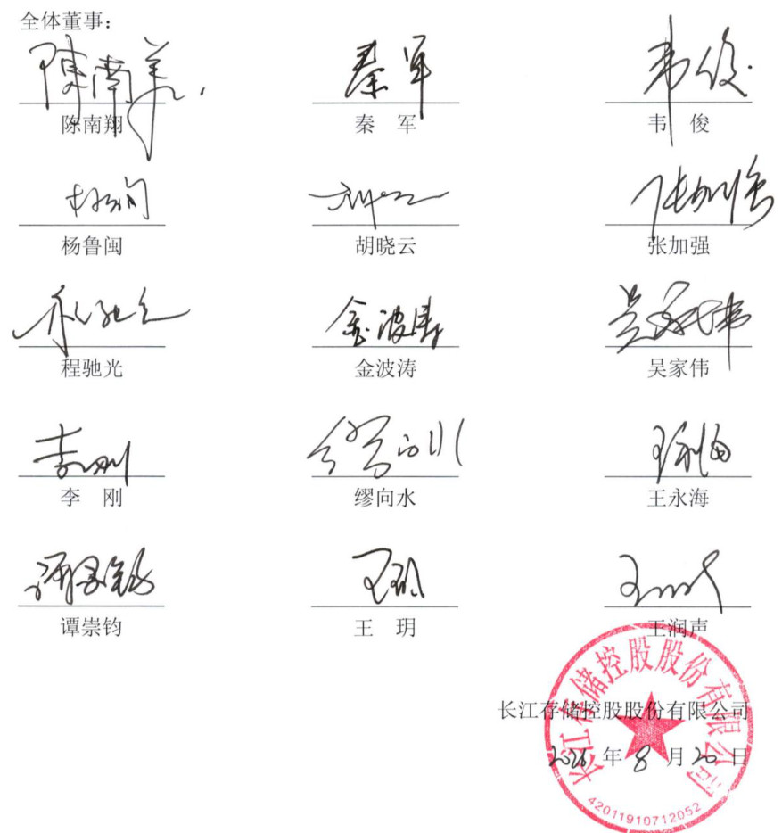 
1-1-243

---

<!-- 原文第 245 页 -->

长江存储控股股份有限公司 
招股说明书 
一、发行人及全体事、审计委员会成员和高级管理人员声明 本公司及全体董事、审计委员会成员、高级管理人员承诺本招股说明书的 内容真实、准确、完整,不存在虚假记载、误导性陈述或重大遗漏,按照诚信 原则履行承诺,并承担相应的法律责任。 
全体审计委员会成员: 
汤怕 王永海 
和 
胡晓云 
评铭 谭崇钧 
确 
王玥 
对胶股股你 了情控股股份有限天 骚年 年8月4日 
长江 
1-1-244

---

<!-- 原文第 246 页 -->

长江存储控股股份有限公司 
招股说明书 
一、发行人及全体董事、审计委员会成员和高级管理人员声明 本公司及全体董事、审计委员会成员、高级管理人员承诺本招股说明书的 内容真实、准确、完整,不存在虚假记载、误导性陈述或重大遗漏,按照诚信 原则履行承诺,并承担相应的法律责任。 
除董事、审计委员会成员之外的全体高级管理人员: 
Coap 程卫华 
 
劳伴货 
劳伟贤 老 
14 吴丹 
你聊 
李感 
3张 王兴强 
免质股份不 存 长江存储控股股 公司 1、人 2026年 8月 20日 
1-1-245

---

<!-- 原文第 247 页 -->

长江存储控股股份有限公司 
招股说明书 
## 二、发行人第一大股东声明 
本公司承诺本招股说明书的内容真实、准确、完整,不存在虚假记载、误导 性陈述或重大遗漏,按照诚信原则履行承诺,并承担相应的法律责任。 法定代表人/授权代表: 
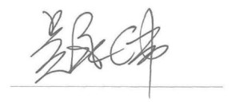 
吴家伟 
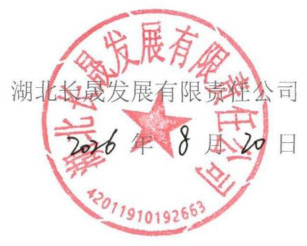 
1-1-246

---

<!-- 原文第 248 页 -->

长江存储控股股份有限公司 
招股说明书 
## 三、保荐人(主承销商)声明 
本公司已对招股说明书进行核查,确认招股说明书的内容真实、准确、完整, 不存在虚假记载、误导性陈述或重大遗漏,并承担相应的法律责任。 
项目协办人: 
是这 吴玉立 
保荐代表人: 
 
张明慧 
 
张欢 
法定代表人: 
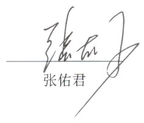 
股份有 券 
8月28 年 
2026 
眼雪 
中信证券股 
1-1-247

---

<!-- 原文第 249 页 -->

长江存储控股股份有限公司 
招股说明书 
## 保荐人董事长声明 
本人已认真阅读长江存储控股股份有限公司招股说明书的全部内容,确认招 股说明书不存在虚假记载、误导性陈述或者重大遗漏,并对招股说明书真实性、 准确性、完整性、及时性承担相应法律责任。 
董事长: 
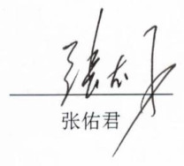 
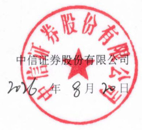 
1-1-248

---

<!-- 原文第 250 页 -->

长江存储控股股份有限公司 
招股说明书 
## 保荐人总经理声明 
本人已认真阅读长江存储控股股份有限公司招股说明书的全部内容,确认招 股说明书不存在虚假记载、误导性陈述或者重大遗漏,并对招股说明书真实性、 准确性、完整性、及时性承担相应法律责任。 
总经理: 
 
 
1-1-249

---

<!-- 原文第 251 页 -->

长江存储控股股份有限公司 
招股说明书 
## 三、保荐人(主承销商)声明 
本公司已对招股说明书进行核查,确认招股说明书的内容真实、准确、完整, 不存在虚假记载、误导性陈述或重大遗漏,并承担相应的法律责任。 
项用的办人名:方水 郭炜 人,单 
12心4 包红星 
法定代表人/董事长签名: 祖 
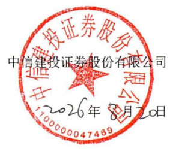 
1-1-250

---

<!-- 原文第 252 页 -->

长江存储控股股份有限公司 
招股说明书 
## 声明 
本人已认真阅读长江存储控股股份有限公司招股说明书的全部内容,确认招 股说明书不存在虚假记载、误导性陈述或者重大遗漏,并对招股说明书真实性、 准确性、完整性、及时性承担相应法律责任。 
总经理签名: 
生 
我证券朋多 管建投证 股份有限公司 信 中 2202年8月 0日 
1-1-251

---

<!-- 原文第 253 页 -->

长江存储控股股份有限公司 
招股说明书 
## 四、发行人律师声明 
本所及经办律师已阅读长江存储控股股份有限公司首次公开发行股票并在 科创板上市招股说明书,确认招股说明书与本所出具的法律意见书无矛盾之处 本所及经办律师对发行人在招股说明书中引用的法律意见书的内容无异议,确认 招股说明书不致因上述内容而出现虚假记载、误导性陈述或重大遗漏,并对其真 实性、准确性、完整性承担相应的法律责任。 
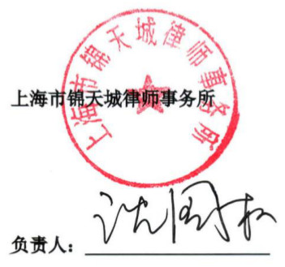 
张东晓 
能力期, 
沈国权 
经办律师: 就亚 
庞景 
能为解,以廉话 
王廉洁 
经力律师:池猴华 
池振华 
2026年8月20日 
1-1-252

---

<!-- 原文第 254 页 -->

长江存储控股股份有限公司 
招股说明书 
## 五、会计师事务所声明 
会计师事务所声明 
德师报(函)字(26)第Q01302号 
本所及签字注册会计师已阅读长江存储控股股份有限公司(以下简称"发行人")的招股说 明书,确认招股说明书与本所出具的发行人2026年1月1日至2026年3月31日止期间、2025 年度、2024年度及2023年度财务报表审计报告、关于原始财务报表与申报财务报表差异比较 表的专项说明、关于非经常性损益明细表的专项说明、关于主要税种纳税情况的专项说明、于 2026年3月31日的内部控制审计报告(以下统称"报告及说明")的内容无矛盾之处。本所及 签字注册会计师对发行人在招股说明书中引用的报告及说明的内容无异议,确认招股说明书 不致因上述内容而出现虚假记载、误导性陈述或重大遗漏,并承担相应的法律责任。 
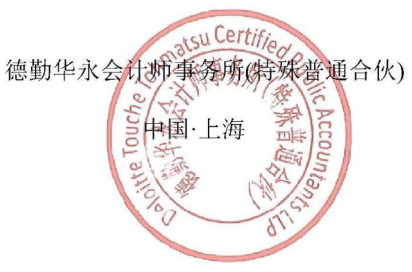 
执行事务合伙人:唐恋炯 产高阳 签字注册会计师:陈颂 
陈是 陈会 颂师册 签字注册会计师:李 贤 李 会计 
金 
李贤 
签字注册会计师:黄宇翔 黄 童宇翔 字计 全 翔师屏 2026年8月20日 
## WorldClass 智启非凡 
1-1-253

---

<!-- 原文第 255 页 -->

长江存储控股股份有限公司 
招股说明书 
## 会计师事务所声明 
德师报(函)字(26)第Q01303号 
本所及签字注册会计师已阅读长江存储控股股份有限公司(以下简称"发行人")的招股说 明书,确认招股说明书与本所出具的发行人截至2025年9月23日止的注册资本及实收资本变 更情况的验资报告(德师报(验)字(25)第00303号)及发行人自2016年12月28日至2025年9月 23日验资情况说明的复核报告(德师报(函)字(26)第Q01308号)(以下简称"验资报告及验资复 核报告")无矛盾之处。本所及签字注册会计师对发行人在招股说明书中引用的上述验资报告 及验资复核报告的内容无异议,确认招股说明书不致因上述内容而出现虚假记载、误导性陈 述或重大遗漏,并承担相应的法律责任。 
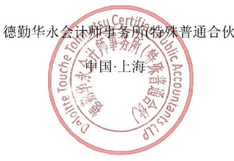 
执行事务合伙人:唐恋炯 唐方洞 签字注册会计师:陈 颂 鸭头 陈会 计愿 颂师册 签字注册会计师:李 贤 李贤 李会出 贤师册 签字注册会计师:黄宇翔 
宇计里 翔师册 黄宇翔 
黄会 中 
2026年8月20日 
WorldClass 智启非凡 
1-1-254

---

<!-- 原文第 256 页 -->

长江存储控股股份有限公司 招股说明书 
## 六、资产评估机构声明 
本机构及签字资产评估师已阅读招股说明书,确认招股说明书与本机构出 具的资产评估报告无矛盾之处。本机构及签字资产评估师对发行人在招股说明 书中引用的资产评估报告的内容无异议,确认招股说明书不致因上述内容而出 现虚假记载、误导性陈述或重大遗漏,并承担相应的法律责任。 
正式执业会员 正式执业会员 
李超鹏0004 4180017 
李超相 
 
经办资产评估师(签字): 
评名机构责人(签字): 燕 权忠光 
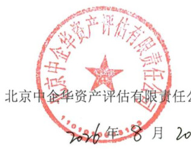 
1-1-255

---

<!-- 原文第 257 页 -->

长江存储控股股份有限公司 
招股说明书 
## 第十二节附件 
## 一、备查文件 
(一)发行保荐书; 
(二)上市保荐书; 
(三)法律意见书: 
(四)财务报告及审计报告; 
(五)公司章程(草案); 
(六)与投资者保护相关的承诺; 
(七)内部控制审计报告; 
(八)经注册会计师鉴证的非经常性损益明细表; 
(九)其他与本次发行有关的重要文件。 
## 二、文件查阅时间 
工作日上午9:00~11:30:下午13:00~17:00。 
## 三、文件查阅地点 
在本次发行承销期间,上述备查文件将存放于发行人和保荐人(主承销商) 的办公地点,投资者可在公司股票发行承销期间内查阅。 
1-1-256

---

<!-- 原文第 258 页 -->

长江存储控股股份有限公司 
招股说明书 
附件一:本次发行相关承诺 
(一)本次发行前股东所持股份的限售安排、自愿锁定股份、延长锁定期限 以及股东持股及减持意向等承诺 
1、关于所持股份限售安排、自愿锁定股份、延长锁定期限的承诺 
(1)合计持股比例不低于发行前股份总数51%的股东的承诺 
1)湖北长晟承诺 
"1、自发行人股票在上海证券交易所上市之日起36个月内,不转让或者委 托他人管理本企业直接和间接持有的发行人首次公开发行股票前已发行的股份, 也不提议由发行人回购该部分股份。 
2、发行人上市当年较上市前一年扣除非经常性损益后归母净利润下滑50% 以上的,延长本企业届时所持股份锁定期限6个月;发行人上市第二年较上市前 一年扣除非经常性损益后归母净利润下滑50%以上的,在前项基础上延长本企 业届时所持股份锁定期限6个月:发行人上市第三年较上市前一年扣除非经常性 损益后归母净利润下滑50%以上的,在前两项基础上延长本企业届时所持股份 锁定期限6个月。前述"届时所持股份"是指本企业分别在发行人上市前取得, 发行人上市当年及之后第二年、第三年发行人年报披露时仍持有的股份。 
3、发行人股票在上海证券交易所上市后6个月内如发行人股票连续20个交 易日的收盘价均低于发行人首次公开发行股票时的发行价,或者发行人股票在上 海证券交易所上市后6个月期末(如该日为非交易日的,则顺延至该日后的第一 个交易日)收盘价低于发行人首次公开发行股票时的发行价,本企业持有的发行 人首次公开发行股票前已发行股份的锁定期限自动延长至少6个月。 
4、自本承诺出具之日起,如本承诺与相关法律、法规、规范性文件、中国 证券监督管理委员会、上海证券交易所等证券监管机构的最新业务规则、监管意 见不符,本企业将根据相关法律、法规、规范性文件、中国证券监督管理委员会、 上海证券交易所等证券监管机构的最新业务规则、监管意见执行。 
5、本企业将严格履行本承诺,并自本承诺锁定期限届满后,本企业持有发 行人股份的减持将严格遵守相关法律、法规、规范性文件、中国证券监督管理委 
1-1-257

---

<!-- 原文第 259 页 -->

长江存储控股股份有限公司 
招股说明书 
员会、上海证券交易所等证券监管机构的最新业务规则、监管意见中关于股东减 持的规定。 
6、本企业同意依法承担因违反上述承诺而产生的法律责任。" 
## 2)芯飞科技承诺 
"1、自发行人股票在上海证券交易所上市之日起36个月内,不转让或者委 托他人管理本企业直接和间接持有的发行人首次公开发行股票前已发行的股份, 也不提议由发行人回购该部分股份。 
2、自本承诺出具之日起,如本承诺与相关法律、法规、规范性文件、中国 证券监督管理委员会、上海证券交易所等证券监管机构的最新业务规则、监管意 见不符,本企业将根据相关法律、法规、规范性文件、中国证券监督管理委员会、 上海证券交易所等证券监管机构的最新业务规则、监管意见执行。 
3、本企业将严格履行本承诺,并自本承诺锁定期限届满后,本企业持有发 行人股份的减持将严格遵守相关法律、法规、规范性文件、中国证券监督管理委 员会、上海证券交易所等证券监管机构的最新业务规则、监管意见中关于股东减 持的规定。 
4、本企业同意依法承担因违反上述承诺而产生的法律责任。" 
(2)员工持股平台智芯1号、智芯2号、智芯3号、智芯4号、智芯5号、 智芯6号的承诺 
"1、自发行人股票在上海证券交易所上市之日起12个月内以及本企业对发 行人完成实缴出资义务之日起36个月内,不转让或者委托他人管理本企业持有 的发行人首次公开发行股票前已发行的股份,也不提议由发行人回购该部分股份。 
2、自本承诺出具之日起,如本承诺与相关法律、法规、规范性文件、中国 证券监督管理委员会、上海证券交易所等证券监管机构的最新业务规则、监管意 见不符,本企业将根据相关法律、法规、规范性文件、中国证券监督管理委员会、 上海证券交易所等证券监管机构的最新业务规则、监管意见执行。 
3、本企业将严格履行本承诺,并自本承诺锁定期限届满后,本企业持有发 行人股份的减持将严格遵守相关法律、法规、规范性文件、中国证券监督管理委 
1-1-258

---

<!-- 原文第 260 页 -->

长江存储控股股份有限公司 
招股说明书 
员会、上海证券交易所等证券监管机构的最新业务规则、监管意见中关于股东减 持的规定。 
4、本企业同意依法承担因违反上述承诺而产生的法律责任。" 
(3)发行人其他股东大基金一期、大基金二期、光谷产投、国芯基金、长 江产业集团、闻名投资、农银投资、建信投资、交银投资、中银投资(作为管理 人代表中银资产1号)、工融基金、华恒二号、炬达二号、恒盛投资、上海国资、 招赢成长、融媒体基金、允泰九号、中网投、辰途华能、华恒一号的承诺 
"1、自发行人股票在上海证券交易所上市之日起12个月内,不转让或者委 托他人管理本企业持有的发行人首次公开发行股票前已发行的股份,也不提议由 发行人回购该部分股份。 
2、自本承诺出具之日起,如本承诺与相关法律、法规、规范性文件、中国 证券监督管理委员会、上海证券交易所等证券监管机构的最新业务规则、监管意 见不符,本企业将根据相关法律、法规、规范性文件、中国证券监督管理委员会、 上海证券交易所等证券监管机构的最新业务规则、监管意见执行。 
3、本企业将严格履行本承诺,并自本承诺锁定期限届满后,本企业持有发 行人股份的减持将严格遵守相关法律、法规、规范性文件、中国证券监督管理委 员会、上海证券交易所等证券监管机构的最新业务规则、监管意见中关于股东减 持的规定。 
4、本企业同意依法承担因违反上述承诺而产生的法律责任。" 
(4)间接持有发行人股份的董事、高级管理人员陈南翔、李刚、吴丹、桂 珍若、劳伟贤、李璇的承诺 
"1、自发行人股票在上海证券交易所上市之日起12个月内,不转让或者委 托他人管理本人持有的发行人首次公开发行股票前已发行的股份,也不提议由发 行人回购该部分股份。 
2、发行人股票在上海证券交易所上市后6个月内如发行人股票连续20个交 易日的收盘价均低于发行人首次公开发行股票时的发行价,或者发行人股票在上 海证券交易所上市后6个月期末(如该日为非交易日的,则顺延至该日后的第一 
1-1-259

---

<!-- 原文第 261 页 -->

长江存储控股股份有限公司 
招股说明书 
个交易日)收盘价低于发行人首次公开发行股票时的发行价,本人持有的发行人 首次公开发行股票前已发行股份的锁定期限自动延长至少6个月。 
3、本人在担任发行人董事和/或高级管理人员期间,将向发行人申报所持有 的发行人的股份及其变动情况,每年转让的发行人股份不超过本人所持有发行人 股份总数的25.00%;离职后半年内,不转让本人所持有的发行人股份。本人在 任期届满前离职的,在本人就任时确定的任期内和任期届满后6个月内,继续遵 守上述对董事和/或高级管理人员股份转让的限制性规定。 
4、本人将严格履行上述承诺,不因职务变更、离职等原因而放弃履行承诺。 
5、自本承诺出具之日起,如本承诺与相关法律、法规、规范性文件、中国 证券监督管理委员会、上海证券交易所等证券监管机构的最新业务规则、监管意 见不符,本人将根据相关法律、法规、规范性文件、中国证券监督管理委员会、 上海证券交易所等证券监管机构的最新业务规则、监管意见执行。 
6、本人将严格履行本承诺,并自本承诺锁定期限届满后,本人持有发行人 股份的减持将严格遵守相关法律、法规、规范性文件、中国证券监督管理委员会、 上海证券交易所等证券监管机构的最新业务规则、监管意见中关于股东减持的规 定。 
7、本人同意依法承担因违反上述承诺而产生的法律责任。" 
(5)间接持有发行人股份的高级管理人员、核心技术人员程卫华、陈俊、 王兴强的承诺 
"1、自发行人股票在上海证券交易所上市之日起12个月内,不转让或者委 托他人管理本人持有的发行人首次公开发行股票前已发行的股份,也不提议由发 行人回购该部分股份。 
2、发行人股票在上海证券交易所上市后6个月内如发行人股票连续20个交 易日的收盘价均低于发行人首次公开发行股票时的发行价,或者发行人股票在上 海证券交易所上市后6个月期末(如该日为非交易日的,则顺延至该日后的第一 个交易日)收盘价低于发行人首次公开发行股票时的发行价,本人持有的发行人 首次公开发行股票前已发行股份的锁定期限自动延长至少6个月。 
1-1-260

---

<!-- 原文第 262 页 -->

长江存储控股股份有限公司 
招股说明书 
3、本人在担任发行人高级管理人员期间,将向发行人申报所持有的发行人 的股份及其变动情况,每年转让的发行人股份不超过本人所持有发行人股份总数 的25.00%;离职后半年内,不转让本人所持有的发行人股份。本人在任期届满 前离职的,在本人就任时确定的任期内和任期届满后6个月内,继续遵守上述对 高级管理人员股份转让的限制性规定。 
4、本人在担任发行人核心技术人员期间,本人自所持发行人首发前股份限 售期满之日起4年内,每年转让的发行人首发前股份不超过上市时本人所持发行 人首发前股份总数的25.00%,减持比例可以累积使用:自本人离职后6个月内 不转让本人所持发行人首发前股份。 
5、本人将严格履行上述承诺,不因职务变更、离职等原因而放弃履行承诺。 
6、自本承诺出具之日起,如本承诺与相关法律、法规、规范性文件、中国 证券监督管理委员会、上海证券交易所等证券监管机构的最新业务规则、监管意 见不符,本人将根据相关法律、法规、规范性文件、中国证券监督管理委员会、 上海证券交易所等证券监管机构的最新业务规则、监管意见执行。 
7、本人将严格履行本承诺,并自本承诺锁定期限届满后,本人持有发行人 股份的减持将严格遵守相关法律、法规、规范性文件、中国证券监督管理委员会、 上海证券交易所等证券监管机构的最新业务规则、监管意见中关于股东减持的规 定。 
8、本人同意依法承担因违反上述承诺而产生的法律责任。" 
(6)间接持有发行人股份的核心技术人员霍宗亮、周文斌、冯耀斌、侯春 源、曹宏、靳磊、华子群、顾立勋的承诺 
"1、自发行人股票在上海证券交易所上市之日起12个月内,不转让或者委 托他人管理本人持有的发行人首次公开发行股票前已发行的股份,也不提议由发 行人回购该部分股份。 
2、本人在担任发行人核心技术人员期间,本人自所持发行人首发前股份限 售期满之日起4年内,每年转让的发行人首发前股份不超过上市时本人所持发行 人首发前股份总数的25.00%,减持比例可以累积使用;自本人离职后6个月内 不转让本人所持发行人首发前股份。 
1-1-261

---

<!-- 原文第 263 页 -->

长江存储控股股份有限公司 
招股说明书 
3、本人将严格履行上述承诺,不因职务变更、离职等原因而放弃履行承诺。 
4、自本承诺出具之日起,如本承诺与相关法律、法规、规范性文件、中国 证券监督管理委员会、上海证券交易所等证券监管机构的最新业务规则、监管意 见不符,本人将根据相关法律、法规、规范性文件、中国证券监督管理委员会、 上海证券交易所等证券监管机构的最新业务规则、监管意见执行。 
5、本人将严格履行本承诺,并自本承诺锁定期限届满后,本人持有发行人 股份的减持将严格遵守相关法律、法规、规范性文件、中国证券监督管理委员会、 上海证券交易所等证券监管机构的最新业务规则、监管意见中关于股东减持的规 定。 
6、本人同意依法承担因违反上述承诺而产生的法律责任。" 
## 2、关于股东持股及减持意向的承诺 
## (1)发行人第一大股东湖北长晟的承诺 
"1、本企业将严格遵守相关法律、法规、规范性文件以及本企业在发行人 首次公开发行股票过程中作出的各项公开承诺中关于股份锁定期的规定和要求 (以下简称"股份锁定期")。 
2、股份锁定期届满后的两年内,在不违反相关法律、法规、规范性文件以 及本企业作出的其他公开承诺的前提下,本企业存在适当减持发行人股份的可能。 
3、在股份锁定期届满后,本企业拟通过包括但不限于二级市场集中竞价交 易、大宗交易、协议转让等方式减持所持有的发行人首次公开发行股票前已发行 的股份。 
4、本企业减持所持有的发行人股票的价格根据当时的二级市场价格确定, 并应当符合相关法律、法规、规范性文件的规定。本企业所持有发行人首次公开 发行股票前已发行的股份在锁定期届满后两年内减持的,减持价格不低于发行人 首次公开发行股票发行价格。发行人上市后发生派息、送股、资本公积转增股本 等除权除息事项的,上述发行价格做相应调整。 
5、股份锁定期届满后,如本企业减持发行人股份的,将按照相关法律、法 规、规范性文件的规定及时、准确地履行信息披露义务,通过证券交易所集中竞 价交易或者大宗交易方式首次减持的在减持前15个交易日予以公告,通过其他 
1-1-262

---

<!-- 原文第 264 页 -->

长江存储控股股份有限公司 
招股说明书 
方式减持的在减持前3个交易日予以公告。 
6、自本承诺出具之日起,如本承诺与相关法律、法规、规范性文件、中国 证券监督管理委员会、上海证券交易所等证券监管机构的最新业务规则、监管意 见不符,本企业将根据相关法律、法规、规范性文件、中国证券监督管理委员会、 上海证券交易所等证券监管机构的最新业务规则、监管意见执行。" 
(2)其他持股5%以上股东芯飞科技、大基金一期、大基金二期、光谷产 投、国芯基金的承诺 
"1、本企业将严格遵守相关法律、法规、规范性文件以及本企业在发行人 首次公开发行股票过程中作出的各项公开承诺中关于股份锁定期的规定和要求 (以下简称"股份锁定期")。 
2、股份锁定期届满后的两年内,在不违反相关法律、法规、规范性文件以 及本企业作出的其他公开承诺的前提下,本企业存在适当减持发行人股份的可能。 
3、在股份锁定期届满后,本企业拟通过包括但不限于二级市场集中竞价交 易、大宗交易、协议转让等方式减持所持有的发行人首次公开发行股票前已发行 的股份。 
4、本企业减持所持有的发行人股票的价格根据当时的二级市场价格确定, 并应当符合相关法律、法规、规范性文件的规定。本企业将严格遵守中国证券监 督管理委员会、上海证券交易所关于上市公司股东减持股份的相关规定减持发行 人股份。 
5、股份锁定期届满后,如本企业减持发行人股份的,将按照相关法律、法 规、规范性文件的规定及时、准确地履行信息披露义务,通过证券交易所集中竞 价交易或者大宗交易方式首次减持的在减持前15个交易日予以公告,通过其他 方式减持的在减持前3个交易日予以公告。 
6、自本承诺出具之日起,如本承诺与相关法律、法规、规范性文件、中国 证券监督管理委员会、上海证券交易所等证券监管机构的最新业务规则、监管意 见不符,本企业将根据相关法律、法规、规范性文件、中国证券监督管理委员会、 上海证券交易所等证券监管机构的最新业务规则、监管意见执行。" 
(3)间接持有发行人股份的董事、高级管理人员陈南翔、李刚、程卫华、 
1-1-263

---

<!-- 原文第 265 页 -->

长江存储控股股份有限公司 
招股说明书 
陈俊、吴丹、桂珍若、劳伟贤、李璇、王兴强的承诺 
"1、本人将严格遵守相关法律、法规、规范性文件以及本人在发行人首次 公开发行股票过程中作出的各项公开承诺中关于股份锁定期的规定和要求(以下 简称"股份锁定期")。 
2、在股份锁定期届满后,本人拟通过包括但不限于二级市场集中竞价交易、 大宗交易、协议转让等方式减持所持有的发行人首次公开发行股票前已发行的股 份。 
3、本人减持所持有的发行人股票的价格根据当时的二级市场价格确定,并 应当符合相关法律、法规、规范性文件的规定。本人所持有发行人首次公开发行 股票前已发行的股份在锁定期届满后两年内减持的,减持价格不低于发行人首次 公开发行股票发行价格。发行人上市后发生派息、送股、资本公积转增股本等除 权除息事项的,上述发行价格做相应调整。 
4、自本承诺出具之日起,如本承诺与相关法律、法规、规范性文件、中国 证券监督管理委员会、上海证券交易所等证券监管机构的最新业务规则、监管意 见不符,本人将根据相关法律、法规、规范性文件、中国证券监督管理委员会、 上海证券交易所等证券监管机构的最新业务规则、监管意见执行。" 
(4)间接持有发行人股份的核心技术人员霍宗亮、周文斌、冯耀斌、侯春 源、曹宏、靳磊、华子群、顾立勋的承诺 
"1、本人将严格遵守相关法律、法规、规范性文件以及本人在发行人首次 公开发行股票过程中作出的各项公开承诺中关于股份锁定期的规定和要求(以下 简称"股份锁定期")。 
2、在股份锁定期届满后,本人拟通过包括但不限于二级市场集中竞价交易、 大宗交易、协议转让等方式减持所持有的发行人首次公开发行股票前已发行的股 份。 
3、本人减持所持有的发行人股票的价格根据当时的二级市场价格确定,并 应当符合相关法律、法规、规范性文件的规定。 
4、自本承诺出具之日起,如本承诺与相关法律、法规、规范性文件、中国 
1-1-264

---

<!-- 原文第 266 页 -->

长江存储控股股份有限公司 
招股说明书 
证券监督管理委员会、上海证券交易所等证券监管机构的最新业务规则、监管意 见不符,本人将根据相关法律、法规、规范性文件、中国证券监督管理委员会、 上海证券交易所等证券监管机构的最新业务规则、监管意见执行。" 
## (二)关于稳定股价的措施和承诺 
## 1、发行人的承诺 
"1、公司将严格根据《关于公司首次公开发行人民币普通股(A股)股票 并在科创板上市后三年内稳定股价预案的议案》的相关规定,在启动股价稳定措 施时,实施回购股份等稳定股价措施。 
2、在公司稳定股价措施条件满足时,如公司未采取上述稳定股价措施的, 公司将根据《关于公司首次公开发行人民币普通股(A股)股票并在科创板上市 后三年内稳定股预案的议案》的相关规定履行各项义务并依法承担相应责任。 
3、自公司首次公开发行股票并上市之日起3年内,如公司新聘任董事(不 包括独立董事以及不在公司领取薪酬的董事)、高级管理人员的,公司将要求该 等新聘任的董事(不包括独立董事以及不在公司领取薪酬的董事)、高级管理人 员签署承诺书,保证其履行公司首次公开发行股票并上市时董事(不包括独立董 事以及不在公司领取薪酬的董事)、高级管理人员已作出的相应承诺。" 
2、发行人董事(独立董事以及不在公司领取薪酬的董事除外)、高级管 理人员的承诺 
"1、本人将严格根据《关于公司首次公开发行人民币普通股(A股)股票 并在科创板上市后三年内稳定股价预案的议案》的相关规定,在启动股价稳定措 施时,实施增持发行人股份等稳定股价措施。 
2、本人(如为董事)将在董事会审议发行人实施回购股份等稳定股价措施 相关议案时,投出赞成票。 
3、在发行人董事、高级管理人员稳定股价措施条件满足时,如本人未采取 上述稳定股价措施的,本人将根据《关于公司首次公开发行人民币普通股(A股) 股票并在科创板上市后三年内稳定股价预案的议案》的相关规定履行各项义务并 依法承担相应责任。" 
1-1-265

---

<!-- 原文第 267 页 -->

长江存储控股股份有限公司 
招股说明书 
## (三)关于股份回购的措施和承诺 
发行人关于股份回购的措施作出如下承诺: 
"1、如公司向上海证券交易所提交的本次发行上市的招股说明书及其他信 息披露文件内容存在虚假记载、误导性陈述或者重大遗漏情形,对判断公司是否 符合法律规定的发行条件构成重大、实质影响,且以欺诈手段骗取发行注册并已 经发行上市的,公司将依法回购首次公开发行的全部新股。 
2、若上述情形发生于公司本次发行上市的新股已完成发行但未上市交易的 阶段内,则公司将在中国证券监督管理委员会或其他有权部门依法对上述事实作 出最终认定或处罚决定后5个工作日内,将本次发行上市的募集资金,按照发行 价并加算银行同期存款利息返还已缴纳股票申购款的投资者。 
若上述情形发生于公司本次发行上市的新股已完成上市交易之后,公司董事 会将在中国证券监督管理委员会或其他有权部门依法对上述事实作出最终认定 或处罚决定后5个工作日内,制订股份回购方案并提交股东会审议批准,并经相 关主管部门批准/核准/备案后,依法回购首次公开发行的全部新股,回购价格将 以发行价格为基础并参考相关市场因素确定。公司上市后发生派息、送股、资本 公积转增股本等除权除息事项的,上述发行价格做相应调整。上述股份回购措施 实施时法律法规另有规定的从其规定。" 
## (四)关于欺诈发行上市的股份购回承诺 
## 1、发行人的承诺 
"1、公司不存在不符合首次公开发行股票并在科创板上市条件而以欺骗手 段骗取发行注册的情形。 
2、如公司不符合首次公开发行股票并在科创板上市条件,以欺骗手段骗取 发行注册并已经发行上市的,公司将在中国证券监督管理委员会等有权部门确认 后,严格按照法律法规的相关规定启动股份回购程序,依法回购公司首次公开发 行的全部新股。上述股份回购措施实施时法律法规另有规定的从其规定。" 
## 2、发行人第一大股东湖北长晟的承诺 
"1、发行人不存在不符合首次公开发行股票并在科创板上市条件而以欺骗 手段骗取发行注册的情形。 
1-1-266

---

<!-- 原文第 268 页 -->

长江存储控股股份有限公司 
招股说明书 
2、如发行人不符合首次公开发行股票并在科创板上市条件,以欺骗手段骗 取发行注册并已经发行上市的,本企业将在中国证券监督管理委员会等有权部门 确认后,严格按照法律法规的相关规定启动股份买回程序,依法买回发行人首次 公开发行的全部新股。上述股份买回措施实施时法律法规另有规定的从其规定。" 
(五)关于填补被摊薄即期回报措施的承诺 
## 1、发行人的承诺 
"1、公司将根据董事会、股东会审议通过的《关于公司首次公开发行人民 币普通股(A股)股票并在科创板上市后摊薄即期回报影响分析及填补即期回报 措施的议案》的相关规定,执行各项填补即期回报措施。 
2、不无偿或以不公平条件向其他单位或者个人输送利益,也不采用其他方 式损害公司利益。 
3、对公司董事、高级管理人员的职务消费行为进行约束。" 
2、发行人董事、高级管理人员的承诺 
"1、不无偿或以不公平条件向其他单位或者个人输送利益,也不采用其他 方式损害发行人利益。 
2、对本人职务消费行为进行约束。 
3、不动用发行人资产从事与履行职责无关的投资、消费活动。 
4、在自身职责和权限范围内,全力促使发行人董事会或者薪酬与考核委员 会制定的薪酬制度与发行人填补回报措施的执行情况相挂钩。 
5、如发行人未来拟实施股权激励,在自身职责和权限范围内,全力促使发 行人拟公布的股权激励行权条件与发行人填补回报措施的执行情况相挂钩。 
6、忠实、勤勉地履行职责,维护发行人和全体股东的合法权益。" 
## (六)关于利润分配政策的承诺 
发行人关于本次发行上市后利润分配政策相关事项作出如下承诺: 
"公司首次公开发行股票并在科创板上市后将严格按照《中华人民共和国公 司法》《上市公司监管指引第3号--上市公司现金分红》、届时生效并适用的 长江存储控股股份有限公司章程以及《长江存储控股股份有限公司首次公开发行 
1-1-267

---

<!-- 原文第 269 页 -->

长江存储控股股份有限公司 
招股说明书 
人民币普通股(A股)股票并在科创板上市后三年内股东分红回报规划》的相关 规定执行利润分配政策,履行各项义务。" 
## (七)关于依法承担赔偿责任的承诺 
## 1、发行人的承诺 
"1、公司向上海证券交易所提交的本次发行上市的招股说明书及其他信息 披露文件内容不存在虚假记载、误导性陈述或者重大遗漏情形,公司对招股说明 书及其他信息文件内容真实性、准确性、完整性承担相应法律责任。 
2、如公司向上海证券交易所提交的本次发行上市的招股说明书及其他信息 披露文件内容存在虚假记载、误导性陈述或者重大遗漏情形,致使投资者在证券 交易中遭受损失,并已由中国证券监督管理委员会或人民法院等有权部门作出公 司存在上述情形的最终认定或生效判决的,公司将根据该等最终认定或生效判决 确定的赔偿主体范围、赔偿标准、赔偿金额等赔偿投资者实际遭受的直接损失。" 
## 2、发行人第一大股东湖北长晟的承诺 
"1、发行人向上海证券交易所提交的本次发行上市的招股说明书及其他信 息披露文件内容不存在虚假记载、误导性陈述或者重大遗漏情形,本企业对招股 说明书及其他信息披露文件内容真实性、准确性、完整性承担相应法律责任。 
2、如发行人向上海证券交易所提交的本次发行上市的招股说明书及其他信 息披露文件内容存在虚假记载、误导性陈述或者重大遗漏情形,致使投资者在证 券交易中遭受损失,并已由中国证券监督管理委员会或人民法院等有权部门作出 发行人存在上述情形的最终认定或生效判决的,本企业将根据该等最终认定或生 效判决确定的赔偿主体范围、赔偿标准、赔偿金额等赔偿投资者实际遭受的直接 损失。" 
## 3、发行人董事、高级管理人员的承诺 
"1、发行人向上海证券交易所提交的本次发行上市的招股说明书及其他信 息披露文件内容不存在虚假记载、误导性陈述或者重大遗漏情形,本人对招股说 书及其他信息文件内真实性、准确性、完整性承担相应法律责任。 
2、如发行人向上海证券交易所提交的本次发行上市的招股说明书及其他信 息披露文件内容存在虚假记载、误导性陈述或者重大遗漏情形,致使投资者在证 
1-1-268

---

<!-- 原文第 270 页 -->

长江存储控股股份有限公司 
招股说明书 
券交易中遭受损失,并已由中国证券监督管理委员会或人民法院等有权部门作出 发行人存在上述情形的最终认定或生效判决的,本人将根据该等最终认定或生效 判决确定的赔偿主体范围、赔偿标准、赔偿金额等赔偿投资者实际遭受的直接损 失。" 
(八)关于未能履行承诺约束措施的承诺 
## 1、发行人的承诺 
"1、公司在首次公开发行股票并在科创板上市过程中作出的各项公开承诺 (以下简称"承诺事项")均为公司真实意思表示,对公司具有约束力。公司将 严格履行承诺事项,并自愿接受监管机构、自律组织及社会公众的监督。 
2、如公司非因不可抗力导致未能完全且有效地履行承诺事项,公司承诺将 采取下列一项或多项约束措施: 
(1)在证券监管部门或其他有权部门要求的期限内予以纠正或及时作出合 法有效的补充承诺或替代承诺(需根据法律法规、届时生效并适用的长江存储控 股股份有限公司章程以及内控制度的相关规定履行相应审批和信息披露程序); 
(2)若证券监管部门或其他有权部门认定公司未能履行相关承诺事项致使 投资者在证券交易中遭受损失的,公司将依法向投资者赔偿相应损失。" 
2、发行人持股5%以上股东湖北长晟、芯飞科技、大基金一期、大基金二 期、光谷产投、国芯基金的承诺 
"1、本企业在发行人首次公开发行股票并在科创板上市过程中作出的各项 公开承诺(以下简称"承诺事项")均为本企业真实意思表示,对本企业具有约 束力。本企业将严格履行承诺事项,并自愿接受监管机构、自律组织及社会公众 的监督。 
2、如本企业非因不可抗力导致未能完全且有效地履行承诺事项,本企业承 诺将采取下列一项或多项约束措施: 
(1)在证券监管部门或其他有权部门要求的期限内予以纠正或在可行的情 况下及时作出合法有效的补充承诺或替代承诺(相关承诺需按法律、法规、规范 性文件及发行人上市后适用的《公司章程》、相关内控制度的规定履行相关审批 和信息披露程序); 
1-1-269

---

<!-- 原文第 271 页 -->

长江存储控股股份有限公司 
招股说明书 
(2)若证券监管部门或其他有权部门认定本企业未能履行相关承诺事项致 使投资者在证券交易中遭受损失的,本企业将依法向投资者赔偿相应损失; 
(3)如本企业因未履行相关承诺事项而获得收益的,所获收益全部归发行 人所有,本企业应当在获得该等收益之日起十个工作日内将其支付至发行人指定 银行账户。" 
3、发行人董事、高级管理人员、核心技术人员的承诺 
"1、本人在发行人首次公开发行股票并在科创板上市过程中作出的各项公 开承诺(以下简称"承诺事项")均为本人真实意思表示,对本人具有约束力。 本人将严格履行承诺事项,并自愿接受监管机构、自律组织及社会公众的监督。 
2、如本人非因不可抗力导致未能完全且有效地履行承诺事项,本人承诺将 采取下列一项或多项约束措施: 
(1)在证券监管部门或其他有权部门要求的期限内予以纠正或在可行的情 况下及时作出合法有效的补充承诺或替代承诺(相关承诺需按法律、法规、规范 性文件及发行人上市后适用的《公司章程》、相关内控制度的规定履行相关审批 和信息披露程序); 
(2)若证券监管部门或其他有权部门认定本人未能履行相关承诺事项致使 投资者在证券交易中遭受损失的,本人将依法向投资者赔偿相应损失。 
(3)如本人因未履行相关承诺事项而获得收益的,所获收益全部归发行人 所有,本人应当在获得该等收益之日起十个工作日内将其支付至发行人指定银行 账户。" 
## (九)关于避免同业竞争的承诺 
公司股东湖北长晟、芯飞科技承诺如下: 
"1、截至本承诺出具之日,本企业及本企业控制的公司、企业或其他经营 实体(以下简称"下属单位")均未直接或间接从事任何与发行人主营业务构成 竞争关系的相同或相似业务;本企业及本企业下属单位与发行人之间不存在同业 竞争。 
2、自本承诺出具之日起,本企业保证并将促使下属单位不直接或间接从事 
1-1-270

---

<!-- 原文第 272 页 -->

长江存储控股股份有限公司 
招股说明书 
任何与发行人主营业务构成竞争关系的相同或相似业务。 
3、自本承诺出具之日起,如本企业及本企业下属单位从任何第三方获得的 任何商业机会涉及与发行人主营业务构成竞争关系的相同或相似业务,本企业将 通知发行人,在合法合规的前提下,尽合理商业努力将该等商业机会让与发行人。 
4、如本企业因未履行上述承诺而获得收益的,所获收益归发行人所有:如 因本企业未履行上述承诺导致发行人遭受损失的,本企业将向发行人承担相应赔 偿责任。 
5、本承诺自出具之日起生效,自本企业直接或间接持有发行人股份数不足 5.00%之日起效力终止。" 
## (十)关于规范关联交易的承诺 
1、发行人持股5%以上股东湖北长晟、芯飞科技、大基金一期、大基金二 期、光谷产投、国芯基金的承诺 
"1、本企业及本企业控制的企业与发行人之间发生的关联交易(如有)均 按照公平、公允和等价有偿的原则进行,不存在损害发行人利益的情形。 
2、本企业及本企业控制的企业将采取措施规范并尽量减少与发行人之间发 生的关联交易:对于发行人正常经营所需的关联交易,本企业及本企业控制的企 业将与发行人签署交易协议,按照公平、公允和等价有偿的原则进行,本企业及 本企业提名的董事(如有)将根据法律法规、届时生效并适用的长江存储控股股 份有限公司章程以及关联交易管理制度的相关规定履行或配合发行人履行相应 审议、回避表决程序和信息披露义务。 
3、本企业承诺不会利用发行人股东地位谋求不当利益,不利用关联交易非 法转移或占用发行人资金,不损害发行人及其他股东的合法利益。" 
## 2、发行人董事、高级管理人员的承诺 
"1、本人及本人控制的企业与发行人之间发生的关联交易(如有)均按照 公平、公允和等价有偿的原则进行,不存在损害发行人利益的情形。 
2、本人及本人控制的企业将采取措施规范并尽量减少与发行人之间发生的 关联交易:对于发行人正常经营所需的关联交易,本人及本人控制的企业将与发 行人签署交易协议,按照公平、公允和等价有偿的原则进行,本人将根据法律法 
1-1-271

---

<!-- 原文第 273 页 -->

长江存储控股股份有限公司 
招股说明书 
规、届时生效并适用的长江存储控股股份有限公司章程以及关联交易管理制度的 相关规定履行或配合发行人履行相应审议、回避表决程序和信息披露义务。 
3、本人承诺不会利用发行人董事和/或高级管理人员地位谋求不当利益,不 利用关联交易非法转移或占用发行人资金,不损害发行人及其股东的合法利益。" (十一)关于避免资金占用和违规担保的承诺 
1、发行人持股5%以上股东湖北长晟、芯飞科技、大基金一期、大基金二 期、光谷产投、国芯基金的承诺 
"1、本企业及本企业实际控制的企业不会要求且不会促使发行人为本企业 及本企业的实际控制的企业代垫费用,也不互相代为承担成本和其他支出。 
2、本企业及本企业实际控制的企业不会要求且不会促使发行人为本企业及 本企业实际控制的企业违规提供担保。 
3、本企业及本企业实际控制的企业不会要求且不会促使发行人通过下列方 式将资金直接或者间接提供给本企业及本企业实际控制的企业使用: 
(1)有偿或者无偿地拆借发行人的资金给本企业及本企业实际控制的企业 使用; 
(2)与本企业及本企业实际控制的企业发生与正常生产经营无关的资金往 来; 
(3)通过银行或者非银行金融机构向本企业及本企业实际控制的企业提供 委托贷款; 
(4)委托本企业及本企业实际控制的企业进行投资活动; 
(5)为本企业及本企业实际控制的企业开具没有真实交易背景的商业承兑 汇票: 
(6)在没有商品和劳务对价情况下或者明显有悖商业逻辑情况下以采购款、 资产转让款、预付款等方式向本企业及本企业实际控制的企业提供资金; 
(7)代本企业及本企业实际控制的企业偿还债务; 
(8)其他实质导致发行人资金被占用的行为。 
4、如因本企业未履行上述承诺而获得收益的,所获收益归发行人所有;如 
1-1-272

---

<!-- 原文第 274 页 -->

长江存储控股股份有限公司 
招股说明书 
本企业因未履行上述承诺导致发行人遭受损失的,本企业将依法向发行人承担赔 偿责任。 
5、上述承诺在本企业作为持有发行人5.00%以上股份股东期间持续有效。" 
2、发行人董事、高级管理人员的承诺 
"1、本人及本人实际控制的企业不会要求且不会促使发行人为本人及本人 实际控制的企业代垫费用,也不互相代为承担成本和其他支出。 
2、本人及本人实际控制的企业不会要求且不会促使发行人为本人及本人实 际控制的企业违规提供担保。 
3、本人及本人实际控制的企业不会要求且不会促使发行人通过下列方式将 资金直接或者间接提供给本人及本人实际控制的企业使用: 
(1)有偿或者无偿地拆借发行人的资金给本人及本人实际控制的企业使用; 
(2)与本人及本人实际控制的企业发生与正常生产经营无关的资金往来; 
(3)通过银行或者非银行金融机构向本人及本人实际控制的企业提供委托 贷款; 
(4)委托本人及本人实际控制的企业进行投资活动; 
(5)为本人及本人实际控制的企业开具没有真实交易背景的商业承兑汇票; 
(6)在没有商品和劳务对价情况下或者明显有商业逻辑情况下以采购款、 资产转让款、预付款等方式向本人及本人实际控制的企业提供资金; 
(7)代本人及本人实际控制的企业偿还债务; 
(8)其他实质导致发行人资金被占用的行为。 
4、如因本人未履行上述承诺而获得收益的,所获收益归发行人所有:如本 因未履行上述承诺导致发行人遭受损失的,本人将依法向发行人承担赔偿责任。 
5、上述承诺在本人作为发行人董事和/或高级管理人员期间持续有效。" 
(十二)关于股东信息披露的承诺 
发行人关于本次发行上市股东信息披露相关事项作出如下承诺: 
"1、公司股东均具备持有公司股份的主体资格,不存在法律法规和中国证 券监督管理委员会规定禁止持股的主体直接或间接持有公司股份的情形,不存在 
1-1-273

---

<!-- 原文第 275 页 -->

长江存储控股股份有限公司 
招股说明书 
证监会系统离职人员及其父母、配偶、子女及其配偶不当入股公司的情形; 
2、公司股东持有的公司股份权属清晰,公司历史沿革中不存在股份代持等 情形,不存在股份权属纠纷或潜在纠纷的情形; 
3、公司股东不存在违规入股、入股交易价格明显异常的情形,不存在以公 司股权进行不当利益输送的情形; 
4、截至本承诺出具之日,本次发行上市的中介机构或其负责人、高级管理 人员、经办人员不存在直接或间接持有公司股份的情形; 
5、公司及公司股东已及时向本次发行上市的中介机构提供了真实、准确、 完整的资料,积极和全面配合本次发行上市的中介机构开展尽职调查,依法在本 次发行上市的申报文件中真实、准确、完整地披露了股东信息,履行了信息披露 义务。" 
1-1-274

---

<!-- 原文第 276 页 -->

长江存储控股股份有限公司 
招股说明书 
附件二:发行人及其子公司拥有的主要商标清单 截至报告期末,发行人及其控股子公司(不包括武汉新芯及其控制的企业) 与生产经营相关的主要商标为66项,具体情况如下: 

| 序号 | 权利人 | 商标标识 | 注册号 | 注册 地 | 国际 分类 号 | 有效期限 |
| --- | --- | --- | --- | --- | --- | --- |
| 1 | 长江存储 | YI | 25643214 | 中国 | 9 | 2018.7.28-2028.7.27 |
| 2 | 长江存储 | YI | 25643219 | 中国 | 35 | 2018.7.28-2028.7.27 |
| 3 | 长江存储 | YI | 25643230 | 中国 | 42 | 2018.7.28-2028.7.27 |
| 4 | 长江存储 | YMTC | 44338007 | 中国 | 42 | 2020.10.28-2030.10.27 |
| 5 | 长江存储 | YMTC | 44344649 | 中国 | 35 | 2021.2.7-2031.2.6 |
| 6 | 长江存储 | Yangtze Memory | 45813749 | 中国 | 35 | 2021.2.7-2031.2.6 |
| 7 | 长江存储 | Yangtze Memory | 45787537 | 中国 | 40 | 2021.2.7-2031.2.6 |
| 8 | 长江存储 | Yangtze Memory | 45787942 | 中国 | 42 | 2021.2.7-2031.2.6 |
| 9 | 长江存储 | YMTC | 51209068 | 中国 | 9 | 2021.7.14-2031.7.13 |
| 10 | 长江存储 | 长存 | 51380644 | 中国 | 9 | 2021.10.21-2031.10.20 |
| 11 | 长江存储 | Yangtze Memory | 45812220 | 中国 | 9 | 2021.1.14-2031.1.13 |
| 12 | 长江存储 | 晶栈 | 60125889 | 中国 | 9 | 2022.4.14-2032.4.13 |
| 13 | 长江存储 | 长存 | 56805022 | 中国 | 42 | 2022.8.21-2032.8.20 |
| 14 | 长江存储 | ZHITAI | 62149370 | 中国 | 9 | 2022.12.7-2032.12.6 |
| 15 | 长江存储 | Y长江存储 | 42184620 | 中国 | 9 | 2024.3.28-2034.3.27 |
| 16 | 长江存储 | 致态 | 78388584 | 中国 | 9 | 2024.12.28-2034.12.27 |
| 17 | 长江存储 | Xtacking | 84279871 | 中国 | 9 | 2025.12.14-2035.12.13 |
 
1-1-275

---

<!-- 原文第 277 页 -->

长江存储控股股份有限公司 
招股说明书 

| 18 | 长江存储 | 长存 | 84472823 | 中国 | 40 | 2025.9.14-2035.9.13 |
| --- | --- | --- | --- | --- | --- | --- |
| 19 | 长江存储 | YMTC | 84454090 | 中国 | 40 | 2025.9.14-2035.9.13 |
| 20 | 长江存储 | 》长江存储 | 84416622 | 中国 | 40 | 2025.9.21-2035.9.20 |
| 21 | 长江存储 | | 84419742 | 中国 | 40 | 2025.9.21-2035.9.20 |
| 22 | 长江存储 | Xtocking | 84261794 | 中国 | 40 | 2025.12.7-2035.12.6 |
| 23 | 长江存储 | YMTC | 305330006 | 中国 香港 | 9 | 2020.7.10-2030.7.9 |
| 24 | 长江存储 | Yangtze Memory | 305330051 | 中国 香港 | 9 | 2020.7.10-2030.7.9 |
| 25 | 长江存储 | Xtacking | 305330024 | 中国 香港 | 9 | 2020.7.10-2030.7.9 |
| 26 | 长江存储 | | 305330015 | 中国 香港 | 9 | 2020.7.10-2030.7.9 |
| 27 | 长江存储 | Y长江存储 | 305550642 | 中国 香港 | 9 | 2021.3.3-2031.3.2 |
| 28 | 长江存储 | ZhiTai | 305322474 | 中国 香港 | 9 | 2020.7.3-2030.7.2 |
| 29 | 长江存储 | 致态 | 305859307 | 中国 香港 | 9 | 2022.1.14-2032.1.13 |
| 30 | 长江存储 | 晶栈 | 306004872 | 中国 香港 | 9 | 2022.7.7-2032.7.6 |
| 31 | 长江存储 | Xocking Xocing | 306929182 | 中国 香港 | 9 | 2025.6.12-2035.6.11 |
| 32 | 长江存储 | Yangtze Memory | 02031896 | 中国 台湾 | 9 | 2020.1.1-2029.12.31 |
| 33 | 长江存储 | | 02034357 | 中国 台湾 | 9 | 2020.1.1-2029.12.31 |
| 34 | 长江存储 | YMTC | 02041192 | 中国 台湾 | 9 | 2020.2.16-2030.2.15 |
| 35 | 长江存储 | ZhiTai | 02110148 | 中国 台湾 | 9 | 2020.12.16-2030.12.15 |
 
1-1-276

---

<!-- 原文第 278 页 -->

长江存储控股股份有限公司 
招股说明书 

| 36 | 长江存储 | Xtacking | 02114570 | 中国 台湾 | 9 | 2021.1.16-2031.1.15 |
| --- | --- | --- | --- | --- | --- | --- |
| 37 | 长江存储 | 致态 | 02245023 | 中国 台湾 | 9 | 2022.8.16-2032.8.15 |
| 38 | 长江存储 | Y 长江存储 | 02365522 | 中国 台湾 | 9 | 2024.4.1-2034.3.31 |
| 39 | 长江存储 | 晶楼Xtocing | 02384518 | 中国 台湾 | 9 | 2024.6.16-2034.6.15 |
| 40 | 长江存储 | Xacking | 02519283 | 中国 台湾 | 9 | 2026.3.1-2036.2.29 |
| 41 | 长江存储 | 长江存储 | N/171120 | 中国 澳门 | 9 | 2020.12.29-2027.12.29 |
| 42 | 长江存储 | YMTC | N/171115 | 中国 澳门 | 9 | 2020.12.29-2027.12.29 |
| 43 | 长江存储 | Yangtze Memory | N/171116 | 中国 澳门 | 9 | 2020.12.29-2027.12.29 |
| 44 | 长江存储 | | N/171117 | 中国 澳门 | 9 | 2020.12.29-2027.12.29 |
| 45 | 长江存储 | Xtacking | N/171118 | 中国 澳门 | 9 | 2020.12.29-2027.12.29 |
| 46 | 长江存储 | ZhiTai | N/171111 | 中国 澳门 | 9 | 2021.1.13-2028.1.13 |
| 47 | 长江存储 | 致态 | N/192832 | 中国 澳门 | 9 | 2022.6.9-2029.6.9 |
| 48 | 长江存储 | 晶栈 | N/199128 | 中国 澳门 | 9 | 2022.11.29-2029.11.29 |
| 49 | 长江存储 | Xocking | N/244200 | 中国 澳门 | 9 | 2025.12.29-2032.12.29 |
| 50 | 长江存储 | YMTC | 1620331 | 韩国 | 9 | 2021.6.30-2031.6.30 |
| 51 | 长江存储 | Xtacking | 1602516 | 韩国 | 9 | 2021.4.23-2031.4.23 |
| 52 | 长江存储 | Y | 1597039 | 韩国 | 9 | 2021.5.17-2031.5.17 |
| 53 | 长江存储 | Yangtze Memory | 1604740 | 韩国 | 9 | 2021.7.2-2031.7.2 |
 
1-1-277

---

<!-- 原文第 279 页 -->

长江存储控股股份有限公司 
招股说明书 

| 54 | 长江存储 | ZhiTai | 40202014991Q | 新加 坡 | 9 | 2020.7.17-2030.7.17 |
| --- | --- | --- | --- | --- | --- | --- |
| 55 | 长江存储 | 长江存储 | 40202015002U | 新加 坡 | 9 | 2020.7.17-2030.7.17 |
| 56 | 长江存储 | YMTC | 40202014996U | 新加 坡 | 9 | 2020.7.17-2030.7.17 |
| 57 | 长江存储 | Yangtze Memory | 40202014997Y | 新加 坡 | 9 | 2020.7.17-2030.7.17 |
| 58 | 长江存储 | Y | 40202014999X | 新加 坡 | 9 | 2020.7.17-2030.7.17 |
| 59 | 长江存储 | Xtacking | 40202015000Q | 新加 坡 | 9 | 2020.7.17-2030.7.17 |
| 60 | 长江存储 | Y | 1597039 | 新加 坡 | 9 | 2021.5.17-2031.5.17 |
| 61 | 长江存储 | Xtacking | 1602516 | 新加 坡 | 9 | 2021.4.23-2031.4.23 |
| 62 | 长江存储 | Yangtze Memory | 1604740 | 新加 坡 | 9 | 2021.7.2-2031.7.2 |
| 63 | 长江存储 | 致态 | 40202201294T | 新加 坡 | 9 | 2022.1.19-2032.1.19 |
| 64 | 宏茂微 | | 69989992 | 中国 | 40 | 2023.8.28-2033.8.27 |
| 65 | 宏茂微 | 宏茂微 | 69974236A | 中国 | 9 | 2023.10.14-2033.10.13 |
| 66 | 宏茂微 | UNIMOS | 69997970A | 中国 | 40 | 2023.10.14-2033.10.13 |
 
1-1-278

---

<!-- 原文第 280 页 -->

长江存储控股股份有限公司 
招股说明书 
## 附件三:发行人及其子公司拥有的主要专利清单 
截至报告期末,发行人及其控股子公司(不包括武汉新芯及其控制的企业) 与生产经营相关的主要专利为316项,具体情况如下: 

| 序号 | 权利 人 | 专利名称 | 专利号 | 专利类型 | 申请日期 | 取得方 式 |
| --- | --- | --- | --- | --- | --- | --- |
| 1 | 长江 存储 | 三维存储器测试 结构及其制作方 法、测试方法 | ZL201710132420.9 | 发明专利 | 2017.3.7 | 原始取得 |
| 2 | 长江 存储 | 一种三维存储器 及其制作方法 | ZL201710132052.8 | 发明专利 | 2017.3.7 | 原始取得 |
| 3 | 长江 存储 | 种三维存储器 堆栈结构及其堆 叠方法及三维存 储器 | ZL201710132047.7 | 发明专利 | 2017.3.7 | 原始取得 |
| 4 | 长江 存储 | 种三维存储器 件的制造方法及 其器件结构 | ZL201710681560.1 | 发明专利 | 2017.8.10 | 原始取得 |
| 5 | 长江 存储 | 种三维存储器 的制备方法及其 结构 | ZL201710724653.8 | 发明专利 | 2017.8.22 | 原始取得 |
| 6 | 长江 存储 | 种三维存储器 的制备方法及其 结构 | ZL201710726109.7 | 发明专利 | 2017.8.22 | 原始取得 |
| 7 | 长江 存储 | 种三维存储器 件的制造方法及 其器件结构 | ZL201710726099.7 | 发明专利 | 2017.8.22 | 原始取得 |
| 8 | 长江 存储 | 种三维存储器 的制备方法及其 结构 | ZL201710724649.1 | 发明专利 | 2017.8.22 | 原始取得 |
| 9 | 长江 存储 | 一种三维存储器 的制备方法及其 结构 | ZL201710724647.2 | 发明专利 | 2017.8.22 | 原始取得 |
| 10 | 长江 存储 | 能够控制晶圆边 缘形貌的三维存 储器的制造方法 | ZL201710729963.9 | 发明专利 | 2017.8.23 | 原始取得 |
| 11 | 长江 存储 | 三维存储器的制 作方法 | ZL201710733237.4 | 发明专利 | 2017.8.24 | 原始取得 |
| 12 | 长江 存储 | -种形成多层复 合膜的方法及三 维存储器件 | ZL201710755059.5 | 发明专利 | 2017.8.29 | 原始取得 |
| 13 | 长江 存储 | 一种字线电阻测 试方法及三维存 储器失效分析方 法 | ZL201710772622.X | 发明专利 | 2017.8.31 | 原始取得 |
| 14 | 长江 存储 | 一种三维存储器 电迁移测试结构 及其制作方法 | ZL201710770738.X | 发明专利 | 2017.8.31 | 原始取得 |
 
1-1-279

---

<!-- 原文第 281 页 -->

长江存储控股股份有限公司 
招股说明书 

| 序号 | 权利 人 | 专利名称 | 专利号 | 专利类型 | 申请日期 | 取得方 式 |
| --- | --- | --- | --- | --- | --- | --- |
| 15 | 长江 存储 | 铜结构的热处理 方法及三维存储 器的形成方法 | ZL201710772556.6 | 发明专利 | 2017.8.31 | 原始取得 |
| 16 | 长江 存储 | 种三维存储器 及其读取方法和 读取电路 | ZL201710772578.2 | 发明专利 | 2017.8.31 | 原始取得 |
| 17 | 长江 存储 | 种三维存储器 及其平坦化方法 | ZL201710771687.2 | 发明专利 | 2017.8.31 | 原始取得 |
| 18 | 长江 存储 | 双台阶结构的三 维存储器及其形 成方法 | ZL201710774741.9 | 发明专利 | 2017.8.31 | 原始取得 |
| 19 | 长江 存储 | 种三维存储器 件的制造方法及 其器件结构 | ZL201710774720.7 | 发明专利 | 2017.8.31 | 原始取得 |
| 20 | 长江 存储 | 种三维存储器 沟道的制备方法 及三维存储器 | ZL201710772624.9 | 发明专利 | 2017.8.31 | 原始取得 |
| 21 | 长江 存储 | 种三维存储器 沟道的制备方法 及三维存储器 | ZL201710772625.3 | 发明专利 | 2017.8.31 | 原始取得 |
| 22 | 长江 存储 | 种双栅极三维 存储器及其制作 方法 | ZL201711048074.2 | 发明专利 | 2017.10.31 | 原始取得 |
| 23 | 长江 存储 | 三维存储器及其 形成方法 | ZL201711139446.2 | 发明专利 | 2017.11.16 | 原始取得 |
| 24 | 长江 存储 | 种用于三维存 储器沟道导通性 的测量方法 | ZL201711139448.1 | 发明专利 | 2017.11.16 | 原始取得 |
| 25 | 长江 存储 | 三维存储器及其 形成方法 | ZL201711182126.5 | 发明专利 | 2017.11.23 | 原始取得 |
| 26 | 长江 存储 | 外围电路接触孔 形成方法、三维 存储器及电子设 备 | ZL201711212496.9 | 发明专利 | 2017.11.28 | 原始取得 |
| 27 | 长江 存储 | MOS管制作方 法、MOS管、三 维存储器及电子 设备 | ZL201711303780.7 | 发明专利 | 2017.12.11 | 原始取得 |
| 28 | 长江 存储 | 三维存储器件及 其制作过程的器 件保护方法 | ZL201810204063.7 | 发明专利 | 2018.3.13 | 原始取得 |
| 29 | 长江 存储 | 三维存储器及其 制造方法 | ZL201810226096.1 | 发明专利 | 2018.3.19 | 原始取得 |
| 30 | 长江 存储 | 三维存储器及其 制造方法 | ZL201810249952.5 | 发明专利 | 2018.3.26 | 原始取得 |
| 31 | 长江 存储 | 三维存储器制造 方法 | ZL201810252921.5 | 发明专利 | 2018.3.26 | 原始取得 |
 
1-1-280

---

<!-- 原文第 282 页 -->

长江存储控股股份有限公司 
招股说明书 

| 序 号 | 权利 人 | 专利名称 | 专利号 | 专利类型 | 申请日期 | 取得方 式 |
| --- | --- | --- | --- | --- | --- | --- |
| 32 | 长江 存储 | 形成三维存储器 件的栅极隔槽的 方法及其使用的 光掩模 | ZL201810326803.4 | 发明专利 | 2018.4.12 | 原始取得 |
| 33 | 长江 存储 | 三维存储器件及 其制造方法 | ZL201810378606.7 | 发明专利 | 2018.4.25 | 原始取得 |
| 34 | 长江 存储 | 形成三维存储器 的下部半导体图 案的方法以及三 维存储器 | ZL201810489031.6 | 发明专利 | 2018.5.21 | 原始取得 |
| 35 | 长江 存储 | 维存储器的制 备方法及沟槽底 部刻蚀方法 | ZL201810552830.3 | 发明专利 | 2018.5.31 | 原始取得 |
| 36 | 长江 存储 | 形成三维存储器 的方法以及三维 存储器 | ZL201810710256.X | 发明专利 | 2018.7.2 | 原始取得 |
| 37 | 长江 存储 | 三维存储器件及 其制造方法 | ZL201810759498.8 | 发明专利 | 2018.7.11 | 原始取得 |
| 38 | 长江 存储 | 3D存储器件及 其制造方法 | ZL201810796632.1 | 发明专利 | 2018.7.19 | 原始取得 |
| 39 | 长江 存储 | 3D存储器件及 其制造方法 | ZL201810796712.7 | 发明专利 | 2018.7.19 | 原始取得 |
| 40 | 长江 存储 | 三维存储器及其 制作方法 | ZL201810810624.8 | 发明专利 | 2018.7.23 | 原始取得 |
| 41 | 长江 存储 | 三维存储器及其 制作方法 | ZL201810811383.9 | 发明专利 | 2018.7.23 | 原始取得 |
| 42 | 长江 存储 | 三维存储器件及 其制造方法 | ZL201810833946.4 | 发明专利 | 2018.7.26 | 原始取得 |
| 43 | 长江 存储 | 种三维存储器 及其制作方法 | ZL201811061575.9 | 发明专利 | 2018.9.12 | 原始取得 |
| 44 | 长江 存储 | 制造3D存储器 件的方法 | ZL201811130063.3 | 发明专利 | 2018.9.27 | 原始取得 |
| 45 | 长江 存储 | 3D存储器件及 其制造方法 | ZL201811190413.5 | 发明专利 | 2018.10.12 | 原始取得 |
| 46 | 长江 存储 | 三维存储器以及 形成三维存储器 的方法 | ZL201811202841.5 | 发明专利 | 2018.10.16 | 原始取得 |
| 47 | 长江 存储 | 三维存储器以及 形成三维存储器 的方法 | ZL201811203267.5 | 发明专利 | 2018.10.16 | 原始取得 |
| 48 | 长江 存储 | 3D存储器件及 其制造方法 | ZL201811207911.6 | 发明专利 | 2018.10.17 | 原始取得 |
| 49 | 长江 存储 | 3D存储器件及 其制造方法 | ZL201811207913.5 | 发明专利 | 2018.10.17 | 原始取得 |
| 50 | 长江 存储 | 三维存储器以及 形成三维存储器 的方法 | ZL201811209758.0 | 发明专利 | 2018.10.17 | 原始取得 |
 
1-1-281

---

<!-- 原文第 283 页 -->

长江存储控股股份有限公司 
招股说明书 

| 序 号 | 权利 人 | 专利名称 | 专利号 | 专利类型 | 申请日期 | 取得方 式 |
| --- | --- | --- | --- | --- | --- | --- |
| 51 | 长江 存储 | 3D存储器件及 其制造方法 | ZL201811242026.1 | 发明专利 | 2018.10.24 | 原始取得 |
| 52 | 长江 存储 | 种三维存储器 件及其制备方法 | ZL201811260438.8 | 发明专利 | 2018.10.26 | 原始取得 |
| 53 | 长江 存储 | 种通孔结构及 其制备方法、三 维存储器 | ZL201811261876.6 | 发明专利 | 2018.10.26 | 原始取得 |
| 54 | 长江 存储 | 3D存储器件及 其制造方法 | ZL201811268224.5 | 发明专利 | 2018.10.29 | 原始取得 |
| 55 | 长江 存储 | 种三维存储器 及其制作方法 | ZL201811316987.2 | 发明专利 | 2018.11.7 | 原始取得 |
| 56 | 长江 存储 | 三维存储器及其 制作方法 | ZL201811330532.6 | 发明专利 | 2018.11.9 | 原始取得 |
| 57 | 长江 存储 | 形成三维存储器 的方法以及三维 存储器 | ZL201811344515.8 | 发明专利 | 2018.11.13 | 原始取得 |
| 58 | 长江 存储 | 种开口倾斜度 的测量方法及三 维存储器的制备 方法 | ZL201811361831.6 | 发明专利 | 2018.11.15 | 原始取得 |
| 59 | 长江 存储 | 3D存储器件及 其制造方法 | ZL201811382025.7 | 发明专利 | 2018.11.20 | 原始取得 |
| 60 | 长江 存储 | 3D存储器件的 制造方法及3D 存储器件 | ZL201811389175.0 | 发明专利 | 2018.11.21 | 原始取得 |
| 61 | 长江 存储 | 电子设备、三维 存储器及其制作 方法 | ZL201811407150.9 | 发明专利 | 2018.11.23 | 原始取得 |
| 62 | 长江 存储 | 3D存储器件及 其制造方法 | ZL202110402549.3 | 发明专利 | 2018.11.27 | 原始取得 |
| 63 | 长江 存储 | 3D存储器件及 其制造方法 | ZL201811426700.1 | 发明专利 | 2018.11.27 | 原始取得 |
| 64 | 长江 存储 | 3D存储器件及 其制造方法 | ZL201811428288.7 | 发明专利 | 2018.11.27 | 原始取得 |
| 65 | 长江 存储 | 3D存储器件及 其制造方法 | ZL201811426714.3 | 发明专利 | 2018.11.27 | 原始取得 |
| 66 | 长江 存储 | 三维存储器及其 制造方法 | ZL201811454678.1 | 发明专利 | 2018.11.30 | 原始取得 |
| 67 | 长江 存储 | 3D存储器件及 其制造方法 | ZL201811482789.3 | 发明专利 | 2018.12.5 | 原始取得 |
| 68 | 长江 存储 | 种平坦化处理 方法以及三维存 储器的制备方法 | ZL201910001459.6 | 发明专利 | 2019.1.2 | 原始取得 |
| 69 | 长江 存储 | 三维存储器及其 制造方法 | ZL201910001509.0 | 发明专利 | 2019.1.2 | 原始取得 |
| 70 | 长江 存储 | 电子设备、三维 存储器及其制作 方法 | ZL201910009016.1 | 发明专利 | 2019.1.4 | 原始取得 |
 
1-1-282

---

<!-- 原文第 284 页 -->

长江存储控股股份有限公司 
招股说明书 

| 序 号 | 权利 人 | 专利名称 | 专利号 | 专利类型 | 申请日期 | 取得方 式 |
| --- | --- | --- | --- | --- | --- | --- |
| 71 | 长江 存储 | 一种三维存储器 及其制备方法 | ZL201910015846.5 | 发明专利 | 2019.1.8 | 原始取得 |
| 72 | 长江 存储 | 三维存储器件及 其制备方法 | ZL201910034112.1 | 发明专利 | 2019.1.15 | 原始取得 |
| 73 | 长江 存储 | 三维存储器及其 形成方法 | ZL201910113088.0 | 发明专利 | 2019.2.13 | 原始取得 |
| 74 | 长江 存储 | 三维存储器及其 制作方法 | ZL201910114818.9 | 发明专利 | 2019.2.14 | 原始取得 |
| 75 | 长江 存储 | 三维存储器及形 成三维存储器的 方法 | ZL201910144835.7 | 发明专利 | 2019.2.27 | 原始取得 |
| 76 | 长江 存储 | 形成三维存储器 的方法以及三维 存储器 | ZL201910163508.6 | 发明专利 | 2019.3.5 | 原始取得 |
| 77 | 长江 存储 | 3D存储器件及 其数据操作方法 | ZL201910229050.X | 发明专利 | 2019.3.25 | 原始取得 |
| 78 | 长江 存储 | 3D存储器件及 其制造方法 | ZL201910233011.7 | 发明专利 | 2019.3.26 | 原始取得 |
| 79 | 长江 存储 | 3D存储器件及 其制造方法 | ZL202110493705.1 | 发明专利 | 2019.3.29 | 原始取得 |
| 80 | 长江 存储 | 3D存储器件及 其制造方法 | ZL201910247962.X | 发明专利 | 2019.3.29 | 原始取得 |
| 81 | 长江 存储 | 3D存储器件及 其制造方法 | ZL201910247964.9 | 发明专利 | 2019.3.29 | 原始取得 |
| 82 | 长江 存储 | 形成三维存储器 的方法及三维存 储器 | ZL201910362607.7 | 发明专利 | 2019.4.30 | 原始取得 |
| 83 | 长江 存储 | 3D存储器件及 其制造方法 | ZL201910361617.9 | 发明专利 | 2019.4.30 | 原始取得 |
| 84 | 长江 存储 | 三维存储器的数 据操作方法以及 控制电路 | ZL201910402328.9 | 发明专利 | 2019.5.15 | 原始取得 |
| 85 | 长江 存储 | 三维存储器及其 制备方法 | ZL201910432348.0 | 发明专利 | 2019.5.23 | 原始取得 |
| 86 | 长江 存储 | 三维存储器及三 维存储器台阶区 域的形成方法 | ZL202110209757.1 | 发明专利 | 2019.6.11 | 原始取得 |
| 87 | 长江 存储 | 掩膜板、三维存 储器及相关制备 与测量方法 | ZL201910503430.8 | 发明专利 | 2019.6.11 | 原始取得 |
| 88 | 长江 存储 | 3D存储器件及 其制造方法 | ZL201910552416.7 | 发明专利 | 2019.6.19 | 原始取得 |
| 89 | 长江 存储 | 种半导体器件 的刻蚀方法以及 三维存储器 | ZL201910533619.1 | 发明专利 | 2019.6.19 | 原始取得 |
| 90 | 长江 存储 | 三维存储器件及 三维存储器件的 制作方法 | ZL201910532913.0 | 发明专利 | 2019.6.19 | 原始取得 |
 
1-1-283

---

<!-- 原文第 285 页 -->

长江存储控股股份有限公司 
招股说明书 

| 序 号 | 权利 人 | 专利名称 | 专利号 | 专利类型 | 申请日期 | 取得方 式 |
| --- | --- | --- | --- | --- | --- | --- |
| 91 | 长江 存储 | 三维存储器件及 三维存储器件的 制作方法 | ZL201910531835.2 | 发明专利 | 2019.6.19 | 原始取得 |
| 92 | 长江 存储 | 三维存储器的形 成方法 | ZL201910563587.X | 发明专利 | 2019.6.26 | 原始取得 |
| 93 | 长江 存储 | 3D存储器件的 制造方法及3D 存储器件 | ZL201910564592.2 | 发明专利 | 2019.6.27 | 原始取得 |
| 94 | 长江 存储 | 种三维存储器 的形成方法及三 维存储器 | ZL201910579220.7 | 发明专利 | 2019.6.28 | 原始取得 |
| 95 | 长江 存储 | 三维存储器晶圆 键合制成中对应 晶圆的匹配方 法、制备方法及 相关产品 | ZL201910606544.5 | 发明专利 | 2019.7.5 | 原始取得 |
| 96 | 长江 存储 | 三维存储器及其 制备方法、电子 设备 | ZL201910623636.4 | 发明专利 | 2019.7.10 | 原始取得 |
| 97 | 长江 存储 | 三维存储器的制 备方法、三维存 储器及电子设备 | ZL201910621271.1 | 发明专利 | 2019.7.10 | 原始取得 |
| 98 | 长江 存储 | 三维存储器及其 制备方法、电子 设备 | ZL201910646253.9 | 发明专利 | 2019.7.17 | 原始取得 |
| 99 | 长江 存储 | 种形成三维存 储器的方法及三 维存储器 | ZL201910654792.7 | 发明专利 | 2019.7.19 | 原始取得 |
| 100 | 长江 存储 | 三维存储器的制 造方法以及三维 存储器 | ZL201910667308.4 | 发明专利 | 2019.7.23 | 原始取得 |
| 101 | 长江 存储 | 种三维存储器 与形成三维存储 器的方法 | ZL201910676823.9 | 发明专利 | 2019.7.25 | 原始取得 |
| 102 | 长江 存储 | 种三维存储器 及其制造方法 | ZL201910676806.5 | 发明专利 | 2019.7.25 | 原始取得 |
| 103 | 长江 存储 | 种三维存储器 的制备方法及三 维存储器 | ZL201910804039.1 | 发明专利 | 2019.8.28 | 原始取得 |
| 104 | 长江 存储 | 插塞结构、三维 存储器的形成方 法和三维存储器 | ZL201910824467.0 | 发明专利 | 2019.9.2 | 原始取得 |
| 105 | 长江 存储 | 半导体结构、三 维存储器件及其 制备方法 | ZL201910844650.7 | 发明专利 | 2019.9.6 | 原始取得 |
| 106 | 长江 存储 | 一种三维存储器 及其制造方法 | ZL201910841236.0 | 发明专利 | 2019.9.6 | 原始取得 |
 
1-1-284

---

<!-- 原文第 286 页 -->

长江存储控股股份有限公司 
招股说明书 
序 号 权利 专利名称 专利号 专利类型 申请日期 取得方 式
107 长江 存储 的制造方法 一种三维存储器 ZL201910857639.4 发明专利 2019.9.9 原始取得
108 长江 存储 三维存储器及其 制造方法 ZL201910937580.X 发明专利 2019.9.30 原始取得
109 长江 存储 三维存储器的制 备方法 ZL201911002417.0 发明专利 2019.10.21 原始取得
110 长江 存储 及其制作方法 一种三维存储器 ZL201911030563.4 发明专利 2019.10.28 原始取得
111 112 长江 存储 存储 长江 三维存储器的制 的制作方法 一种三维存储器 作方法 一种三维存储器 ZL201911267502.X ZL201911074166.7 发明专利 发明专利 2019.12.11 2019.10.31 原始取得 原始取得
116 115 114 113 存储 长江 存储 存储 长江 存储 长江 长江 三维存储器及其 法 介质 三维存储器的沟 制作方法 法、装置、设备及 三维存储器 数据保留能力测 试结构及测试方 槽结构测量方 的制备方法以及 一种三维存储器 ZL201911283880.7 ZL202010003122.1 ZL202010001561.9 ZL202010001405.2 发明专利 发明专利 发明专利 发明专利 2019.12.13 2020.1.2 2020.1.2 2020.1.2 原始取得 原始取得 原始取得 原始取得
117 长江 存储 维存储器及制备 半导体结构、 方法 ZL202211457101.2 发明专利 2020.1.2 原始取得
118 长江 存储 三维存储器、三 维存储器的制备 方法及电子设备 ZL202110309897.6 发明专利 2020.1.3 原始取得
119 120 长江 存储 长江 存储 三维存储器及其 制备方法 备方法及三维存 三维存储器的制 储器 ZL202010005774.9 ZL202010006203.7 发明专利 发明专利 2020.1.3 2020.1.3 原始取得 原始取得
121 长江 存储 三维存储器的制 备方法及三维存 储器 ZL202010006210.7 发明专利 2020.1.3 原始取得
122 长江 存储 三维存储器、三 维存储器的制备 方法及电子设备 ZL202010005763.0 发明专利 2020.1.3 原始取得
123 长江 存储 制备方法 三维存储器及其 ZL202010015739.5 发明专利 2020.1.7 原始取得
124 长江 存储 三维存储器的制 备方法及三维存 储器 ZL202010015733.8 发明专利 2020.1.7 原始取得 
1-1-285

---

<!-- 原文第 287 页 -->

长江存储控股股份有限公司 
招股说明书 

| 序 号 | 权利 人 | 专利名称 | 专利号 | 专利类型 | 申请日期 | 取得方 式 |
| --- | --- | --- | --- | --- | --- | --- |
| 125 | 长江 存储 | 晶圆边缘保护层 的形成方法、三 维存储器及其制 备方法 | ZL202010023662.6 | 发明专利 | 2020.1.9 | 原始取得 |
| 126 | 长江 存储 | 种三维存储器 的制备方法 | ZL202010023760.X | 发明专利 | 2020.1.9 | 原始取得 |
| 127 | 长江 存储 | 三维存储器及其 制造方法 | ZL202010033322.1 | 发明专利 | 2020.1.13 | 原始取得 |
| 128 | 长江 存储 | 三维存储器及其 制备方法 | ZL202010043349.9 | 发明专利 | 2020.1.15 | 原始取得 |
| 129 | 长江 存储 | 三维存储器及其 制备方法 | ZL202110362506.7 | 发明专利 | 2020.1.16 | 原始取得 |
| 130 | 长江 存储 | 三维存储器及其 制备方法 | ZL202010049481.0 | 发明专利 | 2020.1.16 | 原始取得 |
| 131 | 长江 存储 | 三维存储器及其 制备方法 | ZL202010049479.3 | 发明专利 | 2020.1.16 | 原始取得 |
| 132 | 长江 存储 | 三维存储器及其 制备方法、电子 设备 | ZL202010079376.1 | 发明专利 | 2020.2.3 | 原始取得 |
| 133 | 长江 存储 | 三维存储器及其 制备方法、及电 子设备 | ZL202010140698.2 | 发明专利 | 2020.3.3 | 原始取得 |
| 134 | 长江 存储 | 三维存储器制造 方法及三维存储 器 | ZL202010161888.2 | 发明专利 | 2020.3.10 | 原始取得 |
| 135 | 长江 存储 | 三维存储器及其 制造方法 | ZL202010167154.5 | 发明专利 | 2020.3.11 | 原始取得 |
| 136 | 长江 存储 | 三维存储器及其 制备方法 | ZL202010172216.1 | 发明专利 | 2020.3.12 | 原始取得 |
| 137 | 长江 存储 | 三维存储器及其 制备方法 | ZL202010172717.X | 发明专利 | 2020.3.12 | 原始取得 |
| 138 | 长江 存储 | 三维存储器及其 制作方法 | ZL202010183022.1 | 发明专利 | 2020.3.16 | 原始取得 |
| 139 | 长江 存储 | 三维存储器及其 制作方法 | ZL202010183344.6 | 发明专利 | 2020.3.16 | 原始取得 |
| 140 | 长江 存储 | 三维存储器及三 维存储器制作方 法 | ZL202010187579.2 | 发明专利 | 2020.3.17 | 原始取得 |
| 141 | 长江 存储 | 三维存储器及其 制备方法、电子 设备 | ZL202010194810.0 | 发明专利 | 2020.3.19 | 原始取得 |
| 142 | 长江 存储 | 三维存储器及其 制备方法 | ZL202010195139.1 | 发明专利 | 2020.3.19 | 原始取得 |
| 143 | 长江 存储 | 三维存储器及其 制备方法 | ZL202010196152.9 | 发明专利 | 2020.3.19 | 原始取得 |
| 144 | 长江 存储 | 三维存储器的制 备方法及三维存 储器 | ZL202010198219.2 | 发明专利 | 2020.3.19 | 原始取得 |
 
1-1-286

---

<!-- 原文第 288 页 -->

长江存储控股股份有限公司 
招股说明书 

| 序 号 | 权利 人 | 专利名称 | 专利号 | 专利类型 | 申请日期 | 取得方 式 |
| --- | --- | --- | --- | --- | --- | --- |
| 145 | 长江 存储 | 三维存储器及三 维存储器制造方 法 | ZL202010209346.8 | 发明专利 | 2020.3.23 | 原始取得 |
| 146 | 长江 存储 | 三维存储器及三 维存储器制作方 法 | ZL202010209340.0 | 发明专利 | 2020.3.23 | 原始取得 |
| 147 | 长江 存储 | 三维存储器及其 制备方法 | ZL202010218580.7 | 发明专利 | 2020.3.25 | 原始取得 |
| 148 | 长江 存储 | 三维存储器及其 制备方法、电子 设备 | ZL202010233581.9 | 发明专利 | 2020.3.28 | 原始取得 |
| 149 | 长江 存储 | 三维存储器及其 制备方法、电子 设备 | ZL202010233601.2 | 发明专利 | 2020.3.28 | 原始取得 |
| 150 | 长江 存储 | 一种三维存储器 及其制作方法 | ZL202010237166.0 | 发明专利 | 2020.3.30 | 原始取得 |
| 151 | 长江 存储 | 三维存储器及其 制造方法 | ZL202010247141.9 | 发明专利 | 2020.3.31 | 原始取得 |
| 152 | 长江 存储 | 三维存储器及其 制备方法 | ZL202010255240.1 | 发明专利 | 2020.4.2 | 原始取得 |
| 153 | 长江 存储 | 三维存储器及三 维存储器的制备 方法 | ZL202010264769.X | 发明专利 | 2020.4.7 | 原始取得 |
| 154 | 长江 存储 | 种外围电路及 三维存储器 | ZL202010282845.X | 发明专利 | 2020.4.8 | 原始取得 |
| 155 | 长江 存储 | 种外围电路及 三维存储器 | ZL202010269408.4 | 发明专利 | 2020.4.8 | 原始取得 |
| 156 | 长江 存储 | 种外围电路、 三维存储器及其 制备方法 | ZL202010328767.2 | 发明专利 | 2020.4.23 | 原始取得 |
| 157 | 长江 存储 | 种监控参照标 记形成方法及监 控参照标记、三 维存储器 | ZL202010457168.0 | 发明专利 | 2020.5.26 | 原始取得 |
| 158 | 长江 存储 | 三维存储器及其 制备方法、电子 设备 | ZL202110403768.3 | 发明专利 | 2020.5.29 | 原始取得 |
| 159 | 长江 存储 | 光掩膜、三维存 储器及其制备方 法 | ZL202010474413.9 | 发明专利 | 2020.5.29 | 原始取得 |
| 160 | 长江 存储 | 三维存储器的制 作方法 | ZL202010478359.5 | 发明专利 | 2020.5.29 | 原始取得 |
| 161 | 长江 存储 | 三维存储器及其 制备方法、电子 设备 | ZL202010473513.X | 发明专利 | 2020.5.29 | 原始取得 |
| 162 | 长江 存储 | 三维存储器及其 制作方法 | ZL202010478356.1 | 发明专利 | 2020.5.29 | 原始取得 |
 
1-1-287

---

<!-- 原文第 289 页 -->

长江存储控股股份有限公司 
招股说明书 

| 序 号 | 权利 人 | 专利名称 | 专利号 | 专利类型 | 申请日期 | 取得方 式 |
| --- | --- | --- | --- | --- | --- | --- |
| 163 | 长江 存储 | 三维存储器的制 作方法 | ZL202010516676.1 | 发明专利 | 2020.6.9 | 原始取得 |
| 164 | 长江 存储 | 种三维存储器 的制作方法 | ZL202010529351.7 | 发明专利 | 2020.6.11 | 原始取得 |
| 165 | 长江 存储 | 种三维存储器 及其制造方法 | ZL202010601483.6 | 发明专利 | 2020.6.28 | 原始取得 |
| 166 | 长江 存储 | 维存储器及三 维存储器制作方 法 | ZL202110651036.6 | 发明专利 | 2020.7.3 | 原始取得 |
| 167 | 长江 存储 | 三维存储器及三 维存储器制作方 法 | ZL202010631304.3 | 发明专利 | 2020.7.3 | 原始取得 |
| 168 | 长江 存储 | 降低晶圆翘曲度 的方法及三维存 储器 | ZL202010650456.8 | 发明专利 | 2020.7.8 | 原始取得 |
| 169 | 长江 存储 | 三维存储器的制 作方法及三维存 储器 | ZL202111106900.0 | 发明专利 | 2020.7.9 | 原始取得 |
| 170 | 长江 存储 | 三维存储器的制 作方法 | ZL202010655141.2 | 发明专利 | 2020.7.9 | 原始取得 |
| 171 | 长江 存储 | 三维存储器的制 作方法 | ZL202010655081.4 | 发明专利 | 2020.7.9 | 原始取得 |
| 172 | 长江 存储 | 改善三维存储器 电性的方法及三 维存储器 | ZL202010656627.8 | 发明专利 | 2020.7.9 | 原始取得 |
| 173 | 长江 存储 | 种三维存储器 的制造方法 | ZL202010733184.8 | 发明专利 | 2020.7.27 | 原始取得 |
| 174 | 长江 存储 | 种刻蚀方法以 及三维存储器 | ZL202010769015.X | 发明专利 | 2020.8.3 | 原始取得 |
| 175 | 长江 存储 | 三维存储器及其 制备方法 | ZL202010773216.7 | 发明专利 | 2020.8.4 | 原始取得 |
| 176 | 长江 存储 | 三维存储器及其 制造方法 | ZL202010800775.2 | 发明专利 | 2020.8.11 | 原始取得 |
| 177 | 长江 存储 | 三维存储器及其 制造方法 | ZL202010884305.9 | 发明专利 | 2020.8.28 | 原始取得 |
| 178 | 长江 存储 | 三维存储器及其 制造方法 | ZL202010883424.2 | 发明专利 | 2020.8.28 | 原始取得 |
| 179 | 长江 存储 | 三维存储器及其 制备方法 | ZL202010916254.3 | 发明专利 | 2020.9.3 | 原始取得 |
| 180 | 长江 存储 | 用于形成三维存 储器件的沟道孔 的方法以及三维 存储器件 | ZL202010935131.4 | 发明专利 | 2020.9.8 | 原始取得 |
| 181 | 长江 存储 | 三维存储器及三 维存储器制作方 法 | ZL202010948390.0 | 发明专利 | 2020.9.10 | 原始取得 |
| 182 | 长江 存储 | 三维存储器及三 维存储器制作方 | ZL202010948522.X | 发明专利 | 2020.9.10 | 原始取得 |
 
1-1-288

---

<!-- 原文第 290 页 -->

长江存储控股股份有限公司 
招股说明书 

| 序 号 | 权利 人 | 专利名称 | 专利号 | 专利类型 | 申请日期 | 取得方 式 |
| --- | --- | --- | --- | --- | --- | --- |
| | | 法 | | | | |
| 183 | 长江 存储 | 三维存储器的制 作方法及三维存 储器 | ZL202010962756.X | 发明专利 | 2020.9.14 | 原始取得 |
| 184 | 长江 存储 | 刻蚀方法及三维 存储器的制作方 法 | ZL202010981693.2 | 发明专利 | 2020.9.17 | 原始取得 |
| 185 | 长江 存储 | 双堆栈三维存储 器及其制造方法 | ZL202010986541.1 | 发明专利 | 2020.9.18 | 原始取得 |
| 186 | 长江 存储 | 三维存储器器件 及其制造方法 | ZL202011003643.3 | 发明专利 | 2020.9.22 | 原始取得 |
| 187 | 长江 存储 | 三维存储器及其 制备方法、电子 设备 | ZL202011013523.1 | 发明专利 | 2020.9.23 | 原始取得 |
| 188 | 长江 存储 | 三维存储器及其 制备方法、电子 设备 | ZL202011013524.6 | 发明专利 | 2020.9.23 | 原始取得 |
| 189 | 长江 存储 | 三维存储器及其 制造方法 | ZL202011013987.2 | 发明专利 | 2020.9.24 | 原始取得 |
| 190 | 长江 存储 | 三维存储器 | ZL202111361134.2 | 发明专利 | 2020.9.28 | 原始取得 |
| 191 | 长江 存储 | 三维存储器及其 制造方法 | ZL202011102467.9 | 发明专利 | 2020.10.15 | 原始取得 |
| 192 | 长江 存储 | 一种三维存储器 件及其制造方法 | ZL202011120876.1 | 发明专利 | 2020.10.19 | 原始取得 |
| 193 | 长江 存储 | 三维存储器的漏 电分析方法及三 维存储器 | ZL202011128587.6 | 发明专利 | 2020.10.20 | 原始取得 |
| 194 | 长江 存储 | 三维存储器及其 制造方法 | ZL202011167768.X | 发明专利 | 2020.10.27 | 原始取得 |
| 195 | 长江 存储 | 种三维存储器 及其接触插塞的 制造方法 | ZL202011171431.6 | 发明专利 | 2020.10.28 | 原始取得 |
| 196 | 长江 存储 | 三维存储器及其 制作方法 | ZL202011186454.4 | 发明专利 | 2020.10.29 | 原始取得 |
| 197 | 长江 存储 | -种三维存储器 件及其制造方法 | ZL202011185755.5 | 发明专利 | 2020.10.30 | 原始取得 |
| 198 | 长江 存储 | 三维存储器的漏 电分析方法及三 维存储器 | ZL202011193566.2 | 发明专利 | 2020.10.30 | 原始取得 |
| 199 | 长江 存储 | 三维存储器及其 制造方法 | ZL202011223461.7 | 发明专利 | 2020.11.5 | 原始取得 |
| 200 | 长江 存储 | 三维存储器及其 制造方法 | ZL202011244623.5 | 发明专利 | 2020.11.10 | 原始取得 |
| 201 | 长江 存储 | 一种三维存储器 及其制作方法 | ZL202011249304.3 | 发明专利 | 2020.11.10 | 原始取得 |
| 202 | 长江 | 掩膜板以及三维 | ZL202011282268.0 | 发明专利 | 2020.11.16 | 原始取得 |
 
1-1-289

---

<!-- 原文第 291 页 -->

长江存储控股股份有限公司 
招股说明书 

| 序号 | 权利 人 | 专利名称 | 专利号 | 专利类型 | 申请日期 | 取得方 式 |
| --- | --- | --- | --- | --- | --- | --- |
| | 存储 | 存储器的制作方 法 | | | | |
| 203 | 长江 存储 | 三维存储器的制 备方法及气动机 械装置 | ZL202011332486.0 | 发明专利 | 2020.11.24 | 原始取得 |
| 204 | 长江 存储 | 三维存储器及其 制作方法 | ZL202011343824.0 | 发明专利 | 2020.11.25 | 原始取得 |
| 205 | 长江 存储 | 三维存储器的制 备方法及三维存 储器 | ZL202011376551.X | 发明专利 | 2020.11.30 | 原始取得 |
| 206 | 长江 存储 | 三维存储器的制 备方法 | ZL202011480067.1 | 发明专利 | 2020.12.15 | 原始取得 |
| 207 | 长江 存储 | 种三维存储器 及其制造方法 | ZL202011488182.3 | 发明专利 | 2020.12.16 | 原始取得 |
| 208 | 长江 存储 | 三维存储器及其 编程方法 | ZL202011495919.4 | 发明专利 | 2020.12.17 | 原始取得 |
| 209 | 长江 存储 | 三维存储器的读 取方法及设备 | ZL202011531516.0 | 发明专利 | 2020.12.22 | 原始取得 |
| 210 | 长江 存储 | 三维存储器及其 制备方法 | ZL202011545703.4 | 发明专利 | 2020.12.24 | 原始取得 |
| 211 | 长江 存储 | 三维存储器及其 控制方法 | ZL202110004634.4 | 发明专利 | 2021.1.4 | 原始取得 |
| 212 | 长江 存储 | 三维存储器及其 控制方法 | ZL202110004811.9 | 发明专利 | 2021.1.4 | 原始取得 |
| 213 | 长江 存储 | 三维存储器及其 控制方法 | ZL202110004636.3 | 发明专利 | 2021.1.4 | 原始取得 |
| 214 | 长江 存储 | 三维存储器及其 制作工艺 | ZL202110004522.9 | 发明专利 | 2021.1.4 | 原始取得 |
| 215 | 长江 存储 | 三维存储器及其 控制方法 | ZL202110004038.6 | 发明专利 | 2021.1.4 | 原始取得 |
| 216 | 长江 存储 | 三维存储器及其 制作方法 | ZL202110033287.8 | 发明专利 | 2021.1.11 | 原始取得 |
| 217 | 长江 存储 | 三维存储器及其 制造方法 | ZL202110061202.7 | 发明专利 | 2021.1.18 | 原始取得 |
| 218 | 长江 存储 | 三维存储器的擦 除操作方法 | ZL202110081844.3 | 发明专利 | 2021.1.21 | 原始取得 |
| 219 | 长江 存储 | 三维存储器及其 制作方法 | ZL202110090323.4 | 发明专利 | 2021.1.22 | 原始取得 |
| 220 | 长江 存储 | 氧化铝的去除方 法及三维存储器 的制备方法 | ZL202110087262.6 | 发明专利 | 2021.1.22 | 原始取得 |
| 221 | 长江 存储 | 三维存储器及其 控制方法 | ZL202110096756.0 | 发明专利 | 2021.1.25 | 原始取得 |
| 222 | 长江 存储 | 三维存储器及其 制作方法 | ZL202110120468.4 | 发明专利 | 2021.1.28 | 原始取得 |
| 223 | 长江 存储 | 三维存储器及其 控制方法 | ZL202110118819.8 | 发明专利 | 2021.1.28 | 原始取得 |
 
1-1-290

---

<!-- 原文第 292 页 -->

长江存储控股股份有限公司 
招股说明书 

| 序 号 | 权利 人 | 专利名称 | 专利号 | 专利类型 | 申请日期 | 取得方 式 |
| --- | --- | --- | --- | --- | --- | --- |
| 224 | 长江 存储 | 三维存储器及其 制备方法 | ZL202110132823.X | 发明专利 | 2021.1.29 | 原始取得 |
| 225 | 长江 存储 | 三维存储器及其 制备方法 | ZL202211542608.8 | 发明专利 | 2021.1.29 | 原始取得 |
| 226 | 长江 存储 | 种三维存储器 的制作方法及三 维存储器 | ZL202110177231.X | 发明专利 | 2021.2.7 | 原始取得 |
| 227 | 长江 存储 | 三维存储器及其 控制方法 | ZL202110193612.7 | 发明专利 | 2021.2.20 | 原始取得 |
| 228 | 长江 存储 | 三维存储器及其 制备方法 | ZL202110196791.X | 发明专利 | 2021.2.22 | 原始取得 |
| 229 | 长江 存储 | 种页缓冲器、 场效应晶体管及 三维存储器 | ZL202110231575.4 | 发明专利 | 2021.3.2 | 原始取得 |
| 230 | 长江 存储 | 三维存储器及其 制作方法 | ZL202110236903.X | 发明专利 | 2021.3.3 | 原始取得 |
| 231 | 长江 存储 | 三维存储器及其 制造方法 | ZL202110239664.3 | 发明专利 | 2021.3.4 | 原始取得 |
| 232 | 长江 存储 | 三维存储器件 | ZL202110243809.7 | 发明专利 | 2021.3.5 | 原始取得 |
| 233 | 长江 存储 | 三维存储器及其 制备方法 | ZL202110243810.X | 发明专利 | 2021.3.5 | 原始取得 |
| 234 | 长江 存储 | 三维存储器、电 路芯片及其制备 方法 | ZL202110269478.4 | 发明专利 | 2021.3.12 | 原始取得 |
| 235 | 长江 存储 | 三维存储器及其 制造方法 | ZL202110277280.0 | 发明专利 | 2021.3.15 | 原始取得 |
| 236 | 长江 存储 | 三维存储器及其 制备方法 | ZL202110280903.X | 发明专利 | 2021.3.16 | 原始取得 |
| 237 | 长江 存储 | 三维存储器及其 制作方法 | ZL202110291000.1 | 发明专利 | 2021.3.18 | 原始取得 |
| 238 | 长江 存储 | 三维存储器及制 备三维存储器的 方法 | ZL202110290700.9 | 发明专利 | 2021.3.18 | 原始取得 |
| 239 | 长江 存储 | 三维存储器及其 制备方法 | ZL202110301510.2 | 发明专利 | 2021.3.22 | 原始取得 |
| 240 | 长江 存储 | 三维存储器及制 造其的方法 | ZL202110300773.1 | 发明专利 | 2021.3.22 | 原始取得 |
| 241 | 长江 存储 | 制备三维存储器 的方法 | ZL202110302061.3 | 发明专利 | 2021.3.22 | 原始取得 |
| 242 | 长江 存储 | 晶圆结构及其制 备方法、三维存 储器、电子设备 | ZL202110315251.9 | 发明专利 | 2021.3.24 | 原始取得 |
| 243 | 长江 存储 | -种深孔形成方 法以及三维存储 器的形成方法 | ZL202110314877.8 | 发明专利 | 2021.3.24 | 原始取得 |
| 244 | 长江 存储 | 三维存储器及其 制备方法 | ZL202110312416.7 | 发明专利 | 2021.3.24 | 原始取得 |
 
1-1-291

---

<!-- 原文第 293 页 -->

长江存储控股股份有限公司 
招股说明书 

| 序 号 | 权利 人 | 专利名称 | 专利号 | 专利类型 | 申请日期 | 取得方 式 |
| --- | --- | --- | --- | --- | --- | --- |
| 245 | 长江 存储 | 三维存储器件及 其制造方法 | ZL202110311888.0 | 发明专利 | 2021.3.24 | 原始取得 |
| 246 | 长江 存储 | 三维存储器及其 制备方法 | ZL202110323460.8 | 发明专利 | 2021.3.26 | 原始取得 |
| 247 | 长江 存储 | 种三维存储器 及其制作方法 | ZL202110332857.3 | 发明专利 | 2021.3.29 | 原始取得 |
| 248 | 长江 存储 | 种三维存储器 沟道孔薄膜厚度 的测量方法 | ZL202110342133.7 | 发明专利 | 2021.3.30 | 原始取得 |
| 249 | 长江 存储 | 3D存储器及其 控制方法 | ZL202110405249.0 | 发明专利 | 2021.4.15 | 原始取得 |
| 250 | 长江 存储 | 种测量方法和 3D存储器件 | ZL202110460001.4 | 发明专利 | 2021.4.27 | 原始取得 |
| 251 | 长江 存储 | 一种三维存储器 及其制备方法 | ZL202110470554.8 | 发明专利 | 2021.4.28 | 原始取得 |
| 252 | 长江 存储 | 三维存储器的制 作方法及三维存 储器 | ZL202110519083.5 | 发明专利 | 2021.5.12 | 原始取得 |
| 253 | 长江 存储 | 三维存储器件及 其制造方法 | ZL202110549631.9 | 发明专利 | 2021.5.20 | 原始取得 |
| 254 | 长江 存储 | 3D存储器件的 制造方法及3D 存储器件 | ZL202110559965.4 | 发明专利 | 2021.5.21 | 原始取得 |
| 255 | 长江 存储 | 三维存储器及其 制备方法 | ZL202110588023.9 | 发明专利 | 2021.5.27 | 原始取得 |
| 256 | 长江 存储 | 三维存储器及其 制备方法 | ZL202110588022.4 | 发明专利 | 2021.5.27 | 原始取得 |
| 257 | 长江 存储 | 制造三维存储器 的方法及三维存 储器 | ZL202110607409.X | 发明专利 | 2021.5.31 | 原始取得 |
| 258 | 长江 存储 | 制造三维存储器 的方法及三维存 储器 | ZL202211270847.2 | 发明专利 | 2021.5.31 | 原始取得 |
| 259 | 长江 存储 | 三维存储器及其 制备方法 | ZL202110658911.3 | 发明专利 | 2021.6.15 | 原始取得 |
| 260 | 长江 存储 | 种三维存储器 及其制造方法 | ZL202110687113.3 | 发明专利 | 2021.6.21 | 原始取得 |
| 261 | 长江 存储 | 制备三维存储器 的方法 | ZL202110733075.0 | 发明专利 | 2021.6.28 | 原始取得 |
| 262 | 长江 存储 | 3D存储器件的 栅线缝隙图案化 方法及曝光掩模 | ZL202110731776.0 | 发明专利 | 2021.6.30 | 原始取得 |
| 263 | 长江 存储 | 三维存储器、其 制作方法及具有 其的存储系统 | ZL202110790963.6 | 发明专利 | 2021.7.13 | 原始取得 |
| 264 | 长江 存储 | 三维存储器及其 制造方法 | ZL202110817691.4 | 发明专利 | 2021.7.20 | 原始取得 |
 
1-1-292

---

<!-- 原文第 294 页 -->

长江存储控股股份有限公司 
招股说明书 
序号 权利 人 专利名称 专利号 专利类型 申请日期 取得方 式
265 长江 存储 三维存储器及其 制备方法 ZL202110843902.1 发明专利 2021.7.26 原始取得
267 266 长江 存储 存储 长江 三维存储器及其 制造方法 制作方法 三维存储器及其 ZL202110914473.2 ZL202110990859.1 发明专利 发明专利 2021.8.26 2021.8.10 原始取得 原始取得
268 长江 存储 三维存储器及其 制造方法 ZL202111003076.6 发明专利 2021.8.30 原始取得
270 269 长江 存储 长江 存储 制造方法 三维存储器及其 作方法及三维存 半导体结构、制 储器 ZL202111072584.X ZL202111036507.9 发明专利 发明专利 2021.9.14 2021.9.6 原始取得 原始取得
271 长江 存储 三维存储器及其 制作方法 ZL202111076871.8 发明专利 2021.9.14 原始取得
272 长江 存储 半导体器件、半 导体器件的形成 方法以及三维存 ZL202111110706.X 发明专利 2021.9.18 原始取得
273 长江 存储 三维存储器及其 制备方法 储器 ZL202111107664.4 发明专利 2021.9.22 原始取得
274 长江 存储 制备三维存储器 的方法 ZL202111121719.7 发明专利 2021.9.24 原始取得
275 长江 存储 三维存储器及其 形成方法 ZL202111133542.2 发明专利 2021.9.27 原始取得
276 277 长江 存储 存储 长江 三维存储器及其 制作方法 方法 备三维存储器的 三维存储器及制 ZL202111223496.5 ZL202111186613.5 发明专利 发明专利 2021.10.12 2021.10.20 原始取得 原始取得
278 长江 存储 三维存储器的制 备方法及光刻掩 膜版 ZL202111228750.0 发明专利 2021.10.21 原始取得
279 长江 存储 半导体结构及其 制备方法、三维 存储器及存储系 ZL202111264319.1 发明专利 2021.10.28 原始取得
统
280 长江 存储 半导体器件及其 制备方法、三维 存储器、电子设 ZL202111274574.4 发明专利 2021.10.29 原始取得
备
281 长江 存储 半导体结构及其 制备方法、三维 存储器 ZL202111283313.9 发明专利 2021.11.1 原始取得
282 长江 存储 半导体器件、制 作方法及三维存 储器 ZL202111288779.8 发明专利 2021.11.2 原始取得 
1-1-293

---

<!-- 原文第 295 页 -->

长江存储控股股份有限公司 
招股说明书 

| 序 号 | 权利 人 | 专利名称 | 专利号 | 专利类型 | 申请日期 | 取得方 式 |
| --- | --- | --- | --- | --- | --- | --- |
| 283 | 长江 存储 | 种晶圆结构、 制造方法和三维 存储器 | ZL202111296139.1 | 发明专利 | 2021.11.3 | 原始取得 |
| 284 | 长江 存储 | 三维存储器的制 作方法 | ZL202111321700.7 | 发明专利 | 2021.11.9 | 原始取得 |
| 285 | 长江 存储 | 三维存储器及其 制造方法 | ZL202111323956.1 | 发明专利 | 2021.11.10 | 原始取得 |
| 286 | 长江 存储 | 三维存储器及其 制备方法、电子 设备 | ZL202111350272.0 | 发明专利 | 2021.11.15 | 原始取得 |
| 287 | 长江 存储 | 三维存储器及其 制作方法 | ZL202111352637.3 | 发明专利 | 2021.11.16 | 原始取得 |
| 288 | 长江 存储 | 3D存储器件的 制造方法 | ZL202111355322.4 | 发明专利 | 2021.11.16 | 原始取得 |
| 289 | 长江 存储 | 半导体结构、三 维存储器及其制 备方法 | ZL202111431914.X | 发明专利 | 2021.11.29 | 原始取得 |
| 290 | 长江 存储 | 半导体结构及三 维存储器的制备 方法 | ZL202111443014.7 | 发明专利 | 2021.11.30 | 原始取得 |
| 291 | 长江 存储 | 读取方法、三维 存储器及存储器 系统 | ZL202111578306.1 | 发明专利 | 2021.12.22 | 原始取得 |
| 292 | 长江 存储 | 半导体结构及其 制备方法、三维 存储器 | ZL202111632484.8 | 发明专利 | 2021.12.28 | 原始取得 |
| 293 | 长江 存储 | 3D存储器件及 其制造方法 | ZL202111622741.X | 发明专利 | 2021.12.28 | 原始取得 |
| 294 | 长江 存储 | 三维存储器及其 制备方法 | ZL202111633046.3 | 发明专利 | 2021.12.29 | 原始取得 |
| 295 | 长江 存储 | 制备三维存储器 的方法及三维存 储器 | ZL202210036010.5 | 发明专利 | 2022.1.10 | 原始取得 |
| 296 | 长江 存储 | 三维存储器、 维存储器的制作 方法及存储系统 | ZL202210061913.9 | 发明专利 | 2022.1.19 | 原始取得 |
| 297 | 长江 存储 | 三维存储结构及 其制造方法、三 维存储器、存储 系统 | ZL202210112076.8 | 发明专利 | 2022.1.28 | 原始取得 |
| 298 | 长江 存储 | 存储器结构、其 制作方法、三维 存储器及存储系 统 | ZL202210126669.X | 发明专利 | 2022.2.10 | 原始取得 |
| 299 | 长江 存储 | 三维存储器及其 制造方法 | ZL202210140612.5 | 发明专利 | 2022.2.16 | 原始取得 |
| 300 | 长江 存储 | 半导体器件、制 作方法、三维存 | ZL202210154599.9 | 发明专利 | 2022.2.21 | 原始取得 |
 
1-1-294

---

<!-- 原文第 296 页 -->

长江存储控股股份有限公司 
招股说明书 

| 序 号 | 权利 人 | 专利名称 | 专利号 | 专利类型 | 申请日期 | 取得方 式 |
| --- | --- | --- | --- | --- | --- | --- |
| | | 储器及存储系统 | | | | |
| 301 | 长江 存储 | 三维存储器及其 制造方法 | ZL202210197221.7 | 发明专利 | 2022.3.2 | 原始取得 |
| 302 | 长江 存储 | 三维存储器及制 作方法、存储系 统、电子设备 | ZL202210203803.1 | 发明专利 | 2022.3.3 | 原始取得 |
| 303 | 长江 存储 | 三维存储器及其 制备方法、存储 系统 | ZL202210218488.X | 发明专利 | 2022.3.4 | 原始取得 |
| 304 | 长江 存储 | 三维存储器件及 其制造方法 | ZL202210276258.9 | 发明专利 | 2022.3.21 | 原始取得 |
| 305 | 长江 存储 | 半导体结构及其 制备方法、三维 存储器 | ZL202210302865.8 | 发明专利 | 2022.3.25 | 原始取得 |
| 306 | 长江 存储 | 三维存储器、其 制作方法以及具 有其的存储系统 | ZL202210313527.4 | 发明专利 | 2022.3.28 | 原始取得 |
| 307 | 长江 存储 | 三维存储器及其 制备方法、存储 系统、电子设备 | ZL202210356369.0 | 发明专利 | 2022.3.29 | 原始取得 |
| 308 | 长江 存储 | 三维存储器及其 制备方法 | ZL202210368213.4 | 发明专利 | 2022.3.30 | 原始取得 |
| 309 | 长江 存储 | 三维存储器及其 制备方法、存储 系统、电子设备 | ZL202210367733.3 | 发明专利 | 2022.4.8 | 原始取得 |
| 310 | 长江 存储 | 三维存储器、 维存储器的制备 方法以及存储器 系统 | ZL202210597658.X | 发明专利 | 2022.5.30 | 原始取得 |
| 311 | 长江 存储 | 三维存储器、制 备方法及存储系 统 | ZL202210609905.3 | 发明专利 | 2022.5.31 | 原始取得 |
| 312 | 长江 存储 | 3D存储器件的 结构特征图案化 方法及曝光掩模 | ZL202210876249.3 | 发明专利 | 2022.7.25 | 原始取得 |
| 313 | 长江 存储 | 半导体结构及其 制备方法、三维 存储器、存储系 统 | ZL202211103715.0 | 发明专利 | 2022.9.9 | 原始取得 |
| 314 | 长江 存储 | 半导体结构及其 制备方法、三维 存储器、存储系 统 | ZL202211137926.6 | 发明专利 | 2022.9.19 | 原始取得 |
| 315 | 长江 存储 | 三维存储器及制 备方法、存储系 统 | ZL202211174501.2 | 发明专利 | 2022.9.26 | 原始取得 |
| 316 | 长江 | 三维存储器及其 | ZL202311423177.8 | 发明专利 | 2023.10.27 | 原始取得 |
 
1-1-295

---

<!-- 原文第 297 页 -->

长江存储控股股份有限公司 
招股说明书 

| 序号 | 权利 人 | 专利名称 | 专利号 | 专利类型 | 申请日期 | 取得方 式 |
| --- | --- | --- | --- | --- | --- | --- |
| | 存储 | 制备方法、存储 系统、电子设备 | | | | |
 
注:根据《中华人民共和国专利法》等法律法规的规定,上述发明专利权的期限为二十年, 均自申请日起计算。 
1-1-296

---

<!-- 原文第 298 页 -->

长江存储控股股份有限公司 
招股说明书 
附件四:发行人及其子公司拥有的集成电路布图设计专有权清单 截至报告期末,发行人及其控股子公司(不包括武汉新芯及其控制的企业) 共拥有58项与生产经营相关的主要集成电路布图设计专有权,具体情况如下: 

| 序号 | 权利 人 | 布图设计名称 | 登记号 | 申请日 | 法律状 态 | 取得方式 |
| --- | --- | --- | --- | --- | --- | --- |
| 1 | 长江 存储 | 带隙基准电路 | BS.185560741 | 2018.8.7 | 有效 | 原始取得 |
| 2 | 长江 存储 | DP\_VEROK检测电路 | BS.185569765 | 2018.11.7 | 有效 | 原始取得 |
| 3 | 长江 存储 | 数模转换电路 | BS.185573770 | 2018.12.12 | 有效 | 原始取得 |
| 4 | 长江 存储 | 电荷泵 | BS.185573754 | 2018.12.12 | 有效 | 原始取得 |
| 5 | 长江 存储 | 电平转换电路 | BS.185573746 | 2018.12.12 | 有效 | 原始取得 |
| 6 | 长江 存储 | 三维存储标准单元 | BS.185575625 | 2018.12.28 | 有效 | 原始取得 |
| 7 | 长江 存储 | 迟滞比较器 | BS.185575544 | 2018.12.28 | 有效 | 原始取得 |
| 8 | 长江 存储 | 高压编程模块 | BS.185575552 | 2018.12.28 | 有效 | 原始取得 |
| 9 | 长江 存储 | 全局数据I0总线 | BS.19557916X | 2019.1.31 | 有效 | 原始取得 |
| 10 | 长江 存储 | 3D NAND中的全局 字线控制转换电路 | BS.195589807 | 2019.5.5 | 有效 | 原始取得 |
| 11 | 长江 存储 | 低压差线性稳压器 | BS.195589815 | 2019.5.5 | 有效 | 原始取得 |
| 12 | 长江 存储 | 调节器 | BS.195589831 | 2019.5.5 | 有效 | 原始取得 |
| 13 | 长江 存储 | 3DNAND中的SRAM 阵列边缘存储单元 | BS.195593731 | 2019.5.31 | 有效 | 原始取得 |
| 14 | 长江 存储 | SRAM微芯片 | BS.195593952 | 2019.6.3 | 有效 | 原始取得 |
| 15 | 长江 存储 | 低压差线性稳压器 | BS.195597516 | 2019.6.25 | 有效 | 原始取得 |
| 16 | 长江 存储 | 电荷泵 | BS.195635949 | 2019.12.11 | 有效 | 原始取得 |
| 17 | 长江 存储 | 去耦电容器件 | BS.195636287 | 2019.12.12 | 有效 | 原始取得 |
| 18 | 长江 存储 | 数据通路控制电路 | BS.195636619 | 2019.12.13 | 有效 | 原始取得 |
| 19 | 长江 存储 | 3D NAND中的一种 DP\_DOUTMUX BLK 的设计布图 | BS.205529208 | 2020.5.9 | 有效 | 原始取得 |
| 20 | 长江 存储 | 一 种工作电压在3V 到28V的电荷泵的设 计布图 | BS.205529488 | 2020.5.9 | 有效 | 原始取得 |
 
1-1-297

---

<!-- 原文第 299 页 -->

长江存储控股股份有限公司 
招股说明书 

| 21 | 长江 存储 | 种将温度转换成模 拟可识别电压信号模 块的版图结构 | BS.205530435 | 2020.5.12 | 有效 | 原始取得 |
| --- | --- | --- | --- | --- | --- | --- |
| 22 | 长江 存储 | 3DNAND中的字线 驱动电路的版图结构 | BS.205530540 | 2020.5.12 | 有效 | 原始取得 |
| 23 | 长江 存储 | 种工作在2.2V电压 下的数据传输驱动芯 片的版图结构 | BS.205530524 | 2020.5.12 | 有效 | 原始取得 |
| 24 | 长江 存储 | 种可编程的电压分 压模块的版图结构 | BS.205530559 | 2020.5.12 | 有效 | 原始取得 |
| 25 | 长江 存储 | SRAM的读出放大器 电路 | BS.205542603 | 2020.6.12 | 有效 | 原始取得 |
| 26 | 长江 存储 | 可编程电压分压电路 | BS.20554259X | 2020.6.12 | 有效 | 原始取得 |
| 27 | 长江 存储 | 累加器电路 | BS.205542611 | 2020.6.12 | 有效 | 原始取得 |
| 28 | 长江 存储 | 电压转换管理电路 | BS.205553966 | 2020.7.27 | 有效 | 原始取得 |
| 29 | 长江 存储 | 数字通路振荡器 | BS.20555394X | 2020.7.27 | 有效 | 原始取得 |
| 30 | 长江 存储 | 偏置稳压电路 | BS.205553990 | 2020.7.27 | 有效 | 原始取得 |
| 31 | 长江 存储 | 模拟加法器 | BS.205554768 | 2020.7.28 | 有效 | 原始取得 |
| 32 | 长江 存储 | 预处理比较器 | BS.20555475X | 2020.7.28 | 有效 | 原始取得 |
| 33 | 长江 存储 | 电平转换电路 | BS.205554776 | 2020.7.28 | 有效 | 原始取得 |
| 34 | 长江 存储 | NAND存储器 | BS.205554741 | 2020.7.28 | 有效 | 原始取得 |
| 35 | 长江 存储 | 中继器电路 | BS.205596304 | 2020.11.4 | 有效 | 原始取得 |
| 36 | 长江 存储 | 时钟分频器 | BS.205596258 | 2020.11.4 | 有效 | 原始取得 |
| 37 | 长江 存储 | 温度电压转换电路 | BS.205596215 | 2020.11.4 | 有效 | 原始取得 |
| 38 | 长江 存储 | 电压产生电路 | BS.205596231 | 2020.11.4 | 有效 | 原始取得 |
| 39 | 长江 存储 | 数据通道缓冲电路 | BS.20559638X | 2020.11.4 | 有效 | 原始取得 |
| 40 | 长江 存储 | 3D NAND存储器的 台阶结构 | BS.205596347 | 2020.11.4 | 有效 | 原始取得 |
| 41 | 长江 存储 | 读写驱动电路 | BS.205596363 | 2020.11.4 | 有效 | 原始取得 |
| 42 | 长江 存储 | 数据输入选择逻辑电 路 | BS.205596266 | 2020.11.4 | 有效 | 原始取得 |
| 43 | 长江 存储 | 梯形电路 | BS.205596371 | 2020.11.4 | 有效 | 原始取得 |
| 44 | 长江 存储 | 数据通道驱动电路 | BS.205596398 | 2020.11.4 | 有效 | 原始取得 |
 
1-1-298

---

<!-- 原文第 300 页 -->

长江存储控股股份有限公司 
招股说明书 

| 45 | 长江 存储 | 数据输出选择逻辑电 路 | BS.205596290 | 2020.11.4 | 有效 | 原始取得 |
| --- | --- | --- | --- | --- | --- | --- |
| 46 | 长江 存储 | 3DNAND存储器的 存储片连接 | BS.205596320 | 2020.11.4 | 有效 | 原始取得 |
| 47 | 长江 存储 | 3DNAND存储器的 TAS接地设计 | BS.205596533 | 2020.11.5 | 有效 | 原始取得 |
| 48 | 长江 存储 | 负电压电路 | BS.215520661 | 2021.3.5 | 有效 | 原始取得 |
| 49 | 长江 存储 | 数模混合电路 | BS.215525930 | 2021.3.17 | 有效 | 原始取得 |
| 50 | 长江 存储 | 电荷泵电路 | BS.215622332 | 2021.9.23 | 有效 | 原始取得 |
| 51 | 长江 存储 | 偏置电压电路 | BS.215624149 | 2021.9.24 | 有效 | 原始取得 |
| 52 | 长江 存储 | 存储串驱动电路 | BS.215624157 | 2021.9.24 | 有效 | 原始取得 |
| 53 | 长江 存储 | 偏置电压电路 | BS.215630262 | 2021.10.8 | 有效 | 原始取得 |
| 54 | 长江 存储 | ·种基于nand flash的 Array Source line不同 工作模式控制电路的 版图结构 | BS.235598097 | 2023.11.22 | 有效 | 原始取得 |
| 55 | 长江 存储 | 3D NAND中提供基 准电压电路 (PR TOP BG)的一 种版图设计 | BS.235611077 | 2023.12.25 | 有效 | 原始取得 |
| 56 | 长江 存储 | 种适用于3D NAND存储器的时钟 发 器 生 (CLK20N NEW) 版图结构 | BS.245504435 | 2024.1.22 | 有效 | 原始取得 |
| 57 | 长江 存储 | 3D NAND中的一种 只读存储器(ROM)的 版图结构 | BS.245504427 | 2024.1.22 | 有效 | 原始取得 |
| 58 | 长江 存储 | 3D NAND中的一种 检测不同Trim code下 电压(MON TOP)的 版图结构 | BS.245515933 | 2024.3.12 | 有效 | 原始取得 |
 
注:根据《集成电路布图设计保护条例》等法律法规的规定,上述集成电路布图设计专有权 的保护期为10年,自布图设计登记申请之日或者在世界任何地方首次投入商业利用之日起 计算,以较前日期为准。 
1-1-299

---

<!-- 原文第 301 页 -->

长江存储控股股份有限公司 
招股说明书 
## 附件五:发行人及其子公司拥有的主要著作权清单 
截至报告期末,发行人及其控股子公司(不包括武汉新芯及其控制的企业) 共拥有13项与生产经营相关的主要著作权,具体情况如下: 

| 序号 | 著作权人 | 作品名称 | 登记号 | 取得方式 | 登记日期 |
| --- | --- | --- | --- | --- | --- |
| 1 | 长存控股 | 图像自主量测平台[简称: 自主量测]V1.0 | 2025SR2127413 | 原始取得 | 2025.11.3 |
| 2 | 长存控股 | 光谱自主分析平台软件[简 称:GIP光谱分析]V1.0 | 2026SR0262097 | 原始取得 | 2026.2.10 |
| 3 | 长江存储 | YMTCSSDSmartToolV1.1 | 2021SR1926019 | 原始取得 | 2021.11.29 |
| 4 | 长江存储 | 致态天枢大师固态硬盘管 理软件[简称:天枢大 师]V1.0 | 2024SR2035941 | 原始取得 | 2024.12.10 |
| 5 | 长江存储 | 图形图像平台[简称: GIP]V2.0 | 2025SR0376406 | 原始取得 | 2025.3.4 |
| 6 | 宏茂微 | 芯片成品测试自动化程序 软件V1.0 | 2023SR1469954 | 原始取得 | 2023.11.20 |
| 7 | 宏茂微 | 晶圆测试自动作业软件 V1.0 | 2023SR1547600 | 原始取得 | 2023.12.1 |
| 8 | 宏茂微 | HT3309测试机人机交互 软件V1.0 | 2024SR1491267 | 原始取得 | 2024.10.10 |
| 9 | 宏茂微武汉 | 老化测试排炉系统软件 V1.0 | 2025SR1798706 | 原始取得 | 2025.9.17 |
| 10 | 宏茂微武汉 | 基于MV测试机使用的用 户操作软件[简称:MV用 户操作软件]V1.0 | 2025SR1798704 | 原始取得 | 2025.9.17 |
| 11 | 宏茂微武汉 | 三维闪存测试机台点检系 统软件[简称:机台点检系 统]V1.0 | 2025SR1804038 | 原始取得 | 2025.9.17 |
| 12 | 宏茂微武汉 | 三维闪存测试异常记录处 理系统软件V1.0 | 2025SR1799900 | 原始取得 | 2025.9.17 |
| 13 | 宏茂微武汉 | 三维闪存测试数据实时监 控系统软件V1.0 | 2025SR1798710 | 原始取得 | 2025.9.17 |
 
注:根据《计算机软件保护条例》等法律法规的规定,上述计算机软件著作权的保护期为五 十年,截止于软件首次发表后第五十年的12月31日,但软件自开发完成之日起50年内未 发表的,《计算机软件保护条例》不再保护 
1-1-300

---

<!-- 原文第 302 页 -->

长江存储控股股份有限公司 
招股说明书 
附件六:募集资金投资项目具体情况 
## (一)长江存储量产线技术升级项目 
## 1、项目概述 
保持公司技术持续代和产品领先性,本项目拟通过购置新设备和更新改 造部分现有设备,对公司现有产线实施技术升级,推动现有代次产品向更高代次、 更高性能3DNAND产品演进。本项目有助于公司进一步升级优化产线结构和增 强产品竞争力,提升更高存储密度、更快1/O传输速度、更低产品功耗的先进存 储产品供给,满足市场快速增长的需求。 
本项目实施主体为发行人子公司,项目建设地点为湖北武汉东湖新技术开发 区的现有厂区内,不涉及新增土地使用权。 
## 2、项目实施方案与投资概算 
本项目主要投资内容包括工艺设备购置、安装、改造等。本项目拟使用募集 资金投资金额208亿元。 
## 3、项目审批及环评情况 
本项目己取得项目备案文件,无须相关主管部门环评审批。 
## 4、项目实施安排 
本募集资金投资项目实施安排主要包括项目前期准备、设备采购下单、设备 进场和安装调试、项目验收。 
## (二)研发相关募投项目 
## 1、项目概述 
本项目的目标为建设存储器研发平台,用于存储器领域的技术开发及前瞻性 技术研究。本募集资金投资项目将有助于发行人优化资源配置、提升研发效率和 缩短开发周期。 
本项目实施主体为发行人子公司。项目建设地点为湖北武汉东湖新技术开发 区的现有厂区内,不涉及新增土地使用权。 
1-1-301

---

<!-- 原文第 303 页 -->

长江存储控股股份有限公司 
招股说明书 
## 2、项目实施方案与投资概算 
本项目主要投资内容包括工艺设备及相关设施等。本项目拟使用募集资金投 资金额122亿元。 
## 3、项目审批及环评情况 
本项目己取得项目备案文件和相关环评批复意见。 
## 4、项目实施安排 
本募集资金投资项目实施安排主要包括前期准备及下单,以及设备进场和安 装调试、验证。 
1-1-302
