> 原文件：[14_images.samsung.com_2025_SEC_AGMReferenceMaterial_.pdf](https://github.com/jadennevercode/CJCC-Knowledge-Base/blob/564ab11aa9785e569e3853c8a4d7ce86f88e7535/materials/%E5%9F%BA%E7%A1%80%EF%BC%9A%E5%8E%82%E5%95%86%E4%B8%8E%E7%BB%84%E7%BB%87%E7%BB%93%E6%9E%84/14_images.samsung.com_2025_SEC_AGMReferenceMaterial_.pdf)
> 转换方式：Volcengine OCRPdf v3, parse_mode=ocr

<!-- 原文第 1 页 -->

## SAMSUNG 
## 2025Annual General Meeting of Shareholders Reference Material 
SAMSUNG ELECTRONICS Co., Ltd.

---

<!-- 原文第 2 页 -->

Table of contents 
Notice of Annual General Meeting of Shareholders 2
1. Agenda 6
Agenda ltem 1: Approval of Audited Financial Statements (FY2024) 6
1. Audited Financial Statements 6
l1.Shareholder Return 9
Agenda ltem 2: Election of Directors 10
Item 2.1: Election of Independent Directors 12
ltem 2.2: Election of Executive Directors 20
Agenda ltem 3: Approval of Director Remuneration Limit(FY2025) 23
Agenda ltem 4: Election of Audit Committee Members 29
2.Information about the Meeting and Shareholder Rights 31
3. Corporate Governance 33
4. Financial Statements (FY2024) 50

---

<!-- 原文第 3 页 -->

## Notice of Annual General Meeting of Shareholders 
You are invited to attend the Annual General Meeting of Shareholders of Samsung Electronics. 
Date/time:9:00 AM on March 19,2025,Korea Standard Time (UTC+9) 
## Place 
:Convention Hall(3F)/Exhibition Hall(1F),Suwon Convention Center, 140,Gwanggyojungang-ro, Yeongtong-gu, Suwon-si, Gyeongqi-do, 16514, Korea 
Record date : December 31, 2024 only common shareholders of record at the close of business on the record date are entitled to vote at the Annual General Meeting of Shareholders) 
## Items of Business 
## Agenda ltem 1:Approval of Audited Financial Statements(FY2024) 
## Financial highlights 
·Audited financial statements with the independent auditor's opinion are available on the Samsung Electronics IR website. 
https://www.samsung.com/global/i/reports-disclosures/public-disclosure/ 
## Annual dividends 
·Based on the three-year shareholder return program for 2024-2026,the regular dividend for FY2024 will be RW 9.8 tilion, r RW 1,446 per common share and KRW 1,447 per preferred share, upon approval at the Annual General Meeting (AGM). 
Based on the annual dividend payout under the current dividend policy, the total 4Q 2024 payout is KRW 2.45 trilion-a quarterly dividend of KRW 363 per share for common share and KRW 364 per share for preferred share-and it will be paid after finl approval at the AGM 
## Agenda Item 2.1: Election of Independent Directors 
Item 2.1.1:Mr.Jun-Sung Kim (renominated) 
Mr.Jun-Sung Kim is a highly regarded investment professional with over 30 years of experience in global financial hubs. Since his appointment as an Independent Director in March 2022,he has engaged directly with major institutional investors, Samsung's key shareholders,and proactively shared market and shareholders viewpoints with the Board. Specifically,he has been proactive in proposing methods to enhance both shareholder returns and value, including the share repurchase program, and has been critical to steering the decision-making process. Over the duration of Mr. Kim'ssecond termas an independent director, if elected, we expect him to play a key role in fostering stakeholder communications through his global network and contribute to the Board's effort to enance sharehoder value.The Board therefore recommends voting for the appointment of MrJun Sung Kim to the position of Independent Director. 
2

---

<!-- 原文第 4 页 -->

## Item 2.1.2: Dr. Eunnyeong Heo (renominated) 
Dr.Eunnyeong Heo,a tenured professor at Seoul National University in the Department of Energy Systems Engineering, is a leading expert in Korea in energy resources,the environment,and the techno-economy, with a particular focus on how they relate to policy and the economy. Since his appointment as an Independent Director in November 2022,he has been instrumental in broadening discussions on climate, resources, and the environment, and in providing advice on enhancing the execution of the New Environmental Strategy. We expect him to continue to leverage his expertise to help enhance the Company's growth and sustainability management in the mid to long term.The Board therefore recommends voting for the appointment of Dr. Eunnyeong Heo to the position of Independent Director. 
## Item 2.1.3:Ms. Myung-Hee Yoo (renominated) 
Ms. Myung-Hee Yoo is a distinguished trade expert who has previously served as Trade Minister at the Ministry of Trade, Industry and Energy of the Republic of Korea.Since her appointment as an Independent Director in November 2022,she has provided valuable insights across a wide array of matters. Her contributions include establishing strategies for improving the global business operating model,providing guidance and direction for practical responses to trade issues,and recommending measures to improve government communication. We believe that Ms.Yoo's expertise and extensive global network will bring increased agility and strategic insight to the Company's responses to market and trade dynamics. The Board thus recommends voting for the appointment of Ms. Myung-Hee Yoo to the position of Independent Director. 
## Item 2.1.4:Dr.Hyuk-Jae Lee (newly nominated) 
Dr.Hyuk-Jae Lee, a tenured professor in the Department of Electrical and Computer Engineering at Seoul National University, is a prominent figure in the semiconductor field who has played a major role in driving the advancement of Korea's semiconductor industry.He holds several distinguished positions,such as the Director of SNU Inter-university Semiconductor Research Center, CEO of SNU System-IC Industry Promotion Center, and Head of Project Team at SNU Graduate School of AI Semiconductor. We expect Dr.Lee's profound understanding of semiconductor technologies and deep insight into the evolving semiconductor ecosystem in the Al era to help enhance the Board's function as an active leadership body. The Board therefore recommends voting for the appointment of Dr.Hyuk-Jae Lee to the position of Independent Director. 
## Agenda ltem 2.2: Election of Executive Directors 
## Item 2.2.1:Dr.Young-Hyun Jun (newly nominated 
Dr.Young-Hyun Jun, Head of the DS Division, Memory Business, and Samsung Advanced Institute of Technology (SAIT), has been leading efforts to strengthen the competitiveness of the semiconductor business, leveraging his business expertise and deep insights in memory development and the electronics industry. As the Head of the Memory Business from 2014 to 2017, Dr.Jun contributed to the business's increased revenue and operating profit by preemptively developing and mass producing new products.Given his technological expertise and industry insight, we believe that he is the most qualified individual to secure competitive technologies and products in the global semiconductor market. The Board therefore recommends voting for the appointment of Dr. YoungHyun Jun to the position of Executive Director. 
3

---

<!-- 原文第 5 页 -->

Item 2.2.2: Dr.Tae-Moon Roh (renominated) 
Dr. Tae-Moon Roh, Head of the Mobile eXperience Business, is a leading expert in smartphones,and he successfully expanded the Galaxy ecosystem through the launches of Galaxy Tab, Galaxy Watch, and others. Moreover,he introduced the world's first Al phone with the Galaxy S24 Series, securing an early lead in the Al smartphone market, and he recently further elevated Al phones with the launch of the S25 Series. As an Executive Director, Dr. Roh has played crucial roles across diverse areas over the past three years, effectively coordinating key requests by major investors and both internal and external stakeholders. The Board thus recommends voting for the appointment of Dr. Tae-Moon Roh to the position of Executive Director. 
## ltem 2.2.3:Dr.Jai-Hyuk Song (newly nominated) 
Dr.Jai-Hyuk Song, an expert in semiconductor technologies, has been serving as the CTO of the DS Division and Head of the Semiconductor R&D Center since 2022.He led the development of the world's first VNAND product and mass production of mutiple generations, inctuding the current 8th generation,providing critical leadership in maintaining the No.1 market share in the NAND market. Dr.Song also has drawn on his vast industry network built over many years to enhance academia industry collaborations on future technologies and participate in government committees and Clevel academic conferences.Based on his deep understanding of the semiconductor business,we expect him to serve as a vital link between the Board and management for technology-related decisions. The Board thus recommends voting for the appointment of Dr. Jai-Hyuk Song to the position of Executive Director. 
## Agenda ltem 3. Approval of Director Remuneration Limit(FY2025) 
(KRW bilion) 

| | FY2023 | FY2024 | FY2025 |
| --- | --- | --- | --- |
| General compensation | 33.0 | 33.0 | 26.0 |
| Long-term incentive (LT) | 15.0 | 10.0 | 10.0 |
| Total | 48.0 | 43.0 | 36.0 |
 
## 1. Includes Independent Directors. 
The Board recommends a remuneration limit of KRW 36.0 billion for FY2025. General compensation 
In consideration of macro uncertainties and decrease in the number of Board members, the Board recommends a general compensation limit of KRW 26 billion for FY2025,down from KRW33 billion in the previous year. 
Long-term incentive (LTI) ·For FY2025, the Board recommends an LTI limit of KRW 10.0 billion. 
·Under the current scheme, Directors receive 33% of their LTl in each year of the three-year payment period. 
FY2025 is Year 3 of the current payment scheme, with LTl determined by performances over FY2020-2022.Under the current scheme, the LTIl limit for FY2025 is unchanged from FY2024. 
4

---

<!-- 原文第 6 页 -->

Agenda ltem 4: Election of Audit Committee Members 
## Item 4.1: Mr.Je-Yoon Shin(newly nominated) 
Mr.Je-Yoon Shin,elected as an Independent Director in March 2024, is an economic policy, finance, and fiscal affairs epert who has held various key positions in the Ministry of Economy and Finance. He also served as the Chairman of the Financial Services Commission from 2013 to 2015, overseeing the establishment of Korea's financial policies. Mr.Shin's distinguished history, which includes serving a two-year term from 2015 as Vice-president and then President of the Financial Action Task Force on Money Laundering and chairing the 2010 G20 Finance Deputies Meeting, has earned him widespread recognition as an expert in globa risk management with experience in compliance of international regulations and monitoring of money laundering/terrorist financing.He offers professional counsel on diverse topics such as corporate financial management and global strategy. Based on his experience as an Audit Committee member of other Korean listed companies,we believe Mr. Shin will faithuly ulfill is oversight duties as an Audit Committee member. The Board thus recommends voting for the appointment of Mr. Shin to the Audit Committee. 
## ltem 4.2: Ms. Myung-Hee Yoo (renominated) 
Independent Director Myung-Hee Yoo is an expert in international trade who has dedicated 30 years to public service in this area. As a member of the Audit Committee since March 2024, Ms.Yoo,a U.Seducated legal professional with a doctorate in law and a member of the New York Bar,has helped enhance the Company's compliance management and financial transparency. With her risk management capabilities,built from her global trade experience, legal proficiency,and deep understanding of corporate structures and auditing practices in other Korean listed company, Ms. Yoo is an outstanding candidate with exceptional auditing experience. The Board thus recommends voting for the appointment of Ms. Yoo to the Audit Committee. 
5

---

<!-- 原文第 7 页 -->

 
## Agenda 
## Agenda item 1: Approval of Audited Financial Statements (FY2024) 
## 1. Audited Financial Statements 
## Overview 
The Board is seeking your approval of the following financial statementsfor FY2024 beginning on January 1,2024, and ending on December 31, 2024: 
·Consolidated Statements of Financial Position 
·Consolidated Statements of Profit or Loss 
·Consolidated Statements of Comprehensive Income 
·Consolidated Statements of Changes in Equity 
·Consolidated Statements of Cash Flows 
·Separate Statements of Appropriation of Retained Earnings 
Audited financial statements with the independent auditor's opinion are available on the IR website. https://www.samsung.com/global/ir/report-disclosures/public-disclosure/ 
Financial performance (K-IFRS,consolidated) (KRW trillion) 

| | FY2023 | FY2024 | Change |
| --- | --- | --- | --- |
| Revenue | 258.9 | 300.9 | 16.2% |
| Operating profit | 6.6 | 32.7 | 398.3% |
| Net profit | 15.5 | 34.5 | 122.5% |
| EPS (KRW) | 2,131 | 4,950 | 132.3% |
| Assets | 455.9 | 514.5 | 12.9% |
| Liabilities | 92.2 | 112.3 | 21.8% |
| Equity | 363.7 | 402.2 | 10.6% |
| Liabilities/equity | 25.4% | 27.9% | 2.5%p |
| ROE | 4.3% | 9.0% | 4.7%p |
 
*See Section 4. Financial Statements (FY2024) for further details. 
6

---

<!-- 原文第 8 页 -->

## Business Performance 
Summary of key financial metrics,by business division 
(KRW trillion) 

| | | Category | FY2022 | FY2023 | FY2024 |
| --- | --- | --- | --- | --- | --- |
| DS | | Revenue | 98.5 | 66.6 | 111.1 |
| Operating profit | 23.8 | -14.9 | 15.1 |
| Margin | 24.2% | -22.3% | 13.6% |
| SDC | | Revenue | 34.4 | 31.0 | 29.2 |
| Operating profit | 6.0 | 5.6 | 3.7 |
| Margin | 17.3% | 18.0% | 12.8% |
| DX | | Revenue | 182.5 | 170.0 | 174.9 |
| Operating profit | 12.7 | 14.4 | 12.4 |
| Margin | 7.0% | 8.5% | 7.1% |
| Harman | | Revenue | 13.2 | 14.4 | 14.3 |
| Operating profit | 0.9 | 1.2 | 1.3 |
| Margin | 6.7% | 8.2% | 9.2% |
| Overall | | Revenue | 302.2 | 258.9 | 300.9 |
| Operating profit | 43.4 | 6.6 | 32.7 |
| Margin | 14.4% | 2.5% | 10.9% |
 
Revenue and operating profit in 2024 increased year-on-year to KRW 300.9 trillion and KRW 32.7 trillion from KRW 258.9 trillion and KRW 6.6 trillion, respectively, due to improved market conditions in the Memory business. 
In the Memory Business, results significantly improved compared with the previous year, in which the business suffered a large operating loss due to a severe industry downturn.We made concerted efforts to improve competitiveness and pave the way for market leadership by introducing the industry's first 24Gb GDDR7-the best-in-class performance and density in the interface-and through the mass production of QLC-based 9th Generation V-NAND. Furthermore, the business concentrated on strengthening mid- to long-term technology competitiveness via increased R&D expenditures, which included the establishment of the new R&D Complex in the Giheung Campus. 
The Foundry business focused on bolstering its fundamental technological competitiveness by further advancing GAA process development and enhancing mature processes. We also worked to expand our customer bases in AI/HPC and automotive applications,aiming to establish a solid foundation for mid-to long-term growth.The System LSI Business prioritized strengthening its core Soc competencies while pursuing broader technology leadership and application expansion for its differentiated products, such as high-pixel image sensors. 
For Display,we have solidified our leadership in the smartphone market by providing differentiated OLED technology with superior performance. Additionally,we have continued to diversify our business portfoli by expanding sales in the IT and automotive sectors and by increasing the adoption of QD-OLED products. 
The Mobile eXperience Business improved its product mix and achieved revenue growth in flagship models via a focus on high-end segments. In particular, the S series featured Galaxy Al for the first time with the S24, which achieved double-digit growth in both shipments and value,driving overall sales expansion. At the same time, the business continued to strengthen multi-device experiences in our ecosystem via tablets, wearables, and other devices. The Network Business Division has been 
7

---

<!-- 原文第 9 页 -->

ocusing on increasing our reach and capabilities globally through strategically oncentrated eforts to expand our business scope overseas. 
The TV Business, centering on strategic products such as Neo QLED, OLED, and Micro LED,led the TV market through product innovation while strengthening its Al screen leadership by delivering an optimized user experience powered by next-generation Al processors and Tizen OS. 
The Digital Appliance business focused on securing leadership in the Al appliance market and enhancing connected experiences thorough SmartThings alongside its efforts to deliver top-tier product quality and performance. 
Harman sustained its growth momentum by enhancing its in-vehice experience capabilities and expanding consumer audio product sales, leveraging synergies with Samsung Electronics. 
## Capita Expenditures and Other Investments 
Capex, R8D, advertising & sales promotion investments 
(KRW trillion) 

| Category | FY2022 | FY2023 | FY2024 |
| --- | --- | --- | --- |
| Capex (as percentage of revenue) | 53.1 (17.6%) | 53.1 (20.5%) | 53.6 (17.8%) |
| R&D (as percentage of revenue) | 24.9 (8.2%) | 28.3 (10.9%) | 35.0 (11.6%) |
| Advertising & sales promotion (as percentage of revenue) | 13.2 (4.4%) | 12.1 (4.7%) | 12.7 (4.2%) |
| Total (as percentage of revenue) | 91.3 (30.2%) | 93.6 (36.1%) | 101.4 (33.7%) |
 
Annual capex in 2024 stayed steady at KRW 53.6trillion, with KRW 46.3 trillion invested in DS and KRW 4.8 trillion in Display. 
For Memory,we continued to build out infrastructure at Pyeongtaek,securing clean rooms for midto long-term demand; and, similar to the previous year, we increased the R&D and back-end portion of investments as a part of our commitment to expanding production capabilties for high-valueadded products,such as HBM and highdensity modules,as well as secring future technology leadership. 
In Foundry, annual capex decined compared to the previous year due to deteriorating market conditions. 
In Display,we increased our annual investment, maintaining our commitment to bolstering our technology edge,especially in small- to medium-sized panels. 
R&D increased by KRW 6.7 trilin year-0n- year to KRW 35.0 trillion,reaching the highest amount to date, under our commitment to long-term growth. As a percentage of sales, RD increased sightly to 11.6%.Through this investment, we solidified our technology leadership among industry peers. 
Advertising &promotional spending increased to KRW 12.7trillion year-on-year due to the promotion of newly released smartphone models in the Mobile Business. As a percentage osales.it slightly decreased to 4.2%. 
8

---

<!-- 原文第 10 页 -->

| | FY2018-FY2020 | FY2021-FY2023 | FY2024-FY2026 |
| --- | --- | --- | --- |
| Committed return | 50% of FCF over three-year period | 50% of FCF over three-year period | 50% of FCF over three-year period |
| M&A and FCF calculation | M&A not deducted from FCF | M&A not deducted from FCF | M&A not deducted from FCF |
| Shareholder return | 39.6 | 29.4 | 29.4+a |
| Dividend | 28.9(9.6 per year) | 29.4(9.8 per year) | 29.4 (9.8 per year) |
| Remaining portion | 10.7 (special dividend) | | a |

---

<!-- 原文第 11 页 -->

# Agenda item 2: Elections of Directors 
Item 2.1.Election of Independent Directors 
ltem 2.2. Election of Executive Directors 
ltem 2.1.1 Jun-Sung Kim 
ltem 2.2.1 Young-Hyun Jun 
Item 2.1.2 Eunnyeong Heo 
Item 2.2.2 Tae-Moon Roh 
Item 2.1.3 Myung-Hee Yoo 
Item 2.2.3 Jai-Hyuk Song 
Item 2.1.4 Hyuk-Jae Lee 
## Overview 
Our Board continually endeavors to reinforce its independence, expertise, and diversit, aiming to lead the Company to continued growth and to enhance shareholder value. 
We strengthened the independence of the Board by separating the CEO and Board Chair roles in 2018. In 2020,we further ensured such independence by mandating that an Independent Director henceforth serve as the Board Chair and having Independent Directors comprise all Board Committees xcluding the Management Committe., we also ensured the expertise of the Board in the Company's key businesses by appointing executives who oversee a key business to serve as Executive Director. 
The Board is tasked with overseeing the Company'soperations and guiding corporate management via balanced and rational perspectives. Moreover, Samsung understands the value of diversity, and our Board seeks to broaden the scope of its expertise and composition. These efforts have enabled the Company to achieve rapid external growth and enhance shareholder value while also bolstering our compliance management system and strengthening our endeavors in ESG. 
Independent Director Jun-Sung Kim's current term expires this year in March, and the Board has nominated him for reappointment (Item 2.1.1).Also,as the terms of Independent Directors Dr. Eunnyeong Heo and Ms. Myung-Hee Yoo are scheduled to expire on November 2,2025,which would create a gap until the next AGM in March 2026,Dr. Heo (ltem 2.1.2)and Ms. Yoo (tem 2.1.3) are both nominated for reappointment at the AGM in March 2025.Turning to Independent Director and Audit Committee member Mr.Han-Jo Kim,his second term and 6th year of service is coming to a conclusion, at which point he willb ineligible for reappointment (as determined by the Enforcement Decree of the Commercial Act).As a result, the Board has nominated Dr. Hyuk-Jae Lee for appointment as a new Independent Director (tem 2.1.4) in order to strengthen the semiconductor expertise of our Independent Directors. 
For the election of Executive Directors to the Board, the Board has nominated Dr. Young-Hyun Jun, Vice Chairman and Head of the Device Solutions Division (Item 2.2.1), renominated Dr.Tae-Moon Roh, President and Head of the Mobile eXperience Business (item 2.2.2), and nominated Dr.Jai-Hyuk Song, President and Chief Technology Officer (CTO) of the Device Solutions Division (Item 2.2.3).Each candidate heads a leading global business, leveraging their extensive senior leadership and specialized expertise. Their participation promotes responsible management and helps coordinate interests among the businesses and divisions. 
The nominees offer a wealth of experience and will contribute significantly to Board discussions and decision making on important matters. 
The Samsung Electronics Board unanimously recommends voting in favor of the nominated candidates. 
10

---

<!-- 原文第 12 页 -->

Composition of the Board 
Term Expired Current(2024) Renominated Newly nominated 
 
Proposed(2025) Number of BOD:10 
Number of BOD:11 (Independent:6,Executive:5) 
(Independent:6, Executive: 4) 

| Position | Name | Tenure (years) |
| --- | --- | --- |
| Independent Director | Han-Jo Kim? (Board Chair) | 6 |
| Jun-Sung Kim | 3 |
| Eunnyeong Heo | 2 |
| Myung-Hee Yoo | 2 |
| Je-Yoon Shin | 1 |
| Hye-Kyung Cho | 1 |
| Executive Director2 | Jong-Hee Han | 5 |
| Kye-Hyun Kyung2 | 3 |
| Tae-Moon Roh | 3 |
| Jung-Bae Lee | 3 |
| Hark-Kyu Park2 | 3 |
 

| Name | Tenure (years) | Position | Age | Gender | Country of nationality |
| --- | --- | --- | --- | --- | --- |
| Jun-Sung Kim | 4 | CIO, National University of Singapore Endowment Fund | 57 | M | Singapore |
| Eunnyeong Heo | 3 | Tenured Professor, Dept of EnergySystems Engneering. Seoul National University | 60 | M | Korea |
| Myung-Hee Yoo | 3 | orme Trade Ministe, Minist of Trade,Industry and Energy | 57 | F | Korea |
| Je-Yoon Shin | 2 | Former Chairman, Financial Services Commission | 66 | M | Korea |
| Hye-Kyung Cho' | 2 | Tenured Professor, Applied Al, Hansung University | 60 | F | Korea |
| Hyuk-Jae Lee | New | Tenured Professor, Dept.of Electrical8 Computer Engineering, Seoul National University | 60 | M | Korea |
| Jong-Hee Han | 6 | Vice Chairman&CEO,Heado DeviceeXperience(DX), Head of Digital Appliances Business | 62 | M | Korea |
| Young-Hyun Jun | New | Vice Chairman, Head of Device Solutions (DS), Head of Memory Busines | 64 | M | Korea |
| Tae-Moon Roh | 4 | President, Head of Mobile eXperience(MX) Busines | 56 | M | Korea |
| Jai-Hyuk Song | New | President&CTOof Device Solutions(DS) | 57 | M | Korea |
 
## 1. Audit Committee member 
2.Dr. Kye-Hyun Kyung resigned on May 21,2024 and Mr. Hark-Kyu Park resigned on December 26,2024 
Board demographics (2025) 
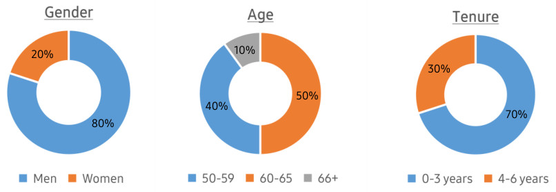 
11

---

<!-- 原文第 13 页 -->

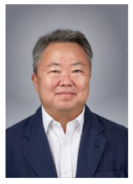

---

<!-- 原文第 14 页 -->

## Mr. Kim's statement of his commitment to the Board 
"I will leverage the insights and global networks I have cultivated in my 30+ years in the investment industry to proactively connect with financial market participants on behalf of Samsung Electronics; and I will promote open and productive dialogues to ensure that the valuable feedback and suggestions of our investors are reflected in our efforts to enhance corporate value. 
I will share with the Board my insights from observations and research on best practices of leading,global companies across various fields and propose actions to bring tangible benefits to Company operations. In particular,I will work to foster greater independence and transparency in Board operations. 
Also,I will inest considerable time and effort in thoroughly reviewing Board materials and reviewing the Company's mid- to long-term strategies and key management issues from an investors perspective, working to advance Samsung's sustainability management and the protection of shareholder rights." 
13

---

<!-- 原文第 15 页 -->

Item 2.1.2:Dr.Eunnyeong Heo (renominated 
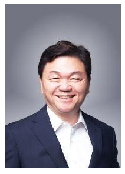 
Work Experience 
2022-Present: President, Korea Institute of Energy Law 
2022-2024:Vice Dean,Graduate School of Engineering Practice, Seoul National University 
2021-Present:Private Sector Commissioner, Committee on Energy 
2020-Present:Full member, National Academy of Engineering of Korea 
2019-2020:President, Korean Resource Economics Association 
2018-2022: President, Korea Society of Innovation 
2017-2019:Vice president, International Association for Energy Economics (IAEE) 
2016-present: Vice president, Korean Society for New and Renewable Energy 
2013-2017: Private Sector Commissioner, Committee on Green Growth 
·2013-2015: Private Sector Commissioner, National Economic Advisory Council 
1996-Present: Professor, College of Engineering, Seoul National University 
Board Experience 
November 2022-Present: Independent Director, Samsung Electronics 
March 2016-March 2022:Independent Director,LX International 
Education 
Ph.D.in Mineral Economics,The Pennsylvania State University 
B.S/M.S.in Mineral and Petroleum Engineering, Seoul National University 
## Eunnyeong Heo 
Tenured Professor, Department of Energy Resources Engineering, Seoul National University 
Age:60 
Board tenure: Since 2022 
Independent Director Country of nationality: Republic of Korea 
## Rationale for recommendation by the Board 
Dr.Eunnyeong Heo is currently a tenured professor at Seoul National Universit in the Department of Energy Systems Engineering. Dr. Heo is a leading expert in Korea in energy resources,the environment, and the techno-economy, with a particular focus on how they relate to policy and the economy.Dr. Heo is also a globally recognized scholar who possesses extensive networks and substantial influence in his fields. 
## Since his appointment as an Independent Director in 2022, 
Dr.Heo has been instrumental in broadening discussions on climate, resources,and the environment by ensuring the Board of Directors is informed on the evolving trends and viewpoints of both domestic and international stakeholders. He also provides substantive advice on enhancing the execution of the New Environmental Strategy, as seen in his proposed technology development roadmap. Notably,he demonstrated his leadership by actively reviewing and proposing plans to bolster our international supply chains and secure resource infrastructure at business sites,which are critical to the mid- to long-term manufacturing competitiveness of the semiconductor business. Since 2024, Dr.Heo has chaired the Related Party Transactions Committe,helping advance a sound and fair framework for internal controls. 
Samsung expects Dr.Heo to continue to leverage his expertise in energy resources,the environment, and the techno-economy to help enhance the Company's mid- to long-term growth and sustainability management, while also playing a central role in strengthening the Board's internal control system. The Board therefore recommends voting for the appointment of Dr.Eunnyeong Heo to the position of Independent Director. 
14

---

<!-- 原文第 16 页 -->

## Dr. Heo's statement of his commitment to the Board 
"Drawing from my extensive expertise in energy resources, the environment, and the techno-economy, Ilam committed to delivering practical insights on bolstering the supply chain, resource infrastructure,and management strategies related to technology development, which are core elements for the Company's mid-to long-term growth.I will also serve as a link between the Company's internal operations and external engagements. 
With the Company's global business performance becoming increasingly defined by ESG progress, such as the stable sourcing of renewable energy and raw materials and advancement of climate change response strategies, I will consistently focus on guiding the Company's proactive review of sustainability-management issues and adaptation to current challenges with greater flexibility and effectiveness under a long-term vision 
Greater attention is now being place on the Board's responsible management. As an Independent Director, I am committed to fulfilling my duties with integrity and ensuring the Board adheres to a long-term vision to drive the Company's sustainable growth. Leveraging my experience on the Related Party Transactions Committe,I will drive efforts to strengthen internal controls, particularly in oversight of internal transactions." 
15

---

<!-- 原文第 17 页 -->

Item 2.1.3:Ms. Myung-Hee Yoo (renominated) 
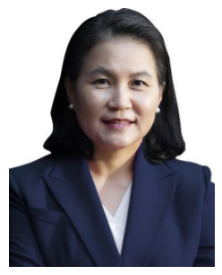 
Work Experience 
2022-present: Visiting Professor, Graduate School of International Studies, Seoul National University 
2021-2022: Ambassador for Economy and Trade, Ministry of Foreign Affairs (MOFA) 
·2019-2021:Trade Minister, Ministry of Trade, Industry and Energy (MOTIE) 
2018-2019: Director General for FTA Policy, Office of FTA Negotiations, MOTIE 
. 2017-2018:Director General, Bureau of Trade Policy, Office of FTA Negotiations, MOTIE 
. 2015-2017: Director General, FTA Negotiations & East Asia FTA Bureau, MOTIE 
·2014-2015:Spokesperson for Foreign Media, Office of Public Relations, 
Office of the President 
Board Experience 
November 2022-present: Independent Director, Samsung Electronics 
October 2022-present: Independent Director and Audit Committee member, Hyundai Construction Equipment 
Education 
·J.D. Vanderbilt University Law School ·M.A.in Public Policy, Seoul National University 
B.A.in English Language and Literature, Seoul National University 
Myung-Hee Yoo 
Former Trade Minister, Ministry of Trade, Industry and Energy 
Age:57 
Board tenure: Since 2022 Independent Director 
Country of nationality: Republic of Korea 
Rationale for recommendation by the Board 
Ms. Myung-Hee Yoo is a distinguished trade expert who has previously served as Trade Minister at the Ministry of Trade, Industry and Energy. She has a proven track record in highstakes international negotiations, having played a pivotal role in securing major trade agreements such as the KoreaU.S.FTA;and finalizing the Regional Comprehensive Economic Partnership (RCEP), which involves 15 member nations. Based on her experience, Ms. Yoo was one of the two finalists for Director-General ofthe World Trade Organization in 2020,a testament to her outstanding capabilities and expertise both at home and abroad. 
Since her appointment as an Independent Director in 2022, 
Ms. Yoo has provided valuable insights across a wide array ofmatters amid a rapidly changing international environment. Key topics included establishing strategies for improving the global business operating model,providing guidance and direction for practical responses to trade issues,and recommending measures to improve government communication. Furthermore,as an Audit Committee member, she has faithfully fulfilled her role of management oversight by identifying global trade risks, objectively reviewing and assessing key issues and business operations, and actively sharing recommendations to enhance business performance at the management level. 
Amid the ongoing and unprecedented changes in the global trade environment,we believe that Ms. Yoo's expertise and extensive global network developed over her decades in international trade and negotiations will bring increased agility and strategic insight to the Company's responses to market dynamics and thus support our sustained growth as a global company. The Board therefore recommends voting for the appointment of Ms. Myung-Hee Yoo to the position of Independent Director. 
16

---

<!-- 原文第 18 页 -->

## Ms.Yoo's statement of her commitment to the Board 
"Based on my 30 years of experience in international trade,I will leverage my knowledge and global network to effectively respond to various trade challenges the Company encounters in its global businesses to help continually enhance corporate and shareholder value. 
The global trade order is reorganizing in unprecedented ways.Driven by a global tug-of-war over cutting-edge technologies such as semiconductors and Al, full-fledged impacts of regulations and supply chain restructuring are significantlyincreasing the burden on corporate management. As an Independent Director,I will provide objective, constructive advice to help the Board of Directors accurately assess the current dynamics and respond decisively and effectively. 
As an Audit Committee member,I have experience in identifying internal and external risks, analyzing their impacts,and closely monitoring the commercialization progress and financial performance of key strategic products. Leveraging this experience, I am committed to increasing transparency in business management and ensuring financial soundness. 
Through an independent perspective, I will unwaveringly fulfill my role as an Independent Director by providing impartial oversight of company management, ensuring it operates lawfully and ethically, while also striving to represent the rights and interests of all shareholders and stakeholders." 
17

---

<!-- 原文第 19 页 -->

Item 2.1.4: Dr.Hyuk-Jae Lee (newly nominated) 
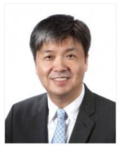 
Work Experience 
2024-present: Director of Interuniversity Semiconductor Research Center, Seoul National University (SNU) 
2024-present:Co-chair,the Semiconductor Special Committee, 
National Academy of Engineering of Korea 
2023-present: Head of Project Team, SNU Graduate School of Al Semiconductor 
. 
2023-2023:President, The Institute of Electronics and Information Engineers 
·2022-present: Full member, National Academy of Engineering of Korea 
. 
2022-2022:General Chair, AI Circuits and Systems Conference, Institute of Electrical and Electronics Engineers (IEEE) 
The emergence of Al has led to a seismic shift in the semiconductor market and caused rapid restructuring of the industry's order and competitive landscape. Under these circumstances, Dr.Lee,a leading expert in both system and Al semiconductors, is expected to contribute greatly to the Board's in-depth discussions on such matters and the development of well-defined strategies. 
·2021-present: CEO,SNU System-IC Industry Promotion Center 
·2001-present: Professor, Department of Electrical and Computer Engineering, Seoul National University 
Dr.Lee's profoundunderstanding of semiconductor technologiesand deep insightinto the evolving semiconductor ecosystem in the Al era will help enhance the Board's function as an active leadership body. Through this, Samsung will sustain its position as an unrivaled technology and market eader. The Board therefore recommends voting for the appointment of Dr. Hyuk-Jae Lee to the position o Independent Director. 
Board Experience 
None 
Education 
Ph.D.in Electrical and Computer Engineering, Purdue University B.S/M.S.in Electronics Engineering, Seoul National University 
Hyuk-Jae Lee 
Tenured Professor, Department of Electrical and Computer Engineering, Seoul National University Age:60 
Board tenure: Newly nominated 
Independent Director 
Country of nationality: Republic of Korea 
Rationale for recommendation by the Board 
Dr. Hyuk-Jae Lee, a tenured professor in the Department of Electrical and Computer Engineering at Seoul National 
University(SNU),is a preeminent figure in the semiconductor field, and he also serves as the Director of SNU Inter-university Semiconductor Research Center, CEO of SNU System-IC Industry Promotion Center, and Head of Project Team at SNU Graduate School of AI Semiconductor. Dr.Lee has also held several other distinguished roles, such as the President ofthe Institute of Electronics and Information Engineers in 2023,and since 2024,the co-chair ofthe Semiconductor Special Committee at National Academy of Engineering of Korea, underscoring his position as a leading force in driving the advancement of Korea' semiconductor industry. 
18

---

<!-- 原文第 20 页 -->

## Dr.Lee'statement of his commitment to the Board 
"Having dedicated many years to semiconductor research,I have directly observed shifts in the technological paradigm and how they have impacted numerous semiconductor companies amid repeating cycles of strategic successes and failures.The emergence of AI has spurred rapid transformations in the semiconductor market, and I have engaged in in-depth discussions with experts to identify viable solutions from a corporate standpoint. 
Drawing on my professional knowledge and experience,I will help shape and guide the Company's strategic direction with the Board and management. Through this, willdeote my efforts to bolstering Samsung's position as an industry leader in technological competitiveness in the memory and system semiconductor sectors,thus helping reinforce the Company's market leadership. 
As an Independent Director, I will carry out my oversight duties diligently and objectively to ensure both the Board and management are upholding their responsibilties appropriately. On behalf of the Company, I will engage with various stakeholders and domestic and international experts alike to cultivate a pipeline of top talent capable of driving disruptive technology innovations. 
To ensure Company's sustainable growth,I will pursue mutually beneficial communications across the industry and supervise the Company's compliance management with an unmatched ethical standard." 
19

---

<!-- 原文第 21 页 -->

Item 2.2: Election of Executive Directors 
ltem 2.2.1:Dr.Young-Hyun Jun (newly nominated 
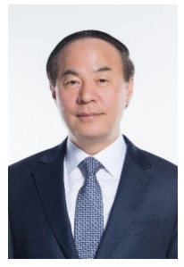 
## Work Experience 
2024-Present: Head of Device Solutions (DS), Head of Memory 
Business, Head of Samsung Advanced Institute of Technology (SAIT) 
. 2023-2024:Head of Future Business Division 
·2022-2023:Chairman of the Board, Samsung SDI 
·2017-2022:CEO,Samsung SDI 
·2014-2017:Head of Memory Business 
Board Experience 
·2022-2023:Executive Director, Samsung SDI 
Education 
·M.S./Ph.D.in electrical engineering, Korea Advanced Institute of Science and Technology (KAIST) 
·B.A.in electrical engineering, Hanyang University 
Young-Hyun Jun 
Vice Chairman, Head of Device Solutions (DS) Division Age:64 
Board tenure: Newly nominated 
Executive Director 
Country of nationality: Republic of Korea 
## Rationale for recommendation by the Board 
Since assuming the position of the DS Division Head in May 2024,Dr. Young-Hyun Jun has been leading efforts to strengthen the competitiveness of the semiconductor business, leveraging his business acumen and deep insights in memory development and the electronics industry.He also serves as the Head of the Memory Business, which has considerable influence on Samsung's financial performance. 
As the Head of the Memory Business from 2014 to 2017,Dr. Jun contributed significantly to the business's increased revenue and operating profit through the preemptive development and mass production of new products. During his tenure as CEO of Samsung SDl from 2017 to 2022, th firm achieved consistently strong results. 
Facing intensifying competition in the global semiconductor market, we believe Dr.Young-Hyun Jun is the most qualified individual to secure competitive technologies and products, given his technological expertise and industry insight.We expect him to leverage his extensive experience and play a leading role in efforts to ensure swif, well-coordinated responses to key investor and stakeholder engagements. The Board therefore recommends voting for the appointment of Dr. Young-Hyun Jun to the position of Executive Director. 
20

---

<!-- 原文第 22 页 -->

Item 2.2.2:Dr. Tae-Moon Roh (renominated) 
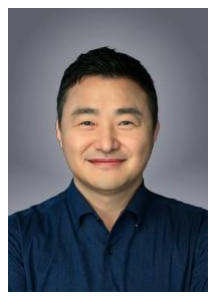 
Work Experience 
·2022-Present: Head of Design Management Center 
·2020-Present: Head of MX Business ·2017-2020:Head of Mobile R&D Office, Mobile Busines 
·2016-2017: Head of Mobile R&D Office 2, Mobile Business ·2015-2016: Head of Mobile R&D Office 2& Product Strategy Team, Mobile Business 
·2014-2015: Head of Product Strategy Team & Innovative Product R&D Team, Mobile Business ·2011-2014:Head of Innovative Product R&D Team, Mobile Business 
Board Experience 
·March 2022-Present:Executive Director, Samsung Electronics Education 
·M.S./Ph.D.in electrical engineering, Pohang University of Science and Technology 
·B.A.in electronicengineering,Yonsei University 
Tae-Moon Roh 
President, Head of Mobile eXperience (MX) Business Age:56 
Board tenure: Since 2022 Executive Director 
Country of nationality: Republic of Korea 
Rationale for recommendation by the Board 
Dr.Tae-Moon Roh is a leading expert in smartphones who won the Technology Award in the Samsung Award of Honor in 2010 in recognition of his role in developing the Galaxy Sseries. 
Since assuming leadership ofthe Mobile eXperience Business in 2020,Dr. Roh has successfully expanded the Galaxy ecosystem through the launches of Galaxy Tab, Galaxy Watch, and more.He introduced the world's first Al phone with the Galaxy S24 Series, securing an early lead in the Al smartphone market,and recently further elevated AI phones with the launch of the S25 Series.Dr. Roh was driving force behind the business generating revenue of KRW 109 trillion in 2023 and KRW 114 trilion in2024 through timely and effective sales strategies, such as the Paris Olympics campaign. 
In the stagnant but increasingly competitive smartphone market,Dr. Roh has pioneered new categories with foldable phones and Al phones while driving efforts in new business domains such as Samsung Health and Samsung Caret, with a continued commitment to expanding the business. Through such effort, he fortified the framework for sustainable growth. 
As an Executive Director, Dr.Roh has played important roles across diverse areas over the past three years, effectively coordinating key requests by major investors and both internal and external stakeholders.The Board thus recommends voting for the appointment of Dr. Tae-Moon Roh to the position of Executive Director. 
21

---

<!-- 原文第 23 页 -->

Item 2.2.3: Dr.Jai-Hyuk Song (newly nominated) 
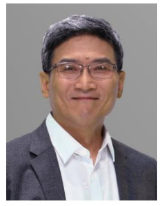 
Work Experience 
2022-Present: CTO of Device Solutions (DS), Head of Semiconductor R&D Center 
Since 2022,Dr. Jai-Hyuk Song has been serving as a CTO of the DS Division and Head of the Semiconductor R&D Center. Dr.Song,anexpertin semiconductor technologies, successfully led the development and commercialization of V-NAND products and is continuing to drive innovation in next-generation technologies for future growth. He is a highly-capable candidate who will successfully fulfill his role as a new Executive Director by elevating the value of a technology-driven company. 
·2020-2022:Head of Flash Product& Technology, Memory Business 
·2017-2020:Head of Flash Process Architecture, Memory Business 
·2014-2016:Executive in Charge, Samsung China Semiconductor 
Dr. Song led the development of the world's first V-NAND product and mass production of multiple generations, including the current 8th generation,providing critical leadership in maintaining the No.1share in the NAND market and spearheading efforts to secure fundamental, next-generation technologies via the Semiconductor R&D Center. Aiming to strengthen R&D competitiveness,he has led transformative improvements in technology, systems, and corporate culture. Alongside this, he has drawn on his vast industry network built over many years to enhance academia-industry collaborations on future technologies and participate in government committees and C-level academic conferences,showing his commitment to keep expanding the Company's technological leadership. Based on his deep understanding of the semiconductor business and technologies, he is expected to serve as a vital link between the Board and management for technology-related decisions. 
·2010-2014:Executive in Charge, Flash Process Architecture, Memory Business 
Board Experience 
None 
Education 
M.S./Ph.D.in Electronics Engineering, Seoul National University 
·B.A.in electrical engineering,Korea Advanced Institute of Science and Technology(KAIST) 
Jai-Hyuk Song 
President, Chief Technology Officer (CTO) of Device Solutions (DS) Division 
# Age:57 Board tenure: Newly nominated Executive Director Country of nationality: Republic of Korea Rationale for recommendation by the Board 
Dr.Song brings an open-minded approach as well as strong interpersonal and collaborative abilities. These qualities, paired with his leadership skills, enable him to effectively address communications from major investors and various stakeholders and achieve rational outcomes. The Board thus recommends voting for the appointment of Dr. Jai-Hyuk Song to the position of Executive Director. 
22

---

<!-- 原文第 24 页 -->

## Agenda ltem 3: Approval of Director Remuneration Limit (FY2025) 
## Compensation Committee 
Samsung Electronics established the Compensation Committee in 2009 by a resolution of the Board, without legal mandates.The Committee consists entirely of Independent Directors to ensure the objectivity and transparency of decision-making regarding director remuneration.it is responsible for assessing the appropriateness of director compensation and reviewing the limit on director compensation for the next fiscal year, which will be up for approval by the shareholders at the AGM. 
## Remuneration Structure 
Our Director Remuneration program emphasizes the link between performance and compensation. The program consists of two elements:1) general compensation; and 2) three-year long-term incentive(LTI). 

| 1) General compensation | 1.1) Base salary | Fixed compensation (including Independent Directors) |
| --- | --- | --- |
| 1.2) Annual incentive | Performance based compensation |
| 2)Long-term incentive (LT) | |
 
※Remuneration of Directors by element (FY2019-FY2023; average portion) 
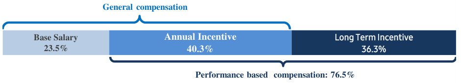 
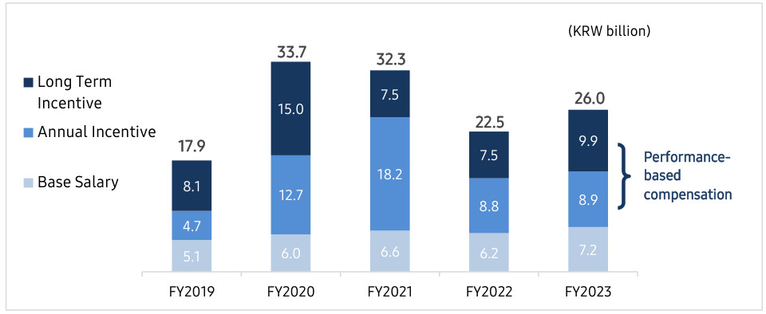 
23

---

<!-- 原文第 25 页 -->

## 1) General compensation 
General compensation consists of base salary (including that for Independent Directors) and annual incentives. 
## 1.1) Base salary 
In accordance with internal regulations for executive treatment (Board resolution),base salary is determined based on position, responsibilities, and performance results. 
·Performance-based compensation such as annual incentives and LTI are calculated using base salary as the base. 
## 1.2) Annual incentive 
Annual incentives are based on achievements and financial performance in each business segment. 
OPI(Overall Performance Incentive): Paid once a year within 0-50%of annual salary based on the compensation resources calculated according to financial factors such as profit ater tax (assessed considerations) and cost of capital for the fiscal year by business unit. (Adjusted according to individual performance.) 
·TAI(Target Achievement Incentive): Provided annually within a range of 200% of monthly salary based on target achievement of each business. 
Special Bonus: Provided as a one-time bonus based on the annual performance and financial results, in accordance with internal regulations approved by the Board-e.g., special bonus to the CEO of a Division for outperformance. 
## Implementation of equity incentives 
The Board has proposed adjusting the current cash-based executive compensation system, which is tied to past performance, to incorporate a future-oriented and highly motivating stock-based compensation system. 
As a first step in that direction, we announced on January 17, 2025, a new policy whereby vice presidents, executive vice presidents,presidents, and Executive Board members must choose to receive at least 50%, 70%, 80%,and 100% of their 2024 annual OPI (Overall Performance Incentive) in shares,respectively. 
The Company and executives will enter into an RSA (restricted stock agreement) at the time of the OPI decision, and the stock shares are to be granted one year after the agreement is signed. 
Executive Directors and president-level executives are prohibited from selling the stock for two years following the grant date, whereas vice presidents and executive vice presidents are prohibited from selling for one year following the grant date.Given the grant date is one year following the agreement, the selling restriction is in place for two years forvice presidents and executive vice presidents and three years for president-level executives and Executive Directors from the agreement date. Furthermore, if the stock price at the grant date is equal to or higher than it was at the time of the agreement, the executives receive the full number of agreed-upon shares, whereas a lower stock price results in a proportionally reduced allocation. 
24

---

<!-- 原文第 26 页 -->

By directly linking executive incentives to stock performance, we reinforce our commitment to long-term shareholder value creation, aligning with our shareholder's interest through sustainable business growth rather than short-term financial results. 
With the newly introduced stock-based incentive system, the Company is committed to strengthening shareholder-oriented management. We will continue to explore ways to further enhance our executive compensation system and will share any related decisions with our shareholders. 
## 2) Long-term incentive (LTI) 
The Company determines LTI by conducing performance evaluations at three-year intervals, and from FY2023, it distributes 33 of the incentive in each of the following three years. Samsung Electronics adopted the LTI system in 2005. 

| | Term1 | Term2 | Term3 | Term4 | Term5 | Term 6 |
| --- | --- | --- | --- | --- | --- | --- |
| Evaluation period: | 2005-2007 | 2008-2010 | 2011-2013 | 2014-2016 | 2017-2019 | 2020-2022 |
| Payment period: | 2008 | 2011-2013 | 2014-2016 | 2017-2019 | 2020-2022 | 2023-2025 |
 
## Evaluation criteria 
Comparison of 3-year ROE, EBIT margin, stock performance 
·ROE and EBIT margin are measured against figures at global peers. 
·Stock performance is measured against that of the KOSPl and of global peers 
## Clawback policy 
The LTl plan features a clawback policy (or recovery plan) thatenables the Company to reduce the awarded payments if any financial losses, such as contingent liabilities, are found after the LTI was determined. The plan's deferral of and ability to recover payments is designed to enhance management responsibility. 
25

---

<!-- 原文第 27 页 -->

## FY2024:Actual Compensation 
The actual total compensation in FY2024 was KRW 21.5 billion, which is approximately 50% of the annual remuneration limit. 
(KRW billion) 
FY2022 FY2023 FY2024
Approved Actual Approved Actual Approved Actual
General compensation 33.0 15.0 33.0 16.1 33.0 11.6
Long-term incentive(LTI) 8.0 7.5 15.0 9.9 10.0 9.9
Total2 41.0 22.5 48.0 26.0 43.0 21.5 
1.Includes Independent Directors 2. Limited to the term as a registered director 
1) General compensation of FY2024 decreased year-on-year. 
·Base salary decreased compared to FY2023 due to a decrease the number of Executive Directors (KH Kyung resigned as CEO and Executive Director in May 2024) 
Total annual incentives also decreased due to a reduction in OPl and TAI payments, with over 50% of annual incentives paid in the form of stock. 
2) LTI for FY2024 was unchanged year-on-year. 
·In FY2024, 33% of the incentive was provided in accordance with the LTI system as it was the second year of the three- year term that was same as FY2023. 
## 口Compensation summary 
·The following table shows information regarding Executive Directors compensation for 1H FY 2024, 2023 and 2022.In accordance with relevant regulations, Executive Director remuneration is disclosed semi-annually.Individual remuneration for FY2024 will be disclosed in March 2025 in the 2024 Business Report, which will be posted on the IR website. 
(KRW billion) 
Name Year Base salary Performance based2 Total
1H2024 0.8 0.3 1.1
JH Han CEO, Head of DX Division 2023 2022 1.5 1.2 5.4 3.4 6.9 4.6
1H2024 0.6 0.1 0.7
KH Kyung7 2023 1.2 1.2 2.4
2022 1.0 1.9 2.9
TM Roh 1H2024 0.7 0.4 1.1
Head of MobileeXperience 2023 1.3 4.9 6.2
(MX) Business 2022 1.1 3.0 4.1
1H2024 0.6 0.2 0.8
HK Park1 2023 1.0 2.8 3.8
2022 0.9 1.0 1.9
Former Head of Memory JB Lee Business 1H2024 2022 2023 0.5 0.8 1.0 0.1 2.0 1.7 2.7 0.6 2.8 
1) KH Kyung resigned as CEO (Head of DS Division) and Executive Director on May 21, 2024 and HK Park resigned as Executive Director on Dec 26,2024 2) LTIl included 
26

---

<!-- 原文第 28 页 -->

XGlobal peer comparison 
(USD million) 

| | SEC | Peer companies | | | | | | | |
| --- | --- | --- | --- | --- | --- | --- | --- | --- | --- |
| Apple | QCOM | Cisco | MSFT | Micron | Nvidia | Intel | Broadcom |
| Total | 15.0 | 183.3 | 67.1 | 134.4 | 163.4 | 73.2 | 83.2 | 52.1 | 242.2 |
| Per person | 3.0 | 36.7 | 13.4 | 26.9 | 32.7 | 14.6 | 16.6 | 10.4 | 60.6 |
| As percentage of net profit | 0.1% | 0.2% | 0.7% | 1.3% | 0.2% | 9.4% | 0.3% | 3.1% | 1.7% |
 
*Comparison of SEC's average remuneration in FY2024 for the five Executive Directors to the actual remuneration paid to the top five executives at global peer companies. 
*The currency rate is based on the average exchange rate in 2024. 
*Based on the latest disclosure: FY2024 for Apple,Qualcomm,isco, Microsoft, Micron, Nvidia; FY2023 for Intel, Broadcom. 
## O Independent Directors 
·Independent Directors remuneration is included in general compensation. In FY2024,total remuneration decreased compared to FY2023. 
(KRWbillion) 

| | FY2022 | FY2023 | FY2024 |
| --- | --- | --- | --- |
| Number of Independent Directors | 6 | 6 | 6 |
| Total remuneratior | 1.1 | 1.2 | 7.1 |
| Per person | 0.18 | 0.2 | 0.18 |
 
27

---

<!-- 原文第 29 页 -->

## FY2025:To Be Approved 
The Board recommends a remuneration limit of KRW 36.0 billion for FY2025,down from KRW 43 bilion in the previous year. 
(KRW bilion) 

| | FY2024 | FY2025 |
| --- | --- | --- |
| General compensation | 33.0 | 26.0 |
| Long-term incentive (LTI) | 10.0 | 10.0 |
| Total | 43.0 | 36.0 |
 
## 1.Includes Independent Directors 
## 1) General compensation 
In consideration of macro uncertainties and decrease in the number of Board members,the Board recommends a general compensation limit of KRW 26 billion for FY2025,down from KRW 33 billion in the previous year. 
## 2) Long-term incentive (LTI) 
·For FY2025,the Board recommends an LTI limit of KRW 10.0 billion. 
·Under the current scheme,Directors receive 33% of their LTl each year of the three-year payment period. 
·FY2025 is Payment Year3 of the current payment scheme, with LTI determined by performances over the FY2020-2022 period. Under the current scheme, the LTI limit for FY2025 is the same as it was for FY2024 
(KRW billion) 

| | Previous term | | | Current term | | |
| --- | --- | --- | --- | --- | --- | --- |
| Evaluation period | FY2017-FY2019 | | | FY2020-FY2022 | | |
| Payment period | FY2020-FY2022 | | | FY2023-FY2025 | | |
| | | Limit | Actual | | Limit | Actual |
| Payment Year 1 | FY2020(50%) | 25.0 | 15.0 | FY2023(33%) | 15.0 | 9.9 |
| Payment Year 2 | FY2021(25%) | 8.0 | 7.5 | FY2024(33%) | 10.0 | 9.9 |
| Payment Year3 | FY2022(25%) | 8.0 | 7.5 | FY2025(33%) | 10.0 | |
 
28

---

<!-- 原文第 30 页 -->

## Agenda item 4: Election of Audit Committee Members 
With Independent Director and Audit Committe member Mr. Han-Jo Kim'ssecond term and 6th year of service nearing a condlusion, the Board has nominated Independent Director Je-Yon Shin to the Audit Committee(item 4.1.). 
Also, the Board has renominated Ms. Myung-Hee Yoo for Independent Director,and we plan to reappoint her as a member of the Audit Committee(Iitem 4.2.). 
Item 4.1:Mr.Je-Yoon Shin (newly nominated) 
Je-Yoon Shin 
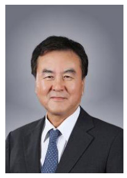 
Former Chairman, Financial Services Commission 
Age:66 
Board tenure: Since 2024 
Independent Director 
Country of nationality: Republic of Korea 
Work Experience 
Rationale for recommendation by the Board 
2017-present: Senior Advisor,Bae, Kim&Lee LLC 
Mr.Je-Yoon Shin is an economic policy,finance, and fiscal affairs expert who has held various key positions in the Ministry of Economy and Finance.He also served as the Chairman of the Financial Services Commission, overseeing the establishment of Korea's financial policies. 
. 2017-2023: President, Financial Education Council 
·2017-2018: Ambassadorfor International Financial Cooperation, Ministry of Foreign Affairs 
Mr.Shin's distinguished history,which includes serving a two-year term from 2015 as Vice-president and then President of the Financial Action Task Force on Money Laundering and chairing the 2010G20Finance Deputies Meeting, has earned him widespread recognition as an expert in global risk management with experience in compliance of international regulations and monitoring of money laundering/terrorist financing. 
·2015-2016:Presiden, Financial Action Task Force on Money Laundering 
2013-2015:Chairman,Financial Services Commission 
*Advisory role only 
Furthermore, Mr. Shin's global expertise is highly regarded, having been the Finance Division's chief negotiator in the Korea-US FTA in 2005 and instrumental in closing the Korea-US currency swap deal in 2008,which helped the nation overcome the financial crisis. 
Board Experience 
March 2024-present: Independent Director, Samsung Electronics 
. October 2019-February 2024: Independent Director and Audit Committee member,Lotte Insurance 
In the ever-changing globaleconomy, the importance of risk management and strategic proposals have increased. In these circumstances, Mr.Je-Yoon Shin, an expert in finance and fiscal policy, offers professional counsel on diverse topics such as corporate financial management and global strategies. Moreover,we believe Mr.Shin will seamlessly translate his experience as an Audit Committee member of other Korean listed companies and President of the Financial Action Task Force on Money Laundering to faithfully fulfill his oversight duties as an Audit Committee member.The Board thus recommends voting for the appointment of Mr. Shin to the Audit Committee. 
March 2018-present: Independent Director and Audit Committee member, HDC Holdings 
Education 
·M.A.in Economics,Cornell University ·B.A.in Economics, Seoul National University 
29

---

<!-- 原文第 31 页 -->

Item 4.2: Ms. Myung-Hee Yoo (renominated) 
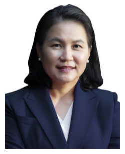 
## Work Experience 
2022-present: Visiting Professor, Graduate School of International Studies, Seoul National University 
2021-2022:Ambassador for Economy and Trade, Ministry of Foreign Affairs (MOFA) 
·2019-2021:Trade Minister, Ministry of Trade, Industry and Energy(MOTIE) 
2018-2019: Director General for FTA Policy, Office of FTA Negotiations, MOTIE 
2017-2018: Director General, Bureau of Trade Policy, Office of FTA Negotiations, MOTIE 
·2015-2017: Director General,FTA Negotiations & East Asia FTA Bureau, MOTIE 
2014-2015:Spokesperson for Foreign Media, Office of Public Relations, Office of the President 
## Board Experience 
November 2022-present: Independent Director, Samsung Electronics 
October 2022-present: Independent Director and Audit Committee member, Hyundai Construction Equipment 
## Education 
·J.D,Vanderbit University Law School M.A. in Public Policy, Seoul National University B.A. in English Language and Literature, Seoul National University 
## Myung-Hee Yoo 
Former Trade Minister, Ministry of Trade, Industry and Energy 
Age:57 
Board tenure: Since 2022 
Independent Director 
Country of nationality: Republic of Korea 
Rationale for recommendation by the Board 
Independent Director Myung-Hee Yoo is an expert in international trade who has dedicated over 30 years to public service in this area. In 2020, Ms. Yoo was one of the two finalists for the position of Director General of the World Trade Organization, a testament to the recognition of her outstanding capabilities and credibility. Ms. Yoo leverages her unique knowledge and capacity in trade to provide insight into risks in business activities. Moreover, through her advisory and oversight roles, her mutifaceted approach will promot alaned-deision making and ontribute substantially to the Board's operation. 
As a member of the Audit Committee, Ms.Yoo,a U.Seducated legal professional with a doctorate in law and a member of the New York Bar,has helped enhance the Company's compliance managementand financial transparency. In her role,she examines and verifies global business operations, sales activities, and internal controls, while communicating with external auditors, thus improving the reliability of financial information provided to investors. Also,she monitors the feasibility of major investments and the degree of trade risks, focusing her efforts on maintaining the Company's financial soundness. 
With her risk management capabilities, bult from her global trade experience, legal proficiency, and deep understanding of corporate structures and auditing practices, Ms. Yoo is an outstanding candidatewithexceptionalauditing experience.The Board thus recommends voting for the appointment of Ms. Yoo to the Audit Committee. 
30

---

<!-- 原文第 32 页 -->

2 
## Information About the Meeting And Shareholder Rights 
## Overview 
General meetings of shareholders are the Company's highest decision-making body,where shareholders deliberate and decide on important issues concerning the Company. 
## 0Convening 
General meetings of shareholders shall be either ordinary or extraordinary meetings. 
·Ordinary general meetings-held within three months of the record date. 
·Extraordinary general meetings-held whenever deemed necessary. 
* Extraordinary general meetings may be called by the Board or by persons as authorized by the Articles of Incorporation and the Commercial Act and convened in accordance with the relevant procedures. 
0Parties with authority to convene meetings 
Persons or parties authorized to call ordinary and extraordinary general meetings under the Articles of Incorporation and the Commercial Act: 
Board of Directors 
·Audit Committee 
·Shareholders 
* According to the Commercial Act, shareholders who have owned at least 1.5% of outstanding shares with voting rights of the Company for more than six months may request to convene extraordinary general meetings. 
## 口Notice of convening 
Pursuant to the Article 17-3 of the Articles of Incorporation, a written or electronic notice thereof setting forth the time,date, place, and agenda of the meeting shall be sent to the shareholders at least two weeks prior to the general meeting of shareholders. 
*For the purpose of transparency and proteting shareholder voting rights, the Company currently has a policy to notify the shareholders of a general meeting of shareholders three or four weeks prior to the general meeting of shareholders. 
31

---

<!-- 原文第 33 页 -->

## Operation 
In accordance with our Article of Incorporation, each shareholder is entitled to one vote per share. The Company does not have any system or method (such as a dual class voting structure,etc.) to discriminate shareholders' voting rights. 
Method of adopting resolutions at the general meeting of shareholders 
## 1.Ordinary resolution 
·Pursuant to the Commercial Act and the Articles of lncorporation,resolutions shall be passed by more than one half (1/2) of votes of the shareholders present at the general meeting of shareholders and by more than one fourth (1/4) of outstanding votes. 
·ltems of Ordinary Resolutions: Election of Directors, remuneration for Directors, approval of financial statements,etc. 
## 2.Extraordinary resolution 
·Pursuant to the Commercial Act and the Articles of Incorporation, resolutions for matters that are significant to the Company's operation, including but not limited to amendments to the Articles of Incorporation and MAsubject to a resolution at a General Meeting, shall be passed by a minimum of two thrds (2/) of votes of the shareholders present at the general meeting of shareholders and by more than one third (1/3) of outstanding votes. 
Items of Extraordinary Resolutions: Amendment to the Articles of Incorporation, dismissal of Directors, approval of split or merger of the Company, etc. 
·The Company does not allow mail-in voting. However, the Board in January 2020 resolved to adopt electronic voting to enable shareholders to exercise their voting rights more conveniently Electronic voting has been available from the 51st AGM held in March 2020.In addition, the Company recommends the granting of proxies by distributing letter of attorney via various means-e.g, direct distribution, mail or fax, uploading the letter of attorney on the IR website, or sending the letter of attorney through email. 
## O Protection of minority shareholder rights in the general meeting of shareholders 
We are committed to protectig the rights of the Company's minority shareholders, whoserights are set forth below: 
## 1. Right to call general meetings of shareholders 
·In accordance with the Commercial Act,shareholders who own more than 1.5% of outstanding shares with voting rights of the Company for more than six months may request to convene extraordinary general meetings. 
## 2. Right to present shareholder proposals 
·Pursuant to the Commercial Actand the Articles of Incorporation,shareholders with ownership of more than 0.5% of outstanding shares with voting rights for more than six months may present shareholder proposals at a general meeting of shareholders. 
32

---

<!-- 原文第 34 页 -->

 
## Corporate Governance 
## Overview - The Board of Directors 
As of December 2024, the Board of Samsung Electronics is composed of three Executive Directors and six Independent Directors,with an Independent Director majority guaranteeing independence and transparency. 
## Independent Director Han-Jo Kim has chaired the Board since 2022. 
## Board of Directors (as of December 2024) 

| Executive Directors (3) | Jong-Hee Han | Tae-Moon Roh | Jung-Bae Lee |
| --- | --- | --- | --- |
| Independent Directors (6) | Han-Jo Kim(Board Chair) | | |
| Jun-Sung Kim | Eunnyeong Heo | Myung-Hee Yoo |
| Je-Yoon Shin | Hye-Kyung Cho | |
 
## Board Committees 
## The Management Committee 
The Management Committee deliberates and decides matters either delegated by the Board, or specified in the Articles of Incorporation or Regulations of the Board,aiming to enhance professionalism and efficiency of decision-making. 
## The Audit Committee 
The Audit Committee supervises and supports management to maximize corporate value using a system of checks and balances. The Committee consists of three Directors, and at least two thirds of them, according to relevant laws and regulations, must be Independent Directors. 
## The Independent Director Recommendation Committee 
The Independent Director Recommendation Committee ensures that outside directors are recruited and recommended in a fair and independent matter. 
## The Related Party Transaction Committee 
The Related Party Transaction Committee (also known as the Internal Transaction Committee) is a compliance body to enhance corporate governance and to promote fair transactions. The Committee reviews pending transactions between the Company and its related parties. 
## The Compensation Committee 
The Compensation Committee evaluates the appropriateness of and reviews and approves the limit on Director compenstion to be submitted for resolution at a general meeting of shareholders. The Committee consists of three Independent Directors. 
33

---

<!-- 原文第 35 页 -->

## The Sustainability Committee 
The Sustainability Committee was established in July 2021, as an expansion of the previously named Governance Committe, to pursue sustainability management in areas including ESG (environment, social, and governance) and to enhance shareholder value. 
## Composition of the Board committees (as of February 2025) 
We increased independence across the Board by forming all committees entirely with Independent Directors, excluding the Management Committe,which consists of three Executive Directors to make efficient decisions about business matters. 

| | Members | | |
| --- | --- | --- | --- |
| | Chair | Executive Directors | Independent Directors |
| Management Committee | Jong-Hee Han (Executive) | Tae-Moon Roh Jung-Bae Lee | |
| Audit Committee | Han-Jo Kim (Independent) | | Myung-Hee Yoo Hye-Kyung Cho |
| Independent Director Recommendation Committee | Je-Yoon Shin (Independent) | | Han-Jo Kim Eunnyeong Heo Myung-Hee Yoo |
| Related Party Transactions Committee | Eunnyeong Heo (Independent) | | Han-Jo Kim Myung-Hee Yoo |
| Compensation Committee | | | Han-Jo Kim Jun-Sung Kim Je-Yoon Shin |
| Sustainability Committee | Han-Jo Kim (Independent) | | Jun-Sung Kim Eunnyeong Heo Myung-Hee Yoo Je-Yoon Shin Hye-Kyung Cho |
 
34

---

<!-- 原文第 36 页 -->

Profile of Board Members (Executive) 
Jung-Bae Lee, PhD 
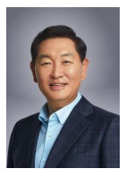 
Jong-Hee Han 
Birth: March 15, 1962 Director since 2020 
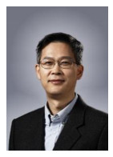 
Birth: February 27, 1967 Director since 2022 
Mr. Jong-Hee Han has been Vice Chairman & CEO, Head of Device eXperience (DX) of Samsung Electronics since 2021.He became President and Head of the Visual Display Business in 2017. Mr. Han joined the Company in 1988and has been influential in the development of a wide range of market-leading products. He played a pivotal role in taking Samsung's TV business to the pinnacle of the global market in 2006and keeping it there ever since. 
Mr. Han was central in the unveiling of Samsung's worldclass LED TVs, and his numerous other innovations enabled the Company to continually demonstrate its technology leadership.He was also instrumental in the developmentof Samsung's own video processing technologies. He served as the President of Korea Association of Smart Home (KASH; from 2018-2019). 
He earned his Bachelor's degree in electrical engineerin from Inha University in 1988. 
Tae-Moon Roh,PhD 
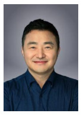 
Birth: September 3, 1968 Director since 2022 
Dr.Tae-Moon Roh, President and Head of the Mobile eXperience (MX) Business,is a leading expert in smartphones who won the Technology Award in the Samsung Award of Honor in 2010 in recognition of his role in developing the Galaxy S-series. 
Dr. Roh has been key in the development of new flagship products, including foldables,as well as in the sales expansion of wearables, overseeing the generation of KRW114 trillion in revenue in 2024,our strongest performance since 2014. Moreover, he contributed to solidifying business fundamentals by improving operations,which included achieving cost efficiencies via standardizing components as well as by enhancing the efficiency of marketing activities. 
He earned his B.A.in electronic engineering at Yonsei University and M.S. and Ph.D.in electronic engineering at Pohang University of Science and Technology. 
Dr. Jung-Bae Lee, President and Head of the Memory Business,offers experience and expertise that encompass the breadth of the Memory business, which includes not only development, but also quality and strategy.He has a remarkable understanding of and offers deep insight into the memory business. 
Mr.Lee heads the business unit that is key to the Companys overall esults,andhe has contribute significantly to enhancing the business's performance. Amidan environmentofescalating technological competition,he led achievements such as continuing Samsung's run of being the top company in terms of revenue in DRAM for over 30 years and in flash memory fo over20years by securing product competitiveness, including 10-nano-range DRAM and 6th generation V NAND. 
He earned his B.A,MS, and Ph.D.electronicengineering at Seoul National University. 
35

---

<!-- 原文第 37 页 -->

Profile of Board Members (Independent) 
Han-Jo Kim 
Eunnyeong Heo, PhD 
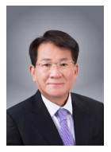 
Birth: July 12,1956 Director since 2019 Board Chair 
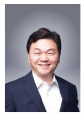 
Birth: August7,1964 Director since 2022 
Mr.Han-Jo Kim served as Chairman of Hana Nanum Foundation from 2015 to 2019 and became Chairman of Hana Foundation in 2019. He served as Vice Chairman of Hana Financial Group from 2015 to 2016.Previously, he was President and CEO of Korea Exchange Bank from 2014 to 2015 and President of KEB Capital from 2013 to 2014. 
He received his Bachelor's degree in French language and literature at Yonsei University. 
Jun-Sung Kim 
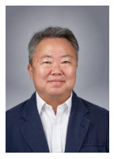 
Birth: October 14, 1967 Director since 2022 
Mr.Jun-Sung Kim is regarded as a trusted voice in the financial sector,and he has held active roles as an investment expert for a considerable length of time in global financial hubs including New York,London,and Singapore. 
He previously served in several key roles at Government of Singapore Investment Corporation (GIC) including Managing Director from 2013 to 2020.He has been Chief Investment Officer at the National University of Singapore since 2022. 
Mr.Kim earned his B.S.ineconomics&business administration at Carnegie Mellon University.He is also an alumnus of the Executive Program at Stanford University and earned the Board Director Diploma at the International Institute for Management Development (IMD), Switzerland. 
Dr.Eunnyeong Heo is an expert in energy resources, the environment, and the techno-economy,with a particular focus how they relate to economy and policy.He is currently a tenured professor at Seoul National University in the Department of Energy Systems Engineering. Moreover,Dr.Heois a renowned international scholar,and he was appointed to the positionofVice President of the International Association for Energy Economics (IAEE) in 2017. 
He also served as a President of the Korean Resource Economics Association from 2019to 2020,aVice President of The Korean Society for New and Renewable Energy since 2015, a Private Sector Commissioner on the Committee on Green Growth from 2013 to 2017,and a Private Sector Commissioner on the Committee on Energy since 2021. 
Dr.Heo earned his B.S.and M.S.in mineral and petroleum engineering (mineral economics) at Seoul National University,and his Ph.. in minerl economic from the Pennsylvania State University. 
Myung-Hee Yoo,JD 
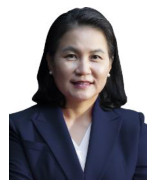 
Birth: June 5, 1967 Director since 2022 
Ms. Myung-Hee Yoo is an expert in international trade who served as Korea's Trade Minister. In 2020, Ms. Yoo was one of the two finalists for the position of DirectorGeneral of the World Trade Organization (WTO),a testament to the global recognition of her outstanding reputation and capabilities. 
She previously served as the Trade Minister at the Ministry of Trade, Industry and Energy (MOTIE) from 2019 to 2021 and as the Ambassador for Economy and Trade at the Ministry of Foreign Affairs(MOFA) from 202 to 2022. 
She earned her B.A.in English language and literature at Seoul National University,her M.A. in public policy at Seoul National Universit, and herJ.D.from Vanderbit University Law School. 
36

---

<!-- 原文第 38 页 -->

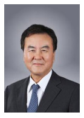 
Je-Yoon Shin 
Birth: March 25, 1958 Director since 2024 
Mr.Je-Yoon Shin is an economic policy,finance,and fiscal affairs expert who has held key positions in the Ministry of Economy and Finance.He also served as the Chairman of the Financial Services Commission, which oversees the establishment of Korea's financial policies. 
Mr. Shin is a highly regarded global expert, having been the Finance Division's chief negotiator in the Korea-US FTA in 2005 and instrumental in closing the Korea-US currency swap deal in 2008,with the latter helping the nation overcome the financial crisis.He also chaired the 2010 G20 Finance Deputies Meeting and served a twoyear term from 2015 as Vice-president then President of the Financial Action Task Force on Money Laundering, earning widespread recognition as an expert in global risk management with experience in compliance of international regulations and monitoring of money laundering/terrorist financing. 
He received his bachelor's degree in economics at Seoul National University and his M.A.in economics at Cornell University in the United States. 
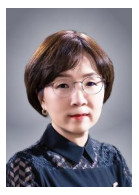 
Hye-Kyung Cho,PhD 
Birth:July 16, 1964 Director since 2024 
Dr.Hye-Kyung Cho is an expert in robotics currently serving as a professor of Applied Al at Hansung University.She has over 30 years of work experience in roboticsandrelatedsoftware,including in IT convergence, instrumentation, and control engineering. 
She has held numerous leadership positions in her field: President of Korea Robotics Society (2022);member of Mechanical Material Advisory Committee at Presidential Advisory Council on Science & Technology (2021-2022); and Vice President of the Institute of Contro, Robotics and Systems (2020-2021).She also is a full member of the National Academy of Engineering of Korea, evidencing threcognition of her outstanding expertise both domestically and internationally. 
She earned her B.A, M.S, and Ph.D.in Instrumentation and Control Engineering at Seoul National University. 
37

---

<!-- 原文第 39 页 -->

## Board Activities 
The following tables present the agendas and voting results of meetings that were held by the Board and the Committees under the Board between January 2024 and December 2024. 
## 口Board meetings in FY2024 
Board meetings and voting results of Directors 

 

| Agenda | | Results | Executive Directors | | | | | Independent Directors | | | | | | | | |
| --- | --- | --- | --- | --- | --- | --- | --- | --- | --- | --- | --- | --- | --- | --- | --- | --- |
| JH Han | KH Kyung | TM Roh | HK Park | JB Lee | | HJ Kim | SU Kim | Jeong Kim | JS Kim | EN Heo | MH Yoo | JY Shin | HK Cho |
| January 31 | | | | | | | | | | | | | | | | | For For For For For For |
| ① | Approval of FY23 financial statements and ulyer business report | Approved | For | For | For | For | | For | For | For | For | For | For | | |
| | 2 Approval of shareholder return policy for FY24- 26 | Approved | For | For | For | For | | For | For | For | Against | For | For | | |
| | ③Appointment ofSCC member | Approved | For | For | For | For | For | | For | For | For | For | For | | |
| | 4 Collection of fees for the use of CI mark from Approved Samsung Medison ※ Reported Items | | For | For | For | For | | For | For | For | For | For | For | | |
| | ①Report on FY23 | | | | | | | | | | | | | | |
| | internal accounting management system activities 2Report on evaluation of FY23 internal accounting management system activities | | | | | | | | | | | | | (batniodde yien) | (pathiodde iman) A |
| | February 20 | | | | | | | | | | | | | | |
| | ①Decision to convene the 55th AMG | Approved | For | For | For | For | | For | For | For | For | For | For | | |
| ② | Decision on the 55th X Reported ltems | Approved | For | For | For | For | | For | For | For | For | For | For | | |
| | AGM agenda items 1) FY23 annual audit report | | | | | | | | | | | | | | |
| | 2) FY23 full-year business report | | | | | | | | | | | | | | |
| | 3) Report on FY23 internal accounting management system activities | | | | | | | | | | | | | | | |
| ※ Agenda item 1: Approval of FY23 | | | | | | | | | | | | | | | | |
| | financial statements, including balance sheet, income statement, and the statement of appropriation of retained earnings,etc | | | | | | | | | | | | | | | |

 (pathiodde iman) 
 
38

---

<!-- 原文第 40 页 -->

| Agenda | Results | Executive Directors | | | | | Independent Directors | | | | | | | | |
| --- | --- | --- | --- | --- | --- | --- | --- | --- | --- | --- | --- | --- | --- | --- | --- |
| JH Han | KH Kyung | TM Roh | HK Park | JB Lee | HJ Kim | SU Kim | | Jeong Kim | JS Kim | EN Heo | MH Yoo | JY Shin | HK Cho |
| ※ Agenda item 2: Election of Je-yoon Shin as Independent Director | | | | | | | | | | | | | | | |
| Amendments to the Articdles of lncorporatior | | | | | | | | | | | | | | (batniodde yian) AN | |
| 3Donation to Chung- nam Samsung Institute | Approved | For | For | For | For | For | For | For | For | | For | For | For | | |
| 4 Approval of2024social contribution matching fund | Approved | For | For | For | For | For | For | For | | For | For | For | For | | |
| S Establishment of plans on health and safety for 2024 | Approved | For | For | For | For | For | For | For | | For | For | For | For | | |
| March20 | | | | | | | | | | | | | | | |
| ① Appointment of Board committee members | Approved | For | For | For | For | For | For | | For | | For | For | For. | | For |
| 2Setting remuneration of Directors | Approved | For | For | For | For | For | For | | For | | For | For | For | | For |
| 3 Lease agreement for Samsung Electronics Seocho building | Approved | For | For | For | For | For | For | | For | | For | For | For | | For |
| April30 N/A | | | | | | | | | | | | | | | |
| ①Approval of1Q24 interim business reportand quarterly dividend | Approved | For | For | For | For | For | For | Vresigned | N/A | | For | For | For | For | For |
| 2 Collectio of fes ore the use of CI mark from Samsung iologics and Samsung Bioepis | Approved | For | For | For | For | For | For | | (eqired) | | For | For | For | For | For |
 
39

---

<!-- 原文第 41 页 -->

| Agenda | Results | Executive Directors | | | | | Independent Directors | | | | | | | |
| --- | --- | --- | --- | --- | --- | --- | --- | --- | --- | --- | --- | --- | --- | --- |
| JH Han | KH Kyung | TM Roh | HK Park | JB HJ Lee | Kim | SU Kim | Jeong Kim | JS Kim | EN Heo | MH Yoo | JY Shin | HK Cho |
| July 31 | | | | | | | | | | | | | | |
| ① Approval of 2024 half- year business report and quarterly dividend | Approved | For | | For | For | For For | | | | For | For | For | For | For |
| ②Charitable contributions | Approved | For | | For | For | For For | | | | For | For | For | For | For |
| ③ Purchase of package insurance policy for domestic operations | Approved For | | | For | For | For For | | | | For | For | For | For | For |
| October 31 | | | | | | | | | | | | | | |
| ① Approval of 3Q24 interim business report Approved For and quarterly dividend | | | | For | For | For For | | | | For | For | For. | For | For |
| ② Relisting of preferred share depositary receipts (DRs) | Approved For | | | For | For | For For | | | | For | For | For | For | For |
| ③Payment of annual membership fee to the Federation of Korean Industries | Approved For | | | For | For | For For | | | | For | For | For | For | For |
| Donation to incentive fund for DS Division's suppliers | Approved | For | | For | For | For For | | | | For | For | For | For | For |
| X Reported Items | | | | | | | | | | | | | | |
| ①Report on the CEO candidate pool | | | N/A (resigned) | | | | | N/A vesinec (epirecd) | N/A | | | | | |
| November 15 | | | | | | | | | | | | | | |
| ①Planning for share repurchase program and repurchase of shares | Approved For Approved For | | | | | | | | | | | | | |
| 1) Share repurchase program | | | For | For | For For | | | | For | For | For | For | For |
| 2) Repurchase of shares | | | For | For | For For | | | | For | Abstain | For | For | For |
| November 26 | | | | | | | | | | | | | |
| ※ Reported ltems | | | | | | | | | | | | | | |
| 1 Report on 2025 New Leadership Announcement | | | | | | | | | | | | | | |
| November29 | | | | | | | | | | | | | | |
| 1 Approval of transaction with affiliate company | Approved For | | | For | For | For For | | | | For | For | For | For | For |
| ② Payment of retirement pension plan | Approved | For | | For | For | For For | | | | For | For | For | For | For |
| ③Revision of internal accounting management regulations | Approved For | | | For | For | For For | | | | For | For | For | For | For |
 
40

---

<!-- 原文第 42 页 -->

| | Agenda | Results | Executive Directors | | | | | Independent Directors | | | | | | | |
| --- | --- | --- | --- | --- | --- | --- | --- | --- | --- | --- | --- | --- | --- | --- | --- |
| | JH Han | KH Kyung | TM Roh For For For For For | HK Park For For For For | JB Lee | HJ Kim For For For For | SU Kim | Jeong Kim | JS Kim | EN Heo | MH Yoo | JY Shin | HK Cho |
| | Approval of business plan for 2025 | Approved Approved Approved Approved | For | N/A [resigned) | For | | | For | For For | For | For | For |
| ⑤ | Contribution to Community Chest of Korea's annual fundraising campaign for2025 | For | | For | | For For For | For For For | For For For | For |
| 6 | Contribution to UNDP sourced from Samsung Global Goals | For For For | For | For | N/A (resignec (eqied) | N/A | For | For For |
| | 7Subdivision and sale at Gumi Plant 1 site | For | For |
| | X Reported ltems | | |
| | Report on compliance control activities | | |
| | December 19 | | | |
| | 1 Approval of transaction with affiliate company | Approved | For | For | For | For | For | For | For |
| | X Reported Items | | | |
| ① | Report on 2025 regular organizational restructuring | | | |
| December 31 | | | | | | | | | | | | |
| | X Reported ltems | | | | | | | | | | | | | |
| | 1Exercise of initial call option for Rainbow Robotics | | | | N/A (resigned) | | | | | | | |
 
*Independent Director Jun-sung Kim at the first Board meeting of 2024 voted against the 2024-2026 shareholder return policy,stating that focusing on fixed dividends could reduce flexibility. 
*Independent Director Eunnyeong Heo at the 7th Board meeting of 2024 voted abstentin the Repurchase of share based on the appropriateness of the aquisition timing,but agreed with the purpose of the Planning for share repurchase program and repurchase of shares. 
*Independen Director Je-yoon Shin started participating in meetings from the 4th meeting, which was held on April 30, 2024,as his term began on March 29,2024. 
41

---

<!-- 原文第 43 页 -->

## Board Meeting Attendance 

| | Name | 2022 | 2023 | 2024 | Total | |
| --- | --- | --- | --- | --- | --- | --- |
| | Jan2022 Dec2022 (#ofAttendance/ #ofTotal Meetings) | Jan2023 Dec2023 | Jan 2024 Dec2024 | Meetings | Overall attendance |
| Independent Directors | Han-Jo Kim | 10/10 | 8/8 | 11/11 | 29 | 29 |
| Jun-Sung Kim | 8/8 | 8/8 | 11/11 | 27 | 27 |
| Eunnyeong Heo | 3/3 | 8/8 | 11/11 | 22 | |
| Myung-Hee Yoo | 3/3 | 8/8 | 11/11 | 22 | 22228 |
| Je-yoon Shin | | | 8/8 | 8 | |
| Hye-Kyung Cho | | | 9/9 | 9 | 。9 |
| Sun-Uk Kim" | 9/10 | 8/8 | 2/2 | 20 | 19 |
| Jeong Kim2 | 10/10 | 8/8 | 3/3 | 21 | 21 |
| Executive Directors | Jong-Hee Han Tae-Moon Roh Jung-Bae Lee | 9/10 | 8/8 | 11/11 | 29 | 28 |
| 7/8 | 7/8 | 11/11 | 27 | 25 |
| 8/8 | 8/8 | 11/11 | 27 | 27 |
| Kye-Hyun Kyung3 Hark-Kyu Park4 | 8/8 | 6/8 | 4/4 | 20 | 18 |
| 8/8 | 8/8 | 10/10 | 26 | 26 |
 
1) Resigned in March 2024 2) Resigned in April 202 3) Resigned in May 2024 4) Resigned in December 2024 
42

---

<!-- 原文第 44 页 -->

## 口Committee participation in FY2024 
Management Committee 
Executive Directors
Agenda Results JH Han KH Kyung TM Roh HK Park JB Lee
(100%) (75%) (92%) (100%) (100%)
February6
① License agreement Approved For For For For For
March 7
1 Investment in memory business Approved For For For For For
Investment in foundry business at Pyeongtaek facility Approved For For For For For
③ Investment in foundry business at the Hwasung facility Approved For For For For For
4 Investment at the Onyang Campus Approved For For For For For
March 19
①Investment in GPU business Approved For For For For For
April 12
Investment in Memory Business Approved For Absent For For For
Lease agreement with Samsung SDI Approved For Absent For For For
③ Purchase of product liability insurance Approved For Absent For For For
④ Agreement on trademark use Approved For Absent For For For
Lease agreement for Samsung Electronics Seocho building Approved For Absent For For For
May 30
Investment in Foundry Business Approved For For For For
2nvestment in construction/facilities to address avanced production package Approved For For For For
production in 2024
③ Foundation work for the new FAB at Pyeongtaek memory facility Approved For For For For
Investment in AVP Approved For For For For
5 Establishment of overseas subsidiary Approved For For For For
June 26
Liquidation of overseas subsidiary Approved For N/A For For For
July5 (resigned)
Investment in semiconductor research center Approved For For For For
August 28
Investment in Memory Business Approved For Absent For For
Investment in Memory Business Approved For Absent For For
③ Investment in Memory Business Approved For Absent For For
Lease agreement with Samsung Display Approved For Absent For For
September 20
Investment in Memory Business Approved For For For For 
43

---

<!-- 原文第 45 页 -->

| Agenda | Results | Executive Directors | | | | |
| --- | --- | --- | --- | --- | --- | --- |
| JH Han (100%) | KH Kyung (75%) | TM Roh (92%) | HK Park (100%) | JB Lee (100%) |
| October 15 | | | | | | |
| ① Investment in Memory Business | Approved | For | N/A (resigned) | For | For | For |
| Investment in Memory Business | Approved | For | For | For | For |
| November 12 | | | | | |
| ① Investment in Giheung Campus | Approved Approved | For For | For | For | For |
| Investment in Pyeongtaek Campus | For | For | For |
| December 31 | | | | | |
| 1Exercise of Call option | Approved | For | For | N/A (resigned) | For |
 
Audit Committee 

| | Agenda |
| --- | --- |
| | January 29 |
| | Report on 2023 internal accounting management system activities |
| | Report on evaluation of 2023 internal accounting management system activities |
| | ③ Communication between external auditor and audit committee |
| | 4 Report on 2023 financial statement and business report |
| ⑤ | Report on 4023 non-audit activities |
| | Report on 4Q23 external contributions |
| | Report on 2023 audit activities |
| | February 19 |
| ① | Review of the 55th AGM agenda |
| | Report on activities of internal compliance system in 2023 |
| | April 26 |
| ① | Communication between external auditor and audit committee |
| | Report on 2023 audit activities |
| | Report on 1Q24 interim business report |
| | Report on 1Q24 non-audit activities |
| 5 | Reviewing and confirming terms/conditions of the audit with external auditor |
| | Report on plans for reviewing 2024 internal accounting management system activities |
| | Report on 1Q24 external contributions |
| | Report on plans for evaluating 2024 internal accounting management system activities |
| July29 | |
| | 1 Communication between external auditor and audit committee |
| | Report on 2024 half-year business report |
| | Report on 2Q24 non-audit activities |
| | Interim report on 2024 internal accounting management system activities |
| | Report on 2Q24 external contributions |
| | Report on 1H24 audit activities |
| | August5 |
| | Report on operational status of 2024 internal accounting management system for Southeast Asia regional office Report on operation of misconduct reporting channels and compliance audit status for Southeast Asia regional office |
 
44

---

<!-- 原文第 46 页 -->

October 25 
Communication between external auditor and audit committee 
Interim report on evaluation of 2024internal accounting management system activities 
October 29 
Report on 3Q24 interim business report 
Report on 3Q24 non-audit activities 
Report on 3Q24 external contributions 
November 27 
Communication between external auditor and audit committee 
Revision of internal accounting management regulations 
## Sustainability Committee 
## Agenda 
January 29 
Measures to elevate ESG stakeholder engagement 
Plans to release Sustainability Report 2024 
Report on updates of IR activities 
Preliminary review on 2024-2026shareholder return policy 
April 26 
## Report on updates of IR 
Results of 2024 Materiality Assessment 
Results of EU stakeholder engagement 
Plans to expand Stella Foret, amsung Electronics standard workplace for people with disabilties in the form of a subsidiary 
July 29 
Report on updates of IR 
Response strategy for EU's Corporate Sustainability Reporting Directive 
3 Progress of response to EU supply chain due diligence directive 
Current status of occupational safety and health management 
October 29 
## Report on updates of IR 
Relisting of preferred share depositary receipts (DRs) 
③Progress of New Environmental Strategy 
4 Key issues in occupational safety and health 
## Related Party Transactions Committee 
## Agenda 
January 29 
Prior review on large-scale related party transactions 
1) Collection f fes or he s of t arf ro samsang Meison 
Report on 4Q23 related party transactions 
March 18 
Prior review on large-scale related party transactions 
45

---

<!-- 原文第 47 页 -->

| 1) Lease agreement for Samsung Electronics Seocho building |
| --- |
| April 26 |
| Appointment of the Head of the Related Party Transactions Committee |
| Prior review on large-scale related party transactions |
| 1) Agreement for the use of CI mark with Samsung Biologics and Samsung Bioepis |
| Report on 1Q23 related party transactions |
| July 29 |
| ①Prior review on large-scale related party transactions |
| 1) Charitable contributions |
| 2) Purchase of package insurance policy for domestic operations |
| Report on 2Q24 related party transactions |
| October 29 |
| Report on 3Q24 related party transactions |
| November 27 |
| Prior review on large-scale related party transactions |
| 1) Payment of retirement pension plan 2) Subdivision and sale at Gumi Plant 1 site |
| 3) Approval of 2025large-scale product and service transactions |
 
## Compensation Committee 

| Agenda | Results | Independent Directors | | | |
| --- | --- | --- | --- | --- | --- |
| Jeong Kim | HJ Kim | JS Kim | JY Shin |
| February 19 | | | | | |
| Review on 2024 fixed annual salary for each Executive Director | Approved | For | For | For | N/A |
| Review on 2024 remuneration limit for Directors | Approved | For | For | For | (Newly appointed) |
 
## 口Committee participation in FY2025 
The Independent Director Recommendation Committee 

| Agenda | Results | Independent Directors | | | |
| --- | --- | --- | --- | --- | --- |
| JY Shin | EN Heo | MH Yoo | HJ Kim |
| January 29 | | | | | |
| ① Decision on date of Independent Director candidate recommendation | Approved | For | For | For | |
| February 14 | | | | | |
| Recommendation of Independent Director candidate | Approved | For | For | For | For |
 
46

---

<!-- 原文第 48 页 -->

## Share Ownership Structure 
## 口Overview 
As of the end of 2024, the total number of shares outstanding was 6,792,669,250.The number of common and preferred shares outstanding were 5,969,782,550(87.9%) and 822,886,700 12.1), respectively. 
As of the end of 2024, the number of total treasury shares was 33,750,000(0.5%), comprised of 29,700,000common shares (0.5% of common shares outstanding) and 4,050,000preferred shares (0.5% of preferred shares outstanding) 
Ownership structure as of end-FY2024 

| | Foreign | Domestic institutional | Domestic individual | Controling shareholders | Treasury shares |
| --- | --- | --- | --- | --- | --- |
| Common | 49% | 14% | 16% | 20% | 0.5% |
| Preferred | 71% | 3% | 26% | 0.1% | 0.5% |
 
Major shareholders of common stock as of end-FY2024 

| Ranking | Owner1 | Number | Portion of total |
| --- | --- | --- | --- |
| 1 | Samsung Life Insurance Co.,Ltd.2 | 513,535,800 | 8.6% |
| 2 | National Pension Service of Korea | 433,041,739 | 7.3% |
| 3 | Samsung C&T Corp. | 298,818,100 | 5.0% |
| 4 | CITIBANK.N.A3 | 202,827,925 | 3.4% |
| 5 | The Government of Singapore | 106,211,340 | 1.8% |
| Total Number of Outstanding Common Stock | | 5,969,782,550 | 100.0% |
 
1) Single institution/fund in the shareholder registry 2) The number of shares owned and share ratio includes special accounts. 3) SECs GDR depository institutio rpesentin GR shareowners, reported as an independent shareholder in the shareholder registry. 
47

---

<!-- 原文第 49 页 -->

## 口Voting shares 
Samsung Electronics issued 5, 69,782,550 common shares and 822,88,70 preferred shares. 
The 29,700,00 common shares held in treasury do not have voting rights. Preferred shares do not carry voting rights. The 603,783,175 shares owned by afflited companies have limited voting rights under relevant laws. Thus, the number of shares with voting rights is 5,336,299,375. 
Total shares with voting rights as of end-FY2024 
Category Type Number of shares Note
Number of outstanding Common 5,969,782,550
shares (A) Preferred 822,886,700
Treasury shares (no voting rights)(B) Common 29,700,000 Article 369-2 of the Commercial Act "Treasury Shares
Shares with voting rights
eliminated by Articles of Preferred 822,886,700
Incorporation (C)
Restricted by the Monopoly Regulation and Fair Trade Act: 508,157,148 shares held by Samsung Life Insurance; 88,802,052 shares held by Samsung Fire &Marine
Shares with limited voting rights under relevant laws (D) Common 603,325,350 Insurance; 4,484,150 shares held by Samsung Welfare Foundation; 1,880,750 shares held by Samsung Foundation Of Culture;
1,250 shares held by Samsung Life Publi Welfare Foundation Restricted by the Insurance Business Act: Some
Common 457,825 part of shares held by special account of Samsung Life Insurance
Shares with revived
voting rights (E)
Total Shares with voting rights(F) Common 5,336,299,375 (F=A-B-C-D+E) 
*Among shares with limited voting rights under relevant laws, ome of the 603, 2,350shares that are restricted by the Monopoly Regulatin and Fair Trade Act can exercise voting rights for appointment/dismissal of ecutives and modification of the articles of incorporation. 
## 0 Share ownership of Board Members 
The following table presents shares and stock options held by members of the Board as of December 31,2024. 
(Shares) 
Name Status Since Common Shares
Jong-Hee Han Executive Director March 2020 25,000
Tae-Moon Roh Executive Director March 2022 28,000
Jung-Bae Lee Jun-Sung Kim Han-Jo Kim Independent Director Independent Director Executive Director March 2019 March 2022 March 2022 21,800 6,985 0
Eunnyeong Heo Independent Director November 2022 0
Myung-Hee Yoo Independent Director November 2022 0
Je-Yoon Shin Independent Director March 2024 0
Hye-Kyung Cho Independent Director March 2024 500 
48

---

<!-- 原文第 50 页 -->

## Independent Auditor Fees 
The following table presents fees for professional audit services rendered by Samjong KPMG International Cooperative ("Samjng KPMG")and Deloitte Touche Tohmatsu Anjin ("Deloitte Anjin") for the audit of Samsung Electronics' anual financial statements for the three yers F2021-2023, and fees billed for other services during those periods. 
(KRW milion) 

| Year of operation | Auditor | Audit services | Non-audit services | Audit opinion |
| --- | --- | --- | --- | --- |
| 55th (Jan 1,2023-Dec31,2023) | Samjong KPMG | 7,800 | 333 | Fair |
| 54th (Jan 1,2022-Dec31,2022) | Deloitte Anjin | 8,424 | | Fair |
| 53rd (Jan 1,2021-Dec31,2021) | Deloitte Anjin | 7,900 | 394 | Fair |
 
*Non-Audit Services include advisory services on tax and E-Discovery services, etc. *Upon termination of the contract with previous auditor,Deloitte Anjin, Samjong KPMG has been designated as the Company's external auditor for three years ending December 31,2025,in accordance with periodic designation regulation of Article 11(1)and (2) of the "Act on External Audit of Stock Companies, Etc." Article 17 of the"Enforcement Decree of the Act on External Audit of Stock Companies, Ec",and Article 10 and Article 15(1)of"Regulation on External Audit and Accounting 
## Corporate Governance Website 
You can read more information about Samsung's corporate governance practices from our website: 
·Articles of Incorporation https://www.samsung.com/global/ir/governance-csr/qlobal-code-of-conduct/ 
·Board of Directors https://www.samsung.com/global/ir/governance-cs/board-of-directors/ 
·Board Committees https://www.samsung.com/global/ir/governance-csr/board-committee/ 
·Global Code of Conduct https://www.samsung.com/global/ir/governance-csr/global-code-of-conduct/ 
·Sustainability Overview https://www.samsung.com/global/sustainability/ 
49

---

<!-- 原文第 51 页 -->

4 
Financial Statements (FY2024) 
## CONSOLIDATED FINANCIAL STATEMENTS OF SAMSUNG ELECTRONICS CO., LTD. AND SUBSIDIARIES INDEX TO FINANCIAL STATEMENTS 
xAudited financial statements with the independent auditor's opinion are available on the investors relations(IR) website. 
https://www.sasung.com/lobal/ir/repors-disclosures/public-disclosure/ 
Consolidated Financial Statements Page
Independent Auditors"Report........ 51-53
Consolidated Statments ofFinancial Postion.. 54-56
Consolidated Statements of Profit or Loss. 57
Consolidated Statments of Compreensive Income. 58
Consoldated Statements of Changes in Equity.. 59-62
Consolidated Statements of Cash Flows. 63-64
Separate Statements of Appropriation of Retained Earnings .... 65 
## Convenience Translation into United States Dollar Amounts 
The Company operates primarily in Korean won and its official accounting records are maintained in Korean won. The US dollar amounts provided in the consolidated financial statements represent supplementary information solely for the convenience of the reader.All Korean won amounts are expressed in US dollar at the rate of W1,363.09 to $1, the average exchange rate for the year ended December 31, 2024.Such presentation is not in accordance with generally accepted accounting principles,and should not be construed as a representation that the Korean won amounts shown could be readily converted, realized or settled in US dollar at this or at any other rate. 
50

---

<!-- 原文第 52 页 -->

 
KPMG SAMJONG Accounting Corp. 152, Teheran-ro,Gangnam-gu, Seoul 06236 (Yeoksam-dong.Gangnam Finance Center 27th Floor) Republic of Korea 
Tel +82(2) 2112 0100 Fax +82(2)2112 0101 www.kr.kpmg.com 
## Independent Auditors' Report 
## To the Shareholders and Board of Directors of 
Samsung Electronics Co.,Ltd.: 
## Opinion 
We have audited the accompanying consolidated financial statements of samsung Electronics Co,Ltd. and its subsidiaries "the Group", expressed in Korean won, which comprise the consolidated statements of financial position as of December 31, 2024, and 2023 and the consolidated statements of profit or loss,comprehensive income, changes in equity and cash flows for the years then ended, and notes,comprising material accounting policy information and other explanatory information. 
In our opinion,the accompanying consolidated financial statements present fairly, in all material respects, the consolidated financial position of the Group as of December 31, 2024 and 2023 and its consolidated financial performance and cash flows for the years then ended in accordance with Korean International Financial Reporting Standards ("Korean IFRS"). 
## Basis for Opinion 
We conducted our audits in accordance with International Standards on Auditing ("ISAs") and Korean Standards on Auditing ("KSAs").Our responsibilities under those standards are further described in the Auditors' Responsibilties for the Audit of the Consolidated Financial Statements section of our report.We are independent of the Group in accordance with the International Ethics Standards Board for Accountant's International Code of Ethics for Professional Accountants (including International Independence Standards) ("IESBA Code") together with the ethical requirements that are relevant to our audit of the consolidated financial statements in the Republic of Korea, and we have fulfilled our other ethical responsibilities in accordance wit these requirements and the IESBA Code. We believe that the audit evidence we have obtained is sufficient and appropriate to provide a basis for our opinion. 
## Key Audit Matters 
Key audit matters are those matters that, in our professional judgment,were of most significance in our audit of the consolidated financial statements as of and for the year ended December 31, 2024.These matters were addressed in the context of our audit of the consolidated financial statements as a whole, and in forming our opinion thereon, and we do not provide a separate opinion on these matters. 
## 1) Evaluation of commencement of depreciation related to construction in progress 
The Group's Device Solutions (DS) division is constructing factories for semiconductor production and begins depreciation of the production lines and equipment when they are available for use.Determining when the assets are available for use requires management's judgment, and as explained in Note 2, Material Accounting Policies, the Group's assessment of when the production lines and equipment are available for use requires management's subjective judgments on whether the assets are operating as intended. 
We identified the evaluation of commencement of depreciation related to construction in progress as a key audit matter because the DS division's investments are significant and if the commencement of depreciation is determined contrary to the substance, the impact of depreciation amount on the consolidated financial statements would be significant. 
The primary audit procedures we performed to address this key audit matter are as follows: 
Understanding of the Group's accounting policies and the processes and internal controls applied to the evaluation of when the assets are available for use; 
Evaluating the design and testing the operating effectiveness of the internal controls over the approval on commencement of depreciation related to construction in progress; 
Evaluating the design and implementation of the operating effectiveness of the internal controls regarding identification and monitoring of aged construction in progress; 
Inspecting documentation supporting the appropriateness of the commencement of depreciation of construction in progress during the year and subsequent to year-end on a sample basis; and 
Observing, on a sample basis,whether the Group's construction in progress is in peration. 
51

---

<!-- 原文第 53 页 -->

## 2) Sales deduction related to sales promotion activities 
The Group's Device eXperience (DX) division performs sales promotion activities, which includes providing price or volume discounts and incentives to customers including retail and telecommunication companies, based on explicit or implicit agreements. As disclosed in Note 2, Material Accounting Policies, and Note 3, Material Accounting Estimates and Assumptions, of the consolidated financial statements,the Group estimates the expected expenditures and discounts resulting from sales promotion activities at the time of revenue recognition and deducts the amount from revenue. 
We identified the accuracy and completeness of sales deductions from promotional activities as a key audit matter because the calculation of sales deductions involves significant estimates and judgements by management and is subject to possible bias or error and the amount is material to the consolidated financial statements. 
The primary audit procedures we performed to address this key audit matter are as follows: 
Evaluating the Group's accounting policies and understanding the processes and internal controls relating to the applied to sales deductions; 
Evaluating the design and testing the operating effectiveness of internal controls over the approval of the sales deduction policy; 
Evaluating the design and testing the operating effectiveness of internal controls over the sales deduction estimates and the approval of post-settlement adjustments; 
Evaluating the reasonableness of the estimates by inspecting, on a sample basis,the documentation supporting sales deductions estimates; and 
Evaluating the accuracy and completeness of sales deductions by comparing, on a sample basis, the period-end estimates to amounts settled subsequent to the period-end and examining relevant documentation. 
## Other Matters 
The procedures and practices utilized in the Repubic of Korea to audit such consolidated financial statements may differ from those generally accepted and applied in other countries. 
The accompanying consolidated financial statements as of and for the years ended December 31, 2024 and 2023 have been translated into United States dollars solely for the convenience of the reader. We have audited the translation and, in our opinion, the consolidated financial statements expressed in Korean won have been translated into dollars on the basis set forth in Note 2.18 to the consolidated financial statements. 
## Responsibilities of Management and Those Charged with Governance for the Consolidated Financial Statements 
Management is responsible for the preparation and fair presentation of the consolidated financial statements in accordance with Korean IFRS, and for such internal control as management determines is necessary to enable the preparation of consolidated financial statements that are free from material misstatement, whether due to fraud or error. 
In preparing the consolidated financial statements, management is responsible for assessing the Group's ability to continue as a going concern, disclosing,as applicable, matters related to going concern and using the going concern basis of accounting unless management either intends to liquidate the Group or to cease operations, or has no realistic alternative but to do so. 
Those charged with governance are responsible for overseeing the Group's financial reporting process. 
## Auditors' Responsibilities fr the Audit of the Consolidated Financial Statements 
Our objectives are to obtain reasonable assurance about whether the consolidated financial statements as a whole are free from material misstatement, whether due to fraud or error, and to issue an auditors' report that includes our opinion.Reasonable assurance is a high level of assurance, but is not a guarantee that an audit conducted in accordance with ISAs and KSAs will always detect a material misstatement when it exists. Misstatements can arise from fraud or error and are considered material if, individually or in aggregate,they could reasonably be expected to influence the economic decisions of users taken on the basis of these consolidated financial statements 
52

---

<!-- 原文第 54 页 -->

As part of an audit in accordance with ISAs and KSAs,we exercise professional judgment and maintain professional septicism throughout the audit. We also: 
ldentify and assess the risks of material misstatement of the consolidated financial statements,whether due to fraud or error,design and perform audit procedures responsive to those risks, and obtain audit evidence that is sufficient and appropriate to provide a basis for our opinion. The risk of not detecting a material misstatement resulting from fraud is higher than for one resulting from error, as fraud may involve collusion, forgery, intentional omissions, misrepresentations, or the override of internal control. 
Obtain an understanding of internal control relevant to the audit in order to design audit procedures that are appropriate in the circumstances, but not for the purpose of expressing an opinion on the effectiveness of the internal controls. 
Evaluate the appropriateness of accounting policies used in the preparation of the consolidated financial statements and reasonableness of accounting estimates and related disclosures made by management. 
Conclude on the appropriateness of management's use of the going concern basis of accounting and,based on the audit evidence obtained, whether a material uncertainty exists related to events or conditions that may cast significant doubt on the Group's ability to continue as a going concern. If we conclude that a material uncertainty exists, we are required to draw attention in our auditors' report to the related disclosures in the consolidated financial statements or, if such disclosures are inadequate, to modify our opinion. Our conclusions are based on the audit evidence obtained up to the date of our auditors' report. However,future events or conditions may cause the Group to cease to continue as a going concern. Evaluate the overall presentation, structure and content of the consolidated financial statements, including the disclosures, and whether the consolidated financial statements represent the underlying transactions and events in a manner that achieves fair presentation. 
Obtain sufficient appropriate audit evidence regarding the financial information of the entities or business activities within the Group to express an opinion on the consolidated financial statements.We are responsible for the direction, supervision and performance of the group audit. We remain solely responsible for our audit opinion. 
We communicate with those charged with governance regarding,among other matters, the planned scope and timing of the audit and significant audit findings, including any significant deficiencies in internal control that we identify during our audit. 
We also provide those charged with governance with a statement that we have complied with relevant ethical requirements regarding independence,and communicate with them all relationships and other matters that may reasonably be thought to bear on our independence, and where appliable, related safeguards. 
From the matters communicated with those charged with governance,we determine those matters that were of most significance in the audit of the consolidated financial statements of the current period and are therefore the key audit matters. We describe these matters in our auditors' report unless law or regulation precludes public disclosure about the matter or when, in extremely rare circumstances,we determine that a matter should not be communicated in our report because the adverse consequences of doing so would reasonably be expected to outweigh the public interest benefits of such communication. 
The engagement partner on the audit resulting in this independent auditors' report is Han, Sang Hyun. NG py oanty a 
Seoul, Korea February 18, 2025 
This report is effective as of February 18, 2025.Certain subsequent events or circumstances which may occur between the audit report date and the time of reading this report,could have a material impact on the accompanying consolidated financial statements and notes thereto. Accordingly,the readers of the audit report should understand that the above audit report has not been updated to reflect the impact of such subsequent events or circumstances, if any. 
53

---

<!-- 原文第 55 页 -->

Samsung Electronics Co., Ltd. and its subsidiaries 
## CONSOLIDATED STATEMENTS OF FINANCIAL POSITION 
(In millios of Korean won, in thousands of US dollars (Note 2.18)) 

| | Notes | December 31, 2024 | December 31, 2023 | December 31, 2024 | December 31, 2023 |
| --- | --- | --- | --- | --- | --- |
| | | KRW | KRW | USD | USD |
| Assets | | | | | |
| Current assets | | | | | |
| Cash and cash equivalents | 4.28 | 53,705,579 | 69,080.893 | 39,399,770 | 50,679,489 |
| Short-term financial instruments | 4.28 | 58,909,334 | 22,690,924 | 43,217,376 | 16,646,635 |
| Short-term financial assets at amortized cost | 4,28 | | 608.281 | | 446,250 |
| Short-term financial assets at fair value through profit or loss | 4,6.28 | 36.877 | 27,112 | 27.054 | 19,890 |
| Trade receivables | 4,5,7,28 | 43.623.073 | 36.647.393 | 32,002.989 | 26,885,454 |
| Non-trade receivables | 4,7,28 | 9,622,974 | 6.633,248 | 7,059,657 | 4,866,318 |
| Prepaid expenses | | 3.362.824 | 3.366.130 | 2,467,053 | 2,469,478 |
| Inventorics | 8 | 51,754,865 | 51,625,874 | 37,968,677 | 37,874,046 |
| Other current assets | 4,28 | 6,046,740 | 5,038.838 | 4,436,043 | 3,696,620 |
| Assets held-for-sale | 33 | | 217,864 | | 159,831 |
| | | 227,062,266 | 195,936.557 | 166,578,619 | 143,744,011 |
| Non-current assets | | | | | |
| Financial assets at fair value through other comprehensive income | 4,6.28 | 10,580,932 | 7.481.297 | 7.762.439 | 5,488,469 |
| Financial assets af fair val through profit or loss | 4,6.28 | 1,175,749 | 1.431,394 | 862.559 | 1,050,107 |
| Investments in associates and joint ventures | 9 | 12.592.117 | 11,767.444 | 9.237.895 | 8.632.894 |
| Property, plant and equipment | 10 | 205,945,209 | 187,256.262 | 151,086,611 | 137,375.927 |
| Intangible assets | 11 | 23.738.566 | 22.741,862 | 17,415.212 | 16,684,005 |
| Net defined benefit assets | 14 | 3.089.571 | 4.905.219 | 2.266.587 | 3,598,593 |
| Deferred income tax assets | 25 | 14,236.468 | 10.211,797 | 10.444,233 | 7,491.632 |
| Other non-current assets | 4.7.28 | 16.111.070 | 14.174.148 | 11.819.488 | 10,398,513 |
| | | 287,469,682 | 259,969,423 | 210,895,024 | 190,720,140 |
| Total assets | | 514,531,948 | 455,905,980 | 377,473,643 | 334,464,151 |
 
54

---

<!-- 原文第 56 页 -->

Samsung Electronics Co., Ltd. and its subsidiaries 
## CONSOLIDATED STATEMENTS OF FINANCIAL POSITION 
(In millios of Korean won, in thousands of US dollars (Note 2.18)) 

| | Notes | December 31, 2024 | December 31,December 31,December 31, 2023 | 2024 | 2023 |
| --- | --- | --- | --- | --- | --- |
| | | KRW | KRW | USD | USD |
| Liabilities and Equity | | | | | |
| Current liabilities | | | | | |
| Trade payables | 4.28 | 12,370,177 | 11.319.824 | 9,075,075 | 8,304,509 |
| Short-term borrowings | 4,5,12,28 | 13,172.504 | 7,114,601 | 9.663,682 | 5.219.451 |
| Other payables | 4,28 | 18,547,365 | 15,324,119 | 13,606,816 | 11,242,161 |
| Advances received | 17 | 1,841,420 | 1,492,602 | 1.350,912 | 1,095,011 |
| Withholdings | 4.28 | 991.812 | 892.441 | 727.618 | 654.717 |
| Accrued expenses | 4,17,28 | 29,613,258 | 26,013,273 | 21,725,035 | 19,083,995 |
| Current income tax liabilities | | 4,340,171 | 3,358,715 | 3,184,059 | 2,464,038 |
| Current portion of long-term liabilities | 4,12,13,28 | 2.207,290 | 1,308.875 | 1,619,324 | 960.224 |
| Provisions | 15 | 8.216.469 | 6.524.876 | 6,027.809 | 4,786.814 |
| Other current liabilities | 4,17,28 | 2,025,833 | 2,308,472 | 1,486,202 | 1,693,553 |
| Liabilities held-for-sale | 33 | | 61.654 | | 45.231 |
| | | 93,326,299 | 75,719,452 | 68,466,532 | 55,549,704 |
| Non-current liabilities | | | | | |
| Debentures | 4,13,28 | 14,530 | 537,618 | 10,660 | 394,410 |
| Long-term borrowings | 4,12,28 | 3,935,860 | 3.724,850 | 2.887,446 | 2.732,644 |
| Long-term other payables | 4.28 | 5,510,455 | 5,488,283 | 4,042,609 | 4,026,343 |
| Net defined benefit liabilities | 14 | 521.410 | 456.557 | 382.520 | 334,942 |
| Deferred income tax liabilities | 25 | 528,231 | 620,549 | 387,524 | 455,250 |
| Long-term provisions | 15 | 3,120,044 | 2.878.450 | 2.288.943 | 2,111,704 |
| Other non-current liabilities | 4,17,28 | 5.383.049 | 2,802.356 | 3.949.141 | 2.055.879 |
| | | 19,013.579 | 16.508,663 | 13.948.843 | 12,111,172 |
| Total liabilities | | 112,339,878 | 92.228.115 | 82.415.375 | 67,660,876 |
 
55

---

<!-- 原文第 57 页 -->

Samsung Electronics Co., Ltd. and its subsidiaries 
## CONSOLIDATED STATEMENTS OF FINANCIAL POSITION 
(In millios of Korean won, in thousands of US dollars (Note 2.18)) 

| | Notes | December 31, 2024 | December 31, 2023 | December 31, 2024 | December 31, 2023 |
| --- | --- | --- | --- | --- | --- |
| | | KRW | KRW | USD | USD |
| Equity attributable to owners of the parent company | | | | | |
| Preference shares | 18 | 119.467 | 119,467 | 87,644 | 87,644 |
| Ordinary shares | 18 | 778.047 | 778.047 | 570.795 | 570.795 |
| Share premium | | 4.403.893 | 4.403.893 | 3.230.807 | 3.230.807 |
| Retained earnings | 19 | 370,513,188 | 346,652,238 | 271,817,840 | 254,312,844 |
| Other components of cquity | 20,33 | 15,873,008 | 1,280,130 | 11,644,840 | 939,136 |
| | | 391,687,603 | 353,233.775 | 287,351,926 | 259,141,226 |
| Non-controlling interests | 31 | 10,504,467 | 10.444.090 | 7,706.342 | 7,662,049 |
| Total equity | | 402,192,070 | 363,677,865 | 295,058.268 | 266,803,275 |
| Total liabilities and equity | | 514,531,948 | 455,905,980 | 377,473,643 | 334,464,151 |
 
56

---

<!-- 原文第 58 页 -->

Samsung Electronics Co., Ltd. and its subsidiaries 
## CONSOLIDATED STATEMENTS OF PROFIT OR LOSS 
(In millons of Korean won, in thousnds of Us dollars (Note 2.18)) 

| | | For the years ended December 31, | | | |
| --- | --- | --- | --- | --- | --- |
| | Notes | 2024 | 2023 | 2024 | 2023 |
| | | KRW | KRW | USD | USD |
| Revenue | 29 | 300.870.903 | 258.935,494 | 220,726,499 | 189.961,623 |
| Cost of sales | 21 | 186.562.268 | 180,388.580 | 136,866,795 | 132,337,621 |
| Gross profit | | 114,308,635 | 78,546,914 | 83,859,704 | 57,624,002 |
| Selling and administrative expenses | 21,22 | 81.582.674 | 71,979.938 | 59,851,112 | 52.806.302 |
| Operating profit | 29 | 32,725,961 | 6,566.976 | 24,008,592 | 4,817,700 |
| Other non-operating income | 23 | 1,960.338 | 1,180,448 | 1,438,154 | 866,006 |
| Other non-operating expense | 23 | 1,625,229 | 1,083,327 | 1,192,309 | 794,757 |
| Share of net profit of associates and joint ventures | 9 | 751.044 | 887,550 | 550,985 | 651,129 |
| Financial income | 24 | 16.703.304 | 16,100,148 | 12,253,966 | 11,811,476 |
| Financial expense | 24 | 12.985.684 | 12.645.530 | 9.526.626 | 9.277.080 |
| Profit before income tax | | 37,529.734 | 11,006,265 | 27,532.762 | 8.074,474 |
| Income tax expense (benefit) | 25 | 3.078.383 | (4.480,835) | 2.258,380 | (3,287,254) |
| Profit for the year | | 34,451,351 | 15,487,100 | 25,274,382 | 11,361,728 |
| Profit attributable to | | | | | |
| Owners of the parent company | | 33,621,363 | 14,473,401 | 24,665,482 | 10,618,053 |
| Non-controlling interest | | 829.988 | 1,013,699 | 608.900 | 743.675 |
| Earnings per share (in Korean won, in US dollars) - Basic | 26 | 4.950 | 2.131 | 3.63 | 1.56 |
| - Diluted | | 4.950 | 2,131 | 3.63 | 1.56 |
 
57

---

<!-- 原文第 59 页 -->

Samsung Electronics Co., Ltd. and its subsidiaries 
## CONSOLIDATED STATEMENTS OF COMPREHENSIVE INCOME 
(Iin millions of Korean won, in thousands of US dollars (Note 2.18)) 

| | Notes | For the years ended December 31, | | | |
| --- | --- | --- | --- | --- | --- |
| | 2024 | 2023 | 2024 | 2023 |
| | | KRW | KRW | USD | USD |
| Profit for the year | | 34,451,351 | 15,487,100 | 25,274,382 | 11,361,728 |
| Other comprehensive income | | | | | |
| Items that will not be reclassified subsequently to profit or loss: | | | | | |
| Gain on valuation of financial assets at fair value through other comprehensive income,net of tax | 6.20 | 2,300,166 | 1.481,091 | 1,687,460 | 1,086.566 |
| Share of other comprehensive income (loss) of associates and joint ventures,net of tax | 9.20 | (71,581) | 13.150 | (52,514) | 9.647 |
| Remeasurement of net defined benefi hiailitis (assets),net of tax | 14,20 | (766,078) | (828,298) | (562,014) | (607,659) |
| Items that may be reclassified subsequently to profit or loss: | | | | | |
| Share of other comprehensive income of associates and joint ventures, net of tax | 9,20 | 305,327 | 61,962 | 223,996 | 45,457 |
| Foreign currency translation differences for foreign operations, net of tax | 20 | 15,116,099 | 2.621,479 | 11,089,552 | 1,923,183 |
| Gain (loss) on valuation of cash flow hedge derivatives | 20 | (38,946) | 927 | (28,572) | 679 |
| Other comprehensive income for the year, net of tax | | 16,844,987 | 3,350,311 | 12,357,908 | 2,457,873 |
| Total comprehensive income for the year | | 51,296,338 | 18,837,411 | 37,632,290 | 13,819,601 |
| Comprehensive income attributable to: | | | | | |
| Owners of the parent company | | 50.048.199 | 17.845.661 | 36,716,624 | 13,092,028 |
| Non-controlling interests | | 1,248,139 | 991.750 | 915,666 | 727,573 |
 
58

---

<!-- 原文第 60 页 -->

## Samsung Electronics Co,Ltd. and its subsidiaries CONSOLIDATED STATEMENTS OF CHANGES IN EQUITY 
(In millions of Korean won) 

| For the year ended December 31, 2024 | Notes | Preference shares | Ordinary shares | Share premium | Retained earnings | Other component s of equity | Equity attributable to owners of the parent company | Non- controlling interests | Total |
| --- | --- | --- | --- | --- | --- | --- | --- | --- | --- |
| Balance as of January 1, 2024 | | 119,467 | 778,047 | 4,403,893 | 346,652,238 | 1,280,130 | 353,233,775 | 10,444,090 | 363,677,865 |
| Profit for the year | | | | | 33,621.363 | | 33.621.363 | 829,988 | 34.451,351 |
| Gain on aluation of financial asstsa ir alvc through other comprehensive income, net of | 6,20 | | | | 49.024 | 1.960.896 | 2,009,920 | 290.246 | 2.300,166 |
| tax | | | | | | | | | |
| Share of other comprehensive income (loss) of associates and joint ventures,net of tax | 9.20 | | | | | 239,431 | 239.431 | (5,685) | 233,746 |
| Foreign currency ranslation differnces for foreign operations, net of tax | 20 | | | | | 14.963.848 | 14,963.848 | 152.251 | 15,116.099 |
| Remeasurement of net defined benefit liabilities (assets),net of tax | 14.20 | | | | | (747,417) | (747,417) | (18,661) | (766,078) |
| Loss on valuation of cash flow hedge derivatives | 20 | | | | | (38.946) | (38,946) | | (38.946) |
| Total comprehensive income for the year | | | | | 33,670,387 | 16.377,812 | 50,048,199 | 1,248,139 | 51,296,338 |
| Dividends declared | 19 | | | | (9,809,437) | | (9.809,437) | (1,102,625) | (10.912,062) |
| Capital transactions under common control | | | | | | | | (8,511) | (8.511) |
| Changes in consolidated entities | | | | | | | | (76,626) | (76,626) |
| Treasury shares purchased | 20 | | | | | (1,811,775) | (1,811,775) | | (1,811,775) |
| Others | | | | | | 26.841 | 26.841 | | 26.841 |
| Total transactions with owners | | | | | (9.809,437) | (1,784,934) | (11,594,371) | (1,187,762) | (12,782,133) |
| Balance as of December 31, 2024 | | 119,467 | 778,047 | 4,403,893 | 370,513,188 | | 15.873,008 391,687,603 | 10,504,467 | 402,192,070 |
 
59

---

<!-- 原文第 61 页 -->

## Samsung Electronics Co., Ltd. and its subsidiaries CONSOLIDATED STATEMENTS OF CHANGES IN EQUITY 
(In thousands of US dollars (Note 2.18)) 

| For the year ended December 31, 2024 | Notes | Preference shares | Ordinary shares | Share premium | Retained earnings | Other components of equity | Equity attributable to owners of the parent company | Non- controlling interests | Total |
| --- | --- | --- | --- | --- | --- | --- | --- | --- | --- |
| Balance as of January 1, 2024 | | 87,644 | 570,795 | 3.230,807 | 254.312.844 | 939,136 | 259,141,226 | 7,662,049 | 266.803.275 |
| Profit for the year | | | | | 24.665.482 | | 24,665.482 | 608.900 | 25.274.382 |
| Gain on valuation of financial assets at fair value through other comprehensive income,net of tax | 6,20 | | | | 35.965 | 1.438.563 | 1.474.528 | 212.932 | 1,687,460 |
| Share of other comprehensive income loss) of associates and joint ventures, net of tax | 9.20 | | | | | 175.653 | 175.653 | (4,171) | 171,482 |
| Foreign currency translation differences for foreign operations, net of tax | 20 | | | | | 10.977,857 | 10.977.857 | 111.695 | 11.089,552 |
| Remeasurement of net defined benefit liabilitics (assets), net of tax | 14.20 | | | | | (548,324) | (548,324) | (13,690) | (562,014) |
| Loss on valuation of cash flow hedge derivatives | 20 | | | | | (28.572) | (28.572) | | (28.572) |
| Total comprehensive income for the year | | | | | 24,701,447 | 12,015,177 | 36,716,624 | 915,666 | 37,632,290 |
| Dividends declared | 19 | | | | (7,196,451) | | (7,196,451) | (808,914) | (8.005.365) |
| Capital transactions under common control | | | | | | | | (6.244) | (6,244) |
| Changes in consolidated entities | | | | | | | | (56,215) | (56,215) |
| Trcasury shares purchased | | | | | | (1,329,164) | (1,329,164) | | (1,329,164) |
| Others | | | | | | 19.691 | 19.691 | | 19.691 |
| Total transactions with owners | | | | | (7,196,451) | (1,309,473) | (8,505,924) | (871.373) | (9,377,297) |
| Balance as of December 31, 2024 | | 87,644 | 570,795 | 3,230,807 | 271,817,840 | 11,644,840 | 287,351,926 | 7,706,342 | 295,058,268 |
 
60

---

<!-- 原文第 62 页 -->

## Samsung Electronics Co., Ltd. and its subsidiaries CONSOLIDATED STATEMENTS OF CHANGES IN EQUITY 
(In millions of Korean won) 

| For the year ended December 31, 2023 | Notes | Preference shares | Ordinary shares | Share premium | Retained earnings | Other components of equity | Equity attributable to owners of the parent company | Non- controlling interests | Total |
| --- | --- | --- | --- | --- | --- | --- | --- | --- | --- |
| Balance as of January 1, 2023 | | 119.467 | 778,047 | 4,403,893 | 337,946,407 | 1,938,328 | 345,186,142 | 9,563,462 | 354,749,604 |
| Profit for the year | | | | | 14,473.401 | | 14,473.401 | 1,013.699 | 15.487,100 |
| Gain (loss) on valuation of financial assets at fair value through other comprehensive income,net of tax | 6,20 | | | | 4,041,867 | (2,554,690) | 1,487,177 | (6,086) | 1,481,091 |
| Share of other comprehensive income of associates and joint ventures, net of tax | 9.20 | | | | | 70,157 | 70,157 | 4.955 | 75,112 |
| Foreign currency translation differencs for foreign operations translation,net of tax | 20 | | | | | 2.611,915 | 2.611,915 | 9.564 | 2.621.479 |
| Remeasurement of net defined benefit liabilities (assets),net of tax | 14.20 | | | | | (797,916) | (797,916) | (30,382) | (828,298) |
| Gain on valuation of cash flow hedge derivatives | 20 | | | | | 927 | 927 | | 927 |
| Total comprehensive income (loss) for the year | | | | | 18,515,268 | (669,607) | 17.845,661 | 991,750 | 18,837,411 |
| Dividends declared | 19 | | | | (9.809,437) | | (9.809,437) | (101.984) | (9,911,421) |
| Capital transactions under common control | | | | | | | | (9,368) | (9,368) |
| Changes in consolidated entties | | | | | | | | 230 | 230 |
| Others | | | | | | 11.409 | 11.409 | | 11.409 |
| Total transactions with owners | | | | | (9,809,437) | 11,409 | (9,798,028) | (111,122) | (9,909,150) |
| Balance as of December 31,2023 | | 119.467 | 778,047 | 4,403,893 | 346,652.238 | 1,280,130 | 353,233,775 | 10,444,090 | 363,677,865 |
 
61

---

<!-- 原文第 63 页 -->

## Samsung Electronics Co., Ltd. and its subsidiaries CONSOLIDATED STATEMENTS OF CHANGES IN EQUITY 
(In thousands of US dollars (Note 2.18)) 

| For the year ended December 31, 2023 | Notes | Preference shares | Ordinary shares | Share premium | Retained earnings | Other components of equity | Equity attributable to owners of the parent company | Non- controlling interests | Total |
| --- | --- | --- | --- | --- | --- | --- | --- | --- | --- |
| Balance as of January 1, 2023 | | 87,644 | 570,795 | 3,230,807 | 247,926,026 | 1,422,007 | 253,237,279 | 7,015,997 | 260,253,276 |
| Profit for the year | | | | | 10.618,053 | | 10.618,053 | 743,675 | 11.361,728 |
| Gain (loss) on valuation of financial assets at fair value through other comprehensive income,net of tax | 6,20 | | | | 2.965,216 | (1,874,185) | 1,091,031 | (4.465) | 1,086,566 |
| Share of other comprehensive income of associates and joint ventures, net of tax | 9.20 | | | | | 51,469 | 51,469 | 3,635 | 55,104 |
| Foreign currency translation differencs fof foreign operations, net of tax | 20 | | | | | 1,916,167 | 1,916.167 | 7,016 | 1,923,183 |
| Remeasurement of net defined benefit liabilities (assets),net of tax | 14.20 | | | | | (585,371) | (585,371) | (22,288) | (607,659) |
| Gain on valuation of cash flow hedge derivatives | 20 | | | | | 679 | 679 | | 679 |
| Total comprehensive income (loss) for the year | | | | | 13,583,269 | (491,241) | 13,092,028 | 727,573 | 13,819,601 |
| Dividends declared | 19 | | | | (7,196,451) | | (7,196,451) | (74.818) | (7,271,269) |
| Capital transaction under common control | | | | | | | | (6,873) | (6,873) |
| Changes in consolidated entties | | | | | | | | 170 | 170 |
| Others | | | | | | 8.370 | 8.370 | | 8.370 |
| Total transactions with owners | | | | | (7,196,451) | 8,370 | (7,188,081) | (81,521) | (7,269,602) |
| Balance as of December 31,2023 | | 87,644 | 570,795 | 3,230,807 | 254,312,844 | 939,136 | 259,141,226 | 7,662,049 | 266.803,275 |
 
62

---

<!-- 原文第 64 页 -->

Samsung Electronics Co., Ltd. and its subsidiaries 
## CONSOLIDATED STATEMENTS OF CASH FLOWS 
(In milions of Korean won, in thousands of Us dollars (Note 2.18)) 

| | For the years ended December 31, | | | | |
| --- | --- | --- | --- | --- | --- |
| Notes | 2024 | 2023 | 2024 | 2023 |
| | | KRW | KRW | USD | USD |
| Operating activities | | | | | |
| Profit for the year | | 34,451,351 | 15,487,100 | 25,274,382 | 11,361,728 |
| Adjustments | 27 | 42,947,079 | 36.519,534 | 31.507.063 | 26.791.653 |
| Changes in assets and liabilities arising from operating activities | 27 | (1.567,557) | (5,458,745) | (1,150,000) | (4,004,673) |
| Cash generated from operations | | 75,830,873 | 46,547,889 | 55,631,445 | 34.148.708 |
| Interest received | | 4.008.359 | 4,786,010 | 2.940,633 | 3,511,138 |
| Interest paid | | (675,049) | (844,691) | (495,233) | (619.687) |
| Dividends received | | 268.482 | 269.169 | 196.965 | 197,469 |
| Income tax paid | | (6,450,044) | (6,620,950) | (4,731,914) | (4,857,296) |
| Net cash provided by operating activities | | 72,982,621 | 44,137,427 | 53,541,896 | 32,380,332 |
| Investing activities | | | | | |
| Net decrease (increase) in short-erm financial instruments | | (32,976,756) | 39,421.565 | (24,192.582) | 28.920,657 |
| Net decrease increase) in short-term financial assets at amortized cost | | 620.858 | (195,616) | 455.477 | (143,509) |
| Net decrease (increase) in short-term financial assets at fair value through profit or loss | | (9,735) | 2,718 | (7,142) | 1.994 |
| Disposal of long-term financial instruments | | 4,100,008 | 4,565,426 | 3,007,870 | 3,349,312 |
| Acquisition of long-term financial instruments | | (3,987,279) | (5,307,770) | (2.925,169) | (3,893,914) |
| Disposal of financial assets at fair value through other comprehensive income | | 389.680 | 6.521.568 | 285.879 | 4.784.387 |
| Acquisitin of financial assets af far value through other comprehensive income | | (185.876) | (124,488) | (136,363) | (91,328) |
| Disposal of financial assts a far alve thrugh profit or loss | | 309.970 | 63.962 | 227,402 | 46.924 |
| | | (70,982) | | (52,074) | (95,708) |
| Acquisition of financial assets at far value through profit or loss | | | (130,459) | | |
| Disposal of investment in associates and joint ventures | | 33,178 | 33,457 | 24.340 | 24.545 |
| Acquisition of investment in associates and joint ventures | | (11,710) | (78,690) | (8,591) | (57,729) |
| Disposal of property, plant and equipment | | 156,191 | 98,341 | 114.586 | 72,145 |
| Acquisition of property,plant and equipment | | (51,406,355) | (57,611,292) | (37,713,001) | (42,265,100) |
| Disposal of intangible assets | | 15.869 | 11.744 | 11.642 | 8.616 |
| Acquisition of intangible assets | | (2,335,284) | (2,922,.875) | (1,713,223) | (2,144,295) |
| Cash outflow from business combination | | (142,156) | (356,511) | (104,289) | (261,545) |
| Cash inflow from disposal of held-for-sale asset | | 101.563 | | 74.509 | |
| Cash inflow (outflow) from other investing activities | | 17,114 | (913,897) | 12.554 | (670,458) |
| Net cash used in investing activities | | (85,381,702) | (16,922,817) | (62,638,175) | (12,415,006) |
 
(In millions of Korean won, in thousands of US dollars (Note 2.18)) 
63

---

<!-- 原文第 65 页 -->

Samsung Electronics Co., Ltd. and its subsidiaries 
CONSOLIDATED STATEMENTS OF CASH FLOWS 

| | For the years ended December 31, | | | | |
| --- | --- | --- | --- | --- | --- |
| | Notes | 2024 | 2023 | 2024 | 2023 |
| | | KRW | KRW | USD | USD |
| Financing activities | | | | | |
| Net increase in short-term borrowings | 27 | 5,871,346 | 2,145,400 | 4.307,368 | 1,573,920 |
| Increase in long-term borrowings | 27 | 404.954 | 354,712 | 297,084 | 260.226 |
| Repayment of debentures and long-term borrowings | 27 | (1,364,508) | (1,219,579) | (1,001,038) | (894,714) |
| Dividends paid | | (10.888,749) | (9,864,474) | (7,988,261) | (7,236,827) |
| Treasury shares purchased | | (1,811,775) | | (1,329,164) | |
| Transactions with non-controling interests | | (8,511) | (9,118) | (6,244) | (6,690) |
| Net cash used in financing activities | | (7,797,243) | (8,593,059) | (5,720,255) | (6,304,085) |
| Reclassification to assets held-for-sale | 32 | | (14,153) | | (10,383) |
| Effect of foreign exchange rate changes | | 4.821,010 | 792.785 | 3,536,815 | 581.607 |
| Net increase (decrease)in cash and cash equivalents | | (15,375,314) | 19,400,183 | (11,279,719) | 14,232,465 |
| Cash and cash equivalents | | | | | |
| Beginning of the year | | 69,080.893 | 49,680,710 | 50,679,489 | 36.447,024 |
| End of the year | | 53,705.579 | 69,080,893 | 39,399,770 | 50,679,489 |
 
64

---

<!-- 原文第 66 页 -->

Samsung Electronics Co., Ltd. 
## SEPARATE STATEMENTS OF APPROPRIATION OF RETAINED EARNINGS 
For the years ended December 31, 2024 and 2023 

| (Ihn millons of Korean won) | 2024 | 2023 |
| --- | --- | --- |
| Retained earnings before appropriations | | |
| Unappropriated retained earnings carried over from prior year | 30 | 30 |
| Interim dividends: | | |
| In 2024-W1,083(dividend rate: 1083%) | (7,356,461) | (7,356,461) |
| In 2023-W1,083 (dividend rate: 1083%) | | |
| Profit for the year | 23,582,565 | 25,397,099 |
| Disposal of financial assets measured at fair value through profit or | | |
| loss | (2,163) | (12.327) |
| Retained earnings available for appropriation | 16,223,971 | 18,028,341 |
| Transfers from other reserves | | |
| Appropriations of retained earnings | | |
| Cash dividends: | 2,454.307 | 2,452,976 |
| In 2024: Ordinary shares -W363 (dividend rate: 363%) | | |
| In 2023: Ordinary shares -W361 (dividend rate:361%) | | |
| Preference shares- W362(dividend rate: 362%) | | |
| Reserve for research and human resources development | 13.769.634 | 15,575,335 |
| Total appropriations of retained earnings | 16,223.941 | 18.028.311 |
| Unappropriated retained earnings to be carried forward | 30 | 30 |
 
65
