> 原文件：[3_user.eng.umd.edu_micron-tn2919.pdf](https://github.com/jadennevercode/CJCC-Knowledge-Base/blob/564ab11aa9785e569e3853c8a4d7ce86f88e7535/materials/%E5%9F%BA%E7%A1%80%EF%BC%9A%E8%A1%8C%E4%B8%9A%E6%9C%AF%E8%AF%AD%E4%B8%8E%E6%8C%87%E6%A0%87/3_user.eng.umd.edu_micron-tn2919.pdf)
> 转换方式：Volcengine OCRPdf v3, parse_mode=ocr

<!-- 原文第 1 页 -->

 
TN-29-19: NAND Flash 101 Introduction 
# Technical Note 
NAND Flash 101 An Introduction to NAND Flash and How to Design It In to Your Next Product 
## Introduction 
This technical note discusses the basics of NAND Flash and demonstrates its power, density, and cost advantages for embedded systems. It covers data reliability and methods for overcoming common interface design challenges,focusing on the actual hardware and software components necessary to enable designers to build complete and functional subsystems. 
Embedded sy stems have traditionally utlized NOR Flash for nonvolatile memory. Many current designs are moving to NAND Flash to take advantage of its higher density and lower cost for high-performance applications. 
Figure I shows how demand for NAND Flash has been driven primarily several major markets--solid state drives, mobile phones, Flash memory cards, USB Flash drives and MP3/PMP players. 
As the quest has continued for lower-power, lighter, more robust products, NAND Flash has become the leading storage choice for a broad range of applications. It meets the storage requirements of many consumer storage, audio, and video products far better than a hard drive-particularly in lower-capacity applications (8GB or less). 
Figure 1:Major Markets Driving NAND Flash 
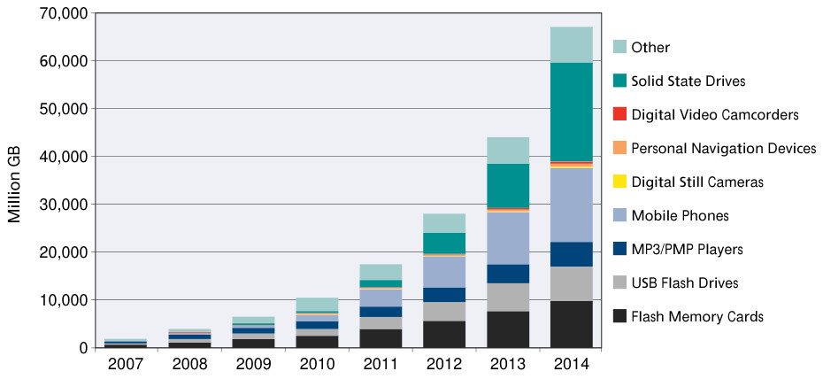 
Source: Fonward Insights, NAND Quarterly Insights Q3/09, www.forward-insights.com/ Repor No. FI-NFL-NQI-Q309 September 2009,accessed 4/14/2010,used with permission. 
42 
1 
Meon Tetho Products and specifications discussed herein are for evaluation and reference purposes only and are subiect to change by Micron without notice. Products are only warranted by Micron to meet Micron's production data sheet specifications. Al information discussed herein is provided on an "as is"basis, without warranties of any kind.

---

<!-- 原文第 2 页 -->

 
TN-29-19: NAND Flash 101 Flash Basics 
Flash Basics 
The NAND Flash device discussed in this technical note is based on a 2Gb asynchronous SLC device and its parameters (unless otherwise noted). Higher density devices and other more advanced NAND devices may have additional features and different parameters. 
The NAND Flash array is grouped into a series of blocks, which are the smallest erasable entities in a NAND Flash device. 
ANAND Flash block is 128KB. Erasing a block sets all bits to 1 (and all bytes to FFh). Programming is necessary to change erased bits from I to 0. The smallest entity that can be programmed is a byte. Some NOR Flash memory can perform READ- While- WRITE operations. Although NAND FLASH cannot perform READs and WRITEs simultaneously, it is possible to accomplish READ/WRITE operations at the system level using a method called shadowing. Shadowing has been used on personal computers for many years to load the BIOS from the slower ROM into the higher-speed RAM. 
There is a limit to the number of times NAND Flash blocks can reliably be programmed and erased. Nominally, each NAND block will survive 100,000 PROGRAM/ERASE cycles. A technique known as wear leveling ensures that all physical blocks are exercised uniformly. To maximize the life span of a design,it is critical to implement both wear leveling and bad-block management. 
Figure 2 shows a comparison of NAND Flash and NOR Flash cells. NAND efficiencies are due in part to the small number of metal contacts in the NAND Flash string. NAND Flash cell size is much smaller than NOR Flash cell size- $4 ~F^{2}$ compared to $10 ~F^{2}$ --because NOR Flash cells require a separate metal contact for each cell. 
 
2 Mr oso)

---

<!-- 原文第 3 页 -->

 
TN-29-19: NAND Flash 101 Flash Basics 
Figure 2: Comparison of NAND and NOR Flash Cells 

| | NAND | | NOR |
| --- | --- | --- | --- |
| Cell Array | Unit Cell ni ti Source line | | 村时… Unit Cell Source line |
| Layout | 2F 2F | | 2F 5F |
| Cross Section | | | |
| Cell Size | | 4F2 | 10F2 |
 
NAND Flash is very similar to a hard-disk drive. It is sector-based (page-based)and well suited for storage of sequential data such as pictures, video, audio, or PC data. Although random access can be accomplished at the system level by shadowing the data to RAM, doing so requires additional RAM storage.Also, like a hard-disk drive, a NAND Flash device may have bad blocks and requires error-correction code (ECC) to maintain data integrity. 
NAND Flash cells are 60% smaller than NOR Flash cells, providing the higher densities required for today's low-cost consumer devices in a significantly reduced die area. NAND Flash is used in virtually all removable cards, including USB drives, secure digital (SD) cards, memory stick cards, CompactFlash cards, and multimedia cards (MMCs). The NAND Flash multiplexed interface provides a consistent pinout for all recent devices and densities. This pinout allows designers to use lower densities and migrate to higher densities without any hardware changes to the printed circuit board. 
 
3 Mr oso)

---

<!-- 原文第 4 页 -->

 
TN-29-19:NAND Flash 101 NAND vs.NOR Comparison 
## NAND vs. NOR Comparison Advantages of Each Device 
There are specific advantages and disadvantages to using NAND Flash or NOR Flash in embedded systems (see Table 1).NAND Flash is best suited for file or sequential-data applications; NOR Flash is best suited for random access. Advantages of NAND Flash over NOR Flash include fast PROGRAM and ERASE operations. NOR Flash advantages are its random-access and byte-write capabilities. 
Random access gives NOR Flash its execute-in-place (XiP) functionality, which is often required in embedded applications. An increasing number of processors include a direct NAND Flash interface and can boot directly from the NAND Flash device (without NOR Flash). These processors provide a very attractive solution when cost, space, and storage capacity are important. Using these processors, XiP capability will cease to be a consideration when designing NAND Flash into embedded applications. 
## Disadvantages of Each Device 
The main NAND Flash disadvantage is slow random acess; NOR Flash is hampered by slow WRITE and ERASE performance. 
Table 1: NAND Flash vs. NOR Flash 

| | NAND | NOR |
| --- | --- | --- |
| Advantages | Fast PROGRAMs | Random access |
| Fast ERASEs | Byte PROGRAMs possible |
| Disadvantages | Slow random access | Slow PROGRAMs |
| Byte PROGRAMs difficult | Slow ERASEs |
| Applications | File (disk) applications | Replacement of EPROM |
| Voice,data, video recorder | Execute directly from nonvolatile memory |
| Any large sequential data | |
 
## Random Access Timing 
Random access time on NOR Flash is specified at 0.075us; on NAND Flash, random access time for the first byte only is significantly slower-25us (see Table 2 on page 5). However, after initial access has been made,the remaining 2111 bytes are shifted out of NAND at a mere 0.025us per byte. This results in a bandwidth of more than 26 MB/s for 8-bit l/Os and 41 MB/s for 16-bit 1/Os. 
 
4 Mr oso)

---

<!-- 原文第 5 页 -->

 
TN-29-19:NAND Flash 101 
NAND vs. NOR Comparison 
Table 2: NAND/NOR Characteristics 

| Characteristic | NAND Flash: MT29F2G08A | NOR Flash: TE28F128J3 |
| --- | --- | --- |
| Random access READ | 25us (first byte) 0.025us each for remaining 2111 bytes | 0.075s |
| Sustained READ speed (sector basis) | 26 MB/s (x8) or 41 MB/s (x16) | 31 MB/s(x8) or 62MB/s(x16) |
| Random WRITE speed | ~220us/2112 bytes | 128us/32 bytes |
| Sustained WRITE speed (sector basis) | 7.5 MB/s | 0.250 MB/s |
| Erase block size | 128KB | 128KB |
| ERASE time per block (TYP) | 500us | 1 sec |
 
## NAND Flash Design Benefits 
The real benefits of NAND Flash are faster PROGRAM and ERASE times, as NAND Flash delivers sustained WRITE performance exceeding 7 MB/s. Block erase times are an impressive 500us for NAND Flash compared with I second for NOR Flash. Clearly, NAND Flash offers several compelling advantages. The one challenge is that it is not well-suited for direct random access. As noted previously, this can be handled with code shadowing. 
## Structural Differences 
NAND Flash offers several structural advantages over NOR Flash, starting with the pin count. The hardware pin requirements for NAND Flash and NOR Flash interfaces differ markedly. NOR Flash requires approximately 441/0 pins for a 16-bit device, while NAND Flash requires only 24 pins for a comparable interface (see Table 3). The multiplexed command, address,and data bus reduces the number of required pins by nearly 45%.An added benefrit of the multiplexed interface is that higher-density NAND Flash devices can be supported using the same hardware design and printed circuit board (PCB) used for lower densities. The common TSOP-I package has been in use for many years, and this feature enables customers to migrate to higher-density NAND Flash devices using the same PCB design. 
Another advantage of NAND Flash is evident in the packaging options. For example,this NAND Flash device offers a monolithic 2Gb die or it can support up to four stacked die, accommodating an 8Gb device in the same package. This makes it possible for a single package and interface to support higher densities in the future. 
Table 3: Required Hardware Pins 

| NAND Flash: 23 Pins (x16) I/O device-type interface, composed of: | | NOR Flash: 44 Pins | |
| --- | --- | --- | --- |
| | Random-access interface, typically composed of: |
| CE# | Chip enable | CE# | Chip enable |
| WE# | Write enable | WE# | Write enable |
| RE# | Read enable | OE# | Output enable |
| CLE | Command latch enable | D[15:0] | Data bus |
| ALE | Address latch enable | A[23:0] | Address bus |
| V/O[7:0] | Data bus (VO[15:0) for x16 parts) | WP# | Write protect |
| WP# | Write protect | | |
| R/B# | Ready/busy | | |
 
 
5 Mr oso)

---

<!-- 原文第 6 页 -->

 
TN-29-19:NAND Flash 101 NAND Flash Architecture and Basic SLC Operation 
## NAND Flash Architecture and Basic SLC Operation 
The 2Gb NAND Flash device is organized as 2048 blocks, with 64 pages per block (see Figure 3). Each page is 2112 bytes,consisting of a 2048-byte data area and a 64-byte spare area. The spare area is typically used for ECC, wear-leveling,and other software overhead functions, although it is physically the same as the rest of the page. Many NAND Flash devices are offered with either an 8- or a 16-bit interface. Host data is connected to the NAND Flash memory via an 8-bit- or 16-bit-wide bidirectional data bus. For 16-bit devices, commands and addresses use the lower 8 bits (7:0). The upper8 bits of the 16-bit data bus are used only during data-transfer cycles. 
Figure 3:2Gb NAND Flash Device Organized as 2048 Blocks 
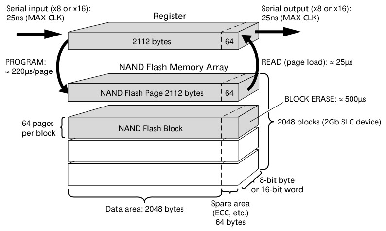 
Erasing a block requires approximately 500us. After the data is loaded in the register, programming a page requires approximately 220us. A PAGE READ operation requires approximately 25us, during which the page is accessed from the array and loaded into the 16,896-bit(2112-byte) register. The register is then available for the user to clock out the data. 
In addition to the 1/O bus, the NAND Flash interface consists of six major control signals (see Table 4on page 7).(Note: The #symbol after a signal indicates that the signal is asserted LOW.) 
 
6 Mr oso)

---

<!-- 原文第 7 页 -->

 
TN-29-19:NAND Flash 101 
NAND Flash Architecture and Basic SLC Operation 
Table 4: Signal Descriptions 

| Symbol | Signal | Description |
| --- | --- | --- |
| ALE | Address latch enable | When ALE is HIGH, addresses are latched into the NAND Flash address register on the rising edge of the WE# signal. |
| CE# | Chip enable | If CE is not asserted, the NAND Flash device remains in standby mode and does not respond to any control signals. |
| CLE | Command latch enable | When CLE is HIGH, commands are latched into the NAND Flash command register on the rising edge of the WE#signal. |
| R/B# | Ready/busy# | If the NAND Flash device is busy with an ERASE PROGRAM, or READ operation, the R/B# signal is asserted LOW. The R/B# signal is open drain and requires a pull-up resistor. |
| RE# | Read enable | RE#enables the output data buffers. |
| WE# | Write enable | WE# is responsible for clocking data, address, or commands into the NAND Flash device. |
 
Data is shifted into or out of the NAND Flash register 8 or 16 bits at a time. In a PROGRAM operation, the data to be programmed is clocked into the data register on the rising edge of WE#.Special commands are used to randomly access data or move data around within the register to make random access possible; see "RANDOM DATA INPUT Operation" on page 15 and "READ FOR INTERNAL DATA MOVE Operation" on page 20. 
Data is output from the data register in a similar fashion by means of the read enable (RE#) signal, which is responsible for outputting the current data and incrementing to the next location. The WE#and RE#clocks can run as fast as 25ns per transfer. When RE# or chip enable (CE#) are not asserted LOW, the output buffers are tri-stated. This combination of CE#and RE# activates the output buffers,enabling NAND Flash to share the data bus with other types of memory, such as NOR Flash, SRAM, or DRAM. This feature is sometimes referred to as "chip enable don't care."'The primary purpose of this refer ence is to differentiate very old NAND Flash devices, which require CE# to be asserted for the entire cycle. 
AII NAND Flash operations are initiated by issuing a command cycle. This is accomplished by placing the command on 1/0[7:0], driving CE#LOW and CLE HIGH, then issuing a WE# clock. Commands, addresses, and data are clocked into the NAND Flash device on the rising edge of WE#(see Figure 4 and Table 5 on page 8). 
Most commands require a number of address cycles followed by a second command cycle. With the exception of the RESET and READ STATUS commands, new commands should not be issued when the device is busy (see Figure 4 and Table 5 on page 8). 
 
7 Mr oso)

---

<!-- 原文第 8 页 -->

 
TN-29-19:NAND Flash 101 NAND Flash Architecture and Basic SLC Operation 
Figure 4: Command Cycles for NAND Flash Operations 
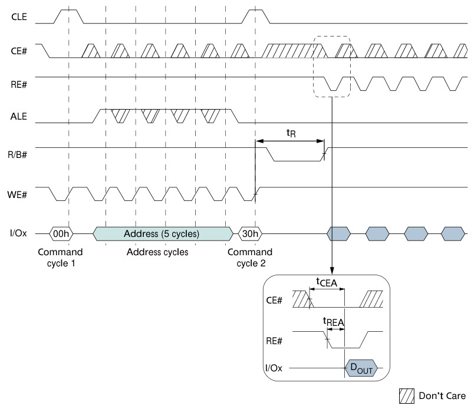 
Table 5: Command Cycles and Address Cycles 

| Command | Command Cycle1 | Number of Address Cycles | Data Cycles Required1 | Command Cycle2 | Valid During Busy |
| --- | --- | --- | --- | --- | --- |
| READ PAGE | 00h | 5 | No | 30h | No |
| READ PAGE CACHE SEQUENTIAL | 31h | | No | | No |
| READ PAGE CACHE SEQUENTIAL LAST | 3Fh | - | No | | No |
| READ for INTERNAL DATA MOVE | 00h | 5 | No | 35h | No |
| RANDOM DATA READ | 05h | 2 | No | EOh | No |
| READ ID | 90h | 1 | No | | No |
| READ STATUS | 70h | - | No | 一 | Yes |
| PROGRAM PAGE | 80h | 5 | Yes | 10h | No |
| PROGRAM PAGE CACHE | 80h | 5 | Yes | 15h | No |
| PROGRAM for INTERNAL DATA MOVE | 85h | 5 | Optional | 10h | No |
| RANDOM DATA INPUT | 85h | 2 | Yes | | No |
| ERASE BLOCK | 60h | 3 | No | DOh | No |
| RESET | FFh | | No | | Yes |
 
 
8 Mr oso)

---

<!-- 原文第 9 页 -->

 
## TN-29-19: NAND Flash 101 NAND Flash Commands 
The addressing scheme for a 2Gb NAND Flash device is shown in Table 6. The first and second address cycles (or bytes)specify the column address,which specifiesthe starting byte within the page.The last column location is 2112, so the address of this last location is 08h in the second byte, and 3Fh in the first byte. PA[5:0] specify the page address within the block, and BA[16:6] specify the block address. While the full -byte address is required for most PROGRAM and READ operations, only the first and second bytes (or cycles) are required for operations that access data randomly within the page. The BLOCK ERASE operation requires only the three most significant bytes (third, fourth, and fifth) to select the block. 
Table 6: 2Gb SLC NAND Flash Addressing Scheme 
Cycle 1/07 1/06 1/05 1/04 1/03 1/02 1/01 1/00
First CA7 CA6 CA5 CA4 CA3 CA2 CA1 CAO
Second LOW LOW LOW LOW CA11 CA10 CA9 CA8
Third BA7 BA6 PA5 PA4 PA3 PA2 PA1 PAO
Fourth BA15 BA14 BA13 BA12 BA11 BA10 BA9 BA8
Fifth LOW LOW LOW LOW LOW LOW LOW BA16 
Notes: 1. Block address concatenated with page address actual page address. CAxX= column address; PAx = page address; BAx = block address. The page address and the block address, collectively, constitute the row address. 2.If $CA 11=1$ ,then CA[10:6] must be 0. 
3. The most significant address byte is the fifth ycle; the least significant address byte s the first cycle 
## NAND Flash Commands 
When any NAND Flash command is issued, CE# and ALE must be LOW, CLE must be asserted, and write clocks (WE#) must be provided. When any NAND Flash address is issued, CE# and CLE must be LOW, ALE must be asserted, and write clocks (WE#)must be provided. While the device is busy, only two commands can be issued: RESET and READ STATUS. 
## RESET Operation 
The simplest NAND Flash command is the RESET (FFh) command (see Figure 5). The RESET command does not require an address or subsequent cycle(s) (see Table 5 on page 8),Simply assert CLE and issue a write clock with FFh on the data bus, and a RESET operation is performed. This RESET command must be issued immediately following power-up, and prior to issuing any other command. 
RESET is one of two commands that can be issued while the NAND Flash device is busy (see Table 5 on page 8).If the device is busy processing a previous command, issuing a RESET command aborts the previous operation. If the previous operation was an ERASE or PROGRAM command, issuing a RESET command aborts the command prematurely. and the desired operation does not complete. ERASE and PROGRAM can be timeconsuming operations; issuing the RESET command makes it possible to abort either and reissue the command at a later time. 
 
9 Mr oso)

---

<!-- 原文第 10 页 -->

 
TN-29-19: NAND Flash 101 NAND Flash Commands 
Figure 5:RESET Command 
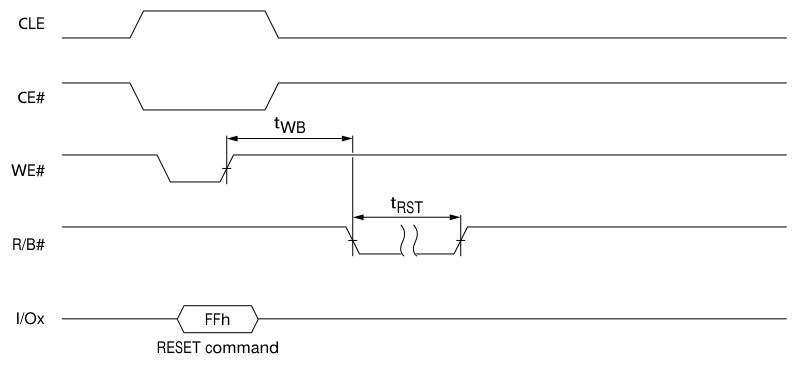 
## READ ID Operation 
The READ ID (90h) command requires one dummy address cycle (00h), but it does not require a second command cycle (see Table 5 on page 8). After the command and dummy addresses are issued, the ID data can be read out by keeping CLE and ALE LOW and toggling the RE#signal foreach byte of ID. Figure 6 shows the timing of the READ ID operation, and Table 7 shows the format of the 5-byte response. 
Figure6: READ ID Command 
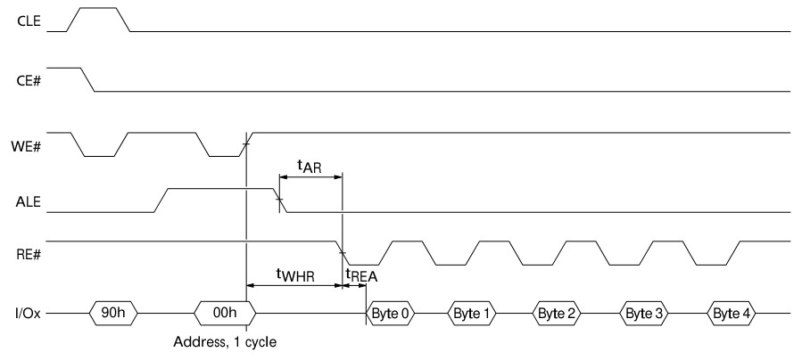 
 
10 
Mr oso)

---

<!-- 原文第 11 页 -->

 
TN-29-19: NAND Flash 101 NAND Flash Commands 
Table 7: READ ID Response 

| | Option | 1/07 | 1/06 | 1/05 | 1/04 | 1/03 | 1/02 | 1/01 | 1/00 | Value1 |
| --- | --- | --- | --- | --- | --- | --- | --- | --- | --- | --- |
| Byte 0 - Manufacturer ID | | | | | | | | | | |
| Manufacturer | Micron | 0 | 0 | 1 | 0 | 1 | 1 | 0 | 0 | 2Ch |
| Byte 1-Device ID | | | | | | | | | | |
| MT29F2G08AAD | 2Gb,x8,3V | 1 | 1 | 0 | 1 | 1 | 0 | 1 | 0 | DAh |
| MT29F2G16AAD | 2Gb,x8,3V | 1 | 1 | 0 | 0 | 1 | 0 | 1 | 0 | CAh |
| MT29F2G08ABD | 2Gb,x8,1.8V | 1 | 0 | 1 | 0 | 1 | 0 | 1 | 0 | AAh |
| MT29F2G16ABD | 2Gb,x16,1.8V | 1 | 0 | 1 | 1 | 1 | 0 | 1 | 0 | BAh |
| Byte 2 | | | | | | | | | | |
| Number of die per CE# | 1 | | | | | | | 0 | 0 | 00b |
| Cell type | SLC | | | | | 0 | 0 | | | 00b |
| Number of simultaneously programmed pages | 1 | | | 0 | 0 | | | | | 01b |
| Interleaved operations between multiple die | Not supported | | 0 | | | | | | | 0b |
| Cache programming | Supported | 1 | | | | | | | | 1b |
| Byte value | MT29F2Gxxxxx | 1 | 0 | 0 | 0 | 0 | 0 | 0 | 0 | 80h |
| Byte 3 | | | | | | | | | | |
| Page size | 2KB | | | | | | | 0 | 1 | 01b |
| Spare area size (bytes) | 64B | | | | | | 1 | | | 1b |
| Block size (w/o spare) | 128KB | | | 0 | 1 | | | | | 01b |
| Organization | x8 | | 0 | | | | | | | 0b |
| x16 | | 1 | | | | | | | 1b |
| Serial access (MIN) | 25ns | 1 | | | | 0 | | | | 1xxxb |
| Serial access (MIN) | 35ns | 0 | | | | 0 | | | | 0xxx0b |
| Byte value | MT29F2G08AAD | 1 | 0 | 0 | 1 | 0 | 1 | 0 | 1 | 95h |
| MT29F2G16AAD | 1 | 1 | 0 | 1 | 0 | 1 | 0 | 1 | D5h |
| Byte value | MT29F2G08ABD | 0 | 0 | 0 | 1 | 0 | 1 | 0 | 1 | 15h |
| MT29F2G16ABD | 0 | 1 | 0 | 1 | 0 | 1 | 0 | 1 | 55h |
| Byte 4 | | | | | | | | | | |
| Reserved | | | | | | | | 0 | 0 | 00b |
| Planes per CE# | 1 | | | | | 0 | 0 | | | 00b |
| Plane size | 2Gb | | 1 | 0 | 1 | | | | | 101b |
| Reserved | | 0 | | | | | | | | 0b |
| Byte value | MT29F2Gxx | 0 | 1 | 0 | 1 | 0 | 0 | 0 | 0 | 50h |
 
Notes: 1. b= binary; h = hexadecimal 
 
11 
Mr oso)

---

<!-- 原文第 12 页 -->

 
TN-29-19: NAND Flash 101 NAND Flash Commands 
Table 8: READ ID Parameters for Address 20h 

| Byte | Options | 1/07 | 1/06 | 1/05 | 1/04 | 1/03 | 1/02 | 1/01 | 1/00 | Value1 |
| --- | --- | --- | --- | --- | --- | --- | --- | --- | --- | --- |
| 0 | "O" | 0 | 1 | 0 | 0 | 1 | 1 | 1 | 1 | 4Fh |
| 1 | "N" | 0 | 1 | 0 | 0 | 1 | 1 | 1 | 0 | 4Eh |
| 2 | "F" | 0 | 1 | 0 | 0 | 0 | 1 | 0 | 0 | 46h |
| 3 | "" | 0 | 1 | 0 | 0 | 1 | 0 | 0 | 1 | 49h |
| 4 | Undefined | X | X | X | X | X | X | X | X | XXh |
 
Notes: 1.h =hexadecimal 
## READ STATUS Operation 
READ STATUS (70h) is the second command that can be issued while the NAND Flash device is busy. This command does not require an address or second command cycle. The status of the NAND Flash device can be monitored by issuing the RE#clock signal following the READ STATUS command. If the READ STATUS command is used to monitor the ready state of the device, the command should be issued only one time, and the status can be re-read by re-issuing the RE#clock. Alternatively, the RE# signal can be kept LOW, waiting to receive the appropriate status bit before proceeding. READ STATUS also reports the status of the write-protect signal, and the pass/fail status of previous PROGRAM or ERASE operations. It is mandatory that the pass status be attained on PROGRAM or ERASE operations to ensure proper data integrity. 
Table 9: READ STATUS Response 

| SR Bit | PROGRAM PAGE | PROGRAM PAGE CACHE MODE | PAGE READ | PAGE READ CACHE MODE | BLOCK ERASE | Definition |
| --- | --- | --- | --- | --- | --- | --- |
| 0 | Pass/fail | Pass/fail(N) | | | Pass/fail | 0 = Successful PROGRAM/ERASE 1= Error in PROGRAM/ERASE |
| 1 | | Pass/fail (N-1) | | - | | 0 = Successful PROGRAMERASE 1= Error in PROGRAM/ERASE |
| 2 | - | | | - | | 0 |
| 3 | - | | | | | 0 |
| 4 | | | | | | 0 |
| 5 | Ready/busy | Ready/busy | Ready/busy | Ready/busy | Ready/busy | 0= Busy 1= Ready |
| 6 | Ready/busy | Ready/busy cache? | Ready/busy | Ready/busy cache2 | Ready/busy | 0 = Busy 1= Ready |
| 7 | Write protect | Write protect | Write protect | Write protect | Write protect | 0= Protected 1 = Not protected |
| [15:8] | | | | | | 0 |
 
Notes: 1.Status register bit 5 is O during the actual programming operation. If cache mode is used, this bit will be 1 when all internal operations are complete. 2.Status register bit 6 is 1 when the cache is ready to accept new data.R/B# follows bit 6. 
 
12 
Mr oso)

---

<!-- 原文第 13 页 -->

 
TN-29-19: NAND Flash 101 NAND Flash Commands 
## ERASE Operation 
The BLOCK ERASE (60h) operation erases an entire block of 64 pages, or 128KB total. To issue a BLOCK ERASE operation, use the WE# signal to clock in the ERASE (60h) command with CLE asserted. Next, clock in three address cycles, keeping ALE asserted for each byte of address. These three address cycles are the most significant address cycles and include the block address and the page address, as shown in Table 6 on page 9.) The page address portion (the six low-order bits of the third address cycle) is ignored, and only the block address portion of the three most significant bytes is used After the address is input completely, issue the second command (command cycle 2) of DOh, which is clocked in with WE# while CLE is being asserted. This confirms the ERASE operation, and the device goes busy for approximately 500us. When the device completes this operation, it is ready for another command. The READ STATUS command can be issued at any time, even when the device is busy during the ERASE operation. The microprocessor or controller can monitor the device via the READ STATUS command. 
Figure 7: ERASE Command 
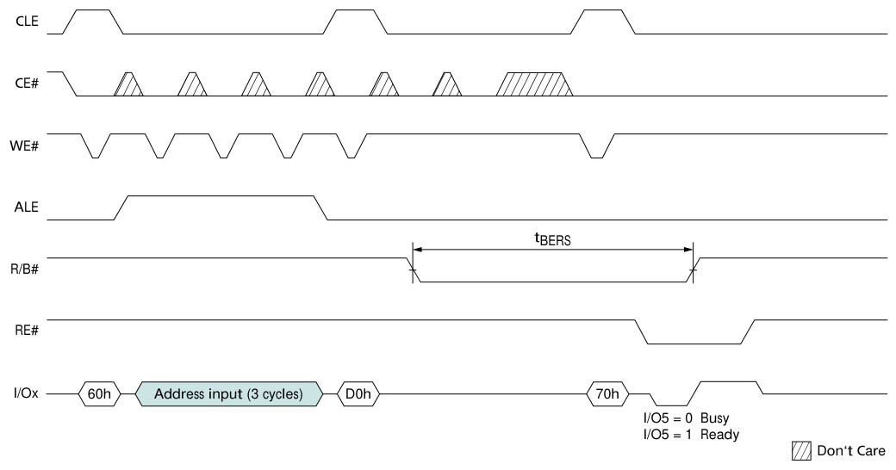 
 
13 
Mr oso)

---

<!-- 原文第 14 页 -->

 
TN-29-19: NAND Flash 101 NAND Flash Commands 
## PROGRAM Operations 
PROGRAM operations can only program bits to O and assume that the user started with a previously erased block. 
If the user does not want to program a bit (or group of bits), the bits can be kept in the erased state by setting that particular bit/group to 1. 
When the PROGRAM PAGE (80h) command is received, the input register is reset (internally) to all 1s. This supports inputting only bytes of data that are to be programmed with O bits. The PROGRAM operation starts with the 80h command (with CLE assertedsee Figure 8). Next, de-assert CLE and assert ALE to input the full five address cycles. After the command and address are input, data is input to the register. When all the data has been input, the 10h command is issued to confirm the previous command and start the programming operation. 
A PROGRAM operation typically requires 220us, although it may require as much as 600us.It is mandatory that the user read the status and check for successful operation.If the operation is not successful,the block should be logged as a bad block and not used in the future.All data should be moved to a good block. 
Figure8: PROGRAM Command 
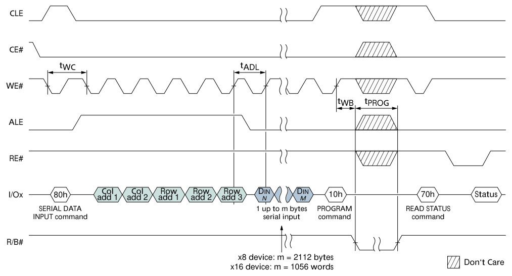 
 
14 
Mr oso)

---

<!-- 原文第 15 页 -->

 
TN-29-19: NAND Flash 101 NAND Flash Commands 
## RANDOM DATA INPUT Operation 
As the boxed area in Figure 9 shows, the RANDOM DATA INPUT (85h) command requires only 2 bytes of address followed by the data. This command is used for accessing data randomly within a page-for example, to access ECC data. RANDOM DATA INPUT can be used to jump to the end of the page and write the ECC data. The user can input as many address and data combinations as desired. It is only after the 10h command is issued that the data is actually programmed to the selected page. 
Figure 9: PROGRAM Command with Random Data Input 
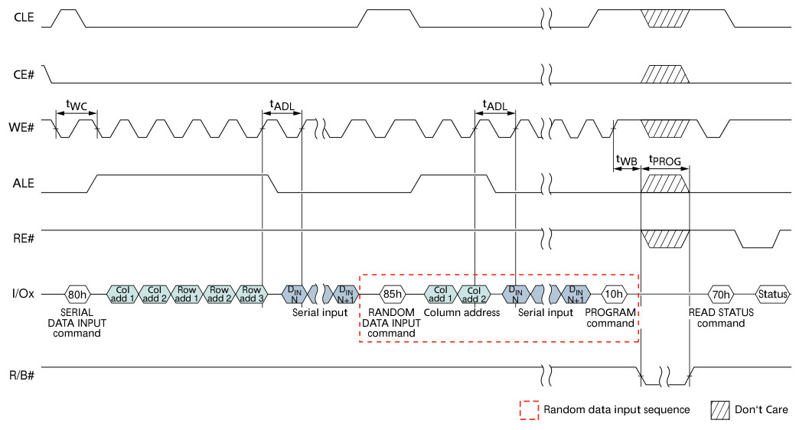 
## Partial-Page Programming 
Due to the large size of NAND Flash pages, partial-page programming is useful for storing smaller amounts of data. Each NAND Flash page can accommodate four PCsized, 512-byte sectors. The spare area of each page provides additional storage for ECC and other software information. 
While it is advantageous to write all four sectors at once, often this is not possible. For example, when data is appended to a file, the file might start out as 512 bytes, then grow to 1024 bytes. In this situation, a second PROGRAM PAGE operation is required to write the second 512 bytes to the NAND Flash device. The maximum number of times a partial page can be programmed before an ERASE is required is four. Note that for MLC devices, only one partial-page PROGRAM per page is supported between ERASE operations. 
 
15 
Mr oso)

---

<!-- 原文第 16 页 -->

 
TN-29-19: NAND Flash 101 NAND Flash Commands 
## Storage Methods 
The two common methods for storing data and spare information in the same page are shown in Figure 10. The first method shows a data area of 512 bytes plus the 16-byte spare area direcly adjacent to i:528 bytes for the combined areas. A2112-byte page can contain four of these 528-byte elements. The second implementation involves storing the data and spare information separately. The four 512-byte data areas are stored first, and their corresponding 16-byte spare areas follow, in order, at the end of the page. 
Figure 10:Typical Storage Methods 
Adjacent Data and Spare Areas 
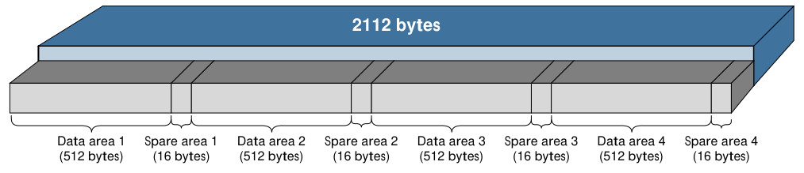 
Separate Data and Spare Areas 
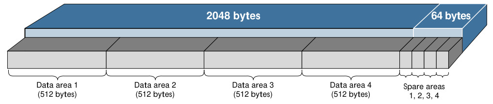 
## READ Operation 
A READ operation starts with the 00h command, followed by five address cycles,then the 30h command to confirm the command sequence (see Figure 11). After the READ transfer time $(^{t} R)$ of approximately 25us has elapsed, the data is loaded into the register and ready for output. Asserting RE# enables the NAND Flash device to output the first byte of data corresponding to the column address specified in the address.Subsequent RE# transitions output data from successive column locations. When the RE# signal is HIGH (not asserted),the 1/0 lines are tri-stated. Reading past the end of the device (byte 2112 or word 1056) results in invalid data. 
 
16 
Mr oso)

---

<!-- 原文第 17 页 -->

 
TN-29-19: NAND Flash 101 NAND Flash Commands 
Figure 11:READ and RANDOM DATA READ Operations 
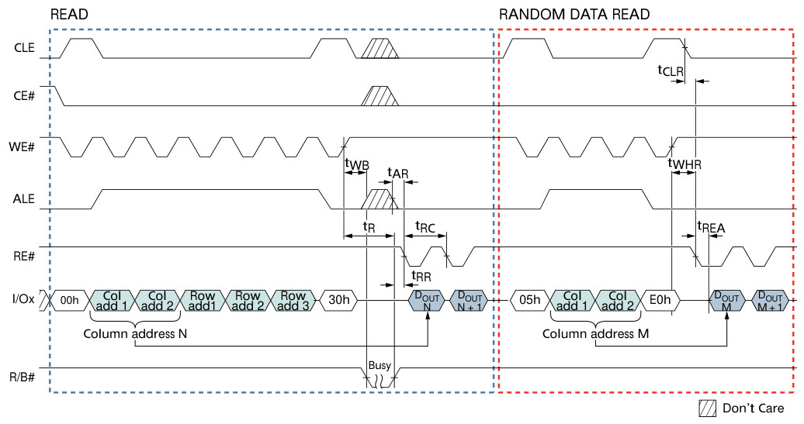 
## RANDOM DATA READ Operation 
The user can directly access random data by issuing the 05h command, two address cycles, and an EOh confirmation cycle (see Figure 11). When the page has been read from the array, this command provides rapid access to the data. 
## READ PAGE CACHE SEQUENTIAL Operation 
Only one register in the NAND Flash device has been discussed to this point. The NAND Flash device actually has two registers, a data register and a cache register, as shown in Figure 12. The attributes of these two registers play an important role in the various NAND Flash caching modes. 
The PAGE READ CACHE MODE command enables the user to pipeline the next sequential access from the array while outputting the previously accessed data. This doublebuffered technique makes it possible to hide the READ transfer time $(^{t} R)$ .Data is initially transferred from the NAND Flash array to the data register. If the cache register is available (not busy),the data is guickly moved from the data register to the cache register. After the data has been transferred to the cache register, the data register is available and can start to load the next sequential page from the NAND Flash array. 
Using the PAGE READ CACHE MODE command delivers a 33% performance improvement over a traditional PAGE READ command on an 8-bit 1/O device, with throughput up to 31 MB/s.On 16-bit 1/0 devices, throughput can be increased to 37 MB/s-delivering as much as a 40% performance improvement over normal PAGE READ operations. See Figure 13 on page 18 for comparison. 
 
17 
Mr oso)

---

<!-- 原文第 18 页 -->

 
TN-29-19: NAND Flash 101 NAND Flash Commands 
Technical notes at www.micron.com/products/nand/technotes provide additional details on cache modes and how they can be used to improve performance. PAGE READ CACHE MODE can be especially useful during system boot-up, when large amounts of data are typically read from the NAND Flash device and start-up time is critical. 
Figure 12:READ PAGE CACHE SEQUENTIAL Architecture 
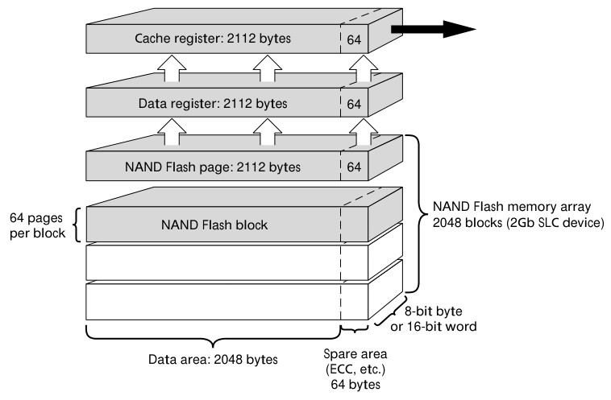 
Figure 13:READ PAGE/READ PAGE CACHE SEQUENTIAL Comparison PAGE READ Example 
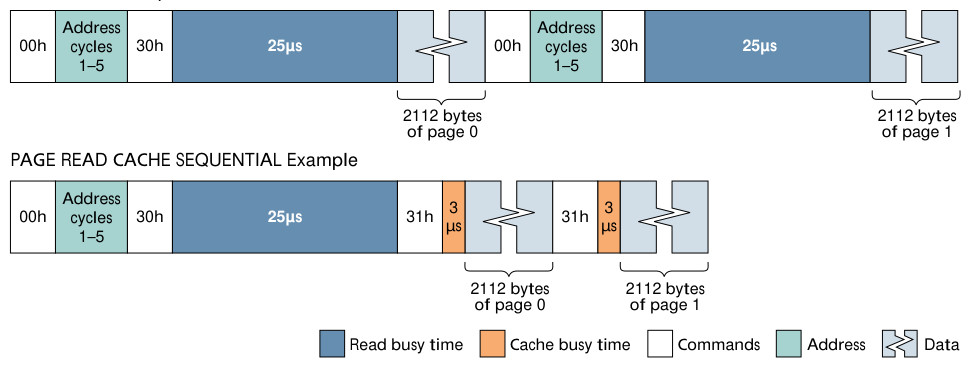 
 
18 
Mr oso)

---

<!-- 原文第 19 页 -->

 
TN-29-19: NAND Flash 101 NAND Flash Commands 
PROGRAM PAGE CACHE Operation 
PROGRAM PAGE CACHE MODE provides a performance improvement over normal PROGRAM PAGE operations (see Figures 14 and 15), PROGRAM PAGE CACHE MODE is a double-buffered technique that enables the controller to input data directly to the cache register and uses the data register as a holding area to supply data for programming the array. This frees the cache register so that the next sequential page operation can be loaded in parallel. In many applications, the programming time (PROG) can be completely hidden. As with the PAGE READ CACHE MODE command, the data register is used to maintain the data throughput during the entire programming cycle. This frees the cache register to receive the next page of data from the controller. 
Figure 14:PROGRAM PAGE CACHE Architecture 
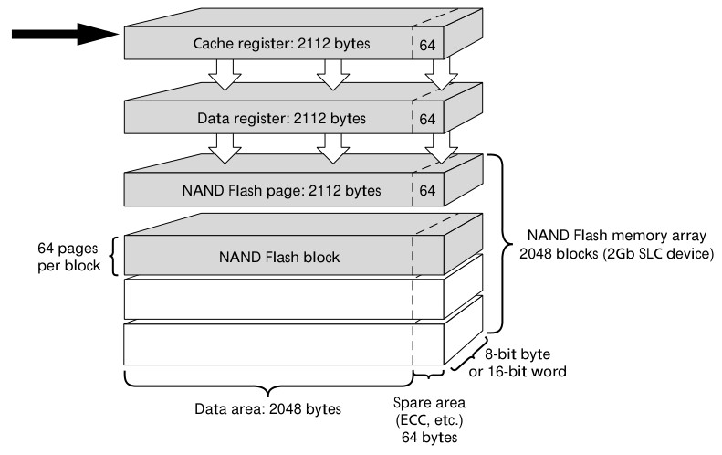 
 
19 
Mr oso)

---

<!-- 原文第 20 页 -->

 
TN-29-19: NAND Flash 101 NAND Flash Commands 
Figure 15:PROGRAM PAGE/PROGRAM PAGE CACHE Comparison 
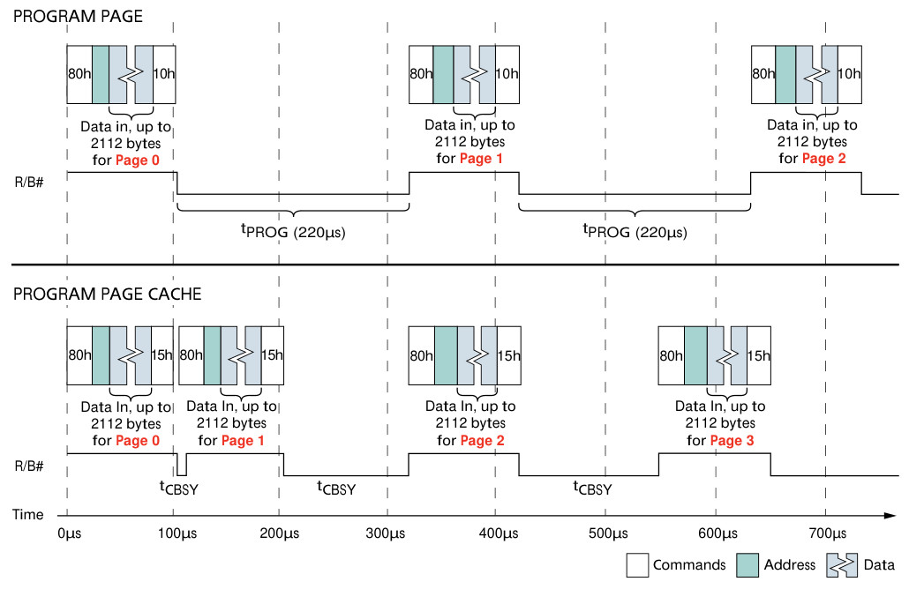 
## READ FOR INTERNAL DATA MOVE Operation 
The READ FOR INTERNAL DATA MOVE (00h-35h) command is also known as "copy back."It provides the ability to move data internally from one page to another-the data never leaves the NAND Flash device. The READ FOR INTERNAL DATA MOVE operation transfers the data read from the NAND Flash array to the cache register. The data can then be programmed into another page of the device. This is extremely beneficial in cases where the controller needs to move data out of a block before erasing the block. It is also possible to modify the data read before the PROGRAM operation is started. This is useful if the user wants to change the data prior to programming. This feature enables data movement within the NAND Flash device without tying up the processor or the 1/0 bus. 
 
20 
Mr oso)

---

<!-- 原文第 21 页 -->

 
TN-29-19:NAND Flash 101 
Connecting NAND Flash to a RISC or DSP Processor 
## Connecting NAND Flash to a RISC or DSP Processor 
There are significant advantages to selecting a processor or a controller with a built-in NAND Flash interface.When this is not an option, it is possible to design a glueless interface between the NAND Flash device and almost any processor. 
To review, the primary difference between NAND Flash and NOR Flash is the multiplexed bus used for transferring commands, addresses, and data in the NAND Flash device. Using the CLE and ALE control signals, it is possible to select a command, address, or data cycle for various NAND Flash operations. CLE is used to specify command cycles; ALE is used to specify address cycles. 
Connecting ALE to address bit 5 of the processor and CLE to address bit 4 of the processor enables the selection of commands, addresses, or data simply by changing the address that the processor outputs (see Table 10): CLE and ALE are automatically asserted at the appropriate time. 
Table 10: Enabling Command, Address, or Data Selection 
A7 A6 A5 A4 A3 A2 A1 A0 
A5 A4
ALE CLE Memory address offset NAND Flash register selected
0 0 0xh Data register
0 1 1xh Command register
1 1 0 1 2xh 3xh Undefined (do not use) Address register 
To issue a command, the processor outputs the intended command on the data bus and at output address 0010h. 
To issue any number of address cycles, the processor simply outputs the intended NAND Flash address sequence to processor address 0020h. With this technique, the user can access commands, addresses, and data directly from the processor without any glue logic. In this scenario,ECC must be handled in the software. Figures 16-18, starting on page 22,show the block diagram, low-level pseudo-code, and timing for PROGRAM operations. Many processors have the ability to specify several timing parameters around the processor's write signal, which is critical for proper setup and hold timing. 
 
21 
Mr oso)

---

<!-- 原文第 22 页 -->

 
TN-29-19:NAND Flash 101 
Connecting NAND Flash to a RISC or DSP Processor 
Figure 16:Glueless NAND Interconnect 
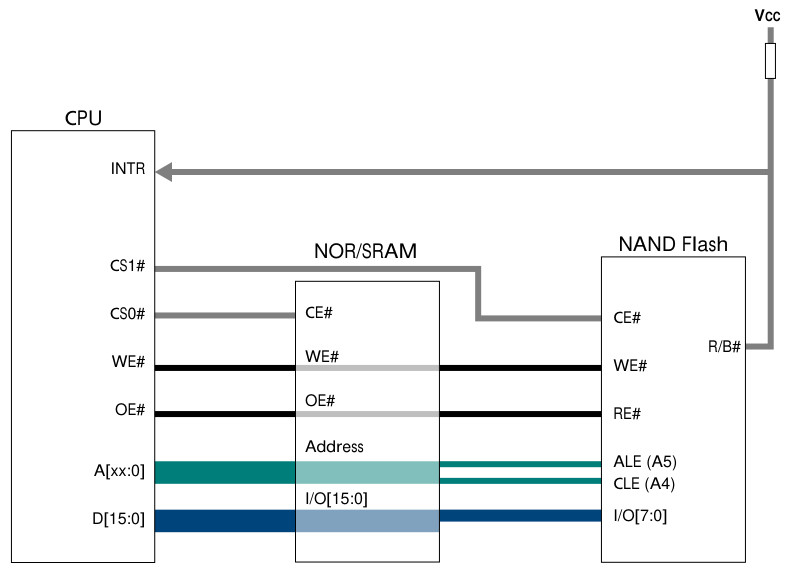 
Figure 17:Low-Level Pseudo-Code Example for PROGRAM Operations 
80-> (A11 numbers in hex) FFF010; CMD=80
ColL->FFF020; 1ow column
Co1H->FFF020; high column
RowL->FFF020; low ROW
RowM->FFF020; Mid ROW
RowH-> FFF020; High ROW
DO-> FFF000; Data 0
D1-> FFF000; Data1
(Complete remaining data)
D2111->FFF000; Data 2111
10-> FFF010; CMD=10
LOOP1:
PA-> Acc ; Read status
BIT #6 set;
JMPNZLOOP1; Jmp if Busy to Loop
;DONE! 
 
22 
Mr oso)

---

<!-- 原文第 23 页 -->

 
TN-29-19:NAND Flash 101 Connecting NAND Flash to a RISC or DSP Processor 
Figure 18:PROGRAM Operation Timing 
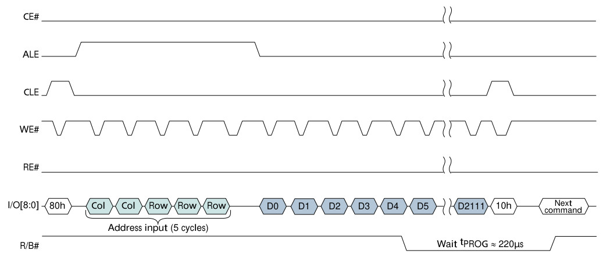 
Processors with a native on-chip NAND Flash controller include the FreescaleTM i.MX21 and i.MX31 processors and several $OMAP ^{TM}$ processors from Texas Instruments. Figure 19 shows the built-in NAND Flash interface on the Freescale i.MX21 processor The NAND Flash interface is on the right side of the diagram and is connected directly to the NAND Flash. This implementation supports automatic booting from the NAND Flash device, as well as the ECC logic and SRAM buffer. The SRAM port enables code execution directly from the buffer. 
Figure 19:Built-in NAND Flash Interface on Freescale i.MX21 Processor 
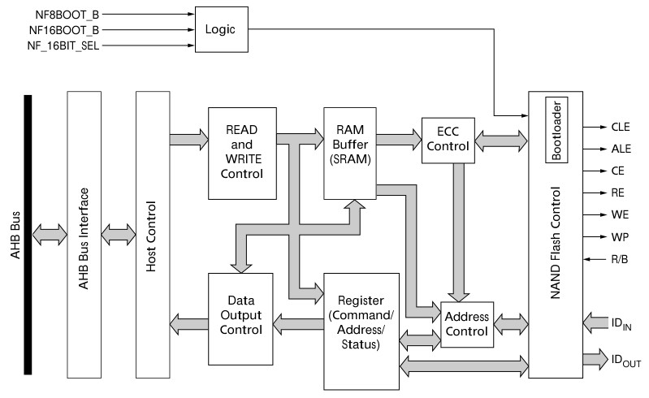 
Note: Image courtesy of Freescale Semiconductor, Inc. 
 
23 
Mr oso)

---

<!-- 原文第 24 页 -->

 
TN-29-19:NAND Flash 101 
Connecting NAND Flash to a RISC or DSP Processor 
## Multi-Level Cell(MLC) 
MLC devices use a special type of cell that stores 2 bits per cell, compared with traditional single-level cell(LC) devices, which can store only 1 bit per cell. MLC technology offers obvious density advantages. However, MLC lacks the speed and reliability of its SLC counterpart(se Table 11). For this reason, SLC devices are used in the majority of high-performance and high-endurance applications; MLC devices are typically used in consumer and other low-cost products. 
Table 11:MLC vs.SLC 
MLC NAND SLC NAND
3.3V(x8) 3.3V(x16/x8)
Symbol Min Typ Max Min Typ Max Units
tPROG Time to transfer contents of data register to 900 2200 220 600 us
the NAND Flash array
NOP Number of partial-page programs supported 1 4 Cycles
per page before an ERASE is required
tR Time to transfer contents of one page in the - 50 25 Ls
NAND Flash array to the data register
Endurance with ECC and invalid block marking 5K 100K PROGRAM/
ERASE cycles
MIN ECC required 12 1 Correctable bits
per 512 bytes
NyB 16Gb MLC. 4Gb SLC 1998 2048 2008 2048 Blocks 
## Error Correction Code (ECC) 
As noted previously, NAND Flash requires ECC to ensure data integrity. ECC has been used for many years in RAM modules as well as in many other types of storage.ECC can be used in any device that may be susceptible to data errors. The example NAND Flash memory includes a 64-byte spare area for extra storage on each page (16 bytes per512byte sector). This spare area can be used to store the ECC code as well as other software information,such as wear-leveling or logical-to-physical block-mapping information ECC can be performed in hardware or software; however, hardware implementation provides a performance advantage. 
During a programming operation, the ECC unit calculates the ECC code based on the data stored in the sector. The ECC code for the data area is then written to the corresponding spare area. When the data is read out, the ECC code is also read out, and the reverse operation is applied to check that the data is correct. It is possible for the ECC algorithm to correct data errors. The number of data errors that can be corrected depends on the correction strength of the algorithm used. The inclusion of ECC in hardware or software provides a robust solution at the system level. 
Simple Hamming codes provide the easiest hardware implementation for error correction; however, they can correct only single-bit errors. Reed-Solomon codes provide more robust error correction capability and are used in many controllers on the market today. BCH codes are also becoming popular due to their improved efficiency over ReedSolomon codes. 
Table 12 on page 25 shows the number of bits required for various ECC correction levels. 
 
24 
Mr oso)

---

<!-- 原文第 25 页 -->

 
TN-29-19:NAND Flash 101 
Connecting NAND Flash to a RISC or DSP Processor 
Table 12: Number of Bits Required for Various ECC Correction Strengths 

| Error Correction Level | Bits Required in the NAND Flash Spare Area | | |
| --- | --- | --- | --- |
| Hamming | Reed-Solomon | BCH |
| 1 | 13 | 18 | 13 |
| 2 | N/A | 36 | 26 |
| 3 | N/A | 54 | 39 |
| 4 | N/A | 72 | 52 |
| 5 | N/A | 90 | 65 |
| 6 | N/A | 108 | 78 |
| 7 | N/A | 126 | 91 |
| 8 | N/A | 144 | 104 |
| 9 | N/A | 162 | 117 |
| 10 | N/A | 180 | 130 |
 
Note: Codes in shaded table cells can fit in the spare area of the example NAND Flash device. 
## Software 
Software is necessary to perform block management in a NAND Flash device. This software manages wear-leveling and logical-to-physical mapping. The software may also provide ECC if the processor does not include ECC. 
It is important to read the status register after a PROGRAM or ERASE operation to confirm successful completion of the operation.If an operation is not successful, he block should be marked bad and should no longer be used. Previously programmed data should be moved out of the bad block into anew, good block. 
The specification for a 2Gb SLCNAND Flash device states that it might have up to 40 bad blocks. This maximum number applies to the life of the device (nominally 100,000 PROGRAM/ERASE cycles). Due mostly to their large die size, NAND Flash devices may ship from the factory with a number of bad blocks. The software managing the NAND Flash device maps the bad blocks and replaces them with good blocks. The factory marks these blocks in a specific way so the software can scan all the blocks to determine which are good and which are bad. 
The bad-block mark is placed at the first location in the spare area (column location 2048).If location 2048 in page 0 is 00h, then the block must be considered bad and mapped out of the system. The initialization software can simply scan through all blocks to determine which blocks are bad and then build a table of these bad blocks for future reference. 
The user must take special care not to erase the bad-block marks. The factory tests each NAND Flash device over a wide range of temperatures and voltages. Some blocks tha are marked bad by the factory may be functional at certain temperatures or voltages but could fail in the future. If the bad-block information is erased, it cannot be recovered. 
 
25 
Mr oso)

---

<!-- 原文第 26 页 -->

 
TN-29-19: NAND Flash 101 Summary 
Third-Party Software 
There are several third-party software offerings on the market today. Many of these packages provide multiple features, including automatic power failure-recovery, PC-file compatibility, ECC, bad-block management, directory support, and wear-leveling. A partial list of third-party NAND Flash software vendors includes: 
·Datalight, Inc.- www.datalight.com ·CMX Systems, Inc.-www.cmx.com ·HCC-Embedded - www.hcc-embedded.com 
·Blunk Microsystems - www.blunkmicro.com 
For Linux implementations, another alternative is lournaling Flash File System,version 2(JFFS2). 
## Summary 
Micron NAND Flash provides the power, density, and cost advantages essential for embedded systems in high-performance applications such as digital cameras and navigational devices, solid state drives, mobile phones, Flash memory cards, and USB Flash drives. 
As the major markets relying on NAND Flash continue to expand, NAND Flash technology will continue to evolve and claim additional market share, providing the higher densities, lower costs, and added functionality necessary to support these advanced designs. 
8000 S. Federal Way, P.O. Box 6, Boise, ID 83707-0006, Tel: 208-368-3900 www.micron.com/productsupport Customer Comment Line: 800-932-4992 Micron,the M logo,and the Micron logo are trademarks of Micron Technology, Inc. All other trademarks are the property of their respective owners. 
 
26 
Mr oso)

---

<!-- 原文第 27 页 -->

Micron 
TN-29-19: NAND Flash 101 Revision History 
Revision History 
Rev.B... Updated document formats and content t co reflect technology changes since initial ...0/10
release.
Rev.A... .106
·Initial release. 
 
27 
Mr oso)
