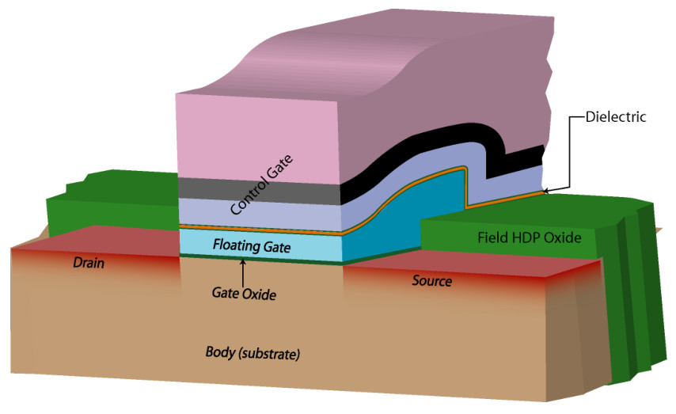

> 原文件：[4_prob4be7269.pic9.ysj_M2SSD.pdf](https://github.com/jadennevercode/CJCC-Knowledge-Base/blob/564ab11aa9785e569e3853c8a4d7ce86f88e7535/materials/%E5%9F%BA%E7%A1%80%EF%BC%9A%E8%A1%8C%E4%B8%9A%E6%9C%AF%E8%AF%AD%E4%B8%8E%E6%8C%87%E6%A0%87/4_prob4be7269.pic9.ysj_M2SSD.pdf)
> 转换方式：Volcengine OCRPdf v3, parse_mode=ocr

<!-- 原文第 1 页 -->

M.2 SSD 
## 技术白皮书 
文档版本 
01 
发布日期 
2017-07-09 
华为技术有限公司 

---

<!-- 原文第 2 页 -->

版权所有 华为技术有限公司2017。保留一切权利。 
非经本公司书面许可,任何单位和个人不得擅自摘抄、复制本文档内容的部分或全部,并不得以任何形式传 播。 
## 商标声明 
 
HUAWei和其他华为商标均为华为技术有限公司的商标。 本文档提及的其他所有商标或注册商标,由各自的所有人拥有。 
## 注意 
您购买的产品、服务或特性等应受华为公司商业合同和条款的约束,本文档中描述的全部或部分产品、服务 或特性可能不在您的购买或使用范围之内。除非合同另有约定,华为公司对本文档内容不做任何明示或默示 的声明或保证。 
由于产品版本升级或其他原因,本文档内容会不定期进行更新。除非另有约定,本文档仅作为使用指导,本 文档中的所有陈述、信息和建议不构成任何明示或暗示的担保。 
## 华为技术有限公司 
地址: 深圳市龙岗区坂田华为总部办公楼 邮编:518129 
网址: http:/www.huawei.com 
客户服务邮箱: support@huawei.com 
客户服务电话: 4008302118 
文档版本01(2017-03-09) 华为专有和保密信息 版权所有 华为技术有限公司

---

<!-- 原文第 3 页 -->

M.2 SSD 技术白皮书 
目录 
1机述1
2M.2SSD基本工作原理. 21基本功能特性… 2.1.1接口速率支持2
212量支持和可用空向… 2.1.3支持安全擦除….2 2.2Fas芯片工作原理 2.2.1Fash存储单元工作原理…3 2.14热捕拔2
222i 2.2.3 M. SSD写寿命分析. 3M2SD寿命风险评估 
3.1写寿命评估
32风 3.2.1判断M.2SSD寿命…… … ..
3.22斯当前M.SSD要更换
4.2SD应用场景限制…7 5总结 …… … 8 
文档版本01(2017-03-09) 
华为专有和保密信息 版权所有 华为技术有限公司 
ii

---

<!-- 原文第 4 页 -->

M.2 SSD 技术白皮书 
1 概述 
M.2 SSD是以M.2协议为接口的固态硬盘。M.2原名为NGFF接口,由mSATA演化而 来,具有更多的尺寸选择,并且可以选择SATA和PCle协议。 
M.2 SSD基于Flash存储介质。当前业界使用较多的是NAND Flash, NAND Flash因使 用Floating Gate存储电子实现数据存储,电子在反复穿过Floating Gate后,会导致存 储电子的能力变弱,最终导致击穿,无法存储数据。这特性是NAND Flash的通病, 所以在使用NAND Flash时,要充分评估应用业务的写入数据量,避免提前写穿导致 器件失效。 
文档版本01(2017-03-09) 
华为专有和保密信息 版权所有 华为技术有限公司

---

<!-- 原文第 5 页 -->

M.2 SSD 技术白皮书 
## 2 M.2 SSD基本工作原理 
## 2.1基本功能特性 
## 2.1.1接口速率支持 
M.2 SSD分为SATA协议和PCle协议。SATA协议的M.2 SSD支持SATA3.0接口,最 大速率为6.0Gb/s。 
## 2.1.2容量支持和可用空间 
常见M.2SSD尺寸规格分为22mm*30mm, $22 ~mm * 42 ~mm$ ,22mm*60mm, $22 ~mm * 80 ~mm$ 22mm*110mm,容量也有多重规格。产品手册标注的容量都是以十进制基准的:这样 往往无法准确知道某个M.2 SSD的实际容量有多大,为了能检测M.2 SSD的真实可用 空间,需要读LBA数量和产品手册做比较。产品手册有每个容量对应的转化成扇区数 的LBA值。ILBA=1Sector=512Byte。 
## 2.1.3支持安全擦除 
安全擦除是M.2SSD通用功能,能实现M.2 SSD数据低格功能。 
## 2.1.4热插拔 
部分M.2 SSD编码支持热插拔,详见部件兼容性列表。 
文档版本01(2017-03-09) 华为专有和保密信息 版权所有 华为技术有限公司 
2

---

<!-- 原文第 6 页 -->

M.2 SSD 技术白皮书 
## 2.2Flash芯片工作原理 
## 2.2.1 Flash存储单元工作原理 
闪存的存储单元为三端器件,与场效应管有相同的名称:源极、漏极和栅极。栅极与 硅基之间有二氧化硅绝缘层,用来保护浮置栅极中的电荷不会泄漏。采用这种结构, 使得存储单元具有了电荷保持能力。 
与场效应管一样,闪存也是一种电压控制型器件。NAND型闪存的擦和写均是基于随 道效应,电流穿过浮置栅极与硅基层之间的绝缘层,对浮置栅极进行充电(写数据) 或放电(擦除数据)。 
 
## 2.2.2Flash存储单元分类 
每个存储单元内存储1个信息比特,称为单阶存储单元(Single-Level Cell, SLC),使用 这种存储单元的闪存也称为单阶存储单元闪存(SLC flash memory),或简称SLC闪存。 
多阶存储单元(Multi-Level Cell, MLC)可以在每个存储单元内存储2个以上的信息比 特,其"多阶"指的是电荷充电有多个能阶(即多个电压值),如此便能存储多个比特的 值于每个存储单元中。 
三阶储存单元(Triple-Level Cell, TLC),这种架构的原理与MLC类似,但可以在每个 储存单元内储存3个信息比特。TLC的写入速度比SLC和MLC慢,P/E Cycle也比 SLC和MLC短,大约500~1000次左右。 
## 2.2.3 M.2 SSD写寿命分析 
写放大,WA(Write Amplification),是闪存及SSD相关的一个极为重要的属性。由于 闪存必须先擦除才能再写入的特性,在执行这些操作时,数据都会被移动超过1次。 这些重复的操作不仅会增加写入的数据量,还会减少闪存的寿命,更消耗闪存的可用 带宽而间接影响随机写入性能。 
文档版本01(2017-03-09) 华为专有和保密信息 版权所有 华为技术有限公司 
3

---

<!-- 原文第 7 页 -->

M.2 SSD 技术白皮书 

$$闪存写入数据量 = 写入放大倍数$$
当要写入一个4KB的数据时,最坏的情况是一个块里已经没有干净空间了,但有无效 的数据可以擦除,所以主控就把所有的数据读到缓存,擦除块,缓存里更新整个块的 数据,再把新数据写回去,这个操作带来的写放大就是实际写4K的数据,造成了整个 块的写入操作,那就是放大了256倍。对于一个典型的1024KB的块,原本只需要简 单一步写入4KB的操作变成:闪存读取(1024KB)→缓存改(4KB)→闪存擦除 (1024KB)→闪存写入(1024KB),共四步操作,造成延迟大大增加,速度变慢。所以 说WA是影响SSD随机写入性能和寿命的关键因素。 以100%随机4KB来写入,目前的大多数SSD主控,在最坏的情况下WA可以达到 100以上。如果是100%持续的从低LBA写入到高LBA的话,WA可以做到1,实际 使用中写放大会介于这两者之间。 
影响WA的要素如下: 
垃圾回收(GC):垃圾回收过程中,增加了写放大:回收完成后,写放大降低, 后续性能提升。 
·预留空间(OP):增加预留空间能减少写放大 
·Trim:开启Trim后可以减少写放大。 
·安全擦除(Secure Erase):减少写放大。 
·顺序写(Sequential writes):减少写放大。 
·随机写(Random writes)提高写放大。 
·静态/动态数据分离(Separating Static and Dynamic Data):减少写放大。 
磨损平衡(WL):提高写放大。 
文档版本01(2017-03-09) 华为专有和保密信息 版权所有 华为技术有限公司

---

<!-- 原文第 8 页 -->

M.2 SSD 技术白皮书 
3 M.2 SSD写寿命风险评估 
## 3.1写寿命评估 
M.2 SSD是读密集型存储器件,其每天的全盘擦写次数(DWPD)值较低,只能应用 于系统启动盘,不能应用于写密集型业务。以典型的 $DWPD =0.3$ ,240GB的M.2 SSD 来说,在其5年的维保期能写入的最大量为131 TBW(Total Bytes Writen),计算公式 如下: 
$$T B W=\frac{D W P D * 硬盘容量 * 365 * 维保年限 }{1000}$$
 
TBW:Total Bytes Writen,总写入字节,是指在SSD使用寿命结束之前指定工作 量可以写入SSD的总数据量。 
·DWPD:Diskfil Wries Per Day,每日整盘写入次数,指在预期寿命内可每日完整写 入SSD固态硬盘所有容量的次数。 
## 3.2风险评估 
参照3.1计算,如果M.2 SSD应用于写密集型,在维保期内很容易超过最大写入量 TBW,那么M.2 SSD就有极大的介质写穿风险。 
## 3.2.1判断M.2SSD寿命 
在SMART信息中,可以查询到SSD剩余寿命百分比。以Intel M.2 SSD为例,该百分 比值初始为100,随着擦写量的增加而线性递减,直到数值为1,表示SSD已达到预 期的生命周期。 

| E9h | Media Wearout Indicator This attribute reports the number of cycles the NAND media has undergone. The normalized value declines linearly from 100 to 1 as the average erase cycle count increases from O to the maximum rated cycles. |
| --- | --- |
| | Once the normalized value reaches 1, the number will not decrease, although it is likely that significant additional wear can be put on the device. |
 
文档版本01(2017-03-09) 
华为专有和保密信息 版权所有 华为技术有限公司 
5

---

<!-- 原文第 9 页 -->

M.2 SSD 技术白皮书 
3.2.2判断当前M.2SSD是否需要更换 
M.2 SSD在客户的业务场景下的剩余寿命小于10%,应该提高预警,做好替换准备, 确保业务的可靠性。当剩余寿命小于5%,M.2SSD存在写穿风险,应该知会客户立即 更换满足客户业务需求的SSD。 
文档版本01(2017-03-09) 华为专有和保密信息 版权所有 华为技术有限公司 
6

---

<!-- 原文第 10 页 -->

M.2 SSD 技术白皮书 
4 
## M.2 SSD应用场景限制 
●M.2 SSD是设计仅用作Boot,仅用于安装Linux操作系统作为Boot设备。 . 
M.2 SSD的耐久性(Endurance)较低,不能用于数据存储设备,数据存储请选用 企业级DWPD较高的SSD或HDD替代,尤其是数据擦写较大的场景,因其在 短时间内存在写穿风险,不能使用。 
·在M.2 SSD写密集型业务软件将会导致M.2 SSD超出写寿命而永久损坏,不推荐 选择M.2 SSD:Cache场景禁止配置。 
文档版本01(2017-03-09) 
华为专有和保密信息 版权所有 华为技术有限公司 
7

---

<!-- 原文第 11 页 -->

M.2 SSD 技术白皮书 
5 
总结 
M.2 SSD是基于Flash存储介质存储数据。Flash介质频繁擦写最终会寿命终结。这是 Flash介质的宿命。M.2 SSD在客户业务场景下要考虑到其使用寿命,M.2 SSD只能作 为Boot设备,不能进行写密集型业务。 
文档版本01(2017-03-09) 
华为专有和保密信息 版权所有 华为技术有限公司 
8
