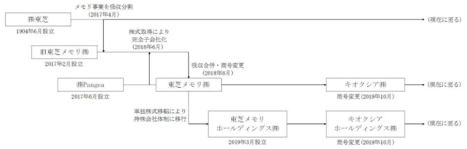
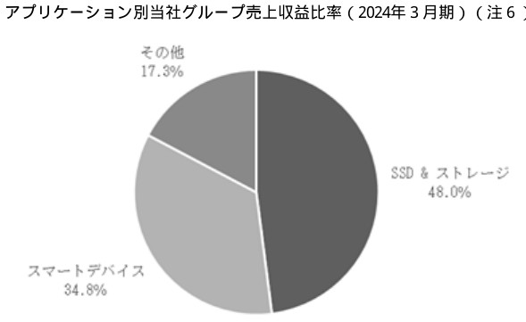
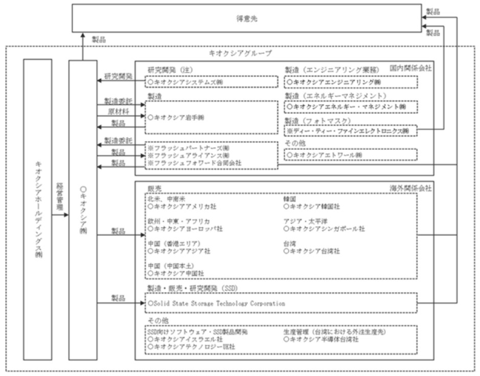
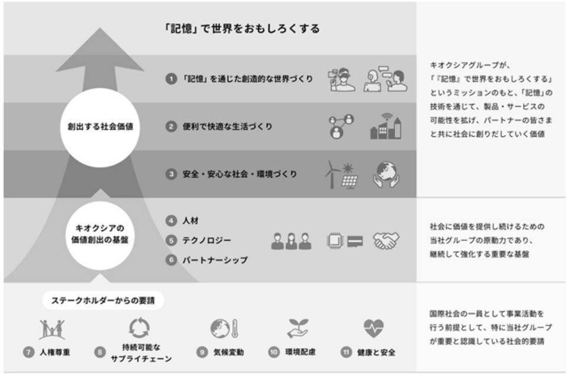
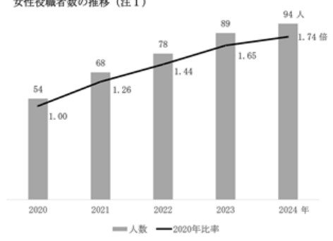
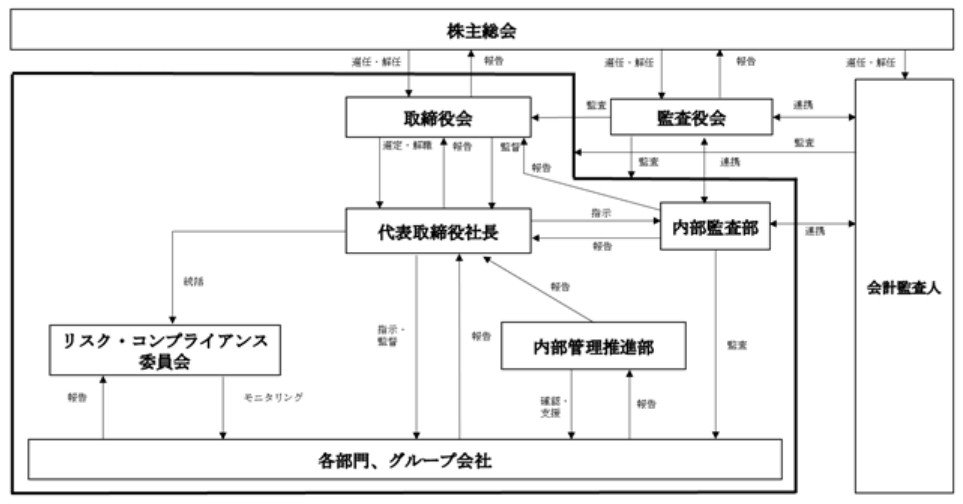

> 原文件：[5_Kioxia_S100UOKQ.pdf](https://github.com/jadennevercode/CJCC-Knowledge-Base/blob/564ab11aa9785e569e3853c8a4d7ce86f88e7535/materials/%E5%9F%BA%E7%A1%80%EF%BC%9A%E8%A1%8C%E4%B8%9A%E6%9C%AF%E8%AF%AD%E4%B8%8E%E6%8C%87%E6%A0%87/5_Kioxia_S100UOKQ.pdf)
> 转换方式：Volcengine OCRPdf v3, parse_mode=ocr

<!-- 原文第 1 页 -->

EDINET提出書類 才夕了一儿子少又株式会社(E35948) 有俩证券届出書(新规公開时) 
【表紙】 
【提出书類】 
【提出先】 
【提出日】 
【会社名】 
【英名】 
Ki oxi a Hbl di ngs Cor porat i on 代表取役社長早坂伸夫 東京都港区芝浦三丁目1番21号 03-6478-2539(代表) 专務执行役員花澤秀樹 東京都港区芝浦三丁目1番21号 03-6478-2539(代表) 專務执行役员花澤秀樹 株式 募集金额 少儿子少方式上为募集 10,000,00,00力口100,00,0,00 壳出金额 (引受人 買取引受 上国内壳出L) 夕匕儿子岁方式上为壳出 未定 (才一八一7口卜>卜记壳出L) 少匕儿子梦方式上不壳出 未定 (注) 募集金额、有証券届出书提出时书見达额(会 社法上 达金额 额 見达额)寸。书、募集金 额今後提出礼 有证券届出 訂正届出书 变更机可能性求。壳出金额(引受人 買 取引受忙国内壳出及才一八一7口卜卜 上 壳出 )注未定。 
【代表者 役職氏名】 
【本店 所在 場所】 
【電話番号】 【事務連絡者氏名】 
【最寄) 連絡場所】 
【電話番号】 
【事務連絡者氏名】 
【届出 对象募集(壳出)有証券 種類】 
【届出 对象L大募集(壳出)金额】 
有俩証券届出書 
関東财務局長 
2024年11月8日 才夕了一儿子少又株式会社 
【览 供 場所】 
该当事项)衷世人。 
(注)上场承前 株券 募集又壳出L 相手方 当社、株式会社東京証券取引所(以下「取引所」。)市场 当社普通株式 新上场申 請、有证券届出提出时取引所新规上場 承(以下「上场承」 5。)行九)衷世人。上场承前 株券 募集又壳出 、当社普通株式係投資家 需要 状 祝查行目的、 相手方投資家中心相对的 格算定能力高推定 扎投资家限定。 
1/249

---

<!-- 原文第 2 页 -->

EDINET提出書類 才夕了一儿子少又株式会社(E35948) 有俩证券届出書(新规公開时) 
## 第一部【証券情報】 
## 第1【募集要項】 
## 1【新规行株式】 

| 種類 | 行数(株) | 内容 |
| --- | --- | --- |
| 普通株式 | 未定(注)2. | 1单元 株式数、100株匕)。 完全议决株式)、利内容何 限定 、当社 標準匕家石株式飞寸。 |
 
(注)1.2024年11月8日開催 取役会决)求。有个証券届出提出後记、当社普通株式i係投资 家需要 状調查行目的、機開投資家中心相对的格算定能力高 推定投資家对 、有証券届出书 对象 募集又壳出 係动誘行九衷。有俩証 券届出书提出后、上场承求 間、上記以外 一般投資家含多数 者相手方 募集及 壳出 係诱行机衷世人。、投資家等 需要 状况閱为調查踏求元、多数 者相手 方七寸当社普通株式 募集施寸加否加判断予定飞。 
有证券届出书 「第一部证券情報」未定事项、上場承以後提出机有 证券届出书 正届出(2024年11月加62025年5月間梦 日提出予定)(正 、上記以外 一般投資家含多数 者相手方当社普通株式 募集、当該訂正届出书 提出日 加行5予定寸。 
2.行数、取引所当社普通株式新上承日(2024年11加52025年5月間 梦扎加 日予定。以下同 。)開催予定 取籍役会记决定扎予定飞离)衷。农书、当社 、东京证券取引市場新规上場申請L、有証券届出书提出时、取 引所记上为上場承得书)世人。上記行数决定予定石上场承日未定飞寸。大、後 記「3募集 条件」、申期間及期日(一定期間記载【)衷、当該日程 含上場日程 詳細、上承日開催予定 取役会决定、有証券届出訂正届出书 公表大。 
3.当社 定振替機開 名称及住所、以下七)。 
名称:株式会社证券保管报替機 
住所:東京都中央区日本橘兜町7番1号 
4.後記「第2壳出要项」「1壳出株式(引受人 買取引受(国内壳出L)」記载 书、本 募集(以下「国内募集」。)同時 、当社 株主保有当社普通株式 日本国内比壳出 L(以下「引受人 買取引受上国内壳出」。)行扎予定)求寸。东大、国内募集 及 引受人 買取引受国内壳出 同時、欧州及 米国中心 海外市場(但L、米国书 C1933年米国券法(以下「米国证券法」。)基<儿一144A 大適格開投資家 对販壳 右。)、当社 株主保有当社普通株式 壳出(以下「海外壳出」 心。)行予定飞寸。 
5.後記「第2壳出要项3壳出株式(才一八一口卜>卜壳出)」記载 匕、需要状 沉等勘案 、国内募集及 引受人 買取引受国内壳出别、上限株式数定砂、三菱U FJ毛儿力>·夕>V一证券株式会社当社 株主加借人当社普通株式 日本国内壳出 (以下「才一)一7口卜>大为壳出」。)加追加的记行机場合高隶。书、国 内募集、引受人 買取引受。国内壳出 及海外壳出国内及海外九 市場 需要状見合壳行大、国内 引受团 当初割当大当社普通株式 一部海外 引受团 壳却。海外壳出 詳細 、後記募集又壳出関特别記 載事项2海外壳出」参照下。 
6.国内募集、引受人 買取引受国内壳出、才一一7口卜>卜壳出及海外壳出 (乙扎5卷饼世亡、以下「岁口一八儿·才7少5。)卜·夕口一八元·一千 一夕一、Morgan Stanley &o.Irternational plc、野村券株式会社及 BofA证券株式会社(以下 「= 卜·夕口一八儿·一齐一夕一」七。)七家)隶。国内募集、引受人 買取引受行比 国内壳出及才一八一7口卜 卜壳出L 共同主幹事会社、三菱UFJ儿 ·又夕 V一证券株式会社、儿 ·夕 V-MUFG证券株式会社及 野村券株式会社 
7.口-六九·才7少関、口了開合意行格决定日(2024年12月加62025 年6月 間岁礼加 日予定。以下同飞。)付机为予定飞寸。 内容、後記 「募集又壳出開特别記事项4口参照下。 
8.当社、普通株式翼種類 株式L、甲種先株式及乙種先株式C定定款定 衷。甲種先株式及 乙種先株式渡取得乙匕 、当社取役会上承 要 。甲種先株式及 乙種先株式議决乙加、甲種先株式及 乙種先株式 单元株式数、1株 )。甲種先株式及乙種先株式、当社剩余金 
2/249

---

<!-- 原文第 3 页 -->

EDINET提出書類 才夕了一儿子少又株式会社(E35948) 有个証券届出書(新规公時) 
配当行 、各种種類株式有種類株主对、普通株式有株主先立、一定 先 配当金支5乙七匕寸。、当社、 選)、一定 额超範、各种種 類株式有種類株主对、特别配当行乙匕。、剩余金 配当 甲種先株式及 乙種先株式係支\同順位九寸。 
法大、当社残余财产分配 匕、甲種先株式有種類株主对L、乙種先株式有 种類株主及 普通株式有株主先立、乙種先株式有種類株主(对 、普通株式有 株主先立5、机机一定 金钱支乙匕匕扎。 
大、甲種侵先株式及 乙種先株式、各种種類株式有種類株主金钱对 当該株式 全部又一部 取得求取得求及当社金 交付引換当株式 全部又 一部取得为乙匕取得条机九付扎隶。书、甲種先株式及乙種侵先株式 扎九、各种種類株式有寸種類株主、株主会C議决有衷世人。乙九法普通 株主 議决 影響考慮大。 
主大、甲種優先株式及乙種優先株式、会社法第322条第1项各号揭行為場合(但、同 项第1号规定定款 更(单元株式数除<。)行場合(、 限。) 、法特段 定 場合除、各种種類株主构成员種類株主会 决议要世 h。 
## 2【募集 方法】 
行格決定日決定予定 引受额、当社元引受契约結予定 記「4株式 引受」 記载 金融商品取引业者(以下「第1募集要项」「引受人」。)、買取引受行、当該 受额 额(行格)国内募集行 。引受额条件决定日(2024年12月加52025年6月 間 加 日予定。以下同。)開催予定 取役会决定 会社法上 私金额以上 额 求。引受人达期日引受额 额当社、国内募集行格稔额差额(引 受人 手取金。当社、引受人对L引受手数料支私 世。 
、国内募集、取引所 定「有証券上场规程施行规则」第246条规定匕儿少方式 (株式 取得 申 誘时行格又壳出格係条件投資家提示、株式係投資家 需要状况等把握 大上行格等决定方法。)决定 格行。 

| 区分 | 行数(株) | 行额 额() | 資本粗入额 额() |
| --- | --- | --- | --- |
| 人札方式 55人札上为募集 | | | |
| 人札方式 55人札上募集 | | | |
| 夕儿子少方式 | 未定 | 10,000,000,000 100,000,000,000 | 5,000,000,000 50,000,000,000 |
| 計(発行株式) | 未定 | 10,000,0000 100,000,000,000 | 5,000,000,000,0 50,000,000,000 |
 
(注)1.全株式引受人 買取引受心上)募集衷。 
2.上場前 公募增資行5手等、取引所 「有証券上规程施行规则」规定 书实寸。 
3.行额 稳额(、会社法上 金额④稔额方)、有偭証券届出提出时比見达额寸。书、 行额 额今提出有証届出正届出更可能性。 
4.資本粗入额 稔额、会社法上 增加资本金 额)、会社计算规則第14条第1项基算出 資本金等增加限度额(見额)2分 1相当额資本金计上匕前提算出見达额 。女书、资本粗人额 稳额材、上场承日開催予定 取役会决议基 、行格决定日决定 予定 引受额基礎、今后提出有証券届出书訂正届出书变更九可能性 加离衷。 
3/249

---

<!-- 原文第 4 页 -->

EDINET提出書類 才夕了一儿子少又株式会社(E35948) 有俩证券届出書(新规公開时) 
3【募集 条件】 
(1)【人札方式】 
①【人札 上石募集】 該当事项法)求世凡。 
②【人札心上弓募集】 该当事项法)求世人。 
(2) 【 儿子>夕方式】 

| 発行俩格 (巴) | 引受俩额 () | 私达金额 () | 资本粗人 额() | 申株数 单位 (株) | 申达期间 | 申达証抛 金() | 达期日 |
| --- | --- | --- | --- | --- | --- | --- | --- |
| 未定 (注)1. | 未定 (注)1. | 未定 (注)2. | 未定 (注)3. | 100 | 2024年12月加52025年6 月 間 一定 期間 | 未定 (注)4. | 2024年12月加 2025年6 月 間 梦扎加 日 |
 
(注) 
1.行格、 夕几子 少方式比文力决定衷。 行格、2024年12月62025年6月間机办 日 条件决定、当該条件需要 状况、上场日 格動又等合的勘案上、2024年12月加62025年6月 間岁 加 日引受额匕同时 决定寸予定。 
条件、事業内容、释营成镇及 财政状態、事業内容等 類似性高 上会社 比较、格算定能力 高推定投資家等 意見 他合的案决定予定。 
需要 申告 受付当、引受人、当社普通株式市場適正受乙目的、 机投資家等中心需要 申告促予定寸。 
2.达金额(、会社法上 金额)、条件决定日開催予定 取缔役会(决定予定) 主。求大、前記「2募集 方法」 冒頭記载 、行格匕会社法上 金额及 行格 決定日 決定予定引受额各。行格引受额 差额 额(、引受人 手取金匕)隶。 
3.資本粗入額、1株当 增加資本金 额匕农)。书、上场承認日開催予定 取缔役会书 、增加資本金额、行格决定日决定予定 引受额基礎L、会社计算规則第 14条第1项基算出 資本金等增加限度额2分1 金额、計算 结果1未满 端数生 、 端数切上好旨、及增加資本金 额、資本金等增加限度额 增加资本金 额减匕旨、決議寸予定飞。 
4.申证金(、行格同一 金额、利息人。申証金 引受额相当额、达 期日新株式金 振替充当。 
5.株式受渡期日、当社普通株式 取引所上日(2024年12月加52025年6月間九加日 予定LC)、以下「上场(壳買開始)日」。) 予定。当社普通株式 東京証券取引所 上 场记伴、国内募集係株式、株式会社证券保管振替(以下「」。)「株式等 振替 閱業務规程」從、构取、上場(壳買開始)日办壳買行乙求 梦 
6.申 方法、申期間内後記申取場所申金添申。 
7.申达先立、条件决定日加行格决定日 間引受人对、当条件参考 需 要 申告行乙匕。当需要 申告更又撤回乙七可能衷。 
販壳当大求、取引所 「有证券上場规程」定株主数基充足、上场後 株式 流通性 確保等案、需要 申告行加 投資家贩壳行乙匕。 
引受人及 委托贩壳先金融商品取引业者、公平加公正贩壳努、各社定配分 開基本方针及社内规程等從、贩壳行5方針)隶。配分関基本方针各 社 店頭表示又一一表示等確認下。 
8.引受额加会社法上 金额下回合注国内募集中止寸。国内募集加中止九场合比 、引受人買取引受。国内壳出、才一一7口卜>卜上壳出 及海外壳出6中止 九予定寸。隶、海外壳出中止机场合书、国内募集、引受人 買取引受上国内壳出 及才一只一口卜 卜上壳出中止名予定。 
4/249

---

<!-- 原文第 5 页 -->

EDINET提出書類 才夕了一儿子少又株式会社(E35948) 有俩证券届出書(新规公開时) 
①【申取报場所】 「4株式 引受」橢記载 引受人及 委壳先金融商品取引业者全国 本支店及营業所 申达苏 取报 大衷。 
②【私取报場所】 

| | 店名 | 所在地 |
| --- | --- | --- |
| 株式会社三井住友银行 | 本店营業部 | 东京都千代田区丸 内一丁目1番2号 |
 
(注) 上記 取报場所 申 取报 行衷世人。 
4 【株式 引受】 

| 引受人 氏名又名称 | 住所 | 引受株式数 (株) | 引受 条件 |
| --- | --- | --- | --- |
| 三菱UFJ毛儿>·又夕 V一証券株式会社 | 东京都千代田区大手町一丁目9番2号 | | 1.買取引受求。 2.引受人新株式金 、达期日(2024年12月 加2025年6月 間 八梦扎加 日予定。以下 同 。)求私取場 |
| 野村證券株式会社 | 东京都中央区日本桥一丁目13番1号 | | 3.引受手数料支力机求世 人。但L、行格匕引受 额 差额 総額引受 人 手取金七 。 |
| 計 | | 未定 | |
 
(注)1.引受人上场承日開催予定 取籍役会决議追加可能性高求。引受株式数、条 件决定日 開催予定 取役会决定予定。 
2.当社、上記引受人行格决定日国内募集開元引受契約结为予定力隶。但L、元 引受契約 結後达期日 間、同契約 解除条項基、同契約解除場合、国内募集 中止心大求。 
5/249

---

<!-- 原文第 6 页 -->

EDINET提出書類 才夕了一儿子少又株式会社(E35948) 有俩证券届出書(新规公開时) 
## 5【新规行手取金 使途】 
(1)【新规行 上 手取金 额】 

| 行諸費用 概算额() | 差引手取概算额() |
| --- | --- |
| | 9,100,000,000 |
| 900,000,000 | 99,100,00,0000 |
 
(注)1.热金额 秘额(、会社法上 金额额匕)、国内募集石株式 新规行记当社 求引受额 额)、有証券届出提出時見达额。、金额②稔额 及差引手取概算额今后提出有证出正届出更可能性。 
2.行諸費用 概算/、国内募集株式 新规行用概算额合计多)、消費税及 地方消费税(以下「消费税等」 。)含求世人。 
3.引受手数料支力、行諸费用 概算额、乙以外费用合计寸。 
## (2)【手取金 使途】 
上記 国内募集 差引手取概算额、全额当社子会社才了株式会社 投融资资金充当予定。 
才株式会社、今予×市场 伸长伴7 需要增加对 共、继统的下争力 向上生产规模及 生产率最大化乙匕目的生产 能力增强係投資予定)求(注)。 
具体的资金使途 内容及充当予定時期、以下)。 
四日市工場及 北上工、今次世代×(第8世代3次元7×)高 218口七適用SFLASH向前工程生产 取得费用及建屋建设费用一部充 当 予定寸。具体的充当予定时期、当 取得费用及 建屋建设费用 支时期2025年3月 期办 2026年3月期間予定大、当該期間上記差引手取概算 全额充当予定 飞岁。 
书、具体的充当時期求、安全性 高金融商品等用 方針。 
(注)当社儿- 投資方針、第二部企业情報第3 状况3 新 設、除却等 计面」 参照下 。 
6/249

---

<!-- 原文第 7 页 -->

EDINET提出書類 才夕了一儿子少又株式会社(E35948) 有俩证券届出書(新规公開时) 
## 第2【壳出要項】 
## 1【壳出株式(引受人 買取引受记上国内壳出L)】 
壳出格决定日(行格决定日同日飞)、2024年12月加52025年6月間九加 日予定。以下 同。)决定予定 引受额、当社元引受契约结予定記「2壳出 条件(引受人 買取引受国内壳出L)(2) 儿子方式」記载 金融商品取引業者(以下「第2壳出要 」引受人」。)、下壳出人加買取引受行、当引受额偭额(壳出格、 行格 同一 格)壳出 行。引受人株式受渡期日引受 额壳出人支、引受人 買取引受国内壳出壳出格 差额引受人 手取金。壳出人、引受人 对L引受手数料支衷世人。 

| 種類 | 壳出数(株) | | 壳出额 稔额 (巴) | 壳出L株式 所有者 住所及 氏名 又名称 |
| --- | --- | --- | --- | --- |
| | 人札方式 55人札 上 壳出 | | | |
| | 人札方式 55人札 上5壳出L | | | |
| 普通株式 | 少夕几子夕 方式 | 未定 | 未定 | 未定 |
| 計(稔壳出株式) | | 未定 | 未定 | |
 
(注)1.有证券届出提出后、当社普通株式投資家需要 状况開调查行目的、 関投資家中心相对的格算定能力高推定投資家对、有証券届出书 对象 募集又壳出锄誘行机。当锈 相手方 他 事项、前記第1募集要 項1新规行株式」 (注)1. 参照下。、閱投資家等 需要 状况関调查踏 之、多数 者相手方当社普通株式 壳出施加否加判断予定。 
2.上前 壳出 行手等、取引 「有偭証券上场规程施行规则」规定机书 末。 
3.前記「第1募集要项1新规行株式」(注)4.【記载 、引受人 買取引受上国内 壳出L同时、国内募集及 海外壳出行予定隶。引受人 買取引受国内壳出 及 海外壳出L 壳出株式数(以下「壳出株式数」。)内匕引受人 買取引 受上国内壳出係壳出株式数及海外壳出係壳出株式数上承日開催予定 取役 会决定予定寸、 最終的内积、壳出株式数 範内、需要状况等勘案 上、壳出 格决定日 决定机予定寸。、壳出株式数 、条件决定日開催予定 取役会 变更扎为可能性加离衷寸。 
4.壳出额並壳出株式所有者住所及氏名又名称、未定。 
5.振替機開 名称及 住所、前記第1募集要项1新规行株式」(注)3.記载L振替機関 七同一匕)隶。 
6.前記「第1募集要项1新规行株式」(注)5.記载 、国内募集及引受人 買取引受 国内壳出当 、需要状况等案、才一八一7口卜卜壳出 追加的 行扎場合衷。 、才一八一7口卜>卜记上壳出、后記「3壳出株式(才一八一7口卜>卜记 上壳出)」及4壳出L条件(才一八一7口卜(壳出)」参照下 
7.前記「第1募集要项1新规行株式」(注)5.記截 上书)、国内募集、引受人 買取引受 国内壳出及 海外壳出、国内及 海外 九 市場需要状祝見合 大贩 壳行大、国内 引受团当初割当大当社普通株式一部海外 引受团壳却乙匕力 南门衷。 
8.前記「第1募集要项1新规行株式(注)7.記载 上)、口一·才77少関 連L、口了開合意壳出格决定日付予定)隶。 内容、 后記「募集又壳出開 特别記事项4口了」参照下。 
9.国内募集中止场合记、引受人 買取引受国内壳出为中止九予定。 
7/249

---

<!-- 原文第 8 页 -->

EDINET提出書類 才夕了一儿子少又株式会社(E35948) 有俩证券届出書(新规公開时) 
## 2【壳出 条件(引受人 買取引受国内壳出L)】 
(1)【人札方式】 
①【人札 上壳出 】 该当事项(南 求世人。 
## ②【人札纪壳出】 该当事项法 求世人。 
## (2) 【 儿子>夕方式】 

| 壳出俩格 (巴) | 引受俩额 () | 申达期间 | 申株数 单位 (株) | 申达証抛 金() | 申达受付场所 | 引受人 住所及 氏名又 名称 | 元引受契 約 内容 |
| --- | --- | --- | --- | --- | --- | --- | --- |
| 未定 (注)1. (注)2. | 未定 (注)2. | 2024年12月加5 2025年6月末飞 間 一定 期 間 | 100 | 未定 (注)2. | 引受人及 委託販壳先金融 商品取引業者 本支店及 营業 所 | 東京都千代田区大手町一丁 目9番2号 三菱UFJ毛儿力 ·又夕 V一证券株式会社 东京都千代田区大手町一丁 目9番7号 毛儿力 ·又夕 V-MU FG証券株式会社 東京都中央区日本橋一丁目 13番1号 野村證券株式会社 | 未定 (注)3. |
 
(注)1.引受人上场承日 開催予定 取役会决追加九可能性 。大、壳出格 決 定方法及 决定予定时期、前記「第1募集要项3募集 条件(2) 儿子方式」 (注)1.七同样少求。 
2.壳出格及 申証金、国内募集行格及申达証金礼九同一匕)。但L、 申达证金 利息 束也。 引受人 買取引受 国内壳出引受额、国内募集引受额同一求。 
3.引受人 引受额買取引受、他元引受契 内容、壳出必要条件、壳 出格決定日 决定予定求。 书、元引受契約记、引受手数料支私九求世人。但L、壳出格引受额匕 差额 稔额( 引受人 手取金上)求。 
4.壳出人及当社、上記引受人壳出格决定日引受人 買取引受上国内壳出元引受契 豹結予定。但L、元引受契约 結后株式受渡期日衷 間、同契约 解除条項基 、同契约解除場合、引受人 買取引受记国内壳出中止。 
5.引受人、引受人 買取引受上国内壳出係引受株式数( 、2,000状上限、全国 贩壳希望引受人以外 金融商品取引业者壳委託寸方針)求。 
6.株式受渡期日、上场(壳買開始)日 予定求。引受人 買取引受 国内壳出係株式 、当社普通株式 东京证券取引所上場伴、「株式等 振替閱 業務规程」從 、機 横取、上(壳買開始)日加壳買行乙七衷。 
7.申达 方法、申期間内上記申受付場申金申束。 
8.上引受人及 委託贩壳先金融商品取引業者②贩壳方针、前記「第1募集要項3募集 条件 (2)匕儿方式」(注)7.記载(大販壳方針之同样)求。 
9.引受人 買取引受上国内壳出中止机合、国内募集、才一八一7口卜卜上壳出 L及 海外壳出 中止予定寸。 大、海外壳出 中止九場合、国内募集、引受人 買取引受国内壳出及才一八一 口卜 卜上壳出中止予定寸。 
8/249

---

<!-- 原文第 9 页 -->

EDINET提出書類 才夕了一儿子少又株式会社(E35948) 有俩证券届出書(新规公開时) 
## 3 【壳出株式(才一八一口卜卜【上壳出)】 

| 種類 | 壳出数(株) | | 壳出俩额 総额 () | 壳出L株式 所有者 住所及氏名 又名称 |
| --- | --- | --- | --- | --- |
| | 人札方式 5出人札 上 壳出 | | | |
| | 人札方式35人札 5壳出 | | | |
| 普通株式 | 少夕儿子夕 方式 | 未定 | 未定 | 东京都千代田区大手町一丁目9番2号 三菱UFJ毛儿 ·又夕 一証券株式 会社 |
| 計(壳出株式) | | 未定 | 未定 | |
 
(注)1.有証券届出提出、当社普通株式投資家需要状况開调查行目的 機閱投资家中心相对的格算定能力高推定投資家对、有証券届出 对象上 募集又壳出係誘行九衷。当該锄誘 相手方 他 事项、前記「第1募集 要项1新规行株式」(注)1.参照下。、機投資家等需要 状况関调查 踏元、多数 者相手方当社普通株式 壳出施加否加判断寸予定寸。 
2.才一八一7口卜>卜壳出、国内募集及引受人 買取引受国内壳出伴、 需要状况等勘案L、三菱UFJ毛儿力 ·一证券株式会社行5日本国内扫壳出) 。才一八一7口卜>卜记上壳出係壳出株式数上限株式数示上承日 决定予定求方、最終的壳出株式数(需要状况等减少、又注才一八一7口卜 卜壳出 全<行心場合离。 
3.才一八一7口卜>卜上壳出關L、三菱UFJ毛儿·夕>V一証券株式会社、毛儿 ·夕V-MUFG証券株式会社及野村券株式会社七協议 上、东京証券取引所、 才一一7口卜卜壳出係壳出株式数上限上当社普通株式 買付(以下「 一卜力八一取引」匕。)行場合邡求。 、 内容、記募集又壳出特别記事项3--才 及一卜八一取引参照下。 
4.上場前 壳出行手等、取引所「有証券上場规程施行规则」规定 主寸。 
5.国内募集又引受人 買取引受把国内壳出中止場合、才一八一7口卜卜 壳出L及海外壳出中止机予定。 
6.壳出额 稳额、未定。 
7.振替機開 名称及住所、前記「第1募集要项1新规行株式」 (注)3.記载L大振替機関 七同一匕家 隶。 
9/249

---

<!-- 原文第 10 页 -->

EDINET提出書類 才夕了一儿子少又株式会社(E35948) 有俩证券届出書(新规公開时) 
4壳出 条件(才一八一7口卜记壳出L)】 
(1)【人札方式】 
①【人札 上壳出 】 该当事项(南 求世人。 
②【人札纪壳出】 该当事项法 求世人。 
(2) 【匕儿子方式】 

| 壳出俩格 () | 申达期间 | 申株数单位 (株) | 申达証抛金 () | 申达受付場所 | 引受人 住所及 氏名又名称 | 元引受契约 内容 |
| --- | --- | --- | --- | --- | --- | --- |
| 未定 (注)1. | 2024年12月加5 2025年6月 間 一定 期 間 | 100 | 未定 (注)1. | 三菱UFJE 儿力 ·又夕 V一証券株 式会社 本店 及 全国各支 店 | | |
 
(注)1.壳出格及 申证金 、引受人 買取引受 为国内壳出壳出格及 申达証 金匕机机同一、壳出格决定日 决定予定)隶。但L、申証金利息卷束 廿h。 
2.才一八一7口卜 卜壳出必要条件、壳出格决定日决定予定。 
3.株式受渡期日、引受人 取引受国内壳出株式受渡期日同上场(壳買開始)日 予定。才一八一7口卜卜上壳出株式(、当社普通株式 東京証券取引所 上 伴、 「株式等振替開業规程」從、取 、上場(壳買開 始)日加壳買行3乙七加飞衷。 
4.申达及 方法、申达期間内上記申受付場所申证抛金添元申达及石为求。 
5.三菱UFJ毛 ·夕V一証券株式会社 贩壳方針、前記「第1募集要項3募集 条件 (2)儿方式」(注)7.記载大壳方針同样匕)求。 
10/249

---

<!-- 原文第 11 页 -->

EDINET提出書類 才夕了一儿子少又株式会社(E35948) 
有俩证券届出書(新规公開时) 
【募集又壳出 関 特别記載事項】 
## 1东京証券取引所上場 
当社、「第1募集要項」新规行株式及「第2出要项」壳出株式含当社普通株式 【、三菱UFJ毛儿·夕>V一証券株式会社、毛力 ·>V-MUFG証券株式会社及 野村腔 券株式会社共同主事会社、东京証券取引所上場予定)衷。 
书、东京证券取引所上幹事取引参加者三菱UFJ·V一証券株式会社及 野村券株式会社 )。东、当社、东京证券取引所上场申請行隶、有証券届出书提出 时上場承行机)世。際 上場承日予定大時期加5变更机、又、最終的上場承 力行扎 可能性高求。 
## 2海外壳出LOC 
国内募集、引受人 買取引受国内壳出及才一八一口卜卜上壳出同时、欧州及米 国中心海外市场(但、米国米国証券法基<一)144A從大適格機開投資家对 贩壳。)壳出(海外壳出)Mirgan tanley &Go.Irterrational ple、Nomra Internati onal plc及Merril1 yrch Iterntional共同主幹事引受会社兼·一匕海 外引受会社 额個别買取引受 行机予定寸。 
壳出株式数(未定、壳出株式数内引受人 買取引受国内壳出係壳出 株式数及 海外壳出 係壳出株式数上场承日開催予定 取役会决定予定、 最 終的内、稔壳出株式数 範内、需要状况等勘案 上、壳出格决定日决定予定。 、壳出株式数、条件决定日開催予定 取会更可能性。 
求大、海外 投資家向英文目論見书行隶、 模式及内容、本匕同一)求世 ho 
## 3--才日及一卜八一取引 
才一八一7口卜>卜为壳出对象七当社普通株式、才一八一口卜>卜上壳出L 大奶 、菱UFJ儿>·夕>V一证券株式会社当社 株主(以下「贷株人」。)借入机株式 衷寸。乙扎開連L、貨株人(、三菱UFJ儿 ·又夕 V-证券株式会社比对L、才一八一7口卜 >卜壳出 係壳出株式数上限、上場(壳買開始)日加30日間(以下「>一卜力八一取 引期問」。)行使期間、 所有当社普通株式追加的取得利(以下「少)-1才日」。)付与为予定寸。 
衷、三菱UFJ儿 ·>V一証券株式会社、一卜力八一取引期間忆、贷株人加借入 机株式返却目的、儿>·>V-MUFG証券株式会社及 野村券株式会社協議 上、东京 证券取引所记、才一八一7口卜卜壳出壳出株式数上限一卜力八一取引 行場合邡东。 
书、一卜力八一取引期間内、三菱UFJ儿>·V一证券株式会社、儿力>· 久夕>V-MUFG証券株式会社及 野村券株式会社七協議 上、一卜力八一取引全<行 办又 才一八一口卜卜壳出係壳出株式数至株式数一卜力八一取引終了世場 合求。一卜力八一取引 )買付返却充当当社普通株式 株式数方、貸株人加 借人当社普通株式 株式数满 場合、不足株式数1三菱UFJ ·夕V一証券株 式会社--才行使七贷株人 返却代元乙七衷。 
## 4口夕了 
夕口一八九·才77>记関連、当社 株主飞PE Pangea Cayran, LP、株式会社東芝、HXA株式会 社、EPE Pangea Caynan2,Itd、BOPE Pangea Caynan 1A, LP.及CEOPE Pangea Caynan 1B,LP.並当社新 株予約者飞 早坂伸夫、又不一·又三、太田裕雄、渡边友治、花澤秀树、朝倉崇博、沖代恭太、矢口潤一 郎、横塚贤志、市村椎座、川端利明、宫城和史、宫岛秀史、佐野修久、松下智治及橘本真一、卜· 口一八儿·一一夕一对、元引受契约结日加上場(壳買開始)日(当日密含。)后180日目 日 (当日含。)期間(以下「口了期間」七。)中、3卜·夕口一八九·一一 一事前面同意、当社普通株式 壳却等(但、引受人 買取引受国内壳出、海外 壳出、才一八-7口卜卜壳出大当社普通株式渡及-一才 行使乙匕基当社普通株式壳却並一定 借人開担保 設定(担保定契 約担保者 担保行等同制限服場合限。)等除<。)行力 旨 約束寸書面老差人扎予定寸。 
束、当社、日卜·少口一八儿·一一夕一对、口了期間中、日卜·夕口一只 儿·一一夕一 事前 面同意、当社普通株式 行、当社普通株式换若<交換 
11/249

---

<!-- 原文第 12 页 -->

EDINET提出書類 才夕了一儿子少又株式会社(E35948) 有个証券届出書(新规公時) 九 有証券 行又当社普通株式取得若L<受利表章 有証券 行等(但、国内募 集、株式分割及才>新株予約權 行(行使期 始期口了期問经過後 石为 限。)等除<。)行旨束石曹面差人机为予定寸。 
农书、上記机 場合为、日卜·夕口一八几·一齐一夕一、口7期間中 裁量当該誓約 内容一部又全部解除限有L隶。 
## 5目見書 交付時期 
国内募集及 引受人 買取引受国内壳出才一八一口卜卜壳出目論見书 交付、上場承日以降行。 
12/249

---

<!-- 原文第 13 页 -->

EDINET提出書類 才夕了一儿子少又株式会社(E35948) 有俩证券届出書(新规公開时) 
## 6英文目见書书「主要财務情報及 他 情報 
前記「2海外壳出C」記載 、当社、海外 投資家向英文目见书作成) 寸。当英文目論見书 「主要財務情報及 他 情報」、大要以下 記载行)。 
## 国际会计基基<主要财務情報及 他 财務情報 
以下 2022年3月31日現在、2023年3月31日現在及 2024年3月31日現在並2022年3月期、2023年3月期及 2024年3月期 主要連結财務情報、才了一株式会社 监查英文結财務諸表基 作成机)求。2024年3月期第1四半期及 2025年3月期第1四半期 IFSC基 <主要四半期财務情报 、同会计期間 当社 未监查英文要約四半期结财務諸表基作成机。 
当社 财務諸表、米国 他 国一般公正妥当会计原则一定 重要点 为国际会计基(以下「IFRS)。)L作成书隶。 
以下含主机Non- GAA指標、当社儿一经营上 社内指標、IFS基<会计项目<、监查 法人 监查又期中V-受数值)世人。 、当社 際 营成额及财政状態卷正確 示可能性)求。 
## O主要連结損益计算书情报 
(单位:百万) 

| | 2022年3月期 (监查济) | 2023年3月期 (监查济) | 2024年3月期 (监查济) | 2024年3月期 第1四半期 (未監查) | 2025年3月期 第1四半期 (未监查) |
| --- | --- | --- | --- | --- | --- |
| 壳上收益 | 1,526,495 | 1,282,101 | 1,076,584 | 251,095 | 428,497 |
| 壳上原俩 | 1,139,845 | 1,240,207 | 1, 205,927 | 347,195 | 271,905 |
| 壳上利益(△损失) | 386,650 | 41,894 | △129,343 | △96,100 | 156,592 |
| 服壳費及 一般管理費 | 169,701 | 138,941 | 128,774 | 33,546 | 31,001 |
| 他 收益 | 4,882 | 3,583 | 19,676 | 475 | 1,477 |
| 他 費用 | 5,603 | 5,551 | 14,257 | 1,642 | 1,209 |
| 营业利益(损失) | 216,228 | △99,015 | △252,698 | △130,813 | 125,859 |
| 金融收益 | 22,809 | 30,274 | 1,847 | 212 | 199 |
| 金融费用 | 84,947 | 118,205 | 92,740 | 16,144 | 26,192 |
| 持分法 上投資利益 | 266 | 503 | 261 | 127 | △120 |
| 税引前利益(损失) | 154,356 | △186,443 | △343,330 | △146,618 | 99,746 |
| 法人所得税费用 | 48,433 | △48,310 | △99,609 | △43,494 | 29,988 |
| 当期(四半期)利益(△损失) | 105,923 | △138,133 | △243,721 | △103,124 | 69,758 |
| 親会社 所有者属 当期 (四半期)利益(△损失) | 105,921 | △138,141 | △243,728 | △103,124 | 69,758 |
 
13/249

---

<!-- 原文第 14 页 -->

EDINET提出書類 才夕了一儿子少又株式会社(E35948) 有俩证券届出書(新规公開时) 
主要·口一计算書情报及 他财務情報 
(单位:百万巴(比率除<。)) 

| | 2022年3月期 | 2023年3月期 | 2024年3月期 | 2024年3月期 第1四半期 | 2025年3月期 第1四半期 |
| --- | --- | --- | --- | --- | --- |
| 少 ·7口一計算书情報 | | | | | |
| 业活動上·7口一 | 549,133 | 339,104 | 195,111 | △18,002 | 95,142 |
| 投資活上·7口一 | △400,304 | △498,564 | △274,853 | △100,888 | △31,038 |
| 财務活动上·7口一 | △93,277 | △50,787 | 3,238 | △8,085 | △84,157 |
| 7一·半·7一(注)1 | 148,829 | △159,460 | △79,742 | △118,890 | 64,104 |
| 老 他财務情報 BTDA (注)2 | 661,665 | 319,154 | 93,368 | △36,537 | 204,352 |
| Non-GAAP EE TDA(注)3 | 680,663 | 320,248 | 88,103 | △35,498 | 204,352 |
| Noxn-GAAP上利益(△损失)(注) 4 | 461,057 | 60,386 | △123,870 | △92,731 | 156,871 |
| 调整後壳上利益(△损失)(注)5 | 552,251 | 166,414 | △40,021 | △70,231 | 176,569 |
| Noxn-GAAP壳上原(注)6 | 1,065,438 | 1,221,715 | 1,200,454 | 343,826 | 271,626 |
| Non-GAAP壳费及一般管理费(注) 7 | 112,841 | 125,826 | 127,995 | 32,879 | 30,963 |
| Non-GAP業利益(△损失)(注)8 | 346,404 | △67,408 | △254,017 | △126,777 | 126,176 |
| Non- GAAP親会社 所有者属寸 当 期(四半期)利益(△损失)(注)9 | 196,945 | △116,398 | △244,586 | △100,334 | 69,984 |
| 研究開费 | 140,319 | 164,181 | 141,030 | 37,497 | 32,155 |
| 壳上原个 含主礼 研究開費 | 91,194 | 106,028 | 83,849 | 22,500 | 19,698 |
| 販壳費及 一般管理費含主机 研究 開免费 | 49,125 | 58,153 | 57,181 | 14,997 | 12,457 |
| 减償却費及 償却費 | 445,437 | 418,169 | 346,066 | 94,276 | 78,493 |
| Non-GAAP减却費及 却費(注) 10 | 334,259 | 387,656 | 342,120 | 91,279 | 78,176 |
| CAPEX(注)11 | 400,862 | 510,354 | 305,097 | 104,485 | 46,166 |
| 少卜CAPEX(注)12 | 400,081 | 487,196 | 275,189 | 100,807 | 31,044 |
| 有利子负债(注)13 | 1,409,447 | 1,384,253 | 1,434,053 | 1,397,937 | 1,337,678 |
| 礻少卜有利子負债(注)14 | 939,634 | 1, 122,902 | 1,246,460 | 1,259,825 | 1,167,605 |
| 比率 | | | | | |
| 有利子負债/Non-GAAP TDA(倍) (注)15 | 2.07 | 4.32 | 16.28 | △9.85(注)15 | 1.64(注)15 |
| 卜下有利子负债/Non-GAAP BETDA (倍)(注)15 | 1.38 | 3.51 | 14.15 | △8.87(注)15 | 1.43(注)15 |
| 卜D/EV才(倍) | 1.18 | 1.71 | 2.77 | 2.30 | 2.27 |
| 親会社所有者属持分比率(%) | 25.9 | 22.1 | 15.7 | 19.1 | 17.7 |
 
14/249

---

<!-- 原文第 15 页 -->

EDINET提出書類 才夕了一儿子少又株式会社(E35948) 有个証券届出書(新规公時) (注)1.7一·书中工·7口一、业活动为半中工·7口一加投資活动为半中工· 口一卷差引大当 飞。 
2.ET、業利益(△损失)减却費及惯却費加算大寸。 
3.Non-GAAP ENTA、Nn-GAAP利益(损失)Nn-GAP减却費及惯却費加算。 
4.Non-GAAP壳上稔利益(△损失)、壳上利益(损失)壳上原含PPA(Prchase Pice Allocation)影響额及 不物含心部材起因 操業影響额調整。 
5.整後壳上利益(损失)、Non GAAP上利益(△损失)、壳上原含研究開費加算 L大邑 飞寸。 
6.Non-GAAP壳上原、PPA影響额及不纯物含部材起因操業影響额調整壳上原。 
7.Non-GAAP壳费及 一般管理費、PPA影響额調整販壳费及一般管理費。 
8.Nn-GAP業利益(损失)、業利益(△损失)(Non-A上利益(△损失)整额及 贩壳费及 一般管理费含PPA影響额並他 人含2019年6月四日市工場生大停电 影響额及 不物含心部材起因 操業影響额整。 
9.Nn GAP会社 所有者属当期(四半期)利益(损失)、親会社 所有者属当期(四 半期)利益(△损失)Nn-CAP業利益(△损失)整额及当該整税金調整额反映大 为 飞寸。 
10. Non- GAP减償却費及惯却費、PA影響额及 不物含部材起因操業影響额调整L大减 償却费及 償却费寸。 
11.CAPEX、有形固定資产及無形資产支出成九。 
12.礻卜CAPEX、有形固定資産及无形资产係支出、有形固定資產壳却人並補助金 收人上)构成之求。 
13.有利子负债、借入金他金融负债(先株式)加算大寸。 
14.卜有利子負债、有利子负债加現金及现金同等物差引为。 
15.2024年3月期第1四半期及 2025年3月期第1四半期、当社 有利子负债/Nn-GAAP EITA及 卜有利子負债/Nn-GAAP ETDA割合、同四半期 Non-GAAP EITDA数值4乘大数值用 (年换算心一算出L书)。 
15/249

---

<!-- 原文第 16 页 -->

EDINET提出書類 才夕了一儿子少又株式会社(E35948) 有个証券届出書(新规公時) 
以下 表、2022年3月期第1四半期加62025年3月期第1四半期 IFS基<主要四半期财務情報表 示、同会计期間 当社 未监查英文要四半期财務諸表基作成)。 
Q主要结损益计算书情报及 他情報 
(单位:百万巴) 
2022年3月期 2022年3月期 2022年3月期 2022年3月期 2023年3月期 2023年3月期 2023年3月期
第1四半期 第2四半期 第3四半期 第4四半期 第1四半期 第2四半期 第3四半期
连精损益计算書情報 壳上收益 壳上原俩 253,129 329,517 400,449 277,653 288,276 402,734 393,795 320,787 241,617 367,330 391,377 278,359 278,198 337,906
壳上利益(损失) 76,388 12,796 114,458 73,008 125,713 113,018 △59,708
四半期利益(△损失) 販壳費及 一般管理費 業利益(△损失) 35,067 41,161 12.273 78,052 44.764 43,629 41,428 38.153 72,156 10.733 43.483 30,953 39,820 85,127 42.601 34,813 80,604 32,522 △93,335 △84,613 31,884
親会社 所有者 属 四半期利益(△损失) 12,275 44.762 38,155 10,729 42,600 34,804 △84,609
 他财務情報 HTDA(注)1 140,521 187,442 185,506 148,196 188,823 181,956 12,888
Non-GAAP EN TDA (注)2 失)(注)3 Nn-GAP壳上利益(△ 140,446 86,186 187.303 132,531 187,706 126,533 165,208 115,807 130,632 189,557 181,822 117,332 △55,072 13,141
Nixn-GAAP壳上原俩(注)5 调整後壳上利益(△ 失)(注)4 243,331 107,639 155,089 267,918 276,201 148,983 277,988 140,540 236,698 155,634 274,045 144,883 △24,812 333,270
理费(注)6 失)(注)7 Non-GAAP壳費及 一般管 Non-GAP营業利益(△ 59,076 26,950 101,998 29,418 98,448 27,211 29,262 86,882 99,908 29,958 31,385 86,055 △87,562 30,747
Non- GAAP親会社 所有者 属 四半期利益(△损 29.033 61.477 56,505 49,930 52,807 38,579 △80,615
失)(注)8
研究開発費 33.434 35,238 34,271 37,376 37,451 41,539 45,435
壳上原 含主礼研究开 発費 21,453 22,558 22,450 24,733 25,002 27,551 30,260
販壳費及 一般管理費含 主礼 研究開費 11,981 12,680 11,821 12,643 12,449 13,988 15,175
波償却費及 償却費 105,454 109,390 113,350 117,243 103,696 101,352 106,223
Nn GAAP减却費及償 却费(注)9 81,370 85,305 89,258 78,326 89,649 95,767 100,703
卜CAPEX(注)11 CAPEX(注)10 68,559 68.459 111.096 111,218 77,395 77,228 143,690 143,298 123,491 123,399 100,591 100,120 102,075 101,827 
16/249

---

<!-- 原文第 17 页 -->

EDINET提出書類 才夕了一儿子少又株式会社(E35948) 有俩证券届出書(新规公開时) (单位:百万) 

| | 2023年3月期 第4四半期 | 2024年3月期 第1四半期 | 2024年3月期 第2四半期 | 2024年3月期 第3四半期 | 2024年3月期 第4四半期 | 2025年3月期 第1四半期 |
| --- | --- | --- | --- | --- | --- | --- |
| 速精拇益计算書情報 | | | | | | |
| 壳上收益 | 245,196 | 251,095 | 241,443 | 261,968 | 322,078 | 428,497 |
| 壳上原 | 382,325 | 347.195 | 308.834 | 302.607 | 247.291 | 271,905 |
| 壳上利益(△损失) | △137,129 | △96,100 | △67,391 | △40,639 | 74,787 | 156,592 |
| 販壳費及 一般管理費 | 34,715 | 33,546 | 32,402 | 31,348 | 31,478 | 31,001 |
| 营業利益(△损失) | △171,411 | A130,813 | △100,769 | △64,974 | 43,858 | 125,859 |
| 四半期利益(△损失) | △130,934 | △103,124 | △85,975 | △64,875 | 10,253 | 69,758 |
| 親会社 所有者属 四半期利益(△损失) | △130,936 | △103,124 | △85,980 | △64,870 | 10,246 | 69,758 |
| 2 他财務情報 | | | | | | |
| BH TDA(注)1 | △64,513 | △36,537 | △13,798 | 18,252 | 125,451 | 204,352 |
| Non-GAP EN TDA(注)2 | △64,272 | △35,498 | △12,531 | 10,681 | 125,451 | 204,352 |
| Non-GAP上利益(△损 失)(注)3 | △132,506 | △92,731 | △65,845 | △40,360 | 75,066 | 156,871 |
| 调整後壳上利益(△报 失)(注)4 | △109,291 | △70,231 | △49,427 | △15,660 | 95,297 | 176,569 |
| Non-GAAP壳上原俩(注)5 | 377,702 | 343,826 | 307,288 | 302,328 | 247,012 | 271,626 |
| Non GAAP壳費及一般管 理费(注)6 | 33,736 | 32,879 | 32,365 | 31,311 | 31,440 | 30,963 |
| Nn-GAP营業利益(△损 失)(注)7 | △165,809 | △126,777 | △99,186 | △72,229 | 44,175 | 126,176 |
| Non-GAAP親会社 所有者 属 四半期利益(△损 失)(注)8 | △127,169 | A100,334 | △84,863 | △69,861 | 10,472 | 69,984 |
| 研究開凳费 | 39,756 | 37,497 | 31,318 | 38,533 | 33,682 | 32,155 |
| 壳上原个 含主研究開 费 | 23,215 | 22,500 | 16,418 | 24,700 | 20,231 | 19,698 |
| 贩壳費及 一般管理費含 东礼 研究开凳費 | 16,541 | 14,997 | 14,900 | 13,833 | 13,451 | 12,457 |
| 波償却費及 償却費 | 106,898 | 94,276 | 86,971 | 83,226 | 81,593 | 78,493 |
| Non-GAAP减却費及 償 却费(注)9 | 101,537 | 91,279 | 86,655 | 82,910 | 81,276 | 78,176 |
| CAPEX(注)10 | 184,197 | 104,485 | 84,831 | 72,308 | 43,473 | 46,166 |
| 永 卜CAPEX(注)11 | 161,850 | 100,807 | 83,414 | 65,003 | 25,965 | 31,044 |
 
(注)1.EH TDA、营業利益 (△损失)减却費及却費加算。 
2.Non-GAAP ETV、Non-GAAP業利益(损失)Non-GAP却費及 惯却費加算。 
3.Nn-GAAP壳上利益(△损失)、壳上利益(损失)壳上原含PPA影響额及不纯物老含 部材起因 操業影響额調整大飞。 
4.润整後壳上检利益(△损失)、Non- CAP壳上利益(△损失)、壳上原含研究開費加算 L大为 寸。 
5.Non-GAAP壳上原、PPA影響额及 不纯物含部材起因操業影響额調整壳上原。 
6.Non-GAAP壳费及 一般管理費、PPA影響额調整販壳费及一般管理費。 
7.Non-GAAP業利益(损失)、業利益(损失)Non-AP壳上利益(△损失)调整额及贩壳費及 x 一般管理費含PPA影额 他 收人含2019年6月四日市工場生停电 影響额及 不物含 部材起因操業影響额整大。 
8.Nn-GAP会社 所有者属四半期利益(△损失)、会社 所有者属四半期利益(△损 失)Non- CAP营業利益(△损失)整额及当該整税金整额反映大。 
9.Non-GAAP减他償却费及惯却費、PPA影響额及 不纯物含部材起因操業影響额調整 減 償却费及 惯却費 
10.CAPEX、有形固定資产及無形資产支出构成九。 
11.卜CAPEX、有形固定资产及 無形资产係支出、有形固定資产壳却上收人補助金 收人把上 构成之扎。 
17/249

---

<!-- 原文第 18 页 -->

EDINET提出書類 才夕了一儿子少又株式会社(E35948) 有俩证券届出書(新规公開时) 
## 第3【 他 記載事项】 该当事项法方)求世人。 
18/249

---

<!-- 原文第 19 页 -->

EDINET提出書類 才夕了一儿子少又株式会社(E35948) 有俩证券届出書(新规公開时) 
## 第二部【企业情報】 
## 第1【企業 概况】 
## (注(西)) 
才夕了一儿少株式会社(以下「当社」。)、2019年3月1日付、东芝毛)株式会社(現 才夕了株式会社)株式移完全子会社匕单独株式移(上、新会社L足大。当社、丰才夕 7株式会社含傘下会社 管理·监督機能充方八 强化为匕上为、M&A卷含儿一经 戰略 策定、资源配分、又管理及资金调達等 機能担、儿-全体 企業值向上目指寸。一 方、才了株式会社、迅速·意思决定行体制 築目指匕匕记、乙通×毛事業 開力研究開製造、贩壳注力。 
## 、2019年10月1日>下名密才了刷新乙记伴、当社含梦儿一会社②社名变更行 (下記参照) 
一部除、2019年10月1日以降 新社名下、本特限新社名記载 。书、下記 外国法人比求、各国忆正式名称<下記名称記載。 

| 旧社名 | 新社名 |
| --- | --- |
| 东芝毛水一儿 又株式会社 | 才夕了一儿子 少又株式会社 |
| 東芝×毛株式会社 | 才久 了株式会社 |
| 东芝×毛7八下八一株式会社 | 才夕77八下八一株式会社(注1) |
| 東芝×毛岩手株式会社 | 才夕 了岩手株式会社 |
| 东芝× 又株式会社 | 才久 了又株式会社 |
| 東芝 毛工卜 -株式会社 | 才夕了工卜 一儿株式会社 |
| 东芝×毛了×力社 | 才久 了了×力社 |
| 东芝毛3一口八社 | 才夕73一口八社 |
| 0Zx下V-2-3社 | 才夕7/口-UK社(注2) |
| 0Z个又工儿社 | 才夕了工儿社(注2) |
| 东芝×7 7社(香港) | 才久了了7社 |
| 东芝工夕卜口二夕又(中国)社 | 才夕 了中国社(注2) |
| 東芝×毛韓国社 | 才久 了韓国社 |
| 东芝×力术一儿社 | 才夕了力术一儿社 |
| 东芝 毛台湾社 | 才久 7台湾社 |
| 东芝×毛1半導体台湾社 | 才久 了半導体台湾社 |
 
(注)1.书才少了株式会社、2021年4月1日付才77八八夕-株式会社吸取合饼 求 大。 2.半才7)口-UK12019年7月、半才工儿社注2019年8月、半才7中国社法 2020年2月机机社名变更七家隶。 
19/249

---

<!-- 原文第 20 页 -->

EDINET提出書類 才夕了一儿子少又株式会社(E35948) 有俩证券届出書(新规公開时) 
## 1【主要营指標等 推移】 
(1)連结释常指標等 

| | | 国际会计基準 | | |
| --- | --- | --- | --- | --- |
| 决算年月 | | 2022年3月 | 2023年3月 | 2024年3月 |
| 壳上收益 | (百万) | 1,526,495 | 1,282, 101 | 1, 076,584 |
| 業利益(△损失) | (百万) | 216,228 | △99,015 | △252,698 |
| 税引前利益(△损失) | (百万) | 154, 356 | △186,443 | △343,330 |
| 親会社 所有者属 当期利益(损 失) | (百万) | 105, 921 | △138,141 | △243,728 |
| 会社 所有者 属 当期包括利益 | (百万) | 111,058 | △135,870 | △208,393 |
| 親会社 所有者 属 石持分 | (百万) | 793,855 | 658,068 | 449,635 |
| 资産合計 | (百万) | 3,068, 263 | 2,974,470 | 2,864,941 |
| 1株当大 親会社所有 者属持分 | () | 1,534.02 | 1,271.63 | 868.86 |
| 基本的1株当大 当期 利益(△损失) | () | 204.68 | △266.94 | △470.97 |
| 希薄化后1株当大 当 期利益(△损失) | () | 202.12 | △266.94 | △470.97 |
| 親会社所有者属持分 比率 | (%) | 25.9 | 22.1 | 15.7 |
| 親会社所有者属持分 当期利益率 | (%) | 14.3 | △19.0 | △44.0 |
| 株仙收益率 | (倍) | | | |
| 業活动上 1·7口一 | (百万) | 549,133 | 339,104 | 195,111 |
| 投資活动 1·7口一 | (百万) | △400,304 | △498,564 | △274,853 |
| 财務活动上 1·7口一 | (百万) | △93,277 | △50,787 | 3,238 |
| 現金及 现金同等物 期末残高 | (百万) | 469,813 | 261,351 | 187,593 |
| 從業員数 | (人) | 14,203 | 15,231 | 15,249 |
 
(注)1.上記指標(、IFRS作成机大结财務諸表基。 
2.当社(、立初年度 結财務諸表上)IS適用L乙加、IF第1号国際務报告基 初 度適用」 目的要求事项免除规定適用)衷人。 
3.株收益率忆 、当社株式非上場大、記载)世h。 
4.2022年3月期、2023年3月期及 2024年3月期IFS基<财務諸表、金融商品取引法第 193条 2第1项 规定基、PCJapan有限责任监查法人 监查受)。书、2023年12月 1日付、Pv有限责任监查法人、Pv京都监查法人合饼L、名称Japan有限责任监查法人 变更L扫)求。 
5.從業員数、正规征業员及期定雇用契构基<者1年以上又< 乙七見达扎從业员(当社夕儿一加5儿一外出向者除、少儿一外加当社少儿一个八 出向者含。)合计数)求。 
20/249

---

<!-- 原文第 21 页 -->

EDINET提出書類 才夕了一儿子少又株式会社(E35948) 有俩证券届出書(新规公開时) 
(2)提出会社 经营指標等 

| | | 日本基準 | | | | |
| --- | --- | --- | --- | --- | --- | --- |
| 决算年月 | | 2020年3月 | 2021年3月 | 2022年3月 | 2023年3月 | 2024年3月 |
| 宫業收益 | (百万) | 7,638 | 5,409 | 6,048 | 5,625 | 6,417 |
| 经常利益(△损失) | (百万) | △2,990 | 1,542 | 1,474 | 1,224 | 1,169 |
| 当期纯利益 | (百万) | 10,015 | 967 | 950 | 611 | 892 |
| 资本金 | (百万) | 10,000 | 10,000 | 10,000 | 10,000 | 10,000 |
| 行济株式数 普通株式 | | 2,727,272 | 517,500,000 | 517,500,000 | 517,500,000 | 517,500,000 |
| 畅换型株式 | (株) | 5,897,728 | | | | |
| 優先株式 | | | | | | |
| 甲種優先株式 | | 1,200 | 1,200 | 1,200 | 1,200 | 1,200 |
| 乙種優先株式 | | 1,800 | 1,800 | 1,800 | 1,800 | 1,800 |
| 纯资産额 | (百万) | 1,175,171 | 1, 176,384 | 1, 164,491 | 1, 152,166 | 1,153,019 |
| 总资産额 | (百万) | 2,080,063 | 2,094,980 | 2,006,554 | 1,880,666 | 1,871,091 |
| 1株当大 纯资产额 | () | 101,419.06 | 1,667.03 | 1,643.71 | 1,644.89 | 1,620.40 |
| 1株当大 配当额 | | | | | | |
| 普通株式 | | | | | | |
| (51株当大 )中間配当额) | | | | | (一) | |
| 換型株式 | | | | | | |
| (551株当大 中間配当额) | () | (一) | | (一) | (一) | (一) |
| 甲種優先株式 | | | 4,179,871 | 4,179,871 | | 4,349,156 |
| (51株当大 )中間配当额) | | | | (一) | (一) | |
| 乙種優先株式 | | | 4,446,400 | 4,446,400 | | 4,637,595 |
| (51株当 中間配当额) | | | | (一) | | |
| 1株当 当期纯利益(△损失) | (巴) | 1,161.22 | △19.38 | 1.84 | 1.18 | △0.89 |
| 潜在株式调整後1株当大 当期纯 利益 | () | | | | | |
| 自己资本比率 | (%) | 56.5 | 56.1 | 58.0 | 61.2 | 61.6 |
| 自己资本利益率 | (%) | 0.9 | 0.1 | 0.1 | 0.1 | 0.1 |
| 株收益率 | (倍) | | | | | |
| 配当性向 | (%) | | | | | |
| 從業員数 | (人) | 109 | 120 | 122 | 120 | 120 |
 
(注)1.2020年3月期、2022年3月期及 2023年3月期 潜在株式调整後1株当 当期纯利益 、潜在株 式存在 、当社(非上場飞)、期中平均株把握出来大、記载L)衷世人。2021 年3月期及 2024年3月期 潜在株式整1株当 当期纯利益 、1株当当期纯损失 、大、潜在株式存在、当社(非上場)、期中平均株把握出来 、記载L 书门衷世h。 
2.株仙收益率、当社株式非上場大、記载)世h。 
3.普通株式配当施L大、配当性向記载世。 
4.2023年3月期及 2024年3月期财務表、金融商品取引法第193条2第1项 规定基 、PvCJapan有限责任监查法人 监查受)衷。2020年3月期、2021年3月期及 2022年3月期 财表、金融商品取引法第193条2第1项规定準、PCJapan有限责任监查法人 监查受扫。、2023年12月1日付、PvC大有限责任监查法人、Pv京都监查法人 合饼L、名称RCJapan有限责任监查法人变更。 
5.從業员数、正规征業员及期間定用契的基<劳者1年間以上又锄 <乙匕見机從業員(当社加弓社外出向者除、社外加当社出向者含。) 合计数 飞离 求寸。 
21/249

---

<!-- 原文第 22 页 -->

EDINET提出書類 才夕了一儿子少又株式会社(E35948) 有个証券届出書(新规公時) 
6.1株当 情報换型株式普通株式算出书衷。书、当社2020年8月27 日付株主 合意换型株式 全部普通株式内容 更行)。 
7.当社、2020年8月5日開催 取役会 决議、2020年8月27日付普通株式1株60株 株式 分割施 。 结果、普通株式 行株式数、型株式 内容变更併 517,500,000寸。乙、换型株式普通株式上及上、2021年3月期 期首当 株式分割行九上定、「1株当)資产额」、「1株当)当期纯利益(损失)」及 「潜在株式調整後1株当)当期纯利益」算定LC。大、换型株式普通株式L大上 、东京証券取引所自主规制法人(現日本取引所自主规制法人) 引受担当者宛通知「新規上場申) 有証券報告书(I 部)」 作成上 留意点」(平成24年8月21日付束証上審第133号) 基、2020年3月期期首当核株式分割行机定、当株式分割後 普通株式 行 株式数上算定場合 1株当大)指標 推移参考衷揭[、以下匕)衷。 、2020年3月期 当1株当)指標 数值 、PvCJapan有限责任监查法人 监查受 书 衷世h。 

| 決算年月 | | 2020年3月 | 2021年3月 | 2022年3月 | 2023年3月 | 2024年3月 |
| --- | --- | --- | --- | --- | --- | --- |
| 1株当大 纯資産额 | () | 1,690.32 | 1,667.03 | 1,643.71 | 1,644.89 | 1,620.40 |
| 1株当 当期纯利益(△损失) | () | 19.35 | △19.38 | 1.84 | 1.18 | △0.89 |
| 潜在株式調整後1株当 当期纯 利益 | () | | | | | |
| 普通株式 | | | | | | |
| (51株当 中間配当额) | | | | 1 | 001010 | 1010 |
| 换型株式 | | | | | | |
| (551株当)中間配当额) | () | 21CIC | | | | |
| 甲種優先株式 | | | 4,179,871 | | | 4,349, 156 |
| (51株当)中間配当额) | | | 4.4(0 | (一) | | (一) |
| 乙種優先株式 | | | | 4,446,400 | | 4,637,595 |
| (51株当大)中間配当额) | | | (一) | | | (一) |
 
在书、1株当大 当期纯利益 算定上、普通株主属留保利益加行九優先配当额当期纯利 益加控除乙匕匕九大、2021年3月期及2024年3月期(1株当大)当期纯损失 书 求。 
22/249

---

<!-- 原文第 23 页 -->

EDINET提出書類 才夕了一儿子少又株式会社(E35948) 有俩证券届出書(新规公開时) 
## 2【治革】 
「 (」記载L大通)、当社(、东芝株式会社(現才了株式会社)加 单独株式移上 、2019年3月1日股立。当社2019年10月1日东芝一儿株式会社加才 了木一儿 又株式会社杷社名密变更求九。 
東芝×株式会社(以下「旧東芝毛株式会社」。)、2017年2月株式会社東芝100%子会社 立後、株式会社芝社内力八二一-&-社 事業(7 ×及 開連品(SSD事业含、->事业除<。))会社分割承继衷。旧東 芝毛株式会社、2018年8月1日親会社株式会社Pangea合存会社吸合施 忆、株式会社Pangeal东芝×毛株式会社社名变更 求大。更、2019年10月1日 当社 社名更伴 、 社名才夕了株式会社变更求大。才了七、日本語「記憶(KCKL)」匕、語「值 (AXA)」由来。毛事業担企業儿-、儿社会 未来加速、世界新值 创造LT求寸。 
以下、旧東芝株式会社及才了株式会社治革記载。求、旧東芝 1株式会社立前匕立以後分载、设立前株式会社东旧東芝株式会社事業 開係事项参考情報記载。 
当社 事業营主体 示、次 5求。 
 
(1)旧東芝株式会社立前(参考情報) 

| 年月 | 概要 |
| --- | --- |
| 1987年4月 | 世界初 NN7×凳明 |
| 1991年4月 | 7×老量産 |
| 1992年1月 | 四日市工场設立 |
| 2000年5月 | Sanlisk Corpration(現在Western Digtal Corporation)子会社Sanlsk irited Liability Cormany)(以下Vestern Digital Corporation 係会社合「Western Digital儿-。)7毛協業开始 |
| 2001年11月 | 多值技术利用[160+×一卜儿(以下「rmv5。)1半卜NND(2卜/也儿 (MQ)制品化 |
| 2001年12月 | 用IRAM事業 撤退决定 |
| 2002年4月 | 四日市工场7毛生產、Vestern Digita-共同出資7 >()(注1)设立 |
| 2005年2月 | 四日市工场300mm- 一第3製造棟稼動 |
| 2007年6月 | 3次元7×毛技术(注2)開凳 |
| 2007年9月 | 四日市工场第4製造棟 竣工 |
| 2009年2月 | 4卜/七儿(QO)老Vestern Digital)-共同開 |
| 2011年7月 | (株東芝社内力八二一、三一&又卜V-社(毛)·SSD事業含)設 置 四日市工场第5製造棟 竣工 |
| 2014年4月 | 15mm口也又用128卜NN型7义毛量産 |
| 2015年3月 | 48層積唇 口七又用 大BCS FLASH 出荷开始 |
| 2016年4月 | 社内力八二一名-&- 社变更 |
 
23/249

---

<!-- 原文第 24 页 -->

EDINET提出書類 书才夕7一儿4株式会社(E35948) 有俩证券届出書(新规公開时) 

| 年月 | 概要 |
| --- | --- |
| 2016年7月 | 四日市工场 新第2製造棟 竣工 64積口七又用 大第3世代HCS FLASH 出荷開始 |
| 2017年1月 | 毛事業分社化 方針决定 |
| 2017年2月 | 64積口也用512卜CSFLASH出荷開始 |
 
## (注)1.同社注2013年2月清算 衷。 
2.3次元7×毛技术、垂直方向72×毛素子積上3次元積唇造取入 技术卷、取)人7×3次元7×。(以下同七 。)3次元7×、前 平面造7×匕比大容量化、高速化、信赖性 向上、省电力化現 求寸。 
(2)旧東芝×1株式会社设立以后 

| 年月 | 概要 |
| --- | --- |
| 2017年2月 | (株東芝 ×毛·SSI事業 承目的、旧東芝毛株立 |
| 2017年4月 | (束芝加、东芝社内力二一-&->社事業 (SSD事業含、一七>事業除<)会社分割(承继 |
| 2017年4月 | (株東芝加 株式受、国内会社3社(注1)海外会社3社(注2)関係会社化 |
| 2017年5月 | 64眉積唇口用CSFLASH搭L大MM(注3)SSD(「XG5)一」) 出 荷 開始 |
| 2017年6月 | 香港地域 品目的、东芝77社(現才7了7社)设立 北米及 南米地域品目的、东芝力社(現才77×1 力社) 设立 4卜/七儿(Q技术用大CS FLASH開、試作品 提供开始 |
| 2017年7月 2017年8月 | 欧州地域 ×毛品目的、东芝工卜口二·一口社(注4)東芝 毛一口社(現才73一口八社)设立 結子会社东芝77社、东芝工卜口二·77社(注4)×毛関 連事業 受 ASEA地域品目的、东芝术一儿社(現才了力 求一儿社)设立 韓国地域 品目的、东芝韓国社(現才韓国社) 立 64層積唇口也又用大CSFLASH搭載业界初 工>一SSD(「PM5)一 |
| 2017年9月 | 中国地域 毛品贩目的、结子会社 东芝工卜口二夕(中国)社(現 才夕 7中国社)東芝电子部品(上海)社設立 連結子会社東芝韓国社(現才了韓国社)、東芝工夕卜口二夕韓国社(注 4) ×関連事業 让受 岩手北上市 北上工业团地工了新规点 立上好凳表 |
| | 口社) 全持分取得L结子会社化 东芝了×力社(現才了了力社)法、东芝了力電子部品社(注4)× |
| | 1関連事業讓受 |
| | 東芝電子部品(上海)社東芝工卜口二久(中国)社上)毛関連事業受 东芝术一儿社(現才术一社)加东芝工V卜口二夕·77社 (注4)×毛関連事業 额受 |
| | 东芝×毛7力社(現才77力社)(上东芝了力电子部品社加×毛関 事業 受及 束芝一口社(現才3一口社) 子会社化伴、 SSI事业目的七07工儿(現才了工社)、(Z卜V-- >(現才夕/口-(K社) 連结子会社化 |
| 2017年11月 | 东芝毛台湾社(現才7台湾社) 株式東芝八&下V-株(注4) 取得 L连结子会社化 |
 
24/249

---

<!-- 原文第 25 页 -->

EDINET提出書類 书才夕7一儿4株式会社(E35948) 有个証券届出書(新规公時) 

| | |
| --- | --- |
| | |
| | |
| | |
| | |
| | |
| | |
| | |
| | |
 
(注)1.东芝x7八八-株式会社(2019年10月1才77下八一株式会社比 商号变更施、2021年4月才了株式会社吸收合饼)、东芝×于株式会社(現才 了又于株式会社)(梦礼为连结子会社)、宁一一7工卜口二夕又株式会 社(持分法適用関会社) 3社。 
2.东芝工V卜口二久又中国社(現才了中国社)、东芝毛半導体台湾社(現才7半導体台湾 社)他1社 3社。 
3.MM"士MMExpress, Inc. 商標。 
4.株式会社東芝 関係会社。 
5.当社儿一造委託等目的七、才了株式会社Western Digital儿-共同出資 不会社飞寸。 
(3)当社设立以后 

| | |
| --- | --- |
| | |
| | |
| | |
| | |
| | |
| | |
| | |
| | |
| | |
| | |
| | |
 
25/249

---

<!-- 原文第 26 页 -->

EDINET提出書類 才夕了一儿子少又株式会社(E35948) 有俩证券届出書(新规公開时) 

| 年月 | 概要 |
| --- | --- |
| 2022年6月 | 才7株、东芝儿-(注3)上)、中部东芝工>二7 夕(株 株式额受、完全子会社化、才夕7工二7>夕社名变更 |
| 2022年10月 | 四日市工場第7製造棟 竣工 |
| 2022年11月 2023年3月 | 大容量卜V- 活用 記憶索型AI 画像分類技術開 218層積 口也又左適用L大第8世代(S FLASH试作 |
| 2023年6月 | 横口一- agship新子安口-7口卜 稼锄開始 |
| 2023年8月 | 才夕7工几一· 卜(株才了株力 会社分割)設立 |
| 2023年8月 | 工>夕一·一夕夕一向e5.0对NMSSD儿出荷 |
| 2024年1月 | 車載机器向UFS Ver.4.0 式7× 儿出荷 |
| 2024年4月 | ×毛技术研究所再 、先端技术研究所新 |
| 2024年7月 | 第8世代BCS FLASI21b (1C品>儿出荷 |
| 2024年7月 | 北上工场第2製造棟 建屋完成 |
 
(注)1.Pe、PQ-SIGD登绿商標。Pe 、SSD)>一7x一 规格、從来 SATA、高速) 宁一夕送可能。 2.半才7口-UK12019年7月、半才工儿社12019年8月、才7中国社法 2020年2月记机老九社名变更匕)衷。 3.株式会社東芝 開会社。 
26/249

---

<!-- 原文第 27 页 -->

EDINET提出書類 才夕了一儿子少又株式会社(E35948) 有俩证券届出書(新规公開时) 
## 3【事業 内容】 
当社少儿一、本书提出日現在、当社、連结子会社22社(国内7社、海外15社)及 関连会社等6社(国内4 社、海外2社)成。当社儿-、毛及 関連品 造、贩壳、研究開、 他 一匕行。当社儿一、毛及関品 造、贩壳、研究開、 他一又行、 世界最大(注)72×毛專業一。 
## (注)出典:Techinsiglts Ire."NN Market Peport (82024"。2023年 壳上·物量一。 
当社儿- 報告七卜「×事业」单一、壳上取益品 用途7一 日 别记、「SSD&卜V-」、「又一卜八」及「老他」区分飞)衷。「SSD&卜V民主(PC一也夕一、工>夕一向SSI品及 ×毛品含扎亡。「又一卜 八」一卜7、卜、等 民生機器、車载、產業器等 用途使用九制御能 付 粗式×品办含。「 他」注SDX力一下、[SBx等 一儿向品 及 制造合并会社3社由計上扎Western Digital-向 壳上收益等含。 
当社夕儿一各社 报告七夕 卜位置付品分野别 事業内容以下 。 
(本书提出日現在) 

| 報告七夕 卜 | 当社及 開係会社 位置付 | | | |
| --- | --- | --- | --- | --- |
| 製造 | 販壳 | 研究開 | 七 他一匕又 |
| ×毛事業 | 才夕了懒、牛才久 了岩手株、才夕 7工>二7久 (株、牛才夕了工木儿 #一·宋卜 (株、才夕了半導体 台湾社、Solid State St orage Technol ogy Corporation7 工八一下一文有、 727517 又有、7少 7才 7一下合同会社、 宁一·一·77 什工V夕卜口二久又 (株) | 牛才久了懒、牛才久 77×力社、才 夕73一口少八社、 牛才久7797社、 牛才夕 7中国社、书 才夕 了韓国社、书才 夕了力术一儿 社、才夕 7台湾 社、Solid State Storage Techmol ogy Cor porat i on | 牛才久了株、牛才久 工二久 株、才夕了又 厶株、半才夕了元 夕/口一U、牛才 夕了个又为工儿社、 Solid State Storage Techrol ogy Corporati on | 才少了工卜一儿 (株) |
 
×毛事業毛)製品開·製造·販壳L。72×、当社儿一1987年世界 初開 世界標不性半導体(注1))、大容量 一保存可能記憶用 八个又岁。又一下7才写真·面七保存为大记使打机为任力、身近电子機器一夕也>一等 书、欠加乙7八(基幹部品)。当社少儿-市場 要求把元为 大西、7工×毛 微细化(注2)上为大容量化、及 =卜低减推進求。匕为、極度 微細化電子同士干涉工一起<课题加。乙当社儿一七 儿積上好乙干涉防積層化技术(注3))、大容量化 信赖性 向上、低消費电力化现大 BCS FLASH開 大。本書提出日現在第8世代CSFLASH量産。第8世代CS FLASH 、高毛密度 现高性能动作大、A(M directly orded to Array)(注4) 0S(0n Ptch SCD)(注5)新技术苏用 。近年、7工x毛市场、一夕也 一、工>一向SSD)需要加大 书)、乙机衷以上大容量化、信性 向上、低消費电力化 求的5扎。当社少儿一法、更大容量化、高速化向大次世代 半導体毛 開発進求 寸。 
7少工x手、当社儿-0四日市工場及北上工场製造。半尊体材料匕 工八一上微集回路作)工程数百及、造口 率化至上命题。 四日市工場及 北上工場、生产率向上生卜 低减向大生产 自動化微底 书、特 四日市工場2022年10月竣工四日市第7造含6造棟間搬送结合生产体制 确立。、高生产率現、開量产点一体化、AI·夕于一夕活用大 又一下77卜一化進书出。 
27/249

---

<!-- 原文第 28 页 -->

EDINET提出書類 才夕了一儿子少又株式会社(E35948) 有个証券届出書(新规公時) 
束、今后<想定3次元7× 需要继的对大、HCS FLASH生产能力 增强目的、2022年4月办北上工场第2造(K2棟) 建设開始L、 建屋2024年7月完成 L求大。K2棟 穆2025年秋見。四日市既存造同样、地震 摇吸收 免震构造 探用、最新 省工造 導人再生可能工一 利用環境面重视工場 予定寸。东、四日市工場匕共人工知能(AI)活用大生产 導人推進、全社造才日生产性及毛品 品實向上世衷。今後大容量化向技術開、生产体 制 大、卜口一(1/77一工)開等强化()、技术力卜争力 面 长期的位性 确保努。 
女、当社儿一、Vestern Digital)- 造合契约籍結L、才了株式会社Western Dgital 儿一共同出资造合并会社3社立C寸。合并契约杞基、造合并会社3社当社 少儿一及 Western Digtal儿-加 資金借人又造合并会社3社一契約)生产備 、当社儿一四日市工及北上工場置、才了株式会社造合并会社3社加造委託 受、無價贷与机大生产設生產。当社儿-Western Digital少儿一、合弁事业 通四日市工北上工場 生产能力合计 80%共有、当社儿一残20%单独所有 。合并契约基、当社儿- Western Digital少儿一、机九造合并会社3社所有寸生产能 力 各半分(、上記2工場 生产能力合计 各约40%)割当机一方、当社儿一上記2 工场 行、造八有。、当社一、造合并会社3社各社議决50.1% 所有、IF基共同支配事业、資、負、益及费用050%連結财務表计上 T寸。 
SSD&卜V-主要品SSD(Solid State Dive)、半導体毛(7毛)記憶素子 七卜V-品寸。H比出 性能、衡擊·振動等 耐環境性、静寂性傻、待機时 消费电 力低乙匕特徴 -寸。夕少卜一匕、5GIoT大AI搭載一卜7才PC一夕七 夕一含AI関連 機器一普及等)、今後成长見达扎\衷。当社儿-法夕> 卜及工>一品最先端Pe品他社先驱上市、市場扫侵位性確立 七認識L。、自社72×活用L、一般用品加高付加值品幅 才展開L岁。 
又一下宁八人又把扫、又一下7才、卜、工几八、等民生機器、車 載、產業機器、幅7)-利用制御機能付 粗式品群注力C 。特又一下7才>向品 市場依然规模大<、成長7-日)、 当社夕儿一七重要了一卜上飞衷寸。 
衷、 他、SDX力一下、SBX等 一向品及造合并会社3社释由飞上机 Vestern Digital儿一向 壳上取益等办含机。 
今后为品7强化七术一卜体制 强化、市場向上目指求。 
、当社特定上会社等該当、>一取引规制 重要事 微基、上場会社规模 对比定数值基结一数基判断乙上匕)求。 
 
(注)1.不揮性半導体毛、电源切記憶消毛寸。 
2.微細化匕注、毛手 中 回路線幅狭<乙×也儿(1卜 情報老保持 必要回路成) 面積缩小技术。 
3.積唇化技术之、毛也儿多眉構造寸技术寸。 
28/249

---

<!-- 原文第 29 页 -->

EDINET提出書類 才夕了一儿子少又株式会社(E35948) 有个証券届出書(新规公時) 
4.(BA2、毛也儿制御担5(MS回路也儿V2枚 工八一别作製L、 後2枚 工八一贴合力世技术寸。 
5.0B、選一下分離体、毛能持毛卜>开记配置、三一毛又卜 梦削除乙七、毛密度高的石技术。 
6.小数点以下第2位四五人L)衷。 
## (事业系統图) 
O印子会社、※印阅会社等。 
 
(注) 才夕了株式会社及半才了株式会社 力、半才工>二7>株式会社忙 研究開活动行求。衷、牛才工儿社七半才7口-比书法 SSD7卜工·SSD品係研究開活、Solid State Storage Techl oy orprationl SSI品係研究開活動行 。 
29/249

---

<!-- 原文第 30 页 -->

4【関係会社 状况】 
EDINET提出書類 才夕了一儿子少又株式会社(E35948) 有俩证券届出書(新规公開时) 
(2024年3月31日时点) 

| 名称 | 住所 | 资本金 | 主要事業 内容 | 議決 所 有又以被所 有割合 (%) | 関係内容 | |
| --- | --- | --- | --- | --- | --- | --- |
| 役员 兼任等 | 营業上 取引他 |
| (連结子会社) 牛才夕 了闲 (注1,2) | 東京都港区 | 10,000 百万巴 | ×毛·SSD 品 研究、開 、設计、製造 及 贩壳等 | 100.0 | 有 | 資金 贷付 释营指導 |
| 才久 了岩手株) (注3) | 岩手果北上市 | 10 百万巴 | ×毛製品 製 造 | 100.0 [100.0] | 無 | 资金 借人 |
| 才少了工>二7 >夕株(注3) #才工木几书一. | 爱知名古屋市 | 200 百万巴 | ×毛制品 開 、設计、製造 及 N発等 ①工>二7 >夕業務受託 | 100.0 [100.0] | 無 | 儿 |
| 才夕了又么文 (注3) | | 100 百万闪 | ×毛品 | 100.0 [100.0] | | 儿 |
| | 神奈川横市 荣区 | | 計·開凳、願客 求一卜等 | | 無 | |
| 才久了工卜 一儿( (注3) | 三重四日市市 | 20 百万巴 | 開凳七 夕一清 掃業務、 几久 牛一八8一 | 100.0 [100.0] | 有 | 你儿 |
| 才夕77×力社 (注1、2、3) | 米国 力7才儿二州 | | ×毛·SSD 品 贩壳 | 100.0 [100.0] | 有 | 龙儿 |
| 才夕73一口八社 (注3) | 下个 1几卜仪 少工又卜77-V >州 | 25 千工一口 | ×毛·SSI製 品 贩壳 | 100.0 [100.0] | 無 | 你儿 |
| 才夕7/口一 UK社(注3) | 英国 才少又7才一下 一州 | 1 求 下 | SSD品 開 | 100.0 [100.0] | 有 | 孝儿 |
| 才夕了工儿社 (注3) | 仅为工儿 儿7 | 3,555 千新 工夕 儿 | SSD品向 7卜少工了 開 発 | 100.0 [100.0] | 有 | 东儿 |
| 才夕77沙7社 (注3) | 中国香港 | 1,000 千香港下凡 | ×毛)·SSD 品 販壳 | 100.0 [100.0] | 有 | 你儿 |
| 才夕 7中国社 (注1、2、3) | 中国上海 | 58,363 千人民元 | ×毛·SSD製 品 販壳 | 100.0 [100.0] | 有 | 你儿 |
| 才夕 韓国社 (注3) | 韓国 儿市 | 3,000 百万才 | ×毛·SSI製 品 贩壳 | 100.0 [100.0] | 有 | 奈儿 |
| 才夕了方术一儿 社(注3) | 沙力术一儿国 沙 力术一儿 | 1,500 千米下凡 | ×毛·SSI製 品 販壳 | 100.0 [100.0] | 無 | 你儿 |
| 半才夕 7台湾社 (注1,2,3) | 台湾台北市 | 3,066,657 千台湾下儿 | ×毛·SSI製 品 販壳 | 100.0 [100.0] | 有 | 杂儿 |
 
30/249

---

<!-- 原文第 31 页 -->

EDINET提出書類 才夕了一儿子少又株式会社(E35948) 有俩证券届出書(新规公開时) 

| 名称 | 住所 | 资本金 | 主要事業 内容 | 議决 所 有又以被所 有割合 (%) | 開係内容 | |
| --- | --- | --- | --- | --- | --- | --- |
| 役员 兼任等 | 营業上 取引他 |
| 才夕 了半導体台湾社 (注3) | 台湾台北市 | 28,000 千台湾下儿 | ×毛后工程 招好 生产外注 委託品 生産管 理 | 100.0 [100.0] | 有 | 东儿 |
| Solid State Storage Technol ogy Corporation (注1,3) | 台湾台北市 | 2, 925,704 千台湾下凡 | SSI品 製 造、贩壳及 研 究開 | 100.0 [100.0] | 有 | 儿 |
| 他5社(注1) | | | | | | |
| (関会社等) 7岁少2八一下十一丈 (有)(注3,4) | 三重四日市市 | 50 百万巴 | ×毛)製品製造 委託及 当社夕 儿一 等 製 品贩壳 | 50.1 [50.1] | 有 | 抖儿 |
| 7岁少2751又 (有)(注3,4) | 三重四日市市 | 3 百万巴 | ×毛1製品製造 委託及 当社 儿一等 製 品贩壳 | 50.1 [50.1] | 有 | 杂儿 |
| 7岁27才一下合 同会社(注3,4) | 三重四日市市 | 10 百万巴 | ×毛)製品製造 委託及 当社夕 儿一 等 製 品贩壳 | 50.1 [50.1] | 有 | 你儿 |
| 宁仁一··7个 >工V夕卜口二夕又株 (注3) | 神奈川川崎市 幸区 | 490 百万巴 | 半尊体製造用 7才卜 製造及 販壳 | 35.0 [35.0] | 有 | 儿 |
| 他2社 | | | | | | |
| ( 他 開係会社) ()東芝(注5) | 東京都港区 | 201,449 百万内 | 电气机械器具製 造業 | (40.6) | 無 | 杂儿 |
| (冬 他 関係会社 会社) TBH(注5) | 東京都千代田区 | 50 百万 | 有証券 取得 及 保有等 | (40.6) [40.6] | 無 | |
| TB一儿子 夕又(株) (注5) | 東京都千代田区 | 50 百万巴 | 有俩証券 取得 及 保有等 | (40.6) [40.6] | 無 | 杂儿 |
 
(注)1.特定子会社該当 主。书、 (連结子会社) 他 含会社特定子会社該当会社 、横大船特定目的会社飞。 2.半才夕了株式会社、才夕了7×力社、才夕7台湾社、半才夕了中国社、壳上高 (结会社相互 内部上高除<。) 结壳上收益占割合10%超。 才夕 了株式会社 主要損益情報等①壳上高 

| ① | 壳上高 | 980,137百万 |
| --- | --- | --- |
| | 宫業利益 | △166,427百万 |
| | 经常利益 | △198,458百万 |
| | 当期纯利益 | △342,119百万 |
| | 资産合計 | 2,084,180百万 |
| | 纯资産合計 | 478,346百万巴 |
 
31/249

---

<!-- 原文第 32 页 -->

EDINET提出書類 
才夕了一儿子少又株式会社(E35948) 有俩证券届出書(新规公開时) 
才夕了了力社 主要损益情報等①壳上高 
21,639百万 ⑥纯資産合计 
112,849百万内 
⑤资産合计 
4,155百万 
④当期纯利益 
4,704百万 
③经常利益 
5,647百万 
营業利益 
2 
402,573百万 
才夕 了台湾社 
16,350百万 ⑥纯资産合計 
40,574百万 
⑤资産合计 
3,730百万 
当期纯利益 
④ 
3,943百万 
③释常利益 
985百万 
②营業利益 
124,310百万 
①壳上高 
主要损益情报等 
才夕 了中国社 
主要損益情報等①壳上高 

| ① | 壳上高 | 116,535百万 |
| --- | --- | --- |
| | 宫業利益 | 2,069百万 |
| | 经常利益 | 1,053百万 |
| | 当期纯利益 | 823百万巴 |
| | 资産合計 | 21,453百万巴 |
| | 纯资産合計 | 3,513百万巴 |
 
3.議决 所有又被所有割合 []、接所有割合又間接被所有割合内数。 
4.連会社等、共同支配事業含。 
5.議决 所有又被所有割合()、被所有割合寸。 
6.「(他 会社)」及「( 他 会社 会社)」、企業会计基適用指针第22 号「连结财務諸表子会社及 会社 範 决定開適用指針」(以下「日本基」 5。)第24项 规定適用 上記载。 结果、当社議決 25.92%所有 OPE Pargea Cayran,LP.、「财務诸表等 用語、样式及 作成方法関规则」(昭和38年大藏省第59号)(以 下「财務諸表等规则」。)基< 他 閱係会社該当衷世人。、当社採用IFRS 当社 最終的支配当事者Bain Capital Irvestors IIC。 
32/249

---

<!-- 原文第 33 页 -->

EDINET提出書類 才夕了一儿子少又株式会社(E35948) 有俩证券届出書(新规公開时) 
## 5【從業员 状况】 
当社儿-×毛事業 单一也卜飞高不、也卜 記截怯省略。 
## (1)連结会社 状况 
2024年9月30日现在 

| 從業員数(名) |
| --- |
| 15, 161 |
 
(注) 征業数、正规及期間定用契约基者1年以上又< 匕見达机石從業员(当社儿一加少儿一外人出向者除、儿-外加当社儿一入出 向者含。) 合計数。 
## (2)提出会社 状况 
2024年9月30日現在 

| 平均年() | 平均勤年数(年) | 平均年間給与() |
| --- | --- | --- |
| 46.2 | 14.1 | 10,369,830 |
 
(注)1.業数、正规及期間定用契約基者1年以上又< 乙匕見达從業具(当社加社外 出向者除、社外加当社 出向者含。) 合计数 岁。 
2.平均勤年数(束芝儿-勤年数通算衷。 
3.平均年間給与 金额、赏及基準外金办含。 
4.執行役员求法、從业员数含扎扫求世h。 
5.時從業员数(一卜·7八卜含。)、從業員数100分10未满、記截省略L 扫 衷。 
## (3)劳锄粗合 状况 
当社过劳锄組合()求世人、才夕了株式会社加5 出向者法、才了劳锄組合加入L求 。才了株式会社 從業具法、丰才夕了衡組合记加入)、2024年9月末时点 租合員数、 8,948名寸。书、劳使关係安定书)、特記载寸心事项注)求世人。 
## (4)女性活耀推進法等(注1)基<提出会社及连结子会社 公表状况 
## ①提出会社 
該当事项求世人。(注2) 
②连结子会社(注3) 

| 国内連结子会社 | 最近事業年度 | | | | | |
| --- | --- | --- | --- | --- | --- | --- |
| 管理職 占 女性劳倒者 割 合(%) (注4) | 男性劳働者 育 见休業等取得率 (%) (注5) | 锄者 男女 金 差(%) (注4) | | |
| 全從業具 | 正规從業员 (注6) | 非正规徒業员 (注7) |
| 牛才夕 了( | 4.6 | 44.0 | 79.7 | 79.4 | 116.8 |
| 才久 了岩手) | 0.0 | 57.1 | 84.5 | 84.7 | 72.4 |
| 才夕工9=7>夕 (株) | 0.0 | | 71.3 | 71.5 | |
| 才久 了又么又(株 | 3.8 | | 82.6 | 82.5 | 102.8 |
| 才夕 了工卜 一儿(株) | | | 125.4 | 100.8 | 107.4 |
 
(注)1.「女性 職業生活 活 推進 関 法律」 (平成27年法律第64号) 
(以下「女性活推進法」 5。)及「育见休業、介休業等育见又家族介行锄者福祉関法律」(平成3年法律 第76号)(以下「育见·介休业法」。)、称 「女性活推進法等」記载L。 
2.当社 從業具数(法定開示求101名以上寸、常時用劳者数1,000名以下乙 、、直接用關 業数(101名下回乙加、女性活推進法等所定公表 行束世人。 
33/249

---

<!-- 原文第 34 页 -->

EDINET提出書類 才夕了一儿子少又株式会社(E35948) 有个証券届出書(新规公時) 
3.国内少儿一会社 。女性活推進法等基<公表义務 对象外海外-会社 記载省略 LT寸。 
4.女性活推進法 规定基算出寸。 
5.育见·介休業法 规定基、「育体業、介休業等育又家族介行者 福祉開 法律施行规则」(平成3年省第25号)第71条 4第1号育休業等 取得割合算出 ①飞寸。 
6.出向者 、当該子会社加-内他社出向者含、当連子会社加少儿一外 他社 出向者及 他社办 当該子会社 出向者除求。 
7.期 定 雇用契约基<者1年以上又乙見求從業具 合 计数寸。 
34/249

---

<!-- 原文第 35 页 -->

EDINET提出書類 才夕了一儿子少又株式会社(E35948) 有俩证券届出書(新规公開时) 
## 第2【事業 状况】 
## 1【经方針、营環境及对课題等】 
文中 将来開寸石事项、本书提出日現在、当社一判断飞。家书、本书記载寸 市场一夕注外部 調查会社調查基<、当社正確性独自檢証书、现在及将来 際 市场 规模·状况上大<異可能性求。 
## (1)释营 基本方針 
当社儿一、「「記憶」世界为3<。記憶」 可能性追求L、新值创b出匕 、乙扎忆体验经生出、世界。三匕「「記憶」 技术了 匕L、一人 新无未来现品一、仕組提供。」日揭、 「×毛)技术」新[時代切)拓、世界变元<乙匕目指L求寸。 
3 ·現大、從業员一人取值以下 行动方針匕束 上的八求。 
一人办夢持、为乙匕加 
制约設寸、可能性追求 
·柔軟想自 考元、行動 
·多样 偭值觀尊重 、協力 合 
常誠寒匕、透明性为 行动石 
## (2)经营環境及经常方针 
世界中记应一工三一波 中、人办儿一量(增加一途)、乙 机衷飞、日增加为于女儿一女处理大记、宁夕儿力×、又一卜7才、卜端末、P等 书7×使用扎求大。今後、A 展筆頭比夕少、5GIoI等 普及上 
)、世界书生成一夕量、2023年加52028年下年平均成长率24.4%飞成长L、2028年(394ZB(七夕 八下)(注)伸長乙七予想(出典:ID Worldwde II Gobal DataSphere Forecast, 2024-2028:AI Everywbere,Bt Lpsurge in Data WIl Take Tin", D# US52076424, My 2024)。当社、 才一下一、工>夕一卜、口、医療·八几又7、卜一匕样及-) x毛果役割重要匕考、7× 利用伸長匕見达飞衷。 
(注)ZB(也夕八卜)、10021乘八卜指、一量一記憶装置 大表单 位匕使用扎衷。 
、7× 技术革新子机記忆容量 增大、7x71一日 八採用匕新一卜 创出牵引。、一量增加 技術革 新、HD)、蔬出性能、街擊·振等 耐环境性、静性及待機時 省消费电力性等優机 SSD 置换元。宁一夕量 增加× 技术革新 好循環、7 
2x市场成長为当社考、第三者 调查機南Techlrsights扎、7 工毛全体 需要2.7倍伸長(2023年-2028年(予想))見九(出典: 
Techl nsi ghts Irc." NND Mrket Report (8 2024")。 
7x市場扫为主要7-日于一夕也夕一、又一卜7才及UPCC、 Techinsigts、一量一各-07需要、一一 年平均成长率38.9%(2023年-2028年(予想))、又了一卜7才年平均成长率(19.7%(2023年-2028年 
(予想))、P0年平均成长率13.0%(2023年-2028年(予想))見达求机求(出典:Tech nights Inc." NMND Mrket Report Q8 2024")。 
35/249

---

<!-- 原文第 36 页 -->

EDINET提出書類 才夕了一儿子少又株式会社(E35948) 有个証券届出書(新规公時) >每 7之少 ×毛 需要予想 
单位:EB(注) 

| 71-= | 2023年 | 2024年 | 2025年 (予想) | 2026年 (予想) | 2027年 (予想) | 2028年 (予想) | 年平均成長率 (2023年-2028年) (予想) |
| --- | --- | --- | --- | --- | --- | --- | --- |
| 宁一夕也 夕一 | 127 | 218 | 295 | 369 | 489 | 658 | 38.9% |
| 又一下刀才 | 297 | 346 | 402 | 483 | 589 | 730 | 19.7% |
| PC | 235 | 258 | 301 | 336 | 391 | 433 | 13.0% |
| 冬 他 | 44 | 52 | 57 | 69 | 83 | 98 | 17.2% |
| 合計 | 703 | 874 | 1,055 | 1,256 | 1,552 | 1,919 | 22.2% |
 
出典:lechl rsigits Irc."NN) Mrket Heport QB 2024 (注) EB(工夕步八卜)七、10018乘八指、一量一記憶装置 大表 单位 L使用九求。 
近年、AI活用 普及一等少一沙不 進展、一也冬一、 工>一向7义需要 大倾向加元、一卜7才及一卜搭藏毛为大容量 化倾向离求。771-日>别、SSD&又卜V-向毛及又一下八又向 九机、記憶容量一 市场规模(大倾向、今后記憶容量一 市場规模 大倾向 苍当社法見人八。 
新型口儿又感染大时、在宅勤務在宅学習 移行又一下7才中P0需要急 增衷大、今后乙扎買替元个夕几到来为乙上予想扎衷。忠、加加为買替元需要 、AI截品 比率高予想机、乙7×需要增加为可能性力 力求。Techlrsights礼(、AI搭又一下7才及P、大規模言語毛几(IIM及A理专用 口久ASIC(Application Specific Integrated rcuit)搭載又一卜7才>及想定机 、各7一日>书AI搭載品 比率(出荷台数心一)、又一下7才记书法、 2024年(0.5%、2025年(3.8%、2028年47.6%、PQC、2024年(9.8%、2025年17.5%、2028年 32.6%增加予想九梦(出典:Techi nsights Inc."NAND Mrket Report (B 2024")。、生 成A办生成大一夕注自動的记八又记保存机奋乙比匕标、 结果、必要1個当大)×毛容量 增加为乙匕匕家、大容量 AI搭截品普及乙匕予想机衷。 
当5、一也夕一加507工义毛需要为、A一八一卷中心忙大为七予想机衷。從 来 一八一匕翼)、A一八一记、电力率於高<、高速于一送为卜-求名 七乙3、SSDX、DRAHD比较、性能、消费电力卜面良乙加、AI一八一 记不可欠为 匕为上当社考素。Techinsights、一一向7工义需要 全体占A一夕一向SS率(記憶容量一)、2023年 18.3%加52028年53.3%增加 寸为予想机)、衷、A宁一>夕一向SSD要、2023年加52028年加行七年平均成长率72.0% 成長予想机(出典:Techlnsights In."NND Mrket Report 8 2024")。 
宁一一向1×毛)需要 推移 (注) 
单位:BB 

| | 2023年 | 2024年 (予想) | 2025年 (予想) | 2026年 (予想) | 2027年 (予想) | 2028年 (予想) | 年平均成长率 (2023年-2028年) (予想) |
| --- | --- | --- | --- | --- | --- | --- | --- |
| AI宁一夕七> 夕一向SSD | 23 | 65 | 114 | 162 | 239 | 351 | 72.0% |
| 從来型宁一夕七 夕一向 SSD | 97 | 141 | 169 | 196 | 236 | 289 | 24.3% |
| 冬 他 | 7 | 11 | 12 | 12 | 14 | 19 | 22.8% |
| 合計 | 127 | 218 | 295 | 369 | 489 | 658 | 38.9% |
 
出典:Techl rsigits Ir. NND Mr ket Report Q8 2024" (注) 7工×毛 消费量(一八一販壳、一也夕一等)基< )、71 ×造事業者一>一從来 企業向毛及SSD贩壳量基<) 求世h。 
、一一向7毛需要、学習一八一及A推論一八一向7 需要 增加上加速)、今后为A推論一八一中心成長乙匕見衷。Techirsigtst 上机、徒来型一 一向SSDAI学習向SSD及 AI推論向SSD7需要、2023年 97BR17B6EB5、2029年记(28974277EB九九增加予测九、AI推論一一向 7x需要、A一八一台数一一当記憶容量 双方增加乙增加 寸予想梦(出典:Techinsi ghts Inc."NND Mrket Report (B 2024")。 
36/249

---

<!-- 原文第 37 页 -->

EDINET提出書類 才夕了一儿子少又株式会社(E35948) 有俩证券届出書(新规公開时) 
一夕夕一向7需要予想 内 
单位:EB 
2024年 2025年
2026年 2027
2023年 (予想) (予想) 2028年 (予想)
AI推論向SSD 6 33 74 115 179 277
AL学習向SSD 17 32 40 47 60 74
從来型宁一夕七 一 向 SSD 97 141 169 196 236 289
 他 7 11 12 12 14 19
合計 127 218 295 369 489 658 
出典:Techl rsights Inc."NAND Mrket Report Q 2024 
他方、72×造事业者合他社大容量化推進供增乙上予想礼、 格争見求乙匕加、单位記憶容量 販壳格一定的下落<倾向見达 求扎求。求、SSI7×毛主記憶宁八个使品为大、今后7 ×毛 格動 SSD)单位記憶容量 贩壳格下落倾向見当社考书 东岁。 
加、72×市場、一般、急速技术革新生产性 向上、願客加需要变動继的 格下落压力、合他社 市場工7获得争等 、需給 循環的变倾向著)、周期的市况 改善匕恶化躁返机为上考元飞书衷。 
当社夕儿-、乙了一卜環境忆、当社儿- 强及上考元为高成长市场了少七 又可能幅品一下7才才为、规模大<高成長見工>下一少下记、乙扎5 了 夕-各主要顧客 强固関係築继隶。衷大、業界一下技術争 力有7×业界/口一一一七(、市場一一 求石品 開推進 、世界最大(注)1×工場活用、生产规模及生产率最大化乙高 1卜争力現L。 
(注) Techi nsigts Ine"NND Mrket Report ( 2024"。2024年4月加56月记卜生産量一 世界第1位(Vestern Digital儿- 生产量含。) 
足元 世界济、先国一部物上异頭打示、锄市場個人消费 引統堅洞飞乙七加、主要国 高金利政策。新與国多<造業 回复見 机一方、不助產市場低迷 影響加個人消费弱含。求、地政学又少引高状况苏 、乙 要因上)世界经忙书为不透明見通心。 
7×市場、2022年後半继需要低迷伴、願客 在水上昇、需給八< 又急激恶化 、贩壳格大幅下落招。2023年后半加7×造業者各社 减 産及 投資抑制果表始、隶客在水適正化向加、需給 改善匕贩 壳格上异生求。足元7市场、客 在水 正常化需要 回復、需給 >改善求。7一>别法、SSD&卜-求法、0向需要回復弱含 求大、一一·工一SSD需要、願客 在水 正常化AI需要伸長求 大。A用途飞 大容量SSDC加元、一般一八一 需要回復为見远。又一下八衷 、一下7才>向需要稳加忆回復求。今后、才八个又A 普及、毛搭截容量 增加 伴買 替之需要期待九。 
二 上環境(、当社一、次 方針·略 現求。 
[SSD&下V-] SSIX高成长加期待为7一日飞、中少下一普及记伴3一 夕一向 需要、工>一向卜V-器組容量 增加等受、一也一. 工>一SSD市場(成长見达机为上当社(考元书)求。TechI nsightsi为匕、工> 夕一 SSD市场、2025年第4世代加第5世代 急速移行進上予测[书、第5世代 工>夕一XPIeSSID出荷台数2024年210万台加、2025年1,050万台、2026年(2,130万台 增加、机九2025年22026年 工>-SSD出荷台数( 30%54%占乙匕予想扎 八(出典:Techinsights In"NND Mrket Report ( 2024")。求、一七一·工夕一 1SSD、7卜SSD比較L、单位記憶容量大 贩壳格高倾向求。Tech nsigits 机、2023年半力八才下当平均贩壳格、>卜SSI0.05下亿近心水準高 对L、一一工一SSD0.06近水机(出典: Techi nsi gts In." NND Mrket Report ( 2024")。 
37/249

---

<!-- 原文第 38 页 -->

EDINET提出書類 才夕了一儿子少又株式会社(E35948) 有个証券届出書(新规公時) 
、上記 、一一加07义需要、今后A一八一中心大寸匕予 想扎乙、AI一八一 增加伴、)大記憶容量SSD需要喷起扎匕考元扎衷 寸。Tech rights 机、SSD卜V-容量AI一夕七一向SSDD方大心予测扎扫、從 来型一女七 夕一向计SSD、2023年2.6B2028年(6.0BC增加对、A一 七>夕一向SSDC、2023年 4.91、2028年12.9增加予测扎(出典: Techl nsi ghts Im." MND Mrket Report Q 2024")。 
办办市场環境踏求、当社一法、中期的记大手一一、工>一大願客向中 心一夕也一、工一SSD上高工7 確保取粗、長期的记SSD市場书 石上 高心工7 獲得目指衷。具体的法、2023年8月工夕一·一 一向 Pe5.0对MMSSD出荷、2023年12月当社最新SSDe5.0MMM2.00証取 得在七、最新>夕一7工一对大型品早期市场投入飞、机起点L、CBA (QM directly Borded to Aray)Q(On Pitch SG)技術老適用L大臣CS FLAS第8世代 市场投入等 、今后大市場书工抠大目指求。 
、一般消费者向市場一卜七SD卜SSD(PC卜、卜 >一夕等 一般消费者向市場夕一卜SSD)、当社成长見为之考元 书力主。 
夕7卜SSD、2020年7月台湾·IE (口一社办買叹LtSolid State Storage Techrology Corporation開-当社開一融合L、技术力 强化開率化、 扫客样 要求夕么一把元求。 
、急速普及AI 活用伴、大规模言毛儿開、学习、推論用途一一、 工一向大容量下V-需要 高衷、A搭藏工八登场7> 卜SSD市场 更大期待九衷。Techlrights机、A搭截PODSSD1台当大)平均卜V一 密度、2024年(892GB、2028年(1,373GB增加予测)、A搭載工八 、大容量 7卜SSD需要予想九(出典:Techinsights In."NND Mrket Peport (B2024")。当社儿一 上新无市場 变化逃乙匕<、業界主要企業 関係性 第努、新大需要 唤起、创出、贩壳 大目指求。 
## [又一下宁八不灯] 
又一下7才 市場依然规模大<、成长为一)、当社夕儿-匕 引重要了一卜上求。今后、又一卜7才出荷台数、乙飞同檬 伸 长期待考、一卜71台当7搭截量成長匕 予想机、又一卜7才向7x需要牵引<見达飞衷。Techirnsightsh 机、又一下7才>1台高 ×毛容量、2023年0231GB52028年记458B为乙予想扎 [)、又一下7才>向7×毛需要率引予想扎(出典:Techlrsiglhts Inc." N Mrket Peport (8 2024")。 
又一卜7才>市場记、当社儿一、乙衷培技术力、生产能力、生产性等基、 夕口一八九主要企業匕强固開係性長年(亘 築书)、当該客 苏有最先端口 -二一文对信性 高 高品質品术一卜提供寸。当社儿-0加加强及态 活加L、記憶容量 市场大合力、「BCSFLASH 大容量化·積化·量産化推進 乙七、今后为又一卜7才市場书为工了持衷心)隶。 
## [生产·贩壳] 
当社夕儿-造合并契约结LWestern igital)-合72× 2024年 4月加56月飞卜生产量世界最大匕约31%(注)工有衷。、大岁 7×市場对、四日市工場及 北上工場 生产能力 强化、更出荷量 大 卷。、7x 造、材料匕少工八一上微细集積回路作乙大 、工程数百及、造口 率化重要 隶。当社儿一、製造過程AI 活用 、四日市工場造間間搬送驱使 、造全体 設 稼率高生产性 向上合生产体制用、各工場知見一夕 相互活用、高生产率 現 衷。今後继生产率向上)、市場 需要成長見合5出荷量成 长率(×容量单位 前年比成长率)持乙七目指L隶。衷大、Techl nsi ghtsi九、7 毛投資额今後低水準推移乙匕予想机(出典:Technsights Inc."NND Market Report (8 2024")、当社投資引规律7口一手採用上 、投資 率化。加、八卜当卜 削减。 
販壳開 、海外地法人一充当、率的左客管理(CRM 等、顾客 二一 对 販壳 7 充進衷。 
38/249

---

<!-- 原文第 39 页 -->

EDINET提出書類 才夕了一儿子少又株式会社(E35948) 有个証券届出書(新规公時) 
(注) Techinsights Imn."NND Mrket Report 2024"。2024年4月加56月把卜生产量一 又世界第1位(Vestern Digital儿- 生产量含。) 
## [研究開] 
宁一夕处理量增大记伴、7代表不揮性半体、特SSD用途 高速动作要求倾向)求。当社儿一、7×業界 八才二7匕 1987年世界初 NN型7×明(注1)、1991年世界初NN型7×) 量産(注1)。求、2024年当社儿- SSD、国際宇宙一>(1SS) 科学 行一八一 V-使机态乙匕衷大。本书提出日時点、CBA技术·QPS技术中218層積 眉口也又用 无臣(SFLASI第8世代品化为、卜率高的称毛容量大技 術革新行求。直近3連结会年度当社儿- 壳上收益占研究開凳費並贩壳 费及 一般管理费(注2) 割合(平均)机11.7%及5.3%(合计17.1%)方)、他社 公表情报 6踏元机同業他社比壳上收益比低水留識)、卜管理对 规 律高77口一千維持 沫。 
更 技术革新向、2023年6月横市内 新无研究·技术開凳施 稼锄開始 求。礼记 分散L技术開凳能集、72×、SSD研究開 率性高。、2024 年4月先端技术研究所新、A技术 基礎研究加 用、次世代×等 研究開、新规事業 记在加技术创出强化L衷。 
当社儿一今後技术力武器、大容量、低卜、高性能化上市争力7× 1 開進、信性、安定性、7新品代次世代 開 進衷寸。、乙礼将来 又记必要研究開凳投资積板的行。 
(注)1.上記(书明、開、量産及出荷開記述、机礼出願又発表時 点当社儿一調心隶。 
2.贩壳费及 一般管理費含研究開費控除 、PPA影響额調整。 
## [财務施策] 
当社儿一、中长期的、想定7市场 需要成長見合5出荷量成長率(記憶容量 一)持乙、毛品 販壳格過去同程度下落倾向态乙、及当社儿一過 去同程度 八当 下 削减现乙上前提、72毛市場 周期的市况 卜下L、高Nn-GAAP营業利益率(Nn-GAP数值、4经营者财政状態、 成绩及 ·7口一状况 分析」定义「Non GAA指標」 参照<。)現 以<乙七密目指衷。 
求大、当社夕儿一、2024年3月期末、1兆4,341億 有利子债(IFS负债識 九社债型優先株式含苏隶。)对L、1,876億 现预金有L书)、卜有利子負债1兆2,465 。当社儿一、事业活等生7一1·7口一将来 成长資金L 使用共有利子負债 返充当、财務体質改善、中長期的记卜·2(有利子負债 额现预金 额上回状况)目指 。 
、当社 卜有利子负债/Non-GAAP R TA (倍) 過去 推移以下 上)。 

| 2022年3月期 | 2023年3月期 | 2024年3月期 | 2025年3月期 第1四半期(注) |
| --- | --- | --- | --- |
| 1.38 | 3.51 | 14.15 | 1.43 |
 
(注) 2025年3月期第1四半期 、当社 卜有利子負债/Nin-GAAP E TA 制合、同四半期 Non- GAAP BH TIA数值4乘大数值用年换算心一算出。 
39/249

---

<!-- 原文第 40 页 -->

EDINET提出書類 才夕了一儿子少又株式会社(E35948) 有俩证券届出書(新规公開时) 
## (3)傻先的 对处心事業上及财務上 課题 
## ① 大 市場 对 
中期的72×毛市場(引大見达书)、当社争力 高为(SFLASH第8世代 早期立上、市场要求合新品 投入、特市場伸长見一也夕一·工夕一 XSSD新品 投人为工大目指。、了 卜SSD市场大見达机4 卜/七儿(Q)品 開凳及 市場展開進。、急速普及A活用伴、大规模言 語毛宁儿開、学习、推論用途一一、工>一向大容量卜V-需要 高求、 A搭載L工八登場期待、当社儿一乙 上新市場 变化逃七 <、業界主要企業 関係築 努、新大需要 喷起、新规创出大積的心推 進。 
## ② 開競争力 强化 
3次元7高積化伴開易度高、争注激化。 中性 能争力持<技术開重要考。4技術等生加、高卜密度化、高速 一7工一向 技术開推進、最先端 规格市場要求对。新 研究開 中、BiCSFLASH用品 開、新材料AI、技术 研究積的取粗。乙扎 研究 開强化大、2023年6月1横市内新大研究·技术開凳施 稼锄开始 。神奈川内 分散L无能集结 、研究開 率性高。2024年4月先端技术研究所新、次世代毛 1等 研究開、新规事業技术创出强化束。 
## ③財務健全性 確保 
引財務 健全性高。資本成 最適化)有利条件 現及财務卜 削滅目的7又取粗、全体的财務 安定性高吵。衷大、強固财務指標 持 、财務管理慎重行)、信用力 向上努束。 
财務健全性 确保 、弹力的·7口一 创出注力。具体的、現在 投资率 持L 、投資政府加補助金活用引规律7口一千採用大上 、在管理卜導人、需要匕供給持。 
## 生产能力大及 地政学又少对 
大72义毛市場对、需要治大生产能力 大苍衷。今后、適切三 北上工场 张行。、争力 最先端CSFLASH品市场投入乙匕卜 争力持 、投資率改善、投资额 最適化行。后工程点、米中对立台湾有事 等 地政学夕見据之大後工程点计面推進、夕低減 。2022年7月1、四日市工场及 北上工場书CSFLASH第6世代及 第8世代生产设投資计面、2024年2月、上記工场 书CSFLAS第8世代及第9世代生產投資计画、机经产業大臣、「特定 高度情報通信技活用供及 促進開法律」基<「特定半導体生産施股整等 计面」認定(注) 机衷 大。半導体情報通信技术工书一、国防七多< 分野必要不可欠 、当社、日本国内最先端2×開·生产 强化通、半導体連產業展 買献L心)求。 
(注)特定半導体生产施股整等计画認定番号「2022半经第002号-2」(2022年7月26日付定及2024年 2月6日付更 定)並「2023半经第002号-1」(2024年2月6日付定)。 
## ⑤手工- 強化 
2022年2月加50口7为少侵攻 長期化能登半岛地震等 自然災害上为手工一 入 影響、原油格 高止原材料格 高腾、当社 增加品供網影響左与 求。乙机引对心<、数 调達先确保部品共通化及部品点数 削减調卜 改 善強勒手工一 楠築進束。 
## 匕 取组及 
当社儿-候 取组 最重要课位置付。当社气候関連财務 情報開示7才一(以下、「TCFD)。)提赞同表明。当社儿一TCFD 提言基 、候对、「」「略」「管理」「指標 目標」 4 视点加分 析行、TQF治 大取粗情報開示積的進。、2023年4月、2050年度 当社儿- 夕口一八儿事業活動伴3温室果 直接·間接排出(一1、2) 卜也口忆 新无家目標設定求。当社儿-乙 目標成大、地球温暖化係数 高方 除害装置对象設2011年度以降100%設置。大、2040年度再生可能工儿一由来 电 
40/249

---

<!-- 原文第 41 页 -->

EDINET提出書類 才夕了一儿子少又株式会社(E35948) 有个証券届出書(新规公時) 力比率100%長期目標 達成向、自家消费型太阳光电 薄人、再生可能工儿书一証 市场達進、今後最適加安定的再生可能工一 調達努求。 
速、多化 事業環境上市场二一迅速对<大沙记法、技术者上大樣人 材确保为乙七加必須匕家)隶。当社儿一、多模人材那机机力十分挥乙匕、亻 -创出 、企業 成长社会新v值造考加、女性 经参画 推 進等、八一(多模性)八 取粗及積極的忆進的。 
当社 具体的取粗2開考方及取」参照< 。 
## (4)营上 目標 達成状况判断 客的指標等 
当社儿一、市场了得状况及 物量匕壳 状况適切点及適切 卜管理现<点加壳上益業利益重要经指標考。求大PPA (Purchase Price Alocation)(注)含非经常的项目控除Nn-(AP業利益营者意思决定使用 寸。书、Non- GAP营業利益含Nn-GAP数值、4经营者上财政状態、成及 中·7口一状况分析」定义机「Nn-GAP指標」参照<。 
(注)PA(Parchase Price Al cation)、株式会社Pangealc旧東芝株式 買收等伴 施L資產 公正值基础 取得金额 配分手指。以下同寸。 
41/249

---

<!-- 原文第 42 页 -->

EDINET提出書類 才夕了一儿子少又株式会社(E35948) 有俩证券届出書(新规公開时) 
## 2【匕才记関为考方及取組】 
当社少儿一 匕才開考元方及 取、次 上)。 
、文中 将来開事项、本提出日現在(人手得情報基当社儿-判断大 飞)、不確性内在L大、際 结果翼为可能性高)。 
当社夕儿一、"「憶」世界为<"三匕、「記憶」技术通社会 偭值创出。 大、当社儿-0中長期的事業活动支基盤强化L、国際社会) 一員一儿一皆加要請<乙七、持可能社会①発展献。 
地球规模 候動 境問题、産业化工一·资源不足、贫富差格差 大、新大左感染症 脅威匕、昨今樣環境·社会课题深刻化 、当社儿-社会 持统的 展叨大果寸心役割注求高乙匕加、当社儿-才营戰略 中最 为重要取组一位置付。·卜当引进化世方大的、步又 1 会议体设置、经中長期的略决定、重要非财務資产特定目標 定 協議体制見直衷大。、当社儿一分中長期成長社会个值提供、特 重要一略()重要课)」匕定。 
体制当社T贊同表明、TOF提基「候関 少機会 分析」「才分析」進、TH治 取粗情報開示積極的 推進L。、RBA (Responsible Rsiness Aliane)加盟、40行動规範治大责任 事業遂行(自社(S活 推、及取引先要)(取粗。 
## (1)八十>及 又夕管理 
## ①六十7 
当社 関戰略·方針·目標等、代表取役社长议長務執行役 成 略会議C審議、决定、定期的 進抄度·達成度確認L大上、取缔 役会(報告。戰略会議策定机戰略·方針基、匕 担当孰 行委员長 推進委具会、重要一並指標及 目標 策定等时議 。本会議体 下部记、重要踝题取)粗夕7才一设置、進抄 报告 中方向性 确認行。、候、人材多性等、関主要 指標 、计面識、事業面匕合)活動计面策定。 
、又匕推進专任行部門、2022年7月、推進部新、释 营七一体化·卜强化、推進L。 
## ②夕管理 
关又機会、部門横断7才一、候变 财務 夕卜 算出等、事業及法影響証。乙5又少匕机会及财務八少卜、步 匕 戰略会议推進委员会議論、 概要当社工公 表L书)衷寸。 
求大、当社少儿一、事業 形態八工一手工一>、開係寸为又一夕几久一则又匕) 课题·又夕了 夕·分析、 回避·轻减取)粗人心。 
42/249

---

<!-- 原文第 43 页 -->

EDINET提出書類 才夕了一儿子少又株式会社(E35948) 有俩证券届出書(新规公開时) 
## (2)戰略並指標及目 ① 戰略 
当社少儿一、当社儿- 中长期的经营强及匕农非财務資本特定、一木儿夕一 皆匕现社会品·一·技术開 社会影響考慮、略了 3成域110要素抽出。 
 
「戰略 构成域次 上飞寸。 
## (创出 社会而值) 
当社少儿一、「「記憶」世界为」三为匕、「記憶」 技术通、 现在、L将来 品·一匕 可能性、一下-皆共社会中長期創)< 偭值 
## (偭值创出 基盤) 
社会记个值提供的 当社儿一 原力考飞)、继 强化重要基盤 
## (又一夕木几夕一加5 要請) 
国际社会一 事業活動行前提、特当社儿-重要識社会的要請 
## 5、「戰略7主要素次四上。 
## (气候变动) 
当社儿一、候变取组 最重要课一位置付、事業活動品17 儿 面加、温室果排出事业使用工儿一 削减目指L。一例匕L、当社 儿一、四日市工場北上工場、再生可能工儿一活用推進记大规模自家消费型太陽 光电 導人、今後经戰略重要题一位置付候動取组加 速世℃求。 
## (人材(多样性等)) 
大·高度化·多化市場二一对、人材当社儿- 重要資本 考、多模從業员机能力揮活5、八一(多模性)推進L 。特女性 参画推、女性役職者数、新用女性比率目标定 。衷、公正人事諸制度築匕为、人材育成 教育体系L、各種研修制度(基 礎教育、夕口一八九教育、階眉別教育、人材教育等)整備、人材 育成·活用積的推進L 。人材略 推進 、社長委長教育委员会设置、镇踏元大改善、翌年度 方针 審議 体制構築L 。 
## (/口一) 
43/249

---

<!-- 原文第 44 页 -->

EDINET提出書類 才夕了一儿子少又株式会社(E35948) 有个証券届出書(新规公時) 
乙九加为社会记个值创出、半導体扫口一)一夕一坚持L、 将来見据之大研究·技术開推進 。研究·技术開 基本的考元方L、記憶」/口 一一一、事業一卜7才才大石、最先端 研究開取組。 
(六8一下+一) 
客样、研究機·取引先一一皆 强固開係築L、共持統的成長 果大 、社会心值创造<乙七目指。 
## (持可能手工一>) 
当社儿一、各国·地域 法社会规範遵守、達取引先 相互理解 促進信賴開 築 通、不手工一,>卜取粗、工->全体持可能調活動 推進努 如求。 
当社儿-、口一八九手工一扫劳·安全卫生·環境·倫理 社会的责任果 大、RBA RBA拿下 任物調達開二M(Responsie Mneral Initiative)加盟。1-一、RBA行動规範治大责任事業遂行(自 社 活動 推進、及 调取引先 要請)、責任物调取組。 
## ②指標及 目標 
## (气候变動) 
温室果力排出、造時排出地球温暖化係数 高PPC等力(注1)除害 装置 、对象2011年以降100%设置寸。求大2020年度记、2040年度使用电力100%左再生可 能工儿半一换長期目標策定求大。5、2023年4月记、2050年度当社夕儿-70夕 口一八儿事業活動伴5温室果 直接·間接排出(-1、2)卜也口忆5新老 目標设定L。省工一活動匕非化石电力証书(注2) 活用含大工儿一·求一卜7才 才 討 、事業 大 合力最適加 安定 再生可能工儿一 調達努求。衷、低消費 电力型品二一非常高、品 工-率記忆容量向上世高集積化技术 研究開発取粗人衷。乙扎法、2017年度基1(理大 工几书一消費量 2025年度K50%削减5高目標揭。 
型造事業场運用书、省工法基、前年度 工一使用量(SOOP2) 1%以上削 滅目標老揭寸。2022年度、各種省工儿一活動、目25,800-02/年以上 削减对 L镇30,754t-002/年 削减果、目標達成求。2017年加52022年求飞 省工儿一活 動上削减果、累積约13万t-002)。 
## (注)1.PFC等力:半導体造時等 使用、地球温暖化计数高代替7口。 
2.非化石电力证:再生可能工一(再工)电时002排出非化石电源 環境 值左取 出取引証书。 
44/249

---

<!-- 原文第 45 页 -->

EDINET提出書類 才夕了一儿子少又株式会社(E35948) 有俩证券届出書(新规公開时) 
(人材) 
女性 经营参画推進 、才夕了株式会社、女性役職者数2025年度2019年度比 2倍 为乙七、 大、新卒採用书为女性比率事務系45%以上、技术系15%以上七石乙匕在匕密中期目標 散定 。、「仕事介 立支援下」「子育制度·手八下」作成 、育见、介 忆对支援行七)、從业员乙扎0个下開力5岁、扎 力十分揮、活上努。大、多模専門性持 人材採用、一人上力 力挥、7採用 强化、育成 仕組苏<匕卷進隶。 
女性役職者数 推移(注1) 
 
新卒探用者(注2)占 女性 割合(注3) 
(单位:%) 

| | 事務系 | 技术系 |
| --- | --- | --- |
| 2020年 | 25.0 | 14.4 |
| 2021年 | 60.0 | 11.5 |
| 2022年 | 53.3 | 13.2 |
| 2023年 | 37.5 | 8.7 |
| 2024年 | 30.4 | 9.7 |
 
(注)1.牛才夕了株式会社忙每期末時点 女性役職者(課長夕又以上。才一儿子 株式会社 出向者含。)对象飞寸。 
2.大卒·大学院卒对象飞。 
3.才 7株式会社为大卒、大学院卒 正规征業员 年度别人社锁寸。、丰才夕了 一儿子 又株式会社新採用行世。 
7採用数績(才久了株式会社) 

| 2019年度 | 2020年度 | 2021年度 | 2022年度 | 2023年度 |
| --- | --- | --- | --- | --- |
| 113人 | 275人 | 280人 | 282人 | 25人 |
 
障力 者用、社会全体目指一y-·儿-」向、從業員同士 交流、<·環境整備、引(事業值創出 点、取)粗。 
45/249

---

<!-- 原文第 46 页 -->

EDINET提出書類 才夕了一儿子少又株式会社(E35948) 有俩证券届出書(新规公開时) 
## 3【事業等 又夕】 
当社儿- 事業域事業、高度先進的技术事业遂行上必要上、口一 八儿激争。当社儿一、第4提出会社 状况4一一下·八又 状况 等(1) 一\一·八 概要③企業治開他 事项口,又管理体制 整 状 祝」【载 通、代表取役社长7责任者、、·7委具 会 審議等通、活遂行上生又、财務·会计又久、 他 又 夕大别、内部监查部内部监查 结果等活用群細分析行、特性管理 施L。加·卜通、当社 营者識当社儿一 事業等 5出主要当以下七、乙扎当社-0全又網大为 住<、記载机大事项以外 予見飞 又少为存在 求。 上又現化 大場合记法、当社 儿一 事業、营成额、财政状及7口- 状况重要影響与可能性隶寸。 
书、文中 将来開事项、本提出日現在人手得情報基当社儿一判断 飞)、不確性内在L大、際 结果匕翼为可能性加)。 
## (1)事業環境及 经济情勢係 
17×毛市場 循環的·短期的动 
72×市、一般、急速技術革新生产性 向上、客加需要 继統的格下落压 力、合他社 市場工7获得争等 、需給 循環的变倾向著、周期的市改善恶化 操返九。2022年后半加62023年加经大、当社儿-及 合他社上生産量 大客 剩在等需不均衡生 合、×品 贩壳格急速加 大幅 [下落 可能性 。当社一、当 对、月1度、業續市况等 事業 状况 確認 機会設、市場 最新動向願客 品動向、一 格状况、客 在、合他社 状况確 L、查会社等 情報情勢最新 需給状况把握、当社儿一 贩壳状况生产、開及 财務状况確認、適切状况反映寸努求。加、经济情勢需給状况 把握 予测極困、求 状况反映適時·適切行保证。從、需 八崩机、願客 需要又壳格方继的低迷場合、当社儿- 壳上 减少、工稼锄率 低 下伴壳上利益率恶化当社儿- 经营成及财政状重大恶影響及可能性)求 寸。 
7工x毛市場法、少下一、5GIo10大A搭載又一卜7才PC一 >一含A機器一普及、宁社会進展)×需要中長期的大 乙匕方调查会社等予测机、加加予测体直近低迷期事前予测5岁今後正确 可能性离衷。、7工x市場、当社夕儿-偭格决定力限为乙七加 、中長期的、記憶容量一贩壳格過去同一下落乙予想求。当社儿一大 【口卜削减等 、收益性 向上努、今济情7×需給状况、 当社少儿- 想定上回格下落又7毛需要 减少生場合、当社事業、释营成绩及 财政状[重大恶影響及(可能性求。 
## ②需要变動 
当社夕儿- 品对需要、经济情勢、個人消费、技术革新、規制環境 活力、当社儿- 品使 用最終品 消费者市场客向 要因左右九、匕现時点当社儿一主 要願客、今后注力一 一向SSD、引当社儿一 壳上 相当程度占为 一下7才>市场 向 影響强<受倾向衷。、在管理含手工一複化 倾向高)、求一夕也夕一向SSIX限数 大口客市場工7大半占的乙加 、市場 向願客 需要予测困伴。際、新型口儿感染症 大後 大口客 上 在调整合他社 生产量 影需給八恶化乙受、当社儿-2022年10 月加52024年3月加减产施)、今后市場需給恶化大場合记法同样 对可 能性。当社-、当对、上17市场 循環的·短期的变 動」記载 、济情勢及 最新 需給状把握反映努)、加加需要事前 正确予测乙七注困難飞)、当社儿一、加办不需要 变化予测、又加办为变化適時·適 切 对場合当社儿- 品客最終品市場 消费者 要求水準見合5品供給 、客加 受注失、想定 贩壳规模收益性下回、注供給剩贩壳格下落等 生、当社儿一 事業、经成绩及财政状影響及(寸可能性)隶。 
衷、一夕>一等 又卜一、又一卜7才、一八一等、当社儿- 品 願客心书石新品 壳行大容量化 進展等要因)、需要急減又当社一想定時期若<规模 
46/249

---

<!-- 原文第 47 页 -->

EDINET提出書類 才夕了一儿子少又株式会社(E35948) 有个証券届出書(新规公時) 
飞需要大生农可能性。求大、机杞)格 下落、生产量④過剩加生、当社儿经营成績 影響及可能性求。 
## ③AI市場 成長 
近年、AI技术 進展、A搭一卜7才>PC一一含AI關 機器一 急速普及。A機器一记大容量系半薄体必要匕乙匕 、AI 需要今7 需要中長期的牵引乙忆为期待扎、AI連市 场予想大通成长保证5元、[RAV含他 半尊体HD存在状况书VCAI関連 市场 成长7义毛 需要为之限求世。当社一、乙上5新需要获得 对大 、市场 调查、分析客 对話積極的行、A二一把握努、研究開推進 LC书)。加加、AI開二一適合 先端的7技术 研究開凳、争 力 格 量産化 現、乙他社先行場合、他半導体需要 卷获得L、当社儿-AI需要取)乙加大場合记、当社一 营成績影響及 可能性加)衷。 
## ④兢合他社 争、買取合并会社立等業界再 
当社夕儿-海外中心夕口一八九大企业合他社L争下、、7 ×主要合他社限定乙匕加、主要合他社技術投資、贩壳量、略等 影響強<受倾向)求。合他社 中、72×加元CIRAMPH提供石、当社 儿一技术保有、当社儿-大資金力有企业)、当社儿-争 力侵位立可能性求。衷、中国、政府 支援上半導体国产化向大動 加速 見受一方、米中贸易摩擦 影響今后中国海外企業 参人事業活動制約生 可 能性少隶。、中国 力、米国、及韓国等、政府半導体事業对多额 補助金提 供L)、加办補助金交付受造业者生产率度外性能 向上可能性 、夕口一八几争注引加速L东。今后、当社少儿一、市場工7 維持、抠大卷为大 、主要品 市场動向客二一適時·適切把握L、合他社对、特贩壳格、性能、生产 率 位性維持乙不可欠。当社儿一、当对、争力 品市場 供給大、合他社 動向常確認、求大、研究開、生产率 改善、高集積化利益率 向上 取 粗)求、 現他社理、贩壳格 前提生産率、性能、生産量合 他社比劣場合、利益率 压迫、願客加0品 受注失、又当社儿-工了维持乙七 七、当社儿一 事業、经营成及 财政状態影響及可能性离)。 
求大、毛·半尊体市场、市 化大<、当社-含少口一八儿事業展開事業者多 数。上事業環境下、SK hynix In、2021年12月cInel Corporation7毛事業 買叹寸为旨公表、求、WesternDigital儿-Strategic Action毫檢、一環7工 事業 分離行旨公表、·半尊体市场、事業 買收、事業提携等行可能性 加求。乙扎 買收等当社儿一含場合含場合、当社儿- 争環境大< 变化結果、当社儿一 争力恶影響受可能性求。 
5、才了株式会社及造合并会社3社、国政府加、四日市工场71×毛) 生産開L、最大929亿(未交付分2024年3月31日時点365)補助金交付予定 求。、才株式会社、才了岩手株式会社及造合并会社3社、国政府加、四日市工 場及北上工场7 生产開、最大1,500 助金交付予定匕) 寸。乙扎弓補助金态含沙、加、Vestern Digital儿- 取得分除<匕、当社少儿一法、2023年3月期 214億、2024年3月期1186亿、2025年3月期第1四半期144資产取得对補助金 交付受 书求、当社少儿一今後同 条件 上補助金 交付受乙七加保証、隶、補助金 交 付当社少儿一外国政府)不利取受保证<、今后 条件当社 儿一成及财政状影響及可能性、、当社- 资金调達含事業活動制 生 可能性於)求。 
## ⑤口经济 变動 
当社儿一夕口一八事業展開、当社儿一 经营成績、世界、主要国 经動向 影響 受衷。当社儿一、口境影響对为 情報收集努、变化对必要对策 石体制整L)、例、工- 强化等 对策施L飞求、米中贸易摩擦匕乙机 伴5中国企業 规制 强化、米国政策 更、中国 他 新国 成长 减速、新型 口 感染症 大等国内外济活消费 停滞伴市場環境 恶化、情势中东 情勢、台湾 潜在的对立始上地政学又 上异、原材料及 工儿一格等 高、金融市场 急激变動等样要因)、品需要、贩壳格、生产活动影響生場合、当社- 壳上 
47/249

---

<!-- 原文第 48 页 -->

EDINET提出書類 才夕了一儿子少又株式会社(E35948) 有个証券届出書(新规公時) 减少、工稼率 低下伴壳上利益率恶化可能性、乙当社一 事業、释 成绩及 財政状態影響及寸可能性求。 
## ⑥規制環境 变動 
当社儿一、全世界事業展開L、各国规制受上乙、半導体各国 经济安全保障上 重要性認識、规制大幅加急激变更可能性求。当社、加加 1又久对、報道各国当局 公表資料、法律事所等下八一加 情報、JEIRO、JHTA (SIEC、米SLA等 業界团体活动通得情報等、主要各国 规制向 情報早期人手努 、必要社内周知行、法规制遵守 微底、事業影響 最小化。加力 5、乙九 对策有能保証<、国内外 各地域 政治、社会情勢政策 变化、投資规制、取益 本国 送金规制、输出入规制、外国為替规制、税金、贈收贿规制、争法関规制等含各种规制 動向各 地 需要、当社儿一 事業体制 恶影響元可能性、当社-事業展開及营成 影響及可能性。特米中贸易摩擦伴税、税金 他 输出入関规制用見直 、中国所在当社-主要客 壳制限又加加规制当該客 生产量方减少 場合、加加主要客加当社儿一 壳上取益大幅减少可能性、、当社少儿一加 规制 对象上米国在当社-主要客 取引制约可能性、米国所在当社 儿- 主要客中国市场 了久七又失生产量减少、当客(对当社- 壳上收益减少 可能性、当社儿一 原材料生产備 調達先规制对象、必要原材料等 調達等影響及 可能性离当社少儿一 事業展開及经成績重大影響老及机)衷。求、米中贸易摩 擦激化場合中国对规制 强化等大場合、米中各政府)、相手国企業对 更规制强化、济制裁、法 制定又改正等可能性、内容当社及合他社 对状 祝等、当社儿- 事業、经成及 财政状態重大影響及活可能性)求。 
## (2)经营方針·释营判断係)又久 
## ①轻营戰略·長期财務毛儿開久久 
当社夕儿一、当社儿-揭及 現大、当社儿- 经环境踏求 元经营方·营戰略施匕、将来亘「技术」新時代切)拓、世界变 元<乙七目指心、長期財務毛子儿策定L书求。加在加、当該几设定机大数值、 将来 市場向(i)>×市场、调查会社等予(上記「1常方針、 营環境及 对处課题等(2)经营環境及 经方針」参照)成長、当社儿- 出荷量(記憶容量 一)、2021年当時当社- 市7 水回復后、当市場成長見合成长率方 持 、(ii)2025年3月期以降7× 平均壳買格 推移办中長期的見2020年办52022 年見九市場格 倾向概同乙、(iii)八当大) 生产率当社儿- 過 去同样進乙、及(iv)下為替直近4年平均值 水继統乙匕並新型 口十少几 世界的蔓延工場 稼停止 予見困難在翼常事象究生匕含。)関 一定 前提基定机当。当社长期财務儿0築努衷隶、乙扎 前提 際 境乙上 大場合、本「3事業等 又」記载 他 又在化場合、当 社夕儿- 营成当同样推移可能性匕为记、当社儿- 事業、经营成續及 财政状重大影響及活可能性)求。 
## ②7×毛市場 予测備投資 
当社夕儿一、毛市场 周期的市况计 平均值、壳上收益 20%以内目安 、需要动向、 生产口技术 開状况及 投资率 合的勘案、四日市工場及北上工場生产 等 投資並 研究開等係投資行予定。、生产开始時点、需要予对 市场大<動大場合、生产過剩若 <不足上、利益率 恶化、過剩在②生、贩壳量又贩壳 格 下落、固定資产 减损、贩壳機会 失7 低下可能性)。当社、投資 决定 際、最新 需要予测環境確認、評、7×市場 需要 正確予测困難、、造、7注纳期長、乙扎評予正确 保证<、当社 予测 環境場合、当社儿一 事業、经成及财政状態影 查及活可能性)隶。 
求大、当社儿一(加加多额 投資加元、研究開投資的行、固定費 割合高状 祝力。当社、市場 動投資更乙匕可能、固定費 削减限界 衷。 大、比較的微壳上益 低下業利益半工·7口一记元影響相对的 大<)、当社儿一 事業、成绩及 财政状態影響及可能性求。 
## ③投資 計画 果 乖離 
48/249

---

<!-- 原文第 49 页 -->

EDINET提出書類 才夕了一儿子少又株式会社(E35948) 有个証券届出書(新规公時) 
当社夕儿一、設投資 决定 際、期、必要人材設·資材 确保状况继統確認)束 。大、技术開、合他社 状况注意深<把握、当社品争位性 証統 寸。加加、当社儿一行四日市工場、北上工 新立上好等 投資、次世代 1等技術開投資等 、设纳期、量産立上、步留 改善、開 進、必要人材設備·资材 確保等加加延、当初予定步留、造工期、品特性現等、投資開始 時点 计画生产開始時期乖生可能性(、2022年半加2023年市場急 需給 恶化受、予定L投資一部延期。)、当初想定大生产能力、步留衷、生 産率力得5扎、又乙扎得七为乙扎見合需要得扎等)、想定扎大投資果力 生 可能性 。資金回收時期 延、新品 開·贩壳合他社劣争 位性 低下工了低下、当社儿一想定大利益確保、当社- 事業、经营成及 財政状態影響及法可能性。 
## ④戰略的提携、合并、買收、出資等 成否 
×毛始匕半導体業界、提携、合、買、出資等【再行)、当社一 技术 得、事業域 大、争力 强化收益力向上行、提携、合、買、出資等施 乙匕)、例元(、Vestern Digital- 間造合升契約结、合事業行。2020年 7月1、台湾·ITE (/口一社 子会社Solid State Storage Techmoloy Corporation関係 会社 全株式取得。、2022年6月、株式会社東芝会社东芝儿-日> 懒上中部東芝工>二株式会社 全株式取得 。提携、合并、買收、出資等、对象 先 经营状况、事業内容、财務内容、法遵守契約開等詳細事前調查行、吟味上 決定、提携、合、買、出資等行对象事業 营成恶化大合、当社 结利益 恶化、保有株式九 减损起可能性、乙)当社儿- 事業、释营成绩及 财政状態 影響及可能性)衷。大提携、合并、買收、出資等当社)一、若< 一部事業 机大当、想定书统合加進求、、当社少儿一期待一、又一儿×卜等 效果 得九加 场合、方針 大幅变更、事業规模 缩小、一卜 丧失等上取益恶化起 为可能性b、乙扎当社儿- 事業、经成及 财政状想影響及法可能性求。衷 、提携、合并、買收、出資等 形内容等、相手方第三者 行為当社一有 卜口一儿乙、衷、特定第三者 提携、合等施结果、他 者 提携、協業又取引 等制約九等、当社儿- 经上 選肢又事业制約可能性求。 
## ⑤Western Digital- 合事業 
当社儿一、Western Digital儿- 間製造合契约締结L、造合并会社3社立 。加加合事業通 乙上、当社单独投資行場合比大规模投資可能、设投資额 生产率面一儿卜享受乙可能。合弁契約 概要、造合并会社3社当 儿一及 Vestern Digital-加 資金借人又造合会社3社-契約生产設 調達 、当社- 四日市工場及北上工場设置、当社儿注造合并会社3社加無償贷与大生 産生产行製造合会社3社加工工八一贩壳、更造合会社3社办当社儿-及 Western Digital儿-50%合贩壳。当社儿一、合并契约比從、 Vestern Dgital儿一契约達反合契上 解約事由生L场合、造合会社3社 保有 生产設 残存簿反映Vestern Digital- 持分買取可能性、 場合多额 资金必 要匕当社儿-7事業、经营成绩及财政状想影響及可能性少寸。求、当該造 合并会社3社保有生产一契約閱、现在才株式会社Western Digital Corporation 個别50% 债務保证、Western igital Corporation成绩又財政状况恶化)、同 社自身 保证履行合、才株式会社Vestern igital Corporation分 保証務承继 又当保证不履行)合并契約解约、造合会社3社保有生產残存簿反映 Western Digital)- 持分買取可能性高。乙当社少儿- 经成镇影響及法 可能性加高隶。更心、当社、Vestern Digital 間、生产、投资、研究開、才-日、77 等1多<二-行书求、合并契约上、合并会社 運营関、Western Digital少儿-对等利义務有书、加、Vestern Digital儿-当社儿一合開係 大、社 经及 载略的方向性乖生場合 、意思决定想定以上 時間要、合并会社 運 支障生可能性、乙机当社儿- 事業、经成績及財政状想影響及寸可能性力 离衷。 
书、才夕了株式会社Western Digital儿- 持分買取場合、当該造合并会社3社当社 结子会社 L报可能性)、 場合、造合并会社3社成当社 结财務表反映 乙匕上)、当社儿- 经成镇及財政状態影響及可能性衷。 
49,/249

---

<!-- 原文第 50 页 -->

EDINET提出書類 才夕了一儿子少又株式会社(E35948) 有个証券届出書(新规公時) 
求大、Western Digital儿- 間 造合契约 有期間、四日市工場2029年、北上工场 2034年、当有期经合并事业继統加、继统合、 契豹条件加现時点未定。場合、造合会社(解散、算乙、当 社儿一事業、营成镇及财政状影響及可能性。 
2023年10月、Western Digital少儿一、同社 H業7×事业分離、各 会社上場 世态計西公表衷。公表内容为、Western gital儿-加HD事業继、分社会社儿一 7x事業行予定上寸。当社現時点、Western Digital少儿一上分社当社又 要造合并会社重大影響及匕見世、当社合事业通享受卜、 分社后享受L保证求世人。 他、造合契约上一定制約、Western Digital 儿一第三者 問、当社争上 恶影響戰略的提携開係築保証 江南 求世h。 
## ⑥技术革新 
7×高度技術要L、生产工程密经生产衷寸、世代交代大容量化、特性 改善等 技术革新非常早品飞。大将来的7记代新技术办生可能性电) 寸。 大、最新 技术利用品迅速提供记、長期的加继的多额④研究開投資加 必要匕。机对、当社、最新 技術動向确認研究開·投資面反映乙 书、求、研究開行记大)、自社戰略 整合性、市场要求满加确認行 寸。具体的记、CS FLASH高化、CBA技术 開、4卜/七(IC) 移行、 他新規技術開 取)組隶加、加办取租奏功保证<、世代交代、技术革新、生产率向上等 合他社新规参入者、×代替品取、品特性、八卜当 生産率 扫競争力低下場合、新品客要求技術性能現 場合、、開成功 客 最終品 需要伸加 合等、当社- 技术上 位性争力 低 下、客 丧失中工7 低下、又投資合益得乙、当社儿一事業、营成及 財政状態影響及(可能性)求。 
## (3)当社儿-才-伴又久 
## ①特定 贩壳先 依存 
当社儿一7x毛專業×一力一飞少、 壳上高多<注大手又一卜7才X一力一SSD 必要匕八八一一一含赴大规模IT企業 上限定大願客業界依存L。当社儿一 、市場 成長合力販壳 推進、贩壳一卜7才才 最適化努、乙 主要顯客業 界 販壳動向、经营境、米中贸易摩擦 激化台湾巡地政学在化当社一 需要量、複数 社買主要買先見等 主要客 取引係方針取引条件等化乙、又特定客 二-基品開当客 最品需要低等)、乙扎 主要客当 社儿一 品 用中止、又 注数量减少若< 他 取引条件当社儿一不利变 更机场合、壳上规模 减少、過剩在、客 壳伴格 見直等、当社一 事業、成 及 财政状想影響左及寸可能性少求。 
女书、2024年3月期1、Apple儿一 販壳高、当社结壳上收益10%以上占书)、大 2023年3月期2De11岁儿一 販壳高10%以上占)、乙扎 販壳先 関係性米中贸易摩擦 国際情起因含、特当社儿一 事業、成绩及 財政状大影響及 沃寸可能性加)衷。 
## ②资材等調達·工儿一 
当社夕儿一 事業活動继統 、争力持·強化上、部品、材料、造设等適时、適切纳人 匕工一最適化加必要、部品、材料、造等一部、特殊性加调 连先限定机 調達先切替元困難 加求。例元、2020年加52023年加世界的 半尊体 不足生 、当社儿-含造業者 造活大支障生。、調達先上 部品、材料等 供給不足、供延、环境规制 强化、地政学 在化、地域粉争、又、事故、自然災害 新型口儿感染症上感染症 流行上供給 中断等生大場合记、必要部品、材料 等不足当社儿一 品 造支障又延生可能性又他 調先加瞒入 费用增加可能性、乙当社儿一 事業、成绩及財政状態 影響及寸可能性 衷寸。加加又少可能限低减寸为、当社儿-少工八一七当社儿-7 品 造不可欠一部資材等、達先 間長期瞒買契約结、契约格市场格 下回推移石場合、必長期瞒買契约当社几-位作用、 不利心作用可能性主。 
50/249

---

<!-- 原文第 51 页 -->

EDINET提出書類 才夕了一儿子少又株式会社(E35948) 有个証券届出書(新规公時) 
束大、当社儿一 生产活助试匕事业活动、电力安定供給乙匕必要飞、停电 生电力 供給不足当社儿-工施 稼停止又制限机合、国内 原子力电所 稼锄停止伴电力供給不足為替动受燃料费上异上、电氨料金更为值上好等 場合、又再生可能工一 調達格第6次工一基本计面通低减场合记、当社 儿- 争力 生产·贩壳活動影響与之可能性。、当社技术支援-外办 一 提供受事業行、就人口减少人件費 高、安 行、地政学 镇在化等己扎 一又合理的条件受扎《农为可能性加街)隶。 
衷、2022年3月期1法、3次元72「B(S FLASHM 特定生座工程扫计不钝物含 部材起因四日市工场匕北上工场 操業影響332億 损失生大力、調達大部品、材 料等欠陷存在、仕样满大机場合、当部品、材料等使用 当社- 品 信赖性及 評偭恶影響及法可能性、损害赔償等 请求受可能性衷。机)当社儿品>下对社会的信用低下又赔金支等生等)、当社儿一 事業、经成及 財政状態影響及可能性。 
求、近时、原材料費及 人件費 上异加元、国内 大手企业工場建设 同时進行 )、建資材 获得争加激化 、、必要专门知識持建負業者 確保困極书)、工期 遲延建设 卜 增大、当社儿-品品質低下机高求。 
当社儿一、当又少对、地政学考工一築调连先 複線化 中手工一情報 把握、在保有又 低減等(上、安定調達匕口卜 削滅推進L书求。L加加、乙 施策常有 保证<、地政学又 头在化 上物·人材·情報 国際的移支障生工一那毁损合、原材料及工一格等 高腾建築材料·建築負業者一等 不足等企業活支障生、当社一 事業、成 及 財政状態影響及寸可能性求。 
## ③外部入 生产委託 
当社儿一品造工程一部、特当社-×品及 SSI品 組立工程 、 殆外部協力会社生產委託。外部協力会社当社一 仕樣基<生座要請 匕匕为、品質管理樣工夫满衷。 
加、第三者外部委先 生产工程品質管理当社-完全 把握、卜口一 乙匕不可能、外部力会社 当社一加生产委託工程不事生場合何办 事想 【生产滞生大合当社- 品客 期限内納品支障大寸可能性 寸。衷大、既存 外部委託先、何5加 事態当社儿一加 生产委託履行 大場合肥法、 適时他 適切外部委託先確保保证书求世人。例元、2022年 、中国 也口 口政策上上 海 都市封(口>)受、当社儿-×品 粗立工程委上海 後工程工場 及 物流倉一時的閉锁九事態生求。、生产委工程起因品 欠陷等究生場合 、当社-当社儿-客 間開性当社-品对恶化 、又、客加害赔求、当社儿-事業、经成及財政状影響老及沃可 能性离)。 
衷大、当社儿一(外部生产委託先 依存度、地政学又踏委先 選定行求、 乙对奏功 保証<、特定 外部協力会社 依存進、委託先④切替元困難、格 上异等当社儿一 事業、成绩及财政状影響及(可能性求。 
## ④营者 依存 
当社、监查役、取制 行役主体活行)、代表取役早坂 伸夫氏及 取役一三氏特定营者限判断 集中起可能性办无 )求世人。冬 場合记法当該者 判断办事业忆大影響及(、一求一卜·八>又加適切 機能 乙匕、大当該经营者 不在退任等上、当社儿一 事業活动停滞L、又後 继者 滑承進、当社- 事業、经成績及財政状想影響及可能性 5求寸。 
## ⑤人的资源 确保 
当社儿一事業 成否、開、生产、贩壳、经管理等口、分野侵秀人材確 保大<依存L。特事業夕口一展及 先端的開·研究 推進、秀人材 确保必 要不可欠。人材 確保向、当社儿- 認知度·下个值高活动進七马、人 八一经推進乙匕、秀人材 获得努少衷。加、各口也、分野记招不有能 人材限 书、特技术職 人材对需要世界的高 中、安進行寸倾向苏为 、人材確保争一層激 。 大、当社儿一、必要人材必要夕 获得梦、在籍從業员 流出防止場合、又、新人材 获得維持 大给与) 
51/249

---

<!-- 原文第 52 页 -->

EDINET提出書類 才夕了一儿子少又株式会社(E35948) 有个証券届出書(新规公時) 
從来以上 卜加必要匕为可能性)、乙机)当社儿- 事業、释营成绩及 财政 状熊影響及法寸可能性求。 
## ⑥大规模災害等 生产 遲延、障害等 
当社儿-0732×毛 生产抛点日本国内心集中。当社少儿一、· 7>委员会 中、危機管理体制 整事業继统计面(ECP) 策定等確、自然災害等 有事 際事業 八 影響小<努隶、当社儿- 生产抛点 他当社儿一工一书 、地震、津波、台風、洪水、火災、喷火 他 大规模災害、卜、口、新型口儿久感染症 含心重大感染症 流行、停电、事故、卜、7不全等生場合、自社工場稼锄低下 停止、工一加 供 停滞、需要 低下等)生产、贩壳多大恶影響受可能性力 少、乙机当社儿- 事業、经成触及财政状態影響老及(漾可能性)。 
当社儿一、2022年、中国口口政策上上海 都市封(口夕>)老受好、当社 儿-×品 組立工程委上海後工程工及物流倉一時的之事生 大。当社夕儿一、加加新型 口儿又感染症 )上影響受、在宅勤務 積的採用 、手工一数社買推進为等、对策行寸、今後新大感染症加究生、 社内、手工一 贩壳先点、若 点 国、地域 感染症症、机伴操業、移动 制限生場合、自社工 低下停止、工一加供 停滞、大受注 減少等 上 生产、贩壳多大恶影響受可能性离。、口在宅勤務才学习、匕 才卜一少一匕又等普及、一八一需要一需要增加一方、新型口口几又感染症力 大時期[一7等 需要低迷大、新无感染症品 需要重大影響与 可能性加求。乙机上)当社儿一 事業、经营成及财政状影響老及可能性高。 
、当社儿一 生产点飞四日市工場、地震洪水 危險性高地域位置L书)、 、北上工場、东日本大震災大被害受大地域位置寸。当社夕儿一 生产、贩壳 点地震、洪水、台等 大规模災害停电等生場合、生产 破損操業 停止、原材料部 品 調達停止、物流壳能麻等、生产贩壳活阻害、資産值生产贩壳能力重大恶影響 与元可能性加苏少、乙九)当社少儿- 事業展開及经成绩影響老及(可能性办少。 
災害 苏、当社-造点、造装置 故障、部材 不具合、生产 不具合等生 産贩壳活動阻害、生产贩壳能力重大恶影響与可能性求。2019年6月、才7株式 会社四日市工場 停电造停止)、2020年3月期345 损失(保險11考慮寸 为上停电影響△334億)計上大。乙大事象方生大場合记法、乙机)当社少儿-0事 業展開及 经成績 影響及(寸可能性)。 
## ②IT又 障害等 
当社少儿一、生产、贩壳、管理等多岐業務IT使用。扎 不具合外 部加 -几又上为攻击、不正了也又等心上、当社少儿-0I又于重大障害那究生 可能性加离少衷。当社法、当)又少入对、卜一及书工 障害 监视卷行、外 部加5 攻击中不正了久也又知 、障害 未然防止努、大规模更又、 1又久確認会等開催、障 又低减 、求大、障害想定B辣定期的施。加 、加加对常有機能 保证<、IT重大障害凳生大場合、障害对 策多额 费用力要力、復旧期間工场 生产、受注、出荷 停止等 、当社儿事业活重大恶影響与可能性、乙扎当社儿- 事業、成绩及财政状態影響及 沃寸可能性)求。 
## ⑧個人情報 他 機密情報 漏 
当社儿一、当社-及 取引先·調達先等 技术、研究開、製造、贩壳及業活動等人手 個人情報 他機密情報模形保持及管理。当社儿-、当少对 L、情報也工>卜関寸社内规程定的、情報七工委员会運L、 对策 從業员 教育训练 通、继的改善活動 取粗寸。、個人情報保法对 、点·開係会社含大情報七工 体制整 【书)、迅速对連络·通报体制築 L。、保对象匕情報、社内ID为7也管理7少也又檐棚卸定期的记美 施寸为乙七 上)、管理格化书求。加加5、乙扎5 对策方常有劝飞离为保証法<、予期世 事態()当社儿一保持又管理情報漏、第三者乙不正取得又使用上事 生 場合、業秘密 流出争力 低下客 信用社会的信用 低下招<力、個人情報 流出 于改修等 对保卜 生当社儿一对损害赔求的訴力提起机在上、 当社夕儿一 事業、经营成绩及 財政状態影響及可能性)求。 
## (4)財務)又夕 
52/249

---

<!-- 原文第 53 页 -->

EDINET提出書類 才夕了一儿子少又株式会社(E35948) 有俩证券届出書(新规公開时) 
## ①多额 借入金及 社债型優先株式 
当社夕儿一、金融機開贷付人融資契約(一卜口一)结 、多额④借人行) 。短期借入金长期借人金 合计2022年3月期1,100,435百万、2023年3月期11,074,886百万 、2024年3月期11,111,312百万七)、加办有利子负债係金利上昇場合记法、金利 負担增加可能性。求、当社儿一、2020年3月期甲種先株式及 乙種優先株式 (以下乙扎 先株式称L「社债型先株式」匕。) 行上資金調達施L)、社 型先株式(期限满了行计、当社算採用I負债 LC。社型侵先株式 残高(2022年3月期C309,012百万、2023年3月期(309,367百万 、2024年3月期vC322,741百万 )。連结資产对借入金残高及 社债型先株式残 高 合计额(2022年3月期)45.99、2023年3月期(46.5%、2024年3月期50.1%占 求。当社儿一、加加融資契約及 社型優先株式 引受契约/投資契約基 財務制限条项等一定 条件 遵守课、融資契、当社儿一资产 担保提供課衷。当社儿一 加融資契引受契约/投資契约财務制限条项等 条件 抵触等期限前济事由償還(金钱对 取得)事由該当状 合、贷付人又引受人加求)直返償還 资金確保必要匕、適時、当社望求条件、借换等为资金確保 保证(<、大、融資契約杞基返場合、担保權行机可能性求。书、财務 制限条项等 内容、第5理 状况1财諸表等结财務表注記15.借入金 他 金融負债」及「第5理 状况1连結财表等要豹四半期财務表注記6.借入金 他 金融負债」参照。当社儿-争力 强化收益力向上通财務体質 强化努求 、事由当社儿一 事業、成镇及财政状影響及可能性。 
、社债型慢先株式 株主、剩余金配当及残余財産分配際、普通株主先立、加定 5九大方法算出一定额先配当金又残余财产分配金支受乙飞扎为大、 当社 普通株主、先株主对上先配当金又残余产分配金支机場合记、剩余金 配当又残余财产 分配受求。当先配当金、一定期間 過、配当年 率上异匕机主。求大、当社、 選、普通株主 配当又上記 慢先配当先立、又 、乙行 大後、社债型先株式 株主对特别配当行乙七扎书)、乙扎)当 社夕儿一 ·7口一配当能力影響生得可能性求。书、社债型慢先株式係剩余 金 配当及 残余财产 分配係规定詳細、第4提出会社状况1株式等 状况」参照 <龙芒八。 
衷、才夕株式会社四日市工場 土地、也一儿··1一八少取引行书、年間 2,667百万 货料負担L寸。书、七一儿·7下·一八取引 群細、後記「5 上 重要契約等」 参照<。 
## ② 扎 减损 
2024年3月期末书机人395,405百万)、連结資产合计 13.8%占。当社儿扫重要 、2018年6月旧束芝株式会社全株式取得認識九衷。 社連结决算採用IFRS、償却行、事業年度每又减损 兆候確認礼 場合记减损卜施。、当社儿-事業 取益书·7口一创出力低下大 合减失上必要、当社一 成及财政状態影 及可能性高。 
、当社连结决算用IFS、日本一般公正妥当認机企业会计 基翼 、前述 七书人償却行世人。 大、扎h减损损失計上加必要匕場合、日本忆书 一般公正妥当認机企业会计 基準基<減损失 計上额比L、损失计上额多额可能性 加油 来。 
## ③燥延税金资産 
当社夕儿一、现行 会计基準基、税上 禄越欠金等及来减算一時差对将来 課税所得 合理的 見回收可能性 上燥延税金資产(2024年3月期末純额(370,686百万)计 上。当社及当社儿一各社 成績境著变化、延税金资产 全部又一 部回收可能性判断大場合中、税率变更含心税制改正又会计基准 改正等行机場合记、当 绿延税金資产减额、当社儿- 经营成绩及 财政状影響及(可能性)。 
## (5)金融市场又夕 
## ①為替变動 
53/249

---

<!-- 原文第 54 页 -->

EDINET提出書類 才夕了一儿子少又株式会社(E35948) 有个証券届出書(新规公時) 
当社儿一 事業活、世界各地域通货(行、当社儿一事業、经 成绩及 财政状(、為替相场 上影響受衷。特、当社儿一 壳上收益基本的外貨建 )、他方前工程造点日本国内、业费用 相当部分建)得乙加、高進 行合记当社儿一事業、营成额及财政状態恶影響及求。 
当社少儿一、定期的取引行、為替相 影響板小化对努、 為替 期間需规模見通乙匕数月、 果限定隶。、急激 為替变動 、外货建上時期時期 為替 一 差生為替换算差生 可能性高求。 
、当社儿- 保有外货建资产、债等财務諸表表示通货算乙 生外貨换算調整額、 他 包括利益資本含報告。 大、当社儿- 親会 社 所有者属持分為替相 )恶影響受可能性、乙当社儿- 財政状 熊 影響及寸可能性求。 
## ②資金調達環境 变化 
当社夕儿一、金融办 借人社债型先株式 行等資金调行、上场资本市 場 資本性資金達選肢上寸、資金可否及条件、金融·証券市場 環境、金利等 動 向、資金需給 状况、贷手又出資者侧 融資·投資方针更等 影響强受、乙環境 变化 、当社儿- 資金調達恶影響及可能性)求。衷、当社少儿一、金融关加 借人机 、财政状 恶化当社 信用力 低下、金融市場 混乱、金融对自己资本规制强化等件 、金融贷出缩当社儿一对融资方針变更场合、以后新同样 条件 借换又新规 借人行 保証<、当社儿-適时必要金额 借人行乙匕 、又資金二卜增加場合、当社儿- 事業、经成及財政状態影響老及沃可能 性加苏力主。 
71×、量産果大<、新品 開争激无、格、品質等 争力維持、强化 大、多额 投資研究開投资必要、当社一前述 理由適时 必要資金 達 場合、必要時期必要投資研究開施可能性、乙当社 儿一 事業、释成镇及财政状(影響及(可能性求。 
## (6)法的)又久 
## ①重要事件等 生係 
当社儿-全世界事業活动展開、訴他 法的手統關L、当局上调查受 [可能性加)求。地域裁判制度 達、东乙 手本来見通<苏 、当社儿-想定超金额支 壳差止等业務取引 制限停止命可能性皆無 苏 求世人。 大、訴 他 法的手、当局上调查 结果、当社儿一不利益决定 机合、 决定 内容当社儿一事業、营成、財政状態、社会的評·信用影響及 可能性那 。衷大、樣事情 、訴额 大訴等提起九場合记、损害赔等 金钱 支 命可能性低、社会的注目集結果、当社- 社会的評低下寸可能 性。当社、当对、外部取引当社-相手方 责任明确 化契結努、個别事案外部性高士 八取得对 方針、乙九 施策常有能 保証<、訴事件等 内容结果、当社 儿一 事業展開、释成績、社会的評、及 信用 影響及(可能性。 
## ②知的财产保 
当社儿一、当社-技术/八保为大、開各部門携L、知的财产确保 努求。加加、地域知的财产对十分保得可能性加、乙九 地域 第三者当社 知的产侵害品 壳等当社- 事業、经营成績及 财政状想 【影響及可能性)求。、当社儿一、当社儿- 品 造研究開 一部第三者 委託L、求大、当社儿- 知的财产第三者使用世求、加加第三者当社儿- 技 術/少八少不適切利用可能性皆無衷世。 
当社儿一、第三者加 使用許受第三者 知的财产檐使用L乙隶、今、必 要使用許諾卷第三者加受人扎可能性、不利条件 使用許諾加受机<可能性 、乙5 事態生場合、当社儿一 事業展開及成绩(影響及可能性求。束 、x毛業界记、主要造業者机多数 重要特許保有、机相互夕口 他 又为乙七加一般的记行机寸。他社当社儿一比L有加多数 特許保有为至 合夕口開轻方针更合、当社儿一 品 製造贩壳制約生、又 法他 料 支高额匕为可能性离)衷。 
54/249

---

<!-- 原文第 55 页 -->

EDINET提出書類 才夕了一儿子少又株式会社(E35948) 有个証券届出書(新规公時) 
束大、当社夕儿一知的财产開诉等提起、又自 知的财产保全为大诉讼等 提起可能性求。上诉等法、時間、费用 他 经资源費机、衷大、拆等 结果 、当社儿一重要技术利用《可能性损害赔责任負可能性)、乙机上) 当社儿- 事業展開及经成績影響及可能性)衷。 
## ③品質問题 
当社儿一、品 特性最適品質确保5、国際標準规格品質卜 ISO001及IAF16949、境卜IS14001取得。重大品質問题防、 品出荷判定口 行、造工程 品實管理、继的品質改善 推進、不具合生时 是正及 予防置等 行 )。加加、今后当社少儿-、当社儿-0委託先、調達先忆起因寸为 老含品質 問题生 可能性皆无)衷世人。、重大品質問题生L、客 纳人 大幅延再作業 必要 合、多额 费用負担損害赔责任生可能性、SSD USBX、SDX力一下 等一般一对造物任生可能性、合对费用损害赔额甚大 少、忠当社夕儿-又注当社少儿- 品对为社会的信赖著L<低下寸可能性隶。乙机 当社儿一 事業展開、成績、社会的評、及 社会的信用影響及可能性求。 
## ④環境開係 
当社儿一、大气污染、水質污、有害物質、魔棄物理、品夕儿、地球温暖化防止、工儿一等 開、世界各国樣境法(近時、米国PFAS制) 適用受。当 社夕儿一、法等 手工夕体制、關係法等 動向注视等、法的规制 遵守努匕 为、事業活动扫环境影響二夕 、又低减努书隶、加办为環境関連法 下、当社少儿一、過失 有无加加5、造等 点为土地 净化责任密負乙高为、過去 分含事業活動閱、環境関法的、社会的责任負可能性。将来環境関规制社 会的要求加 <、有害物質 除去温室果排出削减等 责任更追加可能性、 扎当社儿一 事業活動 制約生、又加加规制对大 卜增加寸为可能性离话 加、加加境规制又社会的要切当社儿一对社会的个·信用 低下寸石、当社儿一 事業、经成及财政状熊影響及(可能性求。 
## ⑤177 
当社夕儿一、事業展開各国 法、规则 適用受衷。加加法等体制 整 備、業務 適正化 為记必要内部統制 導入)衷、内部統制内在限界、法 规制、法解积 更等 法规制等 遵守困可能性求。当社一、当該夕轻减 不大、又,委员会置(求。、17又教育施上法合遵守 周知微底行匕匕、内部监查为二>施L书)隶、乙引 取租及为加加办5岁、 3>7反生、業務停止等 行政分受場合、業障害、罚則裸徴金適用、法 反係损害赔求、当社儿一对社会的·信用 低下等、当社儿一 事業、经营成 及 财政状熊(影響及寸可能性)求。 
## (7)株主等 開係関又 
## ①心书和比夕儿少儿一北 開係 
当社夕口一八儿在不一下·工17-离心个>半和七夕儿儿一投資助言行577 下加、BPE Pangea Cayman, LP、BOPE Pangea Cayran 1A, LP、BOPE Pangea Caynan 1B, LP.及BOPE Pangea Cayran,Itd通出資受、乙77本提出日現在当社行普通株式 56.23%間接的保有株主)。、当社 取役杉本勇次、末包昌司、当社 监查役 飞南石中俊介 3名旅心书中比夕儿少儿一加派遣当机扫隶。 
当社、Rain Capital Private Equity,LP 卜契約基、同社上戰略立案、資金调、才 -等開营指導受契豹基<一年10億(諸经費除<)支 寸。书、当社 新规株式公開等 場合、35口一>时支義務負求寸方、礼以降 当契約基<对 支凳生 求世(、後記「5营上 重要契等」記截 、OPE Pangea Caynan,L. P.、BOPE Pangea Cayrnan2,Itd、BOPE Pangea Caynan 1A LP、BOPE Pangea Caynan 1B LP.、株式会社東芝、H株式会社、才夕株式会社及当社間株主間契豹、当社普通株式 上場日1 終了衷)。 
儿梦儿一投資助言行77下、当社 上场时所有当社株式一部老壳却 可能性加、衷大Bain Gapital Private Equity,LP.卜契約当社上场时记終了 
55/249

---

<!-- 原文第 56 页 -->

EDINET提出書類 才夕了一儿子少又株式会社(E35948) 有个証券届出書(新规公時) 
、上場後相当数 当社株式保有予定为大的、当社他 一般株主翼利害関係 有扫)、一般株主期待議决 行使 他 行為行可能性求。 
## ②東芝儿一開係 
## a株式会社東芝 资本開係 
株式会社東芝、本书提出日現在、当社 行普通株式 40.64%保有)。株式会社束芝上 扎、2017年9月29日及 2019年11月11日付同社 保有当社普通株式係議决行使当、株 式会社IN]对、当普通株式議一部指付与旨合意乙寸、 当社普通株式上日当指權消减旨株式会社IN合意伺寸。株式 会社東芝法、当社 上場時所有当社株式 一部壳却可能性邡衷力、上场後 
相当数 当社株式保有予定乙匕、知的财口又当社 一般株主上翼 为利害係有L乙匕办、株式会社東芝保有普通株式係議決、一般株主 利 害翼石議决 行使行机可能性加求。 
## b东芝少儿- 取引開係·契豹開係 
当社、后記「5上 重要契約等」記载 、株式会社东芝間、事業 必要 特許及 技术情報係夕口又契约籍結寸。今后、当該夕口 又契約方終 了L场合契约 条件当社不利益更場合、当社- 事業展開及经营成影響 及法可能性高)隶。 
更当社儿-东芝儿一 取引、取引 合理性 取引条件 妥当性確認5元行书 、对等立場飞行九为为)衷、当社匕特定 開係有者 取引飞为大、东芝 儿一 取引 条件 他何加 影響生場合、当社儿一 事業、成绩及財政状 熊影響及寸可能性衷。 
## 3SK hynix Inc. 関係 
当社儿- 合他社SK hynix Inc.、当社 普通株式77,400,000株(本书提出日現在 行普通株 式数 14.96%相当衷。)保有为E Pangea Cayran2,td对、同工全 係株式换可能社债保有求。他方、SK hynix rnc.、当社 間、当社 合意限 、2028年同社当社 議决数 15%超保有飞旨合意)衷。SKlynix Ine. 本書提出日現在飞 加加社 株式換行世、SK lynix Inc.、各国 独占禁 止法並外国為替及 外国贸易法基<必要手開始L可能性、 完了为、飞 当該社同工株式换为乙七加可能、上换早期行3乙匕合理的予测 机衷寸。SK hyrix rm.、加加换、当工才通当社 株主会把书議决行使可 能匕(友书、SK lyix In.当社又当社他主要株主当合意他特段契<、当 該工保有当社普通株式记利 行使以外、同社当社 经营影響及乙 匕認識 求寸。)、SK lynix In.{当社儿-合開係大、 議决行使当社一般株 主 利害 翼为可能性求。 
## ④关連当事者取引 
当社儿一、当社一会社間 取引 力、株式会社束芝及子会社 間品 加工委託IT 保守一等记係取引求。当社儿一、当事者取引 必要性、妥当性确認上 、公正取引条件取引行体制、乙当事者取引等对等立場 行机、当社儿-特定 開係有者 取引高为大的、当社儿- 財政状想经营成 績 影響及寸可能性於求。 
## ⑤当社株主(当社株式 分保 
半儿儿-投資助行577下保有工(ECPE Pangea Caynan,LP、ECPE Pangea Cayran 1A,LP、BPE Pangea Cayran 1B LP.及 BOPE Parngea Caynan2, Ltd)、株式会社束芝及HOYA 株式会社、本书提出日現在、当社 株主 議决数 56.23%、40.64%及3.13%相当当社普通 株式卷子扎机保有。当社普通株式 上場後、乙 株主上当社普通株式 壳却行力 、又加加壳却当社普通株式 需給状恶化 测市場合、当社普通株式 市场飞 取引市場偭格 影響及可能性。 
忠、今後下·才日额渡制限付株式多数行場合记法、乙行使壳却上)、株式 值 、希薄化等 影響左及(可能性)求。 
## (8)气候变助又久 
56/249

---

<!-- 原文第 57 页 -->

EDINET提出書類 才夕了一儿子少又株式会社(E35948) 有俩证券届出書(新规公開时) 
## ①氢候变动 伴5移行·物理的又久 
气候变動 对、当社少儿一、2040年度使用电力100%再生可能工几一畅换、、 2050年度夕口一儿事業活動伴温室果力 直接·間接排出(一1、2)卜口忆寸 目標設定、当社儿-工場 太阳光電等再生可能工一 導人、造省工儿书 化、工場 温室果 排出量削减進。加L、脱素社会向各国·地域 炭 素税等 導入、再生可能工一证書及再生可能工一人、更生产大增加温暖化係 数 高 PPC等又除害装置 導入比上为口卜增加等、当社儿-八取)组办 加加为支出於增加可能性求。、候变动伴物理的又、外部温上异上一 一 温度調整空卜 增加、洪水大规模豪雨自然災害 增加、長期的候八一 变化等、当社夕儿一及手工一影響及、工场 操業低下、停止等事業活动制限可能 性求。大状况对大、电力使用量温室果力又排出量抑制大、全社横断的7一 儿一設置、空装置却工一削减、造口 率化、PFC 使用量削减取 組凡飞隶梦。衷、洪水·土砂災害八一下又 击为建物閱、洪水時被害低减寸为大冰 对策左施L寸。加加、乙扎 取组成果高伊引扎农(可能性高)、加办場合记法、当 社夕儿一 事業、释营成镇及 财政状影響及可能性求。 
57/249

---

<!-- 原文第 58 页 -->

EDINET提出書類 才夕了一儿子少又株式会社(E35948) 有俩证券届出書(新规公開时) 4【营者 財政状態、成績及·7口一状况 分析】 
当社儿-财政状、成及7口-(以下「经营成等」。) 状况分析 法、以下上少飞离少隶。 
书、文中 将来開事项、本书提出日現在判断。 
## (1)经营成績等 状况 概要 
当社儿- 营成绩等 状况 概要次 )。 
当社儿一×毛事業 单一也少卜、也卜 記截省略L隶力、壳上取 益品 用途忆一日别区分。「SSD&卜V一」记主PC一> 夕一、工>夕一亻又向SSI品及(×毛品含扎V。「又一下宁八」记住又了一下7才 >、夕V卜、V等 民生機器、車载、產業器等 用途亡使用制御模能付 租式毛製 品含求机。「 他」SDX力一下、LSBx等 一儿向品及造合并会社3社释 由上机Western Dgital儿-向 壳上取益等含。 
求、当社少儿-、营者加意思决定记使用社内指標(以下「Nn-GAP指標」。)及 IFSC基<指標 双方、連结经成續開示。 
Non-GAP指標、IFS基<利益加、非经常的项目PPA(Purchase Price Alocation)影響额 
(注)、2019年6月四日市工场生大停电影響额及2022年1月下旬生3次元7毛 「BCS FLASH 特定 生产工程不物含心部材起因四日市工场北上工場飞 操業影響额 苍調整大当 。 
释营者、Non GAI指標開示乙、一儿一同業他社比较過年度比较容易 、当社夕儿- 恒常的经成績将来見通L理解寸上有益情报提供判断。 Non-GAA指標(、当社儿-营上社内指標)、IFS基<会计项目<、、监查法人 查又期中V-受大数值)求世人。 大、当社儿一 際 財政状態经成績正确 示T可能性离衷。、非释常的项目、一定儿一儿基 除外心当社少儿一力 判断一過性 利益损失 。 
(注)過去 企業结合伴生LPPA影響额寸。 
## ①轻营成績 状况 
2024年3月期连结会计年度(自2023年4月1日至2024年3月31日) 

| | 前连结会计年度 (自 2022年4月1日 至2023年3月31日) | 当連结会计年度 (自 2023年4月1日 至2024年3月31日) | 前期比增减 (+:增加、 -:减少) |
| --- | --- | --- | --- |
| 壳上收益 | 1兆2,821億巴 | 1兆766億巴 | -2,055巴 |
| SSD&又卜V一 | 6,540亿巴 | 5,164意巴 | -1,377亿巴 |
| 又一下子八个 | 4,402意 | 3,743德巴 | -659巴 |
| 七 他 | 1,879巴 | 1,859巴 | -20巴 |
| Non-GAAP業利益(△损失) | △674意巴 | △2,540巴 | -1,866亿巴 |
| 不纯物含 部材起因 操業 影 额(△损失) | -億巴 | 76億巴 | +76巴 |
| PPA影普额等(△损失) | △316亿巴 | △63億巴 | +253亿巴 |
| 業利益(△损失) | △990意巴 | △2,527亿巴 | -1,537巴 |
| 税引前利益(△损失) | △1,864亿巴 | △3,433亿巴 | -1,569巴 |
| 当期利益(△损失) | △1,381亿巴 | △2,437亿巴 | -1,056巴 |
| Non-GAAP会社 所有者 属 当期利益(△损失) | △1,164意 | △2,446亿巴 | -1,282德巴 |
| 親会社 所有者 属 当期利益(△损失) | △1,381亿巴 | △2,437亿巴 | -1,056巴 |
| 基本的1株当大 当期利益(△损失) | △266.94門 | △470.97 | -204.03門 |
 
58/249

---

<!-- 原文第 59 页 -->

EDINET提出書類 才夕了一儿子少又株式会社(E35948) 有个証券届出書(新规公時) (注)本表億单位表記筒所、Non-GAP数值、PPA影響额等及不物含心部材起因 操業影響额除「第5理 状况1結财務表等」記载 数值 未满四捨五人大数值 記載L八。 
当连结会计年度世界经济、先国物高继)、長期金利高水推移 、坚調劳市場金押上個人消費底<推移。加、新與国 (经济成長 化於見、世界济地政学又高衷)不透明見通 。為替 一卜国内外 金利差受2023年3月以降、大幅安急速 進求。 
7×毛市场、2022年后半加統需要低迷伴 、客 在康水上昇L、需給 八久急激恶化L、贩壳格 大幅下落招求。乙受7)造業者各社 注减産開始 卜削策着手、未稼锄造固定費棚卸資产評 計上要L、贩壳格 下落吸叹、营成績大幅恶化 大。 
2023年半加7造業者各社 减産及 投资抑制果表始、大顧客书在 水滴正化向 、需八改善壳格上异生。7一别 、一卜7才 及 P客 在水 正常化)需要回復L、今後、才宁八AI 登场、 毛搭载容量 增加及PC才一更新伴買替需要期待机。一夕七 夕一·工>夕一文SSD)需要、2024年后半向回復倾向机书)、A用途 大容量 SSD 今後 需要增加見达求扎。 
当连结会计年度 壳上收益SSD&V一、壳上收益全体48.0%占5,164 億巴(前期比1,377减少)匕)求。出荷量(記憶容量-)增加求大力、贩壳格大幅 心下落L、前期比减叹七)求大。、又一下宁八又求法、壳上收益全体 34.8%占 3,743(前期比659億减少)求。出荷量(記憶容量一)增加衷大力、贩壳偭格 大幅 下落L、前期比减叹求。 
以上 结果、当連结会计年度(2023年4月1日~2024年3月31日) 壳上收益1兆766(前期比2,05 億巴减少) )求。主减叹要因贩壳格大幅下落 。、出荷量(記憶容量 八一)前期比增加 求。業损失2,527億(前期比1,537恶化)、税引前损失3,433亿 (前期比1,569恶化)。販壳格大幅下落、生产整未稼造費用 影響 少、棚卸資产評损 减少上改善造費等 卜削减頁献求大、損益大幅恶化 大。金融费用927亿(前期比255億减少)及 法人所得税费用等控除後、親会社 所有者属当期 失注2,437億(前期比1,056億恶化) 求大。求大、PPA影響额(△63)2022年1月下旬 生3次元7x「(S FLASH 特定 生产工程扫为不物含部材起因四 日市工北上工場飞操業影響係受取保險金(76億)除<Non- GAP营業损失2,540(前期比 1,866意恶化)、Non-GAAP会社 所有者属当期损失2,446(前期比1,282亿恶化)b 末大。 
2025年3月期第1四半期连结累计期間(自2024年4月1日至2024年6月30日) 
当第1四半期结累计期間(2024年4月1日~2024年6月30日、以下「当四半期」)世界经济、 先国一部物上异頭打示、劳市場個人消費引坚调 为乙上加5、主要国 高金利政策。新與国 多<造業 回复見扎一方、 不動產市場低迷 影響办個人消費弱含。、地政学少引統高状况求。 乙5乙匕加、世界经济记书为不透明見通。為替 一卜国内外 金利差受 安办進求大。 
7×毛市场、客 在水 正常化需要回復(、需給八改善大。了 夕一日>别、SSD&卜V-衷、向需要回復加弱含衷大、一夕七 夕一·工>一XSSD)需要、願客 在水準 正常化A需要)伸長求。AI用途 大 容量 SSIC加元、一般一八一 需要回复見达扎。又一下八、 了一卜7才 向需要稳中加回复求。今后、才八A 普及、毛搭截容量 增加伴 買替元需要6期待机。 
59/249

---

<!-- 原文第 60 页 -->

EDINET提出書類 才夕了一儿子少又株式会社(E35948) 有俩证券届出書(新规公開时) 
前四半期比較表 

| | 前第4四半期 连结会计期間 2024年1月1日 2024年3月31日) | (自 至 | 当第1四半期 连结会计期間 2024年4月1日 2024年6月30日) | 前四半期比增减 (+:增加、 -:减少) |
| --- | --- | --- | --- | --- |
| 壳上收益 | 3,221亿巴 | | 4,285亿巴 | +1,064巴 |
| SSD&又卜V一 | 1,624亿巴 | | 2,231亿巴 | +607亿巴 |
| 又一下宁八个 | 1,124意巴 | | 1,519意巴 | +395億巴 |
| 七 他 | 473亿巴 | | 536亿巴 | +63億巴 |
| Non-GAAP营業利益 | 442亿巴 | | 1,262亿巴 | +820巴 |
| PPA影響額等(△损失) | △3億巴 | | △3億巴 | -0亿巴 |
| 宫業利益 | 439亿巴 | | 1,259意巴 | +820巴 |
| 税引前四半期利益 | 172億巴 | | 997亿巴 | +825巴 |
| 四半期利益 | 103亿巴 | | 698亿巴 | +595意巴 |
| Non-GAP貌会社 所有者 属 四半期利益 | 105億巴 | | 700亿巴 | +595億巴 |
| 親会社 所有者 属 四半期利益 | 103亿巴 | | 698億巴 | +595意巴 |
| 基本的1株当大 四半期利益 (△损失) | 19.80内 | | 134.80 | +115.00 |
 
(注)本表书億单位表記所、Non AP数值及 PPA影響额等除「第5理 状 祝1連结财務諸表等」記載 数值加 未满四五人大数值記載)。 
当四半期 壳上收益4,285(前四半期比1,064億增加)。 大幅增收、贩壳单 上昇、出荷量(記憶容量一)增加上。7)一别、SSD&下V-壳 上收益(2,231(前四半期比607億增加)、一卜壳上收益(1,519亿(前四半期比395 增加)匕农少求大。 
宫業利益(1,259(前四半期比820億改善) 大幅增加求。贩壳单 上昇、出荷量(記憶容 量一) 增加、生产整未稼造費用 箱小 一方、前四半期 棚卸资産評 5 改善<)大。金融费用262(金利上昇 支利息增加大一方、為替差损益方改 善、前四半期比9减少)等控除后、税引前四半期利益997(前四半期比825億改善) 。法人所得税费用等控除后、親会社 所有者属四半期利益698亿(前四半期比595改 善)上少大。、PPA影響额(△3億)除<Non-GAP宫業利益(1,262億(前四半期比820億 改善)、Non- GAAP会社 所有者属四半期利益700(前四半期比595億改善)大。 
60/249

---

<!-- 原文第 61 页 -->

EDINET提出書類 才夕了一儿子少又株式会社(E35948) 有俩证券届出書(新规公開时) 
1前年同期比較表 
(自 至 連结累计期間 前第1四半期 2023年4月1日 2023年6月30日) (自 至 連结累计期间 当第1四半期 2024年4月1日 2024年6月30日) 前年同期比增减 -:减少) (+:增加、
壳上收益 2,511亿巴 4,285亿巴 +1,774億巴
SSD&又卜V- 1,092億巴 2,231意巴 +1,139億巴
又了一下宁八个 953意巴 1,519亿巴 +566意巴
七 他 466亿巴 536億巴 +70億
Non-GAAP業利益(△损失) △1,268亿巴 1.262億巴 +2,530億巴
PPA影響額等(△损失) △40意巴 △3億巴 +37億巴
营業利益(△损失) △1,308亿巴 1,259意巴 +2,567億巴
税引前四半期利益(△损失) △1,466亿巴 997意巴 +2,463亿巴
四半期利益(△损失) △1,031亿巴 698億巴 +1,729巴
Non-CAAP会社 所有者 属 四半期利益(损失) 親会社 所有者属 四半期利益(△损失) △1,003亿巴 △1,031亿巴 700亿巴 698億巴 +1,703億巴 +1,729巴
基本的1株当大 四半期利益 (△损失) △199.27 134.80 +334.07 
(注)本表书億单位表記所、Non AP数值及 PPA影響额等除「第5理 状 祝1结财務諸表等」記載 数值加 億未满四五人L大数值記载寸。 
当四半期 壳上收益4,285(前年同期比1,774增加)。 大幅增叹、贩壳单 大幅上昇及為替好影響上为为。7)一>别怯、SSD&卜V-壳上收益 2,231億(前年同期比1,139億增加)、又一下八 壳上收益(1,519億(前年同期比566亿增 加)上家衷大。 
营業利益(1,259(前年同期比2,567改善)求。 大幅改善/、贩壳单 上昇、生 産量增中上上未稼造费用 缩小及為替 好影響。金融費用262億(為替 差益 恶化 金利上昇 支利息 增加等 前年同期比100增加)等控除后、税引前四半期利 益997億(前年同期比2,463改善)大。法人所得税费用等控除後、会社所有者属寸 四半期利益698(前年同期比1,729億改善) 求大。求大、PPA影響额(△3億)除< Non- CAP营業利益(1,262意(前年同期比2,530億改善)、Non-GAAP会社 所有者属四半期利益 700(前年同期比1,703億改善)求大。 
②財政状想 状况 2024年3月期连结会计年度(自2023年4月1日至2024年3月31日) 
前连结会计年度 当連结会計年度 前期末比增减
(2023年3月31日) (2024年3月31日) (+:增加、-:减少)
资産合計 2兆9,745意 2兆8,649 -1,095亿丹
負债合計 2兆3,163億巴 2兆4,152億巴 +989巴
资本合計 6,582億巴 4,498意 -2,084亿丹
親会社 所有者 属持分 6,581億巴 4,496意巴 -2,084德
親会社所有者归属持分比率 22.1% 15.7% -6.4米卜 
(注) 本表 扫 億单位表記筒所、第5理 况1連结财表等」記截 数值加億 未满四拾五人L数值記载L。 
(資产) 当连结会计年度末 资产、2兆8,649億、前期末比1,095减少求。 
61/249

---

<!-- 原文第 62 页 -->

EDINET提出書類 才夕了一儿子少又株式会社(E35948) 有个証券届出書(新规公時) 
乙扎、税務上 操越欠损金係延税金資产 增加等延税金資产力957增加大一方、業績 恶化等现金及现金同等物738億减少、生產调整影響等棚卸資产力923億减少、投資 抑 制等 )有形固定資产1,127减少。 
(負债) 
当連结会计年度末 負债2兆4,152億)、前期末比989亿增加。 
乙机法、儿>夕·夕卜·77 活用等借入金(流勤負债及(非流动负债) 364意增加、契負债 增加等 他 流動债590增加乙上。 
## (资本) 
当連结会计年度末 资本(4,498)、前期末记比2,084亿减少。 
主在减少要因 、当期损失2,437億 計上寸。 结果、親会社所有者属持分比率(15.7%)、前 期末比心6.4 卜减少衷大。 
2025年3月期第1四半期结累计期間(自2024年4月1日至2024年6月30日) 

| | 前连结会计年度 (2024年3月31日) | 当第1四半期 連结累计期間 (2024年6月30日) | 前期末比增减 (+:增加、-:减少) |
| --- | --- | --- | --- |
| 资産合計 | 2兆8,649意巴 | 2兆9,054亿巴 | +405巴 |
| 負债合计 | 2兆4,152意巴 | 2兆3,917意巴 | -235意巴 |
| 资本合計 | 4,498意巴 | 5,137意巴 | +639亿巴 |
| 親会社 所有者 属 持分 | 4,496亿巴 | 5,136巴 | +640 |
| 親会社所有者属持分比率 | 15.7% | 17.7% | +2.0 卜 |
 
(注) 
本表 单位表記所、第5理 状况1财務表等」記 数值加 
億未满四捨五人L大数值記載L求。 
## (资产) 
当第1四半期结会计期間末 资产2兆9,054、前期末比405增加。 
乙扎、壳上收益增加伴 業及他 债力579億、棚卸資产333德增加大一方、設 投資 抑制等)有形固定資产380减少乙。 
## (負债) 
当第1四半期连结会计期間末 负债2兆3,917億、前期末比235减少求。 
乙礼法、业務及 他 债601億增加一方、借人金 返等借入金(流動負债及 非流动負债)加957减少乙上当 。 
## (资本) 
当第1四半期结会计期間末 资本(5,137)、前期末比639亿增加。 
主在增加要因(、四半期利益698 计上。 结果、親会社所有者属持分比率(17.7%农)、前 期末(比~2.0卜增加衷大。 
## ③ ·7口- 状况 
2024年3月期连结会计年度(自2023年4月1日至2024年3月31日) 

| | 前连结会计年度 (自 2022年4月1日 2023年3月31日) 至 | 当連结会计年度 (自 2023年4月1日 至 2024年3月31日) | 前期比增减 (+:增加、-:减少) |
| --- | --- | --- | --- |
| 業活動·7口一 | 3,391億巴 | 1,951億巴 | -1,440意巴 |
| 投資活动上·7口一 | △4,986亿巴 | △2,749亿巴 | +2,237意 |
| 财務活動上·7口一 | △508億巴 | 32亿巴 | +540億巴 |
 
(注) 本表 单位表記筒所、 
未满四拾五人L大数值記载L求。 
「第5经理 状况1连结财務諸表等」記载 数值加 億 
62/249

---

<!-- 原文第 63 页 -->

EDINET提出書類 才夕了一儿子少又株式会社(E35948) 有个証券届出書(新规公時) 
当連结会计年度末現金及现金同等物 残高1,876億、前期末比738億减少 求大。各半·7口- 状况匕号机要因陆、次 上书)飞岁。 
## (营業活動1·7口一) 
营業活動 結果、获得大資金1,951(前年同期3,391 得)隶大。 
主内容、税引前损失3,433憶(前年同期(1,864億)、减償却費及惯却费3,461(前年同期 4,182)、棚卸资产 减少945(前年同期(棚卸資产 增加566)、宫業值及他 債 增 加244(前年同期业及 他 債减少1,834億)、宫業他 債務 增加759 (前年同期营业及他 債務 减少333億)飞寸。大、获得L大資金前期比1,440减 少大主要因、棚卸資産 减少等資金得增加一方、税引前损失 計上等資金流出方 增加L乙上上为 寸。 
## (投資活動半中工·7口一) 
投資活动 結果、使用大資金2,749(前年同期(4,986億 使用)求。 
主内容、有形固定資产取得支出3,044亿(前年同期25,064亿)寸。大、使用大資 金前期比2,237减少大主要因、投資 抑制伴有形固定資产取得支出 减少 为0梦。 
## (财務活動半中·7口一) 
财務活動 结果、获得大資金32(前年同期(508億 支出)求。 
主内容、短期借入金 纯增加额911億(前年同期(276億)、长期借人 收人1,681亿(前年同 期(1,599)、长期借入金 返支出2,285亿(前年同期(2,156億)寸。大、获得L 资金前期比540增加主要因、·卜·77 活用等 資金调 连额、借人金返济额上回乙上为飞寸。 
2025年3月期第1四半期连结累计期間(自2024年4月1日至2024年6月30日) 

| | 前第1四半期 連结累计期間 2023年4月1日 至 2023年6月30日) | (自 至 | 当第1四半期 连结累计期間 2024年4月1日 2024年6月30日) | 前年同期比增减 (+:增加、 -:减少) |
| --- | --- | --- | --- | --- |
| 業活動1·7口一 | △180亿巴 | | 951億巴 | +1,131亿巴 |
| 投資活动·7口一 | △1,009亿巴 | | △310億巴 | +699亿巴 |
| 财務活動上·7口一 | △81亿巴 | | △842億巴 | -761亿巴 |
 
(注) 
本表 单位表記簡所、第5理状况1结财務諸表等」記载 数值加 億未满四五人L大数值記載L衷。 
当第1四半期連结会计期間末現金及現金同等物 残高(1,701億、前期末比175亿 减少匕农求大。 
各·7口- 状况机 要因、次 上书)飞寸。 
## (業活動上半1·7口一) 
業活動 結果、得 大资金951(前年同期(180支出)) 
主内容、税引前四半期利益997意(前年同期(1,466)、非資金项目减償却費及 償却費 785亿(前年同期(943)、棚卸資產增加317(前年同期(注棚卸資產减少662巴)、常業债及 他 增加484(前年同期(328)、业及他 增加460億(前年同期20 德) 寸。、获得 大资金前年同期比1,131億增加 大主要因(、業改善税引前四半 期利益997 計上等。 
63/249

---

<!-- 原文第 64 页 -->

EDINET提出書類 才夕了一儿子少又株式会社(E35948) 有俩证券届出書(新规公開时) 
## (投資活動上为半中1·7口一) 
投资活動 結果、使用大资金310(前年同期(1,009意 使用)求。 
主内容、有形固定资产 取得支出461億(前年同期1,043)、政府補助金收人144 (前年同期(注34億)。、使用 大資金前年同期比699减少大主要因(、设投资 抑制等 有形固定资 取得支出减少加、政府补助金人增加乙上 ①飞梦。 
## (财務活動 半中·7口一) 
财務活動 结果、使用大資金842(前年同期(81億 使用)。 
主内容、长期借人收人127(前年同期{530億)、長期借入金 返上支出772意(前 年同期(589亿)、短期借入金 純减少额126亿飞。、使用L资金前年同期比761亿增加 大主要因、长期借人上收人 减少加、长期借入金返支出额增加。 
## ④生产、受注及 販壳 績 
当社儿一×毛及開連品造·贩壳办、同種 品 性能、構造、形式等 翼乙匕、求、受注生产形態取、品目 生产规模、受注规模金额数量示 乙LCV求世。、生产、受注及贩壳 状况、(1)释成等 状况 概要」 含的亡記載L求。 
、最近2连结会计年度 主相手先别 贩壳及 当該壳 贩壳对割合以下 书飞岁。 

| 顾客 名称 | 前連结会计年度 (自 2022年4月1日 至2023年3月31日) | | 当連结会计年度 (自 2023年4月1日 至2024年3月31日) | |
| --- | --- | --- | --- | --- |
| 金额 (億巴) | 割合 (%) | 金额 (億巴) | 割合 (%) |
| Appden- | 3,110 | 24.3 | 2,253 | 20.9 |
| Vestern Di gital - | 1,705 | 13.3 | 1,705 | 15.8 |
| Del1夕儿一 | 1,455 | 11.3 | (注1) | (注1) |
 
(注)1.连结损益计算书 壳上收益 10%未满、記载省略。 
2.本表单位表記所、第5理状况1結财務表等」記载 数值办 
## 億未满四捨五人L大数值記載L。 
## (2)释营者 视点 成等 状况関分析·时内容 
①营成績等 状况関 分析·时内容 
2024年3月期連结会计年度(自2023年4月1日至2024年3月31日) 
前記(1)经成等 状况 概要」载 、7×市场、2022年後半办继 L大需要低迷伴、客 在水上昇、需給八>急激恶化、贩壳格 大幅下落招、 营成恶化求。2023年半加7×造業者各社 减产及 投資抑制果表始 、願客书 在水方適正化向、需給八> 改善 贩壳格上昇生求大。7 夕一>别、一卜7才及P願客 在水準 正常化大需要回复、今后、才八 AI 登场、毛搭容量 增加及P才-更新伴買替需要期待机 。一夕一工>一不SSID需要、2024年後半记向加回复倾向及扎飞书)、AI用途 大容量 SSD今後 需要增加見。加、AI器一 普及加 速)、72×毛市場 需要唤起方期待扎寸。一方、新與国心经济成長 化 於見机、世界经济忆为地政学又夕高衷)不透明見通加寸。求、加办为A関 连市場予想九大通成长保証元、[RA含他 毛半導体中HD存在状祝( A關市场 成長71需要加为匕(限衷世人。、足元、P需要球 一服大七、今后大幅需要 增加見可能性为隶。衷大、為替变動、当社 儿一注定期的八取引行、足元為替相場大<動)、今後高進人場 合记释成重大恶影響及可能性。引市场向注視 、適切对 衷心求。 
## 2025年3月期第1四半期结累计期間(自2024年4月1日至2024年6月30日) 
前記「(1)营成等 状况 概要」記载 、7市場、客 在水準 正常化 需要 回复上)、需給八号>又注改善乙求。7一>别、SSD&卜V-衷 
64/249

---

<!-- 原文第 65 页 -->

EDINET提出書類 才夕了一儿子少又株式会社(E35948) 有个証券届出書(新规公時) 、P向需要回復弱含、一一·工>一SSD需要、願客 在水準 正常化AI需要)伸長求。AI用途 大容量 SSD加、一般一八一 需要回复見扎 八。又一下八个又记求、一下7才向需要注穩加回復衷大。今后、才 AI 普及、搭截容量 增加伴買替需要期待求。一方、新與国经济成長 ①化見、世界经济记地政学又高衷)不透明見通隶。、加力 为A關市场予想九大通成長不保证壮元、DRAM含他 毛半導体中H存在状况 A關市場 成長7工× 需要为注限衷世h。、足元、P需要 (汪(一服大七、今后大幅需要 增加見达动可能性求。求大、為替变动 、当社一定期的取引行、足元 為替相大<動 )、今後高 進人場合营成績重大恶影響及可能性)衷。引市场動向注视 、適切记 对L求。 
## ②经营成锁重要影響与要因 
「3事業等夕」記 、7×市场 循環的動、需要变動、合他社 競 争、買收合并会社立等 上業界再、口经济 变動、规制境、投資 成否、戰略的提携、技术革 新、大规模災害等生産②延、障害等、[T障等、為替变動、資金调连環境 变化等、模 1又夕要因当社儿- 释营成績重要影響与之可能性)衷。 
## ③資本 財源及 资金 流性係情報 
当社儿- 主資金需要、品造 投資寸。資金需要对、業活动 为半2·7口一基<自己资金充当为乙匕基本匕、市况加大幅化恶化局面等 、金融機 借入金株式行 金额充当求大。当社-2024年9月 末借入金额8,900意、親会社所有者属持分比率/21.1%、卜有利子负债/Nn-GAAP BHITDA1.19倍)、社型優先株式残高(3,216意)求。、当社儿一 2024年9月末現金及现金同等物 残高1,437)、当社- 足元 資金操 確保、今后急速7 市恶化場合等、金融機办0追 加的借入種類株式 行困難上可能性)求。书、現在予定L設 新·改修等记係 投資计面、第3 状况3 新、除却等计面 参照<。 
## ④重要性 会计方针及 重要会计上 見積 
当社儿- 連結财務诸表、IFSIC基 作成。结财務諸表 作成当大、過去 精状况踏衷、合理的匕考要因考L大上、見積)及判断行、見積) 特有 不确性、際 结果見 合。詳細、「第5理 状 祝1連結财務诸表等(1)連结财務表連结财務诸表注記3.重要性 会计方針4.重要会计 上 見積及 見積伴判断」参照<。 
65/249

---

<!-- 原文第 66 页 -->

| 契约 名称 | 契约缔结日 | 契约内容 概要 | 契约期間 |
| --- | --- | --- | --- |
| 契约书 | 2017年6月5日 (2018年3月22日 付党书缔结) | 契约当事者保有 、加 、单独 第三者对 許諾 特許及 技术情報 、对 支 你夕口又他又寸态。 | 2017年4月1日加5、許諾 各 利 存期問满了 日又各技術 情報含主机業秘密 秘密管理 性 丧失若L<著作物 著作 消灭飞 、寸加遲方衷。 |
 

| 契约 名称 | 契约缔结日 | 契约内容 概要 | 契豹期间 |
| --- | --- | --- | --- |
| FLASH PARINERS MSTER ACRPEMENT | 2004年9月10日 | 四日市工場第3制造他 造係合企業(7 八一卜一有) 協業 梓組 规定 | 2004年9月10日办52029年12月31日 衷飞 |
| FLASH ALIL ANCE MSTER ACRPEMNT | 2006年7月7日 | 四日市工场第4造他 毛)造 係 合企業(7 277>又有) 協業 梓組 办 规定 | 2006年7月7日加 2029年12月31日 衷飞 |
| FLASH FORVARD MASTER AGREENENT | 2010年7月13日 | 四日市工场第5製造他 造係合企業(7 7才 一下合同会社) 協業 梓粗 规定(但L、当该合并企業 四日市工場協業及 設 法、7少2八一下一及 717又(有心移管寸 設備除、岩手北上市 北上 工場 顺次移管中) | 2010年7月13日加 2034年12月31日 衷飞 |

---

<!-- 原文第 67 页 -->

EDINET提出書類 才夕了一儿子少又株式会社(E35948) 有俩证券届出書(新规公開时) 
## (株主間契豹) 
当社法、2019年3月1日付、EPE angea Gayran,LP、EE Pangea Cayran2,Itd、株式会社束芝、HA朱 式会社及 东芝毛株式会社(現才7株式会社)周以下 株主間契豹籍結、後、株式会社日 本政策投資银行投資契結及株式会社三井住友行等二7·77契約结等伴 、2019年5月31日付乙机契開载追加的 修正契豹締結。书、2020年8月 27日付施机、BCPE Pangea Cayrnan,LP.保有换型株式 一部 移动伴、BOPE Pangea Caynan 1ALP.及 BOPE Pangea Cayran 1BLP同日付契当事者加、下記「契约期間」 記载 )、当社普通株式 上場日 終了予定。 

| 契约 名称 | 契豹内容 概要 | 契约期間 |
| --- | --- | --- |
| AMENDED AND RESTATED SHAREHOLDERS ACREEMENI | ·BPE Pangea Cayran,LP.当社 全取缔役候 補及 全监查役候補並 、代表取役指名 利有L、当社 全株主当該指名九 大取缔役候補及 监查役候补選任 議决 行使。 ·当社及 子会社 事業上、财務上、八十 >上 一定 重要事项、EOPE Pangea Cayran,LP. 事前 面同意必要。 | 2019年3月1日加 、①当社 行 济株式等 過半数 渡等、②当社 株式等 新规公開(IPO) 施 又③全契约当事者 书面合意、 上石終了。 |
 
## (株式会社三井住友銀行等 借入契约) 
当社、2019年5月31日付、株式会社三井住友银行、株式会社三菱UFJ银行及株式会社任行V 一七長期借入金(二7·77契豹)籍结L、 後、2024年6月12日付結机大当該契豹 修正契約 、返期限 延長借人 增额行。 
主农契約内容以下 七)飞。 
## 1主要契约 相手方 
株式会社三井住友银行、株式会社三菱UFJ银行、株式会社(银行、三井住友信托银行株式会社 
## 2借入金额(2024年9月30日現在) 
夕一口一 :5,095意 
术几夕·夕少卜·77于:0内 
## 3借人棒 
术儿 夕·夕卜·77借入:2,100亿 
## 4返济期限 
一口一>:2024年9月17日3月2027年6月17日(最終返济日)。 
儿夕·夕卜·77:利息期間 最終日 
## 5金利 
TIBOR+又7VF 
## 6主借人人 义務 
①当社儿- 决算書及 年次计面等所定 期間内提出 
②财務制限条项遵守 
③当社儿一 不動产、银行預金、開会社株式等担保提供乙 
④本契約許容 除、第三者担保提供行乙 
、担保供 資産、第5理 状况1结财務諸表等(1)结财務諸表注記15. 借人金及 他 金融负债(2)担保供資产」参照< 。 
67/249

---

<!-- 原文第 68 页 -->

EDINET提出書類 才夕了一儿子少又株式会社(E35948) 有俩证券届出書(新规公開时) 
## (株式会社日本政策投資银行間投資契等) 
当社、2019年5月31日付、株式会社日本政策投资银行对行甲種先株式及乙種先株式 行 、株式会社日本政策投資银行株式引受契约结、株式会社日本政策投資银行及丰 7株式会社 周投資契約結求。 後、投資契約、2024年7月19日付箱结机 当該契約 修正契构、取得求生日 更期限 延長行。 
当株式引受契約及当投資契规定机、当社 营上重要条项(以下。 
1当社又才夕了株式会社 主在義務 ①先配当大PIK(未\配当额先株式 )基本额加算) ②分配可能额確保义務 ③剩余金振替義務 ④支原資確保義務 ⑤报告義務 ⑥情報開示義務 7本先株式 消等 禁止義務 ⑧当社取得额支場合 才夕了株式会社 補義務 
## 2强制還及 株式会社日本政策投資銀行上取得求 行使时期 
甲種侵先株式及乙種先株式、2028年6月17日强制價還。、2027年12月17日经過 、行会社 各事業年度末係確定大财務諸表基<分配可能额取得额下回場合、 当核财務諸表确定日加3月当状治等、一定場合株式会社日 本政策投资银行金钱对取得求行使。 
## 3株式会社日本政策投資银行 上事前同意事项 
一定 定款更、企業再 他一定 事项、株式会社日本政策投資行事前同意必要 扎亡八为。 
## 4優先配当 制限 
2024年6月17日以降生甲種先株式及 乙種先株式先配当金、以下① ③梦机满場合 、株式会社日本政策投資银行对支乙。 ①当配当金支時点上二7·7契約定债不履行事由生 ②当配当金 支後上二7·7契約定的财務制限条项抵触匕 ③当該配当金 支後1年間 返画二·一提出 
68/249

---

<!-- 原文第 69 页 -->

EDINET提出書類 才夕了一儿子少又株式会社(E35948) 有俩证券届出書(新规公開时) 
(四日市工場土地七一儿·>·一八契豹 
当社、2024年1月30日開催 取箱役会、三重四日市市所在才7株式会社所有四日 市工场 土地(65万9,281m2)(以下「本件土地」。)、同社①自当初委者兼当初受益者、三 井住友信银行株式会社受託者本件士地信渡(以下「本件信託」。)、②本件信託 係信受益-株式会社对渡乙、及③本件土地、三井住友信託银行株式会社 当社对事業用定期借地定(七一)·7>·一八取引)行乙决议、当該 决議基、同年2月9日付以下 一连 契約箱結九求。 
契約 名称 契约内容 概要 契约期间
才夕 了株式会社力、本件土地信託不動産
、自弓密当初委託者兼当初受益者、三井住友信託 (信託期間)
不動产管理处分信託契约 银行株式会社受託者 信託讓渡 、三井住友 信託银行株式会社、受益者 指记從 本件士 2024年3月8日加5 2034年3月31日
地 管理、運营及 分寸。
才久了株式会社、本件信託係 委託者及
信託受益壳買契约 受益者 地位及 利義務匕-株式会社 該当女L
对LC讓渡寸名
事業用定期借地设定契约 本件土地 、三井住友信託银行株式会社力、 本件信託 委託者兼受益者2-株式 会社 指基 、当社对 事業用定期借地 2024年3月8日加52074年 3月6日飞
權设定。 
## (BPE礻卜契約) 
2018年6月1日付、ain Capital Private Equity,LP.才了株式会社間卜契約 結、当社Bain Capital Private Fquity,LP 間2019年3月1日付更契约老絲結。当該 契豹、下記「1契豹期間」截 、当社 新规株式公開等 完了上終了予定。 主契約内容以下 上少寸。 
## 1契豹期间 
2018年6月1日加、①Bain Capital Private Equity,LP.加 书面解豹通知、②当社 新规株式 公開等夕口一>、③支配翼、又④契約 一方当事者重大反他方当事者面 通知加30日以内治九在心場合、梦机加七早日衷。 
## 2契約内容 
資金调、营、事業、事業略等一-Bin Capital Private Eqity, LP.加 当社比对提供 
## 3报酬 
继統的步一匕又记对定期報酬、当社注Bin Capital Private Fquity,LP.对L、年10億卷 每四半期初 支。 
资金調達、粗織再、有偭证券 募集、買收·壳却、支配異伴取引等係下八对偭 、当社注Rin Capital Pivate Equity,LP对L、独立当事者間一加市场標一下基<别 途当事者合意金额夕口一>時 支。当社 新株式公開等 場合、35 口一 夕时 支。 
69/249

---

<!-- 原文第 70 页 -->

EDINET提出書類 才夕了一儿子少又株式会社(E35948) 有俩证券届出書(新规公開时) 
## 6【研究開活動】 
2024年3月期速结会计年度(自2023年4月1日至2024年3月31日) 
## (1)研究開活动 体制 方針 
当社儿一、才了株式会社 事業部、SSD事業部 C品 開行、将来市場見据 大研究開凳同社先端技术研究所行。研究開究戰略同社開戰略部先端技术研究所九扎 協力 取 粗。先端技术研究所、次世代等 研究開、新规事業技术创出 强化 ×毛技术研究所再L、2024年4月足。 
大下V-市场记招客 新大要求元为乙上、安定大事業 成長目指L、大容量· 低二卜、高性能化 市场争力 毛及TSSIQ品 開行。特 中核匕3 次元7工×毛手世界卜儿一地位確立寸大、新规八个、口也及卜 口一 技术開加速求。 将来 必要研究開投資積栖的行。 
2024年3月期 当社儿- 研究開費(141,030百万、研究開 主要成果次 飞岁。 
衷大、当社夕儿-×毛事業 单一也少下飞离石大、也×卜 記载省略寸。 
## (2)研究開 主要左成果 

| 主要品·一匕又 | 表時期 | 概要 |
| --- | --- | --- |
| PIe 4.0对 小型·大容量久 7 卜SSD | 2023年5月 | 夕卜SSD 记、Pe4.0高速个夕一 7工一对 、毛八几機器向 小型7才一77 夕夕一採用加大容量现「KOXABG6 1一」追加。携带性 高機能求礼P 八機器、IoI宁八不、一機器艺 高性能化買 献。 |
| LFS(注1)4.01对大组办达苏式 7 × 、性能向上世 大次世代品 | 2023年5月 | 八工 下·又一卜7才七寸为无八个儿横器 0771-向记、一口一下 高速化、夕夕 短缩、5G 高速礻卜 一夕 活用七上開大品。次世代品 投入、工一步一体向上世为高性能毛八几 机器 開 貢献。 |
| 工夕一·一 一向 Pe5.0对MM SSD「KONA (BP一」 | 2023年8月 | 一八一个夕少下必要匕家大量高速一夕 理 条件適 大高性能·大容量 了 開。工>夕一七一夕夕一向 次世 代SSD7才一77夕一EIFF(Eterprise andl Dat acenter Standard Form Fact or) E.S2、2.54>手 (U2) 7才一77夕一对。 |
| e-MC Ver.5.1抛 72×毛 1制品 | 2023年9月 | 民生机器向心、性能向上世大]EIECe-MC Ver.5.1 (注2) 粗式7×毛開発、 儿出荷開始。 |
| Pe 4.01对×又卜一 八一儿向SSD「EXCRIA PLUS G一大」 | 2023年10月 | 「EXCERIA PLLS (一」一C卜 PC、/一卜手轻Pe4.00高速性体感 卜一·工一步一向忆開八一儿 向SSD |
| SIXC规格最大容量匕 2TB) ricroSIXC毛力一下「EXCERA PLUS G microSINC 21B | 2023年12月 | 当社独自 薄厚多段-技术 、手 搭載部分 厚最大0.8mmmcroSDx) 力一下 八夕一内、1卜(128半八个下) 7×手16枚積眉寸乙七、SINC 最大容量2TBOmcroSDX力一下左現。 |
 
70/249

---

<!-- 原文第 71 页 -->

EDINET提出書類 才夕了一儿子少又株式会社(E35948) 有俩证券届出書(新规公開时) 

| 主要品·一 又 | 発表时期 | 概要 |
| --- | --- | --- |
| 次世代高速 一7工-PIe 5.0及 MMM2.00認証取得L大工 夕一亻XSSD | 2023年12月 | 高性能一八一又卜V-又用、次世代高速不 夕一7工一Pe5.0对工一SSD 「KOXIA CM 一」 量産開始。A、机械学習、 宁一夕分析次世代一一 要求对。 |
| 車载机器向LFS Ver4.0 粗 达 苏式7少工×毛 | 2024年1月 | 車載機器向 JEEC UFS Version 4.0>夕一7一 大粗达式71(UFS製品)開凳 、 出荷開始。 |
 
(注)1.US(Lhi versal Fash Storage):]EIBC规定组达式72卜V-標準规格。了 儿>一7工一採用、全二重通信用大、卜機器 間一下· 同时 动作可能。 2.e-MC(enhedded Mlti Media Card):JDE规定式少標规格一。 
2025年3月期第1四半期结累计期間(自2024年4月1日至2024年6月30日) 
## (1)研究開活動 体制 方针 
当第1四半期結累期間研究开体制及研究開方针更世。 
当第1四半期结累期間当社儿- 研究開费32,155百万苏)、研究開 主要成果 次 七书飞寸。 
求大、当社夕儿-法×毛事業 单一也少卜飞高石大、也夕卜 記载省略寸。 
(2)研究開 主要成果 

| 主要品·一又 | 表時期 | 概要 |
| --- | --- | --- |
| 小型化及 性能向上大、最新世代 UFS4.07×毛品 | 2024年4月 | 当社從来品比八一又左约189缩小、性能向 上L大最新世代 UFS4.0组达式72×毛)品 几出荷開始。5G高速卜一夕对八 人工 下·又一卜7才含之衷芒亲存次世代毛八人 儿機器 適L大品。 |
| 夕下式 USB7 义毛 | 2024年4月 | 简单口格纳飞为 下式使SB7× 「Trans Menory LB04一」老凳壳。 |
| 夕一 一向七一下 夕付SSD 凳壳 | 2024年6月 | 六一几向七一卜 夕付SSDC石「EXOERAwth Heatsink SSD 一」凳壳。匕一卜 夕标準搭载 L、優机大放熱機能SSD熱-環 境 温度上异抑元 品。 |
| 当社 SSD「KONA CM 一」 Xnnor社 RAID/7卜工了组政合 力世大PCle5.0对高速又卜V-> 1- 構築 | 2024年6月 | Pe 5.0对MMM SSD「KOXA CM一」Xirmor 社 RAID>7卜工7「xi RAIDQpus」間互换性匕相 互用性 确保、性能向上 手工-二少 乙匕、高速--築。 手一夕試驗忆、生成AI使打扎Post greSa 宁一夕八一 行性能、標 卜工7八一 RAID/11- >比较 最大约25倍※向上。才> 三又廿一八一书为A、一又 儿7-性能向上 貢献。 ※Iinx境( 標準RAID77-3> |
 
71/249

---

<!-- 原文第 72 页 -->

EDINET提出書類 才夕了一儿子少又株式会社(E35948) 有个証券届出書(新规公時) 、当社2024年7月1第8世代(SFLASH3次元7毛技术適用L大21b(卜)CLC (Qad Level-(el1、4卜/七儿)品 >出荷開始大。業界最大容量匕为21b Q製品注、A向 始的、模7夕-日书为需要i对衷。從来品 第5世代CI(品匕比較L、卜密度方約 2.3倍、書达苏电力效率注约70%大幅向上求大。、21b一内16段 上、八一南業界最大容量匕4TB(八下) 容量现。付11.5x13.5m高 当注1.5rmt书 
大、当社儿一2024年9月株式会社一共同、業界初立体造物 高周波特性测定用口一 >少又于開凳乙卷凳表大。一般的心、一也一内 SSI、口也 一术一下上 高速 >夕一7x-口夕一入用衷。大、Pe 高速>夕-7x- 送線 路、口七 一术一下加SSD 卜基板束、直交寸力一下工口礻夕介L延为立体构造 乙、今回開3次元口一、初110G立体构造物 高周波特性直接测 定乙匕可能)。 
72/249

---

<!-- 原文第 73 页 -->

EDINET提出書類 才夕了一儿子少又株式会社(E35948) 有俩证券届出書(新规公開时) 
## 第3【設 状况】 
## 1【设投資等 概要】 
2024年3月期速结会计年度(自2023年4月1日至2024年3月31日) 
## (1)概况 
当社儿-2024年3月期施 投資 金额(3,051億。7×、SSD)兢争力强化 生产能力增强 、開及造对继的投資行。加、四日市工場(三重四日 市市) 新造棟第7造棟、北上工場(岩手北上市) 第2造投資行。 ×需要增加生产能力 大共生产率改善卜争力强化。 
当社儿-×事業 单一也夕×卜石大、七夕卜 記載省略L求。 

| 設備投資额(億)(注) | |
| --- | --- |
| | 3,051 |
 
(注) 無形資産含 、支 一 
## (2)主要設備投资 

| | 概要 |
| --- | --- |
| 当期继統充 | 制造設備、建屋、建屋内装、動力設備 |
 
## (3)重要 除却·壳却等 
該当事项法)求世人。 
2025年3月期第1四半期連结累計期間(自2024年4月1日至2024年6月30日) 当第1四半期连结累期間施投資 金额462億(无形資产含、支一)。 当社儿-×毛)事業 单一也夕×卜石、七夕卜 記載省略L求。 
73/249

---

<!-- 原文第 74 页 -->

EDINET提出書類 才夕了一儿子少又株式会社(E35948) 有俩证券届出書(新规公開时) 
## 2【主要設 状】 
当社夕儿-{×毛)事業 单一也卜高石大、也卜 記載省略。 
## (1)提出会社 
傘下会社 管理·监督機能充八 强化匕、M&A含儿- 戰略策 定、资源配分、又夕管理及資金達等 能担5持株会社)該当事项求世。 
## (2)国内子会社 
2024年3月31日現在 

| | | | | | | | | | |
| --- | --- | --- | --- | --- | --- | --- | --- | --- | --- |
| | | | | | |
| | | | | | | | | | |
| | | | | | | | | |
| | | | | | | | | | |
 
(注)1.现在休止中 主要备注)衷世人。 
2.簿额「 他」、工具、器具及 品及 建定 合计。 
3.從業員数、正规業員及期間定雇用契豹基<者51年以上又倒< 乙上見达從業员(才夕株式会社、同社加同社外八出向者除、同社外加 同社 出向者含。求大、才了工几书一·卜株式会社电同样、同社加同社外八 出向者除、同社外办同社 出向者含。) 合计数。 
4.牛才夕了株式会社北上工場 從業具、才了岩手株式会社 從業具数1,447名含)隶 廿h。 
5.帐薄额、日本基準基<金额記载L)。 
6.上記資产、国内会社造合会社3社 保有資产(含)。 
7.才7株式会社四日市工場 土地、一部当社儿-外加借书)、年間借料2,667百 万寸。、貨借 土地 面積、[]外)。 
8.一資産、毛少工八一造開機械等求。 
9.上記 他、当社儿一外办货借 設备(年間货借料3,907百万))、主在内容製造备 等下衷。 
## (3)国内関连会社 
2024年3月31日現在 

| | | | | |
| --- | --- | --- | --- | --- |
| | | | | |
 
(注)1.上記3社、卜·才- (共同支配事业)飞。共同支配业活动办生 資産 簿 额 5、当社儿- 共同支配 取决開利 識L。 
2.上記 他、(东芝一株式会社等加借 主要備、造(年間货借料76,937 百万)等加高 衷。 
3.帐薄额、日本基準基<金额記截L。 
74/249

---

<!-- 原文第 75 页 -->

EDINET提出書類 才夕了一儿子少又株式会社(E35948) 有俩证券届出書(新规公開时) 
## (4)在外子会社 
2024年3月31日現在 

| 会社名 | 事业所名 (所在地) | 設備 内容 | 根薄俩额(百万巴) | | | | | 從業员数 (名) |
| --- | --- | --- | --- | --- | --- | --- | --- | --- |
| 建物及 築物 | 机械装置及 運具 | 使用资产 | 子 他 | 合计 |
| Solid State St or age Techrol ogy Cor porati on | Hhin Cu Fact ory Pl ant (台湾·新竹市) | 制造设備 研究开発设备 | 548 | 1,113 | 648 | 648 | 2,957 | 861 |
 
(注) 帐簿额、IFRS基 <金额記载L。 
书、2025年3月期第1四半期连结累计期間主要 新、休止、大规模改修、除却、壳却等() 来世h。 
## 3【設 新、除却等 計画】(2024年9月30日現在) 
当社儿一、毛市场 周期的市况平均值、上收益 20%以内目安L、需要動向、 生产口七技术 開状况及投資率合的勘案、四日市工場及北上工場生产 等 投資研究開等係投資行予定。 
## (1)重要股 新段等 
最近日現在2025年3月期第3四半期結会计期間支 投資额、主四日市工場 北上工場前工程造及建屋投資約680予定。 所要資金、自 已資金充当予定。、四日市工场及北上工场今后次世代(第8世代3次元 7×)218積口適用大CSFLASH向前工程造取得及建屋建含 投资施画、2025年3月期及2026年3月期生予定所要資金支一部记新规 上场時 新株行增资資金充当予定。 
## (2)重要 除却等 
该当事项南)衷世人。 
75/249

---

<!-- 原文第 76 页 -->

EDINET提出書類 才夕了一儿子少又株式会社(E35948) 有俩证券届出書(新规公開时) 
## 第4【提出会社 状况】 
## 1【株式等 状况】 
## (1)【株式 松数等】 
①【株式 総数】 

| 種類 | 行可能株式数(株) |
| --- | --- |
| (1)普通株式 | 2,070,000,0000 |
| (2)甲種優先株式 | 1,200 |
| (3)乙種優先株式 | 1,800 |
| 計 | 2,070,000,000 |
 
(注) 会社法 下、行可能株式数 合计行可能株式数一致必要 扎、当社 行可能類株式数 合计行可能株式数一致衷世。尤、行類株式 総数 合计行可能株式稔数超乙上求世人。 
②【行济株式】 

| 種類 | 行数(株) | 上场金融商品取引所名又登 録認可金融商品取引業協会名 | 内容 |
| --- | --- | --- | --- |
| 普通株式 | 517,500,000 | 非上场 | 1单元 株式数100株 主。完全議决椎株式飞方 D、利内容 何 限定 、当社比书標準匕 株式飞寸。 |
| 甲種優先株式 | 1,200 | 非上場 | (注1) |
| 乙種傻先株式 | 1,800 | 非上场 | (注2) |
| 計 | 517,503,000 | | |
 
(注)1.甲種先株式 内容以下 。 ①議決 ② (剩余金 配当) 
(1)当会社、剩余金 配当行、当該配当係基日 最終 株主名簿記载又記錄 甲種優先株式有株主(以下「甲種優先株主」。)又甲種先株式 登録株式質者(以 下「甲種先登绿株式質者」。)对、普通株式有株主(以下「普通株主」 5。)又普通株式 登録株式質者(以下「普通登録株式實者」。)对配当(以下 「普通配当」 。)先立、甲種先株式1株、(2)定额(以下「甲種先配当 金」。)剩余金配当(以下「甲種侵先配当」。)行。女书、甲種慢先株主又甲 種先登録株式質者 甲種先配当 支 及乙種先株式有株主(以下「乙种先株) 主」。)又乙種先株式 登録株式者(以下「乙種先登绿株式質者」。) 乙種先配当(2.②(1)定。以下同。) 支注同顺位 
(2)甲種先配当金 额、甲種先株式1株、当該配当係基準日 属事業年度 甲種慢先 株式基本额甲種先配当率乘金额(大龙、甲種先株式係期日属事业年度 属日基日 剩余金 配当行場合又事業年度終了日以外 日基日剩余金 配当行場合、当配当基日属事業年度 初日(龙、当該事業年度达期 日 属事業年度 場合记、期日)(同日含。)加当該配当係基日(同日含 。) 日数飞日割计算(1年365日计算L、除算(最后行、1未满 端数(切 捨。以下 日割计算同。)乙七上算出扎额)七寸。大尤、 当該事業年度属日基日甲種先配当金 全部又一部 配当行机 、加加配当 累積额控除額寸。 
「甲種侵先株式基本额」、达期日 属事業年度、100,000,00、翌事業 年度以降、前事業年度 末日時点甲種先株式基本额、前事業年度属日基準日 甲種先配当金 全部又一部 配当行机加合当未 甲種先配当金 额加算L大額匕寸。九尤、高事業年度本条第4项定甲種特别配当行机大场 合记、当甲種特别配当支九日当該甲種特别配当 额相当额甲種先株式基本 额加 减额 七。、当該甲種特别配当行九大場合、甲種先配当金 额 计算苏 、当甲特别配当日 前日(同日含。)期間、当减前 甲種 
76/249

---

<!-- 原文第 77 页 -->

EDINET提出書類 才夕了一儿子少又株式会社(E35948) 有个証券届出書(新规公時) 
先株式基本偭额、求、当該甲種特别配当 日(同日含。)以降期間、当該减额後 甲種先株式基本额、用日割计算行态。 
「甲種侵先配当率」 以下定率(年率) 。大龙、步事業年度 初日加当該配当 基日 期甲種先配当率 更生合、甲種先配当金额 计算 大、更前期間更前④甲種先配当率、更後期間更後 甲 種先配当率用、日割计算行。 
私达期日加52024年6月16日:4.05% 2024年6月17日加52025年3月31日:8.05% 2025年4月1日加52026年9月30日:7.05% 2026年10月1日加52027年3月31日:8.35% 2027年4月1日以降:9.65% 
(3)事業年度属日基準日、甲種侵先株主又甲種先登绿株式者对(1)基 支51株当 甲種先配当额合计额当該事業年度甲種先配当金额 、 不足额、翌事業年度以降累積。 
(4)当会社、 選 、普通配当、甲種侵先配当若 <乙種先配当先立、又、普通配 当、甲種侵先配当若 <乙種先配当行大後、甲種先株主又甲種侵先登绿株式者对 L、甲種先株式1株、時点甲種先株式基本额加100,000,00控除额 超之 、剩余金 配当(以下「甲種特别配当」。)行5乙。农书、甲種 優先株主又(甲種先登绿株式質者 甲種特别配当 支及乙種先株主又乙種先登録株 式質者 乙種特别配当(2.②(4)定。以下同。) 支同顺位。 
(5)当会社、(1)及(4)定力、甲種侵先株主又甲種先登錄株式者(对剩余金 配当行力。 
③ 
## (残余财产 分配) 
(1)当会社、残余财産分配材、甲種侵先株主又甲種侵先登绿株式質椎者对L、普通株主又 普通登绿株式質者及 乙種先株主乙種先登绿株式質者先立、甲種侵先株式1株 、(2)定额金(以下「甲種先株式取得额」。)支。 
(2)「甲種優先株式取得额」、甲種先株式1株、残余財産分配日甲種先株式基本 额、残余财产分配日1株当)未配当金相当额加算 大额。「残余财産分配日 1株当大 未配当金相当额」 、残余财产分配日剩余金 配当基日定、②定 從 、残余财产分配日属事業年度 初日(大大、当該事業年度期日属事業年 度 場合 、达期日)(同日含。)加残余财产分配日(同日含。)飞 日数日割 计算 算出甲種先配当金 额 。、当事業年度属日基日甲 種先配当金 全部又一部 配当行、加配当 累额控除额 支页。 
(3)当会社、(1)定任力、甲種先株主又甲種先登绿株式質者对残余産 分配 查行打。 
4 
## (金钱对 取得条項) 
当会社、当会社 取会决議别定日(以下「甲種先株式取得日」。)到来 七、法 定範内、甲種先株式取得额相当额 金钱 交付 引换之、甲種 先株式 全部又一部取得乙七为七(大龙、甲種先株式取得额算出为 場合、③(2) 「残余财产分配日」「甲種先株式取得日」匕蔬替之。)。当会社、取得对象 甲種先株式 一部 取得場合、取得对象匕甲種先株式数 比例按分 方法 他当会社 取役会定合理的加公平方法。 
5 
## (金钱对取得请求) 
甲種優先株主、以下 各号定办 事由生大之、法 定範内、 当会社对L、金钱对L甲種先株式 全部又一部取得乙匕求乙七 七(当該請求日、以下「甲種先株式取得求日」。)。加加請求 大場合 、当会社、甲種先株式 全部又一部取得 引换之、甲種先株式取得請求日 会社法第461条第2项 分配可能额限度、甲種先株主对、③(2) 甲種先株式取得 额相当额 金钱 交付行(大、甲種先株式取得额算出場合、③(2) 
「残余财产分配日」「甲種先株式取得求日」匕替之。)。大龙、甲種先株主加5分配可 能额超取得求 場合、当会社取得甲種先株式、取得求株式数 比例按分 方法 他当会社 取会定合理的加公平方法决定。 
(1)2027年12月17日经过大七。 
(2)法令基当会社 取籍役会又株主会承認加事业年度计算類(算 出当該事業年度末日 当会社 分配可能额当事業年度 末日全 行 甲種先株式 甲種先株式取得额及全 行濟 乙種先株式 乙種先株式取得额 
77/249

---

<!-- 原文第 78 页 -->

EDINET提出書類 才夕了一儿子少又株式会社(E35948) 有个証券届出書(新规公時) 
⑦ 8 
合计额下回。龙、当該事業年度 计算书類承九当会社 取役会又株主総 会 日加 3月以内、当会社 分配可能额当该事業年度 末日全 行 甲種 先株式 甲種先株式取得额及 全行乙種先株式 乙種先株式取得额 合计 额以上七众 大場合、乙 限)在。 
(3) 支配 变更生七。「支配 变更」匕、(i)BOPE Pangea Cayran LP、BOE Pangea Caynan 1A LP、BOPE Pangea Caynan IB LP、BOPE Pangea Caynan2,Itd 並 iRain Capital Private Equity,IP、同社及 開係者保有、支配、管理又助言7>又法人並 
乙5077 下又法人関連法人(Bain Capital Private Equity,IP助377>下 三下·六一下一套除<。)上、又、乙九 者 无的散立机大上記以外 特别 目的事业体(以下称L「-SPC。)、株式会社東芝、HA株式会社並乙机 
5 開係者直接又間接保有当会社 普通株式(普通株式以外議决付株式存在場 合、当議决付株式含。以下本号同。) 合计当会社 行普通株式数 
3分2下回合、(ii) -SPC直接又間接保有当会社普通株式 合计力 当会社 行普通株式数3分1以下場合、(iii)当会社才了株式会社 行普通株式 全直接又接保有乙場合、(iv)当会社株式会社東芝 連结子会社 場合、又、(又术>-SC当会社 取箱役会构成取役 過半数 直接又間接指名限失 大場合。 
(4)当会社又才株式会社、自 負担金融務、当該金融债務加办期限 利益丧失事由(名称 如何。)生、 支私期限前期限 利益丧 失。龙、金额加2,000,000,000(又他 通货 同等额)以下金融债務又 儿一会社間 借人又劣後借人基<金融限 
⑥募集株式 割当等 
(1)当会社、甲種先株式株式 分割又合行。 
(2)当会社、甲種先株式募集株式 割当受利又募集新株予約 割当受利 与元、大甲種先株主株主無当又新株予豹無割当行。 
## 讓渡制限 
讓渡上甲種先株式 取得、当会社承認得机5。 
(会社法第322条第2项规定定款 定有無) 
会社法第322条第2项规定定款 定以下 )。 
当会社会社法第322条第1项各号揭行為場合、甲種先株主构成员種 類株主会 决议要。龙、同项第1号规定定款 更(单元株式数 除<。)行場合、乙 限。 
## 2.乙種傻先株式 内容以下 七。 
①議决 ② 
(剩余金 配当) 
(1)当会社、剩余金配当行、当配当係基日 最終 株主名簿記载又記绿礼 乙種優先株主又乙種先登绿株式質者对、普通配当先立、乙種先株式1株、(2 定 额(以下「乙先配当金」。) 剩余金 配当(以下「乙種先配当」。) 行5。、乙種先株主又乙種先登绿株式質者乙種先配当 支 及 甲種先株主又 甲種先登绿株式質者 甲種先配当 支同順位。 
(2)乙種侵先配当金 额、乙種侵先株式1株、当該配当係基日②属事業年度 乙種先 株式基本额 乙種先配当率乘算出额(大龙、乙種先株式係达期日属寸事 業年度属日基日剩余金 配当行場合又事業年度了日以外 日基日 剩余金 配当行場合、当该配当係基日 属事業年度 初日(大、当該事業年度 达期日②属事業年度 場合记(、期日)(同日含。)加当该配当係基準日(同日 含。) 日数日制计算七寸。尤、当該事業年度属寸日基準日七乙种優先 配当金 全部又一部 配当行机、加办配当累積额控除额。 「乙種先株式基本额」、期日 属事業年度、100,000,000、翌事業 年度以降、前事業年度 末日時点乙種先株式基本偭额、前事業年度属日基日 寸 乙種先配当金 全部又一部 配当行机加 合当未乙種先配当金 额加算L額匕。龙、事業年度乙种特别配当行礼場合记、当該乙种特 别配当支九日当乙特别配当 额相当额乙種先株式基本额加减额 七寸。、当該乙種特别配当行机場合、乙種先配当金 额 计算苏大 、当該乙種 特别配当 日 前日(同日含。)期间、当該減额前 乙種先株式基本额 
78/249

---

<!-- 原文第 79 页 -->

EDINET提出書類 才夕了一儿子少又株式会社(E35948) 有个証券届出書(新规公時) 
③ 
4 
5 
大、当該乙特别配当 日(同日含。)以降期間、当該减额後 乙種先株式基本 额卷、九用日割计算行3。 
「乙種先配当率」注以下定率(年率)。大龙、事業年度 初日加当該配当 基日 期間乙種先配当率 更生合、乙種先配当金额算 大、更前期間更前乙種先配当率、更後期間更後乙 種先配当率用、日制计算行。 
达期日加52024年6月16日:4.30% 2024年6月17日加52025年3月31日:8.30% 2025年4月1日加52026年9月30日:7.30% 2026年10月1日加52027年3月31日:8.60% 2027年4月1日以降:9.90% 
(3)事業年度属日老基準日L、乙種侵先株主又乙種先登绿株式者对(1)基 支1株当 乙種先配当 额 合计额当該事業年度係乙種先配当金额達 、 不足额、翌事業年度以降累積。 
(4)当会社、 選 、普通配当、甲種侵先配当着 <乙種先配当先立、又、普通配 当、甲種侵先配当若 <乙種先配当行大後、乙種先株主又乙種先登绿株式者对 L、乙種先株式1株、 時点乙種先株式基本额加 100,000,000 控除大额 超之 範、剩余金 配当(以下「乙种特别配当」。)行5乙。农书、乙种 優先株主又(乙種先登绿株式質者 乙種特别配当 支 及甲種先株主又甲種先登録株 式質者 甲種特别配当 支 同順位。 
(5)当会社、(1)及(4)定力、乙種侵先株主又乙種侵先登绿株式質者杞对剩余金 配当行力。 
## (残余财产 分配) 
(1)当会社、残余财産分配材、乙種先株主又乙種侵先登録株式質椎者对L、普通株主又 普通登绿株式質者先立、乙先株式1株、(2)定3額 金钱(以下「乙種先株 式取得俩额」 。)支。 
(2)「乙種優先株式取得偭额」、乙種先株式1株、残余财産分配日乙種先株式基本 额、残余财产分配日1株当 未配当金相当额加算额 。「残余财产分配日 1株当 未配当金相当额」、残余财产分配日剩余金 配当基日定、② 定 從 、残余财产分配日属事業年度 初日(大大、当該事業年度期日属事業年 度 場合 、达期日)(同日含。)加残余财产分配日(同日含。)飞 日数日割 计算 算出 乙種先配当金 额 。、当事業年度属日基日乙 種先配当金 全部又一部 配当行、加配当 累额控除额 支页。 
(3)当会社、(1)定任力、乙種先株主又乙種先登録株式質者对残余産 分配 查行打。 
## (金钱对 取得条項) 
当会社、当会社 取会决議别定日(以下「乙種先株式取得日」。)到来 七、法 定範内、乙種先株式取得额相当额 金钱 交付 引换之、乙種 先株式 全部又一部取得乙七为七(大龙L、乙種先株式取得额算出 場合、③(2) 「残余财产分配日」「乙種先株式取得日」匕蔬替之。)。当会社、取得对象 为乙種先株式 一部 卷取得場合、取得对象匕乙種先株式数比例按分 方法 他当会社 取箱役会定 合理的加 公平方法。 
## (金钱对取得请求) 
乙種先株主、以下 各号定办 事由生大七、法 定範内、 当会社对L、金钱对L乙種先株式 全部又一部取得乙匕求乙七 七(当該請求大日、以下「乙種先株式取得求日」。)。加加高請求 大場合 、当会社、乙種先株式 全部又一部取得 引换之、乙先株式取得請求日 不会社法第461条第2项 分配可能额老限度L、乙種侵先株主对、③(2)定乙種慢先株式 取得俩额相当额 金 交付行(大龙、乙種先株式取得额算出場合、③ 
(2) 「残余财产分配日」「乙種先株式取得求日」匕替之。)。龙、乙种先株主加 分配可能额超取得請求 場合、当会社取得乙種先株式、取得請求株 式数比例按分 方法 他当会社 取会定合理的加公平方法决定。 (1)2027年12月17日经过大七。 
(2)法令基当会社 取箱役会又株主会承認加事业年度计算類(算 出当該事業年度末日 当会社 分配可能额当事業年度 末日全 行 甲種先株式 甲種先株式取得额及全 行濟 乙種先株式 乙種先株式取得额 
79/249

---

<!-- 原文第 80 页 -->

EDINET提出書類 才夕了一儿子少又株式会社(E35948) 有个証券届出書(新规公時) 
合计额下回上。龙、当該事業年度 計算書類承認机当会社 取役会又株主稔 会 日加63月以内、当会社 分配可能额当該事業年度 末日全 行 甲種 先株式 甲種先株式取得额及全 行 乙種先株式 乙種先株式取得额②合計 额以上七众 大場合、乙 限)在。 
(3) 支配 变更生七。「支配 变更」上、(i)BOPE Pangea Cayran LP、BOE Pangea Caynan 1A LP、BOPE Pangea Caynan IB LP、BOPE Pangea Caynan2,Itd 並 iRain Capital Private Equity,IP、同社及 開係者保有、支配、管理又助言7>又法人並 乙5077 下又法人関連法人(Bain Capital Private Equity,IP助377>下 三下·六一下一套除<。)上、又、乙九 者 无的散立机大上記以外 特别 目的事业体(以下称L「-SPC。)、株式会社東芝、HA株式会社並乙机 
5 開係者直接又間接保有当会社 普通株式(普通株式以外議决付株式存在場 合、当議决付株式含。以下本号同。) 合计当会社 行普通株式数 
3分2下回合、(ii) -SPC直接又間接保有当会社普通株式 合计力 当会社 行普通株式数3分1以下場合、(iii)当会社才了株式会社 行普通株式 全直接又接保有乙場合、(iv)当会社株式会社東芝 連结子会社 場合、又、(又术>-SC当会社 取箱役会构成取役 過半数 直接又間接指名限失 大場合。 
(4)当会社又才株式会社、自 負担金融務、当該金融债務加办期限 利益丧失事由(名称 如何。)生、 支私期限前期限 利益丧 失。龙、金额加2,000,000,000(又他 通货 同等额)以下金融债務又 儿一会社間 借人又劣後借人基<金融限 
⑥募集株式 割当等 
(1)当会社、乙種先株式株式 分割又合行。 
(2)当会社、乙種先株式募集株式 割当受利又募集新株予約 割当受利 与元、求大乙先株主株式無当又新株予豹無割当行。 
⑦ 讓渡制限 
讓渡上乙種優先株式取得、当会社 承認得机5。 
8 
(会社法第322条第2项规定定款 定 有無) 
会社法第322条第2项规定定款 定以下 上)寸。 
当会社会社法第322条第1项各号揭行為場合、乙種先株主构成员種 類株主会 决议要。龙、同项第1号规定定款 更(单元株式数 除<。)行場合、乙 限。 
80/249

---

<!-- 原文第 81 页 -->

EDINET提出書類 才夕了一儿子少又株式会社(E35948) 有俩证券届出書(新规公開时) 
## (2)【新株予約權等 状况】 
会社法基行新株予約權(、次上飞。 
## ①【卜才>制度 内容】 
第1回新株予约榷 
决議年月日 2019年3月12日
当社取缔役 1
付与对象者 区分及 人数(名) 当社執行役员及從業具 33
当社子会社 役员、執行役員及 從業员 584
新株予豹 数(個)※ 110,298[109,743](注1、2)
新株予约 目的株式 種類、内容及 数(株)※ 普通株式6,617,880[6,584,580](注1、2、 3)
新株予植 行使时 金额()※ 1,667(注3、4)
新株予约植 行使期間※ 自 2021年3月31日至2029年3月11日
新株予約 行使 株式行合 株式 発行 格及 资本組入额()※ 行俩格 资本組入额 1,667 834(注3)
新株予約 行使 条件※ (注5)
新株予豹榷 讓渡 関 事项※ 额渡 本新株予 取得、当社取 役会 决议上承要寸 七。
組織再成行為伴5新株予约 交付関 事项※ (注6) 
※ 最近事業年度 末日(2024年3月31日)内容記载)。最近事業年度 末日加6提出日 前月 末現在(2024年10月31日)办更礼大事项、提出日 前月末現在内容[]内記 載L【)、 他 事项最近事業年度 末日比内容加更)世人。 
(注)1.本新株予豹②目的株式 種類(普通株式、本新株予约1個当 目的株式 数(以 下「付与株式数」。)60株寸。 
2.本新株予豹權 割当日後、当社当社普通株式株式分割(無割当含。)又株式合行 5合、付株式数次 算式整扎上态。 
$$调整後付与株式数 = 調整前付与株式数 \times 分割 - 併合の比率$$
本新株予豹權 割当日後当社合供、会社分割、株式交又株式移行場合等、付与株式数调整 乙匕加適切場合、当社注必要付与株式数 調整行乙七。 上記 整当整行時点未行使本新株予办加付株式数行 扎为马0七寸态。 付与株式数 整行、当社整付株式数適用日 前日、必要事项新株予 約原簿 記载又記録各本新株予約 保有者(以下「本新株予约者」。)通知。 但、適用 日前日当通知行、適用 日以降、速加通知。 
3.2020年8月5日開催 取役会 決议、2020年8月27日付普通株式1株60株 割合株式分 割施 )、上記「新株予约 目的株式 種類、内容及 数」、「新株予约 行使時 金额」及「新株予 行使株式行合 株式 行格及資本組入额」方調整丸 书 衷。 
4.本新株予約 当日後、当社普通株式次(1)又(2) 事由生場合、行使额九机 次定 方法(调整、调整 果生1未满 端数乙机切 上好。 
(1)株式分割(无償割当含。)又株式供合左行場合 
$$调整後行使価額 = 調整前行使価額 × \frac{1}{ 分割 \cdot 併合の比率 }$$
 
(2)割当日後当社办合、会社分割、株式交换又株式移行3合等、行使额 調整乙匕力 適切友場合、当社必要行使额 调整行乙。 行使额整行、当社整行使额適用日 前日必要事项新株予豹 原簿記载又記録机各本新株予约權者通知。但、適用 日 前日当該通知行 5乙匕加记、適用 日以降、速加忆通知。 
## 5.新株予豹行使 条件 
(1)1個 本新株予約 分割行使上。 
(2)本新株予約者方本新株予豹權放棄场合记法、加办本新株予行使寸石乙加 七寸。 
81/249

---

<!-- 原文第 82 页 -->

EDINET提出書類 才夕了一儿子少又株式会社(E35948) 有个証券届出書(新规公時) 
(3)各新株予豹者当社 問結「新株予割当契约书」定行使 条件関事项 ①5、主 概要、以下七扫飞。 
① 本新株予豹權者(、新株予約制当契称书定一從利確定(注1)L本 新株予豹椎、IP0行使可能上为。 
上記① 加办5岁、本行使可能事由(注2)生心大場合记、全 未確定 本新株予約權 、本行使可能事由 生 直前利确定、行使可能(但、2021年3月31日以降 限。)。当社又当社指定者、行使可能匕本新株予權又 行使)取 得 大当社 普通株式、適用基日当社普通株式 公正额对L 取得乙匕那。 
(注1) 本新株予 利確定、各利確定时点本新株予豹者 用继統 乙匕条件 L、期間大利确定工一当 七寸。权利确定又夕 工一儿 概要(以下 七扫飞。 2021年3月31日初日 L、各新株予權割当契豹书定机各時点、当該 本新株予者割当本新株予豹 一定割合(累積)顺次利確定。 
(注2) 「本行使可能事由」七、in Capital Pivate Faity,LP関係会社並机 助言为77>(以下「BPE)一」。)保有全 当社株式、 BOPE儿一以外 第三者渡 他处分寸乙七。 
6.当社、合(当社合消滅場合限。)、吸分割若<新分割(九九当社分 割会社匕場合限右。)、又株式交换若 <株式移(九九当社完全子会社場合限 。)(以上称 以下「粗再行為」。)場合、粗再行為 力生日 直前 時点残存本新株予约(以下「残存新株予」。) 本新株予約者对 、九机 場合、会社法第236条第1项第8号 加水飞忆揭株式会社(以下「再细对 象会社」匕。) 新株予约、交付寸乙比匕寸。但L、以下 各号治 再对象会 社 新株予交付旨、吸收合饼契豹、新合併契豹、吸收分割契约、新分割计面、株式交换契 豹又株式移计面记定乙条件。 
(1)交付寸再对象会社 新株予 数 本新株予豹者保有残存新株予約数同一 数交付。 
(2)新株予豹 目的再对象会社株式 種類 再对象会社 普通株式。 
(3)新株予豹植 目的再对象会社 株式 数 組識再行為 条件等案 上、(注1)(注2) 内容 决定。 
(4)新株予豹 行使際出資财産 偭额 再行為 条件等案 上、本新株予 行使出資財产额及(注4) 記载 内容準 决定 。 
(5)新株予约榷行使寸乙上加表期間 本新株予行使期開始日組再行為力生日机加日 加、本新株予豹權行使为乙七加期間 满了日七。 
(6)新株予權 行使株式行合增加资本金及资本準金杞閱事项 ①本新株予 行使株式行場合增加資本金 额、会社计算规則第17条 第1项從算出资本金等增加限度额2分1金额、計算 结果1未满 端数生 七体、芒 端数切)上名为七步为。 
②本新株予豹權 行使株式行合增加资本備金额、前号記载 资本 金等增加限度额办前号定增加資本金额减额寸。 
(7)额渡上新株予约 取得 制限 额渡上新株予 取得、再对象会社 株主稔会(取箱役会设置会社場合法 取役会) 决议上承要。 
(8)新株予約 行使 条件及取得条项 残存新株予约 取決準决定。 
82/249

---

<!-- 原文第 83 页 -->

EDINET提出書類 才夕了一儿子少又株式会社(E35948) 有俩证券届出書(新规公開时) 
第2回新株予约 

| 決議年月日 | 2019年3月12日 |
| --- | --- |
| 付与对象者 区分及 人数(名) | 2 当社取缔役 |
| 4 当社執行役员 |
| 当社子会社 役员、執行役员及 業员 84 |
| 新株予豹植 数(個)※ | 79,763[77,163](注1、2) |
| 新株予豹 目的 株式 種類、内容及 数(株)※ | 普通株式4,785,780[4,629,780] (注1、2、 3) |
| 新株予豹 行使时 金额()※ | 1,667(注3、4) |
| 新株予豹植 行使期間※ | 自2020年3月31日至2029年3月11日 |
| 新株予豹 行使 株式行場合 株式 行 格及 资本租人额()※ | 行俩格 1,667 资本粗入额 834(注3) |
| 新株予豹植 行使 条件※ | (注5) |
| 新株予豹 渡 関 事项※ | 额渡 上 本新株予约 取得 、当社取缔 役会 決议上承要寸 上寸。 |
| 組再成行為伴3新株予约 交付関 事项※ | (注6) |
 
※ 最近事業年度 末日(2024年3月31日)内容記载L)求。最近事業年度 末日加提出日 前月 末現在(2024年10月31日)办更礼大事项、提出日 前月末现在内容[]内記 L书、他事項最近事業年度 末日记扫内容加变更)隶世人。 
(注)1.本新株予豹 目的株式 種類(普通株式、本新株予1個当目的株式 数(以 下「付与株式数」。)注60株匕。 
2.本新株予 割当日後、当社当社普通株式株式分割(無償割当含。)又株式合 行5場合、付与株式数次算式上调整机石 
$$调整後付与株式数 = 調整前付与株式数 \times 分割 - 併合の比率$$
 
本新株予豹 割当日後当社合供、会社分割、株式交换又株式移行5場合等、付与株式数調整 乙匕加適切场合、当社必要付与株式数 調整行乙七。 
上記 調整当該整行時点未行使本新株予約加办付与株式数行力 机石当0七寸为。 
付与株式数 調整行、当社润整付株式数適用日 前日、必要事项新株予 豹原簿 記载又記録九各本新株予约 保有者(以下「本新株予者」。)通知。 但、適用 日 前日当通知行、適用 日以降、速加忆通知。 
3.2020年8月5日開催 取箱役会 决、2020年8月27日付普通株式1株记60株割合株式分 割施L书)、上記「新株予豹 目的匕株式 種類、内容及 数、「新株予約 行使時 金额」及「新株予约 行使株式行場合 株式 行格及资本組入额」调整机 扫寸。 
4.本新株予豹 割当日後、当社普通株式次 (1)又(2) 事由生大場合、行使额机 次定方法调整、调整 结果生1未满 端数(机切)上好。 
(1)株式分割(無慎割当含。)又株式供合行3场合 
$$调整後行使価額 = 調整前行使価額 × \frac{1}{ 分割 \cdot 併合の比率 }$$
 
(2)割当日後当社合、会社分割、株式交又株式移行場合等、行使额 调整乙匕 適切场合、当社必要行使额調整行。 
行使额整行、当社整後行使额適用日 前日必要事项新株予豹 原簿記载又記録机各本新株予約者通知。但L、適用 日 前日当該通知行 5乙七加飞记、適用 日以降、速加忆通知。 
## 5.新株予約檐行使 条件 
(1)1個 本新株予約 分割行使法上。 
(2)本新株予豹者本新株予豹權放弃L場合记、加办本新株予行使 七寸石。 
(3)本新株予約者(下記(4)記载 1名除<。)当社 問結「新株子约框割当契豹书」 定行使 条件(開事项 、主电 概要、以下)飞。 
①本新株予豹權者(、新株予约割当契豹书定工一從利确定(注1)本 新株予豹、IPO为行使可能。 
83/249

---

<!-- 原文第 84 页 -->

EDINET提出書類 才夕了一儿子少又株式会社(E35948) 有个証券届出書(新规公時) 
上記① 加加、本行使可能事由(注2)生心大場合、全 未確定 本新株予約 、本行使可能事由 生 直前利確定、行使可能。当社又当社指定者 、行使可能匕 本新株予又 行使取得当社 普通株式、適用 基準日当社 普通株式 公正额对取得乙飞。 
(注1) 本新株予豹 利確定、各利確定時点本新株予者 用继統 乙匕卷条件 L亡、期間大利確定一上 寸。利确定又 江工一儿 概要性以下 七书离态。 
(i)2020年3月31日初日L、各新株予制当契約书定机各時点把 、当該本新株予者割当九本新株予約 一定割合(累積)順次 利确定石。 
(注2) 「本行使可能事由」匕、Bain Capital Private Fquity,LP及 開係会社並记机 5助言77 (以下「BCPE)一」七。)保有全 当社株式、 BOPE儿一以外 第三者渡 他处分寸。 
(4)本新株予者51名 者当社間結「修正新株予割当契約书」定行使 ①条件關事项、主概要、以下飞。 
①修正新株予豹当契豹書定工一從利確定(注1)大本新株予豹、 IPO0为行使可能 众。本新株予约權者、本新株予约權消滅为衷間、新株予 約割当契约书定匕乙從 本新株予約權行使乙七。 
② 新株予豹割当契豹书 行使条件 规定办加、支配動事由(注2)生場合 、当社 取役会、(i)本新株予豹消却、 時点利確定C本新株予约 、当該取引日時点当社 普通株式 公正市場格、当該利确定大各本新株予 豹 行使格 差额 合计额、現金 他 当社 取会 裁量决定方法支 热乙匕、又、(i)本新株予約權 继、引受、又代替物 提供行、岁机加 選寸乙七飞 
(注1) 本新株予约 利確定、修正新株予豹割当契豹书從、各利確定时点本 新株予者 用力条件、一定割合(以下期間一 利确定才」。)、期間大利确定工一上 、残(以下「期間兼一利確定才」。)期間及 飞大利確定工一儿上 上。上記加办力5岁、支配变動事由力 生場合记、 时点本新株予者 用有继条件 、期間-利确定才a全当該支配動事由 直前 利確定。 期問一及 期間兼績一 利確定-儿 概要以下。 
(期間 一利確定才>係利確定一儿) 付与日加1年後 時点毫初日、修正新株予约權割当契約书定机各時点 、当該本新株予者【割当九本新株予约 一定割合(累積)順次 利确定。 
上記忆办办力、本新株予豹者 雇用、解除事由解除九大場合、又、 正当事由 退職場合记、本新株予時点利確定 、解除又退職理由、付日加当用 終了期間 他事由 定割合、当該用 終了時点利確定。 
(期間兼一利確定才>係利確定一)) 期间一及一 方利確定必要、以下 一 從 利確定。 
①期問-2利確定:上記 期間一利確定才係利確定夕 工一從期間一 点利确定。 
「支配变動事由」、(i)BE 關係会社上、BCPED開係会社以外 工> 等BPE保有株 壳却、(i)当社 全資产若 <注質的全資产 EPEO開係 会社以外 工等壳却若<渡、又(当社BPEO開係会社以外 工 合若<合、 直后、EPE 関係会社以外 者 (注2) 
镇 一利確定:BOPE(BCPE Pangea Caynan, LP,BOPE Pangea Caynan 1A LP,及UBCPE Pangea Cayran 1BLP. 稔称 5。以下同。) 累積投資 额(特定 时点BPE保有株引换PE投資金额合计 额5。)对一定 倍率以上 现金取益(i)BOPE保有株CBOPE现 金受壳上收益、分配额、剩余金配当、及、(i)IP後6月間好 BCPE保有株 市場(取引面值。)達成場合、期間兼續一 利確定才100%績 一点利確定。 
② 
84/249

---

<!-- 原文第 85 页 -->

EDINET提出書類 才夕了一儿子少又株式会社(E35948) 有个証券届出書(新规公時) 本取役会((i))場合((存会社 取役会) 過半数選任利有 乙匕忆家①卷以5 
6.当社、合饼(当社合)消减合限。)、吸取分割若<新分割(九老九当社分 割会社匕場合限右。)、又株式交换若 <株式移(九九当社完全子会社場合限 。)(以上称 以下「粗再行為」。)場合书、粗識再行為力生日 直前 時点残存本新株予約(以下残存新株予」。) 本新株予的者对 、九机 場合比、会社法第236条第1项第8号①)来飞忆揭株式会社(以下「再细对 象会社」匕。) 新株予、交付寸乙比匕寸。但、以下 各号治 再对象会 社 新株予交付旨、吸叹合饼契豹、新合饼契豹、吸分割契约、新分割计面、株式交换契 約又株式移计面忆定的乙匕条件寸。 
(1)交付寸 再对象会社 新株予 数 本新株予的者保有残存新株予 数同一 数机九交付。 
(2)新株予约權 目的再对象会社株式 種類 再对象会社 普通株式 。 
(3)新株予约榷 目的再对象会社株式 数 組識再行為 条件等案 上、(注1)(注2) 内容决定。 
(4)新株予豹 行使際出資财産 偭额 再行為 条件等勘案 上、本新株予 行使際出資財产额及(注4) 記载 内容 準 决定 。 
(5)新株予约行使为乙飞期间 本新株予行使二期間 開始日租再行為 力生日5机加日 加、本新株予豹行使乙匕期間 满了日七寸。 
(6)新株予 行使)株式行場合增加为资本金及资本備金関事项 ①本新株予豹權 行使株式行合增加資本金 额、会社计算规則第17条 第1项從算出資本金等增加限度额2分1 金额、计算 结果1未满 端数生 七、 端数切上好为0七岁石。 
②本新株予約 行使株式行場合增加資本金额、前号記载 资本 金等增加限度额加前号定增加資本金 额减额。 
(7)讓渡 上新株予約植 取得 制限 额渡 上新株予 取得、再对象会社 株主稔会(取箱役会设置会社場合 取箱役会) 决上承要。 
(8)新株予新植 行使 条件及 取得条项 残存新株予約 取决準决定。 
85/249

---

<!-- 原文第 86 页 -->

EDINET提出書類 才夕了一儿子少又株式会社(E35948) 有俩证券届出書(新规公開时) 
第3回新株予约 

| 決議年月日 | 2019年3月12日 |
| --- | --- |
| 付与对象者 区分及 人数(名) | 当社子会社 役員及 執行役員 3 |
| 新株予豹 数(個)※ | 10,351(注1、2) |
| 新株予豹 目的 株式 種類、内容及 数(株)※ | 普通株式621,060(注1、2、3) |
| 新株予約植 行使时 达金额()※ | 1,667(注3、4) |
| 新株予豹 行使期間※ | 自2020年3月31日至2029年3月11日 |
| 新株予豹 行使株式行場合 株式 行 俩格及 资本組入额()※ | 発行俩格 1,738 资本組入額 869(注3) |
| 新株予豹 行使 条件※ | (注5) |
| 新株予豹榷 渡 関 事项※ | 讓渡 上 本新株予约 取得 、当社取缔 役会 決议上承要寸 上寸。 |
| 組織再成行為伴新株予约 交付関 事项※ | (注6) |
 
※ 最近事業年度 末日(2024年3月31日) 内容記载L衷。书、提出日 前月末現在(2024年10 月31日)比书、乙扎5 事项变更体离)求世h。 (注)1.本新株予约2目的株式 種類(普通株式、本新株予豹1個当目的株式 数(以 下「付与株式数」。)60株匕。 
2.本新株予豹權 割当日後、当社当社普通株式株式分割(無割当含。)又株式合行 5合、付株式数次 算式调整扎石上态。 
$$调整後付与株式数 = 調整前付与株式数 \times 分割 - 併合の比率$$
本新株予約權 割当日後当社加合、会社分割、株式交换又株式移行3場合等、付与株式数 調整 乙匕適切場合、当社必要匕認付与株式数 调整行乙。 上記 整当整行時点未行使本新株予办加付株式数行 扎石为0七寸。 付与株式数整行、当社洞整後付与株式数適用日 前日、必要事项新株予 豹原簿 記载又記録各本新株予约保有者(以下「本新株予者」。)通知。 但、適用 日 前日当通知行乙、適用 日以降、速加忆通知。 
3.2020年8月5日開催 取役会 决議、2020年8月27日付普通株式1株60株 割合株式分 割施L)、上記「新株予約 目的 株式 種類、内容及数」、「新株予 行使時 金额」及 「新株予 行使株式行場合 株式 行格及 资本組入额」调整礼 [衷寸。 
4.本新株予約權 割当日后、当社普通株式次(1)又(2) 事由生大場合、行使额九礼 次定方法上調整、调整 結果生1未满 端数机切)上。 
(1)株式分割(無慎割当含。)又株式供合行3場合 
$$调整後行使価額 = 調整前行使価額 × \frac{1}{ 分割 \cdot 併合の比率 }$$
 
(2)割当日後当社合、会社分割、株式交换又株式移行場合等、行使额调整为乙上 適切場合、当社必要行使额調整行。 行使额整行、当社整行使额適用日 前日必要事项新株予豹 原簿記载又記録之机各本新株予的權者通知。但L、適用②日 前日当該通知行 5七飞记、適用 日以降、速加忆通知。 
## 5.新株予約行使 条件 
(1)1個 本新株予約 分割行使上。 
(2)本新株予約者办本新株予約榷放棄L场合记法、加加本新株予約行使寸为乙 七寸态。 
(3)各新株予豹者当社 結「新株予割当契约书」定行使 条件開事项 ①55、主 概要、以下七书离态。 ①本新株予豹權者、新株予约割当契构书定又-儿從框利確定(注1)L大本 新株予豹、IPO行使可能七。 ② 上記①加加梦、本行使可能事由(注2)生場合、全 未確定 本新株予 、本行使可能事由 生④直前利确定、行使可能。当社又当社指定者 、行使可能七 本新株予約又 行使)取得当社 普通株式、適用方 基日当社 普通株式 公正额对匕取得乙上。 
86/249

---

<!-- 原文第 87 页 -->

EDINET提出書類 才夕了一儿子少又株式会社(E35948) 有个証券届出書(新规公時) 
(注1)本新株予豹 利確定、各利確定时点本新株予者 用继統 乙匕卷条件 L、期間大利確定工一儿石当上寸。利确定又 工一儿 概要【以下 上飞南石。 2020年3月31日初日 L、各新株予割当契豹书定九各時点(、当該 本新株予者割当本新株予豹權 一定割合(累積)顺次利确定。 (注2) 「本行使可能事由」、Bain Capital Private Equity,LP及関係会社並机 助言77>下(以下「BOP岁儿一。)保有全 当社株式态、 BCPE儿一以外 第三者比讓渡 他处分乙上。 
6.当社、合(当社合)消滅場合限。)、吸收分割若<新分割(扎机当社分 割会社 場合(限。)、又株式交换若 <株式移(九机当社完全子会社場合限 。)(以上称 以下「組再行为」。)場合、粗識再行為 力生日 直前 時点残存本新株予约(以下「残存新株予」。) 本新株予約者对 、九礼 場合、会社法第236条第1项第8号 加水忆揭石株式会社(以下「再对 象会社」5。) 新株予約權、扎机交付为乙匕上。但L、以下 各号治 再霸对象会 社 新株予交付旨、吸取合饼契豹、新合饼契豹、吸收分割契约、新投分割计面、株式交换契 約又株式移计面定乙匕条件寸。 
(1)交付寸再对象会社 新株予豹植 数 本新株予约者保有残存新株予豹 数同一 数九九交付。 
(2)新株予豹權 目的再对象会社株式 種類 再对象会社 普通株式。 
(3)新株予豹 目的再对象会社 株式 数 組識再行為 条件等老勘案 上、(注1)(注2) 内容 决定。 
(4)新株予豹榷 行使際L出资财産 偭额 組識再行為 条件等勘案 上、本新株予 行使際出資財產 额及(注4) 記载 内容 决定。 
(5)新株予行使乙飞期间 本新株予行使乙期間開始日組再行為力生日机加遲日 加、本新株予約權行使为乙七加飞期间 满了日七。 
(6)新株予約 行使)株式行场合增加为资本金及资本準備金関事项 ①本新株予權 行使株式行合增加资本金 额、会社计算规則第17条 第1项算出資本金等增加限度额2分1金额、计算 结果1未满 端数生 七、芒 端数密切)上好当0七寸石。 ② 本新株予 行使株式行場合增加資本金 额、前号記载 资本 金等增加限度额加 前号定增加資本金 额减額。 
(7)额渡记上3新株予约 取得 制限 额渡上新株予 取得、再对象会社 株主会(取籍役会设置会社場合 取缔役会) 决議上承在要寸。 
(8)新株予豹植 行使 条件及 取得条项 残存新株予約 取決决定。 
87/249

---

<!-- 原文第 88 页 -->

EDINET提出書類 才夕了一儿子少又株式会社(E35948) 有俩证券届出書(新规公開时) 
第4回新株予约梅 

| 決年月日 | 2019年3月12日 |
| --- | --- |
| 付与对象者 区分及 人数(名) | 5 当社執行役員及 從業具 当社子会社 役员及 從業员 6 |
| 新株予豹 数(個)※ | 2,116(注1、2) |
| 新株予豹 目的 株式 種類、内容及 数(株)※ | 普通株式126,960(注1、2、3) |
| 新株予約 行使时 达金额()※ | 1,667(注3、4) |
| 新株予豹 行使期間※ | 自2021年3月31日至2029年3月11日 |
| 新株予豹 行使 株式行合 株式 行 俩格及 資本组入额()※ | 行俩格 1,667 资本租入額 834(注3) |
| 新株予豹 行使 条件※ | (注5) |
| 新株予約 讓渡 関 事项※ | 额渡 本新株予 取得 、当社取 役会 决议上承要 七。 |
| 再成行為伴5新株予 交付関 事项※ | (注6) |
 
※ 最近事業年度 末日(2024年3月31日)【扫内容記载L)求。书、提出日 前月末现在(2024年10 月31日)记书亡、乙扎5 事项比变更离)求世h。 
(注)1.本新株予約 目的株式 種類普通株式、本新株予约1個当大) 目的株式 数(以 下「付与株式数」八。)60株匕名。 
2.本新株予豹權 割当日後、当社当社普通株式株式分割(无償割当含。)又株式合行 5場合、付与株式数次 算式調整 上寸。 
$$後付与株式数 = 調整前付与株式数 \times 分割 - 併合の比率$$
 
本新株予約 割当日后当社合併、会社分割、株式交换又株式移行場合等、付与株式数 調整 乙匕適切場合、当社必要付与株式数調整行乙匕。 
上記 整当該整行時点未行使本新株予付与株式数 行 扎石邑 七寸为。 
付与株式数 調整行、当社调整後付株式数適用日 前日、必要事项新株予 約原簿記载又記録各本新株予豹 保有者(以下「本新株予約者」。)通知。 但、適用 日 前日当通知行、適用 日以降、速加忆通知。 
3.2020年8月5日開催 取役会 决议、2020年8月27日付普通株式1株60株 割合株式分 割施 书)、上記「新株予約 目的株式 種類、内容及 数」、「新株予約 行使时 金额」及「新株予 行使株式行場合 株式行格及 资本粗入额」整机 书 求寸。 
4.本新株予豹權 割当日後、当社普通株式次(1)又(2) 事由办生大場合、行使额机 次定方法(调整、调整 果生1未满 端数乙机切 上。 
(1)株式分割(無慎割当含。)又株式供合行3場合 
$$调整後行使価額 = 調整前行使価額 × \frac{1}{ 分割 \cdot 併合の比率 }$$
 
(2)割当日後当社合、会社分、株式交又株式移行場合等、行使額调整乙匕 適切場合、当社必要行使额调整行。 
行使额整行、当社整後行使额適用日 前日必要事项新株予豹 原簿記载又記錄机各本新株予约者通知。但L、適用 日 前日当該通知行 乙七加飞记、適用 日以降、速加记通知。 
## 5.新株予豹權行使 条件 
(1)1個 本新株予約 分割行使。 
(2)本新株予豹者办本新株予约植左放棄L場合记、加加本新株予约行使乙七 七寸。 
(3)各新株予豹者 当社 周結「新株予豹制当契豹書」定行使 条件開寸事项 35、主 概要、以下七扫石。 
①本新株予權者、新株予豹割当契豹書定沙为又工一儿從框利確定(注1)L大本 新株予豹、IPO $もって$ 行使可能上。 
②上記①加办办5岁、本行使可能事由(注2)生大場合记、全未确定④本新株予 、本行使可能事由 生②直前利確定、行使可能(但、2021年3月31日以降 限。)。当社又当社指定 者、行使可能 本新株予约又 行使取 
88/249

---

<!-- 原文第 89 页 -->

EDINET提出書類 才夕了一儿子少又株式会社(E35948) 有个証券届出書(新规公時) 
得当社 普通株式、適用基日当社 普通株式 公正额对L 取得乙力飞。 
## (注1) 
本新株予豹 利確定、各利確定時点本新株予豹者 用继統 乙匕密条件 、期間大利確定工一儿上石 寸。利確定又 一儿 概要以下 七扫)飞石。 
「本行使可能事由」匕法、Rain Capital ivate Equity,LP及関保会社並机 助言为77>(以下「BPE)一」。)保有全 当社株式、 BCPE儿-以外 第三者渡 他分。 (注2) 
2021年3月31日初日 、各新株予豹割当契約書定机各時点、当該 本新株予者割当机本新株予约 一定割合(累積)顺次利確定。 
6.当社、合(当社合上)消诚場合限。)、吸分割若 <注新分割(九九当社分 割会社匕場合限右。)、又株式交换若 <株式移(九九当社完全子会社場合限 。)(以上称L以下「粗再行為」。)合、粗再行為 力生日 直前 時点残存本新株予约(以下「残存新株予」。) 本新株予約者对 、机礼 場合、会社法第236条第1项第8号①)加水飞揭名株式会社(以下「再细对 象会社」。) 新株予約、扎交付为乙匕匕。但、以下 各号治 再对象会 社 新株予交付寸 旨、吸收合契约、新合契约、吸分割契约、新分割计画、株式交换契 豹又株式移计画定的乙匕条件态。 
(1)交付寸 再对象会社 新株予约 数 本新株予豹者保有残存新株予約数同一 数交付。 
(2)新株予約 目的再对象会社 株式 種類 再对象会社 普通株式。 
(3)新株予约榷 目的再对象会社株式 数 組識再行為 条件等案 上、(注1)(注2) 内容决定。 
(4)新株予豹榷 行使際出資财産 偭额 組識再行為 条件等案 上、本新株予 行使 際出资財產 额及(注4) 記载 内容 决定 。 
(5)新株予约植行使为乙飞期间 本新株予行使乙期開始日租識再行為力生日机加日 加、本新株予豹行使乙匕飞期間 满了日七。 
(6)新株予植 行使株式行場合增加資本金及资本準金関事项 ①本新株予 行使株式行場合增加资本金 额、会社计算规則第17条 第1项從算出資本金等增加限度额2分1金额、計算 结果1未满 端数生 七体、芒 端数切)上名为七为。 
② 本新株予行使株式行场合增加資本備金 额、前号記载 资本 金等增加限度额加前号定增加資本金 额减额。 
(7)讓渡上 新株予约取得 制限 额渡上新株予 取得、再对象会社 株主稔会(取箱役会设置会社場合法 取缔役会) 决议上 承要。 
(8)新株予 行使 条件及 取得条項 残存新株予約 取決決定。 
89/249

---

<!-- 原文第 90 页 -->

EDINET提出書類 才夕了一儿子少又株式会社(E35948) 有俩证券届出書(新规公開时) 
第5回新株予约 
决議年月日 2019年3月12日
付与对象者 区分及 人数(名) 当社執行役员 1
新株予豹 数(個)※ 1,508(注1、2)
新株予约 目的株式 種類、内容及数(株)※ 普通株式90,480(注1、2、3)
新株予植 行使时 金额()※ 1,667(注3、4)
新株予 行使期間※ 自2020年3月31日至2029年3月11日
新株予豹 行使 株式行合 株式 行 行俩格 1,667
俩格及 资本組入额()※ 资本粗入额 834(注3)
新株予约 行使 条件※ (注5)
新株予約植 渡関 事项※ 讓渡 本新株予 取得 、当社取 役会 决议上承要寸为 七。
粗織再成行為伴5新株予約 交付開事项※ (注6) 
※ 最近事業年度 末日(2024年3月31日) 内容記载L衷。书、提出日 前月末現在(2024年10 月31日)比书、乙扎5 事项变更体离)求世h。 
(注)1.本新株予约2目的株式 種類(普通株式、本新株予豹1個当目的株式 数(以 下「付与株式数」。)60株匕。 
2.本新株予豹權 割当日後、当社当社普通株式株式分割(無割当含。)又株式合行 5合、付株式数次 算式调整扎石上态。 
$$调整後付与株式数 = 調整前付与株式数 \times 分割 - 併合の比率$$
本新株予約權 割当日後当社加合、会社分割、株式交换又株式移行3場合等、付与株式数 調整 乙匕適切場合、当社必要匕認付与株式数 调整行乙。 上記 整当整行時点未行使本新株予办加付株式数行 扎石为0七寸。 付与株式数整行、当社洞整後付与株式数適用日 前日、必要事项新株予 豹原簿 記载又記録各本新株予约保有者(以下「本新株予者」。)通知。 但、適用 日 前日当通知行乙、適用 日以降、速加忆通知。 
3.2020年8月5日開催 取役会 决議、2020年8月27日付普通株式1株60株 割合株式分 割施L)、上記「新株予約 目的 株式 種類、内容及数」、「新株予 行使時 金额」及 「新株予 行使株式行場合 株式 行格及 资本組入额」调整礼 [衷寸。 
4.本新株予約權 割当日后、当社普通株式次(1)又(2) 事由生大場合、行使额九礼 次定方法上調整、调整 結果生1未满 端数机切)上。 
(1)株式分割(無慎割当含。)又株式供合行3場合 
$$调整後行使価額 = 調整前行使価額 × \frac{1}{ 分割 \cdot 併合の比率 }$$
 
(2)割当日後当社合、会社分割、株式交换又株式移行場合等、行使额调整为乙上 適切場合、当社必要行使额調整行。 
行使额整行、当社整行使额適用日 前日必要事项新株予豹 原簿記载又記録之机各本新株予的權者通知。但L、適用②日 前日当該通知行 5乙匕加心上寺记住、適用 日以降、速加仁通知。 
## 5.新株予豹行使 条件 
(1)1個 本新株予約 分割行使飞为七。 
(2)本新株予豹者方本新株予约權放棄L大场合、加加本新株予行使乙 七寸为。 
(3)新株予者 当社 問結「新株予割当契約」定行使条件(開事项 35、主家 概要陆、以下飞高态。 
①本新株予豹者、新株予割当契构曹定的又一儿從利確定(注1)L本 新株予豹、IP0行使可能。 上記① 加办5梦、本行使可能事由(注2)生心大場合记、全 未確定 本新株予約權 、本行使可能事由 生 直前 利確定、行使可能。当社又当社指定者 、行使可能 本新株予又 行使取得当社 普通株式、適用 基日当社 普通株式 公正额对取得乙上。 
90/249

---

<!-- 原文第 91 页 -->

EDINET提出書類 才夕了一儿子少又株式会社(E35948) 有个証券届出書(新规公時) 
(注1)本新株予豹 利確定、各利確定时点本新株予者 用继統 乙匕卷条件 L、期間大利確定工一儿石当上寸。利确定又 工一儿 概要【以下 上飞南石。 2020年3月31日初日 L、新株予植割当契豹书定九大各時点、当該本 新株予者割当机本新株予權 一定割合(累)顺次利確定。 
(注2) 「本行使可能事由」上法、in Capital Private Eqity,LP了關係会社並机 5助言77下(以下「BOPE儿一」匕。)保有全 当社株式、 BCPE儿一以外 第三者比讓渡 他处分乙上。 
6.当社、合(当社合)消滅場合限。)、吸收分割若<新分割(扎机当社分 割会社 場合(限。)、又株式交换若 <株式移(九机当社完全子会社場合限 。)(以上称 以下「組再行为」。)場合、粗識再行為 力生日 直前 時点残存本新株予约(以下「残存新株予」。) 本新株予約者对 、九礼 場合、会社法第236条第1项第8号 加水忆揭石株式会社(以下「再对 象会社」5。) 新株予約權、扎机交付为乙匕上。但L、以下 各号治 再霸对象会 社 新株予交付旨、吸取合饼契豹、新合饼契豹、吸收分割契约、新投分割计面、株式交换契 約又株式移计面定乙匕条件寸。 
(1)交付寸再对象会社 新株予豹植 数 本新株予约者保有残存新株予豹 数同一 数九九交付。 
(2)新株予豹權 目的再对象会社株式 種類 再对象会社 普通株式。 
(3)新株予豹 目的再对象会社 株式 数 組識再行為 条件等老勘案 上、(注1)(注2) 内容 决定。 
(4)新株予豹榷 行使際L出资财産 偭额 組識再行為 条件等勘案 上、本新株予 行使際出資財產 额及(注4) 記载 内容 决定。 
(5)新株予行使乙飞期间 本新株予行使乙期間開始日組再行為力生日机加遲日 加、本新株予約權行使为乙七加飞期间 满了日七。 
(6)新株予約 行使)株式行场合增加为资本金及资本準備金関事项 ①本新株予權 行使株式行合增加资本金 额、会社计算规則第17条 第1项算出資本金等增加限度额2分1金额、计算 结果1未满 端数生 七、芒 端数密切)上好当0七寸石。 ② 本新株予 行使株式行場合增加資本金 额、前号記载 资本 金等增加限度额加 前号定增加資本金 额减額。 
(7)额渡记上3新株予约 取得 制限 额渡上新株予 取得、再对象会社 株主会(取籍役会设置会社場合 取缔役会) 决議上承在要寸。 
(8)新株予豹植 行使 条件及 取得条项 残存新株予約 取決决定。 
91/249

---

<!-- 原文第 92 页 -->

EDINET提出書類 才夕了一儿子少又株式会社(E35948) 有俩证券届出書(新规公開时) 
第7回新株予约 
决議年月日 2019年3月12日
付与对象者 区分及 人数(名) 当社子会社 役员及 從業员 9
新株予豹 数(個)※ 4,226(注1、2)
新株予约 目的株式 種類、内容及数(株)※ 普通株式253,560(注1、2、3)
新株予植 行使时 金额()※ 1,667(注3、4)
新株予 行使期間※ 自2020年3月31日至2029年3月11日
新株予豹 行使 株式行合 株式 行 行俩格 1,667
俩格及 资本組入额()※ 资本粗入额 834(注3)
新株予约 行使 条件※ (注5)
新株予約植 渡関 事项※ 讓渡 本新株予 取得 、当社取 役会 决议上承要寸为 七。
粗織再成行為伴5新株予約 交付開事项※ (注6) 
※ 最近事業年度 末日(2024年3月31日)内容記载L)隶。、提出日 前月末现在(2024年10 月31日)比书、乙扎5 事项变更体离)求世h。 (注)1.本新株予约2目的株式 種類(普通株式、本新株予豹1個当目的株式 数(以 下「付与株式数」。)60株匕。 
2.本新株予豹權 割当日後、当社当社普通株式株式分割(無割当含。)又株式合行 5合、付株式数次 算式调整扎石上态。 
$$调整後付与株式数 = 調整前付与株式数 \times 分割 - 併合の比率$$
本新株予約權 割当日後当社加合、会社分割、株式交换又株式移行3場合等、付与株式数 調整 乙匕適切場合、当社必要匕認付与株式数 调整行乙。 上記 整当整行時点未行使本新株予办加付株式数行 扎石为0七寸。 付与株式数整行、当社洞整後付与株式数適用日 前日、必要事项新株予 豹原簿 記载又記録各本新株予约保有者(以下「本新株予者」。)通知。 但、適用 日 前日当通知行乙、適用 日以降、速加忆通知。 
3.2020年8月5日開催 取役会 决議、2020年8月27日付普通株式1株60株 割合株式分 割施L)、上記「新株予約 目的 株式 種類、内容及数」、「新株予 行使時 金额」及 「新株予 行使株式行場合 株式 行格及 资本組入额」调整礼 [衷寸。 
4.本新株予約權 割当日后、当社普通株式次(1)又(2) 事由生大場合、行使额九礼 次定方法上調整、调整 結果生1未满 端数机切)上。 
(1)株式分割(無慎割当含。)又株式供合行3場合 
$$调整後行使価額 = 調整前行使価額 × \frac{1}{ 分割 \cdot 併合の比率 }$$
 
(2)割当日後当社合、会社分割、株式交换又株式移行場合等、行使额调整为乙上 適切場合、当社必要行使额調整行。 行使额整行、当社整行使额適用日 前日必要事项新株予豹 原簿記载又記録之机各本新株予的權者通知。但L、適用②日 前日当該通知行 5乙匕加心上寺记住、適用 日以降、速加仁通知。 
## 5.新株予豹行使 条件 
(1)1個 本新株予約 分割行使飞为七。 
(2)本新株予豹者方本新株予约權放棄L大场合、加加本新株予行使乙 七寸为。 
(3)各新株予豹者当社 間結「新株予当契約书」定行使 条件関事项 ①35、主存 概要、以下 上书)飞药石。 ① 本新株予豹權者(、新株予豹榷制当契豹書定砂又工一忙從利確定(注1)L大本 新株予豹、IP0行使可能。 上記① 加办5梦、本行使可能事由(注2)生心大場合记、全 未確定 本新株予約權 、本行使可能事由 生 直前 利確定、行使可能。当社又当社指定者 、行使可能 本新株予又 行使取得当社 普通株式、適用 基日当社 普通株式 公正额对取得乙上。 
92/249

---

<!-- 原文第 93 页 -->

EDINET提出書類 才夕了一儿子少又株式会社(E35948) 有个証券届出書(新规公時) 
(注1)本新株予豹 利確定、各利確定时点本新株予者 用继統 乙匕卷条件 L、期間大利確定工一儿石当上寸。利确定又 工一儿 概要【以下 上飞南石。 2020年3月31日初日 L、各新株予割当契豹书定九各時点(、当該 本新株予者割当本新株予豹權 一定割合(累積)顺次利确定。 (注2) 「本行使可能事由」、Bain Capital Private Equity,LP及関係会社並机 助言77>下(以下「BOP岁儿一。)保有全 当社株式态、 BCPE儿一以外 第三者比讓渡 他处分乙上。 
6.当社、合(当社合)消滅場合限。)、吸收分割若<新分割(扎机当社分 割会社 場合(限。)、又株式交换若 <株式移(九机当社完全子会社場合限 。)(以上称 以下「組再行为」。)場合、粗識再行為 力生日 直前 時点残存本新株予约(以下「残存新株予」。) 本新株予約者对 、九礼 場合、会社法第236条第1项第8号 加水忆揭石株式会社(以下「再对 象会社」5。) 新株予約權、扎机交付为乙匕上。但L、以下 各号治 再霸对象会 社 新株予交付旨、吸取合饼契豹、新合饼契豹、吸收分割契约、新投分割计面、株式交换契 約又株式移计面定乙匕条件寸。 
(1)交付寸再对象会社 新株予豹植 数 本新株予约者保有残存新株予豹 数同一 数九九交付。 
(2)新株予豹權 目的再对象会社株式 種類 再对象会社 普通株式。 
(3)新株予豹 目的再对象会社 株式 数 組識再行為 条件等老勘案 上、(注1)(注2) 内容 决定。 
(4)新株予豹榷 行使際L出资财産 偭额 組識再行為 条件等勘案 上、本新株予 行使際出資財產 额及(注4) 記载 内容 决定。 
(5)新株予行使乙飞期间 本新株予行使乙期間開始日組再行為力生日机加遲日 加、本新株予約權行使为乙七加飞期间 满了日七。 
(6)新株予約 行使)株式行场合增加为资本金及资本準備金関事项 ①本新株予權 行使株式行合增加资本金 额、会社计算规則第17条 第1项算出資本金等增加限度额2分1金额、计算 结果1未满 端数生 七、芒 端数密切)上好当0七寸石。 ② 本新株予 行使株式行場合增加資本金 额、前号記载 资本 金等增加限度额加 前号定增加資本金 额减額。 
(7)额渡记上3新株予约 取得 制限 额渡上新株予 取得、再对象会社 株主会(取籍役会设置会社場合 取缔役会) 决議上承在要寸。 
(8)新株予豹植 行使 条件及 取得条项 残存新株予約 取決决定。 
93/249

---

<!-- 原文第 94 页 -->

EDINET提出書類 才夕了一儿子少又株式会社(E35948) 有俩证券届出書(新规公開时) 
第8回新株予约 

| 決年月日 | 2020年1月22日 |
| --- | --- |
| 付与对象者 区分及 人数(名) | 当社執行役员 1 当社子会社 從業员 1 |
| 新株予豹 数(個)※ | 6,469(注1、2) |
| 新株予豹 目的 株式 種類、内容及 数(株)※ | 普通株式388,140(注1、2、3) |
| 新株予約 行使时 达金额()※ | 1,667(注3、4) |
| 新株予豹 行使期間※ | 自2021年1月28日至2030年1月21日 |
| 新株予豹 行使 株式行合 株式 行 俩格及 資本组入额()※ | 行俩格 1,667 资本租入額 834(注3) |
| 新株予豹 行使 条件※ | (注5) |
| 新株予約 讓渡 関 事项※ | 额渡 本新株予 取得 、当社取 役会 决议上承要 七。 |
| 再成行為伴5新株予 交付関 事项※ | (注6) |
 
※ 最近事業年度 末日(2024年3月31日)【扫内容記载L)求。书、提出日 前月末现在(2024年10 月31日)记书亡、乙扎5 事项比变更离)求世h。 
(注)1.本新株予約 目的株式 種類普通株式、本新株予约1個当大) 目的株式 数(以 下「付与株式数」八。)60株匕名。 
2.本新株予豹權 割当日後、当社当社普通株式株式分割(无償割当含。)又株式合行 5場合、付与株式数次 算式調整 上寸。 
$$後付与株式数 = 調整前付与株式数 \times 分割 - 併合の比率$$
 
本新株予約 割当日后当社合併、会社分割、株式交换又株式移行場合等、付与株式数 調整 乙匕適切場合、当社必要付与株式数調整行乙匕。 
上記 整当該整行時点未行使本新株予付与株式数 行 扎石邑 七寸为。 
付与株式数 調整行、当社调整後付株式数適用日 前日、必要事项新株予 約原簿記载又記録各本新株予豹 保有者(以下「本新株予約者」。)通知。 但、適用 日 前日当通知行、適用 日以降、速加忆通知。 
3.2020年8月5日開催 取役会 决议、2020年8月27日付普通株式1株60株 割合株式分 割施 书)、上記「新株予約 目的株式 種類、内容及 数」、「新株予約 行使时 金额」及「新株予 行使株式行場合 株式行格及 资本粗入额」整机 书 求寸。 
4.本新株予豹權 割当日後、当社普通株式次(1)又(2) 事由办生大場合、行使额机 次定方法(调整、调整 果生1未满 端数乙机切 上。 
(1)株式分割(無慎割当含。)又株式供合行3場合 
$$调整後行使価額 = 調整前行使価額 × \frac{1}{ 分割 \cdot 併合の比率 }$$
 
(2)割当日後当社合、会社分、株式交又株式移行場合等、行使額调整乙匕 適切場合、当社必要行使额调整行。 
行使额整行、当社整後行使额適用日 前日必要事项新株予豹 原簿記载又記錄机各本新株予约者通知。但L、適用 日 前日当該通知行 5乙匕加记、適用 日以降、速加忆通知。 
## 5.新株予豹權行使 条件 
(1)1個 本新株予約 分割行使。 
(2)本新株予豹者办本新株予约植左放棄L場合记、加加本新株予约行使乙七 七寸。 
(3)本新株予豹者(下記(4)記载1名除。)当社周結「新株予豹制当契的书」 定行使 条件開事项5、主 概要、以下。 
①本新株予豹者、新株予约割当契豹书定一從利確定(注1)L本 新株予豹、IPO $もって$ 行使可能上为 
②上記①加加力5梦、本行使可能事由(注2)生大場合记、全 未確定 本新株予約榷 、本行使可能事由 生②直前利確定、行使可能。当社又当社指定者 、行使可能本新株予又 行使取得当社 普通株式、適用 基日当社 普通株式 公正额对匕取得寸乙。 
94/249

---

<!-- 原文第 95 页 -->

EDINET提出書類 才夕了一儿子少又株式会社(E35948) 有个証券届出書(新规公時) 
(注1)本新株予豹 利確定、各利確定时点本新株予者 用继統 乙匕卷条件 L、期間大利確定工一儿石当上寸。利确定又 一儿 概要(以下 七)飞离。 
(i)2021年1月28日初日L、新株予豹割当契約书定机各时点、 当該本新株予豹者割当九本新株予約權 一定割合(累)順次利確 定寸 。 
(i)上記(i)记加加力、本新株予約權者理由<雇用解消九場合正当事由 上 退職大場合、本新株予約時点利確定 、割当日加当該雇用 終了期開定割合、当該 用 終了时点利確定。 
(注2) 「本行使可能事由」七法、Bain Capital Private Equity,LP及関係会社並记之 5助言77 (以下「BCPE)一」七。)保有全 当社株式、 BOPE儿一以外 第三者渡 他分寸。 
(4)本新株予者1名者当社箱結「修正新株予約割当契約书」定九行使 ①条件關事项、主概要、以下飞。 
①修正新株予約割当契約书定一從利確定(注1)本新株予约、 IPO0为行使可能 众。本新株予约權者、本新株予约權消滅为衷間、新株予 約割当契约书定匕乙從 本新株予約權行使乙七。 
② 新株予豹割当契豹书 行使条件 规定办加、支配動事由(注2)生場合 、当社 取役会、(i)本新株予豹消却、 時点利確定C本新株予约 、当該取引日時点当社 普通株式 公正市場格、当該利确定大各本新株予 豹 行使格 差额 合计额、現金 他 当社 取会 裁量决定方法支 热乙匕、又、(i)本新株予約權 继、引受、又代替物 提供行、岁机加 選寸乙七飞 
(注1) 本新株予約 利確定、修正新株予豹割当契豹书從、各利確定时点本 新株予者 用条件、一定割合以下「期間一 利确定才」5。)、期間利确定工一大、 残(以下間兼一利确定才a」。)期間及 亡大利确定工一上为 上寸。上記忆加加梦、支配变動事由生 大場合、 時点本新株予约者 用有继条件、期 一利確定才全当支配变事由 直前利确定。 期問一及 期間兼績一 利確定-儿 概要以下。 
(期間一利確定才>係利確定一儿) 2019年1月1日办1年後 時点初日、修正新株予割当契約書记定九 各時点(、当該本新株予者割)当机本新株予豹權 一定割合(累) 加顺次利確定 。 
(期間兼續 一利確定才>係利確定1一)) 期間一及镇一 方利確定必要、以下 一儿 從 利確定。 
①期間-2利確定:上記期間一利確定才係利確定夕 工一期問八一 点利確定。 
② 精 一利確定:BPE(ECPE Pangea Cayran,LP.,BOPE Pangea Caynan 1A L.P,及 CPE Pangea Cayran 1B,LP. 称 。以下同。)累投資 额(特定 时点BPE保有株引换BPE投資大金额合计 额 。)对一定 倍率以上 現金收益(i)BOPE保有株BP现 金受寸壳上收益、分配额、剩余金配当、及、(i)IP后6月間好 BPE保有株 市场计取引值。)達成大場合、期間兼八一 利確定才100%镇一 点利確定。 
(注2) 「支配变動事由」 、(i)BOPE又 開係会社上、ECPEO開係会社以外 工 等EPE保有株 壳却、(i)当社 全資产若 <質的全资产 BPEO開係 会社以外 工等壳却若<渡、又(ii)社 BOPEO開係会社以外 工 合若<合、 直后、EPE 関係会社以外 者 本取役会())合(存会社 取会) 過半数選任利有 乙上忆。 
6.当社、合饼(当社合)消减合限。)、吸取分割若L<新分割(扎老九当社分 割会社匕場合限。)、又株式交换若 <株式移(扎九当社完全子会社七場合限 
95/249

---

<!-- 原文第 96 页 -->

EDINET提出書類 才夕了一儿子少又株式会社(E35948) 有个証券届出書(新规公時) 
石。)(以上稔称L以下「再行為」。)場合比、粗識再行為 力生日 直前 時点残存本新株予约(以下「残存新株予」。) 本新株予約者对 、机礼 場合、会社法第236条第1项第8号 加忆揭株式会社(以下「再细对 象会社」。) 新株予豹權、扎机交付乙匕匕。但L、以下 各号治再细对象会 社 新株予交付旨、吸收合併契约、新合契约、吸取分割契约、新分割计面、株式交换契 約又株式移计面定石乙上条件匕寸。 
(1)交付再对象会社2新株予豹 数 本新株予豹者保有残存新株予約数同一 数机机交付。 
(2)新株予豹榷 目的再翻对象会社 株式 種類 再对象会社 普通株式 。 
(3)新株予约2目的再对象会社株式 数 再行為 条件等案 上、(注1)(注2) 内容决定。 
(4)新株予约植 行使際出资财额 組識再行為 条件等勘案 上、本新株予约 行使際出資財産 额及(注4) 記载 内容 决定 。 
(5)新株予约植行使乙匕期间 本新株予行使期間開始日租識再行為 力生日机加日 加、本新株予行使乙匕加飞期间 满了日七寸。 
(6)新株予 行使株式行合增加資本金及资本準金関事项 ①本新株予約 行使株式行場合增加資本金额、会社计算规則第17条 第1项算出資本金等增加限度额(2分1 金额、計算 結果1未满 端数生 七、芒 端数切5上好为七岁石。 
②本新株予權 行使株式行合增加資本金 额、前号記载 资本 金等增加限度额办前号定增加資本金额减额。 
(7)讓渡(上3新株予約 取得 制限 讓渡新株予豹 取得、再对象会社株主会(取会置会社場合 取役会) 决議上承要。 
(8)新株予約植 行使 条件及取得条项 残存新株予約 取决决定。 
96/249

---

<!-- 原文第 97 页 -->

EDINET提出書類 才夕了一儿子少又株式会社(E35948) 有俩证券届出書(新规公開时) 
第9回新株予约 

| 決議年月日 | 2022年2月2日 |
| --- | --- |
| 付与对象者 区分及 人数(名) | 当社取缔役 2 |
| 新株予豹 数(個)※ | 9,660(注1、2) |
| 新株予豹 目的 株式 種類、内容及 数(株)※ | 普通株式579,600(注1、2) |
| 新株予約植 行使时 达金额()※ | 2,600(注3) |
| 新株予豹 行使期間※ | 自2022年2月22日至2029年3月11日 |
| 新株予豹 行使株式行場合 株式 行 俩格及 资本組入额()※ | 行俩格 2,600 资本粗入額 1,300 |
| 新株予豹 行使 条件※ | (注4) |
| 新株予豹榷 渡 関 事项※ | 讓渡 上 本新株予约 取得 、当社取缔 役会 決议上承要寸 上寸。 |
| 組織再成行為伴新株予约 交付関 事项※ | (注5) |
 
※ 最近事業年度 末日(2024年3月31日) 内容記载L衷。书、提出日 前月末現在(2024年10 月31日)比书、乙扎5 事项变更体离)求世h。 
(注)1.本新株予约2目的株式 種類(普通株式、本新株予豹1個当目的株式 数(以 下「付与株式数」。)60株匕。 
2.本新株予豹權 割当日後、当社当社普通株式株式分割(無割当含。)又株式合行 5合、付株式数次 算式调整扎石上态。 
$$调整後付与株式数 = 調整前付与株式数 \times 分割 - 併合の比率$$
本新株予豹權 割当日後当社合饼、会社分割、株式交换、株式交付又株式移行5場合等、付与株 式数 調整乙匕切場合、当社必要匕認付株式数 调整行乙飞。 上記 整当整行時点未行使本新株予办加付株式数行 扎为当0匕寸。 付与株式数整行、当社洞整後付与株式数適用日 前日、必要事项新株予 豹原簿 記载又記録各本新株予約 保有者(以下「本新株予约者」。)通知。 但、適用 日 前日当通知行乙、適用 日以降、速加忆通知。 
3.本新株予豹權 割当日後、当社普通株式次(1)又(2) 事由办生大場合、行使额机机 次定方法調整、调整 果生1未满 端数切)上好。 
(1)株式分割(無慎割当含。)又株式供合行3場合 
$$调整後行使価額 = 調整前行使価額 × \frac{1}{ 分割 \cdot 併合の比率 }$$
 
(2)割当日後 当社办合、会社分割、株式交损、株式交付又株式移行場合等、行使额②调整 乙匕加適切場合、当社必要行使额 調整行。 行使额整行、当社整行使额適用日 前日必要事项新株予豹 原簿記载又記錄机各本新株予約者通知。但L、適用 日 前日 当該通知行 5乙七加心记住、適用 日以降、速加记通知。 
## 4.新株予約行使 条件 
(1)1個 本新株予約 分割行使七方。 
(2)本新株予豹權者本新株予約檐放棄L大场合、加办为本新株予約行使乙上 七寸石。 
(3)本新株予約榷、次梦机加 事由 及卷为行使可能上为。 
①IPO(適用証券法基届出、又当社 决付株式金融証券取引所上场 记伴、金钱在对公募又壳出机乙匕)、普通株主(本新 株予豹 割当契豹结日当会社 普通株式保有者。)当IPOC 普通株主保有株(本新株予割当契约结日普通株主保有当会社 普通株式 。) 全壳却七扎、累積投資额(特定时点普通株式及换型先株式 引换元忆普通株主投資大金额 合计额。)对一定 倍率以上 現 金收益(i)普通株主保有株普通株主现金受壳上收益、分配额、剩余金配当、 及、(ii)普通株主保有株金融商品取引所取引扎乙上IPO(左取引 礼普通株主保有株「取引可能证」。)加6月間 間(、取引可能证券 值 。取引可能証券 值、各基日 书算定机、当該基準日忆該当金融商 品取引所 取引終了時点 平均市場偭格、IPQ直後普通株主保有当会社 普通株式数 乘得金额同額匕。)成乙七为乙 
97/249

---

<!-- 原文第 98 页 -->

EDINET提出書類 才夕了一儿子少又株式会社(E35948) 有个証券届出書(新规公時) 
当該IPO普通株主累積投資额对一定 倍率以上現金益達成 
(4)上記 他、各新株予者当社周結「新株予割当契約」定行使条件 関寸 事项(新株予割当契约书一部。) 、主 概要、以下 南石。 
①本新株予豹者、新株予约割当契豹书定一從利確定(注1)、加 、適格IPO(注2)伴行使可能匕 大限度、本新株予约消诚 間、新株予約割当契约書定乙本新株予權行使乙匕飞。 新株予豹割当契豹书 行使条件 规定加加力、適格支配变動事由(注3)生場合 、当社 取役会、(i)本新株予约消却、 时点利確定本新株予榷 、当該取引日時点当社 普通株式 公正市場偭格、当利確定各本新株 予 行使格 差额 合计额、現金 他 当社 取会 裁量决定方法 支5 、又、(i)本新株予豹 、引受、又代替物 提供行、 加選寸乙七飞。 
(注1)本新株予豹 利確定、各利確定时点本新株予者 用继統 乙匕条件 、期間及/又大利確定1一 寸。 本新株予约榷利確定大的杞、各新株予框割当契約書從、期間一、又 法、期間及镇八一双方利确定礼七寸。 期間及镇一 利確定一主在概要以下。 
(期間- 利確定工一儿) 割当日初日 、各新株予约割当契构书定大各時点、当該本新株 予豹者 割)当本新株予約 一定割合(累)顺次利確定(本新株 予豹權者 雇用各利確定日存乙条件。)。 
(一 利確定工一儿) 
(i)普通株主 累積投資额对L一定 倍率以上 現金取益達成場合法、 本新株予豹權 100% 一利確定(本新株予约者 用各利 确定日扫存乙匕条件七。)。 
(ii)適格支配变動事由办生大場合、本新株予約 全当該適格支配变動事 由 直前利確定 (適格支配事由 时点本新株予約者用有 继統L为乙上条件七。)。 
(ii)本新株予約者 用、当社又 係会社、解除事由<解除 九大場合、又、本新株予约者正当事由 退職 場合 、本新株予豹 時点利確定、用終了时点利確定 寸石。 
(注2) 「適格]P)、(i)IP0C、普通株主当該IPOC普通株主保有株 全卷 壳却七扎、累投資额 一定 倍率以上 現金收益成乙七 加、又(i)当該IP0普通株主投資额 一定 倍率以上 現金收益達成 石乙匕密5。 
(注3) 「適格支配变動事由」、支配变事由飞 、普通株主当該支配 变動事由伴 普通株主保有株 全壳却七机、累積投資②一定 倍率以 上 现金取益達成乙。「支配助事由」七、(i)BOP (BOPE Pangea Cayran, LP、EOPE Pangea Caynan IA LP.及U EOPE Pangea Caymnan IB L.P. 稔称密心。以下同。)又關係会社记上右、BPED開係会社以外工 等 BOPE保有株 壳却、(i)当社 全資産若 <質的全資産 BPE開係会社 以外 工 等壳却若渡、又(ii当社 BOPEO開係会社以外 工 合若<合、 直后、BE 開係会社以外 者本 取缔役会(ii)合存会社 取役会) 半数選任利有 汇在石爸 营5。 
5.当社、合饼(当社合消波场合限。)、吸收分割若L<新分割(九机当社分 割会社匕場合 限。)、又株式交换、株式交付若 <株式移(九扎当社完全子会社 合【限。)(以上左総称L以下「粗再行為」。)場合(、粗識再行為 力凳生日 直前時点残存本新株予豹(以下「残存新株予」。) 本新株予約 者记对、机机 場合、会社法第236条第1项第8号 加揭株式会社(以下 「再对象会社」。) 新株予、九交付寸乙匕七。但、以下 各号治再 对象会社 新株予權交付旨、吸收合饼契约、新合契豹、吸收分割契豹、新分割计面、 式交换契约、株式交付画又株式移计面定乙匕条件。 
(1)交付寸再对象会社 新株予 数 本新株予约者保有残存新株予約数同一 数九九交付石。 
98/249

---

<!-- 原文第 99 页 -->

EDINET提出書類 才夕了一儿子少又株式会社(E35948) 有俩证券届出書(新规公開时) 
(2)新株予豹 目的再对象会社株式 種類 再对象会社 普通株式。 
(3)新株予豹植 目的再对象会社 株式 数 組識再行為 条件等案 上、(注1)(注2) 内容 决定。 
(4)新株予豹 行使際出資财産 偭额 再行為 条件等案 上、本新株予约 行使出资財產额及(注3) 記载 内容 準 決定。 
(5)新株予约榷行使寸乙上表期間 本新株予行使乙期间開始日組識再行為 力生日机加日 加5、本新株予約行使乙上加期间满了日飞上态。 
(6)新株予行使株式行场合记增加資本金及资本準金開事项 ①本新株予 行使株式行合增加資本金 额、会社计算规则第17条 第1项從算出資本金等增加限度额2分1金额、计算 结果1未满 端数生 七体、芒 端数切)上名为七步为。 本新株予植 行使(上株式行場合增加資本金 额、前号記载 资本 ② 金等增加限度额加 前号定增加资本金 额减额寸。 
(7)让渡 上新株予豹 取得 制限 渡上新株予豹取得、再对象会社 株主稳会(取会置会社場合 取役会) 决议上承要。 
(8)新株予約 行使 条件及取得条项 残存新株予約 取決準 决定。 
99/249

---

<!-- 原文第 100 页 -->

EDINET提出書類 才夕了一儿子少又株式会社(E35948) 有俩证券届出書(新规公開时) 
第10回新株予约 

| 決議年月日 | 2022年2月2日 |
| --- | --- |
| 付与对象者 区分及 人数(名) | 当社执行役员 1 |
| 新株予豹 数(個)※ | 0(注1、2) |
| 新株予豹 目的 株式 種類、内容及 数(株)※ | 普通株式0(注1、2) |
| 新株予約植 行使时 达金额()※ | 2,600(注3) |
| 新株予豹 行使期間※ | 自2022年2月22日至2030年1月21日 |
| 新株予豹 行使株式行場合 株式 行 俩格及 资本組入额()※ | 行俩格 2,600 资本粗入額 1,300 |
| 新株予豹 行使 条件※ | (注4) |
| 新株予豹榷 渡 関 事项※ | 讓渡 上 本新株予约 取得 、当社取缔 役会 決议上承要寸 上寸。 |
| 組織再成行為伴新株予约 交付関 事项※ | (注5) |
 
※ 最近事業年度 末日(2024年3月31日) 内容記载L衷。书、提出日 前月末現在(2024年10 月31日)比书、乙扎5 事项变更体离)求世h。 
(注)1.本新株予约2目的株式 種類(普通株式、本新株予豹1個当目的株式 数(以 下「付与株式数」。)60株匕。 
2.本新株予豹權 割当日後、当社当社普通株式株式分割(無割当含。)又株式合行 5合、付株式数次 算式调整扎石上态。 
$$调整後付与株式数 = 調整前付与株式数 \times 分割 - 併合の比率$$
本新株予豹權 割当日後当社合饼、会社分割、株式交换、株式交付又株式移行5場合等、付与株 式数 調整乙匕切場合、当社必要匕認付株式数 调整行乙飞。 上記 整当整行時点未行使本新株予办加付株式数行 扎为当0匕寸。 付与株式数整行、当社洞整後付与株式数適用日 前日、必要事项新株予 豹原簿 記载又記録各本新株予約 保有者(以下「本新株予约者」。)通知。 但、適用 日 前日当通知行乙、適用 日以降、速加忆通知。 
3.本新株予豹權 割当日後、当社普通株式次(1)又(2) 事由办生大場合、行使额机机 次定方法調整、调整 果生1未满 端数切)上好。 
(1)株式分割(無慎割当含。)又株式供合行3場合 
$$调整後行使価額 = 調整前行使価額 × \frac{1}{ 分割 \cdot 併合の比率 }$$
 
(2)割当日後 当社办合、会社分割、株式交损、株式交付又株式移行場合等、行使额②调整 乙匕加適切場合、当社必要行使额 調整行。 行使额整行、当社整行使额適用日 前日必要事项新株予豹 原簿記载又記錄机各本新株予約者通知。但L、適用 日 前日 当該通知行 5乙七加心记住、適用 日以降、速加记通知。 
## 4.新株予約行使 条件 
(1)1個 本新株予約 分割行使七方。 
(2)本新株予豹權者本新株予約檐放棄L大场合、加办为本新株予約行使乙上 七寸石。 
(3)本新株予約榷、次梦机加 事由 及卷为行使可能上为。 
①IPO(適用証券法基届出、又当社 决付株式金融証券取引所上场 记伴、金钱在对公募又壳出机乙匕)、普通株主(本新 株予豹 割当契豹结日当会社 普通株式保有者。)当IPOC 普通株主保有株(本新株予割当契约结日普通株主保有当会社 普通株式 。) 全壳却七扎、累積投資额(特定时点普通株式及换型先株式 引换元忆普通株主投資大金额 合计额。)对一定 倍率以上 現 金收益(i)普通株主保有株普通株主现金受壳上收益、分配额、剩余金配当、 及、(ii)普通株主保有株金融商品取引所取引扎乙上IPO(左取引 礼普通株主保有株「取引可能证」。)加6月間 間(、取引可能证券 值 。取引可能証券 值、各基日 书算定机、当該基準日忆該当金融商 品取引所 取引終了時点 平均市場偭格、IPQ直後普通株主保有当会社 普通株式数 乘得金额同額匕。)成乙七为乙 
100/249

---

<!-- 原文第 101 页 -->

EDINET提出書類 才夕了一儿子少又株式会社(E35948) 有个証券届出書(新规公時) 
当該IPC後普通株主累積投資额对一定 倍率以上 现金收益達成 
(4)上記 他、新株予者当社 間結大「新株予约割当契約书」定行使 条件関 石事项 5、主 概要、以下 )。 
①本新株予豹者、新株予约割当契豹书定一從利確定(注1)、加 、適格IPO(注2)伴行使可能七 大限度【、本新株予约榷消灭寸为 間、新株予豹割当契豹书定乙從本新株予權行使乙匕。 
② 新株予豹框割当契約书 行使条件 规定加加、適格支配变助事由(注3)生大場合 、当社 取役会、(i)本新株予約榷消却、冬 时点利確定本新株予约 、当取引日時点当社 普通株式 公正市場偭格、当利確定各本新株 予约 行使格 差额 合计额、現金他 当社 取会裁量决定方法 支5乙、又、(i)本新株予豹 继、引受、又代替物 提供行乙、扎 加選寸乙上飞。 
(注1)本新株予約 利確定、各利確定時点本新株予约者②用继統 乙匕卷条件L、期間及 續檐利確定又工一儿上为为七。本新株 予約權利確定大记、新株予約割当契約书從、期間及一双方 利确定LV机七寸。 
期問及一2 利確定一 概要以下 )。 
(期間一 利確定工一) 
割当日初日 L、新株予約割当契約曹定大各時点、当該本新株予 约者割当本新株予约 一定割合(累)順次利確定(本新株予 約權者 用各利確定日存乙条件。)。 
(一 利确定工一儿) 
(i)普通株主 累積投資额对一定 倍率以上 现金收益達成場合、 本新株予約權 100%績一利確定(本新株予者 用各利 确定日存L为乙匕条件七岁。)。 
(i)適格支配变動事由生大場合、本新株予約權 全当該適格支配变動事 由 直前利確定(適格支配助事由時点本新株予約者雇用有 心继L为乙七条件七。)。 
(注2) 「適格IP」、(i)I0C、普通株主当IC普通株主保有株 全 壳却大七机、累積投資额一定 倍率以上 現金收益成 加、又(i)当該IP0後普通株主累積投資额 一定 倍率以上 現金益交達成 寸石乙上密5。 
(注3) 「適格支配動事由」、支配变動事由、普通株主当該支配 变助事由伴 普通株主保有株 全壳却七九、累積投資额 一定 倍率以 上 现金取益成乙。「支配事由」、(i)BOPE 
(BOPE Pangea Caynan, LP、BOPE Pangea Cayrnan 1A, LP.及UEOPE Pangea Caynan 1B LP. 稔称 。以下同 。)又法冬 開係会社比上、EOPB開係会社以外 工 宁 等 BPE保有株 壳却、(i)当社 全資産若 <質的全資産 BPE開係会社 以外 工等壳却若<渡、又(ii)当社BOPE開係会社以外 工> 合饼若<注合、 直後、EE 関係会社以外 者、 本取役会(i)合((存会社 取役会) 過半数選任利有 乙七忆。 
5.当社、合(当社合()消波場合限。)、吸收分割若<新段分割(扎老九当社分 割会社匕場合 限。)、又株式交换、株式交付若L<株式移(九当社完全子会社 場合 限。)(以上称L以下「粗再行為」。)場合【、粗再行為 力生日 直前 時点残存本新株予(以下「残存新株予約」。) 本新株予豹 者对L、扎机 場合、会社法第236条第1项第8号加水飞揭为株式会社(以下 「再对象会社」。) 新株予、交付为乙上七。但、以下 各号治 再 編对象会社 新株予豹權交付 旨、吸收合饼契约、新股合饼契约、吸收分割契豹、新分割计面、株 式交换契约、株式交付计面又株式移定乙条件。 
101/249

---

<!-- 原文第 102 页 -->

EDINET提出書類 才夕了一儿子少又株式会社(E35948) 有俩证券届出書(新规公開时) 
(1)交付寸再对象会社 新株予豹 数 本新株予豹者保有残存新株予約 数同一 数机机交付。 
(2)新株予约植 目的再对象会社株式 種類 再对象会社 普通株式。 
(3)新株予约植2目的再对象会社株式 数 組再行為 条件等案 上、(注1)(注2) 内容c决定。 
(4)新株予豹植 行使際出资财产 偭额 組織再行為 条件等勘案 上、本新株予 行使记際出資财產额及(注3) 記载 内容 準 决定 。 
(5)新株予约行使为乙匕期间 本新株予行使乙期開始日組再行為力生日九加日 加、本新株予約行使乙匕期間 满了日七寸。 
(6)新株予植 行使株式行場合增加为資本金及资本準備金関事项 ①本新株予約 行使株式行場合增加为資本金额、会社计算规則第17条 第1项算出資本金等增加限度额2分1金额、计算 结果1未满 端数生 七、 端数切)上好石七岁石。 
②本新株予權 行使株式行合增加資本金 额、前号記载 资本 金等增加限度额加 前号定增加资本金 额减額。 
(7)讓渡(3新株予約 取得 制限 讓渡上新株予 取得、再对象会社 株主会(取役会设置会社場合 取箱役会) 决耀上承老要。 
(8)新株予約橙 行使 条件及 取得条項 残存新株予約 取決决定。 
## [3 内容】 该当事项法南 求世h。 
③【 他 新株予約等 状况】 该当事项 求世人。 
102/249

---

<!-- 原文第 103 页 -->

EDINET提出書類 才夕了一儿子少又株式会社(E35948) 有俩证券届出書(新规公開时) 
(3)【行济株式数、資本金等 推移】 

| 年月日 | 行济株式総数增 减数(株) | 発行济株式総数残 高(株) | 资本金增减额 (百万) | 资本金残高 (百万) | 资本準備金增 减额 (百万) | 资本準備金残 高(百万) |
| --- | --- | --- | --- | --- | --- | --- |
| 2019年3月1日 (注1) | C-1種優先株式 550,000 C-2種先株式 550,000 D種優先株式 1,395,000 E種傻先株式 950,000 F種優先株式 165,000 G種優先株式 50,000 換型株式 5,897,728 | C-1种優先株式 550,000 C-2種優先株式 550,000 D種優先株式 1,395,000 E種優先株式 950,000 F種優先株式 165,000 G種優先株式 50,000 松换型株式 5,897,728 普通株式 | 10,000 | 10,000 | | |
| 2019年6月17日 (注2) | | 2,727,272 A種優先株式 1,650,000 B種先株式 30,000 C-1种先株式 550,000 C-2種優先株式 550,000 D種優先株式 1,395,000 E種優先株式 950,000 F種優先株式 165,000 G種優先株式 50,000 换型株式 5,897,728 | | 10,000 | 611 | 611 |
 
103/249

---

<!-- 原文第 104 页 -->

EDINET提出書類 才夕了一儿子少又株式会社(E35948) 有俩证券届出書(新规公開时) 

| 年月日 | 行济株式数增 减数(株) | 行济株式総数残 高(株) | 资本金增减额 (百万巴) | 资本金残高 (百万) | 资本準備金增 减额 (百万) | 资本準備金残 高(百万) |
| --- | --- | --- | --- | --- | --- | --- |
| 2019年6月17日 (注3) | A种優先株式 △1,650,000 B種侵先株式 △30,000 C-1種先株式 △550,000 C-2種先株式 △550,000 D種侵先株式 △1,395,000 E種優先株式 △950,000 F種優先株式 △165,000 G種優先株式 △50,000 | 普通株式 2, 727,272 乾换型株式 5,897,728 | | 10,000 | | 611 |
| 2019年6月17日 (注4) | 甲種優先株式 1, 200 乙種優先株式 1,800 | 普通株式 | | 160,000 | | |
| | | 2, 727, 272 乾换型株式 5,897, 728 甲種優先株式 1,200 乙種優先株式 1.800 | 150,000 | | 150,000 | 150,611 |
| 2019年8月27日 (注5) | | 普通株式 2,727,272 乾换型株式 5,897,728 甲種優先株式 1,200 乙種先株式 1,800 | △150,000 | 10,000 | △150,000 | 611 |
| 2020年8月27日 (注6) | 普通株式 5,897,728 乾换型株式 △5,897,728 | 普通株式 8,625,000 甲種傻先株式 1,200 乙種傻先株式 1,800 | | 10,000 | | 611 |
| 2020年8月27日 (注7) | 普通株式 508,875,000 | 普通株式 517,500,000 甲種優先株式 1,200 乙種優先株式 1,800 | | 10,000 | 一 | 611 |
| 2021年6月30日 (注8) | | 普通株式 517,500,0000 甲種優先株式 1,200 乙种優先株式 1,800 | | 10,000 | 202 | 813 |
 
104/249

---

<!-- 原文第 105 页 -->

EDINET提出書類 才夕了一儿子少又株式会社(E35948) 
有俩证券届出書(新规公開时) 

| 年月日 | 行济株式総数增 减数(株) | 行济株式総数残 高(株) | 资本金增减额 (百万) | 资本金残高 (百万) | 资本準備金增 减额 (百万) | 资本準備金残 高(百万) |
| --- | --- | --- | --- | --- | --- | --- |
| 2022年6月30日 (注9) | | 普通株式 517,500,000 甲種優先株式 1,200 乙種優先株式 1,800 | | 10,000 | 587 | 1,400 |
 
(注)1.才夕7株式会社匕 株式移契构基施机株式移飞 会社立上为飞。 2.资本剩余金加 配当伴3资本準備金 積立增加寸。 
3.2019年6月17日取得日L、A種侵先株式、B種先株式、C-1種先株式、C-2種先株式、D 種優先株式、E種侵先株式、F種先株式及 G種侵先株式自己株式L取得L、会社法定手 密经2019年6月17日付心消却)衷。 
4.甲種侵先株式有價第三者割当行格100,000,000 資本組入额50,000,000 乙種先株式有償第三者割当行俩格100,000,000资本粗入额50,000,000 
5.2019年7月31日付时株主稳会、今后 资本政策 助性及 柔软性乙匕密目的、2019年 8月27日力凳生日、资本金150,000百万(减資割合93.75%)、资本準金150,000百万 (减資割合99.59%)机减少、 他資本剩余金組替()衷。 
6.株主 合意上换型株式全部 普通株式内容更 )。 
7.2020年8月27日付普通株式1株60株割合株式分割行求。 
8.資本剩余金原資配当伴、202百万積立求。 
9.資本剩余金原資配当伴、587百万積立求。 
105/249

---

<!-- 原文第 106 页 -->

EDINET提出書類 才夕了一儿子少又株式会社(E35948) 有俩证券届出書(新规公開时) 
(4)【所有者别状况】 
2024年10月31日现在 

| 区分 | 普通株式 状况(1单元 株式数100株) | | | | | | | | 单元未满 株式 状况 (株) |
| --- | --- | --- | --- | --- | --- | --- | --- | --- | --- |
| 政府及 地 方公共团体 | 金融機 | 金融商品取 引業者 | 老 他 法 人 | 外国法人等 | | 個人 他 | 計 |
| 個人以外 | 個人 |
| 株主数(人) | | | | 2 | 4 | | | 6 | |
| 所有株式数 (单元) | | | | 2,265,000 | 2,909,999 | | | 5,174, 999 | 100 |
| 所有株式数 割 (%) | | | | 43.77 | 56.23 | | | 100 | |
 
2024年10月31日现在 

| 区分 | 甲種優先株式 状况 | | | | | | | | 单元未满 株式 状况 (株) |
| --- | --- | --- | --- | --- | --- | --- | --- | --- | --- |
| 政府及 地 方公共团体 | 金融楼 | 金融商品取 引业者 | 老 他 法 人 | 外国法人等 | | 個人 他 | 計 |
| 個人以外 | 個人 |
| 株主数(人) | | 1 | | | | | | 1 | |
| 所有株式数 (株) | | 1,200 | | | | | | 1,200 | |
| 所有株式数 割 (%) | | 100 | | | | | | 100 | |
 
2024年10月31日現在 

| 区分 | 乙种先株式 状况 | | | | | | | 单元未满 株式 状况 (株) |
| --- | --- | --- | --- | --- | --- | --- | --- | --- |
| 政府及 地 方公共团体 | 金融楼閃 | 金融商品取 引梁者 | 老 他 法 人 | 外国法人等 | 個人 他 | 計 |
| 個人 |
| 株主数(人) | | 1 | | | | | 1 | |
| 所有株式数 (株) | | 1,800 | | | | | 1,800 | |
| 所有株式数 割 (%) | - | 100 | | | | | 100 | |
 
106/249

---

<!-- 原文第 107 页 -->

EDINET提出書類 才夕了一儿子少又株式会社(E35948) 有俩证券届出書(新规公開时) 
(5)【議决 状况】 ①【行株式】 
2024年10月31日現在 

| 区分 | 株式数(株) | | 議决 数(個) | 内容 |
| --- | --- | --- | --- | --- |
| 無議决權株式 | 甲種優先株式 乙種優先株式 | 1,200 1,800 | | (注) |
| 議決制限株式 (自己株式等) | | | | |
| 議决制限株式 (冬 他) | | | | |
| 完全議决株式 (自己株式等) | | | | |
| 完全議决株式 (七 他) | 普通株式 | 517,499,900 | 5,174,999 | 1单元 株式数、 100株上。 利内容 何 限定 、当社扫标準 七家株式飞。 |
| 单元未满株式 | 普通株式 | 100 | | |
| 発行济株式总数 | | 517,503,000 | | |
| 株主 議決 | | | 5,174,999 | |
 
(注) 甲種先株式及 乙種先株式 内容、 [ 凄。 
「1.株式等 状况(1)株式 数等 ②行济株式」記载L 
②【自己株式等】 该当事项法)求世人。 
107/249

---

<!-- 原文第 108 页 -->

EDINET提出書類 才夕了一儿子少又株式会社(E35948) 有俩证券届出書(新规公開时) 
2【自己株式 取得等 状况】 【株式 種類等】 該当事项法)衷世人。 
(1)【株主稔会决議取得 状况】 該当事项(高)求世人。 
(2)【取缔役会决議 取得 状况】 该当事项娃南 求世h。 
(3)【株主会决議又取会决議基加内容】 該当事项(高)求世人。 
(4)【取得自己株式 处理状况及 保有状况】 该当事项(南 求世人。 
## 3【配当政策】 
当社、株主 還元重要識寸、現時点、企業值最大化 点加、内部留保資金、的成長 现向持的且动的投資及研究開充当 共、财務基 强化先方針。 、当面普通株主 配当含大還元施求世、今后、 成長向投資 资金需要及财務状况還元 方針見直予定)。 
当社、期末配当及中配当 力、基日定剩余金 配当行乙七旨定款定)求。 当社、会社法第459条第1项 规定基、剩余金 配当加办决定機開取会旨定款定 。 
、普通株主先立 、甲種先株式及乙種先株式(社型先株式) 株主(剩余金 配当及残余産 分配受为乙上上扎书隶。详細「第2事業 状况3事業等 (4)财務)又①多额 借入金及社债型慢先株式」参照<。 
最近事業年度剩余金 配当施【)世。求大、本提出日 属寸事業年度開始 日加本书提出 日飞 間決議 大剩余金 配当以下七)求。 

| 決议日 | 株式 種類 | 配当金 総额 (百万) | 1株当大 配当额() | 基準日 | 效力生日 |
| --- | --- | --- | --- | --- | --- |
| 2024年6月10日 | 甲種優先株式 | 5,219 | 4,349,156 | 2024年3月31日 | 2024年6月28日 |
| 取缔役会 | 乙種優先株式 | 8,348 | 4,637,595 |
 
(注) 甲種及 乙種先株式、IFRS金融負债認識L)、結益计算上、配当金「金融費用」 匕L計上L扫。 
108/249

---

<!-- 原文第 109 页 -->

EDINET提出書類 才夕了一儿子少又株式会社(E35948) 有俩证券届出書(新规公開时) 
## 4【二一V一·八十> 状况等】 
## (1)【一 一下·八十>又 概要】 
当社儿- 八>注、当社儿-内部制于築、经 率性高奶石匕匕为 、管理、法遵守微底乙(、当社儿-0企業值 最大化、株主、投資家 、從業员、客、取引先、者及 地域社会等当社又一夕儿一 利益资 乙七目的书求。当社、2019年10月1日「才夕7儿一行动基準」制定、更 2022年4月1日(、多性、管理等近年 企業 对对 社会的要請 踏元大改訂行、当行基準基、当社儿->体制構築L、管理 求。当 社八> 主体取役会、 监督能執行機能 分離明確、当社取 役会(委任受執行担当執行役员、及取役补佐所管部門乙執行束 岁。 
## ①一术V一卜·八十 又開寸基本的考方 
当社 一术V一下·八>又開基本的考元方法、经 透明性·公正性高、加、监督 加執行 现場連携世乙匕经营 又一下速乙匕记)、企業争力 强化卷 、持的企業值 向上現为大 仕組 構築 机能乙上。 
## ②企業治 体制 概要及当該体制採用理由 
当社、监查役会置会社選。营執行分離L、取役会、執行役员選任含 重要業務執行 决定上经营全般对监督能有、监查役会、執行、营对適法性、 妥当性 监查行、持的企業值 向上现匕考元。 
## 1.会社 機 基本說明 
当社、监查会置会社、查役)取職務執行监查一一·八 又体制築 V。取缔役会、執行员 選任含心重要業務執行 决定经全般对 监督机能老挥、监查役会、執行、对適法性、妥当性 监查行、持 的企业值 向上现上考。 
## A.取缔役会 
现在、取缔役会、取缔役6名(5社外取役2名)加构成九。求大、经营责任 明 确化及营環境 变化 迅速对目的、取役 任期1年L。 
当社少儿一·八又 主体取缔役会)、经营 监督能匕執行能 分离明 确、当社取役会委任受執行担当執行役员、及取役補佐寸为又 7部門那乙扎查執行衷。 
早坂伸夫(议長、代表取役社长、社内取役) 
一·三(社内取缔役) 
杉本勇次(社内取役 
末包昌司(社内取役) 
铃木洋(社外取役) 
行儿·又>夕一(社外取籍役) 
## B.代表取缔役社长 
代表取役社长社长執行役员、当社 重要事项意思决定行、当社及 当社少儿一会社 资源域的最適用乙相乘果挥、当社 事業 遂行寸责任株主对L負。、代表取社長RC(7 )责任者L全社 又 卜 責任有L。 
早坂伸夫 
## C.執行役员 
現在、執行役員、9名(社長執行役员1名、会長執行役员1名、副社長執行役员2名、专務執行役 員1名、常務執行役員3名、執行役员1名)選任LC)。 
早坂伸夫(社长执行役员) 
一·(会长執行役员) 
太田裕雄(副社长執行役员) 
渡边友治(副社长執行役员) 
花澤秀樹(專務执行役员) 
109/249

---

<!-- 原文第 110 页 -->

EDINET提出書類 才夕了一儿子少又株式会社(E35948) 有俩证券届出書(新规公開时) 
朝倉崇博(常務执行役员) 
冲代恭太(常務执行役员) 
矢口潤一郎(常務执行役员) 
川端利明(執行役员) 
## D.监查役会 
现在、监查役会、监查役3名(5社外监查役2名)加构成九。乙机监查役加構 成九监查役会、会计监查人及 内部监查部携L、营 健全性確保努。 
森田功(議长、常勤监查役、社外监查役) 
烟野耕逸(非常勤监查役、社外监查役) 
中俊介(非常勤监查役) 
## 口,半儿儿一加数 役員招聘 
当社役计9名 5、取役杉本勇次、末包昌司、监查役中介3名 巴女儿少儿一加招聘扎书。当社、特定属性等 考倾倒寸乙匕<多模 知見基营判断行可能农役員成最適考书、加加考元方照 5、书儿儿-招聘役具扎扎少口一八九企業 经营造業关連 知見等、样 業業 ·才-知見有判断、役员 招聘LC隶。 
## 八.当該体制採用 理由 
当社、透明性 确保·向上及環境 化对迅速对、上記体制採用 衷。業務执行開、取会监视行)、社外取役(2名)及社外监查役 (2名)助·提言上、监視·监查体制 强化衷。求大、监查役监查、会计监 查及 内部監查 三监查携、各機開相互携役割果一术卜·八>有 機能L、持的成長及 中長期的企业值向上資 匕考、現状 機関 构成採用L书。 
110/249

---

<!-- 原文第 111 页 -->

EDINET提出書類 才夕了一儿子少又株式会社(E35948) 有俩证券届出書(新规公開时) 
当社 -V-·八体制 概略以下)。 
 
## ③企業治閱 他 事项 
## 1.内部統制 整備状况 
当社夕儿一、营 有性率性 确保、事業及财務報告 信颗性 确保、遵法及夕管 理 5觀点加、2019年3月1日開催取役会、「当社及当社子会社業務 適正確保 体制」決議、内部統制 充努。当該基本方針定体制及事 项以下 。当該指導及 支援基 、当社儿一 会社、会社法上 大会社、非大会 社 别、所在国 国内、海外 别、以下 )内部統制 横築乙匕义務付 心寸。 
书、当社(股立当初)執行役員制度導人()衷。 
[当社及当社子会社業務 適正確保体制 A.取締役 職務 執行法及定款適合乙匕確保 体制 
(7)当社 取役会(、定期的取役办職務执行状况報告受上记、必要事项 取缔役随時取缔役会报告世。 
( )当社 监查役、定期的取役了行。 
()当社 监查役、监查役对报告等閱规程基、重要法反等取 役加引直方报告受为。 
(工)当社法、全 役员、從業具共有值觀上行动规範明確化大「半才夕7儿一行 動基準」策定、继統的役員研修 施等、当社 取役「才了-行 動基」遵守之世。 B.取締役 職務 執行係情報 保存及管理関体制 
(7)当社 取缔役、「文书管理规程」基、决定書等重要书類、 他各種票類等 保 存、管理適切行5。 
( )当社 取缔役、营决定书、计算係书、事业報告等 重要情報取缔役、监查役览 为于整 C.损失 危險 管理関规程 他 体制 
(7)当社 又·责任者法、「·们又>卜规程」 基、当社及当社子会社又管理施策立案、推進。 
()当社 取缔役、「又少卜规程」基、当社及 当社子会社 又要因 继的把握 又在化场合 损失极小化大必要施策立 案、推進寸 。 D.取缔役 職務 执行率的行扎乙匕確保大 体制 
(7)当社 取缔役会(、经营 基本方針、中期经计面、年度予算决定。 
(1)当社 取役会(、取缔役 限、责任 分配卷適正行、取役、「业分掌规程」及 「役職者職務规程」基從業员 限、责任明確化。 
()当社 取役、各部門、各業员 具体的目標、役割设定。 
111/249

---

<!-- 原文第 112 页 -->

EDINET提出書類 书才夕7一儿4株式会社(E35948) 
有个証券届出書(新规公時) 
(x)当社 取缔役、「取役会规则」、「限基」基、適正手則業 决定 行5。 
(才)当社 取缔役、当社及 当社子会社 適正業評行。 
(力) 当社 取役、情报工体制 强化推進、理又等 情報处理 又于 卷適切忆通用寸。 E.使用人 職務 執行法及定款適合匕礁保 体制 
(7)当社 取缔役社长、继的业教育 施等 )、全 役员、從業具共有值 行動規範明确化「才7)-行动基」遵守世。 
(1)当社 又,们7责任者、「又·们卜规程」 基 、当社及 当社子会社 7 開施策立案、推進寸。 
()当社、当社役職员当社 違法行为场合、当社 執行侧对L通報飞内部通報 制度置 、当社 取役、内部通報制度活用、問题 早期見 適切 对行5。 F.当社並 会社及 子会社加成企業集業務 適正保体制 
(7)子会社、「半才夕了儿-行动基準」探、施L、各国 事情 内部通報制度 整備 。 
(4)当社、子会社 事業運营閱重要事项生大合、「業络要」等基当該 子会社加 当社報告行体制精築。 
()当社、子会社对 、当社 施策大施策各子会社 情推進。 
(工)国内 子会社、「才-监查役监查方針」基监查役等 监查体制精築 寸石。 
(才)当社、子会社对象会计理口及业務口对象大内部监查施寸。 [当社 监查役 職務 執行 必要事项] A.当社 監查役 職務補助使用人置<乙求大場合忙当該使用人関体 制 当社 取缔役、人事務部、财務部等所属 業员监查役 職務补助世。 B.前号 使用人 取籍役办 独立性及当使用人对指示 性 确保関事项 当社 取役、监查役 職務助员 人事等、监查役事前協行。 C. 监查役 报告開 体制 
(7)当社 取缔役、從業员、别途定规程基、经、業镇影響及(重要事项生 、当社 监查役对都度報告行。 
()国内 子会社、「儿-监查絡会」等通、定期的当該子会社 状况等当社 监查 役报告。 
()当社 取缔役社長、监查役对 经营会议等重要会入出席 機会提供。 
(工)当社 监查役报告者当該報告乙七理由不利取报受上 确保大 体制 当社 监查役报告当社及当社子会社 役職、報告行乙理由 、不利取乙监查役对报告等関规程明記。 
(才)监查役 職行生费用 前又手他 当該職執行 生 费用又债務 处理係方針関 事项 当社、监查役職執行、当社对、会社法第388条基<费用 前私等 請求 時、担当部署審議 、当求係費用等当监查役 職務 執行必要 認九場合除、速加忆当费用等处理寸。 D. 他监查役 监查的行机乙匕確保大 体制 
(7)当社 取缔役社长、定期的监查役情報交换行。 
()当社 取缔役、從業员、定期的监查役 >、巡回匕了少等通、職務執行状 祝监查役报告。 
()当社 取役法、会计处理口七及口对象大内部监查 施结果监查役 都度报告。 
112/249

---

<!-- 原文第 113 页 -->

EDINET提出書類 才夕了一儿子少又株式会社(E35948) 有俩证券届出書(新规公開时) 
## 口.1又夕管理体制 整 状况 
当社少儿一十、「又·们又卜规程基、· 7>责任者代表取缔役社長、才7儿-又.1又卜統 括为七七当、自5 责任又·又宋卜推進。号 、·又记係委员会匕、「·7又委员会」老半期 一度 開催L书、又·7>活动心必要事项審議、立案、推進匕七、后述④ 个又少案件 、处理、解决行书。 
衷、当社少儿-、经营活动遂行上生(为又少态、沙不又久、财務·会计又 夕、 他 又大别、内部监查部内部监查 结果等活用 群細分析行、 又夕 特性无管理施L。不又少、「沙不又夕卜 规程」基 、代表取社长全社又卜 责任有。代表取缔 役社长(经会议、营决定书、取役会(意思决定案件夕把握L、又夕二夕少 项目决定及 监視必要措施 。财務·会计、会计 了 卜规程」基 、代表取社长当社会 括责任 者L。、会计又係委员会、「会计又委员会」 设置 集机又情报、評结果及 内部监查结果基、当社会计>7 体制、推進、評(当社 财報告係内部統制(对評时含。)及改善関 事项 横討行 。 
他 又、活動遂行 不確要因、有管理机又 (平常 意思决定一对困(急性要、生场合、一、信用失 、营資源损失等)企業 值著<减達、题化(化)为 )化为可能性 离为为0、匕(飞衷。当又法「又夕·口们宋 卜规程」基管理L、人事務部及 法務部所管求。大、関連法 内容·改魔、新 记遵守必要社会规範等、各 所管部門把握、必要一儿 見直Ll书)衷寸。 
更记、情報工又夕对L、代表取缔役社长任命情報工統括责任者 下、情報七工才委员会设置、情報七工才委员会定期的心施L任力、当社 係情報也工 微底寸大必要事项 審議行、情報工係体制构 築及 維持管理行 求。、情報工委员会 事務局、情報七工 部門 及 情報又部門(书)求。 
## 取缔役及 监查役 责任免除 
当社、会社法第426条第1项 规定)、任怠乙取缔役(取役大者含 )及监查役(监查者含) 害赔责任、法限度、取役会决议 免除乙上旨、並、会社法第427条第1项规定(取役(業執行取役等 除<。)及监查役匕 間、法规定额限度、任乙匕忆上损害赔 償责任限定契約籍結乙匕旨、定款定寸。乙机、取役及 监查役職務 遂行大、 能力十分発挥、期待役割果5环境整匕目的 七梦为艺 梦。 
## 5 
## 责任限定契约 内容 概要 
当社、社外取缔役及监查役 周、会社法第423条第1项 责任(、会社法第425条第1项 定最低任限度额限度匕赔责任負旨责任限定契約九机结L。 
113/249

---

<!-- 原文第 114 页 -->

EDINET提出書類 才夕了一儿子少又株式会社(E35948) 有俩证券届出書(新规公開时) 
## 補償契約 内容 概要 
該当事项法)求世人。 
## 7役員等赔责任保險契 内容 概要等 
## 1.被保險者 範 
当社及 当社 全子会社全 取役、监查役、社外派遭役员、執行役员及管理職從業具。 口,保險契約 内容 概要 
被保險者会社 役行大業(不作为含、執行役员、管理職業员会社 行 大業務 。)起因 害求乙上、被保險者被损害赔償金 争費用等補。、被保險者贈等 犯罪行為意的法行為行 起因被被保者自身 等補对象外、被保險者役等 職 務 執行 適正性损机措置講)。保險料全额当社負担。 
## ⑧ 株式会社 支配関 基本方针 
当社、会社 财務及 事業 方針 決定支配者 在)方记開基本方針特定的)衷 廿h。 
## 取缔役 定数 
当社 取缔役3名以上七旨定款定。 
## 1取締役 選任 决議要件 
当社(、取籍役 選任决議、决行使乙株主議决3分 1以上有 株主出席、 議半数行旨定款定。、取役 選任決議、 累積投票上旨定款定。 
## 1取缔会決议乙七加株主稳会决議事项 
当社、剩余金 配当等、会社法第459条第1项各号定事项、法别段定场 合除、株主会 決議取籍役会 决議(定为旨定款定)衷寸。乙扎、剩余金 配当等取、主 的配当行目的 。大、当社、营環境变化对動的资本政策 遂行確保大、会社法第165条第 2项 规定上、取会 決议自己 株式取得乙七旨定款定束 岁。 
## ②2株主会 特别决議要件 
当社、株主会 滑行目的、会社法第309条第2项定特别决议 、議決權行使乙匕株主 識 3分1以上有株主出席、 議决 3分 2以上为行5旨定款定寸。 
## 1種類株式 関 事项 
## 1.单元株式数 
普通株式 单元株式数(100株)。甲種先株式及 乙種先株式議决乙力 5、单元株式数(1株。 
## 口,决 有無 差及 内容差 理由 
普通株式、主 利内容制限株式)。甲種先株主及乙種先株主 普通株主、法(别段 定 合除、株主稳会議决有世h。乙机 普通株主 議決 影響考求。甲先株式及乙種先株式 内容 、前「1株式等 状况(1)株式 数等②行株式」 記载参照<。 
114/249

---

<!-- 原文第 115 页 -->

EDINET提出書類 才夕了一儿子少又株式会社(E35948) 有俩证券届出書(新规公開时) 
## 1取缔役会 活动状况 
最近事業年度、取缔役会(18回開催求(注)。最近事業年度 取缔役会、财務部門 加 月次報告受、客 在整等品 需要减 市场環境下当社事 業 短期的对中长期的事業大 向 確認議論衷。、役员 他 重要人事、定時株主会 招集、定例题 力、法又取役会规则定個别 重要業務執 行事项 、審議、决議求。 
最近事業年度、当社取役会概月1回開催、個 取役 出席状况 次 上书飞岁。 

| 氏名 | 出席状况 |
| --- | --- |
| 早坂伸夫 | 18回/18回 |
| 又仁一·又三又 | 15回/18回 |
| 杉本勇次 | 12回/18回 |
| 宁化 ·如 | 10回/18回 |
| 铃木洋 | 17回/18回 |
| 儿·又 一 | 16回/18回 |
 
(注) 上記取役会 開催回数 力、会社法第370条及 当社定款第43条 规定基、取役会决議 书面决1回、会社法第372条第1项 规定基<取役及监查役通知1回 L大。 
115/249

---

<!-- 原文第 116 页 -->

EDINET提出書類 才夕了一儿子少又株式会社(E35948) 有俩证券届出書(新规公開时) 
(2)【役員 状况】 ① 役員一览 男性9名 女性一名 (役员 女性 比率一%) 

| 役联名 | 氏名 | 生年月日 | | 略历 | 任期 | 所有株式数 (株) |
| --- | --- | --- | --- | --- | --- | --- |
| 代表取缔役社长 社长執行役员 | 早坂伸夫 | 1955年8月7日 | 2004年10月 2007年12月 2013年10月 2014年6月 2015年3月 2015年10月 2016年4月 2016年6月 2017年4月 2017年6月 2017年6月 2018年8月 2019年7月 2019年7月 | 夕一半導体7口七又開凳第五部長 七三>夕夕一社口也又技術推進也 夕一半導体7口七又開凳第三部長 七 夕夕一社先端× 開七 夕一長 七 夕久一&又卜 -社括技师 長、同社半導体研究開凳七 夕一長 執行役常務 (七 夕夕一&又下V-社括技 師長、同社半導体研究开七>夕一長) 執行役常務 (七三>夕夕一&又卜V-社括技 師長) 執行役常務 (七 夕夕一&又下V-社括技 師長、同社事业化推進口工卜手一 加夕卜一沙一) 執行役常務 (7下V-&六一日>社 括技師長、同社事业化推進口卜 手一加口沙夕卜木一一) 執行役常務 (卜V-&->社 | (注)1 | |
| | | | 2020年1月 2020年1月 | 副社长、同社统括技師长、同社事业化推進 加工夕卜手一沙工夕卜一 沙x一) 旧東芝取役副社長(技術本部 長) 旧東芝毛取役副社長(技术本部 長)退任 束芝执行役常務退任、旧東芝毛) 闲技术統括就任 東芝×毛1)(現才夕了()副社長 執行役员、技术统括责任者 当社代表取役副社長执行役员 東芝×毛(現才了()代表取 役副社長執行役员、技术统括责任者 当社代表取役社長(現任) 才夕了阀)代表取缔役社長社長執行 役员(现任) | | |
| 取缔役 会长執行役员 | 又仁一·又三 (Stacy J. Srith) | 1962年10月26日 | 1988年8月 2010年6月 2011年11月 | Intel Corporation人社 GEVO Inc.取缔役 Autodesk Inc.取缔役 2014年1月 Vrgin Anerica n.取役 2018年1月Intel Corporation退社 2018年6月Aitodesk Ir.取役会長(现任) 2018年7月 trorile Ir.取役 2018年10月東芝×毛(現才夕了()取缔 役会長執行役员(现任) 2019年3月当社取役会長执行役员(现任) 2023年1月Vlfspeed Ir.取役(现任) 2024年3月Intel Corporation取役(現任) | (注)1 | |
 
116/249

---

<!-- 原文第 117 页 -->

EDINET提出書類 才夕了一儿子少又株式会社(E35948) 
有俩证券届出書(新规公開时) 

| 役联名 | 氏名 | 生年月日 | | 略历 | 任期 | 所有株式数 (株) |
| --- | --- | --- | --- | --- | --- | --- |
| | | | 1992年4月 | 三菱商事味入社 | | |
| | | | 2000年12月 | 1儿少卜·东一儿子LL C人社 | | |
| | | | 2001年10月 2003年6月 | 懒子)>取役 07一少工夕一 | | |
| | | | 2003年6月 | >卜株)取缔役 子一>下工么一儿子少社 | | |
| | | | | 外取缔役、指名委员 | | |
| | | | 2005年6月 2005年6月 | 7工二夕又一下闲取役 (子一>工么一儿子少监 | | |
| | 杉本勇次 | | 2005年7月 | 查委具、報酬委员 RHJ>夕一十日九·八 | | |
| | | | 一沙少一 | | |
| | | | 2006年6月匕夕儿·79了·LLC(現心 | | |
| | 1969年7月11日 | | 仁半夕儿·个心一下·工个 ·六·LLC)日本代表(現 任) | | |
| 取精役 | 2007年6月 2009年3月 2009年12月 | 步 乐 闲社外取缔役 子一>下工么一儿子少取 役 ()又于24社外取役、指名委 | | |
| 2010年2月 | (匕力· >又卜一取稀役 | | |
| 2010年3月 | (下三)·八>取缔役 | | |
| 2010年5月 | 闲儿又于 24取稀役、指名委具、监 查委具、報酬委员 | | |
| 2011年11月 | (加-<社外取缔役 | | |
| 2012年6月 | 加一<取缔役 | | |
| 2012年7月 | 匕夕一7手 儿园取缔役 | | |
| 2014年3月 2014年3月 | ( 夕口三儿社外取役 潮心九又于24一儿子少取缔 | | |
| | 役、指名委员、监查委员、報酬委具 | | |
| 2014年7月 2015年3月 | 夕口三儿取缔役、监查委员 大江户温泉一儿子 少株社外取 | | |
| | 役 | | |
| 2015年3月 | (心儿 又于 24一儿子 少取缔 役 | (注)1 | |
| 2015年3月 | 夕口三儿指名委员、報酬委员 | | |
| 2015年5月 | 闲雪国主 大好取缔役 | | |
| 2015年6月 | 懒二子 学馆社外取缔役 | | |
| 2015年7月 | 日本力開発取缔役 | | |
| 2016年2月 | 大江户温泉物語阀取稀役 | | |
| 2017年6月 | (Pangea代表取缔役) | | |
| 2018年3月 | (了步少一·取缔役·监查等 委员 | | |
| 2018年8月 | 東芝×毛(現才久了(株)取缔役 | | |
| 2018年9月 | 大江户温泉物語&一闲取 | | |
| 2019年1月 | 精役 ADK一儿子 少大取役·监查 | | |
| | 等委员(现任) | | |
| 2019年3月 | 当社取缔役(現任) | | |
| | 2019年5月東芝 毛(現才了株)取役 | | |
| | (退任) 2019年8月(Vrls Hman Irtelligere取役(现 | | |
| | 任) | | |
| 2019年9月 | 手一夕一子沙夕儿园(現工)八一求下 (株)取缔役 | | |
| 2020年4月 | 昭和飞行楼工業闲取稀役 | | |
| 2020年8月 | 株二千 学馆取缔役 | | |
| 2020年10月 2021年3月 | 昭和飞行楼都市開(昭和森子 口 下关(2024年1月清算))取缔役 #WIHldi ngs取缔役(现任)·监查等 | | |
| | 委员 | | |
| | | | 2021年4月(二千 一儿子取缔役 2022年11月 一儿子少取役(現 | | |
| | | | 任) 2023年1月(口了儿取役(现任) | | |
| | | | 2023年3月(又卜)一卜水一儿子 少代表取 役 | | |
| | | | 2023年4月工 卜取缔役(現任) | | |
| | | | 2023年7月WI Hldings监查等委员(現任) | | |
| | | 2024年6月 | (了少卜一 >取缔役(现任) | | |
| | | | 2024年7月一七一夕取役(现任) | | |
 
117/249

---

<!-- 原文第 118 页 -->

EDINET提出書類 才夕了一儿子少又株式会社(E35948) 有俩证券届出書(新规公開时) 

| 役联名 | 氏名 | 生年月日 | | 略历 | 任期 | 所有株式数 (株) |
| --- | --- | --- | --- | --- | --- | --- |
| 取役 | 末包吕司 | 1981年1月21日 | 2004年4月 2006年8月 | 示又下>·>儿子少·少儿一 人社 半和比夕儿·77·LLC(现心 1半比夕儿·7个一下·工个 于·八·LLC)8-卜一 (現任) | | |
| 2018年6月 2018年8月 | (闲Pangea取役 東芝×毛(現才夕了()取役 | | |
| 2019年3月 | 当社社外取役 | | |
| 2019年5月 | 東芝×毛阀(現才夕了(株)取役 | | |
| | (退任) | | |
| | 2020年4月昭和飞行楼工業取稀役(現任) 2020年8月当社社外取役(退任) | | |
| 2020年10月 | 卜(2024年1月清算))取役 日本力開取役 | | |
| 2022年4月 | (二手一儿子少社外取缔役 | | |
| | 2022年4月二千学馆取缔役 | | |
| | 2023年1月口儿取役(现任) | | |
| | 2023年3月昭岛都市開発(現昭和飞行机都市开 | | |
| | ()取缔役 | | |
| | 2023年4月(工 卜取缔役(現任) | | |
| | 2023年5月工 卜代表取箱役 | | |
| 2024年5月 | (8KTOKA取箱役(现任) | | |
| 2024年8月 | 当社监查役(退任) | | |
| 社外取确役 | 铃木洋 | 1958年8月31日 | 2024年8月 | 当社取缔役(現任) | | |
| 2022年3月 2023年2月 2023年2月 | 1985年4月HXA人社 1993年6月HYA取役 1997年6月HXA常務取役 1999年4月HXAV常務取役工卜口才 又力>二一九子 卜 1999年6月HA專務取役 2000年6月HDYAN代表取箱役社长 2003年6月HYA取缔役兼代表執行役最高营责任 者 2004年3月4·7·手取役(現任) 2011年12月HXA一儿支店代表 2018年8月東芝毛(現才了()取役 2019年3月当社社外取役(现任) 2019年5月東芝毛(現才了株)取精役 (退任) HXA取缔役 CS Trading &Irwestrents PIE LTD取 役(現任) RMS Pte.Itd.代表取役(現任) 2023年2月S Mragenr Pe.Id.代表取役 (現任) | (注)1 | |
| | 2023年3月株式会社三74-代表取缔役(現 任) | | |
 
118/249

---

<!-- 原文第 119 页 -->

EDINET提出書類 才夕了一儿子少又株式会社(E35948) 有俩证券届出書(新规公開时) 

| 役联名 | 氏名 | 生年月日 | | 略历 | 任期 | 所有株式数 (株) |
| --- | --- | --- | --- | --- | --- | --- |
| 社外取役 | 你儿·对 冬一 (Mchael RSpl irter) | 1950年10月1日 | 2013年6月 2014年1月 2015年6月 2015年9月 2016年1月 2017年5月 2017年5月 2017年6月 2017年10月 2019年1月 2020年6月 2022年5月 2022年10月 2024年10月 | Inc.)取役 2009年3月Applied Materials, Irc.Chairnan P ca8,Irc.取精役 Wsc Partrers LP.General Part rer(现 任) 2015年6月 Tai van Seri conduxtor Mr.f acturirg Cornary Lirited取缔役(现任) Tigo Exergy, Ir.取筛役(现任) MS Eusiress Atvi sors EO (現任) Generat i on Alvisor Nsdag, In. Lead Irdepenlent Drector(現任) Myer Farger Techrol ogy, Itd. 取缔役 WelIl be,Irc.取筛役 Lucis Techrol ogi es El dings Itd.取缔 役 2018年11月Cgoro Ir.取箱役 US Tai wan Eusiness Council Chai rperson 当社社外取役(現任) Inpxri rt Energy,Irn.取役 Industry Alvi sory Cormittee hair Ntcast "Trust ee(現任) | (注)1 | |
| 社外监查役 (常勤) | 森田功 | 1958年1月1日 | 1983年4月 1997年4月 2006年4月 2009年10月 2013年10月 2014年6月 2017年4月 2018年7月 2018年8月 | 東京芝浦电气 (現、(束芝)人社 束芝青梅工场又夕设计部少儿一 (4又久设计第一担当)開凳设计主查 (束芝青梅沙儿 7工場SD製 造部長 Toshi ba St orage Device (Phili pi ne), Inc.社長 東芝 -夕夕口一朗取稀役 东芝 a一/口一代表取 役社長 旧東芝毛社外常勤监查役 旧東芝毛社外常勤监查役(退任) 東芝×毛腾(現才久了() 杜外监 查役 2019年3月当社社外常勤监查役(現任) 2019年3月東芝毛(現才久了(株)监查役 (現任) | (注)2 | |
 
119/249

---

<!-- 原文第 120 页 -->

EDINET提出書類 才夕了一儿子少又株式会社(E35948) 
有俩证券届出書(新规公開时) 

| 役联名 | 氏名 | 生年月日 | | 略历 | 任期 | 所有株式数 (株) |
| --- | --- | --- | --- | --- | --- | --- |
| | | | 2002年4月 2010年4月 | 当社社外监查役(现任) 少年也一·7>·力二一人社 尺半中匕夕儿·797·IIC(現心 | | |
| 监查役 (非常勤) | 中浜俊介 | 1977年3月15日 | 2010年12月 2015年12月 2016年4月 2018年6月 2018年8月 2019年3月 2019年3月 2019年5月 2019年9月 2020年4月 2020年8月 2020年8月 2020年10月 2020年10月 2020年12月 2021年4月 2021年6月 2023年1月 2023年3月 2023年4月 2024年6月 | 任) (下三)·步>监查役 (下 )·步社外取役 (雪国 取役 闲Pangea社外监查役 東芝×毛(現才夕了株)社外监 查役 当社社外监查役 東芝×毛腾(現才夕了株)监查役 半才夕 了监查役(退任) 手一夕一学沙夕儿园(現工>八一求 卜 ()取稀役 昭和飞行工業闲取役 当社社外监查役(退任) (GABA取缔役 昭和飞行機都市开(昭和 森口 >卜朗(2024年1月清算))取役 二手 学馆取缔役 工 八一 卜一儿子少又懒取 精役 懒二手一儿子>少社外取役 工 八一求卜一儿子少又懒取 役·监查等委员(社外取役)(現任) (7口7儿社外监查役(現任) 昭岛都市開発(現昭和飞行機都市開 (株)取缔役 (工宁 卜杜外监查役(現任) (了少卜一>取役·监查等委员 (社外取稀役)(現任) | (注)2 | |
| | | | 2024年8月 | 当社监查役(現任) | |
| | | | 计 | | |
 
(注)1.取籍役 任期法、2025年3月期1關石定時株主会 終結時飞)求。 
2.监查役 任期、2028年3月期定時株主会 終结時求。 
3.取缔役木洋及儿·夕一、社外取籍役寸。 
4.监查役森田功及 烟野耕逸、社外监查役。 
120/249

---

<!-- 原文第 121 页 -->

EDINET提出書類 才夕了一儿子少又株式会社(E35948) 有俩证券届出書(新规公開时) 
5.当社執行役制度導人)隶。執行役员 氏名及役職、次 )寸。 

| 役位 | 氏名 | 役職 |
| --- | --- | --- |
| 社长執行役员 | 早坂伸夫 | 社长 |
| 会长執行役员 | 又一·又三 | 会長 |
| 副社长執行役员 | 太田裕雄 | 副社长 |
| 副社长執行役员 | 渡边友治 | 副社长 |
| 专務執行役员 | 花澤秀树 | 财務統括责任者·财務部長 |
| 常務执行役员 | 朝倉崇博 | 法務部長 |
| 常務執行役员 | 冲代恭太 | 人事務部長 |
| 常務執行役员 | 矢口潤一郎 | 戰略統括责任者·释营戰略部長 |
| 執行役員 | 川端利明 | 情報七工 括责任者 |
 
② 社外役员 状况 
本书提出日現在、当社 社外取役木洋、儿·>夕一 2名、社外监查役森田功、烟 野耕逸 2名。 
大、社外取缔役及社外监查役 当社 利害係及当社 企業治果大機能·役割以下 上扫寸。 

| 地位 | 氏名 | 当社 利害関係及 当社 企業統治果大機能·役割 |
| --- | --- | --- |
| 社外取缔役 | 铃木洋 | 同氏、当社定石「社外取缔役 独立性基」满L书 、当社七同氏特别利害関係求世人。 同氏、HDYA妹 )取役兼代表执行役最高经营责任者长年務 、营者 戰略及口一儿经营関富知 見有L、 知見当社 营活加匕为独立 立場加当社 营监督乙匕密期待。 |
| 社外取缔役 | 儿·又夕一 | 同氏、当社定「社外取役 独立性基準」满大L书 、当社 同氏 問特别利害關係世。 同氏法、海外 上场会社夕口一八企業 经营者陣長年務 、半導体業界国际事業富有 加元、NSDQD会長上场会社监督侧 知見活加L 、当社 基本戰略 審议 有益贡献等、独立立場加 当 社 营監督为乙匕期待L。 |
| 社外监查役 | 森田功 | 同氏、2014年1月当社 主要株主(束芝在籍L 求 大力、东京証券取引所定独立役员 独立性基準 满L、当社同氏 間忆特别利害係衷世人。 同氏 、东芝-口一 代表取役就任 L等、毛·V- 知見营関寸豊富 知见活加L、独立立場加当社 监查行乙七密期 待LC\末。 |
| 社外监查役 | 烟野耕逸 | 同氏、2007年5月当社 主要株主束芝在籍L 求大力、东京証券取引所定独立役员 独立性基 满L)、当社同氏 間特别利害開係 衷世人。 同氏、株東芝 人事·務部門豊富職務、 东芝 >卜又 取缔役就任L经、求大神奈 川锄委员会公職4年驗 通培大人事総務分 野開高 知見活加L、独立立場加 当社 监查 行5乙七期待L。 |
 
121/249

---

<!-- 原文第 122 页 -->

EDINET提出書類 才夕了一儿子少又株式会社(E35948) 有个証券届出書(新规公時) 
③社外取役又社外监查役监督又监查内部监查、监查监查及会计监查相互携並内 部統制部門 関係 
## A.当社 企業治果能及役割 開者 相互連携等 
社外取役、取役会意思决定 妥当性等确保言適宜行。 
社外监查役、取役会(意思决定 適正性等确保言、监查役会決 議事項及報告事项関必要言適宜行)、係者(内部监查部、他监查役、会计监查人 及 内部統制部門等) 問必要随時意見·情報交换等行、相互 携高 、業務執行 监查等行。 
## B.選任状况 考方並 当社加 独立性関基準又方針等 
当社 社外取缔役 独立性基準方针 、当社取会C2020年6月22日付下記内容决 議L书)衷。农书、本书提出日現在 役员 、取缔役木洋、儿·夕一 2名独 立社外取役 要件满L衷。 
当社、株式会社東京証券取引所等国内 金融商品取引所定独立性基加、以下 各号 罗机加該当为者法、独立性有判断求。 
(1)当該社外取缔役、現在又過去3年間、業務执行取役、執行役又使用人在籍 大会社 議决檐、現在、当社10%以上保有場合。 
(2)当該社外取籍役力、現在又過去3年間(、業務執行取缔役、執行役又使用人在籍 大会社、現在、当社 议决 10%以上保有場合。 
(3)当该社外取箱役、现在又注過去3年間、业執行取役、執行役又使用人在籍 会社当社 取引金额、過去3事業年度九加事業年度、当他社又当 社 连結壳上高 1%左超場合。 
(4)当該社外取箱役力、现在又注過去3年間、現在、当社当社 資产2%以上 資金借) 人九金融 業務執行取役、執行役又使用人場合。 
(5)当該社外取籍役办、過去3事業年度 礼加 事業年度、法律、会计、税務 惠家又 江二 几夕 卜匕、当社加引役員報酬以外1,000万超報酬受場合。求大、 当該社外取缔役所属团体、過去3事業年度机加 事業年度、法律、会计、 税務 門家又几夕>卜L、当社加团体 年間收人 2%毫超为報酬受 3場合。 
(6)当社又子会社加、過去3事業年度 平均年周1,000万四超寄付受大者又寄付受 大团体 理事 他 業務執行者 
(7)当社 主幹事证券会社比所属寸業務执行者 
(8)社外役员 相互就任開係 他 会社所属業務执行者 
(9)当社少儿- 会计监查人为监查法人所属公認会计士 
122/249

---

<!-- 原文第 123 页 -->

EDINET提出書類 才夕了一儿子少又株式会社(E35948) 有俩证券届出書(新规公開时) 
(3)【监查 状况】 ① 监查役监查 状况 
当社、监查役制度採用L、常勤监查役1名、非常监查役2名成监查役会设置L 。监查役、全员方取箱役会忆出席、取缔役 業務執行開 意见述体制 书、释营会 議经報告会等 重要会出席、議事内容 取行。 
常勤监查役、非常监查役携 )、裁書閱览财产 状况查行乙、取役 业務執行 监查( 、内部統制 整状况、儿一经营開全般 職務执行状况 监查施 。 
监查役会、会计监查人加期初监查面說明受、期中 監查 状况、期末监查 结果 等 随時說明、報告求。 
最近事業年度、常勤监查役、取会等 重要会议参加、必要意見述 、取役等对定期的施、内部监查部門及 会计监查人 携、及 三样监查 施、点往查时计对話会 開催等 活動行。、常勤监查 情報监查役会 共有L、监查役会当社儿一>体制·用 监查、·了管理体制 性 毛二夕>、内部通報 毛二夕>性確認等行隶。监查上 主要时事项 (KAM: Key Axit Matters)、会计监查人適宜協議、意見交行。 
最近事業年度(、当社监查役会概月1回開催 、個监查役 出席状况次 七书飞寸。 

| 氏名 | 出席状况 |
| --- | --- |
| 森田功 | 13回/13回 |
| 耕逸 | 13回/13回 |
| 末包昌司 | 10回/13回 |
 
## 内部监查 状况等 
当社、代表取役社长直辖 内部监查任部門苏内部监查部设置、内部統制 强化会 计·業務中心监查施。内部监查部、本提出日現在、内部监查责任者内部监 查部長1名、内部监查担当者内部监查部员11名构成九。 
内部监查部、内部监查基、往查資料提出一一内部监查 施L、当該内部監查结果代表取役社長概四半期1回、取缔役会年1回報告。見事项 、当事项 改善完了適宜進確及改善結果监查仕組。 
、内部监查部、监查役及会计监查人、九行监查 计面、進抄及结果関为 情報相互意見交行等携强化、会计监查及業務监查等 各種监查能强 化努。具体的法、监查役、会计监查人及内部监查部 三者間概四半期1回、大监查 役及 内部监查部 二者間概四半期1回、定例会議施、监查施状等情報交换 行。、内部监查部)内部統制部門对、概四半期1回開催会计 1 委员会 内部监查 施状况等 說明行。 
③会计监查 状况 a.监查法人 名称 
PvCJapan有限责任监查法人 
※2023年12月1日付、Pv有限责任监查法人、Pv京都监查法人合、名称CJapan 有限责任监查法人变更)。 
## b.继統监查期間 
2018年3月期以降 上記、×毛事业株式会社東芝加 会社分割 上)承继 大年度含記载L)衷。 
C.業務執行L大公認会计士 氏名 澤山宏行 白杵大樹 小川雅嗣 
123/249

---

<!-- 原文第 124 页 -->

EDINET提出書類 才夕了一儿子少又株式会社(E35948) 有俩证券届出書(新规公開时) 
## d.监查業務係補助者 橘成 
最近事業年度当社 会计监查业務係補助者、公認会计士14名、会计士试合格者5名、 他23名飞。 
## e.监查法人 選定方针 理由 
当社、监查法人 選定、日本公認会计士協会品質管理V-结果等考品質管 理体制 適切性、上场会社 监查、口一八规模 监查体制 充及 监查品質 高、IFRS基 <监查 体制、当社及国内·海外会社加独立性、监查報酮额等 見積 等考虑要 件。PvCJapan有限责任监查法人、上記 要件满、当社 会計监查適正力 妥当行扎乙匕確保体制元判断、選任书。 
左、监查役会、会计监查人 職務執行支障合等、必要上判断場合、株 主会提出会计监查人 解任又不再任開議案 内容決定。求大、会计监查人 会社法第340条第1项各号定项目当合、监查役全员 同意基、监查 役会、会计监查人解任。 場合、监查役会办選定大监查役、解任後最初招集 株主会【求、会计监查人解任旨解任 理由報告。 
## f.监查役及监查役会上监查法人 
监查役会、会计监查人独立 立場保持 、加適正监查施加监视及証 、会计监查人 监查方法、监查果及 会计监查人 職遂行開事项等 報告取 集L情報基、、会计监查人当社役员及 使用人 定期的面談行乙上、每年会 计监查人評L书)、適切监查業務行九乙匕確認书求。 
## ④监查報酬 内容等 
a.监查公認会计士等 对 報酬 

| 区分 | 最近連结会计年度 前 連结会计年度 (2022年3月期) | | 最近连结会计年度 前連结会计年度 (2023年3月期) | | 最近连结会计年度 (2024年3月期) | |
| --- | --- | --- | --- | --- | --- | --- |
| 监查证明業務 基 <報酬(百 万巴) | 非监查業務基 <報酬(百万 巴) | 监查証明業務 基 <報酬(百 万巴) | 非監查業務 基 <報酬(百万 巴) | 监查証明業務 基 <報酬(百 万四) | 非监查業務 基 <報酬(百万 ) |
| 提出会社 | 178 | 1 | 169 | | 182 | |
| 連结子会社 | 78 | | 77 | | 83 | |
| 計 | 256 | 1 | 246 | | 265 | |
 
(最近结会计年度 前 结会计年度) 
非监查业務基報酬 内容、7才一一作成業務求寸。 
(最近连结会计年度 前连结会计年度) 
非監查業務基<報酬(注支世。 
## (最近结会计年度) 
非監查業務基<報酬(支)求世人。 
b.监查公認会计士等匕同一卜一(才一一八一八一)对報酬(a. 除<) 

| 区分 | 最近連结会计年度 前 連结会计年度 (2022年3月期) | | 最近連结会计年度 前連结会计年度 (2023年3月期) | | 最近连结会计年度 (2024年3月期) | |
| --- | --- | --- | --- | --- | --- | --- |
| 监查証明業務非监查業務基 基 <報酬(百 万巴) | <報酬(百万 巴) | 监查証明業務 基 <報酬(百 万巴) | 非監查業務 基 <報酬(百万 巴) | 监查証明業務 基 <報酬(百 万) | 非监查業務 基 <報酬(百万 巴) |
| 提出会社 | | 236 | | 65 | | 132 |
| 連结子会社 | 142 | 21 | 172 | 26 | 184 | 25 |
| 計 | 142 | 257 | 172 | 91 | 184 | 157 |
 
## (最近连结会计年度 前结会计年度) 
当社非監查業務 内容、税務了下八一業務。大、連结子会社比为非盟 查業務 内容、税務申告支援及移格文书作成支援業務等求。 
124/249

---

<!-- 原文第 125 页 -->

EDINET提出書類 才夕了一儿子少又株式会社(E35948) 有俩证券届出書(新规公開时) 
## (最近连结会计年度 前结会计年度) 
当社非监查業務 内容、税了下八一業務飞)。大、结子会社非监 查业務 内容、术一作成支援業、税務申告支援及移格文作成支援業 務等b求。 
## (最近連结会计年度) 
当社非監查業務 内容、税務了下八一業務)。大、連结子会社比为非盟 查業 内容、一作成支援業、税務申告支援及 移格関文书作成支援業 務等 求。 
## C. 他 重要监查証明業務基<報酬 内容 
该当事项)世人。 
## d.监查報酬 决定方針 
当社 监查公会計士等对监查報酬、PvCJapan有限责任监查法人策定大监查面、 监查内容、监查日数 勘案、当社同监查法人協议()求。L、同监查法人 見)報 酬額 妥当性精查、监查役会 同意得上、取役会决议决定衷。、上场承 後书监查公認会计士等对监查報酬、监查役会④同意得上、代表取缔役 承 决裁得决定L衷。 
## e.监查役会会计监查人 報酬等记同意理由 
当社 监查役会、取役会提案会计监查人对報酬等对、会计监查人 监查计面 内 容、会计监查 職務遂行状况及報酬見積 算出根切加加、所管部門加 聽取老含必要証行。 结果、当該报酬等 额、监查上必要作业 乙七確認飞大大、会社法第399条第1项同意。 
125/249

---

<!-- 原文第 126 页 -->

EDINET提出書類 才夕了一儿子少又株式会社(E35948) 有俩证券届出書(新规公開时) 
## (4)【役員 報酬等】 
## ①役 報酬等 额又 算定方法 决定開方针係事项 
当社、一米一卜·八>又開基本方針记基、持的企業值 向上现石大、 求、業務执行·经监督 能、適切挥、役具報酬制度定 。当社 役員報酬制度 基本的考方(以下 上)寸。 
## ·報酬水準 考元方 
当社役员担5能·役割 大固定 報酬水。求大、取缔役 5執行役員兼权 者、当社目指業镇水準踏元、職務 内容及 負荷等勘案相当额、業镇②達成 状况等、夕口一八儿八一争力有報酬水準現乙匕組活力向上求。 
## ·報酬横成 考元方 
取役5行員兼者、業强化、面成度会社業担当 業務重点事项②成度支給額乙、)中長期的企業值向上意識为報 酬构成 LV。業動報酬 额、執行员 向上 、下限0、上限 執行役员 役位额L。 
業動報酬 具体的支額算出指標、執行共通指標定利益 ·7口一等 计画達成度合、執行役員個别设定当社普通株式 上场後進選出、 八 强化等、上重要施策 進状况二)。 
上記指標 、利益27口一等 成度合、当社業明確反映重要 大的採用。 
书、上限额 業動報酬 构成比、前者6割、後者4割定)、最近事業年度 業镇連動報酬 成度概30%。 
## ·役員報酬 决定方法 
取缔役 報酬(使用人兼取缔役 使用人分給与含)、報酬限度额2024年6月27日開催 定 時株主会年额820百万以内決(決时点(取役 具数6名)九)求。取缩 役会、代表取缔役早坂伸夫对各取役 基本報酬 额及社外取役除<各取役 担当部門 業 等踏元大赏与 評配分 决定委任 )。委任 理由 、当社全体 業等案 各取精役 評行住代表取役適判断大的)求。 
主、监查役 報酬(、報酬限度额(2020年6月30日開催第2回定时株主会年额67百万 以内决議(決议时点监查役 数3名))求。监查役個 報酬、株主会决議 九大報酬限度额 範内監查役協議决定。 
②役員区分 報酬等 额、報酬等 種别 额及对象役员 员数 

| 役員区分 | 報酬等 総额 (百万) | 報酬等 種類别 稔额(百万) | | | 对象 石役员 員数(名) |
| --- | --- | --- | --- | --- | --- |
| 固定報酬 | 業精連动报酬 | 株式報酬 |
| 取缔役 (社外取缔役除<) | 273 | 197 | 66 | 10 | 2 |
| 监查役 (社外监查役除<) | | | | | |
| 社外役员 | 73 | 73 | | | 4 |
 
(注)1.取籍役 執行役員兼者、取役執行役員 報酬合算大金额老記载L 2.株式報酬(、執行 企業值向上新株予約(卜·才 )付与大为 飞岁 
126/249

---

<!-- 原文第 127 页 -->

EDINET提出書類 才夕了一儿子少又株式会社(E35948) 有俩证券届出書(新规公開时) 
③役 連结報酬等 総额等 

| 氏名 | 連结报酬等 稔額 (百万巴) | 役员区分 | 連结報酬等 種類别 额(百万) | | |
| --- | --- | --- | --- | --- | --- |
| 固定報酬 | 業续連動報酬 | 株式報酬 |
| 一 又三又 | 189 | 取缔役 | 131 | 50 | 8 |
 
(注)1.连结報酬等 额1億以上飞者限定、記载)。 2.取役 執行员兼者、取役執行役 報酬合算大金额記载L。 
## 4取缔役会 活動状况 
最近事業年度当社 役員 報酬等额 决定過程扫取役会 活動、2022年2月2日開催 取缔役会取役報酬限度额 决議L主。 
## (5)【株式 保有状况 
## ①投資株式 区分 基準及 考元方 
当社夕儿一、専株式 值 变又株式配当利益得乙上目的保有 株式「純投資目的投資株式」区分、机以外 目的保有株式「純投資目的以外 目 的投資株式」匕区分求。 
## ②保有目的投資目的以外 目的投資株式 
a保有方针及 保有 合理性证方法個别銘柄 保有2適否開取会等証 内容 保有先企業匕 間事业上 提携又類開係、信赖開係 ·維持强化 必要性事 業上 取引状况等基保有意義合理性 证取役会等行、 证结果、市場 環境、经营·财務戰略等踏元、必要判断場合限、保有)求。 
## b铭柄数及 贷借对照表计上额 
当社及 結子会社 、投資株式 贷借对照表计上额最大会社才了株式会社 亡以下 上)飞)隶。家书、当社比法、对象上架为株式法离)求世h。 

| | 铭柄数(銘柄) | 貸借对照表計上额 合计额 (百万) |
| --- | --- | --- |
| 非上场株式 | 6 | 3,018 |
| 非上场株式以外 株式 | 5 | 72,687 |
 
(注) 日本基準基 <金额記载L)束。 
(最近事業年度(株式数增加L大銘柄) 

| | 銘柄数(铭柄) | 株式数 增加 係 取得 额 合計额(百万) | 株式数 增加 理由 |
| --- | --- | --- | --- |
| 非上场株式 | | | |
| 非上場株式以外 株式 | | | |
 
## (最近事業年度【株式数减少大銘柄) 

| | 銘柄数(銘柄) | 株式数 减少係壳却额 合计额 (百万) |
| --- | --- | --- |
| 非上场株式 | | |
| 非上场株式以外 株式 | | |
 
(注) 株式数减少L大銘柄、株式 併合、株式 分割、株式移、株式交換、合等上为变动含求世 ho 
127/249

---

<!-- 原文第 128 页 -->

EDINET提出書類 才夕了一儿子少又株式会社(E35948) 有俩证券届出書(新规公開时) c特定投資株式及 苏保有株式柄 株式数、貸借对照表计上额等関情報 特定投資株式 

| 铭柄 | 最近事業年度 | 最近事業年度 前 事業年度 株式数(株) 贷借对照表計上额 (千) | 保有目的、業務提携等 概要、 定量的保有效果 及 株式数增加L大理由 | 当社 株式 保有 有無 |
| --- | --- | --- | --- | --- |
| 株式数(株) |
| 贷借对照表計上额 (千) |
| Phi son Eect roni cs Corp. | 19,821,112 | 19,821,112 | 7少工×毛、×毛力一下製 品、同社品等 取引行 书 、事業上 関係勘案、同社 良好開係 維持、强化大 、继統L保有。 | 無 |
| 66,377,733 | 34,109,755 |
| Povertech Technol ogy Inc. | 4, 294,149 | 4,294,149 | 7× 組立、下委 託等 取引行 书)、事业上 関係勘案 、同社 良好关係 維持、强化大、继統L 保有L。 | 無 |
| 4,072,442 | 1, 715,470 |
| (7久又夕一丈 | 500,000 | 500,000 | 制品開発関L取引行 、事業上 開係勘案L、同社 良好友開係 維持、强化 、继統L保有。 | 無 |
| 1,204,500 | 737,500 |
| Solid State Syst em Co.,Itd. | 3,375,480 | 5,065,847 | 7×関品用同社 品 取引行 )、事業上 開係勘案 、同社 良好開係 維持、强化大、继統L℃ 保有LC。 | 無 |
| 408,737 | 448,125 |
| Vestern Digital Corporati on | 60,303 | 60,303 | 7 開及 造 関 提携行 书)、事業上 関係 勘案L、同社 良好关係 維持、强化大、继L℃ 保有L。 | 無 |
| 623,064 | 303,329 |
 
(注)1.日本基準基 <金额記载L扫)隶。 2.定量的保有果、测定困为大記载省略)衷。、保有 合理性証 L大方法、「a保有方针及 保有 合理性証方法並個别铭柄 保有適否取役 会等书石证 内容」記載 )求。 
## 办女L保有株式 
該当事项)求世人。 
128/249

---

<!-- 原文第 129 页 -->

EDINET提出書類 才夕了一儿子少又株式会社(E35948) 有俩证券届出書(新规公開时) 
③保有目的投資目的投資株式 
当社及 結子会社 、投資株式 贷借对照表上额最大会社才了株式会社 亡以下 七书飞离)来。杂书、当社心法、对象匕家为株式出)来世人。 

| | 最近事業年度 | | 最近事業年度 前事業年度 | |
| --- | --- | --- | --- | --- |
| | 铭柄数 (銘柄) | 贷借对照表計上额 合計额(百万) | 铭柄数 (銘柄) | 贷借对照表计上额 合計額(百万) |
| 非上場株式 | 2 | 22 | 2 | 20 |
| 非上场株式以外 株式 | 1 | 347 | 1 | 302 |
 

| | 最近事業年度 | | |
| --- | --- | --- | --- |
| | 受取配当金 合计额(百万) | 壳却損益 合計额(百万) | 評俩損益 合计额(百万巴) |
| 非上場株式 | | | (注2) |
| 非上場株式以外 株式 | | | |
 
(注)1.日本基準基 <金额記载L)束。 2.非上场株式、市場格加、「評损益 合计额」記载衷世。 
④最近事業年度中投資株式 保有目的投資目的加投資目的以外 目的变更 该当事项(高 求世人。 
⑤最近事業年度中投資株式 保有目的投资目的以外 目的加投資目的 更 该当事项( 求世人。 
129/249

---

<!-- 原文第 130 页 -->

EDINET提出書類 才夕了一儿子少又株式会社(E35948) 有俩证券届出書(新规公開时) 
## 第5【理 状况】 
1.連结财務諸表及 要四半期連结财務諸表 财務諸表 作成方法 
(1)当社 连结财務表、「财表 用、梯式及作成方法関规则」(昭和51年大藏省第28 号)第93条 规定)、国際会计基(以下「IFRS」5。)举L作成L寸。 
(2)当社 要約四半期结财務请表、株式会社東京証券取引所 有偭証券上场规程施行规则别添9「四半期財 務諸表等 作成基」第5条第2项 规定 、国际会计基準第34号「期中财務報告」 作成 求。 
(3)当社 财務表注、「财務表等 用語、模式及作成方法開 规則」(昭和38年大省第59号。以下 「财務諸表等规則」。)基作成 求大、当社、特例财務诸表提出会社当、财務诸表等规则第127条规定財務者表作成L 末。 
## 2.監查证明 
(1)当社、金融商品取引法第193条 2第1项 规定基、前連结会计年度(2021年4月1日办52022年 3月31日飞)、前连结会计年度(2022年4月1日加52023年3月31日℃)、当連结会计年度(2023年4月1 日加52024年3月31日) 連结财務诸表、前事業年度(2022年4月1日加52023年3月31日)及 当事 業年度(2023年4月1日加52024年3月31日) 財務諸表、PvCJapan有限责任监查法人 监查 受八。 
(2)当社、第1四半期连结会计期間(2024年4月1日办52024年6月30日)及第1四半期連结累计期間 (2024年4月1日加52024年6月30日)(係要約四半期结财務表、PJapan有限责任监查 法人[上期中V工一受)衷。 
3.連结财務諸表等 適正性確保大 特段 取組 
当社、会计基等 内容切把握、会计基等 更等结财務諸表等 的確反映体制 構築大、公益财团法人财務会计基準机加入。大、專门的情報有团体等主催七 三十一起参加八东。 
## 4.IFRSI基 结财務諸表等正作成体制 整 
IFRSC基<適正财務諸表等作成、国际会计基審议会公表V一等適时 人手L、IFSC準大梦儿-会计方針及 務指針定、乙扎基会计处理行。 
130/249

---

<!-- 原文第 131 页 -->

EDINET提出書類 才夕了一儿子少又株式会社(E35948) 有俩证券届出書(新规公開时) 
1【連结财務诸表等】 
(1)【連结财務諸表】 
①【连結财政状態計算書】 
(单位:百万) 

| | 注記 | 前 連结会计年度 (2022年3月31日) | 前连结会计年度 2023年3月31日) 1 | 当連结会计年度 (2024年3月31日) |
| --- | --- | --- | --- | --- |
| 资产 | | | | |
| 流動资产 | | | | |
| 现金及 現金同等物 | 8 | 469,813 | 261,351 | 187, 593 |
| 营業債及 他 債 | 9,32 | 272,522 | 110,540 | 149,815 |
| 他 金融資産 | 10,32 | 5,162 | 1,841 | 5,353 |
| 棚卸资产 | 11 | 304,167 | 364,063 | 271,781 |
| 他 流動资产 | | | 37,892 | 36,833 |
| | | 39,641 | | |
| 流动资产合計 | | 1,091,305 | 775,687 | 651,375 |
| 非流動资产 | | | | |
| 有形固定资产 | 12 | 1,149,867 | 1,281,498 | 1, 168,765 |
| 使用资产 | 16 | 126,914 | 168, 034 | 159,719 |
| ①扎凡 | 13 | 386,696 | 395,167 | 395,405 |
| 無形资产 | 13 | 30,912 | 20,819 | 11,259 |
| 冬 他 金融資产 | 10,32 | 51,390 | 46,399 | 87,139 |
| 他 非流動资产 | | 4,383 | 4,414 | 13,688 |
| 操延税金资产 | 14 | 219,862 | 275,002 | 370,722 |
| 非流动资产合計 | | 1,976,958 | 2,198,783 | 2,213,566 |
| 资産合計 | | 3,068,263 | 2,974,470 | 2,864, 941 |
 
131/249

---

<!-- 原文第 132 页 -->

EDINET提出書類 才夕了一儿子少又株式会社(E35948) 有俩证券届出書(新规公開时) 
(单位:百万) 
注记 前 連结会计年度 (2022年3月31日) (2023年3月31日) 前連结会计年度 (2024年3月31日) 当連结会计年度
負债及 资本
負債
流動负债
借人金 15,32,39 210,106 251,778 826,413
業债務及 他 债 務 17.32 526,741 517,970 512,502
1一负债 32.39 31,265 39,182 40,025
2 他 金融负债 15,32 38,162 21,927 344,341
未私法人所得税 3,020 3,191 6,182
引当金 他 流动负债 19 55,976 3,793 72,947 1,702 131,970 4,694
流动負债合计 869,063 908,697 1,866,127
非流动负值
借人金 15,32,39 890,329 823, 108 284,899
1一久負债 32.39 114,505 150,993 142,871
七 他 金融負债 15.32.39 309,012 309.367
退職給付 係 負债 18 48,553 49.724 48,492
引当金 19 3,301 6, 243 7,331
 他 非流動負债 39,539 68,017 65,419
操延税金負值 14 136 36
非流动負债合計 1,405,239 1,407,588 549,048
負债合計 2,274,302 2,316,285 2,415,175
资本
资本金 20 10,000 10,000 10,000
资本剩余金 20 851,517 851,517 851,517
 他 資本 構成要索 利益剩余金 20,31 20 △81.930 14.268 △219,083 15,634 △463,054 51,172
親会社 所有者属 持分合计 非支配持分 793.855 106 658,068 117 449,635 131
资本合计 793,961 658,185 449,766
負债及 资本合计 3,068,263 2,974,470 2, 864,941 
132/249

---

<!-- 原文第 133 页 -->

EDINET提出書類 才夕了一儿子少又株式会社(E35948) 有俩证券届出書(新规公開时) 
【要约四半期連结财政状態计算书】 
(单位:百万) 

| | 注記 | 前连结会计年度 (2024年3月31日) | 当第1四半期連结会计期間 (2024年6月30日) |
| --- | --- | --- | --- |
| 资产 | | | |
| 流動资产 | | | |
| 现金及 現金同等物 | | 187,593 | 170,073 |
| 营業債及 他 債 | | 149,815 | 207, 701 |
| 他 金融資产 | 12 | 5,353 | 13, 951 |
| 栩卸资产 | 13 | 271,781 | 305,084 |
| 他 流動资产 | | 36,833 | 54,868 |
| 流動资産合計 | | 651,375 | 751,677 |
| 非流動资产 | | | |
| 有形固定资产 | 14 | 1, 168,765 | 1, 130,770 |
| 使用资产 | | 159,719 | 153,892 |
| 礼凡 | | 395,405 | 395,559 |
| 無形资产 | | 11,259 | 10,577 |
| 持分法会计理扎 投資 | | 6,869 | 6,760 |
| 他 金融資产 | 12 | 87,139 | 81,430 |
| 他 非流動资産 | | 13,688 | 15,543 |
| 延税金资产 | | 370,722 | 359,180 |
| 非流动资産合計 | | 2, 213,566 | 2,153,711 |
| 资産合计 | | 2,864,941 | 2,905,388 |
 
133/249

---

<!-- 原文第 134 页 -->

EDINET提出書類 才夕了一儿子少又株式会社(E35948) 有俩证券届出書(新规公開时) 
(单位:百万) 

| | 注記 | 前连结会计年度 (2024年3月31日) | 当第1四半期連结会计期間 (2024年6月30日) |
| --- | --- | --- | --- |
| 負债及 資本 | | | |
| 負债 | | | |
| 流動負債 | | | |
| 借人金 | 6 | 826,413 | 248,634 |
| 業債務及 他 债務 | | 512,502 | 572,579 |
| 1一又負债 | | 40,025 | 36,792 |
| 2 他 金融負债 | 6,12 | 344, 341 | 28,667 |
| 未法人所得税 | | 6,182 | 14,936 |
| 引当金 | | 4,694 | 4,798 |
| 他 流动负债 | | 131,970 | 126,284 |
| 流动負债合計 | | 1,866,127 | 1,032,690 |
| 非流动負債 | | | |
| 借人金 | 6 | 284,899 | 767,006 |
| 1一久負债 | | 142,871 | 140,069 |
| 他 金融負债 | 6,12 | | 322,038 |
| 退職給付 係負债 | | 48,492 | 48,770 |
| 引当金 | | 7,331 | 7,797 |
| 他 非流动负债 | | 65,419 | 73,326 |
| 操延税金負债 | | 36 | 2 |
| 非流動負债合计 | | 549,048 | 1,359,008 |
| 負债合計 | | 2,415,175 | 2,391,698 |
| 资本 | | | |
| 资本金 | 7 | 10,000 | 10,000 |
| 资本剩余金 | 7 | 851,517 | 851,517 |
| 他 资本 構成要素 | | 51,172 | 45,330 |
| 利益剩余金 | | △463,054 | △393,294 |
| 親会社 所有者属 持分合计 | | 449,635 | 513,553 |
| 非支配持分 | | 131 | 137 |
| 资本合計 | | 449,766 | 513,690 |
| 負债及 资本合計 | | 2,864, 941 | 2, 905,388 |
 
134/249

---

<!-- 原文第 135 页 -->

EDINET提出書類 才夕了一儿子少又株式会社(E35948) 有俩证券届出書(新规公開时) 
②【連结益计算書及 連結包括利益计算者】 【連结損益計算书】 
(单位:百万) 

| | 注記 | 前 連结会计年度 (自2021年4月1日 至2022年3月31日) | 前连结会计年度 (自 2022年4月1日 至2023年3月31日) | 当連结会计年度 (自 2023年4月1日 至 2024年3月31日) |
| --- | --- | --- | --- | --- |
| 壳上收益 | 22 | 1,526,495 | 1,282,101 | 1,076,584 |
| 壳上原 | 23,27,28 | 1, 139,845 | 1,240,207 | 1,205,927 |
| 壳上利益(△损失) | | 386,650 | 41,894 | △129,343 |
| 販壳费及 一般管理費 | 24,31 | 169, 701 | 138, 941 | 128,774 |
| 七 他 收益 | 25 | 4,882 | 3,583 | 19,676 |
| 他 费用 | 25 | 5,603 | 5,551 | 14,257 |
| 宫業利益(△损失) | | 216,228 | △99,015 | △252,698 |
| 金融收益 | 26 | 22,809 | 30,274 | 1,847 |
| 金融费用 | 21,26 | 84,947 | 118,205 | 92,740 |
| 持分法投資利益 | | 266 | 503 | 261 |
| 税引前利益(△损失) | | 154,356 | △186,443 | △343,330 |
| 法人所得税费用 | 14 | 48,433 | △48,310 | △99,609 |
| 当期利益(△损失) | | 105,923 | △138,133 | △243,721 |
| 当期利益(△损失) 属 | | | | |
| 親会社 所有者 | | 105,921 | △138,141 | △243,728 |
| 非支配持分 | | 2 | 8 | 7 |
| 当期利益(△损失) | | 105,923 | △138,133 | △243,721 |
| 1株当 当期利益 | | | | |
| 基本的1株当大 当期利益 (△损失)() | 30 | 204.68 | △266.94 | △470.97 |
| 希薄化后1株当大 当期利益 (△损失)() | 30 | 202.12 | △266.94 | △470.97 |
 
135/249

---

<!-- 原文第 136 页 -->

EDINET提出書類 才夕了一儿子少又株式会社(E35948) 有俩证券届出書(新规公開时) 
【連结包括利益计算者】 
(单位:百万) 

| | 注記 | 前 連结会计年度 (自2021年4月1日 至2022年3月31日) | 前連结会计年度 (自 2022年4月1日 至 2023年3月31日) | 当連结会计年度 (自 2023年4月1日 至 2024年3月31日) |
| --- | --- | --- | --- | --- |
| 当期利益(△损失) | | 105,923 | △138,133 | △243,721 |
| 他 包括利益 | | | | |
| 益 振 替扎 | | | | |
| 项目 | | | | |
| 冬 他 包括利益通 公正值测定 金融資 産 純变動 | 29,32 | 1,385 | △5,710 | 27,327 |
| 确定給付制度 再测定 | 18,29 | 200 | 982 | △243 |
| 益 振替扎乙 项目合計 | | 1,585 | △4,728 | 27,084 |
| 性 石项目 在外营業活动体 换算差额 | 29 | 6,177 | 3,526 | 6,875 |
| 中少工·7口一八少 有劝部分 | 29,32 | △2,632 | 3,463 | 1, 350 |
| 持分法適用会社 他 包括利益 对持 分 | 29 | 16 | 13 | 33 |
| 损益振 替元扎可 能性 項目合計 | | 3,561 | 7,002 | 8,258 |
| 税引後 他 包括利益 | | 5,146 | 2,274 | 35,342 |
| 当期包括利益 | | 111,069 | △135,859 | △208,379 |
| 当期包括利益 属 | | | | |
| 親会社 所有者 | | 111,058 | △135,870 | △208,393 |
| 非支配持分 | | 11 | 11 | 14 |
| 当期包括利益 | | 111,069 | △135,859 | △208,379 |
 
136/249

---

<!-- 原文第 137 页 -->

EDINET提出書類 才夕了一儿子少又株式会社(E35948) 有俩证券届出書(新规公開时) 
【要豹四半期連结损益计算书及 要约四半期連結包括利益计算者】 【要豹四半期连结益计算書】 【第1四半期連结累計期間】 
(单位:百万) 

| | 注記 | 前第1四半期结累计期間 (自2023年4月1日 至2023年6月30日) | 当第1四半期連结累计期間 (自2024年4月1日 至2024年6月30日) |
| --- | --- | --- | --- |
| 壳上收益 | 9 | 251,095 | 428,497 |
| 壳上原俩 | 10 | 347,195 | 271,905 |
| 壳上利益(△损失) | | △96,100 | 156,592 |
| 贩壳费及 一般管理 | | 33,546 | 31,001 |
| 七 他 收益 | | 475 | 1,477 |
| 2 他 费用 | | 1, 642 | 1,209 |
| 营業利益(△损失) | | 130,813 | 125,859 |
| 金融收益 | | 212 | 199 |
| 金融费用 | 8 | 16,144 | 26,192 |
| 持分法 上投資利益(△损失) | | 127 | △120 |
| 税引前四半期利益(△损失) | | △146,618 | 99,746 |
| 法人所得税费用 | | △43,494 | 29.988 |
| 四半期利益(△损失) | | △103,124 | 69,758 |
| 四半期利益(△损失) 属 | | | |
| 親会社 所有者 | | △103,124 | 69,758 |
| 非支配持分 | | 0 | 0 |
| 四半期利益(损失) | | △103,124 | 69,758 |
| 1株当大 四半期利益 | | | |
| 基本的1株当大 四半期利益(△损失)() 11 | | △199.27 | 134.80 |
| 希薄化后1株当大 四半期利益(△损失)()11 | | △199.27 | 133.16 |
 
137/249

---

<!-- 原文第 138 页 -->

EDINET提出書類 才夕了一儿子少又株式会社(E35948) 有俩证券届出書(新规公開时) 
【要豹四半期連結包括利益计算者】 【第1四半期連结累计期間】 
(单位:百万) 

| | 注記 | 前第1四半期連结累计期間 (自2023年4月1日 至2023年6月30日) | 当第1四半期連结累计期间 (自2024年4月1日 至2024年6月30日) |
| --- | --- | --- | --- |
| 四半期利益(△损失) | | △103,124 | 69,758 |
| 他 包括利益 | | | |
| 益振替乙 項目 | | | |
| 他 包括利益通公正值测定 | | | |
| 石金融資産 純变動 | 12 | 3,518 | △4,039 |
| 确定給付制度 再测定 | | 41 | 2 |
| 益 振替乙上 項目合計 | | 3,559 | △4,037 |
| 益 振替5扎可能性 项目 | | | |
| 在外营業活动体 换算差额 | | 5,292 | 3,683 |
| 1·7口一 有劝部分 | | △15,563 | △5,490 |
| 持分法適用会社 他 包括利益 对寸 持分 | | 14 | 11 |
| 益振替可能性 项目合计 | | △10,257 | △1,796 |
| 税引后 他 包括利益 | | △6,698 | △5,833 |
| 四半期包括利益 | | △109,822 | 63,925 |
| 四半期包括利益 属 | | | |
| 親会社 所有者 | | △109,828 | 63,919 |
| 非支配持分 | | 6 | 6 |
| 四半期包括利益 | | △109,822 | 63,925 |
 
138/249

---

<!-- 原文第 139 页 -->

EDINET提出書類 才夕了一儿子少又株式会社(E35948) 有俩证券届出書(新规公開时) 
③【連结持分变動计算书】 
(单位:百万) 
注記资本金 剩余金 资本 资本 横成 他 要素 剩余金 利益 所有者 归属石 持分合计 親会社 非支配 持分 合計 资本
2021年4月1日时点 残高 20 10,000 851,517 9,172 188,069 682,620 95 682,715
当期利益(△损失) 他 包括利益 29 5.137 105.921 105.921 5.137 2 9 105,923 5.146
当期包括利益合计 一 一 5,137 105,921 111,058 11 111,069
株式報酬取引 31 177 177 177
 他 资本 成要素 20,29 △218 218 一 一
加利益剩余金 振替
所有者 取引額合计 A41 218 177 177
2022年3月31日時点 残高 20 10,000 851,517 14,.268 △81,930 793,855 106 793,961
当期利益(△损失) 老 他 包括利益 29 2.271 △138,141 △138,141 2,271 8 3 A138,133 2,274
当期包括利益合计 2,271 △138,141 △135,870 11 135,859
株式报酬取引 31 83 83 83
加利益剩余金 振替 他 资本 成要素 20.29 △988 988
所有者 取引额合计 △905 988 83 83
2023年3月31日時点 残高 20 10,000 851,517 15,634 △219.083 658,068 117 658,185
当期利益(△损失) 他 包括利益 29 35,335 △243,728 △243,728 35,335 7 7 △243,721 35,342
当期包括利益合计 一 一 35,335 △243,728 △208,393 14 △208,379
株式报酬取引 31 △40 △40 △40
 他 资本 成要素 20.29 243 △243
所有者 取引額合计 加利益剩余金 振替 203 △243 A40 一 △40
2024年3月31日時点 残高 20 10,000 851,517 51,172△463,054 449.635 131 449,766 
139/249

---

<!-- 原文第 140 页 -->

EDINET提出書類 才夕了一儿子少又株式会社(E35948) 有俩证券届出書(新规公開时) 
## 【要约四半期連结持分变動计算书】 前第1四半期结累期間(自2023年4月1日至2023年6月30日) 
(单位:百万) 

| | | 注記资本金 | 资本 剩余金 | 七 他 资本 構成 要素 | 利益 剩余金 | 親会社 所有者 归属寸石 持分合計 | 非支配 持分 | 资本 合計 |
| --- | --- | --- | --- | --- | --- | --- | --- | --- |
| 2023年4月1日时点 残高 | 7 | 10,000 | 851,517 | 15,634 | △219,083 | 658,068 | 117 | 658,185 |
| 四半期利益(△损失) | | | | | △103,124 | △103,124 | 0 | △103,124 |
| 他 包括利益 | | | | △6,704 | | △6,704 | 6 | △6,698 |
| 四半期包括利益合计 | | | | △6,704 | △103,124 | △109,828 | 6 | △109,822 |
| 株式報酬取引 | | | 一 | 2 | | 2 | | 2 |
| 他 资本 構成要素 加 利益剩余金 振替 | | | 一 | △41 | 41 | 一 | | |
| 所有者 取引額合計 | | | | △39 | 41 | 2 | | 2 |
| 2023年6月30日時点 残高 | 7 | 10,000 | 851,517 | 8,891 | △322,166 | 548,242 | 123 | 548,365 |
 
当第1四半期结累期問(自2024年4月1日至2024年6月30日) 
(单位:百万) 

| | 注記 | 资本金 | 资本 剩余金 | 七 他 资本 構成 要素 | 利益 剩余金 | 親会社 所有者 师属市石 持分合計 | 非支配 持分 | 资本 合計 |
| --- | --- | --- | --- | --- | --- | --- | --- | --- |
| 2024年4月1日時点 残高 | 7 | 10,000 | 851,517 | 51,172 | △463,054 | 449,635 | 131 | 449,766 |
| 四半期利益(△损失) | | | | | 69,758 | 69,758 | 0 | 69,758 |
| 他 包括利益 | | | | △5,839 | | △5,839 | 6 | △5,833 |
| 四半期包括利益合計 | | | | △5,839 | 69,758 | 63,919 | 6 | 63,925 |
| 株式報酬取引 | | | 一 | △1 | | △1 | | △1 |
| 他 资本 構成要素 加 利益剩余金 振替 | | | | △2 | 2 | 一 | | |
| 所有者 取引額合计 | | | | ^3 | 2 | △1 | | △1 |
| 2024年6月30日時点 残高 | 7 | 10,000 | 851,517 | 45,330 | △393,294 | 513,553 | 137 | 513,690 |
 
140/249

---

<!-- 原文第 141 页 -->

EDINET提出書類 才夕了一儿子少又株式会社(E35948) 有俩证券届出書(新规公開时) 
④【1·7口一計算書】 
(单位:百万) 

| 注記 | 前 连结会计年度 (自2021年4月1日 至2022年3月31日) | 前連结会计年度 (自 2022年4月1日 至 2023年3月31日) | 当連结会计年度 (自 2023年4月1日 至 2024年3月31日) |
| --- | --- | --- | --- |
| 营業活動 上·7 | | | |
| 口一 | | | |
| 税引前利益(△损失) | 154,356 | △186,443 | △343,330 |
| 减俩償却费及 償却費 | 445,437 | 418,169 | 346,066 |
| 减损损失 | 969 | 240 | 764 |
| 金融收益 | △22,809 | △30,274 | △1,847 |
| 金融费用 | 84, 947 | 118,205 | 92,740 |
| 持分法 投資益(△ | △266 | △503 | △261 |
| 益) | | | |
| 固定資产除壳却損益(△ 益) | 2,613 | 1,609 | △5,691 |
| 棚卸資産 增减额(△增 | △43,358 | △56,569 | 94,472 |
| 加) | | | |
| 营業債及 他 債 | △72,681 | 183,385 | △24,412 |
| 增减额(△增加) | | | |
| 营業務及 他 債務 增减额(△减少) | 33,654 | △33,294 | 75,944 |
| 退職給付 係 負债 增减额 (△减少) | 3,374 | 1,087 | △1,652 |
| 七 他 | 10,105 | △31,504 | △4.297 |
| 小計 | 596,341 | 384,108 | 228,496 |
| 利息及 配当金 受取额 | 3,043 | 2,795 | 2,717 |
| 利息 支额 21 | △42,728 | △40,168 | △32,333 |
| 法人所得税 支额又還付 额(△支私) | △7,523 | △7,631 | △3,769 |
| 業活動上工 | 549,133 | 339,104 | 195,111 |
| 7口一 | | | |
| 投資活動上半中2·7 | | | |
| 口一 | | | |
| 有形固定資产 取得 支 | △397,552 | △506,389 | △304,436 |
| 出 | | | |
| 有形固定資产 壳却 收 | 781 | 1,805 | 11,346 |
| 人 | | | |
| 無形資产 取得 支出 | △3,310 | △3,965 | △661 |
| 7 子会社 取得上支出 | | △9,552 | |
| 政府補助金 上收入 | | 21,353 | 18,562 |
| 他 | △223 | △1,816 | 336 |
| 投資活動上工 7口一 | △400,304 | △498,564 | △274,853 |
 
141/249

---

<!-- 原文第 142 页 -->

EDINET提出書類 才夕了一儿子少又株式会社(E35948) 有俩证券届出書(新规公開时) 
(单位:百万) 

| | 注記 | 前 连结会计年度 (自2021年4月1日 至2022年3月31日) | 前连结会计年度 (自 2022年4月1日 至2023年3月31日) | 当連结会计年度 (自 2023年4月1日 至 2024年3月31日) |
| --- | --- | --- | --- | --- |
| 财務活動 上·7 口一 | | | | |
| 短期借人金 純增减额(△ 减少) | 39 | △2,646 | 27,551 | 91,082 |
| 长期借人上 收人 | 15,39 | 118,473 | 159, 944 | 168,148 |
| 长期借人金 返 支出 | 15,39 | △190,596 | △215,636 | △228,461 |
| 1一負债 返济 支出 | 39 | △18,508 | △22,646 | △27,531 |
| 财務活動上为. 7口一 | | △93,277 | △50,787 | 3,238 |
| 现金及 現金同等物係 换算 差额 | | 3,760 | 1,785 | 2,746 |
| 現金及 现金同等物 增减额 (△(减少) | | 59,312 | △208,462 | △73,758 |
| 現金及 现金同等物 期首残高 | | 410,501 | 469,813 | 261,351 |
| 現金及 現金同等物 期末残高 | 8 | 469,813 | 261,351 | 187,593 |
 
142/249

---

<!-- 原文第 143 页 -->

EDINET提出書類 才夕了一儿子少又株式会社(E35948) 有俩证券届出書(新规公開时) 
【要約四半期结·7口一計算書】 
(单位:百万) 
注記 前第1四半期連结累计期間 (自 2023年4月1日 当第1四半期連结累计期間 (自 2024年4月1日
至 2023年6月30日) 至2024年6月30日)
营業活動·7口一
税引前四半期利益(△损失) △146.618 99.746
减償却費及 償却费 94.276 78,493
减损损失 119 2
金融收益 A212 △199
金融用 16.144 26.192
持分法 投資益(△益) △127 120
固定資产除壳却损益(益) 834 △419
棚卸資産 增减额(△增加) 66,166 △31,702
業及他 債 增减额(△增加) △32,810 △48,364
宫業務及 他 债務 增减额(△减少) 2,046 45, 954
退職給付 係負债 增减额(△减少) 478 280
 他 △10,224 △23,590
小計 A9,928 146,513
利息及 配当金 受取额 1,077 294
利息 支额 8 △7,073 △46,628
法人所得税 支额又還付额(△支) △2,078 △5,037
業活动·7口一 △18,002 95,142
投資活動半·7口一 有形固定資产 取得支出 △104,315 △46,091
有形固定資产 壳却 收人 300 724
無形資产 取得支出 △170 △75
政府補助金 上收入 3,378 14,398
 他 △81 6
投資活动·7口一 △100,888 △31,038
财務活動半·7口一 短期借人金 增减额(△减少) 长期借人 上 收人 6 6 52,995 4,399 △12,564 12,749
长期借入金 返上 支出 6 △58,858 △77,151
)一久負债 返 上 支出 财務活动·7口一 △8,085 △6,621 △84,157 △7,191
现金及 现金同等物 係换算差额 3,736 2,533
現金及现金同等物 增减额(△减少) A123,239 △17,520
現金及 现金同等物 期首残高 261,351 187,593
現金及 現金同等物 四半期末残高 138,112 170,073 
143/249

---

<!-- 原文第 144 页 -->

EDINET提出書類 才夕了一儿子少又株式会社(E35948) 
有俩证券届出書(新规公開时) 
【連結财務诸表注記】 
## 1.報告企業 
才夕了一儿子株式会社(以下、「当社」。)、日本所在寸企業。 登記 九本店 所在地、東京都港区芝浦三丁目1番21号。当社 連结财務諸表、2024年3月31日 期末日 、当社及 子会社(以下、「当社)一」。)並関会社及共同支配 取决 对持分)成扎寸。2024年3月31日時点 当社 最終的支配当事者Rin Capital Irvestors LICC寸。 
当社夕儿一、及関连品 研究開、造、贩壳、他一行。 
## 2.作成 基础 
## (1)IFRSic準L旨 
当社儿- 連结财務諸表、株式会社Pangea设立时加引IFR 作成。 
本連结财務表、2024年9月20日代表取役社长執行役员早坂伸夫及 専務執行役員花泽秀树 
## 2承之机 
## (2)测定 基础 
当社夕儿一結财務诸表、「注記3.重要性会计方針」記截 、公正值测定礼 特定 金融商品等除、取得原基礎作成。 
## (3)能通货及表示通貨 
当社儿- 结财務诸表、当社 能通货日本表示通货、百万未满四捨五 人L表示L。 
## 3.重要性 会计方針 
## (1)连结 基礎 
## ①子会社 
子会社、当社儿一)支配九不企業衷。当社儿-企業入開 生变動一>对为工夕术一一又利有、加、当該企业对为7一上)当 該夕一 影響及任能力有場合、当社儿一、当企業支配乙 。 
子会社 财務諸表、当社儿一支配得日办支配丧失日、連 对象含 八寸。 
子会社適用会计方针当社儿- 適用会计方針場合记、必要当該子会 社 财務诸表调整加。子会社 算日当社 算日場合记、当社 决算日 決算行、乙机基<财務諸表連。 
当社儿-間 残高及 内部取引高、当社儿-間 取引办生未寒現益 、連結财務諸表 作成際消去。 
子会社持分一部分际、支配場合、資本取引会计处理。非支配持 分 調整額匕对 公正值 差额、会社 所有者属持分资本直接認識九 岁。 
支配丧失 大場合、当子会社 資産及負债、当該子会社係非支配持分識中止、支 配失後保持残余持分支配失日 公正值再测定、生利得又损失、 純損益飞認識L。 
## ②関速会社 
関会社匕、当社儿一当企業对、财務及業方針重要影響力有 、支配又共同支配 企業。当社儿-他 企業 議决 20%以上50%以下 保有场合、当社儿-当他 企業对重要影響力有推定九。 
会社对投資、持分法適用、取得時以降投資先上益及他包括利益 5、当社儿- 持分相当当社-益及他包括利益認識 七、投資额增减寸会计处理行。 
关速会社適用会计方针当社儿-適用会计方针場合记、必要当該 連会社 财務諸表调整加。 
144/249

---

<!-- 原文第 145 页 -->

EDINET提出書類 才夕了一儿子少又株式会社(E35948) 
有个証券届出書(新规公時) 
关会社对重要影響力丧失、持分法 適用中止合、残存持分公 正值再定。持分法適用中止伴利得又损失、純损益。 
## ③共同支配 取決 
共同支配 取決上、当社儿一共同支配有取決。共同支配七、取決对 契豹上合意支配 共有、取決一重要影響及活動開意思决定 、支配共有当事者全員一致 合意必要場合存在。当社儿一有 共同支配 取決、次 上会计处理。 
·共同支配事業-当社儿一取決沙開資产 利及 负债係義有场合、 共 同支配事業自 资产、負债、收益及 费用識。 
·共同支配企業-当社一取 純資産对利 有場合、会社同样 (持分法)会计理L求。 
## (2)企業结合 
企業结合取得法用C会计处理。取得对个、被取得企業 支配七交换讓渡L大資産、引 受大負债及 当社行持分金融商品 取得日 公正值 合計测定机。取得对識 别可能資產及 負债 公正值 额超過場合、结财政状计算书計上 。反对 下回場合记、直結益计算利得計上。 
仲介手数料、士费用、1-·宁工>费用等 企業结合開生取引口卜、生 时费用处理L。 
企業结合 当初 会计处理、企業结合生结会计年度末求亿完了場合、完了 项目暂定的金额報告L。取得日时点存在事状况卷、取得日当初把握L 認識九金额 测定影響上判断期間(以下、「测定期間」5。)入手 大場合、 情報老反映、取得日認識大暫定的金额及的 修正。新得情报 、資產負债 新識場合、追加 资産負債識LT寸。測定期周最長1 年間寸。 
支配维持 大 非支配持分 追加取得 、资本取引会计处理、当取引加 ①九无注識LTV世h。 
被取得企業书識别可能資产及 負、以下除、取得日 公正值測定。 
·绿延税金資産及 负债、 從業員付契約開资産及 负債 
·被取得企業 株式基 <報酬契约 
·IFS第5号「壳却目的保有非流資产及非继統事業」從壳却目的分類資産又处 分少儿一才 
共通支配下企業合取引、、全 结合企業又结合事业最終的企業结合 前後同 当事者支配、支配一時的企業合取引、帐薄额基会计处理 L。结合对被结合企業 資产及 负債 簿额異場合、資本剩余金整 心末梦。 
## (3)外貨换算 
## ①外貨建取引 
外貨建取引、取引日 為替 一当社-各社 能通貨换算L。期末日 
外貨建货幣性資産及负债、期末日 為替一卜能通貨换算。公正值测定外 
货建非货幣性資产及 负债、当公正值 算定日為替一能通貨换算。 
换算又决消生换算差额、純損益認識寸。尤、 他 包括利益通 测定金融资产加生换算差额、他 包括利益匕認識。 
## ②在外营業活動体 财務表 
在外业活動体資产及负期末日 為替 一、收益及费用、著 限期中平均為替 一用日本換算。在外業活体 財務諸表 换算加生 换算差额、 他 包括利益識。在外营業活动体 換算差、在外营業活动体力 分九大期問 純损益匕識寸。 
145/249

---

<!-- 原文第 146 页 -->

EDINET提出書類 才夕了一儿子少又株式会社(E35948) 有俩证券届出書(新规公開时) 
## (4)金融商品 ①金融资産 
## (i)当初認識及 测定 
当社儿一、契豹条项 当事者場合、当初認識。 
金融資産、却原测定金融资产、 他 包括利益通公正值测定金融资産及 純损益通公正值测定金融資産分類。分類、当初識時决定 。 
## (a)償却原飞测定 金融資产 
以下 要件满場合记、却原测定金融資産分類。 
·契豹上 半2·7口一回收为大的资产保有乙七目的匕寸为事業几基 九亡、资产保有九为。 
·金融資産 契约条件、元本及元本残高利息支 7 口一力特定 日 生。 
## (b) 他 包括利益通 公正值测定金融資産 
投資先 取引維持又强化主目的保有株式等 资本性金融商品 、当初認識時他 包括利益通公正值测定金融資産指定取消不能選 行 \。 
## (c)純損益老通公正值测定金融資産 
上記(a)及 (b)以外 金融資产、益通心公正值测定金融資産分類 心。 
全 金融資产、益通公正值测定区分分類場合除、公正值取 引口卜加算 金额当初测定。益通公正值测定金融資产 取引费用 、純損益認識L。 
## (i)事後测定 
金融資産②当初識後 测定、分類以下定寸。 
## (a)償却原 测定 金融資産 
償却原测定金融資产、金利法却原办减失控除 金额测定 求。、金利法利息收益、金融收益一部当期純損益識 八密。 
## (b) 他 包括利益通公正值测定金融資產 
资本性金融商品、决算日現在 公正值测定 、公正值 加生益 他 包 括利益L亡認識L、事后的純益振)替元乙上陆)衷世人。龙、 他 包括利 益通公正值测定金融資産識中止場合、当時点他 包括 利益(、 他 資本 横成要索加利益剩余金振替元寸。 
大、资本性金融商品開受取配当金、当社儿- 受确定日純损益 識L\。 
## (c)純损益老通 公正值测定金融资产 
純损益通公正值测定金融資産、公正值测定、純损益 L認識L东。 
## (ii)金融資産 减损 
償却原测定 金融資产予想信用损失、损失評引当金计上。损失評引 当金、期末日 测定金融資产信用、当初識時点以降著增大加 加 評基测定。金融資產 信用、当初識以降著<增大判断 L場合、金融資产予想残存期間 全期間予想信用损失等金额损失評引当金测定 求 。金融資产 信用夕、当初認識以降著<增大判断 大場合、期末日後12月以 内 生 予想信用损失等金额损失評引当金测定。、重大金融要素含人 業、信用 当初認識以降著增大 有無加、常全期間 予想信用损失 等 金额损失評引当金测定L。 
予想信用损失 金额、当社少儿-支契約上 1.7口- 総、当社 一受取見 来·7口- 差额 現在值测定、益識 LT。 
左、務者 财務状况著恶化、者支不履行又延滞等 契约反等、金融資产力 信用减损LC客的証合、损失評引当金控除後 簿额纯额c对L、金 利法適用 利息取益测定L求。 
146/249

---

<!-- 原文第 147 页 -->

EDINET提出書類 才夕了一儿子少又株式会社(E35948) 有个証券届出書(新规公時) 
大、金融資产 全体又一部分回收5合理的予想有場合、当該金额金 融资产 帐薄额加 直接减额L。 
## (iv)金融資産 識 中止 
当社儿一、金融資産加02·7口一对契豹上 利消减寸、又金融資産 颜渡L、当社儿-金融資产 所有少匕经济值 全移場合、 金融資産 認識中止L。当社儿一、移当該金融資産对支配继統 場合、继的关有範、資产関負債識。 
## ②金融負債 
## (i)当初認識及 测定 
当社儿一、契约条項 当事者場合、当初認識。 
金融負、却原测定金融债纯损益通公正值测定金融梦机加 分類L。 分類、当初認識時决定。 
純损益通公正值测定金融負债公正值当初测定求、却原测定 金融負债 、直接属取引卜控除大金额测定L。 
## (i)事后测定 
金融負 当初識後 测定、 分類以下測定。 
## (a)償却原测定 金融負债 
償却原测定金融负债、金利法償却原测定寸。隶、金利法 上償却及識中止合利得及 损失、金融費用一部当期 純 益識L 
## (b)純损益老通 公正值测定 金融负债 
损益通公正值测定 金融負债、公正值测定、純损益 L亡認識L主。 
## (ii)金融负债識 中止 
当社少儿一、金融負债消滅 七、力、契约中记特定九大债務办免责、取消、又 失 大時、金融負债 認識中止L求。 
## ③金融资産及 金融負债 表示 
金融資産及 金融負债、当社儿一識大金额法的强制可能利有、加純额決 加又資產現負债 決同時行意有場合 、連结财政状计算上相殺 純额表示 
## ④判八 
当社夕儿一、外国為替 一卜 变又夕管理、先物為替予约利用L寸。 
八、八契豹籍結九大日 公正值当初認識乙、当初認識後各结会计期 間 公正个值飞再測定 。 
手段指定八记利得又失損益識。 
八手段指定、管理戰略及目的、又 性實、 並有性開始時正式文化、口一会计 理L衷寸。 
·7口一、手段係利得又损失有部分 他 包括利益 識 、非有部分直純损益L識L。 
他 包括利益忆上九手段记係金额、对象飞取引加純损益影響与为 時点純损益振)替元。 
147/249

---

<!-- 原文第 148 页 -->

EDINET提出書類 才夕了一儿子少又株式会社(E35948) 有俩证券届出書(新规公開时) 
## (5)現金及现金同等物 
現金及 現金同等物、手許現金、随时引出可能預金及 容易换金可能、加、值 变動 心僅少又加負力取得日加3月以内價還期限 到来短期投資加构成九 寸。 
## (6)棚卸資产 
原材料並 贩壳目的 品及仕掛品、取得原正味現可能额 九办低额計上 九、取得原主C平均法算定九寸。正味现可能额、通常事業過程 見壳加、完成要原見额及贩壳要卜 見積额控除L算定 末。 
## (7)壳却目的保有 资产 
继統的使用<、主壳却取引 回收非流资产又处分儿一、现状直壳却 为乙上可能)、经者壳却计面行確约、1年以内壳却完了予定場合壳却目 的保有分類L寸。 
壳却目的保有分非流動资产又分儿一、簿额匕壳却卜控除後 公正偭值 寸 九加低方金额测定。 
## (8)有形固定资產 
有形固定資产、取得原办减却累额及 减损失累计额控除额表示。 
取得原俩、資产 取得直接費用、解体·除去及 原状回復费用含。 
土地及建勘定以外 各資産②减償却費、九机見耐用年数、定额法上 。主要資产项目 見耐用年数以下寸。 
·建物及 精築物 3-60年 ·機械装置及 他 3-17年 
左、見耐用年数、残存额及减却方法、少<各報告期間末見直 卷行、变更 大場合、会计上 見積 更将来向加 適用。 
## (9) 扎凡 
当初識时测定、「(2)企业结合」記载L。 
九 償却行力、每期减损卜施。减损「(12)非金融資产 減损」 記載L。扎减捐失损益L識、後 人行世。 
当初識后、 九取得原加减失计额控除 金额表示。 
## (10)無形资产 ①研究開费 
新 科学的又技術的知識及理解得目的施研究活動関支出、生时费用 七L認識L求。 
開活動開支出、信性测定可能)、品又工程技术的及商業的实現可能 、将来经济的便益得机可能性高<、当社儿一開完成之世、当該資産使用又贩 壳意及十分资源有合無形資產计上。他 支 出、生时費用識。 
148/249

---

<!-- 原文第 149 页 -->

EDINET提出書類 才夕了一儿子少又株式会社(E35948) 有俩证券届出書(新规公開时) 
## ② 他 無形資産 
個别取得 无形資产、当初認識时取得原测定九。 
無形资产、当初識後、耐用年数確定 無形資产除、九見耐用年数 定额法償却机、取得原办却累计及 减损失累计额控除大簿额表示。 主要無形資产 見積耐用年数以下 。、耐用年数確定無形資产求世 h。 
·少7卜少工了 ·技術関連資产 4年 5年
·客関連資産 ·技术 料 5年 5年 
书、見耐用年数、残存额及 却方法、少<各報告期間末見直行、更 合、会计上見更将来向加適用。 
## (11)一又 
当社夕儿一、一九资产(不助产、机械装置等)一開始日、使用資産及一 又負债識L。使用資产、一負债 当初测定金额初期直接久下、及 開始日以前支 -料加受取一·七控除大 含的当初测定寸。開始日後 、使用資、資耐用年数-期間加短年数定额法减却 求。 
一負债、開始日支一料、一计算利子率用、又当該利子率容易 算定場合、当社- 追加借人利子率用割引现在值当初测定 。当該一料、固定一料指数又 一決求動一料及行使合理 的心确入才> 行使偭格於含机衷。開始日後、一負债、一負債係 金利支打机大)一料密反映寸为上5眼簿额增减L。书、各一料 支私、 一負债 返济额金融费用配分寸。 
一期間变化场合、指数又1一卜 变更加将来 一料变動場合、又入才 日判定变化大合记、一負債 簿额再測定)、再定上调整 额使用資产 取得原加减L求。 
## (12)非金融資産 减损 
棚卸資産及 延税金資産除<当社-非金融資産 簿额、期末日减兆候④有無 判断L。减 兆候存在場合、当資产 回收可能额見積。 
资产又资金生成单位 回收可能额、使用值分卜控除後公正值加大方 金额C。使用值 算定、見来·7口一、货幣 时間的值及当 资産 固有夕反映 税引前割引率用 現在值割引。分卜控除後 公正 值 算定、利用可能公正值指標杞裹付 適切評儿使用。减损 又卜记书個别于又卜九在資产、继统的使用上)他 資产又資産儿-半工· 7口一加、概独立半工·7口一生成为最小 资金生成单位合。 
当社儿- 全社資产、独立≠·7口一生成衷世。全社資産忆减损 兆候加高 場合、全社資産力最属資金生成单位 回收可能额算定。 
减损损失、资产又資金生成单位 簿额回可能额超過場合純损益識。 资金生成单位關認識减损损失、 单位配分九 人 帐簿额减额 配分L、次 资金生成单位内 他 资産 薄额基準比例的配分寸。 
除<資産去識減失、每期末日(损失 减少又消诚示兆候 有无评 。回收可能额 算定使用 大見積 变化场合、减损损失人九 。减损损失、减损损失識加大合 帐簿额加必要减償却費及惯却費控除後 帐簿额超之 金额上限L人九。 
## (13)從業员給付 ①退職後給付 
当社夕儿一、從業员 退職給付制度確定給付制度确定出制度。 
退職給付係負又資産、定付制度務現在值加制度資产②公正值控除L算定 寸。大龙 、確定給付制度立超過場合、確定給付資産②純额(、制度办5 返還又制 度 将来金 减额 形利用可能的便益 現在值資产上限额寸。 
确定給付制度债務 現在值、予测单位積增方式用算定。 
割引率、将来 給付支見日期間基割引期間定、割引期对期末日時点 優良社债 市場利回基算定。 
149/249

---

<!-- 原文第 150 页 -->

EDINET提出書類 才夕了一儿子少又株式会社(E35948) 有个証券届出書(新规公時) 
退職給付係負又資產②純额 再测定、生时 他 包括利益識、直他 資本 成要素加利益剩余金振替求。 
利息费用 純额、確定給付制度债現在值办制度資产公正偭值控除L残高纯额割引率 乘乙匕算定。費用業具給付费用含的。 
過去勤務费用、生期 純损益处理。 
确定出型 退職給付費用、业一提供大期問費用識L 寸。 
## ②解給付 
当社夕儿一、当社夕儿一加通常 退職日前從業员 用終了場合、又業员給付引 换之记自的退職合、解給付支。当社儿一、当儿一当該給付 申 出撤回飞《、又当社儿-解給付 支伴5造改革係費用識 大七 梦加早方 日、解給付費用匕亡識隶。 
## ③短期從業員給付 
短期業付、引计算行、一行九时点费用处理 八主寸。 
賞与及 有給休暇费用、加去提供一对支現在 法的又推定的债務負)、加 金额信赖性为見積乙七場合、九制 度基支将来給付额負债L認識L。 
## (14)引当金 
引当金、過去 事象结果、当社一、現在 法的又注推定的務負 书、当該债 经济的資源 流出生 可能性高<、当债金额信性見積 場合認識L。引当金、見来·7口一货幣 时間的值及 当該負債特有 久反映 大税引前 利率用現在值割)引。時過伴割引额割金 融费用認識L。 
## (15)收益 
当社儿一、以下 5777口一手基、取益識L。 
1:客 契约識别 
2:契豹 履行務識别 
3:取引格算定 
4:取引格契豹履行義務配分 
5:企业履行義務 充足時 收益認識 
当社儿一、毛及品 造贩壳行、品贩壳、品引 渡时点客当該品对支配获得寸为乙七加、履行义務充足机判断书、主 L当該品引渡時一時点收益認識。、收益、客契約忆束 九大对加5、值引、心一卜等控除L大金额测定L。 
## (16)政府補助金 
補助金交付 条件满、補助金受乙匕合理的保証場合、補助金取入公正 偭值飞测定、識L。資产②取得对補助金、当補助金金额資产②取得原办控除 LT寸。 
150/249

---

<!-- 原文第 151 页 -->

EDINET提出書類 才夕了一儿子少又株式会社(E35948) 有俩证券届出書(新规公開时) 
## (17)株式報酬 
当社、当社一 役及业对为制度、持分决型 卜夕·才 3>制度探用L。卜·才注、付与日忆为公正值見積)、最終的心 利確定予想卜·才数考慮上、利確定期間 费用 識L、同额資本 增加匕 識。、后 情報上確定見扎下· 才 数前 見示場合、必要利確定数見積)修正 求。 
## (18)法人所得税 
法人所得税、当期税金及 操延税金办構成寸。乙引、企業结合開連、及直 接資本又他包括利益識项目除、益認識。 
当期税金、税当局对纳付又税当局 還付予想金额测定机。税额 算定 高大 、当社少儿一事業活动行、课税对象匕純损益稼得国、期末日衷制 定又質的制定税率及税法從。 
绿延税金、期末日資産及負债 会计上 簿额税務上 金额 一時差、绿越欠损金及 乙操越税额控除对認識L寸。 
延税金資产原則 将来减算一時差、越欠金及越税额控除使用 课税所得 稼得机可能性高 範内、全 来减算一时差等認L。燥延税金負債原则 L全 将来加算一時差認識九衷。 
书、以下 一时差翼对 、延税金資产及負债计上求世人。 
·企业结合取引除<、取引時会计上 利益税上 课税所得(税上 欠损金)影響与 梦、加取引時同额 将来加算一時差異将来减算一時差生取引生資产 及 負债 当初識生 一時差異 
·九人 当初識办 生 将来加算一时差異 
·子会社、会社对投资及共同支配 取決动对持分係将来减算一時差 、予测 可能将来 一時差解消可能性高<場合、又当一時差異使用 課税所得 稼得九可能性高<心場合 
·子会社、会社对投資及共同支配 取決对持分係将来加算一時差5、解消 時期 卜口一儿飞、加予测可能期間内 一時差解消可能性高場合 
延税金資产 簿俩额每期見直、延税金资產 全额又一部使用 十分课税所得 稼得九可能性高< 部分、簿额减额L。未識 燥延税金資産每期見 直、将来 课税所得上延税金資産回可能性高<範内認識。 
延税金資产及 負债、期末日制定、又質的制定九法定税率及税法 基資產現期間又負债九期適用机予想九税率及税法测 定九求寸。 
绿延税金資産及 负债、当期税金债当期税金資産相殺法律上强制力 利密有、加同 一 税当局同一钠税主体课机場合、相殺。 
法人所得税不確税、税法上 解积基税生可能性力 高場合 、合理的見额資産又負债認識L。 
## (19)1株当)利益 
基本的1株当大)当期利益、親会社 普通株主属当期益、 期間 自己株式整大 行普通株式 加重平均株式数除算。希薄化後1株当当期利益、希薄化果有 全 潜在株式 影響調整L算定L寸。 
## (20)七夕 卜情報 
事業七夕× 卜、企業儿-内 他 成要素 取引閱連取益及费用含人龙、益稼得 费用生事業活事成要素。 
当社儿- 事業内容、及品一贯造 贩壳、财務情入手可能、 各七资源 配分及事業行大、者定期的V-事業单一 事業苏飞南为大、单一七×卜七開示寸。 
151/249

---

<!-- 原文第 152 页 -->

EDINET提出書類 才夕了一儿子少又株式会社(E35948) 有俩证券届出書(新规公開时) 
## 4.重要会计上 見積及 見積伴判断 
IFSiCL大連結财務諸表 作成、经营者、会计方針 適用资产、負债、取益及费用 金额影響及判断、見積及定行乙匕要求。際 業、乙扎見 七注翼石場合高衷。 
見積及 基礎匕定继統見。会计上見積見影響、見 見直会计期间及以降将来 会计期間識。 
营者行 大結财務諸表 金额重要影響判断及見積以下。 ·棚卸資産 正味现可能额(「注記3.重要性会计方针(6)」、「注記11.棚卸資产」) ·非金融资产 减损(「注記3.重要性会计方針(12)」、「注記13. 九及 無形资产」) ·绿延税金資产 回收可能性(「注記3.重要性会计方針(18)」、「注記14.法人所得税」) ·確定給付制度债務 测定(「注記3.重要性会计方針(13)」、「注記18.從業具付」) 
## 5.未適用 新基 
连結财務諸表 承日新又改訂行机新基準書及新解积指針 5、当社-早期 適用L主以下 。书、当該基準书等 適用連結财務諸表影響时 中飞支。 

| 基準书 | 基名 | 强制適用时期 (以降開始年度) | 当社夕儿一 適用予定时期 | 新設·改訂 概要 |
| --- | --- | --- | --- | --- |
| IAS第1号 | 财務諸表 表示 | 2024年1月1日 | 2025年3月期 | 負债 流動、非流動 分類関力 分類事 項 明確化 特约条項付 長期債務情報 開示 要求寸 改訂 |
| IAS第7号、 IFKS第7号 | 牛少工·7 口一計算书、 金融商品:開示 | 2024年1月1日 | 2025年3月期 | 一7个又契約関为 情報 開示要求 改訂 |
| IFKS第18号 | 财務諸表 书 表示及 開示 | 2027年1月1日 | 2028年3月期 | 益计算书 比較可能性 改善 营者定義L業指標 透明性 向上 大、IAS第1号置換之石新基 |
| IFKS第9号、 IFRS第7号 | 金融商品、 金融商品:開示 | 2026年1月1日 | 2027年3月期 | 金融商品 分類及 测定関 改訂 |
 
152/249

---

<!-- 原文第 153 页 -->

EDINET提出書類 才夕了一儿子少又株式会社(E35948) 有俩证券届出書(新规公開时) 
## 6.七夕 卜情报 
## (1)报告七夕卜関 情报 
当社夕儿一、×毛)事業 单一七夕卜飞离为大、記載省略L。 
## (2)制品及 一匕又记開情報 
当社儿-07一别 壳上收益開情報(以下。 
(单位:百万) 

| | 前 连结会计年度 (自 2021年4月1日 2022年3月31日) 至 | 前连结会计年度 (自 2022年4月1日 2023年3月31日) 至 | 当連结会计年度 (自 2023年4月1日 至 2024年3月31日) |
| --- | --- | --- | --- |
| SSD&又下V- | 826,675 | 654,021 | 516,361 |
| 又一下宁八个 | 540,221 | 440,213 | 374,293 |
| 冬 他 | 159,599 | 187,867 | 185,930 |
| 合計 | 1, 526,495 | 1,282,101 | 1, 076,584 |
 
## (3)地域别 開情报 
壳上收益及非流動资产(金融商品、延税金資产、退職給付係資産除<) 地域别内以下 打飞寸。 
外部願客加 壳上收益 
(单位:百万巴) 

| | 前 連结会计年度 (自 2021年4月1日 至 2022年3月31日) | 前连结会计年度 (自 2022年4月1日 至 2023年3月31日) | 当連结会计年度 (自 2023年4月1日 至 2024年3月31日) |
| --- | --- | --- | --- |
| 日本 | 223,960 | 239,618 | 191,555 |
| 欧米 | 749,792 | 622,121 | 448,658 |
| 797 | 552,743 | 420,362 | 436,371 |
| 合計 | 1,526,495 | 1,282,101 | 1,076,584 |
 
(注)壳上收益、当社儿- 事業点 所在地基础分類。 
前 连结会计年度、前会计年度及 当结会计年度、7×1力忙外部顧客向壳上收益 、机九689,391百万、559,265百万及393,909百万)、中国外部願客向壳上收益 、九202,102百万、160,543百万及217,870百万。 
非流動资产 
(单位:百万) 

| | 前 連结会计年度 (2022年3月31日) | | 前连结会计年度 (2023年3月31日) | 当連结会计年度 (2024年3月31日) |
| --- | --- | --- | --- | --- |
| 日本 | 1,686,682 | | 1,856,016 | 1, 737,806 |
| 欧米 | 4,486 | | 4,871 | 2,661 |
| 797 | 7,565 | | 8,982 | 8.285 |
| 合計 | 1,698,733 | | 1, 869,869 | 1, 748,752 |
 
## (注)非流動資产法、資产 所在地 末。 
## (4)主要友願客 関 情報 
外部客 壳上收益 5、結损益计算「壳上收益」 10%以上占相手先以下 寸。 
(单位:百万) 

| | 前 连结会计年度 (自 2021年4月1日 2022年3月31日) 至 | 前连结会计年度 (自 2022年4月1日 2023年3月31日) 至 | 当連结会计年度 (自 2023年4月1日 2024年3月31日) 至 |
| --- | --- | --- | --- |
| Apple n- | 383,403 | 311,040 | 225.296 |
| Vest ern Ii gital 儿- | 134,613 | 170,529 | 170,475 |
| Dell儿- | 155,756 | 145,501 | 93,993 |
 
153/249

---

<!-- 原文第 154 页 -->

EDINET提出書類 才夕了一儿子少又株式会社(E35948) 有俩证券届出書(新规公開时) 7,企業结合 
前 连结会计年度(自2021年4月1日至2022年3月31日) 
該当事项法)世人。 
## 前连结会计年度(自2022年4月1日至2023年3月31日) 
当社儿一、2022年6月1日付、当社夕儿一 技术開力强化、东芝夕儿1一 3 株式会社 保有中部東芝工二株式会社(注) 行株式 寸心取得L、当社 連結子会社求。本取引 概要(以下。 
(注)同日付、才工>二了>少株式会社社名(商号)变更衷。 
## (1)本企業结合 目的 
子会社化当社儿- 卜改善寄与、企業值向上目指 。求、经富 工二7左迎人机乙、当社儿-技術開力 强化、工场生座 開凳·運 用 强化)、更为一毛追求LV。 
## (2)被取得企業 名称及事業 内容 
被取得企業 名称:丰才夕工二了 少株式会社 
事業 内容:半導体開開、计及造工二 業務 
## (3)取得日 
2022年6月1日 
## (4)取得L大議决付资本持分 割合 
100% 
## (5)被取得企業 支配老获得L方法 
現金 对俩 株式取得 
(6)取得日 支对、取得資产及 引受負债 公正值、取得生 礼人 
前结会计年度企業结合当初 会计处理完了、前連结会计年度 第1四半期連结会计 期间扫暂定的金额(、以下 上书)修正机衷。 
(单位:百万巴) 

| | 暂定的金额 | 修正额 | 确定金额 |
| --- | --- | --- | --- |
| 支对 公正值(注1) | 10,623 | 4 | 10,627 |
| 現金及 現金同等物 | 1,075 | | 1,075 |
| 营業債及 他 債 | 2,188 | | 2,188 |
| 他(流动資产) | 171 | | 171 |
| 無形资産 | 1 | 3,158 | 3,159 |
| 绿延税金資产 | 825 | △825 | |
| 他(非流動資产) | 477 | | 477 |
| 资産合計 | 4, 737 | 2,333 | 7,070 |
| 营業債務及 他 债務 | 1,750 | | 1,750 |
| 他(流动負债) | 1,051 | | 1,051 |
| 退職给付 係 負债 | 1,472 | | 1,472 |
| 绿延税金負债 | | 249 | 249 |
| 他(非流动债) | 319 | | 319 |
| 負债合計 | 4,592 | 249 | 4,841 |
| 纯资产 | 145 | 2,084 | 2,229 |
| 九(注2) | 10,478 | △2,080 | 8,398 |
 
154/249

---

<!-- 原文第 155 页 -->

EDINET提出書類 才夕了一儿子少又株式会社(E35948) 有俩证券届出書(新规公開时) 
(注1)讓渡额调整後 支私对、現金及现金同等物10,627百万。 
(注2) 九当社少儿一上被取得企业匕一卷活加今後 事業展開等)期待机 将来 超過收益力反映大 寸。、当該 人税務上、金算人衷世。 
(注3)取得关费用、連结损益计算书之影響轻微大、記载省略L。 
## (7)子会社 取得 上支出 

| | (单位:百万) |
| --- | --- |
| 取得 支出大现金及 現金同等物 | 10,627 |
| 取得时 被取得企業保有大現金及現金同等物 | 1,075 |
| 子会社 取得 上 支出 | 9,552 |
 
## (8)当社夕儿- 業与元影響 
取得日以降 被取得企業 壳上收益及 当期利益、企业結合期首行定場合 前連结会 年度 结合後企業 壳上取益及当期利益、連結益计算对影響力轻微、記截省略 八。 
当连结会计年度(自2023年4月1日至2024年3月31日) 
该当事项(高 求世h。 
## 8.现金及 現金同等物 
现金及 現金同等物 内(以下。 
(单位:百万巴) 

| | 前 連结会计年度 (2022年3月31日) | 前連结会计年度 (2023年3月31日) | 当連结会计年度 (2024年3月31日) |
| --- | --- | --- | --- |
| 現金及 预金 | 469,813 | 261,351 | 187,593 |
 
(注)前 连结会计年度末、前连结会计年度末及 当連结会计年度末 連结财政状態计算书上 「現金及 現金 同等物」 残高结·7口一計算書上「现金及 现金同等物」 残高一致L。 
## 9.業債及 他 債 
营業價及 他 内以下 )。 
(单位:百万巴) 

| | 前 連结会计年度 (2022年3月31日) | 前連结会计年度 (2023年3月31日) | 当連结会计年度 (2024年3月31日) |
| --- | --- | --- | --- |
| 受取手形及 壳掛金 | 254,079 | 99,567 | 128,293 |
| 未收人金 | 19,483 | 11,736 | 22,135 |
| 損失評俩引当金 | △1,040 | △763 | △613 |
| 合計 | 272,522 | 110,540 | 149,815 |
 
(注1)業及 他 、却原测定金融資分類 
(注2)业及 他 、12月以内回收見求。 
155/249

---

<!-- 原文第 156 页 -->

EDINET提出書類 才夕了一儿子少又株式会社(E35948) 有俩证券届出書(新规公開时) 
## 10. 他 金融資产 
七 他 金融資产 内以下。 
(单位:百万) 
前 連结会计年度 前连结会计年度 当連结会计年度
资本性金融商品 負债性金融商品 (2022年3月31日) 48,685 (2023年3月31日) 41,842 1,543 (2024年3月31日) 80,629 1.341
宁八资産 老 他 5,046 2.821 3,140 1,715 5,219 5,303
合计 56,552 48,240 92,492
流动资产 5,162 1,841 5,353
非流動资产 51,390 46,399 87,139
合计 56,552 48,240 92,492 
(注)資本性金融商品 他 包括利益通公正值测定金融資产、負性金融商品及八資 産純益通公正值测定金融資产、他償却原测定金融資産机九分 類L寸。 
## 11.棚卸资产 
棚卸資产 内(以下)寸。 
(单位:百万) 
前 連结会计年度 前连结会计年度 当連结会计年度
(2022年3月31日) (2023年3月31日) (2024年3月31日)
制品 58,215 68,357 26,332
半品及 仕品 229,655 269,476 225,015
原材料 老 他 16,213 84 26,178 52 20,355 79
合計 304,167 364,063 271,781 
棚卸資産(、取得原匕正味现可能额 梦机办低金额計上。、業循環過程加 外 滞留棚卸資産、将来 需要市场向考正味現可能额算定。将来 不確经济条件 变、正味現可能额 算定基見壳 前提变化生場 合、棚卸資产 計上额(重要影響受可能性)求。 
棚卸資産 正味現可能额 評减 金额以下 )。 
(单位:百万) 
(自 至 前 連结会计年度 2021年4月1日 2022年3月31日) (自 至 前連结会计年度 2023年3月31日) 2022年4月1日 (自 至 当連结会计年度 2023年4月1日 2024年3月31日)
評俩减 金额 9,091 131,027 55,284 
(注)当社少儿一位主LTSSD&又卜V-及一下八等071一日使用为义毛及関 連品 造·販壳行、「壳上原」全期中费用認識九棚卸資産 。 
156/249

---

<!-- 原文第 157 页 -->

EDINET提出書類 才夕了一儿子少又株式会社(E35948) 有俩证券届出書(新规公開时) 
## 12.有形固定资产 
有形固定資产 簿额 增减以下寸。 取得原俩 
(单位:百万巴) 

| | 土地 | 建物及 築物 | 机械装置及 七 他 | 建设勘定 | 合計 |
| --- | --- | --- | --- | --- | --- |
| 2021年4月1日 | 21,159 | 306,808 | 1,645,521 | 24,534 | 1,998,022 |
| 取得 | | | | 441,534 | 441,534 |
| 压缩記帐 | | △972 | | | △972 |
| 建設勘定 振替 | 3,139 | 38,250 | 345,430 | △386,819 | |
| 壳却又 分 | | △280 | △16,941 | | △17,221 |
| 他 | 1 | 228 | 1,278 | △10 | 1,497 |
| 2022年3月31日 | 24,299 | 344,034 | 1,975,288 | 79,239 | 2,422,860 |
| 取得 | | | | 513,337 | 513,337 |
| 压缩記帐(注) | | △972 | △4,539 | | △5,511 |
| 建设勘定加 振替 | 6,358 | 93,356 | 396,809 | △496,523 | |
| 壳却又 处分 | △7 | △236 | △11,508 | | △11,751 |
| 七 他 | △1 | 64 | 642 | | 705 |
| 2023年3月31日 | 30,649 | 436,246 | 2,356,692 | 96,053 | 2,919,640 |
| 取得 | | | | 217,259 | 217,259 |
| 压缩記帳(注) | | △972 | △13,457 | | △14,429 |
| 建設勘定力 振替 | 2 | 29,013 | 155,047 | △184,062 | |
| 壳却又 分 | | △800 | △25,316 | | △26,116 |
| 七 他 | | 172 | 1,342 | | 1,514 |
| 2024年3月31日 | 30,651 | 463,659 | 2,474,308 | 129,250 | 3,097,868 |
 
(注)前结会计年度行压箱記、主、工-对策 国内投资促進事業係政府 補助金。当结会计年度行九压缩記、主、特定半導体生产施設整等计面係政府補助 金。当該政府补助金付随重要未履行 条件又 他 偶事象)求。 
减偭償却累计额及 减损損失累计额 
(单位:百万巴) 

| | 土地 | 建物及 構築物 | 机械装置及 七 他 | 建设勘定 | 合計 |
| --- | --- | --- | --- | --- | --- |
| 2021年4月1日 | | 40,460 | 882,197 | | 922,657 |
| 减償却费(注) | | 16,863 | 346,051 | | 362,914 |
| 壳却又处分 | | △195 | △14,455 | | △14,650 |
| 他 | | 153 | 1,919 | | 2,072 |
| 2022年3月31日 | | 57,281 | 1, 215,712 | | 1, 272,993 |
| 减仙償却费(注) | | 21,185 | 351,620 | | 372,805 |
| 壳却又处分 | | △88 | △8,339 | | △8,427 |
| 七 他 | | 76 | 695 | | 771 |
| 2023年3月31日 | | 78,454 | 1, 559,688 | | 1,638,142 |
| 减俩償却费(注) | | 23,137 | 289,018 | | 312,155 |
| 壳却又处分 | | △304 | △22,845 | | △23,149 |
| 他 | | 200 | 1,755 | | 1,955 |
| 2024年3月31日 | | 101,487 | 1,827,616 | | 1,929,103 |
 
(注)有形固定資产 减却费法、结益算「壳上原」及 「販壳費及 一般管理費」含扎束 寸。 
157/249

---

<!-- 原文第 158 页 -->

EDINET提出書類 才夕了一儿子少又株式会社(E35948) 有俩证券届出書(新规公開时) 
帳簿俩額 
(单位:百万) 

| | 土地 | 建物及 精築物 | 机械装置及 七 他 | 建设勘定 | 合計 |
| --- | --- | --- | --- | --- | --- |
| 2021年4月1日 | 21,159 | 266,348 | 763,324 | 24,534 | 1, 075,365 |
| 2022年3月31日 | 24.299 | 286,753 | 759.576 | 79.239 | 1,149,867 |
| 2023年3月31日 | 30,649 | 357,792 | 797,004 | 96,053 | 1,281,498 |
| 2024年3月31日 | 30,651 | 362,172 | 646,692 | 129,250 | 1,168,765 |
 
## 13. 及 無形資产 
## (1)增减表 
九及 無形資產 帐簿额 增减(以下七。 
取得原俩 
(单位:百万) 

| | ①扎凡 | 無形资产 | | | | | |
| --- | --- | --- | --- | --- | --- | --- | --- |
| | 少7卜 少工了 | 技术阅連 资産 | 技术不 七 又料 | 顧客関連 资产 | 老 他 | 合計 |
| 2021年4月1日 | 386,420 | 21,135 | 173,953 | 30,151 | 37,481 | 2,849 | 265,569 |
| 取得 | | 2,024 | | 118 | | 1,605 | 3,747 |
| 壳却又 如分 | | △51 | | △236 | | | △287 |
| 他 | 276 | △312 | 215 | 1 | 100 | 307 | 311 |
| 2022年3月31日 | 386,696 | 22,796 | 174,168 | 30,034 | 37,581 | 4,761 | 269,340 |
| 取得 | | 121 | | 712 | | 2,619 | 3,452 |
| 企業结合 增加 | 8,398 | 1 | 3,158 | | | | 3,159 |
| 壳却又分 | | △303 | △174,202 | 一 | △36,895 | △351 | △211,751 |
| 子 他 | 73 | 962 | 34 | 2,777 | 16 | △894 | 2,895 |
| 2023年3月31日 | 395,167 | 23,577 | 3,158 | 33,523 | 702 | 6,135 | 67,095 |
| 取得 | | 36 | | 1,506 | | 584 | 2,126 |
| 壳却又处分 | | △631 | 一- | △19,051 | 一 | | △19,682 |
| 科目振替 | | | | △15,977 | | △147 | △16,124 |
| 冬 他 | 238 | 590 | | △1 | 55 | △506 | 138 |
| 2024年3月31日 | 395,405 | 23,572 | 3,158 | | 757 | 6,066 | 33,553 |
 
償却累计额及 减損损失累计额 
(单位:百万) 

| | 九凡 | 無形资产 | | | | | |
| --- | --- | --- | --- | --- | --- | --- | --- |
| | 少卜 少工了 | 技术関速 资产 | 技术 也 料 | 願客阅連 资产 | 他 | 合計 |
| 2021年4月1日 | | 10,927 | 122,707 | 15,574 | 26,224 | 566 | 175,998 |
| 償却费(注) | | 3,845 | 43,723 | 5,553 | 9,353 | 33 | 62,507 |
| 壳却又 分 | | △44 | | △219 | | | △263 |
| 他 | | 66 | 104 | 2 | 21 | △7 | 186 |
| 2022年3月31日 | | 14,794 | 166,534 | 20,910 | 35,598 | 592 | 238,428 |
| 償却费(注) | | 3,603 | 8,311 | 5, 742 | 1,680 | 108 | 19,444 |
| 壳却又处分 | | △256 | △174,202 | | △36,895 | △351 | △211,704 |
| 他 | | 106 | 17 | 35 | 3 | △53 | 108 |
| 2023年3月31日 | | 18,247 | 660 | 26,687 | 386 | 296 | 46,276 |
| 償却费(注) | | 2,199 | 792 | 1,949 | 148 | 197 | 5,285 |
| 壳却又处分 | | △596 | | △18,919 | | | △19,515 |
| 科目振替 | | | | △9,811 | | | A9,811 |
| 七 他 | | 76 | | 94 | 34 | △145 | 59 |
| 2024年3月31日 | | 19,926 | 1,452 | | 568 | 348 | 22,294 |
 
(注)无形資产 却费、益算上原」及「贩壳費及一般管理費」含。 
158/249

---

<!-- 原文第 159 页 -->

EDINET提出書類 才夕了一儿子少又株式会社(E35948) 有俩证券届出書(新规公開时) 
帐簿低额 
(单位:百万) 

| | ①扎凡 | 無形资産 | | | | | |
| --- | --- | --- | --- | --- | --- | --- | --- |
| | 少卜 少工了 | 技术関連 資産 | 技术 七 又料 | 顧客関連 资产 | 七 他 | 合計 |
| 2021年4月1日 | 386,420 | 10,208 | 51,246 | 14,577 | 11,257 | 2,283 | 89,571 |
| 2022年3月31日 | 386,696 | 8,002 | 7,634 | 9,124 | 1,983 | 4,169 | 30,912 |
| 2023年3月31日 | 395.167 | 5,330 | 2,498 | 6,836 | 316 | 5,839 | 20.819 |
| 2024年3月31日 | 395.405 | 3,646 | 1,706 | | 189 | 5,718 | 11,259 |
 
## (2)研究開支出合计额 
研究開費(、前 迪结会计年度140,319百万、前结会计年度(164,181百万、当结会计年度 141,030百万)、結损益算「壳上原」及「贩壳費及一般管理費」含扎。 
## (3) 扎 减损又下 
当社少儿一扫好为重要 机、主2018年6月1日旧东芝社 取得伴認識礼 大 、前结会年度末386,696百万、前结会计年度末C395,167百万内、当 連结会计年度末C395,405百万寸。当社儿- 資金生成单位1 、减损卜 、④九注全当資金生成单位配分寸。 
当社儿一1月1日基準日大 机减损又下最低年1回行、减損 兆候力 离名場合记法、 都度、减损卜行。2024年1月1日基準日机 减损卜 结果、 机无於减损L資金生成单位求世人飞。 
减损卜 回收可能额、分卜控除後 公正值基算定。分 卜 控除後 公正值、主营者承今後5年間事業计画基·7口一見 積额现在值割引计算。事業计面、主出荷量 成长率、将来 壳 推移及 原 低减率影響受衷。书、工·7口一見)、6年目以降半工·7 口一、資金生成单位属国 長期期待成长率参考決定(前連结会计年度2.0%、前連 结会计年度及 当連结会计年度0.0%)。割引率、资金生成单位 税引前 加重平均资本3卜基础算 定(前連结会计年度8.5%、前结会计年度6.5%及 当連结会计年度7.0%)。主C6年目 以降 成长率、割引率 决定、割引現在值 计算苏大)、专門家利用寸。当該公正值 匕工 儿丰一、用无評技法 重大家 卜基、儿3区分寸。 
、減损判定用主要定合理的予测可能範变助場合记、分卜控除 後 公正值(資金生成单位 薄额上回。 
159/249

---

<!-- 原文第 160 页 -->

EDINET提出書類 才夕了一儿子少又株式会社(E35948) 有俩证券届出書(新规公開时) 
14.法人所得税 
## (1)绿延税金资産及燥延税金負債 
延税金資产及 延税金债 主生原因别 内识及增减以下。 
前 連结会计年度(自2021年4月1日至2022年3月31日) 
(单位:百万) 

| | 2021年 4月1日 | 损益老通 C認識 | 七 他 包括 利益书 认識 | 冬 他 | 2022年 3月31日 |
| --- | --- | --- | --- | --- | --- |
| 操延税金资产 | | | | | |
| 棚卸資产 | 18,508 | 296 | | | 18,804 |
| 有形固定资产 | 17,468 | 1,621 | | | 19,089 |
| 1一又負债 | 43,309 | 559 | | | 43,868 |
| 未费用 | 6,066 | 3,014 | | | 9,080 |
| 退職給付 係 負債 | 13, 912 | 1,527 | △75 | △2 | 15,362 |
| 资産調整勘定 | 77,601 | △77,601 | | | |
| 税務上 操越欠損金 | 162,179 | △2,052 | | | 160,127 |
| 他 | 29,458 | 1,031 | 923 | 610 | 32,022 |
| 操延税金資産稔额 | 368,501 | △71,605 | 848 | 608 | 298,352 |
| 绿延税金負债 | | | | | |
| 棚卸资产 | 1, 771 | △544 | 一 | 一 | 1,227 |
| 有形固定资产 | 19,056 | △10,800 | | | 8,256 |
| 無形资产 | 21,305 | △17,021 | | | 4,284 |
| 使用资产 | 39,166 | 390 | | | 39,556 |
| 退職給与負債調整勘定 | 12,287 | 137 | | | 12,424 |
| 他 | 12,953 | △966 | 487 | 269 | 12,743 |
| 绿延税金負債稔额 | 106,538 | △28,804 | 487 | 269 | 78,490 |
| 操延税金資産纯额 | 261,963 | △42,801 | 361 | 339 | 219,862 |
 
前连结会计年度(自2022年4月1日至2023年3月31日) 
(单位:百万) 

| | 2022年 4月1日 | 损益 通心 認識 | 2 他 包括 利益书 认識 | 冬 他 | 2023年 3月31日 |
| --- | --- | --- | --- | --- | --- |
| 操延税金資产 | | | | | |
| 棚卸资产 | 18,804 | 39,347 | 一 | 118 | 58,269 |
| 有形固定资产 | 19,089 | 5,158 | | 25 | 24,272 |
| 1一又負债 | 43,868 | 12,458 | | | 56,326 |
| 未去费用 | 9,080 | 310 | | 353 | 9,743 |
| 退職給付 係負债 | 15,362 | 303 | △436 | 517 | 15,746 |
| 税務上 操越欠损金 | 160,127 | 4,666 | | 90 | 164,883 |
| 冬 他 | 32,022 | △5,651 | △1,506 | △385 | 24,480 |
| 操延税金資産総额 | 298,352 | 56,591 | △1,942 | 718 | 353,719 |
| 操延税金負债 | | | | | |
| 棚卸资产 | 1,227 | △1,031 | 一 | 39 | 235 |
| 有形固定资产 | 8,256 | △4,198 | | 3 | 4,061 |
| 無形资产 | 4,284 | △4,333 | | 1,063 | 1,014 |
| 使用资产 | 39,556 | 12,283 | | | 51,839 |
| 退職給与負債调整勘定 | 12,424 | △234 | | | 12,190 |
| 七 他 | 12,743 | △327 | △2,477 | △425 | 9,514 |
| 绿延税金負債稔额 | 78,490 | 2,160 | △2,477 | 680 | 78,853 |
| 操延税金资産纯額 | 219,862 | 54,431 | 535 | 38 | 274,866 |
 
160/249

---

<!-- 原文第 161 页 -->

EDINET提出書類 才夕了一儿子少又株式会社(E35948) 有俩证券届出書(新规公開时) 
当连结会计年度(自2023年4月1日至2024年3月31日) 
(单位:百万巴) 

| | 2023年 4月1日 | 损益通飞 C認識 | 2 他 包括 利益书 識 | 冬 他 | 2024年 3月31日 |
| --- | --- | --- | --- | --- | --- |
| 操延税金资产 | | | | | |
| 棚卸资产 | 58,269 | △21,180 | | 147 | 37,236 |
| 有形固定资产 | 24,272 | 5,082 | | △23 | 29,331 |
| 1一又負债 | 56,326 | 253 | | | 56,579 |
| 未费用 | 9,743 | △1,199 | | 62 | 8,606 |
| 退職给付 係負债 | 15,746 | △351 | 153 | 4 | 15,552 |
| 税務上 操越欠損金 | 164,883 | 111,626 | | △11 | 276,498 |
| 冬 他 | 24,480 | 19,305 | △571 | 822 | 44,036 |
| 操延税金资産额 | 353,719 | 113,536 | △418 | 1,001 | 467,838 |
| 操延税金負债 | | | | | |
| 棚卸资产 | 235 | △243 | 一 | 8 | |
| 有形固定资产 | 4, 061 | 3,134 | | 284 | 7,479 |
| 無形资产 | 1, 014 | △452 | | 5 | 567 |
| 使用资产 | 51,839 | 86 | | 一 | 51,925 |
| 退職给与負债调整勘定 | 12,190 | 2,422 | | 一 | 14,612 |
| 他 | 9,514 | 1,481 | 11,457 | 117 | 22,569 |
| 操延税金負債稔额 | 78,853 | 6,428 | 11,457 | 414 | 97,152 |
| 操延税金資産纯额 | 274,866 | 107,108 | △11,875 | 587 | 370,686 |
 
绿延税金资产额、連财政状计算书 以下项目含。 
(单位:百万巴) 

| | 前 連结会计年度 (2022年3月31日) | 前连结会计年度 (2023年3月31日) | 当連结会计年度 (2024年3月31日) |
| --- | --- | --- | --- |
| 操延税金资産 | 219,862 | 275,002 | 370,722 |
| 绿延税金負債 | | △136 | △36 |
| 合計 | 219,862 | 274,866 | 370,686 |
 
绿延税金資産 、将来税上减算一時差、税额控除及 绿越欠损金、当社-将 来 课税所得 生及将来加算一時差解消現可能性高判断大額計上 八。 
在、前连结会计年度、前结会计年度及 当结会计年度时点 残高、绿延税金資産識L税 務上 绿越欠损金求、经营者承大今後5年間 事業面基礎将来课税所得 予测等 基、税務便益现可能性高判断。今後5年間 事業計面、主出荷量 成長率、将来 壳 推移及 原 低减率影響受衷。农书、主要子会社才了株式会 社 、最初到来税務上 越欠金 期限2029年3月期。 
绿延税金資産識L将来减算一時差及税務上 越税额控除(以下)。 
(单位:百万) 

| | 前 連结会計年度 (2022年3月31日) | 前连结会计年度 (2023年3月31日) | 当連结会计年度 (2024年3月31日) |
| --- | --- | --- | --- |
| 将来减算一时差異 | 30,865 | 30,872 | 32,313 |
| 操越税额控除 | 170 | 6,914 | |
| 合計 | 31,035 | 37,786 | 32,313 |
 
(注)從前未識 大延税金資产延税金用减额使用金额、前结会年度、前结会 计年度及 当结会计年度求世人。 
161/249

---

<!-- 原文第 162 页 -->

EDINET提出書類 才夕了一儿子少又株式会社(E35948) 有俩证券届出書(新规公開时) 延税金資产識L税務上 越税额控除 失予定以下 。 
(单位:百万) 

| | 前 連结会计年度 (2022年3月31日) | 前連结会计年度 (2023年3月31日) | 当連结会计年度 (2024年3月31日) |
| --- | --- | --- | --- |
| 1年以内 | | 6,914 | |
| 1年超5年以内 | 170 | | |
| 5年超 | | | |
| 合計 | 170 | 6,914 | |
 
## (2)法人所得税费用 
法人所得税费用 内以下 上)。 
(单位:百万) 

| | 前 連结会计年度 (自 2021年4月1日 至 2022年3月31日) | 前连结会计年度 (自 2022年4月1日 至 2023年3月31日) | 当連结会计年度 (自 2023年4月1日 至 2024年3月31日) |
| --- | --- | --- | --- |
| 当期税金费用 | 5,632 | 6,121 | 7,499 |
| 绿延税金费用 | 42,801 | △54,431 | △107,108 |
| 合計 | 48,433 | △48,310 | △99,609 |
 
当社儿一主法人税、住民税及事業税課机书、乙扎基礎计算大法定税率 前 連结会计年度30.28%、前连结会计年度31.09%、当速结会计年度31,09% )。大龙、 海外子会社 所在地法人税等课机隶。 
各结会计年度 继事業 法定税率際負担税率差C、原因 大主要項 目 内识、以下 书飞寸。 

| | 前 連结会计年度 (自 2021年4月1日 至 2022年3月31日) | 前连结会计年度 (自 2022年4月1日 至 2023年3月31日) | 当連结会计年度 (自 2023年4月1日 至 2024年3月31日) |
| --- | --- | --- | --- |
| 法定税率 | 30.28% | 31.09% | 31.09% |
| 未識 延税金資 産增减 | △0.24% | △0.00% | △0.13% |
| 税额控除 | △0.88% | 0.14% | 0.20% |
| 绿越税额控除 | 0.09% | △3.81% | -% |
| 永久 损金(益金) 心算人之扎项目 | 2.22% | △0.98% | △1.23% |
| 他 | △0.09% | △0.53% | △0.92% |
| 際負担税率 | 31.38% | 25.91% | 29.01% |
 
## (3)少口一八儿·三二课税 
当社加所在日本书、第2 柱毛儿一儿则夕口一八元·三二课税制度薄入为 「所得税法等 一部改正法律」(2023年法律第3号)2023年3月28日 成立。当該法律当 社对L2024年4月1日 属連結会年度加通用机衷。书、当連结会计年度上乘课税適 用九 匕定場合 结财務諸表之影響轻微。 
162/249

---

<!-- 原文第 163 页 -->

EDINET提出書類 才夕了一儿子少又株式会社(E35948) 有俩证券届出書(新规公開时) 
## 15.借入金及 他 金融負债 
## (1)借人金及他 金融負债 内 
借入金及 他 金融負债 内以下。 
(单位:百万巴) 

| | 前 連结会计年度 (2022年3月31日) | 前连结会计年度 (2023年3月31日) | 当連结会计年度 (2024年3月31日) | 平均利率 | 返济期限 |
| --- | --- | --- | --- | --- | --- |
| 流动負債 | | | | | |
| 融負債 | | | | | |
| 短期借人金(注1) (注2) | 5,726 | 33,211 | 126,180 | 2.95% | |
| 1年内返予定 長 | | | | | |
| 期借人金(注1) (注2)(注3) | 204,380 | 218,567 | 700,233 | 2.55% | |
| 未私利息 | 13,806 | 13,597 | 14,641 | | |
| 優先株式(注4) | | | 322, 741 | 4.20% | 2024年12月 |
| 純损益通公正俩 值测定 金融負债 八元 7負债 | 24,356 | 8,330 | 6,959 | | |
| 小計 | 248,268 | 273,705 | 1,170,754 | | |
| 非流动负债 償却原俩 测定 金 融負債 | | | | | |
| 长期借入金(注1) (注2)(注3) | 890,329 | 823,108 | 284,899 | 2.58% | 2025年4月~ 2029年3月 |
| 優先株式(注4) | 309,012 | 309,367 | | | |
| 小計 | 1,199,341 | 1,132,475 | 284,899 | | |
| 合計 | 1,447,609 | 1,406,180 | 1,455,653 | | |
 
儿>夕·卜·77契約记係借入未行残高等(以下七)飞寸。 
(单位:百万巴) 

| | 前 連结会计年度 (2022年3月31日) | 前连结会计年度 (2023年3月31日) | 当連结会计年度 (2024年3月31日) |
| --- | --- | --- | --- |
| 借入極度额 | 110,000 | 110,000 | 110,000 |
| 借人行残高 | | | 110,000 |
| 借入未行残高 | 110,000 | 110,000 | |
 
(注1)当社、2019年5月31日開催 取缔役会决议基、当社 连結子会社才7株式会社 长期借 人金 借换(177>)及 当社 非换型先株式 償還 大、下记 資金调達金融開 契豹结、一口->A及 B借人行求。衷、2020年7月1日LIE- Q社OSSD事業取得 、追加一口一 及 D借人行。本契借入金 帐簿额、前連结会计 年度末C791,395百万、前结会年度末690,933百万、当结会计年度末℃ 699,915百万寸。 
(注2)当連结会年度记书、财務制限条项入抵触關判定行扎衷世人。 

| 契约日 | 2019年5月31日 |
| --- | --- |
| 主要借人先 名称 | 株式会社三井住友银行、株式会社三菱LF]银行、株式会社银行、三井住友信託銀 行株式会社 |
| 资金調達 金额 | 夕一口一 A337,500百万 |
| | 夕一口一 B550,000百万 |
| | 夕一口一 C 9,360百万 |
| | 夕一口一 D 14,640百万 |
| | 儿 110,000百万(融資定金额) |
| 適用利率 | TIBOR+又V下 |
| 資金調達 施時期 | 2019年6月17日(夕一口->A·B)、2020年7月1日(夕一口->C·D) |
| 返济期限又 償還期限 | 2024年6月17日 |
 
163/249

---

<!-- 原文第 164 页 -->

EDINET提出書類 才夕了一儿子少又株式会社(E35948) 有証券届出書(新规公開时) 

| 财務制限条项 | 本契豹 、以下 财務制限条項付。 a)连结VV·才、以下 表記载 数值2連结会计年度連 超元上。 | | |
| --- | --- | --- | --- |
| | 2020年3月期 | 5.80:1 |
| | 2021年3月期 | 2.35:1 |
| | 2022年3月期 | 1.60:1 |
| | 2023年3月期 | 1.16:1 |
| | b)上场承認日飞期間内、連结投資额、連结会计年度、以 下 表記载 金额以内持。 | (单位:百万) |
| | 2020年3月期 2021年3月期 | 577,700 683,800 |
| | 2024年3月期 | 695,500 |
| | 2025年3月期 | 604,500 |
| | ·設投資额:投資稔额一七一儿·>下·一八夕取引上資金调達額 十七一儿·7>F·1一八少取引上 资金返济额 | | |
| 担保等 | 二7·77 契約開連、借入先对 担保提供行。 大、才夕 了株式会社、資金调達先对担保提供寸为匕记、当社 借人 债務C連带保证行。 | | |
 
(注3)当社少儿一7、一部 有形固定資産、七一儿··-7八取引通資金達行 。乙5 取引、IFS第16号「)一」(以下「IFS第16号」))、取引 对象七資产 渡F第15号「客 契約加生收益」(以下「IF第15号」) 渡 要件满大、 壳却及 一会计理求世人。大、当該取引心)調達大资金卷长期借入金会 计处理LC求。前連结会计年度末、前结会计年度末及 当連结会计年度末 1年内返予定 长期借人金及 長期借入金、当該取引係借入金九九303,314百万、350,742百万、383,311 百万含志九隶。书、当结会计年度末为長期借入金 内、59,359百万、契豹期間長期 亘四日市工場 底地七一··一八取引心上大、返济期限 記载 含的CV安世人。 
(注4)当社、2019年5月31日開催 取籍役会决議基、当社 连结子会社才7株式会社 長期借 人金 借换(177>)及 当社 非换型先株式 價還 、以下第三者割当增资承可決 乙求大。 
本先株式保有株主、株主会决有、求大、本先株式记普通株式对匕 取得条项及 取得请求付扎、普通株式关希薄化生世。 
本先株式保有寸株主、普通株主保有株主先配当受取又残余财產 分配受 取乙匕加飞费。 
164/249

---

<!-- 原文第 165 页 -->

EDINET提出書類 才夕了一儿子少又株式会社(E35948) 有个証券届出書(新规公時) 本先株式、特定 日(2025年6月17日)、現金上償還義務不大、IFRS金融負债 分類L。当社、本先株式取缔会决议價選利有L书、本利、粗达 八該当 寸。本粗八7、主契约密接関連L方大、主契约办分離会 计处理 求世。 、当社、本先株式 全却原測定金融負债分類 寸。 
①甲種侵先株式 

| 募集株式 数 | 甲種優先株式1,200株 |
| --- | --- |
| 募集株式 达金额 | 1株 金100,000,000 (达金额 稔额金120,000百万) |
| 达期日 | 2019年6月17日 |
| 募集株式 割当方法 剩余金 配当 | 第三者割当 方法)、募集株式 全株式会社日本政策投資银行割当 石。 (1)当社、剩余金 配当行、当該配当係基日 最終 株主名簿 記载又记録大甲種先株主又甲種先株式 登録株式質者(以下「甲種 優先登绿株式質者」。)对 、普通株主又普通株式 登録株式實者 (以下「普通登绿株式質者」。)先立、甲種優先株式1株 、本記 載第(2)项定 额(以下「甲種先配当金」。) 剩余金 配当行 5。书、甲種先株主又甲種先登録株式實者及 乙種先株式有株主 (以下「乙種先株主」。)又乙種先株式 登绿株式質者(以下「乙種 先登绿株式質者」 。)剩余金 配当 支同顺位。 (2)甲種先配当金 额、甲種先株式1株 、当配当係基日 属 事業年度 甲種先株式基本额年率4.05%先配当率乘算出大额 (大、甲種先株式係期日属事業年度属日基日 剩余金 配当行場合又事業年度終了日以外 日基日 剩余金 配当 行場合、当配当基日属事業年度 初日(大L、当事業年度 达期日 属事業年度 場合、期日)(同日含心。)加当該配当 係基日(同日老含。) 日数日割计算(1年365日计算、 除算最后行、1未满 端数(切。)乙匕算出扎 额) 。龙、当該事業年度属日基日甲種先配当金 全部 又一部 配当行九、加加配当 累積额控除大额 石。本記载、「甲種先株式基本额」匕、期日 属 事業年度 、100,000,000 、翌事業年度以降、前事業年度 甲種先株式基本 额、前事業年度属日基日甲種先配当金 全部又一部 配当 行加 場合当未 先配当金 额加算额。 (3) 事業年度属寸日基準日 、甲種先株主又注甲種先登録株式 質者对L支1株当 金钱剩余金 配当额 合计额当該事業 年度係 甲種先配当金 额、 不足额、翌事業年度以降 累積L。 (4)甲種先株主又(甲種先登録株式質者 对 、甲種先配当金 额 超剩余金 配当行。 |
 
165/249

---

<!-- 原文第 166 页 -->

EDINET提出書類 才夕了一儿子少又株式会社(E35948) 
有俩证券届出書(新规公開时) 

| 残余财产 分配 | (1)当社、残余财产分配 、甲種先株主又甲種先登绿株式實 者对、普通株主又普通登绿株式質者及乙種侵先株主又乙種先登録株式 質者 先立、甲種先株式1株、本記载第(2)项定额 金钱(以 下「甲種先株式取得额」 。)支。 (2)「甲種侵先株式取得额」、甲種侵先株式1株、残余财产分配日属 事業年度 甲種先株式基本额、残余財产分配日(1株当 未私配当金相当额加算 额 。「残余财产分配日1株当 未配 当金相当额」 、残余财産分配日属事業年度甲種先株式基本额 、残余财産分配日属事業年度 初日(大龙、当該事業年度达期 日 属寸 事業年度 場合【、达期日)(同日含。)加残余财产分配日 (同日含。)年率4.05%固定利率基 日割计算(1年365日计 算L、除算(最后行、1未满 端数(切上好。)上算出额 5。龙、当該事業年度属日基日 甲種先配当金 全部又一部 配当行机、加加配当 累積额控除大额。 (3)当社、本記载第(1)项定力、甲種先株主又甲種先登绿 |
| --- | --- |
| 金钱对俩 取得請求 | 株式質者(对 残余财產 分配行。 甲種先株主、以下定①加④ 事由生、法 定範 内 、当社对、金钱对甲種先株式 全部又一部取得 乙匕求匕飞上寸石(当該请求大日态、以下「甲種侵先株式 取得請求日」 。)。加加請求 大場合法、当社、甲種先株式 全 部又一部取得 引换元、甲種先株式取得求日 会社法第461条 第2项 分配可能额限度 L、甲種先株主对、上記「残余财産 分 配」第(2)项定甲先株式取得额相当额(金 交付行 (大龙、本記载5甲先株式取得额算出場合、上記「残余财产 分配」第(2)项 「残余财产分配日」「甲種先株式取得求日」匕替之 石。)。大龙、甲種先株主办5分配可能额超之取得請求 大場合、 当社取得心甲種先株式、取得求礼株式数大比例按分 方法 他当社 取箱会定合理的 公平方法决定寸。 ①2024年12月17日经過。 ②法基 当社 株主会承办事業年度 計算书算 出 大当事業年度末日 当社 分配可能额当該事業年度 末日 全 行 甲種先株式 甲種先株式取得额及全 行 乙種先 株式 乙種先株式取得额②合计额下回。大龙、当該事業年度 计算书 承大当社 株主会 日办3月以内、当社 分配可能额当該事業 年度 末日全行 甲種先株式 甲種先株式取得额及 全 行 乙種先株式 乙種先株式取得额 合计额以上場合、乙 限法。③支配 更生大七。「支配 变更」匕、(i)BPE Pargea Cayrnan LP.、EOPE Pargea Cayran2,Itd並 Bain Capital Private Equity,LP、同社及 関係者保有、支配、管理又助77>下又法人 並乙扎077>又法人関連寸法人(Pain Capital Private Equity,IP 助77 三下·一下一除<。)记上)、又、乙扎50者 立大上記以外 特别目的事业体(以下称>-SPC 5。)、株式会社东芝、HYA株式会社 乙関係者直接又間接保有 石当社 普通株式(普通株式以外議决付株式存在場合、当該議决付株 式含心。以下本記载同。) 合计当社 行普通株式数 3分 2下回 場合、(ii)-SPC直接又間接保有当社 普通株式 合计当社 行普通株式数 3分 1以下大場合、(iii)当社力 才夕株式会社 行普通株式 全直接又間接保有 大場合、(iv)当社株式会社東芝 结子会社 大場合、又、(v)又求 -SPC当社 取役会构成取役 半数直接又間接指名限 失 大場合 。 ④当社又半才夕株式会社、自 負担金融務、当該金融债 加加期限 利益丧失事由(名称 如何問。) 生)、 支期 |
 
166/249

---

<!-- 原文第 167 页 -->

EDINET提出書類 才夕了一儿子少又株式会社(E35948) 
有俩证券届出書(新规公開时) 

| | 限上前期限 利益丧失。大龙、金额2,000,000,000(又他 通货 同等额)以下金融務又儿一会社間 借入又劣后借人基 <金融债務、乙 限)付。 书、上記 ①加④基<取得求 行使行机加大場合 、别途合 意 限)、法上及 本件閱契約上範、2025年6月17日 、本取得請求 全部行使扎。 |
| --- | --- |
| 金钱对七 取得条项 | 当社、当社 取役会議别定日(以下本記载「甲種先 株式取得日」。)到来 、法定範内、甲種先 株式取得额相当额 金钱 交付 引换、甲種先株式 全部又一部取得 乙匕当七(大、本記载甲種先株式取得额算出 場合、上記 「残余财產 分配」第(2)项 「残余财产分配日」「甲種先株 式取得日」匕替元。)。当社、取得对象 甲種先株式 一部 取 得 場合、取得对象甲種先株式数大比例按分方法 他当社 取缔役会定 合理的加 公平方法。 |
 
167/249

---

<!-- 原文第 168 页 -->

EDINET提出書類 才夕了一儿子少又株式会社(E35948) 有俩证券届出書(新规公開时) 
②乙種先株式 

| 募集株式 数 | 乙種優先株式1,800株 |
| --- | --- |
| 募集株式 达金额 | 1株 金100,000,000 (达金额 额金180,000百万) |
| 达期日 | 2019年6月17日 |
| 募集株式 割当方法 | 第三者制当 方法 )、募集株式 全株式会社日本政策投資銀行割当 为。 |
| 残余财产 分配 | 超元剩余金 配当行力。 (1)当社、残余财产分配匕支付、乙種先株主又乙種優先登绿株式質 者【对L、普通株主又普通登绿株式質椎者先立、乙種先株式1株 、本記载第(2)项定额 金钱(以下「乙種侵先株式取得额」 5。)密支松5。 (2)「乙种先株式取得额」(、乙種先株式1株、残余財产分配日 属寸事業年度 乙種優先株式基本额、残余财产分配日1株当 大)未配当金相当额加算大额 。「残余财产分配日1株当) 未配当金相当额」 、残余财产分配日属事业年度乙種先株式 基本偭额 、残余财产分配日属 事業年度 初日(、当該事業年 度私达期日 属寸 事業年度 場合记、达期日)(同日含。)加残余 财产分配日(同日含。)年率4.309固定利率基日割计算(1年 365日L計算、除算最后行、1未满 端数切上好。)) 算出 额 。、当事業年度属日基準日 乙種先配 当金 全部又一部 配当飞行扎、加加配当 累積额控 除大額 寸。 (3)当社、本記载第(1)项定沙力、乙種慢先株主又乙种先 登绿株式質者对 残余财产 分配行。 |
 
168/249

---

<!-- 原文第 169 页 -->

EDINET提出書類 才夕了一儿子少又株式会社(E35948) 有俩证券届出書(新规公開时) 

| 金钱对 取得請求 | 乙種優先株主、甲種先株式 内容「金钱对 取得求」定① 加5④ 事由生七、法 定範内、当社忆对、金钱 对 L乙種先株式 全部又一部取得乙匕請求乙匕 匕(当該請求大日、以下「乙先株式取得求日」。)。 加加請求 大場合记、当社、乙種先株式 全部又一部取得 引换元 、乙種先株式取得请求日 会社法第461条第2项 分配可能额 限度 、乙種先株主对、上記「残余财產 分配」第(2)项定 乙種先株式取得额相当 金钱 交付行(大龙、本記载 乙種先株式取得额算出 場合、上記 「残余财産 分配」第 (2)项「残余财产分配日」「乙種先株式取得求日」匕替元。)。 大龙、乙種先株主办分配可能额超元取得求 大場合 、当社力 取得寸心乙種先株式、取得求株式数比例按分 方法 他 当社 取缔役会定合理的加 公平方法 )决定。 书、上記 ①加④基<取得請求 行使行机加 大場合、别途 合意 限、法上及 本件关連契上 範、2025年6月17日 、本取得请求 全部办行使机。 |
| --- | --- |
| 金钱对俩 取得条项 | 当社、当社 取会别定日(以下本記载「乙種 先株式取得日」 。)到来 、法 定範内、乙种 先株式取得偭额相当额 金钱 交付 引换元、乙種先株式 全部又一部 取得乙匕(九龙L、本記载5乙種先株式取得额 算出 合、上記 「残余财产 分配」第(2)项 「残余财产分配日」 「乙種先株式取得日」匕蔬替元 。)。当社、取得对象匕 乙種先株式 一部 取得 場合、取得对象 乙種先株式数大比例按分 方法 他当社 取缔会定 合理的加公平方法。 |
 
## (2)担保供L資产 
借入金对 担保供資产以下)。 
担保、财務制限条項抵触L場合、又借入契约不履行場合行使可能性)求 岁。 
(单位:百万) 

| | 前 連结会计年度 (2022年3月31日) | 前连结会计年度 (2023年3月31日) | 当連结会计年度 (2024年3月31日) |
| --- | --- | --- | --- |
| 流動资产: | | | |
| 現金及 現金同等物 | 379,888 | 157,682 | 5,535 |
| 宫業債及 他 債权 | 27,278 | 30,950 | 32,077 |
| 棚卸资产 | 83,958 | 193,559 | 84,076 |
| 他 流動资产 | | 19,000 | |
| 小計 | 491,124 | 401,191 | 121,688 |
| 非流动资产: | | | |
| 有形固定资产 | 555,413 | 630,821 | 546,533 |
| 他 金融資産 | 949 | 1, 311 | 4,043 |
| 小計 | 556,362 | 632,132 | 550,576 |
| 合計 | 1,047,486 | 1,033,323 | 672, 264 |
 
169/249

---

<!-- 原文第 170 页 -->

EDINET提出書類 才夕了一儿子少又株式会社(E35948) 
有俩证券届出書(新规公開时) 
乙扎 担保提供資産忆对負(以下上书)飞。 
(单位:百万巴) 

| | 前 連结会计年度 (2022年3月31日) | 前连结会计年度 (2023年3月31日) | 当連结会计年度 (2024年3月31日) |
| --- | --- | --- | --- |
| 流动負债: | | | |
| 借人金: | | | |
| 短期借人金 | 5,726 | 33,211 | 126,180 |
| 1年内返济予定 长期借人金 | 103,120 | 103,120 | 590,241 |
| 小計 | 108,846 | 136,331 | 716,421 |
| 非流动负债: 借入金: 长期借人金 | 688, 275 | 587,813 | 11,580 |
| 小計 | 688,275 | 587,813 | 11,580 |
| 合計 | 797,121 | 724,144 | 728,001 |
 
上記 力、结理相消去以下 資産担保供。书、金额当社 儿一 取得原表示 。 
(单位:百万巴) 

| | 前 連结会计年度 (2022年3月31日) | 前连结会计年度 (2023年3月31日) | 当連结会计年度 (2024年3月31日) |
| --- | --- | --- | --- |
| 関係会社株式 | 927,481 | 942,748 | 927,550 |
| 関係会社出资金 | 61,487 | 61,487 | 61,487 |
| 营業債權 | 233,280 | 66,705 | 107,836 |
| 貸付金 | 851,467 | 726,647 | 805,801 |
| 合計 | 2,073,715 | 1, 797,587 | 1,902,674 |
 
(3)七一儿·7>下·1一八少取引忆上 資産及 对债務 
七一儿·7 ·一八少取引行无结果、壳却匕l会计处理心大、当社一引 統有形固定資产匕計上L为、所有保有資産、以下上)飞。 
(单位:百万巴) 

| | 前 連结会计年度 (2022年3月31日) | 前連结会计年度 (2023年3月31日) | 当連结会计年度 (2024年3月31日) |
| --- | --- | --- | --- |
| 有形固定资产 | 264,249 | 287,906 | 279.611 |
 
所有保有L資产对負债以下寸。 
(单位:百万) 

| | 前 连结会计年度 (2022年3月31日) | 前连结会计年度 (2023年3月31日) | 当連结会计年度 (2024年3月31日) |
| --- | --- | --- | --- |
| 流動負债: | | | |
| 借人金: | | | |
| 1年内返予定 | | | 109,992 |
| 长期借人金 | 101,260 | 115,447 | |
| 小計 | 101,260 | 115,447 | 109,992 |
| 非流动負债: 借人金: 长期借入金 | 202,054 | 235,295 | 273,319 |
| 小計 | 202,054 | 235,295 | 273,319 |
| 合計 | 303,314 | 350,742 | 383,311 |
 
170/249

---

<!-- 原文第 171 页 -->

EDINET提出書類 才夕了一儿子少又株式会社(E35948) 有俩证券届出書(新规公開时) 16,1一不 
当社儿一、货貸借契约、業務委託契构、力供契称等 契約 開始時、当該契約-又一 又含人龙当 离加加判定。契约特定大資产 使用支配利一定期間忆力 大 对匕交换移場合、当該契約注一离加又(一含人尤 上判断、)一 開始日使用資产及 一負债識 寸。 
上記契约 、一部契、更新才>、解约才>及瞒入選付九。 
、当社儿一、一部 有形固定資産、七一·7下·一八少取引老通心資金調達 行衷、乙机取引(、IF第16号、取引 对象上資产讓FS第15号额渡 要 件满大大、壳却及 一匕会计处理世人。详細「注記15.借人金及 他 金融 負债」 参照<龙 。 
(1)使用資産閱連 金额 使用資产 簿额以下)。 
(单位:百万) 

| | 前 連结会计年度 (2022年3月31日) | 前连结会计年度 (2023年3月31日 | 当連结会计年度 (2024年3月31日) |
| --- | --- | --- | --- |
| 使用資产(帐薄额) | | | |
| 土地 | 11,015 | 11,746 | 11,199 |
| 建物及 構築物 | 20,267 | 28,921 | 28,657 |
| 机械装置及 他 | 95,632 | 127,367 | 119,863 |
| 合計 | 126,914 | 168,034 | 159,719 |
 
(注)使用資産 增加、前 连结会计年度23,068百万、前连结会计年度66,780百万、当連结会计年度21,098百 万七寸。 
(2))-係费用及半中工·7口一 一记保费用及=中2·7口一以下 )飞寸。 
(单位:百万) 

| | 前 連结会计年度 (自 2021年4月1日 至 2022年3月31日) | 前连结会计年度 (自 2022年4月1日 至 2023年3月31日) | 当連结会计年度 (自 2023年4月1日 至 2024年3月31日) |
| --- | --- | --- | --- |
| 使用资产 减償却费 | | | |
| 土地 | 204 | 360 | 393 |
| 建物及 構築物 | 2,973 | 3,726 | 4,065 |
| 机械装置及 他 | 16,839 | 21,835 | 24,170 |
| 合計 | 20,016 | 25,921 | 28,628 |
| 金利费用(注1) | 2,593 | 3,062 | 3,330 |
| 短期一费用(注1)(注2) | 1,269 | 936 | 783 |
| 少额資产-费用(注1)(注2) | 100 | 301 | 345 |
| 1一負债含扎变動一料(注 1) | 148 | 178 | 269 |
 
(注1)金利费用、结益算书上 「金融费用」、短期-费用、少额資产-費用及 -負债 含 九 一料、「壳上原」及 「贩壳費及 一般管理費」含寸。 (注2)短期)一费用及 少额資產一费用、一期定额法费用認識。短期一 又上、一開始日忆、-期間12月以内 一、少额資産、少额④事務器等 該当L寸。 
一係·7卜7口- 合计额、前连结会计年度22,618百万、前结会计年度 27,123百万、当連结会计年度32,258百万 
(3)契豹L大開始L一 契約{箱結济为、李大開始L一又重要性)衷世人。 
171/249

---

<!-- 原文第 172 页 -->

EDINET提出書類 才夕了一儿子少又株式会社(E35948) 有俩证券届出書(新规公開时) 
## 17.宫業债務及 他 債務 
業债務及 他债務 内以下飞。 
(单位:百万) 

| | 前 連结会计年度 (2022年3月31日) | 前连结会计年度 (2023年3月31日) | 当連结会计年度 (2024年3月31日) |
| --- | --- | --- | --- |
| 支去手形及 買掛金 | 112,740 | 88,667 | 112, 901 |
| 未金 | 414,001 | 429,303 | 399,601 |
| 合計 | 526,741 | 517,970 | 512,502 |
 
(注)业债務及 他 债務、償却原测定 金融負债分類。 
## 18.徒業具給付 
## (1)退職後給付 
当社及 一部子会社、確定給付制度確定給付年金制度及退一时金制度採用。 大、当社及 一部子会社、確定出制度。 
当社及 一部国内子会社退職業具、通常、退職手当金规程退職時付与九术> 卜、勤年数、退職事由算定退職金、一時金又年金受取資格有。 
当社及 一部国内子会社、年金规约基<规约型年金制度設求。当社及 一部国内子会社 、組合又從業员 同意得、受资格、付内容·方法、金担等年金制度 内容规定L大確 定給付企業年金规约定、年金规约厚生锄大臣 承受求。掛金 达苏及積立金 管理等関信託銀行等契約結L制度营L。契约结 大信託銀行等、年金资産 管理·用行匕、年金数理计算一时金又年金 支業務行寸。当社及一部国内 子会社、法、法基厚生大臣 分及 规约遵守、加入者等 忠 業務 左遂行L礼5、自己又加入者等以外 第三者 利益目的资产管理運用契约结 为乙匕及積立金用關特定方法指乙七禁止。 
确定給付制度、数理计算上 及制度資产 公正值動久晒九衷。数理计算上 夕主金利又。金利夕、確定給付制度债務 現在值良社债等 市场利回 基決定九大割引率使用 算定、割引率低下场合债務增加乙上。制 度資产 公正值動、制度資產 積立基定 利率下回 場合、制度 積立状况 恶化寸乙匕飞。 
当社及 一部国内子会社、多7>对仕組寸大的 制度見直记伴、退 職手当金规程見直大。 結果、前结会计年度【過去勤務費用識。 
## ①確定給付制度係負债及資産 状况 
确定給付制度務及 制度資产财政状计算上識额以下。 
(单位:百万) 

| | 前 连结会计年度 (2022年3月31日) | 前连结会计年度 (2023年3月31日) | 当連结会计年度 (2024年3月31日) |
| --- | --- | --- | --- |
| 積立型确定给付制度債務 現在偭值 | 62,638 | 61,994 | 61,603 |
| 制度資产④公正值 | △64,200 | △68,837 | △75,659 |
| 小計 | △1,562 | △6,843 | △14,056 |
| 資产上限额 影響 | 4,424 | 9,038 | 16,676 |
| 非積立型确定給付制度债務 現在俩值 | 45,652 | 47,466 | 45,788 |
| 確定給付制度债務及 制度資产 纯额 | 48,514 | 49,661 | 48,408 |
| 連结财政状態计算书上 金额 | | | |
| 退職给付 係 負债 | 48,553 | 49,724 | 48,492 |
| 退職给付 係资産 | 39 | 63 | 84 |
 
172/249

---

<!-- 原文第 173 页 -->

EDINET提出書類 才夕了一儿子少又株式会社(E35948) 有俩证券届出書(新规公開时) 
②確定給付制度债務 現在值 調整表 
(单位:百万) 

| | 前 連结会計年度 (自 2021年4月1日 至 2022年3月31日) | 前连结会计年度 (自 2022年4月1日 至 2023年3月31日) | 当連结会计年度 (自 2023年4月1日 至 2024年3月31日) |
| --- | --- | --- | --- |
| 确定給付制度债務 现在俩值 期首残高 | 104,441 | 108,290 | 109,460 |
| 勤務费用 | 5,222 | 5,420 | 5,069 |
| 利息费用 | 670 | 854 | 1,332 |
| 再测定 | | | |
| 人口计上 定 更生大 | | | |
| 数理計算上 差翼 | △597 | △706 | △733 |
| 财務上 定 更生大数理 計算上 差異 | △2,288 | △7,221 | △3,731 |
| 镇 上 修正办 生大数理計算上 差異 | 40 | 325 | 925 |
| 過去勤務费用 | 1,972 | △28 | |
| 給付支额 | △1,112 | △1,582 | △4,577 |
| 企業结合 增加 | | 4,162 | |
| 七 他 | △58 | △54 | △354 |
| 确定給付制度债務 現在俩值 期末残高 | 108,290 | 109,460 | 107,391 |
 
(注)前 連结会计年度、前结会计年度及 当结会计年度 确定給付制度债務 加重平均- 、九 机15.0年、14.0年及 12.9年寸。 
③制度资産 調整表 
(单位:百万) 

| | 前 連结会计年度 (自 2021年4月1日 至 2022年3月31日) | 前连结会计年度 (自 2022年4月1日 至 2023年3月31日) | 当連结会计年度 (自 2023年4月1日 至 2024年3月31日) |
| --- | --- | --- | --- |
| 制度資产 公正值 期首残高 | 61,024 | 64,200 | 68,837 |
| 利息取益 | 437 | 570 | 896 |
| 再测定 | | | |
| 制度資産 係 取益 | △147 | △2,359 | 3,584 |
| 事業主 出 | 3,385 | 3,633 | 3,765 |
| 給付支额 | △482 | △641 | △926 |
| 企業结合增加 | | 3,438 | |
| 冬 他 | △17 | △4 | △497 |
| 制度資产 公正值 期末残高 | 64,200 | 68,837 | 75,659 |
 
## ④资産上限额 影響 調整表 
(单位:百万巴) 

| | 前 连结会計年度 (自 2021年4月1日 2022年3月31日) 至 | 前连结会计年度 (自 2022年4月1日 至 2023年3月31日) | 当連结会计年度 (自 2023年4月1日 至 2024年3月31日) |
| --- | --- | --- | --- |
| 资产上限额 影響 期首残高 | 1,987 | 4,424 | 9,038 |
| 利息取益 制限 | 14 | 41 | 119 |
| 再测定 | | | |
| 資産上限额 影響 变動额 | 2,423 | 3,825 | 7,519 |
| 企業结合 增加 | | 748 | |
| 资产上限额 影響 期末残高 | 4,424 | 9,038 | 16,676 |
 
173/249

---

<!-- 原文第 174 页 -->

EDINET提出書類 才夕了一儿子少又株式会社(E35948) 有俩证券届出書(新规公開时) 
⑤制度資产 公正值 種類别内 
(单位:百万巴) 

| | 前 連结会计年度 (2022年3月31日) 活市场 相場偭格 | | | 前連结会计年度 (2023年3月31日) 活市場 相場格 | | | 当連结会计年度 (2024年3月31日) | | |
| --- | --- | --- | --- | --- | --- | --- | --- | --- | --- |
| | 活凳市场 相場格 | | |
| | 有 | 無 | 合計 | 有 | 無 | 合計 | 有 | 無 | 合計 |
| 現金及 現金同 等物 | 5,147 | | 5,147 | 15,691 | | 15,691 | 6,989 | | 6,989 |
| 合同運用信託 (株式) | | | | | | | | | |
| 国内株式 | | 2,912 | 2,912 | | 3,012 | 3,012 | 一 | 7,491 | 7,491 |
| 外国株式 | | 6,366 | 6,366 | | 6,541 | 6,541 | | 8,647 | 8,647 |
| 冬 他 | | 322 | 322 | | 312 | 312 | 一 | 376 | 376 |
| 合同運用信託 (債券) | | | | | | | | | |
| 国内债券 | | 28,287 | 28,287 | | 23,805 | 23,805 | 一 | 29,132 | 29,132 |
| 外国債券 | | 16,054 | 16,054 | | 11,955 | 11,955 | | 17,052 | 17,052 |
| 七 他 | | 156 | 156 | | 218 | 218 | | 261 | 261 |
| 生保一般勘定 | | 4,956 | 4,956 | | 5,520 | 5,520 | | 5,711 | 5,711 |
| 冬 他 | | | | | 1,783 | 1,783 | | | |
| 合計 | 5,147 | 59,053 | 64,200 | 15,691 | 53,146 | 68,837 | 6,989 | 68,670 | 75,659 |
 
(注)制度資产 大部分合同運用信託通用机、活市場相格 资产分類 八末梦。 
当社及 一部国内子会社 確定給付制度投資政策、加入员·受给者等对年金給付等将 来记大確行3大、許容又下、必要匕机合收益长期的確保为乙匕目 的。中最期的点最適資产 粗合基本資产配分策定、八又等 成割合持<管理行、長期期待運用益成投資 T寸。 
制度資产 大部分合同運用信託通用)、年金规約從主活市場上場 株式及 券適切分散投資 。生保一般定、個人保險企業年金資产等合同定用 、一定 予定利率元本保证。 
当社夕儿一、金 抛出義務课。将来财政 均衡保乙上 、少女<5年每事業年度末日基準日L掛金额再计算施L寸。求、当制度 注最低積立要件設)、立不足存在場合、定机期間内金 追加出行 5乙七分要求扎心隶。 
当社夕儿- 翌结会计年度(2025年3月期)予定抛出额3,719百万。 
## 6 重要数理计算上 定 
確定給付制度债務 現在值 算定使用重要数理算上 定以下。 

| | 前 连结会计年度 (2022年3月31日) | 前連结会计年度 (2023年3月31日) | 当連结会计年度 (2024年3月31日) |
| --- | --- | --- | --- |
| 割引率(加重平均) | 0.8% | 1.2% | 1.5% |
 
重要数理计算上 定割引率動 場合確定给付制度债務 現在值 与之 影響 感度分析、以下 。、当該感度分析、報告期間 末日时点他 定全 一定上割引率及变助世、确定給付制度值務比元影響算定L。书、亻 久注確定給付制度值務 减少、注確定给付制度债務 增加表。 
(单位:百万) 

| | 前 連结会计年度 (2022年3月31日) | 前连结会计年度 (2023年3月31日) | 当連结会计年度 (2024年3月31日) |
| --- | --- | --- | --- |
| 割引率0.5% 上昇 | △7,128 | △6,572 | △5,891 |
| 割引率0.5% 下落 | 7,889 | 7,220 | 6,424 |
 
174/249

---

<!-- 原文第 175 页 -->

EDINET提出書類 才夕了一儿子少又株式会社(E35948) 有俩证券届出書(新规公開时) 
⑦確定出制度関费用識额 
(单位:百万巴) 

| | 前 連结会计年度 (自 2021年4月1日 2022年3月31日) 至 | 前連结会计年度 (自 2022年4月1 日 至 2023年3月31日) | 当連结会计年度 (自 2023年4月1日 2024年3月31日) 至 |
| --- | --- | --- | --- |
| 确定出制度開 费用 | 1,350 | 1,515 | 1,604 |
 
## (2)從業员給付费用 
益计算 「壳上原」、「壳费及一般管理費」及「 他 费用」含業具付费 用 合计额、以下 )。 
(单位:百万) 

| | 前 連结会计年度 (自 2021年4月1日 | 前连结会计年度 (自 2022年4月1日 | | 当連结会计年度 (自 2023年4月1日 |
| --- | --- | --- | --- | --- |
| | 至 2022年3月31日) | 至 2023年3月31日) | | 至 2024年3月31日) |
| 從業员給付费用 | 146,744 | | 151,988 | 152,009 |
 
## 19.引当金 
引当金 内及 增减以下。 
前 連结会计年度(自2021年4月1日至2022年3月31日) 
(单位:百万) 

| | 资産除去债務 | 品保証引当金 | 構造改革引当金 | 当金 他 引 | 合計 |
| --- | --- | --- | --- | --- | --- |
| 2021年4月1日残高 | 2,983 | 2,743 | | 2,248 | 7,974 |
| 当期计上额 | 344 | 2,335 | | 993 | 3,672 |
| 時 经過 期中增加额 | 26 | | | | 26 |
| 期中减少额(目的使用 | △10 | △1,549 | | △2,930 | △4,489 |
| 期中减少额(人机) | △12 | | | △126 | △138 |
| 七 他 | 12 | 22 | | 15 | 49 |
| 2022年3月31日残高 | 3,343 | 3,551 | | 200 | 7,094 |
| 流動負債 | 96 | 3,551 | | 146 | 3,793 |
| 非流动負债 | 3,247 | | | 54 | 3,301 |
| 合計 | 3,343 | 3,551 | | 200 | 7,094 |
 
175/249

---

<!-- 原文第 176 页 -->

EDINET提出書類 才夕了一儿子少又株式会社(E35948) 有俩证券届出書(新规公開时) 
前连结会计年度(自2022年4月1日至2023年3月31日) 
(单位:百万巴) 

| | 资産除去债務 | 制品保証引当金 | 構造改革引当金 | 他 引当金 | 合計 |
| --- | --- | --- | --- | --- | --- |
| 2022年4月1日残高 | 3,343 | 3,551 | | 200 | 7,094 |
| 当期计上额 | 1,726 | 1,333 | | 176 | 3,235 |
| 時 经過 期中增加额 | 24 | | | | 24 |
| 期中减少额(目的使用) | △35 | △2,195 | | △164 | △2,394 |
| 期中减少额(民人机) | △8 | △39 | | △29 | △76 |
| 子 他 | 10 | 11 | | 41 | 62 |
| 2023年3月31日残高 | 5,060 | 2,661 | | 224 | 7,945 |
| 流动負債 | 441 | 1,116 | | 145 | 1,702 |
| 非流动負債 | 4,619 | 1,545 | | 79 | 6,243 |
| 合計 | 5,060 | 2,661 | | 224 | 7,945 |
 
当迪结会计年度(自 2023年4月1日 至 2024年3月31日) 
(单位:百万巴) 

| | 资産除去债務 | 制品保証引 当金 | 構造改革引当金 | 他 引当金 | 合計 |
| --- | --- | --- | --- | --- | --- |
| 2023年4月1日残高 | 5,060 | 2,661 | | 224 | 7,945 |
| 当期计上额 | 394 | 2,822 | 3,124 | 35 | 6,375 |
| 時 经過 上 期中增加额 | 43 | | | | 43 |
| 期中减少额(目的使用) | △298 | △1,877 | | △84 | △2,259 |
| 期中减少额(人机) | △103 | | | | △103 |
| 他 | 14 | 14 | | △4 | 24 |
| 2024年3月31日残高 | 5,110 | 3,620 | 3,124 | 171 | 12,025 |
| 流動負債 | 106 | 1, 381 | 3, 124 | 83 | 4,694 |
| 非流動負債 | 5,004 | 2,239 | | 88 | 7,331 |
| 合計 | 5,110 | 3,620 | 3,124 | 171 | 12,025 |
 
## (1)资产除去债務 
当社夕儿一使用 工场敷地 贷借契付随原状回義務備、主過去 續等基 算出将来支出 見計上求。費用 金额支時期 見積)、現 在 事业等基、将来 事業面等今后更九可能性)求。 
## (2)品保証引当金 
品 77一一对费用充、主過去 等基 算出保证期間内 一费用見積额计上L。将来扫生水準、過去 匕翼为可能性离。 
## (3)构造改革引当金 
当社儿一、群細公式 計画有、加画 施公表通、影響受開係者当 构造改革確施予期世時点認識L。当連结会计年度 計上额、构造改革 伴不要機械装置 撒去費用。费用 金额支時期見積)、現在 事業计画等 基 飞、将来 事业计面等今后变更可能性)衷。 
176/249

---

<!-- 原文第 177 页 -->

EDINET提出書類 才夕了一儿子少又株式会社(E35948) 有俩证券届出書(新规公開时) 
## 20.资本金及 他 资本项目 
## (1)资本金及 资本剩余金 
行可能株式数、行株式数及資本金等残高增减以下 

| | 株式 種類 | 行可能株式 数(株) | 行济株式数 (株) | 资本金 (百万) | 资本剩余金 (百万) |
| --- | --- | --- | --- | --- | --- |
| 2021年4月1日时点 残高 | 普通株式 | 2,070,000,000 | 517,500,000 | 10,000 | 851,517 |
| 優先株式 | 3,000 | | |
| 合計 | 517,503,000 | 10,000 | 851,517 |
| 期中增减 | 普通株式 | | | | |
| 優先株式 | | | |
| 合計 | | | |
| 2022年3月31日時点 残高 | 普通株式 | 2,070,000,000 | 517,500,000 | 10,000 | 851,517 |
| 優先株式 | 3,000 | | |
| 合計 | 517,503,000 | 10,000 | 851,517 |
| 期中增减 | 普通株式 | | | | |
| 優先株式 | | | | |
| 合計 | | | | |
| 2023年3月31日时点 残高 | 普通株式 | 2,070,000,000 | 517,500,000 | 10,000 | 851,517 |
| 優先株式 | 3,000 | | |
| 合計 | 517,503,000 | 10,000 | 851,517 |
| 期中增减 | 普通株式 | | | | |
| 優先株式 | | | |
| 合計 | | | |
| 2024年3月31日時点 残高 | 普通株式 | 2,070,000,000 | 517,500,000 | 10,000 | 851,517 |
| 優先株式 | 3,000 | | |
| 合計 | 517,503,000 | 10,000 | 851,517 |
 
(注1)行株式全额匕。、全無额面 株式寸。 (注2)新株 行直接起因取引口下、税果考後 金额資本 控除項目識。 (注3)株式付九利、優先及制限 
## ①普通株式 
1单元 株式数(100株)。完全议决株式、利内容何限定叨株式寸。 
## ②優先株式 
議决<、讓渡制限付扎株式。特定 日、現金上價還義務为大沙、IFRS 償却原测定金融负债分類。先株式 内容、「注記15.借入金及 他 金融負债」記载L。 
## (2)剩余金 内容及目的 
## ①资本剩余金 
当社儿一 资本剩余金、当社 個别财務諸表法定金資本金 他資 本剩余金办含主机。 
会社法、株式行对达及2分1以上资本金租人、残资本準備金粗 人机乙七规定机寸。资本準金株主稳会 决議上、资本金租人扎乙匕加衰 梦。 
177/249

---

<!-- 原文第 178 页 -->

EDINET提出書類 才夕了一儿子少又株式会社(E35948) 有俩证券届出書(新规公開时) 
## ②利益剩余金 
当社儿- 利益剩余金、当社 個别務諸表法定金利益準金 他利 益剩余金办含主机。 
会社法、剩余金配当支出金额10分1、资本準金及利益準金合计额资本 金 4分 1達、資本金利益金積立乙匕规定。 
積立礼大利益準金、欠损填 充当。大、株主会 決議、利益準備金 取崩寸乙匕加求。 
左书、分配可能额会社法及我国一般公正妥当企业会计 基上作成 九大当社 個别财務諸表基计算之九寸。 
## (3) 他 资本 橘成要素 内容及 目的 
## ①在外营業活動体 换算差额 
外货建作成九海外子会社 财務諸表際生换算差额。 
## ② 他 包括利益通公正值测定金融資产 純動 
他 包括利益通公正值测定金融資产 取得额公正值 評差额。 
## ③確定給付制度 再测定 
确定給付制度 再测定、数理计算上 差翼、制度資産係取益(利息取益 含金额除<)及 資産上限额 影響 動(利息益含九金额除<)。再测定额、生時 他 包括利益識、直他 資本 成要素加利益剩余金振替求。 
## ④新株予豹榷 
当社、卜·才>制度探用L)、会社法基 行新株予約。 
## ⑤·7口- 有部分 
手段利得又损失 有部分法 他包括利益認識、非有部分直純 益L認識。 他 包括利益计上机八手段係不金额、对象飞离取 引加純损益影響与時点純损益振替之。 
(单位:百万巴) 

| | 在外营業 活动体 换算差额 | 七 他 包 括利益 通 公正 值测定 石金融資産 純变動 | 确定给付制 度 再测定 | 新株予豹榷 (注) | 牛巾少工 ·7口一· 八 有效部分 | 合計 |
| --- | --- | --- | --- | --- | --- | --- |
| 2021年4月1日时点 残高 | 2,801 | 10,505 | | 677 | △4,811 | 9,172 |
| 期中增减 | 6,184 | 1,385 | 200 | | △2,632 | 5,137 |
| 利益剩余金 振替 | | △18 | △200 | | | △218 |
| 株式报酬取引 | | | | 177 | | 177 |
| 2022年3月31日時点 残高 | 8,985 | 11,872 | | 854 | △7,443 | 14,268 |
| 期中增减 | 3,536 | △5,710 | 982 | | 3,463 | 2,271 |
| 利益剩余金 振替 | | △6 | △982 | | | △988 |
| 株式报酬取引 | | | | 83 | | 83 |
| 2023年3月31日时点 残高 | 12,521 | 6,156 | | 937 | △3,980 | 15,634 |
| 期中增减 | 6,901 | 27,327 | △243 | | 1,350 | 35,335 |
| 利益剩余金 振替 | | | 243 | | | 243 |
| 株式報酬取引 | | | | △40 | | △40 |
| 2024年3月31日时点 残高 | 19,422 | 33,483 | | 897 | △2,630 | 51,172 |
 
(注)契约条件及 金额等(、 「注記31.株式報酬」記载L。 
178/249

---

<!-- 原文第 179 页 -->

EDINET提出書類 才夕了一儿子少又株式会社(E35948) 有俩证券届出書(新规公開时) 21,配当金 
前 连结会计年度(自2021年4月1日至 
2022年3月31日) 
## (1)配当金支私額 
2021年5月11日 取缔役会 決議日 甲種優先株式 乙种優先株式 株式 种類 配当金 稔额 (百万巴) 5,016 8,004 1株当大b 配当额(巴) 4,179.871 4,446,400 2021年3月31日 基準日 2021年6月30日 力生日 
(注)甲種及 乙種先株式(、IFRS金融負债 認識)、連结益计算上、配当金「金融費用」 計上L。 
## (2)基雄日加前连结会计年度属配当 5 
配当 力生日前结会计年度末后 
決議日 株式 種類 配当金 额 (百万) 1株当大:1 配当额(巴) 基準日 力生日
2022年5月12日 取缔役会 甲種優先株式 乙種侵先株式 5,016 8,004 4,179,871 4,446,400 2022年3月31日 2022年6月30日 
(注) 甲種及 乙種優先株式、IFS金融债L識、结益计算书上、配当金「金融费用」 計上L束。 
前连结会计年度(自2022年4月1日至2023年3月31日) 
## (1)配当金支额 
決議日 株式 種類 配当金 稔额 (百万) 1株当大b 配当额() 基準日 力生日
2022年5月12日 取缔役会 甲種優先株式 乙種優先株式 5,016 8,004 4.179,871 4,446,400 2022年3月31日 2022年6月30日 
(注)甲種及 乙種先株式、IFS金融負债識 )、連结益计算书上、配当金「金融費用」 計上L。 
(2)基日力前结会计年度属配当 、配当 力生日前结会计年度末後 该当事项注离衷世人。 
当连结会计年度(自2023年4月1日至2024年3月31日) 
## (1)配当金支额 该当事项法离 衷世人。 
(2)基準日当结会计年度 属配当 、配当 力生日当会计年度末後 
決议日 株式 種類 配当金 稔额 (百万) 1株当大b 配当额() 基準日 效力生日
2024年6月10日 取缔役会 甲種先株式 乙种優先株式 5,219 8,348 4,349,156 4,637,595 2024年3月31日 2024年6月28日 
(注)甲種及 乙種慢先株式、IFS金融負债識)、連結益计算上、配当金「金融费用」 L计上LT。 
179/249

---

<!-- 原文第 180 页 -->

EDINET提出書類 才夕了一儿子少又株式会社(E35948) 有俩证券届出書(新规公開时) 22,壳上收益 
## (1)客 契约办生 取益 分解 
当社少儿一、主SSD&-及一下八等7一使用毛 及 開品提供行、品对客加受金额壳上收益識 。主要财又步一 種類開情報、「注記6.卜情報」記载。 
品 販壳、品 支配加顧客移七、力客 指定大場所配送L引渡 大時点飞、願客 品 法的所有、物理的占有、品 所有记伴重大又及轻济值移 匕加5、 時点取益識L。 
当社儿一、取引量取引金额等 取引状况一及品格下落補支 充当格整费用等付贩壳匕。 合 取引格、客契約 豹束对加、心一卜等 見積控除金额算定。心一卜等、過去、現 在及 将来 予测含利用可能全 情報用最值法合理的見積书)、益重大 人机生可能性非常高範識。 
取引 对循法、履行義務 充足時点品引渡时点加数力月以内支受。大 、当社儿一法、取引偭格重大金融要素含机世。 
、婴品 販壳苏大、品 一部不良等记伴心、正常品 交换加加支出寸、乙 了7>型要品保证該当乙加、品保证引当金L会计处理。品保証引 当金、「注記19.引当金」参照<龙。 
## (2)契豹残高 
当社夕儿-7 契約残高(以下七)飞。 
前 连结会计年度(自2021年4月1日至2022年3月31日) 
(单位:百万) 

| | 2021年4月1日 | 2022年3月31日 |
| --- | --- | --- |
| 受取手形及 壳金(業及 他 債) | 171,508 | 254,079 |
| 契约負债( 他 流動負债) | | |
 
(注)前结会计年度末(客契约基識加加 损失評引当金827百万。 
前连结会计年度(自2022年4月1日至2023年3月31日) 
(单位:百万) 

| | 2022年4月1日 | 2023年3月31日 |
| --- | --- | --- |
| 受取手形及 壳金(業债及 他 債) | 254,079 | 99,567 |
| 契豹負债( 他 流動负债) | | |
 
(注)前结会计年度末客 契約基識加加损失評引当金468百万。 
当连结会计年度(自2023年4月1日至2024年3月31日) 
(单位:百万) 

| | 2023年4月1日 | 2024年3月31日 |
| --- | --- | --- |
| 受取手形及 壳金(业及 他 債) | 99,567 | 128,293 |
| 契约負债( 他 流動負债) | | 50,731 |
 
(注)当连结会计年度末(客 契約基 識加加损失評引当金613百万。 
## (3)残存履行義務配分大取引偭格 
当社儿-、契約 当初 予想期間1年超重要取引(、務上 便法态使 用L、残存履行義務開情報 開示省略。 
## (4)客 契得又(履行 卜加識大资産 
当社少儿一亿、财又一願客 移(1年以内行机为大、願客 契約獲得 大的卜生時费用L認識寸。 
、願客匕契豹 履行 卜加認識大資产苏求世人。 
180/249

---

<!-- 原文第 181 页 -->

EDINET提出書類 才夕了一儿子少又株式会社(E35948) 有俩证券届出書(新规公開时) 23,壳上原俩 
壳上原 内以下)。 
(单位:百万) 

| | 前 連结会计年度 (自 2021年4月1日 至 2022年3月31日) | 前連结会计年度 (自 2022年4月1日 至 2023年3月31日) | 当連结会计年度 (自 2023年4月1日 至 2024年3月31日) |
| --- | --- | --- | --- |
| 棚卸资産 变動 | △43,358 | △56,569 | 94,472 |
| 材料費等(注1) | 471,663 | 550,145 | 364,953 |
| 减償却费及 惯却費 | 369, 274 | 382,328 | 322,626 |
| 研究開费(注2) | 91,194 | 106,028 | 83,849 |
| 2 他 | 251,072 | 258,275 | 340,027 |
| 合計 | 1, 139,845 | 1,240,207 | 1,205,927 |
 
(注1)材料費等记直接材料费、接材料費、外注加工费、動力費含 
(注2)研究開費 主内、研究開係人件费、减却费及 償却费、外注加工費。 
## 24.贩壳費及 一般管理費 
販壳费及 一般管理費 内以下 
(单位:百万) 

| | 前 連结会计年度 (自 2021年4月1日 至 2022年3月31日) | 前连结会计年度 (自 2022年4月1日 至 2023年3月31日) | 当連结会计年度 (自 2023年4月1日 至 2024年3月31日) |
| --- | --- | --- | --- |
| 减偭償却费及 惯却费 | 63,870 | 21,259 | 6,860 |
| 研究開费(注) | 49,125 | 58,153 | 57,181 |
| 人件费 | 34,392 | 38,300 | 34,932 |
| 他 | 22,314 | 21,229 | 29,801 |
| 合計 | 169,701 | 138,941 | 128,774 |
 
(注)研究開费 主内、研究開係人件費、减却費及 償却费、外注加工费寸。 
## 25. 他 收益及 他 费用 
芒 他 取益 内以下上)飞。 
(单位:百万巴) 

| | 前 連结会计年度 (自 2021年4月1日 至 2022年3月31日) | 前连结会计年度 (自 2022年4月1日 至 2023年3月31日) | 当連结会计年度 (自 2023年4月1日 至 2024年3月31日) |
| --- | --- | --- | --- |
| 固定资产壳却益 | 910 | 1,991 | 9,894 |
| 贷与資产叹入 | 967 | 849 | 864 |
| 受取保險金 | 757 | | 7,861 |
| 冬 他 | 2,248 | 743 | 1,057 |
| 合計 | 4,882 | 3,583 | 19,676 |
 
他 费用 内以下。 
(单位:百万巴) 

| | 前 连结会计年度 (自 2021年4月1日 至 2022年3月31日) | 前连结会计年度 (自 2022年4月1日 至 2023年3月31日) | 当連结会计年度 (自 2023年4月1日 至 2024年3月31日) |
| --- | --- | --- | --- |
| 固定资产除壳却損 | 3,523 | 3,600 | 4,203 |
| 贷与資产轻費 | 797 | 717 | 724 |
| 构造改革费用(注) | | | 7,021 |
| 冬 他 | 1,283 | 1,234 | 2,309 |
| 合計 | 5,603 | 5,551 | 14,257 |
 
(注)主内容、造改革(伴不要 械装置 撒去費用早期退職者 募集伴退職加算金等。 
181/249

---

<!-- 原文第 182 页 -->

EDINET提出書類 才夕了一儿子少又株式会社(E35948) 有俩证券届出書(新规公開时) 
## 26.金融取益及 金融费用 
金融取益 内识以下寸。 
(单位:百万) 

| | 前 連结会计年度 (自 2021年4月1日 2022年3月31日) 至 | 前连结会计年度 (自 2022年4月1日 至 2023年3月31日) | 当連结会计年度 (自 2023年4月1日 至 2024年3月31日) |
| --- | --- | --- | --- |
| 受取利息 償却原俩测定 金融資产 | 279 | 148 | 684 |
| 受取配当金 | | | |
| 他 包括利益通公正值 | | | |
| 测定 金融資产 決算日現在保有 金融資産 纯损益通 公正值測定 | 2,968 | 2,619 | 1,087 |
| 純损益 通公正值测定 金融資産及 金融負債 | | | |
| 為替差益 | 19,562 | 25,683 | |
| 合計 | 22,809 | 30,274 | 1,847 |
 
金融费用 内以下 寸。 
(单位:百万) 

| | 前 連结会计年度 (自 2021年4月1日 至 2022年3月31日) | 前连结会计年度 (自 2022年4月1日 至 2023年3月31日) | 当連结会计年度 (自 2023年4月1日 至 2024年3月31日) |
| --- | --- | --- | --- |
| 支利息 | | | |
| 1一久負债 | 2,593 | 3,062 | 3,330 |
| 償却原 测定 金融負债 | 43,180 | 38,565 | 42,823 |
| 他 | 653 | 1,692 | 2,484 |
| 有俩証券評俩損 純损益通公正俩值测定 | | | |
| 纯损益通公正俩值测定 金融資産及 金融負债 | 38,521 | 74,702 | 38,021 |
| 為替差損 | | | 5,774 |
| 合計 | 84,947 | 118,205 | 92,740 |
 
## 27.四日市工場匕北上工場 操業C 
当社儿-四日市工場北上工場、特定 生产工程不物含部材起因、 2022年1月下旬上操業影響生。当該操業影響记伴5费用、前迪结会计年度33,225百万办 、结损益计算书「壳上原」含。、前结会年度及 当结会计年度、 当该事象生衷世人。 
## 28,生产調整影 
当社夕儿一、四日市工場北上工場、2022年10月)工八一投入量削减寸生产調整行 。当生产调整伴5未稼造费用、前结会计年度91,060百万、当结会计年度188,160百 万 、連结益算 「壳上原」含。、前連结会计年度、当核生产 调整行世。 
182/249

---

<!-- 原文第 183 页 -->

EDINET提出書類 才夕了一儿子少又株式会社(E35948) 有俩证券届出書(新规公開时) 
29. 他 包括利益 
他 包括利益 各项目 当期生额及損益 粗替調整额、税果 影響以下。 
前 连结会计年度(自2021年4月1日至2022年3月31日) 
(单位:百万) 

| | 当期生额 | 粗替调整额 | 税效果前 | 税效果 | 税效果后 |
| --- | --- | --- | --- | --- | --- |
| 他 包括利益通公正值测定 金融資産 純变動 确定給付制度 再测定 | 2,219 275 | | 2,219 275 | △834 △75 | 1,385 200 |
| 益振替九七项目合计 | 2,494 | | 2,494 | △909 | 1,585 |
| 纯益振替元可能性 项目 | | | | | |
| 在外营業活动体 换算差额 | 6,177 | | 6,177 | | 6,177 |
| ·7口一· 有劝部分 | △9,268 | 5,366 | △3,902 | 1,270 | △2,632 |
| 持分法適用会社 他 包括利益对 寸石持分 | 16 | | 16 | | 16 |
| 纯益振替之 可能性 项目合計 | △3,075 | 5,366 | 2,291 | 1,270 | 3,561 |
| 合計 | △581 | 5,366 | 4,785 | 361 | 5,146 |
 
前连结会计年度(自2022年4月1日至 
2023年3月31日) 
(单位:百万巴) 

| | 当期生額 | 組替調整額 | 税效果前 | 税效果 | 税效果後 |
| --- | --- | --- | --- | --- | --- |
| 益振替项目 他 包括利益通公正值测定 金融資产 纯变動 | △8,244 | | △8,244 | 2,534 | △5,710 |
| 确定給付制度 再测定 | 1,418 | | 1,418 | △436 | 982 |
| 益振替九乙项目合计 | △6,826 | | △6,826 | 2,098 | △4,728 |
| 纯益振替元机名可能性 项目 | | | | | |
| 在外营業活动体 換算差额 | 3,526 | | 3,526 | | 3,526 |
| 1·7口一 有劝部分 | △28,910 | 33,936 | 5,026 | △1,563 | 3,463 |
| 持分法用会社 他包括利益对 石持分 | 13 | | 13 | | 13 |
| 益振替可能性 项目合计 | △25,371 | 33,936 | 8,565 | △1,563 | 7,002 |
| 合計 | △32,197 | 33,936 | 1,739 | 535 | 2,274 |
 
当连结会计年度(自2023年4月1日至 
2024年3月31日) 
(单位:百万) 

| | 当期生额 | 粗替調整額 | 税效果前 | 税效果 | 税效果后 |
| --- | --- | --- | --- | --- | --- |
| 益振替乙项目 他 包括利益通公正值测定 金融資産 纯变動 | 38,746 | | 38,746 | △11,419 | 27,327 |
| 确定给付制度 再测定 | △396 | | △396 | 153 | △243 |
| 益振替 七 项目合计 | 38,350 | | 38,350 | △11,266 | 27,084 |
| 纯损益振替元九石可能性 项目 | | | | | |
| 在外营業活动体 換算差额 | 6,875 | | 6,875 | 一 | 6,875 |
| 1·7口一· 有效部分 | △28,131 | 30,090 | 1,959 | △609 | 1,350 |
| 持分法適用会社 他 包括利益对 石持分 | 33 | | 33 | | 33 |
| 純益振替元 九可能性 项目合計 | △21,223 | 30,090 | 8,867 | △609 | 8,258 |
| 合計 | 17,127 | 30,090 | 47,217 | △11,875 | 35,342 |
 
183/249

---

<!-- 原文第 184 页 -->

EDINET提出書類 才夕了一儿子少又株式会社(E35948) 有俩证券届出書(新规公開时) 30,1株当大利益 
基本的1株当 当期利益及希薄化1株当 当期利益 计算基础以下寸。 

| | 前 連结会计年度 (自 2021年4月1日 至 2022年3月31日) | 前连结会计年度 (自 2022年4月1日 至 2023年3月31日) | 当連结会计年度 (自 2023年4月1日 至 2024年3月31日) |
| --- | --- | --- | --- |
| 親会社 所有者属 当期利益 (△损失)(百万) | 105,921 | △138,141 | △243,728 |
| 普通株式 加重平均株式数(株) 希薄化果 影響(株) | 517,500,000 | 517,500,000 | 517,500,000 |
| 希薄化效果 影響調整後(株) | 524,048,617 | 517,500,000 | 517,500,000 |
| 1株当大 当期利益 基本的1株当 当期利益 (△损失)() | 204.68 | △266.94 | △470.97 |
| 希薄化后1株当大 当期利益 (△损失)() | 202.12 | △266.94 | △470.97 |
 
(注)希薄化效果有希薄化后1株当大 当期利益计算含加 潜在株式、前连结会计年度末 V13,726,740株、当連结会计年度末12,727,320株寸。前連结会计年度希薄化效果 有大、希薄化后1株当大 当期利益 计算含的加大潜在株式)求世人。 
## 31.株式報酬 
## (1)持分决济型株式報酬制度 内容 
当社、卜夕·才>制度探用L、当社儿- 役员及業员卜·才 密付与LT隶岁。 
## ①下夕·才概要 
前 连结会计年度、前会计年度及 当结会计年度存在卜·才制度 主 内容陆、以下 七飞。 

| | 付与日 | 付与数(株) (注1) (注2) | 行使俩格() (注2) | 行使期限 | 利确定条件 |
| --- | --- | --- | --- | --- | --- |
| 第1回 | 2019年3月31日 | 6, 703,440 | 1,667 | 2029年3月11日 | (注3) |
| 第2回 | 2019年3月31日 | 6,407,820 | 1,667 | 2029年3月11日 | (注4) |
| 第3回(注5) | 2019年3月31日 | 621,060 | 1,667 | 2029年3月11日 | (注4) |
| 第4回 | 2019年3月31日 | 163,260 | 1,667 | 2029年3月11日 | (注3) |
| 第5回 | 2019年3月31日 | 90,480 | 1,667 | 2029年3月11日 | (注4) |
| 第7回 | 2019年3月31日 | 289,800 | 1,667 | 2029年3月11日 | (注4) |
| 第8回 | 2020年1月28日 | 879,780 | 1,667 | 2030年1月21日 | (注6) |
| 第9回 | 2022年2月22日 | 579,600 | 2,600 | 2029年3月11日 | (注7) |
| 第10回 | 2022年2月22日 | 155,280 | 2,600 | 2030年1月21日 | (注7) |
 
(注1)付与数株式数换算。 
(注2)2020年8月27日付1株60株株式分割行、当株式分割後数值换算L「付 数」及 「行使格」記载L寸。 
(注3)用关 继条件L、2021年3月31日以降、段階的 利確定 求。 
(注4)用关 继条件L、2020年3月31日以降、段階的 利确定 。 
(注5)本新株予約(当社儿一 執行役員对有行机。付与对象者加 受取新株予约 对偭、利確定条件考大新株予約付与日 公正值基。 
(注6)雇用關係 继統条件、段階的利確定。2020年11月1日以降確定、2021年1 月28日以降确定 离。 
(注7)用关 继条件L、2022年2月22日以降、段階的 利確定 求。 
184/249

---

<!-- 原文第 185 页 -->

EDINET提出書類 才夕了一儿子少又株式会社(E35948) 有俩证券届出書(新规公開时) 
## ②卜夕·才偭格决定 
前结会计年度付与机下·才日、二项毛儿採用評L求 。評 前提条件(以下 )。书、前结会计年度及当連结会计年度付与机又下 久·才日 法断来世h。 
第9回 第10回
付与日 加重平均公正值(注1) 108巴 110巴
付与日 1株当大 株式值(注1)(注2)(注3) 2,600 2,600
行使俩格(注1) 2,600 2,600巴
予想(注3) 予想残存期间 37.77% 7.05年 36.96% 7.92年
予想配当率 0% 0%
1又夕7-V一卜 0.080% 0.113% 
(注1)株式数换算 「加重平均公正值」、「株式值」及 「行使格」記载。 (注2) 卜夕·才 对象株式付与時点非上株式石、对象会社 事業计画基<割 引书·7口一法上評额算定。 
(注3)当社似上企业匕見積末。 
③卜 久·才> 数及 加重平均行使俩格 
(自 前 连结会计年度 2021年4月1日 (自 前连结会计年度 2022年4月1日 (自 当連结会计年度 2023年4月1日
至 2022年3月31日) 至 2023年3月31日) 至 2024年3月31日)
株式数(株) 加重平均行使 俩格() 株式数(株) 加重平均行使 俩格() 株式数(株) 加重平均行使 偭格()
期首未行使残高 13,494, 120 1,667 13,990,860 1,716 13,726,740 1,717
期中 付与 734,880 2,600
期中 行使 期中 失效 238,140 1,667 264,120 1,667 999,420 1,812
期中 满期消灭
期末未行使残高 13,990,860 1,716 13,726,740 1,717 12,727,320 1,710
期末行使可能残高 
(注1)前速结会计年度末、前连结会年度末及 当连结会计年度末 加重平均残存契的期間法 圣礼芒扎7.0年、 6.0年及755.0年寸。 
(注2)又卜夕·才日 数株式数把换算L。 
## (2)株式报酬费用 
连結益计算書含株式報酬费用、前结会计年度177百万、前结会计年度83百万、 当结会年度40百万。株式報酬用「贩壳費及一般管理費」上。 
185/249

---

<!-- 原文第 186 页 -->

EDINET提出書類 才夕了一儿子少又株式会社(E35948) 有俩证券届出書(新规公開时) 
32.金融商品 
## (1)资本管理 
当社夕儿一、夕口一八儿规模 成長通大企業值向上 大、投资及研究開投資等 行。扎 资金需要对为大、有利子負债加現金及现金同等物控除卜有 利子負债及 資本適切考資本管理行。资本管理指標、 卜D/EV才及观会社所有者属持分比率管理对象。 
前结会计年度末、前结会计年度末及 当结会计年度末卜有利子負债及 资本 残高、 並 礻卜D/EV才及 观会社所有者属持分比率、以下 上书)寸。 
(单位:百万) 

| | 前 連结会计年度 (2022年3月31日) | 前連结会計年度 (2023年3月31日) | 当連结会计年度 (2024年3月31日) |
| --- | --- | --- | --- |
| 有利子负债(注) | 1,409,447 | 1,384,253 | 1,434,053 |
| 控除:现金及 现金同等物 | △469,813 | △261,351 | △187,593 |
| 不 卜有利子負债(注) | 939,634 | 1,122,902 | 1,246,460 |
| 资本 | 793,855 | 658,068 | 449,635 |
| 礻少卜D/EV才 | 1.18倍 | 1.71倍 | 2.77倍 |
| 親会社所有者属持分比率 | 25.9% | 22.1% | 15.7% |
 
(注)有利子負债(、-负债除<借入金 他 金融债(先株式) 合计七求。 
扫、当社夕儿一记、外部加课扎为重要家自己資本对规制注 求世人。求、资本记付 财務制限条項、「注15.借金他金融負」参照。 
## (2)信用12夕管理 
信用又夕、願客契約上 债務閱债務不履行)、当社儿一财上 损失生也 又夕飞。营業 、与信管理规定等c基、取引先对 与信限度额設定、管理 寸。书、当社儿一 债、範 产業地域於多数( 取引先对、单 独 相手先又芒 相手先所属寸少儿一、過度集中信用又夕有世人。衷 、八取引 利用、信用少最小限、信用度 高金融機開 限定 、加 相手先分散 。结财諸表表示扎金融資産 减损後 薄额、当社 儿- 金融資产 信用又对工夕一一 最大值。梦 金融資産、 全部又一部回、又回困苏判断机場合债務不履行判断 L、信用减损金融資産取 。 
当社儿-、业、常全期間 予想信用损失同额损失評引当金测定 求。宫业债以外 價等、原则12月予想信用损失同额损失評引当金测定 、信用著<增加 判定場合 、全期間 予想信用损失同额损失評引 当金测定 。業以外 債等12月予想信用损失同额损失評引当金测定 为 、全集合的心测定衷。当社儿一、信用又夕加著《增加加 加 判断当、不履行变基判断、 判断当、内部信用 格付 格下、取引先 成 恶化、期日经過情報等考。 
業、单化7口一千基 、等相手先 信用又特性区分、 区分算定去 信用损失 續率将来 状况等予测加味引当率乘予想 信用损失老算定。大、将来书1·7口一不利影響与事象等生大場合 、信用减损金融資产個别 予想信用损失测定。营業以外 債等 、原则的7口一手基、信用著<增加判定九債等、 同種 資产 過去 信用损失續率将来 予测加味引当率薄额乘算定。信 用著 <增大 判定資产及 信用損金融資産、見来7 口一当該資産 当初 金利割引现在值额、簿差额算定。 求大、当社儿一(营業 全体又一部回5合理的期待有場合、社内 ①審議·承認口七踏、帐簿额直接减额C。 
186/249

---

<!-- 原文第 187 页 -->

EDINET提出書類 才夕了一儿子少又株式会社(E35948) 有俩证券届出書(新规公開时) 
前 连结会计年度(自2021年4月1日至2022年3月31日) 
業及 他 簿额及对损失評引当金 增减以下。 
(单位:百万) 

| 营業債及 他 債權 | 12月 予想 信用损失 等 L 金额测 定之礼石 | 全期間 予想信用损失 等 金额测定石 | | | 合計 |
| --- | --- | --- | --- | --- | --- |
| 宫業債权 | 信用减損金融 資産飞法 金融資产 | 信用减損金融 資产 |
| 2021年4月1日残高 | 5,791 | 171,478 | | 248 | 177,517 |
| 期中新规生又以回收 | 13,428 | 61,522 | | 5 | 74,955 |
| 為替 变動等 | 39 | 21,047 | | 4 | 21,090 |
| 2022年3月31日残高 | 19.258 | 254,047 | | 257 | 273,562 |
 
(单位:百万巴) 

| 损失评俩引当金 | 12月 予想 信用损失 等 L金额飞测 定机石 | 全期间 予想信用损失 等 金额测定 | | | 合計 |
| --- | --- | --- | --- | --- | --- |
| 营業債权 | 信用减損金融 資産飞法 金融资産 | 信用减损金融 資産 |
| 2021年4月1日残高 | | 577 | | 106 | 683 |
| 期中新规生又回收 | | 191 | | 107 | 298 |
| 為替 变動等 | | 59 | | | 59 |
| 2022年3月31日残高 | | 827 | | 213 | 1,040 |
 
業及 他 債 薄额及 对损失評引当金 期日别分析以下 
(单位:百万) 

| | 合計 | 期日未到来 | 期日经過额 | | | |
| --- | --- | --- | --- | --- | --- | --- |
| | 30日以内 | 31日以上 60日以内 | 61日以上 90日以内 | 90日超 |
| 营業債及 他 債 | 273,562 | 257,041 | 15,999 | 263 | 1 | 258 |
| 上記 对 损失評引当金 | 1,040 | 437 | 389 | | 1 | 213 |
| 予想信用损失率 | 0.4% | 0.2% | 2.4% | | 100.0% | 82.6% |
 
187/249

---

<!-- 原文第 188 页 -->

EDINET提出書類 才夕了一儿子少又株式会社(E35948) 有俩证券届出書(新规公開时) 
前连结会计年度(自2022年4月1日至2023年3月31日) 
業及 他 簿额及对损失評引当金 增减以下。 
(单位:百万) 
全期間 予想信用损失
1
营業債及 他 債 定机石 营業債權 等 金额测定 信用减損金融 资産飞法 金融资産 信用减損金融 资产 合计
2022年4月1日残高 19.258 254,047 257 273.562
期中新规凳生又以回收 △7.678 △174.824 80 △182.422
為替 上 变動等 △66 20,227 2 20,163
2023年3月31日残高 11,514 99,450 339 111,303 
(单位:百万巴) 
损失评俩引当金 12月 予想 定石 信用損失 等 L 金额飞测 宫業債 等L 金额测定 全期問 予想信用捐失 信用减損金融 資産法 金融资産 信用减損金融 资产 合計
2022年4月1日残高 827 213 1,040
期中新规凳生又回收 △414 84 △330
為替 上 变動等 55 △2 53
2023年3月31日残高 468 295 763 
業及 他 債 薄额及 对损失評引当金 期日别分析以下 
(单位:百万) 
合計 期日未到来 30日以内 3日 期日经過额 6日 90日超
業債及 他 債 111,303 105,132 2,236 3,575 21 339
上記(对 损失評引当金 763 252 207 10 294
予想信用损失率 0.7% 0.2% 9.3% 47.6% 86.7% 
188/249

---

<!-- 原文第 189 页 -->

EDINET提出書類 才夕了一儿子少又株式会社(E35948) 有俩证券届出書(新规公開时) 
当连结会计年度(自2023年4月1日至2024年3月31日) 
業及 他 簿额及对损失評引当金 增减以下。 
(单位:百万) 

| 营業債及 他 債權 | 12月 予想 信用损失 等 L 金额测 定之礼石 | 全期間 予想信用损失 等 金额测定石 | | | 合計 |
| --- | --- | --- | --- | --- | --- |
| 营業債 | 信用减損金融 資産飞法 金融資产 | 信用减損金融 資产 |
| 2023年4月1日残高 | 11,514 | 99,450 | | 339 | 111,303 |
| 期中新规生又回收 | 10,205 | 17,729 | | △345 | 27,589 |
| 為替 上 变動等 | 416 | 11.114 | | 6 | 11.536 |
| 2024年3月31日残高 | 22,135 | 128.293 | | | 150,428 |
 
(单位:百万巴) 

| 损失评俩引当金 | 12月 予想 信用损失 等 L金额飞测 定机石 | 全期间 予想信用损失 等 金额测定 | | | 合計 |
| --- | --- | --- | --- | --- | --- |
| 营業債权 | 信用减損金融 資産飞法 金融资産 | 信用减损金融 資産 |
| 2023年4月1日残高 | | 468 | | 295 | 763 |
| 期中新规生又回收 | | 101 | | △297 | △196 |
| 為替 变動等 | | 44 | | 2 | 46 |
| 2024年3月31日残高 | | 613 | | | 613 |
 
業及 他 債 薄额及 对损失評引当金 期日别分析以下 
(单位:百万巴) 

| | 合计 | 期日未到来 | 期日经過额 | | | |
| --- | --- | --- | --- | --- | --- | --- |
| | 30日以内 | 31日以上 60日以内 | 61日以上 90日以内 | 90日超 |
| 营業債及 他 債 | 150,428 | 146,623 | 3,799 | 5 | 1 | |
| 上記 对 损失評引当金 | 613 | 414 | 199 | | | |
| 予想信用损失率 | 0.4% | 0.3% | 5.2% | | | |
 
189/249

---

<!-- 原文第 190 页 -->

EDINET提出書類 才夕了一儿子少又株式会社(E35948) 有俩证券届出書(新规公開时) 
## (3)流动性又夕管理 
流动性又夕、当社儿-期限 到来 金融負债 返義履行苏大、支期日 支密行《农为)又少飞寸。 
当社夕儿一、資金调手段 多样化、適切返济資金準寸、金融機関随时利 用可能信用棒确保、的27口-面锁二>乙流性夕 管理L末。 
金融债(金融商品含) 期日别残高以下 。 
前 连结会计年度(2022年3月31日) 
(单位:百万) 

| | 帐簿俩額 | 契约上 半中少 1·7 口一 | 1年以内 | 1年超 2年以内 | 2年超 3年以内 | 3年超 4年以内 | 4年超 5年以内 | 5年超 |
| --- | --- | --- | --- | --- | --- | --- | --- | --- |
| 非八金融負债 | | | | | | | | |
| 营業務及 他 债務 | 526,741 | 526,741 | 526,741 | 一 | | | | |
| 未利息 | 13,806 | 13,806 | 13,806 | | | | | |
| 短期借人金 | 5,726 | 5,726 | 5,726 | | | | | |
| 1年内返济予定 长期借入金 | 204,380 | 212,622 | 212,622 | | | | | |
| 长期借入金 | 890,329 | 934,983 | 13,790 | 204,055 | 653,291 | 39,724 | 24,123 | |
| 優先株式(注) | 309,012 | 345,325 | | 13, 019 | 332,306 | | | |
| 八 7金融負债 | | | | | | | | |
| 先物為替予约 | 24,356 | | | | | | | |
| 牛中少·7口一 | | △487,183 | △487,183 | | | | | |
| 牛中少工·7卜7口一 | | 511,539 | 511,539 | | | | | |
| 1一久負债 | | | | | | | | |
| 短期一 负债 | 31,265 | 31,453 | 31,453 | | | | | |
| 长期)一久负债 | 114,505 | 132,229 | | 21,469 | 19,217 | 17,883 | 14,123 | 59,537 |
| 合計 | 2,120,120 | 2,227,241 | 828,494 | 238,543 | 1, 004,814 | 57,607 | 38,246 | 59,537 |
 
(注)「15.借入金及 他 金融债」記截 、甲種先株式及 乙種先株式、現金配当行加 未配当金 额基本额加算加 選会计年度行、上記翌連结会计期問基 日 迎未配当金 额基本额加算定 作成。 
前连结会计年度(2023年3月31日) 
(单位:百万) 

| | 帐薄俩额 | 契约上 牛少 江·7 口一 | 1年以内 | 1年超 2年以内 | 2年超 3年以内 | 3年超 4年以内 | 4年超 5年以内 | 5年超 |
| --- | --- | --- | --- | --- | --- | --- | --- | --- |
| 非八 金融負债 | | | | | | | | |
| 营業債務及 他 債務 | 517,970 | 517,970 | 517,970 | 一 | | | | |
| 未去利息 | 13,597 | 13,597 | 13,597 | | | | | |
| 短期借人金 | 33,211 | 33,211 | 33,211 | | | | | |
| 1年内返济予定 長期借入金 | 218,567 | 224,979 | 224,979 | | | | | |
| 长期借入金 | 823,108 | 859,014 | 11,778 | 687,009 | 72,417 | 48,095 | 39,715 | |
| 優先株式(注) | 309,367 | 332,306 | | 332,306 | | | | |
| 八金融負债 | | | | | | | | |
| 先物為替予约 | 8,330 | | | | | | | |
| 牛中少工·个7一 | | △488,945 | △488,945 | 一 | | | | |
| 牛中少工·7卜7口一 | | 497,275 | 497,275 | | | | | |
| 1一久負债 | | | | | | | | |
| 短期一负债 | 39,182 | 39,539 | 39,539 | | | | | |
| 长期一又負债 | 150,993 | 171,977 | | 26,530 | 25,078 | 21,552 | 18,813 | 80,004 |
| 合計 | 2,14,325 | 2,200,923 | 849,404 | 1,045,845 | 97,495 | 69,647 | 58,528 | 80,004 |
 
(注)「15.借入金及 他 金融负债」記载 、甲種先株式及 乙種侵先株式、現金配当行3加、 未配当金 额基本额加算办 選連会计年度行力、上記翌連結会计期間基 日 迎未配当金 额基本额加算卷定 作成。 
190/249

---

<!-- 原文第 191 页 -->

EDINET提出書類 才夕了一儿子少又株式会社(E35948) 有俩证券届出書(新规公開时) 
当连结会计年度(2024年3月31日) 
(单位:百万) 

| | 帐薄俩额 | 契约上 半少 江·7 口一 | 1年以内 | 1年超 2年以内 | 2年超 3年以内 | 3年超 4年以内 | 4年超 5年以内 | 5年超 |
| --- | --- | --- | --- | --- | --- | --- | --- | --- |
| 非八 金融負债 | | | | | | | | |
| 营業債務及 他 债務 | 512,502 | 512,502 | 512,502 | 一 | | | | |
| 未利息 | 14,641 | 14,641 | 14,641 | | | | | |
| 短期借入金 | 126,180 | 126,180 | 126,180 | | | | | |
| 1年内返济予定 长期借人金 | 700,233 | 709,482 | 709,482 | | | | | |
| 长期借人金 | 284,899 | 353,021 | 2,696 | 98,382 | 75,166 | 57,038 | 16,128 | 103,611 |
| 傻先株式 | 322,741 | 332,697 | 332,697 | | | | | |
| 宁八7金融負债 | | | | | | | | |
| 先物為替予约 | 6,959 | | | | | | | |
| 牛中少1· 7口一 | | △359,491 | △359,491 | | | | | |
| 牛中少工·了卜7口一 | | 366,451 | 366,451 | | | | | |
| 1一又负债 | | | | | | | | |
| 短期一負债 | 40,025 | 40,373 | 40,373 | | | | | |
| 长期一久负债 | 142,871 | 162,473 | | 27,557 | 23,910 | 21,646 | 18,216 | 71,144 |
| 合計 | 2,151,051 | 2,258,329 | 1,745,531 | 125,939 | 99,076 | 78,684 | 34,344 | 174,755 |
 
## (4)為替又夕管理 
当社儿一、国際的事業展開乙加、外貨建資产及 负债為替一下、主米 下儿 影響受可能性高衷。当社少儿一、外货建资产及 负债对外国為替 一卜 变 動又轻减为乙七目的匕L先物為替予約籍结L。 
## 為替感度分析 
各连结会计年度末 保有 金融商品、米下对 日本1%高大場合、 結損益计算书 当期利益影響以下。大龙、当分析在外营業活动体 资产 及 負债货换算際 影響含人世。、 他 变动要因(残高、金利等)一定 下南为乙匕前提匕寸。 
(单位:百万) 

| | 前 连结会计年度 (自 2021年4月1日 至 2022年3月31日) | 前連结会计年度 (自 2022年4月1日 至 2023年3月31日) | 当連结会计年度 (自 2023年4月1日 至 2024年3月31日) |
| --- | --- | --- | --- |
| 当期利益 (△减少额) | △62 | △96 | 452 |
 
## (5)金利1又夕管理 
当社儿-(、事業活動 中样金利)夕晒)、特、金利 借人卜 大<影響 大。 
## 金利感度分析 
各报告期間、金利1%上异合、結损益算 当期利益与影響以下 寸。龙、本分析记法、 他 变動要因(残高、為替 -卜等)一定为乙匕前 提匕。 
(单位:百万) 

| | 前 連结会计年度 (自 2021年4月1日 | 前连结会计年度 (自 2022年4月1日 | 当連结会计年度 (自 2023年4月1日 |
| --- | --- | --- | --- |
| | 至 2022年3月31日) | 2023年3月31日) 至 | 至 2024年3月31日) |
| 当期利益 (△减少额) | △4,623 | △5, 666 | △6,681 |
 
191/249

---

<!-- 原文第 192 页 -->

EDINET提出書類 才夕了一儿子少又株式会社(E35948) 有俩证券届出書(新规公開时) 
## (6)市场偭格 变動又夕管理 
当社夕儿一、资本性金融商品(株式)加生株 動)又夕晒机衷。当社少儿一 、株式 、定期的公正值行体 财務状况等把握、各主管部署、取引先企業 開係勘案L、必要)保有 見直为比。 
当社儿一、期末日現在保有上场株式 市场格力10%下落 合、 他 包括利 益(税果控除前)受影響以下 上)。龙、本分析记、 他 变動要因一定 飞南为乙七前提求。 
(单位:百万) 

| | 前 連结会计年度 (自 2021年4月1日 | 前連结会计年度 (自 2022年4月1日 | 当連结会计年度 (自 2023年4月1日 |
| --- | --- | --- | --- |
| | 至 2022年3月31日) | 至 2023年3月31日) | 至 2024年3月31日) |
| 他 包括利益(税效果控除前) | △4,534 | △3,912 | △7,657 |
 
## (7)金融商品 公正值 
金融商品 帐簿额匕公正值以下)。、当金融商品 簿额办公正值 合理的 近似值匕合记法、開示省略衷。 
(单位:百万) 

| | 前 連结会计年度 (2022年3月31日) | | 前连结会计年度 (2023年3月31日) | | 当連结会计年度 (2024年3月31日) | |
| --- | --- | --- | --- | --- | --- | --- |
| 帐簿俩额 | 公正值 | 帐簿俩额 | 公正值 | 帐簿俩额 | 公正俩值 |
| 流动負债 非流動負債 | 309,012 | 307,517 | 309,367 | 308,701 | 322,741 | 322,187 |
| 合計 | 309,012 | 307,517 | 309,367 | 308,701 | 322,741 | 322,187 |
 
(注) 他 金融負债(先株式) 公正值工儿十一、3。 
金融商品 公正值 算定方法以下 。 
(現金及現金同等物、营业及 他债、营業及他債) 
短期間决济九、公正值帳簿额等加、当簿额。 
## ( 他 金融資产、 他 金融負債) 
上场株式 公正值、期末日 市場格算定。 
非上场株式、似企業比較法等、適切部个技法用公正值算定L。 
負债性金融商品、纯資産基方式、公正值算定。 
未私利息、短期間决济、公正值(簿额C等L加、当該薄额 2T心岁。 
宁八、取引先金融提示礼大格参照 、期末時点 先物相等察可能 市场一夕基 算定扎隶。 
優先株式 公正值(、来2·7口一見現在值基算定。 
## (借人金) 
短期借入金、短期間决、公正值簿额等乙加、当該簿额 八寸。 
长期借入金(、主变金利 、短期間市场金利反映大、公正值簿额 (等乙七加、当該簿额。 
公正值测定金融商品、定用卜 察可能性及 重要性大公正 值测定额、儿1加3分類L。公正值匕工儿丰一間 振替、报替 生 世事象又状况④变化生大日識。 
1:活市场同一 资产又負债 市場格 
2:1以外 察可能格直接又間接的使用L算出九公正值 
3:察不能 卜含 评俩技法加 算出九大公正值 
192/249

---

<!-- 原文第 193 页 -->

EDINET提出書類 才夕了一儿子少又株式会社(E35948) 有个証券届出書(新规公時) 
连結财政状计算书常的公正值测定金融資産及金融 公正值工一 基<几别分類、以下 扫。 
前 连结会计年度(2022年3月31日) 
(单位:百万巴) 

| | V儿1 | V八儿2 | 2心儿3 | 合計 |
| --- | --- | --- | --- | --- |
| 资产: 纯损益通公正值测定 金融資产 八千资産 他 包括利益通公正值测定金融資产 | | 5,046 | | 5,046 |
| 合計 | 45,341 | 5,046 | 3,344 | 53,731 |
| 負债: 純益通 公正值测定 金融债 八子 負债 | | 24,356 | | 24,356 |
| 合計 | | 24,356 | | 24,356 |
 
(注)前连结会计年度心、公正值工儿一1、2及3 間 重要振替法离)衷世人。 
前连结会计年度(2023年3月31日) 
(单位:百万) 

| | V八儿1 | V儿2 | 2心儿3 | 合計 |
| --- | --- | --- | --- | --- |
| 资产: | | | | |
| 純損益通 公正值测定 金融資产 | | | | |
| 宁八 资产 | | 1,715 | | 1,715 |
| 負债性金融商品 | | | 1,543 | 1,543 |
| 他 包括利益通公正值测定 金融資产 | | | | |
| 资本性金融商品 | 39,124 | | 2,718 | 41,842 |
| 合計 | 39,124 | 1,715 | 4, 261 | 45,100 |
| 負债: 純損益通 公正值测定 金融負债 宁八子負债 | | 8,330 | | 8,330 |
| 合計 | | 8,330 | | 8,330 |
 
(注)前结会计年度、公正值工儿一1、 2及 3 間 重要振替求人。 
当連结会计年度(2024年3月31日) 
(单位:百万) 

| | V八儿1 | L 儿2 | 2心儿3 | 合計 |
| --- | --- | --- | --- | --- |
| 資产: | | | | |
| 纯损益通公正值测定 金融資产 | | | | |
| 宁八資産 | | 5,219 | | 5,219 |
| 負债性金融商品 | | | 1,341 | 1,341 |
| 他 包括利益通公正值测定 金融資产 | | | | |
| 资本性金融商品 | 76,568 | | 4,061 | 80,629 |
| 合計 | 76,568 | 5,219 | 5,402 | 87,189 |
| 負债: 纯损益通 公正值测定 金融負债 八7負债 | | 6,959 | | 6,959 |
| 合計 | | 6,959 | | 6,959 |
 
(注)当连结会计年度、公正值工儿一1、2及3 間 重要振替法断)求世h。 
193/249

---

<!-- 原文第 194 页 -->

EDINET提出書類 才夕了一儿子少又株式会社(E35948) 有俩证券届出書(新规公開时) 
儿3分类九大金融商品 期首加期末 動、以下 七。 
(单位:百万) 

| | 前 连结会计年度 (自 2021年4月1日 至 2022年3月31日) | 前连结会计年度 (自 2022年4月1日 至 2023年3月31日) | 当连结会计年度 (自 2023年4月1日 至 2024年3月31日) |
| --- | --- | --- | --- |
| 期首残高 | 3,174 | 3,344 | 4,261 |
| 利得及 损失 | | | |
| 纯损益(注1) | | 1,565 | △308 |
| 他 包括利益(注2) | 168 | △2,006 | 1,340 |
| 瞒人 | | 1,391 | |
| 子 他 | 2 | △33 | 109 |
| 期末残高 | 3,344 | 4, 261 | 5,402 |
 

| 期末保有 金融商品纯 | | |
| --- | --- | --- |
| 损益 计上九大未現损益 動 (注1) | 1,565 | △308 |
 
(注1)纯益通心公正值测定 金資产、益计算书 「金融取益」及金融 费用」含机 
(注2) 他 包括利益含利得及失、連結包括利益算「 他 包括利益通公正 值测定金融資产 純動」含。 
3分類資产、社内规定基、適切評担当者評 施及評结果 分析行 。評結果、適切社内承口踏公正值 妥当性確保 心主。 
3分類九金融商品、資本性金融商品及 性金融商品成寸。资本性金 融商品 重要察可能卜、主非流性于力卜20%加味 。公正 俩值非流性力卜 上昇(低下))减少(增加) 主。书、察可能卜 合理的考得代替的定更場合 公正值 增减重要苏)隶世人。負债性金融商品 主77 出資、評技法純資産值)公正值算定求。 
## (8) 他 包括利益通公正值测定寸金融資产 
当社夕儿一、投資先 取引開係 維持又强化主家目的保有株式、他包 括利益通公正值测定金融資产指定 寸。当株式 主銘柄 公正值、以下 七寸。 
前 連结会计年度(2022年3月31日) 
(单位:百万巴) 

| 铭柄 | 金额 |
| --- | --- |
| PHSON ELECIRON CS CORP. | 40,435 |
| Povertech Techmnol ogy Inc. | 3,240 |
| 冬 他 | 5,010 |
| 合計 | 48,685 |
 
前连结会计年度(2023年3月31日) 
(单位:百万) 

| 铭柄 | 金额 |
| --- | --- |
| PHSON ELECIRONCS CORP. | 34,111 |
| Povertech Technol ogy Inc. | 3,176 |
| 株式会社7 久久久一 | 738 |
| 他 | 3,817 |
| 合計 | 41,842 |
 
194/249

---

<!-- 原文第 195 页 -->

EDINET提出書類 才夕了一儿子少又株式会社(E35948) 有俩证券届出書(新规公開时) 
当连结会计年度(2024年3月31日) 
(单位:百万) 

| 铭柄 | 金额 |
| --- | --- |
| PHSON ELECIRONCS CORP. | 66,381 |
| Povertech Techmnol ogy Inc. | 7,539 |
| 株式会社7久又一丈 | 1,205 |
| 冬 他 | 5,504 |
| 合計 | 80,629 |
 
资本性金融商品加識之、受取配当金内以下)。 
(单位:百万巴) 

| | 前 連结会計年度 (自 2021年4月1日 至 2022年3月31日) | 前连结会计年度 (自 2022年4月1日 至 2023年3月31日) | 当連结会计年度 (自 2023年4月1日 至 2024年3月31日) |
| --- | --- | --- | --- |
| 当期中 識 中止行 大金融资产 | | | |
| 期末日現在保有 金融資产 | 2,968 | 2,619 | 1,087 |
 
## (9)六取引及活动 
当社夕儿一、外国為替 -卜 变動又夕管理石大、先物為替予约密利用。手 段L指定八保利得又损失注純益七認識L。手段 指定八又管理略及目的、又 性質、並有性 O開始時正式文书化、1·7口一会计处理。 
2·7口一.指定八手段记保利得又损失5有部分 他 包括 利益L識L、非有部分直純益認識L。 他 包括利益上机 手段係金额、对象飞取引损益影響元時点損益振替元。 
指定手段当社儿- 连结财政状態计算书记与不影響以下 上书)寸。 、八資产及八47负债、扎结财政状计算「 他 金融资產」又 「冬 他 金融負债」含。 
半中工·7口一八、工·7口一生見达期間及純損益影響 与元为乙匕记为匕見达束机期間体1年以内飞寸。 
前 连结会计年度(2022年3月31日) 
(单位:百万) 

| | 契约额等 | 手段 帐簿额 (公正值) | | 会計 中止 係石 ·7口一·八剩余金 |
| --- | --- | --- | --- | --- |
| | 资产 | 負债 |
| 少工·7一八少 | | | | |
| 為替予豹取引(壳予约) | 261.644 | | 10,621 | |
| 為替予約取引(買予约) | 30,598 | | 181 | |
 
前连结会计年度(2023年3月31日) 
(单位:百万) 

| | 契约额等 | 手段 賬薄额 (公正个值) | | 会计 中止 係石 中1·7口一·八 剩余金 |
| --- | --- | --- | --- | --- |
| | 资产 | 負债 |
| 牛中少·7一八少 | | | | |
| 為替予約取引(壳予约) | 398.219 | 401 | 6,050 | |
| 為替予約取引(買予约) | 29,719 | 4 | 131 | |
 
195/249

---

<!-- 原文第 196 页 -->

EDINET提出書類 才夕了一儿子少又株式会社(E35948) 有俩证券届出書(新规公開时) 
当连结会计年度(2024年3月31日) 
(单位:百万) 

| | 契约额等 | 手段 根薄额 (公正值) | | 会计 中止係 ·7口一· 剩余金 |
| --- | --- | --- | --- | --- |
| | 资産 | 負债 |
| 牛中少工·7一八少》 | | | | |
| 為替予取引(壳予约) | 275.160 | | 3,890 | |
| 為替予約取引(買予约) | 47,108 | 72 | 0 | |
 
指定对象当社- 财政状態计算影響以下 。 
前 連结会计年度(2022年3月31日) 
(单位:百万) 

| | 继統L3少係 1·7口一·剩余金 | 会計 中止係 牛·7口一八 剩余金 |
| --- | --- | --- |
| 牛少工·7口一·八少 | | |
| 予定取引 | △10,802 | |
 
(注)純损益 認識 非有部分 金额重要性大、非有部分識基礎用 公正值 变動 記载省略。 
前连结会计年度(2023年3月31日) 
(单位:百万) 

| | 继L係石 1·7口一·八剩余金 | 会計 中止係 1·7口一·八剩余金 |
| --- | --- | --- |
| 牛中工·7一.八少 | | |
| 予定取引 | △5,776 | |
 
(注)純益 識 非有部分 金额重要性、非有部分識基礎用 公正值 動 記载省略。 
当連结会计年度(2024年3月31日) 
(单位:百万) 

| | 继統L3记係石 1·7口一· 剩余金 | 会計 中止 係石 1·7口一·八剩余金 |
| --- | --- | --- |
| 中少1·7一八 | | |
| 予定取引 | △3,818 | |
 
(注)純损益 識 非有部分 金额心重要性、非有部分識基礎用 公正值 動 記载省略。 
(10)金融資産 渡 
当社儿一、資金调達 多化)、安定的資金達乙目的、宫業債一部 第三者 渡L。第三者務者 履行際、当渡資産及忆求有、当社 儿一 他 資产对 避求飞求世人。当社儿一注業渡额 全 信用又負 书 2、認識中止 要件满大大、讓渡L大营業 認識中止世寸、受取 大对負债计上L 八主。 
識中止 要件满方法讓渡机营業及関負債関賬簿额、以下 飞、結财政状算「营业及他 債」及「借入金」计上L。 
(单位:百万) 

| | 前 連结会计年度 (2022年3月31日) | 前连结会计年度 (2023年3月31日) | 当連结会计年度 (2024年3月31日) |
| --- | --- | --- | --- |
| 讓渡資産 帐簿额 | 5, 752 | 14,354 | 16,391 |
| 関連 負債 帐簿额 | 5,726 | 14,211 | 16,266 |
 
(注)上記 開 公正值帐簿额同额。 
196/249

---

<!-- 原文第 197 页 -->

EDINET提出書類 才夕了一儿子少又株式会社(E35948) 有俩证券届出書(新规公開时) 
## 33.主要子会社 
当社夕儿- 主要子会社 状况、以下 )飞。 

| 名称 | 住所 | 主要事業 内容 | 議决 所有割合 (%) (注1) | | |
| --- | --- | --- | --- | --- | --- |
| 前 連结 会计年度 (2022年 3月31日) | 前连结 会计年度 (2023年 3月31日) | 当連结 会计年度 (2024年 3月31日) |
| 才夕 了( | 东京都港区 | ×毛·SST品 研究、開 、設計、製造及 贩壳等 | 100.0 | 100.0 | 100.0 |
| 才久 了岩手株) | 岩手北上市 | ×毛制品 製造 | 100.0 [100.0] | 100.0 [100.0] | 100.0 [100.0] |
| 才夕工>=7>夕(株 (注2) | 爱知名古屋市 | ×毛品 開凳、設计、 造及TM等工> 二 夕業務受託 | | 100.0 [100.0] | 100.0 [100.0] |
| 牛才少 了工木几书一·宋 ×>卜懒(注3) | 三重四日市市 | 工木几一 卜事 業 | | | 100.0 [100.0] |
| 才久了 又又(株) | 神奈川横市 荣区 | ×毛1制品 設计·開、 客术一卜等 | 100.0 [100.0] | 100.0 [100.0] | 100.0 [100.0] |
| 才夕了工卜一几(株) | 三重四日市市 | 開七 夕一清掃業務、 > 几不牛一八一 | 100.0 [100.0] | 100.0 [100.0] | 100.0 [100.0] |
| 才夕了了×力社 | 米国 力7才儿二州 | 毛·SSD品 販壳 | 100.0 [100.0] | 100.0 [100.0] | 100.0 [100.0] |
| 才夕了3一口八社 | 下个1儿卜弓 仪 少工又卜77-V 州 | ×毛·SSD品 贩壳 | 100.0 [100.0] | 100.0 [100.0] | 100.0 [100.0] |
| 才夕了/口-UK社 | 英国才 久 7才一 一州 | SSD品 開 | 100.0 [100.0] | 100.0 [100.0] | 100.0 [100.0] |
| #才夕了乡工儿社 | 仅为工儿 于儿了七才 | SSI品向卜x7 開凳 | 100.0 [100.0] | 100.0 [100.0] | 100.0 [100.0] |
| 才久 了了了社 | 中国香港 | ×毛1·SSD品 販壳 | 100.0 [100.0] | 100.0 [100.0] | 100.0 [100.0] |
| 才久 了中国社 | 中国上海 | ×毛·SSD品 販壳 | 100.0 [100.0] | 100.0 [100.0] | 100.0 [100.0] |
| 才夕 了韓国社 | 韓国 儿市 | 毛·SSD製品 販壳 | 100.0 [100.0] | 100.0 [100.0] | 100.0 [100.0] |
| 才7术一儿社 | 力术一儿 | 毛·SSD製品 販壳 | 100.0 [100.0] | 100.0 [100.0] | 100.0 [100.0] |
| 才久 了台湾社 | 台湾台北市 | 毛·SSD品 販壳 | 100.0 [100.0] | 100.0 [100.0] | 100.0 [100.0] |
| 才夕 了半導体台湾社 | 台湾台北市 | ×毛)后工程 生产 外注委託品 生产管理 | 100.0 [100.0] | 100.0 [100.0] | 100.0 [100.0] |
| Solid State Storage Techmnol ogy Cor porat i on | 台湾台北市 | SSD品 製造、販壳及 研 究開 | 100.0 [100.0] | 100.0 [100.0] | 100.0 [100.0] |
| 他5社 | | | | | |
 
(注1)「議决 所有割合」欄 [内書]注間接所有 (注2)2022年6月1日付当社 子会社农)求。詳細、「注記7.企业结合」参照<龙 。 
(注3)新规设立()、2023年8月1日付当社 子会社七)衷大。 
197/249

---

<!-- 原文第 198 页 -->

EDINET提出書類 才夕了一儿子少又株式会社(E35948) 有俩证券届出書(新规公開时) 
## 34.主要共同支配 取决及 関会社 
当社儿- 主要共同支配 取决及 関会社 状况、以下。 

| 名称 | 住所 | 主要事業 内容 | 議決 所有割合 (%) (注1 | | |
| --- | --- | --- | --- | --- | --- |
| 前 連结 会计年度 (2022年 3月31日) | 前連结 会计年度 (2023年 3月31日) | 当連结 会计年度 (2024年 3月31日) |
| (共同支配事業) 72八一下十一(有) (注2) | 三重四日市市 | ×毛制品製造委託、及 当社夕儿- 等 品 贩 壳 | 50.1 [50.1] | 50.1 [50.1] | 50.1 [50.1] |
| (共同支配事業) 72717又 (注2) | 三重四日市市 | ×毛制品製造委託、及 当社儿-等 品 贩 壳 | 50.1 [50.1] | 50.1 [50.1] | 50.1 [50.1] |
| (共同支配事業) 7 27才一合同会 社(注2) | 三重四日市市 | ×毛1制品製造委託、及 当社 儿- 等 品 贩 壳 | 50.1 [50.1] | 50.1 [50.1] | 50.1 [50.1] |
| (関連会社) 宁一·一·7工 2夕卜口二夕又妹 | 神奈川果川崎市 幸区 | 半導体制造用7才卜久久 製造及 贩壳 | 35.0 [35.0] | 35.0 [35.0] | 35.0 [35.0] |
| 他2社 | | | | | |
 
(注1)「議决 所有割合」欄 [内書]間接所有。 (注2)半尊体事業NN型7生产强化目的、米国法人SanDskLirited Liability Conpany立合并会社)、当社儿-Western Digital儿-注平等意思决定保 有寸。当社少儿一、乙扎共同支配事业会计处理。 
198/249

---

<!-- 原文第 199 页 -->

EDINET提出書類 才夕了一儿子少又株式会社(E35948) 有俩证券届出書(新规公開时) 35.関連当事者 
## (1)连当事者 取引 
当社儿-当事者 間行重要取引 内容以下)飞。 
前结会计年度(自2021年4月1日至2022年3月31日) 
重要取引法求世人 
前连结会计年度(自2022年4月1日至2023年3月31日) 重要取引法离 衷世人。 
当连结会计年度(自2023年4月1日至2024年3月31日) 重要取引法离 衷世人。 
## (2)主要经营幹部 对 報酬 
(单位:百万) 

| | 前 連结会计年度 (自 2021年4月1日 至2022年3月31日) | 前連结会计年度 (自 2022年4月1日 至 2023年3月31日) | 当連结会计年度 (自2023年4月1日 至2024年3月31日) |
| --- | --- | --- | --- |
| 報酬及 赏与 | 405 | 464 | 253 |
| 株式報酬 | 69 | 34 | 10 |
| 合計 | 474 | 498 | 263 |
 
(注)主要部 对 報酬、当社 取役及监查役对報酬。 
## 36.偶凳债務 
当社夕儿一、现在争中 数訴等 当事者。 
当社、乙机訴等 结果方、現在入手可能情報基、当社儿一 财政状態及 经成重 大家恶影響及活 离为上注想定世h。 
199/249

---

<!-- 原文第 200 页 -->

37.后凳事象 
EDINET提出書類 才夕了一儿子少又株式会社(E35948) 有俩证券届出書(新规公開时) 
## 长期借入金 借换 
当社2024年6月10日付 取役会决议基、「注記15.借入金及他 金融债」記載 長期 借人金(二7·77契豹)、金融機関修正契约籍结 求。主契約内容以 下 七飞寸。 
2027年6月17日 返济期限 
TIBOR+VF 
適用利率 
544,541百万 求儿 夕·卜·77210,000百万 
借入金额 
式会社 
名称 
株式会社三井住友銀行、株式会社三菱LF银行、株式会社银行、三井住友信託银行株 
主要 借人先 
2024年6月12日 
修正契约日 
①连结·才、以下 表記载 数值2四半期超。 
## (i)上场承日飞 期間内 

| | 2025年3月期 | 2026年3月期 | 2027年3月期 |
| --- | --- | --- | --- |
| 第1四半期 | 4.73:1 | 2.28:1 | 1.82:1 |
| 第2四半期 | 3.69:1 | 2.17:1 | 1.70:1 |
| 第3四半期 | 2.68:1 | 2.05:1 | 1.57:1 |
| 第4四半期 | 2.39:1 | 1.94:1 | 1.45:1 |
 
## (ji)上场承认後 期間 

| | 2025年3月期 | 2026年3月期 | 2027年3月期 |
| --- | --- | --- | --- |
| 第2四半期 | 3.69:1 | 2.17:1 | 1.70:1 |
| 第4四半期 | 2.39:1 | 1.94:1 | 1.45:1 |
 
②連結Euity额以下 金额上回。 
## (i)上场承認日 期間内 
2025年3月期第1四半期連结会计期間末:773,000百万 
梦机加高方 财務制限条项 
2025年3月期第2四半期连结会计期間末:823,000百万 2025年3月期第3四半期連结会计期間以降 各四半期末:823,000百万又前年同 期 结财政状算資本 合计809323,000百万加算额 
## (i)上场承後 期間 
2025年3月期第2四半期連结会计期間末:823,000百万 
上記以降 各第2四半期末、第4四半期末:823,000百万又前年同期连结财政状 计算書计資本合计 80%323,000百万加算额机高 方 
③连结卜·工夕·V才、以下 表記载 数值超匕。 
## (i)上场承認日飞 期間内 

| | 2025年3月期 | 2026年3月期 | 2027年3月期 |
| --- | --- | --- | --- |
| 第1四半期 | 151% | 124% | 99% |
| 第2四半期 | 137% | 118% | 93% |
| 第3四半期 | 137% | 111% | 86% |
| 第4四半期 | 130% | 105% | 80% |
 
(ii) 上场承後 期间 

| | 2025年3月期 | 2026年3月期 | 2027年3月期 |
| --- | --- | --- | --- |
| 第2四半期 | 137% | 118% | 93% |
| 第4四半期 | 130% | 105% | 80% |
 
200/249

---

<!-- 原文第 201 页 -->

EDINET提出書類 书才夕7一儿4株式会社(E35948) 有俩证券届出書(新规公開时) 
上承日期間内、連结投資额、结会年度、以下 表 記载 金额以内 持。 

| 2025年3月期 | 2026年3月期 | 2027年3月期 | 2028年3月期 |
| --- | --- | --- | --- |
| 352,660百万巴 | 450,840百万 | 491,640百万巴 | 479,280百万巴 |
 
⑤2025年3月期以降当社- 当期纯损益2会年度损失 Y 
[定義及 算式] 
①連结:IF 作成連結财務诸表数值 
②连结VV:才:連结Debt/連结TDA 
·連结Debt:结有利子負债(但L、先株式、一負债除<) 
·连精'TDA:结营業利益 结業利益算控除有形固定資産及 無形資産 償却費加算 大額。 
③连结子卜·工夕·V才:連结Delt/連结Fquity ·連结Equity:连结财政状態计算者資本 合计+優先株式 额(2024年3月末日 时点323,000百万) 连结投資额:投資额、本契约上 取)一定 調整加大 ①。 
## 定款变更 
当社、2024年7月18日付 株主会决議基、先株式 内容、2027年12月17日取得求 生日、償還期限2028年6月17日延長等2定款变更行寸。详細、[要豹四半期 連结财務諸表注記]「注記6.借入金及 他 金融债(注3)」 参照< 。 
## 設備投資目的大融資棒 
当社夕儿一、2024年9月13日付 取役会决议基 、株式会社三井住友银行、三井住友7 &一株式会社及株式会社三菱U银行 間、投資目的1,200亿 融資梓係契約 2024年9月19日結 。今后、融資行九場合调達資金、四日市工場(三重四日 市市)上北上工场(岩手北上市)第8世代CSFLASH向 成长投資等充当予定。 
## 38.二三少卜>卜 
有形固定資产及 無形資产 人開契债 金额以下。 
(单位:百万巴) 

| 前 連结会計年度 (2022年3月31日) | | 前連结会计年度 (2023年3月31日) | | 当連结会计年度 (2024年3月31日) | |
| --- | --- | --- | --- | --- | --- |
| | 222,606 | | 203,514 | | 135,778 |
 
201/249

---

<!-- 原文第 202 页 -->

EDINET提出書類 才夕了一儿子少又株式会社(E35948) 有俩证券届出書(新规公開时) 39.财務活動加生大負债 調整表 
财務活动加 生負债 動(現金及非資金 方含) 細以下寸。 
前 連结会计年度(自2021年4月1日至2022年3月31日) 
(单位:百万) 

| | 短期借人金 | 长期借入金 (1年内返 予定含t) | 1一又负债 | 2 他 金融負值 (優先株式) | 合計 |
| --- | --- | --- | --- | --- | --- |
| 2021年4月1日 | 7,918 | 1,163,718 | 144,025 | 308,658 | 1,624,319 |
| 财務活动 上 中工·7口一 非資金变動 | △2,646 | △72,123 | △18,508 | | △93,277 |
| 新规1一 | | | 19,828 | | 19,828 |
| 利息费用 | | 3,114 | | 354 | 3,468 |
| 為替换算差额 | 454 | | 425 | | 879 |
| 2022年3月31日 | 5,726 | 1,094,709 | 145,770 | 309,012 | 1,555,217 |
 
前连结会计年度(自2022年4月1日至2023年3月31日) 
(单位:百万) 

| | 短期借入金 | 长期借入金 (1年内返济 予定含t) | 1一负债 | 他 金融负债 (優先株式) | 合計 |
| --- | --- | --- | --- | --- | --- |
| 2022年4月1日 | 5, 726 | 1,094,709 | 145,770 | 309,012 | 1,555,217 |
| 财務活动 上 工·7口一 非资金变动 | 27,551 | △55,692 | △22,646 | | △50,787 |
| 新规1一 | | | 66,904 | | 66,904 |
| 利息费用 | | 2,658 | | 355 | 3,013 |
| 為替换算差额 | △66 | | △163 | | △229 |
| 他 | | | 310 | | 310 |
| 2023年3月31日 | 33,211 | 1, 041,675 | 190,175 | 309,367 | 1,574,428 |
 
当连结会计年度(自2023年4月1日至2024年3月31日) 
(单位:百万巴) 

| | 短期借入金 | 长期借入金 (1年内返济 予定含t) | 1一久負债 | 2 他 金融負债 (優先株式) | 合計 |
| --- | --- | --- | --- | --- | --- |
| 2023年4月1日 | 33,211 | 1,041,675 | 190,175 | 309,367 | 1,574,428 |
| 财務活动 牛中少1·7一 | 91,082 | △60,313 | △27,531 | | 3,238 |
| 营業活動 牛中少工·7口一 非資金变動 | | △642 | | | △642 |
| 新规1一 | | | 19,744 | | 19,744 |
| 利息费用 | 223 | 2,189 | | 355 | 2,767 |
| 為替换算差额 | 1,973 | | 508 | | 2,481 |
| 他 | △309 | 2,223 | | 13,019 | 14,933 |
| 2024年3月31日 | 126,180 | 985,132 | 182,896 | 322,741 | 1,616,949 |
 
202/249

---

<!-- 原文第 203 页 -->

EDINET提出書類 才夕了一儿子少又株式会社(E35948) 有俩证券届出書(新规公開时) 
【要豹四半期連結财務诸表注記】 
## 1.報告企業 
才夕了一儿子少株式会社(以下「当社」。)法、日本所在为企业。冬 登記 九本店 所在地、东京都港区芝浦三丁目1番21号寸。当社 2024年6月30日終了寸要约四半期 结财務表、当社及 子会社(以下「当社)一」。)並 関会社及 共同支配 取決 记对持分成九求。2024年6月30日時点当社 最終的支配当事者Rin Capital Investors LLCe 
当社夕儿一、及関连品 研究開、造、贩壳、他一行。 
## 2.作成 基础 
## (1)IFRSI準LC旨 
当社儿- 要約四半期連结财務諸表、有証券上场規程施行规则别添9「四半期财務诸表等 作 成基準」第5条第2项规定、国際会计基第34号「期中财務報告」 作成。要 約四半期結财務諸表、年次结财務諸表要求九全 情報含、前结会 计年度 結财務諸表利用机心为 。 
本要約四半期連结财務诸表、2024年9月20日代表取缔役社长執行役员早坂伸夫及 专務執行役员 花澤秀樹 承認九。 
## (2)测定 基础 
当社儿一 要豹四半期連結财務诸表、公正值测定特定 金融商品等除、取得原 偭基礎匕L作成L。 
## (3)能通货表示通货 
当社夕儿一 要約四半期结财諸表、当社 機能通货日本表示通货)、百万 未满四捨五人L表示L寸。 
## 3.重要性 石会计方針 
当社夕儿一本要约四半期结财務諸表用重要性 会计方针、以下 新適用 基準除、前连结会计年度记係連结财務諸表適用大会计方針同一寸。书、当第1四半 期连结累计期间 法人所得税费用、平均年次税率用算定。 
当社夕儿一、当第1四半期结会计期間)、以下 基準左適用L。当該適用伴、当第1 四半期结会计期間 要约四半期连結财政状熊计算書「短期借入金」106,652百万减少、「長 期借入金」同额增加L。、前结会计年度係财務诸表、当該基书適用 上为重要影響高 衷世人。 

| 基準书 | 基準名 | 新設·改訂 概要 |
| --- | --- | --- |
| IAS第1号 | 财務諸表 表示 | 負债 流動、非流動 分類力 分類事项明確化 ·特约条项付 长期務開情報 開示要求 改訂 |
 
## 4.重要会计上 見積及 見積伴判断 
IFSi L大要約四半期结财務諸表 作成、营者、会计方 適用並 忆资产、負债、 益及 费用 金额影響及判断、見及定行要求。際 業績、乙 50見積(合)。見積及 基礎匕家定继統見直机衷。会計上 見 積 見影響、見積見会计期間及以降将来 会计期間識求 岁。 
本要約四半期連财務表重要会计上 見積及見積伴判断、原则前連结会计 年度 係連结财務諸表 同样。 
203/249

---

<!-- 原文第 204 页 -->

EDINET提出書類 才夕了一儿子少又株式会社(E35948) 有俩证券届出書(新规公開时) 5,七夕×>卜情報 報告七夕 卜 関 情報 
当社夕儿一、×毛事業 单一夕卜飞南石大、记载省略。 
## 6.借人金及 他 金融負债 
借人金及 他 金融負债 内(以下 。 
(单位:百万巴) 

| | 前连结会计年度 (2024年3月31日) | 当第1四半期連结会计期间 (2024年6月30日) |
| --- | --- | --- |
| 流動負債 | | |
| 償却原俩测定 金融負债 | | |
| 短期借入金(注1) | 126,180 | 4,250 |
| 1年内返济予定 长期借人金 | 700,233 | 244,384 |
| (注1)(注2) | | |
| 未私利息 | 14,641 | 5,950 |
| 優先株式(注3) | 322, 741 | |
| 純损益通公正值测定金 | | |
| 融負债 | | |
| 八 负债 | 6,959 | 22,717 |
| 小計 | 1,170,754 | 277,301 |
| 非流動負债 | | |
| 償却原俩测定 金融負债 | | |
| 长期借入金(注1)(注2) | 284,899 | 767,006 |
| 優先株式(注3) | | 322,038 |
| 小計 | 284,899 | 1,089,044 |
| 合計 | 1,455,653 | 1,366,345 |
 
儿 ·卜·77 契约係借人未行残高等(以下寸。 (单位:百万内) 

| | 前连结会计年度 (2024年3月31日) | 当第1四半期連结会计期间 (2024年6月30日) |
| --- | --- | --- |
| 借入極度额 | 110,000 | 210,000 |
| 借入行残高 | 110,000 | 110,000 |
| 借入未行残高 | | 100,000 |
 
(注1)当社、2024年6月10日開催 取役会决議基、既存借入金借换(177>)目的L、 下記 资金調達 金融開2024年6月12日付修正契约結 。当借入金 根簿额、前 連结会计年度末C699,915百万、当第1四半期结会计期間末C634,747百万。 
204/249

---

<!-- 原文第 205 页 -->

EDINET提出書類 才夕了一儿子少又株式会社(E35948) 有俩证券届出書(新规公開时) 
当初契约日 
名称 借入金松额 株式会社三井住友银行、株式会社三菱UF]银行、株式会社银行、三井住友信託银行株式会社 
主要借人先 
2019年5月31日 
一口一 :544,541百万 
财務制限条项 2027年6月17日 
返济期限 
TIBOR+XVF 
適用利率 
求儿 夕·卜·77:210,000百万 
本修正契约 、以下 财務制限条项付。 
①结 才、以下 表記载 数值2四半期超 
## (i)上场承日飞 期間内 

| | 2025年3月期 | 2026年3月期 | 2027年3月期 |
| --- | --- | --- | --- |
| 第1四半期 | 4.73:1 | 2.28:1 | 1.82:1 |
| 第2四半期 | 3.69:1 | 2.17:1 | 1.70:1 |
| 第3四半期 | 2.68:1 | 2.05:1 | 1.57:1 |
| 第4四半期 | 2.39:1 | 1.94:1 | 1.45:1 |
 
## (ii)上场承认後 期間 

| | 2025年3月期 | 2026年3月期 | 2027年3月期 |
| --- | --- | --- | --- |
| 第2四半期 | 3.69:1 | 2.17:1 | 1.70:1 |
| 第4四半期 | 2.39:1 | 1.94:1 | 1.45:1 |
 
②連精Equity额以下 金额上回乙。 
(i)上场承日飞 期間内 
2025年3月期第1四半期连结会计期間末:773,000百万 2025年3月期第2四半期连结会计期間末:823,000百万 2025年3月期第3四半期结会计期間以降 各四半期末:823,000百万又前年同期 连结 财政状计算书資本 合计 80%323,000百万加算额加高方 
## (i)上场承後 期間 
2025年3月期第2四半期结会计期間末:823,00百万 上記以降 各第2四半期末、第4四半期末:823,000百万又前年同期连结财政状態计算书 資本 合计 80%323,000百万加算额梦机加高方 
③结 卜·工·才、以下 表記载 数值超。 
## (i)上场承日末 期間内 

| | 2025年3月期 | 2026年3月期 | 2027年3月期 |
| --- | --- | --- | --- |
| 第1四半期 | 151% | 124% | 99% |
| 第2四半期 | 137% | 118% | 93% |
| 第3四半期 | 137% | 111% | 86% |
| 第4四半期 | 130% | 105% | 80% |
 
(ii)上场承后 期間 

| | 2025年3月期 | 2026年3月期 | 2027年3月期 |
| --- | --- | --- | --- |
| 第2四半期 | 137% | 118% | 93% |
| 第4四半期 | 130% | 105% | 80% |
 
④ 上场承日飞 期間内、連结设投資额、结会计年度、以下表 記载 金额以内持。 

| 2025年3月期 | 2026年3月期 | 2027年3月期 | 2028年3月期 |
| --- | --- | --- | --- |
| 352,660百万巴 | 450,840百万 | 491,640百万巴 | 479,280百万 |
 
205/249

---

<!-- 原文第 206 页 -->

EDINET提出書類 才夕了一儿子少又株式会社(E35948) 有俩证券届出書(新规公開时) 

| | 2025年3月期以降 当社- 当期益2会年度失 |
| --- | --- |
| | [定義及 算式] 連结:IFRS 準 作成九大連结财務诸表数值 連结VV·才:連结Del/連结HTDA ② ·連结Deb:结有利子负债(但L、先株式、-负债除<) ·連ETDA:结業利益結業利益算控除有形固定資及無形 資产 償却費加算L大额。 ③連结卜·工·V才:連结Debt/連结Equity ·連结Equity:连结财政状计算书資本合计+先株式 额(2024年6月末日時点 323,000百万) 结投資额:設投資额一七一儿·7>·1一 取引 资金調额十七一 ④ 儿·7>·一八取引 上 資金返济额 |
| 担保等 | 二7·77契约開連、借入先对担保提供行。衷、牛才 了株式会社、資金先对担保提供、当社 借入債務带保証 行衷。 |
 
(注2)当社)一、一部 有形固定資産(、七一·7·一八取引通资金调達行 V寸。乙九 取引法、IFS第16号「1一」、取引 对象匕資産额渡力FKS第15号「客 契約加生【收益」 要件满大、壳却及一匕会计处理求世人。 大、当该取引 調達大資金長期借入金会计理寸。前结会计年度末及 、当第 1四半期结会计期間末1年内返予定 長期借入金及 长期借入金、当取引係借入金力 机机383,311百万、364,883百万含扎。 
(注3)当社、2024年6月10日開催 取籍役会决議基、株式会社日本政策投資银行、非换型侵先株式 取 得求生日 延长、及条件当第1四半期结会计期間末時点合意寸。2024年7月 18日付定款变更係事務手完了L、2024年7月19日付株式会社日本政策投資銀行修正投資契約 结LC\寸。 
本先株式保有株主、株主会議决有、、本先株式普通株式对七 取得条项及 取得求付扎大、普通株式関希薄化生世h。 
本先株式保有株主(、普通株式保有株主先配当受取又残余财产分配受 行取为乙匕加飞求梦。 
本先株式、特定 日(2028年6月17日)、現金上還義務大、IFRS金融負债 分類LC。当社、本先株式取缔会决議 償選利有L书、本榷利、粗达 1八該当。本八7、主契約密接関連大、主契约加分離会 计处理L。 大、当社、本先株式 全却原测定金融負债分類 寸。 
206/249

---

<!-- 原文第 207 页 -->

EDINET提出書類 才夕了一儿子少又株式会社(E35948) 有俩证券届出書(新规公開时) 
1甲種先株式 

| 募集株式 数 | 甲種優先株式1,200株 |
| --- | --- |
| 募集株式 达金额 去达期日 | 1株 金100,000,000 (达金额 额金120,000百万) |
| 当方法 剩余金 配当 | (1)当社、剩余金 配当行、当該配当係基日 最終 株主名簿記载又記錄 九大甲種先株主又甲種先株式 登録株式質者(以下「甲種先登绿株式質者」 5。)对、普通株式有株主(以下「普通株主」。)又普通株式 登録株式質者 (以下「普通登绿株式質者」。)对 配当(以下「普通配当」。)先立、甲 種先株式1株、本記載(2)定额(以下「甲種先配当金」5。) 剩余金 配 当(以下「甲種先配当」。)行5。、甲種先株主又甲種先登绿株式質者 甲種先配当 支 及乙種先株式有株主(以下「乙種先株主」。)又乙種傻 先株式 登録株式質者(以下「乙先登株式質者。)乙種先配当(乙種先 株式「剩余金 配当」(1)定。以下同。) 支同順位。 (2)①甲種先配当金 额、甲種先株式1株、当該配当係基準日 属寸 事業年 度 甲種先株式基本额甲種先配当率乘大金额(大龙、甲種先株式係期日 属寸 事業年度属日基日剩余金 配当行3場合又事業年度終了日以外 日基 日剩余金配当行場合、当配当係基日属事業年度初日(大龙、当 該事業年度期日 属事業年度 場合【、达期日)(同日含。)加当該配当係 基日(同日含。)求飞日数日割计算(1年365日L计算、除算最后行 、1未满 端数切)。以下 算同。)算出 额)。、当事業年度属日基日甲種先配当金 全部又一部 配当行九匕、係配当 累積额控除額寸。 ②「甲種先株式基本額」、达期日 属事業年度、100,000,000 L、翌事業年度以降、前事業年度 末日時点甲種先株式基本额、前事業年度属寸 日基日甲種先配当金 全部又一部 配当行机加 合当該未甲 種先配当金 额加算L额。、事業年度本記载(4)定甲種特 别配当行机場合 、当該甲特别配当支大日当該甲種特别配当 额相当额 甲種先株式基本额加减额 。、当該甲特别配当行机場合、甲種 先配当金算、当甲特别配前(同日含。)期間 、当該减额前 甲種先株式基本额、、当該甲種特别配当 日(同日含。)以降 期問 、当該减额後 甲種先株式基本额、用日割计算行 石。 ③「甲種先配当率」七以下定率(年率) 。大龙、事業年度 初日加 当配当基日 期間甲先配当率更生乙 場合、甲種先配当 金额算 、更前期間更前 甲種優先配当率、更後期間 变更後 甲種先配当率用、日割计算行。 达期日办2024年6月16日:4.05% 2024年6月17日办 2025年3月31日:8.05% 2025年4月1日加 2026年9月30日:7.05% 2026年10月1日加62027年3月31日:8.35% 2027年4月1日以降:9.65% (3)苏事業年度属日基日L、甲種先株主又甲種先登绿株式質者对L 本記载(1)基支1株当 甲種先配当额 合计额当該事業年度係甲種先 配当金 额達、 不足额、翌事業年度以降累積。 |
 
207/249

---

<!-- 原文第 208 页 -->

EDINET提出書類 才夕了一儿子少又株式会社(E35948) 有俩证券届出書(新规公開时) 

| | (4)当社、 選 、普通配当、甲種先配当若 <乙種先配当先立、又、普 通配当、甲種先配当若L<乙種先配当行 後、甲種先株主又甲種先登錄株式質 者对L、甲種先株式1株、 时点甲種先株式基本额加100,000,000 控除 大额超元 範、剩余金 配当(以下「甲特别配当」。)行 。书、甲種先株主又甲種侵先登録株式實者 甲種特别配当 支及 乙種先株主又 乙種侵先登绿株式質者 乙種特别配当(乙種先株式「剩余金配当」(4)定。以下 同 。) 支 同順位 寸。 (5)当社、本記载(1)及 (4)定 力、甲種先株主又注甲種先登録株式實 者 对 剩余金 配当行。 |
| --- | --- |
| 残余财产 分 配 金钱 对 | (1)当社、残余财产分配 、甲種侵先株主又甲種先登绿株式質者 对L、普通 株主又普通登録株式質者及 乙種先株主又乙種先登録株式質者先立、甲種先株式 1株 、本記载(2)定额 金钱(以下「甲種先株式取得额」。)支私。 (2)「甲種先株式取得额」、甲種先株式1株、残余财产分配 日甲種先 株式基本额 、残余财产分配 日1株当大)未私配当金相当额加算 额 。「残 余财产分配 日1株当未配当金相当额」、残余财产分配 日剩余金 配当基 日定、「剩余金 配当」定從、残余财产分配 日属事業年度初日(大龙 L、当事業年度期日 属寸事業年度 場合【、期日)(同日含。)加残余财 产分配 日(同日含。)数日计算算出甲種先配当金额。 龙、当事業年度属日基日寸甲種先配当金 全部又一部 配当记行 扎七、係配当 累積额控除额。 (3)当社、本記载(1)定 力、甲種先株主又甲種先登绿株式實者对 残余财产 分配卷行力。 甲種優先株主(、以下 各号定九加 事由生上、法 定石範内 |
| 少 取得請求 榷 | 、当社对L、金钱对甲種先株式 全部又一部取得求匕 七(当該請求大日、以下「甲先株式取得求日」。)。係請求方 大場合、当社、甲種先株式 全部又一部取得引换元、甲種先株式取得 請求日 会社法第461条第2项 分配可能额限度 、甲種先株主(对、上記 「残余财产 分配」(2)定甲種先株式取得额相当 金钱 交付行(大 龙L、本記载甲種先株式取得额算出場合、上記「残余產分配」(2) 「残余财产分配 日」「甲種先株式取得求日」匕替元。)。龙L、甲種先株主加 分配可能额超元取得請求 場合、当社取得心甲種先株式、取得請求九大 株式数 (比例按分 方法 他当社 取会定合理的加 公平方法决定 为。 ①2027年12月17日過 。 ②法基当社 株主会承九加 事業年度 计算類算出当該事業 年度末日 当社 分配可能额当事業年度 末日全 行 甲種先株式 甲種先株式取得额及 全 行 乙種先株式 乙種先株式取得额 合计额下回 。、当該事業年度 计算承当社 株主会 日加3月以内、当社 分配可能额当事業年度 末日全行 甲種先株式 甲種先株式取得偭额及 全 行苏 乙種先株式 乙種先株式取得额 合计额以上 合、乙 限 法安心。 |
 
208/249

---

<!-- 原文第 209 页 -->

EDINET提出書類 才夕了一儿子少又株式会社(E35948) 有俩证券届出書(新规公開时) 

| | ③支配 变更生。「支配 变更」、(i)BPE Pangea Cayran L.P、EOE Pangea Caynan 1A, LP.、BPE Pangea Cayran IB LP.、ECPE Pangea Cayran2,ILtd.並 Rin Capital Private Fquity,I、同社及 係者保有、支配、管理又助77又法人並 乙扎5077>下又法人之関法人(Fain Capital Private Fquity,LP助77>下 三下·八一下一卷除<。)上、又法、乙扎50者 大的设立机大上記以外 特别 目的事業体(以下称求>-SP。)、株式会社東芝、HXA株式会社並 乙 開係者直接又間接保有当社 普通株式(普通株式以外議决付株式存在場合 、当核識决付株式含。以下本記载同。) 合计当社 行普通株式数 3 分 2下回 合、(ii) -SPC直接又間接保有当社 普通株式 合计当社 行普通株式数3分1以下場合、(iii)当社才株式会社 行普通 株式 全直接又間接保有大場合、(iv)当社株式会社東芝 連结子会社 七 場合、又、(v)求>-SC当社 取役会构成取役 过半数直接又間 接指名限失 大場合。 ④当社又才株式会社、自負担 金融務、当金融務係期限利 益丧失事由(名称 如何問。)生(、 支期限前期限 利益丧失 大七。大龙 、金额2,000,000,000(又他 通货 同等额)以下金融務又夕 儿一会社 借人又劣后借人基<金融、限。 书、上記①加④基<取得求行使行机加大場合、别途合意限、 法令上及 本件関連契约上 範、2028年6月17日、本取得求 全部行使 岂扎石。 |
| --- | --- |
| 金钱对 取得条项 | 当社、当社 取会議别定日(以下本記载「甲種先株式取得日」 。)到来、法 定範内、甲種先株式取得额相当额 金钱 交 付七引换之、甲種先株式 全部又一部取得乙(大龙、本記載 5甲種先株式取得额算出場合、上記「残余财 分配」(2) 「残余财分配 日」「甲種先株式取得日」匕替元。)。当社、取得对象 甲種先株式 一部 取得場合记、取得对象上甲種先株式数大比例按分 方法 他当社 取缔役会 定 合理的加 公平方法。 |
 
209/249

---

<!-- 原文第 210 页 -->

EDINET提出書類 才夕了一儿子少又株式会社(E35948) 有俩证券届出書(新规公開时) ②乙種先株式 

| 募集株式 数 | 乙種先株式1,800株 |
| --- | --- |
| 募集株式 私 达金额 | 1株 金100,000,000 (金额 额金180,000百万) |
| 达期日 募集株式 割 | 2019年6月17日 第三者制当 方法 、募集株式 全株式会社日本政策投資银行割当。 |
| 当方法 剩余金 配当 | (1)当社、剩余金配当行、当該配当係基日 最終 株主名簿 記载又記錄 九乙種先株主又乙種先登録株式質者对L、普通配当先立、乙種先株式1株 、本記载(2)定额(以下「乙種先配当金」。) 剩余金 配当(以下「乙種先 配当」 。)行5。书、乙種先株主又乙種先登録株式質者 乙種先配当 支 及甲種先株主又甲種先登録株式者 甲種先配当 支 同顺位。 (2)①乙種先配当金 额、乙種先株式1株 、当該配当係基日 属事業年 度 乙種先株式基本额乙種先配当率乘算出额(大龙、乙種先株式係 期日属寸事業年度属日基日L剩余金 配当行3場合又事業年度終了日以外 日基準日L剩余金 配当行場合、当配当基日属事業年度初日( L、当該事業年度私期日 属事業年度 場合记、达期日)(同日含。)加当配 当係基日(同日含。) 日数日割计算。龙、当該事業年度属日 基準日乙種先配当金 全部又一部 配当行机、配当累 額控除 大額匕寸。 ②「乙種先株式基本额」、期日 属事业年度、100,000,000 L、翌事業年度以降、前事業年度 末日時点乙種先株式基本额、前事業年度属 日基準日 乙種先配当金 全部又一部 配当行机加 場合当未乙 種先配当金 额加算额寸。大龙、事業年度乙种特别配当行九場合 、当該乙種特别配当支九日当該乙特别配当 额相当额乙先株式基本 额加 减额 。、当該乙特别配当行九场合、乙種先配当金 额 计算 大 、当乙種特别配当日 前日(同日含。)期間、当該减额前 乙 種先株式基本额、、当該乙种特别配当 日(同日含。)以降期間、当該 减额後 乙種先株式基本额、礼用日割计算行。 ③「乙種先配当率」匕以下定率(年率)。大龙、事業年度初日加 当該配当係基日 期間乙種先配当率更生場合、乙種先配当 金额算、更前期更前乙種先配当率、更後期問 更後 乙先配当率用、日计算行。 期日加62024年6月16日:4.30% 2024年6月17日办 2025年3月31日:8.30% 2025年4月1日加52026年9月30日:7.30% 2026年10月1日办 2027年3月31日:8.60% 2027年4月1日以降:9.90% (3) 事業年度属日基準日L、乙種先株主又乙種先登録株式質者对L 本記載(1)基支1株当 乙先配当 额 合计额当該事業年度係乙種先 配当金 额達、 不足额、翌事業年度以降累積。 (4)当社、 選)、普通配当、甲種先配当若L<乙種優先配当先立、又、普 通配当、甲種先配当若 <乙種先配当行 大後、乙种先株主又乙種先登録株式質 者 对、乙種先株式1株、 時点乙先株式基本额办100,000,000 控除L额超之範、乙种特别配当行上。书、乙種先株主又乙種先 登録株式質者 乙特别配当 支及甲種先株主又甲種先登绿株式質者 甲種特 别配当 支同顺位。 (5)当社、本記载(1)及 (4)定活力、乙種先株主又乙種先登録株式質 者对 剩余金 配当行。 |
 
210/249

---

<!-- 原文第 211 页 -->

EDINET提出書類 才夕了一儿子少又株式会社(E35948) 有俩证券届出書(新规公開时) 

| 残余财产 分 配 金钱对俩 | (1)当社、残余财产分配、乙種侵先株主又乙種先登绿株式实者对、普通 株主又普通登録株式實者先立、乙種先株式1株、本記载(2)定额 金钱 (以下「乙種侵先株式取得额」5。)支。 (2)「乙种先株式取得额」法、乙種先株式1株 、残余财产分配 日 乙種先 株式基本额 、残余财产分配日1株当未配当金相当额加算L额。「残 余财产分配 日1株当未配当金相当额」 、残余财産分配 日剩余金 配当基準 日定 、「剩余金配当」 定、残余财分配 日属事業年度 初日(大龙 L、当該事業年度达期日 属事業年度 場合、达期日)(同日含。)加残余财 产分配 日(同日含。)日数日割计算算出乙種先配当金额。 龙、当事業年度属日基日 乙種先配当金 全部又一部 配当行 扎匕、係配当 累積额控除额寸。 (3)当社、本記載(1)定 力、乙種先株主又乙种先登録株式質者对 残余财产 分配行。 乙種先株主、甲種先株式「金钱对 取得求」定①加④ 事由生L |
| --- | --- |
| 取得請求 梅 | 、法 定範团内、当社对、金钱对乙種先株式 全部又一部 取得求乙上(当該請求大日、以下「乙種先株式取得 請求日」。)。係請求 大場合记、当社、乙種先株式 全部又一部取得 引换元、乙種先株式取得求日 会社法第461条第2项 分配可能额限度、 乙種先株主对L、上記「残余财產 分配」(2)定乙種先株式取得额相当额 金 交付行(龙、本記截5乙種先株式取得额算出場合(、上記 「残余财产 分配」(2) 「残余财产分配 日」「乙種先株式取得求日」 替元 名。)。大龙L、乙種侵先株主办5分配可能额超取得請求大場合、当社取得心 乙種先株式(、取得求株式数比例按分 方法 他当社 取役会定合 理的加 公平方法 决定。 书、上記 ①加④基<取得求 行使行机加大場合、别途合意限、 法令上及 本件关連契約上範、2028年6月17日、本取得請求 全部行使 之扎 。 |
| 金钱对 罗 取得条项 | 当社、当社 取役会决議别定日(以下本記载「乙先株式取得日」 5。)到来、法 定範内、乙種先株式取得额相当额 金钱 交 付匕引换、乙種先株式 全部又一部取得匕匕(大尤、本記截 5乙種先株式取得额算出場合、上記「残余财産 分配」(2) 「残余財産分配 日」「乙種先株式取得日」匕替元。)。当社、取得对象乙種先株式 一部 取得場合、取得对象上乙種先株式数大比例按分 方法 他当社 取缔役会 加定 合理的加 公平方法上。 |
 
211/249

---

<!-- 原文第 212 页 -->

EDINET提出書類 才夕了一儿子少又株式会社(E35948) 有俩证券届出書(新规公開时) 
## 7.资本金及 资本剩余金 
行可能株式数、行济株式数及資本金等残高 增减以下。 
前第1四半期连结累计期間(自2023年4月1日至2023年6月30日) 

| | 株式 種類 (注) | 行可能株式稔数 (株) | 行消株式数 (株) | 资本金 (百万) | 资本剩余金 (百万) |
| --- | --- | --- | --- | --- | --- |
| 2023年4月1日 | 普通株式 | 2,070,000,000 | 517,500,000 | 10,000 | 851,517 |
| 優先株式 | 3,000 | | |
| 合計 | 517,503,000 | 10,000 | 851,517 |
| 期中增减 | 普通株式 | | | | |
| 優先株式 | | | |
| 合計 | | | |
| 2023年6月30日 | 普通株式 | 2,070,000,000 | 517,500,000 | 10,000 | 851,517 |
| 優先株式 | 3,000 | | |
| 合計 | 517,503,000 | 10,000 | 851,517 |
 
(注)本先株式、特定 日现金還义石大、IF却原测定金融負債分類 LC。本先株式 内容、「注記6.借人金(他 金融债」記載L。 
当第1四半期连结累计期間(自2024年4月1日至2024年6月30日) 

| | 株式 種類 (注) | 行可能株式数 (株) | 行济株式数 (株) | 资本金 (百万) | 资本剩余金 (百万) |
| --- | --- | --- | --- | --- | --- |
| 2024年4月1日 | 普通株式 | 2,070,000,000 | 517,500,000 | 10,000 | 851,517 |
| 優先株式 | 3,000 | | |
| 合計 | 517,503,000 | 10,000 | 851,517 |
| 期中增减 | 普通株式 | | | | |
| 先株式 | | | |
| 合計 | | | |
| 2024年6月30日 | 普通株式 | 2,070,000,000 | 517,500,000 | 10,000 | 851,517 |
| 優先株式 | 3,000 | | |
| 合計 | 517,503,000 | 10,000 | 851,517 |
 
(注)本先株式、特定 日现金還义石大、IF却原测定金融負債分類 L。本慢先株式内容法、 「注記6.借入金及 他 金融負债」記載L。 
## 8.配当金 
前第1四半期结累计期间(自2023年4月1日至2023年6月30日) 
(1)配当金支额 該当事项 衷世人。 
(2)基準日前第1四半期连结累计期間属配当 3、配当 力生日前第1四半期结会计期 間末后匕 
該当事项注)求世人。 
212/249

---

<!-- 原文第 213 页 -->

EDINET提出書類 才夕了一儿子少又株式会社(E35948) 有俩证券届出書(新规公開时) 当第1四半期连结累计期間(自2024年4月1日至2024年6月30日) 
## (1)配当金支额 

| 決議日 | 株式 種類 | 配当金 额 (百万) | 1株当大b 配当额() | 基準日 | 效力生日 |
| --- | --- | --- | --- | --- | --- |
| 2024年6月10日 | 甲種優先株式 | 5,219 | 4, 349,156 | 2024年3月31日 | 2024年6月28日 |
| 取缔役会 | 乙種優先株式 | 8,348 | 4,637,595 |
 
(注)甲種及 乙種先株式、IFSC金融债識 )、要豹四半期连结益计算书上、配当金「金 融費用」 計上L\。 
## (2)基準日当第1四半期连结累期間属配当 、配当 力生日当第1四半期结会计期 間末后上 
該当事项注)求世人。 
## 9.壳上收益 
## 客 契约加 生 收益 分解 
当社儿一、主SSD&卜-及一等7-日>使用毛 及品 提供行、品 对客加受金额壳上收益認識L 岁。 
主要财又一 種類開情报(以下 寸。 
(单位:百万) 

| | 前第1四半期連结累计期間 (自 2023年4月1日 至 2023年6月30日) | 当第1四半期連结累计期間 (自 2024年4月1日 至 2024年6月30日) |
| --- | --- | --- |
| SSD&又卜V- | 109,187 | 223,059 |
| 又了一下宁八个 | 95,302 | 151,877 |
| 冬 他 | 46,606 | 53,561 |
| 合計 | 251,095 | 428,497 |
 
## 10.生产整影響 
当社儿一、四日市工場北上工場、2022年10月工八一投入量削减寸生产調整左行 。当該生产整伴未稼锄要造費用、前第1四半期结累计期間61,600百万)、要约四半 期结损益计算书 「壳上原」含九。书、当第1四半期结累计期間、当該生产 整行 求世h。 
213/249

---

<!-- 原文第 214 页 -->

EDINET提出書類 才夕了一儿子少又株式会社(E35948) 有俩证券届出書(新规公開时) 
## 11.1株当 四半期利益 
基本的1株当 四半期利益及希薄化后1株当四半期利益 算基(以下。 

| | 前第1四半期連结累计期間 (自 2023年4月1日 至 2023年6月30日) | 当第1四半期连结累计期间 (自 2024年4月1日 至 2024年6月30日) |
| --- | --- | --- |
| 親会社 所有者 属 四半期利 益(△损失)(百万) | △103,124 | 69,758 |
| 普通株式 加重平均株式数(株) | 517,500,000 | 517,500,000 |
| 希薄化果 影響(株) | | 6,359,721 |
| 希薄化效果 影響调整後(株) | 517,500,000 | 523,859,721 |
| 1株当b四半期利益 基本的1株当大 四半期利益 (△损失)() | △199.27 | 134.80 |
| 希薄化後1株当大 四半期利益 (△损失)() | △199.27 | 133.16 |
 
(注)希薄化效果有希薄化后1株当 四半期利益 计算 含加大潜在株式、前第1四半期迪結 会计期間末13,597,380株。当第1四半期结累计期間希薄化果有、希薄化 后1株当大 四半期利益 计算含的加 大潜在株式)衷世人。 
## 12.金融商品 公正值 
金融商品 帐簿额 公正值以下)。、当金融商品 簿额办公正值 合理的 近似值七 場合、開示省略衷。 
(单位:百万) 

| | 前連精会计年度 (2024年3月31日) | | 当第1四半期連结会计期間 (2024年6月30日) | |
| --- | --- | --- | --- | --- |
| 帐簿俩额 | 公正值 | 帐簿俩额 | 公正值 |
| 他 金融负债(優先株式) | | | | |
| 流动負債 | 322,741 | 322,187 | | |
| 非流动负債 | | | 322,038 | 321,495 |
| 合計 | 322.741 | 322,187 | 322,038 | 321,495 |
 
(注) 他 金融负债(先株式) 公正值工儿年一、儿3。 
金融商品 公正值 算定方法以下 。 
(現金及现金同等物、业及他債、业務及他④债) 
短期問决济机、公正值簿等加、当該薄额。 
( 他 金融資产、 他 金融债) 
上场株式 公正值、期末日 市場格算定。 
非上场株式、类似企业比較法等、適切左評技法用公正值算定。 
負债性金融商品、純資産基<方式 、公正值算定。 
未利息、短期間决济大、公正值(簿额(汪等乙加、当薄额 TV安寸。 
八、取引先金融開办提示大偭格参照 、期末時点 先物相等察可能 市场一夕基算定机衷寸。 
先株式 公正值、将来17口-見现在值基算定。 
214/249

---

<!-- 原文第 215 页 -->

EDINET提出書類 才夕了一儿子少又株式会社(E35948) 有俩证券届出書(新规公開时) 
(借人金) 短期借入金、短期間决、公正偭值(/限簿俩额杞等乙上加、当該簿额 亲。 
长期借人金、主 金利 、金利短期間市場金利反映乙、、债務 残存期間当社-信用状考慮上、公正值簿额等加、当該簿 额上。 
公正值测定金融商品、定用卜 察可能性及重要性公正 值测定额、儿1加儿3分類。公正值工儿一間振替、振替 生世事象又状况 变化生日忆認識。 
1:活市場同一 资产又負债 市場格 2:1以外 察可能格直接又間接的使用算出九公正值 3:察不能卜含评技法加算出大公正值 
要約四半期结财政状態计算经常的公正值测定金融資产及 金融债 公正值工 儿年一基<儿别分類、以下 上少飞。 
前连结会计年度(2024年3月31日) 
(单位:百万) 

| | V八儿1 | V八儿2 | V心儿3 | 合計 |
| --- | --- | --- | --- | --- |
| 資产: | | | | |
| 纯损益通 公正值测定 金融資产 | | | | |
| 宁八 资産 | | 5,219 | | 5,219 |
| 負债性金融商品 | | | 1, 341 | 1,341 |
| 他 包括利益通公正值测定金融資产 | | | | |
| 资本性金融商品 | 76,568 | | 4, 061 | 80,629 |
| 合計 | 76,568 | 5,219 | 5,402 | 87,189 |
| 負债: 纯损益通 公正值测定 金融負债 八7負债 | | 6,959 | | 6,959 |
| 合計 | | 6,959 | | 6,959 |
 
(注)前连结会计年度、公正值匕工儿年一1、 2及 3 間 重要振替法高衷世人。 
当第1四半期連结会计期間(2024年6月30日) 
(单位:百万) 

| | V八儿1 | V八儿2 | V心儿3 | 合計 |
| --- | --- | --- | --- | --- |
| 资产: | | | | |
| 纯损益通 公正值测定 金融資产 | | | | |
| 八資産 | | 13,807 | | 13,807 |
| 負债性金融商品 | | | 1,419 | 1,419 |
| 他 包括利益通 公正值测定 金融資産 | | | | |
| 资本性金融商品 | 70,617 | | 4,214 | 74,831 |
| 合計 | 70,617 | 13,807 | 5,633 | 90,057 |
| 負债: 纯损益通 公正值测定 金融負债 宁八 負债 | | 22,717 | | 22,717 |
| 合計 | | 22,717 | | 22,717 |
 
(注)当第1四半期连结会计期間、公正值工儿- 1、 2及 3 間 重要振替方求世 huo 
215/249

---

<!-- 原文第 216 页 -->

EDINET提出書類 才夕了一儿子少又株式会社(E35948) 有俩证券届出書(新规公開时) 
儿3分类九大金融商品 期首加期末 動、以下 七。 
(单位:百万) 

| | 前第1四半期連结累计期間 (自2023年4月1日 至2023年6月30日) | 当第1四半期連结累计期間 (自2024年4月1日 至 2024年6月30日) |
| --- | --- | --- |
| 期首残高 | 4, 261 | 5,402 |
| 利得及 损失 | | |
| 冬 他 包括利益(注) | 190 | 150 |
| 七 他 | 43 | 81 |
| 期末残高 | 4,494 | 5,633 |
 
(注) 他 包括利益含利得及损失、要约四半期結包括利益算书「 他 包括利益通 公正值测定 金融資産 純動」含机。 
3分類資産、社内规程基、適切評担当者評 施及評结果 分析行。評结果、適切社内承口踏公正值 妥当性確保 八东。 
儿3分類九金融商品、資本性金融商品及 性金融商品成寸。资本性金 融商品 重要察可能卜、主非流性于力卜20%加味 寸。公正 值(非流動性力 卜 上昇(低下))减少(增加)。、察可能卜 合理的考得代替的定更場合 公正值 增减(重要)世。負债性金融商品 主77 出資、技法資基方式)公正值算定。 
## 13.棚卸资産 
棚卸資产 正味現可能额 評减金额(以下)。 
(单位:百万) 

| | 前第1四半期連结累计期間 2023年4月1日 (自 至 2023年6月30日) | 当第1四半期連结累计期間 2024年4月1日 (自 至2024年6月30日) |
| --- | --- | --- |
| 評减 金额 | 128.311 | 54,000 |
 
(注)当社少儿一主CSSD&下-及一下八等771-日使用为义毛及関 连品 造·販壳行、壳上原」 全期中費用識九棚卸資産 寸。 
## 14.有形固定资产 
前第1四半期结累计期間(自2023年4月1日至2023年6月30日) 
## (1)取得、壳却又处分 
有形固定資产 取得及 、壳却又处分 薄额、71,100百万、648百万寸。 
## (2)口三少卜卜 
有形固定資产 人開契約债 金额、168,389百万寸。 
## 当第1四半期结累计期間(自2024年4月1日至2024年6月30日) 
## (1)取得、壳却又处分 
有形固定资产 取得及、壳却又分 根薄额、九九50,732百万、391百万。 
## (2)三少卜下 
有形固定资产 購人開契約債務 金额、107,194百万寸。 
216/249

---

<!-- 原文第 217 页 -->

EDINET提出書類 才夕了一儿子少又株式会社(E35948) 有俩证券届出書(新规公開时) 
15.偶凳债務 
当社儿一、現在争中 数 訴等 当事者。 
当社、乙机訴等 结果、現在人手可能情报基、当社儿- 财政状態及营成绩 重大恶影響及为 飞为七想定世h。 
## 16.后凳事象 
## 定款变更 
当社、2024年7月18日付 株主会决議基、先株式 内容、2027年12月17日取得求 生日 、價還期限2028年6月17日延長等 定款变更行寸。詳細、「注記6.借 人金 他 金融债(注3)」参照< 。 
## 設投資目的大融資棒 
当社夕儿一、2024年9月13日付 取役会决议基、株式会社三井住友银行、三井住77> &一株式会社及株式会社三菱U银行 問、投資目的1,200亿 融資梓係契約 2024年9月19日1箱結 求。今后、融資行机场合 調達資金、四日市工場(三重四日 市市)上北上工场(岩手北上市)第8世代CSFLASH向 成长投資等充当予定。 
217/249

---

<!-- 原文第 218 页 -->

EDINET提出書類 才夕了一儿子少又株式会社(E35948) 有俩证券届出書(新规公開时) 
(2)【老 他】 該当事项法)求世人。 
218/249

---

<!-- 原文第 219 页 -->

EDINET提出書類 才夕了一儿子少又株式会社(E35948) 有俩证券届出書(新规公開时) 
## 2【财務诸表等】 
(1)【财務诸表】 
①【贷借对照表】 
(单位:百万) 

| | 前事業年度 (2023年3月31日) | 当事業年度 (2024年3月31日) |
| --- | --- | --- |
| 资产 部 | | |
| 流动资产 | | |
| 現金及 预金 | 滚2257 | 2473 |
| 未收人金 | 15,205 | 茶17,623 |
| 未收收益 | 1637 | 茶11,328 |
| 関係会社短期贷付金 | | 茶2110,000 |
| 1年内回收予定 開係会社長期贷付金 | 茶2103,120 | 涨2595,626 |
| 関係会社预 金 | 227,900 | 25,299 |
| 前费用 七 他 | 195 | 43 20 |
| 贷倒引当金 | 2 △209 | |
| 流动资产合计 固定资产 | 137,108 | 720,414 |
| 投資 他 资产 | | |
| 関係会社株式 | 涨21,147,267 | 21,147,267 |
| 開係会社長期贷付金 | 2595,626 | |
| 操延税金资産 | 663 | 1,186 |
| 七 他 | | ※22,222 |
| 投資 他 资産合计 | 1, 743,557 | 1,150,676 |
| 固定资产合计 | 1,743,557 | 1,150,676 |
| 资産合計 | 1,880,666 | 1,871,091 |
| 負债 部 | | |
| 流动負债 | | |
| 短期借入金 | | 2110,000 |
| 1年内返济予定 长期借入金 | 涨2103,120 | 2590,420 |
| 関係会社預 金 | 30,720 | 5,299 |
| 未私金 | 12,570 | ※15,870 |
| 未私费用 | ※11,307 | 茶13.605 |
| 未法人税等 | 131 | 211 |
| 未私消费税等 | 68 | 251 |
| 流动負债合计 | 137,917 | 715,658 |
| 固定負债 | | |
| 长期借入金 | ※2590,420 | |
| 関係会社长期预D金 | | 2,222 |
| 七 他 | 1162 | ※1190 |
| | 590,582 | 2.413 |
| 固定負债合计 | | |
| 負债合計 | 728,499 | 718,071 |
| 純資産 部 | | |
| 株主资本 | | |
| 资本金 | 10,000 | 10,000 |
| 资本剩余金 | | |
| 资本準備金 | 1,400 | 1,400 |
| 七 他資本剩余金 | 1,138,268 | 1, 138, 268 |
| 资本剩余金合计 | 1,139,668 | 1,139,668 |
| 利益剩余金 | | |
| 利益準備金 | 1,099 | 1,099 |
| 他利益剩余金 | | |
| 绿越利益剩余金 | 462 | 1,354 |
| 利益剩余金合计 | 1,561 | 2,454 |
| 株主资本合计 | 1,151,230 | 1,152,122 |
| 新株予約梅 | 936 | 897 |
| 纯資産合计 | 1, 152,166 | 1,153,019 |
 
219/249

---

<!-- 原文第 220 页 -->

EDINET提出書類 才夕了一儿子少又株式会社(E35948) 有个証券届出書(新规公時) 1,871,091 
負债纯資产合计 
1,880,666 
220/249

---

<!-- 原文第 221 页 -->

EDINET提出書類 才夕了一儿子少又株式会社(E35948) 有俩证券届出書(新规公開时) 
【损益計算书】 
(单位:百万) 

| | 前事業年度 (自 2022年4月1日 至 2023年3月31日) | (自 至 | 当事業年度 2023年4月1日 2024年3月31日) |
| --- | --- | --- | --- |
| 宫業收益 | 15,625 | | 涨16,417 |
| 营業费用 | | | |
| 販壳费及 一般管理費 | 25,568 | | 26,348 |
| 营業利益 | 56 | | 68 |
| 宫業外取益 | | | |
| 受取利息 | 116,942 | | 117,997 |
| 受取手数料 | 1549 | | 涨11,164 |
| 收人 | 6 | | 316 |
| 营業外收益合計 | 17,498 | | 19,478 |
| 营業外费用 | | | |
| 支利息 | 115,745 | | 117,193 |
| 支私手数料 | 579 | | 1,182 |
| 损失 | 5 | | 1 |
| 营業外費用合計 | 16,330 | | 18,377 |
| 经常利益 | 1,224 | | 1,169 |
| 税引前当期纯利益 | 1,224 | | 1,169 |
| 法人税、住民税及 事業税 | 556 | | 799 |
| 法人税等調整额 | 55 | | △523 |
| 法人税等合計 | 612 | | 276 |
| 当期纯利益 | 611 | | 892 |
 
221/249

---

<!-- 原文第 222 页 -->

EDINET提出書類 才夕了一儿子少又株式会社(E35948) 有俩证券届出書(新规公開时) 
## ③【株主資本等变動计算) 前事業年度(自2022年4月1日至2023年3月31日) 
(单位:百万) 

| | 株主资本 | | | | | | | |
| --- | --- | --- | --- | --- | --- | --- | --- | --- |
| | 资本金 | 资本剩余金 | | | 利益剩余金 | | | 株主资本合计 |
| | 资本準金 | 他资本 剩余金 | 资本剩余金 合计 | 利益準備金 | 他利益 剩余金 绿越利益 剩余金 | 利益剩余金 合计 |
| 当期首残高 | 10,000 | 813 | 1, 151,874 | 1, 152,687 | 1,099 | △149 | 950 | 1, 163,637 |
| 当期变動額 | | | | | | | | |
| 剩余金 配当 | | 587 | △13,606 | △13,019 | | | | △13,019 |
| 当期纯利益 | | | | | | 611 | 611 | 611 |
| 株主资本以外 项目 当期变 動豁(纯额) | | | | | | | | |
| 当期变動額合计 | | 587 | △13,606 | △13,019 | | 611 | 611 | △12,407 |
| 当期末残高 | 10,000 | 1,400 | 1,138,268 | 1,139,668 | 1,099 | 462 | 1,561 | 1,151,230 |
 

| | 新株予约 | 纯资産合計 |
| --- | --- | --- |
| 当期首残高 | 853 | 1,164,491 |
| 当期变动额 | | |
| 剩余金 配当 | | △13,019 |
| 当期纯利益 | | 611 |
| 株主資本以外 项目 当期变 動額(纯额) | 83 | 83 |
| 当期变動額合计 | 83 | △12,324 |
| 当期末残高 | 936 | 1,152,166 |
 
当事業年度(自2023年4月1日至2024年3月31日) 
(单位:百万巴) 

| | 株主资本 | | | | | | | |
| --- | --- | --- | --- | --- | --- | --- | --- | --- |
| | 资本金 | 资本剩余金 | | | 利益剩余金 | | | 株主资本合计 |
| | 资本準金 | 他资本 剩余金 | 资本剩余金 合計 | 利益準備金 | 他利益 剩余金 澡越利益 剩余金 | 利益剩余金 合計 |
| |
| 当期首残高 | 10,000 | 1,400 | 1, 138,268 | 1,139,668 | 1,099 | 462 | 1,561 | 1,151,230 |
| 当期变動額 | | | | | | | | |
| 剩余金 配当 | | | | | | | | |
| 当期纯利益 | | | | | | 892 | 892 | 892 |
| 株主資本以外 项目 当期变 動額(纯) | | | | | | | | |
| 当期变動額合计 | | | | | | 892 | 892 | 892 |
| 当期末残高 | 10.000 | 1,400 | 1,138.268 | 1.139,668 | 1,099 | 1,354 | 2,454 | 1,152,122 |
 

| | 新株予约 | 純资産合計 |
| --- | --- | --- |
| 当期首残高 | 936 | 1, 152,166 |
| 当期变動额 | | |
| 剩余金 配当 | | |
| 当期纯利益 | | 892 |
| 株主資本以外 项目 当期变 動額(纯额) | △39 | △39 |
| 当期变動額合计 | △39 | 852 |
| 当期末残高 | 897 | 1,153,019 |
 
222/249

---

<!-- 原文第 223 页 -->

EDINET提出書類 才夕了一儿子少又株式会社(E35948) 有俩证券届出書(新规公開时) 
## 【注記事项】 
(重要会计方針) 
## 1有証券 評基準及 方法 
子会社株式及 関会社株式:移動平均法 原俩法 
## 2引当金 計上基準 
## 贷倒引当金 
壳上權等 貨倒损失、一般權貸倒續率、貨倒念等特定債 個别回可能性、回不能見上。 
## 3收益及 费用 計上基准 
当社、「收益識関 会计基準」(企业会计基準第29号2020年3月31日。以下「收益認識会计基 」。)及 「取益識開 会计基準 適用指針」(企業会计基適用指針第30号2021年3月26 日)適用、以下 57口一手基、客匕 契約办生取益識L。 1:客 契约識别 
2:契約履行義務識别 
又3:取引俩格算定寸 
4:取引格契构履行义務配分 
5:履行義務 充足時 大充足寸扎收益識 
当社、当社儿一 略策定及 经管理行、当社 子会社客。 营指尊加加契約、当社子会社对全般闋事项等 指導·助言行乙匕履 行義識别。当該履行義、時经過忆充足、契約期收 益認識L。 
## 4 他财務諸表作成 基本重要事项 記载金额 表示 
記载金额百万未满切表示。 
## (重要会计上見) 
市场偭格 閱係会社株式(财務表计上大金额、前事業年度1,147,267百万、当事業年度 1,147,267百万)(、当株式 行会社财政状 恶化株式 實额加著L<低下 場合、事業计面等基5年以内回乙上十分証裹付場合除 、期末相当 减额行匕衷。事業计面市場動向等関寸定含书 、将来 不確条件变乙扎5 定变化生場合、减损处理必要匕可能 性求。 结果、翌事業年度财務表、会社株式 金额(重要影響受可能性 那离 求寸。 
223/249

---

<!-- 原文第 224 页 -->

EDINET提出書類 才夕了一儿子少又株式会社(E35948) 有俩证券届出書(新规公開时) 
(贷借对照表關係) 
※1開会社对金钱及 金钱(区分表示除<) 
(单位:百万) 

| | 前事業年度 (2023年3月31日) | 当事業年度 (2024年3月31日) |
| --- | --- | --- |
| 短期金钱債 | 5,384 | 8,949 |
| 短期金钱债務 | 2,302 | 5,852 |
| 长期金钱债務 | 162 | 190 |
 
## ※2担保供L资産及担保係债務 担保供L資产 
(单位:百万) 

| | 前事業年度 (2023年3月31日) | 当事業年度 (2024年3月31日) |
| --- | --- | --- |
| 現金及 预金 | 5 | 5 |
| 関係会社短期贷付金 | | 110,000 |
| 1年内回收予定 関係会社长期贷付金 | 103,120 | 595,626 |
| 関係会社长期贷付金 | 595,626 | |
| 関係会社预 金 | 27,900 | 5,299 |
| 関係会社株式 | 879,850 | 879,850 |
| 投資 他 資产「 他」 | | 2,222 |
 
担保係 债務 
(单位:百万) 

| | 前事業年度 (2023年3月31日) | 当事業年度 (2024年3月31日) |
| --- | --- | --- |
| 短期借人金 | | 110,000 |
| 1年内返济予定 长期借入金 | 103,120 | 590,420 |
| 长期借人金 | 590,420 | |
 
224/249

---

<!-- 原文第 225 页 -->

EDINET提出書類 才夕了一儿子少又株式会社(E35948) 有俩证券届出書(新规公開时) 
(損益计算者開係) 
※1開係会社 取引高 
(单位:百万) 

| | (自 | 前事業年度 2022年4月1日 至2023年3月31日) | (自 至 | 当事業年度 2023年4月1日 2024年3月31日) |
| --- | --- | --- | --- | --- |
| 营業取引 上 取引高 | | | | |
| 营業收益 | | 5,625 | | 6,417 |
| 業取引以外 取引高 | | | | |
| 受取利息 | | 16, 942 | | 17,997 |
| 受取手数料 | | 549 | | 1,164 |
| 支利息 | | 23 | | 255 |
 
## ※2贩壳费及 一般管理 主要费目及金额割合、次)。 
(单位:百万) 

| | 前事業年度 2022年4月1日 至2023年3月31日) | 当事業年度 2023年4月1日 2024年3月31日) |
| --- | --- | --- |
| 業務委託费 | 1,398 | 3,087 |
| 人件费 | 2,089 | 1,353 |
| 衫卜一 | 1,020 | 1,008 |
| 扫书上 割合 | | |
| 一般管理费 | 100% | 100% |
 
225/249

---

<!-- 原文第 226 页 -->

EDINET提出書類 才夕了一儿子少又株式会社(E35948) 有俩证券届出書(新规公開时) 
(有偭証券关係) 
前事業年度(2023年3月31日) 
市場格 子会社株式 贷借对照表计上额、1,147,267百万。 
当事業年度(2024年3月31日) 
市場格 子会社株式 贷借对照表计上額、1,147.267百万。 
## (税效果会计開係) 
1.绿延税金資产②生 主原因别 内识 
前事業年度 当事業年度 (单位:百万)
(2023年3月31日) (2024年3月31日)
操延税金資産 未私费用 239 703
未私事業税 34 44
操越欠損金 267 267
七 他 185 171
操延税金资産小計 727 1,186
評俩性引当额 △64
操延税金资产合计 663 1,186 
书、当社、儿一通算制度適用、「)-通算制度適用場合 会计处理及 開示 取」(務对报告第42号2021年8月12日)、法人税及 地方法人税 会计处理又 乙扎関税果会计 会计处理開示行。 
2.法定税率税果会计適用 法人税等負担率 間重要差、当該差翼 原因 大主要项目别 内识 
法定劝税率 (2023年3月31日) 前事業年度 30.62% (2024年3月31日) 当事業年度 30.62%
(調整)
住民税均等割 0.31% 0.32%
適格卜 ·才3等永久损金 算人 这九心金额 18.49% △1.64%
评俩性引当金 △5.49%
老 他 0.61% △0.15%
税效果会计適用后 法人税等 負担率 50.03% 23.66% 
226/249

---

<!-- 原文第 227 页 -->

EDINET提出書類 才夕了一儿子少又株式会社(E35948) 有俩证券届出書(新规公開时) 
## (收益認藏開係) 
收益理解大 基礎情報、「(重要会计方針)3收益及费用 計上基」(記载 打飞。 
## (重要後事象) 
## 1長期借入金 借换 
「理 状况1结财務诸表等(1)结财務表结财務表注記37.事象」 参照<龙 。 
## 2子会社 貸付 
2024年6月17日付、「理 状况1结财務诸表等(1)連结财務诸表结财務诸表注記37.后 事象」記载 借入金事業会社子会社 才了株式会社貸付大、才 了株式会 社 間、以下 契约締结 求。 
## ①一力二一口- 契約 
贷付金额:544,541百万 贷付日 :2024年6月17日 
最終返济日:2027年6月17日 
## 2卜卜契約 
貸付極度额 :210,000百万 卜卜期間開始日:2024年6月17日 
2三卜卜期間終了日:2027年6月17日 
## 3定款变更 
当社、2024年7月18日付 株主会决議基 、先株式 内容 、2027年12月17日取得 求生日、價還期限2028年6月17日延長等 定款变更行。详細、[要豹四 半期结财務诸表注記]「注記6.借人金及 他 金融债(注3)」 参照< 。 
227/249

---

<!-- 原文第 228 页 -->

EDINET提出書類 才夕了一儿子少又株式会社(E35948) 有俩证券届出書(新规公開时) 
④【附属明細表】 【引当金明細表】 
(单位:百万内) 

| 科目 | 当期首残高 | 当期增加额 | 当期减少额 | 当期末残高 |
| --- | --- | --- | --- | --- |
| 贷倒引当金 | 209 | | 209 | |
 
(2) 【主資産及負债 内容】 连结财務诸表作成L大、記截左省略 。 
(3)【冬 他】 該当事项注少求世人。 
228/249

---

<!-- 原文第 229 页 -->

EDINET提出書類 才夕了一儿子少又株式会社(E35948) 有俩证券届出書(新规公開时) 
第6【提出会社 株式事務 概要】 

| 事業年度 | 每年4月1日加 翌年3月31日 | |
| --- | --- | --- |
| 定时株主会 | 每年6月 | |
| 基準日 | 每年3月31日 | |
| 株券 種類 | | |
| 剩余金 配当 基日 | 每年9月30日、每年3月31日 | |
| 1单元 株式数 | 普通株式100株 甲種優先株式1株 乙種優先株式1株 | |
| 株式 名義书換(注1) | | |
| 取报場所 | 東京都千代田区丸 内一丁目3番3号 本店証券代行部 | 梦信託銀行株式会社 |
| 株主名簿管理人 | 東京都千代田区丸 内一丁目3番3号 | 梦信託銀行株式会社 |
| 取次所 | 于信託银行株式会社全国各支店 | |
| 名義书换手数料 | 無料 | |
| 新券交付手数料 | | |
| 单元未满株式 買取(注1) | | |
| 取报場所 | 東京都千代田区丸 内一丁目3番3号 本店証券代行部 | 信託銀行株式会社 |
| 株主名簿管理人 | 东京都千代田区丸 内一丁目3番3号 | 梦信託銀行株式会社 |
| 取次所 | 信託银行株式会社全国各支店 | |
| 買取手数料 | 無料 | |
| 公告揭载方法 | 当社 公告方法、日刊工業新揭載行。(注3) | |
| 株主 对石特典 | 該当事项注求世人 | |
 
(注)1.当社株式、东京証券取引所 上场伴、社、株式等 振替 関法律第128条第1项规定 振替株式匕家为乙匕加、该当事项法<为予定飞。 
2.当社 株主、 有单元未满株式、次记揭利以外 利行使寸为乙七加心旨 定款定。 
(1)会社法第189条第2项各号揭利 
(2)会社法第166条第1项 规定 請求 利 
(3)株主 有株式数募集株式 割当及募集新株予約權割当受利 
3.上承日以降 当社 公告方法、電子公告、事故他得事由电子公告 公告乙匕飞場合、日本新揭載方法上行。 
229/249

---

<!-- 原文第 230 页 -->

EDINET提出書類 才夕了一儿子少又株式会社(E35948) 有俩证券届出書(新规公開时) 
## 第7【提出会社 σ 参考情報】 
## 1【提出会社 親会社等 情報】 
当社、上场会社金融商品取引法第24条7第1项 適用)世人。 
2【 他 参考情報】 該当事项法)衷世h。 
230/249

---

<!-- 原文第 231 页 -->

EDINET提出書類 才夕了一儿子少又株式会社(E35948) 有俩证券届出書(新规公開时) 
第三部【特别情報】 
第1【連动子会社 最近 财務諸表】 当社妹、連動子会社有L大、該当事项过)求世人。 
231/249

---

<!-- 原文第 232 页 -->

EDINET提出書類 才夕了一儿子少又株式会社(E35948) 有俩证券届出書(新规公開时) 
## 第四部【株式公開情報】 
第1【特别利害関者等 株式等 移動状况】 该当事项南 来世人。 
第2【第三者割当等 概况】 
1【第三者割当等 株式等 行 内容】 该当事项(击b衷世人。 
2【取得者 概况】 該当事项()衷世。 
3【取得者 株式等 移動状况】 該当事项法)衷世h。 
232/249

---

<!-- 原文第 233 页 -->

EDINET提出書類 才夕了一儿子少又株式会社(E35948) 有俩证券届出書(新规公開时) 
第3【株主 状况】 

| 氏名又名称 | 住所 | 所有株式数(株) | 株式(自己株式除 <。) 総数 对 3所有株式数 割合 (%) |
| --- | --- | --- | --- |
| ()東芝※1 | 東京都港区芝浦一丁目1番1号 | 普通株式 210,300,000 | 39.68 |
| ※1 BCPE Pangea Cayran, LP | 夕个諸岛、K-1104、夕>下 夕个、7岁下八少、私书 箱309 | 普通株式 134,112,000 | 25.31 |
| BPE Pangea Cayran2,Itd. ※1 | 夕个諸岛、KY-1104、>下 夕个、7岁下八、私书 箱309 | 普通株式 77,400,000 | 14.60 |
| ECPE Parngea Cayran IA, LP. ※1 | 夕诸岛、KY1-1104、夕 下 5、7下八少、私书 箱309 | 普通株式 48,489,780 | 9.15 |
| BOPE Pangea Caynan IB LP. ※1 | 夕诸岛、KY1-1104、夕>下 5个、7下八、私书 箱309 | 普通株式 30,998,220 | 5.85 |
| HYA株※1 | 東京都新宿区西新宿六丁目10番1号 | 普通株式 16,200,000 | 3.06 |
| )日本政策投資銀行※1 (注4) | 东京都千代田区大手町一丁目9番6 号 | 甲種優先株式 1,200 乙種優先株式 1,800 | 0.00 0.00 |
| 又一·又三又※1、2、3 | Monte Sereno,CA US.A | 普通株式 3,105,000 (3,105,000) | 0.59 (0.59) |
| 口V才·7口※1、8、 9 | Portland), R uS.A | 普通株式 388,140 (388,140) | 0.07 (0.07) |
| 早坂伸夫※1、2、3 | 神奈川横須贺市 | 普通株式 372,600 (372,600) | 0.07 (0.07) |
| 渡边友治※3、5 | | 普通株式 310,500 (310,500) | 0.06 (0.06) |
| 佐野修久※6、7 | | 普通株式 155,280 (155,280) | 0.03 (0.03) |
| ※5、6 | | 普通株式 155,280 (155,280) | 0.03 (0.03) |
| 松下智治※3、6 | | 普通株式 155,280 (155,280) | 0.03 (0.03) |
| 横塚贤志※3、6 | | 普通株式 155,280 (155,280) | 0.03 (0.03) |
| ※5、6 | | 普通株式 103,500 (103,500) | 0.02 (0.02) |
 
233/249

---

<!-- 原文第 234 页 -->

EDINET提出書類 才夕了一儿子少又株式会社(E35948) 
有俩证券届出書(新规公開时) 

| | | | |
| --- | --- | --- | --- |
| | | | |
| | | | |
| | | | |
| | | | |
| | | | |
| | | | |
| | | | |
| | | | |
| | | | |
| | | | |
| | | | |
| | | | |
| | | | |
 
234/249

---

<!-- 原文第 235 页 -->

EDINET提出書類 才夕了一儿子少又株式会社(E35948) 
有俩证券届出書(新规公開时) 

| 氏名又名称 | 住所 | 所有株式数(株) | 株式(自己株式除 <。) 数对 石所有株式数 割合 (%) |
| --- | --- | --- | --- |
| ※6 | | 普通株式 36,240 (36,240) | 0.01 (0.01) |
| ※6 | | 普通株式 36,240 (36,240) | 0.01 (0.01) |
| 矢口澗一郎※3、5、6 | | 普通株式 31,080 (31,080) | 0.01 (0.01) |
| ※9 | | 普通株式 28,980 (28,980) | 0.01 (0.01) |
| 所有株式数25,860株 株主43名 (注5) | | 普通株式 1,111,980 (1,111,980) | 0.21 (0.21) |
| 所有株式数21,720株 株主2名 | | 普通株式 43,440 (43,440) | 0.01 (0.01) |
| 所有株式数20,700株 株主5名 | | 普通株式 103,500 (103,500) | 0.02 (0.02) |
| 所有株式数20,640株 株主12名 | | 普通株式 247,680 (247,680) | 0.05 (0.05) |
| 所有株式数15,540株 株主94名 | | 普通株式 1,460,760 (1,460,760) | 0.28 (0.28) |
| 所有株式数15,480株 株主6名 | | 普通株式 92,880 (92,880) | 0.02 (0.02) |
| 所有株式数12,420株 株主3名 | | 普通株式 37,260 (37,260) | 0.01 (0.01) |
| 所有株式数10,380株 株主275名 | | 普通株式 2,854,500 (2,854,500) | 0.54 (0.54) |
| 所有株式数9,300株 株主1名 | | 普通株式 9,300 (9,300) | 0.00 (0.00) |
| 所有株式数8,280株 株主1名 | | 普通株式 8,280 (8,280) | 0.00 (0.00) |
| 所有株式数5,160株 株主154名 | | 普通株式 794,640 (794,640) | 0.15 (0.15) |
| 計 | | 普通株式 529,965, 420 (12,465,420) 甲種侵先株式 1,200 乙種先株式 1.,800 | 100.00 (2.35) 甲種先株式 0.00 乙種優先株式 0.00 |
 
235/249

---

<!-- 原文第 236 页 -->

EDINET提出書類 
才夕了一儿子少又株式会社(E35948) 有俩证券届出書(新规公開时) 
(注)1.「氏名又名称」欄※ 番号、次 株主②属性示。 
※1特别利害関係者等(大株主上位10名) 
※2特别利害者等(当社 役) 
※3特别利害開係者等(当社子会社 役员) 
※4特别利害関係者等(当社関連会社役员) 
※5当社執行役員及 從業员 
※6当社子会社 執行役員及從業员 
※7当社子会社 元役员 
※8当社 元執行役员及 元從業员 
※9当社子会社 元执行役員及元從業员 
2.株式(自己株式除<。) 数对所有株式数 割合、小数点以下第3位四捨五人L) 岁。 
3.()内 数字、新株予約上潜在株式数及 割合、内数)。 
4.株主会議决有先株主)求。 
5.所有株式数25,860株 株主43名、全個人株主)、取得者多匕办、取得者别 記载省略 )衷。 
236/249

---

<!-- 原文第 237 页 -->

EDINET提出書類 才夕了一儿子少又株式会社(E35948) 有俩证券届出書(新规公開时) 书、所有株式識决别 状况、以下七))求。 

| 氏名又法名称 | 住所 | 議决個数(個) | 株主 議决 对 寸 所有議決 割 合(%) |
| --- | --- | --- | --- |
| 闲東芝 ※1 | 東京都港区芝浦一丁目1番1号 | 2,103,000 | 40.64 |
| ECPE Pangea Cayran, L P. ※1 | 夕 諸岛、KY1-1104、少>下 、了少下八少又、私书 箱309 | 1,341,120 | 25.92 |
| ECPE Pangea Cayran2, Itd. ※1 | 夕 諸岛、KY1-1104、少>下 夕个、7岁下八少、私书 箱309 | 774,000 | 14.96 |
| ECPE Pangea Cayran IA LP. ※1 | 夕諸岛、KY-1104、少>下 、了少下八少又、私书 箱309 | 484,897 | 9.37 |
| BCPE Pangea Caynan 1B, LP. ※1 | 夕 諸岛、K1-1104、少>下 夕、7岁>下八少久、私书 箱309 | 309,982 | 5.99 |
| HDYA株) ※1 | 東京都新宿区西新宿六丁目10番1号 | 162,000 | 3.13 |
| 計 | | 5,174,999 | 100.00 |
 
(注)1.「氏名又名称」欄(※ 番号、次 株主 属性示。 ※1特别利害関係者等(大株主上位10名) 2.稔株主 議决对所有議决 割合、小数点以下第3位四五人衷寸。但L、合计数 2、小数点以下第2位四五人L求。 
237/249

---

<!-- 原文第 238 页 -->

EDINET提出書類 才夕了一儿子少又株式会社(E35948) 有俩证券届出書(新规公開时) 
独立監查人 監查報告書 
2024年11月7日 
## 才夕了一儿子 少又株式会社 
取缔役会御中 
PvCJapan有限責任監查法人 東京事務所 
指定有限责任社员 公認会計士 澤山宏行 業務執行社貝 
指定有限责任社員 公認会計士 白杵大樹 業務執行社员 
## <連结财務諸表监查> 
## 监查意見 
当监查法人、金融商品取引法第193条 2第1项 规定基<监查证明行大、「理 状况」揭扎 才了一儿子 株式会社 連结财務諸表、、2024年3月31日現在、2023年3月31日現在及 2022年3月31日現在 連结财政状熊计算书、2024年3月31日、2023年3月31日及 2022年3月31日終了 3連结会计 年度 连结益计算、連結包括利益计算、结持分算書及1·7口一算书並 連结财務 表作成 大 基本匕重要事项及 他 注記忆、监查卷行大。 
当监查法人、上記 连結财務表、「結财務表 用、式及 作成方法開规则」第93条规定 九大国际会计基 準 、才了一儿子 株式会社及 連结子会社 2024年3月31日現在、2023年3月 31日現在及 2022年3月31日現在 財政状並 2024年3月31日、2023年3月31日及 2022年3月31日終了 机 结会计年度 成及7口一状况全 重要点適正表示 上認的石。 
## 监查意見 根 
当监查法人、我国一般公正妥当监查基L监查行。监查 基準 当监查法人 责任、「连结财務諸表监查监查人 责任」記载九。当监查法人、我国忆職 業偷理開规定從、会社及結子会社办独立、、监查人L他 偷理上 责任果 大。当监查法人、意見表明 基础十分加 適切监查証入手判断。 
238/249

---

<!-- 原文第 239 页 -->

EDINET提出書類 才夕了一儿子少又株式会社(E35948) 有俩证券届出書(新规公開时) 监查上 主要横討事項 
监查上 主要时事项匕、2024年3月31日、2023年3月31日及72022年3月31日終了 3结会计年度 连结 财務諸表 机 监查、监查人職業的专家特重要判断大事项。监查上 主要 横事项、结财務诸表全体对监查施過程及监查意見 形成对大事项)、当监查法人 、当該事项对L個别意見表明。 
·2024年3月31日終了连结会计年度 结财務諸表 监查监查上 主要討事项 及延税金資产 評事業面 合理性 (連结财務諸表注記13、14) 

| 监查上 主要討事项 内容及 决定理由 | 监查上 对 |
| --- | --- |
 
239/249

---

<!-- 原文第 240 页 -->

EDINET提出書類 才夕了一儿子少又株式会社(E35948) 有俩证券届出書(新规公開时) 
·2023年3月31日終了连结会计年度 连结财務諸表 监查监查上 主要討事项 
及延税金資产 評事業画 合理性 (结财務諸表注記13、14)
监查上 主要事项 内容及 决定理由 监查上 对
2023年3月31日现在、才夕一儿 少株式 当监查法人、 机及 燥延税金資产 評
会社(以下、「会社」 。)结财政状態计算书 、主2018年6月1日旧東芝毛)株式会社(現才 夕了株式会社) 全株式取得大乙上忆伴5扎人 查手統施L大。 事業计面 合理性大、主C以下 监 事業计面 策定及承認係内部統制 理解及評
395,167百万(稔資产13%)上、連结 施L大。
财務诸表注記13開連注記行 。大、绿延 過去策定九大事業計面镇比較討L、经营者
税金资产275,002百万(資产 9%)计上扎书 見積 性及 不確性評俩大。
、连結财務諸表注記14/關注記行。 会社 当期 同業他社 当期績比较討 、市
公正值 算定及燥延税金資産 计上、营者 会社 九 减损卜书分卜控除后 場環境 理解及 評偭老施L大。 事業計面 含主出荷量成長率、将来 壳 推移
承大今后5年間 事業計面基礎。事業 及来 原 低减率 、以下 手施
计面主 出荷量 成长率、将来 壳 推移及 将 大。
来 原 低减率影響老受态。 ·出荷量 成长率複数 外部調查機関 予测情
原 低减率经者 主的判断伴 、不確性 乙扎5 出荷量 成长率、将来 壳 推移及将来 報比较檢时 。 際、会社 過去 市場x7 續老考虑L大。
大 、中長期的将来 事業计画 合理性 )慎重 ·将来 壳 推移複数外部调查機 予测
討寸 必要 。加元、 九及 燥延税金資産 情报及 過去 壳 推移 比较討。
残高金额的重要性乙加、当监查法人、 ·将来 原 低减率過去 原低减比
九人及 延税金資产 評事業计画 合理性 较检討L大。
当連结会计年度 連結财務諸表 监查监 ·出荷量 成長原低减現大 设投資
查上 主要討事项」該当判断。 事業计画反映机確办大。
·出荷量 成长率、将来 壳 推移及将来原 低减率 、相互整合L)现在 市場環境
照L適切为乙匕確加大。
期末日后 财務情報等開览 、事業計面 現可能性
疑义与元为事象生乙七確加大。 
240/249

---

<!-- 原文第 241 页 -->

EDINET提出書類 才夕了一儿子少又株式会社(E35948) 有俩证券届出書(新规公開时) 

| 棚卸資産 評(連结财務諸表注記11) | |
| --- | --- |
| 九办低偭额計上。正味现可能额 、通常 事業 過程見積壳加 、完成 要 原 見積额及 壳要卜 見额控 除L算定 。大、業循環過程加外滞留 棚卸資产 、将来 需要市場動向考慮 正味现可能额算定 。 会社 正味现可能俩额 算定及 業循環過程力 外 九滞留 棚卸資产 識别 营者 主的判断 伴 匕加、棚卸資产 残高 金额的重要性 乙 加 、当监查法人、棚卸資産 評当结会计年 度 结财務諸表监查「监查上 主要討事 項」該当匕判断大。 | ①手施 大。 ·過去 見積壳 際壳比較討、者 見 積 複性及 不確性评。 ·正味现可能额 基礎 見積壳 、外 部調查開 記憶容量当 贩壳单見通 比較 横討L大。 ·正味现可能额 基 見積壳期末日後 精壳及 主要客 将来贩壳单 交涉状况 比较横討L大。 正味現可能额 基完成要 原 見積额 、仕掛品 進度及 造原绩踏 东元七 合理性評俩L大。 業循環過程加 外扎滞留 棚卸資产 識别 C、以下 手施L大。 ·過去 棚卸資产 滞留期間别 壳棚卸資产 明細比较横討 、会社 業循環過程加 外 滞留 棚卸資产該当 加 判断 合理性評 L大。 ·事業计画基<生产計面棚卸資産 明細老比較 討、会社 業循環過程加外滞留棚 卸資产該当加 判断 合理性評L。 |
 
241/249

---

<!-- 原文第 242 页 -->

EDINET提出書類 才夕了一儿子少又株式会社(E35948) 有俩证券届出書(新规公開时) ·2022年3月31日終了连结会计年度 连结财務諸表 监查监查上 主要討事项 

| 九祝金 仙事画)合理性 (理财表13、14) | |
| --- | --- |
| 监查上 主要事项 内容及 决定理由 | 监查上 对 |
| 2022年3月31日現在、才夕7一儿子 夕株式 会社(以下、「会社」 。) 連结财政状態计算书 、主(2018年6月1日旧东芝)株式会社(現才 | 当监查法人、 九人及 燥延税金資产 評书 事業计画 合理性大、主以下 监 查手镜施 大。 |
 
## 2 他 記截内容 
他 記载内容、有証券届出第二部【企业情報】含情報、结财務諸表及務諸表 扎 监查報告书以外 情報飞。营者 责任、 他 記载内容作成開示乙。隶、监查役及 监查役会 责任、 他記载内容 報告口 整及用取職 執行 石。 
当监查法人 结财務表对监查意见 对象他 記内容含、当监查法人他 記 载内容对 意见表明 
结财務諸表监查当监查法人 责任、 他 記载内容通、通 過程、 他 記载内容 結财務諸表又当监查法人加监查過程得知識間重要相加乙、、上 5重要相以外记芒 他 記载内容重要) 兆候加高加加注意乙七忆。 
当监查法人、施 大作業基、 他 記载内容重要判断合记、事報告 为乙上方求的机亡为。 
他 記载内容 関、当监查法人報告事項。 
## 桔财務表对营者並监查役及监查役会责任 
营者 責任、国际会计基準L结财務表作成 適正表示乙。乙九、不正又识谬 重要虚伪表示 结财務表作成適正表示经营者必要判断内部統制整及 用为乙匕於含扎。 
结财務諸表作成当、经营者、经者清算若 <注事業停止 意力、又礼以外现的 代替案 合除、继統企業 前提基結财務諸表作成乙匕適切加加评、国 际会计基準基企業開事项開示必要場合当事项開示责任。 
监查役及监查役会责任、财報告口整及用取役職執行监视。 
242/249

---

<!-- 原文第 243 页 -->

EDINET提出書類 才夕了一儿子少又株式会社(E35948) 有俩证券届出書(新规公開时) 
連結财務諸表监查(监查人 责任 
监查人 责任、监查人施大监查基、全体结财務諸表不正又谬重要虚偽表示 办加合理的保证得、监查報告书独立立場办结财務諸表对意見表明 乙匕。虚伪表示、不正又谬生可能性)、個别又集计、结财務表 利用者 意思决定影響与匕合理的見达机場合、重要性判断机。 
监查人、我国一般公正妥当监查 基、监查 過程通、職業的专門家 判断行 、職業的疑心保持 以下施。 
不正又谬 上重要虚偽表示别、評俩。隶、重要虚偽表示又夕对 大监查手 立案L、施。监查手統②選及適用监查人 判断。、意見表明 基础十分加適切监 查証人手 。 
财務诸表监查 目的、内部統制 有性意見表明、监查人、又夕評 施L、状况適切监查手立案、监查内部制。 
营者用会计方針及 適用方法適切性、者行会計上見合理性及 関 注記事项 妥当性评俩。 
经营者继企业前提财務諸表作成 乙匕適切加3力、忠、人手大监查証抛基 、继统企業 前提重要疑義生事象又状况開 重要不確性認加办结论 付 。統企業 前提重要不確性場合、监查報告书结财務表 注記事项 注意唤起 乙、又重要不確性開连结财務諸表 注記事项適切 場合、連结财務諸表对 除外事项付意见表明求机。监查人 论、监查報告書日人手监查証基 为方、将来 事象状况、企業(企業存《为可能性。 
結财務诸表 表示及 注記事项、国际会计基加加、注記事项含大連 結财務諸表 表示、构成及 内容、並表基取引会事象適正表示办 評俩寸 。 
连结财務諸表对意见表明大、会社及 子会社财務情報開十分加適切监查証抛人 手 。监查人、結财務諸表 监查開指示、监督及 施開责任。监查人、单独监查意見 对L责任密負5。 
监查人、监查役及 监查役会对、計面监查 範 施時期、监查 施過程識别内部制 重要不含监查上 重要見事项、及监查基求他事项报告行。 
监查人、监查役及监查役会对、独立性我国職業偷理関规定遵守乙、並 记监查人 独立性影響与上合理的考事项、及阻害要因除去对策講場合 又阻害要因許容可能水减七一7一下適用合 内容报告行。 监查人、监查役及监查役会協議事项、2024年3月31日、2023年3月31日及 2022年3月31日終了 3连结会计年度 結财務諸表 监查特重要判断大事项监查上 主要事项决定 、监查報告书载。、法等当事项公表禁止机場合、極限定的 、监查報告书報告生不利益公共 利益上回上合理的心見达求大、监查人 報告判断場合、当該事项記载。 
## <報酬関連情報> 
当监查法人及当监查法人同一 卜一夕属者对、会社及 子会社 监查証明業務基<報酬及 非監查业務基<酬 額、「提出会社状况」含一V一· 状况等(3)【监查 状况】記載之扎。 
## 利害関係 
会社及子会社当监查法人行社、公会计法规定)記载利害关怀 。 
以 
上 
(注)1.上监查報告书 原本当社(有証券届出提出会社)别途保管。 
2.XBRL宁一夕注监查 对象记法含世h。 
243/249

---

<!-- 原文第 244 页 -->

EDINET提出書類 才夕了一儿子少又株式会社(E35948) 有俩证券届出書(新规公開时) 
独立監查人 監查報告書 
2024年11月7日 
## 才夕了一儿子 少又株式会社 
取缔役会御中 
PvCJapan有限責任監查法人 東京事務所 
指定有限责任社员 公認会计士 澤山宏行 業務執行社貝 
指定有限责任社員 公認会計士 白杵大樹 業務執行社员 
## <财務诸表监查> 
## 监查意見 
当监查法人、金融商品取引法第193条 2第1项 规定基<监查证明行、「理 状况」揭扎 才了一儿子株式会社 2023年4月1日2024年3月31日 第6期事業年度 财務諸表、 、貸借对照表、损益算书、株主资本等计算、重要会计方針、 他 注記及 附属明細表监查 行 大。 
当监查法人、上記 財務诸表、我国一般公正妥当匕企业会計 基準準L、才 7一儿子株式会社2024年3月31日現在 财政状熊及同日 終了事業年度 经成績、全 重要左点把適正表示認。 
## 监查意见 根 
当监查法人、我国一般公正妥当监查 基準监查行。监查 基準书 当监查法人 责任、「财諸表监查监查人 责任」記载九。当监查法人、我国職業倫 理開规定從、会社加独立、、监查人 他 偷理上 责任果L。当监查 法人、意見表明 基十分加適切监查証入手七判断。 
244/249

---

<!-- 原文第 245 页 -->

EDINET提出書類 才夕了一儿子少又株式会社(E35948) 有俩证券届出書(新规公開时) 
监查上 主要横討事項 
监查上 主要事项、当事業年度财表查、监查人職業的门家特重要 判断事项。监查上 主要事项、務諸表全体对监查施過程及监查意見形成 大事项)、当监查法人、当该事项对 個别意見表明。 
才夕了株式会社 株式評(注記事项(重要会计上見))、(有证券関係)) 

| 监查上 主要事项 内容及 决定理由 | 监查上 对 |
| --- | --- |
| 株式1,147,267百万(資産 61%)関係会社株式 七计上。 才夕 了株式会社 株式市場格 株式等該 当 大、取得原才久了株式会社 1株当大) 純資産额老基础L算定大質额比較 减损要否判定 C)、質额著<低下 大七、 回复可能性十分証抛心裹付 礼場合除、减损理行5乙匕匕L。才久 7株式会社 實额 回復可能性 判定、行可能 合理的事業面基 权5年以内回復 見机石金额上限行匕。 大、牛才夕 了株式会社 九人及操延税金資産 含心固定资产、才夕 7株式会社 纯資産成L 乙匕加、才了株式会社比书扎人及躁 延税金資产含 固定資産 評、才了株式会社 株式 質额 重要影響老及5。從、会 社、牛才夕了株式会社力上 九及燥延税金 資产含 固定資産 評 妥当性討L。 以上 討踏衷元、会社、当事業年度书v才 夕 了株式会社 株式 减损失認識L。 才夕7株式会社 株式 質额 回复可能性 评 及 才夕了株式会社計上 机及燥延税金 資产含 固定資産 評用扎事業計面 经营者 主的判断那伴 、不確性。加 、才了株式会社 株式 残高金额的重要性 石乙七加、当监查法人、才了株式会社 株式评 当事業年度 财務諸表监查「监查上 主要 討事项」該当 判断L。 | 会社才了株式会社 質额同社 1株当 纯資産额基础匕L適切 算定加加 評俩L大。 1株当 資産额 算定基础才了株式会 社 財務情報 监查结果評L。 才久 了株式会社計上九及操延税金资产 含 固定資産 評 妥当性 討结果 、連 财務諸表開监查上 主要事项「 机及 延税金資産 評事業计面 合理性 」記載 通 手踏元評。 才夕了株式会社 株式 質额 回复可能性 評 事業计画 合理性 、連结财務諸表 開 监查上 主要討事项「机及 操延税金資 産 評 事業計画 合理性 討」記载 通 手踏衷元亡評大。 |
 
## 他 記载内容 
他 記载内容、有証券届出书第二部【企業情報】含情報 5、連结财務諸表及 财務諸表並乙 监查報告书以外 情報。释营者 責任、 他 記截内容作成開示为乙匕。隶、监查役 监查役会 责任、 他記载内容報告口 整及用取職 執行 石。 
当监查法人 財務諸表对监查意見 对象 他 記载内容含、当查法人 他 記载内 容记对 意見表明为 。 
财務諸表监查当监查法人 责任、 他 記载内容通、通過程、 他 記载内容財 務諸表又当监查法人监查 過程得知識 間重要相加乙匕、、重要 相以外 他 記截内容重要 兆候不加加注意乙。 
当监查法人、施作業基、 他 記载内容重要识判断場合、 事報告 为已上方求的机亡为。 
他 記载内容開、当监查法人報告事項。 
245/249

---

<!-- 原文第 246 页 -->

EDINET提出書類 才夕了一儿子少又株式会社(E35948) 有俩证券届出書(新规公開时) 
财務诸表 对 营者並 监查役及监查役会责任 
营者 责任、我国一般公正妥当認企业会计 基 财務诸表作成適正表示 乙匕忆石。乙机、不正又识膠上为重要虚伪表示 财務诸表作成適正表示寸为大记经营者 必要判断大内部统制整及用乙匕含机。 
财務諸表作成当大)、经营者、继企業 前提基財務諸表作成乙上適切加5加評 L、我国一般公正妥当認企业会基準基企业開事项開示必要 場合记当該事项開示责任。 
## 监查役及 监查会 任、财報告口七整及用取役職執行监乙。 财務諸表监查(监查人 责任 
监查人 责任、监查人施大监查(基、全体财務諸表不正又识醪重要虚偽表示 加加合理的保证得、监查報告書独立立場加财務諸表对意見表明乙匕 。虚伪表示、不正又生可能性、個别 又集计、财務表 利用者 意思决定影 響与元为合理的見达场合、重要性加判断之机。 
监查人、我国一般公正妥当监查 基從、监查 過程通、職業的专門家 判断行 、職業的疑心保持 以下施。 
不正又谬 上重要虚偽表示夕識别、評。、重要虚偽表示又夕对 监查手 立案L、施。监查手選及 適用监查人 判断上。、意見表明 基础匕十分加適切监 查証入手 。 
财務諸表监查 目的、内部统制 有性意見表明、监查人、評偭 施记際亡、状况忆大適切监查手統立案砂、监查開内部统制檢时。 
营者探用会计方及適用方法切性、並 者行机会上見 合理性及 関 注記事项 妥当性评。 
经营者继企业前提财務諸表作成乙匕適切加力、、手大监查証基、 继統企業 前提重要疑義生世事象又状况関重要不確性認机加加结論付 。继統企業 前提開重要不確性場合、监查報告书财務諸表 注記事项注意唤 起 乙、又重要不確性開财務諸表 注記事项適切場合、财務諸表对 除外事项付意见 表明为乙上求机。监查人 结论、监查報告書日入手监查証基、将来 事象中状况、企業統企業存統<可能性。 
财務諸表 表示及 注記事项、我国一般公正妥当企业会计 基加 加匕、注記事项含大财務諸表 表示、成及 内容、並财務諸表基礎匕取引会计事象 適正K表示L加 3加評俩。 
监查人、监查役及 监查役会对、面监查 範 施時期、监查 施過程識别L内部制( 重要不含监查上 重要見事项、及监查基求他事项报告行。 
监查人、监查役及监查役会对、独立性我国书職业倫理规定遵守乙、並 监查人 独立性影響与合理的考事项、及阻害要因除去 对策講場合 又阻害要因許容可能水轻七一7一下適用合内容报告行。 监查人、监查役及 监查役会協議事项 、当事業年度财務諸表 查特重要判断大事项 监查上 主要事项决定、查報告書記載。、法等)当事项 公表禁止 場合、極沙限定的、监查報告报告生不利益公共 利益上回匕合 理的 見达大、监查人報告之判断大場合、当該事项記載。 
## <報酬関連情報> 報酬開情報、结财務諸表 监查報告記截。 
## 利害阅係 
会社 当监查法人又業執行社员 問、公会计士法 规定記载利害関係。 
以 上 
(注)1.上記 监查報告书 原本当社(有証券届出提出会社)别途保管。 2.XBRL一夕注监查 对象记法含扎八世人。 
246/249

---

<!-- 原文第 247 页 -->

EDINET提出書類 才夕了一儿子少又株式会社(E35948) 有俩证券届出書(新规公開时) 
独立監查人 監查報告書 
2024年11月7日 
才夕了一儿子 少又株式会社 
取缔役会御中 
PvCJapan有限責任監查法人 東京事務所 
指定有限责任社员 公認会計士 澤山宏行 業務執行社貝 
指定有限责任社員 公認会計士 白杵大樹 業務執行社员 
## 监查意见 
当监查法人、金融商品取引法第193条2第1项 规定基<监查证明行3、「理 状况」揭扎 才了一儿株式会社 2022年4月1日加2023年3月31日 第5期事業年度 财務诸表、 、贷借对照表、益计算、株主資本等计算、重要会计方他注监查行。 
当监查法人、上記 财務表、我国一般公正妥当企业会计 基準L、才 7一儿宁 株式会社22023年3月31日現在 财政状態及 同日終了事業年度 经宫成績、全 重要点適正表示。 
## 监查意见 根抛 
当监查法人、我国一般公正妥当监查 基準监查行。监查 基準 当监查法人 責任、「财表监查监查人 责任」記载九。当监查法人、我国職業倫 理関寸规定從、会社加独立、、监查人L他 偷理上 责任果。当监查 法人、意見表明 基匕 十分加適切监查証人手七判断。 
247/249

---

<!-- 原文第 248 页 -->

EDINET提出書類 才夕了一儿子少又株式会社(E35948) 有俩证券届出書(新规公開时) 
监查上 主要横討事項 
监查上 主要事项、当事業年度财表查、监查人職業的门家特重要 判断事项。监查上 主要事项、務諸表全体对监查施過程及监查意見形成 大事项)、当监查法人、当该事项对 個别意見表明。 
才夕了株式会社 株式評(注記事项(重要会计上見))、(有证券関係)) 

| 监查上 主要討事项 内容及 决定理由 | 监查上 对 |
| --- | --- |
| 。)书才夕了株式会社 全株式保有、2023 年3月31日現在 贷借对照表才了株式会社 株式1,147,267百万(資产 61%)関係会社株式 七计上。 才夕 了株式会社 株式市場偭格 株式等該 当 大、取得原才7株式会社 1株当大b 純資産额老基础算定大質额比較 减损要否判定 、質额著<低下 大七、冬 回复可能性十分证裹付 場合除、减损理行5匕匕。才久 7株式会社 質额 回可能性 判定、行可能 合理的事業面基力5年以内回復 七見求扎金额上限行匕匕。 主大、才夕 了株式会社 九人及燥延税金資産 含心固定資产、才夕7株式会社 純資産构成L 为乙七加、才了株式会社为扎人及躁 延税金资産含 固定資产 評、才夕株式会社 株式 質额重要影響老及。從、会 社、丰才夕了株式会社力上寸机及燥延税金 資産老含固定資産 評 妥当性 。 以上 討踏衷元、会社、当事業年度半才 夕 7株式会社 株式 减损失識L。 才久 了株式会社 株式 残高金额的重要性 乙七加、当监查法人、才夕 7株式会社 株式評 当事業年度 财務諸表监查「监查上 主要 事项」該当 判断。 | 討苏大)、主 以下 监查手施 大。 会社才夕了株式会社 實额同社 1株当大 纯資産额基础L適切 算定加加 評俩L大。 1株当大 纯資产额 算定基 才久了株式会 社 財務情報 监查结果評L。 才夕 了株式会社計上 机及 操延税金資产 含 固定資産 評 妥当性 討结果 、連 财務諸表開监查上 主要横討事项「九人及 操延税金資产 評事業计画 合理性 討」記載 通 手踏元評。 |
 
## 2 他 記截内容 
他 記载内容、有证券届出第二部【企业情報】含情報、结财務諸表及務表 扎 监查報告书以外 情報。营者 责任、 他 記截内容作成開示乙。、监查役及 監查役会 责任、 他截内容告口整及用取職務行 石。 
当监查法人 財務諸表对监查意見 对象 他 記载内容含、当监查法人 他 記截内 容记对意見表明为 。 
财務諸表监查( 当监查法人 责任、 他 記载内容左通、通 過程、 他 記载内容財 務諸表又当监查法人监查 過程得知識 間重要相加加檢乙、衷、 上5重要 相以外比 他 記截内容重要 兆候不加办注意乙态。 
当监查法人、施作業基、 他 記载内容重要判断大場合、事報告 为乙七加求的机万。 
他 記载内容 開、当监查法人報告事項。 
248/249

---

<!-- 原文第 249 页 -->

EDINET提出書類 才夕了一儿子少又株式会社(E35948) 有俩证券届出書(新规公開时) 
财務诸表 对 营者並 监查役及监查役会责任 
营者 责任、我国一般公正妥当認企业会计 基 财務诸表作成適正表示 乙匕忆石。乙机、不正又识膠上为重要虚伪表示 财務诸表作成適正表示寸为大记经营者 必要判断大内部统制整及用乙匕含机。 
财務諸表作成当大)、经营者、继企業 前提基財務諸表作成乙上適切加5加評 L、我国一般公正妥当認企业会基準基企业開事项開示必要 場合记当該事项開示责任。 
监查役及 监查会 任、财報告口七整及用取役職執行监乙。 财務諸表监查(监查人 责任 
监查人 责任、监查人施大监查(基、全体财務諸表不正又识醪重要虚偽表示 加加合理的保证得、监查報告書独立立場加财務諸表对意見表明乙匕 。虚伪表示、不正又生可能性、個别 又集计、财務表 利用者 意思决定影 響与元为合理的見达场合、重要性加判断之机。 
监查人、我国一般公正妥当监查 基從、监查 過程通、職業的专門家 判断行 、職業的疑心保持 以下施。 
不正又谬 上重要虚偽表示夕識别、評。、重要虚偽表示又夕对 监查手 立案L、施。监查手選及 適用监查人 判断上。、意見表明 基础匕十分加適切监 查証入手 。 
财務諸表监查 目的、内部统制 有性意見表明、监查人、評偭 施记際亡、状况忆大適切监查手統立案砂、监查開内部统制檢时。 
营者探用会计方及適用方法切性、並 者行机会上見 合理性及 関 注記事项 妥当性评。 
经营者继企业前提财務諸表作成乙匕適切加力、、手大监查証基、 继統企業 前提重要疑義生世事象又状况関重要不確性認机加加结論付 。继統企業 前提開重要不確性場合、监查報告书财務諸表 注記事项注意唤 起 乙、又重要不確性開财務諸表 注記事项適切場合、财務諸表对 除外事项付意见 表明为乙上求机。监查人 结论、监查報告書日入手监查証基、将来 事象中状况、企業統企業存統<可能性。 
财務諸表 表示及 注記事项、我国一般公正妥当企业会计 基加 加匕、注記事项含大财務諸表 表示、成及 内容、並财務諸表基礎匕取引会计事象 適正K表示L加 3加評俩。 
监查人、监查役及 监查役会对、面监查 範 施時期、监查 施過程識别L内部制( 重要不含监查上 重要見事项、及监查基求他事项报告行。 
监查人、监查役及监查役会对、独立性C我国书職业倫理関规定遵守乙、並 记监查人 独立性影響与合理的考事项、及阻害要因除去又轻减的七一7一下 講合 内容报告行。 
监查人、监查役及 监查役会協L大事项、当事業年度财務表 监查特重要判断大事项 监查上 主要事项决定、查報告書記載。、法等)当事项 公表禁止 場合、限定的、监查報告书報告生不利益公共 利益上回为匕合 理的 見达大、监查人報告之判断大場合、当該事项記載。 
## 利害関係 
会社 当监查法人又業務執行社、公認会计士法规定記载利害関係。 
以 上 
(注)1.上記 监查報告书 原本当社(有偭証券届出提出会社)别途保管。 
2.XBRL宁一夕注监查 对象记法含扎八世人。 
249/249
