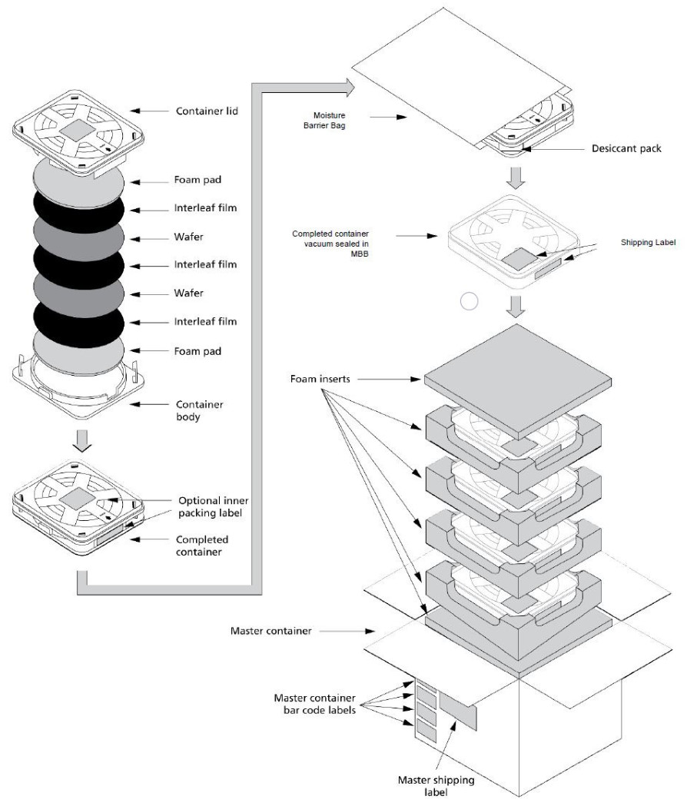
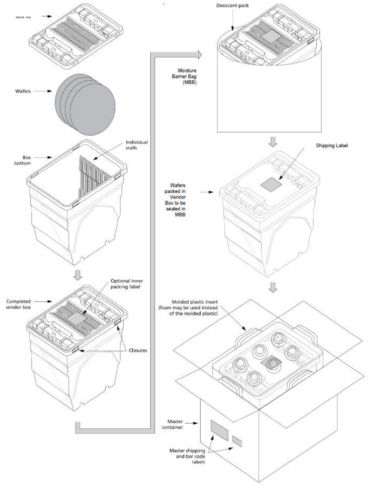
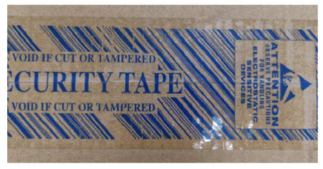
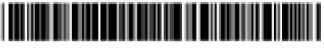
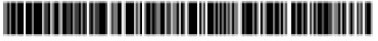
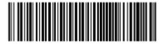
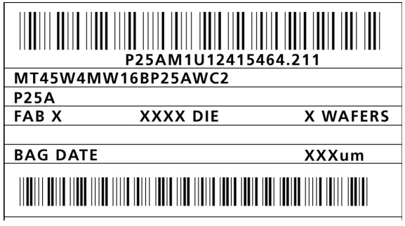
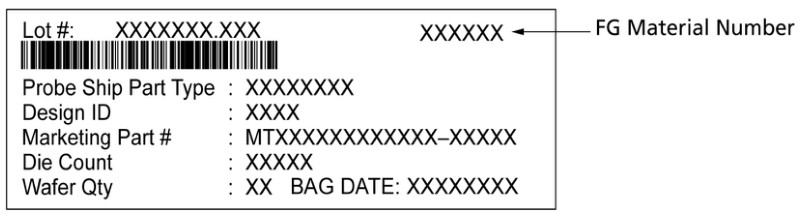
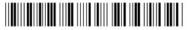

> 原文件：[S061c59d26d9d_micron.com_faqs.pdf](https://github.com/jadennevercode/CJCC-Knowledge-Base/blob/564ab11aa9785e569e3853c8a4d7ce86f88e7535/materials/%E5%9F%BA%E7%A1%80%EF%BC%9A%E8%A1%8C%E4%B8%9A%E6%9C%AF%E8%AF%AD%E4%B8%8E%E6%8C%87%E6%A0%87/S061c59d26d9d_micron.com_faqs.pdf)
> 转换方式：Volcengine OCRPdf v3, parse_mode=ocr

<!-- 原文第 1 页 -->

micron 
CSN-20: Wafer-Level Packaging and Packaging Materials Composition Introduction 
# Customer Service Note Wafer-Level Packaging and Packaging Materials Composition Introduction 
Whole wafers of Micron's DRAM, NAND Flash memory, and NOR are packaged according to specific procedures to help prevent damage during shipping. Micron uses two methods for packaging wafers, including horizontal wafer shippers and vendor boxes. Micron's wafer shipments also include various labels on the inner and outer packages to enable easy identification of contents and verification of orders. Packaging Materials Composition on page 12 provides complete shipping and recycling information about each of the materials used for shipping Micron wafers. 
Micron Technelogy. in. reseres the righ t change roduts o speftatios wthut oe C2005 Micren Technelogy Inc. Ait see 
Products and specifications discussed herein are for evaluation and reference purposes only and are subject to change by 
Micron without notice. Products are only warranted by Micron to meet Micron's production data sheet specifications. All information discussed herein is provided on an "as is" basis, without warranties of any kind.

---

<!-- 原文第 2 页 -->

micron 
CSN-20: Wafer-Level Packaging and Packaging Materials Composition Important Notes and Warnings 
## Important Notes and Warnings 
Micron Technology, Inc. "Micron") reserves the right to make changes to information published in this document, including without limitation specifications and product descriptions. This document supersedes and replaces all information supplied prior to the publication hereof.You may not rely on any information set forth in this document if you obtain the product described herein from any unauthorized distributor or other source not authorized by Micron. 
Automotive Applications. Products are not designed or intended for use in automotive applications unless specifically designated by Micron as automotive-grade by their respective data sheets. Distributor and customer/ distributor shall assume the sole risk and liability for and shall indemnify and hold Micron harmless against all claims, costs, damages, and expenses and reasonable attorneys' fees arising out of, directly or indirectly, any claim of product liability,personal injury, death, or property damage resulting directly or indirectly from any use of non-automotive-grade products in automotive applications. Customer/distributor shall ensure that the terms and conditions of sale between customer/distributor and any customer of distributor/customer (1) state that Micron products are not designed or intended for use in automotive applications unless specifically designated by Micron as automotive-grade by their respective data sheets and (2) require such customer of distributor/ customer to indemnify and hold Micron harmless against all claims, costs, damages, and expenses and reasonable attorneys' fees arising out of, directly or indirectly, any claim of product liability, personal injury, death, or property damage resulting from any use of non-automotive-grade products in automotive applications. 
Critical Applications. Products are not authorized for use in applications in which failure of the Micron component could result, directly or indirectly in death, personal injury, or severe property or environmental damage ("Critical Applications"). Customer must protect against death, personal injury, and severe property and environmental damage by incorporating safety design measures into customer's applications to ensure that failure of the Micron component will not result in such harms. Should customer or distributor purchase, use,or sell any Micron component for any critical application, customer and distributor shall indemnify and hold harmless Micron and its subsidiaries, subcontractors, and affliates and the directors, officers, and employees of each against all claims, costs, damages, and expenses and reasonable attorneys' fees arising out of, directly or indirectly, any claim of product liability, personal injury, or death arising in any way out of such critical application, whether or not Micron or its subsidiaries, subcontractors, r afliats were negligent in the design, manufacture, or warning of the Micron product. 
Customer Responsibility. Customers are responsible for the design, manufacture, and operation of their systems, applications, and products using Micron products. ALL SEMICONDUCTOR PRODUCTS HAVE INHERENT FAILURE RATES AND LIMITED USEFUL LIVES. IT IS THE CUSTOMER'S SOLE RESPONSIBILITY TO DETERMINE WHETHER THE MICRON PRODUCT IS SUTTABLE AND FIT FOR THE CUSTOMER'S SYSTEM, APPLICATION, OR PRODUCI. Customers must ensure that adequate design, manufacturing, and operating safeguards are included in customer's applications and products to eliminate the risk that personal injury, death, or severe property or environmental damages will rsult from failure of any semiconductor component. 
Limited Warranty. In no event shall Micron be liable for any indirect,incidental,punitive,special or consequential damages (including without limitation lost profits, lost savings,business interruption, costs related to the removal or replacement of any products or rework charges) whether or not such damages are based on tort, warranty, breach of contract or other legal theory, unless explicitly stated in a written agreement executed by Micron's duly authorized representative. 
CCMTD-1725822587-6188 csn_20-Rev.U06/2025 EN 
2 
Micron Technelogy, In.reserves the right to change products or specifications without notice. C2005Micron Technology, Inc..All rihts reserved.

---

<!-- 原文第 3 页 -->

micron 
CSN-20: Wafer-Level Packaging and Packaging Materials Composition Packaging Procedures 
## Storage Requirements 
Micron wafer products are packaged in a controlled environment for shipping. Upon receip, the customer should transfer the wafers to a similar environment for storage. Micron recommends the wafers be maintained in a filtered nitrogen atmosphere until removed for assembly. The recommended moisture content of the storage facility should be maintained at room temperature and relative humidity, and the product should be stored in the original moisture barrier bag packaging, which includes desiccant. Electrostatic discharge (ESD) damage precautions are necessary during handling. The wafer must be in an ESD-protected environment at all times for inspection and assembly. 
Under these conditions, customers can keep wafer products contained in horizontal wafer shippers or vendor boxes in storage for up to six months. 
## Packaging Procedures 
Micron's wafer shipments are packaged in horizontal wafer shippers or vendor boxes. In addition to its respective inner packing container, each shipping method includes the following: 
·Moisture Barrier Bag (MBB) 
·Interleaf 
·Foam inserts 
·Boxes 
·Desiccant 
·Packing labels 
## Horizontal Wafer Shippers 
Horizontal wafer shippers, also known as coin stacks, may be used to transport wafers with full thickness for 300mm wafers. They can hold up to 25 wafers with interleaves placed between each wafer for protection. 
Horizontal wafer shippers are vacuum sealed in an MBB and placed in a master container with internal padding for shipping. 
For specific packaging procedures, see Figure 1: Horizontal Wafer Shipper Packaging for 300mm Wafers on page 4. The same procedure should be followed for repackaging wafers in horizontal wafer shippers and returning them to Micron. For more information on returning wafers, refer to CSN-07,"RMA Procedures for Packaged Product and Bare Die Devices,"which specifies the process for requesting a returned material authorization (RMA). 
CCMTD-1725822587-6188 csn_20- Rev.U06/2025 EN 
3 Micron Technelogy. in.resenves the igt to change produts or speicactos without otie. C2005Micron Technology. Inc..All rihts reserved.

---

<!-- 原文第 4 页 -->

micron 
CSN-20: Wafer-Level Packaging and Packaging Materials Composition Packaging Procedures 
Figure 1: Horizontal Wafer Shipper Packaging for 300mm Wafers 
 
Notes: 1. This figure represents a (4-pack) master container. 2.Security tape is aded to ach outer shipping container (see Figure 3:Example of Shipping Container Security 
Tape: Added to Each Outer Shipping Container on page 7). 
CCMTD-1725822587-6188 csn_20-Rev.U06/2025 EN 
4 Micron Technelogy, Inc.reserves the right to change products or specifications without notice C2005Micron Technology, Inc..All rihts reserved.

---

<!-- 原文第 5 页 -->

micron CSN-20: Wafer-Level Packaging and Packaging Materials Composition Packaging Procedures 
Vendor Boxes 
Full-thickness wafers are shipped in vendor boxes that hold up to 25 wafers per box. Wafers are inserted vertically into individual stalls in the vendor box, which is securely closed and vacuum sealed. 
For 300mm wafers,a single front-opening shipping box (FOSB) is placed in a master container and then surrounded by molded plastic inserts or foam. Figure 2: Vendor Box Packaging for 300mm Wafers on page 6 shows how vendor boxes for 300mm wafers are packaged for shipping. 
Follow the procedure in Figure 2: Vendor Box Packaging for 300mm Wafers on page 6 for repacking and returning to Micron full thick wafers in vendor boxes. For more information on returning wafers to Micron, refer to CSN-07,"RMA Procedures for Packaged Product and Bare Die Devices,"which specifies the process for requesting an RMA. 
CCMTD-1725822587-6188 csn_20- Rev.U06/2025 EN 
5 Micron Technelogy. in.resenves the igt to change produts or speicactos without otie. C2005Micron Technology. Inc..All rihts reserved.

---

<!-- 原文第 6 页 -->

micron CSN-20: Wafer-Level Packaging and Packaging Materials Composition Packaging Procedures 
Figure 2: Vendor Box Packaging for 300mm Wafers 
 
CCMTD-1725822587-6188 
csn_20-Rev.U06/2025 EN 
6 
Micron Technelogy. in.reseres the igt to change produts or speicatos withutotie. C2005Micron Technology. Inc..All rihts reserved.

---

<!-- 原文第 7 页 -->

micron 
CSN-20: Wafer-Level Packaging and Packaging Materials Composition Shipping Labels 
Figure 3:Example of Shipping Container Security Tape: Added to Each Outer Shipping Container 
 
## Shipping Labels 
Shipments of Micron's whole wafers are identified by several shipping and bar code labels, which include the purchase order number, an inventory of the packaged contents, and the number of separate packages in each order. This section contains descriptions and examples of the labels that may appear on Micron's shipments. 
## Master Container Shipping and Bar Code Labels 
Micron attaches a standard shipping label, a standard bar code label, and a singulated die/wafer bar code label to all master containers used in whole wafer shipments. 
Refer to Figure 4: Standard Master Container Shipping Label on page 8 for details about the standard shipping label. 
Refer to Figure 5: Standard Master Container Bar Code Label on page 9 and Figure 6:Singulated Die/Wafer Master Container Bar Code Label on page 10 for information about the bar code labels. Micron affies a third label to the inner shipping containers, which is described in Inner Packing Container Labels on page 10. 
Figure 1:Horizontal Wafer Shipper Packaging for 300mm Wafers on page 4 and Figure 2: Vendor Box Packaging for 300mm Wafers on page 6 show the approximate placement of these labels for each wafer packaging method. 
## Master Container Shipping Label Information 
Micron's master container shipping labels include the following information: 
·Ship-from name:Micron's name and address 
·WB#: Courier waybill number 
·Child W/B: Waybil umber(s) for multiple piece() in shipment 
·Piece: Master container package count 
·PO#s: Customer purchase order number 
·Ship-to name: Customer's name and ship-to address 
·PKG ID: Invoice or packing lip number 
CCMTD-1725822587-6188 csn_20-Rev.U06/2025 EN 
7 
Micron Technelogy. in.resenves the igt to change produts or speicactos without otie. C2005Micron Technology. Inc..All rihts reserved.

---

<!-- 原文第 8 页 -->

micron 
CSN-20: Wafer-Level Packaging and Packaging Materials Composition Shipping Labels 
Figure 4:Standard Master Container Shipping Label 
Shipper Micron Shipping Plant Address City State/Province Zip Code Country 
Ship-to Company Name Address City StatelProvine Zip Code Country 
Fonwarder Company Name Address City StatelProvince Zip Cod Country 
HAWB: #### 
 
HAWB: 
 
Consol: 
Package Count: 1of 1 
CCMTD-1725822587-6188 csn_20- Rev.U06/2025 EN 
8 Micron Technelogy. in.resenves the igt to change produts or speicactos without otie. C2005Micron Technology. Inc..All rihts reserved.

---

<!-- 原文第 9 页 -->

micron 
CSN-20: Wafer-Level Packaging and Packaging Materials Composition 
Shipping Labels 
Figure 5:Standard Master Container Bar Code Label 
(3) PKG ID:424419177A1 
CONYX5 USTRIALO,LITD. 
GIFF Resores Logistis East Asa Inoustal Sillin 582 TUEN MUN HONG KONG 
 
710119 XIAN CHINA 34.3X 34.3X6.3 CM 
Xinxl Avene, coin Dithit 
13.3x 13.3x23Iln 
Zone B of Shaanxi Xian EPZ 
10F1 
Micron Semlconductor Xian Co LTD. 
PACKAGE COUNT: 
(Q) QUANTITY: 2000 
(1P)SPLR PROD ID:MT41K128M16JT-125:K 
(K) TRANID:MHK241118-PM-K2-F6 
(4L)0rigin Fab: US 
(P) CUST PART NO:MT41K128M16JT-125:K 
## PACKAGE WEIGHT 11.0 LBS/5.0 KGS 
SHIP DATE 04/21/2025 
Master Container Bar Code Label Information 
Micron's master container bar code labels include the following information: 
·Lot number, which is represented by the bar code at the top of the label 
·Micron's marketing part number, which is represented by the bar code at the bottom of the label ·Device ID 
·Fab in which the product was made 
·Quantity of individual die in shipment 
·Quantity of individual wafers in shipment 
·Date code, if designated 
·Wafer thickness, in microns 
CCMTD-1725822587-6188 csn_20-Rev.U06/2025 EN 
9 Micron Technelogy. in.reserves the igt to change produts or speicactos withut otie. C2005Micron Technology, Inc..All rihts reserved.

---

<!-- 原文第 10 页 -->

micron CSN-20: Wafer-Level Packaging and Packaging Materials Composition Shipping Labels 
Figure 6:Singulated Die/Wafer Master Container Bar Code Label 
 
## Inner Packing Container Labels 
Micron affixes a standard label to each shipment's Moisture Barrier Bag (MBB), shown in Figure 7 Horizontal Wafer Shipper Front-Side MBB Label on page 10. 
Micron also affixes a ael to the front-side of each horizontal wafer shipper container, shown in Figure 7: Horizontal Wafer Shipper Front-Side MBB Label on page 10. 
The labels may be affixed to the appropriate inner packing container as well Pigure 8: Standard MBB and Optional Inner Packing Container Label on page 11. 
Figure 7: Horizontal Wafer Shipper Front-Side MBB Label 
 
CCMTD-1725822587-6188 csn_20- Rev.U06/2025 EN 
10 
Micron Technelogy. in.resenves the igt to change produts or speicactos without otie. C2005Micron Technology. Inc..All rihts reserved.

---

<!-- 原文第 11 页 -->

micron 
CSN-20: Wafer-Level Packaging and Packaging Materials Composition Shipping Labels 
Figure 8:Standard MBB and Optional Inner Packing Container Label 
micron. 
Die Products 
 
Fab Facilty:FAB X Mktg Part No:MT45W4MW16BP25AWC2 Lot #:2415464.211 Wafers:X Die Qty:XXXX 
Bag Date:XXXXXX 
CCMTD-1725822587-6188 csn_20-Rev.U06/2025 EN 
11 
Micron Technelogy. in.reserves the igt to change produts or speicactos withut otie. C2005Micron Technology, Inc..All rihts reserved.

---

<!-- 原文第 12 页 -->

micron CSN-20: Wafer-Level Packaging and Packaging Materials Composition Packaging Materials Composition 
## Packaging Materials Composition 
Micron's wafer-level products are usually packaged using one of two methods: coin stack or vendor boxes. Where possible, Micron incorporates recyclable materials both in the internal packing materials and in the external coverings. The table below provides descriptions for the wafer-level packaging methods. 
Table 1:Wafer-Level Product Packaging Materials Note 1 apples to entire table. 
Element Description Notes
General
Boxes Material Corrugated fiberboard
Style RETT WDF (roll-end tuck-top with dust flaps) or RETT (roll-end tuck-top)
Color Natural kraft
Recyclable Yes
Labels Base material Matte-coated facestock or synthetic paper
Achesive Acrylic-or water-based adhesive
Recyclable No
Horizontal Wafer Shipper
Horizontal Material Conductive polypropylene 2
Wafer Shipper Surface resistivity <1x10112
Recyclable Yes
Interleaf Material Conductive polypropylene carbon black
OTHER Surface resistivity <1x10112
Recyclable Yes
Cushion Material Closed-cell polyethylene
PETE Surface resistivity Recyclable <1x1011 Yes
Vendor Box
Vendor Box Material Body case: polycarbonateLid: polycarbonateCarrier and upper holder: polybutylene terephthalateGasket: polybutylene terephthalate 3
OTHER Standards
Surface resistivity
Recyclable Reuse possible 
Notes: 1.Contact the factory for questions regarding omitted information. 
2. Applicable to product shipped in Horizontal Wafer Shipper only. 
3.Applicable to product shipped in vendor boxes only. 
CCMTD-1725822587-6188 csn_20-Rev.U06/2025 EN 
12 
Micron Technelogy, Ine.reserves the right to change products or specifications without notice C2005Micron Technology. Inc..All rihts reserved.

---

<!-- 原文第 13 页 -->

micron 
CSN-20: Wafer-Level Packaging and Packaging Materials Composition Revision History 
## Revision History 
Rev.U-06/2025 
·Under"Master Container Shipping Label Information" heading,deleted the final bullet and its subbullets. 
·Replaced image for Figure 5: Standard Master Container Bar Code Label. 
Rev.T-02/2025 
·Updated "Standard MBB and Optional Inner Packing Container Label"figure. 
Rev.S-12/2024 
·Updated to new Micron logo. 
Rev.R-03/2024 
·Under Horizontal Wafer Shippers heading, removed the Master Container Sizes table and revised Note I for Horizontal Wafer Shipper Packaging for 300mm Wafers figure. 
·Under Vendor Boxes heading, revised the first two paragraphs. 
·Under Packaging Materials Composition heading, revised the Wafer Level Product Packaging Materials table. 
Rev.Q-08/2023 
·Updated template. 
· Revised Horizontal Wafer Shippers, Vendor Boxes, Inner Packing Container Labels sections. 
Rev.P-12/2022 
·Updated Horizontal Wafer Shipper Packaging for 200mm Wafers figure. 
·Deleted Vendor Box Packaging for 200mm Wafers figure. 
·Updated Master Container Shipping Label Information. 
·Updated Standard Master Container Shipping Label figure. 
·Updated Standard Master Container Bar Code Iabel figure. 
·Updated Figure 9 title 
Rev.0-10/2019 
·Updated statement on page 1. 
·Updated template. 
·Updated doc ID number (PDF:09005aef812dc359/Source: 09005aef812dc282). 
Rev.N-09/2018 
·Added notes to Figures 9 and 10. 
Rev.M-07/2015 
·Removed CUST REV from Figures 8 and 9.....6.16 
·Removed Date Code from Figure10..........16 
·Updated box sizes and foam insert types for 300mmhorizontal wafer shippers 
·Updated Figures 8,9, and 10 
Rev.L-11/2013 
·Revised Storage Requirements section. 
CCMTD-1725822587-6188 csn_20-Rev.U06/2025 EN 
13 
Micron Technelogy. in.reseres the igt to change produts or speiactos withutotie. C2005Micron Technology. Inc..All rihts reserved.

---

<!-- 原文第 14 页 -->

micron 
CSN-20: Wafer-Level Packaging and Packaging Materials Composition Revision History 
Rev.K-10/2012 
·Added desiccant information. 
Rev.J-08/2011 
·Added security tape information 
Rev.I-03/2010 
·Added wafer-relevant packaging materials information from former CSN-17. 
Rev.H-06/2009 
·Updated template 
·Updated Figures 1 and 2 
·Updated Horizontal Wafer Shippers" on page 1 
·Updated "Vendor Boxes"on page 5 
Rev.G-03/2008 
·Added antistatic bag labels to Figures 1-4. 
·Added antistatic bag label references to text. 
Rev.F-01/2008 
·Changed 300mm wafer thickness from"305pm"to"full thcknes" in"Horizontal WaferShippers" on page 1 
Rev.E-11/2007 
·Added 300mm wafer packaging information to"Horizontal Wafer Shippers"on page 1. 
·Added Figure 2 on page 4. 
·Deleted film frame packaging option information. 
Rev.D-04/2007 
·Updated template. 
·Updated Figure I on page3. 
·Updated Figure 3 on page 6. 
·Added Figure 4 on page 7. 
·Added Figure 10 on page 10. 
Rev.C-03/2006 
·Updated illustrations to show vendor boxes packed sideways into master shipping container. 
·Updated container dimensions to show interior measurements. 
·Added Figure 7, Standard Master Container Bar Code Label, on page 9. 
·Updated all master container sizes and packing illustration. 
·Removed last "shipments of image sensor wafers also include face tape" from page 1. 
·Added "non-imager" to first sentence of Horizontal Wafer Shippers on page 1. 
·Changed first sentence of Vendor Boxes to "Full-thickness imager wafers of 750pm t25pum..o page 2. 
·Updated master container size on page 2. 
·Moved inner packing label to front of vendor box in figures 2, and 5. 
·Changed master container measurements to inches on page 5. 
CCMTD-1725822587-6188 csn_20-Rev.U06/2025 EN 
14 
Micron Technclogy Inc. reserves the right to change produts or specifications without notice. C2005Micron Technology. Inc..All rihts reserved.

---

<!-- 原文第 15 页 -->

micron 
CSN-20: Wafer-Level Packaging and Packaging Materials Composition 
Revision History 
·Removed Note 1 from page 4 
·Added single-vendor-box master container to figure 3. 
·Updated figures 7 and 8 with Customer Rev field and DigialClarity logo. 
·Updated bulleted list on page 10. Rev.B-09/2005 
·Deleted Detaping Image Sensor Wafers section, page 1 
·Added notes, Procedure for Returning Wafers in Film Frame Containers. 
·Updated Figures 8 and 9, pages 10 and 10. 
·Changed acceptable wafer thickness in orizontal Wafer Shippers section to 3200um. 
Rev.A-05/2004 
·Initial release. 
8000 S. Federal Way, P.O.Box6, Boise, ID 83707-0006 
208-368-4000,micron.com/support 
Micron and the Micron logo are trademarks of Micron Technology, Inc. 
All other trademarks are the property of their respective owners. 
CCMTD-1725822587-6188 csn_20-Rev.U06/2025 EN 
15 
Micron Technelogy, Inc.reserves the right to change produts or specifications without notice. C2005Micron Technology. Inc..All rihts reserved.
