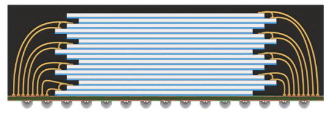
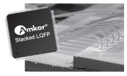
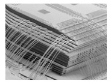
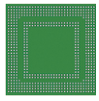
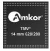

> 原文件：[S0f44c99be0b0_amkormarcomexterna_3DStacked_Die_TS104.pdf](https://github.com/jadennevercode/CJCC-Knowledge-Base/blob/564ab11aa9785e569e3853c8a4d7ce86f88e7535/materials/%E5%9F%BA%E7%A1%80%EF%BC%9A%E8%A1%8C%E4%B8%9A%E6%9C%AF%E8%AF%AD%E4%B8%8E%E6%8C%87%E6%A0%87/S0f44c99be0b0_amkormarcomexterna_3DStacked_Die_TS104.pdf)
> 转换方式：Volcengine OCRPdf v3, parse_mode=ocr

<!-- 原文第 1 页 -->

TECHNOLOGY SOLUTIONS 
## BENEFITS OF 3D PACKAGING 
The high growth and development of multiple 3D packaging technologies is due to the system level benefits provided, indluding: 
Size and weight reduction through more semiconductor functions per cm2 of PWB space and cm3 of application space 
Enables more design freedom to create innovative new form factors through volumetric packaging approach 
Enables improved electrical performance through shorter interconnect architectures with stacking 
Reduced system level costs 
Pb-free and environmentally conscious "Green material sets Flip chip plus wirebond mixed technology stacking Turnkey die,package assembly and test flow 
 
 
## 3D& Stacked Die 
Three-dimensional (3D) packaging technologies exploit the third or Z-height dimension to provide a volumetric packaging solution for higher integration and performance. 3D packaging has become critical to integrating the multimedia features consumers demand in smaller, lighter products. This increasing functionality requires higher memory capacity in more complex and efficient memory architectures. 
New product designs in automotive, industrial,high-end consumer, multimedia, wearables, loT and Al demand that these features be delivered in innovative form factors and styling. 3D packaging is experiencing high growth and new applications by delivering the highest level of silicon integration and area efficiency at the lowest cost. 
 
## 3D Packaging Innovation 
Since 1998,Amkor Technology has been a pioneer in developing and providing high volume, low-cost 3D packaging technologies. Amkor understands the benefits that 3D packaging provides and addresses a wide range of device combinations and end-product applications. 
A platform technology development through deployment approach was created to transcend the range of applications and packaging platforms requiring 3D technology.Customers continue to benefit from this approach as new 3D packaging solutions are more effectively qualified and ramped to high volume, at low cost and across multiple factories. 
The critical 3D platform technologies include: 
Design rules and infrastructure for thinner,high-density substrate technologies 
Advanced wafer thinning and handling systems Thinner die attach and die stacking processes High density and low loop wirebonding 
Cross section stacked memory chip

---

<!-- 原文第 2 页 -->

## 3D& Stacked Die Die Stacking 
 
Amkor's die stacking technologies are widely deployed in high volume manufacturing across multiple factories and product lines. Key features, including reliability, process and materials data are listed in the Stacked CSP data sheet (DS573).Customers rely on Amkor's turnkey and leading-edge capabilities in design, assembly and test to solve their most complex 3D packaging and time to market challenges. 
Next-generation die stacking technology includes the ability to handle wafers and die thinned below 30 um. It can then be reliably stacked and interconnected with up to 16 active dies, employing leading edge die attach, wirebond and flip chip assembly capabilities. 
Die stacking technologies have been demonstrated up to 24 die stacks, however, most stack ups greater than 9 die high use a combination of die and package stacking technologies to address complex test, yield and logistic challenges. 
Die stacking is also widely deployed in conventional leadframe-based packages indluding QFP, MLF and SOP formats. Leveraging Amkor's industry-leading infrastructure for high volume, low-cost leadframe production, system designers can achieve significant savings in PCB real estate and overall cost. 
## Package Stacking: Package-on-Package (PoP) 
Stacking of fully assembled and tested packages is an area where Amkor has provided significant innovation to overcome the technical, business and logistics challenges associated with complex die stacks. Amkor launched the popular Package Stackable Very Thin Fine Pitch BGA(PSvfBGA) platform in 2004.PSvfBGA supports single die,stacked die using wirebond or hybrid (FC plus wirebond) stacks and has been applied to Flip Chip (FC) applications to improve warpage control and package integrity through test and SMT handling. 
 
 
As microprocessors have transitioned to advanced CMOS nodes with higher speed cores and with higher I/O, there has been a transition from wirebond to flip chip die designs. Flip chip enables the use of an exposed die bottom package that integrates the package stacking design features of PSvfBGA in a fccSP assembly flow, which Amkor calls Package Stackable Flip Chip Chip Scale Package (PSfcCSP). PSfcCSP has a thin exposed FC die enabling fine pitch stacked interfaces at 0.5 mm pitch which is a challenge in a center molded PSvfBGA structure. 
Continued development resulted in Amkor entering the second generation of PoP applications where new memory architectures, required in mobile multimedia applications, demand higher density stacked interfaces in combination with PoP mounted area and height reductions. The previous PSvfBGA and PSfcCSP structures limited the ability of the memory interface to scale in density and pitch, resulting in the need for a new bottom PoP structure. 
Amkor developed new technologies to create the next generation PoP solution with interconnect vias through the mold cap, naming this technology Through Mold Via (TMV).TMv technology provides a stable bottom package that enables use of thinner substrates with a larger die-to-package ratio. TMV enabled PoP can support single, stacked die or FC designs. TMV is an ideal solution for the emerging 0.4 mm pitch lowpower DDR3, DDR4 and follow on memory interface requirements and enables the stacked interface to scale with solder ball pitch densities to 0.3 mm pitch or below. 
The next few years promise to provide many new challenges and applications for PoP,as communcations, artificial intelligence and networking applications continue to demand higher signal processing power and data storage capabilities. Amkor is committed to maintaining strong development and production capabilities to ensure we are at the forefront in meeting next-generation PoP requirements. 
Top view Bottom view 
 
Cross section views 
Visit amkor.com or email sales@amkor.com for more information. 
With respect to the information in this document,Amkor makes no guarantee or warranty of its accuracy or that the use of such information will not infringe upon the intellectual rights of third parties. Amkor shall not be responsible for ary loss or damage of whatever nature resulting from the use of,or reliance upon it and no patent or other license is implied hereby.This document does not in any way extend or modify Amkors warranty on any product beyond that set forth in its standard terms and conditions of sale.Amkor reserves the right to make changes in its product and specifications at any time and without notice. The Amkor name and logo are registered trademarks of Amkor Technology,Inc. Al other trademars mentioned are property of their respective companies @2019Amkor Technology, Incorporated. Al Rights Reserved.TS104I-EN Rev Date: 03/19
