> 原文件：[S133efa2f55d9_amkormarcomexterna_SiP_TS101.pdf](https://github.com/jadennevercode/CJCC-Knowledge-Base/blob/564ab11aa9785e569e3853c8a4d7ce86f88e7535/materials/%E5%9F%BA%E7%A1%80%EF%BC%9A%E8%A1%8C%E4%B8%9A%E6%9C%AF%E8%AF%AD%E4%B8%8E%E6%8C%87%E6%A0%87/S133efa2f55d9_amkormarcomexterna_SiP_TS101.pdf)
> 转换方式：Volcengine OCRPdf v3, parse_mode=ocr

<!-- 原文第 1 页 -->

TECHNOLOGY SOLUTIONS 
## APPLICATIONS 
RF and wireless devices >Power amplifiers, front-end module, antenna switch, cellulan handset, cellular infrastructure, 5G NR, Sub-6 GHz,mmWave and Antenna in Package (AiP/AoP) loT, wearables/hearables and Machine to Machine (M2M) 
Fine pitch flip chip and copper pillar 
Double side assembly Test development and production test 
Turnkey solution 
Manufacturing excellence 
BLTe, Wi-Fi, UWB, LTE-M &NBloT; controller and mixed-mode devices 
Automotive applications 
Infotainment and sensory modules 
Power modules 
DC/DC converter, PMIC, battery management and others 
Computing and networking 5G networking,infrastructure and data center 
Passive components 
Pre-packaged 
Wirebond Stacked die 
 
## System in Package 
Semiconductor industry demands for higher levels of integration and lower costs coupled with a growing awareness of complete system configuration have continued to drive the popularity of System in Package (SiP) solutions.Amkor's SiP state-of-art design rules is an ideal solution in markets that demand miniaturization with increased functionality.By assembling,testing and shipping millions of SiP devices per day, Amkor Technology has a proven track record as the industry leader in SiP design, assembly and test. 
## What Is a System in Package? 
Amkor Technology defines advanced SiPs as multicomponent, multifuncion products in an IC package.They require high-precision assembly technologies, which leverage Amkor's strengths. 
Size reduction & ultra-thin package 
Thin substrate with core and coreless using finer line and spacing 
Conformal and compartmental shielding 
Low filler size for mold underfill 
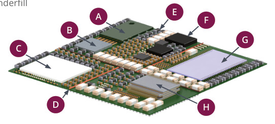 
MEMS 
WLCSP 
Flip chip 
Compartmental shielding 
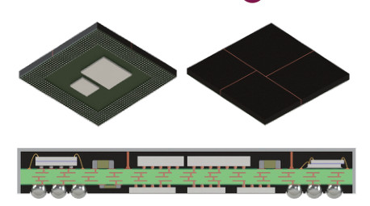 
Top and bottom side assembly, molding,conformal and compartmental shielding

---

<!-- 原文第 2 页 -->

## System in Package Technology Markets for System in Package 
System in Package technology allows multiple advanced packaging technologies to be combined to create solutions customized to each end application. Laminate-based SiP technology is a front runner solution and the most popular SiP solution for cellular, loT,power, automotive, networking and computing system integrations. 
 
Mobility 
 
Power Management 
 
loT 
 
Mixed-Mode Technology 
 
Automotive 
 
Computer & Networking 
## SiP Platforms and Solutions 
Amkor's emphasis is on functional integration and size reduction by using different package form factors and interconnect technologies, including: 
Thin substrate,core and coreless substrate, recessed and cavity substrate 
Double sided assembly DSBGA 
Embedded passive & active components 
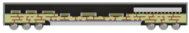 
Partial molding and partial conformal shielding Connector,antenna and partial mold & shield 
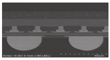 
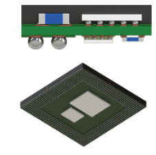 
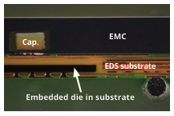 
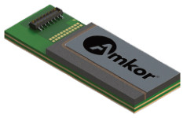 
## Sputtering conformal shielding and compartmental conformal shielding 
Double sided mold DSMBGA 
Passive components (01005,008004) 
D Amkor developed an exceptional sputtering shielding technology to solve electromagnetic radiation effects among electronic components within SiP components and surrounding environment with excellent electrical and magnetic shielding performance 
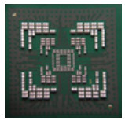 
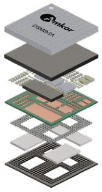 
Compartment shielding with Cu wire 》 Wire cage 》 Wire fence 》Vertical wire 
 
 
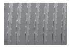 
Wire cage 
Wire fence Vertical wire

---

<!-- 原文第 3 页 -->

## System in Package Technology 
## Near Field Conformal Shielding Performance Measurements From 100 MHz to 6 GHz 
Unshielded SiP Unshielded DUT -Ex magnitude maximum radiation 
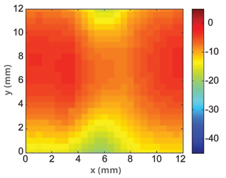 
SiP With Sputter Conformal Shielding 3 um Cu- Ex maximum radiation 
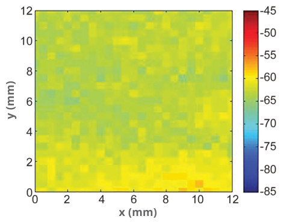 
AiP/AoP (5G NR) SiP Solutions 
Millimeter wave radio design with beam forming and array antenna will be used in varieties of advanced SiP products for 5G cellular system. Millimeter electromagnetic wave design is imposing a new challenge for the system designers, components and SiP packaging engineers. 
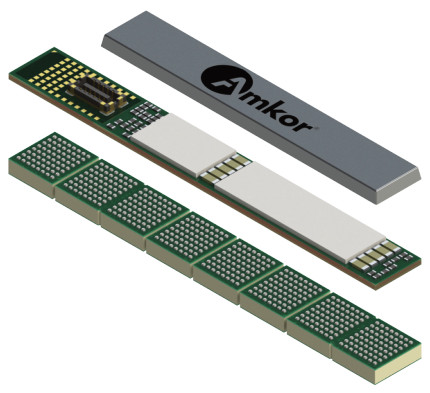 
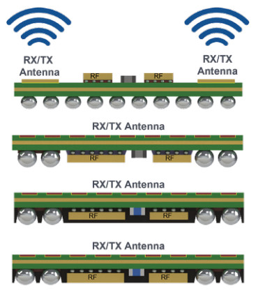 
Key Amkor Packaging Technologies for AiP/AoP 
Greater than 40 GHz achieved Compartmental shielding using vertical and gage wires Partial (selective) conformal shielding Partial molding Substrate layer counts: Up to 14 layers Low loss and low dielectric constant substrate

---

<!-- 原文第 4 页 -->

## System in Package Technology 
## Thermal Mechanical and Electromagnetic Characterization and Design Considerations 
Warpage optimization 
DModule level and strip level warpage 
DWarpage at room temperature and reflow temperature 
Stress analysis 
Die,bump,substrate stress analysis 
Correlate to FA to help root cause analysis and correction options 
BLR characterization 
Board level temperature cycle life performance prediction 
Die attach delamination stress analysis 
Material properties measurements induding CTE, modulus, Tg, Theta JA, Theta jB and Theta jC 
Accelerated failure testing 
Electromigration as function of temperatur, time current and interconnect 
Bend and drop testing 
Die strength and stress 
Surface mount assembly support 
Failure and reliability analysis 
Thermal simulation and air flow effects 
## Advanced SiP Testing 
As part of its complete SiP design solution, Amkor has developed expertise in RF and digital testing, including test system software/hardware development and manufacturing test. 
Comprehensive test services that complement wafer level and package assembly 
Amkor is the #1 RF test services supplier for Sub-6 GHz 
Ongoing joint efforts with test qguipment suppliers and customers to enable 5G product production testing Amkor has a vast array of test capabilities and rich experience in device testing 
Ofers an extensive equipment fleet and continues to invest in new capabilities required to test the latest devices

---

<!-- 原文第 5 页 -->

# System in Package Technology 
## Manufacturing Excellence 
Amkor's Center of Excellence for substrate-based SiP technology is located in our largest volume manufacturing facility in K4 Gwangju, South Korea The large-scale manufacturing capabilities in K4 factory can achieve significant volume production support with very high yields with short cycle times 
Latest advanced technology that supports high speed,high-accuracy chip and component placement 
Amkor's SiP design rules are the most advanced in the industry and are available to customers through a web portal access system 
Amkor production lines have full automation,in-line inspection, RFID control and other process control methods to ensure the highest yields and quality while minimizing any potential loss of bill of material (BOM) components 
Ultra-high-speed SMT placement machines with leading-edge component placement accuracy for best quality and lowest cost 
Flexible placement machines are ideally suited for odd-form component placement 
Capability to place any common component format available in tape and reel format down to and indluding the smallest 008004 size 
Capability of mounting bumped die directly from wafer tape 
Support for solder paste stencil printing,flux stenci printing or flux dipping processes 
Automated 100% in-ine optical inspection of solder paste to reduce BOM component loss 
Support for all common RoHS/Green compliant solder alloys 
Amkor supports Enginering Build Requests (EBRs) on dedicated rapid-turn "New Product Introduction" lines 
D The lines are exactly the same as the highvolume manufacturing lines 
D Seamless NPI transfer to production 
D Large number of rapid-turn EBRs to facilitate R tuning of the parts 
Close collaborative process with customers 
## Supply Chain Management 
Supply chain considerations play a major factor in the success of SiP product realization and impact both design and manufacturing.To optimize the complete SiP process, Amkor has expanded its traditional supply chain expertise into passive components, and other parts not traditionally found in the package assembly environment. As a result, Amkor can manage the supply chain to ensure successful SiP development and production. 
## SiP Technologies From Amkor 
System in Package is the modular design approach offering unprecedented flexibility in product development. The end user benefits from a faster time-to-market include reduced ycle times for system design, lower development risk compared to SoCIC development, flexibility, tuned functional performance, and, ultimately, a lower overall cost of ownership. 
Amkor has developed an extensive toolset to maximize circuit density and address the sophisticated packaging formats required to productize 5G applications - such as double-sided assembly,embedded die in substrate, thin film RDL & dielectrics, and various types of RF shielding. This toolset,combined with extensive SiP capacity and AiP/AoP technology, uniquely positions Amkor to serve customers who want to outsource the challenges and high investment associated with combining multiple ICs with advanced package assembly and test technologies for 5G networks. 
Amkor's SiP technology is an ideal solution in markets that demand smaller size with increased functionality. By assembling,testing and shipping more than one million SiP devices per day, Amkor Technology has a proven track record as the industry leader in SiP design assembly and test.Contact Amkor today and let us add you to our growing list of customers enjoying success with System in Package technology. 
 
 
Visit amkor.com or email sales@amkor.com for more information. 
With respect to the information in this document,Amkor makes no guarantee or warranty of its accuracy or that the use of such information will not infringe upon the intellectual rights of third parties. Amkor shall not be responsible for ary loss or damage of whatever nature resulting from the use of,or reliance upon it and no patent or other license is implied hereby.This document does not in any way extend or modify Amkors warranty on any product beyond that set forth in its standard terms and conditions of sale.Amkor reserves the right to make changes in its product and specifications at any time and without notice. The Amkor name and logo are registered trademarks of Amkor Technology, inc, A t rarcamars mentioned are property of their respective companies. @2022 Amkor Technology, Incorporated. Al Rights Reserved.TS101T-EN Rev Date: 02/22
