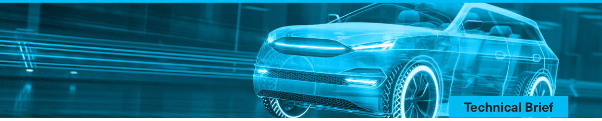
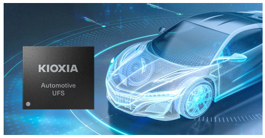

> 原文件：[S1365c3911348_americas.kioxia.co_KIOXIA_Auto_UFS_Error_History_.pdf](https://github.com/jadennevercode/CJCC-Knowledge-Base/blob/564ab11aa9785e569e3853c8a4d7ce86f88e7535/materials/%E5%9F%BA%E7%A1%80%EF%BC%9A%E8%A1%8C%E4%B8%9A%E6%9C%AF%E8%AF%AD%E4%B8%8E%E6%8C%87%E6%A0%87/S1365c3911348_americas.kioxia.co_KIOXIA_Auto_UFS_Error_History_.pdf)
> 转换方式：Volcengine OCRPdf v3, parse_mode=ocr

<!-- 原文第 1 页 -->

KIOXIA 
 
## Technical Brief Series: Automotive UFS Explained 
## Part 1: Error History with Under the Hood Reliability and Recovery Features 
This technical brief is for automotive developers who need shorter development cycles to maintain market competitiveness. in recent years, automotive manufacturers have implemented strategies such as platorm sharing across multiple vehicle models and component reductions to improve development efficiency. Universal Flash Storage (UFS) devices contribute to this efieny by providing several valuable features that accelerate the debugging process and shorten the overall development timeline. 
Error History is one such UFS feature and the focus of this technical brief. This brief is the first of a two- part series titled,"Automotive UFS Explained"The second part will cver the High-Speed Link Startup Sequence (HS-LSS)and extended WriteBooster featres and their benefits for U automotive applications. 
## Introduction 
Error History was first introduced in the UFS v3.0 specification (released by JEDEC" in 2018) to simplify system integration and id in debugging failures by providing the host system with a record of a device's operational history. Used as a diagnostic too, rror istory enables the logging and retrieval of commands,link level events and errors for in-system debugging. t acts like an aircraft fight recorder and logs data which contains past error information that was stored within the UFS device.Traditionally,when unexpected errors occurred during development or validation, the UFS device typically had to be returned to the NAND flash memory vendor for failure analysis. However, as presented in this technical brief, Error History allows users to extract internal UFS device information without physically removing it from the printed circuit board (PCB) 
## Error History Data Retrieval 
To transfer accessible log data to the host using the Error History feature requires the SCSI READ BUFFER command. The Command Descriptor Block (CDB) structure of the SCSI READ BUFFER command is shown to the right: 
Specifying 1Ch in the 'Mode field activates the Error History feature.When the 'Buffer ID:" Buffer Ofset and'Allcation Length' fields are specified, the necessary data from each field can be retrieved. As implementation details for these parameters may vary by NAND lash memory vendor,contact KIOXIA America, Inc. Automotive Sales for specific parameter settings. 
Important Note: The data obtained from the SCSI READ BUFFER command is in an encrypted binary format that cannot be analyzed by the user This retrieved data can be submitted to KIOXIA America, In.Automotive Sales for analysis. 
CDB Structure -SCSI READ BUFFER Command 

| | Bit | | | | | | |
| --- | --- | --- | --- | --- | --- | --- | --- |
| Byte | 7 | 6 | 5 | 3 | 2 | 1 | |
| 0 OPERATION CODE(3Ch) | | | | | | | |
| 1 | | RESERVED | | | MODE(1Ch) | | |
| 2 | BUFFER ID | | | | | | |
| 3 | MSB | | BUFFER OFFSET (000000h) | | | | |
| 4 | | | |
| 5 | | | LS8 |
| 6 | MSB | | ALLOCATION LENGTH LSB | | | | |
| 7 | | |
| 8 | | |
| | CONTROL (00h) | | | | | | |
 
MS- Moat Sipnficnt Bic LSR- LestSpniceat Ble 
Used with permission from KIOXIA Corporation

---

<!-- 原文第 2 页 -->

Technical Brief 
## Device Failure Analysis 
Device failure analysis is the primary use case for the Error History feature.Error History provides a device status assessment and other clues, such as a history of abnormal thermal or electical tres tat were aplid o the dce.rThe tre ca a be ue t ineigte hether nintende suden power interruptions occurred. 
In-system debugging is a key facet of the Error History feature that provides a logged historical record of device operations. The error history can be analyzed by KIOXIA to identify device behavior just before the error occurred,as well as any communication issues or other abnormal behavior. These capabiltie make it easier to pinpoint the root cause of problems and deliver a much faster diagnosis than traditional failure analysis that requires time to retrieve the device, et t on an pensive, xternal protocol analyer and then analyze the resuts.The Eror itry atre s r yusu o ranginif lm originated from an invalid host request or from an internal device malfunction. 
A major advantage of using the Error History feature is the ability to perform analysis comparable to traditional failure analysis methods while the UFS remains mounted on the PCB. Traditional failure analysis requires the physical removal (desoldering) of the UFS device from the PCB, which applies unnecessry thrmal stress to te deie and could aiter the ste ot the aid nit, aking o cuoe alsis fitiuitli i t te r it eliminates these risks 
## Under the Hood Error History Capabilities 
There are several use cases for the Error History feature, but a few of the top ones include: 
## Performance Degradation Analysis 
The Error History feature is effective for analyzing device performance drops during validation. There are many factors that cause performance degradation such as internal UFS background operations (ie, garbage collection, wear leveling,bad block management). Analyzing the error log makes it possible to determine how internal device operations may have impacted device performance. 
 
## Communication Error Analysis 
The M-PHY"(Mobile PHY) high-speed, low-power serial communicatin standard is the physical interface for connecting UFS devices and automotive processors, and is regarded for its efficiency, scalability and support for very high data rates.Errors in a device's M-PHY layer are often masked by communication retries and do not surface immediately. Analyzing the error log makes it possible to detect degradation in signal quality possibly caused by hardware design issues. 
## System Reliability Analysis 
The Eror Histry atr ales nasis co momrrepore rcros amdcesainn r ee re e er. optimize hardware signal quality and improve overall system reliability. 
## Summary 
The Error History feature acts like an aircraft fight recorder and logs data which contains past error information stored within the UFS device.It llowsusers to extract internal UFS device information without physically removing if rom the PCB. This feature delivers efective, short term analysis and troubleshooting which significantly contributes to improving development timelines and automotive application efficiency. 
KIOXIA can provide a UFS Utity Too tat operates in Android" or Linuenvironments to retieve Error History data. Contact KIOXIA America, Inc. Automotive Sales to request this tool 
General information about KIOXIA memory products is available here 
KIOXIA Copyright 2026 KIOXIA America, Inc. All rights resred. Techical Briel Sere utomotive UFS Explained "Part 1: Eror Hitory wih nder the Hod Relisit n Recovery Festure March 2026 | Rev.1.0 
2

---

<!-- 原文第 3 页 -->

Technical Brief 
FOOTNOTES: 
iveral Flah Storage [UFS) device are bad on the U pecilicain of which the .1 pecilicetion is the curet ele iued by JEDE and announce in January 202 TRADEMARKS: 
ia& DISCLAIMERS: 
KIOXIA 
Copyright 2026 KIOXIA America,Ing.All rights reserved. Technical Brie Serie Automotive UFS Explained |"Part 1: Error History with Under the Hood Relisbility and Recovery Festure"| March 2026| Re. 1.0 
3
