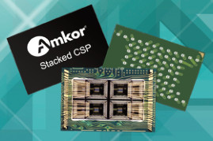
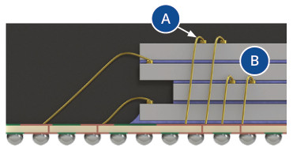
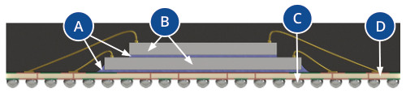
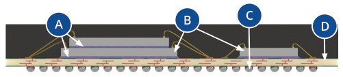
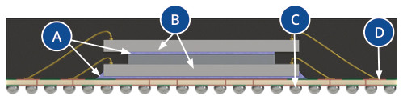
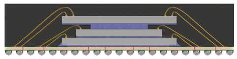
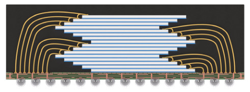
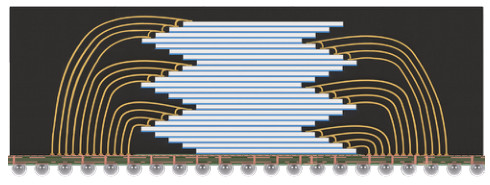

> 原文件：[S39b7b33fbdaa_amkormarcomexterna_StackedCSP_DS573.pdf](https://github.com/jadennevercode/CJCC-Knowledge-Base/blob/564ab11aa9785e569e3853c8a4d7ce86f88e7535/materials/%E5%9F%BA%E7%A1%80%EF%BC%9A%E8%A1%8C%E4%B8%9A%E6%9C%AF%E8%AF%AD%E4%B8%8E%E6%8C%87%E6%A0%87/S39b7b33fbdaa_amkormarcomexterna_StackedCSP_DS573.pdf)
> 转换方式：Volcengine OCRPdf v3, parse_mode=ocr

<!-- 原文第 1 页 -->

 
## FEATURES 
## 2-21 mm body size 
Package height down to 0.5mm High die count pure memory, eMMC, eMCP and MCP 
Design, assembly and test capabilities that enable stacking of DRAM with logic or flash memory devices 
Logic/Flash, digital/analog and other ASIC/memory combinations of 320 1/O and greater 
Established package infrastructure with standard CABGA footprints 
Consistent product performance, high yields and reliability 
JEDEC standard outlines including MO-192 and MO-219 
Thin DA film and spacer technology, FoW and FoD 
Extended die overhang wirebonding 
Low loop wirebonding less than 35 um 
Vacuum transfer and compression molding 
Wafer thinning/handling to 25 um Pb-free, RoHS compliant and green materials 
Passive component integration options 
 
## DATA SHEET | LAMINATE PRODUCTS 
## Stacked CSP (SCSP) 
The Stacked CSP family leverages Amkor's industry-leading ChipArray Ball Grid Array (CABGA) manufacturing capabilitie. This broad, high-volume infrastructure enables the rapid deployment of advances in die stacking technology across multiple products and factories to achieve lowest total cost requirements. 
Stacked CSP technology enables the stacking of a wide range of different semiconductor devices to deliver the high level of silicon integration and area efficiency required in portable multi-media products. 
Stacked CSP utilizes high-density thin core substrates, advanced materials (i.e, thin film die attach adhesive, fine filler epoxy mold compound),along with leading-edge wafer thinning, die attach, wirebonding and molding capabilities to stack multiple devices in a conventional fine pitch BGA (FBGA) surface mount component.These advanced assembly capabilities in combination with Amkor's expertise in design and test, enable stacks up to 16 active devices while optimizing yield and mounted height requirements. 
Customers have relied on Amkor to solve their most complex and highest density device stack combinations. As a result, Amkor has established industry leadership in stacking pure memory, mixed signal and logic + memory devices, including NAND, NOR and DRAM memory, digital base band or applications processors + high density flash or mobile DRAM devices. Designers are looking to Stacked CSP technologies to achieve a high level of integration, along with size and cost reductions in future chip set combinations. 
## Applications 
SCSP is the best solution to address a range of design requirements, including: 
Higher memory capacity and more efficient memory architectures Smaller,lighter and more innovative product form factors Lower cost and more space efficiency 
## Reliability Qualification 
## Package Level 
Moisture sensitivity characterization: JEDEC level 3 @260°C; additional test data at: [(30°C/85% RH, 96 hours)+260] x2 or3 HAST: 130°C/85% RH,96 hours Temp/Humidity:85°C/85% RH, 1000 hours Temp cycle:-55°/+125°C, 1000 cycles High temp storage: 150°, 1000 hours 
## Board Level 
Thermal cycle:-40°/+125°, 1000 cycles

---

<!-- 原文第 2 页 -->

## Stacked CSP (SCSP) 
## Process Highlights 
Diquantity stack: Up to 24high die configuration 
Ball pad pitch: 0.3, 0.4, 0.5,0.65, 0.75,0.8mm 
Die thickness (min): Down to 25 pm 
Laminate core thickness:40, 50,60, 100 or 150 pm 
Ball diameter: 0.25, 0.30,0.40,0.46 mm 
Die bond pitch (min):35 m(in-line) with roadmap to 25 um Wirebond length (max):5 mm(200 mils) 
Solder ball 
Wirebond diameter (min):15, 18,20,25,30pm 
Dielectric 
Low loop wirebonding:35 pm 
Wafer thinning:200&300 mm wafers 
## Standard Materials 
Package substrate 
Dielectric: Laminate(e.g.DS7409,E679, BT polyimide (e.g., Kapton) > Layer count(laminate):2-6 Die attach: Film DA compatible with all passivation types 
>Wire type:Ag,Gold,Cu,PCC,high tensile strength 
>Encapsulant: Thixotropic epoxy (black) 
Solder balls:63 Sn/37 Pb& Pb-Free Sn/3-4 Ag/0.5 Cu 
Solder ball 
Device type:Slicon, SiGe,etc. 
Dielectric 
Marking: Laser 
## Stacked CSP Key Technologies 
 
Solderball 
Low loop wirebonding 
Dielectric 
Film on wire 
## Stacked CSP Cross Section 
2Die On 2-Layer Laminate Structure 
 
Die attach film/paste 
B Top and bottom die 
## Stacked CSP Cross Section 
2+1 Die On 4-Layer Laminate Structure 
 
Die attach film/paste 
B Bottom and side die 
## Same Size (SS) Die Stacked CSP Cross Section 
2 Die On 2-Layer Laminate Structure 
 
A Die attach film/paste 
Top and bottom die 
## Stacked CSP Cross Section 
3+1 Logic+ Memory 

---

<!-- 原文第 3 页 -->

## Stacked CSP (SCSP) 
Stacked CSP Cross Section 16+0 Die Memory 
 
Stacked CSP Cross Section 24+0 Die 3D Memory 
 
Visit amkor.com or email sales@amkor.com for more information. 
 
With respect to the information in this document,Amkor makes no guarantee or warranty of its accuracy or that the use of such information will not infringe upon the intellectual rights of third parties. Amkor shall not be responsible for ary loss or damage of whatever nature resulting from the use of,or reliance upon it and no patent or other license is implied hereby. This document does not in any way extend or modify Amkors warranty on any product beyond that set forth in its standard terms and conditions of sale Amkor rserves the right to make changes in is prout andspecifications at any im and without otic.Th mkor name and logo are registered trademarks of Amkor Technology, in.,A ter radramars mentioned are property of their respective companies. @2019Amkor Technology, Incrporated.Al Rights Reserved.DS573M-EN Rev ate: 08/19
