> 原文件：[S7247b9bc8744_download.semicondu_SSD_Virtualization_Expanding_R.pdf](https://github.com/jadennevercode/CJCC-Knowledge-Base/blob/564ab11aa9785e569e3853c8a4d7ce86f88e7535/materials/%E5%9F%BA%E7%A1%80%EF%BC%9A%E8%A1%8C%E4%B8%9A%E6%9C%AF%E8%AF%AD%E4%B8%8E%E6%8C%87%E6%A0%87/S7247b9bc8744_download.semicondu_SSD_Virtualization_Expanding_R.pdf)
> 转换方式：Volcengine OCRPdf v3, parse_mode=ocr

<!-- 原文第 1 页 -->

## White Paper 
SSD Virtualization: Expanding the Role of SSDs in Modern System Architectures 
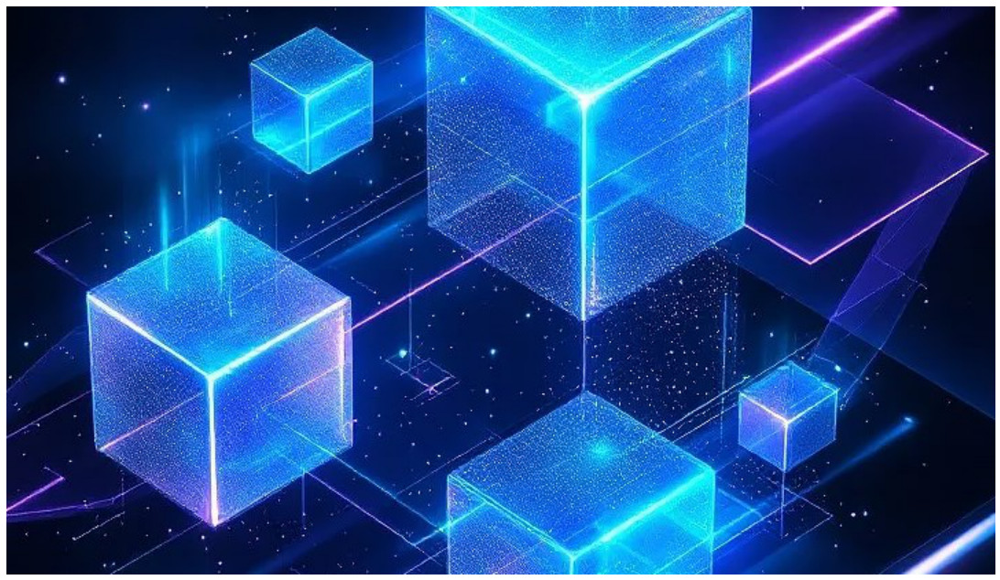 
May 2026

---

<!-- 原文第 2 页 -->

## Legal Disclaimer 
## Copyright2026 Samsung Electronics Co,Ltd. Confidential.All rights reserved. 
This document has been prepared by Samsung Electronics Co,Ltd."samsung". The contents of this document are the property of Samsung,protected by applicable laws and non-disclosure agreements between samsun and you or your employer,as applicale. You are strictly prohibited from,including,but not limited to dsclosing,opying,eproducing,istributing,transmitting,modifying, rebroadcasting,re-encoding,re-presenting, ploiting,or creating derivative works of this document or any partsof this document without the prior written permission from Samsung. 
The contents of this document are provided for informational purposes only.No representation or warranty (whether express or implied) is made by Samsung or any of its officers, advisers,agents, or employees as to the accuracy, reasonableness or completeness of the information, statements,opinions,or matters contained in this documen, and they are provided on an "AS-I5" basis. Samsung will not be responsible for any damages arising out of the use of, or otherwise relating to, this document. Nothing in this document grants you any license or rights in or to information, materials, or contents provided in this document, or any other intellectual property. 
The contents of this document may also include forward-looking statements. These forward-looking statements include all matters that are not historical facts, as wellastatemens regarding Samsung's intentions, belies and crrent epectations concerning, among other things, market prospects, growth, strategies,and the industry in which Samsung operates. By definition, forward-looking statements involve risks and uncertainties because they relate to events and depend on circumstances that may or may not occur in the future.Samsung hereby reminds you that forward-looking statements are not guarantees of future performance and that the actual developments of Samsung,the market,or the industry in which Samsung operates may differ materially from those made or suggested by the forward-looking statements contained in this document or in the accompanying oral statements.In addition,even ft the information contained herein or the accompanying oral statements are shown to be accurate, those developments statements may not be indicative of future developments. 
All contents in this document may be subject to change without notice. Without limiting the generality of the foregoing, 
1.All design, features and specifications represented herein may change without notice; 
2. Images shown here have been adjusted for demonstration purposes and may appear differently on the actual products; 
3. All data on products herein, including their performances,are based on internal testing using standard Samsung benchmarks under laboratory conditions. Test results do not guarantee future performance under such test conditions,and the actual throughput or performance that any user will xperience may vary depending upon many factors; and 
4.All images on screen are simulated, except where otherwise noted. 
BY CONTINUING TO ACCESS THIS DOCUMENT, YOU ARE DEEMED TO HAVE READ, UNDERSTOOD, AND AGREED WITH THE FOREGOING TERMS AND CONDITIONS.

---

<!-- 原文第 3 页 -->

## Introduction 
When striving to maximize the exploitation of big data, storage virtualization is highly effective in optimizing the underlying infrastructure through differentiated data access. Virtualization is critical to enabling differentiated acess to stored data, and its importance is increasing as the data availability needs for artificial intelligence (AI) and machine learning (ML) grow.Even though training large language models (LLMs)is putting the spotight on the thirst for data in Al processing,the need for differentiated data access has existed for guite some time. 
This article discusses the advances in storage virtualization for NVMe@ SSDs, focusing on recent extensions to the NVM Express specification that enance data access dffentatio.Tracking LBA Allocation and Live Migration (LM) assist a virtual machine manager (VMM) or hypervisor (HV) in moving virtual machines (VMs) from a source enclosure to a target enclosure.LM includes Virtualized Reporting, which allows each VM to perceive a unique VMM-controlled version of the storage environment and also standardizes irtualized component creation.lexible Data Placement (FDP) allows th host to optimize data writes to void efficiency-draining garbage collections - reducing the impact of a noisy neighbor. Both virtualized reporting and FDP are features with broad enough flexibility to allow their deployment toward multiple different virtualization goals.Finally, Quality of Service (QoS)in the context of an SSD relates to sharing available bandwidth in a predictable way among users. 
## Motivation 
Storage virtualization is the abstraction and presentation of access to sored data with attributes that differ rom conventional access toa drive dedicated to a single user. Because virtualization enables an altered view into the access of the tored dat,is tost ffr sa diversity of potential uses by its very nature.For example: 
When seeking to improve distributed access,virtualization might be used to presenta large capacity SSD as several smaller SSDs for improved divisibility to the host. 
. 
If emphasizing security concerns, a parent(e.g., a VMM) may wish to limit command availability to an unprivileged child (e.g. a VM) 
. A host concerned with performance may prefer that a new SSD mimic the performance of an old SSD. 
Yet another implementation might need to share SSD performance among several different host tenants. 
Many aspects of the storage control environment can be virtualized.For example: 
PCI Express(PCle) layer attributes can be virtualized in single root /0 virtualization (SR-IOV) with physical and virtual functions. 
NVMe controllers can be virtualized using primary and secondary controllers, The administration of the NMe SSD may be allocated to the primary controller and limited or emulated to the secondary controller. 
Performance virtualization -letting users perceive performance characteristics as f eah were the sole user- is achieved through data separation or resource partitioning. 
Anecessary component of transferring a M rom source to destination is the ability to provide a itualized value overlay to attributes such as NVM subsystem,controller,namespace identifiers,and key management 
All of these virtualization aspects require defined and consistent mechanisms for effective utilization and adoption.

---

<!-- 原文第 4 页 -->

## Background 
Virtualized access to stored data has existed for decades.Examples of building blocks for virtualization that have come into existence over the years are plentiful. 
Virtualization Building Blocks. For the SSD virtualization described here,PCle transport is assumed and is using an NVMe protocol Layer. 
PCle layer attributes can be virtualized with SR-lov, which presents a virtual function (VF) as if it were a physical function (PF). The VF can emulate the PF capabilities without replicating the full P,.conserving controller gate area and power. VFs can also be used to limit the ability of a child host entity to change the settings of the PCle device. 
Thelater introduction of NVMe resource management of primary and secondary controllers was needed to distribute the limited ASIC features to the child controllers associated with each VF. 
Dual port access and namepace (NS) reservation have been enabled in HDDs for decades and carry forward int VMe SSDs. They have been key contributors to ease of differentiated access to stored data and provide useful tools for the yirtualization toolset 
Many NVMe over Fabric (NVMe-OFITM) instantiations are at the forefront of virtualization due to the broad deployment environments, large amount of stored data accessible through these interfaces,flexibility of the software (SW) implementation for new features,and the varying levels of integration to the sw layers consuming the stored data. 
NVMe SSDs are beginning to use the building blocks of HDD virtualization and NVMe-ofF. However, it is only recently that usage models for several of the virtualized attributes have solidified to the point where the virtualization techniques can be committed to hardware. 
Tenants. Virtualization can be thought of as enabling a limited or replaced view of storage access provided to a tenant. A tenant may take many forms, each of which is composed of SW and/or hardware (HW) components. 
Software - A SW process may be a tenant. For example, a fles ystem () can be separated into SW processes that manage end user reads,end user writes,FS reads,FS writes,etc.Applications,containers, or VMs may also each be identified as a tenant. 
Hardware - Some tenants may be composed of or identified by HW components. Groupings such as a CPu processor, CPU core(s),CPU thread(s), an FPGA,aGPu,raGPU partition (warp or wavefront) can all be considered as tenants. 
A tenant may comprise a mixture of the HW and SW components.The definition of a tenant is necessarily broad because the deployment options for virtualization are nearly ininite. 
## Yesterday: Software-Based Virtualization Approaches 
The longstanding need for virtualization has, up until recenty, been implemented primarily in host software. Fast host processors, slow storage access, and drive sharing among a limited number of tenants have allowed software implementation of virtualization to be sufficient for many years 
Avirtualization example is shown in Figure , with the VMM overlaying and controlling the entire system from the host. The VMM administers and sets up the SD with a different namespace for each VM, and implements sw boundaries between the VMs. 
From the NVMe point of view, the accesses to the storage by a VM might allow some minimal inspection or manipulation of the submission queue entries (SQEs) by the VMM.Additionally, dorelisare commonly intercepted by the VMM prior to triggering the doorbell on the SsD. The VMM fully controls the administrative path. In the event of the VM attempting to submit an admin command, the VMM may local esrond egy. comand not Supported), passthe comand through to the sso leg,.ceate N),o nipuate the command to the SSD(e.g. Identify Controller and Identify Namespace).

---

<!-- 原文第 5 页 -->

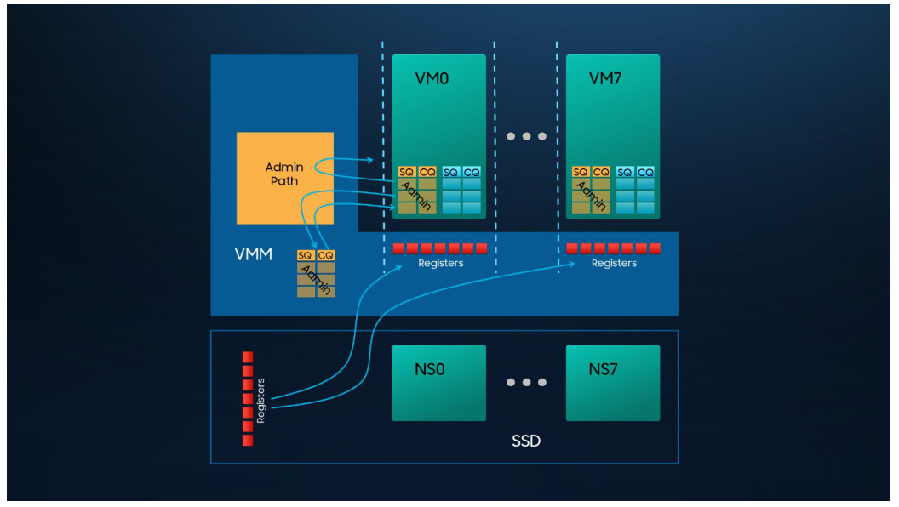 
Figure 1. VMM overlaying and controlling the entire system from the host 
Using software to implement virtualized access to storage brought real advantages: 
·Virtualization was achieved quite effectively, as demonstrated by the longstanding success of this method. 
During a time when virtualization was imature and developing a very ynami set of neds aig teti techniques was very easy within the Sw. 
·This rapid update capability also enabled deploying and testing of exotic or advanced features. 
However, the advantages started to become outweighed by the challenges: 
Host CPU cycles and DRAM access time taken by the VMM deprived the VM of those cycles.Since every interaction with the VMM takes time, elays to the VM became quite measurable as the speed of storage increased. VM resource efficiency suffered as well. 
As security became more of a concern, the software-enacted VMM was seen more and more as a potential attack vector for bad actors. 
Finally,there was a practical imit to th amount of diffrentatio among tenants within the SSD. A good example is the noisy neighbor problem: A conventional SS receives lltfriftfo tehat ie tgether,therefore,it must route all icoming wrte data to the same pend point.In hs sario mtsenia $(WAF=1)$ tenants can appear towite rdamy t the SSD due to the intermingling of the at, d it t yu en tn rgrg di connn tenant's data - effecting a clear loss of differentiation. 
As a result, the need to move virtualization to the SSD hardware became critical. 
5

---

<!-- 原文第 6 页 -->

## Today: Hardware Virtualization for SSDs 
Moving the virtualization to the SSD facilitates an improved experience: 
For end customers, tighter performance and atency nees commonly breaking under 100ps) can better be met with bare metal access to the SSD. 
The stability of the virtualization needs over the past few years reduces the advantages of deploying test features. 
With security requirements increasing,virtualization in the SSD moves the security into HW where the attack surface is reduced. 
An SSD that is given the tenant information is able to propagate desired behaviors all the way through to the storage medium. 
In consideration of the functionality needed to move a software-based virtualization approach onto bare metal, new hardwarespecified features have been added to the virtualization toolbox. 
The following virtualization features are central to the discussions in this blog: 
·Flexible data placement (TP4146 Flexible Data Placement) 
·Tracking LBA allocation (TP4165 Tracking LBA Allocation) 
·Live migration of a namespace (TP4159 PCle Infrastructure for Live Migration) 
·Live migration of a controller (TP4193 PCle Exported NVM Subsystems Migration 
## Virtualization through Data Placement 
The theory of data placement is that the host manages the logical blocks written to a given superblock in the SSD, such that it can efficiently"place" updated blocks and invalidate old ones in a way that reduces or eliminates the need for the SSD controller to waste cycles on GC. The mechanism implemented through TP4146 Flexible Data Placement provides the host the ability to control the write amplification factor (WAF) in the SSD, achieving even a WAF of 1 in some cases. 
The flexible data placement (FDP) mechanism allows the host to control which logical blocks are written into a set of NAND blocks, called a reclaim unit (RU), that is managed by the SSD. The host is able to select among multiple Rus, allowing it to isolate data written to a given RU per application (or even within an application) in order to separate data written with different life cycles ("hotvs. "cold"data temperature: data that changes frequently or data that rarely requires updates). 
Data placement is considered a key technique in virtualizatin ecause the separation of data enables separation of WAF. FDP Can be set up toward this goal as shown in Figure 2, which is showing mutiple VMs managed by a VMM. The FDP-enabled SSD has one reclaim group (RG), and the RU size is striping the data across all ft the AND available. Frthermore,the reclaim unit handle (RUH) types supported by this example SSD are all persistently isolated (PI)- that is, they will be unaffected by garbage collection in other RUHs. 
1 Interoperb igration f iralStps//mexprss.og/nbling-ssd-ifaatinandiemigration-hme-pcieexprd-nm-subystems

---

<!-- 原文第 7 页 -->

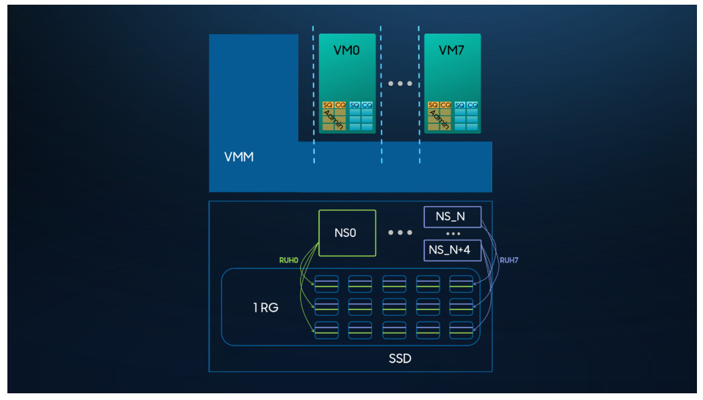 
Figure 2. Multiple VMs managed by a VMM 
During operation, when a VM decides to create an NS, the Create NS command is routed through the VMM (which is controlling the admin path to the SSD), The VMM alters the command to create an NS with a default RUH populating the placementidentifier IPI) it Figure 2 is showing Mo creating NS0,and NS0 in turn using RUHO to write data striped across the NAND. VM7 is illutraed with mutiple namespaces, with each assigned to VM7 using the same RUH7. All f the rai tf Mm wl le wit tgther to tesame RUH,independent of the NS. If a tenant successful pacs writs to eep a WAF of , then it will never triger garbage collection of its RUH and ultimately perceives higher sequential performance. On the other hand, a tenant that does not optimize for a WAF of 1 will trigger GC - but with persistent isolation, the GC traffic will affect only the data associated with this RUH. 
Persistently isolated RUHs have the benefit of isolating all of the GC activity for the RUH. By aligning a given tenant to a single RUH, the triggering of any GC activity relates solely to the activity of that tenant - thereby minimizing both the movement of data on the physical NAND and the loss of any WAF optimization for the tenant. 
GC activity stil apens witin the driv,o there wil sti t sore contetion as the GC of other RUHs reads data from some locations and writes it to others., wowever, this activity is not cusingthe nosy neighbor data movement of any other tenant.

---

<!-- 原文第 8 页 -->

## Virtualized Resource Reporting 
Virtualzed reporting enables a VM to receive values from the ssD,but under control of the VMM. The manipulated values provided by virtualized reporting let a VM read any value through its curated view of the SSD. Recall that in the software implementation of virtualization, the VMM took away CPU ycles to effect a command intercept.Virtualized reporting provides the key benefit of freeing up those cycles. In addition,by taking the VMM out of the command path it better supports the security needed for a confidential computing environment. 
Virtualized reporting in NVMe SSDs is achieved with TP4193 PCle Exported NVM Subsystems Migration.This TP adds a feature set enabling an exported NVM subsystem to change the reported controller and namespace identifiers, as well as other attributes, according to a template. 
NVM Subsystem Abstraction.Applying the capabilities shown in Figure 3 to a hypothetical system like that in Figure 1 provides a good demonstration of the use of virtualized reporting to abstract an apparent subsystem.Assume: 
The SSD supports SR-lov,and controller G is the primary controller associated with the physical function (PFO). 
The MM accesses the SSD through primary controller G, and manages all of the underlying components through interactions with the primary controller. 
·The VM accesses the SSD through one of the secondary controllers on one of the virtual functions (VFs). 
The scenario is based on the parent being a VMM and child being a VM, but the capabilities are extensible to other scenarios. 
permanently globally unigue for the Ss. However, some VMs may expecto interact with a predetermined controller Hand namespace Controller P and namespace X are both underlying resources in the SSD. Their identifications are assigned by the SSD, and they are Y. Potentially, one VM could expect to see and use the identical ID value to that being expected and used by another VM-but these overlapping IDs would violate the requirement for all IDs to be globally unique. 
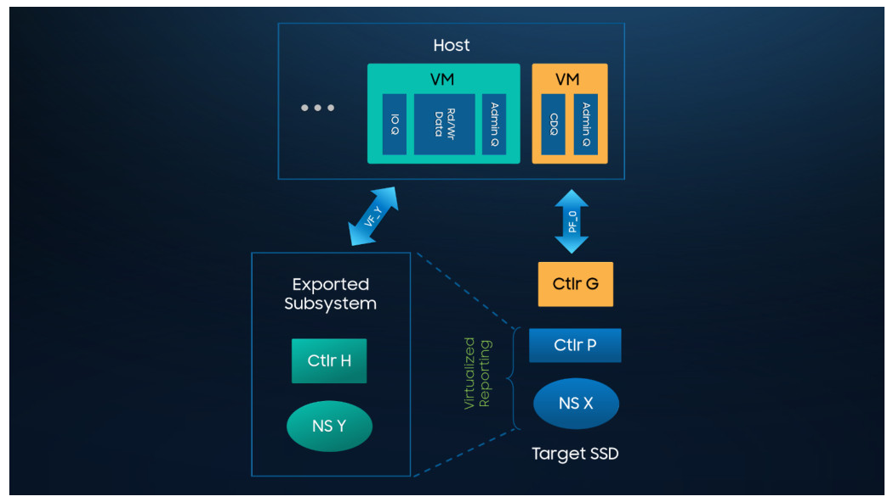 
Figure 3. Applying the capabilities shown to a hypothetical system (like that in Figure 1) 
2NMe lnteroperble Migration of PCle irtual SSs,.tps/w.pacompute.org/events/past events/2025-cp-global-summitstorage

---

<!-- 原文第 9 页 -->

To resolve this situation,the VMM creates an exported NVM subsystem in which it assciates underlying resources controller and namespace X. The VMM then utilizes a template to change the reporting of the controller and NS attrbutes within the scope of the exported NVM subsystem, as well as to possibly modify or restrict the functionality of the exported controller. As the VM interacts with the exported NVM subsystem through the VF, it will have a curated view of the reported values. 
Other Uses. The example focused on changing the reporting of a controller and NS identifier values. However,an exported NVM subsystem is a very extensible virtualization building block.The feature uses a lightweight template to set defaut values for all exported NVM subsystems using that template, as a group, and the curated view may extend to numerous NVMe features such as controller capabilities, tog page interactions,and other extensive interactions with the SSD through the exported controllers iew of the drive. 
## Live Migration Support 
Virtualized reporting enables an abstraction of the storage reported values to make storage interchangeable.Building on this capabilit, the host could in fact move the tenant to a different storage device altogether.The mechanism is addressed in TP4159 PCle Infrastructure for Live Migration. 
With a VMM managing several VMs as shown in Figure 1, there may be an occasion for the data center to move where the VM is running. Perhaps the data center moves the Ms in order to redistribute the system load, or the VM may be moved in response to a failed resource in the data center infrastructure.For these use cases, one must enable the migration of a VM from a source system to a target system.However,an end user is expecting to continue uninterrupted operations within the VM. The need for continuous VM operation turns the requirement into live migration (LM) of the stored data on the SSD. 
The system setup is ilutraed in Figure 4, which shows VMMs on both the source and target hosts that are responsible for implementing the data center management and orgnization within ach nclosure.The two VMs may coordinate to copishther 
shared goals.Also shown is a currently running VM using a secondary controller Y to access ts data stored in an NS. 
The NMe live migration capabiltis an be sed to move the stored data and accesing rsruture to ifntrgr system and SSD. 
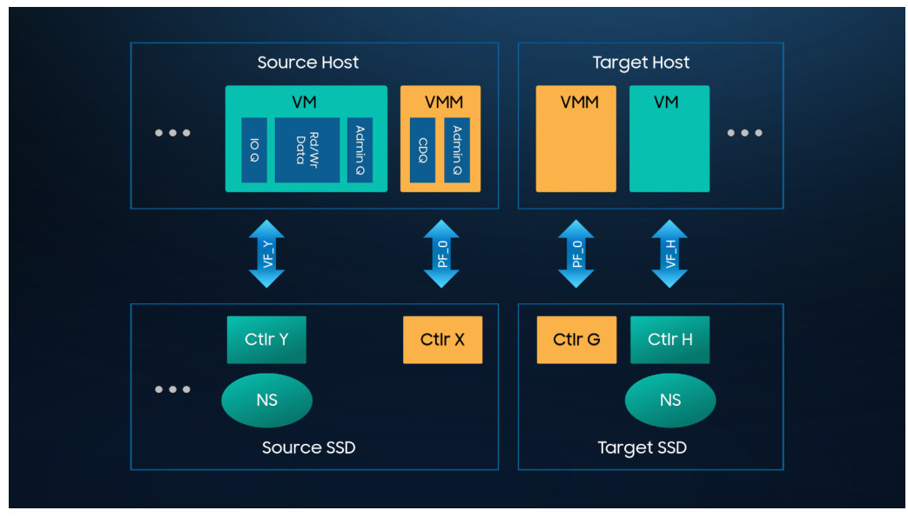 
Figure 4.VMMs on source and target hosts responsible for implementing data center management and organization within each enclosure

---

<!-- 原文第 10 页 -->

Procedure. The process of lie migration involves copying a snapshot of the source namespaces to the target, while at the same time logging ongoing commands that would change the source snapshot so that they can be reflected on the target copy. The steps are described below. 
While not explicitly discussed here, it becomes readily apparent in this scenario that the seamless command and data movement capabilities of NVMe-oF across networks would expedite the process steps listed. 
1.Initialization.Using virtualized reporting, the process starts with the creation of an exported NVM subsystem and initialization of the values that will be reported to the VM in the target system.For example,the controller ID and NS ID will be set to the same values as the source system. 
2. Send Start Logging Command. The next step is to begin moving the data. While this might be very slow due to the potentially large quantity of stored data accessed by the VM, the VM expects to continue interacting with the data on the source SSD. As shown in Figure 5, the LM process begins with a Start Logging command being sent from the VMM to the primary controller. The VM is unaware of this command, and it continues inputs/outputs (1/0s) with the secondary controller to read or write its data. Meanwhile, the primary controller receives and parses the Start Logging command. 
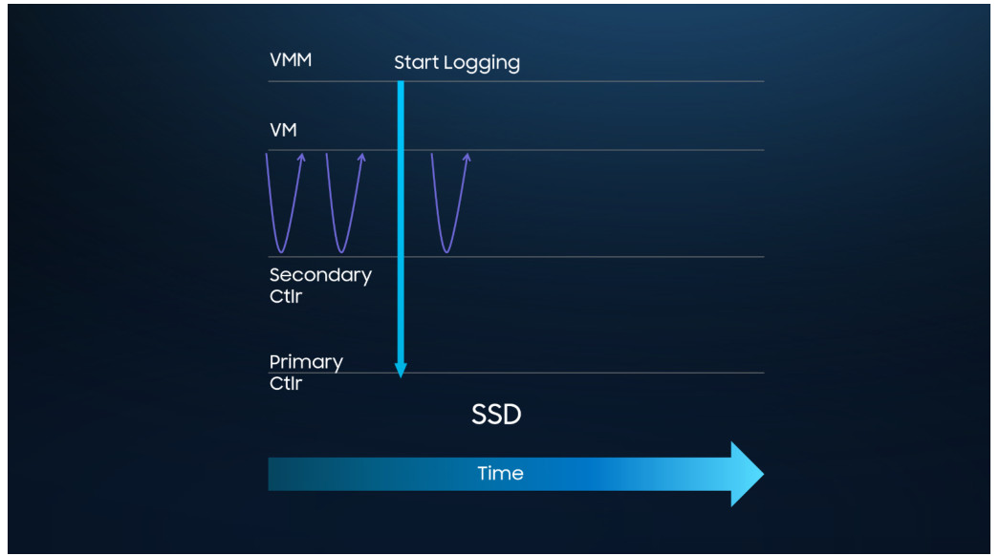 
Figure 5. The LM process begins with a Start Logging command being sent from the VMM to the primary controller 
3.Logging Begins. The primary controller wil bein nggg lut ir e u he oo hngropupl te gre colored IOos. However, the implementation of the logging with respect to commands that are already in flight is unknown. Red Lines illustrate that both short- and long-lived commands from the VM may be in fight during the initiation of the logging by the primary controller. 
10

---

<!-- 原文第 11 页 -->

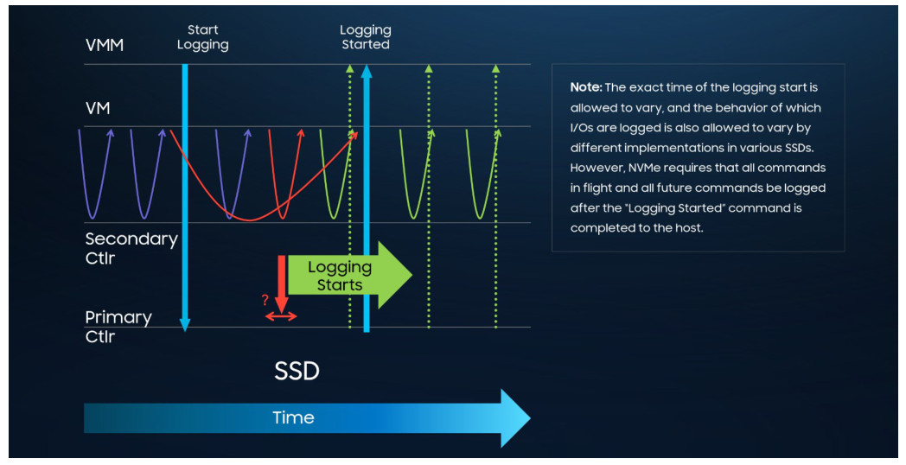 
Figure 6. The primary controller will begin logging by the l/0s changing from purple to green colored I0s 
With the assurance that all future completing commands from the VM will be logged, the VMM is able to proceed to the next step in the LM process. 
Move Snapshot of Data.The VMM proceeds to moving a current intial sasho f the stored data over to the target SSD. One option for moving the data is to copy the entire NS from the source SSD to the target SSD. However,this may be inefficient if the NS is sparsely written. 
Figure 7 illustrates a sparsely written NS. The black lines indicate ranges of logical block addresses (LBAs) that contain data,and the white spaces are deallocated. For this sprely writen N, te VMM can take advantage of the Get LBA Status command of the tracking LBA allocation feature to query the SSD.The primary controller has a granularity attribute,and it will return which granularities contain data. Only the granularities containing data need to be read from the source and written to the target SSD. Optionally,the VMM may submit large reads to the contiguous regions. 
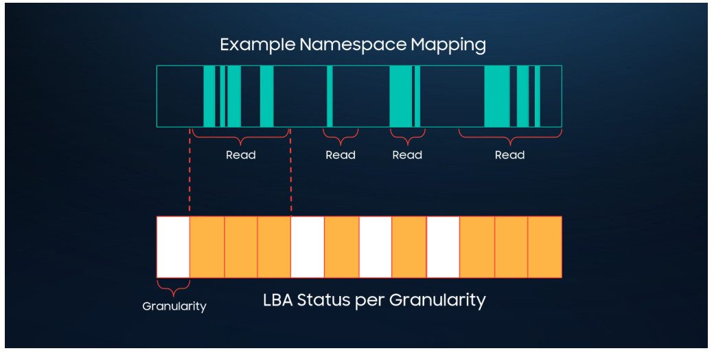 
Figure 7. A sparsely written NS 
11

---

<!-- 原文第 12 页 -->

5.AssesStatus. igre shows the currnt yse stus o te mrationT he w is contin to senr reasand witsto the SSD through its secondary controller. Th primary controller is continuing to log applicale commands to the migration log in the VMM. Since the transfer of the initia data rom the source NS to the target NS took time, it is ieyu the comand data queue (CDQ) has accumulated a large number of logged commands. The initial capture of the NS data is likely to have changed. 
The VMM is able to parse the log entries in the CDQ to understand which LBAs in the source NS have been written.For each modification of the sore Ns the M wilb bt eo e ead to the re sana w ee s t te will catch up to the ongoing changes occurring within the VM's NS, and there will be a small number of changes sent to the source NS. 
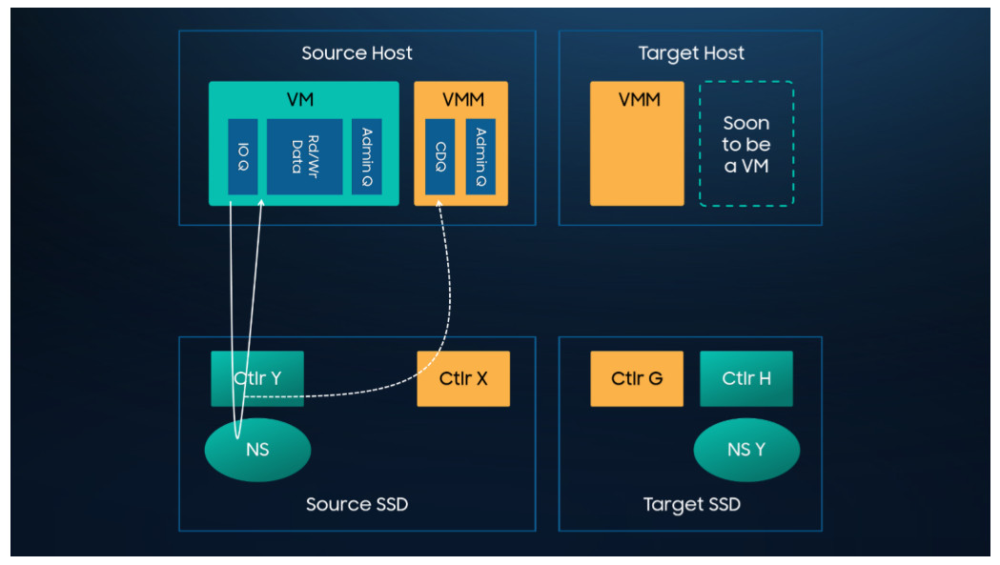 
Figure 8.Current system status of the migration 
6.Stop and Copy. Once the number of changes occuringt a source Ns fals lowsome threshold,the VM will intit the stop and copy phase of the LM.Figure 9 shows this process. The VM continues to send I/Os to the secondary controller,and the primary controller continues to log any applicable interactions. 
The vMM sends the Suspend command to the primary controller, which in turn stops the secondary controllef rom fetching any more commands from the VM. All commands that were in flight continue through until they are completed. Once the primary contrller recognizes that all comands have been completed and all completion queue entries from the secondary controller are returned to the VM, then the primary controller is able to complete the Suspend command. 
In this state,the source SSD will kep the secondary controller frozen and not fetch any further commands,and the primary controller will be ready in case a Resume command comes from the VMM. This Resume command is only expected if some error condition occurred in the exterior parts of the live migration. 
12

---

<!-- 原文第 13 页 -->

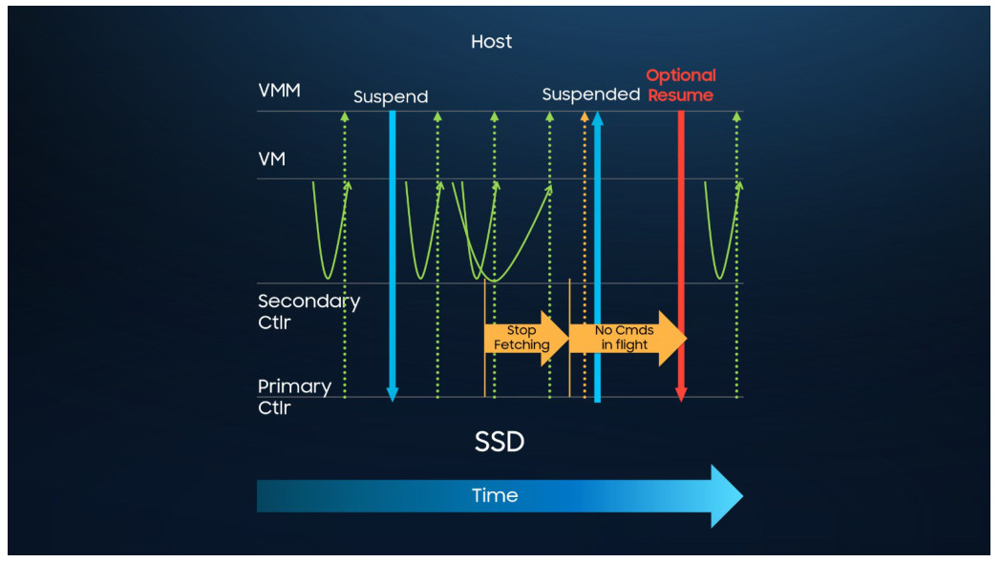 
Figure 9.VMM initiating the stop and copy phase of the LM 
With the secondary controller in a suspended state,the VMM can complete the live migration. All rmaining CDQ entries will be parsed. All utstanding changes to the source NS will be read by the VMM through the primary controller. A f he hanges will be written to the target NS on the target SSD. Outside of the scope of the SSDs,the VM process will be migrated from the source host to the target host. 
Additionally, the VMM will isue Get Subsystem State to controller X in order to read the current state of the child subsystem.The child subsystem state will include the controller Y state,the associated namespaces,and other subsystem attributes.The subsystem state at the destination will be written with Set Subsystem State sent to controller G in order to initialize the controller H state.The combination of the initialized exported subsystem and this Set Subsystem State will together define all reporting provided to the VM on the target system from controller H. 
There has been an abilit to set some controller state settings with a similar flow using Get Controllr Sate and written using Set Controller State.However,the Get Subsystem State and Set Subsystem State flows described here are now recommended as a superset of capabilties. 
## Tracking LBA Allocation 
A host system needs to distinguish between LBAs on a storage device that are actively in use (allocated) vs. those that are free. TP4165 Tracking LBA llocation addresses this need,Uuse of this fature was highlighted in the Move Snapshot of Data step of the Live Migration discussion. 
13

---

<!-- 原文第 14 页 -->

## Future: Open Challenges and Future Directions 
Data placement, virtualized reporting,LBA allocation tracking,and live migration constitute powerful virtualization techniques and went a long way toward completing the irtualization toset one implemented and tie, owever,a ew remaining issus t be addressed became apparent. 
## Fair Resource Allocation in RUH-Optimized and Non-Optimized Environments 
While data placement serves to let the host actively participate to achieve a low WAF, it does not insulate a given tenant from the behavior of others. 
By way of example, onsider a host with three tenants using an SSD as shown in Figure 10. Assume tenant 1 and 2 are perfect WAF=1 tenants: perhaps they are both writing a circular buffer. But tenant 3 is writing randomly with very poor WAF. The good news is that in today's SSDs,the reads from all tenants will generally be prioritized above all other trafic, But when writes are considered, performance is not quite prfectly virtualized. 
Tenant 1 is using RUH 1, and the data is successfully placed on the NAND compacted together; tenant 2 using RUH 2 shows similar sucess. Tenant 3 using RUH 3 has the incoming data written compactly,but because the LBAs are written in random order, the data at rest on the NAND is randomly invalidated. The data placement for tenant 3 is not optimized, and any writes by tenant 3 will trigger GC in the drive in order to free up space for more writes to come in. 
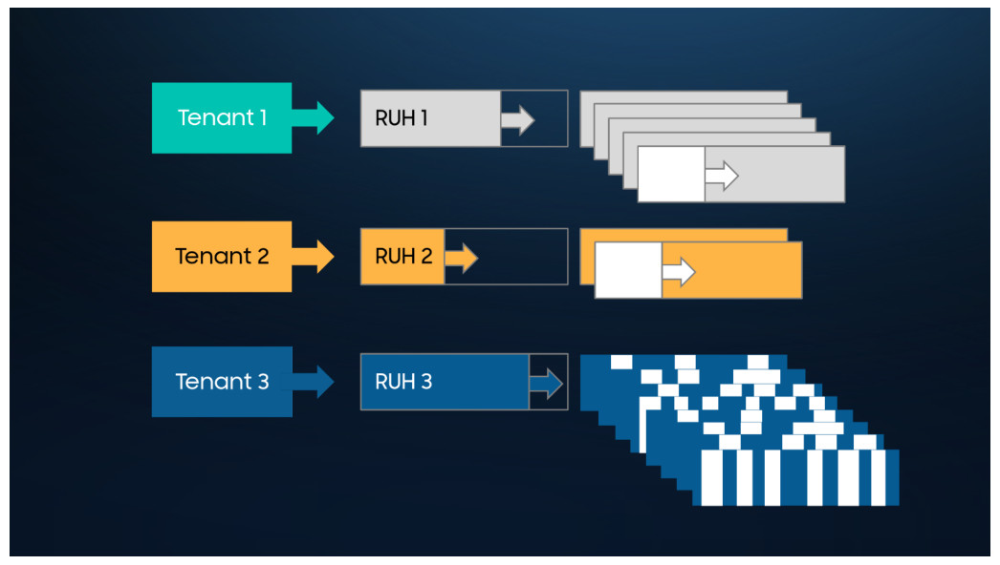 
Figure 10. Tenants using FDP for data separation 
14

---

<!-- 原文第 15 页 -->

## Quantifying Performance Impact 
With this interior state of the NAND, we can describe the maximum possible performance for each of the tenants. Tenants 1 and 2 have a max achievable performance equal to the sequential performance of the SsD. Tenant 3 has a max achievable performance equal to the random write performance of the drive. If one were to assume a WAF of 5 for this scenario,then the maximum random write performance can roughly be approximated as 1/5 the value of the sequential write performance. 
These performance expectations of each tenant operating individually mirror the performances SSD users experience with a single tenant using a conventional SSD. One might claim that the SSD is successfully virtualized, which is true if the measure is achieving a WAF behavior that mimics one tenant active at a time on a conventional SSD. Writes, deallocates, and WAF behavior of the FDP SSD may match expectations. 
However, these three tenants may be operating at the same time on a shared SSD. If tenants I and 2 are active at the same time, then their performances drop from their maximum down to 50% of this value. Ideally, tenants should not be aware of being virtualized - but this is an easily detectable performance hit Similarl,if l thents are atve corurenty,then tnats 1 and 2 will nly receive approximately 10 - 20% of their maximum performance because tenant 3 will swamp the drive activity with its high WAF. If tenant 1 were continuously active as tenants 2 and 3 came online,then tenant 1 would notic dramatic performance reductions not due to any changes in its own behavior. 
## NAND-Level Rate Limiting and Qos Control 
This performance problem is only solvable with a way to cap or rate limit the performance of each tenant. Furthermore,a rate imit on the tenant must be implemented at the NAND level-a limit on the allocation of NAND time. Only by limiting the NAND time pertenant can the allocation of NAND usage provided to other tenants be made. 
For example, tenant 1 with its sequential time can be allocated only 1/3 of the NAND time available.Due to the $WAF=1$ behavior of the tenant, the sequential performance achievable by tenant1 will be 13 of the total capabilities of the SSD. Similarly, the same limit can be applied to tenant 2. Now with tenant 1 and 2 both active, they will only consume 66% of the drive capabilities. Both can be active and neither will eperience any performance changes as the other tenant changes behaviors. 
Extending this example to tenant 3 highlights the need for the rate limits to be communicated as "time on the media." If the rate limit is applied only on the incoming writes, then the WAF impacts will cur after this intal are lmit f incming wits. The amount of NAND media traffic caused by tenant 3 is 5x larger than by tenant 1 and 2,which would continue to swamp the drive performance. 
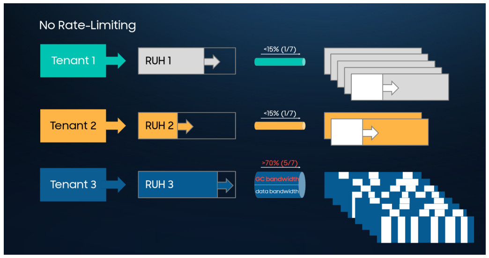 
15

---

<!-- 原文第 16 页 -->

## Figure 11.Tenants using FDP with highlighted media utilization rates 
By applying the limits at the NAND, 1/3 of the media time can be allocated to each tenant. Tenant 3,with its poor WAF behaviors, will be forced to implement all f thei incoming host writes,C reads, and GC writes within their limit of NAND time.This protects the NAND time allocated to tenant 1 and 2.Tenant 3 is necessarily throttled by their own write traffic to have far less performance of the shared SSD. Since conventional SSDs have a natural limit to the available NAND time as well, this perormance would mirror that experienced by tenant 3 in an unshared drive. 
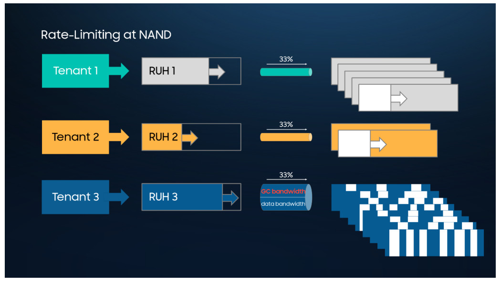 
Figure 12. Tenants using FDP with media utilization rate limiting applied 
When referring to storage,this topic is considered under the umbrella of quality of service (QoS). It is currently being addressed in NVMe proposal TP4176 Quality of Service for PCle Bandwidth and IOPS for a ontroller, for which Samsung is the primary author and has made a presentationavailable.Thereare separate discussions regarding NAND and controller behavior interaction with programmed rate limits. Samsung sees technical reasons to connect the backend WAF and NAND behavior to the frontend rate limits. This will enable more reliable and predictable rate limit implementations in SSDs from multiple vendors. 
## Potential Architectural Extensions 
Not even touched on here are the many other areas for investigation.For example: 
The transfer of data from the source to target system in live migration is a secrity risk, ine the data is not encrypted during this transfer. 
Common standardized solutions for traffic prioritizations do not yet exist. 
The open nature of the virtualization concepts underpinned by the virtualization toolset will continue to callforfirements of the techniques already enabled. 
lking oet pting Prforce for Eering tandrs, tps/epes/pcontenfupla/0 Melmick-Unlckig-QS-Potential Fia.pdf 
16

---

<!-- 原文第 17 页 -->

## Conclusion 
The term storage virtualizatin" covers a lot of ground. Features introduced to PCle and NVMe over the years have addressed topics like data separation,data migration,anddata environment isolation,setting the stagefor hardware solutions. However, committing aspects such as rate limting, nrpted live migration, and standardized system traffic proriations to hardare are still works in progress. 
The virtualization of an SSD has many aspects and myriad use cases,from which derive a large set of requirements. NVMe has successfuly naled many new building blocks of virtualization capabilities as outined here. Further virtualization needs are under consideration, and many more extensions of virtualization are possible. Virtualization is already a significant SS feature; it can only increase in importance as SSDs continue to grow in capacity. 
## About Samsung Semiconductor 
Samsung Semiconductor is a global technlogy leader in adanced memory, logic,an foundry solutions designed for next-generation computing. ur semiconductors powe thefuture of .inlient eedeicesearrihih-pr icientsol.ro laboration wh stoer we hep optimize system aritectures,accelerate time to are,d na innotin aoss arius applications, including servers,Pcs,mobile and autmotive.For mor information,please visit semiconductor.samsung.com. 
Samsung Electronics Co,Ltd. 
1-1,Samsungjeonja-ro,Hwaseong-si, 6yeonggi-do 18448, Korea www.samsung.com 1995-2026 
Copyright 2026 Samsung Electronics Co,Ltd. All ighs eserved. Samsung is a registered trademark of asung Electronics Co,td.Spcfiations anddesigns are subje to change withut notice.Nonmetric weights and measurements are approximate.All data were deemed correct at time of creation,are referenced herein for informationa purposes only and provided as is ithout warranty of any kind, expressed or ipled.Sasung is not iable for anrors or missions in the content othis documnt an any reliance on the information provided is at the user's own risk. All brand,product,sevice names and logos are trademarks and/or registered trademarks of their respectiv owners and are hereby recognized and acknowledged. 
*The contents of this blog are provided for informational purposes only.No representation or warranty (whether express or iplied) is made by Samsung or any of it aflates and their respective officers, dvisers, agents, or employees collectively" Samsung")as to the accuracy, reasonableness or completeness of the information, statements,opinions, or matters contained in this blog,and they are provided on an "AS-IS" basis. 
*Samsung will no e responsible for any damages arising out of the use of, or otherwise relatin tc,the contents of thi lo. Nothing in thi slog grants you any liens or rights in or to information, materials, or contents provided in this blog, or any other intelletual poperty. 
*The contents of this blog may also indude forward-loking statements.Forward-looking statements are not guarantees of future performance and that the actua developments of Samsung, the market, or the industry in which Samsung operates may differ materially from those made or suggested by the forward-looking statements contained in this blog. 
*ll product specifications and performance data included in this article relect internal test results and are subjet to variations by user's system configurations. Actual performance may vary depending on use conditions and environment. 
*Test results do not guarantee future performance under such test onditions, and the actual throughput or performane that any user will eperience may vary depending upon many factors. 
All images shown are provided for illustrative purposes only and may not be an exact representation of the products. 
*All design, features and spefications represented herein may change without notice. 
NVM Express design mark and MMe word mark are trademarks of NVM Express, Inc.. 
PCI Express and PCleare registered trademarks of PCI SIG. 
17
