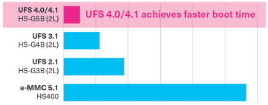
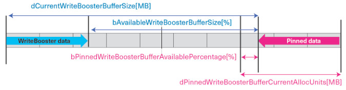

> 原文件：[S7a4f117f3b04_americas.kioxia.co_KIOXIA_Auto_UFS_HS_LSS_WriteBo.pdf](https://github.com/jadennevercode/CJCC-Knowledge-Base/blob/564ab11aa9785e569e3853c8a4d7ce86f88e7535/materials/%E5%9F%BA%E7%A1%80%EF%BC%9A%E8%A1%8C%E4%B8%9A%E6%9C%AF%E8%AF%AD%E4%B8%8E%E6%8C%87%E6%A0%87/S7a4f117f3b04_americas.kioxia.co_KIOXIA_Auto_UFS_HS_LSS_WriteBo.pdf)
> 转换方式：Volcengine OCRPdf v3, parse_mode=ocr

<!-- 原文第 1 页 -->

KIOXIA 
 
## Technical Brief Series: Automotive UFS Explained 
## Part 2: In the Fast Lane with HS-LSS and Extended Write Booster Features Delivering Improved Device Performance 
This technical brief is Part 2in the two-part series titled,"Automotive UFS xplainedan overs igh-speed and ow-latency capabilities within Universa Flash Storage'(UFS)4.1 managed flash devices. t is trgeted at automotive innovators who develop advanced humandriven and autonomous vehicles that utilize high-performance storage.High-Speed Link Startup Sequence and extended Write Booster features are included. Together, these state-of-theart capabilities strengthen UFS as a storage solution for automotive applications with growing demands in speed and reduced latency. 
## Introduction 
UFS managed lash devices are an option of high-performance storage and an integral component of todays utomotive developments. These storage devices irectly affet key automotive systems and capabitie, such as: 

| System/Capability | High-Performance Storage is Required for: |
| --- | --- |
| ADAS / Autonomous Driving | Advanced Driver Assistance Systems and autonomous driving systems that process data from cameras and Light Detection and Ranging (LiDAR),and highspeed sensor data wrting rquired by event data recorders (EDRs). |
| Network | A fast network is required to accumulate data for training purposes,which is then sent to the cloud |
| Infotainment | Digital cockpits,high-resolution screens and navigation systems to enhance the user experience. In some cases, fast boot up is required by law. |
| Over-the-Air (OTA) Updates | Software updates and patches that can be downloaded and installed without any other human intervention. |
 
High data demands and nearinstantaneous data processing are required by modern connected vehicles to make real-time decisions. The storage subsystem is required to not only manage the high volumes of data but also provide incredibly fast read/write performance with low latency, large storage bandwidths and capacities, and continuous operations under harsh environmental conditions. 
The latest UFS 4.1 specification introduces new performance enhancements which are useful for automotive development and include: 
High-Speed Link Startup Sequence (HS-LSS) - a faster method of initializing the UFS link from a low-power or inactive state to a quicker operational speed. This feature reduces the time required for link initialization when compared to previous startup sequences. 
Enhanced WriteBooster features - functionalities that improve read/write speeds for a UFS device.One way is to use the single-level cell(SLC) mode as a temporary buffer before transferring data to flash memory (multi-level cell(MLC),triple-level cell(TLC) or quad-level cell(QLC). it's a high-speed capability that improves vehicle responsiveness for such tasks as realtime sensor recording, log buffering and OTA updating. 
A deeper dive into these UFS 4.1 enhancements now follows:

---

<!-- 原文第 2 页 -->

Technical Brief 
## HS-LSS 
Link Startup Sequence (LS) is the handshake process between the host and the initial UFS device connection, or during a wake up when the UFS device has been in sleep mode.During LSs, both the host and UFS device communicate each others capabilities tie, umber of lanes, gear speed. power modes, etc,),In UFS generations prior to UFS 4.0, LSS always started in low-speed mode. While this was a stable startup process,it aded latecy to the system,especially when a UFS device frequently entered sleep states. 
HS-LSS was introduced in UFS 4.0to enable LSS to start diretly in high-speed mode(HS-G1A)using 1.25 gigabits per second (Gb/s) speed. This enhanced speed is significantly faster than pulse width modulation (PWM)-G1 communication speed"between 3 and ~9 megabits per second(Mb/s) hat was used in older FS device generations (see image below). 
 
The product image shown is a representation of the design model and not an accurate product depletion 
Estimated UFS Device Boot Times (includes the sum of the initiaiainti n B d tie 
 
Estimations conducted by KIOXIA Corporation 
With HS-LSs, a vehicle's electrical control unit (ECU) can initialize the UFS device faster after seep or an ignition start,resulting in faster invehicle infotainment(V) and screen display uptime. For ADAS,AI models and map data stored in the UFS device are immediately accessible after wake up, allowing safety functions to resume faster. 
HS-LSS drastically reduces system initialization times for advanced on-board electronics delivering faster system boot times,nearinstantaneous availabity of ritical systems and enhanced user experiences. 
## Extended Write Booster Features 
The Write Booster feature was standardized in the UFS 3.1 specification.It provided a mechanism to temporarily enable or disable the SLC mode write buffe (regarded as the Write Booster burfer) before data was transterred to flash memory. This capability improved data storage performance and considered the impact that additional performance could have on reliability when the WriteBooster buffer was used. 
With newly xtended Write Booster features in the UFS 4.1 specification, there are two key enhancements worth further discussion- buffresizing and a pinned partial flush mode for critical data 
## Buffer Resizing 
This extended WriteBooster feature enables the host to dynamically configure and resize the Write Booster buffer based on workload requirements. For specific workloads, increasing or decreasing the size of the Write Booster buffer can optimize a UFS device's write performance. For example, increasing the buffer size can be valuable for large file transfers while reducing the buffer size can improve overall device endurance for less performance-intensive data Buffer resizing eliminates unnecessary writing to the Write Booster buffer as transferring that data to flash memory can cause additional write amplification 
KIOXIA 
Copyright 2026 KIOXIA America, Ine.All rights reserved. Technical Briet Seriei uooie s Eaplained Part i he Fat Lane wih -S andEte eoture Deveing mproveic Prorn a02|R. 
2

---

<!-- 原文第 3 页 -->

Technical Brief 
Resizing the WriteBooster buffer is a host setting and MUST NOT exceed the maximize size of the buffer as specified in the UFS device datasheet available from the manufacturer. 
To increase the WriteBooster buffer size within the UFS device, set bWrite BoosterBufferResizeEn=2h (see image below). 
To decrease the Wrte Booster buffer size within the UFS device,set bWriteBoosterBufferResizeEn=th (see image below). 
Note: The size of the inerease or decrease of the Wite Booster buffer is determined by the UFS device and can vary from esch manufacturer. 
Extended WriteBooster Feature: Buffer Resizing 
 
dCurrentWriteBoosterBufferSize [MB] 
bAvailableWrite BoosterBufferSize[%] 
Write Booster data 
To Increase the WriteBooster buffer size: bWriteboosterbufferResizeEn=2h 
 
bWriteBoosterBufferResizeEn=1h 
Images created by KIOXIA Corporation 
## Pinned Partial Flush Mode 
This extended WriteBooster feature allows the host to set specific blocks inside the Write Booster buffer to be pinned (or locked),It prevents the locked data from being automatically fushed to lash memory during a background operation like garbage collection. When a Write Booster flush is executed, only unpinned data in the temporary write buffer willbe fushe., ata that is pinned will reman in the buffer and can be read without re-writing the data again. This is also the case for unpinned flush data that can also be read without re-writing the data again. 
Pinnd data can also be unpinnd and fushed at any time. Using this mode enhancesread performance fof fequenty accessd dat,such as Al model data or crtical application files,ensuring that data remains in the temporary WriteBooster buffer. 
KIOXIA 
Copyright 2026 KIOXIA America, Ine.All rights reserved. Technical Briet Seriei uooie s Eaplained Part i he Fat Lane wih -S andEte eoture Deveing mproveic Prorn a02|R. 
3

---

<!-- 原文第 4 页 -->

Technical Brief 
To enable pinning, the host: 
1. Sets WriteBoosterBufferPartialFlushMode=2h 
2. Sets the dPinnedWrite Booster BufferNumAlloUnits for the maximum size of the pinned WriteBooster buffer area. 
3.Sets thdoPinWreBster berMinumAllocnits or he minium size of the non pined Wite oster buferarea. 
4. Issues a write command to the UFS device with Group Number= 18h to pin data. 
To unpin, the host sets fUnpinEn=1h to release the pinned data. 
The image below shows the settings to pin data in the Write Booster buffer: 
 
Images created by KIOXIA Corporation 
## Summary 
H-LSS and extended WrteBooster features in th UFS 4.spcication ress iprtant performance requirements in automive applations.H LSS reduces latency between the host and the UFS device during link up, allowing ECUs to quickly access UFS device data after waking up. An extended WriteBooster feature provides buffer resizing that enables the write perormance of a UFS device to be optimized depending on the workload requirement. Another extended Write Booster feature provides a pined partial fush mode that allows specific blocks inside the Write Booster buffer to be locked from being automatically fushed o fash memory during garbage collection and enhances read performance for frequently accessed data.These advanced capabilities are essential for automotive development where real-time data capture and low atency are required to meet the high data demands of modern connected vehicles. 
General information about KIOXIA memory products is available here 
## FOOTNOTES: 
Unversal Flash Storaga(UFS)devices are based an the US pecificaon, of whih, the wu.s pan thtrr es d anunn anary22 
"Amanged lah device combines raw AND lsh emory nd an inelient controler in ne integrted packge,enabling intrlmemory mangeme 
Read and wrte sped may vary depending on varous factors such as host devies, sotware drvers o,t.n adwt ondtins 
PWM-G1 communication spe dapends on the host and the UFS deice. 
## TRADEMARKS: 
JEDEC is angstene ndamt t e c / l DISCLAIMERS: 
KIOXIA 
Copyright 2026 KIOXIA America, Ine.All rights reserved. Technical Briet Seriei uooie s Eaplained Part i he Fat Lane wih -S andEte eoetur Deving mproveic Prorn a02|R.
