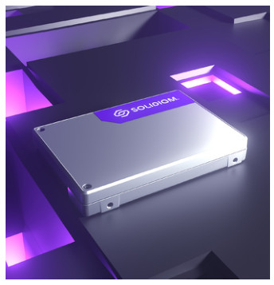
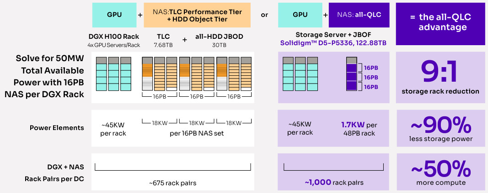
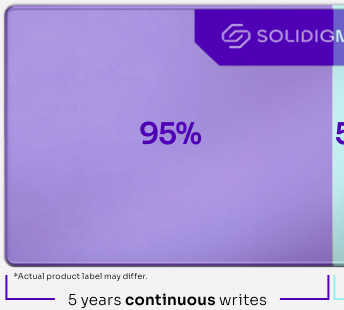

> 原文件：[Sa078498c5aac_solidigm.com_Solidigm-D5P5336-ProductBrief.pdf](https://github.com/jadennevercode/CJCC-Knowledge-Base/blob/564ab11aa9785e569e3853c8a4d7ce86f88e7535/materials/%E5%9F%BA%E7%A1%80%EF%BC%9A%E8%A1%8C%E4%B8%9A%E6%9C%AF%E8%AF%AD%E4%B8%8E%E6%8C%87%E6%A0%87/Sa078498c5aac_solidigm.com_Solidigm-D5P5336-ProductBrief.pdf)
> 转换方式：Volcengine OCRPdf v3, parse_mode=ocr

<!-- 原文第 1 页 -->

 
Solidigm" D5-P5336 
PRODUCT BRIEF 
# The World's Highest Capacity PCle SSD 
The SolidigmM D5-P5336 is built to improve power and space efficiency for critical IT infrastructure, meeting challenges from the data center core to the edge. 
The SolidigmTM D5-P5336 is part of the fourth generation of QLC SSDs from Solidigm, delivering industry-leading power and space efficiency to optimize your storage subsystem for Al- and data-intensive workloads. 
Combining read performance exceeding that of some cost-optimized TLC SSDs with capacities up to 122.88TB,the D5-P5336 has been architected to efficiently accelerate and scale with the increasingly massive datasets found in widely deployed, modern read-intensive workloads, while increasing storage density, infrastructure efficiency, and enabling a more sustainable storage infrastructure. 
 
## Storage Density Matters 
Widely adopted modern workloads are becoming even more data hungry, The size of datasets used to train language models doubles approximately every eight months.2 Many streaming services are shifting from limited paid-for capacity to unlimited free capacity. With connected Internet of Things (loT) devices projected to reach 40B by 2030, there is no end in sight to unabated growth in data-rich services and applications. 
Accompanying this trend is the decentralization of compute and storage to the edge to improve service levels,reduce costs, and improve agility. As recently as 2018,only 10% of enterprise-generated data was created and processed outside oftraditionalcentralized data centers or cloud services. By 2025,Gartner expects 75% ofthat data to be created, processed, and stored at edge locations.5 Storage challenges such as space, power, cooling, and serviceability become even more acute when considering locality constraints at edge deployments. 
## Optimized Performance for Data-Intensive Workloads 
Modern,data-hungry workloads such as data pipelines and data lakes for Al, machine learning (ML), big data analytics, content delivery network (CDN),scale-out NAS, object storage, and edge usages are increasingly concerned with storing and accessing vast amounts of data efficiently at speed. SolidigmM D5-P5336 is optimized for both requirements, with read performance equivalent to TLC SSDs and capacities up to 4x higher than alternatives. 

| Product Name | Capacity | Content Delivery Network6 Total BW | General Purpose Server Total BW | Object Storage Total BW | Write Pressure Test Lower is Better |
| --- | --- | --- | --- | --- | --- |
| Micron 7450 Pro1 | 15.36TB | 0.84x | 0.81x | 0.92x | 01.51x |
| Kioxia CD8-R11 | 15.36TB | 0.76x | 0.69x | 0.89x | 1.51x |
| Micron 6500 ION12 | 30.72TB | 0.85x | 0.70x | 0.92x | 2.00x |
| SolidigmTM D5-P5336 (baseline) | 61.44TB | 1.00x | 1.00x | 1.00x | 1.00x |
| SolidigmTM D5-P533614 | 122.88TB | 1.01x | 0.91x | 1.05x | 1.01x |

---

<!-- 原文第 2 页 -->

## Product Brief | SolidigmM D5-P5336 
## Storage Efficiency in the AI Era 
The demand for Al compute is stretching the limits of energy grid outputs. Data center architects are scrambling to maximize space and power efficiency to the point where a decommissioned nuclear plant has been brought back to life to power a single data center.16 
SolidigmTM D5-P5336 provides a high-capacity solution to improve power efficiency for new Al datacenter builds. By comparing a network-attached hybrid storage solution, using a TLC performance tier and a hard disk drive (HDD) object tier, to a network-attached storage all-QLC tier,we see massive efficiency improvements for both space and power. Rack space is cut down from 9 racks to 1. By leveraging approximately 90%less storage power, data centers can efficiently power energy-hungry GPU servers and provide them with approximately 50% more compute.16 Solve the complicated infrastructure efficiency equations with the Solidigm D5-P5336. 
QLC Improves Power Efficiency for New AI DC Builds 
 
## Unlimited Endurance 
It is not easy to wear 122.88TB of Solidigm Storage within the Solidigm Warranty period (see Solidigm Warranty page for more info). Using the same baseline quality and reliability spec to validate QLC for over three generations of QLC NAND,we selected two of the harshest workloads from write amplification to demonstrate how durable these drives are. 
 
Running 32KB at 100% Random Writes,with 100% duty cycle running 24/7, the drive was able to write for five continuous years and retain about 5% of life. 
 
Running 4KB at 100% Random Writes, with 100% duty cycle running 24/7, the drive was able to write for five continuous years and retain about 10% of life. 
Write amplification and the Program/Erase cycle of the drive impact endurance, and we feel that density is the third parameter to consider for endurance. 
2

---

<!-- 原文第 3 页 -->

Product Brief | SolidigmM D5-P5336 
It's Not Easy to Wear Out 122TB of Solidigm Storage SolidigmM D5-P5336 122.88TB Estimated Endurance (PBW) 
 
10% 
5 years continuous writes 
7moin 
Solidigm D5-P5336 Key Feature Overview 

| Product Name | SolidigmTM D5-P5336 | | | | |
| --- | --- | --- | --- | --- | --- |
| Form Factor | U.2,E1.L,E3.S | | | | |
| Media | 192L QLC NAND | | | | |
| Power off Retention | 3 months@40° | | | | |
| User Capacity | 7.68TB | 15.36TB | 30.72TB | 61.44TB | 122.88TB |
| Endurance (DWPD 5yrs)17 | 0.42 | 0.53 | 0.56 | 0.58 | 0.60 |
| Endurance(PBW)18 | 5.9 | 14.7 | 32.1 | 65.2 | 134.3 |
| Max Power | 25W | | | | |
| Idel Power | <5W | | | | |
| UBER | <1 Sector per 107 Bits Read | | | | |
| MTBF | 2 Million Hours | | | | |
| Feature | OCP 2.0 support,19 NVMe 2.0 Compliance, FIPS 140-3 Level 20 | | | | |
 
3

---

<!-- 原文第 4 页 -->

Product Brief | SolidigmM D5-P5336 
 
.lidigD-56.3.,owshippng inapacti 
2.EPOCHAe size of datasetsused to train language models doblespproxiately every ightmoths.pdted ar 202.tps:/epch.aidata-insightsldataset size-trend 
3.Based on widely avalable resarchon straming servicessuchas Netlix, Hu,.Aazn Prie,and Spotify. 
4.IOT Analytics."State of loT 2024:Number of connected lo devices growing 13%to 18.8 biliingloalptembr2024tps/itanaytios.com/number-connected iot-devices/ 
.rer.t d pt or nrastrutre ad perations eder."ctober0.w.ger.cm/arrthnerhdgecomputing-mean for-infrastructure-and-operations-leaders. 
6.CD Workload:Comparing 61.44/122.8 olidigD5-P5336 wth read BW of .4/.4GB/sec Kixia D-R15.36 with 5.6 GB/sec as entry TLC SD,Micron 7450 15.36with./sasanr ndMicr6500I3.h6.3sas ainstremTLCSSD.Workload sulated using 128tranersize with83 miand 4Kto16ktransfer size with 7%mix,00%randomeds.Tes Coniguration:Supermicro SS-120-TNR,inte(R) eon(R) Gold 6354.Number of CPUs:2,Cores perCPU:18 (total 36), DRAM:DR4-64GB,OS:Ubunt20.04.5LTS Linux5.15.-67-gneric.FO3.16. 
7.General Purpose Server Worload: Comparing 61.44/122.88TB Solidigm D5-P5336 with total B of 6.7/6.1B/sec to Kioxia D8-R15.36 with 4.6 GBseas entry TLC SSD.Micron 74505.3 th./sas aint nd Micrn6500N3.2 with .G/s as aitrea SS.workloads typilly consisto ncurntagblK)ddtswihrands patte. e Conigrat:tlSererBoardM50CPSB2U,IntelICELAKE-P54GXRAVD,ube of CPUs:2,Cores perP18(total 6), DRAM:DR4-64GB,OS:CntOS Linx release7.5.1804,Kel Version:3.10.0862.7x.or 1worla eaurement,FIO tool was used. 
8.0bjectstorage Worklad:Comparing61412 SdigmD-5waditbnditho.7GB/s Kixia R15.ith6.3Bsecasentry TLC Sdicr4.wi/redcrwiaia.olodsiniti ro ttps:/ww.nia.g/sits/deffls/s/20/pret/torge_erforance/Harrigan_o_bjet_Storage_Worklad_Testing_ools,pdf(slide 8,.et Coniguration:lntel Server Board M50CYP2SBSTD,IntelXon Platinum8360Y, Number of CPUs:2,Number of Cores per P:24(total 48), DRAM:DDR4-768GB,OS CentOS Linux release 7.9.2009.FIOv3.7. 
9.Write Pressure Test Comparing 61.4/122.88TB SolidigD5-P536ihread QoS of806/676usec to Kioxia D-R read QoS of1221saentry TLC SSD, Micron7450 readQoof1221usecas ainstream LSSD,d Miron6500ION30.72eadQoof614sas mainstream TLCSSD. Write pressur tests easure 16K andom read QoS under 16K random writes.Read response ata 99.99% availability is measured where 250MB/sec of random write pressure is applied. 
10.Micron7450 Pro,TL,1.36:tps:/w.micrn.com/prodcta/storagessddataenter-sd/7450-ssd 
1.ixia ,16:tp:/amrica.x.co/da/rd/bnss/ssdar-ssdasstprdcbrif/dS--R-U2-product-brief. 
12.Micron6500 ION,TL,0.72:tps://www.micron.com/products/storagelssdldata-center-ssd/6500-ion 
13.Solidigm D5-P533661.44TB 
14. Solidigm D5-P5336122.88TB 
15.USA Today.Microsoft announcesplan to reopen Three Mile sland nulear plant to support AI.eptember 2024.https:/vwusatday.com/story/monev energv/2024/09/20/three-mile-island-nuclear-plant-constellation-microsoft-deal/753077700071 
.Soldg,20.owersptinalysisassuesagreefieldew) botto-range Hyper-scaler/Ter2 AI Dplementation tiliing lading-edgepowerand space optimizations. 
17.IU-Aligned Endurance.Based on 100% Random Write 16KB for 16KB IU SKUs,and 100% Random Write 32KB for 32KB IU 122.88TB SKU. 
18.ee D5-P533rodu Spciicatioorxepionsand odifications forCompliance/upport Details 
19.See D5-P5336 Produt SpecifitionforExeptions and Modifiations forCompliance/upport Details 
20.RequiresFbledK.rficatonwill be walale n thefture.FIPS140-3Levelcapabilityfor15.36830.72TELL9.5mm.The U.2, 15m,E3.,.5man61.44B EI.L9.5mm will include Level2 capability. 
All information provided is subject to change at any time,without notice.Solidigm ay make changes to anufacturing life cycle,speciication,and produ descriptions at any time,withot notice.The information herein is provdedai"and Soldgdoes ot ak anyreprestatins orwrranties whatsever regardng auracy of the information,nor on theprodut features,availabilit,functionality, or compatiblity of the produts listed.Please contact system vndor for more information on specific products or systems. 
Performance results ar based on testing as of dates shown in configurations and may not refet allpciye s. sebackupfor conigurtion dtails.N product or component can be absolutely secure. 
Performance varies by use,configuration,and other factors. 
Refer to the spec sheet for formal definitions of product properties and features. 
Solidigm technologies may requre enabled hardware,ofware,or service activation. No product or component can be secure.Your costs and results may vary Performance varies byuse,oniguration and theractors.ther names and brands ay be claimed as property of others.idigm is committed to respecting huma rights and avoiding complicity in human rights abuses. Solidigm products and software are intended only to be sed in applicatons that do not cause orontribute to violation of an internationally recognized human right 
Solidigm and the Solidigm logo are trademarks of Solidigm.All othertrademarks are the property of their respective owners 
Solidigm 2025.All rights reserved.
