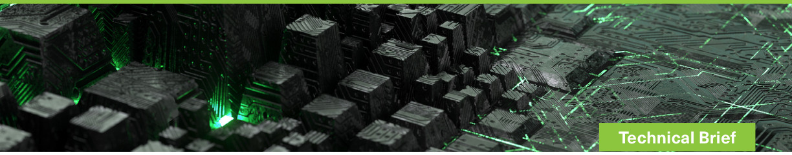
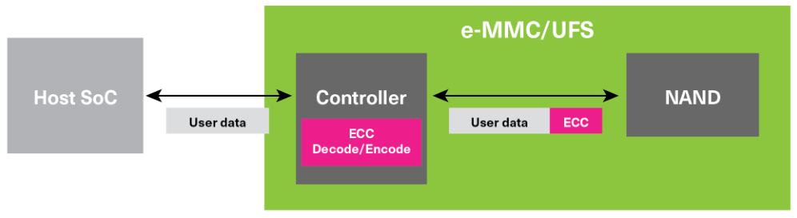

> 原文件：[Sb60ebe684b8b_kioxia.com_KIOXIA_Understanding_ECC_Tech_.pdf](https://github.com/jadennevercode/CJCC-Knowledge-Base/blob/564ab11aa9785e569e3853c8a4d7ce86f88e7535/materials/%E5%9F%BA%E7%A1%80%EF%BC%9A%E8%A1%8C%E4%B8%9A%E6%9C%AF%E8%AF%AD%E4%B8%8E%E6%8C%87%E6%A0%87/Sb60ebe684b8b_kioxia.com_KIOXIA_Understanding_ECC_Tech_.pdf)
> 转换方式：Volcengine OCRPdf v3, parse_mode=ocr

<!-- 原文第 1 页 -->

KIOXIA 
 
## Managed Flash Background Operations Series 
Part 1:Understanding ECC (Error Correction Code)in NAND Flash Memory 
NAND flash memory was invented by KIOXIA (formerly Toshiba Memory) in 1987 and is a very cost-effective way to scale data storage capacity and performance. As storage densities continue to increase, NAND management technologies have become increasingly more important.One of these critical management functions is Error Correction Code (ECC),and it is highlighted here as the first brief in a series of Managed Flash Background Operations 
## ECC Overview 
Paramount to any application workload is the need to read or write back accurate and reliable data.As NAND flash memory cells wear down due to increasing write and erase cycles, the probabilty of erroneous bits being stored and/or read by the host System-On-Chip (SoC) will increase over this time frame.To ensure that stored data is accurate and reliable, both raw NAND flash memory (raw NAND) and managed NAND flash memory (managed flash) require ECC functionality to maintain data storage and recall accurate data. 
Raw NAND devices do not have built in contolers and are categorized by the number of levels that ach fiash memory cellsuppors (e,g, LC,MLC, TLC or QLC"). These devices are used for boot, OS code and user data storage,and support a range of capacities and endurance capabilitie. 
When raw NAND is deployed within devices,the host SoC manages ECC control.With raw AND technologies continually evolving, maintaining ECC control over NAND generations can getquite complicated. They may even require more ECC functionality to a point where the host SoC may be unable to supportthese future technologies.The first was SLC NAND and it required only 1-bit of ECC Hamming codes or Reed-Solomon codes. As SLC dies shrank, -bit, 8-bit and higher levels of ECC was needed.When MLC and TLC NAND technologies evolved,ECC needs increased further and more complex algorithms were required, such as BCH codes and LDPC codes. With more demanding EC ethods, some lower end and/or older hst SoCs are unable to support them. 
Managed flash combines raw NAND and an inteligent controller in one integrated package, enabling memory management to be performed internally. ECC engine functionality can be offloaded from the host SoC to the flash device,and concerns associated with supporting a range of NAND flash memory generations,including future ones, are also eliminated. 
## ECC Functionality 
In managed lash devices (e-MMC and UFS"),the buit in controller detects and corrects a certain number of bits per a specific area size (Figure 1) The ECC bits could be stored in spare areas of each NAND flash memory page. Also shown is how ECC bits are added to and removed from user data by the device controller.

---

<!-- 原文第 2 页 -->

Technical Brief 
 
Figure 1 shows the ECC process ine-MMC and UFS devices 
The ECC management process when using managed flash is presented below: 
Process when Writing to a Managed Flash Device 
1.The host SoC sends user data to a managed flash device 2. The managed flash device controller calculates ECC based on the user data sent to it 3.The managed flash device controller combines the user data sent to it and the calculated ECC and sends the combined data to NAND fiash memory for programming 
## Process when Reading from Managed Flash Device: 
The managed fiash device controller sends the user data to the host SoC 3. 
The managed flash device controller corrects the error bits of the user data using ECC algorithms 
2. 
The managed flash device controllereds the user data and the calculated ECC from NAND lash memory 
1. 
## ECC Related Registers and Status Responses for e-MMC and UFS Devices 
The ECC process generates registers and status responses for both e-MMC and UFS devices as follows: 
## For e-MMC Managed Flash Devices: 
An R1 status is returned by the e-MMC device after a read or write operation has been sent to the e-MMC device (Table 1).It can be used to verify the occurrence of an uncorrected ECC error as follows: 
Device Status (R1 Response): 
Bits Identifier Value Description
21 DEVICE_ECC_FAILED "0"-SUCCESS,"1"- FAILURE Device internal ECC was applled but failed to correct data 
Table 1 is an example of an e-MC Managed Flash Device Status R1 Response (Copyright JEDEC". Reproduced with permission by JEDEC.) 
## Device Specific Data Register (aka CSD Register): 
The Device Specific Data Registerf, or CSD Register, also defines ECC activity that is required by the host SoC (Table 2). The majority ofe-MMC devices in use at present do not require external ECC control from the host SoC. 
KIOXIA 
Copyright2022KIOXIA Corporation.All rights reserved. Technical Brief |'Managed Flash Background Operations Series - Part 1:Understanding ECC (Error Correction Cade) in NAND Flash Memory" | May 2022 |Rev.1.0 
https://busines.klxi.com/ 
2

---

<!-- 原文第 3 页 -->

Technical Brief 
## CSD Register: 

| Name | Fleld | Width | Cell Type | CSD-slice |
| --- | --- | --- | --- | --- |
| Manufacturer detault ECC | DEFAULT\_ECC | 2 | | |
| | | | R | [30:29] |
| ECC code | ECC | 2 | R/W/E | [9:8] |
 
Table 2 is an example of data presented in an e-MMC Managed Flash Device Specific Data Register (Copyright JEDEC.Reproduced with permission by JEDEC.) 
For Linuxspecific operating system environments, an error log may be reported at times during a read operation if there is a failure detected by ECC functionality. The card status VALUE of the R1 Response can provide indication that ECC has failed. In the Device Status (Table 1), this is accomplished by locating the VALUE of bit 21. A snippetof the Linux kernel log below shows an example of an ECC failure in an e-MMC device. 
## Sample Linux OS Error Log 
mcblk:error-0rneinat, etor100.d epon ox900, ard status 0x200b00 mmcblk0:retrying using single block read 
In review of the Device Status (Table 1),the card status of '0x200b00' has 'bit 21' indicating a $110$ or a device ECC failure. In the sample error log,the Linux kernel reported an error during the read operation because the ECC failed. As a result, the e-MMC device did not output any data.The host SoC would then make a second attempt and issue another read operation to try and read the same data again. 
## For UFS Managed Flash Devices: 
A UFS device can fail for several reasons when running UFS commands. It sends failure information to the host SoC through the Sense Data of the Response UFS Protocol Information Units (UPIU)(Table 3).The Sense Data starts from Byte[34] and is 18 bytes long. 
Response UPIU 

| 0 | xx100001b | 1 | | 2 LUN | | 3 Task Tag | |
| --- | --- | --- | --- | --- | --- | --- | --- |
| | Flags |
| 4 IID | CMD Set Type | 5 | Reserved | 6 | Reserved | 7 | Status |
| 8 | | 9 | | 10 | (MSB) | 11 | (LSB) |
| Total EHS Length (00h) | | | Device Information | | Device Segment Length | | |
| 12-13 | | (MSB) | | 14-15 | | | |
| | | | | | | (LSB) | |
| Residual Transfer Count | | | | | | | |
| 16-31 Reserved | | | | | | | |
| 32 | (MSB) | 33 | (LSB) | 34 | Sense Data [0] | 35 | Sense Data[1] |
| | Sense Data Length | | | | | | |
| 36 | Sense Data [2] xh3h | 37 | Sense Data [3] | 38-51 | | | Sense Data [4]-[[17] |
 
Table 3 is an example of an UFS device UPIU Responsef (Copyright JEDEC. Reproduced with permission by JEDEC.) 
When an uncorrectable ECC failure occurs, the UFS device will return a MEDIUM ERROR, of which there are many causes. The Sense Key value then becomes '3h' for Bit[0:3] of the Sense Data[2](as depicted in magenta in Table 3). 
KIOXIA 
https://busines.klxi.com/ 
Copyright2022KIOXIA Corporation.All rights reserved. Technical Brief |'Managed Flash Background Operations Series - Part 1:Understanding ECC (Error Correction Cade) in NAND Flash Memory" | May 2022 |Rev.1.0 
3

---

<!-- 原文第 4 页 -->

Technical Brief 
## Summary 
ECC functionality is a very important background operation function needed by both e-MMC and UFS devices as it can detect and correct erroneous data bits to assure users that thei stored data is accurate and reliable. it also enables the use of advanced NAND flash memory technologies on disparate or even legacy SoC platforms. 
The next brief in the Managed Flash Background Operations Series covers Bad Block Management (BBM), which helps in recognizing bad data blocks and managing them over the lfetime of NAND flash memory. 
General information for KIOXIA memory products is available here. 
FOOTNOTES: 
Single Level Cl cto et et e cl l e l e ee e de el 
Hammin codes ar a ramily l e er n o n r 
Red Selomon codes are aoupuo rtrcrno s h e es ee ese BCH(Boe-CheuhurHocqueghem) edes are eite e 
LDPC lovdensty prty ctca rrocr gnnd t t s. 
Embede MiMedisCet e-MG is senec ope p , 
TUniversi Fish Storage UF) device are beed on the US specification or which v. 1apecicetioni thecuret ee D End pise in anar2020 
The Deice Specfio Data Registr is in cnrdant Dpcfiation D84-851 
I The Device Status IR Response ard status o200bo hoc ue ws orvrtdtd t an-n It2: 2- ond i s 
IThe UFS device UPIU Respone is aremake in accordance to UFS v3.of the DEeciicetion ESD220Eble 10.13 
TRADEMARKS: 
) DISCLAIMERS: 
GI播s 
KIOXIA 
https://busines.klxi.com/ 
Copyright2022KIOXIA Corporation.All rights reserved. Technical Brief |'Managed Flash Background Operations Series - Part 1:Understanding ECC (Error Correction Cade) in NAND Flash Memory" | May 2022 |Rev.1.0
