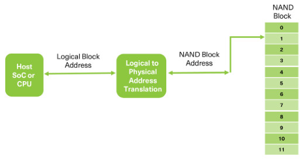
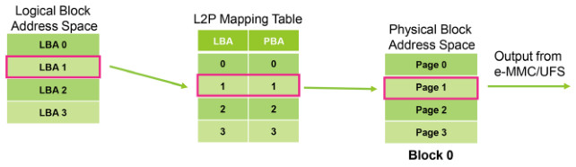
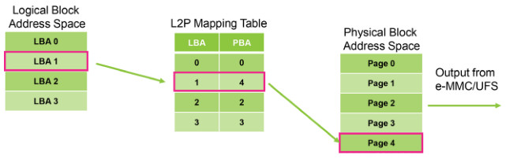

> 原文件：[Sc39f5191b7e1_kioxia.com_KIOXIA_Understanding_Logical_B.pdf](https://github.com/jadennevercode/CJCC-Knowledge-Base/blob/564ab11aa9785e569e3853c8a4d7ce86f88e7535/materials/%E5%9F%BA%E7%A1%80%EF%BC%9A%E8%A1%8C%E4%B8%9A%E6%9C%AF%E8%AF%AD%E4%B8%8E%E6%8C%87%E6%A0%87/Sc39f5191b7e1_kioxia.com_KIOXIA_Understanding_Logical_B.pdf)
> 转换方式：Volcengine OCRPdf v3, parse_mode=ocr

<!-- 原文第 1 页 -->

KIOXIA 
 
## Managed Flash Background Operations Series 
## Part 5: Understanding Logical Block Address to Physical Block Address Translation in NAND Flash Memory 
NAND flash memory enables content mobility that is eled upon daily and is considered an effective way of scaling data storage capacity and performance, as long as the proper management is applied.Logical block address to physical block address translation provides a fundamental management operation that enables efficient data storage in e-MMC' and UFS devices and is the focus of this technical brief. This brief also represents the final installment in the Managed Flash Background Operations series that has covered error correction coding,bad block management, wear leveling and garbage collection. 
## Logical Block Address to Physical Block Address Translation Overview 
Logical block addresses (LBAs) and physical block addresses (PBAs) in storage systems are used for data storage and retrieval in storage devices (such as hard drives, SSDs and managed flash devices),Logical block addresses provide an abstraction for the software to interact with storage devices,while physical block addresses represent the actual hardware locations. 
Hard drives have typically been the traditional way to store data and use fixed data sizes called sectors at512 bytes in size.Sectors are located via logical block addresses through linear adressing methodology thatuse an integer represented by a hexadecimal number.For example,the first sector is LBAOx0, the second is LBA0x1,and so on. As SSDs and managed flash devices replaced hard drive storage,they needed to support the same tradtional addressing schemes for compatibility. NAND flash memory organizes data by rows and columns comprised of blocks, and within a block are several pages. The blocks and pages access the data writen to NAND flash memory. 
Accessing data from a logical block address to a physical block address requires the creation of an entry or record that assigns a logical block address to the NAND block address(Figure 1). 
 
Figure 1:A created entry assigns a logical block address to a physical block address 
To keep track of all logical lock adress to physical block address assignments, a logical to physical (L2P) mapping table is used. The table (Figure 2) is stored in the system data of e-MMC or UFS devices and updated whenever a write operation occurs on a logical block address.

---

<!-- 原文第 2 页 -->

Technical Brief 

| Logical Block Address | Physical Block Address | |
| --- | --- | --- |
| Block Number | Page Number |
| 0 | 0 | 0 |
| 1 | 0 | 1 |
 
Figure 2:Example of logical block address to physical block address mapping table 
## How Logical Block Address to Physical Block Address Translation Works 
## Process 1: Logical Block Addressing: 
The host system acesses the-MC/UFS device using logical lock ddrdsest ot setrs.,Thes addeses are itulreprsenations of he ata stored on the e-MMC/UFS device and are managed by the file system. 
## Process 2: Metadata Mapping: 
The internal controller of an e-MMC/UFS device utizes mapping metadata,such as translation tables or mapping tables, to convert a logical block address into physical block addresses. The metadata structures store the necessary information to identify the physical locatin of data within NAND flash memory (Figure 3). 
 
Figure 3:Logical block addressing and metadata mapping within NAND flash memory 
Process 3: Address Translation: 
Upon a data request, he e-MMC/UFS contrller references the mapped metadata to determine the corresponding physical block adresses translated from logical block addresses. This translation process searches mapping tables and performs necessary calculations to determine correct data locations within NAND flash memory(Figure 3). 
 
Figure 4:Logical block addresses seen by the host do not change even after the physical block address space changed 
The e-MMC/UFS device undergoes background operations (i.e, garbage collection and wear leveling), moving data to different physical loations in the NAND memory array, versus from where the data was originally writtn. Though the physica block adresses change,the logical block addresses seen by the host do not (Figure 4),In this example,LBA1 was originally mapped to PBA1,but over time,the data moved to PBA4, yet LBA1 remained visible to the host. 
KIOXIA 
Copyright2023KIOXIA Corporation.All rights reserved. Techica Brel Managed Fiah Background opertions erie- Part:E tnderstancin Lgicel lc dret ia c dd ve2 
2

---

<!-- 原文第 3 页 -->

Technical Brief 
## Process 4: Data Access: 
Once a physical block address is determined, the e-MMC/UFS controller accesses the appropriate NAND flash memory cells to read or write the data This operation involves activating the desired memory cels,apin gelsad managin dat movements within NAND flash memory to perform read or write operations. 
## Effects of Logical Block Address to Physical Block Address Translation in e-MMC/UFS Devices 
Logical block address to physical block address translation is a fundamental operation in e-MMC/UFS devices that enables efficient data storage and is necessary due to the inherent characteristics of the NAND flash memory architecture. For example,new data written to NAND flash memory requires erasing the old data first. By utlizing logical block address to physical block address translation,e-MMC/UFS devices can simply change the physical block address without having to erase the old data, which helps to improve NAND flash memory endurance.This type of address translatin also helps manage NAND bad block counts and wear leveling. 
When implementing logical block address to physical block address translatin in e-MM/S devices, some design challenges may become apparent, and include: 
## Performance Impact. 
Logical block address to physical block address translation introduces overhead and latency that can negatively affect the performance of e-MMC/UFS devices. This occurs from the constant updating of metadata and frequent data movements that can result in increased access times and decreased overall performance. The additional operations required for this address translation can slow down write and read operations that can lead to reduced responsiveness and low throughput. 
## Performance Optimization: 
Logica block address to physical block address translation plays a critical role in optimizing e-MM/F device performance.By utilizing efficient translatior algorithms and caching mechanisms, latency and access times reduce resuting in improved read and write speeds.One example is that the L2P table does not specify old data for deletin every time, which would reduce latency and resut in fast performance during data erasures. 
## Data Integrity. 
Accurate logical block address to physical block address translation is crucial for maintaining data integrity. Errors that occur in the translation process can lead to corrupted data or data loss. t is iprtn to store the metadata and L2P table in reliable NAND flash memory, such as in single-level cell SLC) mode. 
## Write Amplification 
Logical block address to physical block address translation can contribute to write amplification, a phenomenon where the number of physical writes exceeds the number of logical writes (Figure 5), This occurs because the translation process often involves data movements and updates to metadata that lead to ddtional we pratons. Riger write amplicatiorecuces the ifspa o the e-M/UFS devices, s each NAND fash memory cell has specified endurance relating to program and erase cycles. 
WAF= 
## Write Amplification Factor 
Data written to NAND flash memory Data written by the host 
Figure 5:WAF formula 
## Summary 
Logical block address to physica block address translation is a vital process that delivers significant benefts to e-MMC/UFS devices. By converting logica block addresses to physical block addresses within NAND flash memory, these managed flash devices can optimize performance, efectively manage data and extend flash memory lifecycles. As logical block address to physical block address translation tables update over the lifetime of e-MMc/UFS devices, the performance impacts can be evident. With applications and usage of e-MMc/UFS devices continuing to evolve,the ability to address the challenges associated with logical block address to physical block address translation will reman oritical in developing products that further enhance the reliability and performance of these storage devices. 
KIOXIA 
Copyright2023 KIOXIA Corporation. All rights resred. Techica Brel Managed Fiah Background opertions erie- Part:E tnderstancin Lgicel lc dret ia c dd ve2 
3

---

<!-- 原文第 4 页 -->

Technical Brief 
FOOTNOTES: 
mbedded MultiMediaCard e-MMC) is s peciation evelope by EDE or mobile appications. The crent tees 61 r 
"Univeraa Fia Storae UFS) device are b on the U apecilieaion o which,the v. apecicetion is the curent eeiee DE Cn puoished in Agust 2022 
"A managed fiash deie combines raw NAND flash memoryand an intelant rlnn rinainninii my gn. 
TRADEMARKS 
JEDEC is aregetere rdedat CCdsstcthtenrpecmerie edm r te. DISCLAIMERS: 
o 
KIOXIA 
Copyright2023 KIOXIA Corporation. All rights resred. Techicel Briel" Manage Fash Beckground Operations Serie-Part Understanding Logical Blck dre t tad c der hvoe02 e 
4
