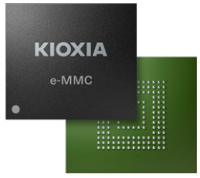
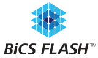

> 原文件：[Sd5c250c4563c_americas.kioxia.co_KIOXIA_e-MMC_Product_Brief.pdf](https://github.com/jadennevercode/CJCC-Knowledge-Base/blob/564ab11aa9785e569e3853c8a4d7ce86f88e7535/materials/%E5%9F%BA%E7%A1%80%EF%BC%9A%E8%A1%8C%E4%B8%9A%E6%9C%AF%E8%AF%AD%E4%B8%8E%E6%8C%87%E6%A0%87/Sd5c250c4563c_americas.kioxia.co_KIOXIA_e-MMC_Product_Brief.pdf)
> 转换方式：Volcengine OCRPdf v3, parse_mode=ocr

<!-- 原文第 1 页 -->

KIOXIA 
Product Brief 
## e-MMC MANAGED FLASH 
KIOXIA's broad,high-performance lineup of e-MMC products integrates flash memory and an e-MMC controllr ina single BGA package to perform functions such aserror correction, wear leveling, logcalto-physical address translation, and bad-block management These solutions support a high-speed memory interface compliant with JEDEC Version 5.0/5.1 and eliminate the need for the host to directly control the flash memory. 
e-MMC remains an important solution for many applications that are not able to migrate to the latest generation UFS,either because the densities needed are at the lower GB range,or because the processor does not yet support a UFS interface.Fabricated with solutions that utize either 15nm process technology or or more advanced BiCS FLASH"3D fiash memory, our e-MC products are well suited for a wide range ofapplications that continue to need e-MMC as an embedded memory solution. 
 
## I Advantages 
·Easy adoption for SoCs 
·Widely supported MutiMediaCard (MMC) interface 
·Multiple boot partitions 
·Strong on-board ECC 
·Low power consumption 
Small footprint 
I Key Features 
KIOXIA controller 
Parallel interface 
·BiCS FLASH"3D flash memory 
Standard & extended temperature ranges 
·JEDEC standard(v5.0/v5.1) 
11.5x13mm 153 ball BGA 
(11x 10mm4GB package option) 
I Applications loT devices 
Smartphones 
Smart TVs 
·Tablets/2-in-1 
·Automotive 
Streaming Media 
·Smart Speakers 
Densities 
·128GB 
·64GB 
·32GB 
16GB 
8GB 
4GB 
"Based on 15nm 2D flash memory 
Design Considerations 
UFS v4.0 
 
supports UFS v3.1 4640MB/s 
 
supports 2320MB/s 
e-MMC v5.1 
 
supports 400MB/s 
Use UFS When: 
Use e-MMC When 
·Higher densities are needed (from 32GB to 1TB)* 
Lower densities are needed (4GB,8GB, 16GB) 
Enhanced performance is desired (UFS provides high-speed read/write performance with good power efficiency) 
SoC-supporting UFS interface is not available 
·SoCs that interface to UFS are available 
"Plese ertrpumber table or curety wiseesiee 
 
htps://business.kigxia.com/ 
CS

---

<!-- 原文第 2 页 -->

le-MMC | Managed Flash 

| | Part Number | Capacity | e-MMC Version | Process | Max Data Rate (MB/s) | Supply Voltage | | Operating Temp C | Package (mm) |
| --- | --- | --- | --- | --- | --- | --- | --- | --- | --- |
| | V(V) | VeooV) |
| ebera iamusnocs | THGBMNG5D1LBAIT | 4GB | 5.0 | | | 2.7to 3.6 | 1.70to1.95, 2.7to3.6 | -25to 85 | 11×10x0.8 |
| THGBMTG5D1LBAIL | FG NAND | 400 | 11.5x13x0.8 |
| THGBMUG6C1LBAIL | BGB | 6.1 |
| THGBMUG7C1LBAIL | 16GB |
| THGBMUG8C2LBAIL | 32GB |
| THGAMVG7T13BAIL | 16GB | 6.1 | BiCS FLASH | 400 | 2.7to 3.6 | 1.70 to 1.95 | 11.5x13x0.8 |
| THGAMVG8T13BAIL | 32GB |
| THGAMVG9T23BAIL | 64GB |
| THGAMVTOT43BAIR | 128GB | 11.5x13x1.0 |
| THGAMSG9T24BAIL | 64GB | 6.1 | BiCS FLASH" | 400 | 2.7to 3.6 | 1.70 to 1.95 | 11.5x13x0.8 |
| THGAMSTOT24BAIL | 128GB |
| ebera lgnsubni | THGBMJG6C1LBAU7 | BGB | 6.1 | FG NAND | 400 | 2.7to 3.6 | 1.70to1.95, 2.7to3.6 | -40to105 | 11.5x13x1.0 |
| THGBMJG7C2LBAU8 | 16GB | 11.5x13x1.2 |
| THGBMJG8C4LBAU8 | 32GB |
| THGBMJG9C8LBAU8 | 64GB |
 
(1) Tc=115Cmsx.Contact your KIOXA sales epresentaive for sample schedule 
l ll and operating system. such as Microsoft Operating System and/or pre instaled sofware appliations,or meda content.Actual tormated capaoiy may vary. 
JEDEC s a registered trademark o EDEC Solid State Technolgy Association 
Product image may dittr rom h atual pdut. 
htp:/busnes.kixia.com/ 
CS
