> 原文件：[43_s28.q4cdn.com_Q4-25-Earnings-Presentation_2-.pdf](https://github.com/jadennevercode/CJCC-Knowledge-Base/blob/564ab11aa9785e569e3853c8a4d7ce86f88e7535/materials/%E6%B5%81%E9%80%9A%EF%BC%9A%E6%B8%A0%E9%81%93%E4%B8%8E%E4%BA%A4%E6%98%93%E5%85%B3%E7%B3%BB/43_s28.q4cdn.com_Q4-25-Earnings-Presentation_2-.pdf)
> 转换方式：Volcengine OCRPdf v3, parse_mode=ocr

<!-- 原文第 1 页 -->

Arrow Electronics Earnings Presentation Fourth Quarter & Full Year 2025 February 5, 2026 
ARW LISTED NYSE 
NNW NVUW 
NYS9 NNGW 
AVUW 
MONCIK 
William Austen, Interim President and CEO Raj Agrawal, Senior Vice President and CFO

---

<!-- 原文第 2 页 -->

## Safe Harbor 
This presentation includes"forward looking statements,"as the term is defined under the federal securities laws.Forward-looking statements are those statements which are no statements of historical or currnf fat These forward looking statements an be identified by forward-looking words such as "expects,"anticiates"ntendsplansay ilollesionr oipi risks, and uncertainties,which could cause actual results or fats to differ materialy from such statements for a variety of reasons, including, ut not timited to, unfavorable economic ondition or hanges, ineludin those that may cur in onnetion with recession, inflatin, ta rats, foreign curenry echange rates,or the avalabity of capita polticl instability and changes, impacts of military conflict and sanctions, trade protection measures, tarfs.icrcased trade tensions, trade agreements and policies,and othe restiction,duies,and alue-added taxes,nd theassociated acroeooic ipactsdisruptions,shortaes,o ineffrincisin te supply chain non-complance with certai Laws,egulatins,or executive orders,such as trade,export, anttrs, and anticorruption laws,or regulatory restrictios relating to the company or its subsidiaries or th permissit ofthird-parties to trasa therewith the inbilty to ealize suficientsales to over n-cancellable purhae ationsnder certain distributio agreements management transitions, including the compan's search for a permanent E the incurrence of unanticipated charges or falure to realize contemplated cost avings in onection with th Operating xpense Eficiency Plan, changes in prodct supply,pricing,andcustomer demand ncreased prot argin pressure resulting from industry condtions,competition, or other factors changes in relationships with key suppliers other vagares in the qlobal components and the qloba ECS markets changes te applicable laws,egulations,eecutive orders,or rules relatin to goverent otractorsand the resulting legal and reputational xposure,ineluding but not imited to those relating to environmental socia, overnance,cybersecurity, data privacy,and artficil inteliene isuscommercial disputes,patent infringement claims,produt liailt lawsuits, or other legal proceings foreign tax and ther loss contingencies, falur, diruption,or compromise of the company's informatin systems or those of a third-part erice provider, ning nauthorized us iscosre of company,suppler, or customer information, utbreaks, pidemics, pandemics,or public health rises the ffects natural or man made catastrophic events and the company's ability to generate positive cash flow.For a further discussion of these and other factors that could cause the company's future results to differ materially from any forward looking tements,see the section entitled "Risk Factors" in the company's most recent Annual Report on Form 10-K, as well as in ther flinsthe ompany aes with the SEC. Shareholders and other readers are cautioned not to place undue relane on these forward-looking statements which speak only as of the date on which they are made.The company undertakes no obligation to update publicly or revise any of the forward-looking statements 
NNUW 
2

---

<!-- 原文第 3 页 -->

Q4 2025 Highlights CONSOLIDATED SALES $8.7 Billion 
OPERATING MARGIN1 
DILUITED EARNINGS PER SHARE1 Percent $4.39 Up 48% Y/Y 
3.8 
Up 20% Y/Y 
Consolidated revenue and earnings per share exceeded high end of guidance range 
Global Components segment revenue exceeded high end of guidance range 
Global Enterprise Computing Solutions segment revenue exceeded midpoint of guidance range 
Additional Q4 2025 financial information: 
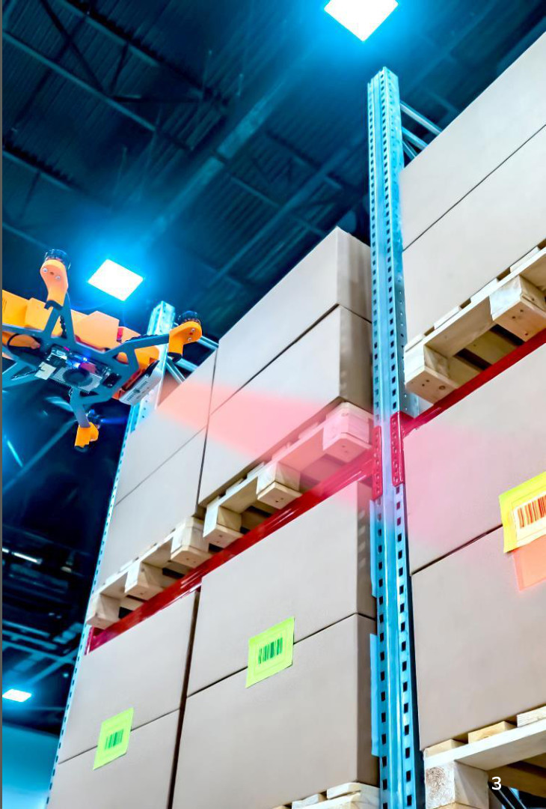 
·Record Global Enterprise Computing Solutions gross profit and operating profit 
·$336 million operating income1 $228 million net income1 NNUW 
1guetsh

---

<!-- 原文第 4 页 -->

## Why Arrow As the premier orchestrator of technology solutions, we guide innovation forward 
Strong Position in Large and Growing Markets 
Differentiated 
Focused 
Capabilities Driving Profitable Growth 
Capital Allocation 
Strategy 
Superior product distribution execution in the $250B+"indirect" DTAM1.2 
Extending foundational product distribution capabilities into adjacent, higher margin value-added services 
Reinvest in organic growth ·Strategic M&A 
Expanding addressable market through increased mix shift toward valueadded offerings 
Return excess capital to shareholders 
Increased productivity through simplifying operations 
Diversified Business Model Provides Financial Flexibility 
Combination of Global Components and ECS is a strategic advantage Strong balance sheet 
Consistent free cash flow generation 
Maintain investment-grade credit rating 
1 Source: IDC, OMDIA, and Arrow analysis 2 DTAM: Distribution Total Addressable Market 
ANUW 
4

---

<!-- 原文第 5 页 -->

## Overview 
·Execute through gradual recovery with discipline 
·Deliver profitable growth 
·Expand value-added offerings 
. Position Arrow through strategy, differentiated 
capabilities, and diversified business model 
 
NNUW

---

<!-- 原文第 6 页 -->

## FY 2025 Financial Metrics 
CONSOLIDATED SALES 
$21.5 GLOBAL COMPONENTS SALES 
GLOBAL ECS SALES $9.4 
DILUTED EARNINGS PER SHARE1 $11.02 Up4%Y/Y 
$30.9 Billion 
Billion 
Billion 
Up 10% Y/Y 
up 8%Y/Y 
Up 18% Y/Y 
Key Takeaways: 
Growth in accretive value-added services 
·Productivity initiatives driving efficiencies 
·Regional and customer mix headwinds to FY 2025 results, gradually improving 
NNUW 
1.Figures are Non-GAAP. See reconciliatin to comparable GAAP figures in the tables at the end of this presentation 
6

---

<!-- 原文第 7 页 -->

## Q4 2025 Financial Metrics Sin milions ecept forEPS 
Sales & Non-GAAP Gross Margin1 Non-GAAP Operating Expenses1 
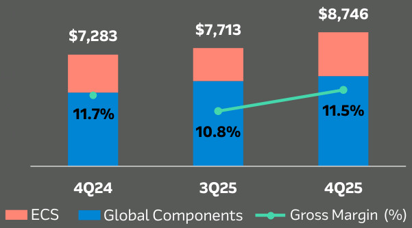 
Non-GAAP Operating Income1 
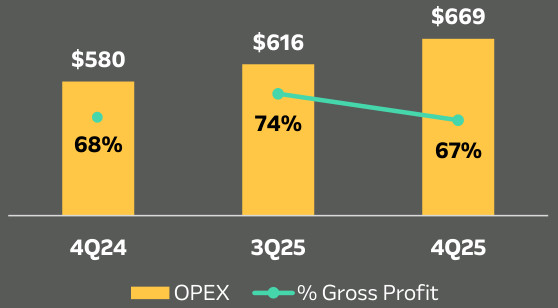 
Non-GAAP Diluted EPS1 
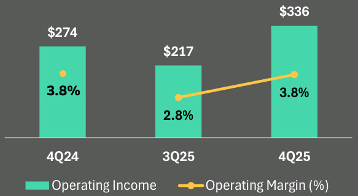 
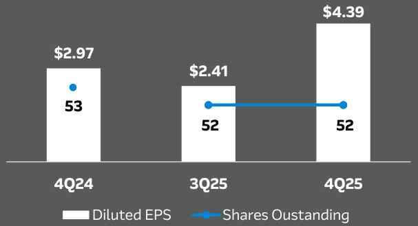 
Interest and other expense,net in Q4'25 was $44 milion Non-GAAP Effective Tax Rate was 23.0%1 
NNUW 
1See reconciliation to comparable GAAP figures in the tables at the end of this presentation 
7

---

<!-- 原文第 8 页 -->

## Q4 2025 Global Components S in milion 
## Sales & Non-GAAP Gross Margin 
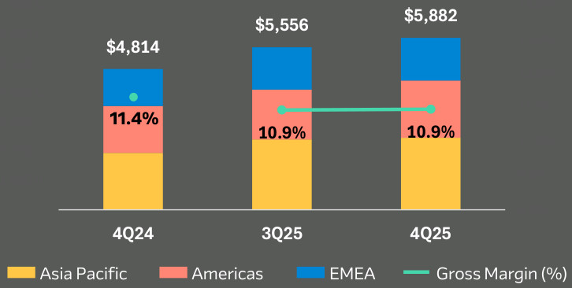 
·Gradual cyclical upswing: 
·Book-to-bill remains above parity in all regions 
Backlog grew for fourth consecutive quarter 
·All three regions performed above seasonal 
·Sales for semi and IP&E components grew 
·Healthy demand trends across many core markets 
Inventory turns normalizing 
Lead times modestly expanded 
NNUW 
Non-GAAP Operating Income1 
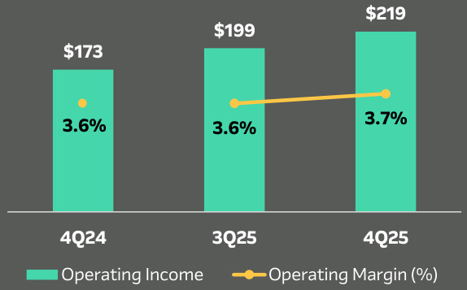 
·Focus remains on profitable growth: 
Regional and customer business mix gradualy improving 
Deliberate shift to higher mix of value-added offerings 
·Operational productivity initiatives freeing up reinvestment capacity 
On a regional basis: 
Americas -strength in Aerospace & Defense, Iindustrial, Transportation, 
Networking & Communications 
EMEA - healthy backlog build across verticals 
APAC -continued sequential growth 
1See reconcliatint co parale CAP argres nt ht besath end ftft snttnn 
8

---

<!-- 原文第 9 页 -->

## Q42025 Enterprise Computing Solutions S in milion 
## Sales & Non-GAAP Gross Margin 
Non-GAAP Operating Income1 
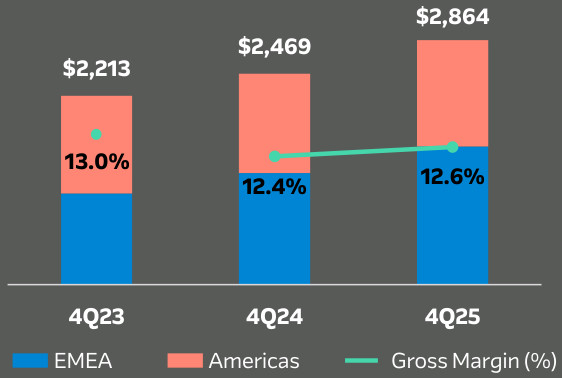 
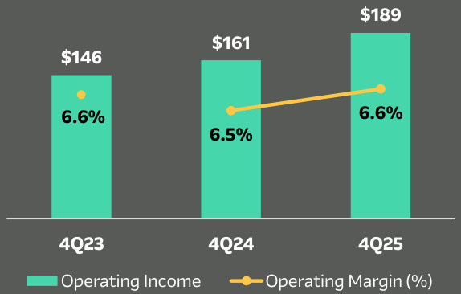 
Secular demand trends around AI driving strength across technology categories: 
·Total billings mix: Recurring revenue roughly 1/3rd 75% software and services|25% hardware 
Hybrid cloud Infrastructure hardware and software 
·Backlog 75%+ higher year over year 
Cybersecurity 
·Exclusive go-to-market partnerships taking Arrow beyond a traditional distributor 
Data protection 
·Data intelligence 
NNUW 
1See reconciliation to comparable GAAP figures in the tables at the end of this presentation 
9

---

<!-- 原文第 10 页 -->

## Q4 2025 Balance Sheet and Cash Highlights 
## Net Working Capital ($SB) 
·Non-GAAP Return on Working Capital (ROWC) was 18.1% in the fourth quarter, rose 170 basis points year on year. The increase in ROWC related primarily to higher operating income in both segments. 
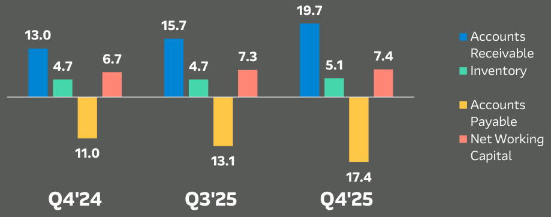 
Non-GAAP Return on Invested Capital (ROIC)1 was 11.1 in the fourth quarter, rose 190 basis points year on year. The increase in ROIC related primarily to higher operating income in both segments. 
Cash Conversion (Days) 
Operating Cashflow was $200M Gross Debt was $3.1B 
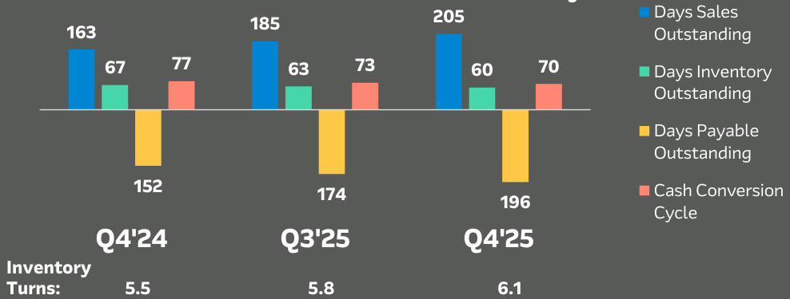 
·Repurchased $50M in shares 
NNUW 
1See reconciliation to comparable GAAP figures in the tables at the end of this presentation Amounts may not calculate precisely due to rounding 
10

---

<!-- 原文第 11 页 -->

Q12026 Guidance 
Consolidated Sales $7.95 billion to $8.55 billion
Global components $5.75 billion to $6.15 billion
Global ECS $2.20 billion to $2.40 billion
Diluted Earnings Per Share $2.13 to $2.33
Non-GAAP Diluted Earnings Per Share1 $2.70 to $2.90
Interest and other expense,net Approximately $60 million 
*Assumes an average tax rate in the range of 23%to 25%. 
Changes in foreign currencies to increase sales by approximately $263 million, and earnings per share on a diluted basis by $0.10 compared to the first quarter of 2025 Changes in foreign currencies to increase quarter-over-quarter growth in sales by s17 million, and earnings per share on a diluted basis will have no impact compared to the fourth quarter of 2025 
 
NNUW 
1.See reconciliation to comparable GAAP figures in the tables at the end of this presentation

---

<!-- 原文第 12 页 -->

## Looking Forward 
·Strong execution as gradual recovery progresses 
·Encouraging leading indicators 
Expanding value-added offerings 
·Drive profitable growth 
. Better align go to market organization to drive growth initiatives 
·Diversified business model, improving profitability, and focused capital allocation 
·Focus on shareholder value 
·Ongoing CEO search 
 
NNUW

---

<!-- 原文第 13 页 -->

 
Thank You Q&A AVGW 
13

---

<!-- 原文第 14 页 -->

 
Additional information and 
financial tables 
AVGW 
14

---

<!-- 原文第 15 页 -->

Consolidated fourth-quarter overview ($ in millions, except per share data) 

| P&L Highlights | Q42025 | Q42024 | Y/Y CHANGE | 042024IN CONSTANT CURRENCY | Y/Y CHANGE IN CONSTANT CURRENCY | Q32025 | Q/Q CHANGE |
| --- | --- | --- | --- | --- | --- | --- | --- |
| Sales | $8,746 | $7,283 | 20.1% | $7,514 | 16.4% | $7,713 | 13.4% |
| Gross Proft Margin | 11.5% | 11.0% | 50 bps | 11.1% | 40 bps | 10.8% | 70 bps |
| Operating Income | $294 | $195 | 50.7% | $211 | 39.4% | $179 | 64.3% |
| Operating Margin | 3.4% | 2.7% | 70 bps | 2.8% | 60 bps | 2.3% | 110 bps |
| Non-GAAP Operating Income | $336 | $274 | 22.9% | $290 | 16.2% | $217 | 54.7% |
| Non-GAAP Operating Margin | 3.8% | 3.8% | 0 bps | 3.9% | -10 bps | 2.8% | 100 bps |
| Net Income | $195 | $99 | 96.2% | $111 | 75.1% | $109 | 78.2% |
| Diluted EPS | $3.75 | $1.86 | 101.6% | $2.09 | 79.4% | $2.09 | 79.4% |
| Non-GAAP Net Income | $228 | $158 | 44.1% | $170 | 33.9% | $126 | 81.1% |
| Non-GAAP Diluted EPS | $4.39 | $2.97 | 47.8% | $3.20 | 37.2% | $2.41 | 82.2% |
 

| | Q42025 | 042024 | Y/Y CHANGE | Q42024IN CONSTANT CURRENCY | Y/Y CHANGE IN CONSTANT CURRENCY | Q32025 | Q/Q CHANGE |
| --- | --- | --- | --- | --- | --- | --- | --- |
| Operating expenses | $715 | $608 | 17.5% | $626 | 14.1% | $656 | 8.9% |
| Operating expenses marqin | 8.2% | 8.4% | -20 bps | 8.3% | -10 bps | 8.5% | -30 bps |
| Non-GAAP Operating expenses | $669 | $580 | 15.3% | $597 | 12.0% | $616 | 8.6% |
| Non-GAAP Operating expenses margir | 7.6% | 8.0% | -40 bps | 7.9% | -30 bps | 8.0% | -40 bps |
 
NNUW 
15

---

<!-- 原文第 16 页 -->

Revenue history ($ in millions, may reflect rounding) 

| | Q4'24 | Q1'25 | Q2'25 | Q3'25 | Q4'25 | YoY change | QoQ change |
| --- | --- | --- | --- | --- | --- | --- | --- |
| Global Components Total | 4,814 | 4,778 | 5,285 | 5,556 | 5,882 | 22% | 6% |
| Americas | 1,604 | 1,569 | 1,708 | 1,709 | 1,960 | 22% | 15% |
| Europe, Middle East & Africa | 1,262 | 1,340 | 1,427 | 1,444 | 1,460 | 16% | 1% |
| Asia Pacific | 1,948 | 1,869 | 2,150 | 2,404 | 2,462 | 26% | 2% |
| Enterprise Computing Solutions Total | 2,469 | 2,036 | 2.295 | 2,156 | 2,864 | 16% | 33% |
| Europe, Middle East & Africa | 1,307 | 1,126 | 1,242 | 1,134 | 1,618 | 24% | 43% |
| Americas | 1.162 | 910 | 1.053 | 1,022 | 1.246 | 7% | 22% |
| Arrow Electronics Total | 7.283 | 6.814 | 7.580 | 7.713 | 8.746 | 20% | 13% |
 
NNUW 
16

---

<!-- 原文第 17 页 -->

## Operating income history 
## Global Components ($M) Enterprise Computing Solutions ($M) 
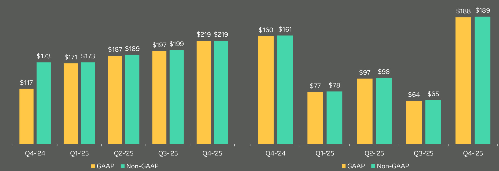 
NNUW 
See the reconiliation to comparable GAAP figures in the tables at the end of this presentation 
17

---

<!-- 原文第 18 页 -->

## Certain Non-GAAP financial 
## information 
In addition to disclosing financial results that are determined in accordance with accounting principles generally accepted in the United States ("GAAP"),the company also provides certain non-GAAP financial information relating to sales, gross profit, operating income (including by business segment),operating margin, operating expense, consolidated net income, noncontrolling interest,provision for income tax, income before income taxes,net income attributable to shareholders, effective tax rate, net income per share on a diluted basis, return on working capital, and return on invested capital. 
These non-GAAP measures are adjusted by certain of the following, as applicable: the impact of changes in foreign currencies (referred to as "changes in foreign currencies"or "on a constant currency basis") by re-translating prior-period results at current-period foreign exchange rates, identifiable intangible asset amortization, restructuring, integration, and other charges, net gains and losses on investments, and the impact of wind down to inventory. 
Management believes that providing this additional information is useful to the reader to better assess and understand the company's operating performance and future prospects in the same manner as management, especially when comparing results with previous periods. Management typically monitors the business as adjusted for these items, in addition to GAAP results, to understand and compare operating results across accounting periods, for internal budgeting purposes, for short- and long-term operating plans, and to evaluate the company's financial performance.However, analysis of results on a non-GAAP basis should be used as a complement to, in conjunction with, and not as a substitute for, data presented in accordance with GAAP. 
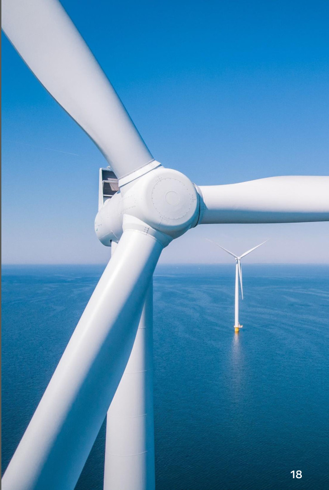 
For a complete reconciliation between our GAAP and non-GAAP results,please refer to reconciliations found at the end of this document. 
NNUW

---

<!-- 原文第 19 页 -->

First-quarter 2026 GAAP to non-GAAP outlook reconciliation ($in billions,except per share data) 
NON-GAAP SALES RECONCILIATION 

| | | Quarter Ended | | % Change | Quarter Ended | | % Change |
| --- | --- | --- | --- | --- | --- | --- | --- |
| | 4-Apr-26 | 29-Mar-25 | 4-Apr-26 | 31-Dec-25 |
| Global components sales, GAAP | $ | 5.75-6.15 | 4.78 $ | 20%-29% | 5.75-6.15 | 5.88 | (2)%-5% |
| Impact of changes in foreign currencies | | | 0.15 | | | 0.01 | |
| Global components sales, constant currency | $ | 5.75-6.15 | $ 4.93 | 17%-25% | 5.75-6.15 | 5.89 | (2)%-4% |
| Global ECS sales,GAAP | $ | 2.20-2.40 | $ 2.04 | 8%-18% | 2.20-2.40 | 2.86 | (23)%-(16)% |
| Impact of changes in foreign currencies | | | 0.12 | | | 0.01 | |
| Global ECS sales, constant currency | $ | 2.20-2.40 | $ 2.16 | 2%-12% | 2.20-2.40 | 2.87 | (23)%-(16)% |
 
NON-GAAP EARNINGS RECONCILIATION 

| | REPORTED GAAP MEASURE | INTANGIBLE AMORTIZATION | RESTRUICTURING & INTEGRATION | NON-GAAP MEASURE |
| --- | --- | --- | --- | --- |
| | | EXPENSE | CHARGES | |
| Net income per diluted share | $2.13 to $2.33 | $0.07 | $0.50 | $2.70 to $2.90 |
 
NNUW 
19

---

<!-- 原文第 20 页 -->

# Non-GAAP fourth-quarter sales reconciliation 
($ in thousands) 
1,603.710 808 1,959,548 
4,922.660 
5,882,277 
4,813,760 108,900 
5,882,277 
7,514,492 
8,746,430 
7,282,877 231,615 
$ 
8,746,430 
31-Dec-24 
%Change 
Consolidated sales, as reported 
$ 
20.1% 
Impact of changes in foreign currrnies 
Consolidated sales,constant currency 
16.4% 
Global components sales,as reported 
$ 
$ 
22.2% 
Impact of changes in foreign currencies 
Global components sales, constant currency 
19.5% 
Americas components sales, asreported 
$ 
22.2% 
Impact of changes in foreign currencies 
Americas components sales,constant currency 
$ 
1,959,548 $ 
1,604,518 
22.1% 
EMEA components sales, as reported 
$ 
2,591.832 2,864,153 
2,469,117 122,715 
2,864,153 
1,950,166 
2,462,431 
1.947,730 2,436 
2,462,431 
1,367.976 
1,460,298 
1.262.320 105,656 
1,460,298 
15.7% 
Impact of changes in foreign currencies 
EMEA components sales, constant currency 
$ $ 
6.7% 
Asia components sales, as reported 
$ 
26.4% 
Impact of changes in foreign currencies 
Asia components sales, constant currency 
26.3% 
GlobaL ECS sales,as reported 
$ $ $ $ 
16.0% 
Impact of changes in foreign currencies 
Global ECS sales,constant currency 
10.5% 
Americas ECS sales, as reported 
1.246.108 1,162,227 
7.2% 
Impact of changes in foreign currencies 
1,428.780 1,618,045 
1,306.890 121,890 
1,618.045 
1,163,052 
1,246,108 
825 
Americas ECS sales, constant currency 
7.1% 
EMEA ECS sales, as reported 
23.8% 
Impact of changes in foreign currencies 
NNUW 
EMEA ECS sales, constant currency 
Quarter Ended 31-Dec-25 
$ 
13.2% 
20

---

<!-- 原文第 21 页 -->

## Full Year GAAP to non-GAAP reconciliation ($in thousands, except per share data) 
Year ended December 31,2025 

| | Reported GAAP measure | | Intangible Amortization Expense | Restructuring& Integration charges | | Impact of Wind Down(1) | | Non-recurringtax items (2) | Other(3) | Non-GAAP measure |
| --- | --- | --- | --- | --- | --- | --- | --- | --- | --- | --- |
| Operating income | $ | 822,223 | $ 19,760 | $ | 116,119 | $ | (10,266) | $ | $ 172 | 948,008 |
| Income before income taxes | $ | 717,928 | 19,760 | | 116,119 | | (10,266) | | (109,716) | 733,825 |
| Provision for income taxes | | 148.234 | 4,849 | | 27,923 | | (3,199) | 8.143 | (26,321) | 159,629 |
| Consolidated net income | | 569.694 | 14,911 | | 88,196 | | (7,067) | (8,143) | (83,395) | 574,196 |
| Noncontrolling interests | | (1,572) | 156 | | | | | | | (1,416) |
| Net income attributable to shareholders | $ | 571.266 | $ 14.755 | $ | 88.196 | $ | (7,067) $ | (8,143) | $ (83,395) | 575,612 |
| Net income per diluted share 5) | $ | 10.93 | $ 0.28 | $ | 1.69 | $ | (0.14) $ | (0.16) | $ (1.60) | 11.02 |
| Effective tax rate (6) | | 20.6% | | | | | | | | 21.8% |
 
Year ended December 31,2024 

| | Reported GAAP measure | | Intangible Amortization Expense | Restructuring& Integration charges | Impact of Wind Non- recurringtax Down(1) | Other(4) | Non-GAAP measure |
| --- | --- | --- | --- | --- | --- | --- | --- |
| Operating income | | 768,557 | $ 29,529 | $ 142,917 | 60,573 | $ | 1,001,576 |
| Income before income taxes | | 489,319 | 29,529 | 142,917 | 60.573 | 6,487 | 728.825 |
| Provisionfor income taxes | | 95.812 | 7.348 | 35,138 | 19.139 | 1,557 | 158.994 |
| Consolidated net income | | 393.507 | 22,181 | 107,779 | 41,434 | 4.930 | 569,831 |
| Noncontrolling interests | | 1,433 | 541 | | | | 1,974 |
| Net income attributable to shareholders | $ | 392,074 | $ 21,640 | $ 107,779 | $ 41,434 | $ 4,930 | 567,857 |
| Net income per diluted share | $ | 7.29 | $ 0.40 | $ 2.00 | 0.77 | $ 0.09 | 10.56 |
| Effective tax rate (6) | | 19.6% | | | | | 21.8% |
 
(1) Includes write-downs (recoveries) of inventory related to the wind down of businesses. 
(2) Includes gains from settlements related to 2017 u.S. federal tax law changes. 
(3) Other includes gain on investments, net, and employee severance and benefits costs not related to restructuring initiatives presented in cost of sales. 
(4) Other includes (gain) Loss on investments, net and loss on extinguishment of debt. 
(5) The sum of the components for nonGAAP diluted EPS, as adjusted may not agree to totals, as presented, due to rounding. 
(6) The items as shown in this table, represent the reconciling items for the tax rate as reported and as a non-GAAP measure. 
NNUW 
21

---

<!-- 原文第 22 页 -->

## Quarterly GAAP to non-GAAP reconciliation ($in thousands, except per share data) 
Three months ended December 31, 2025 
(1) Includes write-downs (recoveries) of inventory related to the wind down of businesses. 

| | Reported GAAP measure | Intangible Amortization Expense | | Restructuring & Integration charges | Impact of Wind Down | | Non-recurring tax items | Other(3) | | Non-GAAP measure | |
| --- | --- | --- | --- | --- | --- | --- | --- | --- | --- | --- | --- |
| Operating income | 294,077 $ | | 4,764 | 5 41,239 | 5 | (3,638) | $ | 生 | | 5 | 336,442 |
| Income before income taxes | 252,973 | | 4,764 | 41,239 | | (3,638) | | | (913) | | 294,425 |
| Provision for income taxes | 59,427 | | 1,163 | 8,523 | | (1,100) | | | (219) | | 67,794 |
| Consolidated net income | 193,546 | | 3,601 | 32,716 | | (2,538) | | | (694) | | 226,631 |
| Noncontrolling interests | (1,058) | | | | | | | | | | (1,058) |
| Net income attributable to shareholders | 194,604 | 5 | 3,601 | 5 32,716 | 生 | (2,538) | | 主 | (694) | $ | 227,689 |
| Net income per diluted share (40 | 3.75 | $ | 0.07 | 5 0.63 | 5 | (0.05) | | S | (0.01) | $ | 4.39 |
| Effective tax rate (51 | 23.5% | | | | | | | | | | 23.0% |
 
(2) Includes gains from settlements related to 2017 u.S. federal tax law changes. 
(3) Other includes gain on investments, net. 
Three months ended December 31, 2024 
(4) The sum of the components for nonGAAP diluted EPS, as adjusted may not agree to totals, as presented, due to rounding 

| | Reported GAAP measure | | Intangible Amortization Expense | | | Restructuring & Integration charges | Impact of Wind Down (1) | | Non-recurring tax items | Other(3) Non-GAAP measure | | | |
| --- | --- | --- | --- | --- | --- | --- | --- | --- | --- | --- | --- | --- | --- |
| Operating income | $ | 195,103 | $ | | 7,219 | 5 21,058 | $ | 50,344 | $ | $ | | 5 | 273,724 |
| Income before incme taxes | | 128,704 | | | 7,219 | 21,058 | | 50,344 | | | 4,070 | | 211,395 |
| Provision for income taxes | | 28,816 | | | 1,786 | 4,318 | | 16,692 | | | 977 | | 52,589 |
| Consolidated net incorme | | 99.888 | | | 5,433 | 16,740 | | 33,652 | | | 3.093 | | 158,806 |
| Noncontrolling interests | | 680 | | | 135 | | | | | | | | 815 |
| Net income atributable to shareholders | | 99,208 | 5 | | 5,298 | $ 16,740 | $ | 33,652 | | | 3,093 | $ | 157,991 |
| Net income per diluted share (4) | | 1.86 | $ | | 0.10 | 5 0.31 | $ | 0.63 | | $ | 0.06 | 生 | 2.97 |
| Effective tax rate l | | 22.4% | | | | | | | | | | | 24.9% |
 
(5) The items as shown in this table, represent the reconciling items for the tax rate as reported and as a non-GAAP measure. 
Three months ended September27,2025 

| | Reported GAAP measure | | Intangible Amortization Expense | | Restructuring & Integration charges | Impact of Wind Down (1 | | Non-recurring tax items (2) | | Other (3) | Non-GAAP measure | |
| --- | --- | --- | --- | --- | --- | --- | --- | --- | --- | --- | --- | --- |
| Operating income | 4 | 179,007 | 5 | 4,766 | $ 35,648 | $ | (1,989) | $ | | $ | $ | 217,432 |
| Income before income taxes | | 128,790 | | 4,766 | 35,648 | | (1,989) | | | (4,859) | | 162,356 |
| Provision for income taxes | | 19,528 | | 1,162 | 9,302 | | (629) | | 8,359 | (1,166) | | 36,556 |
| Consolidated net income | | 109,262 | | 3,604 | 26,346 | | (1,360) | | (8,359) | (3,693) | | 125,800 |
| Noncontrolling interest | | 69 | | | | | | | | | | 69 |
| Net income attributable to shareholders | 5 | 109.193 | $ | 3.604 | $ 26.346 | $ | (1.360) | $ | (8.359) | $ (3,693) | $ | 125,731 |
| Net income per diluted share (4 | 5 | 2.09 | $ | 0.07 | $ 0.51 | 5 | (0.03) | $ | (0.16) | 5 (0.07) | $ | 2.41 |
| Effective tax rate (5I | | 15.2% | | | | | | | | | | 22.5% |
 
NNUW 
22

---

<!-- 原文第 23 页 -->

Gross profit and operating expense reconciliation ($ in thousands) 

| | 12/31/2024 | | 3/29/2025 | 6/28/2025 | 9/27/2025 | 12/31/2025 |
| --- | --- | --- | --- | --- | --- | --- |
| Consolidated Gross Profit | 803,310 | 773.992 | | 848,657 | 835,314 | 1,008,756 |
| Impact of wind down to inventory | 50,344 | (2,467) | | (2,172) | (1,989) | (3,638) |
| Other | | | | 172 | | |
| Consolidated non-GAAP gross profit | 853,654 | | 771,525 | 846.657 | 833,325 | 1,005,118 |
| ($ in thousands) | 12/31/2024 | | 3/29/2025 | 6/28/2025 | 9/27/2025 | 12/31/2025 |
| Consolidated Operating Expense | 608,207 | | 615,439 | 658,071 | 656,307 | 714,678 |
| Intangible Amortization Expense | (7,219) | | (5,360) | (4,870) | (4,766) | (4,764) |
| Restructuring & Integration charges | (21,058) | | (17,313) | (21,919) | (35,648) | (41,239) |
| Consolidatednon-GAAP Operating Expense | 579,930 | | 592,766 | 631,282 | 615,893 | 668,675 |
| ($in thousands) | 12/31/2024 | | 3/29/2025 | 6/28/2025 | 9/27/2025 | 12/31/2025 |
| Americas ECS gross bilings | 2,942.118 | 2,307,737 | | 2,543,759 | 2,713,373 | 3,041,843 |
| EMEA ECS gross bilings | 3,144,823 | | 2,331,216 | 2,596,209 | 2,476,599 | 4,039,437 |
| Global ECS gross biling | 6,086.941$ | 4,638,954 | | 5,139,968 | 5,189,972 | 7,081,280 |
| ANOW | | | | | | 23 |

---

<!-- 原文第 24 页 -->

Return on working capital reconciliation ($in thousands) 

 Quarter Ended rear cnded 

| | Quarter Ended December 31,2025 | December31, 2024 | | December 31,2025 | December31,2024 |
| --- | --- | --- | --- | --- | --- |
| Numerator: | | | | | |
| Consolidated operating income,as reported | 294,077 | | 195,103 | 822,223 | 768,557 |
| | x4 | | x4 | ×1 | x |
| Annualized consolidated operating income | 1,176,308 | | 780,412 | 822,223 | 768,557 |
| Non-GAAP consolidated operating income | 336,442 | | 273,724 | 948,008 | 1,001,576 |
| | x4 | | x4 | x1 | |
| Annualized non-GAAP consolidated operating | | | | | |
| | 1,345,768 | | 1,094,896 | 948,008 | 1,001,576 |
| income | | | | | |
| Denominator: | | | | | |
| Accounts receivable,net | 19,744,499 | | 13,030,991 | 15,225,458 | 11,788,955 |
| Inventories | 5,081,863 | | 4,709,706 | 4.813.515 | 4,775,686 |
| Less: Accounts payable | 17,383,796 | | 11,047,470 | 13.128,372 | 9,644,210 |
| Working capital | 7,442,566 | | 6,693,227 | 6,910,601 | 6,920,431 |
| Return on working capital | 15.8% | | 11.7% | 11.9% | 11.1% |
| Return on working capital (Non-GAAP) | 18.1% | | 16.4% | 13.7% | 14.5% |

 
 
NNUW 
24

---

<!-- 原文第 25 页 -->

## Return on invested capital reconciliation 
($in thousands) Quarter Ended 
Numerators Consolidated operating income,as reported Equity in earnings o flited companies Less: Noncortrolling interests 1 Consolidated operating income, as adjusted Less:Tax effect (21 After-tax consolidated operating income,as adjusted Annualized after-tax consolidated operating income, as adjusted Non-GAAP consolidated operating income Equity in earnings of affliated companies Less: Noncontrolling interests [ Non-GAAP consolidated operating income, as adjusted Less: Tax effect 3I After-tax non-GAAP consolidated operating income, as adjusted Annualized after-tax non-GAAPoperating income, as adjusted Denominator: Average short-term borrowings,including curentportion of long-term debt (4) Average long-term debt Average total equity (4) Average cash and cash equivalents (4) Invested capital Return on invested capital Return on inveted capita ( Mon-GAA) 

| December 31,2025 | December 31,2024 |
| --- | --- |
| | 195,103 |
| | (544) |
| | 680 |
| | 193,879 |
| | 43.568 |
| | 150,311 |
| | |
| | x4 |
| | 601,244 |
| | 273,724 |
| | (544) |
| | 815 |
| | 272,365 |
| | 67,973 |
| | 204,392 |
| | x4 |
| $ | 817,568 |
| | 629,902 |
| | 2,568,512 |
| | 5,933,803 |
| | 218.404 |
| | 8,913,813 |
| | 6.7% |
| | 9.2% |
 

| | December 31, 2025 | December 31,2024 |
| --- | --- | --- |
| $ | 822,223 | 768,557 |
| 3,198 | 1.368 |
| (1,572) | 1,433 |
| | 826,993 | 768,492 |
| | 170,378 | 150,486 |
| 656,615 | 618,006 |
| $ | 656,615 | 618,006 |
| $ | 948,008 | 1,001,576 |
| 3,198 | 1,368 |
| (1,416) | 1,974 |
| | 952,622 | 1,000,970 |
| | 207,018 | 218.391 |
| | 745,604 | 782,579 |
| | ×1 | |
| $ | 745,604 | 782,579 |
| $ | 269,543 | 943,999 |
| 2,731,100 | 2,480,428 |
| 6,274,264 | 5,865,660 |
| 232,548 | 222,136 |
| $ | 9,042,360 | 9,067,951 |
| | 7.3% | 6.8% |
| | 8.2% | 8.6% |
 
NVUW 
## YearEnded 
(1) Operating income,as reported,and nonGAAP operating income is adjusted for noncontrolling interest and equity in earnings of affiliated companies to include the pro-rata ownership of non-wholly owned subsidiaries. efehe v e ioalapp December 31, 2025 and December 31,2024to consolidated operating income, as adjusted. The tax rate is adjusted to exclude the impacts of interest expense, gain on investments,net, and employee benefit plan expense, net. 
(3) The tax effect is calculated by applying the non-GAAP effective tax rate for the three months ended December 31, 2025and December 31, 2024 to non-GAAP consolidated operating income, as adjusted. The tax rate is adjusted to exclude the impacts of interest expense and employee benefit plan expense, net. 
(4) The quarter ended average is based on the addition of the account balance at the end of the most recently-ended quarter to the account balance at the end of the prior quarter and dividing by two. 
25

---

<!-- 原文第 26 页 -->

Non-GAAP segment reconciliation ($ in thousands) 

| | 12/31/2023 | 12/31/2024 | 3/29/2025 | 6/28/2025 | 9/27/2025 | 12/31/2025 |
| --- | --- | --- | --- | --- | --- | --- |
| Global components operating income,as reported | $ 281,260 | $ 116,910 | $ 171,385 | $ 186,808 | $ 197,355$ | 219,158 |
| Intangible assets amortization expense | 6,436 | 6,162 | 4,438 | 3,945 | 3,838 | 3,837 |
| Impact of wind down to inventory | | 50,344 | (2,467) | (2,172) | (1,989) | (3,638) |
| Other | | | | 172 | | |
| Global components non-GAAP operating income | $ 287,696 | $ 173,416 | $ 173,356 | $ 188,753 | $ 199,204 | $ 219,357 |
| Global ECS operating income, as reported | $ 145,053 | 160,421 | 77,314 | $ 96,969 | $ 63,744$ | 187,884 |
| Intangible assets amortization expense | 1,055 | 1,057 | 922 | 925 | 928 | 927 |
| Global ECS non-GAAP operating income | 146,108 | 161,478 | 78,236 | 97,894 | 64,672$ | 188,811 |
| Operating Margin | 6.6% | 6.5% | 3.8% | 4.3% | 3.0% | 6.6% |
 
NNUW 
26

---

<!-- 原文第 27 页 -->

Non-GAAP segment reconciliation (continued) ($ in thousands) 
Quarter Ended 

| | 12/31/2023 | 9/28/2024 | | 12/31/2024 | 3/29/2025 | 6/28/2025 | 9/27/2025 | 12/31/2025 |
| --- | --- | --- | --- | --- | --- | --- | --- | --- |
| Global components gross profit,as reported | 702,412 | $ 564.460 | $ | 497,324 | $ 554,945 | $ 591,454$ | 609,101 | $ 647,154 |
| Impact of wind down to inventory | | (1,857) | | 50,344 | (2,467) | (2,172) | (1,989) | (3,638 |
| Other | | | | | | 172 | | |
| Global components non-GAAP gross profit | 702,412 | 562,603 | | 547,668 | 552,478 | 589,454 | $ 607.112 | $ 643,514 |
| Global components gross profit,as apercentage of sales | 12.5% | 11.4% | | 10.3% | 11.6% | 11.2% | 11.0% | 11.0% |
| Global components non-GAAP gross profit, as a percentage of sales | 12.5% | 11.4% | | 11.4% | 11.6% | 11.2% | 10.9% | 10.9% |
| Global ECS gross profit, as reported | 287,138 | $ 220,368 | $ | 305,986 | $ 219,047 | $ 257,203 | $ 226,213 | $ 361,602 |
| Global ECS gross profit as a percentage of sales, as reported | 13.0% | 11.7% | | 12.4% | 10.8% | 11.2% | 10.5% | 12.6% |
 
NNUW 
27
