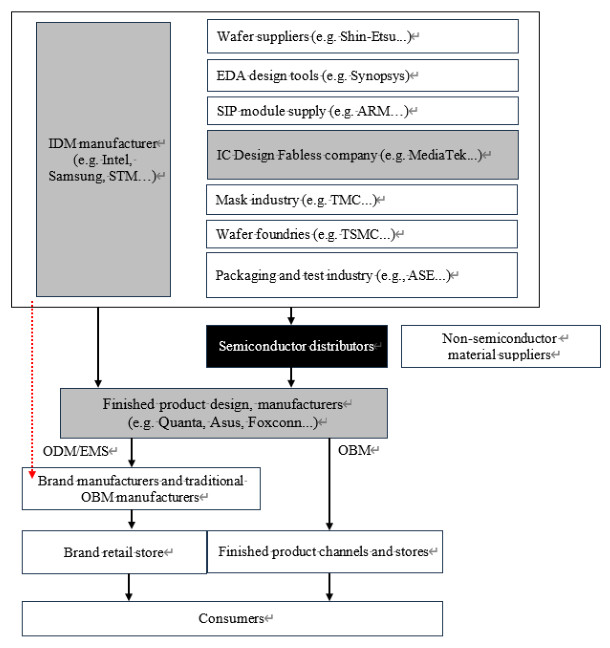
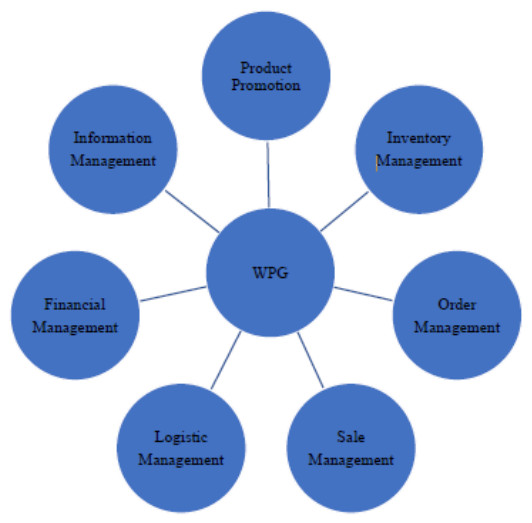
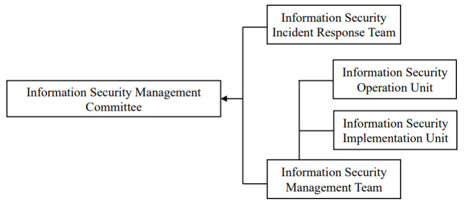

> 原文件：[43_wpgholdings.com_ARP00000038.pdf](https://github.com/jadennevercode/CJCC-Knowledge-Base/blob/564ab11aa9785e569e3853c8a4d7ce86f88e7535/materials/%E6%B5%81%E9%80%9A%EF%BC%9A%E6%B8%A0%E9%81%93%E4%B8%8E%E4%BA%A4%E6%98%93%E5%85%B3%E7%B3%BB/43_wpgholdings.com_ARP00000038.pdf)
> 转换方式：Volcengine OCRPdf v3, parse_mode=ocr

<!-- 原文第 1 页 -->

Stock Code:3702 
Annual Report website Market Observation Post System https://mops.twse.com.tw 
WPG annual report is available at: https://www.wpgholdings.com/investors/financial_highlights/zhtw/annual-reports 
wp WPC Hodings Limited 2025Annual Report 
Printed on May 2, 2026

---

<!-- 原文第 2 页 -->

WPG Spokesperson 
Name: Cliff Yuan 
Title: Chief Financial Officer 
Tel.:(02)2191-0068 Ext.85268 
E-mail: IR@wpgholdings.com 
Deputy Spokesperson 
Name: Zoe Peng 
Title: Director 
Tel:(02)2191-0068 Ext.85262 
E-mail: IR@wpgholdings.com 
## Head Office & Branches 

| Establishme | Address | Tel. (022194 |
| --- | --- | --- |
| Head Office | 22F.,.No 189, Jingmao 2nd Rd., | |
| Branch | None | None |
| Factory | None | None |
 
Common Share Transfer Agent and Registrar 
Name: Capital Securities Corporation 
Address: B2, No.97, Sec. 2, Dunhua S Rd, Da'an Dist,Taipei City 
Tel:(02)2702-3999 Website: http://www.capital.com.tw 
Last Annual Financial Statements Auditors 
Name: CPA Yi Fan Lin,CPA Yung Chih Lin 
Accounting Firm: PricewaterhouseCoopers Taiwan 
Address:27F.. Mo."33,Sc.,ceelung Rd., Taipei City 
Tel.:(02)2729-6666 Website: http://www.pwc.com/tw 
The Name of Any Exchanges Where the Company's Securities are Traded Offshore, and the 
Method by Which to Access nformation on Said Offshore Securities: None 
Website: https://www.wpgholdings.com/ 
E-mail: IR@wpgholdings.com

---

<!-- 原文第 3 页 -->

Table of Contents 
2.Corporate Governance Report 1. Letter to Shareholders....... …… … ..
2.1 Directors, Supervisors, President, Vice Presidents, Directors, and
Division/Department/Affliates Heads..... ..5
2.2 Remuneration Paid in the Most Recent Year to Directors, Supervisors, President,
and Vice Presidents... …15
2.3 Overview of Corporate Governance.21
2.4Information Rearding Certified Pubic Accountant Fees........ 2.5 Information on Replacement of CPAs. 76
2.6 Where the Company's Chairman, President, or any Manager in Charge of Finance
or Accounting Matters Has in the Most Recent Year Held a Position at the
Accounting Firm of Its Certified Public Accountant or at an Affliated Enterprise
of Such Accounting Firm, the Names, Titles and Positions Held by such Person
shall be Disclosed.... .76
2.7 Stock Trade and/or Stock Pledge by the Company's Directors, Supervisors,
Management, or Shareholders with 10% Shareholdings or More in the Most
Recent Year or as of the Date of Publication of this Annual Report........7
2.8Top 10 Shareholders Who Are Related Partics, Spouses, or wihin Second Degree
of Kinship to Each Other . ..7777
2.9 Total Number of Shares and Total Equiy Stake Held in Any Single Enterprise by
the Company, Its Directors and Supervisors, Management, and Any Companies
Controlled Either Directly or Indirecly by the Company ......
3.Capitl Overview.0
3.1Capal and Shares.0 3.ssuancof Corporate Bonds.6
3.3Issuance of Preferred Shares.91
3.4Issuance ofGlobal Depository Receipts..9
3.5Employee Share Subsription Warrants..9
3.6 New Restrcted Employee Shares.91
3.7 Issuance of New Shares in Connection with Mergers or Acquisitions or with
Acquistiosof Shares of Oter Compaies
3.8Financing Plans and Implementation.2

---

<!-- 原文第 4 页 -->

4Operational Highlihts3
4.1Buies Cis03
4.2Market and Sales Overview.
4.3Employes 17
4.4Envronmental Protection Expenses.1
4.5Labor Relations.18
4.6Cyber Securit.Manageme127
4.7 MaterialC'ntracts….,130
5.Analysis and Risk Items of Financial Status and Financial Performance............1
5.1 F nancialStafus131
5.2Fipancial Performance..103
5.3Cash Flow. …135
5.4 Major Capital Expenditures and Impact on Financial and Business in the Most
Recent Year .. …136
5.5 Reinvestment Policy for the Most Recent Fiscal Year, Main Reasons for
Profits/Losses and Improvement Plans for the Most Recent Fiscal Year, and
Investment Plans for the Coming Year..... …136
5.6 Risks Assessment in the Most Recent Year and up to the Date of this Annual
Report..137
5.7 Other Material Matters..141
6. SpecialNotes.142
6.1 Subsidiaries lformaton.142
6.2 Private Placement Securities in the Most Recent Year and as of the Date of this
Annual Report.. 142
6.3 Other necessary additional explanations......... ..1144
6.4In the most recnt fiscal year up to the date of publication of this annual report,
matters that have a significant impact on shareholders' equity or seuritis prics
as stipulated in Paragraph 3, subparagraph 2 of Article 36 of the Securities and
Exchange Act . …..124

---

<!-- 原文第 5 页 -->

## 1. Letter to Shareholders 
Through the industrial holding model, WPG focuses on international operational scale and local flexibilit, and fully implements the core values of "team, integrity, professionalism and efficiency" with the vision "To ecome the First Choice of Industry. To Become the Benchmark of Distribution". The Company continues to provide valuc-added supply chain management services, assisting customers in developing and investing in future markets while aiming to achieve "Co-Creation and Win Together" with our suppliers,customers, and strategic investment partners. Under the industrial holding model, we continue to expand our investment scope,and establish the production control ccosystem,to achieve the goals of resource integration and diversified management,enhancing international competitiveness and leading the enterprise to a new milestone.In alignment with the Group's strategic objectives and the requirements of long-term planning, we achieve customer success through smart warehousing scrvices and "Grow Together and Strive Together"with the industry. 1. 2025Review 
WPG's consolidated revenue in 2025 reached NTS999.11 billion (USS32.093 billion), and the net profit afer tax reached NTS10.105 billion. Basic earnings per share (EPS) was NTS5.77. Key performance indicators Returm on Working Capital (ROWC) and Retumn on Equity (ROE) were 10.60% and 12.17%, respectively.We increased our profit margin by continuously optimizing the operational quality of each function. 
In the semiconductor components distribution segment, the Company's Board of Directors approved a group restructuring plan in November. Through a share exchange, the Company successfully interted the two major groups,"WPI" and "SAC," under the umbrella of AIT Group,thereby formally establishing a "dual parallel core engine"' structure led by the two major business groups,"WPI" and"AIT" The "four-into-two" consolidation plan is designed to integrate and further strengthen strategic partnerships with leading global manufacturers while expanding the Company's global footprint, At the same time, the Company aims to optimize resource allcation and organizational efficiency, enhance per capita productivity, and leverage increased scale to strengthen the Company's financial structure,thereby bilding an efficient and resilient growth engine. 
In the development of the inteligent logistics (LaaS) business, the Company officilly initiated an equity integration of its smart warehousing operations in 2025.Warehousing units previously managed by different regional subsidiaries were consolidated and rebranded as "LaaS Limited," which now serves as the Group's "lagship company for smart warehousing and supply chain services." Through a capital increase, its paid-in capital was significantly expanded to NTS1.51 billion,enabling cross-regional resource sharing. In 2025,the total gross merchandise value (GMV) of electronic components handled by Laas Limited reached S32.8 bilion, representing a substantial year-on-year growth of 29%. The company was also awarded the Authorized Economic Operator (AEO) certification, underscoring WPG's establishment of 
1

---

<!-- 原文第 6 页 -->

a strong competitive moat in supply chain security and operational efficiency. Furthermore, to extend the scope of is ICT supply chain servics,te Company resolved at a Board meeting in February 2025 to acquire, on a cumulative basis, a48.49 quity stake in Fortue Infornation Systems Corp, a pofessional provider of information integration servics. Fortune specializes in enterprise cloud architecture,cybersecurity, and logistics warehouse management systems. It delivered outstanding operating performance in 2025, with consolidated revenue reaching NTS2.6 billion, representing a 20% increase compared to the previous year. 
The Company has actively advanced its ESG initiatives. In 2025, it was recognized by Morningstar Sustainalytics as both an "Industry Top-Rated" company globally and a "Regional Top-Rated" company in the Asia-Pacific region. In additionthe Company has recived an "A" rating under the MSCI ESG Ratings for three consecutive years, demonstrating strong external recognition of WPG's commitment to sustainable ESG practices., In the same year,the Company completed the preliminary planning of an internal carbon pricing mechanism. This mechanism is designed to support the evaluation of decarbonization projects and investment decisions, thereby driving the Group's overall low-carbon transformation. Taking into account both domestic and international carbon pricing trends as well as internal decarbonization costs, the Company has established its carbon pricing benchmark and defined an initial implementation scope covering the Group's major operating sites. 
## 2.2026Outlook 
2026 marks a critical milestone for WPG as it transitions from structural transformation to the realization of value synergies. In the face of challenges such as global economic adjustments, geopolitical dynamics, and advancements in AI technologies, the Company will adopt a strategic focus on "Steady Momentum, Bold Breakthroughs." Driven by the collaborative strength of its semiconductor components distribution business and empowered by the integration of intelligent logistics and ICT services,the Company will continue to advance its three key pillars-"global service,""operational optimization,"and "business ptimization" laying a solid foundation for the next decade of WPG 2.0. 
. Financial indicators: The management team will fous on enhancing Returm on Working Capital (ROWC) and profit margins to optimize overall financial performance. In terms of operational management, the Company will srive to generate stable net cash inflows from operating activities and implement disciplined control over operating expenses through the OPEX/GPS metric. At the same time, the ratio of net working capital to sales (NWC/Sales) will serve as a key performance indicator, with strengthened management of accounts receivale and collatra to mrigate bad debt ris, The Company will aso reinforce inventory management and enhance communication with suppliers to secure more favorable payment terms. From a financial stratey perspective, the Company will gradually reduce its reliance on financial leverage and prudently manage the ratio of interest-bearing liabilitis to total assets, thereby strengthening long-term financial resilience while reducing interest expenses. 
2

---

<!-- 原文第 7 页 -->

Market influenc expansion: Leveraging the Group's strong business portfolio,the Company will target high-growth sectors such as AI servers, automotive electronics, and cloud data centers,while expanding its customer base among European and American brands and further develping the Global EMS market. By promoing regional joint marketing initiatives, advancing diversified digital precision marketing, and integrating cross-domain appliatios, the Company ill tay closely attuned to loal market dynamics and enhance its brand leadership. 
Portfolio management enhancement: The Company will leverage AI and machine learning to strengthen data analytics capabilities, thereby improving the efficiency of supply chain and resource management. Looking ahead, the Company will continue to optimize its configurable management platformns and multifunctional data integration systems,while introducing Al-driven services to establish inventory risk alert mechanisms. At the same time, the Company will develop and refine digital tool platforms to enhance the effectiveness and efficiency of operational management across its sub-groups. 
Risk management in operation: The Company will deepen operational risk management across three levels-holding company, sub-groups,and logistics operations-to ensure business rsienc Key focuse areas include implementing cros-border cloud backup systems and conducting Business Continuity Plan (BCP) drills, as well as strengthening emergency response capabilities in light of geopolitical risks and natural disasters.In addition, the Company will avance trade compliance management by steadiy cxpanding the implementation and control of Statements of Assurance (SOA) signed by all customers, while promoting paperless electronic signature procss to support ESG policies. From legal and information security perspectives, the Company will frher enhance its personal data privacy protection framework and establish an Al-driven credit management platform to reduce overdue receivables risk and improve operational efficiency. 
Integration process and information platforns: To address geopolitical risks and digitalization challenges, the Company is focusing on the resilience of its information systems, cloud adoption, and cross-border backup capabilities. The Company is actively upgrading its software service platforms into inteligent agent services with embeded AI capabilities. By leveraging AI applications to provide decision-makers with deeper insights. Simultaneously, the Company has fully initiated and is steadily advancing the ERP system upgrade, while implementing a cybersecurity framework and planning an AI-driven security management system, thereby creating a secure organization empowered by AI. 
Smart logistics management: In response to customer factory relocations and heightened ESG awareness,the Company continues to deepen its B2B2P business model.The Company's LaaS operations integrate vertically through a centralized model (B2B2P 
3

---

<!-- 原文第 8 页 -->

stable services) and horizontally through a decentralized approach (In-Plant BBP), driving automated process and intelligent scheduling. The Company actively promotes ESG principles by adopting multimodal transportation and reusable logistics containers to reduce carbon footprint. The Company is also preparing to apply for RBA (Responsible Business Alliance) certification,aiming to strengthen management mechanisms according to international standards and to encourage partners to collectively advance toward high-standard sustainable development. 
WPG Holdings demonstrates proactive efforts in corporate governance, talent development, and sustainable growth, aiming to enhance information transparency, strengthen Board operations, and integrate sustainability strategies to support long-term corporate growth. In corporate governance,the Company strives to maintain industry-leading standards in governance evaluations and international ESG ratings,while implementing Board structure and succssion planning through its Nomination Committee mechanism. In talent development, the Company continues to cultivate a" happy workplace" by promoting a"il on 1"communication system supported by Al-powered customer service tools, thereby enhancing employee' sense of achievement. Regarding sustainable development,the Company is expanding its use of Renewable Energy Certificates (RECs),green power procurement and actively responds to intermational initiatives such as the CDP (Carbon Disclosure Projct), steadily advancing toward its 2050 net-zero target. 
At this critical starting point for the next decade, the Company will leverage its mature vision and decisive action to formulate medium-to long-tem plans. Moving forward, the Company will harness the Groups strong capabilities across the supply chain to integrate resources, enhancing global operational resilience and competitiveness. Guided by the principle of "Cocreating the Future with Partners,"'the Company will work hand-in-hand with all shareholders, customers, suppliers, and stakeholders to pursue sustainable development based on "Grow Together, Strive Together and Win Together."'In doing so, the Company aims to build a highquality, highly resilient century-long enterprise buit on well-being and welcomes guidance and support from sharcholders and the broader community. 

| Chairman | Simon Huang |
| --- | --- |
| Chief Executive Office | Mike Chang |
| Chief Financial Officer | Cliff Yuan |
 
4

---

<!-- 原文第 9 页 -->

## 2. Corporate Governance Report 
2.1 Directors, Supervisors, President, Vice Presidents, Directors, and Division/Department/Affliates Heads 
## 2.1.1 Information of Directors 
1. Information of Directors 
May 2, 2026 

| Title | Nationality Place of Registration | Name | Gender Age | Date Elected Term (Appointed) | Date First Elected | Shareholding When Elected | | | | Common Shares | | Curent Shareholding | | Shareholding by Spouse & Minor Children | | Shareholding by Nominee Arrangement | | | | Education and Selected Past Positions | Selected Concurent Positions at the Company and Other Companies | Managers, Directors, or Supervisors Who are Spouses or within Second- degree Relative of Consanguinity to Each Other | | Remarks |
| --- | --- | --- | --- | --- | --- | --- | --- | --- | --- | --- | --- | --- | --- | --- | --- | --- | --- | --- | --- | --- | --- | --- | --- | --- |
| % | | Common | | Common | | Common | | | % | | Title Name | Relationship |
| Chairman | Republic of China | Simon Huang | Male 70-79 years old | 2023/5/31 1 years | 2005/6/14 | 41,411,507 | | | 2.47 | Shares 41,411,507 | % 2.46 | Shares 10,523,167 | %/ 0.63 | | Shares | | | Department of Engineering Science NafienlCton ingg Co-founder and Chaiman, World Peace Industrial Co.,Ltd. | Chaiman & Director, WPG Holdings Affliated Ventures Chan rod i Director (Legal Representative), T3EX Global Holdings Corp Director, Ploenix Innovation and Entrepreneurship Investment Inc. Director. Ploenix Il Innovation and Entrepreneurship Investment Inc. Director, Ploenix VI Innovation and Entrepreneurship Investment Inc. Director, Taiwan Consulting Group Executive Supervisor, Sinocon Industial Standards Foundation Director, Taipei Electronic Components Suppliers Association (TECSA) | | | |
 
5

---

<!-- 原文第 10 页 -->

| Title | Nationaliy: Place of Registration | Name | Gender Age | Date Elected (Appointed) | Term | Date First Elected | Shareholding When Elected | | | Cument Shareholding | | Shareholding by Spouse & Minor Children | | Shareholding by Nominee Arrangement | | | | Education and Selected Past Positions | Selected Concurent Positions at the Company and Other Companies Title | Managers,Dirctors,on Supervisors Who are Spouses or within Second- degree Relative of Consanguinity to Each Other | Remarks |
| --- | --- | --- | --- | --- | --- | --- | --- | --- | --- | --- | --- | --- | --- | --- | --- | --- | --- | --- | --- | --- | --- |
| | Common Shares | | % | Common Shares | % | Common Shares | %英 | Common Shares | | | % | | Relationship |
| Vice Chairman | Repubic of China | Frank Yeh | Male 70-79 years old | 2023/5/31 | 3 years | 2014/6/18 | 1,196,537 | | 0.07 | 1,196.537 | 0.07 | | | | | | | Department of Elecronics Fngineing Yertues Feng Chia University Vice President, Acer Incorporated President, Arrow Electronics, Inc. CEO, WPG Holdings Limited | Director, WPG Holdings Affliated Independent Diretor, BenQ Materials Corp. Independent Director, Sena International Co.. Ltd. Independent Director,E-life Mall Corporation Director (Legal Representative), PackAge+ Director (Legal Representative), TAC Dynamics | | |
| Director | Republic of China | K.D Tseng | Male 70-79 years old | 2023/5/31 | 3 years | 2011/6/22 | 9.654.480 | | 0.57 | 9.654.480 | 0.57 | 18.653,200 | 1.11 | | | | | Department of University Founder and Chairman. Yosun Industrial Corp. | Chaiman & Director, WPG N Director, Trigold Holdings Limited Director (Legal Representaive), Qleap Accelerators Limited Chaiman, Managemen Intelience Sharing Assciation (MISA) Directr,T Taiwa Inustrial Holding Association | | |
| Director | Republic of China | Mike Chang | Male 70-79 years old | 2023/5/31 | 3 years | 2005/6/14 | 12,612,020 | | 0.75 | 7,806,020 | 0.46 | 582,148 | 0.03 | 22,564,000 | | 1.34 | | Technology (Departiment of Elecrical Engineering. National Taipei University of Technology) President (Far East Dist.), TXC Corporation President, WPG Holdings Afflated Ventures | Department of Eleerieal CEO, WPG Holding Limited Chaiman & Director, WPG Holdings Affliated Ventures Supervisor, Taipei Electronic Components Suppliers' Association (TECSA) | | |
 
6

---

<!-- 原文第 11 页 -->

| Title | Nationaliry Place of Registration | Name | Gender Age | Date Elected (Appointed) | Term | Date First Elected | Sharcholding When Elccted | | | | Curent Shareholding | | Shareholding by Spouse & Minor Children | | Shareholding by Nominee Arrangement | | | Education and Selected Past Positions | Selected Concurent Positions at the Company and Other Companics | Managers,Directors,o Supervisors Who are Spouses or within Second degree Relative of Consanguinity to Each Other | | Remarks |
| --- | --- | --- | --- | --- | --- | --- | --- | --- | --- | --- | --- | --- | --- | --- | --- | --- | --- | --- | --- | --- | --- | --- |
| | Common Shares | | % | | Common Shares | % | Common Shares | % | Common Shares | | % | | Title Name | Relationship |
| Director | Republic of China | T.L. Lin | Male 70-79 years old | 2023/5/31 | 3 years | 2005/6/14 | 15,195,570 | | 0.91 | | 12,265.570 | 0.73 | 17,108,688 | 1.02 | | | | Engineering. National Taipei Institute of Technology (Department of FEaeie ng University of Technology) Co-founder, World Peace Industrial Co.. Ltd. | Department of Bletrical Dirctor, FansySsory Min. Independent Director, Simple Mart Retail Co, Ltd Independent Director, Utra Chip. Inc. Supervisor,Digitimes Inc. Director of Cloud Creation Communications,Inc. Director,I Rakd Biphara Crp Director, HBank Technology Inc. Executive Director, Taipei Electronic Components Suppliers' Association (TECSA) Association Chairman, Taiwan Industrial Holding Association | | | |
| Director | Independent Republic of China | Jack J.T Huang | Male 70-79 years old | 2023/5/31 | years | 2008/06/25 | | | | | | | | | | | | S.J.D., Harvard University LL.M, Northwester University LL.B,. aional Taiwan University | Chaimman, Taiwan Renaissance Platfor Director, Taiwan Consulting Group Independent Director,Delta Electronics Inc. Asociation Chairman, Executive oen I | | | |
| Director | Independent Republic of China | Charles Chen | Male 70-79 years old | 2023/5/31 | 3 years | 2020/6/24 | | | | | | | | | | | | Master of Accounting. Soochow University CPA, PricewaterhouseCoopers Taiwan Taiwan | Director,Prime Oil Chemical Sae | | | |
 
7

---

<!-- 原文第 12 页 -->

| Title | Nationality. Place of Registration | Name | Gender Age | Date Elected (Appointed) | Term | Date First Elected | Shareholding When Elected | | | Current Shareholding | | Shareholding by Spouse & Minor Children | | Shareholding by Nominee Arrangement | | | Education and Selected Past Positions | Seleted Coneurent Postions the Company and Other Companies | Managers, Directors, o Supervisors Who are Spouses or within Second. degree Relative of Consanguinity to Each Othe | | Remarks |
| --- | --- | --- | --- | --- | --- | --- | --- | --- | --- | --- | --- | --- | --- | --- | --- | --- | --- | --- | --- | --- | --- |
| | | Common Shares | | % | Common Shares | % | Common Shares | % | Common Shares | | % | | Title Name | Relationship |
| Director | Independent Republic of China | Kathy Yang | Female 60- 69years old | 2023/5/31 | 3 years | 2021/8/3 | 50.251 | | 0.00 | 50.251 | 0.00 | | | | | | MBA, Kansas State University Business Association Executive Program, National Chengchi University Bachelor of Business Administration, National Chengchi University Senior Deputy General Manager, CDIB Capial Group General Manager,CDIB Venture Capial Corporation General Manager,CDIB Capital Management Corporation | Independent Director, Sinopower Semiconductor Ine. Independent Director, Inodisk International Co, Ltd Independent Director, ASPEED TECHNOLOGY INC. Director, Young Shine Electric Co, Ltd. | | | |
| Director | Independent Republic of China | Joseph Yu | Male 70-79 years old | 2023/5/31 | 3 years | 2023/5/31 | | | | | | | | | | | Ph.D.in Business Administration. Universiy of Michigan Professor,Department of Busincss Administration, National Chengchi University | Distinguished Professor, Chang Gung University Independent Direetor, Integrated Service Technology Independent Director, Axiomtek Co., Ltd. Independent Director, Song Chuan Precision Company Ltd. Director and CEO, King-Hwa Management Foundation | | | |
 
Table 1. Major Shareholder of WPG's Director or Supervisor that is an Institutional Shareholder: Not applicable. 
Table 2. Shareholder of WPG's Major Shareholder that is an Institutional Shareholder: Not applicable. 
8

---

<!-- 原文第 13 页 -->

## 2. Disclosure of Informnation regarding the Professional Qualifications of Directors and the Independence of Independent Directors 

| Name/ Qualification | Professional Qualifications and Experience | Independence Status | Number of Listed Companies in which Independent Directors Serving Concurently as independent Directors |
| --- | --- | --- | --- |
| Simon Huang Chairman | Mr. Simon Huang is currently the Chairman of WPG Holdings Limited. He also acts as Director of the Taipei Electronic Components Suppliers' Association (TECSA). Mr. Huang holds a Bachelo's degree in Engineering Science from National Cheng-Kung University and has over 30 years of experience in the electronic components industry. | Not applicable | 0 |
| Frank Yeh Vice Chairman | Mr.Frank Yeh is currently the Vice Chairman of WPG Holdings Limited. Mr. Yeh has over 30 years of experience in the electronic components industry and previously served as General Manager at Arrow Electronics. Mr. Yeh holds a Bachelors degree in Electrical Engineering from Feng Chia University and has over 30 years of experience in the electronic components industry. | 3 |
| K.D. Tseng Director | Mr. K.D. Tseng currently serves as Chairman of Yosun Industral Corp.,.holding a concurrent position as Chairman of Management Intelligence Sharing Association (MISA). Mr. Tseng used to serve at Arrow Strong Electronics Co. Ltd. Mr. Tseng holds a Bachelor's degree in Elcctrical Engineering from National Taiwan Ocean University and has over 30 years of experience in the electronic components industry. | 0 |
| Mike Chang Director | Mr. Mike Chang is currently the CEO of WPG Holdings Limited and the Chairman of WPG Holdings subsidiary WPI Group. He also acts as Supervisor of the Taipei Electronic Components Suppliers Association (TECSA).Mr. Chang has over 30 years of experience in the electronic components industry and previously served executive positions at Texas Instruments and TXC Corporations. Mr. Chang holds a Bachelor's degree in Electrical Engineering from the National Taipei University of Technology. | 0 |
| T.L.Lin Director | Mr.T. L.Lin currently serves as Executive Director of the Taipei Electronic Components Suppliers' Association (TECSA) and Independent Director of Simple Mart Retail Co., Ltd. Mr. Lin holds a Bachelor's degree in Electrical Engineering from the National Taipei University of Technology and has over 30 years of experience in the electronic components industry. | 2 |
 
9

---

<!-- 原文第 14 页 -->

Qualification Name/ Professional Qualifications and Experience Independence Status Serving Concurenly as Independent Directors Companies in which Number of Listed
independent Directors
Mr. Jack J.T. Huang is the founder and Chairman of Taiwan Renaissance Platform, and Chairman of Excerpts of key points in accordance
Charles Chen Independent Independent Jack J.T. Director Director Huang certified public accountant in the Republic of China and holds a master's degree in accounting from Mr.Charles Chen currently serves as a director of Prime Oil Chemical Service Corporation and an international investments, mergers, and acquisitions, joint ventures, etc. Mr. Huang graduated from Taiwan Consulting Group. Mr. Huang is a R.O.C. attorey and practiced law in Hong Kong, New York, Association, and New York City Bar Association. His professional expertise encompasses various National Taiwan University (LL.B.), Northwestern University (LL.M), and Harvard University (S.J.D.). and Taipei for many years. He is also a member of the Taipei Bar Association, American Bar partner of PricewaterhouseCoopers Taiwan and the chairman of Wei Chuan Foods. Director Chen is a Mr. Huang has over 5 years of work experience and attorney qualification. Soochow University. executive director of United Way of Taiwan. Previously, he held positions as the deputy managing Govering Appointment of Independent independence are as follows: Public Companics" regarding Directors and Compliance Matters for Exchange Act and the "Regulations 1.Whether myself,spouse, or relatives with Article 14-2 of the Securitics and within the second degree are serving as directors, supervisors, or employees of the Company or its affiliated enterprises: No 0 1
Mr. Chen has over 5 years of work experience and CPA qualification 2. The number and proportion of
Kathy Yang Independent Director General Manager at CDIB Capital Management Corporation and CDIB Venture Capital Corporation. Corporation & ASPEED Technology Inc. Previously, Ms. Yang served as Executive Vice President of Ms. Kathy Yang currently serves as Independent Director at Sinopower Semiconductor Inc.. Inodisk Mr. Yang has over 5 years of work experience. CDIB Capital Group and led the venture capital and industry investment department. She was also the Ms. Yang holds Master's degree in Business Management from Kansas State University. 3. degree (or using nominee "Director Inormation Table" in the arrangement): Please refer to the annual report (Page 5-8) company shares held by myself, spouse, or relatives within the second Whether serving as directors, 3
supervisors, or employees of
Ms.Joseph Yu is currenly a distinguished professor at Chang Gung University, an Independent Director companics with specific relationships to the Company: No
Independent Joseph Yu Director of Integrated Service Technology, Axiomtek Co., Ltd. & Song Chuan Precision Company Ltd.He Chengchi University. Director Yu holds a Ph.D.in Business Administration from the University of previously held the position of professor in the Department of Business Administration at National Michigan. Mr. Yu has over 5 years of work experience. 4. Amount of remuneration recied in the past two years for providing business, cgal financi coin. or other services to the Company or its affliated enterprises: 0 3 
Note: None of the directors have been involved in any of the circumstances specified in Article 30 of the Company Act. 
10

---

<!-- 原文第 15 页 -->

## 3.Diversity and Independence of the Board of Directors: 
## I. Diversity of the Board of Directors 
In accordance with the Company's Articles of Association, the Rules for Election of Directors, and Corporate Govemance Best Practice Principles,candidate nomination system is adopted to elect Board of Directors in a fair, just, and open procedure.The "Rules for Election of Directors" is stplated and board diversity policy in specificd in "Corporate Govemnance Best Practice Principles". Based on the Company's business operations and development needs, the Company determines the appropriate Board composition by considering professional background, skils, xperiencc, ender, age, and nationality, and identifis suitable successor candidates..Te policy of diversity of the Board of Directors,as stipulated in Article 20, Section 4 of the Company's "Corporate Governance Best Practice Principles", states that the composition of the Board of Directors should adhere to, but is not limited to, the following two general standards: 
i. Basic criteria and values: gender, race,age, nationality, and culture,etc. 
ii. Professional knowledge and skills: professional background (such as law, accounting,industry, finance, marketing,technology, information security, risk management, corporate governance/legal compliance,environmental sustainability, corporate social responsibility, and human rights protection), professional skils,and industry experience, tc. 
All members of the board shall have the knowledge,skills, and experience necessary to perform their duties. To achieve the ideal goal of corporate governance, the board of directors shall possess the following abilities: 
i. Ability to make operational judgments. 
ii. Ability to perform accounting and financial analysis. 
iii.Ability to conduct management administration. 
iv.Ability to conduct crisis management. 
v.Knowledge of the industry. 
vi. An international market perspective. 
vii. Ability to lead. 
vii. Ability to make policy decisions. 
At the general meeting of sharcholders on May 31, 2023,WPG Holdings elected the seventh Board of Directors for a term of 3 years from 2023/5/31 to 2026/5/30. The seventh Board of Directors consists of 9 members (including 4 Independent Directors).In addition to the electronic components industry, the professional background of the Board covers investment management, strategic management, financial accounting, law, and global market perspective. Among the Board members,2members are concurrent employees (including appointed managers (22% of the Board), and 4 members are independent directors (44 of the Board) There are currently 8 male directors and I female director (achieved the target of at least 1 female director; 11% of the Board),In terms of age,8 members are over 70 
11

---

<!-- 原文第 16 页 -->

years old (89% of the Board), while the remaining I members are under the age of 70(11% of the Board).There are 3 independent directors with tenure of less than 9 years, and I independent director with tenure of more than 9 years. However, afer the Board of Directors has evaluated his participation in the operations of the Board of Directors and his independence, it is believed that Mr. Jack J. T. Huang still possess the necssary independence and has not stablished any relationship with the management (or others) that may impair his ability to exercise impartial judgment based on the best interests of the Company or to his their duties impartially. Considering that Mr.Huang contributes his expertise in law and business mergers and acquisitions, and are good at related legal practices and business management, he is able to provide forward-looking and fair important suggestions for the Company's operation and development, as well as suggestion and supervision to the functional committes under the Company's Board of Directors, and continue to improve the experience of a more comprehensive corporate govermnance mechanism. Thus, Mr.Huang is ro-elected as the current independent director. 
The reasons and corresponding measures for the Company's Board representation of any gender not reaching one-third are as follows: 
i. Due to the the nigue harateristis f he indsrty,ts taingn qualified candidates promptly 
ji. Prior to the re-elctionat the end of the curent Bord's rem, the Company will atively seek talent recommendations through multiple channels. The directors' industry experience/professional distribution are as follows: 

| Name of Director | Nationality | Gender | Age | | | Length of Service as an Independent Director | Management Business | Decision- Making | | Knowledge Industry | Finance and Accounting | Law | | Management Ra | International Perspective Market | | Management Investment |
| --- | --- | --- | --- | --- | --- | --- | --- | --- | --- | --- | --- | --- | --- | --- | --- | --- | --- |
| Under 70 | 70 or over | Under 9 years | Over 9 years | Resourccs Human |
| Simon Huang | Republic of China | Male | | | | | | | | | | | | | | | |
| Frank Yeh | Republic of China | Male | | | | | | | | | | | | | | | |
| K.D. Tseng | Republic of China | Male | | | | | | | | | | | | | | | |
| Mike Chang | Republic of China | Male | | | | | | | | | | | | | | | |
| T.L. Lin | Republic of China | Male | | | | | | | | | | | | | | | |
| Jack J.T. Huang | Republic of China | Male | | | | | | | | | | | | | | | |
| Charles Chen | Republic of China | Male | | | | | | | | | | | | | | | |
| Kathy Yang | Republic of China | Female | | | | | | | | | | | | | | | |
| Joseph Yu | Republic of China | Male | | | | | | | | | | | | | | | |
 
II. Independence of the Board of Directors 
The seventh term Board of Directors consists of 9 members, including 4 independent directors (approximately 44%).All directors comply with the provisions of Article 26-3, Paragraphs 3 and 4 of the Securities and Exchange Act. There is no spousal relationship or familial relationship within the second degree of kinship among the directors. 
12

---

<!-- 原文第 17 页 -->

## 2.1.2Information regarding President, Vice Presidents,Directors, and Division/Department/Affliats Heads 
May 2, 2026 

| Title | Nationality | Name | Gender | On-board Date | Shareholding | | Shareholding by Spouse &Minor Children | | Shareholding by Nominee Amangement | | | Education and Selected Past Positions | Selected Concurent Positions at Other Companics | Managers Who are Spouses or wihin Second-degree Relative of Consanguinity to Each Other | | | Remarks |
| --- | --- | --- | --- | --- | --- | --- | --- | --- | --- | --- | --- | --- | --- | --- | --- | --- | --- |
| Common Shares | % | Common Shares | % | Common | Shares | % | Title | Name | Relationship |
| Chier Executive Officer Note 1) | Republic of China | Mike Chang | Male | 2021/01/01 | 7,806,020 | 0.46 | 582,148 | 0.03 | | 22,564,000 | 1.34 | Deparnent of lcia geingy Taipei lnsie oT rnegy (Deparment of Blcriad pieinga Taipei University of Technology) President (Far Fad Diti. Coprtion President,WPG Holdings Affliated Ventures | Chairman & Director, WPG Holdings Afflined Ventures | | | | |
| Chier Sustainability Officer | Republic of China | K.D. Tseng | Male | 2021/01/01 | 9.654.480 | 0.57 | 19.053.200 | 1.13 | | | | B.S.Department of Electronics, ational Taiwan Colleof Marine Sicnc and Techoley (B.S,Eectronic Engineering, National Taiwan Occan Uiversity Chaiman, WPG Holdings Affliated Ventures | Chaiman & Director, WPG Holdings Affliaed Ventures | | | | |
| Chief Financial Officer Accounting Supervisor, Financial Supervisor) | Republic of China | Cliff Yuan | Male | 2005/11/09 | 685.584 | 0.04 | 5.082 | 0.00 | | | | Bachelor of Law & Bachelor of Accounting. Soochow Universiy Financial Assisant Vice Peidean,WPG Holdings Afliated Ventures | Director & Supervisor, WPG Holdings Affliated Ventures | | | | |
| Chief HR Officer | Republic of China | David Li | Male | 2013/07/01 | 6,367 | 0.00 | | | | | | Master, Southern Califomia University Vice President, WPG Holdings Afliated Ventures | None | | | | |
| Chief Legal Officer | Republic of China | Lucia Tai | Female | 2018/05/01 | 238 | 0.00 | 1,000 | 0.00 | | | | Bachelor of Law, National Taiwan University Senior Legal Manager, World Peace Industrial Group | Director, WPG Holding Affliated Ventures | | | | |
| Chief MarCom Officer | Republic of China | Tracy Cheng | Female | 2018/05/01 | 239,701 | 0.01 | | | | | | Bachelor of Geman Language and Culure & Bachelor of English, Soochow Univerity Asociate Vice President of Marketing Planing. an Invested Subsidiary of WPG Holdings | None | | | | |
| Chief Business Architecture Officer | Republic of China | Samuel Liu | Male | 2025/01/01 | 3,848 | 0.00 | 490 | 0.00 | | | | Department of Computer Sciencc, Tamkang University President of Future Electronics (Vietnam) | None | | | | |
 
13

---

<!-- 原文第 18 页 -->

| Title | Nationality | Name | Gender | On-board Date | Sharcholding | | Shartholding by Spuse &Minor Children | | Shareholding by Nominee Arangement | | Education and Selected Past Positions | Selected Concurment Positions at Other Companics | Managers Who are Spouses or wihin Second- degre Relaive of Consanguinity to Each Other | | | Remarks |
| --- | --- | --- | --- | --- | --- | --- | --- | --- | --- | --- | --- | --- | --- | --- | --- | --- |
| Common Shares | % | Common Shares | % | Common Shares | % | Title | Name | Relationship |
| Vice President | Republic of China | Scott Lin | Male | 2007/01/01 | 543.507 | 0.03 | | | | | B.S,Electronic Fngineering Technology, National Taiwa nivesiy of Seiene and Technology General Manager, ninon Tngis isi Co., Ltd. | None | | | | |
| Vice President | Republic of China | Jessica Lee | Female | 2021/01/01 | 17.558 | 0.00 | | | | | A.S., Shipping and Transportation Management, Taipei University of Marine Technology Vice Pesiden, WPG Holdings Afliated Ventures | None | | | | |
| Diector of General Affairs | Republic of China | Arthu Jaw | Male | 2026/04/01 | | | 101,372 | 0.01 | | | Department of Information Management, Chung Yuan Christian University President of Back-Ofice Support Cente, WPG Holdings Affliated Ventures | None | | | | |
 
Note 1: Mr. Mike Chang assumed the additional role as Chief Information Security Officer. 
14

---

<!-- 原文第 19 页 -->

## 2.2 Remuneration Paid in the Most Recent Year to Directors, Supervisors, President, and Vice Presidents 
## 2.2.1 Remuneration Paid to Directors and Independent Directors 
December 31, 2025/Unit: NTS thousands 
Title Name Company Base Campenstion (A) The Consolidated Entitics All Sevrnce Pay nd Prsion Campany The Direto's Rmneration (Mate ) (B) Consalidated Entities All Campany The Campensation to Directors (C) Cansalidatei Entitics All Company Business Excution The Expenses (D) Consxlidated Entics All Compan (A+B+C+D) as a% of The Net Income Cansolidated Entitics All Eouses amd Alowanes Campany Base Compersation, The (E) Consolidated Entitics Compenstion Pai Dictoe whoi a ipl R o P's Consoliad Etis All Campany The Sevenance Pay and Pensions([) Corsalidateu Entitics AII Cash The Campany Employce Campensation (G) Stack (Fair Market Value) Cash All Conslilated Entis Stock (Fair Mrkct Valuc) (A+B+C+D+E+F+G) as Company a% of Net Income The Conseliatc Entities AII Compenstion consoliated Ventures ar frvm Parent Reinvesled Paid from Company Non
Simon Huang 280 664 9.664 10,926 9,944 11.590 16,800 20,000 672 672 0 0 27,416 32.262
0.10% 0.11% 0.27% 0.31%
5.071 6.087 16,071 23,775
K.D. Tscng 240 624 0 4,831 5,463 0 0 0.05% 0.06% 11,000 17,000 0 688 0 0 0 0.16% 0.23% 0
5.111 5.111 43.146 43,146 63,379 63.379
Director Mike Chang 280 280 4,831 4,831 0.05% 0.05% 14,164 14.164 958 958 0.63% 0.60% 0
Frank Yeh 240 280 4,831 4,831 0 0 0.05% 5,071 5,111 0.05% 34,000 34,000 1.607 1.607 15.200 15,200 0.55% 55,878 0.53% 55.918 0
T.L.Lin 240 240 4,831 4,831 5,071 5.,071 0 5,071 5,071 0
0.05% 0.05% 0.05% 0.05%
Jack J.T. 1,900 1,900 6,503 6,503 0 0 8,403 8.401 0 0 0 0 0 8,403 8.403 0
Huang 0.08% 0.08% 0.08% 0.08%
Indcpcndent Director Charles Chen Kathy Yang 1.080 620 1,080 620 6,503 6,503 6.503 6.503 0.07% 0.08% 7,123 7,583 0.07% 0.07% 7,583 7,123 0 0 0 0.08% 0.07% 7,123 7,583 0.07% 0.07% 7.123 7,583 0 0
Josgh Yu 620 620 6,503 6,503 0 0 7.123 7.123 0 0 0 0 7.123 7.123 0
0.07% 0.07% 0.07% 0.07% 
Note:1 Resolved by the Company's Board of Directors on March 31, 2026. 1.Pease eserie he rauneaio pt.,y-m saert a str pee itors a sisdy spsisui se ssss t e s th nependen Piceto o te coapay an oc cm to me h e e d remuneraio s co e ovor e c ic r e ss Boand o Dretos h eoi comiteeie c e o t e e e e basis of the Compan's perain pefomanc, consiering th tim invetd b he npedeat Dtictos and tir spisthtun a bd 2. Besds e isor hu th t e e f r ep nere e esi ei report/ non-employees of the investments in other companies, tc.): None. 
15

---

<!-- 原文第 20 页 -->

## 2.2.2 Compensation Paid to President and Vice Presidents 
December 31, 2025/Unit:NTS thousands 

| Title | Name | Salary (A) | | Severance Pay and Pensions (B) | | | Bonuses and Allowances (C) | Employee's Profit Sharing Bonus (D) | | | | (A+B+C+D) as a % of Net Income | | Compensation Paid from Non- consolidated Reinvested Ventures or from Parent Company |
| --- | --- | --- | --- | --- | --- | --- | --- | --- | --- | --- | --- | --- | --- | --- |
| The Company | All Consolidated Entities | The Company | All Consolidated Entities | | All Consolidated Entities | The Company | | All Consolidated Entities | | The Company | All Consolidated Entities |
| The Company | Cash | Stock (Fair Market Value) | Cash | Stock (Fair Market Value) |
| Chief Executive Officer | Mike Chang | | 43,483 | | 2,565 | 27,977 | | | | 84,046 | | 157,071 1.55% | | |
| Chief Corporate Structure Officer | Frank Yeh | 43.483 | 2.565 | 27,977 | 83,046 | | | None |
| Chief Financial Officer (Accounting Supervisor, Financial Supervisor) | Cliff Yuan | | |
| Chief HR Officer | David Li | | 158,071 1.50% |
| Chief Legal Officer | Lucia Tai | | |
| Chief MarCom Officer | Tracy Cheng | | |
| Vice President | Jessica Lee | | |
| Chief Business Architecture Officer | Samuel Liu | | |
| Vice President | Scott Lin | | |
 
2.2.3 Salary Grade Table 

| Range of Remuneration Paid to President and Vice Presidents | Name of President and Vice Presidents | |
| --- | --- | --- |
| The Company | All Consolidated Entitics |
| Less than NTS1,000,000 | | |
| NTS1,000,000 O NTS1,999,999 | | |
| NTS2,000.000 to NTS3,499,999 | | |
 
16

---

<!-- 原文第 21 页 -->

| Range of Remuneration Paid to President and Vice Presidents | Name of President and Vice Presidents | |
| --- | --- | --- |
| The Company | All Consolidated Entitics |
| NTS3,500,000 to NTS4,999,999 | | |
| NTS5,000,000 to NTS9,999,999 | David Li, Lucia Tai, Tray Cheng,Jessia ct. Scott Lin, Samuel Liu | David Li, Lucia Tai, Tracy Cheng,Jessica Lee, Scott Lin, Samuel Liu |
| NTS10,000,000 O NTS14,999,999 | Cliff Yuan | Cliff Yuan |
| NTS15.000.000 to NTS29,999,999 | | |
| NTS30,000,000 to NTS49,999,999 | Frank Yeh | Frank Yeh |
| NTS50,000,000 to NTS99,999,999 | Mike Chang | Mike Chang |
| NTS100,000,000 or more | | |
| Total | 9 | 9 |
 
## 2.2.4 Employe's Profit Sharing Bonus Paid to Management Team 
December 31, 2025/Unit: NTS thousands 

| | Title | Name | Stock (Fair Market Value) | Cash | Total | Ratio of Total Amount to Net Income (%) |
| --- | --- | --- | --- | --- | --- | --- |
| Chief Executive Officer | Chief Executive Officer | Mike Chang | | 83,046 | 83,046 | 0.79 |
| Chief Corporate Structure Officer | Frank Yeh |
| Chief Financial Officr Aacconing | Cliff Yuan |
| Supervisor, Financial Supervisor) |
| Chief HR Officer | David Li |
| Chief Legal Officer | Lucia Tai |
| Chief MarCom Officer | Tracy Cheng |
| Vice President | Jessica Lee |
| Chief Business Architecture Officer | Samuel Liu |
| Vice President | Scott Lin |
 
17

---

<!-- 原文第 22 页 -->

2.2.5 Separate Comparisons and Descriptions of Total Remuneration, as a Percentage of Net Income Stated in the Parent Company-only Financial Reports or Individual Financial Reports, as Paid by the Company and All Other Companies Included in the Consolidated Financial Statements in the Past Two Years to Directors, Supervisors, the President, and Vice Presidents, with Analysis and Description of Remuneration Policies, Standards, and Packages, Procedure for Determining Remuneration, and Linkage Thereof to Operating Performance and Future Risk Exposure 
1. Analysis of total compensations paid to the Company's Directors, Supervisors, President, and Vice Presidents in the 2 most recent years as a % of Net Income After Tax (NIAT) 
Unit: NTS thousands 

| Category | The Company | | All Consolidated Entities | |
| --- | --- | --- | --- | --- |
| 2024 | 2025 | 2024 | 2025 |
| Director's Remuneration | 43,816 | 60,501 | 46.321 | 63,203 |
| Ratio of Total Amount to Net Income (%) | 0.60 | 0.60 | 0.62 | 0.60 |
| Supervisor's Remuneration | | | | |
| Ratio of Total Amount to Net Income (%) | | | | |
| President and Vice Presidents Compensation | 107,060 | 157,071 | 107,060 | 158,071 |
| Ratio of Total Amount to Net Income (%) | 1.48 | 1.55 | 1.44 | 1.50 |
| NIAT | 7,245,173 | 10,105,237 | 7,145,736 | 10,545,584 |
 
As shown in the above table, it is evident that the Director's compensation, as well as the compensation of the President and Vice Presidents in the financial statements of all consolidated entities of the Company for the year 2025, increased in line with the rise in NIAT. However,the Director's compensation, along with the compensation of the President and Vice Presidents, accounted for a similar proportion of the NIAT compared to the previous year. 
2.Remuneration policy, standard and package, the procedure for determination, and linkage thereof to operating performance and future risk exposure: 
I. The rules governing the remunerations paid to Directors and Supervisors are as follows: 
In accordance with the regulations stipulated in the Articles of Incorporation of the Company, where the financial results for the fiscal year show a profit, the Company may, by a resolution adopted by the meeting of the Board of Directors,allocate no more than 3% as directors' remuneration, and report to the shareholders meeting. 
However, when the Company still has accumulated losse, it shall reserve the compensation amount in advance. 
18

---

<!-- 原文第 23 页 -->

## II. The rules governing the remunerations paid to President and Vice Presidents are as follows: 
In compliance with the regulations stipulated in the Articles of Incorporation of the Company, where the financial results for the fiscal year show a profit, the Company may, by a resolution adopted by the meeting of the Board of Director, allocate more than 0.01% and less than 5% as employees' remuneration and report to the shareholders meeting. However, if the Company still has accumulated losses, it should reserve the compensation amount in advance. 
The remuneration of the Vice President of the Company is reported by the President. After review and securing approval by the Remuneration Committe, the remuneration is then reported to the Board of Directors in an aggregated manner for approval. 
## III. Remuneration structure for CEO and senior managers: 
The remuneration structure of CEO and senior managers is highly aligned with their performance. The remuneration policies and performance evaluation policies and standards are reviewed by the remuneration committe and submitted to the board of directors for resolution and implementation. The measurement aspects of manager remuneration and performance include the practice of corporate core values, senior-level competency behavior indicator, leadership and management capabilities, relevant operational performance indicators,and other special performances. 

| Measurement Dimension | Items and Weight | Description |
| --- | --- | --- |
| Performance Indicators | Financial and busines indicators--60% | Profit growth index and operation management quality improvement index,e.g.. prorit afier ta (PAT), Returm on Equity(ROE),operating expense over gross profit (OPEX/GP), etc. |
| | Practice busines philosophy, corporate culture, and core values, and cast the vision of common prosperity. |
| Comprehensive management indicators-40% | Organizational Ileadership and management capabilities Human resource management and human capital development ·Innovation and integration, risk management regulation compliance,and sustainable development (ESG) strategies. |
| Other special contributions or major events are also included in the assessment | Non-IED Investment |
 
19

---

<!-- 原文第 24 页 -->

## IV. Directors'Compensation Policy and Its Relationship with Performance Evaluation Results 
The remuneration of the Company's Directors is determined by the Board of Directors in accordance with the authorization set forth in the Company's Articles of Incorporation. Pursuant to a resolution of the Board, cach director receives a fixed monthly remuneration. In addition, and in accordance with the Articles of Incorporation, director remuneration is distributed within a range of 0.01%to 3% of the Company's profits. The aforementioned standards and rules for director remuneration are established based on the Company's annual profit ater ta (PAT), with an A-L tiered structure defining the total payout amount for each level. The allocation ratio and amount for each director are further determined based on their respective positions and corresponding weightings. The framework takes into consideration the Company's annual proftabiliy,peer industry benchmarks (including companies with better corporate governance evaluation rankings and market capialization exceeding NTS10 billion in the elctronics industry),and rolebased weighting of directors' responsibilitics. The overall remuneration scheme is regularly reviewed by the Remuneration Committe and submited to the Board of Directors for resolution and approval. 
Members of the Company's Functional Committees must all hold the qualification of a director. Pursuant to Board resolutions, committee conveners receive a fixed monthly remuneration, while committee members receive attendance fees based on meeting frequency. In addition, an annual performance-based remuneration is determined in accordance with the Board performance evaluation policy. The total annual performance bonus for each Functional Committe is asessedbsed on the committe's sef-ealuation results and the directors' peer evaluation of the committe's operations. The amount is then allocated proportionally according to the number of committe members and their respective tenure. The Company has purchased liabiliy insurance for all dirctors and managers, with a coverage amount of $15,000 thousand. Through directors' and officers' liability insurance, the Company seeks to mitigate unforeseen risks borne by the Company and transfer potential liabilities and losses arising from the execution of duties by directors, managers, and the Company. 
V. The Company's remuneration policy for directors and appointed managers will be reviewed timely based on consideration of the overall environment,corporate business strategies, future risk assessment, etc. with the aim of minimizing potential risks. 
20

---

<!-- 原文第 25 页 -->

## 2.3 Overview of Corporate Governance 
## 2.3.1 Informnation on Board Operations 
At the general meeting of shareholders on May 31, 2023, WPG Holdings elected the seventh Board of Directors for a term of 3 years from May 31, 2023, to May 30, 2026.The seventh term of the Board of Directors consists of 9 members (including 4 Independent Directors),In addition to the electronic components industry, the professional background of the Board covers investment management, strategic management, financial accounting, law, and global market mindset. Among them, there are 4 Independent Directors: Jack J.T. Huang,Chairman of Taiwan Renaissance Platform Co.Ltd, Charles Chen, who previously served as Deputy Managing Partner of PricewaterhouseCoopers Taiwan, Kathy Yang, who previously served as General Manager of CDIB Capital Group, and Joseph Yu, Distinguished Professor of Chang Gung University. 
The Board has the responsibility to supervise the overall operations and affairs of the Company and make decisions for major investment and M&A matters. 
In 2025,the Board held 11 meetings. The following lists the attendance of Directors at these meetings: 

| Title | Name | In Person | By Proxy | Actual Presence (Attendance) (%) | Remarks |
| --- | --- | --- | --- | --- | --- |
| Chairman | Simon Huang | 11 | 0 | 100% | |
| Vice Chairman | Frank Yeh | 11 | 0 | 100% | |
| Director | K. D.Tseng | 11 | 0 | 100% | |
| Director | Mike Chang | 11 | 0 | 100% | |
| Director | T.L.Lin | 11 | 0 | 100% | |
| Independent Director | Jack J.T.Huang | 10 | 1 | 90.91% | |
| Independent Director | Charles Chen | 11 | 0 | 100% | |
| Independent Director | Kathy Yang | 11 | 0 | 100% | |
| Independent Director | Joseph Yu | 11 | 0 | 100% | |
 
Other matters: Where the proceedings of the Board meeting include one of the following cireumstances, then describe the date,session, topic discussed, opinions of every Independent Director, and the handling by the Company: (1) Matters referred to in Article 14-3 of the Securities and Exchange Act: 

| Board of Directors Meeting Date | Content of Proposal |
| --- | --- |
| January 21, 2025 (1st meeting in 2025) | Proposal for a motion to the 2025 General Shareholders Meeting for the release of WPG's directors from the restrictions on non-competition |
| February 28, 2025 (2nd meeting in 2025) | Proposal for participation in the cash capital increase and issuance of new shares by Trigold Holdings Ltd. for fiscal 2024 |
| February 28, 2025 (2nd meeting in 2025) | Proposal for public tender offer for the common shares of Fortune Information Systems Corp. |
| March 25,2025 (3rd meeting in 2025) | Proposal for a revision of the Company's Articles of Incorporation |
| March 25,2025 (3rd meeting in 2025) | Proposal of the appointment of 2025WPG's CPAs |
 
21

---

<!-- 原文第 26 页 -->

(3rd meeting in 2025) March 25, 2025 Proposal for the establishment of the Company's internal control system titled "Control Procedures for Public Information Reporting to the FSC-designated Website"
March 25, 2025 Proposal for a motion to the 2025 General Shareholders Meeting for the release
(3rd meeting in 2025) of WPG's directors from the restrictions on non-competition
April 10,2025 Proposal for a motion to the 2025 General Shareholders' Meeting for the release
(4th meeting in 2025) of WPG's directors from the restrictions on non-competition
(7th meeting in 2025) July 29.2025 Proposal for the cash capital increase in the Companys subsidiary, LaaS Limited, to support the LaaS investment structure and the reorganization of its smart warehousing business
(9th meeting in 2025) October 28, 2025 Acquisition and disposal of marketable securties by the Company (logistics reinvestment business)
(9th meeting in 2025) October 28. 2025 Proposal for the amendment to the "Internal Control System" of the Company regarding the payroll cycle The Company's subsidiary, Asian Information Technology Inc.,proposes to
(10th meeting in 2025) (10th meeting in 2025 November 11.2025. November 11.2025 conduct a share swap through the issuance of new shares to acquire 100% equity interests in the Company's subsidiaries, Yosun Industrial Corp. and Silicon Application Corporation Proposal for the disposal of a portion of the Company's holdings of common shares in WT Microelectronics Co., Ltd. in connection with the issuance of the Company's first domestic unsecured exchangeable corporate bonds
Opinions of independent directors: None.
The Company's handling of independent directors' pinions: None.
Resolution result: Afer the chaiman consulted all the diretos presen, it was passed witout objection. 
(1I) 
Other than the matters mentioned above, other resolutions on which the Independent Directors have dissenting or reserved opinions: None. 
II Regarding recusals of Directors from voting due to conflicts of interests, the names of the Independen 
Directors, contents of motions, reasons for recusal, and results of the voting shall be specified: 
Board of Directors Meeting Date Content of Proposal Director Description/Statement of Interest
Proposal for a motion to the 2025General Simon Huang In person/voluntarily recused and the Vice Chairman, Frank Yeh,
(1st meeting in 2025) January 21,2025 Shareholders' Meeting for the release of WPG's directors from the restrictions on non- Jack J. T. Huang acted as the chair of the meeting In person/voluntarily recused
competition
Proposal for a motion to
the 2025 General
(3rd meeting in 2025) March 25, 2025 Shareholders' Meeting for the release of WPG's directors from the restrictions on non- Frank Yeh In person/voluntarily recused
competition
Proposal for a motion to
the 2025General
(4th meeting in 2025) April 10,2025 Shareholders' Meeting for the release of WPG's directors from the Joseph Yu In person/voluntarily recused
restrictions on non-
competition 
22

---

<!-- 原文第 27 页 -->

IlI. Implementation of Board of Directors evaluation: 

| Evaluation Cycle | Evaluation Period | Evaluation Scope | Evaluation Method | Evaluation Content |
| --- | --- | --- | --- | --- |
| Every year | 2025/01/01 2025/12/31 | Board of Directors | Board Member Self- Evaluation | Degree of participation in the Company's operations Internal control and risk management Management of extermal and intemal relations Composition and capabilities of the Board/Election and continuing education of the Directors Decision-making quality and operations of the Board Whether work goals are implemented and achieved |
| Every year | 2025/01/01 2025/12/31 | Board of Directors | Directors' Self- Evaluation | Degree of participation in the Company's operations Intermal control and risk control Management of extermal and intemal relations Decision-making quality and operations of the Board The director's awareness, professionalism and continuing education Whether work goals of the board of directors goals are implemented and achieved |
| Every year | 2025/01/01 2025/12/31 | Audit Committee | Committee Member Self- Evaluation | Composition, appointment and operation of the Committee Degree of participation in the Company's operations Understanding of the responsibilities of the functional committee Enhance the decision-making quality of functional committees Internal control Whether work goals of the current committee are achieved |
| Every year | 2025/01/01 2025/12/31 | Remuneration Committee | Committee Member Self- Evaluation | Composition, appointment and operation of the Committee Degree of participation in the Company's operations Understanding of the responsibilities of the functional committe Enhance the decision-making quality of functional committees Whether work goals of the curent commitee are achieved |
| Every year | 2025/01/01 2025/12/31 | Nomination Committee | Committee Member Self- Evaluation | Composition, appointment and operation of the Committee Degree of paricipatio in the Company's operations Understanding of the responsibilies of the functional committe Enhance the decision-making quality of functional committees Whether work goals of the current committee are achieved |
 
23

---

<!-- 原文第 28 页 -->

IV. Measures taken to strengthen the functionality of the Board this year and in recent years (including establishing the Audit Committee and enhancing information transparency, etc.) and the results thereof: In order to perfect the supervising functions of the Board and enhance its managerial mechanism,since 2008, WPG has advanced the establishment and operation of the Audit Committee and the Remuneration Committe and stalished the Nomination Commitee in December 12, 2024.For details,please refer to 
2.3.2 "Operation of Audit Committe," 2.3"peration of Remuneration Commitee" and 2.3.4 "Composition and Operation of Nomination Committe"o the current page and page 25-30. 
## 2.3.2 Operation of Audit Committee 
The Audit Committee is composed of all independent directors of the Company, to establish a good corporate govemance structure, reinforce audit supervision functions and strengthen the management mechanism. The Audit Committe aims to assist the board of directors in performing its supervisory duties, and its powers are as follows: 
1. Adoption or amendment of an internal control system pursuant to Article 14-1 of the Securities and Exchange Act. 
2. Effectiveness assessment of internal control systems. 
3.Adoption or amendment,pursuant to Article 36-1 of the Securities and Exchange Act, of handling procedures for financial or operational actions of material significancc, such as acquistion or disposal of assets, derivatives trading,extension of monetary loans to others, or endorsements or guarantees for others. 
4.Matters bearing on the personal interest of a director. 
5. Material transactions in assets or derivatives. 
6.Material loaning of funds or provision of endorsements/guarantees. 
7. Offering, issuance or private placement of any equiy based securities. 
8.Appointment or discharge of an attesting CPA or the compensation was given thereto. 
9. Appointment or discharge of a financial, accounting, or internal auditing officer. 
10. Review of annual financial reports and semi-annual financial reports. 
11. Review of major investment performance. 
12. Supervision of the formulation and implementation of risk management policies. 
13. Any other material matter so required by the company or the Competent Authority. The Audit Committee convened a total of 11 meetings in 2025,with the attendance of independent directors listed as follows: 
24

---

<!-- 原文第 29 页 -->

| Title | Name | In Person | By Proxy | Attendance Rate (%) | Remarks |
| --- | --- | --- | --- | --- | --- |
| Independent Director (Convener) | Charles Chen | 11 | 0 | 100% | |
| Independent Director (Member) | Jack J. T. Huang | 10 | 1 | 90.91% | |
| Independent Director (Member) | Kathy Yang | 11 | 0 | 100% | |
| Independent Director (Member) | Joseph Yu | 11 | 0 | 100% | |
 
## Other matters: 
With regard to the operation of the Audit Committe, if ay of the following circumstances occur,the dates, terms of the meetings, contents of motions, all Audit Committee resolutions, and the Company's handling of such resolutions shall be specified: 
(①)Matters teferred to in Artice 1-5 of the Securities and Exchange Act: 

| Audit Committce Meeting Date | Content of Proposal |
| --- | --- |
| February 28, 2025 (2nd meeting in 2025) | The Company's 2024 financial reports (including parent company-only financial statements and consolidated financial statements) and business report |
| February 28, 2025 (2nd meeting in 2025) | Proposal for participation in the cash capital increase and issuance of new shares by Trigold Holdings Ltd. for fiscal 2024 |
| February 28, 2025 (2nd meeting in 2025) | Proposal for public tender offer for the comon shares of Fortune Information Systems Corp. |
| March 25, 2025 (3rd meeting in 2025) | Internal control system sel-inspection and internal control statement in 2024 |
| March 25, 2025 (3rd meeting in 2025) | Proposal for the establishment of the Company's intermal control system titled "Control Procedures for Public Information Reporting to the FSC-designated Website" |
| March 25,2025 (3rd meeting in 2025) | Proposal of the appointment of 2025 WPG's CPAs |
| July 29,2025 (7th meeting in 2025) | Proposal for the cash capital increase in the Company's subsidiary, LaaS Limited, to support the LaaS investment structure and the reorganization of its smart warehousing business |
| October 28, 2025 (9th mecting in 2025) | Proposal for the amendment to the "Internal Control System"of the Company regarding the payroll cycle |
| October 28, 2025 (9th meeting in 2025) | Acquistion and disposal of marketable securities by the Company (logistics reinvestment busincss) |
| November 11, 2025 (10th meeting in 2025) | The Company's subsidiary, Asian Information Technology Inc..prposes to conduct a share swap through the issuance of new shares to acquire 100% equity interests in the Company's subsidiaries, Yosun Industrial Corp.and Silicon Application Corporation |
| November 11, 2025 (10th meeting in 2025) | Proposal for the disposal of a portion of the Company's holdings of common shares in WT Microelcronics Co, Lid, in comection with the issuanc of the Company's first domestic unsecured exchangeable corporate bonds |
| Audit Committe rsolution: After he charman consuled all the committee members present, it was passed without objection. | |
| The Company's actions in response to the opinions of the Audit Committe:; AI Lictos prsent yoted in favor of the resolution. | |
 
(1) Except for the previous mtter, ter mattes ta have not been approved by he Audit Committc and approved by more than two-thirds of all directors: None. 
II. Where an independent director recuses himself or herself from a proposal in which he/she has a personal interest, the name of the independent director, the content of proposal,the reason for recusal and the results of the voting should be stated: None. 
25

---

<!-- 原文第 30 页 -->

## III 
Communications between Independent Directors, the Company's Chief Internal Auditor, and CPAs (shall inlude the material items, methods, and results of audits of corporate finance or operation,etc): The Audit Committee is composed of all four Independent Directors and holds meetings at least once per quarter, where the heads of the audit office and accounting and financial offices shall ake a routine business report. In addition, CPAs shall also regularly communicate with the Audit Committe.The relevant communications were as follows: (1)Summary of Communications between the Independent Director and the Head of Internal Audi 

| Date | Form | Key Communication Points | One-on-one Communication | Communication Results |
| --- | --- | --- | --- | --- |
| February 24,2025 | Email | Report on abnormal accounts receivable | V | The convener instructed that, for customers under warning,the credit control unit should exercise its independent risk management function |
| March 25, 2025 | Audit Committee | 1. Internal audit report 2.2024 self- assessment results and Intermal Control Statement | | No objection |
| April 22, 2025 | Audit Committee | Internal audit report | | No objection |
| May 13, 2025 | Email | Report on abnormal accounts receivable | V | The convener instructed continuous follow-up to ensure management measures are properly implemented |
| May 13, 2025 | Email and messaging apps | Investigation report on a specific case of abnormal accounts receivable | V | Reported interview meeting minutes and compiled the transaction process of the case in chronological order |
| July 28, 2025 | Email | Report on abnormal credit limit excess | V | The convener instructed that follow- up reports on abnormal credit limit cases be presented to the Audit Committee |
| July 29, 2025 | Audit Committee | 1. Internal audit report 2. Report on credit limit excess cases | | 1. No objection 2..Credit limit management should establish an upper-limit contrl mechanism. Relevant units subsequently reviewed and implemented such a mechanism |
| August 2, 2025 | Email and messaging apps | Explanation of specific transaction cases of the WPI Group | V | The convener reminded that transaction compliance should be duly observed |
| August 14, 2025 | Email and messaging apps | Explanation of abnormal transaction cases | V | The convener required a review of processes and establishment of control mechanisms; relevant units have subsequently reviewed and adjusted the processes |
| October 28, 2025 | Audit Committee | Internal audit repor | | No objection |
 
26

---

<!-- 原文第 31 页 -->

| October 29, 2025 | Email and messaging apps | Explanation of control measures for credit limit excess cases | V | The convener requested he MHl Group to report on specific transaction cases; a dedicated report was subsequently presented on December 23,2025 |
| --- | --- | --- | --- | --- |
| December 23,2025 | Communica tion meeting | Internal audit report | V | No objection |
| December 23,2025 | Audit Committee | 1.Internal audit report 2.2026 annual audit plan | | No objection |
 
(2) Summary of Communications between the Independent Director and the Head of Internal Audit 

| Date | Form | Key Communication Points | One-on-one Communica tion | Communication Results |
| --- | --- | --- | --- | --- |
| February 24, 2025 | Communicati on meeting | Report on communications with the Governance Body in the post-audit phase -2024 annual financial report | V | No objection |
| February 28, 2025 | Audit Committee | 1.Post-audit communication report between the Company's CPAs and the governance body - 2024 financial report 2.The Company's CPAs post-audit communication report on IT audit- 2024 | | No objection |
| March 25, 2025 | Audit Committee | Explanation of Audit Quality Indicators (AQI) | | No objection |
| May 9, 2025 | Communicati on meeting | Q1 2025 consolidated financial statements and post- review communication with the CPAs | V | No objection |
| May 13, 2025 | Audit Committee | Q1 2025 consolidated financial statements of the Company and post-review communication with the CPAs | | No objection |
| August 8, 2025 | Communicati on meeting | Q2 2025 consolidated financial statements and post review communication with the CPAs | V | No objection |
| August 12, 2025 | Audit Committee | Q2 2025 consolidated financial statements of the Company and post-review communication with the CPAs | | No objection |
| November 5, 2025 | Communicati on meeting | Q32025 consolidated financial statements and post- review communication with the CPAs | V | No objection |
| November 11, 2025 | Audit Committee | Q3 2025 consolidated financial statements of the Company and post-review communication with the CPAs | | No objection |
 
27

---

<!-- 原文第 32 页 -->

| December 23, 2025 | Audit Committee | 1.Pre-audit planning communication by the Company's CPAs- 2025 financial statements 2. Explanation of Audit Quality Indicators (AQI 3.Group tax strategy and corresponding measures | No objection |
| --- | --- | --- | --- |
 
## 2.3.3 Composition, Duties, and Operation of Remuneration Committce 
## 1. Composition of Remuneration Committe 

| Position | Name/Qualifi cation | Professional Qualifications and Experience Independence Status | Number of Other Taiwanese Public Companies Concurently Serving as Remuneration Committee member |
| --- | --- | --- | --- |
| Independent Director | Jack J.T. Huang (Convener) | All members are Independent Directors,please refer to page 9-10 for informnation disclosure of Directors Professional Qualifications and Independence of Independent Directors. | 1 |
| Independent Director | Charles Chen | 0 |
| Independent Director | Kathy Yang | 3 |
| Independent Director | Joseph Yu | 3 |
 
## 2. Duties and Operation of the Remuneration Committee 
The Remuneration Committee is formed according to "Remuneration Committee Organizational Rules" and the primary authority of the committecomprises the following four items. The Remuneration Commitee reports the operating status or recommendations to the Board of Directors for discussion. I.Propose Director's Compensation and performance evaluation report regularly. II.Propose CEO Compensation and performance evaluation report regularly. Il. Propose and review the Board of Director performance evaluation. IV.Propose and review CEO performance evaluation. 
The Remuneration Commitee is composed of four members, of whom Jack J.T. Huang acts as the convener and convenes meetings no less than twice a year. The term of the current office is from May 31, 2023 to May 30, 2026. 
Six meetings were convened in 2025; the status of attendance is as follows: 

 

| Title | Name | In Person | By Proxy | Attendance Rate (%) | Remarks |
| --- | --- | --- | --- | --- | --- |
| Independent Director (Convener) | Jack J. T. Huang | 6 | 0 | 100% | |
| Independent Director (Member) | Charles Chen | 6 | 0 | 100% | |
| Independent Director (Member) | Kathy Yang | 6 | 0 | 100% | |
| Independent Director (Member) | Joseph Yu | 6 | 0 | 100% | |

 Other matters: 
 
28

---

<!-- 原文第 33 页 -->

| Remuneration Committee Meeting Date | | | Content of Proposal |
| --- | --- | --- | --- |
| | January 21, 2025 (1st meeting in 2025) | | Proposal of the Company's 2024 compensation distribution for Directors |
| | Proposed to set 202 WPG Holdings CEO and appointed managers key performance indicators (KPI) |
| March 25, 2025 (2nd meeting in 2025) | | | Proposed to adjust2025 WPG Holdings CEO and appoited anagers key performance indicators (KP)(Note 1) |
| Proposal of the Company's 2024 manager and employee promance appraisal and emuneration distribution (Note 2) |
| | Note 1: | | The matters to be determined by the Remuneration Commitee under the authorization of the Board of Directors pursuant to Operation Procedures of the Remuneration Committesall be |
| | Note 2: | | first resolved by the Remuneration Committe and then reported to the Board of Directors. Matters to be determined by the Remuneration Commite under the authorization of the Board of Directors pursuant to Operation Procedures of the Remuneration Committe. |
| | | was passed without objection. | Remuneration Committe resoltion: Afer the chairman consulted all the committee members present, it |
| The Company's ations in response to the opinions of the Remuneration Commite, ubomited to the board of directors and approved by all Directors present without objection. | | | |
| I. | In the event the Board of Directors does not adopt or wishes to amend the proposals of the Remuneration | | |
| resolution from the Board of Directors, and the method the opinion from the Remuneration Committee was handled (e.g. if the salaries and compensations approved by the Board were higher than the suggested levels from the Remuneration Committe,please state the differences and reasons): None. | | |
| II. If a member has a dissenting or qualified opinion, that a member has a record or reservation that is recorded or stated in a written statement, the date and session of the Remuneration Committe,the content of the proposal, all members' opinions, and the handling of the opinions of the member of the Remuneration Committee shall be stated: None. | | | |
 
## 2.3.4 Composition and Operation of Nominating Committce 
1. The Company's Nomination Committee shall consist of at least three directors, a majority of whom shall be independent directors. The Committee is responsible for assisting the Board of Directors in establishing criteria for the qualifications and professional expertise of directors and the Chief Executive Officer, as well as handling matters including candidate nomination and review, and succession planning for directors and the Chief Executive Officer. The Committee shall convene at least two meetings per year.Its functions are as follows: 
I. Assist the Board of Directors in establishing the principles for the composition and qualification criteria of the Company's board members. This includes defining the qualifications, cxpertise, and experience required for serving as a director, as well as determining the allocation of seats, terms of offic,and diversity policies for the board's composition. 
II.Seek, select, and nominate qualified director candidates. 
II.Review the qualifications of director candidates nominated by shareholders (including the independence of independent directors),and present the review findings to the Board of Directors. 
29

---

<!-- 原文第 34 页 -->

IV. Assist the Board of Directors in establishing the selection criteria for the Chief Executive Officer of the Company, and aid in the search, selection, and nomination of qualified candidates for the position of Chief Executive Officer. 
V.Assist the Board of Directors in formulating the succession plan for directors an the CEO, and regularly review and supervise the implementation of the succssion plan. 
2.Professional Qualifications, Experience, and Operation of the Nomination Committec: The Nomination Committee is composed of five members, of whom Jack J.T. Huang acts as the convener and convenes metings no less than twice a year, The term of the current office is from December 24, 2024 to May 30, 2026. 
Two meetings were convened in 2025; the status of attendance is as follows: 

| Position | Name/ Qualification | Professional Qualifications and Experience | In Person | By Proxy | Attendance Rate (% | Remarks |
| --- | --- | --- | --- | --- | --- | --- |
| Independent Director (Convener) | Jack J.T. Huang | All members are Independent Directors and Directors, please refer to page 9-10 for information disclosure of Directors' Professional ualifications and Independence of Independent Directors. | 2 | 0 | 100% | |
| Chairman (Member) | Simon Huang | 2 | 0 | 100% | |
| Independent Director (Member) | Kathy Yang | 2 | 0 | 100% | |
| Independent Director (Member) | Joseph Yu | 2 | 0 | 100% | |
| Director (Member) | Mike Chang | 2 | 0 | 100% | |
| Other matters: | | | | | | |
| Nomination Committee Date | | Content of Proposal | | | | |
| November 11, 2025 (1st meeting in 2025) | | Matters for disussion and xchange of opinions: Preparatory matters for the nomination of Directors for the next term (8th) | | | | |
| December 24, 2025 (2nd meeting in 2025) | | Matters for discussion and exchange of opinions: Preparatory matters for the nomination of Directors for the next term (8th) | | | | |
 
30

---

<!-- 原文第 35 页 -->

## 2.3.5Corporate Governance Implementation Status and Deviations from the Corporate Governance Best-Practice Prinipls fr TWSE/TPEx Listed Companies and Reasons Thereof 

| Evaluation Items | | Implementation Status (Note 1) | | | | Deviations from the Corporate Governance Best-Practice Principles for TWSE/TPEx Listed Companies and Reasons Thereof No deviation |
| --- | --- | --- | --- | --- | --- | --- |
| Yes | No | | Description |
| I. | Has the Company cstablished and disclosed its Corporate Governance Best-Practice Principles based on the Corporate Governance Best-Practice Principles for TWSE/TPEx Listed Companies? | Yes | | | The Company formulated the Corporate Governance Best Practice Principles on July 27. 2010, which was recenly amended on October 22, 202,and disctosd n the Market Observation Post System and the Company's website. |
| II. | Sharcholding structure & sharcholders' rights | | | | | |
| (1) | Has the Company established an internal operating procedure to deal with shareholders' suggestions,doubts, disputes, and litigations, and implement based on the procedure? | Yes | | ① | WPG designates a spokesperson, deputy spokesperson, and shareholder serviccs agent to handle such matters. | No deviation |
| (1) | Has the Company possessed the list of its major shareholders as well as the ultimate owners of those shares? | Yes | | | WPG's shareholder services division retains the register of major shareholders; (1) such records are disclosed, by law, on the designated intermet nformation posting system of Securities and Futures Institute | No deviation |
| (II) | Has the Company established and executed the risk management and firewall system within its conglomerate structure? | Yes | | | WPG's internal control systems already have relevant systems; a clear distinction (目I)) has been drawn between the responsibilities and duties of involved persons and no abnormal transactions have been identified. | No deviation |
| (IV) | Has the Company cstablished intermal rules against Insider Trading with undisclosed information? | Yes | | | WPG has established the Procedures for Managements of Major Information and (V) Prevention of Insider Dealing in place, prohibiting company insiders from trading sccurities with undisclosed information. | No deviation |
| III. | Composition and responsibilies of the Board of Directors | | | | | |
| (1 | Have a diversity policy and specific management objectives been adopted for the board and have they been fully implemented? | Yes | | (1 | In accordance with the Company's Articles of Association, the Rules for Election of Directors, and Corporate Governance Best Practice Principles, a candidate nomination system is adopted to elect the Board of Directors in a fair, just, and open procedure. According to Paragraph 4, Article 20 of the Company's "Corporate Govermance Best-Practice Principles." in order to achieve the ideal goal of corporate governance, the overall Board of Directors should show the following capabilities: | No deviation |
 
31

---

<!-- 原文第 36 页 -->

| Evaluation Items | | | Implementation Status (Note 1) | | | Deviations from the Corporate |
| --- | --- | --- | --- | --- | --- | --- |
| Yes | No | | Description 1. Ability to make operational judgments. | Governance Best-Practice Principles for TWSE/TPEx Listed Companies and Reasons Thereof |
| (1) | Has the company voluntarily established other functional commitees inadion to the Remuneration Committe and the Audit Committce which are required by law? | Yes | | (1) | website. The Company established the Nomination Commitee on December 24, 2024. | No deviation |
 
32

---

<!-- 原文第 37 页 -->

| Evaluation Items | | Implementation Status (Note 1) | | | | Deviations from the Corporate Governance Best-Practice Principles for TWSE/TPEx Listed Companies and Reasons Thereof |
| --- | --- | --- | --- | --- | --- | --- |
| Yes | No | | Description |
| (四)) | Has the Company formulated rules and procedures for board performance assessments and conducted regularly scheduled performanc assessments each year? Does the Company submit the performance asssment results to the Board and use the results as a standard for the remuneration of directors and the nomination of their re-election? | Yes | | (II) | WPG formulated rules and procedures for board performanc asessment in 2015 that specify at least one internal performance asssment shall be made cach year. WPG conducts director self-assessments over their performance in the previous year via closed- and open-cnded questionnaires in January or so cach year and such assessment results shall be reported to the Board of Directors. Since October 2019, at least one evaluation every three years shall be conducted additionally by an external professional independent institution or an external team of experts and scholars. | No deviation |
| (IV) | Has the Company evaluated the independence and competency of CPAs on a regular basis by refering to the Audit Quality Index (AQIs)? | Yes | | | (IV) The Company regularly assess the independenc and competency of CPAs and establishes the Certified Public Accountant Review and Evaluation Form based on the Certified Public Accountant Selection Review Method adopted by the Audit Committc., The following major items are used a review requirements: (1) CPAs and their spouses,and minor children are not the Directors, Supervisors, of management team of the Company and its subsidiarics or have a significant | No deviation |
| | | | | | (7)Service quality and timeliness of audit and tax services. The Company evaluates the independence and competency of CPAs by submitting the CPAs resumes, statements, audi qualiy indicators (AQls)as well as the Certified Public Accountant Review and Evaluation Form, then gained the approval of the Company's resolutions from the Audit Commite as wella Board meeting on December 23, 2025. According to the Company's assessment, CPA Lin Yifan and CPA Chien Hung Chou fom PricewaterhouseCoopers Taiwan, meet the Company's evaluation criteria for independence and competency of CPAs, and | |
 
33

---

<!-- 原文第 38 页 -->

| | | | Implementation Status (Note 1) | | | | | Deviations from the Corporate Governance Best-Practice Principles for TWSE/TPEx Listed Companies and Reasons Thereof |
| --- | --- | --- | --- | --- | --- | --- | --- | --- |
| Evaluation Items | | Yes | No | Description | | | |
| | | | | | qualificd to serve as the Company's CPAs. | have not undertaken the Company's audit services for 7 consecutive years, and are | |
| | | | | Training Date | Organizer | Course Title | Hours of Courses | |
| | | | | 2025/05/13 | Taiwan Institute of Directors | Global business management strategies | 3 hours | |
| | | | | 2025/07/25 | Taiwan Corporate Governance Association | Board Meetings: Common Board Meeting Mistakes for Listed Companies | 3 hours | |
 
34

---

<!-- 原文第 39 页 -->

| | Evaluation Items | | Implementation Status (Notc 1) | | | | | Deviations from the Corporate Governance Best-Practice Principles for TWSE/TPEx Listed Companies and Reasons Thereof |
| --- | --- | --- | --- | --- | --- | --- | --- | --- |
| Yes | No | Description | | | |
| | | 2025/08/12 | Taiwan Institute of Directors | AI-Driven Industrial Digital Transformation and Innovative Business Applications | 3 hours |
| | 2025/09/03 | Taiwan Corporate Governance Association | The 21st(2025) International Corporate Govermance Summit Forum - The Role of the Board of Directors in Shaping Corporate Strategy Amid Profound Global Changes | 6 hours | |
| V. | Has the Company established a communication chamel with stakeholders (including but not limited to shareholders, employees, customers, and suppliers)? Has a stakeholders' area been stablished on the company's website? Are major Corporate Social Responsibility (CSR) topics that the stakeholders are concermed with addressed appropriately by the Company? | Yes | Aiming for enhanced corporate governance, WPG has announced on its website th establishment of a reporing platform managed by a third party appointed as a direct and smooth channel of communication with "Stakeholder"of the Company such as employees,shareholders,corresponding banks, consumers, and supliers in accordance with Measures for Reciving Advice and Handling Complaints from Stakeholders,with the Audit Committeated as the supervisory unit for accepting suggestions from stakeholders and handing complaints. The website is: https://www.wpgholdings.com/csr arca/info/zhtw/2485 | | | | | No deviation |
| VI. | Has the Company appointed a professional sharcholder service agency to deal with shareholder affairs? | Yes | | The Company has appointed the Share Affar Agency Department of Capial Securitics Corporation to handle the affairs of the Sharcholders' Meetings. | | | | No deviation |
| VII. ① | Information disclosure Has the Company established a website to disclose information on financial operations and corporate governance? | Yes | | ①)WPG ha a pblie website(w.wghodings.com, in acary is and updaing the information reading opay's inanc pration nd corporate goverance for investors' reference. | | | | No deviation |
 
35

---

<!-- 原文第 40 页 -->

| | | | Implementation Status (Note 1) | | | Deviations from the Corporate Governance Best-Practice Principles for TWSE/TPEx Listed Companies and Reasons Thereof |
| --- | --- | --- | --- | --- | --- | --- |
| | Evaluation Items | Yes | No | | Description |
| (II) | Has the Company adopted other means of information dislosure (such as stabishing an English language website, delegating a profesiona to colcndicdlse copany information, implementing a spokesperson system,and discloscs the process of investor conferences on the company website)? | Yes | | (1) | WPG has a public website that contains an English webpage and the information thereof is gathered and disclosed by responsible persons. In addition, brieings of investor conferences are also available on the website for investors' reference. | No deviation |
| (III) | Has the Company published and reported its annual financial report within two months after the end of the fica ya, and abished and reported its financial reports for the first, second, and third quarters as well as its operating statements for each month before the specified deadlines? | Yes | | | (II) The Company publishes and reports its annal financial report within two monh after the end of a fiscal year, and publishes and reports is fincial reports for the first,scond and third quarters as well as its operating status for each month | Published and reported before the specified deadline. |
| VIII. | Is there any other important information to facilitate a better understanding of the Company's corporate govemance practiccs (including but ot imited to oployerights, employee wellness, investor relations, supplier relations, stakcholder rights, Directors'and Supervisors training records, implementation of risk management policies and risk evaluation measures, implementation of customer policies,and participation in liability insurance by Directors and Supervisors)? | | | (目) (V) | (1)For employee rigts and employee wellss, lease refer to th"Labor Relation" section of the annual report (See pages 118 to 127 for details). (I) WPG is a bolding company,ngaging in nither manufacturing nor selin, ne causing no pollution to the evironment, transctions with supliers are primarily daily general business operations. The Company's Directors have aihfully conducted corporate afaisan perform the duty of care of a good administrator in exercising their powers. av) The Compan purchascs DO liaility inurane or i pitosrd ngn team. The Company has already formulated the Policy and Procedure for Risk Management for WPG Group on April 24, 2012 that specifies risk management policy and risk metrics, and amended it on January 26, 2016; please refer to the "Risk Management"section of this Report (See pages 128 to 130 for details). | No deviation No deviation No deviation No deviation No deviation |
 
36

---

<!-- 原文第 41 页 -->

| | | | Implementation Status (Note 1) | | Deviations from the Corporate Governance Best-Practice Principles for TWSE/TPEx Listed Companies and Reasons Thereof |
| --- | --- | --- | --- | --- | --- |
| | Evaluation Items | Yes | No | Description |
| | | | | Continuous education of Directors is governed by the Directions for the (VI) Implementation of Continuing Education for Directors and Supervisors of TWSE Listed and TPEx Listed Companies; please refer to page 38 for details. (VI For detals of te melcul Prpry angement Plan, please rerer opages39 to 40. | No deviation No deviation |
| IX. | Please explain the improvements made in accordance with the Corporate Governance Evaluation results released by the Taiwan Stock Exchange's Corporate Govemance Center, and provide the prioris and plans for improvement with items yet to be improved. Not required if the company is not an assessed company) | Yes | | In 2025, the Company ranked in the top 5% out of all isitd compnes in the evaluation results. Items for improvements: The Company intends to study and evaluate the establishment of a Sustainability Committee in 2026. | No deviation |
 
Note 1:Describe briely in the implementation status column no matter the resut of teoperation is"yes"o"n 
37

---

<!-- 原文第 42 页 -->

Summary of Directors' Training: 

| Title | Name | On-board Date | Training Date | | Organizer | Course Title | Hours of Courses |
| --- | --- | --- | --- | --- | --- | --- | --- |
| From | To |
| Chairman | Simon Huang | | 2025/05/13 | 2025/05/13 | Taiwan Institute of Directors | Global business management strategies | 3 hours |
| 2023/05/31 | 2025/08/12 | 2025/08/12 | Taiwan Institute of Directors | AI-Driven Industrial Digital Transformation and Innovative Business Applications | 3 hours |
| | 2025/12/29 | 2025/12/29 | Taiwan Corporate Govemance Association | Sustainability, ESG, and Competition Law | 1 hour |
| Vice Chairman | Frank Yeh | 2023/05/31 | 2025/05/13 | 2025/05/13 | Taiwan Institute of Directors | Global business management strategies | 3 hours |
| 2025/08/12 | 2025/08/12 | Taiwan Institute of Directors | AI-Driven Industrial Digital Transformation and Innovative Business | 3 hours |
| Director | K.D. | 2023/05/31 | 2025/05/13 | 2025/05/13 | Taiwan Institute of Directors | Global business management strategies | 3 hours |
| Director | Mike | 2023/05/31 | 2025/05/13 | 2025/05/13 | Taiwan Institute of Directors | Global business management strategies | 3 hours |
| Chang T.L. Lin | 2025/08/12 | 2025/08/12 | Taiwan Institute of Directors | AI-Driven Industrial Digital Transformation and Innovative Business | 3 hours |
| Director | 2023/05/31 | 2025/05/13 | 2025/05/13 | Taiwan Institute of Directors | Global business management strategies | 3 hours |
| | 2025/08/12 | 2025/08/12 | Taiwan Institute of Directors | AI-Driven Industrial Digital Transformation and Innovative Business | 3 hours |
| Independent Director | Jack J.T. Huang | 2023/05/31 | 2025/04/29 | 2025/04/29 | Taiwan Corporate Governance Association | Company Strategy Development Direction | 3 hours |
| 2025/05/13 | 2025/05/13 | Taiwan Institute of Directors | Global business management strategies | 3 hours |
| Independent Director | Charles Chen | 2023/05/31 | 2025/05/13 | 2025/05/13 | Taiwan Institute of Directors | Global business management strategies | 3 hours |
| 2025/08/12 | 2025/08/12 | Taiwan Institute of Directors | AI-Driven Industrial Digital Transformation and Innovative Business | 3 hours |
| Independent Director | Kathy Yang | 2023/05/31 | 2025/05/13 | 2025/05/13 | Taiwan Institute of Directors | Global business management strategies | 3 hours |
| 2025/08/12 | 2025/08/12 | Taiwan Institute of Directors | AI-Driven Industrial Digital Transformation and Innovative Business | 3 hours |
| 2025/12/24 | 2025/12/24 | Taiwan Corporate Governance Association | AI Artificial Intelligence and Corporate Governance | 3 hours |
| Independent Director | Joseph Yu | 2023/05/31 | 2025/04/25 | 2025/04/25 | Taiwan Corporate Govemance Association | Review insider trading from the perspective of criminal investigation | 3 hours |
| 2025/05/13 | 2025/05/13 | Taiwan Institute of Directors | Global business management strategies | 3 hours |
| 2025/08/12 | 2025/08/12 | Taiwan Institute of Directors | AI-Driven Industrial Digital Transformation and Innovative Business Applications | 3 hours |
 
38

---

<!-- 原文第 43 页 -->

## Intellctual Property Management Plan: 
To ensure that intelletual property(IP) management supports the Company's operational objetives, enhances the effectiveness of research and development and innovation, ensures that the operations of the Company and is subsidiaries comply with applicale IP laws and regulations, and that the IP required for operations is proper protected-while also preventing infringement of third-party IP rights the Company has incorporated IP management into is inernal control system as an integral component 
## I. Intellectual Property Strategy: 
We accumulated and ransferred intellectual assts,thereby creating value for our partners. 
II. Intellectual Property Policy: 
a. It protected the company's intellectual assets and ensured they were accumulated, enriched, and trnsmitted 
b. The intellectual assets produced could create value for the company, the original manufacturer, or customers 
c. Strengthened regulatory systems and raining to prevent infingement of third parties intellecalprpertyrgtss 
Ill.Status of Intellectual Proprty Implementation: 
(1)As of December 2025,the Company had obtained: 
194 registered trademarks; 
212 patents 
Copyrighted works, such as software programs, audiovisual materials, graphic trademark designs, posters, and reports, are regularly inventoried and recorded; 
Trade secrets are managed by respective departments, with strengthened controls including non-compete arrangements,confidentiality of customer information, insider trading prevention, and information security management. 
## (1)Intelletul Property Management: 
a. Copyrights: The Company maintains process documentation from the inception of its own copyrighted works to establish evidence of authorship in the event of disputes. For outsourced works, appropriate contractual provisions are stipulated regarding confidentiality and ownership of intelletual property rights. 
39

---

<!-- 原文第 44 页 -->

Regular copyright inventories are conducted to safeguard the Company's outputs, and periodi reviews of licensed works are performed to assess usage status and future application plans,thereby evaluating the necessity of maintaining such licenses. 
b. Trade Secrets: The Company ensures that all protected trade secrets meet the requirements stipulated under the Trade Secrets Act through measures such as system-based management, regular employee training,access control,and information security management. Awareness programs on trade secret protection are also conducted periodically for all employees. 
c.Trademarks: The Company continously monitors its markets for product promotion and services,taking into account future business development plans, and proactively fls applications fornew trademarks to strengthen is trademark portiolio. t aoactvey aregards is r araark rigts across perating regions and combats unauthorized use or imitation of its trademarks or corporate name, thereby establishing and maintaining brand value. 
d. Patent Management: In alignment with its operational and technological development strategies, the Company continuously evaluates R&D results and operationally related technologies for patentability. Based on commercial value and practical needs, it formulates patent application and maintenance strategies. In addition, during technology development, adoption, or collaborative projects,patent searches and infringement risk assessments are conducted as appropriate to mitigate the risk of infringing third-party patent rights and to ensure efiective utilization of patent assets. 
IV.Periodic Reporting: 
(1) The Company convenes at least one management review meeting of is intellectual property management system annually to ensure its continued suitability, adequacy, and efectiveness. The 2025 management review meeting was held on August 15, 2025. 
(I)The Company reports its inteltaulpropety anageament plan and implementation status to the Board of Directors al leas onea year, The most reent report was presented on December 23, 2025. 
## V. Certification: 
The Company obtained Taiwan Intelletual Prperty Management System (TIPS) Class A cerfication on November 10, 2022. The certification was succssfuly renewed in 2025 and is valid through December 31, 2027. 
40

---

<!-- 原文第 45 页 -->

## 2.3.6Promotion of Sutainable Development-Implementation Status and Deviations from th Sustainable Development Best Practice Principles for TWSE/TPEx Listed Companies and the Reasons Thereof 

| | | | | | Implementation Status | Deviations from the Corporate |
| --- | --- | --- | --- | --- | --- | --- |
| | Evaluation Items | Yes | No | | Description | Governance Best-Practice Principles for TWSE/TPEx Listed Companics and Reasons Thereof |
| I. | Has the Company established a governance framework for promoting sustainable development, and established an exclusively (or concurrenly dedicated unit to be in charge of promoting sustainable development? Has the Board of Directors authorized senior management to handle related matters under the supervision of the Board? | Yes | | I. | The Company has established the WPG ESG and Sustainability Committee (hereinafter the "Sustainabiliy Committe") as the supreme guiding organization for promoting sustainable goverance within the Company. The Committee is convened by the Group Chief Sustainability Officer and composed of the Group Chairman, Group CEO,and one independent director, with the aim of formulating the Group's sustainability blueprint from the top down. By integrating ESG core values into business strategy, the Sustainability Committce s espnsible for setting the Group's overall sustainability objectives and implementing concrete action plans, demonstrating the Company's commitment to sustainable management. The Committce has also stablished a regular reporing mechanism,providing at least one annual report to the Board of Directors on ESG implementation plans and progress to ensure effective execution of all ESG policics. The Corporate Sustainabiliy Commite is divided into 5 function groups, including "Corporate Governance Group","Environmental Sustainability Group","Sustainable | No deviation |
 
41

---

<!-- 原文第 46 页 -->

| | | | | | Implementation Status | Deviations from the Corporate |
| --- | --- | --- | --- | --- | --- | --- |
| | Evaluation Items | Yes | No | | Description | Governance Best-Practice Principles for TWSE/TPEx Listed Companies and Reasons Thereof |
| | | | | | Key takeaways from our ESG Progress Report (Including the Groups annual ESG training outcomes); Sustainability Repot (Including materiality subjccts assessment results); WPG's Group GHG inventory plan and progress report; Sustainable development and policies at home and abroad; Setting annual work targets; Reformed sustainability-related policies are proposed by dedicated unit | |
| II. | Does the Company conduct risk assessments of environmental, social and corporate govemance(ESG)issues related to the Company's operations in accordance with the materiality principle, and formulate relevant risk management policies or strategies? | Yes | | II. | The Company regularly conducts material isu idcanifcation an isk analysis in accordance with the principle of materialiy. The analysis scope covers the subsidiaries with a shareholding ratio of 50% or above or that is determined to have control ability compliant with international accounting criteria, and stipulates relevant risk management policies and strategies. Based on the assessed risks, the relevant risk management policies and strategies are stipulated as follows: (1) Environment | No deviation |
| | | | | Introduce the environmental management system(ISO 14001) into the warehousing to establish a comprehensive organizational structure, policies, and related management actions to reduce the impact on the environment during operation (II) Society 1. Workplace Health and Safety Implement workplace safety and health practices in accordance with the occupational safety and health management measures set by the Ministry of Labor Arrange courses regarding promoting public security periodically to strengthen the employees' concept and knowledge of safety management | |
 
42

---

<!-- 原文第 47 页 -->

| | | | Implementation Statu | Deviations from the Corporate |
| --- | --- | --- | --- | --- |
| Evaluation Items | Yes | No | Description | Governance Best-Practice Principles for TWSE/TPEx Listed Companies and Reasons Thereof |
| | | | Provide employees with health check every two years; establish health consultation room, equip professional medical care,and offer daily health consultation and care to the employees 2. Talent Development | |
| | | | Plan and develop training programs for the employees in various ranges and positions, as an important blueprint for talent development Plan a variety of courses on education and training, introduce external resources to broaden employees learning horizons, and help employees quickly grasp updated digital knowledge and global trends 3. Remuneration Benefits and Employee Care | |
| | | | Provide competitive remuneration level through fair appointment, performance management,talent development, and remuneration level survey and analysis | |
| | | | Create a friendly environment in the workplace; abide by various labor laws and regulations, provide full-time employees with complete labor protection, and organize appropriate physical and mental care plans within the scope of available resources (II) Corporate Governance | |
| | | | 1. Ethical Corporate Management and Compliance with Laws Establish "Ethical Corporate Management Best Practice Principles","Code of Ethical Conduct" and"Management Procedures for Prevention of Insider Trading" to proteet the rights and interests of investors and companies ·Conduct education and publicity on ethical behavior regularly | |
| | | | 2.Information Securiy, Trade Secrets and Privacy Establish "WPG Holdings Information Securiy Management Principles", "Personal ata Protction Management Guideline"and the rules and regulations of intellctual property rights (including rade secrets); and has passed the ISO 27001 information scurity certification to ensure the information security of the Company and the customers | |
 
43

---

<!-- 原文第 48 页 -->

| | | | | | Implementation Status | Deviations fom the Corporate |
| --- | --- | --- | --- | --- | --- | --- |
| | Evaluation Items | Yes | No | | Description | Governance Best-Practice Principles for TWSE/TPEx Listed Companies and Reasons Thereof |
| | | | | | 3.Product Trade Compliance Control product sales through an assigned rade compliance unit to comply with relevant regulation regarding national, regional, and government export control Routinely hold trade compliance training every year to enhance the employees' familiarity and professionalism with trade compliance,and update the latest regulatory changes in various countris/regions promptly | |
| III. | Environment Topic | | | III. | | |
| ① | Has the Company set an environmental management system designed to industry characteristics? | Yes | | () | The Company has established environmental/energy management system pursuant to relevant laws and regulations. Linkou warehouse, Hong Kong warehouse,Singapore warehouse, and Dongguan warehouse have all introduced ISO 14001 environmental management systems to effectively execute carbon reduction, energy-saving, water- saving, and industrial waste management, thus reducing the impact on the environment during the operation process.in adition, the Company conducts greenhouse gas inventories in acordance with the Greenhouse Gas Protocol (GHG Protocol) and engages an independent third party, Deloitte & Touche, to perform limited assurancc. Relevant information is publicly disclosed in the Sustainabiliy Report and on the Company's website. | No deviation. |
| (1) | Has the Company evaluated the potential risks and opportunities posed by climate change for its busincss now and in the future and adopted relevant measures to address them? | Yes | | 四 | The Company is committed to promoting and improving the sustainable environment so as to reduce the impact on the environment in the process of operation, For energy use management,the Company mainly conducts real-time energy consumption control with the construction of intelligent devices,and enhances the added value of various data through the system data digitization for effective analysis while actively increasing the proportion of green elctricity.n adion, te Company promotes environmental topics with the aim of improving resource reuse efficiency and achieving the goal of reducing energy consumption and wase, following the principle of prioritizing local and green procurement.Details are disclosed in WPG's Annual Sustainability Report. | No deviation. |
 
44

---

<!-- 原文第 49 页 -->

| | | | | | Implementation Statu | Deviations from the Corporate |
| --- | --- | --- | --- | --- | --- | --- |
| | Evaluation Items | Yes | No | | Description | Governance Best-Practice Principles for TWSE/TPEx Listed Companies and Reasons Thereof |
| (目) | Has the Company evaluated the potential risks and opportunities posed by climate change for its business now and in the future and adopted relevant measures to address them? | Yes | | (目) | With reference to the Recommendations of the Task Force on Climate-related Financial Disclosures(TCFD) issued by the Financial Stability Board (FSB) of the United Nations, he Company conducts current analysis of climate change related financial disclosure, identification of climate change risks and opportunities and scenario analysis, and develops management policies and response strategies. In addition, on climate issues, he Company's Board of Directors serves as the highest supervision unit to coordinate the overall climate strategy direction and oversee the implementation of climate-related risk management by relevant units; Regularly (at least once a year), the convener of the Sustainability Committee will report to the Board on the progress of the corporate sustainability promotion, including the implementation results and future planning of climate-related issues. | Continue to develop and follow up. |
| | (V) Did the Company collecdata fo he past two years on greenhouse gas emissions, volume of water consumption, and the total weight of waste, and establish policies for greenhouse gas reduction, reduction of water consumption, or management of other wastes? | Yes | | (IV) | In the past two years, the Company has collcted statistis on greenhouse gas emissions, water consumption, and total waste weigh, and reviewed relevant data to plan various reduction action plans. Details are disclosed in WPG's Annual Sustainability Report. ()In the past two years, the Company has conducted inventory in accordance with the Greenhouse Gas Inventory Standard ISO 14064-1, which is verified by the third party British Standards Instiution (BSI) Taiwan Branch. In addition,to reduce indirect ery missions,he Company set the targets of RE40 by 2025 and RE100 by 2030. (1) The water is mainly for people's livelihood. Offices in cach region control the use of water and energy hrough eal-time monitoring or regular data statistics, and make corresponding improvements to control measures. (II) The Company manages waste in two categorics: officeara and logistics warehouse.Since no hazardous waste is generated in the industry type of the Company, the waste generated in the operation process is not within the scope of the "Domestic Hazardous Business Waste Identification Standard". The Company actively promotes the classification of resource recycling and various reduction measures. | |
 
45

---

<!-- 原文第 50 页 -->

Implementation Status Deviations from the Corporate
Evaluation Items Yes No Description Principles for TWSE/TPEx Governance Best-Practice Listed Companics and
Reasons Thereof
IV. Social Topic IV.
(1) Does the Company formulate Yes (1) The Group is committed to creating a friendly and dignificd workplace environment No deviation.
appropriate managemen policis and procedures according to relevant and has formulated a "WPG Human Rights Policy" in accordance with "The United Nations Universal Declaration of Human Right", he "United Nations Global
regulations and the International Bill of Human Rights? the"ntational Labo Orgnization Core Convention",and the "OECD Guidelines and regulations of our global operations. The internal regulations also include issues related to human rights protection, training, and promotion,such as Work Rules Compact,he"United Nations Guiding Principles on Business and Human Rights", for Multinational Enterprises". Based on these principles, we abide by the local laws
announcement, 100% employee acknowledgment of Code of Conduct, workplace
scxual harassment prevention,tc,.,nterating the concept of human rights into the employees' daily work. Human rights policy guidelines are as follows:
Prohibition of Child Labor, Forced Labor, and Human Trafficking The Company strictly prohibits the use of child labor and underage workers, and
opposes any form of forced labor. The Company shall not engage in sexual exploitation or impose involuntary labor through violence, coercion, intimidation,
detention, survellance, administration of drugs, rad, or withholding of important documents. The Company rejects any direct or indirect involvement in human
trafficking for the purpose of trade or exploitation.
Respect for Diversity and Equal Opporunity Protection The Company cmbraces divensity and treats all mployees fairly by providing cqual
pay, cmployment, and promotion opportunities. No discriminatory treatment shall be
made on the basis of race, color, religion, disability, nationality, gender, gender
identiy, age, marital status, or any other differences. The Company formulates and implements the "Employee Code of Conduct" accordingly.
Elimination of Discrimination and Promotion of a Zero-Harassment Workplace
The Company strictly prohibits all unlawful discrimination and does not discriminate
against any individual based on race, color, religion, disability, nationality, gender, gender identity, age, marital status, or any other legally protected characteristic in the
jurisdictions where it operates. Harassment is strictly prohibited, and the Company is committed to maintaining a safe, fair, and discrimination-free, zero-harassment working environment. 
46

---

<!-- 原文第 51 页 -->

| | | | Implementation Status | Deviations from the Corporate |
| --- | --- | --- | --- | --- |
| Evaluation Items | Yes | No | Description | Governance Best-Practice Principles for TWSE/TPEx Listed Companics and Reasons Thereof |
| | | | Implementation of Occupational Health and Safety The Company regularly inspects and maintains the workplace cnvironment and provides suficient training and safety protcctio measures to nsure ocupational safety. Employee health check-ups, health promotion programs, nd matermity proteio measures are implemented to support mployees physical and mental well being and to promote work-life balance. | |
| | | | Respect for the Rights of Collcctive Bargaining and Freedom of Association The Company respects employees' right to frcedom of association. Employees may freely join third-party organizations in accordance with ocal laws and regulations at cach operating location. Employees have the right to choose whether or not to engage in colctive bargaining and may freely express reasonable complaints and opinions to the Company without restriction,retaliation, interference,or prohibition. | |
| | | | internal "Personal Data Privacy Policy," th Company implements various measures to protect mployee personal data,clearly regulating the collction, use, storage,and processing of such data, and ensuring data security. | |
| | | | Protection of Personal Data and Privacy The Company places great importance on privacy protcction. In accordance with its Commitment to Responsible Procurement | |
| | | | The Company implements supplier management in accordanc with the Responsible Business Alliance (RBA, formerly EICC) Code of Conduct. The Company has established the "Supplier Code of Conduct"and "Contict Minerals Policy,"and enhances supply chain transparency and customer awareness through information disclosure. | |
| | | | The above human rights policy applies to WPG Holdings and all is subsidiais. Suppliers, partners, and other stakcholders are also encouraged and required to comply with the above human rights standards."The Sustainability Talent Team under the ESG and Sustainable Development Commite of WPG Holdings" is responsible for establishing management and supervisory mechanisms, regularly reviewing and updating the policy as appropriatc.Any revisions shall be subject to approval by the Board of Directors. | |
 
47

---

<!-- 原文第 52 页 -->

| | | | | | Implementation Statu | Deviations from the Corporate |
| --- | --- | --- | --- | --- | --- | --- |
| | Evaluation Items | Yes | No | | Description | Governance Best-Practice Principles for TWSE/TPEx Listed Companies and Reasons Thereof |
| (四 | Has the Company established and implemented reasonable employee welfare measures (include salary/compensation, leave,and other benefits), and are business performance of results appropriately reflccted in employee salary/compensation? | Yes | | () | The Company creates a sustainable and friendly workplace,and provides full labor protection to fill-ime employees in compliance with the labor laws regulations, and provides appropriate physical and mental care programs wihin the range of available resources, such as employee birthday leave, employee health check-ups, various kinds of leisure activities, front-end personnel car loans and vehicle maintenance, fuel, depreciation, and other allowances, as well as various wedding and ftuneral subsidies. | No deviation. |
| | | | | | The Company's compensation system includes"guaranteed compensatin"and "variable compensation". Of which, the variable compensation is adjusted in accordance with performance evaluation to encourage working performance. The variable compensation also reflects the Company's annual carnings performance to encourage employees. | |
| (目) | Does the Company provide a safe and | Yes | | (目I) | Pursuant to rticle 31 of the Company's Articles of Incorporatin, where the financial results for the fiscal year show a profi, the Company may, by a resolution adopted by the meeting of the Board of Directors, allocate more than 0.01% and less than 5% as employees' remuneration and no more than 3% for the Directors,and report to the sharcholders meetin. Nevertheless, when the Company remain acumulated oss, it should reserve the amount in advance to compensate for it. The Company conducts office cnvironment and equipment maintenance, as well as | No deviation. |
 
48

---

<!-- 原文第 53 页 -->

| | | | | | Implementation Statu | Deviations from the Corporate |
| --- | --- | --- | --- | --- | --- | --- |
| | Evaluation Items | Yes | No | | Description | Governance Best-Practice Principles for TWSE/TPEx Listed Companies and Reasons Thereof |
| | | | | | regular installation, inspection, and maintenance of fire protection facilities and equipment in compliance with applicable fire safety regulations; the periodic provision of public safety awareness programs and fire drills; and the promotion of employee familiariy with emergency evacuation procedures, thereby maintaining a safe working environment. | |
| (IV) | Does the Company provide its employees with career development and training sessions? | Yes | | (IV) | The Company and cach group organize education and raining courses (e.g.orientation training/senior manager training courses) for employees of different positions/levels and formulate competency required for each level according to company strategy to align human resource development with business objcctives and thereby realizing win- win outcome. | No deviation. |
| (V) | Does the Company comply wih the relevant laws and international standards with regards to customer health and safety, customer privacy, and marketing and labeling of products and services, and implement consumer protection and grievance policies? | Yes | | (V) | The Compangy's salcs business and supply chain servicsand spply chain servicare in compliance with internal and external regulations, a trade compliance unit for export control is established to ensure the circulation of goods obeys domestic and overseas laws and decrees, and the transactions with counterparties are legal and legitimate. | No deviation. |
| (V) | Has the Company formulated supplier management policies requiring suppliers to comply with relevant regulations on issues such as environmental protcctio, ccupational safety and health, or labor rights, and what is the status of their implementation? | Yes | | (VI) | In order to cncourage suppliers to recognize and follow the "WPG Supplier Code of Conduct," and to perform self-asssment through this Code of Conduct, the Company has distributed the "Announcement of WPG Supplier Code of Conduct"'and "WPG Supplier Code of Conduct Self-Assessment" to all our general affairs suppliers in Taiwan, wishing to raise supplier's awareness of the following five aspects - labor, healh and safety, envitonment, businss thios,and management system, thus making improvement and optimization. | No deviation. |
| V. | Has the Company prepared and pubished reports such as isS Corporate Social Responsibility report based on internationally recognized guidelines, to disclose its non-financial information? Has the Company received assurance or certification of | Yes | | V. | The Company's 2025 Sustainability Report,published in 2026,was prepared in accordance with the GRI Universal Standards and Topic Standards issued by the Global Reporting Iniaive(GRI), It also makes reference to the Rules Governing the Preparation and Filing of Sustainability Reports by TWSE Listed Companies issued by the Taivan Stock Exchange, the inusty scsursadad f saiy Accounting Standards Board (SASB), the framework of the Task Force on Climate- related Financial Disclosures (TCFD), and the IFRS Sustainability Disclosure | No deviation. |
 
49

---

<!-- 原文第 54 页 -->

| | | | | Implementation Statu | Deviations from the Corporate |
| --- | --- | --- | --- | --- | --- |
| | Evaluation Items | Yes | No | Description | Governance Best-Practice Principles for TWSE/TPEx Listed Companies and Reasons Thereof |
| | the aforesaid reports from a third-party accreditation instiution? | | | Standards, among other international standards. In addition,the Company engaged Deloitte& Touche to perform limited assurance on certain key sustainability indicators in accordance with Assurance Standard No.3000"Assurance Engagements Other Than Audits or Reviews of Historical Financial Information," and Assurance Standard No. 3410,"Assurance Engements on Greenhouse Gas Statcment, isud by the Accounting Rescarch and Development Foundation of the Republic of China This assurance confirmed compliance with the disclosure requirements of the GRI Universal Standards 2021, the Greenhouse Gas Protocol (GHG Protocol), and the Regulations Governing the Preparation and Filing of Sustainability Reports by TWSE Listed Companies. The independent accountant's limited assuranc report is disclosed in the appendix to the Company's annual Sustainability Report. | |
| VI. | If the Copany has established corporate social responsibiy principles based on "ustinable Development Best Practic Principles for TWE/TPEx Listed Companies,"escrib the implementation and any deviations from the Principles: According to Corporate Social Responsibiliy est Practic Principles for TWSE/GTSM-Listed Companies (now called Sustainable Development Best Practice Principles fo TWSE/TPEx Listed Companics),he Company has formulated corporate social responsibility best practice principles,and the Company and its subsidiary groups are activel moving in the direction set by the principles. There have been no differences in implementation to date. | | | | |
| VII. | Other important information to faciate better understanding of promotion of sustainable development: Regarding the Company's sustainability operations and performanc, ples reter to te ontent in Company's websie"ustainabiliy" sto and Annual Sustainabiliy Report; Sustainabiliy scction htps:/w.wpgholdings.com/esg\_arca/info/zhtw/news Download Sustainability Report: http:/w.wpgholdings.com/csr area/ycar\_report/zhtw20 | | | | |
 
50

---

<!-- 原文第 55 页 -->

## The Company's Corporate Social Responsibility Practices: 
WPG Sustainability Report is prepared pursuant to the Taiwan Stock Exchange Corporation Rules Governing the Preparation and Filing of Corporate Social Responsibility Reports by TWSE Listed Companics, with referenc to the GRI Universal Standards and Topic Standards issued by the Global Reporting Initiative (GRD, the SASB Industry Disclosure Standards, and other relevant frameworks. The report structure is constructed based on the Company's business development and core competencies to facilitate comprehensive information disclosure to various stakeholders. Through the process of preparing the annual report,the Company conducts internal reviews, and improvement, and uses the findings as a basis for planning in the coming year.Four major subjects "Sustainability Govemance Structure, Diverse Talent Development, Promotion of Interaction with inustr,and Sustainable Social Engagement" are summarized below. 
## 1. Sustainability Governance Structure 
WPG Holdings strongly believes that "integrity"'is one of the cornerstones of corporate succes,We insist on integrating integrity into every aspect of our corporate culture and business activities,and believe that only the cooperative relationship established based on integrity can truly achieve "Grow Together, Strive Together and Win Together." In terms of governance performance, in order to strive to signify the close connection between shared values and management philosophy, WPG Holdings has established a robust corporate governance structure to ensure that all decisions and operations meet the highest standards, in order to enable us to manage risks effectively and also ensure the enterpris's sustainable development. 
I. 
Complete Corporate Governance Structure 
Please see details for Corporate Governance Implementation Status on pages 18 to 20. 
WPG Holdings attaches great importance to corporate governance, and the highest responsible person for corporate governance is the Chairman of the Company. In addition to the establishment of Independent Directors,committees are also set up to be in charge of major operational issues of the Company. The responsibilities of the Chairman and the President are clearly defined, and the CEO is assumed by a professional manager, who implements the decision of the Board of Directors and takes responsibiy for the business performance of the Company within the scope of authorization. In addition, the Board of Directors also supervises the management team and keeps abreast of changes in domestic and international laws and regulations. 
## II. Sustainability Organization Structure 
Please see details for the Sustainability Organization Structure and Implementation Status on pages 44 to 57. 
51

---

<!-- 原文第 56 页 -->

## 2. Diverse Talent Development Blueprint 
WPG Holdings is committed to strengthening the accumulation of human capital intermally, continuing to promote the development of human capital with the spirit of industrial cocreation,valuing the inheritance of corporate culture and knowledge managemen, empowering the employees,and comnecting the talents, and encouraging mutual learning and sharing culture to pursue the optimization of the enterprise. 
## I. Professional Skills Development 
Thanks to the unique characteristics in business policies and organizational cultures, WPG Holdings and its subsidiary groups are provided with different manpower training and development resources, presenting a variety of learming features. The overall raning trctur is bilt on the basis of general and professional training programs that are designed to cultivate employees' competitiveness and uplift organizational performanc. Management training programs for employees of all levels are carried out step by step in an attempt to construct leadership teams that are expected to lead our organization to face various challenges and achieve sustainable development and growth. 

| Course | Main | Main Course Content | Course Objective |
| --- | --- | --- | --- |
| General Courses | New Recruits | Including a presentation of the Company, an introduction to its core values, and relevant introductory courses for basic skills.General training courses cover courses on information management, training of the use of corporate platform systems (e.g. ERP/WMS/WEBFLOW), and education on trade compliance. | To help new employees understand the Company and integrate into team operations, the Company actively introduces training programs on the application of AI tools in response to technological trends, with the aim of enhancing work efficiency. At the same time, it incorporates "ESG sustainability principles" tofoser corporate values that promote shared prosperity with the environment and society |
| Professio nal Courses | Product Staff, Sales Staff, etc. | Planning and configuring appropriate professional courses according to the needs of different positions/functions and conducting irregular education and training on the product technologies and business models used by the upstream and downstream supply chains. | To establish a professionally competitive front-cnd service team; in other functions,plan and implement corresponding training courses with the development of professional trends and the formulation of relevant laws and regulations, continuously improving employees' professional capabilities. |
 
52

---

<!-- 原文第 57 页 -->

| Manageri al Skill Courses | High, Middle and Junior Supervisors | Planning and arrangement of courses for high, middle and basic-level management, trends and thinking. | To continuously develop the ability of high, midle and junior supervisors based on organizational development, business competition, manpower layout, and other needs. |
| --- | --- | --- | --- |
 
Training courses launched in 2025: 

| Courses | Number of Courses | Person-time |
| --- | --- | --- |
| General Courses | 83 | 63,507 |
| Managerial Skill Courses | 88 | 41,542 |
| Professional Courses | 56 | 11,096 |
| Subtotal | 227 | 116,145 |
| Number of Trainees | 4,737 | |
| Per Capita | 24.52 | |
 
* The above data are all from internal training materials 
## II. Organizational Core Competencies Development 
Guided by the mission of "Co-creating the Future with Partners," the Company actively promotes its core values of "Teamwork, Integrity, Professionalism, and Effeciveness,"'establishing them as the highest principles for aligning consensus and actions across all members. Through vitual team-based projects, the Company brings together intemnal and external subjcct-matter experts to explore and pilot solutions for key issues, followed by ful-cale implementation. By encouraging knowledge exchange and pilot testing, teams are able to learn and grow, integrating practical cxperience with theoretical frameworks. This process fosters mutual reflection and continous improvement, achieving a dual-cycle leaming model. 
## Il. The Succession Plan of Management 
To meet the Company's needs for sustainable operations and long-term development, a management succession planning mechanism has been established, with a systematic approach to identifying and developing talent for key management positions.Each year,the Talent Review Committce evaluates succssio readiness and talent allocation for critical roles based on the Company's overall business strategy and development direction, ensuring operational stability and continuity. In terms of succssion development,the Company enhances leadership and management capabilis through diverse approaches, including management programs, professional training, and action learning. Core values-Teamwork, Integrity, Professionalism, and Efectiveness- are embedded as key development priorities to ensure a balanced cultivation of both professional competencies and value-driven leadership.In addition,the Company implements an"Elite 
53

---

<!-- 原文第 58 页 -->

Development Program targeting senior executives and key talent. This program is designed to prepare paricipans fr transformation in a VUCA cnvironment by upgrading leadership mindset and strategic thinking. Through a structurd development framework, it strengthens core competencies and strategic perspectives, thereby enhancing the effectiveness of the succession pipeline.Since 2023,the third three-year Elite Development Program has been launched.In the first year, it combines classroom training with action learing, focusing on the Company's major strategic issues. Cross-funtional, hybrid teams are formed and guided by professional coaches to enhance participants"' strategic thinking teamwork, and innovation capabilities,while also improving organizational problem-solving effectiveness. From the second year onward, objective assessment tools are introduced for data-driven evaluation, enabling the development of talent profiles for key positions. Based on these insights, ndividual Development Plans (IDPs) are formulated. Through targeted competency development and staged experiential assignments,the Company continuously strengthens the readiness and suitability of its succesion pipeline, thereby enhancing organizational resilience and sustaining long-term competitiveness in an increasingly uncertain environment. IV. Performanc ppraisal and Remuneration Policy 
WPG's performance appraisal is a cycling mechanism that connects organizational goals,personal goals, and personnel development. All performance records will be used as the basis for subsequent human capital development programs,thereby improving overall organizational effectiveness. Employees' professionalism and work performance are used as the benchmark for performance evaluations and promotions. 
WPG Holdings strives to formulate a human capital development policy and remuneration policy under the premise of a win-win for the Company, employees, investors, and other stakeholders. These two policies are two important corerstones for establishing a sustainable workplace which are listed in the company's Sustainable Goal (ESG). WPG's talent policy emphasizes both talent atraction and retention, as well as performance and growth. Therefore, in addition to emphasizing clear rewards and punishments, faimess,and openness, our remuneration policy follows three main principles: "salary calculation based on position","salary adjustment based on capability",and "performnance appraisal award". 
## i. Salary calculation based on position 
The foundation of WPG's guaranteed compensation is based on the position, knowledge, and skills, to maintain a certain degree of attractiveness in the talent market. 
## ji. Salary adjustment based on capability 
54

---

<!-- 原文第 59 页 -->

WPG continuously strengthens employees' capability through training and technology empowerment to maintain their competitiveness in the changing era. 
## jii Performance appraisal award 
"Teamwork" is among WPG's core values. Therefore, the foundation of WPG's variable compensation is firstly based on the company's concept of "Grow Together, Strive Together, and Win Together", with the pursuit of overall interests and performanc as the top priority, and then sub-team and individual performance rsults. 
## 3.Promotion of Interaction with Industry 
WPG Holdings digently improves the guality of servic, integrates the needs of the supplier and the customer, leads the development of the industry with professionalism and supports the initiatives and exchanges of the industry, together with value chains of the upstream and the downstream to create the apex of profit, expands service platforms, 54 and leads the industry to grow together, strive together. We also participate in industry-academia collaboration projects and industry associations/unions to exert greater social influence 
## I. Sharing of Industrial Professional Knowledge 
The multiple roles of B2B sales,technical services,and central logistics, played by WPG Holdings and its subsidiaries aim to provide excellent supply chain management services, and also strive to manage the brand image of WPG Holdings and its semiconductor components distributor business, whether in the industry chain, academic units or technical forums, which also includes all types of information channels, both physical and digital. 
## i. Create promotion benefits through inbound marketing 
In response to the trends of the online community, WPG created and continued to promote inbound marketing, introduced interactive mobile markting services,continuously optimized the WPG program and the digitally transformed content marketing, and made good use of KOL's influence to engage a full-coverage community interactive marketing mechanism. At the same time, WPG established the "Inbound Marketing Value" which reflects the marketing promotion benefits with detailed figures. As of the end of 2025, the cumulative value of promotion benefits exceeded RMB1.16 billion, through social media resources such as WeChat and Weibo accounts, WeChat Moments,forums,etc., and viral marketing activities to enhance the effectiveness of self-media operations. Through the promotion of the following marketing activities, WPG offered valuable services that included joint 
55

---

<!-- 原文第 60 页 -->

marketing of both upstream and downstream and continued to strengthen customer loyalty. 

| WPG Weibo account | The number of fans and the mumber of posts ranked top one of the industry; number of followers reached 640,828. Updates I to 3 tweets daily; content includes monthly popular solutions, industry trends, technology news, workplace skills, and WPG updates. |
| --- | --- |
| WPG WeChat account | As the first IC WeChat account, the account raises the public's understanding of trends in the IC industry through profound articles on market trends using simple language. In 2025,it has 223,625accurate fans, and sends four mass messages regularly each month, resulting in over 405,000 cumulative views and more than 40,000 shares. Meanwhile, it manages the engineering community and demonstrates technical support capabilities. The Company also established an HR team service account to provide real-time recruitment information to job seekers. |
| News Exposure | The total number of exposures for WPG's annual news is nearly 5,031, ranking first in the industry. |
| Internal and External Marketing Activities | To continuously expand the brand influence of WPG and promote co- branding strategis with partner brands while enhancing innovative 1. To cultivate Taiwan women's golf and implement the ESG concept, WPG held the women's golf open championship (WPG Ladies Open) in 2020.Moreover, it maintains a friendly relationship with the original factoris/customers by providing co-branded marketing services, then increases the cohesion between upstream and downstream, so as to strengthen its external brand power. The annual event was held for the sixth time in 2025 and was elevated to flagship status, with participation from 31 original factories and 2. To establish a communication platform covering cross-group and cross-production lines is the goal. Therefore,"Industry Communication Meeting 2.0" in 2021 was restarted with topics that coleagues are concerned about through a consultation mechanism, then invited analysts to give briefings, and combined the promotion of cross-strait local market industry reports to increase the sources for colleagues o gain professional knowledge. |
 
## ji. Public association support and participation 
Through holding different kinds of events, we provide a platform with instant communication service to assist members n sharing resources of knowledge, and increase members' opportunities for external strategic alliances,with the expectation to raise the voice and status of the distributors in Taiwan among the industrial network communities. Based on the core expertise of the group, we actively assist in promoting copious supply chain management-related activities, to fulfill corporate social responsibilities. 
56

---

<!-- 原文第 61 页 -->

## II. Industry and Academic Collaboration 
WPG continues to launch a series of industry and academic collaboration projects to ensure that the students acquire abilities needed by the industry aside from their studies, and combine our own business operations and supply chain management expertise with the commitment to sharing industry knowledge and contributing to the society. 
## i."Supply Chain Management Course" Industry and Academic Collaboration Project 
Since 2010, WPG Holdings Ltd. has collaborated with NCCU College of Commerc and sponsored the "Supply Chain Management Industry and Academic Collaboration Project" thas entered its fiftenth year in 2025.The project aims to integrate theory and practice and systematically organize the know-how of Taiwan's supply chain management; and secondly, to create a complete set of teaching materials and teaching plans for supply chain management,with the ulimate goal of adding supply chain management talents to the Taiwan Industry. 
The challenge of cultivating professionals in supply chain management in an academic environment stems from its interdisciplinary nature and the fragmentation of relevant courses across different departments within the College of Commerce. Due to the positioning of the various departments, he individual departments cannot offer more complete, professional, and market oriented training. Therefore, WPG Holdings participated in the NCCU College of Commerce's academic programs. Combining WPG's market experience, the rich teaching experience of NCCU College of Commerce, and the existing curriculum resources of various departments, a customized and innovative curiculum for the supply chain, the "upply Chain Management Credit Program" is crated to nurture supply chain management talents for the Taiwan Industry. 

| Phase | Project Period | Cooperation Content |
| --- | --- | --- |
| Phase 1 | 2010~2012 | WPG Holdings provided resources and supported the |
| Phase 2 | 2013~2015 | WPG Holdings shared the practical cases in the courses to let the students fully understand the strategic plan of the |
| Phase 3 | 2016~2019 | The students physically visied the WPG warehouse in Linkou |
| Phase 4 | 2020~2022 | Professors and WPG professionals joinly held the course to teach the supply chain practical application |
| Phase 5 | 2023~2025 | Continued to carry out the supply chain internship program |
 
ii. WPG Scholarship for unprivileged students 
57

---

<!-- 原文第 62 页 -->

Since 2011, the "WPG Scholarship for Underprivileged Student" has been established in the Department of Electrical Engineering and Computer Science at Taipei University of Technology to provide financial assistance to underprivileged and impoverished students. Thanks to the scholarship, they are less likely to drop out of schol due to family poverty or unexpected incidents and are able to complete their studies with the support of social care.To encourage students to develop their professional abilities, the scholarship application method was updated in the 2020 academic year, and the study plan is now included as one of the selection criteria. It is expected that the scholarship will not only provide financial relief but also support the recipients in their academic and personal development. Five scholarship applications were accepted every semester. 
## iiii "nformation Technology Internship Project" 
Since 2017, WPG has collaborated with the National Yunlin University of Science and Technology on an IT internship project with the aim of cultivating professionals for the industry and enabling students to apply what they have learned from school at the workplace. Through experience at the workplace, students may explore different possibilitis and experience diverse challenges. The process of experiencing corporate work assists students in determining the direction of career development. Since 2022,the number of industry-university cooperation targets has been expanded year by year, including the National Yunlin University of Science and Technology, National Taipei University of Technology, National Taitung University, National Taichung University of Science and Tehnology, Soochow University, and Tamkang University. In 2025, a total of 10 interns were recruited, of which 4 were directly transferred to fill-time employees afier the intership, achieving the goal of a seamless transition from campus to workplace. 
## 4. Sustainable Social Engagement 
Through "WPG Holdings Education Foundation", WPG invests resources to care for society and fulfill socia eponsibility.By sharing information and linking resources, the organization's resources are effectively delivered to those who need assistance, such as the underprivileged community groups in society. 

| | Meaning | Action | Public Welfare Performance in 2025 |
| --- | --- | --- | --- |
| Environmental friendly | To enhance employees' awareness of biodiversity | "Protecing Winged Wildlite"cological conservation volunteer activity | 41 volunteers were deployed |
| and encourage active participation through practical actions in support of the sustainability of local ecological environments. | WPG Women's Open-"One Bird, One Tree" reeplanting initiative | Planted 1,200 trees |
 
58

---

<!-- 原文第 63 页 -->

| | Focus on caring for | Supported the "Youth Center Dream Benchmark School" of the Academic Enhancement Project by Dream Home Education Foundation | Total contribution amount: NTS200,000 |
| --- | --- | --- | --- |
| Public welfare performance | Supported the "BOYO Social Welare Foundation" to maintain the guidance teaching of rural children in Puli Centre | Total contribution amount:NTS500,000 |
| Supported the Visually Impaired Music Festival "EYE Music ETF"held by the Taipei City Visually Impaired Music Cultural and Educational Foundation | Total contribution amount: NTS100,000 |
| Supported the visually impaired angel public benefit tour by "Spread Wings Choir" | Total contribution amount: NTS150,000 |
| disadvantaged groups and theatrical performance education. Providing resources to assist disadvantaged groups or public welfare organizations, and apply them to charity, cmergeny, and other public welfare activities. | Rural children love dream program | All employees adopted 118 votive gifts |
| WPG public weliare and cultural sponsorship activities | The Company invited the children of Group employees and parent volunteers, together with approximately 150 children from organizations including the House of Dreams,the Boyo Social Welfare Foundation, and the Renewal Foundation, to participate in the visit |
| Supported the "From Impressionism To Early Modernism:-Collecion at The Metropolian Museum of Art Exhibition" | Total contribution amount: NTS2 million |
| Supported the One Song ORCHESTRA's ll you can tinert | Total contribution amount: NTS680,000 |
| Supported the Taipei Performing Arts Center 2025 Light Up Theater Development Grant Program | Total contribution amount: NTS300,000 |
| Technical nurturing | Focus on technical nurturing,paying attention to the development of technical careers and suporting sports events. | Held the WPG Ladies Open for 6 consecutive years | A total of 31 supply chain partners were invited to participate in and support this significant event |
| Long-tem sponsorship of the PGA Tech Cup Tour | Total contribution amount: NTS300,000 |
| Supported the Young Female Golfer Development Program and backed professional and amateur players | Total contribution amount: NTS2.9 million |
 
59

---

<!-- 原文第 64 页 -->

## Climate-Related Information of TWSE/TPEx Listed Company Implementation of Climate-Related Information 

| Item | | Implementation Status | | | | |
| --- | --- | --- | --- | --- | --- | --- |
| 1 | Describe the Board of Directors'and management's oversight of climate-related risks and opportunitics. | On climate issues, he Company's Board of Directors serves as the highest supervision unit to coordinate the overall limate tracey dircction and oversee the implementation of climate-related risk management by relevant units. There are five functional groups set up under the Sustainabiliy Commite,caired by the Chief Sustainability Officer,who is responsible for managing and monitoring the imp lementation of relevant climate risks and opportunities. Regularly, the convener of the Sustainabiliy Committee il pr o tB Bdoad o the progress of the climate and sustainable development promotion, including the implementation results and future planning. | | | | |
| 2. | Describe how the identified climate risks and opporunitis afict thee business, strategy, and finances of the business | | Climate Risks | | The Company has idenified five limate risks an ive climat opportuniis through interal discussion and assessmet of imate-related issues with reference to the Recommendations of the Task Force on Climate-related Financial Disclosures (TCFD) issued by the Task Force on Climatcerelated Financial Diselosures Financial Stabiliy Board (FSB) of the United Nations. The impact period is divided into short-term(1 to years), medium-term (3 to 10 years),and long-term(more than 10 years).The idenification results were as follows: | |
| (short, medium,and long term). | Risk Type | Item | Risk Factor | Potential Financial Impact | Impact Period |
| Transition Risk | Policies and Regulation | Commodity | | Medium term |
| | transportation carbon cmissions cost transfer | The introduction of a carbon tax or carbon charge by the govemment will lead to an increase in operating costs and the transfer of logistics distribution costs | |
| Market | Energy transition, leads to increased electricity prices | Increased operating costs | Medium term |
| Reputation | Reputational damage arising from underperformance in environmental or ESG-related assessments | Failure to properly implement sustainabiliy related ations resuting in international sustainability ratings lagging behind peers will result in impaired goodwill | Medium term |
| Physical Risk | Immediacy | Flooding disaster | Natural disasters will damage storage cquipment,damp goods, interrupt information network system services or cause casualties, resulting in supply chain disruption and suspension of operations | Short term |
| Long term | Rising global average temperature Sea level rising | To maintain office tmperature,the demand for air-conditioning operation has increased, esuling in an increase in related operating costs such as electricity charges | Medium term |
| | Inundation of the operating locations will results in financial losses | Long term |
 
II. Climate Opportunities 
60

---

<!-- 原文第 65 页 -->

| | Item | Implementation Status | | | |
| --- | --- | --- | --- | --- | --- |
| | Type | Opportunity Factor | Potential Financial Impact | Impact Period |
| | | Resource Efficiency | Usage of more efficient buildings | Increase the value of fixed asets and reduce operating costs such as electricity and water bills | Short term |
| | | Energy Source | Usage of low-carbon energy | Use low-carbon energy to reduce potential carbon costs | Medium term |
| | | Products and Services | Develop and increase low- carbon goods and services | The demand for electronic components for non-toxic,harmless substances and low-carbon products will continue to increase, and we willatively develop relevant solutions with customers through application engineers (FAE) to create business opportunities | Medium term |
| | | Market | Enter new markets | Carbon reduction policis in yarous counris wilri i ca mnd orr electronic components and business opportunities continuously increase, stepping into low-carbon/green markets such as green electricity or vehicle electricity, creating business opportunities | Long term |
| | | To address the rtical ik ad oppotunitis arsing fom climate change, the Company has developed the following management plans for low-carbon operations and promoting green value chains: I. Low Carbon Operation | | | |
| 3. | | I. The financial impact of extreme weather events(immediacy and long term) and transformative actions (policies and regulations, markets, reputation) on the Company is described in detail in Item 2 above. II. In addio, he Company has developed specifie respons sratgist adrssts as t o t re watre er an no n the transformative actions, the details of which are disclosed in the Company's Annual Sustainability Report. | | | |
| | Describe the financial impact of extreme weather events and transformative actions. |
 
61

---

<!-- 原文第 66 页 -->

Item Implementation Status
4. Describe how climate risk The Company's climate change risk management process has been integrated into the general risk management, and six major risks are defined
identification, assessment, through risk identification, including environmental risks (natural disasters resulting in suspension of operations,tc.),and emergency response
and management processes procedures for disruption of operations are in place; The climate risk management procss is divided into tree majot steps, namely "Identify and
are integrated into the overall risk management Assest","Monitor and Respond" and "Repor".
system.
5. Ifscenario analysis is usd To understand the potential impacts of various future climate pathways, the Company conducts climate change scenario analysis to assess the
to assess resilience to risks arising under different assumptions. This includes evaluating two physical risks--flood hazards and rising global average temperatures-
climate change risks,the scenarios, parameters, assumptions, analysis scenarios adopted, analytical factors, and assessment results are disclosed in the table below: as well as one transtion risks amely the pass- hrough of carbon emission costs in goods transportation. Based on the impacts identified under cach scenario, the Company formulates appropriate response strategies to mitigate the potential effecs of limate-related risks. The risk
factors and major financial impacts used should be described. Scenario Risk Analysis Factor Climate Environment SSP5-8.5 scenario: Assessment Results
One office site and
identified as high- one warehouse are risk. The office is located on higher floors, and assessments indicate
The Company adopts flood risk map data published by the National limited impact on equipment and
Flooding disaster Hazard, vulnerability Climate Change Disaster Risk Adaptation Platiorm, and conducts Science and Technology Center for Disaster Reduction (NCDR) operations. The warehouse has
simulations under the SSP1-2.6 and SSP5-8.5 scenarios established
emergency response
business procedures for
interruption, with
regular risk monitoring and the implementation of
corresponding
mitigation strategies. 
62

---

<!-- 原文第 67 页 -->

| | Item | Implementation Status | | | |
| --- | --- | --- | --- | --- | --- |
| | | Rising global average temperature | Air-conditioning energy cost | Warming trend of Networking for Greening the Financial System (NGFS) simulation (RCP 2.6, RCP 4.5,RCP 6.0,RCP 8.5) | The impact of financial shock amount in cach scenario is low |
| | | Commodity transportati on carbon emissions cost transfer | Transportation cost | Scenario analysis has been conducted under the NGFS framework, covering the STEPS, APS, and NZE 2050 scenarios | In the scenario of net-zero emissions scenarios by 2050, the total cost of passing on carbon emissions will exceed NTS427 million |
| 6. | If there is a transition plar for managing climate- related risks, describe the content of the plan, and the indicators and targets used to identify and manage physical risks and transtio risks. | In order to implement sustainable operations and achieve the Group's declared goal of net zero emissions, the Company conducts annual greenhouse gas inventory and verifies the credibility and consistency of emissions data through third-party verification, and will continue to expand the scope of greenhouse gas inventory and verification in the future,and publicly disclose the relevant content of climate-rclated financial disclosures. The Company has set short-term, medium-term and long-term targets as follows: I. 2025: Increase inventory coverage to 100% and continue to buld invenory methodologies for other indireet missionsto cuce tanstion risks; achieve 40% renewable energy usage across the Group. II. 2030:Achieve net zero emissions at all the Group' s operating locations (offics and self-owned warehouses). III. 2050: The Group expects to achieve net zero emissions as a whole,during which time the relevant targets and indicators will be djusted in a rolling manner in response to climate risks and opportunitics. | | | |
 
63

---

<!-- 原文第 68 页 -->

| | Item | Implementation Statu |
| --- | --- | --- |
| 7 | If intermal carbon pricing is used as a planning tool,the basis for setting the price should be stated. | To fulil is commitment to achieving net-zero emissions by 2050 in line with its decarbonization pathway, WPG Holdings implemented an internal carbon pricing mechanism in 2025.The Company adopts a "Shadow price" approach, integrating it into its operational decision-making processes. Through this internal carbon pricing mechanism, it supports the evaluation of decarbonization projccts and investment decisions, thereby driving the Group's overall low-carbon transformation. The carbon price is primarily determined based on the "unit cost of carbon reduction" derived from the Company's intermally excuted carbon reduction projects.In addition, reference is made to domestic and international carbon pricing trends and policy recommendations, including the suggested carbon price range under the WB2C decarbonization scenario in th World Bank's State and Trends of Carbon Pricing 2024 report,the carbon pricing recommendations for high-income countries under the International Carbon Pric Floor (ICPF) proposed by the International Monetary Fund (IMF) in 2021,as well as Taia's carbon fee rates set y the Ministry of Environment and the 2025 market priccs of teEU Emissions Trading System (EU ETS), Following a comprehensive evaluation,the internal carbon price was approved by the Sustainability Committe and reported to the Board of Directors,and st a NTS2,0pr o of Co.e. The Nangang headquarters and Linkou warchouse have been designated as the initial implementation sites. The primary application of intenal carbon pricing is in the cost- benetit analysis f arboizatio pojcts and investments, erving as a key decision-making indicator.By incorporating climate impact considerations into decision-making,the mechanism helps prioritize projects for implementation. It also reflects the implicit benefits of emissions reduction,guiding resource allocation toward low-carbon initiatives. Going forward, the Company will continue to regularly review its decarbonization performance and dynamically adjust the internal carbon pricing mechanism and price level. The Company also plans to introduce an internal carbon fee mechanism and gradually expand the scope of implementation to further strengthen the promotion of decarbonization actions. |
| 8. | If climatc-rclated targets have been set, the activities covered, the scope of greenouse gas missions, the planning horizon,and the progress achieved each year should be specificd.If carbon credits or renewable energy certificates (RECs) are used to achieve relevant targets, the source and quantity of carbon credits or RECs to be ofiset should be specificd. | I The Company's climate-related targets are set out in detail in Item 6 above. II To achieve the target of net zero emissions by 2050, the Company will take energy saving as a prioriy reduction method, analyze the power consumption state of major operating location, strengthen the power management of ach location, and gradually xapand the use of renewable energy, and adopt "RECs", reen electricity procurement and self-construction as its strategic tools to achieve the Group's phased target on renewable energy utilization rate. III. In 2024, the Company procured 3,000-RECs in China, succcsfulyahleving a26 renewable energy usage rate across the Group.In 2025, in addition to procuring 6,000 GEC certificates in China, the Company also launched a green elctricit wheeling mechanism for its offices and warehouses in Taiwan, with green power consumption in Taiwan reaching 225,000kWh. |
 
64

---

<!-- 原文第 69 页 -->

| | Item | | Implementation Status |
| --- | --- | --- | --- |
| 9 | Greenhouse gas inventory and assurance status and reduction targets, tracey, and concrete action plan. | See Items 1-1 and 1-2 for details. | |
 
65

---

<!-- 原文第 70 页 -->

1.1 Greenhouse Gas Inventory and Assurance Status for the Most Recent 2 Fiscal Years 
1-1-1 Describe the emission volume(metric tons CO2e), intensity(metric tons CO2c/NTS million), and data coverage of greenhouse gascs in the most recent f fiscal years 

| Year | Scope | Emissions (metric tons CO2e) | Intensity (metric tons CO2e) | Data Coverage |
| --- | --- | --- | --- | --- |
| | Category 1- Direct mission | 983.88 | 0.001 | Taiwan region: All locations |
| 2024 | Category 2- Indirect GHG emissions from imported energy (Location-based method | 6.987.86 | 0.008 | China (including Hong Kong)region: All locations Other overseas regions: South Korea, Singapore, Malaysia, Thailand, the Philippines, Vietnam, India, the United States, EMEA |
| Category 2- Indirect greenouse gas emissions from purchased energy (Market-based method) | 5,226.66 | 0.01 | |
| Category 3- Indirect GHG emissions from transportation | | | |
| Category 3 - Upstream transportation | 15,412.10 | 0.018 | Taiwan region: All self-owned warehouses |
| Scope 3 - Downstream transportation | 10,187.44 | 0.012 | China (including Hong Kong) region: All self-owned warchouses Other overseas regions: Sef-owned warehouses in South Korea, Singapore, and the United States |
| Scope 3 - Employee commuting | 2.440.22 | 0.003 | Taiwan region: All companies China(including Hong Kong) region: All companies |
| Category 3 - Business travel | 4,430.19 | 0.005 | Taiwan region: All companies China (including Hong Kong) region: All companies Other overseas regions: All companies in South Korea, Singapore, Malaysia, Thailand, the Philippines, Vietnam, India, the United States, EMEA |
| Category 4: Indirect GHG emissions fom products used by organization | | | |
| Category 4: Purchased goods and services | 875.32 | 0.001 | The Group's eight operating sitesNote 2 |
| Category 4: Capital good | 263.21 | 0.0003 | The Group'seight operating sitesNote 2 |
| Category 4: Fuel and energy-related activities | 1.166.48 | 0.001 | Same as category 2 above |
| Category 4: Waste generated in operations | 269.78 | 0.0003 | The Group's eight operating sites voe 2 |
 
66

---

<!-- 原文第 71 页 -->

| | Category 4: Upstream leased assets | 39.03 | 0.00004 | Taiwan region: All companies China (including Hong Kong) region: All companies Other overseas regions: All companies in South Korea, Singapore, Malaysia, |
| --- | --- | --- | --- | --- |
| Category 5: Indirect GHG emissions associated with the use of products from the organization | | | Thailand, the Philippines, Vietnam, India, the United States, EMEA Taiwan region: All locations |
| Category 5: Investments | 2,913.40 | 0.003 | Philippines, Vietnam, India, the United States, EMEA WPG Holdings Co., Ltd.equity investments in listed and non-listed companies |
| Total(Location-based method) | 47,306.92 | | |
| Total (Market-based method) | 45.545.73 | | |
| 2025 | Scope 1 | 1,139.68 | 0.001 | Taiwan region: All locations Note3 |
| Scope 2 (Location-based method) | 7.279.74 | 0.007 | China (including Hong Kong) region: All locations Other overseas regions: South Korea, Singapore, Malaysia, Thailand, the Philippines, Vietnam, India, the United States, and EMEA |
| Scope 2 (Market-based method) | 4,465.87 | 0.004 | |
| For scope 3 inventory information, please refer to the 2025 Sustainability Report of the Company | | | |
 
Note I: The intensity of greenhouse gas emissions may be calculated per unit of product/service or revenue. Revenue in 2025 and 2024 was NTS999,10oand MTS880,552 million,respectively. 
Note 2 The Group's eight major operating sites inludet the Nangang Headquarters Building and Linkou Warchouse in Taiwan, the Shanghai Offic, Senzhen Office, ong Kong Warehouse, and Dongguan Warehouse in China (including Hong Kong); and the Singapore Office and Singapore Warehouse in other overseas regions 
Note 3:Data for 2024 were collcted in accordance with ISO standards, data for 2025 were collected in accordance with the GHG Protocol standards for Fortune Information Systems Corp., ISO standards were applied). 
Note 4: In 2024,3,000 1-REC certificates were purchased; in 2025,6,000 GEC certificates were purchased and 225,000 KWh of green elecricity was procured. 
## 1-1-2 Greenhouse Gas Assurance Information 
Describe the status of assurance for the most recent 2fscal years as of the printing date of the annual report,inluding the scope of assurance, assurance institutions, assurance standards, and assurance opinion. 
Of the total greenhouse gas emissions disclosed by the Company in 2024, 42,746.71 metric tons of $CO_{2} e$ (90%of total emissions)was assured by BSI Taiwan according to the ISO 140643:2019 standard. Scope I and Scope 2 are verified by "reasonable assurance"; Scope 3 and Scope 4 are verified by "limited assurance". Full assurance infomation for 2025 will be disclosed in the Sustainabiliy Report. 
67

---

<!-- 原文第 72 页 -->

1.2 Greenhouse Gas Reduction Targets, Strategy, and Concrete Action Plan Specify the greenhouse gas reductin base year and its data, the reduction targets, stratey and concrete action plan, and the status of achievement of the reduction targets. 
The Company proposes to take 2023 as the base year for reduction and the total emissions for 2025 will be disclosed separately in the Sustainability Report. The grenhouse gas reducion stratey planing is s olows 
1.Implementation of energy and resource management: The Company set annual targets for Taiwan offics to rduce lctricity, water, and waste by 1% each year, achieving 6.6% electricity savings and 9.1% water savings in 2024.For logistics warehouses, annual reduction targets were set at 2% for electricity and water, and an 8% reduction in waste by 2026,with 14.0% water savings achieved in 2024. 
2. Increase renewable energy usage: The Company has set targets to achieve 40% renewable energy usage by 2025 and 100% by 2030.In 2024,it reached the Group's RE26 target.Going forward, the Company will continue to pursue these goals through the procurement of renewable energy cerificates (RECs),purchasing green clctricity, or insaling fowned renewable energy generation facilties. 
Through the above strategy, we will continue to move towards the reduction target of net zero emissions at all the Group's operating locations (offices and self-owned warchouses)by 2030 and net zero emissions by 2050. 
68

---

<!-- 原文第 73 页 -->

## 2.3.7Ethical Corporate Management-Implementation Status and Deviations from the Ethical Corporate Management Best Practice Principles for TWSE/TPEx Listed Companies and the Reasons 
Implementation Status (Note 1) Deviations from the
Corporate Governance Best
Evaluation Items Yes No Description Companies and Reasons for TWSE/TPEx Listed Practice Principles Thereof
I. Establishment of ethical corporate
①) management policis and programs Has the Company stabished an ethical Yes ① On January 29, 2013, the Company established the Ethical Corporate Management No deviation
by its Board of Directors, and bylaws corporate management policy approved Best Practic Principles (Amended by the Board of Directors on October 26, 2021) and the Code of Ethical Conduct (Amended by the Board of Directors on October 26,
and publicly available documents 2021) in accordance to the templates announced by the competent authority. In terms
addressing is crporate conduct and of the colleagues of the Company, WPG established the Employee Code of Conduct,
commitment regarding implementation of such policy from the Board of ethics policy and measures, and which stipulates explicitly the rules of practice, reporting mechanism, and disciplinary provisions, as an essential reference for the Company to implement honest management,thereo Ehical Corporate Management Best Practice Principles and Code
Directors and the top management team? of Ethical Conduct are published on the Company's website as a declaration of the commitment to the policy of honest management to the public.
(II) Has the Company established an assessment mechanism for the risk of Yes (1) The Company's Work Rules stipulate that employees employed by the Company shall abide by the code of ethical conduct and shall be punished for any violation of work No deviation
unethical conduct, regularly analyzes disipline and integriy, employees who take advantage of their positions to ak for or
and evaluates, within a business context, the business activities with a higher risk of unethical conduct; has accept kickbacks from vendors or interested partices, which affects the Company's goodwil, onstitutes a material breach of the labor contract. The Company arranges a series of training courses on compliance with laws and regulations for all employees
formulated a program to prevent every year as a measure to prevent employees from engaging in dishonest behavior.In
unethical conduct with a scope no less response to employees' dishonest behavior, the Company has set up a reporting
than the activities prescribed in paragraph 2, Article 7 of the Ethical platform entrusted to a third pary n accordan with he stakeholder complaints and opinions handling procedures for Audit Committc to receivec complaints from all
Corporate Management Best Practice Principles for TWSE/TPE Listed intermal and extermal stakeholders in order to supervise the implementation of the relevant control mechanism.
Companies? 
69

---

<!-- 原文第 74 页 -->

| | | | Implementation Status (Note 1) | | | Deviations from the Corporate Governance Best- Practice Principles for TWSE/TPEx Listed Companies and Reasons Thereof |
| --- | --- | --- | --- | --- | --- | --- |
| | Evaluation Items | Yes | No | | Description |
| (目) | Has the Company established policies to prevent unethical conduct, with clear statements regarding relevant procedures, conduct guidelines, punishments for violation, and rules for appeal, and does the Company regularly review such policies? | Yes | | (I) | The Company has established an "Employee Code of Conduct"and "Employee Service Consent Form" to promote ethical behavior guidelines. The content includes confidential information guidelines, insider trading prohibition guidelines, etc. It is clearly stated in the Work Rues that employees will be ubjct to relecat disciplinary actions if any violation of ethical behavior guidelines is found. | No deviation |
| II. | Implementation of Ethical Corporate Management | | | | | |
| ① | Has the Company evaluated the business counterpary's ethical reords and included ethics-related clauses in business contracts? | Yes | | (1) | To comply with the management requests of downstream customers,the Company signed the Code of Ethical Conduct and provided supervision to ensure compliance with the principle of ethics during business operations and that no illegal conduct or actions for private gains due to gred arise orhe management of service providers, the Company has formulated the "WPG Supplier Code of Conduct", which includes rules related to honest management, and has invited service providers to sign a response form and conduct a self-asssment every year. | No deviation |
| 四 | Has the Company established a dedicated unit to promote ethical corporate management under the Board of Directors, and does it regularly (at least once a year) report to the Board of Directors on its ethical corporate management policy and program to prevent unethical conduct and monitor their implementation? | Yes | | (1I) | In order to implement the principle of ethical corporate management,the Company established the "Ethics Commite", with the CEO of the Company and the CEOs of each group serving as members. The commite is hed quarerly to discuss the sus of ethical conduct. Work progress is reported to the Board of Directors at least once a year. The reporting date to the Board of Directors in 2025was on December 23. | No deviation |
| (III) | Has the Company formulated policies on preventing conflicts of interest, provided adequate channels of declaration, and implemented them? | Yes | | (目I) | The "Ethical Corporate Management Best Practic Principles"an "Code of Ethics" formulated by the Company have provisions that expressly stipulae the avoidance of interest, whistleblowing, and punishment, which serve as the basis for implementation. | No deviation |
 
70

---

<!-- 原文第 75 页 -->

| | | | Implementation Status (Note 1) | | | Deviations from the Corporate Governance Best- Practice Principles for TWSE/TPEx Listed Companies and Rcasons Thereof |
| --- | --- | --- | --- | --- | --- | --- |
| | Evaluation Items | Yes | No | | Description |
| | (IV)Has the Company estabished an effective accounting system, and internal control system to put ethical corporate management into practice? The internal audit unit shall draw up the relevant audit plan to audit the compliance of the prevention programs for unethical conduct according to the risk valuation results of the unethical conduct, or audited by CPAs? | Yes | | (IV) | Relevant management units of the Company conduct regular operation inspections,and accounting units conduct quarterly/annual field audits wih external accounting firms to ensure that the Company's management complies with relevant laws and regulations, and the ideals of integriy management; the audit units, apat fom periodic internal audit, also regularly conduct internal control self-assessment with relevant units. | No deviation |
| | training on ethical corporate management? | | | | continues to promote the Employee Code of Conduct to new employees to strengthen awareness of cthical management. An internal platform that promotes the code of conduct has been cstablished and online training covering ethical behavior guidelines was conducted. The themes comprised specific methods to implement the code of conduct.In 2025,four sessions of education and training were held on issues related to integrity management for all employees. [Taiwan Special Session] Analysis of Legal Norms of Insider Trading from Practical Cases [Taiwan Special Session] Iustatio Cega Norms and Practical Cases on Dishonest Behaviors [Mainland China Special Sessio] Kep compliance in mind, honest and upright|] Corporate anti-fraud and criminal risk prevention and control [Hong Kong Special Session] Take money wisely, be in good faith| Hong Kong Independent Commission Against Corruption Case Series | |
 
71

---

<!-- 原文第 76 页 -->

| | | | Implementation Status (Note 1) | | | Deviations from the Coporate Govermance Best- Practice Principles for TWSE/TPEx Listed Companies and Reasons Thereof |
| --- | --- | --- | --- | --- | --- | --- |
| | Evaluation Items | Yes | No | | Description |
| III. | Operation of the Whistle-blowing System | | | | | |
| (①) | Has the Company established specific whistle-blowing and reward procedures, set up conveniently accessible whistle- bowing channels, and appointed appropriate personnel specifically responsible for handling complaints received from whistle- blowers? | Yes | | (① | In addition to an intenal mplbye sugestion bo, he Company has stabished a third-party reporting platform (hereinafter referred to as the "third-party reporting platfor") to serve as a channel for intermal and external stakeholders to report on the Company's activities. However, there is no incentive system for reporting. | No deviation |
| 1 | Has the Company established standard operation procedures for investigating the complaints received, follow-up measures taken after investigation, and mechanisms ensuring such complaints are handled in a confidential manner? | Yes | | (四) | After receiving the reports through the employee suggestion box,the special unit will handle the reports according to the contents of the as, The reports on the tid party reporting platform can only be handled by the special unit through the third-party entrusted with the management of the platform under the condition that the whistleblower is protected, and the third-party reports the handling of the reports to the Audit Committce on a regular basis. | No deviation |
| (目) | Has the Company taken measures to protect the whistle-blowers from improper infringement duc to reporting? | Yes | | (III) | In accordance with the"Masures for Rciving Advice and Handling Complaints from Stakeholders", the Company appoints a third party to handle and respond to complaints, and accepts anonymous reports, with the third-party organization acting as the first line of receivers of the cases and then carrying out special division of the cases, in order to facilitate the protection of the relevant rights and interests of the complainants and to ensure that the identities of the complainants are not made known to the public. | No deviation |
 
72

---

<!-- 原文第 77 页 -->

| | | | Implementation Status (Note 1) | | | Deviations from the Corporate Governance Best- Practice Principles for TWSE/TPEx Listed Companies and Reasons Thereof |
| --- | --- | --- | --- | --- | --- | --- |
| | Evaluation Items | Yes | No | | Description |
| IV. | Strengthening information disclosure | | | | | |
| ① | Has the company disclosed its cthical corporate management policies and the results of their implementation on its website and the Market Observation Post System (MOPS)? | Yes | | (1 | "Ehical Corporat Management Practice Principle"and "Code of Ehical Conduct" are published on the Company's website. There is also a dedicated investor section on the website which discloses corporate governance organization and important intermal regulations. Designated persons are responsible for collccting information and accepting inquiries on related matters. | No deviation |
| V. | Where the Company has formulated its own ethical corporate management best practices according to the Ethical Corporate Management Best Practic Principles for TWSE/GTSM Listed Companies,please state the variances between its implementation and the principles formulated: The Company has its own Ethical Corporae Management Best Practice Principles and rats its Ehical Coporate Management Procedures and Code of Conduct in acordanc with these Principles. | | | | | |
| VI | Other importan nformatin hat faciliates the nderstanding of the implementation of thical corporate management: such as review and amendment of the Corporatio's Ehica Corporate Management Best Practice Principles): None | | | | | |
 
2.3.8 Other important information enabling better understanding of the Company's corporate governance may also be disclosed 
1.The Company has formulated the Management Procedures for Material Information Procesing and Prevent Insider Trading for the Company's material inside information, and informed all Directors, managers, and employees. These Procedures and relevant cautions are displayed on the top of the Company's website for all taftf olwand avoid violations or insider trading. 
2.The latest versions of the Directions Conceming Secritis Market Regulatory Mtters fo TWSE Listed Companics and Their Directors, Supervisor, and Major Sharcholders and Guide to Regulations Governing Independent Director prepared by TWSE are distributed to insiders such as Directors and managers of the Company when they take office to assis hem to comply with the relevant requirements. 
3.MOPS Websitc: https:/mops.twse.com.tw/mops/web/index 
4. The Company's website: http://w.wpgholdings.com 
73

---

<!-- 原文第 78 页 -->

## 2.3.9 Execution Status of Internal Control System 
## 1. Internal Control Statement 
The information has been disclosed on the information reporting website designated by the Financial Supervisory Commission. Relevant details can be accessed through the Market Observation Post System: MOPS>CompanyCorporate Governance>Company Regulations/ntermal Control>Intermnal Control Statement (https://mops.twsc.com.tw/mops/#/web/t06sg20). 
2.The CPA's Review Report shall be Disclosed if any CPA is Commissioned to Review the Internal Control System: Not applicable. 
2.3.10Major resolutions adopted by the Shareholders' Meeting and the Board of Directors in the most recent fiscal year up to the publication date of this annual report 
1.Shareholders' General Meeting Important Resolutions and Implementation Status 

| Meeting Date | Shareholders' Meeting Resolutions | Implementation Status |
| --- | --- | --- |
| | 1. To accept 2024 Business Report and Financial Statements (including parent company-only and consolidated financial statements). | Resolved as proposed. |
| 2025/5/28 Shareholders' General Meeting | 2. To approve 2024 profit distribution proposal. | Resolved as proposed.July 31, 2025was set as the ex-dividend record date and dividends were distributed on August 21, 2025.(Cash dividend per share: NTS3.20; The allotted cash for each Preferred Share A is NTS2.12226776). |
| 3. To approve amendment of the Company's Articles of Incorporation. | Resolved as proposed, announced on the Company's website on May 28, 2025,where related matters were handled in accordance with the amended regulations. The registration was approved by the Ministry of Economic Affairs (MOEA) on July 8, 2025. |
| 4. To approve the release of the Company's Directors from the restrictions on non- competition. | Resolved as proposed. |
 
2. The Company's Board of Directors held 15 meetings in total in 2025 and up to the publish date of this annual report, summaries of important resolutions are as follows: 

| (1) Resolution to convene the 2025 annual Shareholders' Meeting. |
| --- |
| (2) Approved 2024 annual Business Report and Financial Statements. |
| (3) Approved 2024 employees' and directors' remuneration. |
| (4) Approved the amendment of the Company's Articles of Incorporation. |
 
74

---

<!-- 原文第 79 页 -->

| | (5) Resolved to approve to establish the Company's internal control systems for"Controls for Filing Public Information on the FSC-Designated Website." |
| --- | --- |
| | (6) Resolved to approve th amendment to the "Tntermal Control System" of the Company regarding the payroll cycle |
| | Reolvd to ppouecpa p oeer Information Systems Corp. |
| (8) | Resolved to adopt the involvement to capita increas in Trigold Holings Limited in cash to issue new shares in 2024. |
| | (9) Resolved to approve the cash capital increase in the Company's subsidiary, Laas Limited,to support the LaaS investment structure and the reorganization of its smart warehousing business. |
| | (10)Reolved to approve the aqguistion and dipsa f mantable curie ty h compary logisics reinvestment business). |
| | () oled oapou ep ee e r shares in WT Microelectronics Co.,Ltd. in connection with the issuance of the Company's first domestic unsecured exchangeable corporate bonds. |
| | (12)Reolved to approe h capan's bsdry ann r share swap trough the issuance of new shares to acquire 100% quity interetsin he Company's subsidiaries, Yosun Industral Corp. and Silicon Application Corporation. |
| | (13) Resolution to convene the 2026 annual Sharcholders' Mecting. |
| | (14)Approved 2025 annual Business Report and Financial Statements. |
| | (15)Approved 2025 employees' and directors remuneration. |
 
2.3.11 Where, During the Most Recent Fiscal Year or During the Current Fiscal Year up to the Date of Publication of the Annual Report, A Director or Supervisor has Expressed A Dissenting Opinion with Respect to A Material Resolution Passed by the Board of Directors, and Said Dissenting Opinion Has Been Recorded or Prepared as A Written Declaration, the Principal Content Thereof: None 
## 2.4 Information Regarding Certified Public Accountant Fees 
## 2.4.1 Public Fund Information Unit:NTS thousand 

| Accountant Office Name Pricewaterhouse Coopers | Accountant Name | | Accountant Audit Period 2025/01/01 ~2025/12/31 | Audit Public Funds 51.583 | Non-audit related Public Funds 27,762 | Total | Remarks The non-audit fees include tax compliance services, transfer pricing,and tax consultation. |
| --- | --- | --- | --- | --- | --- | --- | --- |
| Lin Yifan | Lin Yungchih | 79,345 |
 
Note: It includes service fees for both domestic and overseas subsidiaries. 
2.4.2If the accounting fim is replaced and the audit fee paid in the replacement year is lower than the audit fee in the previous year, the amount of the audit fee before the replacement shall be disclosed and the reason thereof shal be disclosed: None. 
2.4.3 When the Audit Fees Decrease 10% or More than the Last Fiscal Year, the Company must Disclose the Decreased Amount, Ratio, and Reason: None. 
75

---

<!-- 原文第 80 页 -->

## 2.5 Information on Replacement of CPAs: 
## 2.5.1 Information regarding the former CPAs 

| Date of Change Reasons and Explanation of Changes | Approved by Board of Directors on March 25, 2025 | | |
| --- | --- | --- | --- |
| Due to the need for internal organizational adjustments in coordination with CPA Firm, CPAs, Lin, Yi-Fan and Chou, Chien-Hung will be replaced by CPAs, Lin, Yi-Fan and Lin, Yung-Chih from 2025. | | |
| State Whether the Appointment is Terminated or Rejected by the Consignor or CPAs | Status/Client | CPA | Consignor |
| Appointment terminated automatically | Not applicable | Not applicable |
| Appointment rejected (discontinued) | Not applicable | Not applicable |
| The Opinions Other than Unmodified Opinion Issued in the Last Two Years and the Reasons for the Said Opinions | | None | |
| Is There Any Disagreement in Opinion with the Issuer | Yes | | Accounting principle or practice |
| | Disclosure of financial statements |
| | Auditing scope or procedures |
| | |
| No | Others | |
| Explanation | | |
| Other Disclosure (Disclosures Specified in Article 10.6.1.4~ Article 10.6.1.7 of the Standards) | None | | |
 
## 2.5.2 Information Regarding the Successor CPAs 

| Accounting Firm | Pricewaterhouse Coopers |
| --- | --- |
| CPA | Mr. Lin, Yi-Fan Mr. Lin, Yung-chih |
| Date of Engagement | Approved by the Board of Directors on March 25, 2025. |
| Prior to the Formal Engagement,Any Inquiry or Consultation on the Accounting Treatment or Accounting Principles for Specific Transactions, and the Type of Audit Opinion that Might be Rendered on the Financial Report | None |
| Writen Opinions from the Succesor CPAs that are Different from the Former CPA's Opinions | None |
 
## 2.5.3 The reply of former CPAs on Article 10.6.1 and Article 10.6.2.3 of the Standards: None. 
2.6 Where the Company's Chairman, President, or any Manager in Charge of Finance or Accounting Matters Has in the Most Recent Year Held a Position at the Accounting Firm of Its Certified Public Accountant or at an Affliated Enterprise of Such Accounting Firm, the Names, Titles and Positions Held by such Person shall be Disclosed: None. 
76

---

<!-- 原文第 81 页 -->

2.7 Stock Trade and/or Stock Pledge by the Company's Directors, Supervisors Management, or Shareholders with 10% Shareholdings or More in the Most Recent Year or as of the Date of Publication of this Annual Report 
The information has been disclosed on the information reporting website designated by the Financial Supervisory Commission. Relevant details can be accesed through the Market Observation Post System. 
Sharcholding Transfer: MOPSCompany>Change In Equity Interests/Sscurties 
Issuers>Shareholding Transfer Information>Changes in Shareholdings of 
Insiderhtp:/mops.twse.com.tw/mops/#/wb/query6_1) 
Change In Pledges of Shares: MOPS>Company Change In Equity Interests/Securities 
Issuers>Pledges of Shares of Insider>Pledges of Shares of Insider 
Describe(https:/mopsov.twse.com.tw /mops/web/STAMAK03_1) 
## 2.7.1 Stock Trade with Related Party: None. 
## 2.7.2 Stock Pledge with Related Party: None. 
2.8Top 10 Shareholders Who Are Related Parties, Spouses, or within Seond Degree of Kinship to Each Other: 
May 2, 2026/Unit: shares:% 

| Name | Current Shareholding | | Shareholding by Spouse & Minor Children | | Shareholding by Nominee Arrangement | | Name and Relationship of Top 10 Sharcholders Who Are Related Partics, Spouses, or within Second Degree of Kinship to Each Other | | Remarks |
| --- | --- | --- | --- | --- | --- | --- | --- | --- | --- |
| Number of Shares | Shareholding Ratio | Number of Shares | Shareholding Ratio | Number of Shares | Shareholding Ratio | Name | Relation |
| CTBC Bank Co., Ltd. is entrusted with the custody of the Yuanta/P-shares Taiwan Dividend Plus ETF Securities Investment Trust Fund | 77,286.955 | 4.59 | N/A | | | N/A | | | |
| Fubon Life Insurance Co. Ltd. | 68,500,000 | 4.07 | | N/A | | N/A | | | |
| Representative: Fu-Hsing Lin | | | | | Data unavailable | | | | |
| Labor Pension Fund (The New Fund) | 50,255,740 | 2.99 | N/A | | | N/A | | | |
| Capital Tip Customized Taiwan Select High Dividend ETF | 47,110,000 | 2.8 | N/A | | | N/A | | | |
| Simon Huang | 41,411,507 | 2.46 | 10.523,167 | 0.63 | | N/A | | | |
| Taiwan Cooperative Bank | 40,982.560 | 2.44 | N/A | N/A | | | | | |
| Ltd. Data unavailable Representative: Yen-Mao Lin | | | | | | | | | |
| Mizuho Securities Co.,Ltd. investment account under the custody of Standard Chartered Bank (Taiwan) Limited Main Branch | 29,596,794 | 1.76 | N/A | | | N/A | | | |
 
77

---

<!-- 原文第 82 页 -->

| Name | Current Shareholding | | Shareholding by Spouse & Minor Children | | Shareholding by Nominee Arrangement | | Name and Relationship of Top 10 Sharcholders Who Are Related Partics, Spouses, or within Second Degree of Kinship to Each Other | | Remarks |
| --- | --- | --- | --- | --- | --- | --- | --- | --- | --- |
| Number of Shares | Shareholding Ratio | Number of Shares | Shareholding Ratio | Number of Shares | Shareholding Ratio | Name | Relation |
| Fullerton Technology Co.. | 29.471,074 | 1.76 | | N/A | | N/A | | | |
| Ltd. Representative: Richard Wu | | Data unavailable | | | | | | | |
| JP Morgan Securities Investment Fund in custody of JPMorgan Chase Bank, N.A..Taipei Branch | 28,720,518 | 1.71 | N/A | N/A | | | | | |
| HSBC Bank (Taiwan) Limited acting as custodian of the Mitsubishi UFJ Morgan Stanley Securities Co. Ltd. proprietary trading investment account for securities trading units | 27,860,000 | 1.66 | N/A | N/A | | | | | |
 
Note: The ones disclosed in this table are the top 10 shareholders in terms of the ratios of shareholdings of common shares. 
## 2.9 Total Number of Shares and Total Equity Stake Held in Any Single Enterprise by the Company, Its Directors and Supervisors, Management, and Any Companies Controlled Either Directly or Indireety by the Company 
December 31, 2025;/Unit: thousand shares;% 

| Investee (Note 1) | Investment by the Company | | Investment by Directors, Supervisors, Managers, Direct or Indirect Contro Groups | | Total Investment | |
| --- | --- | --- | --- | --- | --- | --- |
| Number of Shares | Shareholding Ratio | Shares | Number of Sharcholding Ratio | Number of Shares | Shareholding Ratio |
| World Peace Industrial Co.. Ltd. | 1,888,890 | 100 | | | 1,888,890 | 100 |
| Silicon Application Corp. | 577,090 | 100 | | | 577,090 | 100 |
| Asian Information Technology Inc. | 603.641 | 100 | | | 603.641 | 100 |
| LaaS Limited | 66,000 | 100 | | | 66,000 | 100 |
| WPG Korea Co., Ltd. | 2.959 | 100 | | | 2.959 | 100 |
| Trigold Holdings Limited | 72.012 | 57.35 | 2,098 | 1.67 | 74.110 | 59.02 |
| WPG International (CI) Limited | 118,292 | 100 | | | 118,292 | 100 |
| WPG EMEA B.V. | 8,000 | 100 | | | 8,000 | 100 |
| Yosun Industrial Corp. | 402,310 | 100 | | | 402,310 | 100 |
| WPG ELECTRONICS (HK) LIMITED | 147,000 | 100 | | | 147,000 | 100 |
| WPG South Asia Pte. Ltd. | 64,036 | 100 | | | 64,036 | 100 |
| Shiyou Investment Co., Ltd. | 222,868 | 100 | | | 222,868 | 100 |
 
78

---

<!-- 原文第 83 页 -->

| Investee (Note 1) | Investment by the Company | | Investment by Directors Supervisors, Managers, Direct or Indirect Contro Groups | | Total Investment | |
| --- | --- | --- | --- | --- | --- | --- |
| Number of Shares | Shareholding Ratio | Shares | Number of Shareholding Ratio | Number of Shares | Sharcholding Ratio |
| Fortune Information Systems Corp. | 33,348 | 47.67 | 571 | 0.82 | 33,919 | 48.49 |
| WT Microelectronics Co., Ltd. (Note 2) | 153,087 | 12.10 | | | 153,087 | 12.10 |
| Zero One Technology Co., Ltd. | 12,000 | 7.19 | 1,619 | 0.97 | 13,619 | 8.16 |
| EDOM Technology Co.,Ltd. | 25,000 | 9.27 | | | 25,000 | 9.27 |
 
Note 1:Long-term equity investments made by the Company using cquity method. Note 2: Preferred shares not included. 
79

---

<!-- 原文第 84 页 -->

## 3. Capital Overview 
3.1 Capital and Shares 
3.1.1 Sources of Capital 
1. Sources of Capital 
May 2, 2026/Unit: NTS/Shares 

| Year/Month | Issued Price | Authorized Capital | | Capital Stock | | Remarks | | |
| --- | --- | --- | --- | --- | --- | --- | --- | --- |
| Number of Shares | Amount | Number of Shares | Amount | Sources of Capital | Capital Increase by Assets | Oe |
| 2005/11 | 10 | 2,000,000,000 | 20,000,000,000 | 693,202,022 | 6,932,020,220 | Incorporation capital Incorporation capial MOEA Jing-Shou-Shang No 09401220210 dated November 9, 2005 | | |
| 2006/12 | 10 | 2,000,000,000 | 20,000,000,000 | 668,202,022 | 6,682,020,220 | Cancellation of treasury stocks MOEA Jing-Shou-Shang No 09501288500 dated December 26, 2006 | | |
| 2007/02 | 10 | 2,000,000,000 | 20,000,000,000 | 670,301,494 | 6,703,014,940 | Exercising employee stock warrant MOEA Jing-Shou-Shang No 09601035000dated February 14, 2007 | | |
| 2007/04 | 10 | 2,000,000,000 | 20,000,000,000 | 670,950,744 | 6,709,507,440 | Exercising employce stock warrant MOEA Jing-Shou-Shang No 09601075500 dated April 14,2007 | | |
| 2007/09 | 10 | 2,000,000,000 | 20,000,000,000 | 712,953,666 | 7,129,536,660 | Recapitalization of retained earings Capital increase by employee bonus Exercising eployee stock warrant MOEA Jing-Shou-Shang No 09601214570dated September 3, 2007 | | |
| 2007/10 | 10 | 2,000,000,000 | 20,000,000,000 | 716,357,569 | 7,163,575,690 | Exercising employee stock warrant MOEA Jing-Shou-Shang No 09601263220 dated October 26,2007 | | |
| 2008/01 | 10 | 2,000,000,000 | 20,000,000,000 | 718,640,319 | 7,186,403,190 | Exercising employee stock warrant MOEA Jing-Shou-Shang No 0970105780 dated January 21,2008 | | |
| 2008/04 | 10 | 2,000,000,000 | 20,000,000,000 | 719.922.944 | 7.199.229,440 | Exercising employee stock warrant MOEA Jing-Shou-Shang No 09701089610 dated April 16,2008 | | |
| 2008/09 | 10 | 2,000,000,000 | 20,000,000,000 | 743,086,784 | 7,430,867,840 | Conversion of shares MOEA Jing-Shou-Shang No 09701236790 dated September 16, 2008 | | |
 
80

---

<!-- 原文第 85 页 -->

| Year/Month | Issued Price | Authorized Capital | | Capital Stock | | Remarks | | |
| --- | --- | --- | --- | --- | --- | --- | --- | --- |
| Number of Shares | Amount | Number of Shares | Amount | Sourees of Capital | Capital Incrcasc by Assets | Othe |
| 2008/09 | 10 | 2.000,000,000 | 20,000,000,000 | 774,306.982 | 7.743,069,820 | Recpitalization of retained earnings Capital increase by employee bonus Exercising employee stock warrant MOEA Jing-Shou-Shang No 09701240610 dated September 18, 2008 | | |
| 2008/10 | 10 | 2,000,000,000 | 20,000,000,000 | 774,736,482 | 7,747,364,820 | Excrcising eployee stock warrant MOEA Jing-Shou-Shang No 09701263220 dated October 17,2008 | | |
| 2009/01 | 10 | 2.000,000,000 | 20,000,000,000 | 774,993.607 | 7.749.936.070 | Excrcising employee stock warrant MOEA Jing-Shou-Shang No 09801008180 dated January 15,2009 | | |
| 2009/05 | 10 | 2,000,000,000 | 20,000,000,000 | 891,751,941 | 8.917,519,410 | Conversion of shares MOEA Jing-Shou-Shang No 09801095190 dated May 14, 2009 | | |
| 2009/06 | 10 | 2,000,000,000 | 20,000,000,000 | 892.629.941 | 8.926.299.410 | Excrcising eployee stock warrant MOEA Jing-Shou-Shang No 09801122940 dated June 17, 2009 | | |
| 2009/09 | 10 | 2,000,000,000 | 20.00000.000 | 893.398.816 | 8,933,988,160 | Excrcising employee stock warrant MOEA Jing-Shou-Shang No 09801200400 dated September 3, 2009 | | |
| 2009/10 | 10 | 2,000,000,000 | 20,000,000,000 | 893,772.566 | 8.937,725,660 | Excrcising employee stock warrant MOEA Jing-Shou-Shang No 09801238420 dated October 15,2009 | | |
| 2010/01 | 10 | 2,000,000,000 | 20,000,000,000 | 894,412,316 | 8.944,123,160 | Exercising employee stock warrant MOEA Jing-Shou-Shang No 09901007210 dated January 14,2010 | | |
| 2010/04 | 10 | 2.000,000,000 | 20,000,000,000 | 894,625,566 | 8,946,255,660 | Exercising employee stock warrant MOEA Jing-Shou-Shang No 09901076640 dated April 21,2010 | | |
| 2010/09 | 10 | 2.000,000,000 | 20,000,000,000 | | 1,056.048,04310,560,480,430 | Recapitalization of retained earings Exercising employee stock warrant MOEA Jing-Shou-Shang No 09901198560 dated September 3, 2010 | | |
| 2011/03 | 10 | 2,000,000,000 | 20,000,000,000 | 1,453,073,506 | 14,530,735,060 | Conversion of shares MOEA Jing-Shou-Shang No 10001042020 dated March 7,2011 | | |
| 2011/9 | 10 | 2,000,000,000 | 20.000.000,000 | 1,583,850,122 | 15.838.501.220 | Surplus transferred to capital MOEA Jing-Shou-Shang No 10001207100 dated September 15, 2011 | | |
 
81

---

<!-- 原文第 86 页 -->

| Year/Month | Issued Price | Authorized Capital | | Capital Stock | | Remarks | | |
| --- | --- | --- | --- | --- | --- | --- | --- | --- |
| Number of Shares | Amount | Number of Shares | Amount | Sources of Capital | Capital Increase by Assets | Othe |
| 2012/4 | 10 | 2,000,000,000 | 20,000,000,000 | 1.655,709,212 | 16,557,092,120 | Conversion of shares MOEA Jing-Shou-Shang No 10101072410 dated April 24,2012 | | |
| 2016/10 | 10 | 2,000,000,000 | 20,000,000,000 | 1,692,782,499 | 16,927,824,990 | Shares converted from corporate bonds MOEA Jing-Shou-Shang No 105011248620 dated October 25, 2016 | | |
| 2017/01 | 10 | 2,000,000,000 | 20,000,000,000 | 1,723,895,350 | 17,238,953,500 | Shares converted from corporate bonds MOEA Jing-Shou-Shang No 10601006760 dated January 27,2017 | | |
| 2017/04 | 10 | 2,000,000,000 | 20,000,000,000 | 1,740,963,062 | 17,409,630,620 | Shares comverted from corporate bonds MOEA Jing-Shou-Shang No 10601049450 dated April 20,2017 | | |
| 2017/07 | 10 | 2,000,000,000 | 20,000,000,000 | 1,745.420,665 | 17,454,206,650 | Sharcs comverted from corporate bonds MOEA Jing-Shou-Shang No 10601094540 dated July 10, 2017 | | |
| 2017/08 | 10 | 2,000,000,000 | 20,000,000,000 | 1.825,061,775 | 18.250,617,750 | Shares converted from corporate bonds MOEA Jing-Shou-Shang No 10601122870 dated August 25,2017 | | |
| 2018/08 | 10 | 2.000,000,000 | 20,000,000,000 | 1,679,056,833 | 16,790,568,330 | Cash capital reduction MOEA Jing-Shou-Shang No 10701100870 dated August 1,2018 | | |
| 2019/10 | 10 | 2.500,000,000 | 25.000,000,000 | 1,879,056,833 | 18,790,568,330 | Issue preferred stocks MOEA Jing-Shou-Shang No 10801132530 dated October 3,2019 | | |
| 2024/06 | 10 | 3,200,000,000 | 32,000,000,000 | 1,879,056,833 | 18,790,568,330 | Total capital increase MOEA Jing-Shou-Shang No 11330096420 dated June 26, 2024 | | |
| 2025/01 | 10 | 3,200,000,000 | 32,000,000,000 | | 1,679,056,833 16,790,568,330 | Redem preferred stocks MOEA Jing-Shou-Shang No 11430005260 dated January 22.2025 | | |
 
2. Type of Stock 
May 2, 2026/Unit: shares 

| Type of Stock | Authorized Capital | | | | | Stock Warrants, Preferred Shares with Warrants or Corporate Bonds with Warrant |
| --- | --- | --- | --- | --- | --- | --- |
| Outstanding Shares (Note 1) | | | Unissued Shares | Total |
| Listed (OTC) | Not Listed (OTC) | Total (Note 2) |
| Common | 1,682.278,898 | | 1,682.278.898 | 1.517,721,102 | 3,200,000,000 | 100,000,000 |
 
Note 1:Of the 3,200,000,000 authorized shares, 100,000,000shares are reserved for Employee Stock Option, Restricted Stock Awards (RSA), preferred shares with warrants or corporate bonds with warrants. 
82

---

<!-- 原文第 87 页 -->

Note 2: As of the date of publication of this Annual Report,3,22,0,s shares have been converted from convertible bonds with stock warrants; however, the registration of the capital increase has not yet been completed. 
## 3.1.2 Major Shareholders 
Name, number of shares held, and shareholding percentage of shareholders who hold more than 5% of the shares or the top 10 shareholders 
May 2, 2026/Unit: shares 

| Shareholding Shareholders | Shares Owned | Ownership Percentage (%) |
| --- | --- | --- |
| CTBC Bank Co, Ltd. is entrusted with the custody of the Yuanta/P-shares Taiwan Dividend Plus ETF Securities Investment Trust Fund | 77,286,955 | 4.59 |
| Fubon Life Insurance Co., Ltd. | 68,500,000 | 4.07 |
| Labor Pension Fund (The New Fund) | 50,255,740 | 2.99 |
| Capital Tip Customized Taiwan Select High Dividend ETF | 47,110,000 | 2.8 |
| Simon Huang | 41,411,507 | 2.46 |
| Taiwan Cooperative Bank Ltd. | 40,982.560 | 2.44 |
| Mizuho Securities Co.,Ld.investment account under the custody of Standard Chartered Bank (Taiwan) Limited Main Branch | 29,596,794 | 1.76 |
| Fullerton Technology Co., Ltd. | 29,471,074 | 1.75 |
| JP Morgan Securities Investment Fund in custody of JPMorgan Chase Bank, N.A.. Taipei Branch | 28,720,518 | 1.71 |
| HSBC Bank (Taiwan) Limited acting as custodian of the Mitsubishi UFJ Morgan Stanley Securities Co.,Ltd. proprietary trading invcstment account for securities trading units | 27,860,000 | 1.66 |
 
## 3.1.3 Dividend Policy and Implementation Status 
1. In accordance with the provisions of the Company's Articles of Incorporation, where if the Company has surplus earnings at the end of the year, after ta payment and recovery of losses over the years, 10% of the amount shall be appropriated as legal capital reserve; if there is any balance afer seting aside or reversion to special capital reserve in accordance with laws and regulations,the remaining balance (hereinafter referred to as "camings for the current yar" is add to the ndistributed suplus at the begimning of the period, as the supls avalable for disibutin, and the dvidends fo preferred sharcs shall be paid in priority, which is to be distributed as the dividends and bonuses to sharcholders after the distrbution plan shall be proposed by the Board of Directors and subject to the resolution of the Shareholders" Meeting. When the company has no surplus, no dividends and bonuses will be distributed. 
2.This Company's dividend policy and dividend distribution shall consider the Company's proftability, future operation funding neds, and changes in industy environmen, as 
83

---

<!-- 原文第 88 页 -->

well as sharcholders' rights and the Company's long-term financial plans. This Company's yearly total dividend distribution amount shall not e les han406 of the year's earnings. The distributed cash dividend shall not be less than 20% of the total dividend distrbution amount. However, if our company does not have surplus available for distribution in the curent year, or if the surplus available for distribution is significantly lower than the actual surplus distributed in previous years according to the aforementioned principles, the ntire or a portion of the reserves or undistributed surplus from previous periods may be distributed in accordance with legal regulations or regulations of regulatory authorities, Frthermore, if the Company has significant non recurring income in the current year, and if such income does not correspond to cash receipts due to accounting principles such as differences in recognition timing or changes in valuation methods, the Company may retain all or pat of suh income wihout being subjct to the aforementiond dividnd distribution ratio orcash proportion principle 
3.Distribution of dividend proposed for approval at the Shareholders Meting As of the date of publication of the anul rpor, he Board of Directors of the Company has not approved the earnings distribution plan for the year 2025. 
## 3.1.4Effet on the Operating Performance and Earnings per Share of Distribtion of Stock Dividends Proposed or Adopted in the Most Recent Shareholders' Meeting: N/A. 
## 3.1.5 Information regarding Employee Bonuses and Compensation for Employees, Directors an Supervisors 
1.Based on the Articles of Incorporation, if the financial results for the fiscal year show profit, the Company shall set aside, resolved by Board of Directors, not more than 5% and not less than 0.01% of its annual profit to employees as compensation and not more than 3% of the aforesaid profit distributable to Directors and Supervisors as remuneration.Reports of such distribution as employees' compensation and remuneration of Directors and Supervisors shall be submitted to the Shareholders Meeting.Neverhelss,when the Company romains accumulated losses,itshoud rserve the amount in advance to compensate for it. The employees' compensation can be paid by stock or cash, and the target person may include the employees of the subordinate company that meet certain conditions. Based on the Articles of Incorporation, if the financial resuts for the fisal yarshow profi,te Company shall st sde, rsolved by Board of Directors, not more than 5% and not less than 0.01% of its annual profit to employees as compensation and not more than 3% of the aforesaid profit distributable to Directors and Supervisors as remuneration. Reports of such distribution as employees' compensation and remuneration of Directors and Supervisors shall be submitted to the Shareholders' Meeting. Nevertheless, when the Company remains accumulated losses, it should reserve the amount in advance to compensate for it.The employees compensation can be paid by stock or cash, and the target person may include the employes of hsbordinate company that meet ctain ondtio. The cm" pPfits in 
84

---

<!-- 原文第 89 页 -->

a given fiscal year"' refers to th peta proris f tatyar aird darcing th eamounts allocated for employe and director compensation. 
2.The basis for stimating the amount of employee, director,and supervisor profitshring compensation, for calculating the number of shares to be distributed as employee profit sharing compensation, and the accounting treatment of the discrepancy, if any,between the actual distributed amount and the estimated figure, for the current period: 
The profit-sharing compensation to employee and directors is subject to the requirements of Company's articles of incorporation policy. The appropriated amount is recognized as operating expenses for the current year. However, if the actual distrbtion amount resolved by the Board of Directors is different from the estimated amount, it is recognized as profit or loss in tefollowing year. For further details about compensation for Directors, please refer to"2 Corporate Governance Report"Remuneration Paid in the Most Recent Year to Directors, President, and Vice Presidents in this annual report. 
3. Information on the proposed employees compensation approved by the Board of Directors: The Employees' compensation and remuneration of Directors to be distributed in 2025 were approved by the Board of Directors on March 31, 2026. The remuneration of Directors in 2025 was NTS55,000 thousand; the Employees' compensation in 2025 was NTS219,253 thousand. All of the above are distributed in cash. The Employees compensation and remuneration of Directors in 2025 was expensed, which had no impact on earmnings per share. 
4. The actual distribution of compensation for Employees, Directors, and Supervisors (including the number,sum,and price of shares distributed),and where there were discrepancies with the recognized compensation for Employees,Directors, and Supervisors in the prior year, the difierenc,cause,and treatment of the discrepancy be described: 
On March 25, 2025, the Board of Directors of the Company resolved that the employee compensation for 2024 would be NTS36,070 and Directors remuneration would be $39,000.Compared to the employee compensation of S42,355 and Directors remuneration of S39,000 reported in the 2024 Financial Statements,employee compensation decreased by S6,285. This adjustment has been incorporated into the profit and loss statement for the first quarter of 2025.There is no change in Directors' remuneration. The aforementioned employee compensation will be iabursd in cash. 
3.1.6 Repurchase of Shares by the Company: None 
85

---

<!-- 原文第 90 页 -->

## 3.2 Issuance of Corporate Bonds: 

| Category of Corporate Bonds | The Second Domestic Unsecured Convertible Corporate Bonds | The Third Domestic Unsecured Convertible Corporate Bonds |
| --- | --- | --- |
| Date of Issuance (Processing) | November 11, 2024 November 21, 2024 | |
| Par Value | Par Value per Share: NTS100 thousand | |
| Place of Issuance and Trading | N/A | |
| Issued Price | Issued at 101% of the face value | Issued at 104.3% of the face value |
| Total Amount | NTS3,500,000 thousand, issued at 101% of the face value | NTS2,000,000 thousand, issued at 104.3% of the face value |
| Interest Rate | Coupon rate: 0% | |
| Term | 3-Year term Maturity date: November 11, 2027 | 3-Year term Maturity date: November 21, 2027 |
| Guarantor Institution | None | |
| Certifying Lawyer Certifying Accountant | Handsome Attorneys-at-law PricewaterhouseCoopers Taiwan: CPA Lin Yi fan, CPA Chou Chien Hung | |
| Redemption Method | Unless the convertible bonds are converted into the Company's common shares by bondholders in accordance with Article 10 of the Regulation of Issuance and Conversion, redeemed carly by the Company pursuant to Article 17 of the Regulation of Issuance and Conversion, or repurchased and canceled by the Company through a securities firm's business office, the Company shall redeem the convertible bonds in a lumpsum cash payment at their face value within ten business days following the maturity date. If the redemption date falls on a non-business day of the Taipci Exchange, the redemption shall be postponed to the next business day. | |
| Outstanding Principal Redemption or Early Repayment Clause | NTS3,341,800,000 (1) From the day following the third month after the issuance of the Convertible Corporate Bonds (February 12, 2025) until forty days prior to the maturity date of the issuance period (October 1, 2027),if the closing price of the Company's common shares listed on the Taiwan Stock Exchange excceds the then-eficctive conversion price by 30% or more for thirty consecutive trading days, the Company may, within thirty business days thereafter, issue a "Bond Redemption Notice" with a thirty- day notice period to bondholders by registered mail (based on the bondholder register as of the fifth business day prior to the mailing date).For bondholders who acquire the Bonds through purchase or other means after such date, public announcement shall serve as notification. The aforementioned notice period shall commence from the date of mailing and the last day of the notice period shall be deemed the Bond Redemption Reference Date.Such period shall not fall within any suspension period for conversion as set forth in Article 9. The Company shall file a report with the Taipei Exchange for public disclosure and shall, within five business days following the Bond Redemption Reference Date, redeem the Bonds in cash at face value. | NTS1,913,100,000 (1)From the day following the third month after the issuance of the Convertible Corporate Bonds(February 22, 2025) until forty days prior to the maturity date of the issuance period (October 11,2027),if the closing price of the Company's common shares listed on the Taiwan Stock Exchange exceeds the then-effective conversion price by 30% or more for thirty consecutive trading days, the Company may, within thirty business days thereafter, issue a "Bond Redemption Notice" with a thirty- day notice period to bondholders by registered mail (based on the bondholder register as of the fifth business day prior to the mailing date).For bondholders who acquire the Bonds through purchase or other means after such date, publi announcement shall serve as notification. The aforementioned notice period shall commence from the date of mailing and the last day of the notice period shall be deemed the Bond Redemption Reference Date.Such period shall not fall within any suspension period for conversion as set forth in Article 9. The Company shall file a report with the Taipei Exchange for public disclosure and shall, within five busincss days following the Bond Redemption Reference Date, redeem the Bonds in cash at face value. |
 
86

---

<!-- 原文第 91 页 -->

| Category of Corporate Bonds | | The Second Domestic Unsecured Convertible Corporate Bonds | The Third Domestic Unsecured Convertible Corporate Bonds |
| --- | --- | --- | --- |
| Restriction | | (1) From the day following the third month after the issuance of the Convertible Corporate Bonds (February 12, 2025) until forty days prior to the maturity date of the issuance period (October 1, 2027),if the outstanding balance of the convertible bonds falls below 10% of the original total issuance amount, the Company may, at any time thereafter, issue a "Bond Redemption Notice" with a thirty-day notice period to bondholders by registered mail (based on the bondholder register as of the fifth business day prior to the mailing date and). For bondholders who acquire the Bonds through purchase or other means after such date, public announcement shall serve as notification. The aforementioned notice period shall commence from the date of mailing and the maturity date of such period shall serve as the bond redemption reference date. Such period shall not fall within any suspension period for conversion as set forth in Article 9. The Company shall fie a report with the Taipei Exchange for public disclosure and shall, within five business days following the Bond Redemption Reference Date, redeem the Bonds in cash at face value. (II) ft the bondholder does not provide a written reply to the Company's shareholder services agent (eficcive upon delivery, or if mailed, based on the postmark date) before the Bond Redemption Reference Date specified in the "Bond Redemption Notice,"" the Company shall redeem the Convertible Corporate Bonds in cash at face value within five business days following the Bond Redemption Reference Date. (IV) If the Company executes a redemption request, the deadline for bondholders to request conversion shall be the second business day following the termination of the over-the-counter trading of the Convertible Corporate Bonds. None | (11) From the day following the third month after the issuance of the Convertible Corporate Bonds (February 22, 2025) until forty days prior to the maturity date of the issuance period (October 11, 2027), if the outstanding balance of the convertible bonds falls below 10% of the original total issuance amount, the Company may, at any time thereafter, issue a "'Bond Redemption Notice" with a thirty-day notice period to bondholders by registered mail (based on the bondholder register as of the fifth business day prior to the mailing date and). For bondholders who acquire the Bonds through purchase or other means after such date, public announcement shall serve as notification.The aforementioned notice period shall commence from the date of mailing and the maturity date of such period shall serve as the bond redemption reference date. Such period shall not fall within any suspension period for conversion as set forth in Article 9. The Company shall fie a report with the Taipei Exchange for public disclosure and shall, within five business days following the Bond Redemption Reference Date, redeem the Bonds in cash at face value. (II)If the bondholder does not provide a written reply to the Company's shareholder services agent (efccive upon delivery, or if mailed, based on the postmark date) before the Bond Redemption Reference Date specified in the "Bond Redemption Notice," the Company shall redeem the Convertible Corporate Bonds in cash at face value within five business days following the Bond Redemption Reference Date. (IV) If the Company exccutes a redemption request, the deadline for bondholders to request conversion shall be the second business day following the termination of the over-the-counter trading of the Convertible Corporate Bonds. |
| Name of Credit Rating Institution, Rating Date and Bond Rating Results | | N/A | |
| Other Rights | Amount Common Stock, Global Depository Recipts, or Other Securitics Converted (Exchanged or Subscribed) as of the Date of Publication of the Annual Report | As of the date of publication of this Annual Report, 2,057,200 common shares had been converted. | As of the date of publication of this Annual Report, 1, 164,865 common shares had been converted. |
| Issuance and Conversion (Exchange or Subscription) Methods | Please refer to the MOPS Website "Prospectus" for details | Please refer to the MOPS Website "Prospectus" for details |
 
87

---

<!-- 原文第 92 页 -->

| Category of Corporate Bonds | The Second Domestic Unsecured Convertible Corporate Bonds | The Third Domestic Unsecured Convertible Corporate Bonds |
| --- | --- | --- |
| Impact of Issuance and Conversion, Exchange, or Subscription Rules, Conditions of Issuance on Possible Dilution of Equity and the Rights and Interests of Existing Shareholders | potential dilution ratio would be 3.95%. The dilution efiect on existing sharcholders' equity is therefore considered to be limited | Assuming the Company issues its second and third domestic unsecured convertible bonds and all investors elect to convert them into the Company's common shares, he maximum |
| Name of the Custodian Institution for the Exchange Target | None | |
 
Information of Convertible Bond: 

| Category of Corporate Bonds Year/ltem | | The Second Domestic Unsecured Converible Corporate Bonds | | |
| --- | --- | --- | --- | --- |
| 2024 | 2025 | As of the Date of Publication |
| Market Value of | Highest Market Value | NTS103.85 | NTS104.2 | NTS132.8 |
| Convertible | Lowest | NTS100.65 | NTS93.5 | NTS99.2 |
| Bond Average | | NTS102.97 | NTS101.28 | NTS111.36 |
| Conversion Price | | NTS80.5 | | NT$76.9 |
| Date of Issuance (Processing) and Conversion Price at Issuance | | Date of Issuance: November 11, 2024 Conversion Price at Issuance: NTS80.5 | | |
| Method of Fulfilling Conversion Obligation | | (1) Bondholders shall complete the Convertible Bond Book Transfer Application for Conversion/Redemption/Sellback (indicating conversion) at the original broker.The broker will then submit the application to Taiwan Depository & Clearing Corporation (TDCC).After accepting the application, TDCC will notfy the Company's stock transfer agent electronically. The conversion becomes effective upon delivery and cannot be revoked. The conversion process must be completed within five business days after delivery, and the Company's common shares will be directly credited to the bondholder's TDCC account. (I1) When overseas Chinese and foreign investors apply to convert their held convertible bonds into the Company's common shares,the entire process will be handled by TDCC using the book-entry transfer method. | | |
 

| Category of Corporate Bonds Year/ltem | | The Third Domestic Unsecured Convertible Corporate Bonds | | |
| --- | --- | --- | --- | --- |
| 2024 | 2025 | As of the Date of Publication |
| Market Value of | Highest Market Value | NTS104.10 | NTS104.9 | NTS137 |
| Convertible | Lowest | NTS101.60 | NTS96.05 | NTS100.9 |
| Bond | Average | NTS103.42 | NTS102.28 | NTS114.93 |
| Conversion Price | | NTS78 | | NTS74.6 |
| Date of Issuance (Processing) and Conversion Price at Issuance | | Date of Issuance: November 21, 2024 Conversion Price at Issuance: NTS78 | | |
| Method of Fulfiling Conversion Obligation | | (1) Bondholders shall complete the Convertible Bond Book Transter Application for Conversion/Redemption/Sellback (indicating conversion) at the original broker. The broker will then submit the application to Taiwan Depository & Clearing Corporation (TDCC). After accepting the application, TDCC will notify the Company's stock transfer agent clectronically. The conversion becomes effective upon delivery and cannot be revoked. The conversion process must be completed within five business days after delivery, and the Company's common shares will be directly credited to the bondholder's TDCC account. (1I) When overseas Chinese and foreign investors apply to convert their held convertible bonds into the Company's common shares,the entire procss will be handled by TDCC using the book-entry transfer method. | | |
 
88

---

<!-- 原文第 93 页 -->

| Category of Corporate Bonds | The First Domestic Unsecured Exchangeable Corporate Bonds |
| --- | --- |
| Date of Issuance (Processing) | January 14, 2026 |
| Par Value | Par Value per Share: NTS100 thousand |
| Place of Issuance and Trading | N/A |
| Issued Price | Issued at 101% of the face value |
| Total Amount | NTS3,000,000 thousand, issued at 101% of the face value |
| Interest Rate | Coupon rate: 0% |
| Term | 3-year maturity, duc datc: January 14, 2029 |
| Guarantor Institution | None |
| Trustee | KGI Bank Co..Ltd. |
| | KGI Securities Co., Ltd. |
| Underwriter | |
| Certifying Lawyer | None |
| Certifying Accountant | PricewaterhouseCoopers Taiwan: CPA Lin Yifan, CPA Lin Yung-chih |
| Redemption Method | Except where the bondholders convert the exchangeable bonds into common shares of WT Microelectronics Co., Ltd.(hereinafter referred to as "WT") in accordance with Article 10 of the issuance and exchange terms, or where the Company redeems the bonds carly pursuant to Article 17 of the issuance and exchange terms, or where the Company repurchases and cancels the bonds through securities dealers' business premises, the Company shall repay the bonds in full at maturity in cash at par value. The payment shall be made within ten business days (inclusive of the tenth business day) after the maturity date.If the aforementioned date falls on a non-business day of the Taipei Exchange, the payment shall be postponed to the next business day. |
| Outstanding Principal | NT$2,715,200 thousand |
 
89

---

<!-- 原文第 94 页 -->

| | | (① From the day following the date on which three months have elapsed since the issuance of the exchangeable bonds (April 15, 2026) to forty days prior to the expiration of the issuance period (December 5, 2028), if the closing price of WT common shares exceeds 130% of the prevailing exchange price for thirty consecutive trading days, the Company may, within the following thirty business days, issue a "Bond Call Notice" with a thirty-day notice period by registered mail(the above period shall be calculated from the date of dispatch by the Company, and the expiration date shall be the bond call reference date; such period shall not fall within any suspension period of exchange rights). The notice shall be sent to bondholders as recorded in the bondholder register as of the fifth business day prior to the dispatch date of the "Bond Call Notice." For bondholders who subsequently acquire the exchangeable bonds through trading or other means,the Company shall make a public announcement instead. The redemption price shall be set at the bonds' par value, and the Company shall redeem all outstanding bonds in cash and request the Taipei Exchange to make an announcement.Upon exercising the call option,the Company shal rdeem the outstanding exchangeable bonds in cash at par value within seven business days (inclusive of the seventh busincss day) after the bond call reference date. (1) From the day following the date on which three months have elapsed since the issuance of the exchangeable bonds (April 15, 2026) to forty days prior to the |
| --- | --- | --- |
| Restriction | | None |
| Name of Credit Rating Institution, | | N/A |
| Other Rights | Amount Common Stock, Global Depository Receipts, or Other Securities Converted (Exchanged or Subscribed) as of the Date of Publication of the Annual Report | As of the date of printing of the annual report, 1,71,121 common shares of WT had been exchanged. |
| Issuance and Conversion (Exchange or Subscription) Method | Please refer to the MOPS Website "Prospectus'" for details |
 
90

---

<!-- 原文第 95 页 -->

| Impact of Issuance and Conversion, Exchange, or Subscription Rules, Conditions of Issuance on Possible Dilution of Equity and the Rights and Interests of Existing Shareholders | None |
| --- | --- |
| Name of the Custodian Institution for the Exchange Targe | Taiwan Depository & Clearing Corp. |
 
Information of Exchangeable Bond: 

| Category of Corporate Bonds | | The First Domestic Unsecured Exchangeable Corporate Bonds | |
| --- | --- | --- | --- |
| Year/ltem | | At Issuance | As of the Date of Publication |
| Number of Underlying Shares Held for Exchange | | 153,087,471 shares | 151,316.350 shares |
| Exchange Price | | NTS160.8 | NTS160.8 |
| Market Price of Exchangeable Bonds | Highest Market Value | NTS108 | NTS156 |
| Lowest | NTS104.1 | NTS104.1 |
| Average | NTS105.67 | NTS127.93 |
| Date of Issuance (Processing) | | January 14, 2026 | |
| Underlying Asst for Exchange | | Common shares of WT Microelectronics Co., Ltd.held by the Company | |
 
3.3 Issuance of Preferred Shares: None. 
3.4 Issuance of Global Depository Receipts: None. 
3.5 Employee Share Subscription Warrants: None. 
3.6 New Restricted Employee Shares: None. 
3.7 Issuance of New Shares in Connection with Mergers or Acquisitions or with Acquisitions of Shares of Other Companies 
3.7.1 Issue of New Shares in connection with any Acquisition of Shares of Another Company in the Most Recent Year and up to the Date of This Annual Report: 
1. The Lead Securities Underwriters' opinion on the issuance of new shares for acquisition of shares of another company in the most recent quarter: None. 
2.The status of implementation in the most recent quarter. If the implementation has not achieved the expected target,a statement on the impact on shareholders' quity and improvement plan shall be provided: None. 
3.7.2 Any Issuance of New Shares in Connection with the Acquisition of Shares of Another Company Approved by the Board of Directors in the Most Recent Fisal Year up to the Publication Date of the Annual Report: 
1.Basic information of the company being acquired or transferred: None. 
91

---

<!-- 原文第 96 页 -->

## 2.Implementation of undergoing merger or acquisition of other companis through the issuance of Common Shares shall be disclosed, so is the impact on shareholders' equity: None. 
## 3.8 Financing Plans and Implementation 
The information has been disclosed on the information reporting website designated by the Financial Supervisory Commission. Relevant details can be accesed through the Market Observation Post System, MOPS>Company>Change In Equity Interests/Sscurtis suerSRaise Fund>Raise Fund Plan Execution (https://mopsov.twsc.com.tw/mops/web/bfhtm_q2). 
92

---

<!-- 原文第 97 页 -->

## 4. Operational Highlights 
## 4.1 Business Activities 
## 4.1.1 Business Scope 
1.WPG Holdings: 
I.Investment industry. 
II. International trade. 
III. Industry holding company. 
IV. All business activities that are not prohibited or restricted by law, except those that are subject to special approval. 
2.WPG Group 
I. Main Business Activities 
II. 
Sales Percentage (2025 
Product Name Sales Percentage
Core components 37.45%
Analog IC and mixed-signal IC 8.43%
Discrete logic IC 8.72%
Memory components 27.68%
Optical components 7.74%
Passive components, electromagnetic 7.69%
Other components 2.29%
Total 100.00% 
III. Current Products/Services 
## i. Franchised Semiconductor Brands 
WPG Group is the authorized distibutor of more than 250 semiconductor brands, including Airoha, AMD, Amphenol, ams OSRAM, AOS, Awinic, Broadcom, Cree LED, Diodes, Elan,Everlight,FORESEE, Infincon, Intel,Kingston, Kioxia", Liteon, Littefuse, MaxLinear, MediaTek", Micron, Molex, MPS, MXIC, Nanya, Nexperia, Novatek, Nuvoton, NXP, OmniVision, nsemi, Phison, Pixart, Qualcomm, Realtek, Richtek, Richwave, Robert Bosch, Rockchip, Samsung Electronics, Samsung SEMCO, SemiDrice, Synaptics Semtech,SGMicro,Silergy, SiTime,STMicro, Toshiba,UPI, Vanchip, Vishay, Winbond, Zilltek. 
ii. Category/Name of Franchised Semiconductor Products 
Main Product Category Product Name
Core components AI accelerator, chipset, graphics/audio/video controller,
smartphone chip, network/modem chipset, self-driving car control
chip, MCU, GPU, CPU/MPU and RISC CPU, etc. 
93

---

<!-- 原文第 98 页 -->

| Analog IC and mixed- signal IC | Bipolar, CMOS operational amplifie, comparator, digital/analog converter, power supply controlle,audio and video amplifier or controller, etc. |
| --- | --- |
| Discrete logic IC | Diode, recifier, transistor,thyristor, insulated-gate bipolar transistor (GBT)Si,GaN,optical rasistor, lei C,tc, |
| Memory components | DRAM, MRAM, SRAM, EPROM, EEPROM, flash memory, MCP,etc. |
| Optical components and sensors | LCD panel module,panel driver IC, panel touch IC, CMOS Sensor, Inertial Sensor, LED, Micro LED, etc. |
| Passive components, electromagnetic components, and | Resistor, capacitor, inductor, magnetic component,cable, connecto,echanics,leroehanics,ircuit protectio material, battery, flter,oscillator, touchpad, polarizer, tc. |
| Other components | Non-electronic components |
 
IV.New Products (Services) in the Planning 

| Category of Product | New Component Planned to Franchise |
| --- | --- |
| Internet of Things (loT) | AloT, smart home, smart city, smart wearable device, smart medical treatment, etc |
| Automotive | loV, vehicle entertainment system, vehicle electronics, vehicle safety, etc. |
| Power | New energy lighting, consumer, industry, |
| More | Computers and peripheral devices, industrial products, communications products, consumer products, evaluation of |
 
## 4.1.2 Industry Overview 
## 1. Current State and Future Development of the Industry 
In April 2025, U.S.President Donald Trump intensified semiconductor restrictions on China and imposed additional cumulative import tarifs. These measures are reshaping semiconductor procurement policies acros the eletronics supply chain. In particular, electronic products exported to the United States are increasingly shiftin toward th use of non-China-origin semiconductors. The electronics supply chain may respond to the U.S.China trade tensions by adjusting production allocations across dfferent locations or reconsidering the establishment of manufacturing facilities in the United States to better address both U.S. and non-U.S. market demands. This development is expected to trigger order reallocation effects within the semiconductor industry, benefiting nonChina semiconductor supply chains amid geopolitical dynamics, particularly the U.S.China technology rivalry. President Trump's "Make America Great Again (MAGA)" initiative to promote the reshoring of manufacturing is likely to remain a key source of uncertainty for the global semiconductor supply chain and the foundry industry over the next five years. Ppolicies related to restrictions on chip design or manufacturing, as well as efforts to strengthen domestic semiconductor production capabilities, will continue to influence the competitive landscape and strategic positioning of global semiconductor foundries. 
94

---

<!-- 原文第 99 页 -->

Generative AI driven by large language models (LLMs) gained rapid momentum in the first half of 2024.The evolution from large language models (LLMs) to small language models (SLMs), from cloud computing to edge computing, and from training to inference workloads has outpaced the computing capacity of general-purpose data center servers. Major cloud service providers in North America have significantly increased investment in AI server infrastructure, driving strong demand for expanded data center computing capacity. This trend has created substantial opportunities for highperformance computing (HPC) chips, including those incorporating GPUs, HBM, FPGAs, ASICs, HPCs, SSDs,and other high-bandwidth memory technologies. Generative AIl and HPC have become the primary growth drivers of the semiconductor market, not only directly boosting demand for advanced chips but also fundamentally reshaping the industry's tcchnology roadmap and value chain. 
According to the latest forecat by Cartne, Ine,the obal s miconductor market is expected to continue its growth trajectory in 2025,driven by cloud service providers expanding generative AI data center computing infrastructure, following the momentum seen in 2024.The total semiconductor market size is projected to reach S793 bilion, representing a 21.0% increase from S656 billion in 2024. In 2026,demand from large cloud operators in North America and China, as well as national AI sovereign infrastructure initiatives, is expected to continue rising,primarily driven by AI servers (including those equipped with GPUs,FPGAs,ASICs, and other AI semiconductors), high-performance computing (HPC),AI edge computing, high-bandwidth memory (HBM),high-speed networking,and power-related components.The global semiconductor market is expected to maintain double-digit growth for four consecutive years from 2024 to 2027.Total market size in 2026 is projected to exceed USD I trillion, reaching approximately S1.052 trilion, 210 increase year-over-year. Within this, AI semiconductors are expected to account for 27.4% of the market with a 42.3% YoY growth rate; memory is expected to account for 34.5% with a 74.6% YoY growth rate; and other semiconductors are expected to account for 37.8% with a 4.5% YoY growth rate. The global semiconductor revenue CAGR for 2024-2029 is forecast at 15.0%, as ilustated in Figure 1: 
Figure 1. Estimated Revenue of Global Semiconductor from 2024 to 2029 
(2024-2029) CAGR:15.0% 

| Year | 2024 | 2025 | 2026(F) | 2027(F) | 2028(F) | 2029(F) |
| --- | --- | --- | --- | --- | --- | --- |
| Revenue (Unit: USS billion) | 656.0 | 793.0 | 1,052.0 | 1,185.0 | 1,188.0 | 1.320.0 |
| Year-on-year | 21.0% | 21.0% | 32.6% | 12.6% | 0.3% | 11.1% |
 
Source: Gartner March.2025 
## 2.Main Application Markets and Development Trends 
As AI demand continues to rise,supply constraints in advanced process semiconductors (HPC) and advanced packaging (CoWoS) are becoming increasingly evident. In particular, memory products such as HBM, DRAM, and NAND Flash have experienced significant price increases. While Al-related application cosystems continue to perform strongly, demand in other end markets is expected to face a crowding-out effcct The following analysis provides demand outlooks for for major application markets notebok, smartphones, serers,and automotive/EV:(Data from DigiTimes) 
95

---

<!-- 原文第 100 页 -->

## Notebook 
According to DigiTimes forecasts, global notebook shipments in 2025 are expected to increase by 5.0% year-over-year from 2024, reaching 184 million units. The integration of Al edge applications into end devices is a key driver of the replacement cycle. In 2025, global AI notebooks (Note) are projected to grow by 100.3% yearoveryear to 79.3 million units, accounting for a 44.9% penetration rate in the overall NB/PC market.In 2026,global notebook shipments are expected to decline by 3% year-over-year to 178 million units. However, AI notebook shipments are projected to grow by 79.1% year-over-year to 14.2 million units, with penetration rising to 78% of the overall NB/PC market.In 2025, among global AI notebook shipments, the main growth driver is Intel x86-based CPU platforms, which account for 50.8% of total AI PCs, followed by Armbased CPU platforms at 33.2%, and AMD-based CPU platforms at 16% 
In 2026, Intel x86-based CPU platforms are cxpected to account for 53.6% of total AI PC shipments, followed by Arm-based platforms at 23.5%, and AMD-based platforms at 22.9%. 
Note: AI notebooks are defined as notebook PCs ecquipped with processors integrating a CPU,integrated GPU(GPU), and NPU. 
## Server 
With the emergence of large language models (LLMs) such as ChatGPT, AI servers powered by AI chips from NVIDIA, AMD, and ASIC-based solutions have become a key growh driver. These include NVIDIA's AI GPU Hopper platform, AMD's MI300/325X AI GPUs,Google TPU, as well as HBM, FPGA, and ASIC-based architectures.Driven primarily by North American cloud service providers, DigiTimes forecasts global server shipments to reach 15.63 million units in 2025,representing a5.0% year-over-year increase. Among these, AI server shipments are expected to reach approximately 1.79 million units, increasing by 24.8% compared with 2024.The penetration rate of AI servers within total server shipments is projected to rise from 9.6% in 2024 to 11.4% in 2025, surpassing the 10% threshold and reflecting rapidly growing demand for AI computing workloads. 
As global IC and component supply gradually normalizes and next-generation GPUs from NVIDIA and AMD enter mass production, along with ASICs developed by North American cloud service providers, server shipments in 2026 are projected to reach 16.06 million units, a 2.7% year-over-year increase.AI server shipments are expected to reach approximately 2.10 million units,growing 17% year-over-year, with penetration further increasing to 13.0%. 
96

---

<!-- 原文第 101 页 -->

1. Demand side: The second term of U.S. President Donald Trump and the implementation of reciprocal tariffs in April 2025 have increased global trade barriers, which may suppress economic growth over the next two years. While public cloud market penetration will continue to rise, its pace is expected to moderate. The maturation of generative AI development tools and applications will continue to stimulate demand from hyperscale cloud providers and enterprises,driving strong AI server shipment growth. Capital expenditure growth among major North American cloud providers peaked in 2024 and is expected to gradually decine in subsequent years. However, inference applications will continue to support growth in Al-related ASIC semiconductors. 
2.Supply side:Industry resources remain heavily concentrated on AI and GPU development, which has slowed CPU platform advancement. The next major wave of platiorm technology upgrades is not expected until 2027. The increasing demand for generative Al and HPC is driving higher rack computing density and power consumption, making efficient thermal management across server system architectures a critical tcchnological focus over the next five years. 
## Smart Phone 
In 2025,demand for smartphones is expected to slow down. The integration of AI edge applications into end devices remains a key driver of replacement demand. As th smartphone market approaches maturity, the consumer replacement cycle is cxpected to extend to approximately 4-5 years.Supply chain restructuring,cost pressures,and geopolitical factors have become key variables.The trend toward diversified manufacturing bases is becoming increasingly evident, with "Made in India" emerging as a significant production hub. Both supply and demand sides are under pressure, afiecting end-user pricing and overall market demand. According to DigiTimes,global smartphone shipments are projcted to reach 1.22 billion units in 2025,representing a modest 2.7% increase year-over-year. Among these,5G smartphoncs are expected to acount for 880 milion units, representing 72% of total shipments and growing 18.4% year-over-year. AI smartphones are projcted to reach 449 million nits,accounting for 37% of total shipments and increasing by 104.7%year-over-year compared with 2024. 
Looking ahead to 2026, global smartphone shipments are expected to reach 1.23 billion units, a slight increase of 0.3% year-overyear.5G smartphone shipments are forecast to reach 1.0 billion units, accounting for 80.2% of total shipments and growing 13.9% year-over.year. AI smartphones are cxpected to reach 596 milion nits,epresening 48% of total shipments and increasing 32.7% year-over-year compared with 2025. 
## Automotive/EV 
The global automotive market in 2025 is expected to remain challenging. Factors such as tariff disputs are increasing vehicle costs, inflation is limiting downward price 
97

---

<!-- 原文第 102 页 -->

adjustments, and auto loan interest rates are constraining consumers' purchasing power. As a resul, total global vehicle sales are projected to reach 91.4 million units, representing a 1.7% year-over-year increase. 
According to DigiTimes, global electric vehicle (EV) sales in 2025 are forecast to reach 20.47 milion units,growing 18.8% year-over-year. Regional performance is expected to diverge furthe, forming a pattern of "rapid growth in China, stable recovery in Europe, and slowing growth in the United States." China will continue to dominate the global EV market, with sales reaching 14.25 milion units and a market penetration rate of up to 54.6%, driven by automakers' continued launch of cost-effccive EV models and sustained government policy support. The European market is expected to return to growth, reaching 3.30 million units, up 11.7% year-over-year, supprted by the transition toward affordable EV models amid stringent EU carbon emission regulations and competitive pressure from Chinese automakers. In contrast, the U.S.market is expected to experience weaker growh momentum due to policies under President Trump that are less favorable to EV development, with sales reaching 1.65 million units and a modest 3% year-over-year growth rate. 
According to the latest DigiTimes observations, total global vehicle sales in 2026 are projected to reach 92 milion nis, repesenting a0.7% year-over-year increase. The global EV market is expected to enter a phase of moderated growh, with sales reaching 22.8 million units and a growth rate of approximately 17.1%.In China, EV sales are projected to reach 16.0 million units in 2026,also growing 17.1% year-over-year, with market penetration expected to reach 60%, lower than the high-growth period of over 20% seen in 2025and carlier.This reflects the emergence of intensified market competition ("involution")following rapid expansion, as automakers increasingly shif their strategic focus toward inteligent driving technologies to maintain competitiveness. The global EV industry is transitioning from "electrification" to "intelligent driving," with competition shifting away from battery technology and cost toward algorithms, computing power, and data ownership. Although Tesla and BYD adopt different strategies,both share the common objective of enhancing intelligent driving penetration and Al-driven competitive advantage. 
DigiTimes stimated that by 2030 the globa penetration rate of Level2(L2)vhicles would reach 39.1%-more than double the 17.2% recorded in 2024;L2+penetration would rise from 6.9% to 14.9 (approximately 2.2 times);and the share of Level3 (L3) and higher vehicles would increase from virtually 0% to 5.7%.For Taiwan's supply chain, true competitiveness lies not in price but in upgrading from zero-component suppliers to Tier 0.5 strategic partners with AI integration capabilities, nabling participation in the next wave of valuc-chain redistribution in the automobile industry. 
## 3.Conclusion 
98

---

<!-- 原文第 103 页 -->

Driven by technologies such as artificial intelligence computing, high-bandwidth memory (HBM),networking, and power I, the long-term outlook for the semiconductor industry remains strong. While the general-purpose semiconductor segment (including analog, discret, and MCU products) is gradually recovering, Al-related semiconductor products continue to be the primary growth driver. As a result,the global semiconductor market is expected to achieve a compound annual growth rate (CAGR) of 15.0% over the 2024-2029 period, with total market size projected to exced USD I trilion by 2026.AI processing semiconductors(including GPUs,AI accelerators, MPUs, application processors, and MCUs) are cxpected to continue outperforming the overall market and are projected to account for more than 40% of total semiconductor sales by 2029. 
Key terminal markets that drove demand included: servers and accelerator cards in data centers, advanced driver-assistance sy stems (ADAS), the transition to electric vehicles, and high-performance computing (HPC) in the automotive sector; enterprise-grade local-areanetwork data-center connectivity in wired communications; head-mounted monitor (smart glasses)/wearable devices,service robots, and unmanned aerial vehicle in consumer electronics; and robots and Unmanned Aerial Vehicle in industrial and agricultural applications. Semiconductor demand in 2026 was expected to continue growing at a doubledigit rate. 
4. Relationships among Upstream, Midstream, and Downstream Entities in the Industry: The figure below (Figure 2) is a simplified representation of the relationships among upstream, midstream, and downstream entities in the supply chain of the semiconductor industry. The correlation of these relationships are analyzed as follows: Figure 2 Semiconductor Supply Chain Analysis 
99

---

<!-- 原文第 104 页 -->

 
## I. Basic Structure of the Semiconductor Supply Chain 
## i. Upstream Semiconductor Component Suppliers 
Upstream semiconductor component suppliers can be broadly divided into two categories. The first category is integrated design manufacture (IDM), which has the strong capability of vertical integration and has relatively complete portfolios. 
The second category is Fabless IC design houses with no foundry. This category is classified as high industrial specialization. Fabless IC design houses focus on specific applications of semiconductor components. 
These two categories of semiconductor component suppies are the upstrcam suppliers in the semiconductor distribution industry. Semiconductor components distributors mostly secure the franchises through a distribution or agency model. 
## ji. 
## Semiconductor Distributors 
Semiconductor distributors have no manufacturing plants themselves. They mainly distribute or act as agents for the semiconductor components of IDM or Fabless IC design houses. With their own value-added services, semiconductor distributors sell franchised semiconductor components to downstream electronics manufacturers including EMS, ODM and OBM. According to the scale and scope of business, semiconductor distributors can 
100

---

<!-- 原文第 105 页 -->

be divided into three categories: international and regional agents/distributors, and local distributors/trading companics. 
## iii. Downstream Product Manufacturers 
Downstream product manufacturers can be divided into three categories The first category is original equipment manufacturers (OEM) or electronics manufacturing services providers (EMS). Such manufacturers mainly focus on production and manufacturing, supported by the capabilities of global logistics management, information system transparency, and product diversification. The second category is the original design manufacturer (ODM). In addition to manufacturing capabiliy, such manufacturers also accept design orders. Compared with EMS, ODMs pay more attention to R&D investments and have a relatively higher degree of control over electronics specifications and components used. 
The third category is own brand manufacturer (OBM). In addition to design and manufacturing capability, such manufacturers are able to market their own brands. They pay more attention to product marketing strategies and market segmentation. 
These three categories of product manufacturers are the most important customers in the semiconductor distribution industry. 
## iv. Brand and Direct Sell Stores 
The representatives of this category include global-leading electronics brands such as Apple,Dell, HP, Acer, Asus, etc. The common ground of such vendors lies in most of them outsourcing product manufacturing and design operations to EMSs or ODMs, and focus on high value-added work such as brand 92 management, product specifications design, marketing strategy planning, global logistics management, and online/ofline sales channel management. 
## V. Product Distributors 
In addition to acting as agents or distributors for internationally renowned informnation product brands, channel distributors also distribute products from emerging OBM manufacturers. In recnt years, hey have fiurther collaborated with ODMs to launch proprietary information products under their own channel brands, supplying these products to IT product retail showrooms, corporate clients, and directly operated stores. 
## II. The Role and Relevance of Semiconductor Distributors: 
101

---

<!-- 原文第 106 页 -->

 
For upstream semiconductor suppliers, the role of semiconductor distributors is to support suppliers' sales of semiconductor components; for downstram product manufacturers,the main function of semiconductor distributors is to assist customers in purchasing semiconductor components that are indispensable to manufacturing. In addition to dealing with various semiconductor components with complex specifications that are irreplaceable,the supplementary value added services provided cover an even more xtensive range that includes financial services, material management, logistics, and technical support,etc. The analysis of the seven major aspects is as follows: 
## i. Product Promotion 
To deliver semiconductor components to a large number of customers in the shortest possible time, upstream suppliers must cooperate with professional regional distributors. As the transactions involve specialized semiconductors products and professional buyers, distributors often have to recruit sales representatives and technicians who are familiar with the suppliers' products in order to provide suitable products and technical support and respond to customer needs instantly. 
## ji. Inventory Management 
Due to requirement of semiconductor manufacturing,the standard delivery time for upstream semiconductor suppliers or manufacturers averages around 12weeks. Yet,for most of the customers, it is difficult to predict the exact demand 12 weeks beforehand. In recent years,due to fierce competition in the electronic infornation industry, customers have predicted shorter and more varied demand. The reason lies in brands have been making greater changes in demand forecast for products manufacturers (EMSs and ODMs) as well. 
102

---

<!-- 原文第 107 页 -->

Usually, demand is only confirmed for one to two weeks. Amidst the 10-week demand gap, distributors play a pivot role in coordinating and preparing appropriate safety stock to narrow the huge difference, thus maintaining the normal operation of the overall supply chain. 
As a resul, the more intense the competition of information industry is and the more uncertain future demand is, the more important semiconductor distributors' roles play. 
## iii Order Management 
Due to the limited resources,upstream suppliers usually only provide direct services to a few large customers. Orders from many other small and medium customers thus need to be handled through distributors for efficient and instant services. After collecting the actual demand and demand forecast from many small and medium customers, distributors place orders collcctively to suppliers for batch production. This greatly relieves the suppliers' stress on order management, and also helps suppliers maintain the stability and efficiency of their semiconductor manufacturers, ensuring that customers receive the agreed semiconductor components on the specified delivery dates in a predetermined quantity. 
## iv. Sales Management 
Except for few large-scale product manutfacturers, most small and medium customers do not have cnough orders to negotiate prices with semiconductor suppliers. This is where distributors weigh in. Through centralized orders, distributors can manage to lower the prices for small and medium scale customers; for suppliers,price is maintained through distributors, thus achieving the purpos of sales management. 
## v. Logistic Management 
Suppliers only have to deliver products to distributors' designated warehouses in batches according to distributors' order, which reduces the complexity of batch delivery operations, while distributors, are responsible to deliver the products in packaging (including labeling operations) requested, along with documents requested to locations specified by each small and medium scale customer in order to complete the logistic operation of semiconductor components.Distributors significantly save suppliers' time and costs on logistics management as well as downstream customers' human resources and space needs. 
## vi. Financial Management 
In order to purchase semiconductor components directly from semiconductor suppliers, besides meeting considerable purchase quantities,buyers must have a certain level of credit rating and collateral, and also the ability to bear shorter 
103

---

<!-- 原文第 108 页 -->

payment terms. However, not all customers have the abiliy or wilingness to pay such a price to complete the purchase of semiconductor components. 
As a result, distributors play the critical role of financiers. Distributors usually grant a certain line of credit to customers according to many objective conditions such as customers' history of bank transactions, credibility, business operations, person in charge's character, and usual transaction records, and payment terms better that those granted by suppliers to help customers obtain suppliers' products and services at a lower financing cost. 
Through distributors, suppliers also familiarize themselves with the financing operations in the local market, so as to avoid financial risks and secure market share and business opportunities at the same time. The role the distributors play in financial and risk management is especially important in Asia market. vii. Information Management 
Semiconductor suppliers' core competencies lie in semiconductor component research and development, manufacturing, and industry standard specification. Professional sales representatives and technicians are required to help collect market information and integrate customer needs to assist hem in maintaining the core competencies. In this regard, distributors play an indispensable role in consolidating suppliers' specialties with sufficient local professionals. For customers, they can voice their needs colleeively through distributors so that suppliers can provide more suitable products to help customers design and manufacture electronics products. 
The underlying role of semiconductor distributors is to serve as a bridge betwen suppliers and customers. In aditio to standing on the fonf line for suppliers, distributors serve as suppliers for customer to jointly tackle the chalenges in the ever-changing markets. In addition to these two roles, distributors have to stay cautious with their own operations and profits, so as to maintain long-tem viability in the ever-changing electronics industry. IlI. Sales and Competition in the Global Semiconductor Industry: 
There is a clear substitute relationship between electronic component manufacturers and electronic component distributors (distributors) in terms of sales of electronic components.When electronic component manufacturers think it is more advantageous to sell products through their own marketing department,they are likely to withdraw the franchises. If electronic component manufacturers think it is more advantageous to sell products through electronic component distributors,they will ranset h original tertorisor stomers to the sitrtbutos.s s suit thse two channels (direct sales and franchises) mutually substitute. 
According to Gartner analysis, as shown in Table 4, it can be clearly seen that in the global semiconductor component sales structure,upstream semiconductor manufacturers (such as NVIDIA, Intel, Samsung, and MediaTek) to downstream 
104

---

<!-- 原文第 109 页 -->

system manufacturers or brand owners (such as Foxconn and Quanta) account for approximately 69.7% of total sales,while the remaining 30.3% is distributed through channel partners (distributors). The original factor's dominance is selfevident. 
Figure 4 Structural Analysis of Sales of Global Semiconductor Components Distibutors 

| No | W/w Semiconductor Distributor (W/w Semiconductor Distributor) | 2025Revenue (USS million) | W/W Distributor Share% | W/w Semiconductor Industry Share% |
| --- | --- | --- | --- | --- |
| 1 | WT Microelectronics | 36,213 | 15.1% | 4.6% |
| 2 | WPG Holdings | 28,299 | 11.8% | 3.6% |
| 3 | Arrow Electronics | 18,384 | 7.6% | 2.3% |
| 4 | Avnet | 18,158 | 7.6% | 2.3% |
| 5 | CECport | 7,944 | 3.3% | 1.0% |
| 6 | Supreme Electronics | 6,796 | 2.8% | 0.9% |
| 7 | Macnica Fuji Electronics Holdings | 6,504 | 2.7% | 0.8% |
| 8 | NEXTY Electronics | 5,543 | 2.3% | 0.7% |
| 9 | Shannon Semiconductors | 4.993 | 2.1% | 0.6% |
| 10 | Edom | 3,707 | 1.5% | 0.5% |
| | Others Distributors/Traders | 103,782 | 43.2% | 13.0% |
| Ww Semiconductor Industry - Distributors - Total Revenue (sell-through model) | | 206,323 | | 30.3% |
| model) | W/w Semiconductor Industry - Non- Distributors - Total Revenue Cdirect sales | 419,677 | | 69.7% |
| W/w Semiconductor Industry - Total Revenue | | 626,000 | | 100% |
 
Source: Gartner (compiled by WPG) 
We can learn from the table that whether it is the reality of the market regarding the sales of electronic components, or from the outlook of the IDM/fabless and customers, the two channels (direct sales and distributor/agency sales) have a close 96 interchanging relationship. Over and above that, the long-term competition remains in the international, regional, and local distributors in the semiconductor sales market. Adopting an industrial holding business model,WPG focuses on international-scale operations and local flexibility. With the vision of "To Become the First Choice of Industry; To Become the Benchmark of Distribution", WPG Holdings promotes the core values of "Teamwork, ntegrity, Professionalism and Effectiveness." We continuously provide valuc-adding supply chain management services, helping customers develop and invest in future markets, aiming to create win-win outcomes with our vendors, customers and strategic investment partners. 
Under the industrial holding model, we continue to expand our investment scope, and establish the industrial holding ecosystem,to achieve the goals of resource integration and diversified management, enhancing international competitiveness and leading the enterprise to a new milestone. In alignment with the Group's strategic goals and long-term planning, we empower our clients through smart warehousing services and strive for shared growth and prosperity with the industry. 
105

---

<!-- 原文第 110 页 -->

## 4.1.3 Technology and R&D Overview 
## 1. WPG Holdings Ltd.: 
The Company is a holding company. Technology and R&D is conducted by cach Group under WPG Holdings. 
## 2.WPG Group: 
I. As a semiconductor components distributor, WPG supports product design and provides value-added services for customers. The R&D expenses in the most recent two years and as of the most recent quarter of the date of publication of this annual report are shown in the following table. 
Unit: NTS thousands; % 

| Item\Year | 2024 | 2025 | As of the Date of Publication |
| --- | --- | --- | --- |
| R&D Expenses | 24,126 | 25.071 | 5,993 |
| Percentage of R&D Expenses to Revenue (%) | 0.003 | 0.003 | 0.002 |
 
## II. Proportion of Expected Future R&D Expenses to Revenue (%): 
WPG Group will continue to support product design and provide value-added services for customers in 2026.The proportion of expected future R&D expenses to revenue is estimated to be maintained at 0.001 to 0.01%. 
## IlI. R&D Accomplishments in the Most Recent Year and as of the Date of this Annual Report 
In response to digital transformnation, WPG launched the "WPGDADATONG" solution content platform in December 2019. After several years of development, "WPGDADATONG" has now evolved into a community platform for technical 97 sharing and communication aimed at engineers. The group continues to provide the latest solutions from manufacturers in various product application categories, continuously releasing new-generation product solutions in the fields of "Intermet of Things," "Automotive," "ower Supply Zone,"and "More Application Solutions," following the development of technology. 
The solutions proposed in 2025 are summarized below: 

| Category | Application | Solutions |
| --- | --- | --- |
| Internet of Things (loT) | AloT, smart home, smart city, wearable devices, smart medical treatment, industrial loT, etc. | Intelligent soltions, including advanced Smart Kanban real-time image analysis, smart security monitoring logistics smart management, and 5G-based efficient data transmission systems |
| Automotive | Vehicle-to-Everything (V2X), smart cabin, advanced driver-assistance systems (ADAS), autonomous driving vehicle platform | Advanced OBC monitoring,next-generation ADAS, efficient and intelligent LED ighting drivers, along with the addition of smart trafic onition interaction systems and intelligent transportation solutions |
| Power | New energy power supply, green lighting, industrial power supply, automotive and communication power supply, medical power supply | More eficient PFC power supply, inovative zero energy consumption backup and energy storage systems, support for smart grid applications, and powe supply designs that can be deeply integrated with the Internet of Things |
 
106

---

<!-- 原文第 111 页 -->

| Category | Application | Solutions |
| --- | --- | --- |
| More | AI computers and peripherals, industrial communication, consumer electronics, smart home, intelligent security, virtual reality (VR), and augmented reality (AR) | AI-enhanced e-sports vision,next-generation seamless wireless technology, broadcast-grade wireless audio equipment, future mobiliy toos,annextgeneration communication devices supporting WiFi 7 |
 
## IV.Technologies or Products Planned to Develop in the Future 

| Category | Application |
| --- | --- |
| Internet of Things (loT) | AloT, smart home, smart city, wearable devices,smart medical treatment, industrial loT,etc. |
| Automotive | Intermet of Vehicles (loV), autonomous driving system, future transportation system, in-vehicle safety, in-vehicle and external smart connectivity,ctc. |
| Power | Green new energy, consumer and industrial power systems, in-vchile smart power systems, medical communication power solutions, etc. |
| More | AI computing devices, future industrial applications, next-generation communication technologies, unmanned AI devices, next-generation smart grids, and largescale energy storage battery technologies |
 
## 4.1.4Long-Term and Short-Term Business Development Plans 
## 1. Short and Mid-Term Plans 
I. In response to the challenges and structural changes in the current global conomic environment, the Company continues to strengthen its global footprint and investment strategy. In light of the trend of customers establishing regional production bases worldwide, it is sential for the Company to closely monitor the relocation of customer manufacturing sites and understand their localized service requirements. Accordingly, the Company is developing a global supply chain and logistics network to provide localized and regionalized services,thereby meeting customers' demand for global service support. The Company will focus its strategic expansion on Southeast Asia, Europe, and the Americas,broadening its operational coverage to deliver localized services on a global scale.At the same time,the Company will srngthen the division of ceponsibilis and collaboration between the holding company and its subsidiaries, actively expand its customer base,and increase its global market share and influence. Amid ongoing global cconomic uncertainty, supply chains are shiting from globalization toward regionalization and localization. To ensure business continuity, the Company is commited to enhancing supply chain resilience.In addition, it will continue to strengthen internal management and optimize operational processes to improve overall eficieny and effectiveness. 
## II. Optimizing the product mix and channel deployment to enhance market competitiveness 
## i. Expanding the product portfolio to nhance overall revenue performance 
In response to the rapid growth of applications such as 5G, AI PCs,AI smartphones,cloud servers,hyperscal data cnters, robotics, ow Earth orbi (LEO) satelite, utomotive electronics, and the Intermet of Things (oT), WPG 
107

---

<!-- 原文第 112 页 -->

Holdings'semiconductor product portfolio covers more than half of the top 25 suppliers identified by Gartne, including AMD, Broadcom,Infincon, Intel, Kioxia,MediaTek, Micron, Novatek, NXP,onsemi, Qualcomm, Realtek, Samsung,STMicroelectronics,and Western Digital.Lookingahead, the Company will continue to enhance both the depth and breadth of its product offerings, actively introduce new product lines, and expand its business presence across information technology, communications, industrial, and consumer electronics sectors. 
## ii. Expanding global marketing locations and building a flexible supply chain network 
In response to customers' relocation of production bases and their global expansion needs,the Company has established a comprehensive semiconductor component distribution network, with marketing channels spanning Taiwan China, Southeast Asia, India, North America, and Europe. Going forward, the Company will frher strengthen its global presence by establishing subsidiaries, forming joint ventures and strategic partnerships, and pursuing local mergers and acquisitions,thereby enhancing supply chain resilienc and localied service capabilties. 
## iii Expanding distribution areas and product licensing to accelerate business scale expansion 
By leveraging its operating achievements and experience in the Greater China market,the Company actively sought authorizations from original manufacturers and expanded the sales scope of is agency products from the Asia-Pacific region to Japan, South Korea, India, the Americas, and Europe,thereby increasing its overall market share 
## iv.Strengthening technical services and FAE support to enhance value-added offerings 
Provided clients with comprehensive services ranging from R&D design and technical briefings to system integration;, collaborated closely with a design service company (System Design House); strengthened technical support and patent collaboration, and created long term technical alliances with clients. 
## v.Offering customized logistics solutions to reduce costs and improve efficiency 
The Company adopts a Logistics-as-a-Service (LaaS) model to provide customized logistics solutions that reduce costs,nhanc efficiency, and nable customers to focus on their core business. By integrating vertical specialization and mali-warhouse management, LaaS faciliates the rapid onboarding of services for new production sites, while leveraging data analytics to optimizc supply chain performance. At the same time, the Company continues to focus on operational optimization and cost control to ensure agilty in responding to evolving market demands. 
108

---

<!-- 原文第 113 页 -->

## 2.Long-term Plans 
I. The Company's long-term plan aims to achieve a strategic global presence, xpand its customer base, provide comprehensive global services, and enhance its market share and influence worldwide, while also developing new business models within its core semiconductor component distribution busines 
i. Through a strategy-driven global deployment,the Company develops Global EMS and European and American brand clients, expanding our customer footprint. We also formulated corresponding service growth strategy and target to meet diverse customer requirements, thereby increasing our market influence. 
i. Provide innovative valuc-aded services by establishing digital transformation platforms and supply chain service modules,delivering customer-centric, customized subscription-based services, and building a value chain and diversified service ecosystem through a data-driven and ecosystem-oriented approach. 
ii Achieve digital transformation by migrating databases to the cloud, enabling rapid cross-border and cross-regional utilization. At the same time, transform processes through inteligent design, deconstructing and modularizing them to optimize global operational costs and minimize lead times. 
iv.In its core business of electronic component distribution,the Company establishes new business models and broadens its client base. 
In response to the growh trends in semiconductor application markets-such as 5G, AI PCs, AI smartphones, cloud servers, hyperscale data centers, robotics, low Earth orbit (LEO)satelie,automotive electronics,and the Intemet of Things (loT)-the Company will continue to identify and introduce new product lines, strengthen its portfolio,and expand market share.WPG Holdings aims not only to remain a pioneer and leader in the semiconductor component distribution industry in the Asia-Pacific region, but also to advance toward its vision of becoming the "The First Choice of Industry, The Benchmark of Distribution." 
II. Deepen core business strength, strengthen operational resilience, and expand global influence 
i.Continue to expand the semiconductor distribution channel infrastructure and to build a comprehensive marketing network 
Leveraging over four decades of accumulated relationships with customers and suppliers, the Company will continue to strengthen its marketing channels and logistics center deployment, broaden its coverage of electronic application products, secure key distribution rights, and reinforce its leadership position in the distribution market. 
i. Implement knowledge management and establish a culture of knowledge sharing and a core team 
109

---

<!-- 原文第 114 页 -->

Establish a cross-regional organizational culture and set of values, strengthen internal knowledge transfer and sharing,continue to optimize personnel composition and operational organization,and enhance the group's overall resilience and long term competitiveness. 
iii Advance capital internationalization and improve the flexible deployment of funds and cost efficiency 
Aggressively enter the international capital markets,expand diversified financing channels and strategy aliances,and execute capital markets operations. 
Enhance the company's financial flexibility and capacity for scale expansion to create maximum long term value for the shareholder. 
## iv.Invest in upstream and downstream businesses related to electronic channels to deepen service offerings 
While maintaining a focus on its core business,the Company extends investments into related upstream, midstream, and downstream supply chain businesses to build a diversified and integrated service platform, enhancing both the depth and breadth of its services in the semiconductor distribution industry and strengthening its long-term competitive advantage. 
110

---

<!-- 原文第 115 页 -->

## 4.2 Market and Sales Overview 
## 4.2.1 WPG Holdings Ltd: N/A 
## 4.2.2 WPG Group: 
1.Market Analysis 
## I. Sales Region of Main Products (Services) 
Unit: NTS thousands: % 

| Region/Year | 2024 | | 2025 | |
| --- | --- | --- | --- | --- |
| Net Sales | Percentage | Net Sales | Percentage |
| Taiwan | 115,673,377 | 13.14 | 129,557,222 | 12.97 |
| Mainland China | 660,212,443 | 74.98 | 719,559,184 | 72.02 |
| Others | 104,666.515 | 11.88 | 149.993.176 | 15.01 |
| Total | 880,552,335 | 100.00 | 999,109,582 | 100.00 |
 
II. 
Market Share 
According to the sales statistics of Gartner in 2025,WPG is the second-argest semiconductor distributor both globally and in Asia, accounting for approximately 3.6% of the global semiconductor market sales. 
## II. Future Market Supply/Demand and Growth 
## i. Supply 
In2025,the semiconductor industry underwent a significant transformation, primarily driven by the rapid advancement of artificial intelligence (A),In particular, the rise of large language models(LLMs), such as DeepSeek, has led to exponential growth in demand for high-performance computing (HPC) chips. This, in turm, has driven the development of high-bandwidth memory (HBM) and advanced packaging technologies, serving as a strong catalyst amid otherwise sluggish demand in endmarket electronic products. Key semiconductor components--including AI GPUs, HBM,and high-speed networking interface chips-continue to face supply constraints. The limited capacity of TSMC's advanced wafer fabrication processes and CoWoS advanced packaging remains a bottleneck, which is expected to persist into 2026. 
ji. Demand 
For details regarding future demand conditions and development trends in major application markets, please refer to Section 4.1"Business overview" of this annual eport under Main Application Markets and Development Trends for details. 
## iii. Growth 
Geopolitical tensions, particularly the ongoing U.S.-China technology rivalry, are unlikely to ease in the short term. Trends such as "Oout of China (OoC),""China+1," and "Out of Taiwan (OoT)"are accelerating the relocation of production bases by Taiwanese and Chinese enterprises to regions such as Vietnam, India, Thailand, and Mexico, in addition to serving domestic demand in China. WPG Holdings has long established a strong presence in South Asia and India, with an extensive network of 
111

---

<!-- 原文第 116 页 -->

operations, and is actively supporting Taiwanese and Chinese enterprises in achieving seamless global production deployment. In recent years, WPG's business groups have actively expanded into automotive electronics-particularly electrification, connectivity, and autonomous driving-as well as generative AI-related applications, including Edge AI and Device AI accelerators, to capture future growth opportunities. IV. Competitive Niche 
## i. Professional image 
With over 30 years of experience in semiconductor component distribution, WPG Holdings has earned a strong professional reputation within the industry. The Company has ranked among the top 20% of listed companies in Taiwan's Corporate Governance Evaluation for seven consecutive years and has been selected as a component stock of the "Taiwan Corporate Governance 100 Index." In 2020, it participated in the Taiwan Corporate Sustainability Awards (TCSA) CSR evaluation and received the Gold Award in the Corporate Sustainability Report category for the service industry. These recognitions demonstrate that the Company's value-added services within the semiconductor supply chain have been widely acknowledged. These evaluation results indicate that the technology industry is advancing toward a new era driven by software and application services. They also demonstrate that the Company's value-added services within the semiconductor supply chain are not only highly recognized by customers and suppliers, but that its strong operating performance is likewise acknowledged by professional investors. 
## ii. Complete product lines 
With many years of accumulated marketing experience as a semiconductor component distributor and a keen ability to anticipate market trends,the Group has developed into a professional semiconductor distribution service provider. Its product portfolio spans CPUs, chipsets, logic ICs, analog ICs,memory, discrete components, and application-specific ICs, covering the full spectrum of semiconductor components.The Group has also expanded into passive electronic components (PEMCO), enabling customers to enjoy one-stop shopping convenience. (A) Expansion of application scope 
In addition to covering the well-known 3C sectors (Computer & Peripheral, Communication, and Consumer), WPG's product lines extend to key growth areas including smart living, Al-driven manufacturing, 5G infrastructure and enterprise networking, low Earth orbit (LEO) satellite communications metaverse-related VR hardware, edge computing intelligence, industrial loT, electric vehicles, ADAS/autonomous driving, and energy storage systems. 
## (B) Asia-wide operating locations 
The Company operates approximately 104 locations worldwide, including around 76 in the Asia-Pacific region and 28 in North America. The expansion of its distribution network not only establishes a strong sales hannel to suppor 
112

---

<!-- 原文第 117 页 -->

customers' overseas manufacturing needs and enhances inventory deploymen flexibility, but also strengthens its bargaining power when negotiating new product line authorizations with gobal suppliers. 
## (C) Competent management team 
WPG's core management team shares a unified vision and strong entrepreneurial commitment, supported by aligned management philosophies and effective collaboration. Through long-term dedication to the semiconductor distribution business, the team continuously refines its operationa strategis and seeks to create market value through collective strength. The Group's consistent and significant growth in revenue and profitabiliy in recent years demonstrates its strong execution capabilities and the robustness of its management team. 
## (D) Complete information management systems 
The Company actively leverages information technology to enhance marketing and management efficiency, including a group-wide ERP system, Electroni Data Interchange (ED), and Internet Service. By integrating its produc distribution advantages with an extensive marketing network, and combining dgitalized processes with automated equipmentwhile reserving AP capabilis to support third-party warehouse management-WPG has established a highly efficient inteligent warehousing environment. Together with its advanced logistics and distribution management system,the Company delivers fast and accurate transactions, enabling customers to place orders at any sales location across the Asia-Pacific region with delivery available worldwide thereby saving time and logistics costs. This also lays a solid foundation for the future development of e-commerce in semiconductor distribution. 
## (E)Value-added services 
We provide the following value-added services for our customers as a supplier consultant, and business partner: 
## I. Special delivery 
i. Provide special delivery per customers'special requirements ji. Provide prompt delivery, cross-border transactions, and other international services for overseas customers 
## II. Market information 
i. Analyze and exchange industrial information ii. Issue "WPG E-paper" biweekly to provide the latest market information, trends,and suggestions 
ii. Establish a website to satisfy the purchase needs of small and mediumscale businesses and limited quantity purchase 
iv. Provide the latest product specifications in a timely manner 
113

---

<!-- 原文第 118 页 -->

## III. Technical support 
i. Field application engineers (FAE) support customers in product testing and design 
## IV. Technology tool 
i. Establish an online portal to enable the exchange of information globally 
ii. Establish an EDI system that connects with upstream and downstream partners and Rosetta Net that connects with suppliers to transmit sales data instantly and accurately 
V. Financial support 
i. Allow cross-border transactions and payment, and support customer migration 
i. Provide credit ins for customers to promote mutual prosperity iii Enable the BTO model (F)Distributor value well-recognized by suppliers Over nearly three decades of dedicated operation in the semiconductor distribution industry, WPG has built strong brand recognition in the domestic markt,In addition to suppliersproactively seking distribution parnership due to WPG's professional service reputation, the Company also selectively identifies and represents suitable product lines. With strong supplier recognition of its distribution value,WPG possesses considerable bargaining power to secure favorable terms. Its professional marketing capabilities and comprehensive distribution network have enabled a continuous increase in represented product lines,demonstrating its strong distribution capabilities and its success in creating value as a specialized semiconductor distribution servic provider. 
V. Advantages and Disadvantages of the Development Prospects and Countermeasures i. Advantages 
(A) Complete franchised brands and components Our suppliers, including AMD, Broadcom,Infineon, Intel,Kioxa, Mediatek, Micron, Novatek,NXP, onsemi, Qualcomm, Realtek, Samsung,ST Micro Toshiba and Westem Digital, are continuously developing new products to create new demand and stay competitive. WPG is positioned as a one-stop shopping distributor with franchised products ranging over the distributed element circuits, linear IC, logic IC, basic memory, central processing nit/micoprocssos,application-seifi,andapplication-specifi controller. 
(B) Enhanced portfolio management 
114

---

<!-- 原文第 119 页 -->

WPG will focus on serving manufacturers across various production models in hijgh-demand consumer electronics sectors, including brands such as Apple and Amazon,as well as traditional 3C-related industries. At the same time,the Company willepand into emerging application markets driven by big data and loT concepts, including "smart manufacturing,""smart healthcare,""smart homes,""smart vehicles,"and "smart transportation." Additional key growth areas include loT applications, new energy vehicles,security and surveillanc systems, machine tools, and industrial control and instrumentation. In alignmen with customer development strategies, the Company will enhance its technical support capabilities in new domains to expand demand creation businesses Concurrently, it will continue to strengthen internal management practices such as strict inventory control and accounts receivable management-to improve overall operational value and efficiency. 
In addition, WPG's Global Business Group continues to advance their global expansion.In response to potential customer supply chain relocations, the Company is confident that, building on its long-established foundation, its team will maintain strong responsiveness and preparedness to consistently deliver high-quality services. 
(C)Industry-Specialization-Oriented Customer Marketing Department 
The customer marketing divisions specialize in managing specific industries and egions,providing professional services and fostering long-term customer relationships. These sectors include information industries such as notebooks communications/networking,and consumer electronics. The Company' operational bases span the Asia-Pacific region, including Taiwan, Hong Kong Singapore, Mainland China, South Korea,Japan,and Southeast Asia. 
(D)Wide range of technological applications and design services WPG has undreds of technology-related engineers who assist clients complete design faster in order to grasp business opportunities early and secure higher profits and market share. 
(E) High value-added supply chain management 
We serve high-tech product manufacturers in Asia-Pacific using the connected purchase, sales, and inventory system built on the ERP system and e-commerce coupled with the existin suppor, logistics,and warehouse systems. WPG aims to become a data-driven enterprise, adopting a C2B (customer-to business, people-centric) approach to respond to diverse customer needs with greater flexibility and efficiency. From the customer's perspective, the Company is committed to addressing unmet needs and pain points, delivering fast and precise services. Through real-time and ransparent infornation sharing it seeks to build mutual trust and establish a collaborative ecosystem.Launched in 2018 - the inaugural year of digital transformation - the "DADAWANT" 
115

---

<!-- 原文第 120 页 -->

ecosystem included five sub platforms tha advanced promotions internally and externally using an online to offline (020) model.By optimizing the Inbound Marketing platfor's service performance, the Company strengthened WPG channel concept. 
ii. Disadvantages and Countermeasures 
(A)Local competitors expanding market share and acquring foreign competitors/countermeasures: 
I.Strengthen and develop btter relationships with suppliers and customers byemphasizing local partners flexible services and long-term partnerships. 
II. Enhance employee training to increase familiarity of franchise products to provide customers the convenience of one-stop shopping, fully showing the value of semiconductor components distributors. 
Ill. Strengthen employees'sales management digital skills to improve personal output; introduce incentive policy to motivate sales and to increase competitiveness. 
IV.Establish a resource-sharing platforn to integrate local companies. 
(B) Short product life cycle/countermeasures: 
I. Hold sales meetings weekly/monthly to review the purchases/sales of components clients use for production and product development; enhance computer data management system to access accurate inventory aging analysis and develop countermeasures. 
II.Strengthen product/market development; closely observe new trends in products and markets to set directions for WPG and to introduce new franchises and new clients accordingly. 
III. Provide integrated product design based on the needs of the market and clients to assist cients in completing design in a timely manner and thus grasping market opportunities. 
IV.Continue investing and expanding franchised product region to provid better services and grasp potential business opportunities of those who migrate for a lower production cost or longer product life cycle. 
## 2. Important Applications and Manufacturing Process of Main Products I. Applications of Main Products 

| Main Product Category | Product Name and Applications |
| --- | --- |
| Core components | Aacclerator, cipet, raphicsadiovido otreler, marphne chip, network/modem chipset, self-driving car control chip, MCU, GPU, CPU/MPU and RISC CPU, etc. |
| Analog IC and mixed-signal IC | Bipolar, CMOS operational amplifer,comparator, digial/aig onverter, power supply controller, audio and video amplifier or controller, ctc. |
| Discrete logic IC | Diode, rectifir, ransistor, thyristor, insulated-gate bipolar transistor (IGBT), SiC, GaN,optical transistor, logic IC,etc. |
| Memory components | DRAM, MRAM, SRAM, EPROM, EEPROM, flash memory, MCP, etc. |
 
116

---

<!-- 原文第 121 页 -->

| Optical components and sensors | LCD panel module, panel driver IC,panel touch IC, CMOS Sensor, Inertial Sensor, LED, Micro LED, ctc. |
| --- | --- |
| Passive components, electromagnetic components,and connectors | Resistor, capacitor, inductor, magnctic component,cable,connector, mechanics, lectromechanics, circuit protection, material, battery, fiter, oscillator, touchpad, polarizer, ctc. |
| Other components | Non-electronic components |
 
II. Manufacturing Process of Main Products: N/A.(WPG Group is not a manufacturing company.) 
3. Supply of Raw Materials: N/A.(WPG Group is not a manufacturing company.) 
4.A List of Customers in the Most Recent Two Fiscal Years 
I. Suppliers that Accounted for at Least 10% of Annual Consolidated Net Purchases in Either of the Most Recent Two Years 
Unit: NTS thousands: % 

| Item | 2024 | | | | 2025 | | | |
| --- | --- | --- | --- | --- | --- | --- | --- | --- |
| Name | Amount | As % of Total Net Purchases | Relationship with WPG | Name | Amount | As % of Total Net Purchases | Relationship with WPG |
| 1 | Company A | 132,810,059 | 14.78 | None | Company A | 89.546,639 | 9.43 | None |
| 2 | Company B | 128,786,746 | 14.33 | None | Company B | 166.623.934 | 17.55 | None |
| 3 | Company C | 118.843,923 | 13.23 | None | Company C | 150,645,041 | 15.87 | None |
| 4 | Others | 518,059,085 | 57.66 | | Others | 542,651,311 | 57.15 | |
| | Net Purchases | 898,499,813 | 100.00 | | Net Purchases | 949,466,926 | 100.00 | |
 
Reason for increase or decrease: WPG maintains long-term partnership with main suppliers; the source of purchase is stable.Due to a 13.46% increase in revenue in 2025,the Company's purchases from suppliers in 2025 increased compared with 2024. 
II. Customers that Accounted for at Least 10% of Annual Consolidated Net Revenue in Either of the Most Recent Two Years: 
WPG has a wide range of product lines and various customers. No customer was accounted for more than 10% of the net revenue in either of the most recent two years. 
## 4.3 Employees 
## 4.3.1 
WPG Holdings 

| Year | | 2024 | 2025 | As of the Date of Publication |
| --- | --- | --- | --- | --- |
| Number of employees | Sales and marketing | | |
| Administration | 462 | 469 | 482 |
| Total | 462 | 469 | 482 |
| | Average age | 38.0 | 38.4 | 38.9 |
| Average year of services | | 8.5 | 8.7 | 9.2 |
| Educational background | Ph.D. | 0.22% | 0.21% | 0.21% |
| Master's degree | 18.4% | 19.40% | 18.67% |
| Bachelor's degree | 80.3% | 79.32% | 80.09% |
| (Vocational) Senior high school | 0.65% | 0.64% | 0.62% |
| Below senior high school | 0.43% | 0.43% | 0.41% |
 
117

---

<!-- 原文第 122 页 -->

4.3.2 WPG Group 

| Year | | 2024 3,719 1,484 | 2025 3.589 1,478 5.067 | As of the Date of Publication 3,509 1,503 5,012 |
| --- | --- | --- | --- | --- |
| Number of employees | Product sales tchnology |
| Administration support |
| Total | 5.203 |
| Average age | | 39.2 | 41.9 | 42.0 |
| Average year of services | | 12.3 | 10.7 | 10.9 |
| Educational background | Ph.D. | 0.08% | 0.08% | 0.08% |
| Master's degree | 7.96% | 8.11% | 7.84% |
| Bachelor's degree | 84.59% | 84.69% | 85.12% |
| Senior high school | 4.21% | 4.10% | 3.99% |
| Below senior high school | 3.16% | 3.02% | 2.97% |
 
4.3.3 The Personnel related to Financial Transparency Who Obtain Related License Required by the Competent Authorities: 
Three employees of the Internal Auditing Office hold an international internal audit certificate. 
4.4 Environmental Protection Expenses-Any Losses Suffered by the Company in the Most Recent Fiscal Year and up to the Annual Report Publication Date due to Environmental Pollution Incidents (Including Any Compensation Paid and Any Violations of Environmental Protection Laws or Regulations Found in Environmental Inspection, Specifying the Disposition Dates, Disposition Reference Numbers, the Articles of Law Violated, and the Content of the Dispositions), and Disclosing an Estimate of Possible Expenses that Could be Incurred Currently and in the Future and Measures Being or to be Taken. If a Reasonable Estimate Cannot be Made, an Explanation of the Facts of Why It Cannot be Made Shall be Provided: None 
4.5 Labor Relations 
4.5.1 Employee Benefit Plans,Continuing Education, Training, Retirement Systems and the Status of Their Implementation, and the Status of Labor-management Agreements and Measures for Preserving Employees' Rights and Interests 
Employees are our most valuable asset, When employees devote wholeheartedly to work and create profits for the Company, the Company has the responsibiliy to take care of them in return. WPG Holdings and WPG Group offer generous employce benefits, including wedding, birth, and funeral subsidies, emergency relief, and club activitis. WPG Holdings and WPG Group establish different units to plan recreational activities for employees such as family days, domestic incentive tours, dining events, as well as artistic and cultural activities, in accordance with the employee welfare regulations, so as to build cohesion among employees 
118

---

<!-- 原文第 123 页 -->

and increase employees' identification with the organization, and cultivate a mutual benefit mindset. 
1. In Accordance with the Corporate Culture of Each Member, WPG Holdings and WPG 
Group Offer Generous Employee Benefits as follows: 
I. Generous Employee Benefits: 
Employee benefits include the Moon Festival bonus, Dragon Boat Festival bonus, year-end bonus,defined contribution pension plan, domestic incentive tours, interest-free auto loans and maintenance allowances,parking allowances, mobile phone bill alowances, and computer subsidies,as well as various club activities such as the bicycle club,study group, golf club, and wine tasting. 
II. Comprehensive Insurance and Protection: 
By government regulations, we provide employees with labor insurance, national health insurance for employes, their families, and retirees, and also provide employees with free group insurance and family group insurance discounts, including term life insurance, critical iless isurance,acidental injury insurance, accidental medical cxpense insurance (with coverage limits), and hospitalization medical insurance, cancer health insurance, etc. 
## III. Additional Leaves: 
Employees leaves and days off are offered in line with the Labor Standards Act, coupled with one-day birthday leave and paid leave for volunteering at charity projects. 
IV.Wedding and Funeral Subsidies and Emergency Relief: 
Wedding and funeral subsidies,and emergency relief for employees cover weddings, childbirth, retirement, and death of employees or their dependents. 
V. Childcare-friendly Workplace Environment: 
Promoting a child-raising friendly workplace atmosphere, stipulating childcare leave in accordance with relevant laws and regulations, and setting up nursing rooms for childcare employees. The affiliated kindergarten of WPI Group, the subsidiary of WPG, provides a professional and trustworthy childcare environment for WPG employees. 
VI.Regular Health Check-ups for Employees: 
WPG provides regular employee health check-ups once every two years for office employees and once every year for warehouse and logistics employees. On-site health consultation services by contracted physicians are also available in office buildings. 
## 2.Continuing Education and Training: 
We attach great importance to employees' learning and development. Our employee training is divided into internal training, xternal training, and knowledge management. 
I. Internal Training 
119

---

<!-- 原文第 124 页 -->

## Internal training in 2025: 

| Number of Trainees | Number of Training | Training Expenses |
| --- | --- | --- |
| 131,222 person-times | 116.145 hours | NTS29,070 thousand |
 
Internal training includes orientation, management training, professional training, and other general knowledge type of training activities: 
## i. Orientation: 
Orientation covers WPG company overview, business philosophy, HR rules and systems,corporate websit, instructions on common system opertions, occupational health and safety, and legal affairs. 
## ii. Management Training: 
The Company holds executive meetings every month and organizes supervisor trainings from time to time to discuss business strategies and directions. The trainings are meant to help participants to develop strategic management competence. 
## iii Professional Training: 
Each department conducts professional training from time to time according to job requirements and specialties. For example, offering trade compliance training to intensify employees knowledge of international trade norms, etc. At the same time, internal professional practices are passed down through the lessons learned courses developed by key business units. 
## iv. Other General Knowledge Type of Training: 
The Company regularly organizes sofipower letures within the company and promotes proactive learing by providing employees with access to the Common Wealth Leader Campus learning platform to watch online learning courses according to their own needs. 
## II. External Training 
Employees may apply for external training according to the job requirements and personal development plans or per supervisors requests. External training in 2025: 

| Number of Trainees | Number of Training | Training Expenses |
| --- | --- | --- |
| 118 person-times | 1,321 hours | NTS1,088 thousand |
 
The details of external professional training courses in 2025: 

| | Course Title |
| --- | --- |
| | Internal auditor's core knowledge and skills seris: Esentials of Internal Auditing |
| | "Thomas Chiu x Bryan Yang x Po-Hao Chien" Strategic Development: Mastering Pre-, Mid-, and Post-Strategy Thinking and Deployment to Ensure a Continuous Flow of |
| "IC Packaging and Testing: Fundamentals and Practical Training" | |
| Legal Responsibilities and Internal Control Practices for "Employee Fraud" | |
| Legal Liability Analysis of" greenwashing" and False ESG Reports | |
| | [2025 Future Managers] AI New Management | Unlocking All Application Scenarios |
 
120

---

<!-- 原文第 125 页 -->

| Course Title |
| --- |
| [EMC Practical Series] EMC Layout Design Principles and Practical Analysis |
| [Human Resoures) Proper and Legal Executin of Employee Termination, Dismissa,an Offboarding to Avoid Negative Risk Impacts |
| [Manager Level] Recruitment and Talent Selection Management |
| 2025 Seminar:"Embracing Change - The Future of Internal Audit" |
| 2025 TIPS (Level A) and Corporate Govermance IP Compliance Training |
| 2025Corporate ustainability Eie Traning Program- Advanced Curriculum |
| 2025 Talent Development Sustainability Forum |
| 2025National Technology Law Seminar |
| 2025 TIPS (Level A) and Corporate Governance IP Compliance Training |
| 2025 3rd Batch CSPO Cerificatio Training - Taipei ln-peron Class |
| 2025 Intelletual Proprty Talent Training - Basic Patent Laws and Practical Application |
| 2025Marketing Technology Summit |
| 2025 29th National Technology Law Seminar |
| AI Trainer -On-site Large Language Model Training Camp |
| AI New Management | Unlocking All Application Seenarios |
| Certified Scrum Product Owner |
| CSM Agile Course |
| HR AI Data-Driven Decision Making |
| IAS 21: Effects of Exchange Rate Fluctuations |
| IIA Course: Regulations and Practical Analysis of Loans, Endorsements & Guarantees, and |
| ISO 14064-1:2018 Certified Carbon Accounting Manager |
| ISO 14067 Carbon Footprint Verification Officer Course (Taipei Class) |
| ISO 50001 Intermal Auditor Training |
| ISO/IEC 27001:2022 Lead Auditor Course- Information Security Management System Lead Auditor Course |
| ISO/IEC 27001:2022 Information Security Management System-Clauses and Annex A |
| MongoDB Administration and Development |
| PSDM Golden Rules: AI Mindset Revolution and Innovation Practice in HR Work |
| TIPA "Trademark aw and Regulations Course" |
| Practical Techniques and Procedures for Drafting Human Resources Management Rules and |
| Practical Training on Zero-Rated Triangular/Multilateral Trade Declarations and Common |
| Practical Training on Zero-Rated Triangular/Multilateral Trade Declarations and Common |
| Corporate Entry-Level Intermal Audior Pre-Service Training Program |
| Patent Technology Curent Status Search and Analysis Classes (1& I) |
| Practical Patent Specification Wring Course |
| Production-Line EMI Control Design and Grounding Enginering Workshop |
 
121

---

<!-- 原文第 126 页 -->

Managers participated in corporate governance-related further education and training in 2025: 

| List of Trained Managers | Course Title | Hours of Courses |
| --- | --- | --- |
| Mike Chang (CEO) | Global business management strategies | 3 hours |
| AI-Driven Industrial Digital Transformation and Innovative Business Applications | 3 hours |
| Cliff Yuan (Financial Supervisor, Accounting Supervisor) | LAS 21: Effects of Exchange Rate Fluctuations | 3.5 hours |
| Preparation of Sustainability Information | 3 hours |
| Corporate ESG Information Disclosure | 3 hours |
| Organizational Leadership Program - Dual-Track Transformation | 32 hours |
| Exchange Rate Risk Management and Accounting Treatment | 3 hours |
| Mei Yin CHENG (Intemnal Audit Supervisor) | Legal Liability Analysis of" greenwashing" and False ESG Reports | 6 hours |
| 2025 Seminar: "Embracing Change - The Future of Internal Audit" | 6 hours |
| Internal Audit x AI Enablement: Deep Integration and Application | 6 hours |
 
## II. Knowledge Management 
The Company established a knowledge management platform in which learning resources and standard operating proccdures of every department are properly categorized, managed, and shared for employees to use at work. 
## 3.Retirement System: 
## I. Monthly Contribution to Pension 
The Company applies the pension provisions of the Labor Standards Act.The Company and its domestic subsidiaries stipulate employee retirement measures in accordance with the Labor Standards Act, which are defined benefit plans. The monthly labor pensions are based on the old system of seniority, where 2% of the total salary of seniority employees is allocated to the retirement reserve. This reserv is supervised by the Labor Pension Preparation Supervisory Committe and the fund is deposited in its name in a special account at the Bank of Taiwan. The committe is responsible for receiving,disbursing, keeping, and using the fund. 
## II. 
Qualifications and Payment Standards for Applying for Retirement 
i. Self-applied retirement: 
Workers can apply for retirement under one of the following circumstances: (for those who choose to apply the Labor Pension Regulations, they shall be handled in accordance with the provisions of the same regulations) (A) Those who have worked for more than 15 years and have reached the age of 55. 
(B) Those who have worked for more than 25 years. 
(C) Those who have worked for more than 10 years and have reached the age of 60. 
122

---

<!-- 原文第 127 页 -->

## ii. Mandatory retirement 
The company shall not force employees to retire if they are not in one of the following circumstances: 
(A) Those who are 65 years old or older. 
(B) Loss of mind or physical disability is incapable of being a qualified worker. 
For the age specified in the first paragraph of the preceding paragraph, the company may report to the central competent authority for approval and adjustment for workers with special characteristics such as dangerous and strong physical strength. However, the employee may not be less than 55 years old. 
iii The standard for giving employee pensions is as follows: 
For employees who choose to continue to apply the old system and the retained service years before applying the new system, their pension payment standards are as follows: 
(A) Two bases will be given for cach full year according to their years of servicc,but one base will be given every full year after 15 years of service is 30 bases, and the maximum total is limited to 45 bases. Those who are less than half a year will be counted as half a year; those who have been half a year will be counted as one year. 
(B) For employees who are forced to retire in accordance with Subparagraph 2, Paragraph 1, Article 6 of these Measures, if their loss of mind or physical disabiy is aused by the performance of their duties,20% shall be added in accordance with the provisions of the preceding paragraph. 
(C) The standard of pension base refers to the average monthly salary at the time of retirement approval. 
(D) The calculation of average monthly salary is calculated by dividing the total salary of the six months prior to the effective date of retirement by the total number of days in that period. 
## III.Personal Labor Pension Account 
The company applies the Labor Pension Act pension system. According to the regulations, the company shall bear a labor pension contribution rate of not less than 6% per month in accordance with the Labor Pension Act. The company and its domestic subsidiaries stipulate employee retirement measures in accordance with the regulations, which are defined contribution plans, and withdraw 6% according to the monthly salary grading table approved by the Executive Yuan and deposited in the employee's pension accounts at the Labor nsurance Bureau. 
## IV. Appropriation Situation 
123

---

<!-- 原文第 128 页 -->

As of December 31, 2025, the Group's defined benefit plans are expected to allocate NTS14,280 thousand in the next year, and the weighted average duration of the retirement plan is 5 to 10 years. 
## 4.Employee Stock Ownership Trust 
In order to make up for the lack of social insurance-related labor retirement protection for Taiwanese employees and encourage employees to plan for retirement as soon as possible, in 2020,the Taiwanese Employee Stock Ownership Association was 116 established and delivered to the trust. Employees who have worked for more than one year can freely apply to enter the trust.A fixed amount is deducted cach month to purchase company shares, and the Company relatively allocates incentives to serve as additional benefits. This ESOT is aimed to not only assist employees in creating better retirement plans,but also provide a diversified profit-sharing mechanism to attract and retain talents. The company aims to encourage employees to work together with the company for a win-win situation. In 2025,the coverage rate increased to 92.3%,its net assets were NTS982,783 thousand, and the cumulative rate of return was 10.08%. The Company does not have a Union. The rights and benefits of the employees follow the Labor Standards Act. 
5. 6. 
## Protective Measures for the Work Environment and Employees Personal Safety: 
WPG Holdings and WPG Group establish dedicated safety and health management units to continuously improve safety and health measures in order to build a quality workplace. We also organize safety awareness training and health promotion activities to effctively strengthen our employees' ability to protect their safety and health at work. 
To fulfill coporate socia esponsibility and protect employee' safety, we view building a safe, healthy, and comfortable work environment as our top priority and promot health and safety management to develop accurate health concepts and mindsets. We take the following health and safety measures: 
I.Maintain and clean central air-condtioning in the office twicec a year and disinfect the office from time to time. 
II.Inspect office environment such as water quality on a regular basis. 
Ill. Sanitize meeting entrances/exits daily and provide hand sanitizers at sinks to prevent epidemic diseases and maintain employce healthiness. 
IV. Require new recruits to participate in orientation to familiariz work environment and work safety. 
V. Organize health education from time to time to reduce the occurrence of accidents. 
VI. Conduct regular health examinations for employees and follow up on their health conditions. 
VII. Organize health promotion activities such as mountain climbing, ball games. and hiking to encourage exercise habits. 
VIL.Prohibit smoking in the ofice to ensure a non-smoking work environment. 
IX.Promote energy-saving and environmental protection initiatives in the offic 
124

---

<!-- 原文第 129 页 -->

X. Purchase liability insurance for employees on their way to work/home to ensure a safe work environment. 
XI. Install and regularly maintain firefighting facilities and equipment in line with firefighting regulations 
XIl Implement the Act of Gender Equality in Employment and regulations regarding the prevention of sexual harassment in the office 
## 7. Evaluation of Employee Code of Conduct 
The Company places great importance on the Employee Code of Conduct. We appointed four independent directors and established the Audit Committe, composed of all independent directors, to supervise our management team and executives to set good examples with their own conduct. We also take the following measures: 
## I. Promote and Carry Out the Core Values of WPG: 
Our vision is "To Become the First Choice of Industry; To Become the Benchmark ofDistribution" Upholding the shared values of "Teamwork, Integrity, 
Professionalism and Effeciveness,"' we have the Employee Code of Conduct in place to guide employees' conduct in business activitis and build cohesion among employees. Annual activities are also organized to promote the shared values of 
WPG, allowing employees to experience their true meanings in daily life and work. 
WPG's shared values are described as follows: 
## i. 
## Teamwork: 
The interests of WPG Holdings are always the first to consider. Should there be a confict of interests, groups benefits take priority over personal bias, prejudice and motivation.We accelerate the integration of the same function teams among companies and regions. No prejudices in nationalities or regions but balanced interests and fairness shall pevail 
## ii. Integrity: 
We take an attitude toward upright and law-abiding operation, along with enthusiastic services. We make no light promises and always walk the talk. Our employees are committed to transparent operations and have the courage to admit mistakes and make corrections in time 
## iii. Professionalism: 
We aim to become the first choice of stakeholders, including clients, vendors and sharcholders,to construct a learning environment where individuals and groups continually enhance skils,and focus on core operations and implement the assigned tasks strictly. 
## iv. Effectiveness: 
Our highlights are output, the quantity of capacity, and the balance of both. Our employees set quantifiable objectives, are strict on details, and accurately exccute and fulfill key tasks. We also set standard operating procedures to avoid the same mistakes. 
125

---

<!-- 原文第 130 页 -->

In order to allow employees to understand and feel the core values of the company, WPG Holdings and its affliated groups have arranged for the 118 company to post core value posters on the walls of ecutive office, meeting rooms, and other important junctures to demonstrate the shared values to employees; to deepen the employees' impression and experience of the core values, expect to observe it together. 
The work rules for the employees of WPG Holdings and WPG Group also specify the regulations regarding attendance, performance evaluation, rewards and punishments, and promotion that are handled in line with WPG's shared values. 
II. Strictly implement the audit system: An Auditing Office is set up under the Board of Directors to conduct comprehensive audits on every department and every roup member and region according to our policies and regulations. By doing this,we are able to keep track of how every department follows and implements the policies and regulations while preventing and curbing potential malpractice. 
II. Implement the promotion of the Employee Code of Conduct: Based on the Company's core values and human rights policy, WPG stipulates the 
"Employee Code of Conduct to practice the creed of integrity:"Ssef-discipline and others to seek the public welfare" from top to bottom,promote the principles of honest behavior, stablish standards in employees' daly life in the offic,and create a diverse and inclusive environment in the workplace 
4.5.2 Any Losses Suffered by the Company in the Most Recent Fiscal Year and up to the Annual Report Publication Date due to Labor Disputes Including Any Violations of the Labor Standards Act Found In Labor Inspection, Specifying the Dispostion Dates, Disposition Reference Numbers, he Articles of Law Violated, the Substance of the Legal Violations, and the Content of the Dispositions), and Disclosing an Estimate of Possible Expenses that could be Incurred Currently and in the Future and Measures Being or to be Taken.If a Reasonable Estimate Cannot be Made, an Explanation of the Facts of Why It Cannot be Made Shall be Provided: 
1.There was neither dispute nor agreement between the employees and the employers in the most recent year and up to the date of this annual report. 
2.Current and future countermeasures for strengthening the labor-management relations: 
I. Reinforce the corporate philosophy of trating every WPG employe as a family member to enable mutual growth and success. 
II. Build interactive communication and complaint channels for supervisors to take care of employees more proactively. 
II. Fully comply with the labor laws and make supervisors and employees understand their respective rights and obligations. 
126

---

<!-- 原文第 131 页 -->

IV.Increase employee benefits where the Company's operations permit. 
3.Possible loses at prent and in the futur:; Mone 
4.6 Cyber Security Management 
4.6.1 Cyber seurity risk management framework, cyber security policies, concrete management programs, and investments in resources cyber security management 
## 1.Cyber Security Management Framework 
The Company has established an nformation Security Management Commite, ed by the Chief Executive Officer who concurrently serves as the Chief Information Security Officer, The Information Securiy Management Team, with the Information Security Implementation Unit and Information Security Operation Unit (including an information security implementation unit and an information security operations unit) being responsible for planning and auditing the Company's information security and physical security, as well as faciliating the operation of this committec, Through annual management review meetings, the committe reviews the results of information seurity risk analysis and the corresponding protective measures and strategies implemented by the Company, ensuring the confidentiality,intgrity, and availability of the information security management system. 
 
## 2. Cyber Secrity Policy 
The Information Security Policy of the Company aims to ensure complianc and provide guidance to all employees in order to safeguard the security of all information assets, thereby achieving the information security objectives of the Company. Appropriate protective and preventive measures are implemented to safeguard the storage, proccsin. and transmission of information, preventing unauthorized access,us,control, disclosure, destruction, alteration, or other infringements of information systems and their associated information. This policy ensures the proper protection of information assets and reduces risks. All matters related to information security management within the Company are subject to this policy, and all personnel, including employees on a permanent, contractual, or temporary basis, as well as external visitors and vendors, must 
127

---

<!-- 原文第 132 页 -->

comply with this policy. Violations of this policy will rsult in disciplinary action in accordance with the Company's relevant regulations. Individuals who violate applicable laws, including but not limited to the Trade Secrets Act, Copyright Act, Personal Data Protection Act, may be subject to legal consequences based on the circumstances. 
## 3.Specific Management Plan 
In order to achieve the objectives and policies of information security, comprehensive information security protection measures and specific management plans are established as follows: 
I.Enhancing Inforation Security Defense Capability: Conduct regular system vulnerability scans annually to identify and address vulnerabilitis, thereby reducing information security risks. Perform annual risk assessments and implement reinforcement and improvement measures based on the risk level. Additionally, conduct annual information security incident response drills. 
II. Enhancement of Information Security Management Procedures: In addition to continuously strengthening information security defense capabilitis, equal emphasis must be placed on management procedures and awareness. Employees are required to comply with information security regulations and adhere to standard operating procedures (SOP),while continuously engaging in the PDCA cycle for continuous improvement. 
Ill. Enhancing Security of Networks,Endpoints, and Application Systems: Implementing a Security Information and Event Management (SIEM) system to consolidate and filter security events and logs from network protection systems (such as firewalls and intrusion detection systems) and critical systems. This enables the detection and identification of network security threats and attacks, with real-time notification based on predefined rules. Additionally,optimizing the overall information system network security segregation is conducted. Furthermore, apart from requiring multi-factor authentication for remote logins by employees, separate authorization is necessary for privileged account logins to important hosts. The abnormal detection and protection capability of endpoint devices is also enhanced. Additionally, in 2025, information security strengthening tools were introduced, including DLP data leakage protection, penetration testing, EDR (endpoint detection,protection,and response),and IPS intrusion prevention systems. 
IV. Compliance with Laws and Adoption of International Information Security Certification Standards: In order to enhance the information security management and personal data protection mechanisms of our company, as well as to ensure compliance with relevant legal requirements, our company obtained the UKAS (United Kingdom Accreditation Service) ISO/IEC 27001:2013 information security certification in 2021.We have continued to enhance our internal information security governance capabitis, In addition to engaging professional 
128

---

<!-- 原文第 133 页 -->

external consultants to strengthen our internal information security governance and technical testing capabilities, we remain committed to continuous improvement. We obtained ISO 27017 international certification by 2023 to enhance the security controls of our cloud services. our company will continue to strengthen the security protection of information infrastructure and application systems and implement mechanisms for data security and personal data protection. 
V.Risk Management: the Company employs a systematic risk management approach, as provided by ISO 27001 and ISO 27017,to identify,assess, and manage information security and personal data protection risks faced by the organization. These standards emphasize comprehensive risk assessment of information assets and personal data, and the formulation of corresponding risk management measures based on the asssment results. Additionally, our company collaborates with intermational consulting fims to conduct comprehensive security asssments, utilizing their professional services to obtain objective results from independent thirdparty verification. Our company is also a member of TWCERT/CC (Taiwan Computer Emergency Response Team Coordination Center) and regularly collccts information on cybersecurity threats to implement appropriate preventive measures and mitigate potential risks to our organization. 
VI. Strengthening Employee Information Security Awareness: In order to enhance the information security awareness of mployees,in addition to conducting annual information security awareness training for global staff, ur company also conducts phishing email drills and promotes phishing email recognition among employees. Furthermore, the results of the drills are analyzed to continuously enhance the information security awareness of all employees. 
## 4.Allocation of Resources for Cyber Sccrity Management 
Information security has become an important operational concern for the company. The following are the corresponding resource allocation and management measures for information security: 
L.Dedicated Personnel: Establish a dedicated information security management team (including an information security implementation unit and an information security operations unit) and an information security incident response team responsible for the planning of information security, operation of security systems, implementation of technical measures, and related audit matters, Regular meetings are held to maintain and continually strengthen information security. 
II.Education and Training: All new employees are required to complete information security education and training courses upon joining the company and sign an information security acknowledgment. Additionally, all mployees worldwide are required to complete annual information security education and training, and pass the corresponding assessments. In the year 2025,a total of 3,879 employees completed the annual information security education and training. To enhance 
129

---

<!-- 原文第 134 页 -->

awareness of phishing emails among employees,an annual social engineering exercise is conducted for global staff. 
4.6.2 The losses suffered as a result of major information security incidents in the most recent fiscal year up to the publication date of this Annual Report,pssible impacts and the corresponding countermeasures. If it cannot be reasonably estimated, facts of which estimation cannot be made shall be explained: No major incidents regarding cyber security occurred in this year. 
4.7 Material Contracts 
Nature of Counterparty Commencement Major Content Restriction
AIG Asia Pacific Directors' and Officers' The cumulative
Insurance contract North America, Taiwan Insurance Company of Insurance Pre.Ltd., Taiwan Branch Branch 2026.01.01 2025.01.01 Period: Liability Insurance ( Corporate Liability D&O Insurance) Insurance within the coverage indemnifications USS15.000,000 liability for all is limited to 
130

---

<!-- 原文第 135 页 -->

## 5. Analysis and Risk Items of Financial Status and Financial Performance 
## 5.1 Financial Status 
## 5.1.1 Consolidated Financial Status Comparison and Analysis 
Unit: NTS thousands 

| Item\Year | 2025 | 2024 | Difference | |
| --- | --- | --- | --- | --- |
| Amount | % |
| Current assets | 364.594.708 | 359.544.929 | 5,049,779 | 1.40 |
| Cash and cash equivalents | 22,355,771 | 22,688,320 | (332,549) | (1.47) |
| Notes and accounts receivable | 165,488,172 | 166.283,394 | (795,222) | (0.48) |
| Other receivables | 24,382,972 | 11,345,709 | 13,037,263 | 114.91 |
| Inventory | 142,685,943 | 152,788,754 | (10,102,811) | (6.61) |
| Other current assets (Note 1) | 9,681,850 | 6.438,752 | 3,243,098 | 50.37 |
| | 46,377,356 | 46.447.876 | (70,520) | (0.15) |
| Non-current assets | | | | |
| Financial assets at fair value through profit or loss- non- | | | (357,350) | |
| current | 2,238,211 | 2,595,561 | | (13.77) |
| Financial assets measured at fair value through other comprehensive income - non- current | 2,364,124 | 5.233,086 | (2,868,962) | (54.82) |
| Investments accounted for using the equity method | 18,927,776 | 16,219,240 | 2,708,536 | 16.70 |
| Property,plant, and equipment | 11,870,893 | 11,799,184 | 71,709 | 0.61 |
| Other non-current assets (Note 2) | 10,976,352 | 10,600,805 | 375.547 | 3.54 |
| Total assets | 410,972,064 | 405,992,805 | 4,979,259 | 1.23 |
| Current liabilities | 285,941,031 | 281,407,240 | 4,533,791 | 1.61 |
| Bank loan (including short-term notes payable) | 110,969,868 | 110,336,423 | 633,445 | 0.57 |
| Notes and accounts payable | 119,835,978 | 134.412,955 | (14,576,977) | (10.84) |
| Long-term liabilities due within one year or one operating cycle | 3,574,669 | 15,624,687 | (12,050,018) | (77.12) |
| Other current liabilities (Note 3) | 51,560,516 | 21,033,175 | 30,527,341 | 145.14 |
| Non-current liabilities | 39,780,778 | 40,214,906 | (434,128) | (1.08) |
| Long-term borrowings | 30,680,802 | 31,288,120 | (607,318) | (1.94) |
| Other non-current liabilities (Note 4) | 9,099.976 | 8,926,786 | 173,190 | 1.94 |
| Total liabilities | 325,721,809 | 321.622,146 | 4,099,663 | 1.27 |
| Share capital | 16,790,568 | 16,790,568 | | |
| Total equity | 85,250,255 | 84,370,659 | 879.596 | 1.04 |
 
Note: The financial statements above have been duly audited by independent auditors. 
Note 1: Other current assets include financial assets at fair value through profit or loss- current,financial assets at amortized cost- current, contract assets - current, current income tax assets, prepayments, non-current assets held for sale (net), and other current assets. 
131

---

<!-- 原文第 136 页 -->

Note 2:Other non-current assts inelude right-ofuse asst, et investment propery, intangible assets, deferred income tax assets, ong-term accounts recivable, prepayments for investments, and other non-current assets - others. 
Note 3:Other current liailies include financial liabilis af fir alue through profit or loss- curent, other payables, current income tax liabiltis, cas iabilie- cren,and other current labilities. 
Note 4: Other non-curent liabilis inelde bonds payabl, deferred a iaitsas alion current, and other non-current liabilities. 
5.1.2 Major Reasons, Impacts and Future Plans about Significant Changes in Consolidated Assets, Liabilities, and Equity in the Most Recent Two Years 
1. Other receivables: Mainly receivables collected on behalf of others arising from agency services. 
2.Other current assets: Mainly attributable to the impact of changes in agency services business of subsidiaries, resulting in an increase in related amounts collected on behalf of others and balances of goods held in custody. 
3.Financial assets af fair value through other comprehensive income - non-current: Mainly due to the Company obtaining board seats in an investee in FY 2025,resulting in the reclassification of such investments to those accounted for using the equity method. 
4.Current portion of long-term liabilities (due within one year or one operating cycle): Mainly due to the scheduled repayment of borrowings in accordance with loan agreements. 
5.Other current liabilities: The increase was primarily driven by revenue growth in the fourth quarter of FY 2025,which led to a corresponding rise in accrued expenses. 
5.1.3Individual Financial Status Comparison and Analysis 
Unit: NTS thousands 

| ItemYear | 2025 | 2024 | Difference | |
| --- | --- | --- | --- | --- |
| Amount | % |
| Current assets | 889,072 | 1,081,471 | (192,399) | (17.79) |
| Investments accounted for using the equity method | 101,824,732 | 99,511,166 | 2,313,566 | 2.32 |
| Property, plant, and equipment | 6,270,003 | 6,401,460 | (131,457) | (2.05) |
| Other non-current assets (Note 2) | 4,229,185 | 6,608,177 | (2,378,992) | (36.00) |
| Total assets | 113,212,992 | 113,602,274 | (389,282) | (0.34) |
| Bank loan (including short- term notes payable) | 10,062,866 | 10,639,081 | (576,215) | (5.42) |
| Long-term borrowings | 9,188,861 | 10,520,212 | (1,331,351) | (12.66) |
| Other liabilities (Note 2) | 11,115,991 | 9,222,446 | 1,893,545 | 20.53 |
| Total liabilities | 30,367,718 | 30,381,739 | (14,021) | (0.05) |
| Share capital | 16,790,568 | 16,790,568 | | |
| Total equity | 82,845,274 | 83,220,535 | (375,261) | (0.45) |
 
Note: The financial statements above have been duly audited by independent auditors. 
132

---

<!-- 原文第 137 页 -->

Note 1:Other non-current assets include financial assets at fair value through profit or los-non-current; financial assets a far ale hrough other comprehensive income-non-current righ-ofuse assets, net investment properties, intangible assets, deferred inome tax asset,an non-current assete others. 
Note 2: Other liabilis inelude notes payable, other payables (including related partics), curen income tax iabities, lease liabilies, cher curent liailities,bonds payable, deferred ta liabies; and other non-current liabilies. 
5.1.4 Major Reasons, Impacts and Future Plans for Significant Changes in Parent Company-Only Assets, Liabilities, and Equity in the Most Recent Two Years 
1. Other non-current assets: Mainly due to the Company obtaining board seats in an investee in FY 2025,resulting in the reclassification of such investments to those accounted for using the equity method. 
2. Other liabilities: Mainly due to improved operating performance in FY 2025, leading to higher provisions for current income tax liabities and deferred income tax liabilities. 
## 5.2 Financial Performance 
5.2.1 Consolidated Statement- Financial Performance Comparison and Analysis Unit: NTS thousands 

| Item\Year | 2025 | 2024 | Difference | |
| --- | --- | --- | --- | --- |
| Amount | % |
| Operating revenue | 999,109,582 | 880,552,335 | 118,557,247 | 13.46 |
| Operating costs | (959,569,737) | (849,249,696) | (110,320,041) | 12.99 |
| Net gross profit | 39,539,845 | 31,302,639 | 8,237,206 | 26.31 |
| Operating expenses | (19,569,071) | (16,602,126) | (2,966,945) | 17.87 |
| Operating profit | 19,970,774 | 14,700,513 | 5,270,261 | 35.85 |
| Non-operating revenues and expenses | (6,315,255) | (5,466,694) | (848,561) | 15.52 |
| Income before income tax | 13,655,519 | 9.233,819 | 4.421,700 | 47.89 |
| Income tax expenses | (3,109,935) | (1,818,083) | (1,291,852) | 71.06 |
| Net income | 10,545,584 | 7,415,736 | 3,129,848 | 42.21 |
 
Note: The financial statements above have been duly audited by independent auditors. 
5.2.2 Major Reasons and Impacts for Significant Changes in Consolidated Operating Income, Net Operating Profit and Pre-tax Income in the Most Recent Two Years: 
Net gross profit, operating profit, income before income tax, income tax expenses, and net income: Due to revenue growth driven by rising demand in the AI server market 
5.2.3 Individual Statement - Financial Performance Comparison and Analysis Unit: NTS thousands 

| Item\Year | 2025 | 2024 | Difference | |
| --- | --- | --- | --- | --- |
| Amount | % |
| Operating revenue | 12,741,846 | 9.250,327 | 3,491,519 | 37.74 |
| Operating costs | (1,736,914) | (1,547,576) | (189,338) | 12.23 |
| Gross profit | 11,004,932 | 7,702,751 | 3,302,181 | 42.87 |
 
133

---

<!-- 原文第 138 页 -->

| Non-operating revenues and expenses | (463,609) | (107,841) | (355,768) | 329.90 |
| --- | --- | --- | --- | --- |
| Income before income tax | 10,541,323 | 7,594,910 | 2.946,413 | 38.79 |
| Income tax (Expense) | (436,086) | (349,737) | (86,349) | 24.69 |
| Net income | 10,105,237 | 7,245,173 | 2,860,064 | 39.48 |
 
Note: The financial statements above have been duly audited by independent auditors. 
5.2.4 Major Reasons and Impacts for Significant Changes in Parent Company-Only Operating Income, Net Operating Profit and Pre-tax ncome in the Most Recet Two Years 
1.Operating revenue and gross profit: Mainly due to a higher share of profits recognized from associates and joint ventures accounted for using the equity method in FY 2025. 
2.Non-operating revenues and expenses: This was mainly attributable to the issuance of unsecured convertible corporate bonds in the fourth guarter of 2024, which led to an increase in interest expenses on corporate bonds. 
5.2.5 Expected Sales Volume for the Upcoming Fiscal Year and Its Impact on the Company's Financial Operations, along with Corresponding Strategies: 
For details on the Industry Overview and Business Devclopment Plans please refer to Section IV,"Operational Highlights" of this annual report. 
In response to the challenges and changes in the current conomic environment, the Company continues to strengthen its global footprint and investment. In light of the trend of customers establishing regional manufacturing bases worldwide, the Company must losely monitor the relocation dynamics of customer production bases and understand local service rqpuirements. Accordingly, the Company is developing a globalized supply chain and logistics network to provide localized and regionalized services,thereby meeting customers' demand for global service coverage. 
The Company will focus is xpansion on regions including Southeast Asia,Europe, and the Americas to broaden its operational scope and provide customers with globally localized services. At the same time, the Company will strengthen the division of responsibilities and collaboration between the holding company and its subsidiaries,and actively expand its customer base to enhance global market share and influence. Amid uncertainties in the global economic environment,supply chains are shifting from globalization toward regionalization and localization. To ensure business continuit, the Company is commited to nhancing supply chain resilience, In addition, the Company will trangthen internal management and optimize operational processes to improve overall efficiency and effectiveness. 
134

---

<!-- 原文第 139 页 -->

5.3 Cash Flow 
## 5.3.1 Analysis of Consolidated Cash Flow Changes in the Most Recent Year 
Unit: NTS thousands 

| Cash Balance at Beginning of Year | Net Cash Inflow (Outlow) from Operating Activities | Cash Inflow (Outflow) in the Year | Cash Balance at End of Year | Remedial Measures for Cash Tnadequacy | |
| --- | --- | --- | --- | --- | --- |
| Investment Plan | Financial Plan |
| 22,688,320 | 22,216,104 | (332,549) | 22,355,771 | | |
 
1. Net cash inflow from operating activities of approximately NTS22,216,104 thousand: This was mainly attributable to the rapid adoption of generative AI applications and the transition into a new upgrade cycle for Al and traditional servers,power supplies, networking equipment, and related electronic components, which led to increased revenue and cash inflows. 
2. Net cash outflow from investing activities of approximately NTS385, 813 thousand:This was mainly due to acquisitions of subsidiaries and increased capital expenditures on equipment. 
3. Net cash outflow from financing activities of approximately NTS18,400,701 thousand: This was mainly due to repayment of borrowings and dividend distributions. 
5.3.2 Analysis of Parent Company-Only Cash Flow Changes in the Most Recent Year 
Unit: NTS thousands 

| Cash Balance at Beginning of Year | Net Cash Inflow (Outflow) from Operating Activities | Cash Inflow (Outflow) in the Year | Cash Balance at End of Year | Remedial Measures for Cash Inadequacy | |
| --- | --- | --- | --- | --- | --- |
| Investment | Financial |
| 58,859 | 6,578,538 | 27.080 | 85,939 | | |
 
1. Net cash inflow from operating activities of approximately NTS6,578,538 thousand: This was mainly attributable to cash dividends received from subsidiaries and investees. 
2. Net cash outflow from investing activities of approximately NTS108, 801 thousand: This was mainly due to capital injections into subsidiaries, acquisition of investments accounted for using the equity method, and return of capital from subsidiaries through capital reduction. 
3.Net ash outlow from financing activities of approximately NTS6,442,657 thousand: This was mainly due to dividend payments. 
5.3.3 Improvement Plan for Lack of Liquidity: There is no lack of liquidity for WPG Holdings Limited and WPG Group. 
5.3.4 Analysis of the Consolidated Cash Liquidity for the Upcoming Year 
Unit: NTS thousand 

| Cash Balance at Beginning of Year | Net Cash Inflow (Outflow) from Operating Activities | Cash Inflow (Outflow)in the Year | Cash Balance at End of Year | Remedial Measures for Cash Inadequacy | |
| --- | --- | --- | --- | --- | --- |
| Investment | Financial |
| 22,355,771 | 37,274,979 | (2,571,224) | 19,784,547 | | |
 
135

---

<!-- 原文第 140 页 -->

1. The net cash inflow from operating activities: Primarily generated from operating profits. 
2. The net cash outflow from other activities: The net cash outflow from investment and financing activities is primarily attributed to the increase in borrowing to fulfill the growing funding requirements and the payment of dividends. 
5.3.5 Analysis of the Parent Company-Only Cash Liquidity for the Upcoming Year 
Unit: NTS thousands 

| Cash Balance at Beginning of Year | Net Cash Inflow (Outflow) from Operating Activities | Cash Inflow (Outflow) in the Year | Cash Balance at End of Year | Remedial Measures for Cash Inadequacy | |
| --- | --- | --- | --- | --- | --- |
| Investment | Financial |
| 85.939 | 3,958.837 | 502,794 | 588.733 | | |
 
1. The net cash inflow from operating activities: This was mainly attributable to cash dividends received from investee companies. 
2. The net cash outflow from other activities: The net cash outflow from investment and financing activities is primarily attributed to the payment of dividends. 
5.4 Major Capital Expenditures and Impact on Financial and Business in the Most Recent Year: None. 
5.5 Reinvestment Policy for the Most Recent Fiscal Year, Main Reasons for Profits/Losses and Improvement Plans for the Most Recent Fiscal Year, and Investment Plans for the Coming Year 
5.5.1 Reinvestment Analysis 
December 31. 2025/Unit:NTS thousands 

| Item/Description | Ending Balance of Long-term Investment | Business Activities | Profit (loss) for 2025 Amount | Main Reasons for Profit or Loss | Improvem ent Plan | Other Future Investment Plan |
| --- | --- | --- | --- | --- | --- | --- |
| World Peace Industrial Co.,Ltd. | 34,210.403 | Agent and sales of electronic/electrical components | 3,938,638 | Increased investment income due to investees' continued profitability | | |
| Silicon Application Corp. | 8.253,743 | Sales of computer software and clectronic products | 1,037.222 | 开 | | |
| Asian Information Technology Inc. | 7,711,808 | Sales of electronic/electrical components | 1,252,039 | 开 | | |
| Yosun Industrial Corp. | 13,059,248 | Sales of electronic/electrical components | 498,345 | 1 | | |
| LaaS Limited | 739,761 | Warehousing | 69,188 | 厅 | | |
| WPG Korea Co.. Limited | 552,169 | Agent and sales of electronic/electrical components | 25,460 | 月 | | |
 
136

---

<!-- 原文第 141 页 -->

| Item/Description | Ending Balance of Long-term Investment | Busincss Activities | Profit (loss) for 2025 Amount | Main Reasons for Profit or Loss | Improvem ent Plan | Other Future Investment Plan |
| --- | --- | --- | --- | --- | --- | --- |
| Shiyou Investment Co., Ltd. | 2,659,704 | Investment company | 104.781 | 开 | | |
| WPG Int'I(CI) Limited | 9,942,170 | Holding company | 617,685 | l | | |
| Trigold Holdings Limited | 2,141,752 | Holding company | 844,792 | 1 | | |
| WT Microelectronics Co., Ltd. | 15,400,172 | Trading company | 13,543,724 | 月 | | |
| WPG ELECTRONICS (HK) LIMITED | 852.954 | Agent and sales of electronic/electrical components | 138,488 | 界 | | |
| WPG South Asia Pte.Ltd. | 3,422,754 | Sales of electronic/electrical components | 1,090,473 | 开 | | |
| WPG EMEA B.V. | (42,405) | Sales of electronic/electrical components | (78,740) | Investment loss caused by the loss of the invested business | | |
 
## 5.5.2 Reinvestment Policy for the Most Recent Fiscal Year and Investment Plans for the Coming Year 
The Company, through an industrial holding model, focuses on global-scale operations combined with local flexibiliy. Based on the integration of semiconductor supply chain resources, the Company has continuously provided valuc-added supply chain management services in recent years, assisting customers in developing and investing in future markets, and creating a win win situation with suppliers, customers, and strategic investment partners. Through this industrial holding structure, the Company continues to expand its investment scope and, together with its partners, builds an industrial holding ecosystem to achieve resourceintegrationanddiversified operations, thereby enhancinginternational competitiveness. 
## 5.6 Risks Assessment in the Most Recent Year and up to the Date of this Annual Report: 
Regarding risk management, WPG aims to focus on integrated risk management.Considering the enterprise as a whole, all levels of isk management units shall interate risk management into regular operation management procedures through systematic risk identification,risk assessment, and risk response and monitoring to achieve organizational goals. All risk management units should also actively engage in various businesses, improve the quality and quantity of revenue, achieve resource allocation optimization, and ensure thatappropriate risk awareness and culture are established and maintained throughout the organization at an acceptable level of risk 
137

---

<!-- 原文第 142 页 -->

## 5.6.1 Impact of Interest Rate, Exchange Rate, and Inflation on the Company's Profit and Loss and Countermeasures: 
## 1. Interest Rate Changes 
The Company's financial cost in 2025 was NTS9,439,580 thousand, an increase of NTS784,790 thousand from 2024, increased by 9.07%.The Company continuously mitigates the impact of interest rate fluctuations by regularly assessing interest rate trends, utilizing both short- and long-term financing instruments, and managing its working capital efficiently. 
## 2. Exchange Rate Changes 
The Company operates internationally, and the main exchange rate risks come from USD and RMB.Foreign exchange risk arises from fiuture commercial transactions, recognized assets and liabilities and net investments in foreign operations. WPG policies require companies in the Group to manage the exchange rate risks of their corresponding functional currencies. The companies in the Group are required to hedge their entire foreign exchange risk exposure via the finance department. In order to manage the exchange rate risk from future commercial transactions and the recognized assets and liabilities, he companies in the Group use forward foreign exchange contracts through the finance department to reduce the impact of exchange rate changes on the Company's gain and loss. The profit on cxchange for 2025 was NTS504,990 thousand, accounting for 4.79% of the net proft for the period. 
## 3.Inflation 
The main products distributed by the Company are semiconductor components. The characteristics and prices of the products sold by the Company mostly reflect the market supply and demand status and technological progress, which are updated quickly. In 2025,inflation or deflation in the various countries has no significant impact on the Company's annual operating results. 
5.6.2Policy regarding High-risk Investments, Highly Leveraged Investments, Loans to Other Endorsements/Guarantes, and Derivatives Transactions, Main Reasons for the Profit (Loss) Generated Thereby, and Response Measures to Be Taken in the Future: 
The Company is not engaged in high-risk and high-leveraged investment; and the Company's related procedures for loans to others, endorsement and guarantee and financial derivative transations are based on the policies and countermeasures spcified in the Company's Opertional Procedures for Acquisition and Disposal of Assets, Prccdures for Lending Funds to Other Parties and Procedures for Endorsements and Guarantees. 
## 1. Credit Risk 
At present, in order to improve the performance of credit risk monitoring,the Company and its subsidiaries will continue to optimize the management process of credit risk control to achieve the purpose of reducing risk and protecting creditors' rights. The main focuses of credit management are 1. Customer management 2.Credit management 3. 
138

---

<!-- 原文第 143 页 -->

Accounts recivable management 4. Risk management. Early warning of customer risks, mastery of customer operating status,rcconciliation of accounts receiabl, payment and write-off operations are all management priorities. 
## 2. Quality Risks of Financial Statement Expression 
Establish financial statistics analysis and inspection mechanisms, regularly educate and train accounting personnel to strengthen their understanding of the laws, accounting and taxation, and regularly review internal control mechanisms and operating procedures. 
## 3. Risks of Capital Structure and Capital Acquisition Restrictions 
Se gos for ratis of capital iatio n tngthn working capital management, tc. 
## 5.6.3 Future Plans and Expected Investments for R&D: 
The Company's subsidiaries stablish FAE roles to support customers in product testing and design and provide or update optimal solutions for different categories of product applications from time to time to help customers reduce manufacturing costs and improve product efficiency. The research and development expenses as of the first quarter of the current year are NTS5,993 thousand. 
## 5.6.4 Impact of Important Domestic and Foreign Policies and Laws Changes on the Company's Financial and Business, and Countermeasures: 
In response to the amendments of corporate governance, the Company Act and related policis by the competent authoriy, the Company will pa tteton to the changes of the relevant laws and regulations continuously and comply with them. 
## 5.6.5 Impact of Technological (including the Risk of Cyber Security) and Market Changes on the Company's Financial and Business,and Countermeasures: 
The company operates in the midstream of the semiconductor component supply chain and adopts strategies such as expanding the product line and increasing customer coverage across various types to respond to the ever-changing semiconductor component supply and demand dynamics driven by rapid technological advancements. We continously provide valueadding supply chain management services, helping customers develop and invest in future markets, aiming to create win-win outcomes with our vendors, customers and strategic investment partners; 
Given the intense competition in the industry and the continuous acquisition activities undertaken by domestic and international counterparts to ensure market competitiveness,the company will continue to pursue industry investment holdings and seek strategic alliance partnerships to achieve the goals of resource integration and diversified management to enhance international competitiveness. 
In order to achieve the objectives and policies of cyber security, comprehensive cyber security protection measures and specific management plans are established as follows.For further details,please refer to Section 4.6"Cyber Security Management" in this annual report. 
139

---

<!-- 原文第 144 页 -->

1. Enhancing cyber security defense capability 
2. Enhancing cyber security management procedures 
3. Enhancing the security of networks, ndpoints, and application systems 
4.Compliance with laws and adoption of international cyber security certification standards 
5.Risk management 
6.Strengthening employee cyber security awareness 
5.6.6 Impact of the Company's Corporate Image Change on Corporate Crisis Management and Countermeasures: 
The Company adheres to the principle of professionalism, integrity, and sustainable management, and attaches great importance to corporate image and risk control. There is no major foreseeable crisis. 
5.6.7 Expected Benefits, Possible Risks, and Countermeasures for Mergers and Acquisitions: On April 29, 2025,the Company completed a public tender offer for 33,348,481 common shares of Fortune Information Systems Corp.at NTS25 per share in cash, represcnting approximatly 47.67% of its equity interest, As of December 31, 2025,the purchase price allocation for the acquisition of the 47.67% equity interest in Fortune Technology Systems has been completed. The fair values of identifiable intangible assets and goodwillaising fom the acquisition amounted to NTS15,764 thousand and NTS4,954 thousand, respectively. 
Fortune Technology Systems is a professional provider of comprehensive information integration services,dedicated to meeting the diverse needs of customers across various industries. The acquisition was primarily aimed at strengthening strategic partnerships and expanding the scope of ICT supply chain services,with the expectation of creating synergies that will positively contribute to the financial performance,business development, and shareholder value of both companies. 
5.6.8 Expected Benefits, Possible Risks, and Countermeasures for Plants Expansion: The Company and its subsidiaries are not manufacturers; not applicable. 
5.6.9Risks associated with any Consolidation of Sales or Purchasing Operations and Countermeasures taken: 
The Company's customers are extremely dispersed and distributed throughout the AsiaPacific region.The products produced covered the computer peripherals,communications, consumer electronics, and automotive electronics markets. In the most recent year and the first quarter of this year, the sales amount of a single customer did not exceed 10% of the consolidated revenu; there is no risk of concentrated sales. The Company maintains good long-term relationships with suppliers; sources of supply ar stable and normal. 
5.6.10 Effetupon and Risk to the Company in the Event a Major Quantiy of Shares Belonging to a Director, Supervisor,or Shareholder Holding Greater than a 10 Percent Stake in the 
140

---

<!-- 原文第 145 页 -->

Company has been Transferred or has otherwise Changed Hands, and Mitigation Measures being or to be Taken: None. 
5.6.11 Effect upon and Risk to Company Associated with Any Change in Control or Management of the Company, and Mirigation Measures being or to be Taken: None. 
5.6.12 For Any Litigious or Non-litigious Matters, the Company and Its Directors, Supervisors, General Managers, Persons with Actual Responsibility in the Company, and Major Sharcholders Holding More than 10% of the Company's Shares Shall Be Disclosed. If There Has Been Any Substantial Impact upon Shareholders' Equity or Prices for the Company's Securities as a Result of Any Litigation, Non-litigious Proceeding,or Administrative Dispute Involving the Company that Has Been Finalized or Has Remained Pending: None. 
## 5.6.13 Other Important Risks and Countermeasures: 
There is no other important risk for WPG Holdings Ltd. in 2025 and as of the date of the annual report. 
## 5.7 Other Material Matters: Measurement and Assumption for Asset and Liability Valuation 
5.7.1 Policy for Allowance for Expected Credit Losses- Account Receivable: 
For the Group's accounts and bils receiales, atr considering all ceasonable and supportive information (including forecasts), if the credit risk has not increased significantly since the original recognition, the allowance is measured by the amount of 12-month expected credit losses, if the credit risk has increased significantly since the original recognition,the allowance loss is measured by the expected credit loss amount during the duration; for accounts receivable that do not contain significant financing components,the allowance is measured by the expected credit loss amount during the duration. 
## 5.7.2 Policy for Provision for Loss on Inventory Devaluation: 
Inventories are measured at the lower of cost and net realizable value.Cost is determined using the weighted-average cost method. When comparing the comparative cost and the net realizable price to determine which is lower, the item-by-item comparison method is adopted. The net realizable value refers to the balance of the estimated selling price in the normal course of business less the estimated costs necessary to make the sale. 
141

---

<!-- 原文第 146 页 -->

6. 
Special Notes 
6.1 Subsidiaries Information: The information has been disclosed on the information reporting website designated by the Financial Supervisory Commission. Relevant details can be accessed through the Market Observation Post System: MOPS>Company>Electronic Document Download>Affliated Enterprises Three Documents Section (https://mopsov.twse.com.tw/mops/web/t57sb01 g10). 
6.2 Private Placement Securities in the Most Recent Year and as of the Date of this Annual Report: None. 
6.3 Other necessary additional explanations: None. 
6.4 In the most recent fiscal year up to the date of publication of this annual report, matters that have a significant impact on shareholders' equity or securities prices as stipulated in Paragraph 3, subparagraph 2 of Article 36 of the Securities and Exchange Act: Major resolutions adopted by the Sharcholders' Mecting and the Board of Dircctors in the most recnf fisa yar up to the publication date of this annual ceport, please refer to Pages 74 to75. 
142

---

<!-- 原文第 147 页 -->

 
wpg WPG Holdings Limited 
22F, No.189,Jingmao 2nd Rdl, Nangang Dist, Taipei City 
TEL:+886 2191-0068 
https://www.wpgholdings.com/main/index/en
