> 原文件：[31_kgi.com.hk_memory-sector-17112025e.pdf](https://github.com/jadennevercode/CJCC-Knowledge-Base/blob/564ab11aa9785e569e3853c8a4d7ce86f88e7535/materials/%E8%B7%A8%E9%93%BE%EF%BC%9A%E4%BE%9B%E9%9C%80%E4%B8%8E%E4%BB%B7%E6%A0%BC%E5%8F%A3%E5%BE%84/31_kgi.com.hk_memory-sector-17112025e.pdf)
> 转换方式：Volcengine OCRPdf v3, parse_mode=ocr

<!-- 原文第 1 页 -->

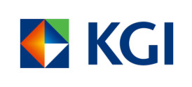 
INDUSTRY REPORT 
Taiwan 
# Memory sector 
# Surge in general server procurement fueling a memory supercycle 
## Key message 
1.Memory bit demand driven by general server purchases by US CSPs 
2. Soaring memory prices will significantly impact the recovery of PC and smartphone demand. 
3. We expect memory prices to continue rising in 2026F. 
## Event 
We expect strong demand from US CSPs for general server will drive continued memory price hikes next year. 
## Impact 
US CSP general server procurement drives memory price demand. Since September, DDRS 16Gb spot prices have surged more than threefold. While robust Al demand is the primary driver, accelerating orders for general server have amplified price hikes and heightened shortage concerns. Our supply chain checks indicate that US CSPs' procurement plans for next year far exceed prior expectations and historical averages, with Microsoft (US) being the most aggressive. We expect 2026FUS CSP general server shipments to grow by 50% Yo,driven by:(1) CSPs' extended depreciation periods starting in 2022,creating a replacement peak in the next two years; (2) general server budgets were constrained by Al investments over the past two years; and (3) some 2027F demand is being puled forward to address expected shortages. Consequently,we raise our 2026F server DRAM bit demand forecast by 17% to 20.74bn GB (up 45% YoY), increasing its share of total DRAM demand from 38% in 2025Fto 47% in 2026F.Similarly, we revise up 2026Fenterprise SSD (server SSD) bit demand by 6% to 466.5bn GB,up 61.7% YoY (see Figure 8). its share of total NAND Flash demand will rise from 29% in 2025F to40% in2026F,surpassing smartphone to become the largest application segment. 
Soaring memory prices will ignficantly impact recovery of PC & smartphone demand. Since DRAM and NAND Flash account for 10-20% of the BOM costs of PC and smartphone,continued price hikes will force brands and OEMs to raise end-product prices, thereby suppressing shipments next year. In terms of smartphone content, although Apple (US) is expected to mass-produce 2TB models in 2026F, Android vendors may reduce DRAM and SSD content, or even downgrade other IC components, to manage cost pressures. PC OEMs are likely to adopt similar strategies to control overall system costs. We forecast the share of DRAM bit demand of smartphone and PC to decdline from 36% and 10% this year to 29% and 8% in 2026F,respectively.Likewise, smartphone and PC SSD demand as a share of total NAND Flash bit demand will fal from repective 32% and 21% to 27% and17%. 
We expect memory prices to continue rising in 2026F.Strong demand from general server makers will offst memory price headwinds from lower PC and smartphone sales. Based on our supply-demand model,we expect memory to remain in undersupply through next year, with the tightest supply conditions in 3Q26F when DRAM and NAND Flash supply-demand ratios are projected at 90.17% and 90.12%,respectively.We forecast DDR5 die contract prices to climb from USS5.5 in 3025 to USS17.2 by 4026F (see Figure 10).DDR4 is also likely to benefit indirectly as DDR5 price hikes and slower consumer upgrades to DDR5 support demand. For NAND Flash, we expect 1TB TLC wafer contract prices to rise from USS6.0in 3025to USS16.7 by 4Q26F (see Figure 11) 
## Stocks for Action 
We expect memory stocks to benefit from continued price hikes in 2026F.Our top picks are Nanya Technology (2408 TT, NTS166.5, OP),Winbond (2344 TT, NTS66.2, OP), and Innodisk (5289 TT, NT$542, OP). 
## Risk 
Disappointing general server demand. 
November 17,2025

---

<!-- 原文第 2 页 -->

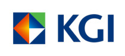 
Taiwan 
Memory sector 
Figure 1:Peer comparison - Valuations 

| Ticker | Company | Reenue contribution of related products (%) | Market cap (NTSbn) | Price (NTS) | Rating | Target price (NTS) | EPS(NTS) | | | |
| --- | --- | --- | --- | --- | --- | --- | --- | --- | --- | --- |
| 2023 | 2024 | 2025F | 2026F |
| 2408TT | Narya Tecinology | DRAM(100) | 516 | 166.5 | OP | 180 | (2.40) | -1.64 | 1.23 | 20.98 |
| 2344TT | Wirbond | DRAM(30), Flas(35),Logi IC(33) | 298 | 66.2 | | 69 | (0.29) | 0.14 | 1.08 | 6.64 |
| 5289TT | Innodisk | DRAM Module(52), NAND Moduk41).AIo(15) | 51 | 542.0 | OP | 500 | 12.98 | 12.20 | 16.84 | 25.15 |
 
Soure:TE:KGI Research 
Figure 2: Memory industry supply-demand ratios Supply-demand ratios for DRAM & NAND Flash, percent 
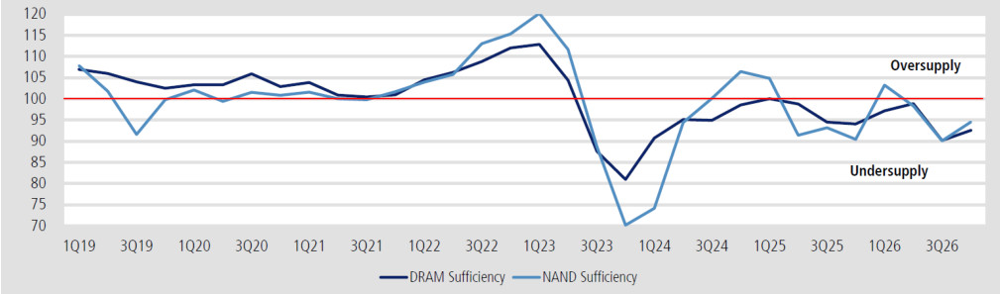 
rce: Trendforce: KGI estimates 
Figure 3: DRAM bit demand share forecast Bit demand breakdown,percent 
Figure 4: NAND Flash bit demand share forecasts 
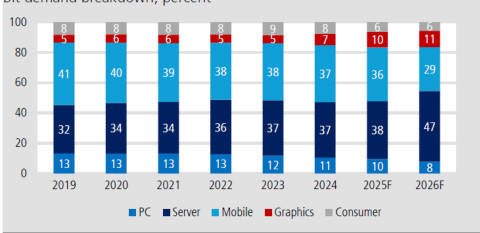 
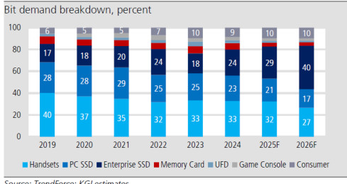 
Source: TrendForce:KGIestimates 
Figure 5:DDR516Gb spot price trend DDR5 16Gb spot price,USS 
Figure 6: Forecasts of DDR5 bit demand (by application) 
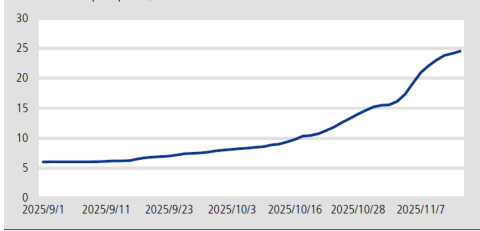 
Source: TrendForce: KGI estimates 
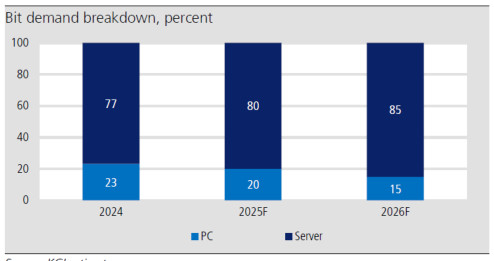 
Sowce: KGI estimates 
November 17,2025

---

<!-- 原文第 3 页 -->

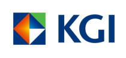 
Taiwan 
Figure 7: Sever DRAM bit demand forecasts 
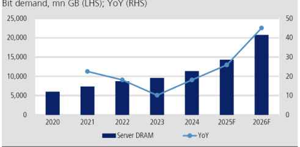 
Source: TrendForce: KGl estimates 
Memory sector 
Figure 8: Enterprise SSD bit demand forecasts 
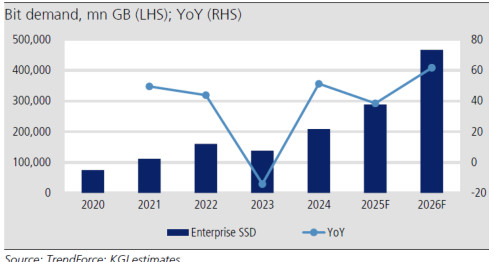 
Figure 9: Server memory bit demand breakdown (by customer category) 
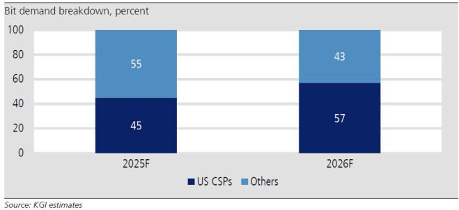 
Figure 10: Forecasts for DDR5&DDR4 die contract prices DRAM contract prices,USS 
Figure 11: NAND Flash wafer contract price forecasts 
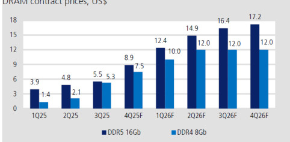 
KG/ estimates 
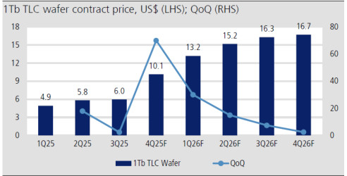 
Source:KG estimates 
All the above named KGI analyst(s) is SFC licensed person accredited to KGI Asia Ltd to carry on the relevant regulated activities. Each of them and/or his/her associate(s) does not have any finanial interest in the respectively covered stock, issuer and/or new listing applicant. 
Disclaimer 
November 17,2025
