> 原文件：[M153_pdf.dfcfw.com_H3_AP202508231733004284_1.pdf](https://github.com/jadennevercode/CJCC-Knowledge-Base/blob/5ec8511eb834073c8bfbd79c94af196282d483cf/materials/%E8%B7%A8%E9%93%BE%EF%BC%9A%E4%BE%9B%E9%9C%80%E4%B8%8E%E4%BB%B7%E6%A0%BC%E5%8F%A3%E5%BE%84/M153_pdf.dfcfw.com_H3_AP202508231733004284_1.pdf)
> 转换方式：多模态逐页转录（页面图像 + 文本层交叉校验）

<!-- 原文第 1 页 -->

# AI大模型引爆需求，存储行业站上新一轮成长周期

证券研究报告

电子/行业深度报告

领先大市（维持）

存储行业系列报告

分析师：熊军　　SAC 执业证书编号：S0910525050001
分析师：王臣复　　SAC 执业证书编号：S0910523020006
报告日期：2025年08月22日

本报告仅供华金证券客户中的专业投资者参考
请仔细阅读在本报告尾部的重要法律声明

---

<!-- 原文第 2 页 -->

# 核心观点

- **存储器是半导体产业规模最大的分支之一，目前供应仍以美、日、韩大厂主导**：根据世界半导体贸易统计组织(WSTS) 的统计，2024年，全球半导体市场销售额约6305.49亿美元，其中，逻辑电路销售额约为2157.68亿美元，存储芯片销售额约为1655.16亿美元。根据闪存市场数据显示，2024年第四季度全球NAND Flash市场规模为174.1亿美元，环比减少8.5%，同比增长42.4%。在这一领域，排名前五的企业分别是三星、SK海力士、铠侠、美光和西部数据，这五家企业共占据了全球92.7%的市场份额。2024年第四季度全球DRAM市场规模攀升至293.45亿美元，环比增长13.5%，同比增幅高达66.1%。在这一细分领域，三星、SK 海力士、美光、南亚和华邦占据前五，五家企业合计市场份额达 95.7%。
- **AI推动HBM火爆，DRAM持续迈入3D时代**：chatGPT的爆火和AGI的繁荣，除了推动了AI芯片需求暴增，也推动了HBM的爆火。根据Yole Group发布的市场与技术分析报告：《Status of the Memory Industry 2025》显示，在AI工作负载激增和行业战略性转向HBM（高带宽内存）的背景下，全球内存市场强势复苏，HBM市场将在2030年前保持33%的年复合增长率，届时其营收将超过DRAM市场总营收的50%。
- **NAND合约价预计季增，1000层时代将至**：根据TrendForce集邦咨询最新调查，NAND Flash市场历经2025年上半年的减产与库存去化，供需失衡情况已明显改善。随着原厂转移产能至高毛利产品，市场流通供给量缩减。需求面则有企业加码AI投资，以及NVIDIA（英伟达）新一代Blackwell芯片大量出货支撑。展望第三季NAND Flash价格走势，预估平均合约价将季增5%至10%。根据2024年06月21日华尔街见闻报道，铠侠在首尔举行的IWM 2024会议上概述了1,000 层 3D NAND的技术路线图，3D NAND 1000层时代将至。
- **建议关注**：长江存储（未上市）、长鑫存储（未上市）、澜起科技、兆易创新、紫光国微、东芯股份、江波龙、北京君正、佰维存储、联芸科技、德明利、普冉股份、香农芯创、大为股份、恒烁股份、得一微（未上市）
- **风险提示**：贸易摩擦及政策变动风险、市场竞争加剧风险、技术迭代风险。

---

<!-- 原文第 3 页 -->

# 目录

- 01　存储器是半导体产业规模最大的分支之一
- 02　AI推动HBM火爆，DRAM持续迈入3D时代
- 03　NAND合约价预计季增，1000层时代将至
- 04　建议关注
- 05　风险提示

---

<!-- 原文第 4 页 -->

## 1.1存储器是半导体产业规模最大的分支之一

- 半导体行业分为集成电路、光电器件、分立器件、传感器等子行业，根据功能的不同，集成电路又可以分为存储器、逻辑电路、模拟电路、微处理器等细分领域。
- 根据世界半导体贸易统计组织(WSTS) 的统计，2024年，全球半导体市场销售额约6305.49亿美元，其中，逻辑电路销售额约为2157.68亿美元，存储芯片销售额约为1655.16亿美元。

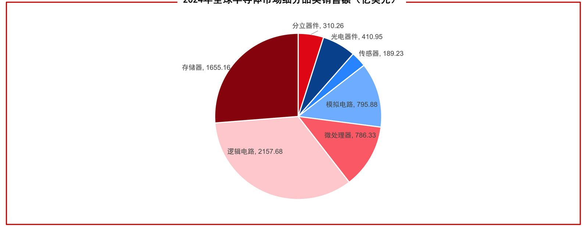
**2024年全球半导体市场细分品类销售额（亿美元）**

饼图，无坐标轴、无刻度；各扇区数据标注（按顺时针方向自左侧起）：

| 品类 | 标注值（亿美元） |
| --- | --- |
| 存储器 | 1655.16 |
| 逻辑电路 | 2157.68 |
| 微处理器 | 786.33 |
| 模拟电路 | 795.88 |
| 传感器 | 189.23 |
| 光电器件 | 410.95 |
| 分立器件 | 310.26 |

资料来源：WSTS、佰维存储招股书、上海隐冠半导体官网，华金证券研究所

---

<!-- 原文第 5 页 -->

## 1.2 NAND Flash和DRAM最大的细分市场

- 按照掉电后数据是否可以继续保存在器件内，存储芯片可分为掉电易失和掉电非易失两种，其中易失存储芯片主要包含静态随机存取存储器（SRAM）和动态随机存取存储器（DRAM）；非易失性存储器主要包括可编程只读存储器（PROM），闪存存储器（Flash）和可擦除可编程只读寄存器（EPROM/EEPROM）等。
- NAND Flash和DRAM存储器领域是半导体存储器中规模最大的细分市场。

**存储芯片分类**

树状结构图（自上而下分支），节点文字：

- 存储芯片
  - Non-volatile Memory（非易失性存储器）
    - PROM（可编程只读存储器）
    - FLASH Memory（快闪存储器）
      - NOR FLASH
      - NAND FLASH
    - EPROM、EEPROM（可擦除可编程只读寄存器等）
  - Volatile Memory（易失性存储器）
    - DRAM（动态随机访问存储器）
    - SRAM（静态随机访问存储器）

注：FLASH Memory、DRAM、NAND FLASH 三个节点在图中着蓝色底纹，其余节点为白底。

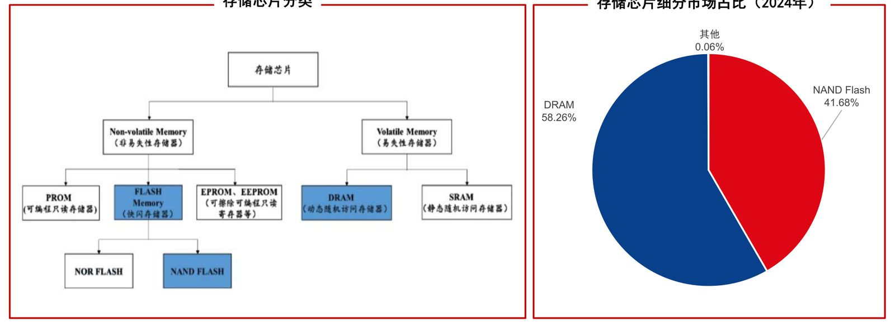
**存储芯片细分市场占比（2024年）**

饼图，无坐标轴；三处扇区标注：

- DRAM 58.26%
- NAND Flash 41.68%
- 其他 0.06%

资料来源：IC Insights、佰维存储招股书、CFM闪存市场、每日经济新闻，华金证券研究所

---

<!-- 原文第 6 页 -->

## 1.3 中国存储芯片行业市场规模超过2500亿

- 存储芯片具有体积小、存储速度快等特点，广泛应用于内存、U盘、消费电子、智能终端、固态存储硬盘等领域。根据前瞻产业研究院数据，2023年中国存储芯片行业市场规模达到2591亿元人民币，2018年~2023年五年复合增速达20.38%。2023年，中国DRAM产品占总市场规模比重约为56%。

**2018~2024年中国存储芯片市场规模（亿）**

柱状图：

- 横轴：2018、2019、2020、2021、2022、2023、2024E（年）
- 纵轴：无刻度标签，图中未绘出数值轴
- 图内左上角标注两行：「单位：亿元」「2018-2023年CAGR：20.38%」
- 图内柱值标注：仅 2024E 柱顶标注「3006」，2018–2023 各柱无标注
- 图内底部蓝色色块文字：「2018-2024年市场规模」
- 2018–2023 各年柱高无数据标签，数值不可读 [OCR_UNREADABLE]
- 图上覆有「前瞻产业研究院」水印

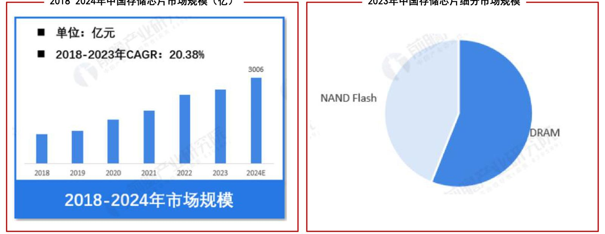
**2023年中国存储芯片细分市场规模**

饼图，无坐标轴、无刻度：

- 扇区标注仅两项：DRAM、NAND Flash
- 图中未标注任何百分比或其他数值 [OCR_UNREADABLE]
- 图上覆有「前瞻产业研究院」水印

资料来源：前瞻产业研究院，华金证券研究所

---

<!-- 原文第 7 页 -->

## 1.4 服务器、PC、mobile是三大主力市场

- 根据CFM数据，2023年以PC应用为主的cSSD消耗了NAND flash的26%，Mobile产品消耗了NAND flash产能的34%，以服务器应用为主eSSD消耗了NAND flash总产能的14%。在DRAM市场，预计2024年服务器应用约消耗全球DRAM产能32%，mobile应用预计约消耗全球DRAM产能34%，PC应用预计约消耗全球DRAM产能15%。

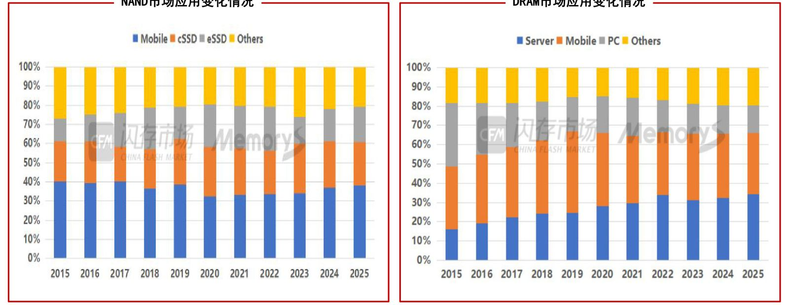
**NAND市场应用变化情况**

100%堆叠柱状图：

- 横轴：2015、2016、2017、2018、2019、2020、2021、2022、2023、2024、2025（年）
- 纵轴：0%、10%、20%、30%、40%、50%、60%、70%、80%、90%、100%（占比刻度）
- 图例（自左至右）：Mobile（蓝）、cSSD（橙）、eSSD（灰）、Others（黄）
- 各年份各堆叠段均无数据标签，数值不可读 [OCR_UNREADABLE]
- 图上覆有「CFM 闪存市场 MemoryS CHINA FLASH MARKET」水印

**DRAM市场应用变化情况**

100%堆叠柱状图：

- 横轴：2015、2016、2017、2018、2019、2020、2021、2022、2023、2024、2025（年）
- 纵轴：0%、10%、20%、30%、40%、50%、60%、70%、80%、90%、100%（占比刻度）
- 图例（自左至右）：Server（蓝）、Mobile（橙）、PC（灰）、Others（黄）
- 各年份各堆叠段均无数据标签，数值不可读 [OCR_UNREADABLE]
- 图上覆有「CFM 闪存市场 MemoryS CHINA FLASH MARKET」水印

资料来源：CFM|MemoryS，华金证券研究所

---

<!-- 原文第 8 页 -->

## 1.5 存储芯片以美、日、韩大厂主导

- 根据闪存市场数据显示，2024年第四季度全球NAND Flash市场规模为174.1亿美元，环比减少8.5%，同比增长42.4%。在这一领域，排名前五的企业分别是三星、SK海力士、铠侠、美光和西部数据，这五家企业共占据了全球92.7%的市场份额。
- 根据闪存市场数据显示，2024年第四季度全球DRAM市场规模攀升至293.45亿美元，环比增长13.5%，同比增幅高达66.1%。在这一细分领域，三星、SK 海力士、美光、南亚和华邦占据前五，五家企业合计市场份额达 95.7%

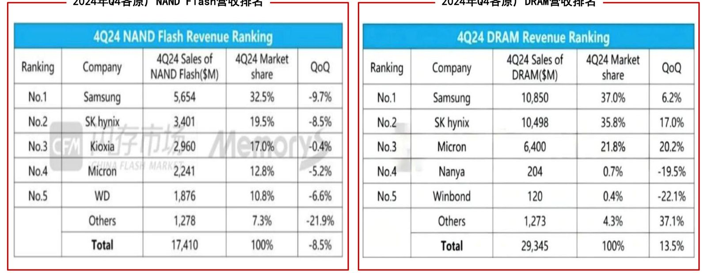
**2024年Q4各原厂NAND Flash营收排名**

表头蓝条文字：4Q24 NAND Flash Revenue Ranking

| Ranking | Company | 4Q24 Sales of NAND Flash($M) | 4Q24 Market share | QoQ |
| --- | --- | --- | --- | --- |
| No.1 | Samsung | 5,654 | 32.5% | -9.7% |
| No.2 | SK hynix | 3,401 | 19.5% | -8.5% |
| No.3 | Kioxia | 2,960 | 17.0% | -0.4% |
| No.4 | Micron | 2,241 | 12.8% | -5.2% |
| No.5 | WD | 1,876 | 10.8% | -6.6% |
|  | Others | 1,278 | 7.3% | -21.9% |
|  | **Total** | 17,410 | 100% | -8.5% |

表格覆有「CFM 闪存市场 MemoryS」水印；No.3、No.4 两行的数字压在水印上，已放大 4 倍复核。

**2024年Q4各原厂DRAM营收排名**

表头蓝条文字：4Q24 DRAM Revenue Ranking

| Ranking | Company | 4Q24 Sales of DRAM($M) | 4Q24 Market share | QoQ |
| --- | --- | --- | --- | --- |
| No.1 | Samsung | 10,850 | 37.0% | 6.2% |
| No.2 | SK hynix | 10,498 | 35.8% | 17.0% |
| No.3 | Micron | 6,400 | 21.8% | 20.2% |
| No.4 | Nanya | 204 | 0.7% | -19.5% |
| No.5 | Winbond | 120 | 0.4% | -22.1% |
|  | Others | 1,273 | 4.3% | 37.1% |
|  | **Total** | 29,345 | 100% | 13.5% |

表格覆有「CFM 闪存市场 MemoryS」水印。

资料来源：闪存市场，华金证券研究所

---

<!-- 原文第 9 页 -->

## 1.6 存储芯片行业具有明显的周期性

- 从过往产业发展经验来看，全球半导体产业包括存储产业都具有较大的周期性。从2015年~2024年SIA发布的数据来看，存储芯片周期波动性远超半导体全行业销售额的波动性。

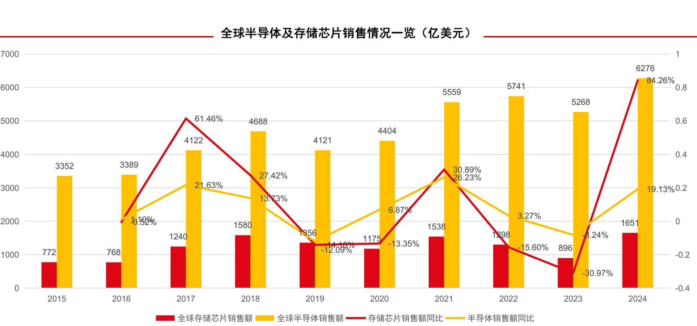
**全球半导体及存储芯片销售情况一览（亿美元）**

左轴：0~7000（亿美元）；右轴：-0.4~1；横轴：2015~2024年
图例：全球存储芯片销售额（柱）、全球半导体销售额（柱）、存储芯片销售额同比（线）、半导体销售额同比（线）

| 年份 | 全球存储芯片销售额（亿美元） | 全球半导体销售额（亿美元） | 存储芯片销售额同比 | 半导体销售额同比 |
| --- | --- | --- | --- | --- |
| 2015 | 772 | 3352 | n.a. | n.a. |
| 2016 | 768 | 3389 | -0.52% | 1.10% |
| 2017 | 1240 | 4122 | 61.46% | 21.63% |
| 2018 | 1580 | 4688 | 27.42% | 13.73% |
| 2019 | 1356 | 4121 | -14.18% | -12.09% |
| 2020 | 1175 | 4404 | -13.35% | 6.87% |
| 2021 | 1538 | 5559 | 30.89% | 26.23% |
| 2022 | 1298 | 5741 | -15.60% | 3.27% |
| 2023 | 896 | 5268 | -30.97% | -8.24% |
| 2024 | 1651 | 6276 | 84.26% | 19.13% |

图表中同比折线自2016年起有数据标签，2015年无标签（n.a.）。

资料来源：SIA、WSTS、电子信息产业网、东芯股份招股书、澎湃、证券时报网，华金证券研究所

---

<!-- 原文第 10 页 -->

## 1.7 2025年存储市场规模预计达1890亿美元

- 根据世界半导体贸易统计协会（WSTS）发布报告，2025年全球半导体市场规模预计将达到7008.74亿美元，同比增长11.2%。细分市场来看，今年的半导体市场规模攀升将受惠于逻辑芯片和存储器。其中，逻辑芯片预计市场规模将达2440亿美元，同比增长17%，AI算力需求激增（如英伟达数据中心收入同比增192%）是核心推动力，AI GPU、定制ASIC芯片需求持续超过供应。存储器市场规模预计达1890亿美元，同比增长13%，其中，高带宽内存（HBM）因AI训练需求爆发，预计2025年出货量激增57%，平均售价较传统DRAM溢价近5倍。

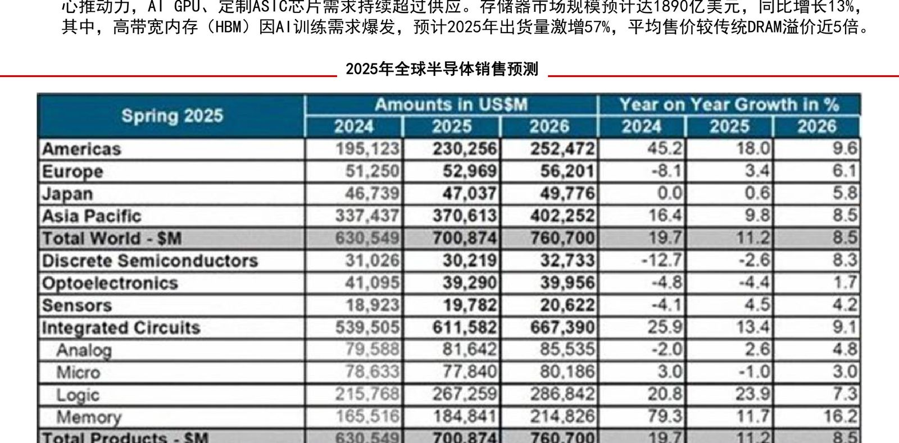
**2025年全球半导体销售预测**

金额单位：US$M（Amounts in US$M）；第5~7列为 Year on Year Growth in %（2024/2025/2026）

| Spring 2025 | 2024 | 2025 | 2026 | 2024 | 2025 | 2026 |
| --- | --- | --- | --- | --- | --- | --- |
| Americas | 195,123 | 230,256 | 252,472 | 45.2 | 18.0 | 9.6 |
| Europe | 51,250 | 52,969 | 56,201 | -8.1 | 3.4 | 6.1 |
| Japan | 46,739 | 47,037 | 49,776 | 0.0 | 0.6 | 5.8 |
| Asia Pacific | 337,437 | 370,613 | 402,252 | 16.4 | 9.8 | 8.5 |
| **Total World - $M** | 630,549 | 700,874 | 760,700 | 19.7 | 11.2 | 8.5 |
| Discrete Semiconductors | 31,026 | 30,219 | 32,733 | -12.7 | -2.6 | 8.3 |
| Optoelectronics | 41,095 | 39,290 | 39,956 | -4.8 | -4.4 | 1.7 |
| Sensors | 18,923 | 19,782 | 20,622 | -4.1 | 4.5 | 4.2 |
| Integrated Circuits | 539,505 | 611,582 | 667,390 | 25.9 | 13.4 | 9.1 |
| 　Analog | 79,588 | 81,642 | 85,535 | -2.0 | 2.6 | 4.8 |
| 　Micro | 78,633 | 77,840 | 80,186 | 3.0 | -1.0 | 3.0 |
| 　Logic | 215,768 | 267,259 | 286,842 | 20.8 | 23.9 | 7.3 |
| 　Memory | 165,516 | 184,841 | 214,826 | 79.3 | 11.7 | 16.2 |
| **Total Products - $M** | 630,549 | 700,874 | 760,700 | 19.7 | 11.2 | 8.5 |

Analog / Micro / Logic / Memory 为 Integrated Circuits 下的细分项（原表左缩进）。

资料来源：上海隐冠半导体官网、WSTS，华金证券研究所

---

<!-- 原文第 11 页 -->

## 目录

- 01 存储器是半导体产业规模最大的分支之一
- 02 AI推动HBM火爆，DRAM持续迈入3D时代
- 03 NAND合约价预计季增，1000层时代将至
- 04 建议关注
- 05 风险提示

---

<!-- 原文第 12 页 -->

## 2.1 DDR是DRAM的主要细分品类

- DRAM是动态随机存取存储器，DRAM的特征是读写速度快、延迟低，但掉电后数据会丢失，常用于计算系统的运行内存。DRAM按照产品分类分为DDR/LPDDR/GDDR和传统型（Legacy/SDR）DRAM。
- DDR是双倍速率同步动态随机存储器，主要应用在个人计算机、服务器上；LPDDR是Low Power DDR，主要应用于移动端电子产品；GDDR是Graphics DDR，主要应用于图像处理领域；DDR/LPDDR为DRAM目前应用最广的类型，根据Yole数据统计，两者合计占DRAM应用比例约为90%。

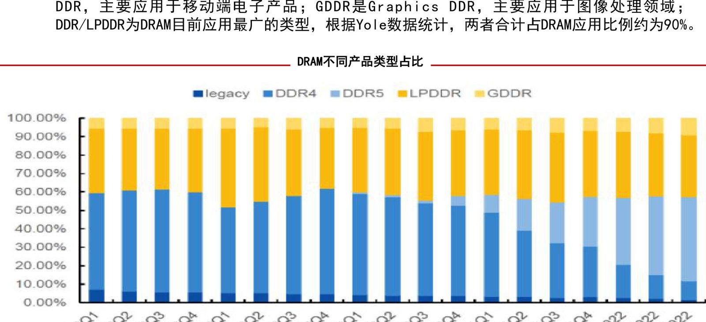
**DRAM不同产品类型占比**

图例：legacy、DDR4、DDR5、LPDDR、GDDR（100%堆叠柱状图）
纵轴：0.00%~100.00%
横轴：2018Q1、2018Q2、2018Q3、2018Q4、2019Q1、2019Q2、2019Q3、2019Q4、2020Q1、2020Q2、2020Q3、2020Q4、2021Q1、2021Q2、2021Q3、2021Q4，之后三根柱的标签在页面右缘均只显示为「2022」[OCR_UNCERTAIN]

柱状图本身无数据标签，未写各段数值。

资料来源：Yole、佰维存储招股书，华金证券研究所

---

<!-- 原文第 13 页 -->

## 2.2 DDR6已进入平台验证

- DDR标准是由固态技术协会（JEDEC）制定，从DDR1到DDR5演变看，DDR的能耗越来越低，传输速度越来越快、存储容量也越来越大。
- 2024年，JEDEC开始着手研究下一代内存标准DDR6，目标是为存储器领域带来更快的读写速度和更高的性能。2024年底，JEDEC完成了DDR6主要草案标准，为后续标准的正式发布奠定了基础。根据规划，DDR6将于2026年完成平台认证，2027年率先在服务器市场商用，随后向高端笔记本等消费级市场扩展。

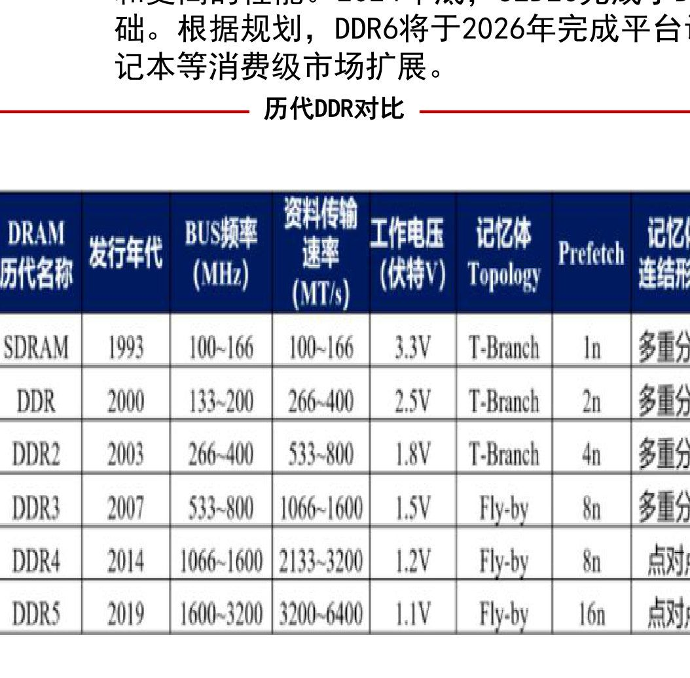
**历代DDR对比**

| DRAM历代名称 | 发行年代 | BUS频率（MHz） | 资料传输速率（MT/s） | 工作电压（伏特V） | 记忆体Topology | Prefetch | 记忆体连结形式 |
| --- | --- | --- | --- | --- | --- | --- | --- |
| SDRAM | 1993 | 100~166 | 100~166 | 3.3V | T-Branch | 1n | 多重分支 |
| DDR | 2000 | 133~200 | 266~400 | 2.5V | T-Branch | 2n | 多重分支 |
| DDR2 | 2003 | 266~400 | 533~800 | 1.8V | T-Branch | 4n | 多重分支 |
| DDR3 | 2007 | 533~800 | 1066~1600 | 1.5V | Fly-by | 8n | 多重分支 |
| DDR4 | 2014 | 1066~1600 | 2133~3200 | 1.2V | Fly-by | 8n | 点对点 |
| DDR5 | 2019 | 1600~3200 | 3200~6400 | 1.1V | Fly-by | 16n | 点对点 |

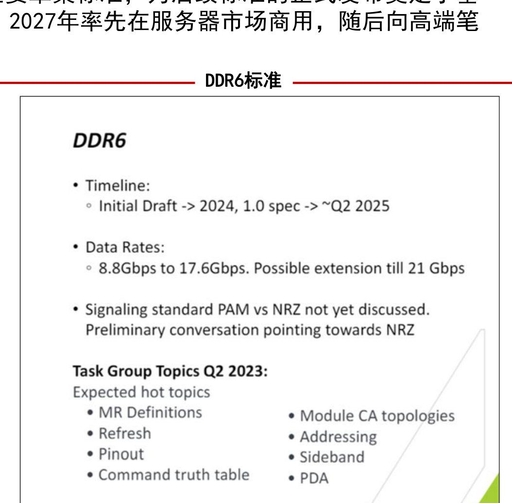
**DDR6标准**

- Timeline:
  - Initial Draft -> 2024, 1.0 spec -> ~Q2 2025
- Data Rates:
  - 8.8Gbps to 17.6Gbps. Possible extension till 21 Gbps
- Signaling standard PAM vs NRZ not yet discussed. Preliminary conversation pointing towards NRZ

Task Group Topics Q2 2023:
Expected hot topics
- MR Definitions
- Refresh
- Pinout
- Command truth table
- Module CA topologies
- Addressing
- Sideband
- PDA

资料来源：腾讯网、eet-china、与非网、半导体行业观察、信息化观察网，华金证券研究所

---

<!-- 原文第 14 页 -->

## 2.3 DRAM制程微缩仍在持续

- DRAM产业在2D平面进行制程微缩目前仍然是一个主流趋势。从三大DRAM厂三星、SK海力士和美光的研发进展来看，自2016年以来，DRAM就一直在10nm级别（19nm到10nm，或1X）徘徊，三大存储厂商（三星、SK海力士和美光）也都推出了多代的工艺。
- 根据IT之家2025年6月4日消息，美光当地时间昨日宣布在业界率先推出基于第六代10nm级制程（按美光命名为1γ、1-gamma，按三星和SK海力士命名为1c）的LPDDR5x DRAM内存。

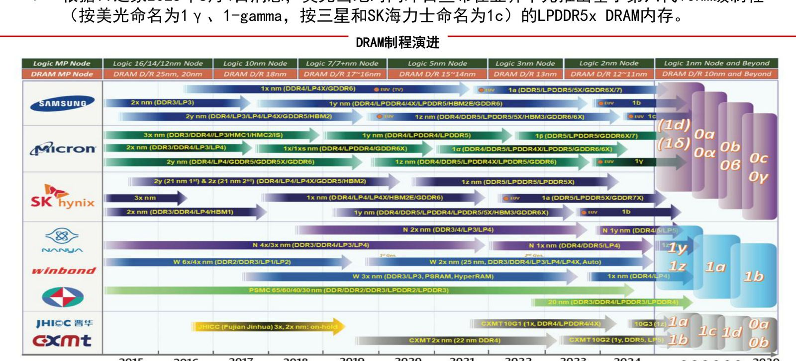
**DRAM制程演进**

横轴：2015、2016、2017、2018、2019、2020、2021、2022、2023、2024……2030

顶部节点对应关系：

| Logic MP Node | Logic 16/14/12nm Node | Logic 10nm Node | Logic 7/7+nm Node | Logic 5nm Node | Logic 3nm Node | Logic 2nm Node | Logic 1nm Node and Beyond |
| --- | --- | --- | --- | --- | --- | --- | --- |
| DRAM MP Node | DRAM D/R 25nm, 20nm | DRAM D/R 18nm | DRAM D/R 17~16nm | DRAM D/R 15~14nm | DRAM D/R 13nm | DRAM D/R 12~11nm | DRAM D/R 10nm and Beyond |

各厂商制程条标注（按图中自左向右顺序，箭头表示代际推进）：

**三星（SAMSUNG）**
- 1x nm (DDR4/LP4X/GDDR6) → EUV（1Y）→ 1a (DDR5/LPDDR5/5X/GDDR6X/7)
- 2x nm (DDR3/LP3) → 1y nm (DDR4/LPDDR4/4X/LPDDR5/HBM2E/GDDR6) → EUV → 1b
- 2y nm (DDR4/LP3/LP4/LP4X/GDDR5/HBM2) → EUV（1Y）→ 1z nm (DDR4/DDR5/LPDDR5/5X/HBM3/GDDR6/6X) → EUV → 1c

**美光（Micron）**
- 3x nm (DDR3/DDR4//LP3/HMC1/HMC2/IS) → 1y nm (DDR4/LPDDR4/LPDDR5) → 1β (DDR5/LPDDR5/GDDR6X/7)
- 2x nm (DDR3/DDR4/LP3/LP4) → 1x/1xs nm (DDR4/LPDDR4/GDDR6X) → 1α (DDR4/DDR5/LPDDR4X/LPDDR5/GDDR6/6X)
- 2y nm (DDR4/LP4/GDDR5/GDDR5X/GDDR6) → 1z nm (DDR4/DDR5/LPDDR4X/LPDDR5/GDDR6) → EUV → 1γ

**SK海力士（SK hynix）**
- 2y (21 nm 1st) & 2z (21 nm 2nd) (DDR4/LP4/LP4X/GDDR5/HBM2) → 1z nm (DDR5/LPDDR5/LPDDR5X) → 0y
- 3x nm → 1x nm (DDR4/LP4/LP4X/HBM2E/GDDR6) → EUV → 1a (DDR5/LPDDR5X/GDDR7X)
- 2x nm (DDR3/DDR4/LP4/HBM1) → 1y nm (DDR4/DDR5/LPDDR4/LPDDR5/5X/HBM3/GDDR6X) → EUV → 1b

**南亚（Nanya）**
- N 4x/3x nm (DDR3/DDR4/LP3/LP4) → N 1x nm (DDR4/DDR5/LP4)

**华邦（winbond）**
- W 6x/4x nm (DDR2/DDR3/LP1/LP2) → 1st Gen → W 2x nm (25 nm, DDR3/DDR4/LP3/LP4/LP4X, Auto)
- W 3x nm (DDR3/LP3, PSRAM, HyperRAM) → 1x nm (DDR4/LP4)

**力积电（PSMC）**
- PSMC 65/60/40/30 nm (DDR/DDR2/DDR3/LPDDR2/LPDDR3) → 20 nm (DDR3/DDR4/LPDDR3/LPDDR4)

**晋华 / 长鑫（JHICC / CXMT）**
- JHICC (Fujian Jinhua) 3x, 2x nm: on-hold
- CXMT 2x nm (22 nm DDR4...) → CXMT 10G1 (1x, DDR4/LPDDR4/4X) → 10G3 (1z) → CXMT 10G2 (1y, DDR5, LP5)

图中右侧另有节点编号区块（三星 1d/1δ、0a/0b/0c/0γ；南亚 1y/1z/1α/1b；长鑫 1a/1b/1c/1d/0a/0b 等），字号过小且与左侧箭头重叠，未逐项转录。

资料来源：TechInsights、新浪科技、华尔街见闻、电子工程专辑，华金证券研究所

---

<!-- 原文第 15 页 -->

## 2.4 3D DRAM是DRAM制程发展方向

- 3D DRAM是一种通过堆叠多个存储层和使用垂直互联技术来增加存储密度和性能的先进DRAM技术。3D DRAM能够提供更高的存储密度、更低的功耗和更高的带宽，适用于高性能计算、数据中心和AI等应用场景。随着制程工艺的不断缩小，DRAM的制造难度越来越大，因此从2D架构转向3D架构成为未来发展的主要方向之一。
- 2025年6月在日本东京举行的IEEE VLSI研讨会上，SK海力士提出了未来30年的新DRAM技术路线图。4F2 VG和3D DRAM技术将应用于10nm及以下级内存。

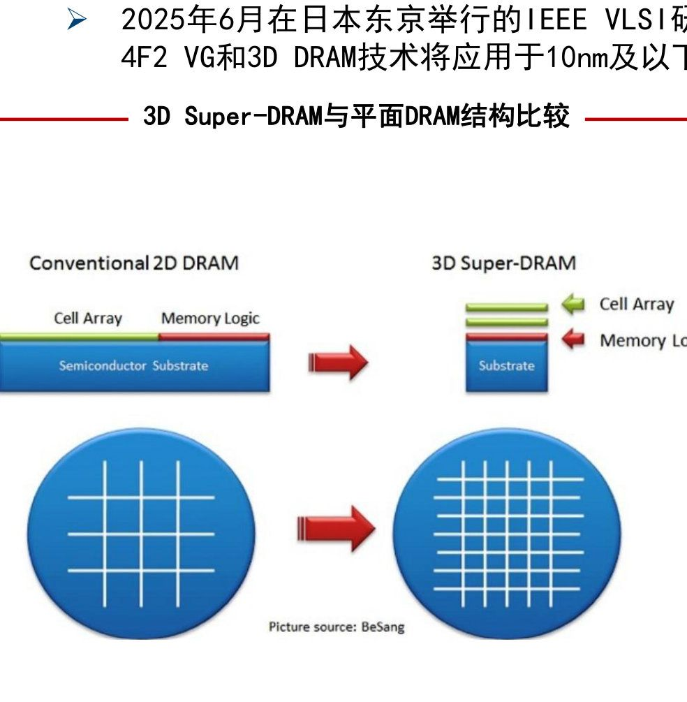
**3D Super-DRAM与平面DRAM结构比较**

- Conventional 2D DRAM：Cell Array / Memory Logic / Semiconductor Substrate
- 3D Super-DRAM：Cell Array / Memory Logic / Substrate
- Picture source: BeSang

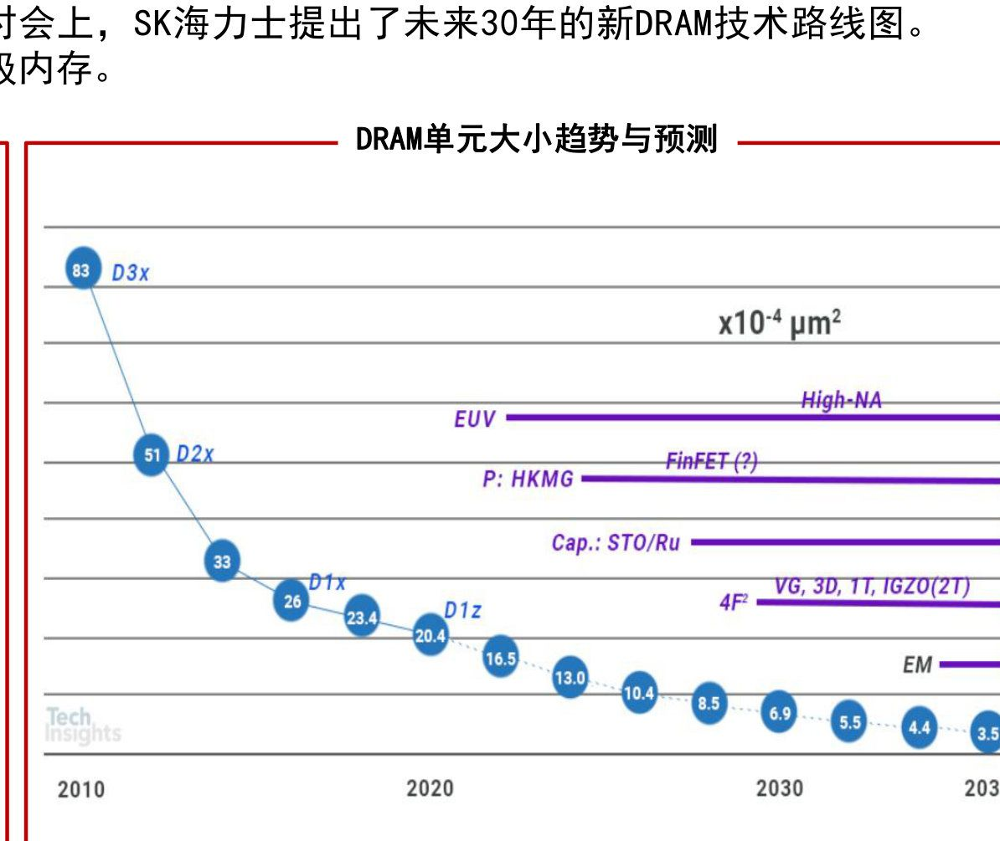
**DRAM单元大小趋势与预测**

纵轴单位：x10⁻⁴ μm²；横轴：2010、2020、2030、2036
数据点（按图中自左向右）：83（D3x）、51（D2x）、33、26（D1x）、23.4、20.4（D1z）、16.5、13.0、10.4、8.5、6.9、5.5、4.4、3.5
技术标注（自下而上）：EM、4F² → VG, 3D, 1T, IGZO(2T)、Cap.: STO/Ru、P: HKMG → FinFET (?)、EUV → High-NA
图内水印：TechInsights

资料来源：电子工程专辑、Tech Insights、lamresearch、 eefocus、与非网、IT之家，华金证券研究所

---

<!-- 原文第 16 页 -->

## 2.5 AI大模型推动HBM爆火

- chatGPT的爆火和AGI的繁荣，除了推动了AI芯片需求暴增，也推动了HBM的爆火。高带宽存储器（High Bandwidth Memory，HBM）是超微半导体和SK Hynix发起的一种基于3D堆栈工艺的高性能DRAM，适用于高存储器带宽需求的应用场合，像是图形处理器、网络交换及转发设备（如路由器、交换器）等。
- 随着GPU的功能越来越强大，需要更快地从内存中访问数据，以缩短应用处理时间。为了减小“内存墙”的影响，提升内存带宽一直是存储芯片聚焦的关键问题，半导体的先进封装为克服阻碍高性能计算应用程序的内存访问障碍提供了机会。

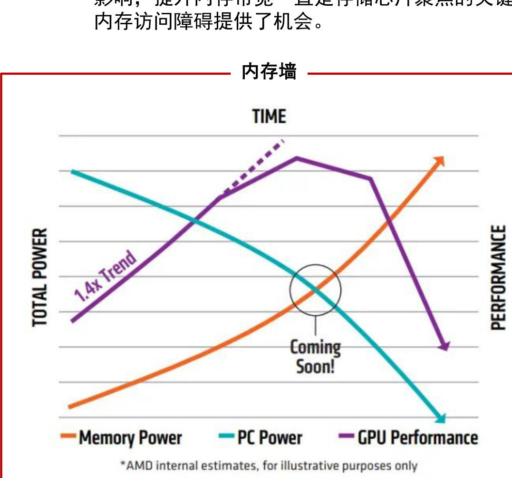
**内存墙**

纵轴：TOTAL POWER（左）、PERFORMANCE（右）；顶部标注：TIME
图例：Memory Power、PC Power、GPU Performance
图中另标注：1.4x Trend（紫色虚线）、Coming Soon!
脚注：*AMD internal estimates, for illustrative purposes only
两条坐标轴均无刻度数值，未写具体数值。

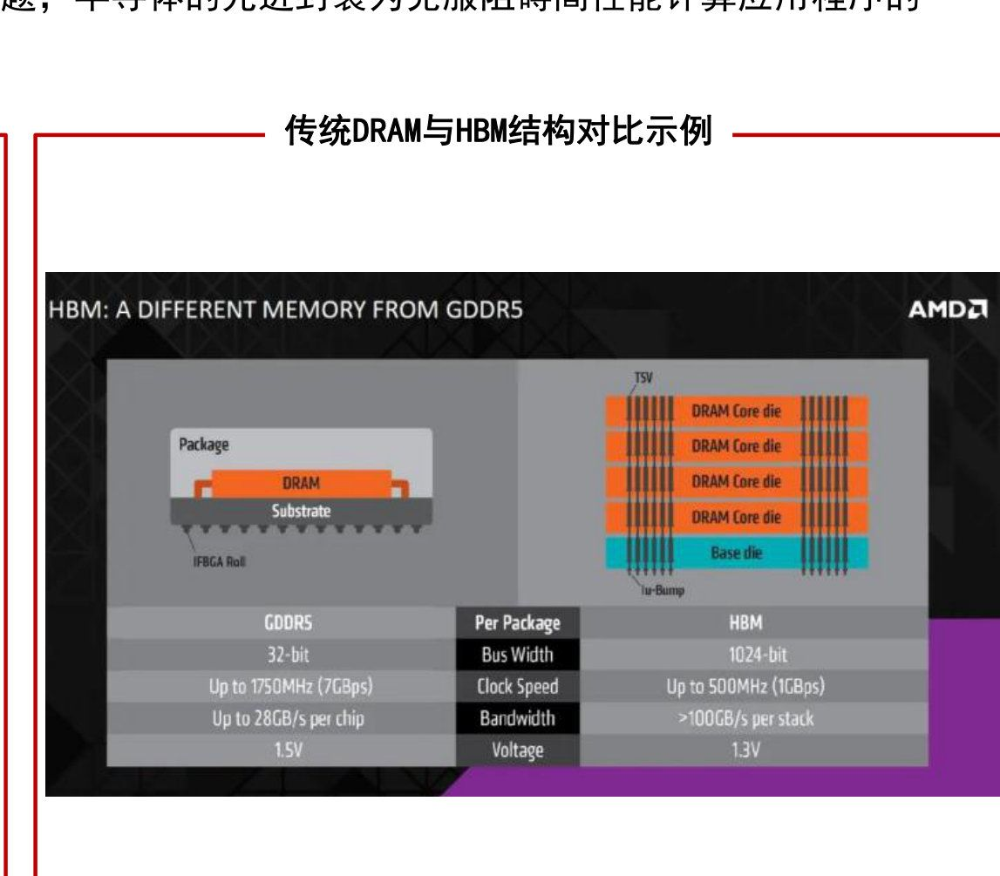
**传统DRAM与HBM结构对比示例**

图内标题：HBM: A DIFFERENT MEMORY FROM GDDR5（AMD）
结构标注：Package、DRAM、Substrate、IFBGA Ball；DRAM Core die ×4、Base die、TSV、μbump

| GDDR5 | Per Package | HBM |
| --- | --- | --- |
| 32-bit | Bus Width | 1024-bit |
| Up to 1750MHz (7GBps) | Clock Speed | Up to 500MHz (1GBps) |
| Up to 28GB/s per chip | Bandwidth | >100GB/s per stack |
| 1.5V | Voltage | 1.3V |

资料来源：了不起的云计算，华金证券研究所

---

<!-- 原文第 17 页 -->

## 2.6 HBM的实现方式

- HBM是由DRAM颗粒三维堆叠而成，其中每个DRAM颗粒通过μ-Bump和硅通孔（TSV）技术垂直连接到底层的逻辑芯片上，这种垂直连接方式使得整个堆叠栈能够通过2.5D封装技术与计算芯片一起集成到同一个硅中介层上。这种集成方式显著缩短了存储芯片与计算芯片之间的互连距离，从传统内存条（DIMM）的数厘米缩短至数百微米。采用了μ-Bump与TSV技术，将输入输出（IO）的数量从原有的64位提高到1024位以上，极大地提升了内存带宽，从而能够支持更高的数据传输速率。
- 制程方面，与传统DRAM晶圆工艺不同，HBM在前端制程（FEOL，包括有源器件和存储单元等功能层）完成后，增加了TSV制程。3D-stacking 主要有两种实现方式：晶圆到晶圆（Wafer to Wafer, W2W）和芯片到晶圆（Die to Wafer, D2W）现有的 HBM 都采用 D2W 方式进行生产。

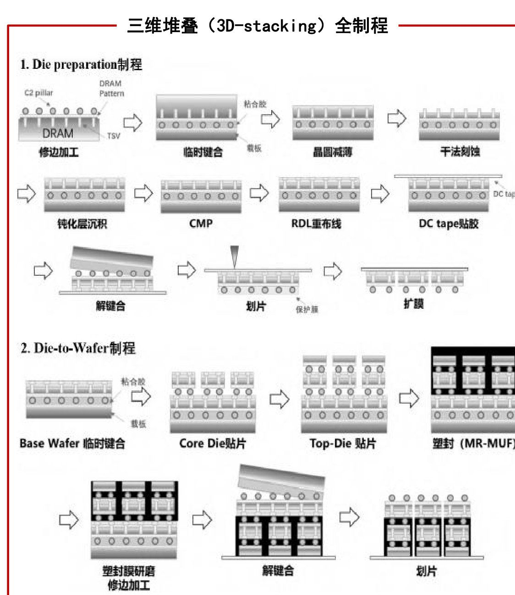
**HBM结构图**

结构标注（自上而下）：HBM、SoC、Silicon interposer、Substrate

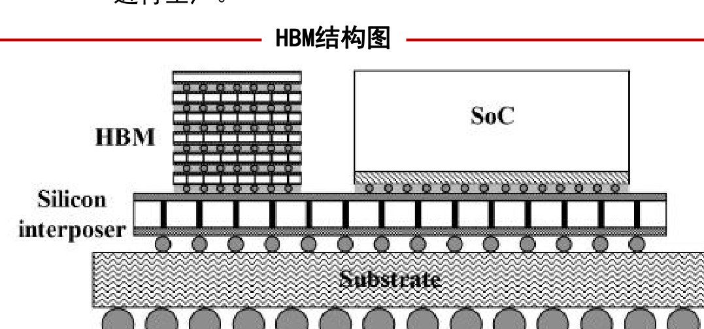
**三维堆叠（3D-stacking）全制程**

1. Die preparation制程
   - 修边加工（标注：C2 pillar、DRAM Pattern、DRAM、TSV）
   - 临时键合（标注：粘合胶、载板）
   - 晶圆减薄
   - 干法刻蚀
   - 钝化层沉积
   - CMP
   - RDL重布线
   - DC tape贴胶
   - 解键合
   - 划片（标注：保护膜）
   - 扩膜
2. Die-to-Wafer制程
   - Base Wafer临时键合（标注：粘合胶、载板）
   - Core Die贴片
   - Top-Die 贴片
   - 塑封（MR-MUF）
   - 塑封膜研磨 修边加工
   - 解键合
   - 划片

资料来源：《HBM 制造技术演进与今后的发展趋势》付永朝等，华金证券研究所

---

<!-- 原文第 18 页 -->

## 2.7 HBM技术演进路径预测

- 2025年6月，韩国国家级研究机构——韩国科学技术院（KAIST）发布了一份长达371页的研究论文，系统性地描绘了HBM技术从HBM4一路发展到HBM8的演进路径。内容涵盖带宽、容量、I/O接口宽度、热设计等方面的提升，以及封装方式、3D堆叠结构、嵌入式NAND存储的内存中心架构，甚至包括基于机器学习的功耗控制方法。

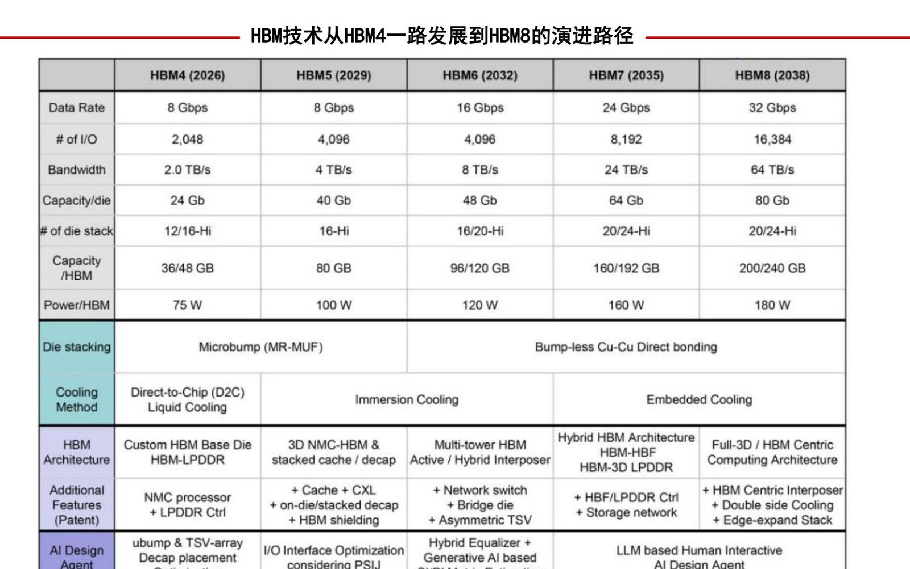
**HBM技术从HBM4一路发展到HBM8的演进路径**

| 项目 | HBM4 (2026) | HBM5 (2029) | HBM6 (2032) | HBM7 (2035) | HBM8 (2038) |
| --- | --- | --- | --- | --- | --- |
| Data Rate | 8 Gbps | 8 Gbps | 16 Gbps | 24 Gbps | 32 Gbps |
| # of I/O | 2,048 | 4,096 | 4,096 | 8,192 | 16,384 |
| Bandwidth | 2.0 TB/s | 4 TB/s | 8 TB/s | 24 TB/s | 64 TB/s |
| Capacity/die | 24 Gb | 40 Gb | 48 Gb | 64 Gb | 80 Gb |
| # of die stack | 12/16-Hi | 16-Hi | 16/20-Hi | 20/24-Hi | 20/24-Hi |
| Capacity/HBM | 36/48 GB | 80 GB | 96/120 GB | 160/192 GB | 200/240 GB |
| Power/HBM | 75 W | 100 W | 120 W | 160 W | 180 W |
| HBM Architecture | Custom HBM Base Die HBM-LPDDR | 3D NMC-HBM & stacked cache / decap | Multi-tower HBM Active / Hybrid Interposer | Hybrid HBM Architecture HBM-HBF HBM-3D LPDDR | Full-3D / HBM Centric Computing Architecture |
| Additional Features (Patent) | NMC processor + LPDDR Ctrl | + Cache + CXL + on-die/stacked decap + HBM shielding | + Network switch + Bridge die + Asymmetric TSV | + HBF/LPDDR Ctrl + Storage network | + HBM Centric Interposer + Double side Cooling + Edge-expand Stack |

原表中跨列合并的三行：

| 项目 | 合并范围与内容 |
| --- | --- |
| Die stacking | HBM4~HBM5：Microbump (MR-MUF)；HBM6~HBM8：Bump-less Cu-Cu Direct bonding |
| Cooling Method | HBM4：Direct-to-Chip (D2C) Liquid Cooling；HBM5~HBM6：Immersion Cooling；HBM7~HBM8：Embedded Cooling |
| AI Design Agent | HBM4：ubump & TSV-array Decap placement Optimization；HBM5：I/O Interface Optimization considering PSIJ；HBM6：Hybrid Equalizer + Generative AI based SI/PI Metric Estimation；HBM7~HBM8：LLM based Human Interactive AI Design Agent |

资料来源：KAIST、36Kr，华金证券研究所

---

<!-- 原文第 19 页 -->

## 2.8 HBM竞争格局

- 根据TrendForce集邦咨询预测，受AI平台积极参与新系列HBM产品推动，2025年HBM需求元将有超过80%，凸显HBM3e系列产品上，其中12hi的将超过一半，成为下半年AI主要竞争厂商有竞争力的主流产品，替代8hi。
- 目前，在HBM市场，主要有三大供应商，分别为SK海力士、三星和美光。竞争格局方面，SK海力士是英伟达的主要HBM供应商。
- 根据2025年6月电子工程专辑的报道，SK海力士已向英伟达小批量供应了HBM4，以支持英伟达的下一代AI加速器Rubin GPU的出样计划。报道中，Meritz Securities预测，到2026年，SK海力士将获得HBM3E 8Hi市场份额的60%以上和HBM3E 12Hi市场份额的75%。随着HBM4市场需求的增长，SK海力士的HBM销量有望快速增长，预计HBM4的溢价将超过30%。此外，美光也向英伟达提供了12层堆叠的HBM4样品，但供应量有限，而三星电子尚未进入英伟达的HBM供应链，因此SK海力士将获得最大的供应份额。

### 三大原厂HBM解决方案开发进度

| 产品代际 | Brand | Speed (Gbps) | Tech Nodes | 时间轴标注（原图以甘特条/圆点标注，季度列自 1Q22 至 4Q26） |
| --- | --- | --- | --- | --- |
| HBM2e | Samsung | 3.2-3.6 | 1Y 16Gb | 条状标注 8/16GB；2026 年区间有虚线框标注 EOL Time : Not Fixed Yet |
| HBM2e | SK hynix | 3.6 | 1Y 16Gb | 条状标注 8/16GB；2026 年区间有虚线框标注 EOL Time : Not Fixed Yet |
| HBM2e | Micron | 3.2-3.6 | 1Z 16Gb | 条状标注 16GB；条末端标注 EOL |
| HBM3 | Samsung | 5.6-6.4 | 1Z 16Gb | 圆点标注 16GB、24GB |
| HBM3 | SK hynix | 5.6-6.4 | 1Z 16Gb | 圆点标注 16GB、24GB |
| HBM3e | Samsung | 8-9.2 | 1alpha 24Gb | 星形标注；圆点标注 24GB、36GB |
| HBM3e | SK hynix | 8-9.2 | 1beta 24Gb | 星形标注；圆点标注 24GB、36GB |
| HBM3e | Micron | 8-9.2 | 1beta 24Gb | 星形标注；圆点标注 24GB、36GB |
| HBM4 | — | TBD | TBD | Full spec may be released in 2H24-2025; C/S in 2026 |

[TABLE_RECONSTRUCTION_UNCERTAIN]

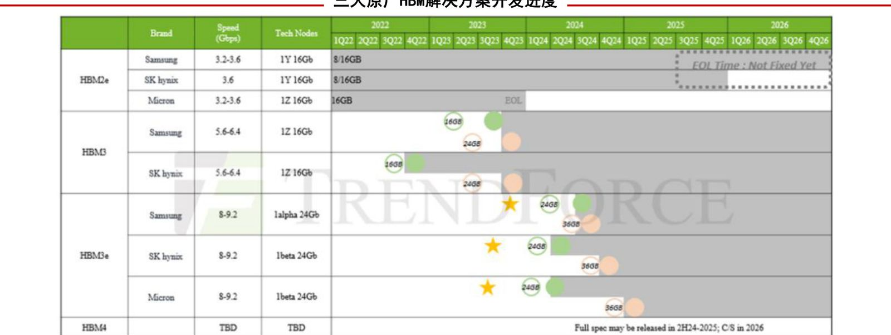

资料来源：eet-china、TrendForce集邦咨询、电子工程专辑、财联社，华金证券研究所

---

<!-- 原文第 20 页 -->

## 2.9 SK海力士首度登顶全球DRAM市场第一

根据CFM闪存市场报道，2025年一季度在AI服务器保持稳健推动对服务器DRAM需求，PC和移动需求复苏力度也较预期更为明显，此外叠加关税触发的部分补库存需求的共同影响下，2025年一季度整体表现优于预期，全球DRAM市场规模同比增长42.5%至267.29亿美元，环比减少8.5%。在2025年一季度，SK海力士凭借在HBM领域的绝对优势，终结三星长达四十多年的市场统治地位，以36.7%的市场份额首度登顶全球DRAM市场第一。HBM正加速重构DRAM产业格局——其市场渗透率已经从2023年的9%翻倍跃升至2024年的18%，2025年更有望突破30%的战略制高点，成为DRAM价值迁移的核心引擎。

### 三大原厂DRAM市场份额

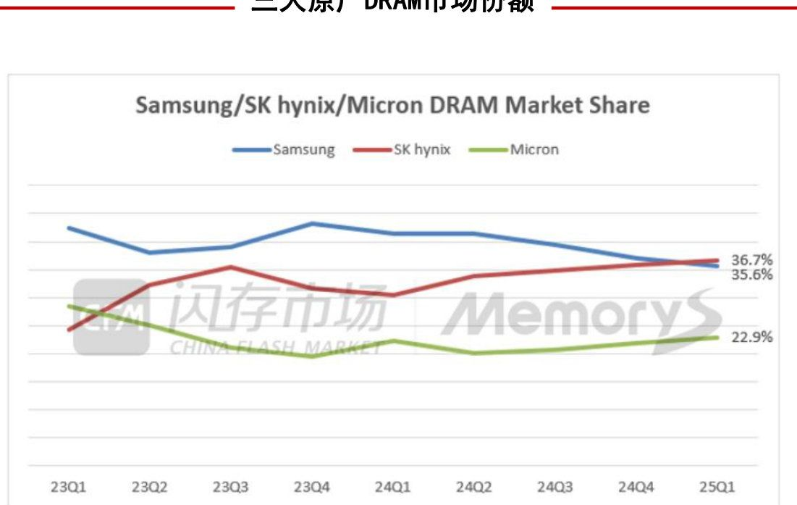

图表标题：Samsung/SK hynix/Micron DRAM Market Share；图例：Samsung（蓝线）、SK hynix（红线）、Micron（绿线）；横轴：23Q1、23Q2、23Q3、23Q4、24Q1、24Q2、24Q3、24Q4、25Q1；纵轴无刻度数值，仅网格线。25Q1 端点标注：Samsung 36.7%、SK hynix 35.6%、Micron 22.9%（图上未标出其余季度数值）。

### 2025Q1各原厂DRAM营收排名

**1Q25 DRAM Revenue Ranking**

| Ranking | Company | 1Q25 Sales of DRAM($M) | 1Q25 Market share | QoQ |
| --- | --- | --- | --- | --- |
| No.1 | SK hynix | 9,808 | 36.7% | -6.6% |
| No.2 | Samsung | 9,523 | 35.6% | -12.2% |
| No.3 | Micron | 6,123 | 22.9% | -4.3% |
| No.4 | Nanya | 221 | 0.8% | 8.5% |
| No.5 | Winbond | 131 | 0.5% | 8.8% |
|  | Others | 921 | 3.4% | -18.7% |
|  | **Total** | 26,729 | 100% | -8.5% |

资料来源：CFM闪存市场，华金证券研究所

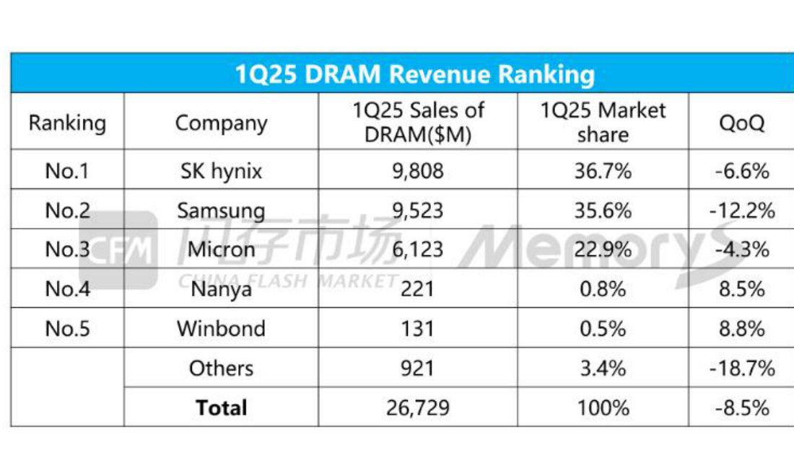

---

<!-- 原文第 21 页 -->

## 2.10 DRAM市场预测

根据Yole Group发布的市场与技术分析报告：《Status of the Memory Industry 2025》显示，在AI工作负载激增和行业战略性转向HBM（高带宽内存）的背景下，全球内存市场强势复苏。不过，全球贸易紧张局势始终如阴云笼罩，给供应链稳定带来潜在威胁。Yole Group预测，HBM市场将在2030年前保持33%的年复合增长率，届时其营收将超过DRAM市场总营收的50%。

### 全球存储市场规模预测

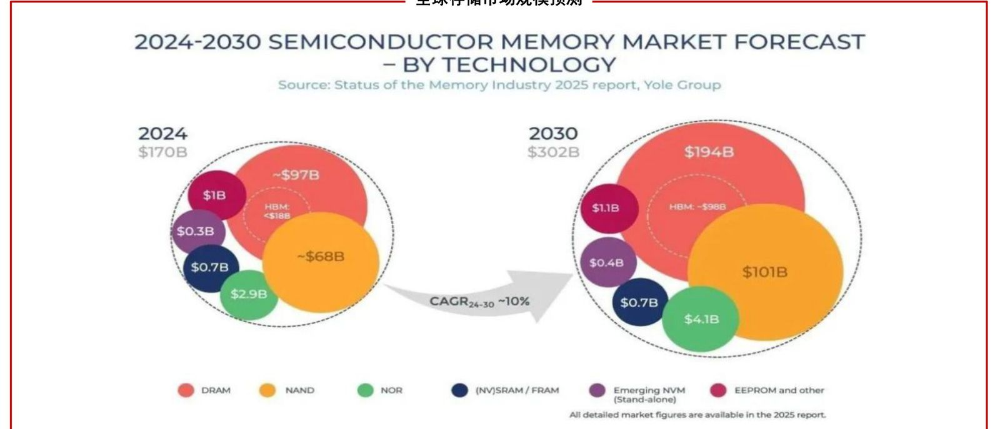

图表标题：2024-2030 SEMICONDUCTOR MEMORY MARKET FORECAST – BY TECHNOLOGY；来源标注：Source: Status of the Memory Industry 2025 report, Yole Group；两幅气泡图分别为 2024 年（合计 $170B）与 2030 年（合计 $302B），中间箭头标注 CAGR₂₄₋₃₀ ~10%。

| 技术类别（图例） | 2024 | 2030 |
| --- | --- | --- |
| DRAM | ~$97B | $194B |
| NAND | ~$68B | $101B |
| NOR | $2.9B | $4.1B |
| (NV)SRAM / FRAM | $0.7B | $0.7B |
| Emerging NVM (Stand-alone) | $0.3B | $0.4B |
| EEPROM and other | $1B | $1.1B |
| 整体市场规模（图内总量标注） | $170B | $302B |

其中 DRAM 气泡内虚线圆标注 HBM：2024 年 HBM: <$18B；2030 年 HBM: ~$98B。

All detailed market figures are available in the 2025 report.

资料来源：Yole Group、电子工程专辑，华金证券研究所

---

<!-- 原文第 22 页 -->

## 目录

- 01 存储器是半导体产业规模最大的分支之一
- 02 AI推动HBM火爆，DRAM持续迈入3D时代
- 03 NAND合约价预计季增，1000层时代将至
- 04 建议关注
- 05 风险提示

---

<!-- 原文第 23 页 -->

## 3.1 NAND Flash是大容量存储器主要解决方案

NAND Flash是非易失性存储的一种，是大容量存储器当前应用最广和最有效的解决方案。NAND Flash具有存储容量大、读写速度快、功耗低、单位成本低等特点，主要应用于有大容量存储需求的电子设备。随着人工智能、物联网、大数据、5G等新兴应用场景不断落地，电子设备需要存储的数据也越来越庞大，NAND Flash需求量巨大，市场前景广阔。

### 3D NAND (V-NAND) 的示意图

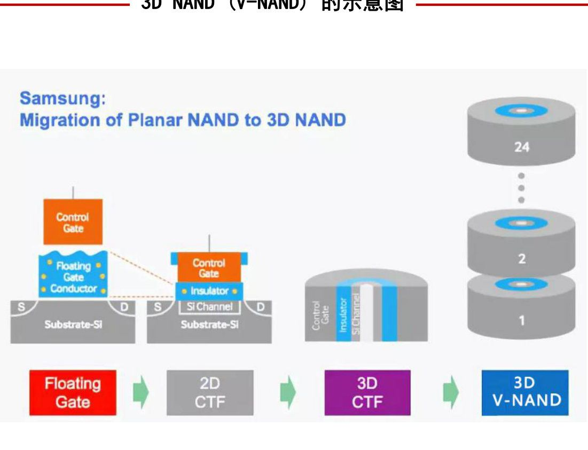

图内文字：Samsung: Migration of Planar NAND to 3D NAND。左侧为平面（Planar）结构示意，标注 Control Gate、Floating Gate、Conductor、Substrate-Si，源/漏端标注 S、D；中部为垂直沟道结构示意，标注 Insulator、Si Channel、Control Gate；右侧为堆叠层示意，层编号标注 1、2、……、24。下方流程为：Floating Gate → 2D CTF → 3D CTF → 3D V-NAND。

### 2020年NAND Flash全球需求应用分布

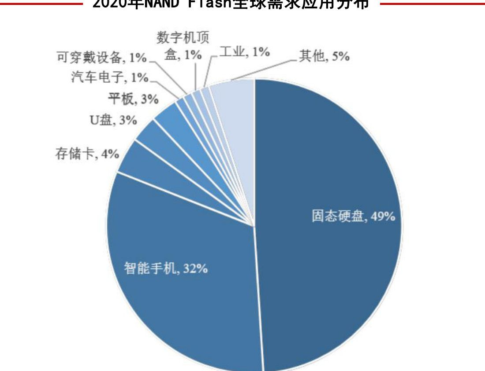

饼图数据（按图内标注）：

| 应用 | 占比 |
| --- | --- |
| 固态硬盘 | 49% |
| 智能手机 | 32% |
| 存储卡 | 4% |
| U盘 | 3% |
| 平板 | 3% |
| 汽车电子 | 1% |
| 可穿戴设备 | 1% |
| 数字机顶盒 | 1% |
| 工业 | 1% |
| 其他 | 5% |

资料来源：CFM闪存市场、Gartner、佰维存储招股书，华金证券研究所

---

<!-- 原文第 24 页 -->

## 3.2 NAND闪存按照存储方式划分已发展了四代

按照存储方式划分，NAND闪存已经发展了四代。第一代SLC（Single-Level Cell）每单元可存储1比特数据(1bit/cell)，性能好、寿命长，可经受10万次编程/擦写循环，但容量低、成本高；第二代MLC（Multi-Level Cell）每单元可存储2比特数据(2bits/cell)，性能、寿命、容量、成各方面比较均衡，可经受1万次编程/擦写循环，现在只有在少数高端SSD中可以见到；第三代TLC（Trinary-Level Cell）每单元可存储3比特数据(3bits/cell)，性能、寿命变差，只能经受3千次编程/擦写循环，但是容量可以做得更大，成本也可以更低，是当前最普及的；第四代QLC（Quad-Level Cell）每单元可存储4比特数据(4bits/cell)，性能、寿命进一步变差，只能经受1000次编程/擦写循环，但是容量更容易提升，成本也继续降低。

### 按照存储方式划分NAND闪存已经发展了四代

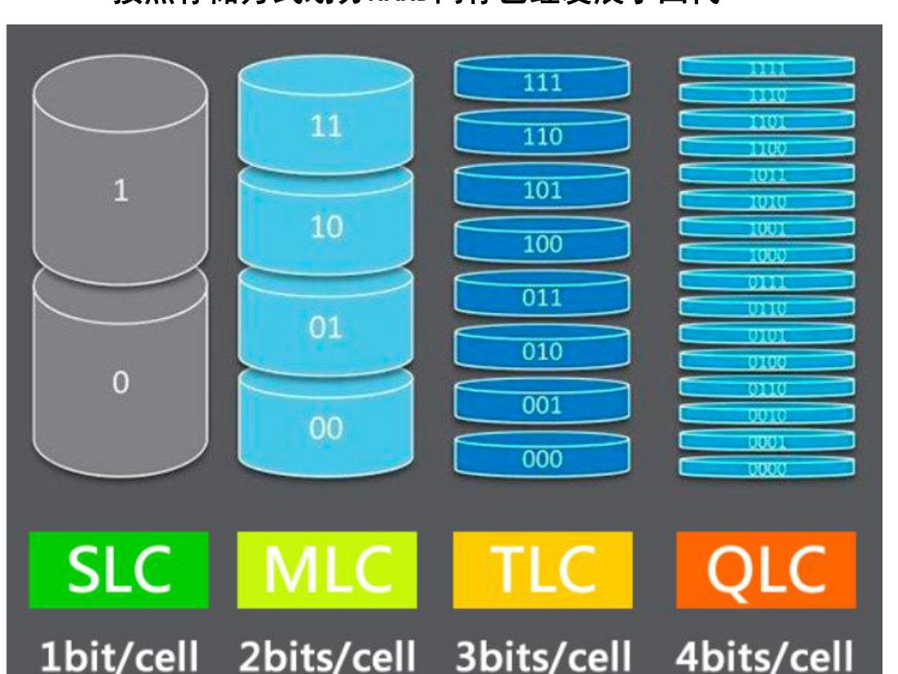

示意图以圆柱表示各代每单元可存储的状态数：SLC 标注 1（1bit/cell）；MLC 标注 11、10、01、00（2bits/cell）；TLC 标注 111、110、101、100、011、010、001、000（3bits/cell）；QLC 为更多状态的堆叠（4bits/cell）。下方色块依次为 SLC（绿）、MLC（黄绿）、TLC（黄）、QLC（橙）。

### SLC、MLC、TLC、QLC对比

| 规格 | SLC | MLC | TLC | QLC |
| --- | --- | --- | --- | --- |
| 速度 | ◆◆◆◆ | ◆◆◆ | ◆◆ | ◆ |
| 耐用度(P/E) | 10,000~100,000 | 3,000~10,000 | 1,500~3,000 | 1,000 |
| 容量 | ◆ | ◆◆ | ◆◆◆ | ◆◆◆◆ |
| 功耗 | ◆◆◆◆ | ◆◆◆ | ◆◆ | ◆ |
| 成本 | ◆◆◆◆ | ◆◆◆ | ◆◆ | ◆ |

表中「速度、容量、功耗、成本」四行原图以菱形图标数量表示等级（以此处 ◆ 个数转录），「耐用度(P/E)」为具体数值。

资料来源：深圳联乐官网，华金证券研究所

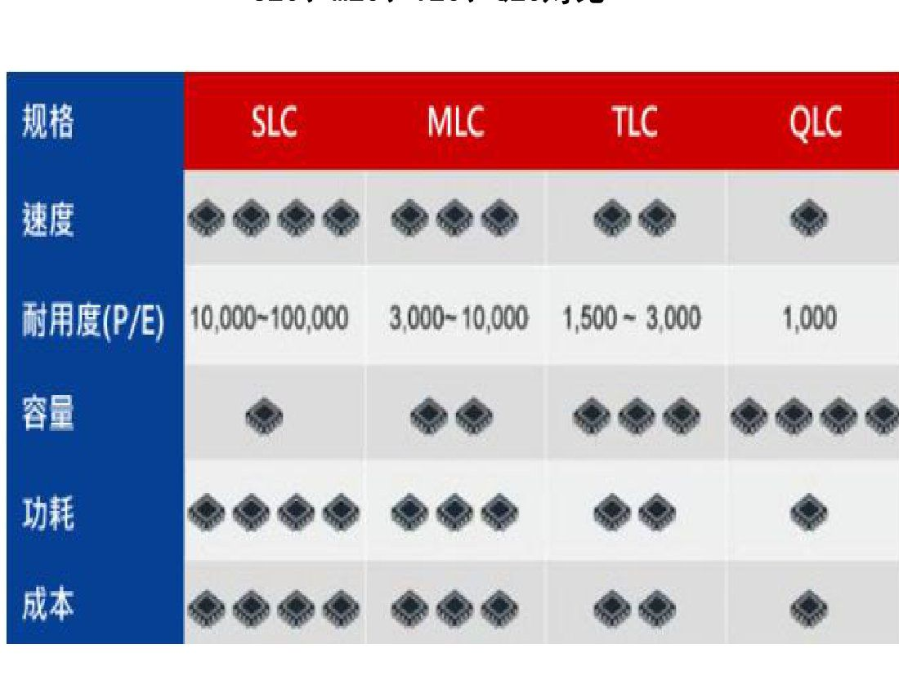

---

<!-- 原文第 25 页 -->

## 3.3 不同类型NAND闪存面向不同场景

- 这四类闪存颗粒中，SLC的性能最优，价格也是最高，一般用作对于可靠性、稳定性和耐用性有极高要求的工业控制、航天军工、通信设备等企业级客户；MLC性能够用，稳定性比较好，价格适中，为工业级和车规级SSD应用主流；TLC是目前消费级SSD的主流，价格便宜，但可以通过高性能主控、主控算法来弥补、提高TLC闪存的性能；QLC是奔着更大容量和更低成本发展。
- TLC又有2D-TLC与3D-TLC两种，目前市面上以3D-TLC居多。

### 3D NAND 在闪存总市场中的占比

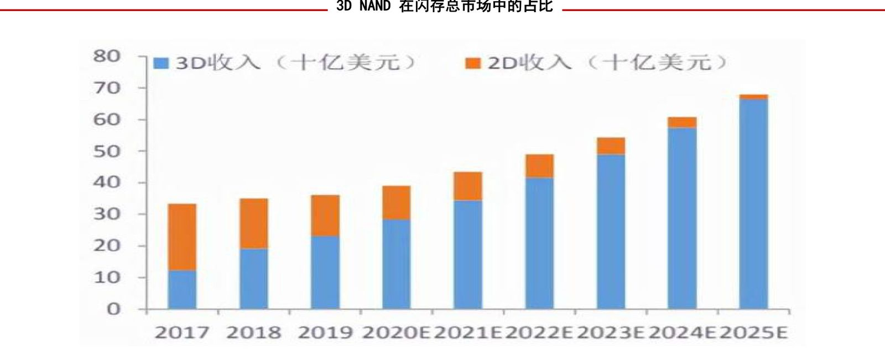

堆叠柱状图。图例：3D收入（十亿美元）（蓝）、2D收入（十亿美元）（橙）；纵轴 0–80（十亿美元）；横轴 2017、2018、2019、2020E、2021E、2022E、2023E、2024E、2025E。柱体无数据标签，未标出各年具体数值。

资料来源：univo、百度百科、虎嗅、芯语、International business strategies，华金证券研究所

---

<!-- 原文第 26 页 -->

## 3.4 3D NAND即将走向1000层

3D NAND层数普遍从2014年的24层增加到2022年的238层，八年间增长了10倍。根据2024年06月21日华尔街见闻报道，铠侠在首尔举行的IWM 2024会议上概述了1,000层3D NAND的技术路线图。日本媒体《PC Watch》报道了铠侠的宣传，通过推断过去的趋势并改进NAND单元技术，铠侠预测到2027年NAND芯片密度将达到100 Gbit/mm2，具有1,000个字线（存储单元）层。

### 3D NAND技术路线图

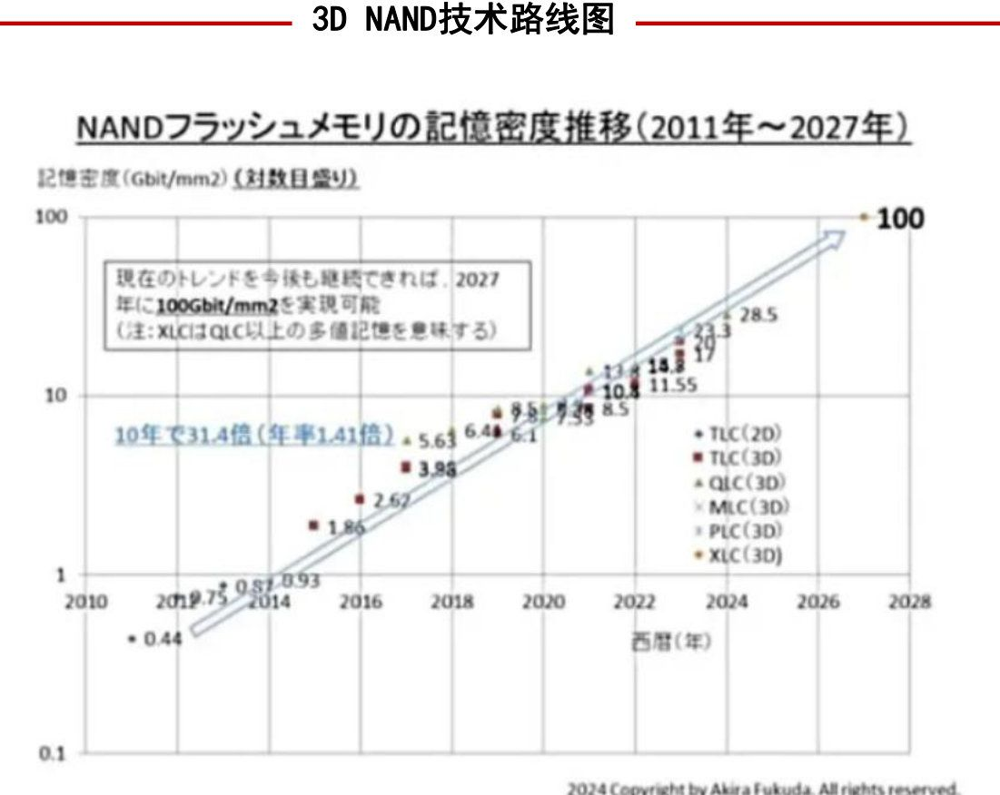

原图为日文图表。标题：NANDフラッシュメモリの記憶密度推移（2011年〜2027年）；纵轴：記憶密度（Gbit/mm2）（対数目盛り），刻度 0.1、1、10、100；横轴：西暦（年），2010–2028。图中注释框：現在のトレンドを今後も継続できれば、2027年に100Gbit/mm2を実現可能（注：XLCはQLC以上の多値記憶を意味する）；蓝字注释：10年で31.4倍（年率1.41倍）。图例：TLC(2D)、TLC(3D)、QLC(3D)、MLC(3D)、PLC(3D)、XLC(3D)。图内标注数值：0.44、0.75、0.81、0.93、1.86、2.62、3.98、5.63、6.46、6.1、9.51、7.33、8.5、10.8、13、14.8、11.55、17、23.3、28.5、100（对数纵轴，各点对应年份难以逐一确认，按图中出现顺序转录）。

2024 Copyright by Akira Fukuda. All rights reserved.

### 3D NAND发展现状

|  | First NAND | Latest NAND | Progress |
| --- | --- | --- | --- |
| Year | 1987-1989 | 2024 | 35 years |
| Technology | 2D NAND | 3D NAND ~300 layers | ~300x layers |
| Gate length | 1.0μm | <25nm | < 1/40 |
| Bits-per-cell | 1 bit per cell | 4 bits per cell | 4x |
| Areal density | 25kb/mm² | 28.5Gb/mm² | > One million |

资料来源：华尔街见闻、36Kr，华金证券研究所

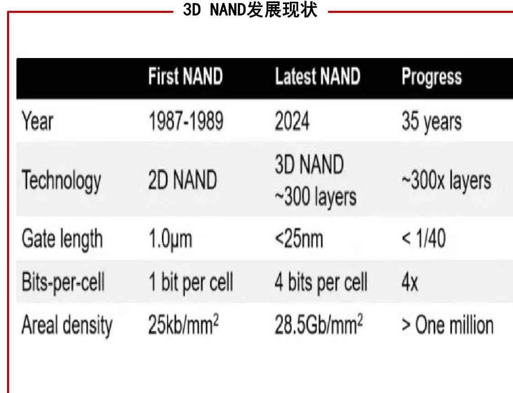

---

<!-- 原文第 27 页 -->

## 3.5 走向4D NAND时代

- 2024年11月21日，韩国存储器巨头SK海力士宣布，已正式量产全球首款321层堆叠1Tb TLC 4D NAND闪存，标志着存储器行业又一项技术里程碑的诞生。这款全新的闪存产品不仅打破了300层堆叠的技术限制，更为未来存储技术的发展方向指明了道路。
- 4D-NAND 在 3D-NAND 单元下方形成外围电路，减少了外围电路所占的面积，从而实现存储容量的最大化并降低 NAND 闪存的成本。

### 从2D向4D演进的示意图

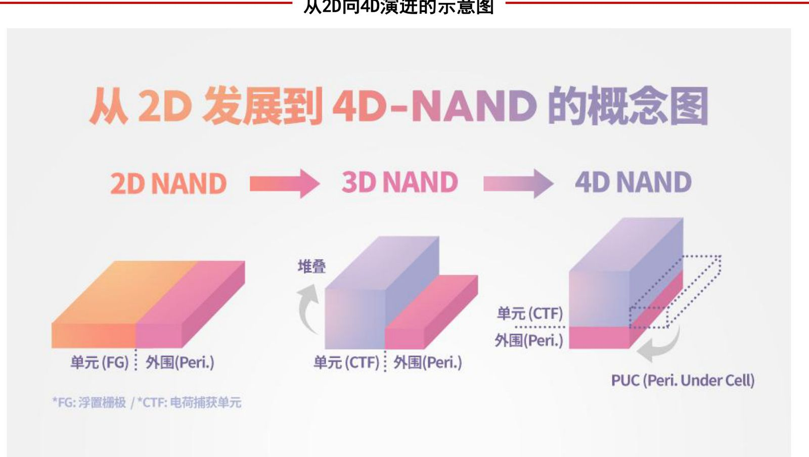

图内标题：从 2D 发展到 4D-NAND 的概念图。三个演进阶段：2D NAND、3D NAND、4D NAND（以箭头依次连接）。2D NAND 示意图标注「单元(FG)：外围(Peri.)」；3D NAND 示意图标注「堆叠」「单元(CTF)：外围(Peri.)」；4D NAND 示意图标注「单元(CTF)」「外围(Peri.)」「PUC (Peri. Under Cell)」。图下注：*FG:浮置栅极 / *CTF: 电荷捕获单元。

资料来源：维科网、SK海力士官网，华金证券研究所

---

<!-- 原文第 28 页 -->

## 3.6 3D NAND三星占最大市场份额

- 市场竞争格局来看，根据CFM闪存市场数据显示，2024年第三季度的NAND Flash市场上，三星、SK海力士+Solidigm、铠侠、美光、西部数据的市场份额分别为32.9%、19.1%、17.0%、12.4%和9.9%。
- 2024年，各NAND Flash原厂均已量产堆叠层数达到276~321层的第九代3D NAND产品，并持续朝着更高的堆叠层数演进。下一代NAND Flash堆叠层数预计将普遍超过300层，长期目标则朝1,000层迈进。

### 3D NAND各原厂演进路线

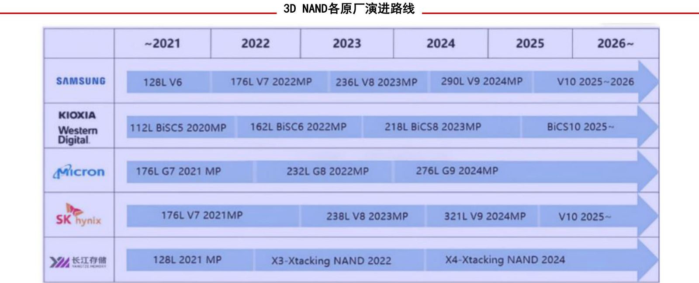

图为分厂商的路线条（时间列依次为 ~2021、2022、2023、2024、2025、2026~，条块宽度表示时间跨度）：

| 厂商 | 演进节点（按图中从左至右） |
| --- | --- |
| SAMSUNG | 128L V6；176L V7 2022MP；236L V8 2023MP；290L V9 2024MP；V10 2025~2026 |
| KIOXIA / Western Digital | 112L BiCS5 2020MP；162L BiCS6 2022MP；218L BiCS8 2023MP；BiCS10 2025~ |
| Micron | 176L G7 2021 MP；232L G8 2022MP；276L G9 2024MP |
| SK hynix | 176L V7 2021MP；238L V8 2023MP；321L V9 2024MP；V10 2025~ |
| 长江存储 | 128L 2021 MP；X3-Xtacking NAND 2022；X4-Xtacking NAND 2024 |

[TABLE_RECONSTRUCTION_UNCERTAIN]

资料来源：CFM闪存市场、佰维存储公告，华金证券研究所

---

<!-- 原文第 29 页 -->

## 3.7 预估3Q25 NAND 合约价季增5%至10%

- 根据TrendForce集邦咨询最新调查，NAND Flash市场历经2025年上半年的减产与库存去化，供需失衡情况已明显改善。随着原厂转移产能至高毛利产品，市场流通供给量缩减。需求面则有企业加码AI投资，以及NVIDIA（英伟达）新一代Blackwell芯片大量出货支撑。展望第三季NAND Flash价格走势，预估平均合约价将季增5%至10%，但eMMC、UFS产品因智能手机下半年展望不明，涨幅较低。

### 2Q25~3Q25NAND Flash产品价格预测

**2Q25-3Q25 NAND Flash产品价格预测**

|  | 2Q25 | 3Q25E |
| --- | --- | --- |
| eMMC UFS | up 5~10% | up 0~5% |
| Enterprise SSD | mostly flat | up 5~10% |
| Client SSD | up 5~10% | up 3~8% |
| 3D NAND Wafers (TLC & QLC) | up 15~20% | up 8~13% |
| Total NAND Flash | up 3~8% | up 5~10% |

Source: TrendForce, July 2025

### 1Q25 NAND Flash前五大品牌厂商营收排行

**1Q25 NAND Flash前五大品牌厂商营收排行**

| rankings | Company | Revenue (US$M) 1Q25 | Revenue (US$M) QoQ (%) | Market Share (%) 1Q25 | Market Share (%) 4Q24 |
| --- | --- | --- | --- | --- | --- |
| 1 | Samsung | 4,200.0 | -25.0% | 31.9% | 33.9% |
| 2 | SK Group (hynix + Solidigm) | 2,186.6 | -35.5% | 16.6% | 20.5% |
| 3 | Micron | 2,025.0 | -11.0% | 15.4% | 13.8% |
| 4 | Kioxia | 1,916.0 | -27.9% | 14.6% | 16.1% |
| 5 | Sandisk | 1,695.0 | -- | 12.9% | -- |
| Total of Top 5 |  | 12,022.6 | -- | 91.3% | 84.3% |

注1：4Q24汇率均值：美元兑日圆汇率：1:152.4；美元兑韩元汇率：1:1,398.7

注2：1Q25汇率均值：美元兑日圆汇率：1:152.4；美元兑韩元汇率：1:1,452.0

注3：由于Western Digital Corporation(WDC)于2024年10月完成拆分，WDC未来所有的NAND Flash业务将归属于SanDisk，其NAND Flash营收于2025年第一季生效。

Source: TrendForce, May 2025

资料来源：eet-china、新浪科技、TrendForce集邦咨询，华金证券研究所

---

<!-- 原文第 30 页 -->

## 目录

- 01 存储器是半导体产业规模最大的分支之一
- 02 AI推动HBM火爆，DRAM持续迈入3D时代
- 03 NAND合约价预计25年Q3季增，1000层时代将至
- 04 建议关注
- 05 风险提示

---

<!-- 原文第 31 页 -->

## 4.1 长江存储

- 长江存储科技有限责任公司成立于2016年7月，总部位于“江城”武汉，是一家集芯片设计、生产制造、封装测试及系统解决方案产品于一体的存储器IDM企业。长江存储为全球合作伙伴提供3D NAND闪存晶圆及颗粒， 嵌入式存储芯片以及消费级、企业级固态硬盘等产品和解决方案，广泛应用于移动通信、消费数码、计算机、服务器及数据中心等领域。

### 长江存储第五代TLC 3D NAND闪存介绍

第五代TLC 3D NAND闪存

**X4-9060**

基于晶栈®Xtacking® 4.0技术的长江存储第五代TLC 3D NAND闪存颗粒——X4-9060进一步释放了3D NAND闪存潜能，具备行业优异的存储密度、I/O传输速度及更优化的产品功耗。可广泛应用于企业级、消费级、嵌入式等存储产品中，以满足云计算、大数据、移动设备、个人消费终端等多场景下的存储需求。

存储容量：512Gb

### 晶栈®Xtacking® 技术详解

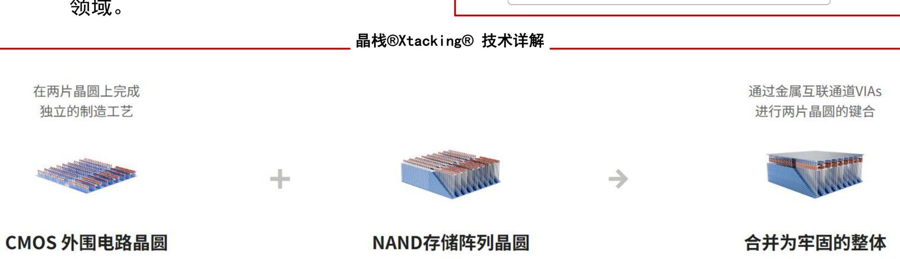

- 在两片晶圆上完成独立的制造工艺
- CMOS 外围电路晶圆
- NAND存储阵列晶圆
- 通过金属互联通道VIAs进行两片晶圆的键合
- 合并为牢固的整体

资料来源：长江存储官网，华金证券研究所

---

<!-- 原文第 32 页 -->

## 4.2 长鑫存储

- 长鑫存储是一家一体化存储器制造公司，专注于动态随机存取存储芯片(DRAM)的设计、研发、生产和销售。创立于2016年，长鑫存储总部位于安徽合肥，在国内外拥有多个研发中心和分支机构。长鑫存储的技术团队拥有丰富的技术研发经验和创新能力，已推出多款DRAM商用产品，广泛应用于移动终端、电脑、服务器、虚拟现实和物联网等领域。

### 长鑫存储发展历程

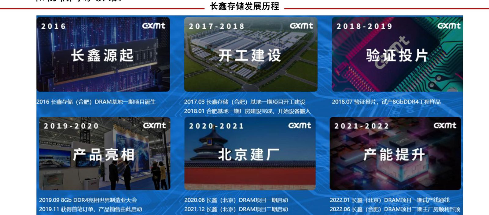

**2016｜长鑫源起**

2016 长鑫存储（合肥）DRAM基地一期项目诞生

**2017-2018｜开工建设**

2017.03 长鑫存储（合肥）基地一期项目开工建设

2018.01 合肥基地一期厂房建设完成，开始设备搬入

**2018-2019｜验证投片**

2018.07 验证投片，试产8GbDDR4工程样品

**2019-2020｜产品亮相**

2019.09 8Gb DDR4亮相世界制造业大会

2019.11 获得首笔订单，产品销售由此启动

**2020-2021｜北京建厂**

2020.06 长鑫（北京）DRAM项目一期启动

2021.12 长鑫（北京）DRAM项目二期启动

**2021-2022｜产能提升**

2022.01 长鑫（北京）DRAM项目一期试产线通线

2022.06 长鑫（合肥）DRAM项目二期主厂房顺利封顶

资料来源：长鑫存储官网，华金证券研究所

---

<!-- 原文第 33 页 -->

## 4.3 澜起科技

- 澜起科技是一家国际领先的数据处理及互连芯片设计公司，致力于为云计算和人工智能领域提供高性能、低功耗的芯片解决方案。2024年，全球服务器及计算机行业需求回暖，DDR5渗透率持续提升，推动公司内存接口及模组配套芯片销售收入显著增长；同时，公司高性能运力芯片新产品开始规模出货，为公司业绩增长注入强劲动力。

### 澜起科技过去两年业绩情况

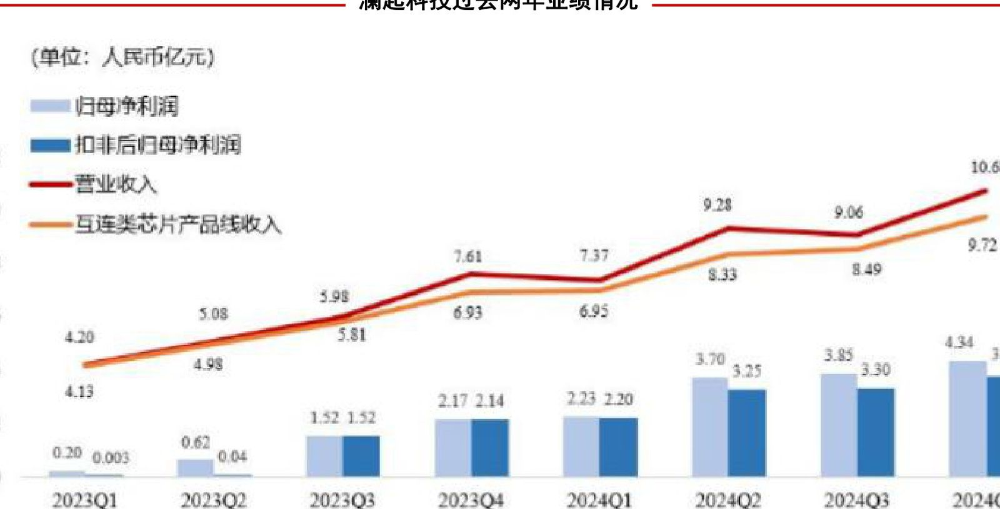

（单位：人民币亿元）

图例：归母净利润、扣非后归母净利润（柱状）；营业收入、互连类芯片产品线收入（折线）

| 期间 | 归母净利润 | 扣非后归母净利润 | 营业收入 | 互连类芯片产品线收入 |
| --- | --- | --- | --- | --- |
| 2023Q1 | 0.20 | 0.003 | 4.20 | 4.13 |
| 2023Q2 | 0.62 | 0.04 | 5.08 | 4.98 |
| 2023Q3 | 1.52 | 1.52 | 5.98 | 5.81 |
| 2023Q4 | 2.17 | 2.14 | 7.61 | 6.93 |
| 2024Q1 | 2.23 | 2.20 | 7.37 | 6.95 |
| 2024Q2 | 3.70 | 3.25 | 9.28 | 8.33 |
| 2024Q3 | 3.85 | 3.30 | 9.06 | 8.49 |
| 2024Q4 | 4.34 | 3.74 | 10.68 | 9.72 |

资料来源：公司公告，华金证券研究所

---

<!-- 原文第 34 页 -->

## 4.4 兆易创新

- 公司成立于2005年，总部设于中国北京，并于2016年8月在上海证券交易所成功上市，是一家致力于开发存储器技术、MCU、传感器和模拟产品及解决方案的领先的无晶圆厂半导体公司，在中国、美国、新加坡、日本、英国、德国等多个国家和地区均设有分支机构和办事处，营销网络遍布全球，为客户提供优质便捷的本地化支持服务。公司核心产品线为存储器(Flash、利基型DRAM)、32位通用型MCU、智能人机交互传感器、模拟产品及整体解决方案。产品以“高性能、低功耗”著称，为汽车、工业控制、物联网、网络/通信、计算机、消费电子等客户提供全方位服务。

### 公司2024年分业务占比（单位：元）

#### 主营业务分行业情况

| 分行业 | 营业收入 | 营业成本 | 毛利率（%） | 营业收入比上年增减（%） | 营业成本比上年增减（%） | 毛利率比上年增减（%） |
| --- | --- | --- | --- | --- | --- | --- |
| 集成电路 | 7,355,627,831.60 | 4,560,543,165.32 | 38.00 | 27.69 | 20.72 | 增加 3.58 个百分点 |

#### 主营业务分产品情况

| 分产品 | 营业收入 | 营业成本 | 毛利率（%） | 营业收入比上年增减（%） | 营业成本比上年增减（%） | 毛利率比上年增减（%） |
| --- | --- | --- | --- | --- | --- | --- |
| 存储芯片 | 5,194,173,225.67 | 3,102,673,445.00 | 40.27 | 27.39 | 13.55 | 增加 7.28 个百分点 |
| MCU 及模拟产品 | 1,706,014,797.54 | 1,083,301,851.37 | 36.50 | 29.56 | 44.57 | 减少 6.60 个百分点 |
| 传感器 | 448,300,100.78 | 374,503,004.70 | 16.46 | 27.20 | 26.49 | 增加 0.46 个百分点 |
| 技术服务及其他收入 | 7,139,707.61 | 64,864.25 | 99.09 | -48.61 | / | 减少 0.91 个百分点 |

资料来源：公司公告、wind，华金证券研究所

---

<!-- 原文第 35 页 -->

## 4.5 紫光国微

- 公司为国内主要的综合性集成电路上市公司之一，以特种集成电路、智能安全芯片为两大主业，同时布局石英晶体频率器件领域，为移动通信、金融、政务、汽车、工业、物联网等多个行业提供芯片、系统解决方案和终端产品。公司特种集成电路业务产品涵盖微处理器、可编程器件、存储器、网络及接口、模拟器件、ASIC/SoPC等几大系列产品，700多个品种，同时可以为用户提供ASIC/SOC设计开发服务及国产化系统芯片级解决方案。

### 公司2024年分业务表现（单位：元）

#### 分行业

|  | 营业收入 | 营业成本 | 毛利率 | 营业收入比上年同期增减 | 营业成本比上年同期增减 | 毛利率比上年同期增减 |
| --- | --- | --- | --- | --- | --- | --- |
| 集成电路 | 5,215,334,931.22 | 2,202,972,009.79 | 57.76% | -28.98% | -19.80% | -4.83pct |
| 电子元器件 | 224,198,289.81 | 189,321,791.28 | 15.56% | 20.93% | 10.15% | 8.27pct |

#### 分产品

|  | 营业收入 | 营业成本 | 毛利率 | 营业收入比上年同期增减 | 营业成本比上年同期增减 | 毛利率比上年同期增减 |
| --- | --- | --- | --- | --- | --- | --- |
| 智能安全芯片 | 2,638,158,233.40 | 1,473,248,328.47 | 44.16% | -7.61% | -4.25% | -1.96pct |
| 特种集成电路 | 2,577,176,697.82 | 729,723,681.32 | 71.69% | -42.57% | -39.61% | -1.38pct |
| 石英晶体频率器件 | 224,198,289.81 | 189,321,791.28 | 15.56% | 20.93% | 10.15% | 8.27pct |

#### 分地区

|  | 营业收入 | 营业成本 | 毛利率 | 营业收入比上年同期增减 | 营业成本比上年同期增减 | 毛利率比上年同期增减 |
| --- | --- | --- | --- | --- | --- | --- |
| 境内 | 4,705,391,081.75 | 2,025,542,260.73 | 56.95% | -30.03% | -21.59% | -4.63pct |
| 境外 | 734,142,139.28 | 366,751,540.34 | 50.04% | -8.66% | 9.33% | -8.22pct |

#### 分销售模式

|  | 营业收入 | 营业成本 | 毛利率 | 营业收入比上年同期增减 | 营业成本比上年同期增减 | 毛利率比上年同期增减 |
| --- | --- | --- | --- | --- | --- | --- |
| 经销 | 164,314,650.48 | 153,036,571.26 | 6.86% | -18.58% | -23.42% | 5.89pct |
| 直销 | 5,275,218,570.55 | 2,239,257,229.81 | 57.55% | -28.00% | -17.64% | -5.34pct |

资料来源：公司公告，华金证券研究所

---

<!-- 原文第 36 页 -->

## 4.6 东芯股份

- 东芯股份是一家专注于中小容量存储芯片独立研发、设计与销售的企业。公司秉持“提供可靠高效的存储产品及设计方案”的使命，并以“成为中国领先的存储芯片设计企业”为愿景，致力于通过自主研发的知识产权、稳定的供应链体系以及高可靠性产品，为客户提供优质的存储产品及解决方案。公司以存储为核心，同时在“存、算、联”一体化领域进行技术创新，拓展行业应用范围，优化业务布局，旨在为客户提供多样化的芯片解决方案。

### 公司2024年年报显示在研项目（单位：万元）

| 序号 | 项目名称 | 预计总投资规模 | 本期投入金额 | 累计投入金额 | 进展或阶段性成果 | 拟达到目标 | 技术水平 | 具体应用前景 |
| --- | --- | --- | --- | --- | --- | --- | --- | --- |
| 1 | 1xnm NAND Flash系列产品 | 19,940.00 | 2,528.25 | 9,515.54 | 风险量产阶段 | 研发更先进制程的 SLC NAND Flash 芯片 | 国际领先 | 网络通信、监控安防、消费类电子、工业控制等领域 |
| 2 | 2xnm NAND Flash系列产品 | 8,800.00 | 2,387.91 | 9,410.37 | 部分产品已量产 | 扩充 SLC NAND Flash 产品丰富度，提升产品可靠性 | 国内领先 | 网络通信、监控安防、消费类电子、工业控制等领域 |
| 3 | 28nm NAND Flash系列产品 | 14,000.00 | 1,754.29 | 11,242.55 | 部分产品已量产 | 扩充 SLC NAND Flash 产品丰富度，提升产品可靠性 | 国内领先 | 网络通信、监控安防、消费类电子、工业控制、汽车电子等领域 |
| 4 | 48nm NOR Flash系列产品 | 10,000.00 | 1,467.60 | 8,935.56 | 部分产品已量产 | 研发更低成本、更高性能的 NOR Flash 芯片 | 国际领先 | 网络通信、监控安防、消费类电子、工业控制、汽车电子等领域 |
| 5 | 55nm NOR Flash系列产品 | 8,000.00 | 1,049.17 | 5,069.43 | 部分产品已量产 | 扩充 NOR Flash 产品丰富度，提升产品可靠性 | 国内先进 | 网络通信、监控安防、消费类电子、工业控制、汽车电子等领域 |
| 6 | DDR3 系列产品 | 2,350.00 | 1,061.11 | 1,061.11 | 部分产品已量产 | 扩充 DRAM 产品线 | 国内先进 | 网络通信、监控安防、消费类电子、工业控制等领域 |
| 7 | LPDDR4x 系列产品 | 8,930.00 | 1,656.42 | 3,507.02 | 量产阶段 | 研发第四代低功耗DDR产品，实现 LPDDR 系列产品升级迭代 | 国内领先 | 网络通信、消费电子、工业控制、汽车电子等领域 |
| 8 | 其他 DRAM 产品 | 8,500.00 | 1,504.45 | 6,049.32 | 部分产品已量产 | 对现有 DRAM 产品进行持续升级 | 国内先进 | 网络通信、监控安防、消费类电子、工业控制等领域 |
| 9 | 车规产品 | 14,273.88 | 3,963.40 | 9,272.34 | 部分产品已通过 AEC-Q100 验证，已实现车规产品销售 | 符合 AEC 国际车规认证标准，并符合车规客户要求 | 国内领先 | 车载类应用等领域 |
| 10 | WIFI 7 产品 | 20,000.00 | 3,950.08 | 3,950.08 | 研发阶段 | 研发中高端 Wi-Fi 透传芯片，丰富公司产品线 | 国内先进 | 家庭娱乐终端、物联网等领域 |
| 合计 | / | 114,793.88 | 21,322.68 | 68,013.32 | / | / | / | / |

资料来源：公司公告，华金证券研究所

---

<!-- 原文第 37 页 -->

## 4.7 江波龙

- 公司主营业务为半导体存储应用产品的研发、设计、封装测试、生产制造（SMT及组包环节，下同）与销售。公司聚焦于存储产品和应用，形成了存储芯片设计、主控芯片设计及固件算法开发、封装测试，以及生产制造等核心能力，为市场提供消费级、车规级、工规级存储器以及行业存储软硬件应用解决方案。公司拥有行业类存储品牌FORESEE、海外行业类存储品牌Zilia和国际高端消费类存储品牌Lexar（雷克沙）。公司产品广泛应用于主流消费类智能移动终端（如智能手机、可穿戴设备、PC等）、数据中心、汽车电子、物联网、安防监控、工业控制等领域，以及个人消费类存储市场。

### 公司2024年度分业务表现（单位：元）

| 项目 | 2024年 金额 | 2024年 占营业收入比重 | 2023年 金额 | 2023年 占营业收入比重 | 同比增减 |
| --- | --- | --- | --- | --- | --- |
| 营业收入合计 | 17,463,650,272.14 | 100% | 10,125,111,900.80 | 100% | 72.48% |

#### 分行业

| 项目 | 2024年 金额 | 2024年 占营业收入比重 | 2023年 金额 | 2023年 占营业收入比重 | 同比增减 |
| --- | --- | --- | --- | --- | --- |
| 存储行业 | 17,463,597,001.35 | 100.00% | 10,124,959,101.24 | 100.00% | 72.48% |
| 其他 | 53,270.79 | 0.00% | 152,799.56 | 0.00% | -65.14% |

#### 分产品

| 项目 | 2024年 金额 | 2024年 占营业收入比重 | 2023年 金额 | 2023年 占营业收入比重 | 同比增减 |
| --- | --- | --- | --- | --- | --- |
| 嵌入式存储 | 8,425,270,639.80 | 48.24% | 4,422,919,317.23 | 43.68% | 90.49% |
| 移动存储 | 3,207,977,975.31 | 18.37% | 2,327,529,497.33 | 22.99% | 37.83% |
| 固态硬盘 | 4,146,913,457.98 | 23.75% | 2,802,425,123.48 | 27.68% | 47.98% |
| 内存条 | 1,527,022,650.20 | 8.74% | 513,094,761.01 | 5.07% | 197.61% |
| 其他 | 156,465,548.85 | 0.90% | 59,143,201.75 | 0.58% | 164.55% |

#### 分地区

| 项目 | 2024年 金额 | 2024年 占营业收入比重 | 2023年 金额 | 2023年 占营业收入比重 | 同比增减 |
| --- | --- | --- | --- | --- | --- |
| 境外 | 12,424,818,872.64 | 71.15% | 7,806,410,187.54 | 77.10% | 59.16% |
| 境内 | 5,038,831,399.50 | 28.85% | 2,318,701,713.26 | 22.90% | 117.31% |

#### 分销售模式

| 项目 | 2024年 金额 | 2024年 占营业收入比重 | 2023年 金额 | 2023年 占营业收入比重 | 同比增减 |
| --- | --- | --- | --- | --- | --- |
| 直销 | 10,055,717,804.16 | 57.58% | 5,554,927,791.13 | 54.86% | 81.02% |
| 经销 | 7,407,932,467.98 | 42.42% | 4,570,184,109.67 | 45.14% | 62.09% |

资料来源：公司公告，华金证券研究所

---

<!-- 原文第 38 页 -->

## 4.8 北京君正

- 公司芯片产品所属领域涵盖了处理器、存储器和模拟电路等，具体产品类别分为计算芯片、存储芯片、模拟芯片和互联芯片，其中计算芯片的现有产品采用了MIPS架构，同时，公司也在积极进行RISC-V相关技术的研发，公司自研的RISC-V CPU核目前已应用于公司大部分芯片产品中，包含公司自研RISC-V CPU核的芯片产品出货量已累计超过上亿颗。

### 公司2024年度分业务表现（单位：元）

| 项目 | 2024年 金额 | 2024年 占营业收入比重 | 2023年 金额 | 2023年 占营业收入比重 | 同比增减 |
| --- | --- | --- | --- | --- | --- |
| 营业收入合计 | 4,212,625,881.35 | 100% | 4,530,925,656.37 | 100% | -7.03% |

#### 分行业

| 项目 | 2024年 金额 | 2024年 占营业收入比重 | 2023年 金额 | 2023年 占营业收入比重 | 同比增减 |
| --- | --- | --- | --- | --- | --- |
| 主营业务 |  |  |  |  |  |
| 集成电路设计 | 4,204,968,522.08 | 99.82% | 4,519,949,405.38 | 99.76% | -6.97% |
| 其他业务 |  |  |  |  |  |
| 房租收入 | 7,657,359.27 | 0.18% | 10,976,250.99 | 0.24% | -30.24% |

#### 分产品

| 项目 | 2024年 金额 | 2024年 占营业收入比重 | 2023年 金额 | 2023年 占营业收入比重 | 同比增减 |
| --- | --- | --- | --- | --- | --- |
| 主营业务 |  |  |  |  |  |
| 计算芯片 | 1,090,104,206.74 | 25.88% | 1,108,370,894.73 | 24.46% | -1.65% |
| 存储芯片 | 2,589,491,950.49 | 61.47% | 2,911,558,365.45 | 64.26% | -11.06% |
| 模拟与互联芯片 | 471,521,940.41 | 11.19% | 408,917,840.36 | 9.03% | 15.31% |
| 技术服务 | 52,892,674.00 | 1.26% | 89,699,174.66 | 1.98% | -41.03% |
| 其他 | 957,750.44 | 0.02% | 1,403,130.18 | 0.03% | -31.74% |
| 其他业务 |  |  |  |  |  |
| 房租收入 | 7,657,359.27 | 0.18% | 10,976,250.99 | 0.24% | -30.24% |

资料来源：公司公告，华金证券研究所

---

<!-- 原文第 39 页 -->

## 4.9 佰维存储

- 公司主要从事半导体存储器的研发设计、封装测试、生产和销售，主要产品及服务为半导体存储器和先进封测服务，其中半导体存储器按照应用领域不同又分为嵌入式存储、PC存储、工车规存储、企业级存储和移动存储等。公司积极响应国家战略新兴产业导向，面向AI时代创新存储底座，通过持续的产品技术创新，扩大国内外头部客户的覆盖度和市场占有率。公司是业内极少数兼具先进存储和先进封测能力的厂商，涉及存储解决方案研发、主控芯片设计、存储器封测/晶圆级先进封测和存储测试机等产业链关键环节，致力于推动存储及先进封测产业在AI时代下的创新协同发展。

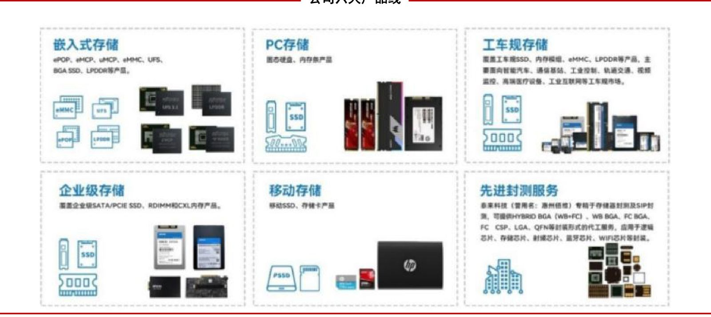
**公司六大产品线**

六宫格示意图（2 行 3 列），每格为上色产品线名称、产品说明与产品实物图：

| 产品线 | 产品说明 |
| --- | --- |
| 嵌入式存储 | ePOP、eMCP、uMCP、eMMC、UFS、BGA SSD、LPDDR等产品。 |
| PC存储 | 固态硬盘、内存条产品 |
| 工车规存储 | 覆盖工车规SSD、内存模组、eMMC、LPDDR等产品，主要面向智能汽车、通信基站、工业控制、轨道交通、视频监控、高端医疗设备、工业互联网等工车规市场。 |
| 企业级存储 | 覆盖企业级SATA/PCIe SSD、RDIMM和CXL内存产品。 |
| 移动存储 | 移动SSD、存储卡产品 |
| 先进封测服务 | 泰来科技（曾用名：惠州佰维）专注于存储晶圆封测及SiP封测，可提供HYBRID BGA（WB+FC）、WB BGA、FC BGA、FC CSP、LGA、QFN等封装形式的代工服务，应用于逻辑芯片、存储芯片、射频芯片、蓝牙芯片、WIFI芯片等封装。 |

注：该图为 835×382 像素低分辨率位图，小字部分模糊；「内存模组」「SiP封测」「射频芯片」等字样按字形辨读。

资料来源：公司公告，华金证券研究所

---

<!-- 原文第 40 页 -->

## 4.10 联芸科技

- 公司自成立以来一直专注于数据存储主控芯片的研究及产业化，已发展成为全球出货量排名前列的独立固态硬盘主控芯片厂商，是全球为数不多掌握数据存储主控芯片核心技术的企业之一。同时，公司基于自主的芯片设计研发平台，已形成多款AIoT信号处理及传输芯片的产品布局，并实现规模化商业应用。公司开发的上述芯片可广泛应用于消费电子、工业控制、数据通信、智能物联等领域。经过多年技术积累与品牌沉淀，公司已进入客户E、江波龙、长江存储、威刚、宜鼎、宇瞻、佰维、金泰克、时创意、金胜维等行业头部客户的供应链体系，并成为其在上述领域的主要供应商。未来，公司将始终围绕数据存储主控芯片、AIoT信号处理及传输芯片两大领域关键核心技术持续创新。

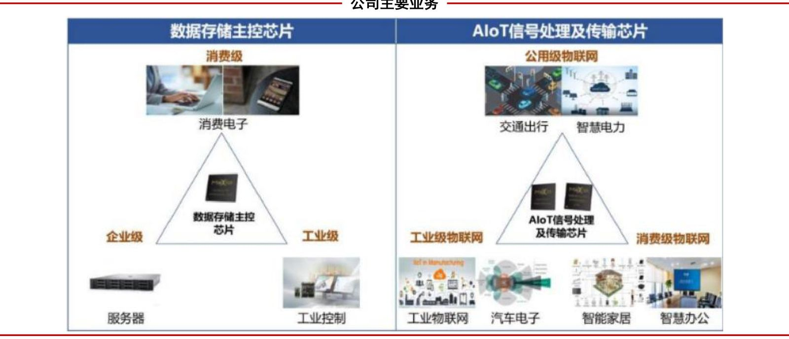
**公司主要业务**

左右并列的结构图，两条产品线各以三角中心标注芯片，四周标注分级与应用场景：

左列：**数据存储主控芯片**

- 中心：数据存储主控芯片
- 消费级：消费电子
- 企业级：服务器
- 工业级：工业控制

右列：**AIoT信号处理及传输芯片**

- 中心：AIoT信号处理及传输芯片
- 公用级物联网：交通出行、智慧电力
- 工业级物联网：工业物联网、汽车电子
- 消费级物联网：智能家居、智慧办公

资料来源：公司公告、wind，华金证券研究所

---

<!-- 原文第 41 页 -->

## 4.11 德明利

- 公司成立于2008年，是专业从事集成电路存储芯片设计、研发及产业化应用的国家高新技术企业，国家专精特新重点“小巨人”企业，是国内存储主控芯片行业第一家上市公司。自设立以来，公司的主营业务主要集中于闪存主控芯片设计、研发，存储模组产品应用方案的开发、优化，以及存储模组产品的销售。公司经过多年积累逐渐形成自主可控的主控芯片与固件方案两大核心技术平台，结合产品方案设计及量产工具开发、存储模组测试等形成完善的存储管理应用方案，高效实现对NAND Flash存储颗粒进行数据管理和应用性能提升。公司目前已经建立了完善的闪存存储产品矩阵，包括移动存储、固态硬盘、嵌入式存储，相关产品广泛应用于消费电子、工控设备、家用电器、汽车电子、智能家居、物联网、服务器及数据中心等领域。

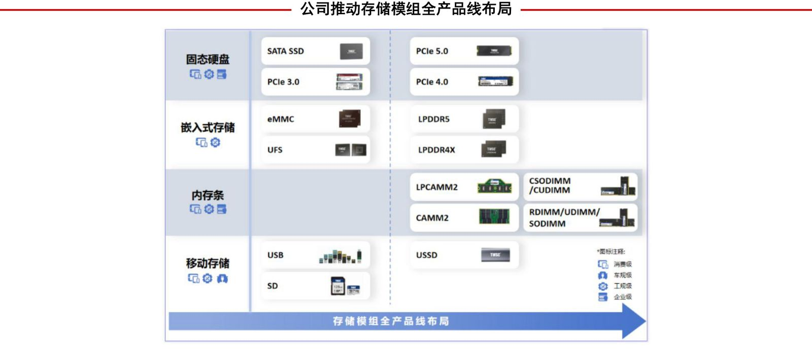
**公司推动存储模组全产品线布局**

按应用类别的矩阵式产品布局图，左侧为类别、右侧为两类产品卡（左列 2 个、右列 2×2 共 4 个）：

| 类别 | 产品 |
| --- | --- |
| 固态硬盘 | SATA SSD、PCIe 3.0（左列）；PCIe 5.0、PCIe 4.0（右列） |
| 嵌入式存储 | eMMC、UFS（左列）；LPDDR5、LPDDR4X（右列） |
| 内存条 | 左列无产品卡；LPCAMM2、CAMM2（右列左）、CSODIMM/CUDIMM、RDIMM/UDIMM/SODIMM（右列右） |
| 移动存储 | USB、SD（左列）；USSD（右列） |

底部蓝条文字：存储模组全产品线布局（箭头指向右侧）。
图内注释：*图标注释：消费级、车规级、工规级、企业级（各产品卡左侧的小图标为其适用等级，图标本身尺寸过小，未逐一辨读）。

资料来源：公司公告、wind，华金证券研究所

---

<!-- 原文第 42 页 -->

## 4.12 普冉股份

- 公司团队在非易失性存储器芯片领域深耕多年，凭借其低功耗、高可靠性的产品优势，在下游客户处积累了良好的品牌认可度，成为了国内NOR Flash和EEPROM的主要供应商之一。在NOR Flash业务方面，公司已经和汇顶科技、恒玄科技、杰理科技、中科蓝讯等主控原厂，深天马、合力泰、华星光电等手机屏幕厂商建立了稳定的业务合作关系，产品应用于三星、OPPO、vivo、华为、小米、联想、惠普等品牌厂商。在EEPROM业务方面，公司已经和舜宇、欧菲光、丘钛、信利、合力泰、三星电机、三赢兴、盛泰等行业内领先的手机摄像头模组厂商以及闻泰科技、华勤通讯、龙旗科技等ODM厂商形成了稳定的合作关系，产品广泛应用于OPPO、vivo、华为、小米、美的等知名厂商的终端产品。现阶段公司正积极开拓海外市场，寻求和其他品牌厂商的潜在合作机会。

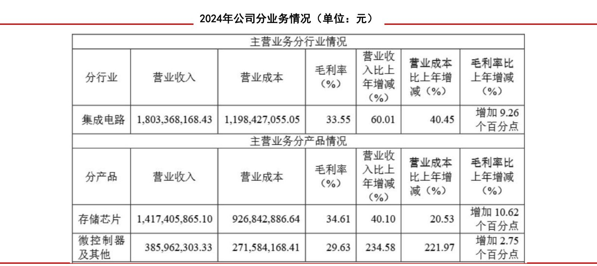
**2024年公司分业务情况（单位：元）**

主营业务分行业情况

| 分行业 | 营业收入 | 营业成本 | 毛利率（%） | 营业收入比上年增减（%） | 营业成本比上年增减（%） | 毛利率比上年增减（%） |
| --- | --- | --- | --- | --- | --- | --- |
| 集成电路 | 1,803,368,168.43 | 1,198,427,055.05 | 33.55 | 60.01 | 40.45 | 增加 9.26 个百分点 |

主营业务分产品情况

| 分产品 | 营业收入 | 营业成本 | 毛利率（%） | 营业收入比上年增减（%） | 营业成本比上年增减（%） | 毛利率比上年增减（%） |
| --- | --- | --- | --- | --- | --- | --- |
| 存储芯片 | 1,417,405,865.10 | 926,842,886.64 | 34.61 | 40.10 | 20.53 | 增加 10.62 个百分点 |
| 微控制器及其他 | 385,962,303.33 | 271,584,168.41 | 29.63 | 234.58 | 221.97 | 增加 2.75 个百分点 |

资料来源：公司公告、wind，华金证券研究所

---

<!-- 原文第 43 页 -->

## 4.13 香农芯创

- 公司是一家领先的半导体产业链投资管理和分销平台，成立于1998年，自2020年起转型进入半导体产业，致力于建设成为半导体产业链的组织者和赋能者。香农芯创目前拥有两大业务板块，其中电子元器件分销平台(联合创泰)锁定国际知名厂商产品线，拥有SK Hynix海力士、MTK联发科等一线品牌代理资格，代理产品的应用覆盖到服务器、手机、电视、车载、智能穿戴、IoT等多个行业；半导体产业链协同赋能平台基于贯通半导体产业链，投资半导体设计、封测、设备、应用等各个环节领军企业，推动半导体产业链生态发展和升级。生态伙伴企业好达电子、甬硅电子、壁仞科技、微导纳米等企业的产品和解决方案广泛应用于自动驾驶、金融、先进制造等领域的复杂场景，为各个行业带来先进半导体的算力赋能，与电子元器件分销平台形成良好互动与协同发展。

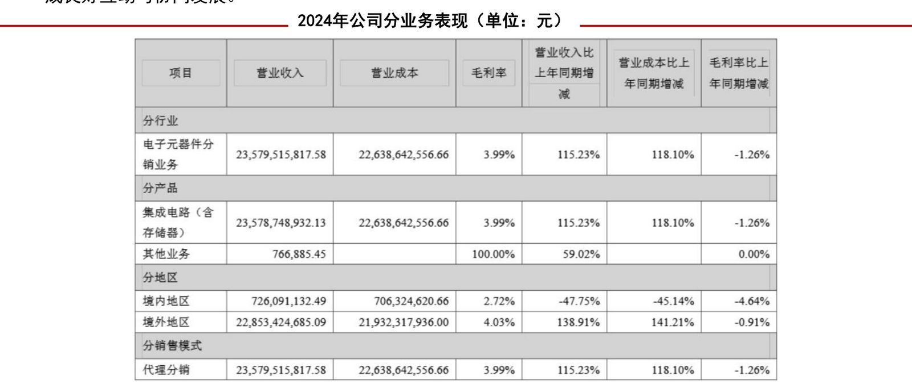
**2024年公司分业务表现（单位：元）**

原表以「分行业」「分产品」「分地区」「分销售模式」四个整行分组，此处将分组名并入「分类」列：

| 分类 | 项目 | 营业收入 | 营业成本 | 毛利率 | 营业收入比上年同期增减 | 营业成本比上年同期增减 | 毛利率比上年同期增减 |
| --- | --- | --- | --- | --- | --- | --- | --- |
| 分行业 | 电子元器件分销业务 | 23,579,515,817.58 | 22,638,642,556.66 | 3.99% | 115.23% | 118.10% | -1.26% |
| 分产品 | 集成电路（含存储器） | 23,578,748,932.13 | 22,638,642,556.66 | 3.99% | 115.23% | 118.10% | -1.26% |
| 分产品 | 其他业务 | 766,885.45 |  | 100.00% | 59.02% |  | 0.00% |
| 分地区 | 境内地区 | 726,091,132.49 | 706,324,620.66 | 2.72% | -47.75% | -45.14% | -4.64% |
| 分地区 | 境外地区 | 22,853,424,685.09 | 21,932,317,936.00 | 4.03% | 138.91% | 141.21% | -0.91% |
| 分销售模式 | 代理分销 | 23,579,515,817.58 | 22,638,642,556.66 | 3.99% | 115.23% | 118.10% | -1.26% |

「其他业务」的营业成本与营业成本增减在原表中为空单元格。

资料来源：公司公告、wind，华金证券研究所

---

<!-- 原文第 44 页 -->

## 4.14 大为股份

- 2024年，公司实现营业收入10.47亿元，同比增长42.91%。上市17年来，公司销售收入首次突破十亿元大关，这一成绩标志着公司在业务拓展和市场竞争力方面取得了显著突破。分业务线来看，半导体存储业务实现规模主导，全年营收87,682.82万元（同比增长51.31%），占公司总营收的83.74%；汽车业务受出口驱动、技术升级推动，全年营收实现7,441.78万元（同比增长51.37%），毛利率20.38%。碳酸锂业务采取贸易与委托加工等方式，充分利用套保等手段，全年实现营收2,284.31万元。郴州锂电项目目前仍处于探矿权转采矿权以及产能建设的关键阶段；项目在选矿、锂回收率提升以及尾矿石英与长石分离技术研发方面取得显著突破，为后续发展奠定了坚实基础。
- 公司半导体存储业务主要产品有NAND、DRAM存储两大系列，大为创芯的存储产品可广泛应用于个人电脑、车载、IDC、工业控制、医疗、轨道交通、智能电子等领域。

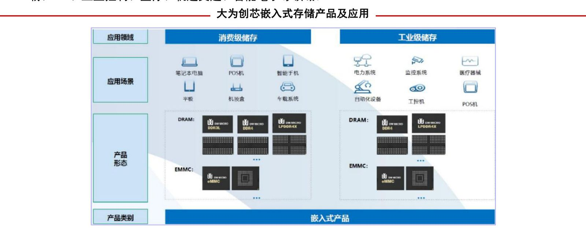
**大为创芯嵌入式存储产品及应用**

横向分栏结构图，左列为「应用领域 / 应用场景 / 产品形态 / 产品类别」四个维度标签，右侧分「消费级储存」「工业级储存」两栏：

| 维度 | 消费级储存 | 工业级储存 |
| --- | --- | --- |
| 应用场景 | 笔记本电脑、POS机、智能手机、平板、机顶盒、车载系统 | 电力系统、监控系统、医疗器械、自动化设备、工控机、POS机 |
| 产品形态（DRAM） | DDR3L、DDR4、LPDDR4X | DDR4、LPDDR4X |
| 产品形态（EMMC） | eMMC | eMMC |

产品类别（底部整条）：嵌入式产品。
各产品芯片图上印有品牌标识，字迹过小无法辨识 [OCR_UNREADABLE]。

资料来源：公司公告，华金证券研究所

---

<!-- 原文第 45 页 -->

## 4.15 恒烁股份

- 公司是一家主营业务为存储芯片和MCU芯片研发、设计及销售的集成电路设计企业。公司现有主营产品包括NOR Flash存储芯片和基于Arm®Cortex®-M0+内核架构的通用32位MCU芯片。同时，公司还在致力于开发基于NOR闪存技术的存算一体终端推理AI芯片。公司聚焦“存储+控制”领域，核心技术人员XIANGDONG LU博士及研发团队具有丰富的集成电路研发设计、管理及销售经验。经过不断自主研发，公司已掌握高可靠性、高速、低功耗65/50nm NOR Flash和55nm MCU设计技术，基于上述技术不断升级迭代相关产品，并完成首款基于NOR Flash制程的存算一体AI芯片的研发、流片和系统演示。目前，公司NOR Flash芯片和MCU芯片均获得客户的广泛认可，与杰理科技、乐鑫科技、泰凌微电子、芯海科技、兆讯恒达、翱捷科技、上海巨微及赛腾微等客户建立了长期稳定的合作关系

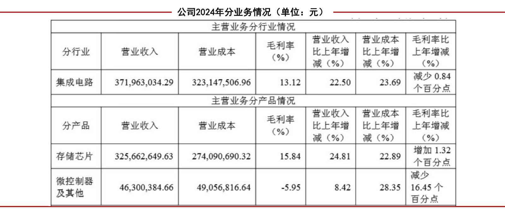
**公司2024年分业务情况（单位：元）**

主营业务分行业情况

| 分行业 | 营业收入 | 营业成本 | 毛利率（%） | 营业收入比上年增减（%） | 营业成本比上年增减（%） | 毛利率比上年增减（%） |
| --- | --- | --- | --- | --- | --- | --- |
| 集成电路 | 371,963,034.29 | 323,147,506.96 | 13.12 | 22.50 | 23.69 | 减少 0.84 个百分点 |

主营业务分产品情况

| 分产品 | 营业收入 | 营业成本 | 毛利率（%） | 营业收入比上年增减（%） | 营业成本比上年增减（%） | 毛利率比上年增减（%） |
| --- | --- | --- | --- | --- | --- | --- |
| 存储芯片 | 325,662,649.63 | 274,090,690.32 | 15.84 | 24.81 | 22.89 | 增加 1.32 个百分点 |
| 微控制器及其他 | 46,300,384.66 | 49,056,816.64 | -5.95 | 8.42 | 28.35 | 减少 16.45 个百分点 |

资料来源：公司公告、wind，华金证券研究所

---

<!-- 原文第 46 页 -->

## 4.16 得一微

- 得一微电子成立于2007年，总部坐落于深圳南山科技园，是一家AI存力芯片设计企业。公司以“AI存力芯片设计，重构计算范式”为使命，通过存储控制、存算互联与存算一体三大技术支柱，致力于让每比特数据创造更多智能。18年技术积累和业务拓展，得一微电子构建了覆盖AI 手机、AI PC、AIoT、AI汽车及AI Infra基础设施五大终端领域的完整产品矩阵，为智慧终端、智能汽车及智算中心提供全场景AI存力解决方案，展现出强大的技术实力和市场影响力。
- 作为国家级专精特新重点“小巨人”企业、得一微电子始终坚持自主创新，已获得授权发明专利332项，并荣获了国家知识产权优势企业、广东省科学技术奖科技进步奖一等奖等多项资质认证和荣誉。

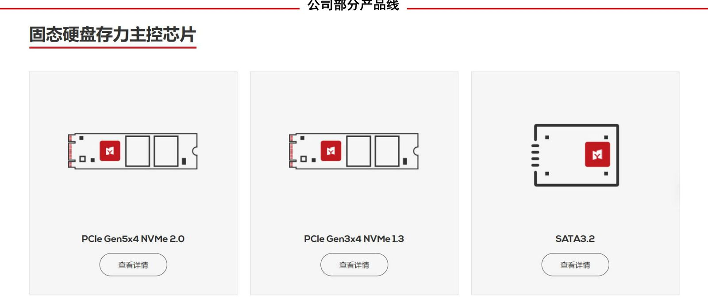
**公司部分产品线**

分组标题：**固态硬盘存力主控芯片**

三张产品卡（截图式卡片，每卡含主控芯片示意图、产品型号与「查看详情」按钮），自左至右：

| 序号 | 产品型号 |
| --- | --- |
| 1 | PCIe Gen5x4 NVMe 2.0 |
| 2 | PCIe Gen3x4 NVMe 1.3 |
| 3 | SATA3.2 |

资料来源：公司官网，华金证券研究所

---

<!-- 原文第 47 页 -->

## 目录

- 01　存储器是半导体产业规模最大的分支之一
- 02　AI推动HBM火爆，DRAM持续迈入3D时代
- 03　NAND合约价预计25年Q3季增，1000层时代将至
- 04　建议关注
- 05　风险提示

---

<!-- 原文第 48 页 -->

## 风险提示

- **贸易摩擦及政策变动风险**：国内存储公司产业链上下游均部分涉及海外市场或厂商，若全球贸易摩擦加剧或相关国家采取限制性政策，可能影响相关公司订单、成本和供应链，从而对经营造成不利影响。
- **市场竞争加剧风险**：在技术壁垒高、竞争激烈的领域中，国内存储行业相关公司与国际领先企业相比，或存在规模、研发、或营销等方面的不足；若不能及时响应市场变化和客户需求，相关公司可能失去市场地位。
- **技术迭代风险**：存储行业技术更新快，相关公司需不断推出新产品以保持竞争力。若技术迭代和产品升级跟不上市场需求，可能失去市场竞争力，影响业务发展。

---

<!-- 原文第 49 页 -->

# 华金证券研究所电子团队简介

熊军：电子行业首席分析师，东南大学集成电路专业本硕，10年证券行业研究经验，曾就职于国联民生证券、华西证券、东北证券，曾获2022年choice电子最佳分析师，2019年中国证券分析师金翼奖通信行业第一名。产业背景+研究经验丰富，曾就职于Nvidia从事半导体研发工作和赛迪顾问从事半导体行业研究。

王臣复：电子行业高级分析师，北京航空航天大学工学学士和管理学硕士，曾就职于华西证券研究所、欧菲光集团投资部、平安基金等，2023年2月入职华金证券研究所

宋鹏：电子行业分析师，莫纳什大学硕士，曾就职于头豹研究院TMT组，2023年3月入职华金证券研究所

吴晟昊：电子行业分析师，曾就职于致同会计事务所、华西证券研究所，2023年3月入职华金证券研究所

---

<!-- 原文第 50 页 -->

# 评级说明

## 公司投资评级

- 买入 — 未来6-12个月内相对同期相关证券市场代表性指数涨幅大于15%；
- 增持 — 未来6-12个月内相对同期相关证券市场代表性指数涨幅在5%至15%之间；
- 中性 — 未来6-12个月内相对同期相关证券市场代表性指数涨幅在-5%至5%之间；
- 减持 — 未来6-12个月内相对同期相关证券市场代表性指数跌幅在5%至15%之间；
- 卖出 — 未来6-12个月内相对同期相关证券市场代表性指数跌幅大于15%。

## 行业投资评级

- 领先大市 — 未来6-12个月内相对同期相关证券市场代表性指数领先10%以上；
- 同步大市 — 未来6-12个月内相对同期相关证券市场代表性指数涨跌幅介于-10%至10%；
- 落后大市 — 未来6-12个月内相对同期相关证券市场代表性指数落后10%以上。

## 基准指数说明

A股市场以沪深300指数为基准；新三板市场以三板成指（针对协议转让标的）或三板做市指数（针对做市转让标的）为基准；香港市场以恒生指数为基准，美股市场以标普500指数为基准。

---

<!-- 原文第 51 页 -->

# 法律声明

## 分析师声明

熊军、王臣复声明，本人具有中国证券业协会授予的证券投资咨询执业资格，勤勉尽责、诚实守信。本人对本报告的内容和观点负责，保证信息来源合法合规、研究方法专业审慎、研究观点独立公正、分析结论具有合理依据，特此声明。

## 本公司具备证券投资咨询业务资格的说明

华金证券股份有限公司（以下简称“本公司”）经中国证券监督管理委员会核准，取得证券投资咨询业务许可。本公司及其投资咨询人员可以为证券投资人或客户提供证券投资分析、预测或者建议等直接或间接的有偿咨询服务。发布证券研究报告，是证券投资咨询业务的一种基本形式，本公司可以对证券及证券相关产品的价值、市场走势或者相关影响因素进行分析，形成证券估值、投资评级等投资分析意见，制作证券研究报告，并向本公司的客户发布。

---

<!-- 原文第 52 页 -->

# 法律声明

## 免责声明

本报告仅供华金证券股份有限公司（以下简称“本公司”）的客户使用。本公司不会因为任何机构或个人接收到本报告而视其为本公司的当然客户。

本报告基于已公开的资料或信息撰写，但本公司不保证该等信息及资料的完整性、准确性。本报告所载的信息、资料、建议及推测仅反映本公司于本报告发布当日的判断，本报告中的证券或投资标的价格、价值及投资带来的收入可能会波动。在不同时期，本公司可能撰写并发布与本报告所载资料、建议及推测不一致的报告。本公司不保证本报告所含信息及资料保持在最新状态，本公司将随时补充、更新和修订有关信息及资料，但不保证及时公开发布。同时，本公司有权对本报告所含信息在不发出通知的情形下做出修改，投资者应当自行关注相应的更新或修改。任何有关本报告的摘要或节选都不代表本报告正式完整的观点，一切须以本公司向客户发布的本报告完整版本为准。

在法律许可的情况下，本公司及所属关联机构可能会持有报告中提到的公司所发行的证券或期权并进行证券或期权交易，也可能为这些公司提供或者争取提供投资银行、财务顾问或者金融产品等相关服务，提请客户充分注意。客户不应将本报告为作出其投资决策的惟一参考因素，亦不应认为本报告可以取代客户自身的投资判断与决策。

在任何情况下，本报告中的信息或所表述的意见均不构成对任何人的投资建议，无论是否已经明示或暗示，本报告不能作为道义的、责任的和法律的依据或者凭证。在任何情况下，本公司亦不对任何人因使用本报告中的任何内容所引致的任何损失负任何责任。

本报告版权仅为本公司所有，未经事先书面许可，任何机构和个人不得以任何形式翻版、复制、发表、转发、篡改或引用本报告的任何部分。如征得本公司同意进行引用、刊发的，需在允许的范围内使用，并注明出处为“华金证券股份有限公司研究所”，且不得对本报告进行任何有悖原意的引用、删节和修改。

华金证券股份有限公司对本声明条款具有惟一修改权和最终解释权。

---

<!-- 原文第 53 页 -->

# 法律声明

## 风险提示

报告中的内容和意见仅供参考，并不构成对所述证券买卖的出价或询价。投资者对其投资行为负完全责任，我公司及其雇员对使用本报告及其内容所引发的任何直接或间接损失概不负责。

华金证券股份有限公司

办公地址：

上海市浦东新区杨高南路759号陆家嘴世纪金融广场30层

北京市朝阳区建国路108号横琴人寿大厦17层

深圳市福田区益田路6001号太平金融大厦10楼05单元

电话：021-20655588

网址：www.huajinsc.cn

---
