> 原文件：[M155_pdf.dfcfw.com_H3_AP202311081609337973_1.pdf](https://github.com/jadennevercode/CJCC-Knowledge-Base/blob/5ec8511eb834073c8bfbd79c94af196282d483cf/materials/%E8%B7%A8%E9%93%BE%EF%BC%9A%E4%BE%9B%E9%9C%80%E4%B8%8E%E4%BB%B7%E6%A0%BC%E5%8F%A3%E5%BE%84/M155_pdf.dfcfw.com_H3_AP202311081609337973_1.pdf)
> 转换方式：多模态逐页转录（页面图像 + 文本层交叉校验）

<!-- 原文第 1 页 -->

分析师：邹臣
登记编码：S0730523100001
zouchen@ccnew.com 021-50581991

# 存储器——让数字世界拥有记忆

## ——半导体行业深度报告

证券研究报告-行业深度报告

强于大市(维持)

发布日期：2023 年 11 月 08 日

### 半导体相对沪深 300 指数表现

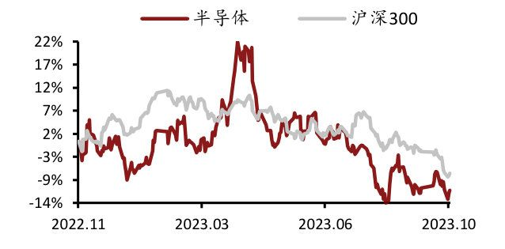

左侧纵轴：-14%、-9%、-3%、2%、7%、12%、17%、22%；横轴：2022.11、2023.03、2023.06、2023.10；图例：半导体、沪深 300

资料来源：聚源，中原证券

### 相关报告

《半导体行业月报：存储器价格拐点渐显，周期复苏或将至》 2023-10-13

《半导体行业月报：23Q2 国内半导体行业业绩环比复苏明显，半导体设备板块业绩表现亮眼》 2023-09-20

《半导体行业月报：半导体周期底部渐显，关注先进封装方向》 2023-08-11

联系人： 马嶔琦
电话： 021-50586973
地址： 上海浦东新区世纪大道 1788 号 16 楼
邮编： 200122

### 投资要点：

- 存储器价格触底回升，周期复苏或将至。全球存储器行业具有明显的周期性，是影响半导体周期变化的主要因素。根据 InSpectrum 的数据，2023 年 9 月 DRAM 及 NAND Flash 现货价格触底回升，9、10 两个月部分 DDR3 及 DDR4 现货价格反弹 10%以上，部分 NAND Flash 现货价格反弹 20%以上；供给端产出在逐步收缩，下游需求正在回暖，如果 23Q4 及 24 年下游需求逐步恢复，供需关系不断改善，存储器价格有望延续反弹。目前本轮存储器下行周期持续时间已超过 2 年，从供给、需求、库存、价格等方面综合考虑，存储器周期复苏或将至。

- 存储器厂商有望在新一轮上行周期中获取较大的盈利弹性。从存储器厂商盈利能力的角度来看，全球主要存储器厂商的平均毛利率及平均净利率在周期中波动幅度较大，根据彭博的数据，在最近两轮存储器周期中，在盈利能力顶部全球主要存储器厂商平均毛利率为 40%左右、平均净利率超过 18%；本轮周期盈利能力底部出现在 2023 年第一季度，全球主要存储器厂商平均毛利率为 13%、平均净利率为-16%，在过去 15 年几轮周期中处于较低水平，存储器厂商有望在新一轮上行周期中获取较大的盈利弹性。

- 海外巨头主导全球 DRAM 及 NAND Flash 颗粒市场，国内厂商有望在利基型市场持续加速发展。全球存储器市场空间巨大，由于存储晶圆设计与制造行业具有极高的技术和资本壁垒，全球存储颗粒市场被少数 IDM 厂商主导，全球 DRAM 市场由三星、SK 海力士、美光主导，NAND Flash 市场被三星、铠侠、西部数据、美光、SK 海力士统治。根据 Trendforce 的数据，2021 年全球利基型 DRAM 市场规模约 90 亿美元，中国台湾厂商南亚、华邦占据较大的市场份额；根据 Gartner 的数据，预计 2024 年全球 SLC NAND 市场规模将达 23 亿美元，中国台湾厂商华邦和旺宏占据较高的市占率；中国大陆厂商兆易创新、东芯股份等积极布局利基型 DRAM 及 SLC NAND 市场，北京君正在汽车市场具有较强的竞争力，在存储器国产替代需求迫切的背景下，国内厂商有望在利基型市场持续加速发展。

- 华邦、旺宏、兆易创新主导全球 NOR Flash 市场，中小厂商高速成长推动行业呈现多元竞争格局趋势。根据 IC Insights 的数据，预计 2021 年 NOR Flash 市场规模约为 31 亿美元。根据 CINNO Research 的数据，2020 年全球 NOR Flash 市场华邦、旺宏、兆易创新的市场份额分别为 25.4%、22.5%、15.6%，三家厂商合计

---

<!-- 原文第 2 页 -->

占据超过 60%的市场份额；NOR Flash 行业内其他中小厂商市占率在逐步提升，由 2018 年的 8.2%提升到 2020 年的 21.6%，这些厂商包括国内的普冉股份、东芯股份及恒烁股份等，中小厂商高速成长推动 NOR Flash 行业开始呈现出多元竞争格局的趋势。

- IDM 厂商主导全球存储器模组市场，国内存储器模组厂商在第三方市场不断建立竞争优势，有望持续提升市场份额。根据 Yole 的数据，2021 年 IDM 厂商占据全球内存条、固态硬盘、eMMC 及 UFS 市场份额超过 80%。根据 TrendForce 的数据，2021 年全球第三方内存条市场规模达 181 亿美元，金士顿以 78.7%的市占率排名第一，国内厂商嘉合劲威、金泰克、记忆科技分别以 2.4%、2.4%、1.9%的市场份额位列五到七位。根据 TrendForce 的数据，在全球第三方固态硬盘市场，2021 年金士顿以 26%的市占率位列第一，国内厂商金泰克、江波龙、朗科、嘉合劲威、七彩虹的市场份额分别为 7%、6%、6%、4%、4%，国产固态硬盘品牌已经崛起。根据闪存市场的数据，在全球 eMMC 及 UFS 第三方品牌市场，2021 年江波龙、金士顿、佰维存储分别以 6.5%、5.3%、2.4%的市占率排名前三，国内厂商已占据领先地位。国内存储模组厂商在品牌、技术、供应链等方面不断建立竞争优势，有望持续提升市场份额，未来有广阔的成长空间。

- HBM 突破内存带宽与容量瓶颈，AIGC 推动 HBM 高速成长。HBM 主要是通过 TSV 技术进行芯片堆叠，突破了内存带宽与容量瓶颈，是新一代的 DRAM 解决方案。AIGC 浪潮带动 AI 应用快速发展，AI 服务器与高端 GPU 需求不断上涨，并有望持续推动 HBM 市场高速成长，TrendForce 预计 2023 年全球 HBM 市场规模为 39 亿美元，预计 2024 年将达到 89 亿美元，同比增长 127%。根据 TrendForce 的数据，2022 年 SK 海力士、三星、美光的 HBM 市占率分别约为 50%、40%、10%。HBM 需求爆发，国内 HBM 供应链企业有望充分受益于行业趋势。

- 投资建议。建议关注存储芯片厂商兆易创新（603986）、北京君正（300223）、东芯股份（688110），存储模组厂商江波龙（301308）、德明利（001309），模组配套芯片厂商澜起科技（688008），封装测试厂商深科技（000021），分销商香农芯创（300475）。

风险提示：下游需求复苏不及预期风险，市场竞争加剧风险，研发进展不及预期风险，国际地缘政治冲突加剧风险。

---

<!-- 原文第 3 页 -->

## 内容目录

1. 存储器周期复苏或将至，存储器厂商有望获取较大的盈利弹性 …… 7
   1.1. 存储器周期在半导体细分领域中波动最大，是影响半导体周期变化的主要因素 …… 7
   1.2. 存储器价格触底回升，周期复苏或将至 …… 8
   1.3. 存储器厂商有望在新一轮上行周期中获取较大的盈利弹性 …… 11
2. 海外巨头主导全球半导体存储器市场，国内厂商加速发展 …… 12
   2.1. 半导体存储器市场以 DRAM 和 NAND Flash 为主，主要晶圆厂采用 IDM 模式 …… 12
   2.2. 海外三巨头主导全球 DRAM 颗粒市场，DRAM 晶圆设计与制造行业壁垒高 …… 13
      2.2.1. 海外三巨头主导全球 DRAM 颗粒市场，国内厂商积极布局利基型市场 …… 14
      2.2.2. DRAM 晶圆设计与制造行业具有极高的技术和资本壁垒 …… 16
   2.3. NAND Flash 颠覆摩尔定律，NAND Flash 晶圆设计与制造行业壁垒高 …… 18
      2.3.1. NAND Flash 颠覆摩尔定律，全球前五大厂商统治 NAND Flash 颗粒市场 …… 18
      2.3.2. NAND Flash 晶圆设计与制造行业具有极高的技术和资本壁垒 …… 23
   2.4. 全球前三大厂商主导 NOR Flash 市场，下游应用领域相对分散 …… 24
   2.5. IDM 厂商主导全球存储器模组市场，国内厂商在第三方模组市场崛起 …… 27
      2.5.1. IDM 厂商聚焦大宗市场，第三方存储器模组厂商定位于细分行业市场客制化需求 …… 27
      2.5.2. IDM 厂商主导全球内存条市场，金士顿在全球第三方市场一家独大，国内厂商正在崛起 …… 28
      2.5.3. IDM 厂商主导全球 NAND Flash 模组市场，国内厂商已在第三方市场崛起 …… 31
      2.5.4. 国内存储器模组厂商不断建立竞争优势，有望持续提升市场份额 …… 34
3. AIGC 带动 HBM 高速成长，新型存储器推动存算一体技术迭代 …… 35
   3.1. 存储墙限制 AI 技术的发展和应用 …… 35
   3.2. HBM 突破内存带宽与容量瓶颈，AIGC 推动 HBM 高速成长 …… 37
   3.3. 新型存储器推动存算一体技术创新与迭代，迎来黄金发展机遇 …… 40
      3.3.1. 相变存储器性能突出，商业化进展不佳 …… 42
      3.3.2. 国际巨头推动磁性存储器商业化快速发展 …… 43
      3.3.3. 阻变存储器是实现存算一体的最佳方案之一，众多知名厂商加速推动商业化进程 …… 45
      3.3.4. 美日厂商推动铁电存储器（FRAM）发展 …… 48
      3.3.5. 新型存储器推动存算一体技术创新与迭代 …… 49
4. 投资建议 …… 50
5. 风险提示 …… 50

## 图表目录

图 1：2000-2023 年全球半导体市场月度销售额情况 …… 7
图 2：1999-2022 年全球存储器销售额及占半导体销售额比重情况 …… 8
图 3：1999-2023 年全球半导体不同细分领域销售额同比增速情况 …… 8
图 4：2016-2023 年 DRAM 现货价格走势情况（美元） …… 9
图 5：2016-2023 年 NAND Flash 现货/合约价格走势情况（美元） …… 9
图 6：2020-2023 年全球智能手机季度出货量情况 …… 10
图 7：2018-2023 年全球 PC 季度出货量情况 …… 10
图 8：2008Q4-2023Q3 年全球主要存储器厂商毛利率与净利率情况 …… 11
图 9：半导体存储器分类图 …… 12
图 10：2021 年全球半导体存储器细分市场占比情况 …… 12

---

<!-- 原文第 4 页 -->

图 11：2022 年全球存储器市场需求地区分布情况 …… 13
图 12：存储器产业链结构图 …… 13
图 13：DRAM 存储单元内部结构图 …… 14
图 14：DRAM 芯片内部架构图 …… 14
图 15：DRAM 分类结构图 …… 14
图 16：主要 SDRAM 技术演进情况 …… 15
图 17：2018-2022 年不同 DRAM 类型应用占比情况 …… 15
图 18：2016-2022 年全球 DRAM 市场规模情况 …… 15
图 19：2021 年全球 DRAM 颗粒市场竞争格局情况 …… 16
图 20：2018-2021 年全球 DRAM 下游市场占比情况 …… 16
图 21：2010-2022 年全球主要 DRAM 晶圆原厂年度固定资产投资及预测（亿美元/年） …… 17
图 22：全球前三大 DRAM 晶圆原厂工艺制程技术发展路线图 …… 17
图 23：DRAM 内部结构图 …… 18
图 24：DRAM 工艺制程微缩发展及预测 …… 18
图 25： 基于浮栅技术和电荷俘获技术的 NAND Flash 存储单元内部结构图 …… 19
图 26：2013-2022 年 NAND Flash 价格趋势情况 …… 19
图 27：2014-2032 年 NAND Flash 存储密度及预测情况 …… 19
图 28： NAND Flash 扩展存储容量的四种途径 …… 20
图 29： NAND Flash 根据工艺技术的分类情况 …… 20
图 30： NAND Flash 根据空间结构的分类情况 …… 21
图 31：美光 3D NAND Flash 规划不断提升堆叠层数 …… 21
图 32： 2012-2022 年全球 NAND Flash 市场规模情况 …… 21
图 33： 2021 年全球 NAND Flash 颗粒市场竞争格局情况 …… 22
图 34： 2018-2021 年全球 NAND Flash 市场下游应用领域情况 …… 22
图 35： 2017-2024 年全球 SLC NAND Flash 市场规模及预测情况 …… 23
图 36：2010-2022 年全球主要 NAND Flash 晶圆原厂年度固定资产投资及预测（亿美元/年） …… 23
图 37：存储单元不同存储数位量每个存储状态的电子数量情况 …… 24
图 38：全球前五大 NAND Flash 厂商技术路线情况 …… 24
图 39：3D NAND Flash 制造挑战 …… 24
图 40：NOR Flash 内部的布线和结构 …… 25
图 41：NAND Flash 内部的布线和结构 …… 25
图 42：ETOX 工艺存储单元内部结构图 …… 25
图 43：SONOS 工艺存储单元内部结构图 …… 25
图 44：2015-2021 年全球 NOR Flash 市场规模情况 …… 26
图 45：2018-2020 年 NOR Flash 主要厂商市场份额情况 …… 26
图 46：2018-2021 年全球 NOR Flash 下游市场占比情况 …… 27
图 47：DRAM 模组产业链结构图 …… 28
图 48：NAND Flash 模组产业链结构图 …… 28
图 49：DRAM 颗粒在手机主板应用示意图 …… 29
图 50：内存条在 PC 上应用示意图 …… 29
图 51：PC DDR5 内存条结构图 …… 29
图 52：服务器 DDR5 内存条结构图 …… 29
图 53：2018-2021 年全球第三方内存条市场规模情况 …… 30
图 54：2022-2028 年全球内存条出货量预测（百万支） …… 30
图 55：2023 年 618 器件光威内存条销量突破 10 万支 …… 31

---

<!-- 原文第 5 页 -->

图 56：光威 32GB DDR5 6400 内存条具有较高性价比 …… 31
图 57：2021-2028 年全球内存接口芯片及配套芯片市场规模预测情况 …… 31
图 58：2018-2021 年全球 NAND Flash 主要产品形态市场规模占比情况 …… 32
图 59：SATA 接口固态硬盘内部结构图 …… 32
图 60：eMMC 内部结构示意图 …… 32
图 61：2022-2028 年全球固态硬盘出货量预测情况 …… 32
图 62：2022 年全球消费级与企业级 SSD 出货量占比情况 …… 32
图 63：2021 年全球固态硬盘市场份额情况 …… 33
图 64：2021 年全球第三方固态硬盘市场份额情况 …… 33
图 65： 2021 年全球 eMMC 及 UFS 市场份额情况 …… 33
图 66： 2021-2027 年全球 NAND Flash 主控芯片市场规模预测 …… 34
图 67：2021-2027 年全球 NAND Flash 主控芯片市场 IDM 厂商与第三方主控芯片厂商市场份额预测情况 …… 34
图 68：2021 年全球第三方 NAND Flash 主控芯片厂商市场份额情况 …… 34
图 69：冯诺伊曼架构示意图 …… 36
图 70：现代计算系统存储器结构及存储墙 …… 36
图 71：处理器性能进步受到存储器传输数据能力的阻碍 …… 36
图 72：AI 大模型训练数据量呈指数级增长 …… 37
图 73：ChatGPT 工作原理 …… 37
图 74：AI 大模型的参数量与 GPU 内存容量的增长趋势 …… 37
图 75：GPU 的计算能力与传输带宽的增长趋势 …… 37
图 76：AMD GPU 上 HBM 应用 3D 示意图 …… 38
图 77：HBM 与 GDDR5 性能参数比较 …… 38
图 78：DRAM 裸片之间用 TSV 技术连接示意图 …… 38
图 79：HBM 与 GDDR5 相比面积更小、离 GPU 更近 …… 38
图 80：SK 海力士四代 HBM 产品规格比较 …… 39
图 81：2022-2024 年各代 HBM 产品市场需求占比情况 …… 39
图 82：美光 DRAM 技术路线情况 …… 39
图 83：三星 DRAM 技术路线情况 …… 39
图 84： 2022 年全球 HBM 市场竞争格局情况 …… 40
图 85：2022-2026 年全球 AI 服务器出货量预测情况 …… 40
图 86：2023-2024 年全球 HBM 市场规模预测情况 …… 40
图 87：存储器的技术演进路线主要取决于应用场景的变化 …… 41
图 88： 4 种新型存储器参数对比 …… 41
图 89：PCM 原理 …… 42
图 90：集成在 ST MCU 中的嵌入式 PCM 内部结构示意图 …… 42
图 91：3D XPoint 工作原理示意图 …… 42
图 92：磁隧道结的核心结构及隧穿磁阻效应 …… 43
图 93：MRAM 原理图 …… 43
图 94：eMRAM 与 eFlash 相比性能突出 …… 44
图 95：MRAM 的发展现状 …… 44
图 96：MRAM 的 4 大应用领域 …… 45
图 97：2020-2026 年嵌入式 MRAM 的市场规模 …… 45
图 98：ReRAM 原理 …… 46
图 99：Crossbar ReRAM 的电阻切换机制 …… 46
图 100：Crossbar 的新型 3D 堆叠 ReRAM …… 46

---

<!-- 原文第 6 页 -->

图 101：ReRAM 应用于计算单元构建存算一体架构应用示意图 …… 47
图 102：使用 ReRAM 实现边缘 AI 推理单芯片解决方案 …… 47
图 103：FRAM 原理 …… 48
图 104：FRAM 内部结构图 …… 48
图 105：FRAM 应用场景广泛 …… 49
图 106：新型存储器为实现存算一体解决方案之一 …… 49

表 1：本轮下行周期海外存储龙头厂商产出及资本支出调整计划情况 …… 10
表 2：2021 年全球第三方内存条供应商市场竞争格局情况 …… 30
表 3：国内主要存储模组厂商竞争优势比较情况 …… 35
表 4：重点关注公司估值表（截止 2023 年 11 月 3 日） …… 50

---

<!-- 原文第 7 页 -->

## 1. 存储器周期复苏或将至，存储器厂商有望获取较大的盈利弹性

### 1.1. 存储器周期在半导体细分领域中波动最大，是影响半导体周期变化的主要因素

全球半导体行业兼具周期与成长属性，每隔 4-5 年经历一轮周期。2000 年至今全球半导体行业经历几轮周期，通过分析全球半导体月度销售额数据，结合全球半导体月度销售额同比增速的趋势，按照一轮周期中同比增速的最小值为周期底部、同比增速的最大值为周期顶部，得出 2001 年 9 月、2009 年 3 月、2011 年 12 月、2016 年 5 月、2019 年 6 月是周期底部，2004 年 6 月、2010 年 3 月、2014 年 2 月、2018 年 5 月、2022 年 1 月是周期顶部。全球半导体行业大约每隔 4-5 年经历一轮周期，上行周期从周期底部到周期顶部一般经历 1-3 年时间，下行周期从周期顶部到周期底部一般经历 1-2 年时间。

**图 1：2000-2023 年全球半导体市场月度销售额情况**

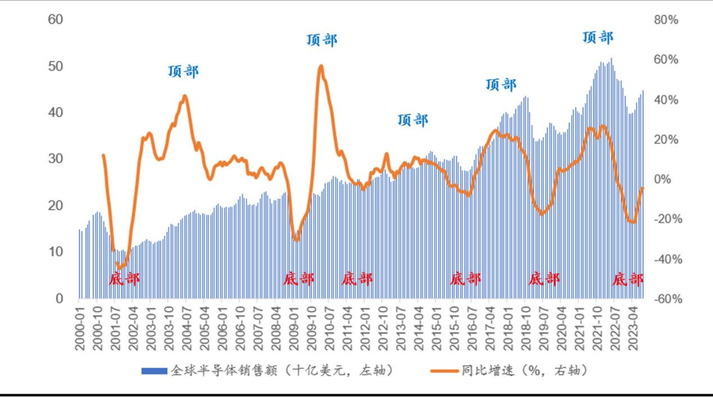

左轴：0、10、20、30、40、50、60；右轴：-60%、-40%、-20%、0%、20%、40%、60%、80%；横轴：2000-01 至 2023-04；图例：全球半导体销售额（十亿美元，左轴）、同比增速（%，右轴）；图中标注：顶部、底部

资料来源：SIA，Wind，中原证券

存储器占全球半导体销售额比重超过 20%，在集成电路产业中占据核心地位。根据 WSTS 的数据，2022 年全球半导体销售额为 5741 亿美元，存储器销售额为 1298 亿美元，存储器占全球半导体销售额比重为 22.6%，过去 20 年存储器长期占半导体销售额比重超过 20%。存储器是集成电路中销售额最大的细分领域，在集成电路产业中占据核心地位。

---

<!-- 原文第 8 页 -->

**图 2：1999-2022 年全球存储器销售额及占半导体销售额比重情况**

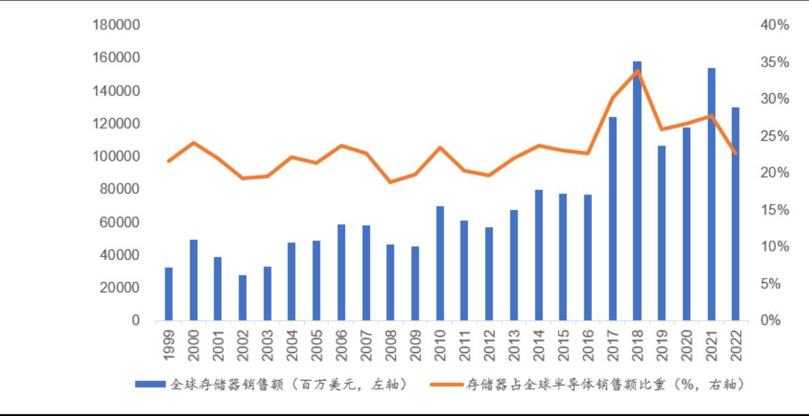

左轴：0、20000、40000、60000、80000、100000、120000、140000、160000、180000；右轴：0%、5%、10%、15%、20%、25%、30%、35%、40%；横轴：1999 至 2022；图例：全球存储器销售额（百万美元，左轴）、存储器占全球半导体销售额比重（%，右轴）

资料来源：WSTS，Wind，中原证券

存储器周期在半导体细分领域中波动最大，是影响半导体周期变化的主要因素。通过分析全球半导体不同细分领域年度销售额数据，包括存储器、微处理器、逻辑电路、模拟电路、分立器件及光电子，结合全球半导体不同细分领域年度销售额同比增速的趋势，按照一轮周期中同比增速的最小值为周期底部、同比增速的最大值为周期顶部，得出 2002 年、2008 年、2011 年、2015 年、2019 年、2023 年是周期底部，2004 年、2010 年、2014 年、2017 年、2021 年是周期顶部，全球半导体不同细分领域大约每隔 4-5 年经历一轮周期，不同细分领域周期底部时点略有差别。在上述所有半导体细分领域中，存储器周期波动最大，在上行周期的顶部，2010、2017 年存储器销售额同比增长 55%、61%，在下行周期的底部，2002、2019 年存储器销售额同比下降 30%、33%，存储器周期是影响半导体周期变化的主要因素。

**图 3：1999-2023 年全球半导体不同细分领域销售额同比增速情况**

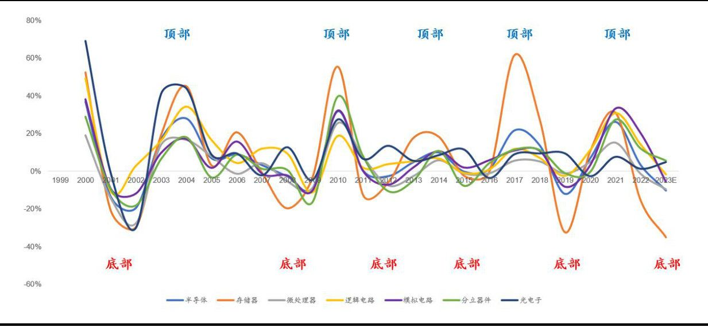

纵轴：80%、60%、40%、20%、0%、-20%、-40%、-60%；横轴：1999 至 2023E；图例：半导体、存储器、微处理器、逻辑电路、模拟电路、分立器件、光电子；图中标注：顶部、底部

资料来源：WSTS（含预测），Wind，中原证券

### 1.2. 存储器价格触底回升，周期复苏或将至

DRAM 价格触底回升，本轮下行周期价格拐点或已至。根据 InSpectrum 的数据，DRAM 上一轮周期在 2017 年 12 月左右见顶回落，在 2019 年 12 月触底回升，下行周期持续时间 2

---

<!-- 原文第 9 页 -->

年左右，随后经历 1 年半左右的上行周期，上一轮周期持续 3-4 年时间；本轮 DRAM 周期在 2021 年 4 月左右见顶回落，2023 年 9 月 DRAM 价格触底回升，10 月价格继续反弹，9、10 两个月部分 DDR3、DDR4 现货价格反弹 10%以上，本轮下行周期持续时间已达 2 年半左右，DRAM 价格已跌破上一轮周期底部价格，本轮 DRAM 下行周期价格拐点或已至。

**图 4：2016-2023 年 DRAM 现货价格走势情况（美元）**

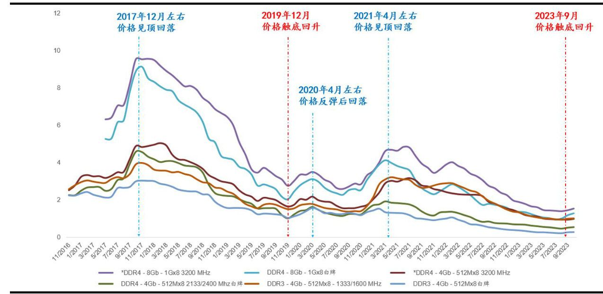

纵轴：0、2、4、6、8、10、12；横轴：11/2016 至 9/2023（逐月）；图例：*DDR4 - 8Gb - 1Gx8 3200 MHz、DDR4 - 8Gb - 1Gx8 白牌、*DDR4 - 4Gb - 512Mx8 3200 MHz、DDR4 - 4Gb - 512Mx8 2133/2400 Mhz 白牌、DDR3 - 4Gb - 512Mx8 - 1333/1600 MHz、DDR3 - 4Gb - 512Mx8 白牌；图中标注：2017 年 12 月左右 价格见顶回落、2019 年 12 月 价格触底回升、2020 年 4 月左右 价格反弹后回落、2021 年 4 月左右 价格见顶回落、2023 年 9 月 价格触底回升

资料来源：InSpectrum，彭博，中原证券

NAND Flash 价格触底回升，本轮下行周期价格拐点或已至。根据 InSpectrum 的数据，NAND Flash 上一轮周期在 2017 年 12 月左右见顶回落，在 2019 年 7 月触底回升，下行周期持续时间 1 年 8 个月左右，随后经历 2 年左右的上行周期，上一轮周期持续 3-4 年时间；本轮 NAND Flash 周期在 2021 年 8 月左右见顶回落，2023 年 9 月价格触底回升，10 月价格继续反弹，9、10 两个月部分 NAND Flash 现货价格反弹 20%以上，本轮下行周期持续时间已超过 2 年，NAND Flash 价格已跌破上一轮周期底部价格，本轮下行周期价格拐点或已至。

**图 5：2016-2023 年 NAND Flash 现货/合约价格走势情况（美元）**

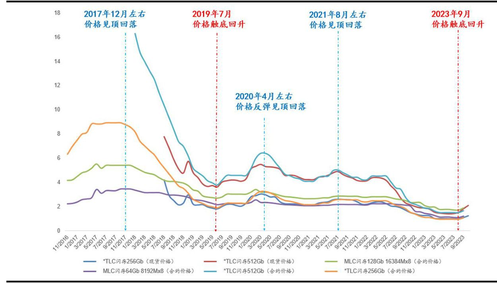

纵轴：0、2、4、6、8、10、12、14、16、18；横轴：11/2016 至 9/2023（逐月）；图例：*TLC闪存256Gb（现货价格）、*TLC闪存512Gb（现货价格）、MLC闪存128Gb 16384Mx8（合约价格）、MLC闪存64Gb 8192Mx8（合约价格）、*TLC闪存512Gb（合约价格）、*TLC闪存256Gb（合约价格）；图中标注：2017 年 12 月左右 价格见顶回落、2019 年 7 月 价格触底回升、2020 年 4 月左右 价格反弹见顶回落、2021 年 8 月左右 价格见顶回落、2023 年 9 月 价格触底回升

资料来源：InSpectrum，彭博，中原证券

---

<!-- 原文第 10 页 -->

在本轮下行周期中，海外存储龙头厂商纷纷减少产出及调整资本开支计划，供给端有望逐步收缩。在减产方面，根据 TrendForce，铠侠位于日本四日市和北上 NAND Flash 晶圆厂从 2022 年 10 月开始晶圆产量将减少约 30%，美光、SK 海力士、三星也相继宣布减产，供给有望逐步收缩。在资本支出调整方面，根据各公司业绩说明会，美光 2023 年资本支出计划调减至 70 亿美元，同比减少 40%以上；SK 海力士 2023 年资本支出计划同比减少 50%。

**表 1：本轮下行周期海外存储龙头厂商产出及资本支出调整计划情况**

| 存储厂商 | 产出调整计划 | 资本支出调整计划 |
| --- | --- | --- |
| 铠侠 | 2022 年 10 月将日本四日市和北上 NAND Flash 晶圆厂减产约 30% | 灵活调整 |
| 西部数据 | 从 2023 年 1 月开始削减约 30%产量 | 2023 年资本支出减少至 23 亿美元，下降 15% |
| 美光 | 进一步宣布减产 30%直至 2024 年 | 2023 年资本支出调减至 70 亿美元，同比下降 42% |
| SK 海力士 | 2022 年 10 月对收益较低的存储产品减产；23Q2 无锡工厂月产能将削减 30%；23H2 进一步削减 NAND 产量 5%-10% | 2023 年资本支出同比减少 50% |
| 三星 | 2023 年 4 月宣布减产，将在 23H2 继续减产 | 灵活调整 |

资料来源：各公司官网，闪存市场，中原证券

智能手机、PC 等存储器应用重要领域需求正在逐步复苏。根据 Canalys 的数据，由于智能手机厂商在二季度库存状况得到改善，并在三季度推出新品，2023 年第三季度，全球智能手机市场出货量达 2.946 亿部，降幅收窄至 1%；由于各手机厂商在 2023 年末预计会有相对健康的库存水平，并有足够的空间为迎接潜在的需求复苏而重建库存，Canalys 预计 2024 年全球智能手机市场将在谨慎态势下实现温和增长。根据 Canalys 的数据，2023 年第三季度全球 PC 出货量为 6560 万台，同比下降了 7%，环比增长 8%；23Q3 的出货量创下近一年内的最低跌幅，进一步体现了库存水平的恢复和相关需求的复苏；在宏观经济环境略有改善的情况下，由于库存修正显有成效，Canalys 预计目前良好势头将得以延续，PC 市场有望在 23Q4 恢复增长。

**图 6：2020-2023 年全球智能手机季度出货量情况**

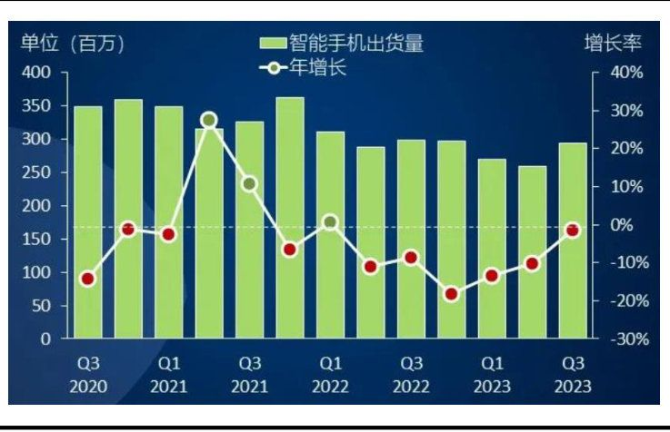

单位（百万）；左轴：0 至 400（间隔 50）；右轴 增长率：-30%、-20%、-10%、0%、10%、20%、30%、40%；横轴：Q3 2020 至 Q3 2023；图例：智能手机出货量、年增长

资料来源：Canalys，中原证券

**图 7：2018-2023 年全球 PC 季度出货量情况**

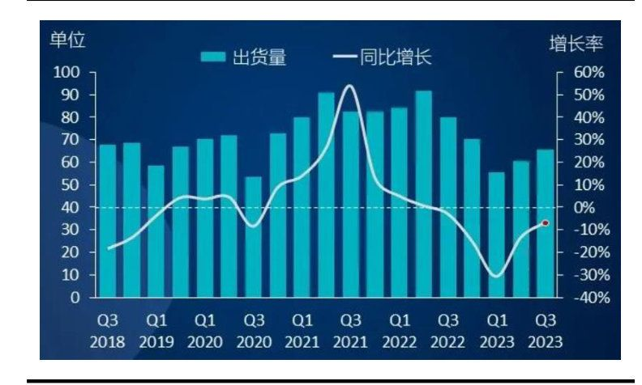

单位；左轴：0 至 100（间隔 10）；右轴 增长率：-40%、-30%、-20%、-10%、0%、10%、20%、30%、40%、50%、60%；横轴：Q3 2018 至 Q3 2023；图例：出货量、同比增长

资料来源：Canalys，中原证券

---

<!-- 原文第 11 页 -->

供给端逐步收缩，如果下游需求逐步恢复，存储器周期复苏或将至。2023 年 9 月 DRAM 及 NAND Flash 现货价格触底回升，9、10 两个月部分 DDR3、DDR4 现货价格反弹 10%以上、部分 NAND Flash 现货价格反弹 20%以上，目前 DRAM 及 NAND Flash 价格均已跌破上一轮周期底部价格；美光等存储厂商已迎来库存拐点，库存水位在逐步下降；供给端产出在逐步收缩，下游需求正在回暖，如果 23Q4 及 24 年下游需求逐步恢复，供需关系不断改善，存储器价格有望延续反弹。本轮周期 DRAM 价格在 2021 年 4 月左右见顶回落，NAND Flash 价格在 2021 年 8 月左右见顶回落，目前本轮下行周期持续时间已超过 2 年，从供给、需求、库存、价格等方面综合考虑，存储器周期复苏或将至。

### 1.3. 存储器厂商有望在新一轮上行周期中获取较大的盈利弹性

存储器厂商盈利能力在周期中波动幅度大，有望在新一轮上行周期中获取较大的盈利弹性。过去 15 年全球存储器行业经历几轮周期，大约每 3-4 年经历一轮周期。从存储器厂商盈利能力的角度来看，全球主要存储器厂商包括三星、海力士、美光、东芝、微芯、南亚、华邦、旺宏、钰创、创见、商丞的平均毛利率及平均净利率在周期中波动幅度较大，在最近两轮存储器周期中，在盈利能力顶部平均毛利率为 40%左右、平均净利率超过 18%；本轮周期盈利能力底部出现在 2023 年第一季度，全球主要存储器厂商平均毛利率为 13%、平均净利率为 -16%，与 2011 年第三季度的净利率底部水平接近，在过去 15 几轮周期中处于较低水平，存储器厂商有望在新一轮上行周期中获取较大的盈利弹性。

**图 8：2008Q4-2023Q3 年全球主要存储器厂商毛利率与净利率情况**

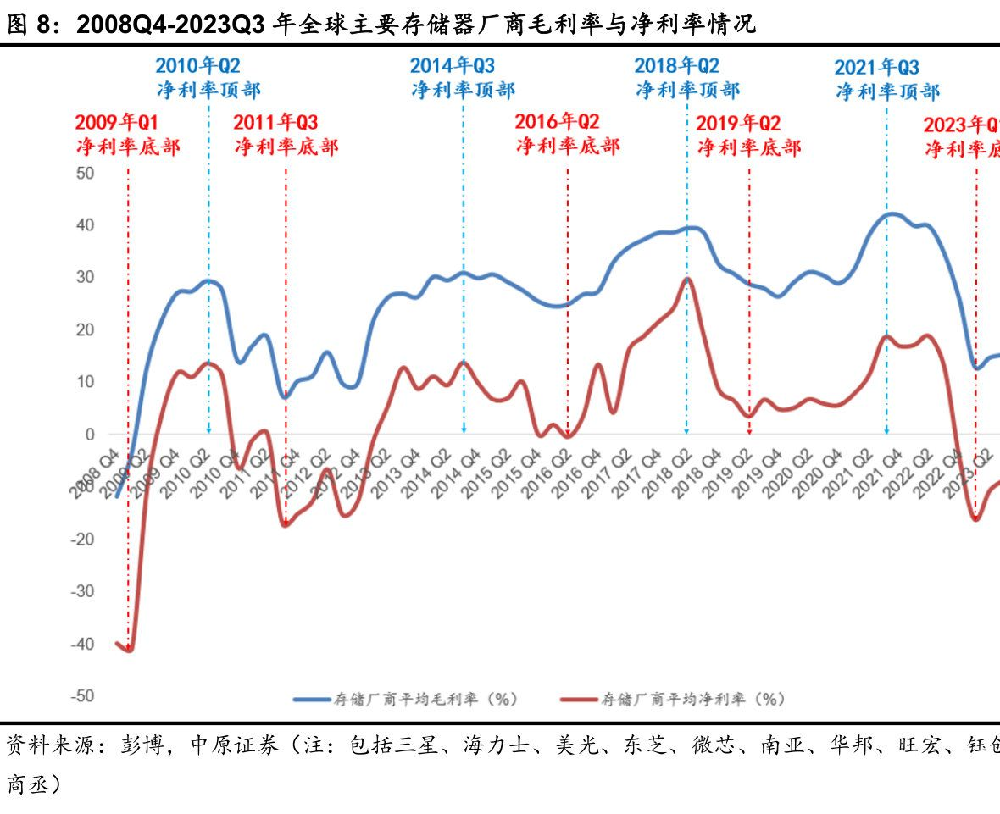

图表要素：纵轴为百分比，刻度 50 至 -50；横轴为 2008Q4-2023Q3 各季度；图例为「存储厂商平均毛利率（%）」「存储厂商平均净利率（%）」。图中标注的净利率顶部为 2010 年 Q2、2014 年 Q3、2018 年 Q2、2021 年 Q3，净利率底部为 2009 年 Q1、2011 年 Q3、2016 年 Q2、2019 年 Q2、2023 年 Q1。曲线本身未标注具体数值。

资料来源：彭博，中原证券（注：包括三星、海力士、美光、东芝、微芯、南亚、华邦、旺宏、钰创、创见、商丞）

---

<!-- 原文第 12 页 -->

## 2. 海外巨头主导全球半导体存储器市场，国内厂商加速发展

### 2.1. 半导体存储器市场以 DRAM 和 NAND Flash 为主，主要晶圆厂采用 IDM 模式

半导体存储器可分为易失性存储器和非易失性存储器。半导体存储器分类方式多种多样，常见的分类按信息的可保存类型可分为易失性存储器和非易失性存储器。易失性存储器又可分为静态随机存储器（SRAM）和动态随机存储器（DRAM）；非易失性存储器主要包括掩膜型只读存储器（MROM）、可编程只读存储器（PROM/EPROM/EEPROM）、快闪存储器（Flash），快闪存储器的主流产品为 NOR Flash 和 NAND Flash。

**图 9：半导体存储器分类图**

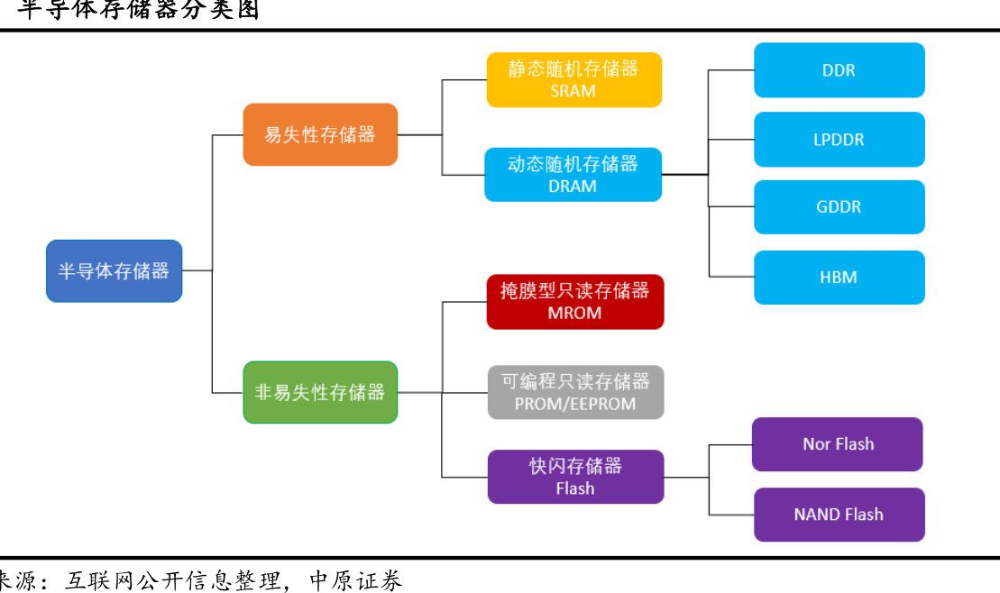

分类结构（自左至右）：

- 半导体存储器
  - 易失性存储器
    - 静态随机存储器 SRAM
    - 动态随机存储器 DRAM
      - DDR
      - LPDDR
      - GDDR
      - HBM
  - 非易失性存储器
    - 掩膜型只读存储器 MROM
    - 可编程只读存储器 PROM/EPROM
    - 快闪存储器 Flash
      - Nor Flash
      - NAND Flash

资料来源：互联网公开信息整理，中原证券

全球半导体存储器市场以 DRAM 和 NAND Flash 为主。根据 Yole 的数据，2021 年全球半导体存储器市场中 DRAM 为第一大产品，市场份额占比 56%，NAND Flash 为第二大存储器产品，市场份额占比 40%，NOR Flash 占比约 2%，EEPROM 和其他产品占比约 2%，目前全球半导体存储器市场以 DRAM 和 NAND Flash 为主。

**图 10：2021 年全球半导体存储器细分市场占比情况**

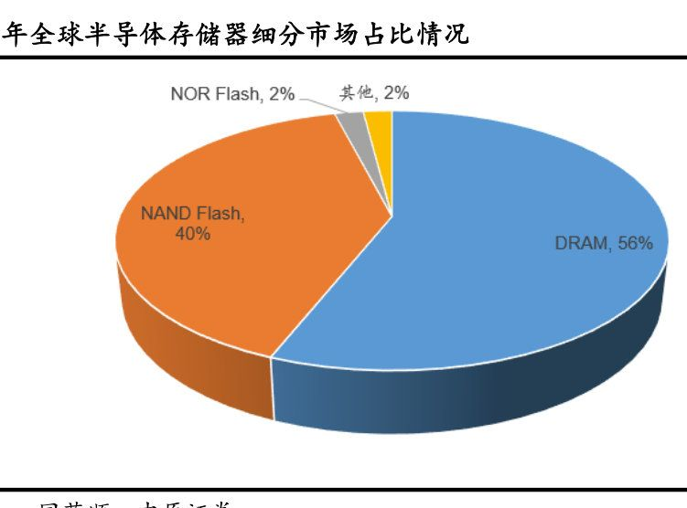

饼图标注：

- DRAM，56%
- NAND Flash，40%
- NOR Flash，2%
- 其他，2%

资料来源：Yole，同花顺，中原证券

中国占全球存储器市场需求比重达 30%以上，未来国产替代空间广阔。根据 Yole 的数

---

<!-- 原文第 13 页 -->

据，2022 年中国占全球 DRAM 市场需求比重为 30%，中国占全球 NAND Flash 市场需求比重为 33%，中国仅次于美国为全球第二大存储器市场，目前国产自给率仍然较低，未来国产替代空间广阔。

**图 11：2022 年全球存储器市场需求地区分布情况**

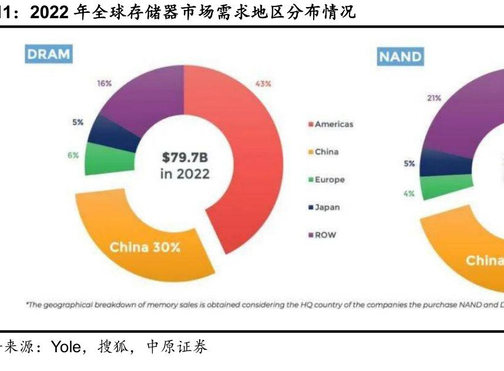

左图为 DRAM（$79.7B in 2022），右图为 NAND（$58.7B in 2022）；图例：Americas、China、Europe、Japan、ROW。各扇区标注占比：

- DRAM：Americas 43%、China 30%、Europe 6%、Japan 5%、ROW 16%
- NAND：Americas 37%、China 33%、Europe 4%、Japan 5%、ROW 21%

图下注：*The geographical breakdown of memory sales is obtained considering the HQ country of the companies the purchase NAND and DRAM products.

资料来源：Yole，搜狐，中原证券

半导体存储器产业链主要包括存储晶圆原厂、主控芯片厂商、封装测试厂商、存储器模组厂商及下游终端应用等，存储器主要的晶圆厂采用 IDM 模式经营。在存储器产业链中，存储晶圆和主控芯片为半导体存储器模组的主要原材料，由于存储器应用场景非常广泛，存储器模组厂商需要面向不同应用场景做应用产品的研发设计与品牌运营，包括固件算法开发、系统级集成封装设计、存储芯片测试算法以及存储应用技术开发等，部分存储器模组品牌厂商会委托专业的封装测试企业进行模组的封装测试，最终存储器模组产品应用于下游智能终端、PC、服务器、可穿戴设备、汽车电子等领域。半导体存储器主要的晶圆厂采用 IDM 模式经营，包括三星、SK 海力士、美光、铠侠、西部数据、长江存储等。

**图 12：存储器产业链结构图**

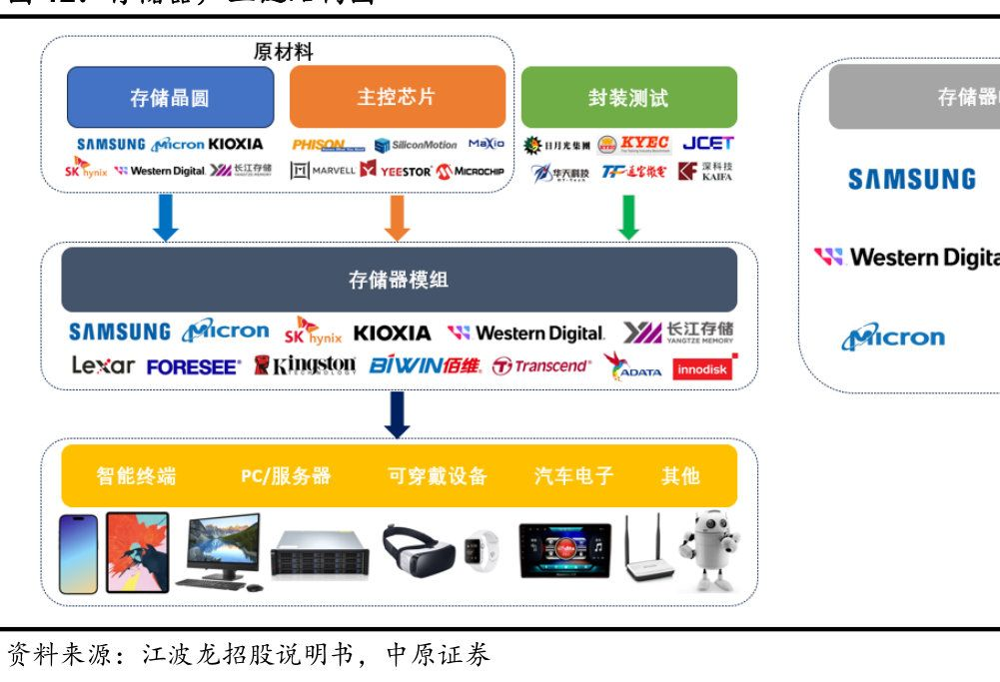

结构图要素：上游为「存储晶圆」「主控芯片」「封装测试」（框内为厂商 logo，字迹过小未逐一转录），中游为「存储器模组」，右侧为「存储器 IDM」（框内为三星、铠侠、西部数据、SK 海力士、美光、长江存储 logo），下游为「智能终端」「PC/服务器」「可穿戴设备」「汽车电子」「其他」。

资料来源：江波龙招股说明书，中原证券

### 2.2. 海外三巨头主导全球 DRAM 颗粒市场，DRAM 晶圆设计与制造行业壁垒高

---

<!-- 原文第 14 页 -->

#### 2.2.1. 海外三巨头主导全球 DRAM 颗粒市场，国内厂商积极布局利基型市场

DRAM 数据保持时间很短，需要不断定时刷新。动态随机存储器（DRAM）是与 CPU 直接交换数据的内部存储器，可以随时读写且速度快，通常作为操作系统或其他正在运行中的程序的临时数据存储媒介。DRAM 只能将数据保持很短的时间，为了保持数据，DRAM 必须隔一段时间刷新一次，如果存储单元没有被刷新，数据就会丢失。DRAM 基本存储单元都是由一个晶体管和一个电容器组成，电容器的状态决定了存储单元的逻辑状态是 1 还是 0，充电的电容器是逻辑 1，而“空”的电容器则是 0；电容器不能持久的保持储存的电荷，所以内存需要不断定时刷新，才能保持暂存的数据。

**图 13：DRAM 存储单元内部结构图**

**图 14：DRAM 芯片内部架构图**

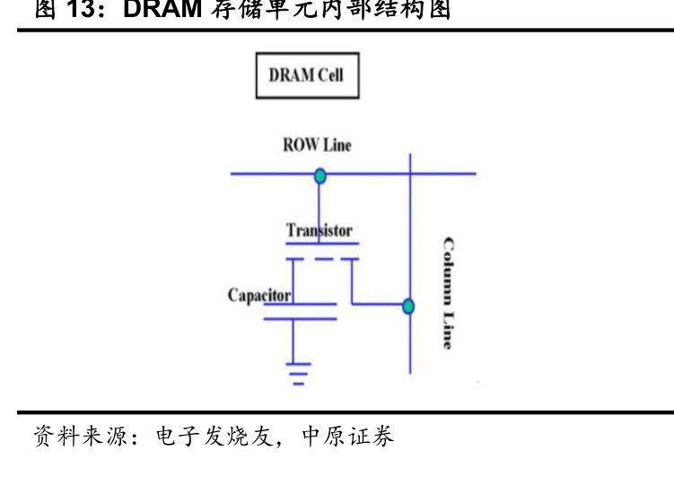

图 13 标注：DRAM Cell、ROW Line、Transistor、Capacitor、Column Line。图 14 标注：Address Bus、Data Bus、RAS、CAS、Row Addr Latch、Row Addr Dec、Column Address Latch、Column Address Decoder、Sense and Refresh Amplifiers。

资料来源（图 13）：电子发烧友，中原证券

资料来源（图 14）：电子发烧友，中原证券

SDRAM 是 DRAM 的主流，主要分为 DDR、LPDDR、GDDR 和 HBM。常见 DRAM 分类为 FDM DRAM（改良版 DRAM）、EDO DRAM（Micron 的专利技术）、RDRAM（RAMBUS 公司的技术）、SDRAM，目前同步动态随机存取存储器（SDRAM）是 DRAM 的主流，SDRAM 主要分为双倍速率 SDRAM（DDR）、低功耗双倍速率 SDRAM（LPDDR）、低功耗双倍速率 SDRAM（LPDDR）和高带宽内存（HBM）。

**图 15：DRAM 分类结构图**

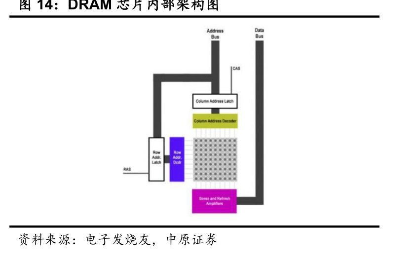

分类结构（自左至右）：动态随机存储器 DRAM → FDM DRAM、EDO DRAM、RDRAM、SDRAM；SDRAM → DDR（DDR、DDR2、DDR3、DDR4、DDR5、DDR6）、LPDDR（LPDDR、LPDDR2、LPDDR3、LPDDR4/4X、LPDDR5/5X）、GDDR（GDDR、GDDR2、GDDR3、GDDR4、GDDR5、GDDR6）、HBM。

资料来源：互联网公开信息整理，中原证券

DDR 和 LPDDR 在 DRAM 分类中目前应用占比约 90%，预计 DDR5 渗透率会逐步提

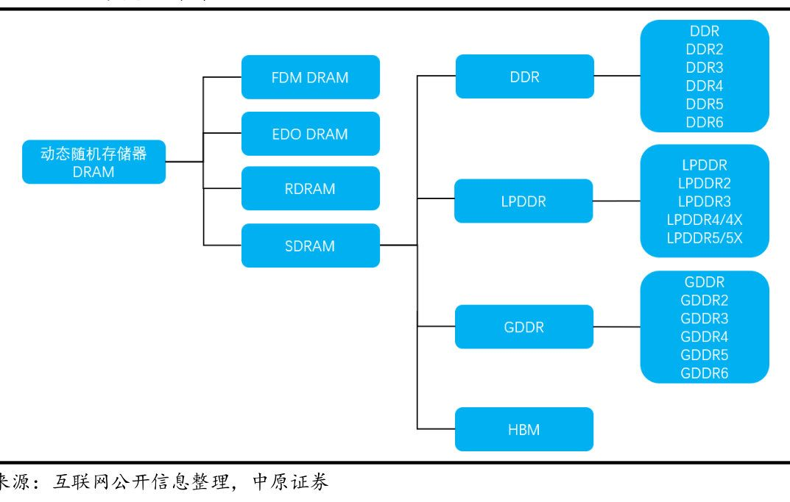

---

<!-- 原文第 15 页 -->

高。DDR 主要应用在个人计算机、服务器上、现主流的 DDR 标准是 DDR4，预计未来 DDR5 渗透率会逐步提高；LPDDR 主要应用于移动端电子产品；GDDR 主要应用于图像处理领域；HBM 主要应用于人工智能领域。DDR 和 LPDDR 是 DRAM 目前应用最广的类型，根据 Yole 的数据，DDR 和 LPDDR 合计在 DRAM 分类中应用占比约为 90%。

**图 16：主要 SDRAM 技术演进情况**

**图 17：2018-2022 年不同 DRAM 类型应用占比情况**

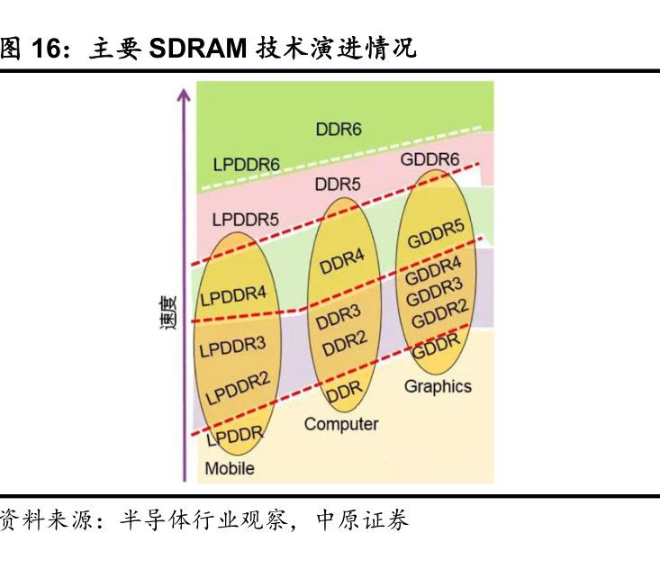

图 16 要素：纵轴为「速度」，三组技术路线分别为 Mobile（LPDDR、LPDDR2、LPDDR3、LPDDR4、LPDDR5、LPDDR6）、Computer（DDR、DDR2、DDR3、DDR4、DDR5、DDR6）、Graphics（GDDR、GDDR2、GDDR3、GDDR4、GDDR5、GDDR6）。

图 17 要素：纵轴 0.00%-100.00%，横轴为 2018Q1-2022Q4 各季度，图例为 legacy、DDR4、DDR5、LPDDR、GDDR，柱体为 100% 堆叠柱状图，未标注具体数值。

资料来源（图 16）：半导体行业观察，中原证券

资料来源（图 17）：Yole，佰维存储招股说明书，中原证券

DRAM 市场空间巨大，为半导体存储器第一大产品。根据闪存市场的数据，2021 年全球 DRAM 市场规模达到 949 亿美元，同比增长 41%，2022 年全球 DRAM 市场规模为 791 亿美元，同比下跌 17%。

**图 18：2016-2022 年全球 DRAM 市场规模情况**

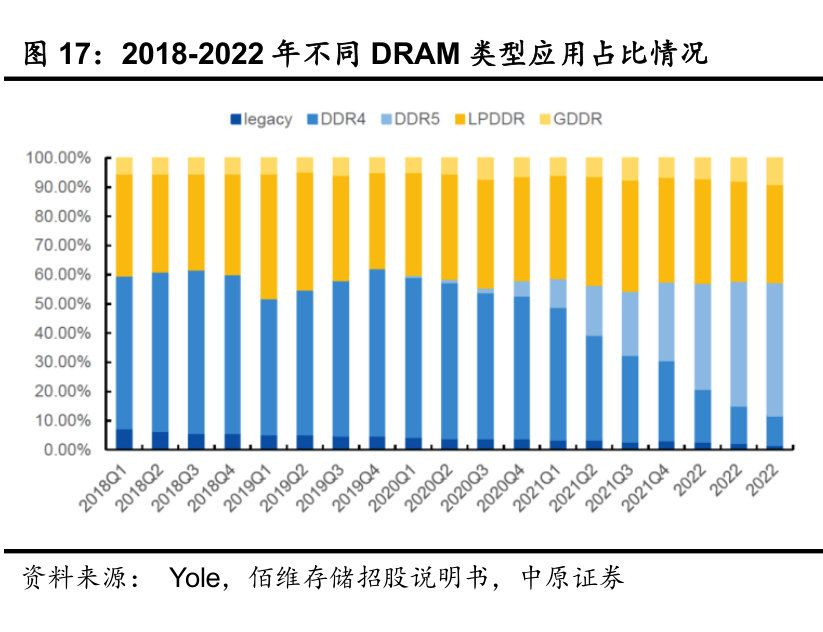

图 18 要素：横轴 2016-2022 年；左轴 0-1200（全球 DRAM 市场规模，亿美元），右轴 -60%~80%（增速，%）；图例为「全球 DRAM 市场规模（亿美元，左轴）」「增速（%，右轴）」，柱体与折线未标注具体数值。

资料来源：TrendForce，闪存市场，同花顺，中原证券

海外三巨头主导全球 DRAM 颗粒市场。根据 Gartner 的数据，2021 年全球 DRAM 市场三星、海力士、美光的市场份额分别为 42%、29%、23%，合计占比达 94%，还有南亚、华邦、力晶等厂商，国内 DRAM 晶圆厂商主要为合肥长鑫，目前尚处于早期发展阶段。

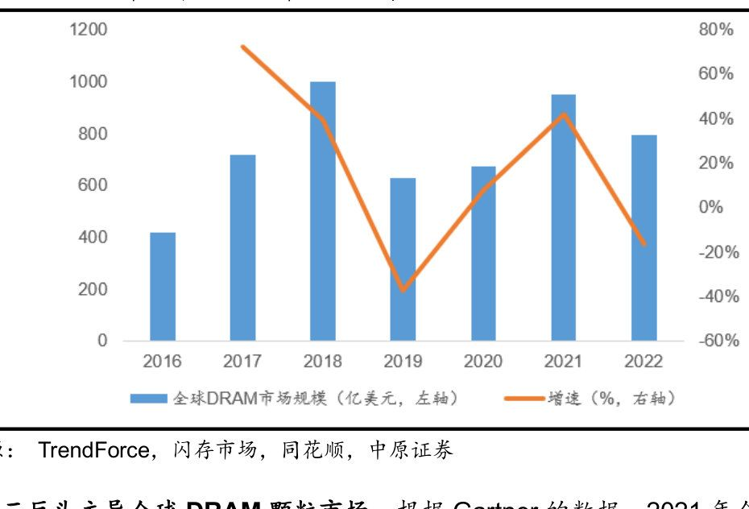

---

<!-- 原文第 16 页 -->

**图 19：2021 年全球 DRAM 颗粒市场竞争格局情况**

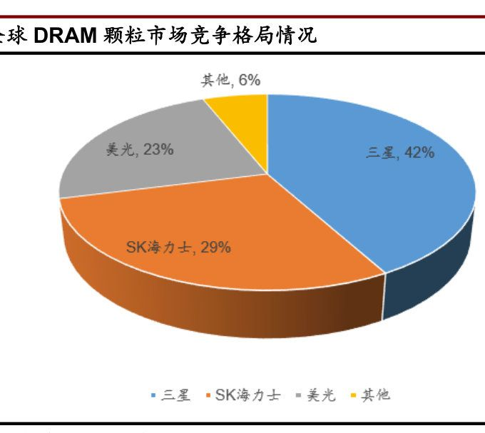

饼图标注：三星 42%、SK 海力士 29%、美光 23%、其他 6%；图例为三星、SK 海力士、美光、其他。

资料来源：Gartner，彭博，中原证券

DRAM 下游应用以服务器、移动电子产品、PC 为主。DRAM 下游需求市场格局较为稳定，服务器、移动电子产品、PC 占比较高。根据 IDC 的数据，2021 年 DRAM 下游市场中服务器占比 44%，移动电子产品占比 38%，PC 占比 9%。

**图 20：2018-2021 年全球 DRAM 下游市场占比情况**

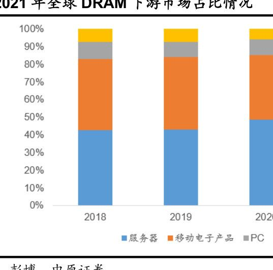

图 20 要素：纵轴 0%-100%，横轴 2018-2021 年，100% 堆叠柱状图；图例为服务器、移动电子产品、PC、其他，柱体未标注具体数值。

资料来源：IDC，彭博，中原证券

利基型 DRAM 市场空间广阔，国内厂商有望在利基型市场持续加速发展。除了用于手机、服务器等的高性能、大容量主流 DRAM，对于存储容量相对较小、对制程工艺要求不高的 DRAM，通常被称为利基型 DRAM，主要应用于机顶盒、液晶电视、监控、汽车、工控等领域。根据 Trendforce 的数据，2021 年全球利基型 DRAM 市场规模约为 90 亿美元，约占 DRAM 总市场规模的 10%。中国台湾厂商南亚、华邦在利基型 DRAM 市场占据较大的市场份额，中国大陆厂商兆易创新、东芯股份等积极布局利基型 DRAM 市场，北京君正在汽车市场具有较强的竞争力，在国产替代需求迫切的背景下，国内厂商有望在利基型市场持续加速发展。

#### 2.2.2. DRAM 晶圆设计与制造行业具有极高的技术和资本壁垒

DRAM 晶圆设计与制造行业具有较高的资本门槛。早期进入 DRAM 存储器领域的全球领先企业通过巨额资本投入不断积累市场竞争优势，全球 DRAM 晶圆市场被三星、海力士和美

---

<!-- 原文第 17 页 -->

光主导。国际领先的 DRAM 晶圆原厂不断进行工艺制程迭代，每更新一代工艺又需要重新进行投资更新设备，芯片设计与晶圆制造的研发门槛持续提升，研发资本投入不断增加；同时，主要存储原厂还需通过持续大额资本支出来投放成熟制程产能，维持规模优势和市场份额；根据 Omdia 的数据，国际领先的 DRAM 晶圆原厂三星、海力士、美光近十年每年都需要进行数十亿美元的固定资产投资，并且呈波动向上增长趋势，DRAM 晶圆设计与制造行业具有较高的资本门槛。

**图 21：2010-2022 年全球主要 DRAM 晶圆原厂年度固定资产投资及预测（亿美元/年）**

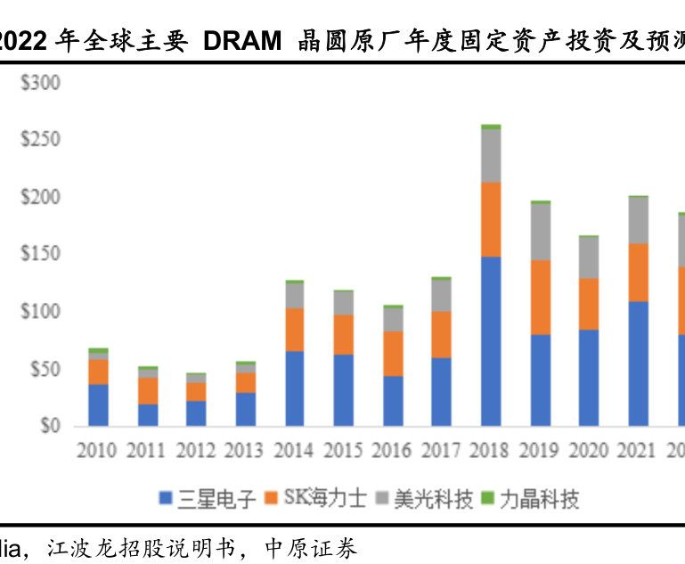

图 21 要素：纵轴 $0-$300，横轴 2010-2022 年，堆叠柱状图；图例为三星电子、SK 海力士、美光科技、力晶科技，柱体未标注具体数值。

资料来源：Omdia，江波龙招股说明书，中原证券

全球前三大 DRAM 厂商引领工艺制程技术不断迭代。从存储巨头的工艺制程发展历程来看，三星于 2014 年率先实现 20nm 制程产品 4Gb DDR3 的量产，此后 DRAM 制程工艺大约每两年迭代一次，在 2016-2017 年进入 1X(16nm-19nm)阶段，2018-2019 年为 1Y(14nm-16nm)，2020 年处于 1Z(12nm-14nm)时代。2021 年 1 月，美光宣布量产 1α制程的 DRAM，1α制程相比 1Z 制程将内存密度提升了 40%；三星、SK 海力士也已实现 1a 制程 DRAM 的量产。2022 年四季度，美光推出全球最先进技术制程的 1β DRAM，率先在低功耗 LPDDR5X 移动内存上采用该新一代制程技术，其最高速率可达每秒 8.5Gb；1β制程相比 1α制程可将能效提高约 15%、内存密度提升 35%以上，单颗裸片容量高达 16Gb；1β制程可在更小的尺寸内实现更高的内存容量，从而降低单位数据成本。根据 Techinsights 的预测，到 2030 年，1d（1δ）、0a（0α）和 0b（0β）等设计进一步缩小的几代 DRAM 将量产。

**图 22：全球前三大 DRAM 晶圆原厂工艺制程技术发展路线图**

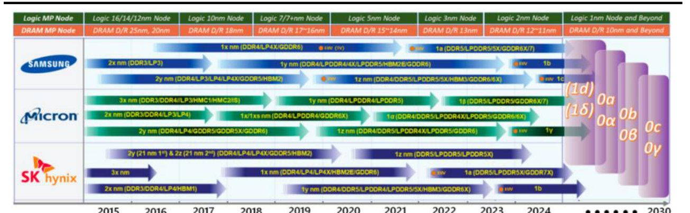

图 22 表头（左起）：

| Logic MP Node | Logic 16/14/12nm Node | Logic 10nm Node | Logic 7/7+nm Node | Logic 5nm Node | Logic 3nm Node | Logic 2nm Node | Logic 1nm Node and Beyond |
| --- | --- | --- | --- | --- | --- | --- | --- |
| DRAM MP Node | DRAM D/R 25nm, 20nm | DRAM D/R 18nm | DRAM D/R 17~16nm | DRAM D/R 15~14nm | DRAM D/R 13nm | DRAM D/R 12~11nm | DRAM D/R 10nm and Beyond |

图中三行分别为三星（SAMSUNG）、美光（Micron）、SK 海力士（SK hynix）的制程/产品条带，横轴为 2015-2024 年并延伸至 2030 年；条带内标注如「2x nm (DDR3/LP3)」「2y nm (DDR4/LP3/LP4/LP4X/GDDR5/HBM2)」「2y (21 nm 1^st) & 2z (21 nm 2^nd) (DDR4/LP4/LP4X/GDDR5/HBM2)」等，右侧为 1d（1δ）、0a（0α）、0b（0β）、0c（0γ）等后续节点示意。条带内小字无法逐条确认，完整内容未逐一转录 [OCR_UNCERTAIN]。

资料来源：Techinsights，半导体行业观察，中原证券

---

<!-- 原文第 18 页 -->

DRAM 晶圆设计与制造行业具有极高的技术壁垒。DRAM 工艺制程从 20nm 到 10nm 需要至少 5 个不同的工艺节点进行微缩，目前 DRAM 制程提升是以 1nm 级实现微缩，DRAM 制程微缩具有极高的难度。DRAM 内部的存储单元是由一个晶体管和一个电容构成，晶体管处于打开的状态，电容储存电荷，根据电容是否有电荷，表示存储“1”或“0”。DRAM 也遵循摩尔定律，每两年集成度扩大 2 倍，晶体管和电容需要分别微缩 70%，微缩的电容也需要存储一定量的电荷，如果电荷过少，“1”和“0”的区分就会变得模糊，会影响存储的功能。DRAM 微缩的难点在于实现微缩的同时要保证电容存储的电荷保持一定，三星、SK 海力士、美光都在晶体管上堆积绝缘膜、凿孔、形成电容，深挖细微孔是重要的技术研发。国际领先的 DRAM 晶圆原厂凭借多年技术积累，不断提升晶圆制程以提高单位面积的存储密度和降低存储芯片功耗，随着制程工艺不断逼近极限，研发门槛不断提高，DRAM 晶圆设计与制造产业具有极高的技术壁垒。

**图 23：DRAM 内部结构图**

**图 24：DRAM 工艺制程微缩发展及预测**

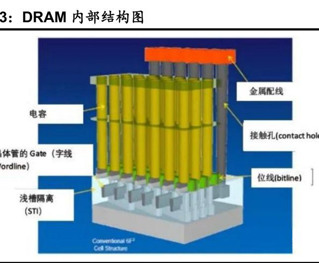

图 23 标注：电容、金属配线、接触孔(contact hole)、晶体管的 Gate（字线 Wordline）、位线(bitline)、浅槽隔离(STI)、Conventional 6F² Cell Structure。

图 24 要素：纵轴为「尺寸 nm」（5-50），横轴为「量产开始年」（2011-2035）；图中标注 ITRS、IRDS 两个阶段箭头；实心曲线标注的尺寸依次为 36、31、28、25、22、20、18、17.5、17、14、11、8.4、7.7，虚线标注的尺寸依次为 16、14、13、12、11、10、9、7、6。

资料来源（图 23）：半导体行业观察，中原证券

资料来源（图 24）：半导体行业观察，中原证券

### 2.3. NAND Flash 颠覆摩尔定律，NAND Flash 晶圆设计与制造行业壁垒高

#### 2.3.1. NAND Flash 颠覆摩尔定律，全球前五大厂商统治 NAND Flash 颗粒市场

NAND Flash 内部存储单元基于浮栅技术和电荷俘获技术。NAND Flash 是快闪存储器的一种，属于非易失性存储器，NAND Flash 内部存储单元是基于 MOSFET，与普通场效应晶体管的不同之处在于，浮栅技术（Floating Gate）在栅极（控制栅）与漏极/源极之间存在浮栅，利用浮栅存储数据，数据在 NAND Flash 中是以电荷的形式存储的，存储电荷的多少取决于控制栅极所施加的电压，栅极及主板利用氧化膜进行了绝缘处理，一次积累的电荷可以保持长时间；电荷俘获技术(Charge Trap)将多孔氮化硅作为绝缘体，在孔内填入电荷来区分 0 与 1 的方式，用绝缘体氮化硅替代原本导体浮栅的存储方式，从根源上杜绝邻近单元间的串扰问题；3D NAND 时代起，凭借可制造性更好、成本更低的优势, 电荷俘获技术获得大部分 NAND Flash 厂商采用。

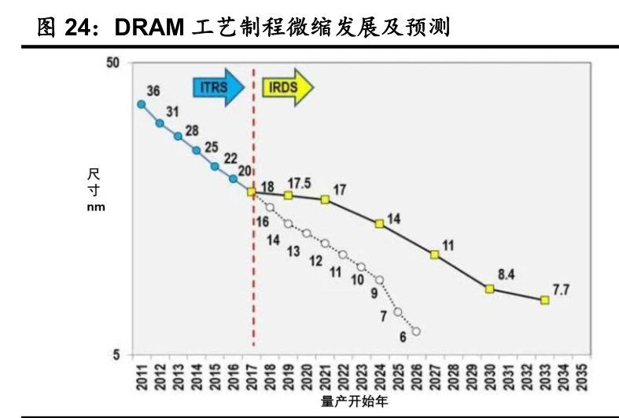

---

<!-- 原文第 19 页 -->

**图 25： 基于浮栅技术和电荷俘获技术的 NAND Flash 存储单元内部结构图**

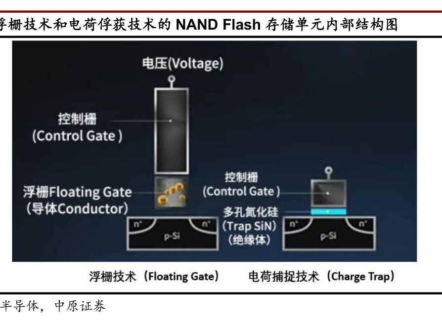

图 25 标注：电压(Voltage)、控制栅（Control Gate）、浮栅 Floating Gate（导体 Conductor）、多孔氮化硅（Trap SiN，绝缘体）、p-Si；下方标注「浮栅技术（Floating Gate）」「电荷捕捉技术（Charge Trap）」。

资料来源：三星半导体，中原证券

NAND Flash 颠覆摩尔定律，成本每年大幅下降。随着摩尔定律的逐步失效，数字逻辑芯片和 DRAM 芯片随着制程工艺提升所带来的密度优势正在降低，NAND Flash 颠覆了摩尔定律，不再依赖于晶体管的微缩。2013 年全新的 3D NAND 架构首次商业化，从此 NAND Flash 制造商通过添加越来越多的存储单元层的堆叠来提高 NAND Flash 的存储密度和成本结构，2013-2022 年 NAND Flash 的存储密度提升的年复合增速为 30%。因此 NAND Flash 与半导体行业其他细分领域不同，NAND Flash 的成本每年都在大幅下降。

**图 26：2013-2022 年 NAND Flash 价格趋势情况**

**图 27：2014-2032 年 NAND Flash 存储密度及预测情况**

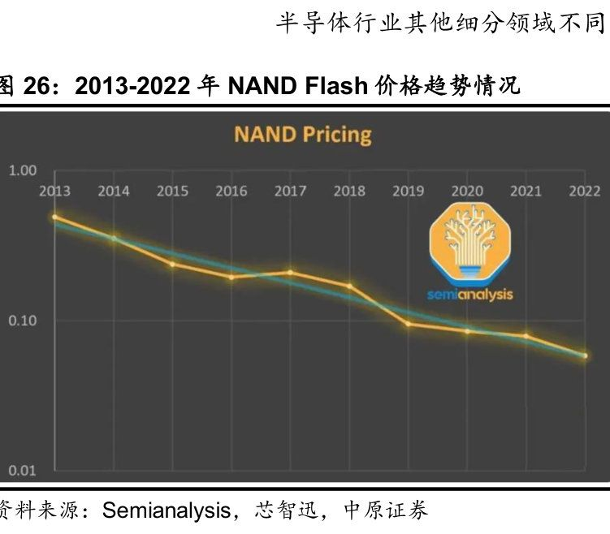

图 26 要素：标题「NAND Pricing」，纵轴为对数刻度（1.00、0.10、0.01），横轴 2013-2022 年，曲线未标注具体数值。

图 27 要素：标题「Scaling Trend of 3D NAND」，数据来源标注「Data source: ISSCC 2014-2022」；纵轴「Area Bit Density (Gb/mm2)」（对数刻度 10、100、1000），横轴「Year」（2014-2028）；图中标注「# of WL Stacking」「Area1 Density」「+30% / year」「Micron 232L TLC (shipment from July, 2022)」「Last decade」「Primary scaling path II WL stacking」「Trending >1000 layers in the years ahead」「Economically feasible?」，图例为不同密度（MLC、TLC、QLC 等）系列。

资料来源（图 26）：Semianalysis，芯智迅，中原证券

资料来源（图 27）：Semianalysis，芯智迅，中原证券

NAND Flash 厂商主要通过逻辑缩放、垂直缩放、横向缩放及体系结构扩展四种方式扩展存储容量。NAND Flash 厂商主要有 4 种途径扩展 NAND 闪存每片的存储容量，其中逻辑缩放是增加每个单元存储的位数，这需要每个单元存储 2^n 个电压电平；垂直缩放是增加垂直堆叠的 NAND 单元的数量；横向缩放是可以调整在 2D 矢量上拟合的单元格的大小及数量；体系结构扩展是通过各种技术提高密度并减少单元及外围的开销。

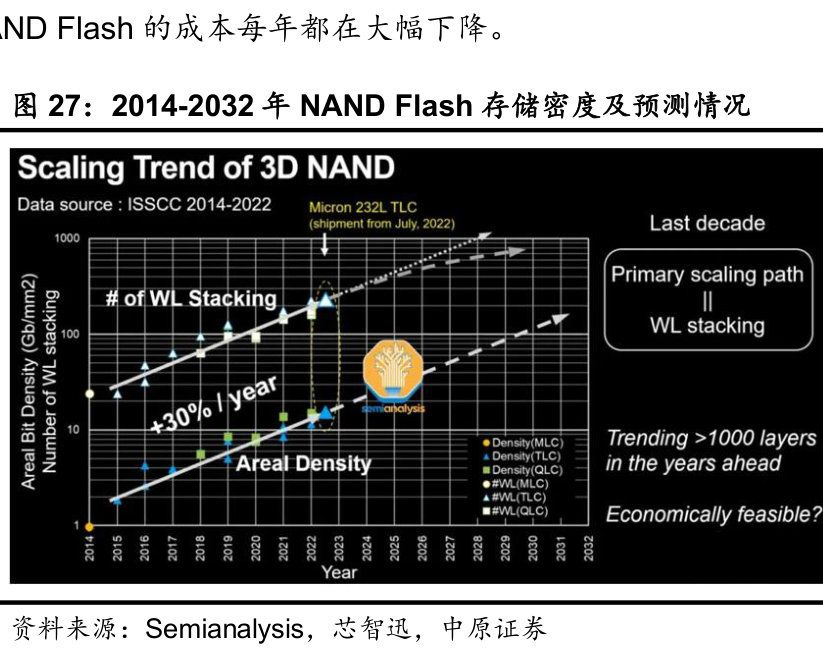

---

<!-- 原文第 20 页 -->

**图 28： NAND Flash 扩展存储容量的四种途径**

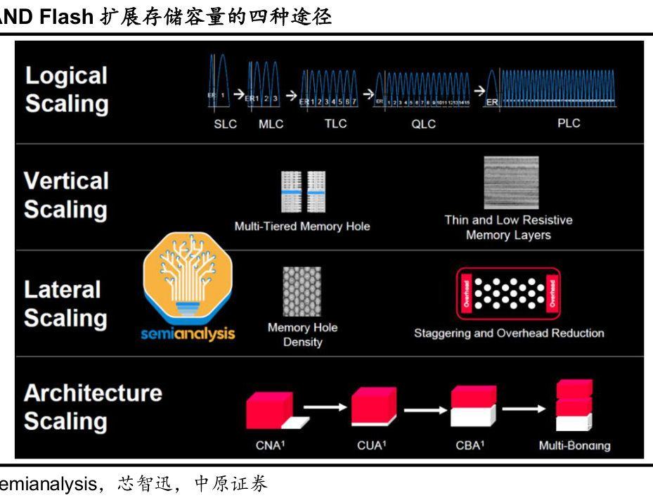

图 28 罗列四种途径及标注：

- Logical Scaling：SLC → MLC → TLC → QLC → PLC（各级对应电压电平数递增）
- Vertical Scaling：Multi-Tiered Memory Hole；Thin and Low Resistive Memory Layers
- Lateral Scaling：Memory Hole Density；Staggering and Overhead Reduction
- Architecture Scaling：CNA¹ → CUA¹ → CBA¹ → Multi-Bonding

资料来源：Semianalysis，芯智迅，中原证券

NAND Flash 厂商可通过提高存储单元的可存储数位量来提升存储密度，根据工艺技术的不同，NAND 可分为 SLC、MLC、TLC、QLC 和 PLC，SLC 的 1 个存储器储存单元只能存放 1 bit 的数据，MLC、TLC、QLC、PLC 的 1 个储存单元分别可存放 2 bit、3 bit、4 bit、5 bit 的数据。五种类型的 NAND 闪存颗粒性能各有不同，SLC 单位容量的成本相对于其他类型 NAND 闪存颗粒成本更高，但其数据保留时间更长、读取速度更快，五种类型的 NAND 按速度价格对比排序为 SLC>MLC>TLC>QLC>PLC；PLC 拥有更大的容量和更低的成本，五种类型的 NAND 按容量大小对比排序为 PLC>QLC>TLC>MLC>SLC。目前 NAND Flash 主流的应用解决方案为 TLC 和 QLC，SLC 和 MLC 主要针对军工、企业级等应用，有着高速写入、低出错率、长耐久度特性。

**图 29： NAND Flash 根据工艺技术的分类情况**

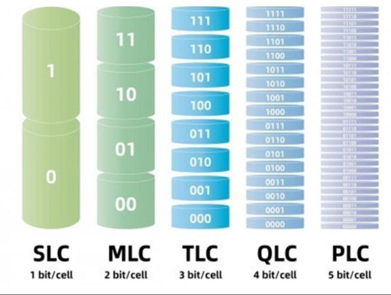

图 29 要素：五列分别对应 SLC（1 bit/cell）、MLC（2 bit/cell）、TLC（3 bit/cell）、QLC（4 bit/cell）、PLC（5 bit/cell），列内以电平/位串示意每单元可表示的状态数（SLC 为 1/0；MLC 为 11/10/01/00；TLC、QLC、PLC 依此扩展至 111…、1111…、11111…）。

资料来源：劼电科技，中原证券

NAND Flash 根据空间结构的不同可分为 2D NAND 和 3D NAND，通过提高 3D NAND 的堆叠层数来提升存储密度。NAND Flash 根据对应不同的空间结构来看，可分为 2D NAND

---

<!-- 原文第 21 页 -->

和 3D NAND 两大类；通常 SLC 和 MLC 都是 2D NAND，TLC、QLC 大都为 3D NAND；Solidigm 在 2023 年发布了世界首款基于浮栅技术的 192 层 3D PLC NAND，相较于 192 层 QLC NAND，其存储密度提升了 25%；NAND Flash 厂商都在不断提升 3D NAND Flash 的堆叠层数，以提升 NAND Flash 存储密度，晶圆原厂已经相继推出了 176 层、232 层，236 层、238 层等 NAND Flash，全球 NAND Flash 逐步进入 200 层时代。

**图 30：NAND Flash 根据空间结构的分类情况**

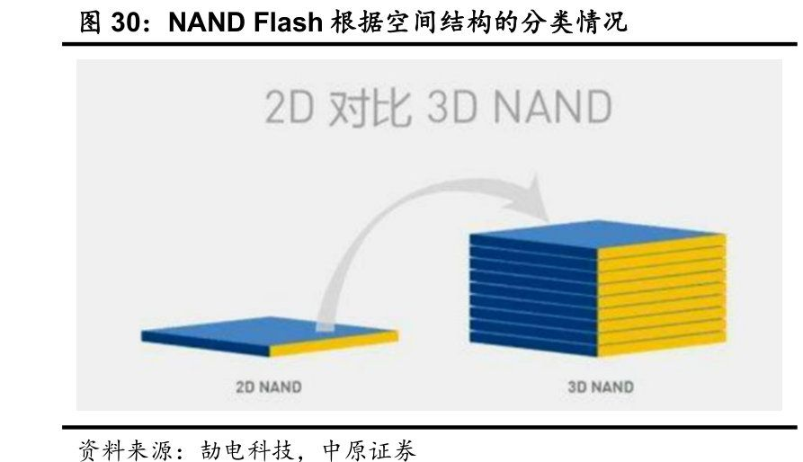

图内标题：2D 对比 3D NAND；图内标注：2D NAND、3D NAND。

资料来源：劼电科技，中原证券

**图 31：美光 3D NAND Flash 规划不断提升堆叠层数**

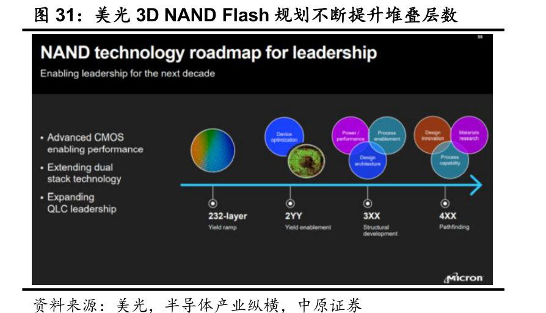

图内标题：NAND technology roadmap for leadership / Enabling leadership for the next decade；要点：Advanced CMOS enabling performance、Extending dual stack technology、Expanding QLC leadership；时间轴：232-layer（Yield ramp）、2YY（Yield enablement）、3XX（Structural development）、4XX（Pathfinding）；图右下角为 Micron 标识。

资料来源：美光，半导体产业纵横，中原证券

**NAND Flash 为第二大存储器产品，总体市场规模呈现波动向上的趋势。**根据闪存市场的数据，2021 年全球 NAND Flash 市场规模为 675 亿美元，同比增长 20%；2022 年存储器行业供需关系发生变化，2022 年全球 NAND Flash 市场规模为 601.26 亿美元，同比下跌 11%，NAND Flash 总体市场规模呈现波动向上的趋势。

**图 32：2012-2022 年全球 NAND Flash 市场规模情况**

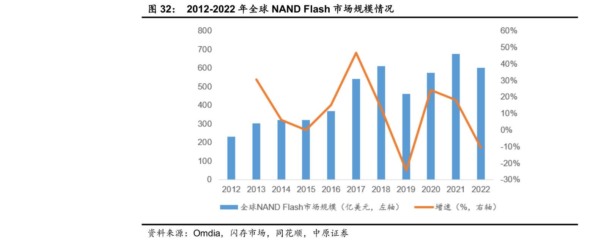

图表：柱状图＋折线。纵轴左 0–800（亿美元），纵轴右 -30%–60%；横轴 2012–2022 年；图例：全球NAND Flash市场规模（亿美元，左轴）、增速（%，右轴）。柱体与折线均无数据标签。

资料来源：Omdia，闪存市场，同花顺，中原证券

**全球前五大厂商统治 NAND Flash 颗粒市场，国内厂商快速发展。**根据 Gartner 的数据，2021 年三星以 35%的市占率占据全球 NAND Flash 市场第一位，铠侠以 18%的市场份额位列第二位，西部数据、美光、SK 海力士的市场份额分别为 14%、13%、10%，前五大厂商市场份额为 90%；Solidigm 以 4%的市场份额排在第六位，中国厂商长江存储经过近几年的快速发展，获取 3%的市场份额位列全球第七位。

---

<!-- 原文第 22 页 -->

**图 33：2021 年全球 NAND Flash 颗粒市场竞争格局情况**

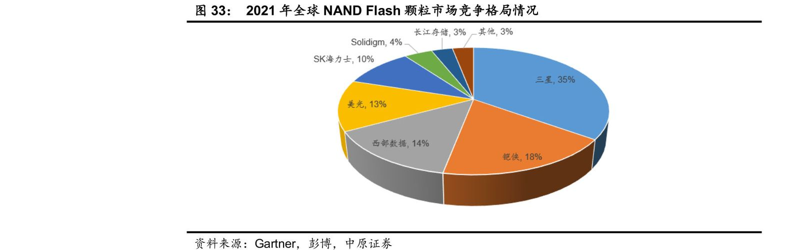

图表：饼图，图内标注各厂商份额：三星 35%、铠侠 18%、西部数据 14%、美光 13%、SK海力士 10%、Solidigm 4%、长江存储 3%、其他 3%。

资料来源：Gartner，彭博，中原证券

**NAND Flash 下游应用以 SSD 和智能手机为主。**根据 IDC 的数据，2018-2021 年全球 NAND Flash 下游应用领域中 SSD 和智能手机占比较高，两者合计占比超过 90%，其中 SSD 主要应用于服务器和 PC；其次为消费电子领域，汽车、工业等应用占比相对较小。

**图 34：2018-2021 年全球 NAND Flash 市场下游应用领域情况**

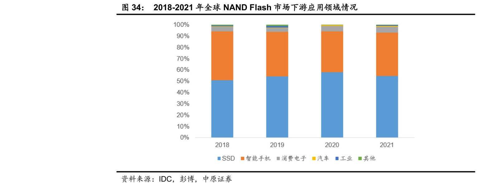

图表：百分比堆叠柱状图。纵轴 0%–100%，横轴 2018–2021 年；图例：SSD、智能手机、消费电子、汽车、工业、其他。图中无数据标签。

资料来源：IDC，彭博，中原证券

**SLC NAND 主要应用于高可靠性领域，华邦和旺宏占据较高的市场份额。**SLC NAND 主要用于中小容量存储市场，与大容量存储产品追求单位存储密度的发展趋势不同，SLC NAND 目前主要应用对可靠性要求要高的相关领域，如 5G 通信设备，安防监控、可穿戴设备等。根据 Gartner 的数据，2019 年 SLC NAND 全球市场规模为 16.71 亿美元，预计 2024 年将达到 23.24 亿美元，2019-2024 年的复合增速为 6%。海外存储巨头专注于大容量 NAND Flash，目前 SLC NAND 市场主要被中国台湾厂商华邦和旺宏占据较高的市场份额，随着国产化需求的不断提高，国内企业兆易创新、东芯股份等正在快速发展中。

---

<!-- 原文第 23 页 -->

**图 35：2017-2024 年全球 SLC NAND Flash 市场规模及预测情况**

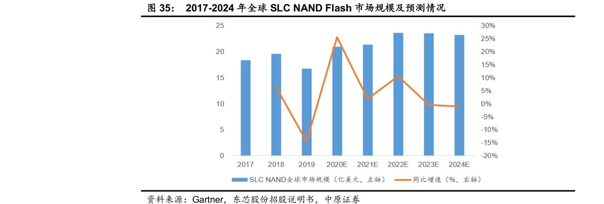

图表：柱状图＋折线。纵轴左 0–25（亿美元），纵轴右 -20%–30%；横轴 2017–2024E；图例：SLC NAND全球市场规模（亿美元，左轴）、同比增速（%，右轴）。柱体与折线均无数据标签。

资料来源：Gartner，东芯股份招股说明书，中原证券

## 2.3.2. NAND Flash 晶圆设计与制造行业具有极高的技术和资本壁垒

**NAND Flash 晶圆设计与制造行业具有较高的资本门槛。**全球 NAND Flash 晶圆市场被三星、铠侠、西部数据、美光和 SK 海力士占据，全球前五大 NAND Flash 厂商通过前期巨额资本投入建立强大的竞争优势，并且不断进行工艺制程迭代，研发投入持续增加；根据 Omdia 的数据，全球前五大 NAND Flash 晶圆原厂长期保持较高的资本投入，并且呈波动向上增长趋势，NAND Flash 晶圆设计与制造产业具有较高的资本门槛。

**图 36：2010-2022 年全球主要 NAND Flash 晶圆原厂年度固定资产投资及预测（亿美元/年）**

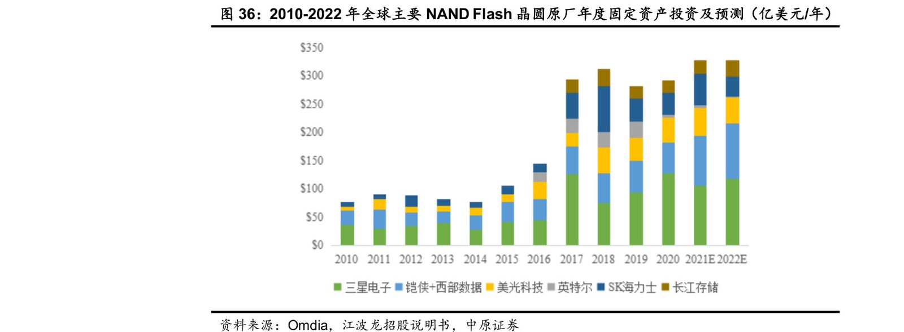

图表：按厂商分层的堆叠柱状图。纵轴以美元标注 $0–$350；横轴 2010–2022E；图例：三星电子、铠侠+西部数据、美光科技、英特尔、SK海力士、长江存储。图中无数据标签。

资料来源：Omdia，江波龙招股说明书，中原证券

**通过提高存储单元的可存储数位量提升存储密度目前已接近极限。**NAND Flash 厂商在激烈竞争中不断提升存储密度，目前提高存储单元的可存储数位量是提升存储密度的主要技术路径之一，每个物理存储单元存储多一位需要将单元必须保持的可辨别电压状态的数量增加一倍，增加每个单元的电压状态的数量意味着划分每个存储单元的电子存储容量，每个状态的电子数量减少会增加可变性并破坏可靠性。2D NAND 已经达到了 TLC 技术的极限，3D NAND 也将很快接近类似的极限。

---

<!-- 原文第 24 页 -->

**图 37：存储单元不同存储数位量每个存储状态的电子数量情况**

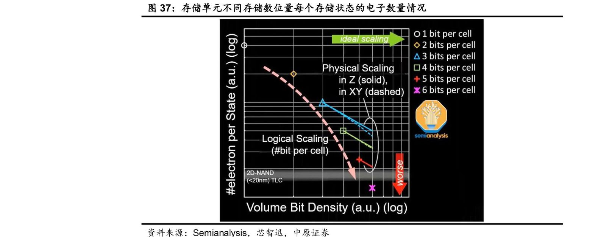

图表：双对数散点示意图。横轴 Volume Bit Density (a.u.) (log)，纵轴 #electron per State (a.u.) (log)；图例：1 bit per cell、2 bits per cell、3 bits per cell、4 bits per cell、5 bits per cell、6 bits per cell；图内标注：Ideal scaling、Physical Scaling in Z (solid), in XY (dashed)、Logical Scaling (#bit per cell)、2D NAND (<20nm) TLC、Worse；右下角为 semianalysis 标识。

资料来源：Semianalysis，芯智迅，中原证券

**3D NAND Flash 提升堆叠层数主要限制是在制造工艺中蚀刻沟道通孔，3D NAND 晶圆制造具有极高的技术壁垒。**全球前五大存储厂商不断提升 NAND Flash 堆叠层数，提升 3D NAND Flash 的堆叠层数是过去十年中提升存储密度的主要途径。3D NAND 制造流程是将氧化物和氮化物薄膜的交替层首先沉积在基底芯片上，每个层的厚度在 20 至 30nm 之间，每个叠层的理论极限可以超过 250 层高并且接近 7 微米的高度，然后添加厚的硬掩模以准备高深宽比（HAR）沟道空穴蚀刻，这种反应离子蚀刻工艺挖掘出比宽度深 70 倍的孔阵列，通道孔在圆度和整个孔深度上的均匀性对于降低存储单元性能的可变性至关重要。3D NAND 高度依赖于高深宽比蚀刻和沉积能力来缩放密度和性能，3D NAND 提升堆叠层数主要限制是在制造工艺中蚀刻沟道通孔，3D NAND 晶圆制造具有极高的技术壁垒。

**图 38：全球前五大 NAND Flash 厂商技术路线情况**

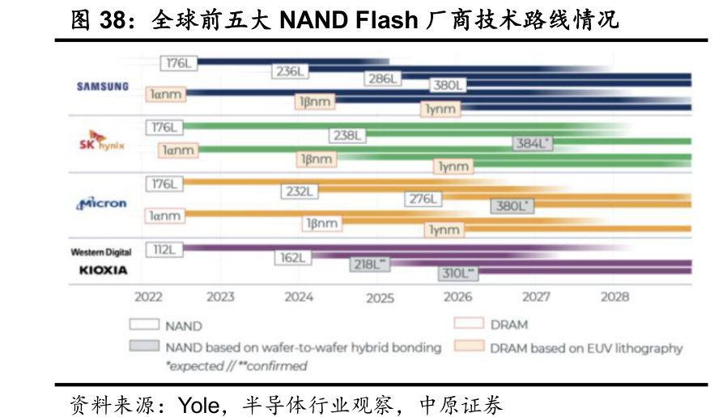

图表：各厂商工艺路线时间轴（横轴 2022–2028 年）。SAMSUNG：176L、236L、286L、380L，DRAM 工艺 1anm、1bnm、1ynm；SK hynix：176L、238L、384L*，DRAM 工艺 1anm、1bnm、1ynm；Micron：176L、232L、276L、380L*，DRAM 工艺 1anm、1bnm、1ynm；Western Digital、KIOXIA：112L、162L、218L**、310L**。图例：NAND、NAND based on wafer-to-wafer hybrid bonding、DRAM、DRAM based on EUV lithography；脚注：*expected // **confirmed。

资料来源：Yole，半导体行业观察，中原证券

**图 39：3D NAND Flash 制造挑战**

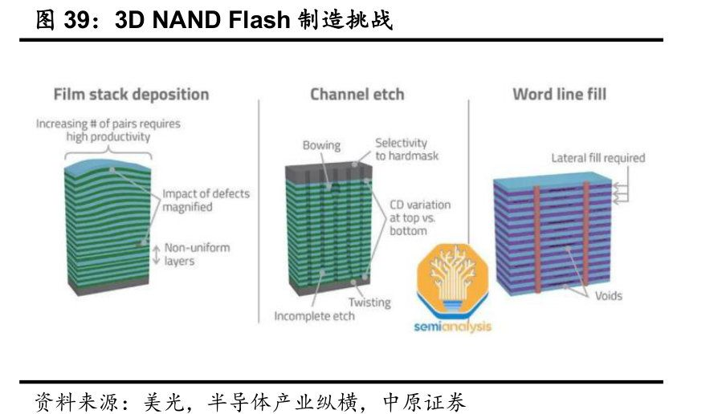

图表：三组示意图。Film stack deposition：Increasing # of pairs requires high productivity、Impact of defects magnified、Non-uniform layers；Channel etch：Bowing、Selectivity to hardmask、CD variation at top vs bottom、Twisting、Incomplete etch；Word line fill：Lateral fill required、Voids；图中含 semianalysis 标识。

资料来源：美光，半导体产业纵横，中原证券

## 2.4. 全球前三大厂商主导 NOR Flash 市场，下游应用领域相对分散

**NOR Flash 具有随机存储、读取速度快、芯片内执行等特点。**NOR Flash 是一种基于 NOR 门结构的闪存技术，其中 NOR 代表了逻辑门电路中的“或非”门；NOR Flash 具有并行访问结构，这意味着每个存储单元都有一个地址，并且可以直接访问任何存储单元，这使得 NOR Flash 具有快速的随机访问能力，适用于执行代码和读取关键数据。与 NAND Flash 相

---

<!-- 原文第 25 页 -->

比，NOR Flash 具有较低的存储密度和较高的成本，但具有随机存储、读取速度快、芯片内执行（XIP）等特点，适合用作执行代码和存储需要低延迟和高可靠性的关键数据的应用程序，广泛应用于手机，电脑，可穿戴等消费类电子、汽车电子、安防、工控、基站、物联网设备等领域。

**图 40：NOR Flash 内部的布线和结构**

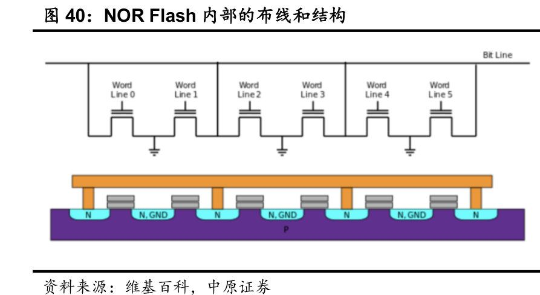

图内标注：Word Line 0、Word Line 1、Word Line 2、Word Line 3、Word Line 4、Word Line 5、Bit Line；结构剖面标注 N+、P 等。

资料来源：维基百科，中原证券

**图 41：NAND Flash 内部的布线和结构**

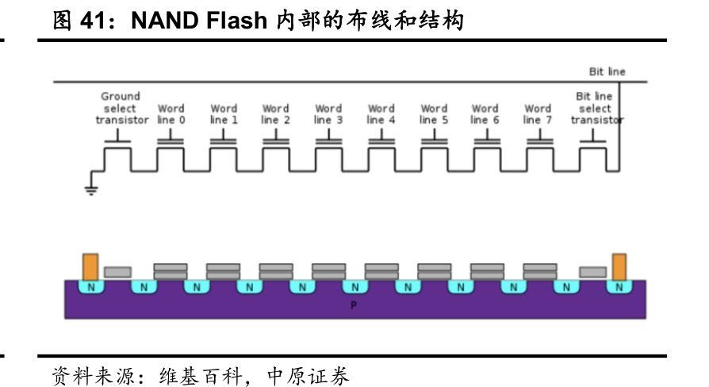

图内标注：Ground select transistor、Word Line 0 至 Word Line 7、Bit Line select transistor、Bit Line；结构剖面标注 N+、P 等。

资料来源：维基百科，中原证券

**NOR Flash 基于浮栅（ETOX）及电荷俘获（SONOS）工艺结构。**NOR Flash 有浮栅（ETOX）及电荷俘获（SONOS）两种工艺结构，ETOX 工艺结构存储器主要由衬底、隧道氧化层、多晶浮栅、栅间绝缘层和多晶控制栅组成，通过向浮栅中注入电子或拉出电子实现写入和擦除操作，主流的 NOR Flash 目前多采用 ETOX 工艺。SONOS 就是将浮栅用氮化物取代，形成氧化物-氮化物-氧化物(Oxide-Nitride-Oxide)结构，其利用氮化物的特性将电荷固定在注入点附近，它不像浮栅那样随机分布在多晶上，因此可以在两端分别聚集电荷，使一个单元可以实现 2 比特的存储；基于 SONOS 技术在提高存储单元密度的同时，也会带来一些副作用，比如在访问时，两个比特会相互干扰；由于 SONOS 的电荷捕获方式更不容易产生缺陷产品，对制造工艺要求相对简单，比较有成本优势。

**图 42：ETOX 工艺存储单元内部结构图**

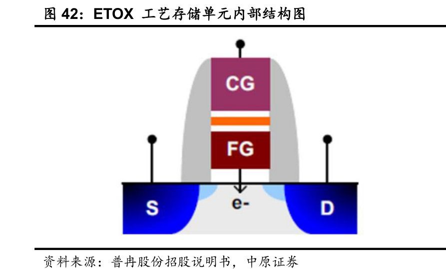

图内标注：CG、FG、S、D、e-。

资料来源：普冉股份招股说明书，中原证券

**图 43：SONOS 工艺存储单元内部结构图**

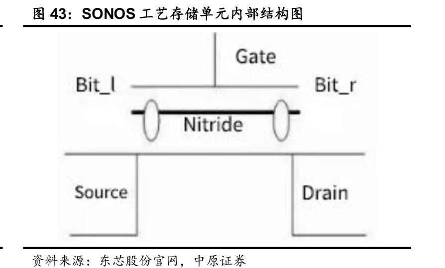

图内标注：Gate、Bit_l、Bit_r、Nitride、Source、Drain。

资料来源：东芯股份官网，中原证券

**NOR Flash 是除 DRAM 和 NAND Flash 之外市场规模最大的存储芯片。**NOR Flash 广泛应用于需要存储系统程序代码的电子设备，NOR Flash 是除 DRAM 和 NAND Flash 之外市场规模最大的存储芯片。近年来随着智能手机、物联网、TWS 耳机、5G 及汽车电子等下游应用需求的增长，NOR Flash 市场规模逐步增长。根据 IC Insights 的数据，2020 年 NOR

---

<!-- 原文第 26 页 -->

Flash 全球市场规模约为 25 亿美元，预计 2021 年 NOR Flash 市场规模约为 31 亿美元。

**图 44：2015-2021 年全球 NOR Flash 市场规模情况**

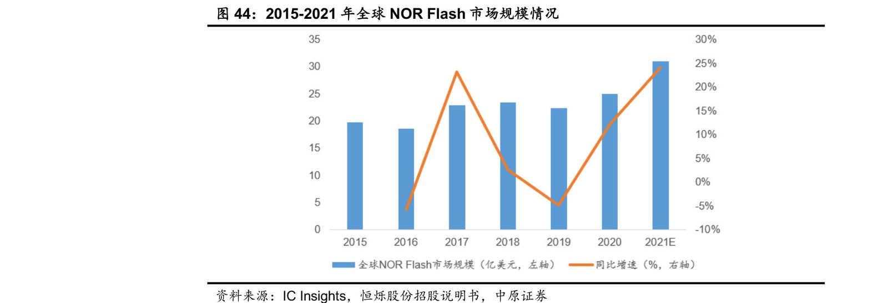

图表：柱状图＋折线。纵轴左 0–35（亿美元），纵轴右 -10%–30%；横轴 2015–2021E；图例：全球NOR Flash市场规模（亿美元，左轴）、同比增速（%，右轴）。柱体与折线均无数据标签。

资料来源：IC Insights，恒烁股份招股说明书，中原证券

**华邦、旺宏、兆易创新主导全球 NOR Flash 市场，中小厂商加速发展推动行业呈现多元竞争格局趋势。**根据 CINNO Research 的数据，2018 年全球超过 90%的 NOR Flash 市场被旺宏、华邦、美光、赛普拉斯和兆易创新五大厂商占据，随着赛普拉斯和美光逐步退出占比较大的消费类 NOR Flash 市场，旺宏、华邦、兆易创新逐渐主导全球 NOR Flash 市场。2020 年华邦、旺宏、兆易创新全球 NOR Flash 市场份额分别为 25.4%、22.5%、15.6%，三家厂商合计占据超过 60%的市场份额；NOR Flash 行业内其他中小厂商市占率逐步提升，由 2018 年的 8.2%提升到 2020 年的 21.6%，这些厂商包括国内的普冉股份、东芯股份及恒烁股份等，中小厂商加速发展推动 NOR Flash 行业开始呈现出多元竞争格局的趋势。

**图 45：2018-2020 年 NOR Flash 主要厂商市场份额情况**

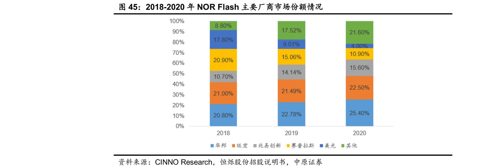

图表：百分比堆叠柱状图。纵轴 0%–100%，横轴 2018–2020 年；图例（自下而上）：华邦、旺宏、兆易创新、赛普拉斯、美光、其他。图内数据标签：

- 2018 年：华邦 20.80%、旺宏 21.00%、兆易创新 10.70%、赛普拉斯 20.90%、美光 17.80%、其他 8.80%
- 2019 年：华邦 22.78%、旺宏 21.49%、兆易创新 14.14%、赛普拉斯 15.06%、美光 9.01%、其他 17.52%
- 2020 年：华邦 25.40%、旺宏 22.50%、兆易创新 15.60%、赛普拉斯 10.90%、美光 4.00%、其他 21.60%

资料来源：CINNO Research，恒烁股份招股说明书，中原证券

**NOR Flash 下游应用领域相对分散，汽车及计算市场占比逐步提升。**根据 IDC 的数据，近年来 NOR Flash 下游市场中汽车及计算市场占比逐步提升，2021 年 NOR Flash 下游市场中汽车占比 26%，计算占比 21%，工业占比 17%，消费电子占比 17%。

---

<!-- 原文第 27 页 -->

**图 46：2018-2021 年全球 NOR Flash 下游市场占比情况**

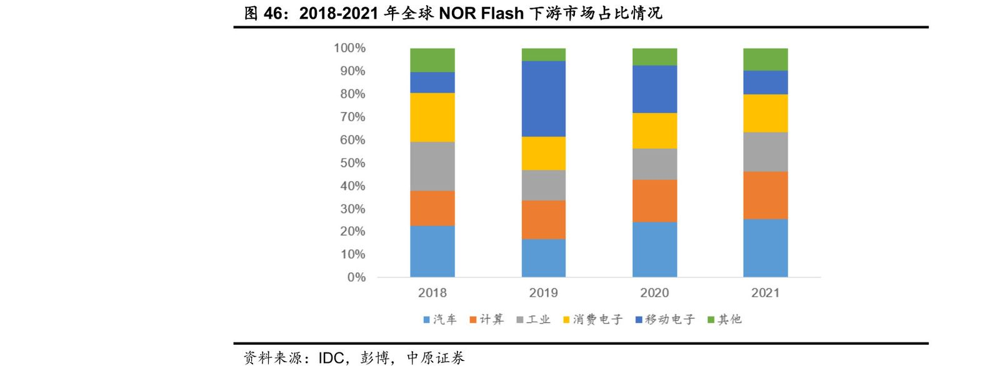

图表：百分比堆叠柱状图。纵轴 0%–100%，横轴 2018–2021 年；图例（自下而上）：汽车、计算、工业、消费电子、移动电子、其他。图中无数据标签。

资料来源：IDC，彭博，中原证券

## 2.5. IDM 厂商主导全球存储器模组市场，国内厂商在第三方模组市场崛起

### 2.5.1. IDM 厂商聚焦大宗市场，第三方存储器模组厂商定位于细分行业市场客制化需求

**存储器模组供应商可分为 IDM 厂商和第三方模组供应商。**全球半导体存储晶圆厂主要采用 IDM 模式经营，存储晶圆标准化程度较高，晶圆厂同代产品在容量、带宽等技术规格上几乎趋同，但存储器本身的应用场景非常广泛，具体到不同终端应用对存储的差异化功能需求，更多的要通过主控、固件算法、封装测试等产业链后端环节来实现，但存储器本身的应用场景非常广泛，存储器面向不同的应用场景所需的功能可通过模组实现，存储模组厂商仍需大量应用技术开发，在此背景下，产生了第三方模组供应商。存储器模组供应商可分为 IDM 厂商和第三方模组供应商，IDM 厂商主要包括三星、SK 海力士、美光、铠侠、西部数据等，IDM 厂商利用其晶圆制造优势销售自有品牌存储器模组，此外，它们还将存储晶圆出售给第三方模组供应商，第三方模组供应商通过封装存储颗粒，并将存储模组出售给终端客户。

**IDM 厂商聚焦大宗市场，第三方模组厂商定位于细分行业市场客制化需求。**存储器存在极为广泛的应用场景和市场需求，由于存储晶圆设计与制造行业具有极高的资本和技术门槛，IDM 厂商的竞争重心在于提升晶圆制程、维持规模优势和市场份额，使得 IDM 厂商在产品应用领域所投入的成本及资源相对有限，IDM 厂商主要聚焦具有大宗数据存储需求的行业和客户，如智能手机、PC 及服务器行业的头部客户，第三方模组厂商定位于细分行业存储需求，如汽车电子、网络通信设备、家用电器、影像监控、物联网硬件、工业控制、商用设备等领域，以及主流应用市场灵活定制产品的需求。存储器行业特征打开了第三方模组厂商广阔的发展空间，创造了第三方存储器模组厂商与 IDM 厂商之间共生、共存，以及共同发展的产业链生态格局。

在存储器模组产业链中，IDM 厂商和第三方模组厂商提供的核心技术包括存储晶圆分析、主控芯片选型与定制、固件开发、封装设计、芯片测试等方面，部分第三方模组厂商自建封测厂，部分第三方模组厂商委托独立的封装测试厂商代工。

---

<!-- 原文第 28 页 -->

**图 47：DRAM 模组产业链结构图**

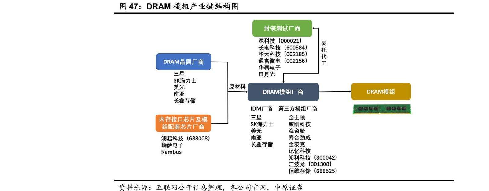

产业链结构（图内文字）：
- DRAM晶圆厂商：三星、SK海力士、美光、南亚、长鑫存储
- 内存接口芯片及模组配套芯片厂商：澜起科技（688008）、瑞萨电子、Rambus
- 封装测试厂商：深科技（000021）、长电科技（600584）、华天科技（002185）、通富微电（002156）、华泰电子、日月光（与模组厂商之间标注“委托加工”）
- DRAM模组厂商——IDM厂商：三星、SK海力士、美光、南亚、长鑫存储；第三方模组厂商：金士顿、威刚科技、海盗船、嘉合劲威、金泰克、记忆科技、朗科科技（300042）、江波龙（301308）、佰维存储（688525）
- 晶圆厂商、内存接口芯片及模组配套芯片厂商以“原材料”指向 DRAM模组厂商，DRAM模组厂商产出 DRAM模组

资料来源：互联网公开信息整理，各公司官网，中原证券

**图 48：NAND Flash 模组产业链结构图**

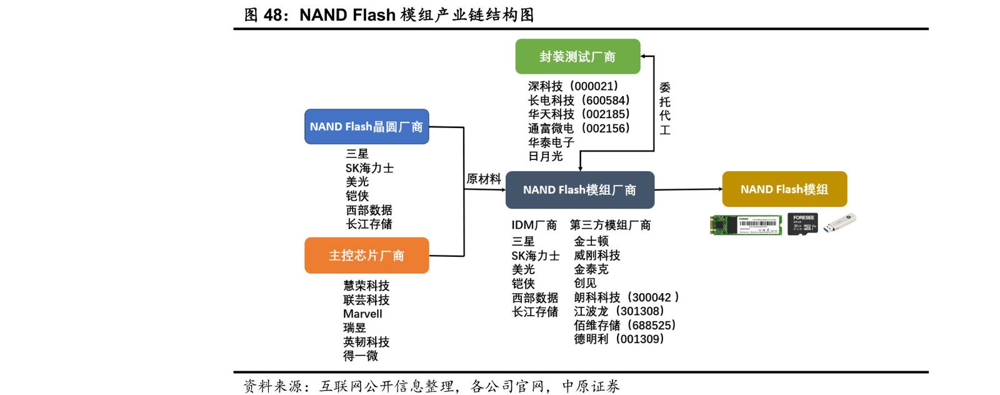

产业链结构（图内文字）：
- NAND Flash晶圆厂商：三星、SK海力士、美光、铠侠、西部数据、长江存储
- 主控芯片厂商：慧荣科技、联芸科技、Marvell、瑞昱、英韧科技、得一微
- 封装测试厂商：深科技（000021）、长电科技（600584）、华天科技（002185）、通富微电（002156）、华泰电子、日月光（与模组厂商之间标注“委托加工”）
- NAND Flash模组厂商——IDM厂商：三星、SK海力士、美光、铠侠、西部数据、长江存储；第三方模组厂商：金士顿、威刚科技、金泰克、创见、朗科科技（300042）、江波龙（301308）、佰维存储（688525）、德明利（001309）
- 晶圆厂商、主控芯片厂商以“原材料”指向 NAND Flash模组厂商，NAND Flash模组厂商产出 NAND Flash模组

资料来源：互联网公开信息整理，各公司官网，中原证券

### 2.5.2. IDM 厂商主导全球内存条市场，金士顿在全球第三方市场一家独大，国内厂商正在崛起

**DRAM 主要以颗粒和内存条的形式应用于终端。**DRAM 主要以颗粒和模组的形式出货给终端厂商，DRAM 颗粒的主要应用为智能手机等，DRAM 模组主要应用于 PC、服务器上。DRAM 模组也称为内存条，目前内存条主要为双列直插式内存条模组（DIMM），台式机内存条主要类型为 UDIMM，笔记本电脑内存条主要类型为 SODIMM，服务器内存条主要类型为 RDIMM 和 LRDIMM。

---

<!-- 原文第 29 页 -->

**图 49：DRAM 颗粒在手机主板应用示意图**

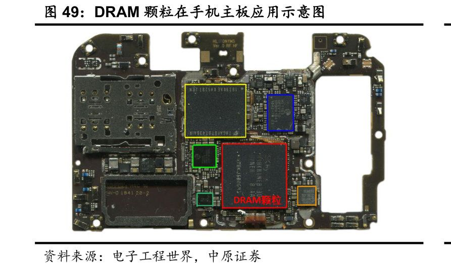

图片：手机主板上 DRAM 颗粒等的应用位置示意。

资料来源：电子工程世界，中原证券

**图 50：内存条在 PC 上应用示意图**

图片：PC 主板上内存条插槽的应用示意。

资料来源：电子工程世界，中原证券

**内存条主要由 DRAM 颗粒、内存接口芯片及配套芯片组成。**应用于 PC 的内存条主要由 DRAM 颗粒、PMIC（电源管理芯片）、SPD Hub（串行检测集线器）组成，其中 DRAM 颗粒占内存条成本的大部分；PMIC 用于帮助调节内存模组中不同组件（DRAM 颗粒、寄存器、SPD hub 等）所需的电源；SPD Hub 内部集成了 EEPROM，用于存储内存模组相关信息以及模组上的内存颗粒和其他组件的配置参数，管理对外部控制器的访问并将内部总线上的内存负载与外部分离开。用于服务器的内存条还需增加内存接口芯片 RCD（寄存时钟驱动器）和 DB（数据缓冲器），以及配套芯片 TS（温度传感器），其中 RCD 用来缓冲来自内存控制器的地址、命令、时钟、控制信号；DB 用来缓冲来自内存控制器或内存颗粒的数据信号；TS 用于实现对内存模组的温度管理，以提高系统工作的稳定性。

**图 51：PC DDR5 内存条结构图**

图内标注：PMIC、SPD Hub、Resistors、Inductors、Capacitors、PCB、DRAM、DDR5、DDR4、Module key。

资料来源：金士顿官网，中原证券

**图 52：服务器 DDR5 内存条结构图**

图内标注：RCD、Data Buffer、PMIC、Temperature Sensor、SPD Hub。

资料来源：瑞萨官网，中原证券

**IDM 厂商主导全球内存条市场，全球第三方内存条市场空间广阔，DDR5 内存条出货量处于高速成长期。**根据 Yole 的数据，2021 年 IDM 厂商占据全球内存条市场份额为 83%，全球第三方内存条厂商市场份额为 17%。根据 TrendForce 的数据，2021 年全球第三方内存条市场规模达 181 亿美元，市场空间广阔。2022 年全球内存条出货量为 5.11 亿支，Yole 预计 2028 年全球内存条出货量将达到 6.50 亿支，2022-2028 年复合增速约 4%，其中预计 DDR5 内存条出货量将从 2022 年的 0.11 亿支增长到 2028 年的 6.42 亿支，2022-2028 年复合增速达 97%，DDR5 内存条出货量处于高速成长期，将成为未来 5 年推动内存条销售量增长的主要动力。

---

<!-- 原文第 30 页 -->

**图 53：2018-2021 年全球第三方内存条市场规模情况**

图表：柱状图＋折线。纵轴左 150–185（亿美元），纵轴右 -4%–8%；横轴 2018–2021 年；图例：全球DRAM模组市场规模（亿美元，左轴）、同比增速（%，右轴）。柱体与折线均无数据标签。

资料来源：TrendForce，中原证券

**图 54：2022-2028 年全球内存条出货量预测（百万支）**

图表：气泡图，分产品形态（RDIMM、UDIMM、SODIMM and other PC DIMMs、LPDIMM and other server DIMMS）与 DRAM 世代（DDR3、DDR4、DDR5、DDR6）两组。2022 年约 511 Mu：RDIMM 210、UDIMM 149、SODIMM and other PC DIMMs 151、LPDIMM and other server DIMMS 11；DDR4 500、DDR5 11.1、DDR3 0.5。2028 年约 650Mu：RDIMM 476（CAGR 15%）、UDIMM 106（CAGR -6%）、SODIMM 64（CAGR -13%）、LPDIMM 2.8（CAGR 21%）；DDR5 642（CAGR 97%）、DDR6 6.2、DDR3 0.1（CAGR -75%）。箭头标注 CAGR22-28：~4%。

资料来源：Yole，半导体行业观察，中原证券

**全球第三方内存条市场金士顿一家独大，国内厂商未来成长空间广阔。**根据 TrendForce 的数据，2021 年全球第三方内存条供应商主要来自美国、中国台湾和中国大陆，其中美国厂商金士顿一家独大，占据 78.7%的市场份额，威刚科技、海盗船、SMART Module 分别以 3.5%、3.0%、2.5%的市场份额位列二到四位，中国大陆厂商嘉合劲威、金泰克、记忆科技分别以 2.4%、2.4%、1.9%的市场份额位列五到七位；在全球前十大第三方内存条供应商中，美国厂商总市场份额为 85.1%，中国台湾厂商总市场份额为 5.2%，中国大陆厂商合计市场份额为 6.7%，在存储器国产化趋势下，国内厂商未来成长空间广阔。

**表 2：2021 年全球第三方内存条供应商市场竞争格局情况**

| 排名 | 厂商名称 | 所在国家 | 2021 年 DRAM 模组营收（亿美元） | 2021 年 DRAM 模组市占率 |
| --- | --- | --- | --- | --- |
| 1 | 金士顿 | 美国 | 142.61 | 78.7% |
| 2 | 威刚科技 | 中国台湾 | 6.40 | 3.5% |
| 3 | 海盗船 | 美国 | 5.43 | 3.0% |
| 4 | SMART Module | 美国 | 4.59 | 2.5% |
| 5 | 嘉合劲威 | 中国大陆 | 4.42 | 2.4% |
| 6 | 金泰克 | 中国大陆 | 4.38 | 2.4% |
| 7 | 记忆科技 | 中国大陆 | 3.43 | 1.9% |
| 8 | 十铨 | 美国 | 1.68 | 0.9% |
| 9 | 宜鼎 | 中国台湾 | 1.64 | 0.9% |
| 10 | 宇瞻 | 中国台湾 | 1.45 | 0.8% |
| | 其他 | | 5.10 | 2.8% |
| | 合计 | | 181.13 | 100% |

资料来源：TrendForce，中原证券

**DDR5 时代，国产内存条品牌正在崛起。**2021 年，DDR5 规范落地，以嘉合劲威为代表的国内内存条厂商与三星、镁光、SK 海力士、金士顿、威刚，同时获得 DDR5 内存生产规范，并于 2022 年 9 月全球同步发售 DDR5 内存，表明国产品牌正式成为全球内存模组的领军者。根据京东的数据，2023 年 618 期间内存品类总销量为 47.5 万支，销售额 1.45 亿元，嘉合劲威总销量 12 万支，销售额约 3300 万元，占京东内存品类总销售额的 23%，在京东 618 内存条厂商销量前 10 名中，国产品牌占据 6 席，超过海外品牌，国产内存条品牌正在崛起。

---

<!-- 原文第 31 页 -->

**图 55：2023 年 618 器件光威内存条销量突破 10 万支**

图注（海报文字）：618 超级战报；销量第一名；销量突破 100k；感谢近 10 万人的选择

资料来源：京东，中原证券

**图 56：光威 32GB DDR5 6400 内存条具有较高性价比**

京东商品页截图，页面小字密集，未逐字转录

资料来源：京东，中原证券

**DDR5 时代内存接口芯片及配套芯片处于高速成长期，国内厂商澜起科技有望畅享 DDR5 升级趋势。** 内存接口芯片及配套芯片是内存条的核心组件，根据 Yole 的数据，2021 年全球内存接口芯片及配套芯片市场规模为 7.1 亿美元，2022 年增长到 11 亿美元，随着 DDR5 渗透率逐步提升，预计 2028 年市场规模将达到约 40 亿美元，2021-2028 年复合增速约为 28%，DDR5 时代内存接口芯片及配套芯片处于高速成长期。目前全球 DDR5 内存接口芯片主要供应商分别是国内厂商澜起科技、日本厂商瑞萨电子和美国厂商 Rambus，澜起科技可为 DDR5 系列内存模组提供完整的内存接口芯片及配套芯片解决方案，并占据全球市场的重要份额，有望畅享 DDR5 升级趋势。

**图 57：2021-2028 年全球内存接口芯片及配套芯片市场规模预测情况**

| 产品类别 | 2021（~$710M） | 2022（~$1.1B） | 2028（~$4B） |
| --- | --- | --- | --- |
| Registered Clock Driver (RCD) | 89% | 58% | 38% |
| Data Buffer (DB) | 4% | 2% | - |
| Power Management IC (PMIC) | 3% | 20% | 28% |
| Serial Presence Detect (SPD Hub) | 3% | 16% | 24% |
| Temperature Sensor (TS) | 1% | 4% | 10% |

箭头标注：CAGR21-28 ~28%

资料来源：Yole，半导体行业观察，中原证券

### 2.5.3. IDM 厂商主导全球 NAND Flash 模组市场，国内厂商已在第三方市场崛起

固态硬盘、嵌入式存储、移动存储是 NAND Flash 主要产品形态。NAND Flash 主要以模组的形式出货，根据下游应用场景形成了不同的产品形态，主要包括固态硬盘（大容量存储场景）、嵌入式存储（用于电子移动终端低功耗场景）、移动存储（便携式存储场景）等，根据闪存市场的数据，2021 年固态硬盘、嵌入式存储、移动存储市场规模占比分别为 50%、38%、8%。

---

<!-- 原文第 32 页 -->

**图 58：2018-2021 年全球 NAND Flash 主要产品形态市场规模占比情况**

| 产品形态 | 2018 | 2019 | 2020 | 2021E |
| --- | --- | --- | --- | --- |
| 嵌入式产品 | 44% | 42% | 35% | 38% |
| SSD | 43% | 43% | 50% | 50% |
| 存储卡/存储盘 | 10% | 9% | 9% | 8% |
| 其他 | 3% | 6% | 6% | 4% |

纵轴：0-100%（间隔 10%）；横轴：2018、2019、2020、2021E

资料来源：闪存市场，德明利招股说明书，中原证券

**NAND Flash 模组主要由主控芯片、DRAM 缓存和 NAND Flash 颗粒组成。** 其中主控芯片是 NAND Flash 模组的核心器件，负责与主机 CPU 进行数据通信以及 NAND 闪存颗粒数据管理，固件算法用于驱动主控；DRAM 缓存是主机 CPU 与主控之间的数据中转站；NAND Flash 颗粒负责数据存储。

**图 59：SATA 接口固态硬盘内部结构图**

图注：DRAM、NAND 颗粒、主控芯片（红框标注）

资料来源：联芸科技招股说明书，中原证券

**图 60：eMMC 内部结构示意图**

图注：eMMC Controller、LPDDRAM、NAND

资料来源：佰维存储官网，中原证券

**预计全球固态硬盘出货量稳健增长，固态硬盘市场以消费级为主。** 根据 Yole 的数据，2022 年全球固态硬盘市场规模为 290 亿美元，出货量为 3.52 亿块，预计 2028 年市场规模将达到 670 亿美元，出货量为 4.72 亿块，2022-2028 年复合增速为 5%。2022 年售出的 3.52 亿块 SSD 中，企业级 SSD 大约 5500 万块，占比 16%，其余为消费级 SSD，销售量为 2.97 亿块，占比 84%。

**图 61：2022-2028 年全球固态硬盘出货量预测情况**

图例：2.5"/U.2、mSATA/M.2、BGA、EDSFF、AIC/Other；PCIe (NVMe)、SATA (AHCI)、SAS；总量标注：2022 ~352 Mu、2028 ~472 Mu（气泡数值标签密集，未逐一转录）

资料来源：Yole，电子工程世界，中原证券

**图 62：2022 年全球消费级与企业级 SSD 出货量占比情况**

| 类别 | 占比 |
| --- | --- |
| 消费级 SSD | 84% |
| 企业级 SSD | 16% |

资料来源：Yole，电子工程世界，中原证券

---

<!-- 原文第 33 页 -->

IDM 厂商主导全球固态硬盘市场，第三方品牌市场金士顿稳居第一，国产品牌已经崛起。根据 Yole 的数据，2021 年三星、铠侠、西部数据、SK 海力士、美光、Solidigm 等 NAND Flash IDM 厂商占据固态硬盘市场份额达 83%，主导全球固态硬盘市场。根据 TrendForce 的数据，在全球第三方固态硬盘市场，2021 年美国厂商金士顿以 26% 的市占率位列第一，中国台湾厂商威刚科技、创见、技嘉科技和台电的市场份额分别为 8%、5%、3%、3%，中国大陆厂商金泰克、江波龙、朗科、嘉合劲威、七彩虹的市场份额分别为 7%、6%、6%、4%、4%；2021 年前十大厂商总市场份额为 72%，其中美国厂商总市场份额为 26%，中国台湾厂商总市场份额为 19%，中国大陆厂商总市场份额为 27%，国产第三方固态硬盘品牌已经崛起。

**图 63：2021 年全球固态硬盘市场份额情况**

| 厂商 | 占比 |
| --- | --- |
| 三星 | 25% |
| 西部数据 | 16% |
| 铠侠 | 15% |
| SK 海力士 | 13% |
| 美光 | 9% |
| Solidigm | 5% |
| 其他 | 17% |

资料来源：Yole，电子工程世界，中原证券

**图 64：2021 年全球第三方固态硬盘市场份额情况**

| 厂商 | 占比 |
| --- | --- |
| 金士顿 | 26% |
| 威刚科技 | 8% |
| 金泰克 | 7% |
| 朗科 | 6% |
| 雷克沙 | 6% |
| 创见 | 5% |
| 嘉合劲威 | 4% |
| 七彩虹 | 4% |
| 技嘉科技 | 3% |
| 台电 | 3% |
| 其他 | 28% |

资料来源：TrendForce，中原证券

**IDM 厂商主导全球 eMMC 及 UFS 市场，国内厂商在第三方市场占据领先地位。** 嵌入式存储主要应用于智能手机、平板电脑、车载电子、物联网、智能穿戴、机顶盒等智能终端领域，eMMC 是当前智能终端设备的主流闪存解决方案，在尺寸、成本等方面具有优势，占据较大的市场空间；UFS 是 eMMC 的换代产品，具有更高的存储性能和传输速率，目前已成为高端智能手机的主流选择，并开始逐步下沉。根据闪存市场的数据，2021 年全球 eMMC 及 UFS 市场三星、SK 海力士、铠侠、西部数据、美光分别以 40.7%、14.2%、11.5%、9.2%、7.7% 的市占率排在前五位，IDM 厂商以 83.3% 总市占率占据统治地位；第三方品牌市场江波龙以 6.5% 的市占率位居第一，金士顿以 5.3% 的市占率排在第二位，佰维存储以 2.4% 的市占率排名第三，国内厂商在第三方市场已占据领先地位。

**图 65：2021 年全球 eMMC 及 UFS 市场份额情况**

| 厂商 | 占比 |
| --- | --- |
| 三星 | 40.7% |
| SK 海力士 | 14.2% |
| 铠侠 | 11.5% |
| 西部数据 | 9.2% |
| 美光 | 7.7% |
| 江波龙 | 6.5% |
| 金士顿 | 5.3% |
| 佰维存储 | 2.4% |
| 其他 | 2.6% |

资料来源：闪存市场，佰维存储招股说明书，中原证券

---

<!-- 原文第 34 页 -->

**主控芯片是 NAND Flash 模组的核心，2021 年市场规模约 40 亿美元。** 根据 Yole 的数据，2021 年全球 NAND Flash 主控芯片市场规模约 40 亿美元，其中应用于固态硬盘市场规模约为 13.6 亿美元，而应用于智能手机的市场规模约 11.6 亿美元，预计 2027 年全球 NAND Flash 主控芯片市场规模将接近 60 亿美元。

**图 66：2021-2027 年全球 NAND Flash 主控芯片市场规模预测**

左轴：0-60（亿美元）；右轴：0-14%（间隔 2%）；横轴：2021、2022E、2023E、2024E、2025E、2026E、2027E；图例：全球 NAND Flash 主控芯片市场规模（亿美元，左轴）、同比增速（%，右轴）

资料来源：Yole，深圳市半导体行业协会，中原证券

**IDM 厂商与第三方厂商平分全球 NAND Flash 主控芯片市场，慧荣科技、群联电子及 MARVELL 主导第三方市场。** 根据 Yole 的数据，2021 年 NAND Flash IDM 厂商占据全球主控芯片 52% 的市场份额，第三方主控芯片厂商占据 48% 的市场份额，预计未来 5 年 IDM 厂商市场份额呈逐步下降的趋势。在全球第三方 NAND Flash 主控芯片市场，根据 Yole 的数据，2021 年台湾厂商慧荣科技、群联电子分别以 41.1%、26% 的市场份额占据前两位，美国厂商 MARVELL 以 22.6% 的市场份额位居第三位，国内企业得一微、联芸科技、英韧科技等目前规模相对较小，处于快速成长期。

**图 67：2021-2027 年全球 NAND Flash 主控芯片市场 IDM 厂商与第三方主控芯片厂商市场份额预测情况**

| 年份 | NAND Flash IDM 厂商市场份额 | 第三方主控芯片厂商市场份额 |
| --- | --- | --- |
| 2021 | 52% | 48% |
| 2022E | 51% | 49% |
| 2023E | 51% | 49% |
| 2024E | 51% | 49% |
| 2025E | 49% | 51% |
| 2026E | 48% | 52% |
| 2027E | 46% | 54% |

纵轴：0-100%（间隔 10%）

资料来源：Yole，深圳市半导体行业协会，中原证券

**图 68：2021 年全球第三方 NAND Flash 主控芯片厂商市场份额情况**

| 厂商 | 占比 |
| --- | --- |
| 慧荣科技 | 41.1% |
| 群联电子 | 26.0% |
| MARVELL | 22.6% |
| 点序科技 | 3.4% |
| 得一微 | 1.9% |
| 智微科技 | 1.7% |
| 其他 | 3.3% |

资料来源：Yole，深圳市半导体行业协会，中原证券

### 2.5.4. 国内存储器模组厂商不断建立竞争优势，有望持续提升市场份额

国内存储器模组厂商在品牌、技术、供应链等方面不断建立竞争优势，有望持续提升市场份额。根据 Omida 的数据，2021 年江波龙的 Lexar（雷克沙）品牌存储卡全球市场份额位

---

<!-- 原文第 35 页 -->

列第二名、U 盘全球第三名、SSD 在自有品牌渠道市场出货量排名全球第四名；朗科科技创建自有品牌“朗”系列国产化固态硬盘及内存产品线，有 20 多年的专业存储品牌的行业基础；国内存储模组厂商已逐步建立了品牌优势。德明利通过自研主控芯片提升产品竞争力，佰维存储通过研发封测一体化建立竞争优势，国内存储模组厂商已经在产品创新、固件开发、芯片设计、先进封测等方面积累了核心技术优势。国内存储模组厂商在品牌、技术、供应链等方面不断建立竞争优势，有望持续提升市场份额，在存储器国产化加速的趋势下，未来有广阔的成长空间。

**表 3：国内主要存储模组厂商竞争优势比较情况**

| 模组厂商 | 产品布局 | 品牌 | 自研存储芯片 | 自研主控芯片 | 自建封测厂 |
| --- | --- | --- | --- | --- | --- |
| 江波龙 | 嵌入式存储：UFS、eMMC、ePoP、eMCP、uMCP、LPDDR 等，固态硬盘，内存条，移动存储：U 盘、存储卡等。 | 行业类存储品牌 FORESEE 和国际高端消费类存储品牌 Lexar（雷克沙）。2021 年，Lexar 存储卡全球市场份额位列第二名，U 盘全球第三名，SSD 模组企业自有品牌渠道市场出货量排名全球第四名。 | 自研 SLC NAND 小容量存储芯片，出货量累计已超过 1000 万颗。 | 深度参与主控芯片架构的定制。 | 中山一期测试产线，拟收购力成苏州 70%股权加强封测产线布局。 |
| 佰维存储 | 嵌入式存储：UFS、eMMC、ePoP、eMCP、LPDDR 等，固态硬盘，内存条，移动存储：U 盘、存储卡等。 | 佰维（Biwin）品牌主要面向 To B 市场，子品牌佰微（Biwintech）以及独家运营的惠普（HP）、宏碁（Acer）及掠夺者（Predator）等品牌面向 To C 市场。 | - | - | 惠州佰维为先进封测及存储器制造基地，实现研发封测一体化。 |
| 德明利 | 嵌入式存储：UFS、eMMC，固态硬盘，移动存储：U 盘、存储卡等。 | 2022 年底收购 UDStore 品牌切入嵌入式市场。 | - | 自研存储主控芯片已量产导入。 | 大浪测试产线。 |
| 朗科科技 | 嵌入式存储：eMMC 等，固态硬盘，内存条，移动存储：U 盘、存储卡等。 | 创建自有品牌“朗”系列国产化固态硬盘及内存产品线，有 20 多年的专业存储品牌的行业基础。 | - | - | 布局存储封装及测试工厂。 |

资料来源：各公司年报，中原证券

## 3. AIGC 带动 HBM 高速成长，新型存储器推动存算一体技术迭代

### 3.1. 存储墙限制 AI 技术的发展和应用

**CPU 片上存储器、主存储器、外部存储器之间的读写速度差距形成“存储墙”。** 在冯诺依

---

<!-- 原文第 36 页 -->

曼架构下，计算和存储功能分别由中央处理器和存储器完成，目前 PC、服务器、智能手机都遵循冯诺依曼体系结构。现代计算系统通常采用多级存储器结构，主要包括 CPU 寄存器、CPU 高速缓存、主存、外部存储器，自上而下容量逐渐增大，速度逐渐减慢。由于处理器与存储器的工艺、封装、需求的不同，处理器在跟随摩尔定律逐年提升性能的过程中，与存储器的性能差距不断扩大，存储器数据访问速度跟不上处理器的数据处理速度，存储器性能严重限制处理器性能发挥。CPU 片上存储器、主存、外部存储器之间均存在较大的读写速度差距，形成了制约整个系统性能的“存储墙”。存储墙导致访存时延高、效率低、存算性能失配，目前 HBM 可以提升主存的速度，新型存储器是提升外部存储器速度的解决方案之一。

**图 69：冯诺伊曼架构示意图**

图注：输入设备、主机（存储器、运算器、控制器、CPU）、输出设备；数据流、指令流、控制流

资料来源：腾讯，中原证券

**图 70：现代计算系统存储器结构及存储墙**

图注：容量 Kb→Mb→Gb→Tb、速度 <1ns→3-10ns→10-30ns→100us；CPU 片上（CPU 缓存、高速缓存 SRAM）、主存 DRAM、外部存储器 NAND Flash；标注：存储墙、HBM、新型存储

资料来源：信息通信技术与政策，腾讯，中原证券

**图 71：处理器性能进步受到存储器传输数据能力的阻碍**

图注：纵轴 Relative Performance（10 至 100,000）；横轴 1980-2020；曲线 Processor、Memory；标注 Processor: Memory Gap

资料来源：VSORA，半导体行业观察，中原证券

**AI 大模型参数量及训练数据量呈指数级增长。** 随着 AIGC 技术应用的快速发展，AI 大模型参数量及训练数据量呈指数级增长，根据 OpenAI 的数据，从 GPT-1 到 GPT-3，模型参数量从 GPT 的 1.17 亿增加到 GPT-2 的 15 亿，再到 GPT-3 的 1750 亿；训练数据量也由 GPT 的 5GB，增加到 GPT-2 的 40GB，再到 GPT-3 的 45TB。

---

<!-- 原文第 37 页 -->

**图 72：AI 大模型训练数据量呈指数级增长**

图注：Training FLOPs Scaling for SOTA CV, NLP, and Speech Models；纵轴 Training Compute (FLOPs)，1e+02 至 1e+09；横轴 YEAR 2012-2021；标注 Transformer 750x / 2 yrs、CV/NLP/Speech 15x / 2 yrs、Moore's Law 2x / 2 yrs（散点标签密集，未逐一转录）

资料来源：OneFlow，中原证券

**图 73：ChatGPT 工作原理**

- Step 1：Collect demonstration data and train a supervised policy.
- Step 2：Collect comparison data and train a reward model.
- Step 3：Optimize a policy against the reward model using the PPO reinforcement learning algorithm.

资料来源：OpenAI 官网，中原证券

**存储墙限制 AI 技术的发展和应用。** 在过去 20 年中，GPU 硬件的计算能力提升了 90000 倍，GPU 与内存的接口标准从 PCIe1.0a 升级到 NVLink3.0，但是 GPU 与内存的互连带宽却只提高了 30 倍；而 GPU 上的内存容量仅仅是以每两年翻 2 倍的速率在增长。AI 大模型参数量及训练数据量呈指数级增长，对内存的容量和带宽都有更高的要求，内存的容量和带宽的提升幅度都大大落后于 GPU 的计算能力，从而影响 AI 算力的效率提升，存储墙问题限制了 AI 技术的发展和应用。

**图 74：AI 大模型的参数量与 GPU 内存容量的增长趋势**

图注：AI and Memory Wall；纵轴 Parameter Count (Billion)，0.01 至 1000；横轴 YEAR 2016-2021；标注 Transformer Size 240x / 2 yrs、AI HW Memory 2x / 2 yrs（散点标签密集，未逐一转录）

资料来源：OneFlow，中原证券

**图 75：GPU 的计算能力与传输带宽的增长趋势**

图注：Scaling of Peak Hardware FLOPS, and Memory/Interconnect Bandwidth；纵轴 Normalized Scaling；横轴 YEAR 1996-2020；标注 HW FLOPs 90000x / 20 yrs (3.1x/2yrs)、DRAM BW 30x / 20 yrs (1.4x/2yrs)、Interconnect BW 30x / 20 yrs (1.4x/2yrs)（散点标签密集，未逐一转录）

资料来源：OneFlow，中原证券

### 3.2. HBM 突破内存带宽与容量瓶颈，AIGC 推动 HBM 高速成长

**HBM 的特点是内存大容量、高带宽。** HBM（高带宽存储器）是一款应用于 CPU/GPU 的新型内存芯片，HBM 是将很多个 DDR 芯片堆叠在一起后和 GPU 封装在一起，实现大容量、高位宽的 DDR 组合阵列。带宽用于衡量 DRAM 传输数据的速率，是 DRAM 的核心技术指标，HBM 与其他 DRAM 最大的差别就是拥有超高的带宽，目前最新的 HBM3 的带宽最高可以达到 819GB/s。

---

<!-- 原文第 38 页 -->

**图 76：AMD GPU 上 HBM 应用 3D 示意图**

图注：HBM DRAM Die、Logic Die、GPU die、Interposer、Package Substrate、TSVs、μBumps

资料来源：AMD，中原证券

**图 77：HBM 与 GDDR5 性能参数比较**

| 参数（Per Package） | GDDR5 | HBM |
| --- | --- | --- |
| Bus Width | 32-bit | 1024-bit |
| Clock Speed | Up to 1750MHz (7Gbps) | Up to 500MHz (1Gbps) |
| Bandwidth | Up to 28GB/s per chip | >100GB/s per stack |
| Voltage | 1.5V | 1.3V |

图注：左侧为 GDDR5 封装示意（Package、DRAM、Substrate、IFBGA Roll），右侧为 HBM 封装示意（TSV、DRAM Core die、Base die、μ-Bump）

资料来源：AMD，中原证券

**HBM 通过采用 TSV 技术突破内存带宽与容量瓶颈，是新一代的 DRAM 解决方案。** 相对于传统内存，HBM 是在硅中阶层（Silicon Interposer）上堆叠起来并与 GPU 封装在一起，大幅缩小使用面积，并且 HBM 距离 GPU 更近，进一步提升数据传输速度。HBM 主要是通过硅通孔（TSV）技术进行芯片堆叠，通过贯通所有芯片层的柱状通道传输信号、指令、电流，以增加吞吐量并克服单一封装内带宽的限制，通过采用 TSV 技术 HBM 大幅提高了容量和数据传输速率。与传统内存技术相比，HBM 具有更高带宽、更大容量、更低功耗、更小尺寸，HBM 突破了内存带宽与容量瓶颈，让更大的模型、更多的参数留在离核心计算更近的地方，从而减少存储解决方案带来的延迟，是新一代的 DRAM 解决方案。

**图 78：DRAM 裸片之间用 TSV 技术连接示意图**

图注：HBM DRAM Die、TSV、Microbump、Logic Die、PHY、GPU/CPU/SoC Die、Interposer、Package Substrate

资料来源：半导体行业观察，中原证券

**图 79：HBM 与 GDDR5 相比面积更小、离 GPU 更近**

图注：GDDR5（DRAM Chip Memory、Silicon Die）、HBM（Stacked Memory、Logic Die、CPU/GPU、Package Substrate、Interposer）

资料来源：电子产品世界，中原证券

**HBM3 逐步成为市场主流。** 2013 年，SK 海力士率先推出 HBM1，HBM1 每堆栈的带宽为 128GB/s、支持 4 个 DRAM 的堆栈、容量为每堆栈 4GB；2017 年，SK 海力士推出 HBM2，HBM2 的带宽和容量相比 HBM1 实现翻倍；2018 年，JEDEC 推出 HBM2E 规范，HBM2E 可以实现每堆栈 461GB/s 的带宽；SK 海力士于 2022 年上半年开始量产 HBM3，带宽达到 819.2 GB/s、支持 12 个 DRAM 的堆栈、容量达每堆栈 24GB。根据 TrendForce 的数据，2023 年主流需求从 HBM2E 转向 HBM3，HBM3 需求占比提升至 39%，随着使用 HBM3 的加速芯片陆续放量，预计 2024 年 HBM3 市场需求占比将达 60%。

---

<!-- 原文第 39 页 -->

**图 80：SK 海力士四代 HBM 产品规格比较**

| DRAM | HBM1 | HBM2 | HBM2e | HBM3 |
| --- | --- | --- | --- | --- |
| I/O (Bus Interface) | 1024 | 1024 | 1024 | 1024 |
| Prefetch (I/O) | 2 | 2 | 2 | 2 |
| Maximum Bandwidth | 128 GB/s | 256 GB/s | 460.8 GB/s | 819.2 GB/s |
| DRAM ICs Per Stack | 4 | 8 | 8 | 12 |
| Maximum Capacity | 4 GB | 8 GB | 16 GB | 24 GB |
| tRC | 48ns | 45ns | 45ns | TBA |
| tCCD | 2ns (=t1CK) | 2ns (=t1CK) | 2ns (=t1CK) | TBA |
| VPP | External VPP | External VPP | External VPP | External VPP |
| VDD | 1.2V | 1.2V | 1.2V | TBA |
| Command Input | Dual Command | Dual Command | Dual Command | Dual Command |

资料来源：SK 海力士，中原证券

**图 81：2022-2024 年各代 HBM 产品市场需求占比情况**

| 年份 | HBM3 | HBM2E | Others |
| --- | --- | --- | --- |
| 2022 | 8% | 70% | 22% |
| 2023E | 39% | 50% | 11% |
| 2024E | 60% | 25% | 15% |

纵轴：0-100%（间隔 10%）

资料来源：TrendForce，中原证券

**全球存储巨头持续迭代 HBM。** ChatGPT 热潮带动 HBM 需求快速增长，全球 DRAM 三巨头正在竞相加码 HBM。2023 年 SK 海力士推出了第五代的 HBM 3E 产品，HBM 3E 将数据传输速率从目前的 6.40 GT/s 提高到 8.0 GT/s，将每堆栈带宽从 819.2 GB/s 提高到 1 TB/s，计划于 2024 年开始量产。三星在 2022 年已经实现了 HBM3 技术的量产，将在 2024 年实现接口速度高达 7.2 Gbps 的 HBM3p，从而将数据传输率提升 10%，还将堆叠的总带宽提升到 5 TB/s 以上。美光最新的 HBM3 Gen 2 正在向客户提供样品，其产品的速度其迄今世界上最快的，具有 1.2 TB/s 的聚合带宽和最高 24GB 的容量，HBM3 Gen 2 每瓦性能提高了 2.5 倍；美光宣布已经在开发 HBM Next 产品，HBM Next 每个堆栈将提供 1.5-2+ TB/s 的带宽，容量范围为 36-64 GB。

**图 82：美光 DRAM 技术路线情况**

图注：Memory solutions to meet AI Infrastructure Demands，按 2023-2026 年展示 Bandwidth、Capacity、Power 的演进路线（图内小字密集，未逐条转录）

资料来源：美光，中原证券

**图 83：三星 DRAM 技术路线情况**

图注：DRAM Roadmap，按年份展示 DRAM 产品与制程节点演进（图内小字密集，未逐条转录）

资料来源：三星，中原证券

**全球 DRAM 三巨头垄断 HBM 市场，SK 海力士占据半壁江山。** HBM 市场主要被全球前三大 DRAM 厂商占据，根据 TrendForce 的数据，2022 年 SK 海力士 HBM 市占率为 50%，三星的市占率约 40%、美光的市占率约 10%。

---

<!-- 原文第 40 页 -->

**图 84：2022 年全球 HBM 市场竞争格局情况**

| 厂商 | 占比 |
| --- | --- |
| SK 海力士 | 50% |
| 三星 | 40% |
| 美光 | 10% |

资料来源：TrendForce，中原证券

**AIGC 浪潮推动 HBM 市场规模高速增长，国内 HBM 供应链企业有望充分受益。** AIGC 浪潮带动 AI 服务器与高端 GPU 需求不断上涨，并有望持续推动 HBM 市场高速成长。根据 TrendForce 的数据，预计 2023 年全球 AI 服务器（包含搭载 GPU、FPGA、ASIC 等）出货量近 120 万台，同比增长 38.4%，占整体服务器出货量近 9%，预计 2026 年出货量达 237 万台，2022-2026 年复合增速为 29%。目前英伟达 GPU 为 AI 服务器市场搭载主流，市占率约 60~70%，英伟达中高端 GPU H100、A100 采用 HBM 的渗透率接近 100%，随着英伟达的 A100、H100、AMD 的 MI200、MI300、Google 自研的 TPU 等中高端 GPU 需求的逐步提升，TrendForce 预计 2023 年全球 HBM 市场规模为 39 亿美元，预计 2024 年 HBM3 渗透率大幅提升，由于 HBM3 平均销售单价远高于 HBM2e 与 HBM2，有望进一步带动 2024 年 HBM 市场规模增长至 89 亿美元，同比增长 127%。HBM 需求爆发，国内 HBM 供应链企业有望充分受益于行业趋势。

**图 85：2022-2026 年全球 AI 服务器出货量预测情况**

| 年份 | 全球 AI 服务器出货量（千台） |
| --- | --- |
| 2022 | 855 |
| 2023E | 1183 |
| 2024E | 1504 |
| 2025E | 1895 |
| 2026E | 2369 |

左轴：0-2500（千台，间隔 500）；右轴：0-45%（间隔 5%）；图例：全球 AI 服务器出货量（千台，左轴）、增速（%，右轴）

资料来源：TrendForce，中原证券

**图 86：2023-2024 年全球 HBM 市场规模预测情况**

| 年份 | 全球 HBM 市场规模（亿美元） |
| --- | --- |
| 2023E | 39 |
| 2024E | 89 |

纵轴：0-100（亿美元，间隔 10）

资料来源：TrendForce，中原证券

### 3.3. 新型存储器推动存算一体技术创新与迭代，迎来黄金发展机遇

人工智能应用快速发展推动新型存储器迎来黄金发展机遇。回顾存储器的发展历程，存储器的技术演进路线主要取决于应用场景的变化。随着万物智联时代的到来，人工智能、智能汽车、AIoT 等新兴应用场景对数据存储在速度、功耗、容量、可靠性等层面提出了更高要求。人工智能技术应用的快速发展使得存储墙问题日益严重，新型存储器凭借颠覆性的技术创

---

<!-- 原文第 41 页 -->

新路径，在速度、功耗、容量等方面性能更强，有望成为打破存储墙的解决方案之一，新型存储迎来黄金发展机遇。

图 87：存储器的技术演进路线主要取决于应用场景的变化

纵轴：市场规模（无刻度数值）；横轴：1980s、1990s、2000s、2010s、now、future
标注：NOR Flash 和 NAND Flash 相继被发明；Flash 进入商用阶段；功能机时代 NOR Flash 快速增长；智能终端时代 NAND Flash 快速增长；新型存储器制备成功；新型存储器替代传统 Flash；AIoT、数据中心、智能汽车等 万物智联时代；600 亿美金；千亿美金
曲线标注：NOR Flash、NAND Flash

资料来源：半导体行业观察，中原证券

新型存储器旨在集成 SRAM 的开关速度和 DRAM 的高密度特性，并具有 Flash 的非易失特性。目前新型存储器主要包括相变存储器(PCM)、磁变存储器（MRAM）、阻变存储器（ReRAM）以及铁电存储器（FRAM）。

图 88：4 种新型存储器参数对比

|  | PCM | Flash-like（MRAM） | SRAM-like（MRAM） | FRAM | CBRAM（ReRAM） | OxRAM（ReRAM） | Crossbar（ReRAM） |
|---|---|---|---|---|---|---|---|
| Source | Intel | Everspin | Globalfoundries | Cypress | Adesto | Panasonic | Crossbar |
| Cell Type | 1D1R | 1T1J | 2T2J | 2T2C/1T1C | 1T1R | 1T1R | 1TnRᵃ |
| Cell Size | 4F² | 8F² | 30-40F² | 30F²/15 F² | 8F² | 8F² | 4F² |
| Stackable | Yes | No | No | No | Yes | No | Yes |
| MLC | Yes | No | No | No | Yes | Yes | Yes |
| Selector | Diode | Transistor | Transistor | Transistor | Transistor | Transistor | Internal |
| Materials | 10+ | Many | Many | 2 | 4 |  | 3 |
| Layers | 11 | 10+ | 10+ | 3 | 4 |  | 3 |
| Masks | ? | 4 | 4 | 2 |  |  | 2 |
| Current Process | 20nm | 40nm | 22nm | 130nm | 130nm | 130nm | 40nm |
| Minimum | <10nm | <10nm | <10nm | TBD | <10nm | 28nm | <10nm |
| Status | Production | Production | Samples | Production | Production | Prototypes | Samples |
| Scaling Impact | Higher bit resistance | Data Retention-Endurance Ratio tightens |  |  |  | Worse sensing margin | Improved on/off ratio |
| Read |  | 1pJ/bit | 1pJ/bit | 0.37pJ/bit | 24pJ/bit | 66pJ/bit | 1pJ/bit |
|  | 115ns | 105ns | 12.5nsᵇ | 2.3ns | 100ns | 3µs | 10ns |
| Write |  | 120µA/bit | 0.5pJ/bit | 0.37pJ/bit | 1.5nJ/bit | 8.9nJ/bit | 60µA/bit |
|  | 50ns | 170ns | 40ns | 2.3ns | 60µs | 8,500µs | 10µs |
| Endurance | 10⁶ | 10¹⁰ | 10⁸ | 10¹⁴ | 10⁵ | 10⁶ | 10⁶ |
| Retention | 10yr | 3moᵇ | 10yrᵇ | 100yr | 10yr | 10yrᵇ | 10yr |
| Max Temp | 85°C | 85°Cᶜ | 125°C | 125°C | 105°C | 85°C | 150°C |

Notes:

a. 1T1R also possible

b. Worsens with scaling

c. 125°C with PMTJ

资料来源：Objective Analysis，北京超弦存储器研究院，中原证券

---

<!-- 原文第 42 页 -->

### 3.3.1. 相变存储器性能突出，商业化进展不佳

相变存储器（PCM）的原理是通过热能的转变，使相变材料在低电阻结晶（导电）状态与高电阻非结晶（非导电）状态间转换，即通过相变材料相态的变化获得不同的电阻值。相变是指物质状态的改变，比如水在 0° 时从液态变为固态，称为相变。PCM 利用非晶态和结晶态之间材料物理特性的快速热控变化，以低电压进行读写，与闪存和其他嵌入式存储器技术相比具有多项显着优势，比如拥有低延时、写入性能/数据保留，寿命长，功耗低，密度高，抗辐照特性好等诸多技术特点。

图 89：PCM 原理

图 90：集成在 ST MCU 中的嵌入式 PCM 内部结构示意图

图 89 内标注：I–V 特性曲线（低电阻、高电阻）；Temperature–Time 曲线（Tm、Tx，Reset (amorphization)、Set (crystallization)）；Metal Interconnect、Polycrystalline Chalcogenide、Heater、Programmable Volume、CMOS Logic
图 90 内标注：Via in PCM array、GST material、Heater、Contact、Thin Si film、Thin buried oxide、Handle substrate

资料来源（图 89）：Intel，半导体行业观察，中原证券
资料来源（图 90）：意法半导体，半导体行业观察，中原证券

**PCM 技术主要以 3D Xpoint 为代表，定位是计算机存储中的一个新的层级。** 英特尔与美光于 2016 年正式发布 3D Xpoint 技术。3D XPoint 基于阻抗的技术，通过大量属性的变化去改变单元的阻抗值，以此来区分 0 和 1。3D XPoint 结构非常简单，其由一个选择器和一个存储单元组成，两者位于一根 Wordline 和 Bitline 之间，在 Wordling 和 Bitliane 上加载一个特定电压值就激活了一个选择器，使得其中的存储单元做一个写操作（即在单元介质大量的属性改变）或读操作（允许电流通过，检查存储单元的阻抗值代表高或低）。3D Xpoint 性能突出，速度比 NAND Flash 快 1000 倍，成本只有 DRAM 的一半，使用寿命是 NAND 的 1000 倍，密度是传统存储的 10 倍。3D Xpoint 并不是用于彻底替代 DRAM 和 NAND 的技术，它的定位是计算机存储中的一个新的层级，可以在不同的应用领域增强目前的存储结构体系。

图 91：3D XPoint 工作原理示意图

图内标题：3D XPoint™ Technology: An Innovative, High-Density Design
图内标注：
- Cross Point Structure：Perpendicular wires connect sub-microscopic columns. An individual memory cell can be addressed by selecting its top and bottom wire.
- Non-Volatile：3D XPoint™ Technology is non-volatile—which means your data doesn't go away when your power goes away—making it a great choice for storage.
- High Endurance：Unlike other storage memory technologies, 3D XPoint™ Technology is not significantly impacted by the number of write cycles it can endure, making it more durable.
- Stackable：These thin layers of memory can be stacked to further boost density.
- Selector：Whereas DRAM requires a transistor at each memory cell—making it big and expensive—the amount of voltage sent to each 3D XPoint™ Technology selector enables its memory cell to be written to or read without requiring a transistor.
- Memory Cell：Each memory cell can store a single bit of data.
结构标注：1、4 V

资料来源：Intel，电子产品世界，中原证券

---

<!-- 原文第 43 页 -->

**3D XPoint 大规模量产的挑战导致商业化进展不佳。** 3D XPoint 大规模量产有许多挑战，首先，3D XPoint 需要用到大约 100 种新的制造原料，有些原料目前的供应量非常有限，因此存在供应链问题；其次，由于 3D Xpoint 需要更多道工序，加工厂需要大幅增加厂房用地以及初始资本；3D Xpoint 复杂的制造工艺增加了 3D XPoint 的成本，导致成本居高不下。3D XPoint 大规模量产的挑战导致商业化进程不佳，2018 年英特尔和美光结束了 3D XPoint 的联合开发工作，2021 年美光宣布退出 3D Xpoint，自此 3D Xpoint 技术商业化进展缓慢。

### 3.3.2. 国际巨头推动磁性存储器商业化快速发展

磁性存储器（MRAM）是一种利用读取磁阻大小为原理的新型非易失性随机存储器，目前主流的 MRAM 技术是使用隧道层的“巨磁阻效应”来读取位单元。磁隧道结是 MRAM 的基本存储单元，其核心部分是由两个铁磁金属层夹着一个隧穿势垒层（绝缘材料）构成类似于三明治结构的纳米多层膜。其中一个铁磁层被称为参考层，它的磁化沿易磁化轴方向固定不变；另一个铁磁层被称为自由层，它的磁化有两个稳定的取向，分别与参考层平行或反平行，这将使磁隧道结处于低阻态或高阻态，该现象被称为隧穿磁阻效应。两个阻态可分别代表二进制数据“0”和“1”，是 MRAM 存储的基本原理。当参考层与自由层磁化方向一致时，两层铁磁材料中处于多数态的电子自旋方向相同，隧穿概率较高，隧穿电流较大，磁隧道结呈现低阻态；反之，磁隧道结呈现高阻态。

图 92：磁隧道结的核心结构及隧穿磁阻效应

图 93：MRAM 原理图

图 92 内标注：(a) Free layer、Tunnel barrier、Reference layer；(b) Resistance–Magnetic field 曲线，AP state、P state
图 93 内标注：Ferromagnetic Electrodes、Tunnel barrier (Insulator)、“0” Low resistance state、“1” High resistance state、M-RAM、Bit Lines、Word Lines、“0”、“1”

资料来源（图 92）：SIMIT 战略研究室，中原证券
资料来源（图 93）：半导体行业观察，中原证券

**MRAM 有着介于 SRAM 和 DRAM 两种易失性存储技术之间的速度和面积，同时拥有读写次数无限、写入速度快、功耗低、抗辐射和逻辑芯片整合度高的特点。** MRAM 还面临很多的挑战，比如真实器件材料体系复杂、开关比低，CMOS 工艺要完全匹配等，此外 MRAM 的发展仍然遇到动态功耗、能量延迟效率和可靠性方面的瓶颈。

---

<!-- 原文第 44 页 -->

图 94：eMRAM 与 eFlash 相比性能突出

图内标题：22FDX® eMRAM-F: It's like eFlash, only better；副标题：Code-storage, secure boot, and over-the-air updates to enable IoT growth
左侧对比要点（eMRAM-F vs eFLASH）：Fewer mask layers (>8 fewer)；Better write speed (~1000x)；Better endurance (10x)；Better write power (~100x)；Roadmap to <28nm nodes
右侧雷达图轴：Read Power、Persistence、5X reflow、Endurance、Write Power、Adv Node Roadmap、Mask Layers、Write Speed；刻度 0.00–1.00（步长 0.25）；图例：eMRAM-F、eFlash

资料来源：GLOBAL FOUNDRIES，中原证券

**IBM、Eversipin 和三星等国际巨头推动 MRAM 商业化快速发展。** 早在 20 年前，IBM 的实验室就率先开展 MRAM 的研发工作，并在第一代 astroid-MRAM 和第二代 STT-MRAM 的研发中取得了多项突破，为 MRAM 的发展做出了巨大的贡献。2008 年，飞思卡尔成立 Everspin 公司推动 MRAM 业务；2012 年，Everspin 发布全球首个 STT-MRAM 芯片，并于 2013 年开始向客户提供，Everspin 在 2018 年发布了 1GB 容量的商用 STT-MRAM 芯片。2019 年三星宣布在 28nm FD-SOI 工艺的生产线大规模生产嵌入式 MRAM；2020 年，三星首批基于 eMRAM 的商用产品上市，由其制造的 Sony GPS SoC 被用于华为的智能手表；2022 年 10 月，三星研究在 14nm FinFET 逻辑工艺平台上实现了磁性隧道结堆叠的 MRAM 制造，据称是目前世界上尺寸最小、功耗最低的非易失性存储器。2023 年 5 月，恩智浦宣布与台积电合作，推出业界首款采用 16nm FinFET 技术的车用嵌入式 MRAM。

图 95：MRAM 的发展现状

横轴：Year（1996–2018）；纵轴：Capacity（对数刻度，10–10G）
图例：astroid-MRAM（★）、toggle-MRAM（■）、STT-MRAM（●）
图内标注：IBM、Motorola/Freescale/Everspin、Toshiba/NEC、Grandis/Hynix/Samsung、Qualcomm、Everspin

资料来源：SIMIT 战略研究室，中原证券

MRAM 主要有四大应用领域，其中最容易实现的是独立内存，它已经存在并替换电池支持的 SRAM 和 DRAM 以及缓冲硬盘驱动器方面具有应用；第二大应用领域是 eMRAM，用于 SoC，它取代了 eNOR Flash，主要用于代码存储；其它两个应用都以 SRAM 为目标，但方式不同，最终的应用是能够用大量廉价的非易失性 MRAM 替换末级缓存。

---

<!-- 原文第 45 页 -->

图 96：MRAM 的 4 大应用领域

图内标题：MRAM Applications
图内标注：Increasing difficulty（红色箭头指向右侧）

| | Standalone | Embedded Non-volatile | Mobile Cache | Last Level Cache |
|---|---|---|---|---|
| Application examples | Replace battery-backed SRAM or DRAM；Buffer for hard disk drive；~~Replace DRAM~~（原文为红色删除线） | Replace NOR eFlash to store：Microcontroller code、Encryption key storage、Trimming and calibration | Replace SRAM for low performance & power apps：Wearable electronics、Co-processors、Internet of Things | Fast dense memory for L3 or L4 cache；Alternative to eDRAM |
| Key requirements | 0 C – 70 C operation；256 Mb – 1 Gb and up；30 - 70 ns read/write；High endurance (10¹⁰ - [OCR_UNREADABLE]) | -40 C – 105/125/150 C；1 – 64 Mb；30 ns read, 200 ns write；Low endurance: 10⁶ | 0 C – 85 C operation；1 – 64 Mb；10 ns read/write；High endurance (10¹² - ~~10¹⁷~~) | 0 C – 85 C operation；~~1 Gb and up~~；~~\~2 ns read and write~~；~~Unlimited endurance (10¹⁶)~~[OCR_UNCERTAIN] |

资料来源：IBM，半导体产业纵横，中原证券

**eMRAM 为 eNVM 主要的应用形式，处于高速成长期。** 根据 Yole 的数据，2020 年全球嵌入式非易失性存储器（eNVM）市场规模为 2600 万美元，其中 eMRAM 为主要的应用形式，市场规模为 1690 万美元，预计到 2026 年 eMRAM 的市场规模将达到约 17 亿美元，2020-2026 年复合增速约为 116%，eMRAM 占整个新兴 eNVM 市场的 76%左右。

图 97：2020-2026 年嵌入式 MRAM 的市场规模

图内标题：2020-2026 Embedded market revenues（Source: Emerging Non-Volatile Memory 2021, Yole Développement, February 2021）
Embedded 结构（上排双环图）：2020 年 $26M，其中 Embedded MRAM 65%、Embedded RRAM 35%（Embedded PCM 未标数值）；2026 年 $2.3B，其中 Embedded MRAM 76%、Embedded RRAM 22%、Embedded PCM 2%
NVM 应用结构（下排双环图）：2020 年 $26M，NVM for MCU, SoC, ASIC 100%；2026 年 $2.3B，NVM for MCU, SoC, ASIC 90%、Cache Memory for Mobile 8%、1.5%[OCR_UNCERTAIN]、0.5%[OCR_UNCERTAIN]（1.5% 与 0.5% 为引线标注，所指分项颜色不可辨）
图例：Embedded PCM、Embedded RRAM、Embedded MRAM；NVM for Analog ICs、NVM for MCU, SoC, ASIC、Cache Memory for CPU、Cache Memory for Mobile、NVM for Edge AI
CAGR₂₀₋₂₆ ≈ 110 %

资料来源：Yole，半导体产业纵横，中原证券

### 3.3.3. 阻变存储器是实现存算一体的最佳方案之一，众多知名厂商加速推动商业化进程

阻变存储器（ReRAM）是以非导性材料的电阻在外加电场作用下，在高阻态和低阻态之间实现可逆转换为基础的非易失性存储器。作为结构最简单的存储技术，ReRAM 结构看上去像一个三明治，绝缘介质层（阻变层）被夹在两层金属之间，形成由上、下电极和阻变层构成金属-介质层-金属（MIM）三层结构。导电细丝在阻变层中呈现导通或断开两种状态：非易失性的低阻态或高阻态，从而实现了“0”，“1”状态的区分和存储。

---

<!-- 原文第 46 页 -->

图 98：ReRAM 原理

图内标注：High Resistance、Low Resistance、Read Current Completes Path；Top Electrode、Switching Medium、Bottom Electrode

资料来源：Objective Analysis，北京超弦存储器研究院，中原证券

**ReRAM 制造工艺与 COMS 工艺兼容，有利于量产和商业化。** 以 Crossbar 和昕原半导体为例，ReRAM 工艺采用的材料能够使用标准的 CMOS 工艺与设备，ReRAM 制造兼容 COMS 工艺，对产线无污染，整体制造成本低，半导体代工厂具备 ReRAM 的生产制造能力较为容易，对 ReRAM 量产和商业化推动有很大优势。

图 99：Crossbar ReRAM 的电阻切换机制

图 100：Crossbar 的新型 3D 堆叠 ReRAM

图 99 内标注：Top Electrode、Switching Medium、Bottom Electrode
图 100 内标注：无文字标注（3D 堆叠阵列结构示意图）

资料来源（图 99）：Crossbar，北京超弦存储器研究院，中原证券
资料来源（图 100）：Crossbar，北京超弦存储器研究院，中原证券

**ReRAM 性能优异，是实现存算一体的最佳方案之一。** ReRAM 的单元面积极小，可做到 4F²，读写速度是 NAND FLASH 的 1000 倍，同时功耗下降 15 倍。ReRAM 可将 DRAM 的读写速率与寿命以及 NAND Flash 的非易失特性结合于一身，功耗更低、读写速度更快，可形成未来存储架构的最后一级缓存，消除内存与外存间的存储墙。同时利用 ReRAM 存储技术的电阻特性，可实现乘加运算，从而形成新的存算一体运算架构，突破现有冯诺依曼架构瓶颈，从而实现传统 AI 芯片能效比的数量级提升。ReRAM 具有高集成密度、高开关比、高计算精度、高能效比和制造兼容 CMOS 工艺等优良特性，是实现存算一体的最佳方案之一。

---

<!-- 原文第 47 页 -->

图 101：ReRAM 应用于计算单元构建存算一体架构应用示意图

图内标注：TE、SM、BE（ReRAM 单元放大图）；ReRAM、ReRAM on Logic CMOS；Use Existing Process（右侧上下两处）

资料来源：闪德资讯，中原证券

**ReRAM 能够实现用于边缘 AI 推理的低成本、低功耗单芯片解决方案。** ReRAM 可以与芯片的其余部分一起扩展到先进的工艺节点，因此可以与 AI 引擎在相同的先进工艺上实现。ReRAM 可用于替代大型片上 SRAM 来存储 AI 权重和 CPU 固件，由于该技术是非易失性的，因此无需在启动时等待从外部 NVM 加载 AI 模型。ReRAM 比 SRAM 密度更高，因此可以在片上集成更多内存，使得在相同的芯片尺寸和成本下支持更大的神经网络。虽然数据存储仍需要片上 SRAM，但阵列将更小，整体解决方案更具成本效益。

图 102：使用 ReRAM 实现边缘 AI 推理单芯片解决方案

图内标注：Today's two chip solution（CPU、IOs、System RAM、AI Engine、SRAM；片外 NVM）；Single chip with embedded ReRAM（CPU、IOs、System RAM、AI Engine、NVM (ReRAM)）

资料来源：半导体行业观察，中原证券

**众多国内外知名厂商布局 ReRAM，加速推动 ReRAM 商业化进程。** 在 ReRAM 商业化方面，国际厂商松下、Crossbar、Adesto、Elpida、东芝、索尼、美光、海力士、富士通等都在开展 ReRAM 的研究和生产，其中专注 IP 授权的 Crossbar 对于 ReRAM 的基础技术研发走在了前列，松下已量产 180nm ReRAM，Adesto 已量产 130nm CBRAM。国内厂商兆易创新和 Rambus 宣布合作建立合资企业合肥睿科微，进行 ReRAM 技术的商业化；昕原半导体在 Crossbar 的基础上实现了技术核心升级和工艺制程的改进，实现 28nm 量产，并且已建成自己的首条量产线，拥有了存储器设计、制造的垂直一体化能力。在 ReRAM 制造方面，中芯国际、台积电和联电都已经把 ReRAM 纳入未来的发展规划中。

---

<!-- 原文第 48 页 -->

### 3.3.4. 美日厂商推动铁电存储器（FRAM）发展

铁电存储器（FRAM）采用铁电晶体材料作为存储介质，利用铁电晶体材料电压与电流关系具有特征滞后回路的特点来实现信息存储。FRAM 是非易失性存储器，断电后数据不会丢失；读写速度快，无延时写入数据，可覆盖写入；使用寿命长，可重复读写，重复次数可达到万亿次，耐久性强；功耗低，待机电流低，无需后备电池，无需采用充电泵电路；可靠性高，兼容 CMOS 工艺，工作温度范围宽。

图 103：FRAM 原理

图 104：FRAM 内部结构图

图 103 内标注：Hysteresis Loop of PZT；纵轴 Polarization: Q、横轴 V(BEL)；Qsw；"0"Data、"1"Data；中心原子向上移（"1"）或向下移（"0"）
图 104 内标注：bit line、word line、insulator、channel、n、p、dielectric[OCR_UNCERTAIN]、ferroelectric

资料来源（图 103）：Objective Analysis，北京超弦存储器研究院，中原证券
资料来源（图 104）：半导体行业观察，中原证券

**目前主流的铁电材料存在疲劳退化、污染环境等问题，制约铁电存储器的发展。** 在材料方面，目前主流的铁电材料主要是锆钛酸铅（PZT）和钽酸锶铋 (SBT)，但都存在疲劳退化、污染环境等问题，尚未找到完美商业化的材料。由于传统铁电材料高污染的缺陷制约了铁电存储器的发展，全球只有美国和日本两条专用产线。目前氧化铪 (HfO2) 中被发现存在铁电相，可以通过将硅 (Si) 掺杂到 HfO2 中来稳定铁电相，且不会污染晶圆厂，业界正在研究这一技术路线。

**美日厂商推动 FRAM 发展。** FRAM 最早由美国 Ramtron 公司在 1993 年推出首款 4Kb FRAM 产品，目前全球研究和生产 FRAM 的企业主要有美国赛普拉斯（收购 Ramtron）、美国思美（Symetrix）、美国德州仪器、日本富士通、日本罗姆等。2021 年 11 月，富士通推出全新 FRAM 内存，容量 8Mb，支持并行接口，读写寿命达到 100 万亿次。

**FRAM 有广泛的应用场景。** 根据新思界产业研究中心发布的报告显示，由于 FRAM 存储密度较低、并且容量有限，无法完全取代 DRAM 与 NAND Flash，但在对容量要求不高，要求读写速度快、读写频率高、使用寿命长、低功耗的场景中具有较大的发展空间。FRAM 可以应用在可穿戴设备、智能卡以及物联网设备中，也可应用于汽车、工业机器人、智能表等对可靠性要求较高的领域。

---

<!-- 原文第 49 页 -->

图 105：FRAM 应用场景广泛

| 应用场景 |  |  |
|---|---|---|
| 车载 | 飞行/航行数据记录仪 | 机器人 |
| -汽车导航；-驱动记录仪 | -无人机；-船舶 | -产业用机器人；-民用机器人 |
| 产业机器 | 可穿戴设备 | IC芯片 |
| -电动机·编码器；-驱动记录仪·CNC | -电子手表；-助听器 | -安保卡；-交通卡 |
| 表 | 网络设备 | 医疗用品 |
| -电度表；-供暖表；-水表 | -路由器；-RAID控制器 | -一次性医疗用品；-医疗用显示器 |

资料来源：FeRAM GEMSTONE，中原证券

### 3.3.5. 新型存储器推动存算一体技术创新与迭代

****存算一体是解决存储墙问题的最佳方案之一，存算一体技术路径有两种实现方式。**** 存算一体架构通过将存储单元和计算单元融为一体，消除了数据访存带来的延迟和功耗，是解决存储墙问题的最佳方案之一，实现更高的算力和更高的能效比。当前的存算一体技术路径有两种实现方式，一种是基于 SRAM、DRAM、NAND 等传统存储器的方案，第二种是结合 ReRAM、PCM、MRAM 等新型存储器的方案。

****传统存储器方案只能实现近存计算，新型存储器方案可实现真正意义上的存算一体。**** 传统存储器方案由于存储器和计算单元的制造工艺不同，存储和计算的融合具有较大的难度，目前只能实现近存计算，存储墙问题难以解决；并且由于 SRAM 与 DRAM 属于易失性存储器，保存数据需要持续供电，仍存在功耗与可靠性的问题。新型存储器可通过阻值变化来存储数据，而存储器加载的电压等于电阻和电流的乘积，相当于每个单元可以实现一个乘法运算，再通过汇总相加可以实现矩阵乘法，因此新型存储器天然具备存储和计算的属性；新型存储器的同一单元就可以完成数据存储和计算，数据访存带来的延迟和功耗得以消除，可实现真正意义上的存算一体。

图 106：新型存储器为实现存算一体解决方案之一

图内标注：a  Conventional memory：Processing unit（Control unit、ALU、Cache；Data D、f(D)）、Result f(D)、Computation in processor；Memory array (storing D)、Digital interface、Periphery；总线处为二进制数据串示意（未逐位转录）
图内标注：b  Computational memory：Computation in memory、Command ("perform f on D")、1001、Memory array (storing D)；Charge-based memory（SRAM、DRAM、Flash）、Resistance-based memory（RRAM、PCM、STT-MRAM）

资料来源：Nature Nanotechnology，北京超弦存储器研究院，中原证券

---

<!-- 原文第 50 页 -->

## 4. 投资建议

全球存储器行业具有明显的周期性，是影响半导体周期变化的主要因素。目前本轮下行周期持续时间已超过 2 年，从供给、需求、库存、价格等方面综合考虑，存储器周期复苏或将至，存储器厂商有望在新一轮上行周期中获取较大的盈利弹性。

全球存储器市场空间巨大，由于存储晶圆设计与制造行业具有极高的技术和资本壁垒，全球存储颗粒市场被少数 IDM 厂商主导，国内积极布局利基型 DRAM、SLC NAND 及 NOR Flash 市场，国产替代需求迫切的背景下，国内厂商有望在利基型市场持续加速发展。

IDM 厂商主导全球存储器模组市场，国内存储器模组厂商在第三方市场崛起。国内存储模组厂商在品牌、技术、供应链等方面不断建立竞争优势，有望持续提升市场份额，在存储器国产化加速的趋势下，未来有广阔的成长空间。

HBM 突破内存带宽与容量瓶颈，是新一代的 DRAM 解决方案。AIGC 推动 HBM 高速成长，TrendForce 预计 2023 年全球 HBM 市场规模为 39 亿美元，预计 2024 年将达到 89 亿美元，同比增长 127%。HBM 需求爆发，国内 HBM 供应链企业有望充分受益于行业趋势。

相关标的：建议关注存储芯片厂商兆易创新（603986）、北京君正（300223）、东芯股份（688110），存储模组厂商江波龙（301308）、德明利（001309），模组配套芯片厂商澜起科技（688008），封装测试厂商深科技（000021），分销商香农芯创（300475）。

表 4：重点关注公司估值表（截止 2023 年 11 月 3 日）

| 证券名称 | 总市值（亿元） | 营业收入 2022 | 营业收入 2023E | 营业收入 2024E | 归母净利润 2022 | 归母净利润 2023E | 归母净利润 2024E | PE 2022 | PE 2023E | PE 2024E | PS 2022 | PS 2023E | PS 2024E | 投资评级 |
|---|---|---|---|---|---|---|---|---|---|---|---|---|---|---|
| 兆易创新 | 720 | 81.30 | 59.17 | 73.19 | 20.53 | 6.08 | 12.31 | 33 | 118 | 59 | 9 | 12 | 10 | 买入 |
| 北京君正 | 367 | 54.12 | 47.58 | 59.71 | 7.89 | 5.45 | 8.85 | 43 | 67 | 42 | 7 | 8 | 6 | 买入 |
| 东芯股份 | 172 | 11.46 | 12.08 | 15.64 | 1.85 | 1.54 | 3.16 | 62 | 111 | 54 | 15 | 14 | 11 | - |
| 江波龙 | 429 | 83.30 | 93.67 | 113.19 | 0.73 | -1.65 | 4.12 | 335 | -261 | 104 | 5 | 5 | 4 | - |
| 德明利 | 104 | 13.78 | 20.26 | 26.91 | 0.16 | 1.53 | 2.16 | 63 | 661 | 68 | 8 | 5 | 4 | - |
| 澜起科技 | 645 | 36.72 | 25.13 | 44.78 | 12.99 | 5.63 | 14.32 | 55 | 115 | 45 | 18 | 26 | 14 | - |
| 深科技 | 262 | 161.18 | 186.23 | 212.19 | 6.59 | 8.54 | 9.74 | 25 | 31 | 27 | 1.6 | 1.4 | 1.2 | - |
| 香农芯创 | 125 | 137.72 | 152.07 | 171.86 | 3.14 | 3.45 | 3.92 | 23 | 36 | 32 | 0.91 | 0.83 | 0.73 | - |

资料来源：Wind，中原证券（注：兆易创新、北京君正为中原证券预测数据，其它为 Wind 一致预期）

## 5. 风险提示

（1）下游需求复苏不及预期风险。存储器行业下游主要应用于智能手机、PC、服务器等领域，因此不可避免地受到宏观经济波动的影响，如果下游需求持续低迷，进而会影响存储器厂商的复苏进展。

---

<!-- 原文第 51 页 -->

（2）市场竞争加剧风险。目前海外厂商在存储器市场占据较高的市场份额，国内厂商正在加速发展，由于存储器市场空间广阔，可能吸引众多新厂商进入，如果该领域公司不能及时提升产品性能、优化产品功能、推出满足市场需求的存储产品，存在市场拓展受限、市场占有率进一步降低的风险。

（3）研发进展不及预期风险。存储器行业新产品和新技术更新迭代较快，国内存储厂商均需要不断进行研发创新，如果未来国内公司核心技术升级迭代进度和成果未达预期，致使技术水平落后于行业升级换代水平，或者技术创新产品不能契合客户需求，将影响产品竞争力并错失市场发展机会，对国内公司未来业务发展造成不利影响。

（4）国际地缘政治冲突加剧风险。目前全球存储晶圆市场主要被美国、日本、韩国厂商占据，国内厂商需要进口大量的存储晶圆，如果国际地缘政治冲突进一步加剧，将可能会导致部分国内公司采购存储晶圆受到限制，进而影响公司的经营业绩。

---

<!-- 原文第 52 页 -->

## 行业投资评级

强于大市：未来 6 个月内行业指数相对沪深 300 涨幅 10% 以上；  
同步大市：未来 6 个月内行业指数相对沪深 300 涨幅－10% 至 10% 之间；  
弱于大市：未来 6 个月内行业指数相对沪深 300 跌幅 10% 以上。

## 公司投资评级

买入：    未来 6 个月内公司相对沪深 300 涨幅 15% 以上；  
增持：    未来 6 个月内公司相对沪深 300 涨幅 5% 至 15%；  
谨慎增持：未来 6 个月内公司相对沪深 300 涨幅－10% 至 5%；  
减持：    未来 6 个月内公司相对沪深 300 涨幅－15% 至－10%；  
卖出：    未来 6 个月内公司相对沪深 300 跌幅 15% 以上。

## 证券分析师承诺

本报告署名分析师具有中国证券业协会授予的证券分析师执业资格，本人任职符合监管机构相关合规要求。本人基于认真审慎的职业态度、专业严谨的研究方法与分析逻辑，独立、客观的制作本报告。本报告准确的反映了本人的研究观点，本人对报告内容和观点负责，保证报告信息来源合法合规。

## 重要声明

中原证券股份有限公司具备证券投资咨询业务资格。本报告由中原证券股份有限公司（以下简称“本公司”）制作并仅向本公司客户发布，本公司不会因任何机构或个人接收到本报告而视其为本公司的当然客户。

本报告中的信息均来源于已公开的资料，本公司对这些信息的准确性及完整性不作任何保证，也不保证所含的信息不会发生任何变更。本报告中的推测、预测、评估、建议均为报告发布日的判断，本报告中的证券或投资标的价格、价值及投资带来的收益可能会波动，过往的业绩表现也不应当作为未来证券或投资标的表现的依据和担保。报告中的信息或所表达的意见并不构成所述证券买卖的出价或征价。本报告所含观点和建议并未考虑投资者的具体投资目标、财务状况以及特殊需求，任何时候不应视为对特定投资者关于特定证券或投资标的的推荐。

本报告具有专业性，仅供专业投资者和合格投资者参考。根据《证券期货投资者适当性管理办法》相关规定，本报告作为资讯类服务属于低风险（R1）等级，普通投资者应在投资顾问指导下谨慎使用。

本报告版权归本公司所有，未经本公司书面授权，任何机构、个人不得刊载、转发本报告或本报告任何部分，不得以任何侵犯本公司版权的其他方式使用。未经授权的刊载、转发，本公司不承担任何刊载、转发责任。获得本公司书面授权的刊载、转发、引用，须在本公司允许的范围内使用，并注明报告出处、发布人、发布日期，提示使用本报告的风险。

若本公司客户（以下简称“该客户”）向第三方发送本报告，则由该客户独自为其发送行为负责，提醒通过该种途径获得本报告的投资者注意，本公司不对通过该种途径获得本报告所引起的任何损失承担任何责任。

## 特别声明

在合法合规的前提下，本公司及其所属关联机构可能会持有报告中提到的公司所发行的证券头寸并进行交易，还可能为这些公司提供或争取提供投资银行、财务顾问等各种服务。本公司资产管理部门、自营部门以及其他投资业务部门可能独立做出与本报告意见或者建议不一致的投资决策。投资者应当考虑到潜在的利益冲突，勿将本报告作为投资或者其他决定的唯一信赖依据。

---
